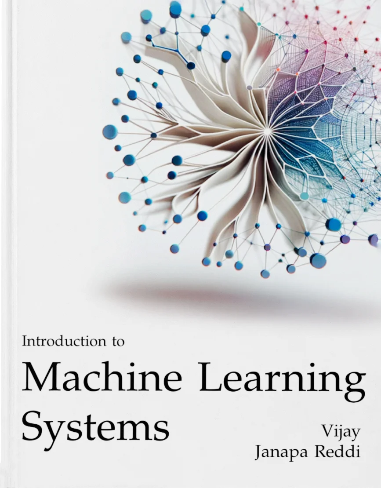

::: {.content-visible when-format="html:js"}

```{=html}
<div class="abstract-section">
  <div class="abstract-content">
    <p>Machine learning has evolved from a research discipline into an engineering practice. Building systems that learn from data requires more than understanding algorithms; it demands expertise spanning data pipelines, model development, deployment constraints, accelerator behavior, and operational practice. The book treats AI capability as the result of designing data, algorithms, and machines together under statistical and computational constraints. This book introduces AI engineering as the discipline of building intelligent systems that operate in the real world, then develops its ML systems foundation on a single compute node. The treatment progresses through four parts: foundations (deployment paradigms, the ML lifecycle, and data engineering), development (neural computation, model architectures, execution frameworks, and training), optimization (data selection, model compression, hardware acceleration, and benchmarking), and deployment (model serving, operations, and responsible engineering). Throughout, the emphasis is on quantitative trade-offs across data, algorithms, and machines.</p>
  </div>

  <div class="book-card">
    
    <p class="book-title">Introduction to Machine Learning Systems</p>
    <p class="book-subtitle">Publisher: The MIT Press (2026)</p>
  </div>
</div>

<h2>What You Will Learn</h2>

<p>The book progresses through four stages:</p>
<ul>
  <li><strong>Part I: Foundations.</strong> What is being built, under which physical constraints, across which lifecycle stages, and from what engineered data pipelines.</li>
  <li><strong>Part II: Development.</strong> How mathematical models reach hardware execution, through neural computation, model architectures, frameworks, and single-node training loops.</li>
  <li><strong>Part III: Optimization.</strong> How data selection, model compression, and hardware acceleration reduce system cost, and how benchmarking verifies each claimed speedup.</li>
  <li><strong>Part IV: Deployment.</strong> How the system serves live requests under strict latency budgets, how monitoring catches silent drift and skew in production, and how responsible engineering controls are enforced.</li>
</ul>

<h2>Prerequisites</h2>

<p>This book assumes:</p>
<ul>
  <li><strong>Programming proficiency</strong> in Python with familiarity in NumPy</li>
  <li><strong>Mathematics foundations</strong> in linear algebra, calculus, and probability at the undergraduate level</li>
  <li>Prior ML experience is helpful but not required; neural computation provides essential background</li>
</ul>

<h2>Learn by Doing</h2>

<p>Beyond the chapters, this volume is the reading spine for a broader AI engineering curriculum. Pair the chapters with <a href="https://mlsysbook.ai/labs/">Labs</a> to test predictions, <a href="https://mlsysbook.ai/tinytorch/">TinyTorch</a> to build framework internals, <a href="https://mlsysbook.ai/mlsysim/">MLSys·im</a> to model hardware constraints, and <a href="https://mlsysbook.ai/kits/">Hardware Kits</a> to deploy on real devices. Instructors can adopt the full sequence through <a href="https://mlsysbook.ai/instructors/">Instructor Hub</a>.</p>

<div class="support-mission">
  <p><strong>Goal:</strong> Help 100,000 students learn machine learning systems. Sponsors like the <a href="https://edgeaifoundation.org/" target="_blank" rel="noopener noreferrer">EDGE AI Foundation</a> match every star with funding that supports learning.</p>

  <div class="support-actions">
    <span class="star-count" id="star-count">Loading...</span>
    <a href="https://github.com/harvard-edge/cs249r_book" target="_blank" rel="noopener" class="github-star-btn">Star on GitHub</a>
  </div>

  <p class="support-note">
    <a href="https://opencollective.com/mlsysbook" target="_blank" rel="noopener">Support us on Open Collective →</a>
  </p>
</div>

<script>
async function fetchGitHubStars() {
  const starElement = document.getElementById('star-count');

  try {
    const response = await fetch('https://api.github.com/repos/harvard-edge/cs249r_book');
    const data = await response.json();
    const starCount = data.stargazers_count;
    const formattedCount = starCount.toLocaleString();
    starElement.textContent = formattedCount;
    starElement.style.opacity = '1';
  } catch (error) {
    console.error('Failed to fetch GitHub stars:', error);
    starElement.textContent = 'Loading...';
    starElement.style.opacity = '1';
  }
}

document.addEventListener('DOMContentLoaded', fetchGitHubStars);
</script>

<h2>Listen to the AI Podcast</h2>

<div class="podcast-section">
  <p>
    This short podcast, created with Google's NotebookLM and inspired by insights from our <a href="https://web.eng.fiu.edu/gaquan/Papers/ESWEEK24Papers/CPS-Proceedings/pdfs/CODES-ISSS/563900a043/563900a043.pdf" target="_blank" rel="noopener">IEEE education viewpoint paper</a>, offers an accessible overview of the book's key ideas and themes.
  </p>
  <audio controls="controls">
    <source src="shared/assets/media/notebooklm_podcast_mlsysbookai.mp3" type="audio/mpeg" />
    Your browser does not support the audio element.
  </audio>
</div>

<h2>Contributing</h2>

<p>This is a collaborative project. The project <a href="https://github.com/harvard-edge/cs249r_book/blob/main/CONTRIBUTING.md">contribution guidelines</a> explain how to participate. Feedback, corrections, and new ideas are welcome through GitHub <a href="https://github.com/harvard-edge/cs249r_book/issues">issues</a>.</p>
```

:::
