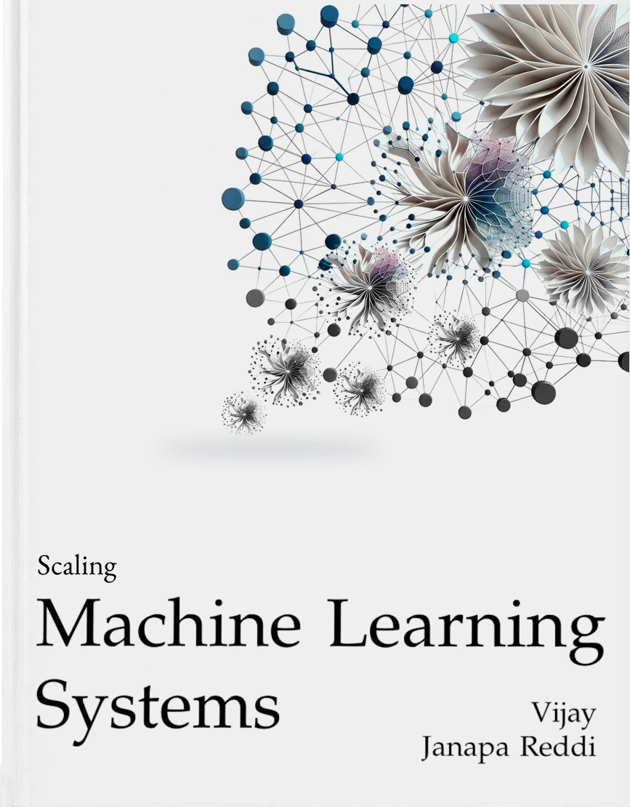

::: {.content-visible when-format="html:js"}

```{=html}
<div class="abstract-section">
  <div class="abstract-content">
    <p>At scale, machine learning changes its engineering requirements: models grow too large for a single accelerator, services span continents, and deployments carry responsibilities to society. At this scale, the costs of distribution limit AI capability as much as the model does, and every system in this book is engineered under both the physical limits of distributed infrastructure and the statistical behavior of learning. This book addresses AI engineering at scale. The treatment follows the lifecycle of a large-scale system: defining the distributed architecture, building the physical infrastructure fleet, ensuring operational reliability, deploying to global users, and hardening the system for safety and responsibility.</p>
  </div>

  <div class="book-card">
    
    <p class="book-title">Scaling Machine Learning Systems</p>
    <p class="book-subtitle">Publisher: The MIT Press (2027)</p>
  </div>
</div>

<h2>What You Will Learn</h2>

<p>The four parts extend ML systems foundations into production-scale systems by following the fleet stack from bottom to top:</p>
<ul>
  <li><strong>Part I: The Fleet.</strong> The data-center infrastructure, high-bandwidth network fabrics, and scalable storage that every distributed ML deployment runs on.</li>
  <li><strong>Part II: Distributed ML.</strong> How computation is coordinated across thousands of devices, through collective communication primitives, parallelism strategies, fault tolerance mechanisms, and fleet orchestration.</li>
  <li><strong>Part III: The Fleet in Production.</strong> How much of the fleet's capacity becomes useful work, the shift from training to serving, ML at the edge, and the operational lifecycle of production fleets.</li>
  <li><strong>Part IV: The Responsible Fleet.</strong> Security, robustness, environmental sustainability, and responsible engineering in large-scale operations.</li>
</ul>

<h2>Prerequisites</h2>

<p>This book assumes:</p>
<ul>
  <li><strong>Foundational or equivalent</strong> background in single-machine ML systems</li>
  <li><strong>Programming proficiency</strong> in Python with familiarity in NumPy</li>
  <li><strong>Mathematics foundations</strong> in linear algebra, calculus, and probability</li>
  <li>Familiarity with distributed systems concepts (networking, parallelism) is helpful for advanced topics</li>
</ul>
```



```{=html}
<h2>Learn by Doing</h2>

<p>Within the broader AI engineering curriculum, this volume is the scale and governance spine. Pair the chapters with the <a href="https://mlsysbook.ai/vol2/backmatter/studysheets.html">Study Sheets</a> to review each chapter, <a href="https://mlsysbook.ai/mlsysim/">MLSys·im</a> for first-principles infrastructure modeling, and <a href="https://mlsysbook.ai/staffml/">StaffML</a> for systems design practice. To review a chapter, use its two-page <a href="vol2/backmatter/studysheets.qmd">study sheet</a>, one at a time or all together. Instructors can adopt the full scale sequence through <a href="https://mlsysbook.ai/instructors/">Instructor Hub</a>.</p>
```



:::
