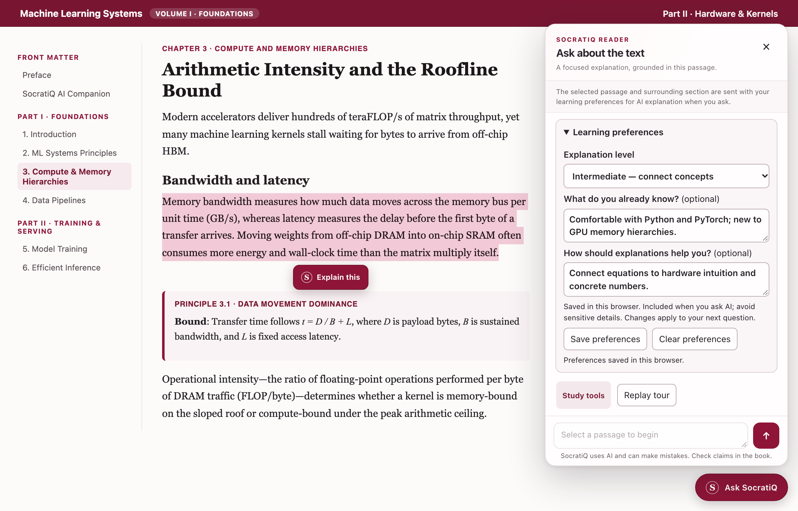
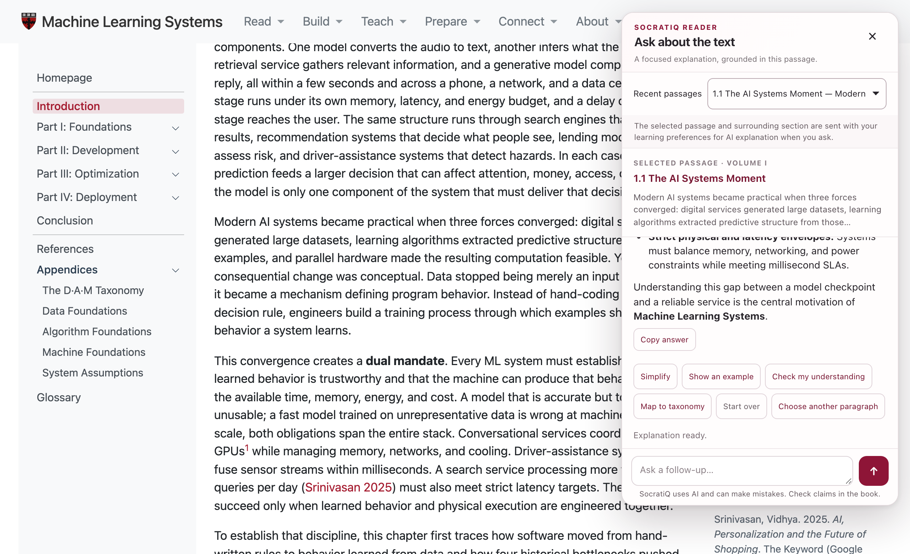
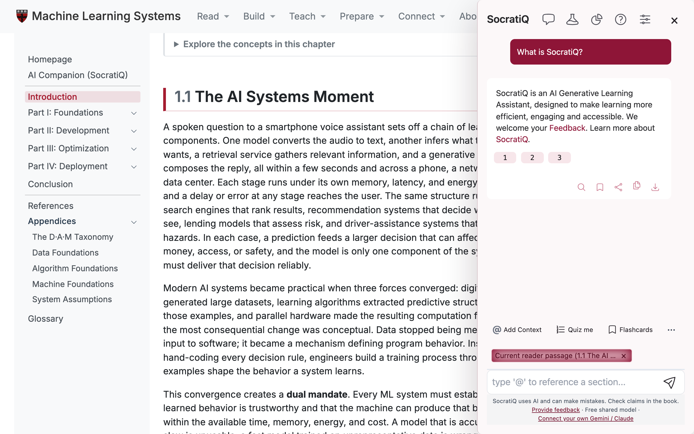
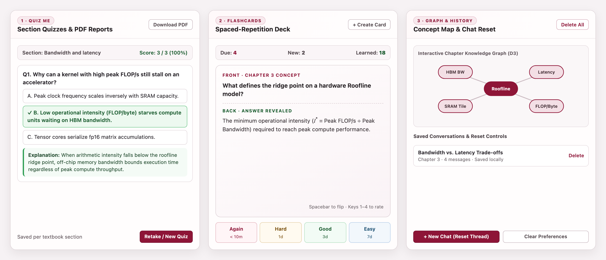
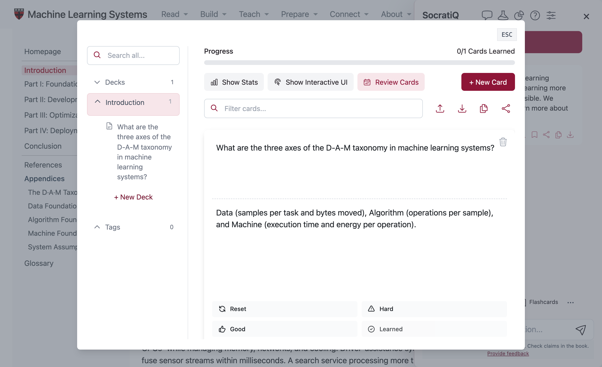
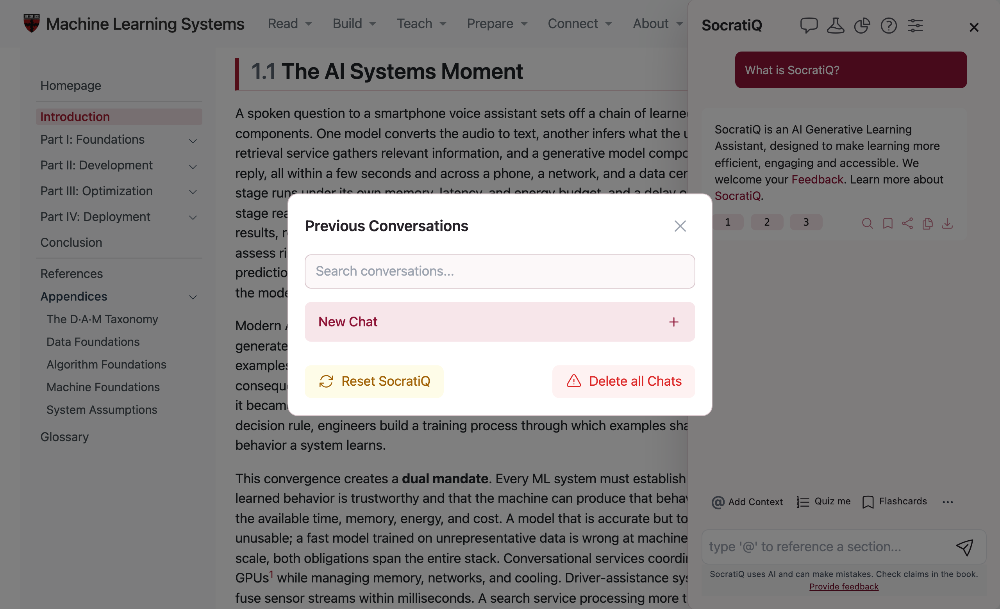

# AI Companion (SocratiQ) {.unnumbered}

## AI Learning Companion {#sec-socratiq-ai-ai-learning-companion-bc63}

Machine learning systems draw on computer architecture, systems software, and numerical optimization at the same time. A reader who knows backpropagation well may still pause when a chapter turns to cache-line transfers or collective communication, whereas a systems engineer who knows memory hierarchies well may want a step-by-step derivation of an attention kernel or a scaling law. Looking up unfamiliar terms in external search engines or general-purpose chatbots breaks the thread of the argument and often returns definitions that use different notation or ignore the constraints of the chapter.

That is why we built SocratiQ (pronounced "Socratic") directly into the online textbook at [mlsysbook.ai](https://mlsysbook.ai) and the [development preview](https://harvard-edge.github.io/cs249r_book_dev/). Because we coupled the companion directly to the chapter page, every explanation, worked example, and check question stays anchored in the exact passage, notation, and surrounding section of this book. The name combines the Socratic method of guided inquiry with question-driven generative AI tutoring and originates from our accompanying paper, [*SocratiQ: A Generative AI-Powered Learning Companion for Personalized Education and Broader Accessibility*](https://doi.org/10.1145/3743646.3750010), published in the *Proceedings of the Workshop on Computer Architecture Education* (WCAE '25; preprint at [arXiv:2502.00341](https://arxiv.org/abs/2502.00341)).

To leave the page uncluttered during ordinary reading while keeping deeper review tools close at hand, we divided the interface into two workspaces. The Focused Reader opens as a compact card beside the chapter for immediate passage explanations, follow-up questions, and self-checks. When a reader wants chapter-wide practice, the Study Tools sidebar expands to provide section quizzes, spaced-repetition flashcards, an interactive knowledge graph, and saved conversation history. Both workspaces remind readers beneath the prompt box that SocratiQ uses AI, can make mistakes, and should be checked against the book, a safeguard reinforced by how we ground each response in the chapter text.

## How SocratiQ Works {#sec-socratiq-ai-how-socratiq-works-4a19}

A general-purpose chatbot answers questions from unanchored training memory, which makes it prone to drifting away from a textbook's definitions, symbols, and quantitative assumptions. We designed SocratiQ instead as a context-bounded systems tutor that assembles each request from the active chapter before calling the language model. Three mechanisms govern how we build each response:

- **Passage- and chapter-grounded context**: When a reader highlights text or attaches a section with `@`, SocratiQ extracts the exact passage, preserves inline mathematical notation, and bundles a bounded window of surrounding prose with the chapter title and scope. System instructions align every response with the quantitative frameworks introduced in this book, so explanations reason from the same data, algorithm, and hardware trade-offs, communication bounds, and safety constraints as the chapter text.
- **Socratic inquiry and Bloom's taxonomy calibration**: Rather than returning a single static summary, the companion pairs systems analysis with guided progression modeled on Bloom's taxonomy (*remember*, *understand*, *apply*, *analyze*, *evaluate*, and *create*). Readers choose Beginner, Intermediate, or Advanced depth in the Focused Reader, or select the Bloom's Taxonomy mode on the four-level Understanding Level slider inside Study Tools Settings to step progressively from foundational definitions to architectural trade-offs and design synthesis.
- **Active recall and concept mapping**: Durable understanding requires retrieving and testing ideas rather than rereading explanations passively. Study Tools connects inline passage discussions to an interactive chapter knowledge graph, graded section and cumulative quizzes with a performance dashboard, and locally scheduled spaced-repetition flashcards.

Together, these three mechanisms keep the companion faithful to the book's notation and engineering laws whether a reader is unpacking a single hardware performance equation (such as the Roofline Model introduced later in this book) or reviewing an entire chapter before an exam. Because the interface runs inside an isolated browser container and stores its state locally on the device, launching and personalizing the companion takes only a few clicks.

## Quick Start Guide {#sec-socratiq-ai-quick-start-guide-986f}

The reading companion runs in the browser on the published site and development preview with no account, activation toggle, or API key. Four steps launch the companion, calibrate it to a reader's background, and generate a grounded passage explanation (@fig-socratiq-launch):

1. **Open the companion**: Open any chapter page and either highlight a passage in the text or select the Ask SocratiQ button in the bottom-right corner. On first open, a three-step walkthrough introduces the controls (Next or Skip tour), and selecting Replay tour reopens that walkthrough at any time.
2. **Calibrate learning preferences**: Expand Learning preferences inside the panel to choose an explanation depth (Beginner, Intermediate, or Advanced), describe prior familiarity with the topic, and state what kind of explanation is most useful. Selecting Save preferences stores these settings locally, whereas Clear preferences resets them; directly beneath the preferences drawer sit the Study tools, Replay tour, and Choose a paragraph controls.
3. **Select a passage**: Highlight a sentence, equation, table cell, callout, or paragraph in the chapter and choose Explain this (or press Ctrl+Shift+E on Windows and Linux, or Cmd+Shift+E on macOS).
4. **Inspect the grounded explanation**: Read the explanation in the Focused Reader panel. Selecting the section link under the Selected passage header scrolls back to the source paragraph in the chapter and closes the card while keeping the discussion available under Recent passages.

::: {#fig-socratiq-launch fig-env="figure" fig-pos="htb" fig-cap="**Launching SocratiQ and Calibrating Learning Preferences**: Highlighting any textbook passage reveals the floating Explain this button while the Focused Reader panel provides local Learning preferences alongside the Study tools, Replay tour, and Choose a paragraph controls." fig-alt="Screenshot of Chapter 1 (Section 1.1 The AI Systems Moment) showing a highlighted paragraph with the floating Explain this button and the SocratiQ Reader panel open on the right with the Learning preferences drawer expanded above the Study tools, Replay tour, and Choose a paragraph controls."}
{fig-alt="Screenshot of Chapter 1 (Section 1.1 The AI Systems Moment) showing a highlighted paragraph with the floating Explain this button and the SocratiQ Reader panel open on the right with the Learning preferences drawer expanded above the Study tools, Replay tour, and Choose a paragraph controls."}
:::

When dragging selection handles across a long paragraph is awkward on a phone, tablet, or trackpad, selecting Ask SocratiQ opens the panel first without sending a request. From there, a reader can select Choose a paragraph and tap or click any prose paragraph in the chapter (for tables, code blocks, or compact lists, highlighting the text directly works best). The panel quotes the chosen paragraph for inspection and waits until the reader selects Explain passage before sending the request; choosing Cancel picking or pressing Escape exits selection mode. Once a passage is selected, the Focused Reader and Study Tools provide controls for probing the material further.

## Learning with SocratiQ {#sec-socratiq-ai-learning-socratiq-d17d}

When a reader submits a passage, the Focused Reader streams an explanation calibrated to the saved learning level and renders mathematical notation and code inline (@fig-socratiq-reader). Beneath the explanation, six one-tap actions reshape the discussion or test comprehension without requiring a typed prompt:

- **Copy answer**: The clipboard receives the rendered explanation as Markdown together with the chapter title, section URL, and quoted source passage for study notes.
- **Simplify**: The companion rewrites the explanation in plainer language and defines technical terms before introducing formal notation.
- **Show an example**: A worked example grounds the passage in a concrete hardware, kernel, or systems scenario with representative numbers.
- **Check my understanding**: SocratiQ asks one conceptual question at a time and waits for the reader's answer before giving feedback.
- **Start over**: The panel clears the current passage's conversation thread and draft input while keeping the selected passage ready for a fresh question.
- **Choose another paragraph**: Selection mode reopens so the reader can switch to a different paragraph in the chapter with a single tap or click.

::: {#fig-socratiq-reader fig-env="figure" fig-pos="htb" fig-cap="**Contextual Passage Explanation in the Focused Reader**: The Focused Reader pairs the quoted textbook passage and section return link with a calibrated explanation, Copy answer button, one-tap Socratic learning actions, Recent passages switcher, and bottom AI disclaimer footnote." fig-alt="Screenshot of Chapter 1 showing the SocratiQ Focused Reader panel with the Recent passages dropdown, the Selected passage card for 1.1 The AI Systems Moment, a rendered explanation with inline math, the Copy answer button, the Simplify, Show an example, Check my understanding, Start over, and Choose another paragraph buttons, and the bottom AI disclaimer footnote."}
{fig-alt="Screenshot of Chapter 1 showing the SocratiQ Focused Reader panel with the Recent passages dropdown, the Selected passage card for 1.1 The AI Systems Moment, a rendered explanation with inline math, the Copy answer button, the Simplify, Show an example, Check my understanding, Start over, and Choose another paragraph buttons, and the bottom AI disclaimer footnote."}
:::

Readers can also type follow-up questions in the prompt box at the bottom of the panel (pressing Enter to send or Shift+Enter for a new line) to probe an equation, boundary condition, or hardware trade-off in greater depth. As a reader moves across multiple paragraphs within a chapter, the Recent passages menu at the top of the panel retains up to five passage threads in memory so the reader can switch back and forth without losing earlier answers or follow-up drafts.

When study goals move beyond single-passage questions to whole-chapter review, selecting the Study tools button inside the Focused Reader expands the Study Tools workspace (@fig-socratiq-study-workspace). Across the top toolbar, icons from left to right open Previous Conversations (first on the left), the interactive Knowledge Graph (second from the left), the Quiz Performance Dashboard (third from the left, with streaks, badges, and Download Report or Verify Report actions), Help (with direct links to this guide and the research paper), Settings, and the close button to return to the Focused Reader. Along the bottom toolbar, Add Context (or typing `@` in the prompt box) attaches sections, subsections, or keywords from the current chapter without needing a mouse. Beside it sit Quiz me, Flashcards, and the More Options menu, which holds the Draw to Select capture tool and the Meditation Timer.

::: {#fig-socratiq-study-workspace fig-env="figure" fig-pos="htb" fig-cap="**Full Study Tools Workspace and Toolbar Controls**: Selecting Study tools expands the sidebar with top navigation icons for saved conversations, concept graph, progress reports, help, and settings, alongside bottom actions for section context, quizzes, flashcards, and feedback." fig-alt="Screenshot of Chapter 1 with the SocratiQ Study Tools sidebar open on the right, showing the top toolbar icons, an assistant response card with numbered reference badges (1, 2, 3) and five action icons, the bottom toolbar with Add Context, Quiz me, Flashcards, and More Options, the prompt input field, and the bottom AI disclaimer footer."}
{fig-alt="Screenshot of Chapter 1 with the SocratiQ Study Tools sidebar open on the right, showing the top toolbar icons, an assistant response card with numbered reference badges (1, 2, 3) and five action icons, the bottom toolbar with Add Context, Quiz me, Flashcards, and More Options, the prompt input field, and the bottom AI disclaimer footer."}
:::

The active-recall and review tools inside Study Tools support three complementary workflows across a chapter:

- **Knowledge graph and section quizzes**: Selecting the Knowledge Graph icon (second from the left in the top toolbar) opens the interactive chapter map (@fig-socratiq-study-modes), where readers inspect relationships among chapter sections in tree or list view, select section nodes to build a custom quiz (Generate Custom Quiz), or choose Quiz me in the bottom toolbar for a graded section or cumulative quiz with follow-up explanations (Explain in more detail) and downloadable PDF progress reports (Download Report in the Quiz Performance Dashboard).
- **Spaced-repetition flashcards**: Selecting Flashcards in the bottom toolbar opens the chapter deck manager, where readers organize cards by chapter or tag, flip through cards in Show Interactive UI, review due cards (Review Cards), inspect recall statistics (Show Stats), or create new cards (+ New Card).
- **Previous conversations and history reset**: Selecting the Previous Conversations icon (first on the left in the top toolbar) opens the session manager, where readers search earlier sessions by title or content, start a clean thread (New Chat), reset the workspace (Reset SocratiQ), or clear saved chat history (Delete all Chats).

::: {#fig-socratiq-study-modes fig-env="figure" fig-pos="htb" fig-cap="**Interactive Chapter Knowledge Graph and Custom Quiz Builder**: The Knowledge Graph maps the current chapter's sections into an interactive tree or list view where readers can select components, generate custom quizzes, and analyze study progress." fig-alt="Screenshot of the SocratiQ Knowledge Graph dialog open over Chapter 1, showing the radial chapter tree for 1 Introduction with sections 1.1 and 1.4 selected, the Tree and List toggle, the Graph legend and guide, and the active Generate Custom Quiz and Analyze my Progress buttons."}
{fig-alt="Screenshot of the SocratiQ Knowledge Graph dialog open over Chapter 1, showing the radial chapter tree for 1 Introduction with sections 1.1 and 1.4 selected, the Tree and List toggle, the Graph legend and guide, and the active Generate Custom Quiz and Analyze my Progress buttons."}
:::

For long-term retention across chapters, the spaced-repetition flashcard manager (@fig-socratiq-flashcards) tracks learned cards locally for each chapter deck and supports importing, downloading, copying, and sharing cards alongside filtering by keyword or tag. Each assistant message in Study Tools also includes a bookmark icon that generates flashcards directly from the explanation, alongside numbered reference badges and controls to highlight matching paragraphs in the chapter, share a link, copy Markdown, or download the response.

::: {#fig-socratiq-flashcards fig-env="figure" fig-pos="htb" fig-cap="**Spaced-Repetition Flashcard Deck Manager**: Choosing Flashcards in Study Tools opens the local deck manager with per-chapter decks, progress tracking, interactive review controls, and custom card creation." fig-alt="Screenshot of the SocratiQ Spaced Repetition Flashcards dialog open over Chapter 1, showing the Decks sidebar with Introduction selected, the Progress bar, Show Stats, Show Interactive UI, Review Cards, and + New Card buttons, card filter and export controls, and a Chapter 1 flashcard on the D-A-M taxonomy."}
{fig-alt="Screenshot of the SocratiQ Spaced Repetition Flashcards dialog open over Chapter 1, showing the Decks sidebar with Introduction selected, the Progress bar, Show Stats, Show Interactive UI, Review Cards, and + New Card buttons, card filter and export controls, and a Chapter 1 flashcard on the D-A-M taxonomy."}
:::

Whenever a reader wants to start fresh or clear stored history, the Previous Conversations dialog (@fig-socratiq-reset) provides one-click controls to open a new thread, reset the workspace, or delete saved chats. Choosing Reset SocratiQ clears all local chats, quiz records, flashcards, and settings in a single step and reloads the page in a clean state, whereas pressing Escape closes any open dialog or panel without altering stored data.

::: {#fig-socratiq-reset fig-env="figure" fig-pos="htb" fig-cap="**Previous Conversations and History Reset Controls**: Selecting the conversation icon in Study Tools opens Previous Conversations with search, New Chat, Reset SocratiQ, and Delete all Chats actions." fig-alt="Screenshot of the SocratiQ Previous Conversations dialog open over Chapter 1, showing the Search conversations input, the New Chat button, the Reset SocratiQ button, and the Delete all Chats button."}
{fig-alt="Screenshot of the SocratiQ Previous Conversations dialog open over Chapter 1, showing the Search conversations input, the New Chat button, the Reset SocratiQ button, and the Delete all Chats button."}
:::

Across both the Focused Reader and Study Tools, @tbl-socratiq-controls summarizes where each personalization, review, and reset control lives and what it does.

| **Feature or task**                       | **Where to find it**                                                                                                                            | **What it does**                                                                                                                                                          |
|:------------------------------------------|:------------------------------------------------------------------------------------------------------------------------------------------------|:--------------------------------------------------------------------------------------------------------------------------------------------------------------------------|
| **Explain a passage**                     | Highlight text and choose Explain this, or open Ask SocratiQ, select Choose a paragraph, and choose Explain passage                             | Sends the selected passage, surrounding section, and learning preferences for a grounded explanation                                                                      |
| **Configure explanation level and style** | Open Ask SocratiQ and expand Learning preferences (or select the Study tools button and open Settings)                                          | Sets Beginner, Intermediate, Advanced, or Bloom's Taxonomy depth plus optional teaching guidance                                                                          |
| **Guided follow-ups and self-check**      | Action buttons in the Focused Reader: Simplify, Show an example, and Check my understanding                                                     | Rewrites in simpler terms, gives a concrete systems example, or asks one Socratic check question at a time                                                                |
| **Switch between passages**               | Open Recent passages at the top of the Focused Reader                                                                                           | Switches among up to five recent passage discussions on the current chapter page                                                                                          |
| **Section quizzes and flashcards**        | Open Ask SocratiQ, select the Study tools button, and choose Quiz me, Flashcards, or the Quiz Performance Dashboard                             | Runs graded quizzes, spaced-repetition flashcards, and streak/badge tracking (with Download Report in the dashboard)                                                      |
| **Reset current chat or clear history**   | Choose Start over in the Focused Reader, or open Previous Conversations in Study Tools and select New Chat, Delete all Chats, or Reset SocratiQ | Clears the current passage thread (Start over), starts a fresh session (New Chat), deletes chat history only (Delete all Chats), or wipes all local data (Reset SocratiQ) |
| **Custom AI provider or API key**         | Open Ask SocratiQ, select the Study tools button, open Settings, and enable Use Custom API under Use your own AI                                | Optionally configures a personal API key for Google Gemini, OpenRouter, Groq, or Ollama                                                                                   |

: **SocratiQ Controls and Configuration Reference**: Summary of how to launch, personalize, study with, and reset SocratiQ across the Focused Reader and Study Tools. {#tbl-socratiq-controls tbl-colwidths="[26,34,40]"}

## Data Storage {#sec-socratiq-ai-data-storage-5ea5}

SocratiQ stores learning preferences, walkthrough progress, saved conversations, quiz results, and flashcard decks locally in the browser for the website address where they are created. Because browser storage is separated by site address, the published site at [mlsysbook.ai](https://mlsysbook.ai) and the development preview maintain separate preferences and study records. Selecting Clear preferences inside Learning preferences removes saved background notes and teaching instructions and resets the explanation depth to Intermediate, whereas selecting Start over in the Focused Reader or Delete all Chats in Previous Conversations clears stored conversation history.

When a reader requests an explanation, quiz, or flashcard set, SocratiQ sends only the selected passage, a bounded window of surrounding chapter text, the active conversation turns, and the saved learning preferences to the AI service that generates the response. Readers should never enter personal, confidential, or sensitive information into learning preferences or chat prompts. Keeping state in local browser storage and scoping each request to the active passage also makes most interface issues straightforward to resolve.

## Common Issues and Troubleshooting {#sec-socratiq-ai-common-issues-troubleshooting-cba6}

Because SocratiQ anchors every explanation in chapter prose, highlighting text inside navigation menus, page headers, or sidebars does not trigger the floating Explain this button. If the button does not appear after highlighting text in the chapter body, a reader can open Ask SocratiQ, select Choose a paragraph, and click or tap any prose paragraph directly. When a highlighted selection spans several sections and is too long to process at once, narrowing it to a single paragraph or equation resolves the limit. If the AI service is temporarily unavailable or a streaming response is interrupted, the panel preserves the selected passage and displays a Retry button; reading the textbook itself never depends on the AI service, and any persistent issue can be reported directly from the workspace.

## Providing Feedback {#sec-socratiq-ai-providing-feedback-873e}

Readers can report questions or bugs that persist after basic troubleshooting through the site's Report an issue link or the Provide feedback link in the Study Tools footer. Including the chapter URL, browser version, and the steps that produced the issue helps us reproduce and resolve the problem quickly. Readers interested in the pedagogical design and system architecture behind the companion can consult our paper in the *Proceedings of the Workshop on Computer Architecture Education* ([WCAE '25](https://doi.org/10.1145/3743646.3750010); preprint at [arXiv:2502.00341](https://arxiv.org/abs/2502.00341)), noting that some interface details in that earlier publication reflect our initial single-panel prototype rather than the two-workspace interface described here.
