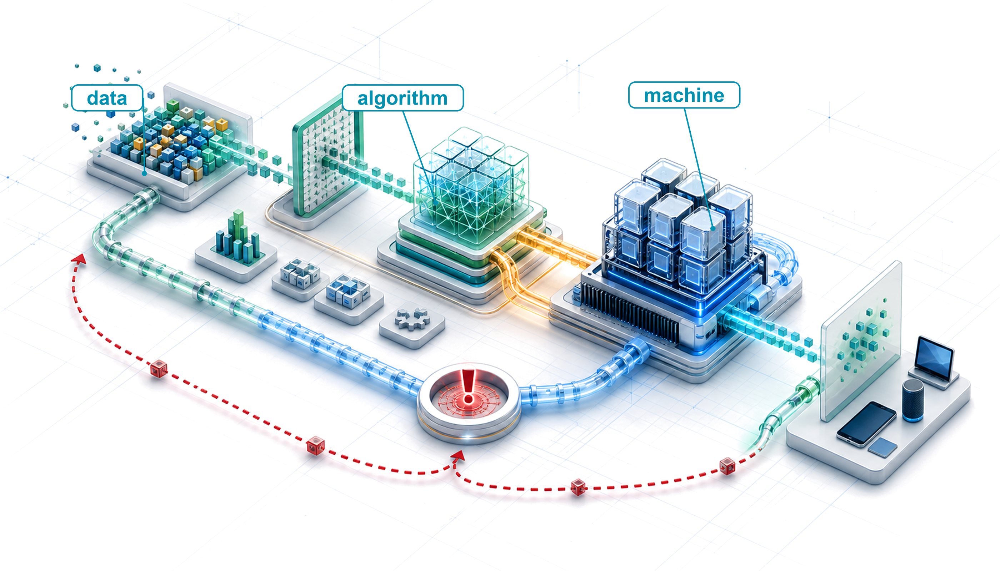
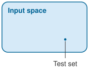
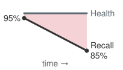
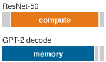
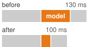

::: {.content-visible unless-format="pdf"}
# Introduction {#sec-introduction .unlisted}
:::

<!-- Calculation stencil: PIPO (Purpose → Input → Process → Output).
     Markdown uses only *_str or *_math variables. -->

::: {layout-narrow}
::: {.column-margin}

\chapterminitoc

:::

::: {.content-visible when-format="pdf"}
\noindent
{fig-alt="Isometric blueprint atlas showing raw data flowing through a model core, machine platform, deployment endpoint, and feedback loop as one connected ML system."}
:::

::: {.content-visible unless-format="pdf"}
{fig-alt="Isometric blueprint atlas showing raw data flowing through a model core, machine platform, deployment endpoint, and feedback loop as one connected ML system."}
:::

:::

## Purpose {.unnumbered .unlisted}

::: {.content-visible when-format="pdf"}
\begin{marginfigure}
\mlsysstack{30}{30}{30}{30}{30}{30}{30}{30}
\end{marginfigure}
:::

::: {.content-visible unless-format="pdf"}
::: {.column-margin}
{width="100%" fig-alt="Machine Learning Systems Architecture Stack"}

*Architecture stack focus for this chapter.*
:::
:::

_Why does an accurate machine learning model not guarantee a reliable, efficient system?_

Machine learning systems have a physics. Data moves through memory hierarchies governed by bandwidth, arithmetic executes on silicon governed by power, and predictions must arrive within strict latency windows. These constraints are not secondary implementation details. Moving an operand from main memory can cost far more energy than performing arithmetic on it, and a prediction that arrives a few hundred milliseconds late can be worth nothing to the real-time process waiting for it. An architecture that fits comfortably in a data center is useless on a mobile phone, and a training pipeline that converges in days on high-bandwidth accelerators can stall for weeks on standard hardware. These systems also diverge from conventional software because empirical data, rather than explicit logic alone, defines their behavior. When a conventional program misbehaves, it often crashes or throws an exception. When an ML system misbehaves, the runtime may operate flawlessly while learned predictions fail because the input distribution has shifted or the training data was unrepresentative. No assertion fails and no exception is raised; the only symptom is deteriorated decisions, discovered weeks later through lost revenue, erroneous predictions, or compromised safety. Testing, version control, and profiling remain necessary but are no longer sufficient. A unit test confirms that code computes what it was written to compute, but it cannot establish that learned behavior still matches a non-stationary world, and optimizing one component in isolation frequently moves the bottleneck to another layer of the stack. In D·A·M terms, data, algorithm, and machine must be engineered together as one problem.

::: {.content-visible when-format="pdf"}

\newpage

:::

::: {.callout-learning-objectives}

- Explain why data-defined behavior lets predictive quality decline while model code and execution remain unchanged
- Apply a data-algorithm-machine lens to diagnose a system bottleneck and reassess it after an intervention
- Calculate execution time with the iron law and assess how a component improvement changes end-to-end time
- Analyze when scalable search and learning can benefit from additional computation within data and machine constraints
- Compare algorithmic, compute, and data-selection efficiency by the iron-law term each changes and the accuracy gained per added cost
- Evaluate whether predictive quality and resource use meet deployment requirements using evaluation and lifecycle monitoring

:::

## The AI Systems Moment {#sec-introduction-ai-moment-37f1}

```{python}
#| echo: false
from mlsysim import *
from mlsysim.core.units import *
from mlsysim import ReferenceStats
from mlsysim.physics import memory_from_params
from mlsysim.fmt import fmt, fmt_memory, fmt_params, fmt_count, check

# ┌─────────────────────────────────────────────────────────────────────────────
# │ THE AI MOMENT STATISTICS (LEGO)
# ├─────────────────────────────────────────────────────────────────────────────
# │ Context: Opening of "The AI Moment" section
# │
# │ Goal: Establish the scale of modern AI services.
# │ Show: Daily search volume in billions of queries.
# │ How: Retrieve the canonical search-volume constant.
# │
# └─────────────────────────────────────────────────────────────────────────────

# ┌── LEGO ───────────────────────────────────────────────
class AIMomentStats:
    """
    Namespace for opening statistics in 'The AI Moment' section.
    Establishes the scale of modern AI services (daily searches).
    """

    # ┌── 1. LOAD (Constants) ───────────────────────────────────────────────
    searches_per_day = ReferenceStats.Workloads.GoogleSearchesPerDay

    # ┌── 2. EXECUTE (The Compute) ─────────────────────────────────────────
    searches_b = searches_per_day / BILLION

    # ┌── 3. GUARD (Invariants) ───────────────────────────────────────────
    check(searches_b >= 5, f"Google searches ({searches_b:.1f}B) unexpectedly low.")

    # ┌── 4. OUTPUT (Formatting) ──────────────────────────────────────────────
    google_search_b_str = fmt_params(searches_per_day, scale="B", precision=1)
```

Artificial intelligence is no longer confined to research demonstrations. When a user queries a smartphone voice assistant, learned components convert speech to text, interpret intent, retrieve information, and generate a response within seconds. Search engines rank results, recommendation systems decide what people see, lenders use models to assess risk, and driver-assistance systems detect hazards. In each case, a prediction participates in a larger decision that can affect attention, money, access, or safety. Even a single voice query is therefore a chain of models and services operating in the world.

Modern AI systems became practical when three forces converged: digital services generated large datasets, learning algorithms extracted predictive structure from those examples, and parallel hardware made the resulting computation feasible. Yet the most consequential change was conceptual. Data stopped being merely an input to software; it became a mechanism defining program behavior. Instead of hand-coding every decision rule, engineers build a training process through which examples shape the behavior a system learns.

This convergence creates a **dual mandate**\index{Dual mandate!definition}. Every ML system must establish that its learned behavior is trustworthy and that the machine can produce that behavior within the available time, memory, energy, and cost. A model that is accurate but too slow is unusable; a fast model trained on unrepresentative data is wrong at machine speed. At scale, both obligations span the entire stack. Conversational services coordinate pools of GPUs[^fn-gpu-parallel-execution] while managing memory, networks, and cooling. Driver-assistance systems must fuse sensor streams within milliseconds. A search service processing `{python} AIMomentStats.google_search_b_str` queries per day must also meet strict latency targets. These systems succeed only when learned behavior and physical execution are engineered together. That co-design begins with the shift from code-defined logic to data-defined behavior.

[^fn-gpu-parallel-execution]: **GPU (graphics processing unit)**\index{GPU!etymology}: Originally designed to render graphics by performing many calculations in parallel. Neural networks also require large numbers of similar arithmetic operations, especially matrix multiplications, making this hardware useful for training. Keeping those operations supplied with data remains a separate engineering challenge.

## Data-Centric Paradigm Shift {#sec-introduction-datacentric-paradigm-shift-4eca}

The transition from code-defined logic to data-defined behavior transforms how software systems are conceived, constructed, and maintained. Instead of writing decision rules directly into source code, engineers construct an optimization pipeline that learns program behavior from empirical examples. Andrej Karpathy[^fn-karpathy-software-two] framed this transformation as the migration from **Software 1.0**\index{Software 1.0!definition} to **Software 2.0**\index{Software 2.0!definition} [@karpathy2017software]. As summarized in @tbl-software-1-vs-2, Software 1.0 explicitly encodes procedural logic in human-written instructions, whereas Software 2.0 searches a high-dimensional parameter space to find a model configuration that satisfies an empirical objective.

In an email spam filter, each training record pairs an email payload with a binary label indicating whether the message is spam. The optimization procedure adjusts millions of numerical weights[^fn-model-weights-inference] so that the model's predictions align with historical labels. Live inference[^fn-inference-serving-deployment] then applies these trained weights to incoming messages whose labels are unknown. Evaluating the model against a separate test set reveals whether this learned decision boundary generalizes reliably beyond the training corpus.

[^fn-model-weights-inference]: **Model weights**\index{Model weights!definition}: The learned numerical parameters of a neural network. They must be stored and accessed during execution, so their number and numerical representation affect memory use, data movement, and cost.

[^fn-inference-serving-deployment]: **Inference**\index{Inference!deployment}: Applying a trained model to inputs, whether during evaluation or deployment. Interactive serving often imposes a response-time limit, whereas offline inference may prioritize the total number of examples processed per second. These workloads can require different execution choices even for the same model (see @sec-model-serving).

Software 2.0 does not eliminate traditional software engineering. Engineers still write data ingestion pipelines, loss functions, distributed training loops, and low-latency serving harnesses. However, the core operational logic no longer resides in human-readable control flow, but in millions of numerical weights shaped by data. Static analysis and manual code review cannot reveal what decision the system will make for a novel input. While both paradigms can suffer from undetected faults, learned systems introduce a distinct failure mode: predictive accuracy can silently collapse even when source code, compiler binaries, and execution environments remain completely unchanged.

[^fn-karpathy-software-two]: **Andrej Karpathy**\index{Karpathy, Andrej!Software 2.0}: A founding member of OpenAI and former director of AI at Tesla. His "Software 2.0" essay described neural network weights as a new form of "source code" [@karpathy2017software]. The analogy shifts debugging attention toward the examples that shaped those weights and the conditions under which the model is evaluated.

| **Feature**      | **Software 1.0 (Traditional)** | **Software 2.0 (Machine Learning)**         |
|:-----------------|:-------------------------------|:--------------------------------------------|
| **Source Code**  | C++, Python, Java              | Learned weights, shaped by training data    |
| **Compiler**     | GCC, LLVM                      | Training loop (stochastic gradient descent) |
| **Logic**        | Explicit (Hand-coded)          | Implicit (Learned)                          |
| **Failure Mode** | Crashes or silent logic errors | Also statistical quality loss               |
| **Debugging**    | Trace execution and inputs     | Also inspect data and learned behavior      |

: **The Paradigm Shift from Software 1.0 to Software 2.0**: In Software 2.0, the "programmer" curates the dataset and designs the training process that shapes learned behavior. Debugging expands to include the data. The "compiler" analogy is approximate: unlike a deterministic compiler, the training process is stochastic and may produce different learned weights from the same training data. {#tbl-software-1-vs-2}

The data-centered workflow changes what engineers must build and maintain. Sculley and colleagues described how model code occupies only a small fraction of a production ML system [@sculley2015hidden]. The surrounding system includes data collection, verification, feature extraction, resource management, serving, and monitoring, each with its own maintenance obligations.

::: {.column-margin}
{width="100%" fig-alt="A small orange box labeled ML code nested inside a much larger surrounding frame labeled System; the inner box occupies a tiny fraction of the outer area."}

*Production ML work is mostly the surrounding system, not the model code alone.*
:::

That imbalance creates hidden technical debt, the accumulating cost of maintaining undocumented dependencies and brittle infrastructure around the model. Each surrounding component encodes assumptions about how an example is sampled, what a label means, when a feature is computed, which version reaches serving, and how degradation is detected. None of those assumptions appears in the matrix multiplication that produces a prediction, yet any of them can change the result. Improving the model alone cannot repair a measurement that no longer tracks its target, a broken feature pipeline, or a missing feedback signal.

Production data is therefore not a passive input. It is a measurement of the world, collected through a particular product and transformed by a changing pipeline. If that measurement stops representing the intended target, the model can remain numerically healthy while the system becomes wrong. Google Flu Trends had an enormous, timely stream of search data, but the meaning of that data changed beneath the model.

::: {#ws-introduction-google-flu-trends .callout-war-story title="When search logs mistook attention for illness (2013)"}

**Context**: Google Flu Trends\index{Google Flu Trends!proxy drift} (GFT) estimated influenza activity from patterns in aggregated search queries [@ginsberg2009detecting; @lazer2014]. Its attraction came from the speed and scale at which searches arrived relative to clinical reports. If people searched for flu symptoms when they became ill, query volume appeared to offer a timely proxy, or indirect measurement, for infection.

**Failure mode**: The proxy was not stable. News coverage could change what people searched for, and autocomplete could change how they expressed those searches. Query volume could therefore reflect public attention and product behavior as well as illness. During the 2012--2013 season, GFT estimated roughly twice the CDC-reported proportion of doctor visits for influenza-like illness, and from August 2011 onward it overestimated in 100 of 108 weeks.

**Systems lesson**: The remedy was not simply a larger search dataset or a better-tuned model. Researchers combined search signals with U.S. Centers for Disease Control and Prevention (CDC) sentinel clinical data and recalibrated the relationship over time. Data volume is not ground truth. A behavioral proxy needs a feedback loop to a trusted measurement and continual evidence that the proxy still represents the quantity the system claims to estimate.

:::

In Google Flu Trends, predictive quality deteriorated while the software kept operating. The input distribution, meaning the kinds of inputs and how frequently they occur, and the relationship between proxy and target can change. Under the **data-as-code principle**\index{Data-as-code principle!definition}, training data does not merely enter a fixed program; it helps determine the operational logic that the model implements. Engineers still write the optimization procedure, but the examples shape the model weights through stochastic gradient descent[^fn-sgd-stochastic-sampling] and related methods. Changing the dataset can therefore change system behavior as surely as changing source code.

[^fn-sgd-stochastic-sampling]: **Stochastic gradient descent (SGD)**\index{Stochastic gradient descent!systems trade-off}: A training algorithm, descended from the stochastic approximation method of @robbins1951stochastic, that repeatedly adjusts model parameters using small, randomly sampled groups of examples, called batches, rather than processing the entire dataset for each update.

Data-defined behavior is a property of machine learning; *data-centric* AI is a development strategy for improving that behavior [@ng2021datacentric]\index{Data-centric AI}. A model-centric approach holds the data comparatively fixed and improves the model, whereas a data-centric approach holds the model comparatively fixed and makes data curation an explicit route to better predictions.

```{python}
#| echo: false
#| label: verification-gap-calc
# ┌─────────────────────────────────────────────────────────────────────────────
# │ VERIFICATION GAP CALCULATION
# ├─────────────────────────────────────────────────────────────────────────────
# │ Context: "The verification gap" callout (Data-Centric Paradigm section)
# │
# │ Goal: Quantify the impossibility of exhaustive testing in high-dimensional ML.
# │ Show: The astronomical size of the image input space vs. test set coverage.
# │ How: Calculate total possible pixel configurations for 224x224 RGB images.
# │
# └─────────────────────────────────────────────────────────────────────────────
import math
from mlsysim.fmt import fmt_int, fmt, check, fmt_time, fmt_math
from mlsysim.core.units import count

# ┌── LEGO ───────────────────────────────────────────────
class VerificationGap:
    """
    Calculates the dimensionality of the ImageNet input space to illustrate
    the 'verification gap' between test sets and real-world input spaces.
    """

    # ┌── 1. LOAD (Constants) ───────────────────────────────────────────────
    IMAGE_DIM_RESNET = Datasets.ImageNet.image_width
    width = IMAGE_DIM_RESNET
    height = IMAGE_DIM_RESNET
    channels = IMAGE_CHANNELS_RGB
    depth = COLOR_DEPTH_8BIT
    validation_size = Datasets.ImageNet.validation_examples.to(count).magnitude

    # ┌── 2. EXECUTE (The Compute) ─────────────────────────────────────────
    total_pixels = width * height * channels
    # Space size is depth^total_pixels. We want log10(depth^total_pixels).
    digits = total_pixels * math.log10(depth)

    # ┌── 3. GUARD (Invariants) ───────────────────────────────────────────
    check(digits > 300_000, f"Verification gap ({digits:.0f} digits) unexpectedly small.")

    # ┌── 4. OUTPUT (Formatting) ──────────────────────────────────────────────
    vg_digits_str = fmt_int(digits, commas=True)
    imagenet_validation_images_str = fmt(validation_size, precision=0, commas=True)
    space_size_math = fmt_math(rf"{int(depth)}^{{{format(int(total_pixels), ',').replace(',', '{,}')}}}")
```

Data-defined behavior adds a testing obligation: assessing predictive quality over the population of inputs the system will encounter. Conventional software can also have input spaces too large to enumerate, so exhaustive testing is not a realistic expectation for either kind of system. In the 2012 ImageNet challenge, AlexNet's decisive win[^fn-alexnet-first-mention] helped set the deep learning era in motion, yet the benchmark could evaluate only a vanishing fraction of the inputs the model might encounter. Each input is a $224{\times}224$ RGB image with `{python} VerificationGap.space_size_math` possible pixel configurations, a number with `{python} VerificationGap.vg_digits_str` digits. Real photographs occupy only a tiny region of that space, but even that region is far too large to enumerate. The ImageNet Large Scale Visual Recognition Challenge (ILSVRC) validation set contains only `{python} VerificationGap.imagenet_validation_images_str` images [@krizhevsky2012imagenet; @russakovsky2015]. The ratio of evaluated inputs to possible configurations ($\text{Test Set Coverage} / \text{Total Input Space}$) is effectively zero. That disparity between what any test set can cover and what a deployed system will meet is the **verification gap**\index{Verification gap!definition}.

[^fn-alexnet-first-mention]: **AlexNet**\index{AlexNet!ImageNet breakthrough}: Alex Krizhevsky, Ilya Sutskever, and Geoffrey Hinton trained this image-recognition network across two GPUs. At ILSVRC 2012, its 15.3 percent top-5 error, meaning the correct class was absent from its five highest-scoring predictions, substantially beat the second-place system's 26.2 percent [@krizhevsky2012imagenet]. @Sec-introduction-deep-learning-era-infrastructure-bottleneck-2f02 returns to its architecture and systems co-design.

This disparity does not make evaluation futile; it changes what testing can establish. Predeployment evaluation provides statistical evidence over sampled inputs, while continuous production monitoring verifies whether the operating population and observed outcomes continue to support that empirical baseline. Statistical confidence replaces any expectation of exhaustive proof. The chapters on deployment and operations return to this gap and bound it statistically over a specified operating population.

::: {.column-margin}
{width="100%" fig-alt="A large shaded field labeled Input space containing a single tiny dot labeled Test set."}

*Test coverage is a vanishing fraction of the input space.*
:::

A unit assertion verifies that a given input and state follow an explicit execution path, while a machine learning claim describes aggregate performance over a population that changes over time. Robustness therefore cannot mean immunity to change. It means instrumenting the system to detect when production evidence no longer supports the model, and acting on that evidence.

Debugging an ML system requires inspecting datasets and pipeline transformations, not tracing Python call stacks alone. Version control must record dataset snapshots and feature configurations alongside source code commits. Evaluation harnesses must measure statistical distribution shifts and subpopulation outcomes rather than branch coverage. These practices establish reproducibility and provenance, but they cannot transform empirical sampling into formal verification.

::: {.column-margin .margin-pointer}
↪ Versioning training datasets so that a model can be reproduced and traced to its inputs is developed in @sec-data-engineering-data-versioning-ml-reproducibility-16d0.
:::

::: {#chk-introduction-paradigm-shift .callout-checkpoint title="The paradigm shift"}

Before tracing the history of AI, verify your understanding of the paradigm shift in how software is built:

- [ ] **Software 1.0 vs. 2.0**: can you distinguish Software 1.0 (explicit instructions) from Software 2.0 (behavior learned from data)?
- [ ] **Debugging shift**: can you identify which dataset evidence to inspect when accuracy falls without a code change?
- [ ] **Verification gap**: can you explain why finite test coverage can provide statistical evidence but never exhaustive proof, and why production monitoring must continue gathering that evidence?

:::

Learning behavior from data can seem inevitable in hindsight, but its adoption also reflects the scaling limits of earlier approaches. Many AI systems attempted to program intelligence directly through hand-crafted symbols and rules. Reading that history through a systems lens reveals recurring binding constraints, the limits whose relaxation would most improve the whole system: logic, knowledge acquisition, feature design, and the physical infrastructure that the rest of this book studies.

## The Evolution of AI Bottlenecks {#sec-introduction-ai-paradigm-evolution-ae2b}

Each era of AI history encountered a different limit, in representation, data, or computing resources. When Alan Turing[^fn-turing-imitation-outputs] proposed evaluating machine intelligence through observable responses [@turing1950], computing machinery had little memory or processing capacity. Early systems pursued different paths. Frank Rosenblatt's Perceptron\index{Perceptron!early neural computation} (1958) [@rosenblatt1958] attempted to learn weights from sensory inputs, while Joseph Weizenbaum's ELIZA[^fn-eliza-pattern-brittleness] [@weizenbaum1966] executed hand-coded pattern substitutions. A single-layer perceptron could separate classes only with a linear boundary [@minsky1969perceptrons], and practical methods for training deeper networks remained limited. ELIZA's scripts depended on inputs matching their templates. Four eras organize this history around recurring bottlenecks (symbolic AI, expert systems, statistical learning, and deep learning), although the approaches overlapped in time.

[^fn-turing-imitation-outputs]: **Alan Turing**\index{Turing, Alan!Imitation Game}: His "Imitation Game" approached machine intelligence through observable responses rather than a definition of its internal nature [@turing1950]. It provides an early example of evaluating a system through what it does.

[^fn-eliza-pattern-brittleness]: **ELIZA**\index{ELIZA!brittleness}: A natural-language program whose scripts could store selected inputs and reuse them in later responses [@weizenbaum1966]. This limited memory was programmed explicitly rather than learned from conversations. Extending its coverage required changing the scripts, even when the existing program ran correctly.

@Fig-ai-timeline traces attention to AI across seven decades of published literature and shades two "AI winter" intervals (1974--1980 and 1987--1993) marked by funding cuts and unmet expectations.[^fn-ai-winters-systems] These setbacks reflected gaps between expectations and what systems could deliver. Later advances combined changes in algorithms, data, and computing resources; the sections below examine how those changes shifted the limiting constraint.

[^fn-ai-winters-systems]: **AI winters as systems failures**\index{AI winters!systems failure}: The first AI winter (1974--1980) unfolded amid funding cuts; the 1973 Lighthill Report criticized the gap between AI promises and delivered results [@lighthill1973artificial]. The second winter (1987--1993) involved a market and funding collapse around expert systems and specialized Lisp machines as general-purpose workstations undercut their economics [@hendler2008avoiding]. These episodes involved technical limitations, unmet expectations, and economics; hardware capacity alone does not explain them.

::: {#fig-ai-timeline fig-env="figure" fig-pos="t!" fig-cap="**AI Development Timeline**: The red curve tracks how often published books mention artificial intelligence, a measure of attention rather than capability, and the light-brown bands mark the two AI winters. Callout boxes place milestones such as Turing's 1950 paper [@turing1950], the Dartmouth conference [@mccarthy1955dartmouth], the Perceptron [@rosenblatt1958], ELIZA [@weizenbaum1966], Deep Blue [@campbell2002], and GPT-3 [@brown2020language] against that curve. Adapted from @michel2011quantitative." fig-alt="Timeline from the 1950s to the 2020s with a red line showing AI publication frequency. Light-brown bands mark two AI winters. Callout boxes mark milestones including Turing's 1950 paper, Dartmouth conference, Perceptron, ELIZA, Deep Blue, and GPT-3."}

```{.tikz}
\begin{tikzpicture}[line join=round,font=\sffamily\small]
\definecolor{bluegraph}{RGB}{0,102,204}
    \pgfmathsetlengthmacro\MajorTickLength{
      \pgfkeysvalueof{/pgfplots/major tick length} * 1.5
    }
\tikzset{%
   textt/.style={line width=0.5pt,draw=bluegraph,text width=26mm,align=flush center,
                        font=\sffamily\footnotesize,fill=cyan!7},
   Line/.style={line width=0.85pt,draw=bluegraph,dash pattern=on 3pt off 2pt,
   {Circle[bluegraph,length=4.5pt]}-   }
}

\begin{axis}[clip=false,
  axis line style={thick},
  axis lines*=left,
  axis on top,
  width=230mm,
  height=200mm,
  xmin=1950,
  xmax=2023,
  ymin=0.000000,
  ymax=0.00032,
  xtick={1950,1960,1970,1980,1990,2000,2010,2020},
  extra x ticks={1955,1965,1975,1985,1995,2005,2015},
  extra x tick labels={},
  xticklabels={1950,1960,1970,1980,1990,2000,2010,2020},
  ytick={0.0000,0.00005, 0.00010, 0.00015, 0.00020, 0.00025, 0.00030},
  yticklabels={0.0000,0.00005, 0.00010, 0.00015, 0.00020, 0.00025, 0.00030},
  grid=none,
    tick label style={/pgf/number format/assume math mode=true},
    xticklabel style={font=\footnotesize\sffamily,
},
   yticklabel style={
  font=\footnotesize\sffamily,
  /pgf/number format/fixed,
  /pgf/number format/fixed zerofill,
  /pgf/number format/precision=5
},
scaled y ticks=false,
 tick style = {line width=1.0pt},
 tick align = outside,
 major tick length=\MajorTickLength,
]
\fill[fill=BrownL!70](axis cs:1974,0)rectangle(axis cs:1980,0.00031)
        node[above,align=center,xshift=-7mm]{1st AI \ Winter};
\fill[fill=BrownL!70](axis cs:1987,0)rectangle(axis cs:1993,0.00031)
        node[above,align=center,xshift=-7mm]{2nd AI \ Winter};
\addplot[line width=2pt,color=RedLine,smooth,samples=100] coordinates {
(1950,0.0000006281)
(1951,0.0000000683)
(1952,0.0000003056)
(1953,0.0000002927)
(1954,0.0000004296)
(1955,0.0000004593)
(1956,0.0000016705)
(1957,0.0000006570)
(1958,0.0000021902)
(1959,0.0000032832)
(1960,0.0000126863)
(1961,0.0000063721)
(1962,0.0000240680)
(1963,0.0000141502)
(1964,0.0000111442)
(1965,0.0000143832)
(1966,0.0000147726)
(1967,0.0000169539)
(1968,0.0000167880)
(1969,0.0000175559)
(1970,0.0000155680)
(1971,0.0000206809)
(1972,0.0000223804)
(1973,0.0000218203)
(1974,0.0000256138)
(1975,0.0000282924)
(1976,0.0000247784)
(1977,0.0000404966)
(1978,0.0000358032)
(1979,0.0000436903)
(1980,0.0000472788)
(1981,0.0000561471)
(1982,0.0000767864)
(1983,0.0001064465)
(1984,0.0001592212)
(1985,0.0002133700)
(1986,0.0002559067)
(1987,0.0002608470)
(1988,0.0002623321)
(1989,0.0002358150)
(1990,0.0002301105)
(1991,0.0002051343)
(1992,0.0001789229)
(1993,0.0001560935)
(1994,0.0001508219)
(1995,0.0001401406)
(1996,0.0001169577)
(1997,0.0001150365)
(1998,0.0001051385)
(1999,0.0000981740)
(2000,0.0001010236)
(2001,0.0000976966)
(2002,0.0001038084)
(2003,0.0000980004)
(2004,0.0000989412)
(2005,0.0000977251)
(2006,0.0000899964)
(2007,0.0000864005)
(2008,0.0000911872)
(2009,0.0000852932)
(2010,0.0000822649)
(2011,0.0000913442)
(2012,0.0001104912)
(2013,0.0001023061)
(2014,0.0001022477)
(2015,0.0000919719)
(2016,0.0001134797)
(2017,0.0001384348)
(2018,0.0002057324)
(2019,0.0002328642)
}
;

\node[textt,text width=20mm](1950)at(axis cs:1957,0.00014){\textcolor{red}{1950}\\
Alan Turing publishes \textit{Computing Machinery and Intelligence} in the journal \textit{Mind}.};
\node[red,align=center,above=2mm of 1950]{Milestones\ in AI};
\draw[Line] (axis cs:1950,0) -- (1950.235);
%
\node[textt,text width=19mm](1956)at(axis cs:1958,0.00007){\textcolor{red}{Summer 1956}\\
\textbf{Dartmouth Workshop} A formative conference organized by AI pioneer John McCarthy.};
\draw[Line] (axis cs:1956,0) -- (1956.255);
%
\node[textt](1957)at(axis cs:1969,0.00022){\textcolor{red}{1958}\\
\textbf{Cornell psychologist Frank Rosenblatt invents the perceptron}, laying the groundwork for
modern neural networks.};
\draw[Line] (axis cs:1957,0) -- ++(0mm,17mm)-|(1957.248);
%
\node[textt,text width=21mm](1966)at(axis cs:1972,0.00012){\textcolor{red}{1966}\\
\textbf{ELIZA chatbot} An early example of natural-language programming created by
MIT professor Joseph Weizenbaum.};
\draw[Line] (axis cs:1966,0) -- ++(0mm,17mm)-|(1966);
%
\node[textt,text width=20mm](1979)at(axis cs:1985,0.00012){\textcolor{red}{1979}\\
Hans Moravec builds the \textbf{Stanford Cart}, one of the first autonomous vehicles.};
\draw[Line] (axis cs:1979,0) -- ++(0mm,17mm)-|(1979.245);
%
\node[textt,text width=21mm](1981)at(axis cs:1990,0.00006){\textcolor{red}{1981}\\
Japanese \textbf{Fifth-Generation Computer Systems} project begins. The infusion of
research funding helps end first "AI winter."};
\draw[Line] (axis cs:1981,0) -- ++(0mm,10mm)-|(1981);
%
\node[textt,text width=15mm](1997)at(axis cs:2001,0.00007){\textcolor{red}{1997}\\
\textbf{IBM's Deep Blue} beats world chess champion Garry Kasparov};
\draw[Line] (axis cs:1997,0) -- ++(0mm,10mm)-|(1997);
%
\node[textt,text width=15mm](2011)at(axis cs:2014,0.00003){\textcolor{red}{2011}\\
\textbf{IBM's Watson} wins at Jeopardy!};
\draw[Line] (axis cs:2011,0) -- (2011);
%
\node[textt,text width=19mm](2005)at(axis cs:2012,0.00009){\textcolor{red}{2005}\\
\textbf{DARPA Grand Challenge} Stanford wins the agency's second driverless-car
competition by driving 212 kilometers on an unrehearsed trail};
\draw[Line] (axis cs:2005,0) -- (2005);
%
\node[textt,text width=30mm](2020)at(axis cs:2010,0.00017){\textcolor{red}{2020}\\
\textbf{OpenAI introduces GPT-3}. The 175-billion-parameter model demonstrates few-shot in-context learning, initiating the era of foundation-model compute scale.};
\draw[Line] (axis cs:2020,0) |- (2020);
%
\draw[Line,solid,-] (axis cs:1991,0.0002) --++(50:35mm)
node[bluegraph,above,align=center,text width=30mm]{Percent of U.S.-published books
in Google's database that mention artificial intelligence};
\end{axis}
\end{tikzpicture}
```

:::

### Rule-based approaches: Logic and knowledge bottlenecks {#sec-introduction-prelearning-era-logic-knowledge-bottlenecks-f312}

Rule-based approaches attempted to build intelligent systems by making knowledge explicit. Symbolic AI encountered a *logic bottleneck* when its rules could not capture real-world ambiguity. Expert systems narrowed the task to a domain but encountered a *knowledge bottleneck*: acquiring and maintaining the rules required extensive expert effort.

#### The symbolic AI era and the logic bottleneck {#sec-introduction-symbolic-ai-era-logic-bottleneck-a250}

Early AI research (1950s–1970s) pursued **symbolic AI**\index{Symbolic AI!definition}, representing knowledge and reasoning through explicit symbols and rules, an approach later crystallized in the physical-symbol-system hypothesis [@newell1976computer]. Researchers at the 1956 Dartmouth Conference\index{Dartmouth Conference}[^fn-dartmouth-proposal-systems] [@mccarthy1955dartmouth] hypothesized that aspects of intelligence could be precisely described and simulated by machines. Even then, Arthur Samuel\index{Samuel, Arthur!machine learning} at IBM demonstrated a different path in 1959 when a checkers program improved through self-play. His work coined the term "**machine learning**\index{Machine learning!definition}" [@samuel1959], though the dominant paradigm remained symbolic. Daniel Bobrow\index{Bobrow, Daniel!STUDENT}'s STUDENT[^fn-bobrow-student-lisp] system [@bobrow1964student] took this approach to algebra word problems.

[^fn-dartmouth-proposal-systems]: **Dartmouth Conference (1956)**\index{Dartmouth Conference!systems constraints}: The workshop organized around the term "artificial intelligence," already used in its 1955 proposal [@mccarthy1955dartmouth]. The proposal discussed limits in computer speed and memory while treating programming as the larger obstacle. Physical capacity was part of the problem from the outset, even as researchers focused on language, abstraction, problem solving, and self-improvement.

[^fn-bobrow-student-lisp]: **STUDENT**\index{STUDENT!symbolic AI failure mode}: An early program that translated algebra word problems into equations using hand-written language rules [@bobrow1964student]. Its success depended on the wording fitting those rules: an algebra solver could solve the resulting equations without establishing that the program had interpreted the original problem correctly.

These systems could produce impressive demonstrations, yet they were operationally brittle. Their success depended on manually coded rules that mapped each acceptable input form to a symbolic representation. STUDENT could solve an algebra problem once it translated English into equations, but a minor variation in phrasing could prevent that translation. The difficulty extended beyond language to perception and movement.[^fn-moravec-paradox-systems]

[^fn-moravec-paradox-systems]: **Moravec's paradox**\index{Moravec's paradox!compute implications}: Hans Moravec observed that skills people acquire with little conscious effort, such as perception and movement, can be harder to reproduce computationally than formal reasoning tasks [@moravec1988mind]. Human familiarity with a task is therefore a poor guide to its engineering difficulty or resource requirements.

::: {#exmp-introduction-student-1964 .callout-example title="STUDENT (1964)"}

STUDENT separated language interpretation from algebra:

```text
language  "Two numbers sum to 30; one is twice the other."
parse     x + y = 30, x = 2y
solve     x = 20, y = 10
```

Once the equations were written, solving was routine. The bottleneck was the translation. Each unfamiliar phrasing needed another hand-written rule, so linguistic coverage grew only as fast as the rule base.

:::

#### The expert systems era and the knowledge bottleneck {#sec-introduction-expert-systems-era-knowledge-bottleneck-f928}

In the expert-systems era\index{Expert systems}, engineers narrowed the problem. Instead of constructing general reasoning systems, they encoded deep knowledge from a specific domain. MYCIN\index{MYCIN!expert system}, designed to diagnose blood infections, let medical knowledge be expressed as production rules [@shortliffe1975].

::: {#exmp-introduction-mycin-1976 .callout-example title="MYCIN (1975)"}

MYCIN made its reasoning explicit. Patient facts triggered readable production rules:

```text
facts  stain=gram-positive, shape=coccus, arrangement=clumps
rule   IF facts match THEN organism=staphylococcus (certainty=0.7)
cycle  match facts -> fire rule -> update certainty -> repeat
```

An inference engine repeated this match-and-fire cycle across hundreds of rules and propagated certainty factors (numerical confidence weights) toward a diagnosis. A physician could inspect every step, but coverage still grew one rule at a time: each exception had to be elicited, encoded, and reconciled with the existing rule base.

:::

MYCIN performed well in specific tests, but its success exposed the **knowledge acquisition bottleneck**\index{Knowledge acquisition bottleneck!definition}.[^fn-knowledge-bottleneck-scale] The problem was no longer whether a rule could express expertise. It was how tacit judgment entered the system and remained consistent as the rule base grew.

[^fn-knowledge-bottleneck-scale]: **Knowledge acquisition bottleneck**\index{Knowledge acquisition bottleneck!human throughput}: @feigenbaum1984knowledge treated extracting and representing expert knowledge as a central challenge in building applied AI systems. Experts could exercise judgment without being able to state every rule behind it, so acquiring knowledge required more than transcribing a ready-made list.

Faster machines could evaluate production rules at higher frequencies, but raw processor speed could not accelerate the extraction or maintenance of human expertise. Scaling meant learning decision boundaries from examples instead of asking domain specialists to enumerate every contingency. This transition did not eliminate human design; it relocated engineering effort. Instead of hand-coding decision logic, engineers shifted to curating datasets, selecting mathematical representations, and formulating learning objectives from which models could optimize their own parameters. The next era exchanged the knowledge-acquisition bottleneck for the engineering challenge of structuring and extracting operational features from raw data.

### The statistical learning era and the feature engineering bottleneck {#sec-introduction-statistical-learning-era-feature-engineering-bottleneck-8cf5}

The 1990s marked the shift to **statistical learning**\index{Statistical learning!definition} and probabilistic systems. Instead of hard-coded logic, systems estimated probabilities from data, such as the conditional distribution $\ConditionalDistribution$ of a label $\ExampleLabel$ given an input $\ModelInput$. This transition was driven by the availability of digital data and the "unreasonable effectiveness"[^fn-unreasonable-data-effectiveness] of large datasets.

[^fn-unreasonable-data-effectiveness]: **Unreasonable effectiveness of data**\index{Unreasonable effectiveness of data!systems impact}: The observation that a simple statistical model with abundant data can outperform a more sophisticated model with less data [@halevy2009]. The benefit depends on the task, model, and data quality. This makes collecting and preparing useful examples part of the engineering work, rather than merely a preliminary step.

Spam filters made this shift. Rather than maintaining lists of forbidden words, statistical filters learned the probability that a word implies spam based on millions of examples.

::: {#exmp-introduction-early-spam-detection-systems .callout-example title="Early spam detection systems"}

Statistical filters shifted the decision from a hand-written rule to a probability estimated from labeled messages:

```text
rules: if "free" or "winner" appears -> spam
learn: labeled email -> word likelihoods -> Pr(spam | email)
```

Maintenance did not disappear. It moved from editing keyword lists to curating representative examples and checking whether the learned probabilities still tracked current email.

:::

Learning the decision boundary from data reduced one source of manual work but exposed another. Many statistical classifiers relied on engineers to convert raw inputs into features, measurable properties such as word counts or image edges. In computer vision, engineers designed feature extractors such as SIFT (Scale-Invariant Feature Transform) [@lowe1999] and HOG (Histogram of Oriented Gradients) [@dalal2005hog] to summarize local image patterns. Classifiers such as support vector machines (SVMs) [@cortes1995support] then learned decision boundaries from those features. The learner adjusted the boundary; engineers decided which evidence it could see. Extending the system to a new problem often meant rebuilding the preprocessing stack, creating the **feature engineering bottleneck**\index{Feature engineering bottleneck!definition}.

This hybrid approach combined human-engineered features with statistical learning. The Viola-Jones algorithm[^fn-viola-jones-earlyexit] [@viola2001], typical of this era, achieved real-time frontal-face detection using simple rectangular features and cascaded classifiers. It showed that well-engineered features could enable practical low-latency applications, but only within narrow domains where experts could hand-craft the right representations. A conventional vision pipeline makes that manual effort visible, because several hand-crafted stages preceded any learning at all.

::: {#exmp-introduction-traditional-computer-vision-pipeline .callout-example title="Traditional computer vision pipeline"}

A conventional vision system separated representation from classification:

```text
image -> resize -> HOG/SIFT features -> SVM -> label
```

Moving from faces to pedestrians or another domain meant redesigning the feature extractor and often the entire preprocessing stack.

:::

[^fn-viola-jones-earlyexit]: **Viola-Jones algorithm**\index{Viola-Jones algorithm!compute efficiency}: The detector applied a sequence of classifiers, rejecting likely nonface regions early and spending more computation on promising regions. On the reported test set, it evaluated an average of ten features per candidate image region, although the complete cascade contained over 6,000 features [@viola2001]. Its speed depended on how little work most inputs required, not just on how fast each operation ran.

```{python}
#| echo: false
#| label: alexnet-breakthrough
# ┌─────────────────────────────────────────────────────────────────────────────
# │ ALEXNET BREAKTHROUGH STATISTICS
# ├─────────────────────────────────────────────────────────────────────────────
# │ Context: "Deep Learning Era" section and @fig-alexnet caption
# │
# │ Goal: Demonstrate AlexNet's breakthrough as a systems co-design achievement.
# │ Show: The 42% relative error reduction driven by GPU-algorithm alignment.
# │ How: Calculate top-5 error improvement over second place.
# │
# └─────────────────────────────────────────────────────────────────────────────
from mlsysim import Models
from mlsysim.fmt import fmt, fmt_count, fmt_percent, fmt_memory, check
from mlsysim.core.units import Mparam, param, GB

# ┌── LEGO ───────────────────────────────────────────────
class AlexNetBreakthrough:
    """
    Namespace for AlexNet breakthrough statistics.
    Scenario: ImageNet 2012 competition results.
    """

    # ┌── 1. LOAD (Constants) ───────────────────────────────────────────────
    model = Models.Vision.AlexNet
    alexnet_top5_error = 15.3
    second_place_error = 26.2

    # ┌── 2. EXECUTE (The Compute) ─────────────────────────────────────────
    relative_improvement = (second_place_error - alexnet_top5_error) / second_place_error * 100
    params_m = model.parameters.to(Mparam).magnitude

    # ┌── 3. GUARD (Invariants) ───────────────────────────────────────────
    check(relative_improvement >= 40, f"AlexNet improvement should be ~42%, got {relative_improvement:.1f}%")

    # ┌── 4. OUTPUT (Formatting) ──────────────────────────────────────────────
    alexnet_top5_error_pct_str = fmt_percent(alexnet_top5_error / 100, precision=1, style='prose')
    vram_per_gpu_gb_str = fmt_memory(3 * GB, unit=GB, precision=0, commas=False)
    alexnet_relative_improvement_str = fmt_percent(relative_improvement / 100, precision=1, style='prose')
    alexnet_params_m_str = fmt_count(
        model.parameters,
        scale="M",
        precision=0,
        scale_style="word",
    )
```

### The deep learning era and the infrastructure bottleneck {#sec-introduction-deep-learning-era-infrastructure-bottleneck-2f02}

\index{Convolutional neural network|see{CNN}}
\index{High bandwidth memory|see{HBM}}\index{Large language model|see{LLM}}\index{Mixture-of-experts|see{MoE}}\index{Neural architecture search|see{NAS}}\index{Tensor Processing Unit|see{TPU}}\index{Graphics processing unit|see{GPU}}\index{Dynamic random access memory|see{DRAM}}\index{Static random access memory|see{SRAM}}\index{Peripheral component interconnect express|see{PCIe}}\index{Application-specific integrated circuit|see{ASIC}}\index{Field-programmable gate array|see{FPGA}}\index{Floating-point operations per second|see{FLOP/s}}\index{Non-uniform memory access|see{NUMA}}\index{Multi-instance GPU|see{MIG}}\index{Single instruction multiple data|see{SIMD}}\index{Direct memory access|see{DMA}}\index{Remote direct memory access|see{RDMA}}\index{Single instruction multiple thread|see{SIMT}}\index{Recurrent neural network|see{RNN}}\index{Multilayer perceptron|see{MLP}}\index{Generative adversarial network|see{GAN}}\index{ViT|see{Vision transformer}}\index{IB|see{InfiniBand}}\index{AOT|see{Ahead-of-time optimization}}\index{DAM taxonomy|see{D·A·M taxonomy}}\index{Query key value|see{Query-key-value}}\index{Dynamic voltage and frequency scaling|see{DVFS}}\index{Channelwise quantization|see{Quantization}}\index{Layerwise quantization|see{Quantization}}\index{Static quantization|see{Quantization}}\index{Hardware accelerator|see{Accelerator}}\index{Quantization granularity|see{Quantization}}\index{Machine learning framework|see{ML framework}}\index{Mini-batch gradient descent|see{Stochastic gradient descent}}
**Deep learning**\index{Deep learning!first use} [@lecun2015] changed which part of the system learned. A neural network computes in layers, stages of arithmetic on learned weights in which each layer transforms the output of the one before. Instead of receiving features designed by humans, deep networks with many such layers learned representations directly from raw inputs such as pixels and audio waveforms. The training process could now shape both the representation and the decision boundary, enabling "end-to-end" learning.

The breakthrough was not algorithmic alone. Convolutional neural networks (CNNs), whose convolutional layers slide small learned weight patterns called filters across an image to detect the same feature at every position, existed earlier [@lecun1989; @lecun1998]; AlexNet paired architecture and training with **systems co-design**\index{Systems co-design!definition}, choosing the model, training procedure, and hardware mapping together [@krizhevsky2012imagenet]. Its parallel matrix operations matched GPU capabilities. With `{python} AlexNetBreakthrough.alexnet_params_m_str` parameters distributed across two GTX 580 GPUs\index{GTX 580!AlexNet training}, AlexNet achieved `{python} AlexNetBreakthrough.alexnet_top5_error_pct_str` top-5 error, a `{python} AlexNetBreakthrough.alexnet_relative_improvement_str` relative improvement over the next-best entry that year. The hardware partition in @fig-alexnet carries the immediate systems lesson: the network divided work between the two GPUs and exchanged intermediate results only at selected layers to limit communication across the link between them [@krizhevsky2012imagenet]. Model structure and machine organization were designed together.

::: {#fig-alexnet fig-env="figure" fig-pos="t" fig-cap="**AlexNet Architecture**: Two parallel GPU streams process $224{\times}224$ input images through convolutional layers (green blocks) that extract spatial features at decreasing resolutions, converging through three fully connected layers to 1,000 output classes. Because each stream holds half of the network, the figure also shows how the model was partitioned across two GPUs. Adapted from @krizhevsky2012imagenet." fig-alt="3D diagram of AlexNet with two parallel GPU streams. Green blocks show convolutional layers decreasing from 224x224 input. Red kernels overlay green blocks. Right side shows three dense layers converging to 1000 outputs."}

```{.tikz}
\begin{tikzpicture}[line join=round,font=\sffamily\small]
\clip (-11.2,-2) rectangle (15.5,9.5);
%\draw[red](-11.2,-1.7) rectangle (15.5,5.45);
\tikzset{%
 LineD/.style={line width=0.7pt,black!50,dashed,dash pattern=on 3pt off 2pt},
  LineG/.style={line width=0.75pt,GreenLine},
  LineR/.style={line width=0.75pt,RedLine},
  LineA/.style={line width=0.75pt,BrownLine,-latex,text=black}
}
\newcommand\FillCube[4]{
\def\depth{#2}
\def\width{#3}
\def\height{#4}
\def\nc{#1}
% Lower front left corner
\coordinate (A\nc) at (0, 0);
% Donji prednji desni
\coordinate (B\nc) at (\width, 0);
% Upper front right
\coordinate (C\nc) at (\width, \height);
% Upper front left
\coordinate (D\nc) at (0, \height);
% Pomak u "dubinu"
\coordinate (shift) at (-0.7*\depth, \depth);
% Last points (moved)
\coordinate (E\nc) at ($(A\nc) + (shift)$);
\coordinate (F\nc) at ($(B\nc) + (shift)$);
\coordinate (G\nc) at ($(C\nc) + (shift)$);
\coordinate (H\nc) at ($(D\nc) + (shift)$);
% Front side
\draw[GreenLine,fill=green!08,line width=0.5pt] (A\nc) -- (B\nc) -- (C\nc) --(D\nc) -- cycle;
% Top side
\draw[GreenLine,fill=green!20,line width=0.5pt] (D\nc) -- (H\nc) -- (G\nc) -- (C\nc);
% Left
\draw[GreenLine,fill=green!15] (A\nc) -- (E\nc) -- (H\nc)--(D\nc)--cycle;
\draw[] (E\nc) -- (H\nc);
\draw[GreenLine,line width=0.75pt](A\nc)--(B\nc)--(C\nc)--(D\nc)--(A\nc)
(A\nc)--(E\nc)--(H\nc)--(G\nc)--(C\nc)
(D\nc)--(H\nc);
}
%%%
\newcommand\SmallCube[4]{
\def\nc{#1}
\def\depth{#2}
\def\width{#3}
\def\height{#4}
\coordinate (A\nc) at (0, 0);
\coordinate (B\nc) at (\width, 0);
\coordinate (C\nc) at (\width, \height);
\coordinate (D\nc) at (0, \height);
\coordinate (shift) at (-0.7*\depth, \depth);
\coordinate (E\nc) at ($(A\nc) + (shift)$);
\coordinate (F\nc) at ($(B\nc) + (shift)$);
\coordinate (G\nc) at ($(C\nc) + (shift)$);
\coordinate (H\nc) at ($(D\nc) + (shift)$);
\draw[RedLine,fill=red!08,line width=0.5pt,fill opacity=0.7] (A\nc) -- (B\nc) -- (C\nc) -- (D\nc) -- cycle;
\draw[RedLine,fill=red!20,line width=0.5pt,fill opacity=0.7] (D\nc) -- (H\nc) -- (G\nc) -- (C\nc);
\draw[RedLine,fill=red!15,fill opacity=0.7] (A\nc) -- (E\nc) -- (H\nc)--(D\nc)--cycle;
\draw[] (E\nc) -- (H\nc);
}
%%%%%%%%%%%%%%%%%%%%%
%%4 column
%%%%%%%%%%%%%%%%%%%%
\begin{scope}
%big cube
\begin{scope}
\FillCube{4VD}{0.8}{3}{2}
\end{scope}
%%small cube
\begin{scope}[shift={(-0.10,0.4)},line width=0.5pt]
\SmallCube{4MD}{0.4}{3}{0.6}
%%
\draw[LineR](A\nc)-- (B\nc)--node[left,text=black]{3}
(C\nc)--(D\nc)-- (A\nc)
(A\nc)--(E\nc)--(H\nc)--(G\nc)--node[left,text=black]{3}(C\nc)
(D\nc)-- (H\nc);
%
\def\nc{4VD}
\draw[LineG](A\nc)--node[below,text=black]{192} (B\nc)--
(C\nc)--(D\nc)--node[right,text=black,text opacity=1]{13} (A\nc)
(A\nc)--(E\nc)--(H\nc)--(G\nc)--(C\nc)
(D\nc)--node[right,text=black,text opacity=1]{13} (H\nc);
\end{scope}
\end{scope}
%%Above
\begin{scope}[shift={(0,3.5)}]
%big cube
\begin{scope}
\FillCube{4VG}{0.8}{3}{2}
\end{scope}
%%small cube
\begin{scope}[shift={(-0.18,0.55)}]
\SmallCube{4MG}{0.4}{3}{0.6}
%%
\draw[LineR](A\nc)-- (B\nc)--node[left,text=black]{3}
(C\nc)--(D\nc)-- (A\nc)
(A\nc)--(E\nc)--(H\nc)--(G\nc)--node[left,text=black]{3}(C\nc)
(D\nc)-- (H\nc);
\def\nc{4VG}
\draw[LineG](A\nc)--node[below,text=black]{192} (B\nc)--
(C\nc)--(D\nc)--node[right,text=black,text opacity=1]{} (A\nc)
(A\nc)--(E\nc)--(H\nc)--(G\nc)--(C\nc)
(D\nc)--node[right,text=black,text opacity=1]{} (H\nc);
\end{scope}
\end{scope}
%%%%%
%%5 column
%%%%
%%small cube
\begin{scope}[shift={(4.15,0)}]
%big cube
\begin{scope}
\FillCube{5VD}{0.8}{3}{2}
\end{scope}
%%small cube
\begin{scope}[shift={(-0.10,1.25)}]
\SmallCube{5MD}{0.4}{3}{0.6}
%%
\draw[LineR](A\nc)-- (B\nc)--node[left,text=black]{3}
(C\nc)--(D\nc)-- (A\nc)
(A\nc)--(E\nc)--(H\nc)--(G\nc)--node[left,text=black]{3}(C\nc)
(D\nc)-- (H\nc);
%
\def\nc{5VD}
\draw[LineG](A\nc)--node[below,text=black]{192} (B\nc)--
(C\nc)--(D\nc)--node[right,text=black,text opacity=1]{13} (A\nc)
(A\nc)--(E\nc)--(H\nc)--(G\nc)--(C\nc)
(D\nc)--node[right,text=black,text opacity=1]{13} (H\nc);
\end{scope}
\end{scope}
%%Above
\begin{scope}[shift={(4.15,3.5)}]
%big cube
\begin{scope}
\FillCube{5VG}{0.8}{3}{2}
\end{scope}
%%small cube
\begin{scope}[shift={(-0.08,0.28)}]
\SmallCube{5MG}{0.4}{3}{0.6}
%%
\draw[LineR](A\nc)-- (B\nc)--node[left,text=black]{3}
(C\nc)--(D\nc)-- (A\nc)
(A\nc)--(E\nc)--(H\nc)--(G\nc)--node[left,text=black]{3}(C\nc)
(D\nc)-- (H\nc);
%
\def\nc{5VG}
\draw[LineG](A\nc)--node[below,text=black]{192} (B\nc)--
(C\nc)--(D\nc)--node[right,text=black,text opacity=1]{} (A\nc)
(A\nc)--(E\nc)--(H\nc)--(G\nc)--(C\nc)
(D\nc)--node[right,text=black,text opacity=1]{} (H\nc);
\end{scope}
\end{scope}
%%%%%%%%%%%%%%%%%%%%%%%
%%3 column
%%%%%%%%%%%%%%%%%%%%%%%
\begin{scope}[shift={(-3.75,-0.5)}]
%big cube
\begin{scope}
\FillCube{3VD}{1.5}{2.33}{3}
\end{scope}
%%small cube-down
\begin{scope}[shift={(-0.10,0.45)}]
\SmallCube{3MDI}{0.4}{2.33}{0.6}
%%
\draw[LineR](A\nc)-- (B\nc)--node[left,text=black]{3}
(C\nc)--(D\nc)-- (A\nc)
(A\nc)--(E\nc)--(H\nc)--(G\nc)--node[left,text=black]{3}(C\nc)
(D\nc)-- (H\nc);
%
\end{scope}
%%small cube - up
\begin{scope}[shift={(-0.12,2.23)}]
\SmallCube{3MDII}{0.4}{2.33}{0.6}
%%
\draw[LineR](A\nc)-- (B\nc)--node[left,text=black]{3}
(C\nc)--(D\nc)-- (A\nc)
(A\nc)--(E\nc)--(H\nc)--(G\nc)--node[left,text=black]{3}(C\nc)
(D\nc)-- (H\nc);
%
\def\nc{3VD}
\draw[LineG](A\nc)--node[below,text=black]{128} (B\nc)--
(C\nc)--(D\nc)--node[right,text=black,text opacity=1,pos=0.4]{27} (A\nc)
(A\nc)--(E\nc)--(H\nc)--(G\nc)--(C\nc)
(D\nc)--node[right,text=black,text opacity=1]{27} (H\nc);
\end{scope}
\end{scope}
%%Above
\begin{scope}[shift={(-3.75,3.5)}]
%big cube
\begin{scope}
\FillCube{3VG}{1.5}{2.33}{3}
\end{scope}
%%small cube-down
\begin{scope}[shift={(-0.42,0.75)}]
\SmallCube{3MGI}{0.4}{2.33}{0.6}
%%
\draw[LineR](A\nc)-- (B\nc)--node[left,text=black]{}
(C\nc)--(D\nc)-- (A\nc)
(A\nc)--(E\nc)--(H\nc)--(G\nc)--node[left,text=black]{3}(C\nc)
(D\nc)-- (H\nc);
%
\def\nc{3VG}
\draw[GreenLine,line width=0.75pt](A\nc)--node[below,text=black]{128} (B\nc)--
(C\nc)--(D\nc)--node[right,text=black,text opacity=1]{} (A\nc)
(A\nc)--(E\nc)--(H\nc)--(G\nc)--(C\nc)
(D\nc)--node[right,text=black,text opacity=1]{} (H\nc);
\end{scope}
%%small cube-up
\begin{scope}[shift={(-0.06,0.18)}]
\SmallCube{3MGII}{0.4}{2.33}{0.6}
%%
\draw[LineR](A\nc)-- (B\nc)--node[left,text=black]{3}
(C\nc)--(D\nc)-- (A\nc)
(A\nc)--(E\nc)--(H\nc)--(G\nc)--node[left,text=black]{3}(C\nc)
(D\nc)-- (H\nc);
%
\def\nc{3VG}
\draw[LineG](A\nc)--node[below,text=black]{128} (B\nc)--
(C\nc)--(D\nc)--node[right,text=black,text opacity=1]{} (A\nc)
(A\nc)--(E\nc)--(H\nc)--(G\nc)--(C\nc)
(D\nc)--node[right,text=black,text opacity=1]{} (H\nc);
\end{scope}
\end{scope}
%%%%%%%%%%%%%%%%%%%%%%%
%%2 column
%%%%%%%%%%%%%%%%%%%%%%%
\begin{scope}[shift={(-6.8,-1)}]
%big cube
\begin{scope}
\FillCube{2VD}{2}{1.3}{3.8}
\end{scope}
%%small cube
\begin{scope}[shift={(-0.2,2.5)}]
\SmallCube{2MD}{0.4}{1.3}{1}
%%
\draw[LineR](A\nc)-- (B\nc)--node[left,text=black]{5}
(C\nc)--(D\nc)-- (A\nc)
(A\nc)--(E\nc)--(H\nc)--(G\nc)--node[left,text=black]{5}(C\nc)
(D\nc)-- (H\nc);
%
\def\nc{2VD}
\draw[LineG](A\nc)--node[below,text=black]{48} (B\nc)--
(C\nc)--(D\nc)--node[pos=0.6,right,text=black,text opacity=1]{55} (A\nc)
(A\nc)--(E\nc)--(H\nc)--(G\nc)--(C\nc)
(D\nc)--node[pos=0.26,right,text=black,text opacity=1]{55} (H\nc);
\end{scope}
\end{scope}
%%Above
\begin{scope}[shift={(-6.8,3.5)}]
%big cube
\begin{scope}
\FillCube{2VG}{2}{1.3}{3.8}
\end{scope}
%%small cube
\begin{scope}[shift={(-0.1,0.5)}]
\SmallCube{2MG}{0.4}{1.3}{1}
%%
\draw[LineR](A\nc)-- (B\nc)--node[left,text=black]{5}
(C\nc)--(D\nc)-- (A\nc)
(A\nc)--(E\nc)--(H\nc)--(G\nc)--node[left,text=black]{5}(C\nc)
(D\nc)-- (H\nc);
%
\def\nc{2VG}
\draw[LineG](A\nc)--node[above,text=black]{48} (B\nc)--
(C\nc)--(D\nc)--node[right,text=black,text opacity=1]{} (A\nc)
(A\nc)--(E\nc)--(H\nc)--(G\nc)--(C\nc)
(D\nc)--node[right,text=black,text opacity=1]{} (H\nc);
\end{scope}
\end{scope}
%%%%%%%%%%%%%%%%%%%%%%%
%%1 column
%%%%%%%%%%%%%%%%%%%%%%%
\begin{scope}[shift={(-9.0,-1.2)}]
%big cube
\begin{scope}
\FillCube{1VD}{2}{0.2}{4.55}
\end{scope}
%%small cube=down
\begin{scope}[shift={(-0.25,0.5)}]
\SmallCube{1MDI}{0.8}{0.15}{1.7}
%%
\draw[LineR](A\nc)-- (B\nc)--
(C\nc)--(D\nc)-- node[left=-2pt,text=black,pos=0.4]{11}(A\nc)
(A\nc)--(E\nc)--(H\nc)--(G\nc)--node[left=3pt,text=black,pos=0.9]{11}(C\nc)
(D\nc)-- (H\nc);
%
\def\nc{1VD}
\draw[LineG](A\nc)--node[below,text=black]{3} (B\nc)--
(C\nc)--(D\nc)--node[right,text=black,text opacity=1]{} (A\nc)
(A\nc)--node[below left,text=black]{224}(E\nc)--
node[left,text=black,text opacity=1]{224}(H\nc)--(G\nc)--(C\nc)
(D\nc)-- (H\nc);
\end{scope}
%%small cube=up
\begin{scope}[shift={(-0.75,3.4)}]
\SmallCube{1MDII}{0.8}{0.15}{1.7}
%%
\draw[LineR](A\nc)-- (B\nc)--
(C\nc)--(D\nc)-- node[left=-2pt,text=black,pos=0.4]{11}(A\nc)
(A\nc)--(E\nc)--(H\nc)--(G\nc)--node[left=3pt,text=black,pos=0.9]{11}(C\nc)
(D\nc)-- (H\nc);
%
\def\nc{1VD}
\draw[LineG](A\nc)--node[below,text=black]{3} (B\nc)--
(C\nc)--(D\nc)--node[right,text=black,text opacity=1]{} (A\nc)
(A\nc)--node[below left,text=black]{224}(E\nc)--
node[left,text=black,text opacity=1]{224}(H\nc)--(G\nc)--(C\nc)
(D\nc)-- (H\nc);
\end{scope}
\end{scope}
%%%%
\begin{scope}[shift={(8.15,0)}]
\begin{scope}
\FillCube{6VD}{0.8}{2.0}{2}
\path(A6VD)--node[below]{128}(B6VD);
\path(A6VD)--node[right]{13}(D6VD);
\path(D6VD)--node[right]{13}(H6VD);
\end{scope}
%up
\begin{scope}[shift={(0,3.5)}]
\FillCube{6VG}{0.8}{2.0}{2}
\path(A6VG)--node[below]{128}(B6VG);
\end{scope}
\end{scope}

\newcommand\Boxx[3]{\node[draw,LineG,fill=green!10,rectangle,minimum width=7mm,minimum height=#2](#1){};
\node[below=2pt of #1]{#3};
}
\begin{scope}[shift={(11.7,1.0)}]
 \Boxx{B1D}{35mm}{2048}
\end{scope}
\begin{scope}[shift={(11.7,5.25)}]
 \Boxx{B1G}{35mm}{2048}
\end{scope}
\begin{scope}[shift={(13.5,1.0)}]
 \Boxx{B2D}{35mm}{2048}
\end{scope}
\begin{scope}[shift={(13.5,5.25)}]
 \Boxx{B2G}{35mm}{2048}
\end{scope}
\begin{scope}[shift={(15.0,1.0)}]
 \Boxx{B3}{19mm}{1000}
\end{scope}
%%%
\node[right=3pt of B1VD,align=center]{Stride\ of 4};
\node[right=3pt of B2VD,align=center]{Max\ pooling};
\node[right=3pt of B3VD,align=center]{Max\ pooling};
\node[align=right,anchor= east]at(B1D.south west){Max pooling};
%
\coordinate(1C2)at($(A2VD)!0.4!(D2VD)$);
\foreach\i in{B,C,G}{
\draw[LineD](\i 1MDI)--(1C2);
}
\coordinate(2C2)at($(E2VG)!0.2!(H2VG)$);
\foreach\i in{B,C,G}{
\draw[LineD](\i 1MDII)--(2C2);
}
%3
\coordinate(1C3)at($(A3VD)!0.55!(H3VD)$);
\foreach\i in{B,C,G}{
\draw[LineD](\i 2MD)--(1C3);
}
\coordinate(2C3)at($(A3MGI)!0.35!(D3MGI)$);
\foreach\i in{B,C,G}{
\draw[LineD](\i 2MG)--(2C3);
}
%4
\coordinate(1C4)at($(A4VG)!0.15!(D4VG)$);
\foreach\i in{B,C,G}{
\draw[LineD](\i 3MGI)--(1C4);
}
\coordinate(2C4)at($(G4MD)!0.15!(H4MD)$);
\foreach\i in{B,C,G}{
\draw[LineD](\i 3MGII)--(2C4);
}
\coordinate(3C4)at($(A4MG)!0.5!(C4MG)$);
\foreach\i in{B,C,G}{
\draw[LineD](\i 3MDII)--(3C4);
}
\coordinate(3C4)at($(A4VD)!0.12!(D4VD)$);
\foreach\i in{B,C,G}{
\draw[LineD](\i 3MDI)--(3C4);
}
%5
\coordinate(1C5)at($(A5MG)!0.82!(H5MG)$);
\foreach\i in{B,C,G}{
\draw[LineD](\i 4MG)--(1C5);
}
\coordinate(2C5)at($(A5VD)!0.52!(C5VD)$);
\foreach\i in{B,C,G}{
\draw[LineD](\i 4MD)--(2C5);
}
%6
\coordinate(1C6)at($(A6VG)!0.52!(C6VG)$);
\foreach\i in{B,C,G}{
\draw[LineD](\i 5MG)--(1C6);
}
\coordinate(1C6)at($(D6VD)!0.3!(B6VD)$);
\foreach\i in{B,C,G}{
\draw[LineD](\i 5MD)--(1C6);
}
%
\draw[LineA]($(B6VD)!0.52!(C6VD)$)coordinate(X1)--
node[below]{dense}(X1-|B1D.north west);
\draw[LineA](B1D)--node[below]{dense}(B2D);
\draw[LineA](B2D)--(B3);
%
\draw[LineA]($(B6VG)!0.52!(C6VG)$)coordinate(X1)--(X1-|B1G.north west);
\draw[LineA]($(B6VG)!0.52!(C6VG)$)--(B1D);
\draw[LineA]($(B6VD)!0.52!(C6VD)$)--(B1G);
\draw[LineA](B1D)--(B2G);
\draw[LineA](B1G)--(B2D);
\draw[LineA](B2G)--node[right]{dense}(B3);
\draw[LineA]($(B1G.north east)!0.7!(B1G.south east)$)--($(B2G.north west)!0.7!(B2G.south west)$);
\end{tikzpicture}
```

:::

Hardware still shaped what could be learned. In 2012, storing AlexNet's 60 million 32-bit parameters required roughly 240 megabytes, well within a single card's capacity. Training also needs working storage for intermediate results and for calculating and retaining parameter updates. These quantities, developed later as activations, gradients, and optimizer state, make training memory larger than the stored model alone, and the intermediate results grow with the number of images processed together. Each GTX 580 offered only `{python} AlexNetBreakthrough.vram_per_gpu_gb_str` of video random-access memory (VRAM), and the original paper reports that this limit made the network too large to train on one card [@krizhevsky2012imagenet]. AlexNet therefore divided convolutional and dense layers between two GPU streams communicating over the PCIe bus, the host's general-purpose peripheral interconnect. This early model-parallel design foreshadowed modern multi-GPU training. Deep learning reduced the need for hand-crafted features, but it moved the binding constraint to the infrastructure required to store data, move parameters, and coordinate computation.

::: {.column-margin .margin-pointer}
↪ Model parallelism, which partitions a model across accelerators when it outgrows one device's memory, as AlexNet's two-GPU split did, is developed in @sec-model-training-model-parallelism-c97e.
:::

```{python}
#| echo: false
#| label: gpt3-scale-stats
# ┌─────────────────────────────────────────────────────────────────────────────
# │ GPT-3 TRAINING SCALE STATISTICS
# ├─────────────────────────────────────────────────────────────────────────────
# │ Context: Compute Bottleneck discussion (also reused in "Model Challenges")
# │
# │ Goal: Quantify the scale of modern foundation model training.
# │ Show: The infrastructure challenge defined by 175 billion parameters and zettaFLOP scale.
# │ How: Retrieve GPT-3 specifications and calculate training ZFLOPs; V100
# │      GPU-years from the training_*_ref run (Patterson et al. 2021).
# │
# └─────────────────────────────────────────────────────────────────────────────
from mlsysim import Hardware, Models
from mlsysim.fmt import fmt_int, fmt, fmt_count, fmt_memory, fmt_params, fmt_tokens, check, MarkdownStr
from mlsysim.core.units import Bparam, ZFLOPs, byte, GB, count, year

# ┌── LEGO ───────────────────────────────────────────────
class GPT3Scale:
    """
    Namespace for GPT-3 scale statistics.
    Scenario: Quantifying the compute and data requirements for GPT-3.
    """

    # ┌── 1. LOAD (Constants) ───────────────────────────────────────────────
    model = Models.Language.GPT3
    training_tokens = Models.Language.GPT3.training_tokens
    train_accel = model.training_accelerators_ref
    train_days = model.training_days_ref
    # Token IDs are stored as 16-bit integers: GPT-3's 50,257-entry BPE vocabulary fits in two bytes.
    token_id_bytes = 2

    # ┌── 2. EXECUTE (The Compute) ─────────────────────────────────────────
    tokens_b = training_tokens.to(Bparam).magnitude
    params_b = model.parameters.to(Bparam).magnitude
    training_zflops = model.training_ops.to(ZFLOPs).magnitude
    gpu_years = (train_accel.to(count).magnitude * train_days).to(year).magnitude
    data_volume = training_tokens * token_id_bytes * byte

    # ┌── 3. GUARD (Invariants) ───────────────────────────────────────────
    check(params_b == 175, f"GPT-3 should be 175 billion parameters, got {params_b}")
    check(tokens_b == 300, f"GPT-3 training should be 300B tokens, got {tokens_b}")
    check(380 < gpu_years < 430, f"GPT-3 reference run should be ~400 V100 GPU-years, got {gpu_years:.0f}")
    check(model.training_hardware_label == "V100", "prose names V100 time; the GPT-3 reference run must be the V100 run")

    # ┌── 4. OUTPUT (Formatting) ──────────────────────────────────────────────
    gpt3_params_billion_str = fmt_params(
        model.parameters,
        scale="billion",
        precision=0,
        commas=False,
        scale_style="word",
    )
    gpt3_training_zflops_str = fmt_int(training_zflops, commas=False)
    train_accel_str = fmt_count(round(train_accel.to(count).magnitude), commas=True, label="accelerator")
    gpt3_training_tokens_billion_str = fmt_tokens(training_tokens, scale="billion", scale_style="word", precision=0, commas=False)
    gpt3_v100_gpu_years_str = fmt_count(round(gpu_years), commas=True, label="V100 GPU-year")
```

This shift produced the **infrastructure bottleneck**\index{Infrastructure bottleneck!definition}, in which physical memory capacity, interconnect bandwidth, and hardware orchestration dictate the boundaries of what models can learn. GPT-3 (Generative Pre-trained Transformer 3)\index{GPT-3!training scale}, with `{python} GPT3Scale.gpt3_params_billion_str` parameters, was trained on roughly `{python} GPT3Scale.gpt3_training_tokens_billion_str` tokens (the word fragments a language model reads and predicts) curated from filtered web text, books, and Wikipedia [@brown2020language]. The dense-training approximation [@kaplan2020scaling] ($\Operations \approx 6 \cdot \Parameters \cdot \DatasetSize$ operations for a model with $\Parameters$ parameters trained on $\DatasetSize$ tokens, counting both the forward and backward passes) agrees with the roughly `{python} GPT3Scale.gpt3_training_zflops_str` zettaFLOPs of total computation that the GPT-3 authors report, where one zettaFLOP is $10^{21}$ floating-point operations (FLOPs). A retrospective audit by @patterson2021carbon estimated that this single training run consumed roughly `{python} GPT3Scale.gpt3_v100_gpu_years_str`. The hard part had moved from designing edge detectors to keeping some `{python} GPT3Scale.train_accel_str` running in parallel across high-speed fabrics without catastrophic mid-training failures.

::: {.column-margin .margin-pointer}
↪ The dense-training approximation used for this operation count is developed in @sec-model-training-running-example-training-gpt2-19cd.
:::

Viewed through this systems lens, each transition traded one binding constraint for the next, first in human effort (rules, knowledge, features) and then in physical infrastructure (@tbl-ai-evolution-strengths).

```{=latex}
\begingroup
\renewcommand{\arraystretch}{1.3}
```

| **Aspect**        | **Symbolic AI**                                             | **Expert Systems**                         | **Statistical Learning**                   | **Deep Learning**                       |
|:------------------|:------------------------------------------------------------|:-------------------------------------------|:-------------------------------------------|:----------------------------------------|
| **Key Strength**  | Logical reasoning                                           | Domain expertise                           | Versatility                                | Pattern recognition                     |
| **Bottleneck**    | Brittleness\index{Brittleness!expert systems} (Rules break) | Knowledge Acquisition (Experts are scarce) | Feature Engineering (Manual preprocessing) | Infrastructure (Compute and data scale) |
| **Data Handling** | Minimal data needed                                         | Domain knowledge-based                     | Moderate data required                     | Massive data processing                 |

: **AI Paradigm Evolution**: Each era is viewed through a recurring systems bottleneck. Deep learning (far right) reduced the need for manual feature engineering while increasing demands on computing infrastructure. {#tbl-ai-evolution-strengths tbl-colwidths="[16,18,18,24,24]"}

```{=latex}
\endgroup
```

Across the four eras, engineering effort migrated from handcrafting domain heuristics toward building scalable compute and data pipelines. The bitter lesson explains why this shift recurred.

## The Bitter Lesson {#sec-introduction-bitter-lesson-79c7}

Expert systems invested engineering effort in encoding domain knowledge; deep learning systems invest much of that effort in learning from data at scale. The **bitter lesson**\index{Bitter lesson!definition} captures the historical advantage of general methods, especially search and learning, that can make effective use of increasing computation. Richard Sutton[^fn-sutton-bitter-lesson] crystallized this insight in his 2019 essay "The Bitter Lesson"\index{bitter lesson, The} [@sutton2019bitter]. Sutton wrote, "The biggest lesson that can be read from 70 years of AI research is that general methods that leverage computation are ultimately the most effective, and by a large margin."

[^fn-sutton-bitter-lesson]: [offset=-40mm] **Richard Sutton**\index{Sutton, Richard!bitter lesson}: A reinforcement learning pioneer whose essay emphasizes search and learning as methods that scale with computation [@sutton2019bitter]. The lesson is "bitter" because carefully encoded human knowledge has repeatedly been overtaken by more general methods. It is a lesson about long-term progress, not a claim that domain knowledge has no engineering value.

```{python}
#| echo: false
#| label: gpt4-training-scale-estimate
# ┌─────────────────────────────────────────────────────────────────────────────
# │ GPT-4 TRAINING SCALE ESTIMATE
# ├─────────────────────────────────────────────────────────────────────────────
# │ Context: @tbl-ai-evolution-performance and its caption (Bitter Lesson section)
# │
# │ Goal: Preserve a quantitative scale anchor without presenting undisclosed
# │       GPT-4 training details as official facts.
# │ Show: A common public-estimate regime for GPT-4-class training scale.
# │ How: Compare an illustrative 25,000 reference-GPU, 100-day run with the
# │      mlsysim GPT-4-class GPU-day reference anchor.
# │
# └─────────────────────────────────────────────────────────────────────────────
from mlsysim.fmt import fmt, fmt_count, check
from mlsysim.core.units import count, day

# ┌── LEGO ───────────────────────────────────────────────
class GPT4ScaleEstimate:
    """Public-estimate scale anchor for GPT-4-class training; not an official disclosure."""

    # ┌── 1. LOAD (Constants) ───────────────────────────────────────────────
    a100_class_gpu_count = Models.Language.GPT4.training_accelerators_ref.to(count).magnitude
    training_days = Models.Language.GPT4.training_days_ref.to(day).magnitude
    a100_gpu_days = Models.Language.GPT4.training_gpu_days

    # ┌── 2. EXECUTE (The Compute) ─────────────────────────────────────────
    illustrative_gpu_days = a100_class_gpu_count * training_days
    a100_gpu_days_m = a100_gpu_days / MILLION
    estimate_ratio = illustrative_gpu_days / a100_gpu_days

    # ┌── 3. GUARD (Invariants) ───────────────────────────────────────────
    check(a100_gpu_days_m > 1.0, "GPT-4-class public estimate should be million-GPU-day scale.")
    check(
        abs(estimate_ratio - 1) < 0.01,
        "Reference GPUs x days must equal the GPT-4 GPU-day anchor (registry validator enforces this).",
    )

    # ┌── 4. OUTPUT (Formatting) ──────────────────────────────────────────────
    a100_class_gpu_count_str = fmt(a100_class_gpu_count, precision=0, commas=True)
    training_days_str = fmt_time(training_days, "day", precision=0, commas=False, style="word")
    a100_gpu_days_million_str = fmt_count(
        a100_gpu_days,
        scale="M",
        scale_style="word",
        commas=False,
        label="reference GPU-day",
        precision=1,
        allow_fractional=True,
    )
```

Training scale at the frontier is often stated in **accelerator-days**\index{Accelerator-day!definition} (GPU-days when the accelerator is a GPU): one reference accelerator running continuously for 24 hours. @Tbl-ai-evolution-performance pairs representative benchmark milestones with their hardware. Its final column runs from CPU-based learning to multi-thousand-accelerator clusters, using `{python} GPT4ScaleEstimate.a100_gpu_days_million_str` as an estimated frontier-training anchor [@semianalysisGPT4].

```{python}
#| echo: false
# ┌─────────────────────────────────────────────────────────────────────────────
# │ AI EVOLUTION TABLE — ALEXNET ROW
# ├─────────────────────────────────────────────────────────────────────────────
# │ Context: @tbl-ai-evolution-performance (Bitter Lesson section)
# │
# │ Goal: ImageNet top-5 accuracy for the AlexNet table row only.
# │ Show: 84.7 percent top-5 accuracy derived from 15.3 percent error.
# │ How: Convert the published AlexNet top-5 error rate to accuracy.
# │
# └─────────────────────────────────────────────────────────────────────────────
from mlsysim.fmt import fmt_percent, check

# ┌── LEGO ───────────────────────────────────────────────
class AlexNetEvolutionTable:
    """AlexNet accuracy anchor for @tbl-ai-evolution-performance."""

    # ┌── 1. LOAD (Constants) ───────────────────────────────────────────────
    alexnet_top5_error = AlexNetBreakthrough.alexnet_top5_error

    # ┌── 2. EXECUTE (The Compute) ─────────────────────────────────────────
    alexnet_top5_accuracy = 100 - alexnet_top5_error

    # ┌── 3. GUARD (Invariants) ───────────────────────────────────────────
    check(alexnet_top5_accuracy == 84.7, f"AlexNet top-5 accuracy should be 84.7%, got {alexnet_top5_accuracy:.1f}%")

    # ┌── 4. OUTPUT (Formatting) ──────────────────────────────────────────────
    alexnet_top5_accuracy_str = fmt_percent(alexnet_top5_accuracy / 100, precision=1, commas=False, style='symbol')
```

```{=latex}
\Needspace{24\baselineskip}
```

| **Era**                          | **Approach**                            | **Representative Task**       | **Performance**                                                      | **Computational Resources**                                                                                                                                                                                                         |
|:---------------------------------|:----------------------------------------|:------------------------------|:---------------------------------------------------------------------|:------------------------------------------------------------------------------------------------------------------------------------------------------------------------------------------------------------------------------------|
| **Statistical ML (1990s–2000s)** | Feature engineering + learning          | Handwritten digit recognition | about 98–99% on MNIST-era benchmarks [@lecun1998]                    | CPU-era feature pipelines; resources varied by implementation                                                                                                                                                                       |
| **Deep Learning (2012)**         | End-to-end neural networks              | ImageNet top-5 accuracy       | `{python} AlexNetEvolutionTable.alexnet_top5_accuracy_str` (AlexNet) | 6 days on 2 GPUs                                                                                                                                                                                                                    |
| **Modern Deep Learning (2020+)** | Large-scale transformers [@vaswani2017] | ImageNet top-1 accuracy       | 88.55% (ViT-H/14) [@dosovitskiy2021image]                            | Large-scale Tensor Processing Unit (TPU) pretraining                                                                                                                                                                                |
| **Modern Deep Learning (2023)**  | Foundation models                       | MMLU benchmark                | 86.4% (GPT-4) [@openai2023gpt4]                                      | Estimated ~`{python} GPT4ScaleEstimate.a100_gpu_days_million_str` (on the order of `{python} GPT4ScaleEstimate.a100_class_gpu_count_str` reference GPUs run for `{python} GPT4ScaleEstimate.training_days_str`) [@semianalysisGPT4] |

: **AI Performance Evolution Across Paradigms**: Representative systems illustrate the growth in computational scale across eras. GPT-4 training details are estimated reference anchors rather than official disclosures. {#tbl-ai-evolution-performance tbl-colwidths="[16,15,16,23,30]"}

The milestones in @tbl-ai-evolution-performance trace the expanding scale of the underlying computational substrate across distinct eras. Because digit recognition, ImageNet classification, and Massive Multitask Language Understanding (MMLU) evaluate qualitatively different capabilities under separate metrics, this progression documents how crossing successive capability thresholds demanded orders-of-magnitude increases in hardware investment, rising from single-node CPU routines to multi-megawatt accelerator clusters. Testing Sutton's lesson, whether general methods powered by raw computation surpass hand-engineered representations, requires holding the task fixed and comparing competing approaches within one domain.

Game playing separates the roles of search and learning. In chess, IBM's Deep Blue\index{Deep Blue}[^fn-deepblue-compute-scale] defeated world champion Garry Kasparov in 1997 by combining custom chess hardware, large-scale search, and chess-specific evaluation knowledge. In Go, DeepMind's AlphaGo\index{AlphaGo} learned from expert games and self-play, using neural networks to guide tree search, but still used some engineered input features [@silver2016]. AlphaGo Zero[^fn-alphago-compute-scale] provides the clearer example of Sutton's lesson: it learned through self-play without human game records or those hand-engineered features [@silver2017]. The advance depended on methods that could turn computation into improved play, not merely on a faster machine.

[^fn-deepblue-compute-scale]: **Deep Blue**\index{Deep Blue!custom chess hardware}: Its 480 custom chess chips worked alongside general-purpose processors, searching about 100 million positions per second in tactical positions and approaching 200 million in quieter positions [@campbell2002]. The hardware accelerated chess-specific search and evaluation; it did not remove the system's reliance on encoded chess knowledge.

[^fn-alphago-compute-scale]: **AlphaGo Zero**\index{AlphaGo Zero!self-play training}: After three days of self-play training, it defeated AlphaGo Lee, the version that had beaten Lee Sedol, by 100 games to 0 [@silver2017]. Self-play generated the training examples, allowing search and learning to improve play without a dataset of human games.

The lesson is "bitter" because encoding human expertise can appear to be the most direct path to a solution\index{bitter lesson, The}. Sutton's examples show how scalable search and learning repeatedly overtook such approaches. More computation does not guarantee better results; the method must use it productively, and the data and objective must support the intended task.

```{python}
#| echo: false
#| label: gpt3-training-energy
# ┌─────────────────────────────────────────────────────────────────────────────
# │ GPT-3 TRAINING ENERGY CONVERSION
# ├─────────────────────────────────────────────────────────────────────────────
# │ Context: GPT-3 training energy footnote in the Bitter Lesson section
# │
# │ Goal: Keep the MWh-to-household comparison executable.
# │ Show: 1,287 MWh is about 120 US household-years at a 10.7 MWh/year baseline.
# │ How: Divide the Patterson et al. GPT-3 energy estimate by a round
# │      household-year electricity baseline.
# │
# └─────────────────────────────────────────────────────────────────────────────
from mlsysim.fmt import fmt_int, fmt, fmt_energy, check
from mlsysim.core.units import MWh, GWh

# ┌── LEGO ───────────────────────────────────────────────
class GPT3TrainingEnergy:
    """Energy scale conversion for the Patterson et al. GPT-3 estimate."""

    # ┌── 1. LOAD (Constants) ───────────────────────────────────────────────
    energy = Models.Language.GPT3.training_energy_mwh
    household_mwh_year = ReferenceStats.EnergyAnchors.USHouseholdAnnualElectricity

    # ┌── 2. EXECUTE (The Compute) ─────────────────────────────────────────
    households = (energy / household_mwh_year).to("").magnitude

    # ┌── 3. GUARD (Invariants) ───────────────────────────────────────────
    check(1_000 <= energy.to(MWh).magnitude <= 1_500, "GPT-3 training energy estimate should remain MWh-scale.")
    check(100 <= households <= 140, "Household-year comparison should be roughly 120 homes.")

    # ┌── 4. OUTPUT (Formatting) ──────────────────────────────────────────────
    energy_mwh_str = fmt_energy(energy, unit=MWh, precision=0, commas=True)
    energy_gwh_str = fmt_energy(energy, unit=GWh, precision=1, commas=False)
    households_str = fmt_int(households, commas=False)
    household_mwh_year_str = fmt_energy(household_mwh_year, unit=MWh, precision=1, commas=False, per="household-year")
```

Modern language models such as GPT-4 [@openai2023gpt4] and image generation systems such as DALL-E [@ramesh2021zero] illustrate the engineering demands of learning at scale. Much of their behavior is learned from large datasets rather than expressed as explicit linguistic or artistic rules. Training GPT-3 alone was estimated to consume roughly `{python} GPT3TrainingEnergy.energy_gwh_str` of energy[^fn-gpt3-training-energy] [@patterson2021carbon], and serving these models to millions of users turns inference into a continuous data-center power, cooling, and capacity-planning problem.

[^fn-gpt3-training-energy]: **GPT-3 training energy**\index{GPT-3!training energy}: @patterson2021carbon estimated that GPT-3's training consumed approximately `{python} GPT3TrainingEnergy.energy_mwh_str` and produced 552 metric tons of CO~2~-equivalent emissions. The energy estimate corresponds to the annual electricity use of about `{python} GPT3TrainingEnergy.households_str` US households at a baseline of `{python} GPT3TrainingEnergy.household_mwh_year_str`. Emissions also depend on how that electricity is generated.

When model capability scales with raw computation, the binding limits shift to physical infrastructure: memory bandwidth,[^fn-memory-bandwidth-bottleneck] interconnect latency, thermal dissipation, and data pipeline throughput. Data movement, arithmetic throughput, and operational reliability must therefore be designed as one problem.

[^fn-memory-bandwidth-bottleneck]: **Memory bandwidth**\index{Memory bandwidth!bottleneck}: The rate at which a memory interface transfers data, measured in bytes per second. A processor must receive the values an operation needs before it can perform the arithmetic. When moving those values takes longer than computing with them, faster arithmetic alone cannot remove the delay; reducing transfers or increasing the available bandwidth addresses the limiting resource.

Designing for continuous computational growth is the responsibility that defines AI engineering, which @sec-introduction-defining-ai-engineering-19ce formalizes once its quantitative foundations are in place.

## Defining ML Systems {#sec-introduction-defining-ml-systems-d4af}

Absorbing computational growth takes a working system, not only a model, and even a familiar service shows how many parts such a system has. A production spam filter needs more than a model that recognizes unwanted messages. It needs representative training data, a way to update learned behavior as attacks change, and infrastructure that classifies incoming mail within the delivery budget. Global email traffic is measured in hundreds of billions of sent and received messages per day [@statista2024email], making this a substantial systems problem for large providers.

The challenge begins with data. The filter is trained on labeled examples and needs updated training data and periodic retraining as spam tactics change. It is also an algorithmic problem, because the model must generalize from those examples to messages it has never seen before. Precision measures the fraction of flagged messages that are actually spam; recall measures the fraction of all spam messages that the filter catches. Flagging more messages may catch more spam while also hiding legitimate mail, so the system must evaluate both consequences. Finally, it is an infrastructure problem. Providers must handle incoming traffic, store and update models, and return predictions within their delivery latency budget. The classifier is therefore only one component of an evolving data, software, and hardware system.

When a new phishing template appears, the data layer must capture representative messages, the algorithm must learn to separate attacks from legitimate mail, and the infrastructure must deploy and serve the updated model. Any layer can fail while the others continue working, so the full chain from measurement through learning to execution is the right unit of analysis.

::: {#dfn-introduction-machine-learning-systems .callout-definition title="Machine learning systems"}

***Machine learning systems***\index{Machine learning systems!definition} combine models that learn from data with the software and hardware needed to train, deploy, and maintain them. Their performance depends jointly on data quality, algorithm choice, and machine capacity.

1.  **Significance**: Requirements are end to end, so a failure in any layer changes the user-visible result even while the other layers operate correctly.
2.  **Distinction**: The system includes every path an input travels, not only the model. A feature computed one way in training and another in serving changes what the system predicts even when the model and its weights are identical.
3.  **Common pitfall**: The model is not the system. Data pipelines, feature transformations, serving infrastructure, monitoring, and feedback loops surround the learned parameters and often dominate the engineering burden [@sculley2015hidden].

:::

The definition exposes three diagnostic axes: the data that describes the task, the algorithm that turns examples into behavior, and the machine that executes that behavior within the operating budget. The same user-visible symptom can originate in any of the three. Treating every miss as a model problem risks improving the wrong component. The D·A·M taxonomy separates these causes for diagnosis.

Each explanation calls for different evidence. The data hypothesis sends the engineer to coverage, labels, and distribution shift. The algorithm hypothesis sends the engineer to error slices (errors grouped by input type), model capacity, and the learning objective. The machine hypothesis sends the engineer to latency, throughput, memory, and utilization. These investigations are not interchangeable. Faster hardware cannot supply examples that were never collected, while a larger dataset cannot repair a serving path that misses its deadline because memory is saturated.

The relevant constraint is the one whose relaxation improves the end-to-end result. This idea of a **binding constraint**\index{Binding constraint!definition}, used informally in the history above, prevents teams from optimizing the most visible component instead of the component that governs the outcome. The purpose of D·A·M is therefore operational: it identifies the next hypothesis to test and the class of intervention capable of changing system behavior. The diagnosis is provisional. Once an intervention relaxes one limit, the system must be measured again because a different axis may now bind. D·A·M is a loop, not a one-time label.

::: {#dfn-introduction-d-m-taxonomy .callout-definition title="D·A·M taxonomy"}

***D·A·M taxonomy***\index{DAM taxonomy@D·A·M taxonomy!definition} is a diagnostic framework for examining machine learning system bottlenecks along three axes. Data\index{Data!as source code} determines what examples and bytes the system must process, Algorithm determines the model structure and work required to learn or predict, and Machine determines the hardware capacity available to execute that work. The goal is to identify which axis is the binding constraint.

1.  **Significance**: The diagnostic power is concrete even before detailed hardware arithmetic enters the story. If the spam filter misses a new phishing campaign because the training set never contained that tactic, the binding axis is Data. If the training examples are adequate but the model cannot express the pattern, the binding axis is Algorithm. If both are adequate but the service cannot classify messages quickly enough during a traffic spike, the binding axis is Machine. Quantitative diagnosis begins by asking which axis is limiting the system.
2.  **Distinction**: The D·A·M taxonomy connects predictive quality to physical execution. Algorithm choice shapes both the data needed to learn useful behavior and the machine resources needed to run&nbsp;it. Those requirements depend on the task and training procedure, so model size alone does not determine either generalization or runtime.
3.  **Common pitfall**: A frequent misconception is that the three axes are independent. Changing from a simple classifier to a larger model can require more memory, different serving infrastructure, and a broader data distribution. The axes move together.

:::

Changing one of Data, Algorithm, and Machine can change the requirements imposed on the other two, which is why every edge of the triangle in @fig-dam-axis-triad-intro points both ways.

::: {#fig-dam-axis-triad-intro fig-env="figure" fig-pos="htb" fig-cap="**The D·A·M Axis Triad**: Each vertex is one diagnostic axis, and each double-headed edge is a path along which a relaxed bottleneck can reappear on the neighboring axis." fig-alt="Triangle with circles at vertices labeled Algorithm at the top, Data at lower left, and Machine at lower right. Double-headed purple arrows connect all three, showing bidirectional dependencies. Icons depict a neural network, database cylinders, and a cloud server."}

```{.tikz}
\scalebox{0.85}{
\begin{tikzpicture}[line join=round,font=\sffamily\small]
\tikzset{
 Line/.style={line width=0.35pt,black!50,text=black},
 ALineA/.style={violet!80!black!50,line width=3pt,shorten <=2pt,shorten >=2pt,
  {Triangle[width=1.1*6pt,length=0.8*6pt]}-{Triangle[width=1.1*6pt,length=0.8*6pt]}},
LineD/.style={line width=0.75pt,black!50,text=black,dashed,dash pattern=on 5pt off 3pt},
Circle/.style={inner xsep=2pt,
  circle,
    draw=BrownLine,
    line width=0.75pt,
    fill=BrownL!40,
    minimum size=16mm
  },
 circles/.pic={
\pgfkeys{/channel/.cd, #1}
\node[circle,draw=\channelcolor,line width=\Linewidth,fill=\channelcolor!10,
minimum size=2.5mm](\picname){};
        }
}
\tikzset {
pics/cloud/.style = {
        code = {\colorlet{red}{RedLine}
\begin{scope}[local bounding box=CLO,scale=0.5, every node/.append style={transform shape}]
\draw[red,fill=white,line width=0.9pt](0.67,1.21)to[out=55,in=90,distance=13](1.5,0.96)
to[out=360,in=30,distance=9](1.68,0.42);
\draw[red,fill=white,line width=0.9pt](0,0)to[out=170,in=180,distance=11](0.1,0.61)
to[out=90,in=105,distance=17](1.07,0.71)
to[out=20,in=75,distance=7](1.48,0.36)
to[out=350,in=0,distance=7](1.48,0)--(0,0);
\draw[red,fill=white,line width=0.9pt](0.27,0.71)to[bend left=25](0.49,0.96);

\end{scope}
    }
  }
}
%streaming
\tikzset{%
 LineST/.style={-{Circle[\channelcolor,fill=RedLine,length=4pt]},draw=\channelcolor,line width=\Linewidth,rounded corners},
 ellipseST/.style={fill=\channelcolor,ellipse,minimum width = 2.5mm, inner sep=2pt, minimum height =1.5mm},
 BoxST/.style={line width=\Linewidth,fill=white,draw=\channelcolor,rectangle,minimum width=56,
 minimum height=16,rounded corners=1.2pt},
 pics/streaming/.style = {
        code = {\pgfkeys{/channel/.cd, #1}
\begin{scope}[local bounding box=STREAMING,scale=\scalefac, every node/.append style={transform shape}]
\node[BoxST,minimum width=44,minimum height=48](\picname-RE1){};
\foreach \i/\j in{1/north,2/center,3/south}{
\node[BoxST](\picname-GR\i)at(\picname-RE1.\j){};
\node[ellipseST]at($(\picname-GR\i.west)!0.2!(\picname-GR\i.east)$){};
\node[ellipseST]at($(\picname-GR\i.west)!0.4!(\picname-GR\i.east)$){};
}
\draw[LineST](\picname-GR3)--++(2,0)coordinate(\picname-C4);
\draw[LineST](\picname-GR3.320)--++(0,-0.7)--++(0.8,0)coordinate(\picname-C5);
\draw[LineST](\picname-GR3.220)--++(0,-0.7)--++(-0.8,0)coordinate(\picname-C6);
\draw[LineST](\picname-GR3)--++(-2,0)coordinate(\picname-C7);
 \end{scope}
     }
  }
}
%data
\tikzset{mycylinder/.style={cylinder, shape border rotate=90, aspect=1.3, draw, fill=white,
minimum width=25mm,minimum height=11mm,line width=\Linewidth,node distance=-0.15},
pics/data/.style = {
        code = {\pgfkeys{/channel/.cd, #1}
\begin{scope}[local bounding box=STREAMING,scale=\scalefac, every node/.append style={transform shape}]
\node[mycylinder,fill=\channelcolor!50] (A) {};
\node[mycylinder, above=of A,fill=\channelcolor!30] (B) {};
\node[mycylinder, above=of B,fill=\channelcolor!10] (C) {};
 \end{scope}
     }
  }
}
\pgfkeys{
  /channel/.cd,
  channelcolor/.store in=\channelcolor,
  drawchannelcolor/.store in=\drawchannelcolor,
  scalefac/.store in=\scalefac,
  Linewidth/.store in=\Linewidth,
  picname/.store in=\picname,
  channelcolor=BrownLine,
  drawchannelcolor=BrownLine,
  scalefac=1,
  Linewidth=0.5pt,
  picname=C
}
\node[Circle](MO){};
\node[Circle,below right=0.85 and 2.5 of MO,draw=GreenLine,fill=GreenL!40,](IN){};
\node[Circle,below left=0.85 and 2.5 of MO,draw=OrangeLine,fill=OrangeL!40,](DA){};
\draw[ALineA](MO)--(IN);
\draw[ALineA](MO)--(DA);
\draw[ALineA](DA)--(IN);
\node[below=2pt of MO]{Algorithm};
\node[below=2pt of IN]{Machine};
\node[below=2pt of DA]{Data};
%%
\begin{scope}[local bounding box=CIRCLE1,shift={($(MO)+(0.04,-0.24)$)},
scale=0.55, every node/.append style={transform shape}]
%1 column
\foreach \j in {1,2,3} {
  \pgfmathsetmacro{\y}{(1.5-\j)*0.43 + 0.7}
  \pic at (-0.8,\y) {circles={channelcolor=RedLine,picname=1CD\j}};
}
%2 column
\foreach \i in {1,...,4} {
  \pgfmathsetmacro{\y}{(2-\i)*0.43+0.7}
  \pic at (0,\y) {circles={channelcolor=RedLine, picname=2CD\i}};
}
%3 column
\foreach \j in {1,2} {
  \pgfmathsetmacro{\y}{(1-\j)*0.43 + 0.7}
  \pic at (0.8,\y) {circles={channelcolor=RedLine,picname=3CD\j}};
}
\foreach \i in {1,2,3}{
  \foreach \j in {1,2,3,4}{
\draw[Line](1CD\i)--(2CD\j);
}}
\foreach \i in {1,2,3,4}{
  \foreach \j in {1,2}{
\draw[Line](2CD\i)--(3CD\j);
}}
\end{scope}
%
\pic[shift={(-0.4,-0.08)}] at (IN) {cloud};
%
\pic[shift={(-0.05,-0.13)}] at  (IN){streaming={scalefac=0.25,picname=2,channelcolor=RedLine, Linewidth=0.65pt}};
%
\pic[shift={(0,-0.3)}] at  (DA){data={scalefac=0.3,picname=1,channelcolor=green!70!black, Linewidth=0.4pt}};
\end{tikzpicture}}
```

:::

An operational diagnosis earns confidence only when an intervention validates it: relaxing the identified constraint must improve full-system behavior. Resolving one bottleneck frequently migrates the binding constraint across an adjacent edge of @fig-dam-axis-triad-intro, so interventions rarely end the optimization process. Upgrading to faster accelerators (Machine) leaves execution units idling if storage I/O cannot stream input batches quickly enough (Data). Expanding dataset volume (Data) exposes model architectures that lack the expressive capacity to absorb new patterns (Algorithm). Scaling model capacity to close that gap (Algorithm) quickly exceeds accelerator memory, triggering out-of-memory faults or expensive memory paging across the PCIe bus (Machine). Engineering an ML system therefore requires identifying the currently binding constraint while anticipating where the bottleneck will migrate once that constraint is relaxed.

While the triad separates the three axes to simplify initial diagnosis, practical systems operate at their boundaries. Data formats govern memory traffic, model architectures dictate hardware functional unit utilization, and deployment budgets reshape both data representation and algorithmic design. @Fig-ai-triad partitions these interfaces into a three-set Venn diagram whose pairwise overlaps each pose one question: what the system can learn from ($\text{D} \cap \text{A}$), how information moves ($\text{D} \cap \text{M}$), and how computation executes efficiently ($\text{A} \cap \text{M}$).

::: {#fig-ai-triad fig-env="figure" fig-pos="H" fig-cap="**The D·A·M Intersection Landscape**: Each circle lists the concerns that belong to one axis, and each pairwise overlap is titled with the question that axis pair must answer jointly. The central region, where all three circles overlap, is labeled ML systems engineering." fig-alt="Three-circle Venn diagram labeled Data, Algorithm, and Machine. Data lists storage formats, data quality, distribution properties, and labeling. Algorithm lists loss functions, architectures, optimization mathematics, and gradients. Machine lists silicon, memory hierarchy, peak FLOP/s, and power envelope. The Data–Algorithm overlap is titled What to Learn From, the Data–Machine overlap is titled How to Move Information, and the Algorithm–Machine overlap is titled How to Execute Efficiently. The central overlap is labeled ML systems engineering."}

```{.tikz}
\begin{tikzpicture}[line join=round,outer sep=0pt,inner sep=3pt]
\tikzset{%
  TxtC/.style={font=\sffamily\bfseries\small,text=datacol,align=center},
  TxtIT/.style={font=\sffamily\itshape\fontsize{8}{11}\selectfont,text=black!70,align=center},
  TxtSM/.style={font=\fontsize{7}{9}\selectfont\sffamily,text=black,align=center},
  TxtJM/.style={font=\fontsize{6}{8}\selectfont\sffamily\itshape,text=black!70,align=center},
   TxtCOL/.style={font=\fontsize{8}{11}\selectfont\sffamily,text=violet!70!black,align=center},
  LineA/.style={black!50,line width=1.0pt,{Circle[black!70,length=3.5pt]}-},
    Box/.style={align=flush center,
    inner xsep=3pt,
    node distance=0.54,
    draw=mybrown,
    line width=0.75pt,
    fill=mybrown!05,
    font=\fontsize{7}{9}\selectfont\sffamily,
    text width=41mm,
    minimum width=41mm, %minimum height=28mm
  },
}
%------------------------------------------------
% Colors
%------------------------------------------------
\definecolor{datacol}{RGB}{173,32,52}      % tamno crvena
\definecolor{algocol}{RGB}{0,82,170}       % plava
\definecolor{machcol}{RGB}{36,145,85}      % zelena
\definecolor{mutecol}{RGB}{90,90,90}       % siva za sitan tekst
\definecolor{lightdat}{RGB}{244,226,229}
\definecolor{lightalg}{RGB}{225,234,245}
\definecolor{lightmach}{RGB}{226,242,232}
%------------------------------------------------
% Centri krugova
%------------------------------------------------
\coordinate (D) at (0,2.6);
\coordinate (A) at (-2.02,-0.55);
\coordinate (M) at (2.02,-0.55);

\def\R{3.35}

%------------------------------------------------
% Circles
%------------------------------------------------
\fill[lightdat,opacity=0.55] (D) circle (\R);
\fill[lightalg,opacity=0.55] (A) circle (\R);
\fill[lightmach,opacity=0.55] (M) circle (\R);

\draw[datacol,line width=0.9pt] (D) circle (\R);
\draw[algocol,line width=0.9pt] (A) circle (\R);
\draw[machcol,line width=0.9pt] (M) circle (\R);
%------------------------------------------------
% Gornji krug: Data
%------------------------------------------------
\node[TxtC,text=datacol](DA) at (0,5.15) {Data};
\node[TxtIT,below=0pt of DA](TFI) {The Fuel --- Information};
\node[TxtSM,below=0pt of TFI](STO) {Storage formats, data quality\\Distribution properties, labeling};
\node[TxtJM,below=0pt of STO](CH1) {Ch: Data Engineering};
%------------------------------------------------
% Levi krug: Algorithm
%------------------------------------------------
\node[TxtC,text=algocol](AL) at (-3.2,-0.8) {Algorithm};
\node[TxtIT,below=0pt of AL](TFI1) {The Blueprint --- Logic};
\node[TxtSM,below=0pt of TFI1](STO1) {Loss functions, architectures\\Optimization math, gradients};
\node[TxtJM,below=0pt of STO1](CH2) {Ch: Neural Computation,\\Network Architectures};
%------------------------------------------------
% Desni krug: Machine
%------------------------------------------------
\node[TxtC,text=machcol] at (3.1,-0.8)(MA) {Machine};
\node[TxtIT,below=0pt of MA](TFI2) {The Engine --- Physics};
\node[TxtSM,below=0pt of TFI2](STO2) {Silicon, memory hierarchy\\Peak FLOP/s, power envelope};
\node[TxtJM,below=0pt of STO2](CH3) {Ch: Hardware Acceleration};
%------------------------------------------------
% Levi presek {D} ∩ A
%------------------------------------------------
\node[TxtC,text=black!75](PDA) at (-2.17,2.2) {{D} $\cap$ A};
\node[TxtCOL,below=0pt of PDA](WLF) {What to Learn\\ From};
\draw[LineA](WLF.150)--++(150:3.85)coordinate(TXT1);
\node[Box,anchor = south]at(TXT1){Data selection, curriculum learning\\
Active learning, augmentation\\Compute-optimal scaling
\\[1ex]{\sffamily\itshape\fontsize{6}{8}\selectfont \textcolor{black!80}{Ch: Data Selection, Training}}};
%------------------------------------------------
% Desni presek {D} ∩ M
%------------------------------------------------
\node[TxtC,text=black!75] at (1.95,2.45)(PDM) {{D} $\cap$ M};
\node[TxtCOL,below=0pt of PDM](HMI) {How to Move\\ Information};
\draw[LineA](HMI.20)--++(30:3.85)coordinate(TXT1);
\node[Box,anchor = south]at(TXT1){I/O bandwidth, prefetching\\
Memory hierarchy, data formats\\Data Gravity, Energy-Movement
\\[1ex]{\sffamily\itshape\fontsize{6}{8}\selectfont \textcolor{black!80}{Ch: Data Eng, HW Accel}}};
%------------------------------------------------
% Donji presek A ∩ M
%------------------------------------------------
\node[TxtC,text=black!75](PAM) at (0,-1.2) {A $\cap$ M};
\node[TxtCOL,below=0pt of PAM](HEE) {How to Execute\\ Efficiently};
\draw[LineA](HEE.260)--++(270:1.9)coordinate(TXT1);
\node[Box,anchor = north]at(TXT1){Quantization, pruning, kernel fusion\\
Comp. graphs, mixed precision\\Operator scheduling, Tensor Cores
\\[1ex]{\sffamily\itshape\fontsize{6}{8}\selectfont \textcolor{black!80}{Ch: Frameworks, Model Compression}}};
%------------------------------------------------
% Centralni presek {D} ∩ A ∩ M
%------------------------------------------------
\node[TxtC,text=datacol] at (0,0.8) (DAM){{D} $\cap$ A $\cap$ M};
\node[TxtCOL,below=0pt of DAM,text=datacol](MLS) {ML Systems\\Engineering};
\draw[LineA]([yshift=-1mm]MLS.260)--++(170:6.2)coordinate(TXT1);
\node[Box,anchor = east,    text width=25mm,
    minimum width=25mm,]at(TXT1){Iron Law - Roofline\\Training - Serving};
%------------------------------------------------
% Donja linija i fusnota
%------------------------------------------------
\draw[gray!55,line width=0.5pt] (-6.3,-5.85) -- (6.3,-5.85);

\node[align=center,font=\sffamily \fontsize{7}{10}\selectfont,text=black!70] at (0,-6.125)
  {The center --- where Data, Algorithm, and Machine converge --- is ML Systems Engineering itself.};
\end{tikzpicture}

```

:::

At the center, all three questions must be answered together. Data selection and training ask which examples help the model learn useful behavior. Data engineering and hardware acceleration ask how to deliver the required information to the machine. Frameworks and execution techniques ask how to turn the model's computations into efficient work on that machine.

Pruning a model (Algorithm), which removes parameters that contribute little to its predictions, alters its memory footprint and how much of it stays in fast on-chip memory (Machine). Compressing input features can likewise reduce transfers while adding preparation work (Data). These changes must be evaluated across the interfaces, because a local improvement may leave the end-to-end result unchanged.

::: {.column-margin .margin-pointer}
↪ How pruning shrinks a model's memory footprint, and why its effect on speed depends on the sparsity pattern the hardware can exploit, is developed in @sec-model-compression-pruning-d1cb.
:::

## ML vs. Traditional Software {#sec-introduction-ml-vs-traditional-software-e19a}

A deployed model can return predictions on time while those predictions become less useful. Correct execution and predictive quality are separate properties, and an ML system must be engineered and monitored for both.

Crashes, unhandled exceptions, and failed health checks make some software defects directly observable. Conventional software can also produce silent numerical errors or logic bugs. Machine learning adds another route to **silent degradation**\index{Silent degradation!definition}: learned behavior can lose predictive quality as the operating population changes. The runtime executes instructions without error, memory allocations succeed, and inference servers return predictions well within latency service level agreements (SLAs), yet the statistical validity of the output steadily deteriorates.

Consider a hypothetical automotive driver-assistance system. Diagnostic trouble codes and hardware watchdog timers can expose hardware or communication faults, but they do not measure how often a perception model detects pedestrians. Its recall might decline from 95 percent to 85 percent as seasonal conditions introduce low-angle winter sunlight, heavy precipitation, or bulky clothing underrepresented in training. The accelerator could continue processing images at full frame rate without raising a hardware fault, while pedestrian detection becomes less reliable.

::: {.column-margin}
{width="100%" fig-alt="Two lines over time: a flat gray line labeled Health and a line labeled Recall falling from 95% to 85%, with the widening gap shaded."}

*Recall falls while health metrics stay flat.*
:::

In this example, the miss rate triples, from 1 in 20 pedestrian frames to 3 in 20. That is a substantial change in detection quality, but it does not imply a tripling of vehicle-level safety risk, because temporal filtering, sensor fusion, and downstream control affect how missed detections influence a driving decision.

Input distributions can drift as environmental conditions, user behavior, or sensor calibrations change [@gama2014; @quinonero2009dataset]. A model may then apply its fixed weights to inputs unlike those on which it was evaluated. The machine can execute every operation correctly while producing predictions whose quality no longer meets the requirement.

Outcome measurements establish whether predictive quality has fallen; distribution-divergence signals can prompt investigation before those outcomes arrive. When both are observed, model degradation can be approximated locally as a function of distribution shift. Let $\InitialAccuracy$ denote the baseline accuracy at deployment, $\StatisticalDivergence$ represent the statistical divergence between current production distribution $\CurrentDistribution$ and training distribution $\TrainingDistribution$, and $\FittedSensitivity$ denote the locally fitted sensitivity to that shift measure, so that $\AccuracyAfterDeployment(\DeploymentAge)$ is the accuracy after the model has been deployed for time $\DeploymentAge$. This relationship, formalized in @eq-degradation, is the **degradation equation**\index{Degradation equation!definition}:
$$ \AccuracyAfterDeployment(\DeploymentAge) \approx \InitialAccuracy - \FittedSensitivity \cdot \StatisticalDivergence $$ {#eq-degradation}

This approximation describes a local trend fitted from observed inputs and labeled outcomes; it is not a universal law of accuracy loss. The chapters on deployment return to it as a statistical drift diagnostic. **Data drift**\index{Data drift!definition} occurs when $\CurrentDistribution$ differs from $\TrainingDistribution$. Such a shift can reduce inference quality even when the model and execution environment remain unchanged, but the shift alone does not establish a quality loss. Large changes may fall outside the range where the fitted relationship holds. The divergence measure $\DivergenceMeasure(\cdot \lVert \cdot)$ is left general here.

::: {.column-margin .margin-pointer}
↪ The statistics that measure distribution shift and detect drift in production data are developed in @sec-data-engineering-detecting-responding-data-drift-509a.
:::

The equation separates baseline quality from sensitivity to shift. Better data, objectives, and architectures can change both quantities, so an improved baseline does not by itself establish robustness to drift. For the driving example, training on representative winter images may reduce sensitivity to seasonal conditions; evaluating pedestrian recall under those conditions establishes whether it does. Monitoring $\StatisticalDivergence$ provides a warning that prompts engineers to seek outcome evidence. That evidence determines whether retraining\index{Retraining} or another intervention is needed. *Knowing when to reevaluate is as important as knowing how to train.*

::: {.column-margin .margin-pointer}
↪ How drift signals and labeled outcomes become an operational decision to retrain, made only when the expected benefit exceeds the cost, is developed in @sec-ml-operations-retraining-decision-framework-e33d.
:::

Silent degradation can also originate inside the system through **training-serving skew**\index{Training-serving skew!first use}. Training and serving may use separate implementations to transform raw inputs into model features. If those transformations differ, for example by resizing images with a different interpolation method or applying different missing-value defaults, the model receives inputs unlike those used in training. The model can execute cleanly and return predictions on time while accuracy falls. This is a software consistency defect whose consequence is degraded learned behavior.

::: {.column-margin .margin-pointer}
↪ Keeping transformation code and its fitted parameters identical across training and serving is developed in @sec-data-engineering-ensuring-trainingserving-consistency-c683.
:::

Host-health signals such as CPU utilization, memory residency, network I/O, and HTTP status codes remain necessary, but do not measure whether predictions are useful. Machine learning operations must track these infrastructure metrics alongside data quality, feature distributions, and prediction accuracy. Because an ML system can fail silently while infrastructure metrics appear nominal, system design must integrate continuous evaluation from data ingestion through inference serving.

Useful predictions satisfy the first half of the ML systems mandate. The second half requires producing them within the available latency, memory, energy, and cost budgets. Meeting those budgets requires a quantitative account of where execution time goes.

## Iron Law of ML Systems {#sec-introduction-iron-law-ml-systems-c32a}

Computational scale has a physical cost, and it shows up as two familiar failures. A training job stalls when storage cannot feed an accelerator; an inference path misses its deadline when model state moves too slowly through memory or across the network. Their symptoms differ, but both consume the same finite time budget through data movement, computation, and overhead. Assuming these costs occur sequentially, the **iron law of ML systems**\index{Iron law of ML systems!definition}\index{Iron law of ML systems!equation} models total execution time $\Time$ (seconds) as their sum (@eq-intro-iron-law):
$$\Time = \underbrace{\frac{\DataVolume}{\Bandwidth}}_{\text{Memory Time}} + \underbrace{\frac{\Operations}{\PeakRate \cdot \EfficiencyHw}}_{\text{Compute Time}} + \underbrace{\Latency}_{\text{Latency Overhead}}$$ {#eq-intro-iron-law}

Under the sequential assumption, this equation estimates execution time for workloads ranging from training runs to individual predictions. Three terms account for the physical-execution half of the dual mandate introduced in @sec-introduction-ai-moment-37f1:

1.  **The memory term** $(\DataVolume/\Bandwidth)$ represents the physical cost of moving bits. $\DataVolume$ is the volume of data moved (bytes), and $\Bandwidth$ is the memory or network bandwidth (bytes/s). Whether loading terabytes from cloud storage or fetching weights from high-bandwidth memory (HBM), the stacked dynamic random-access memory (DRAM) packaged beside an accelerator, performance is often limited by I/O physics. Part I develops this foundation.
2.  **The compute term** $(\Operations/(\PeakRate \cdot \EfficiencyHw))$ represents the cost of arithmetic. $\Operations$ is the number of floating-point operations (FLOPs), $\PeakRate$ is the hardware's theoretical peak throughput (FLOP/s), and $\EfficiencyHw$ is dimensionless realized hardware utilization $(0 \le \EfficiencyHw \le 1)$. Parts II and III develop this term.
3.  **The latency term** $(\Latency)$ represents orchestration, networking, and serialization overhead (seconds), treated as fixed for the modeled execution. Engineering changes can reduce this overhead, which can dominate small, latency-critical requests where little data moves and little arithmetic runs. Part IV develops this term.

```{python}
#| echo: false
#| label: intro-time-budget
# ┌─────────────────────────────────────────────────────────────────────────────
# │ A SMALL EXECUTION TIME BUDGET
# ├─────────────────────────────────────────────────────────────────────────────
# │ Context: @sec-introduction-iron-law-ml-systems-c32a, introductory example.
# │ Goal: Show why doubling arithmetic speed does not halve total execution time.
# │ Show: An eleven-second task becomes a seven-second task.
# │ How: Sum hypothetical movement, computation, and overhead durations.
# └─────────────────────────────────────────────────────────────────────────────
from mlsysim.core.units import second
from mlsysim.fmt import fmt_time, check

class IntroTimeBudget:
    """A sequential time budget with an isolated arithmetic speedup."""

    # ┌── 1. LOAD (Constants) ───────────────────────────────────────────────
    movement = 2 * second  # hypothetical scenario
    compute = 8 * second  # hypothetical scenario
    overhead = 1 * second  # hypothetical scenario
    speedup = 2  # hypothetical arithmetic-rate improvement

    # ┌── 2. EXECUTE (The Compute) ──────────────────────────────────────────
    total = movement + compute + overhead
    improved_compute = compute / speedup
    improved_total = movement + improved_compute + overhead

    # ┌── 3. GUARD (Invariants) ─────────────────────────────────────────────
    check(total == 11 * second, f"Expected 11 seconds, got {total}.")
    check(improved_total == 7 * second, f"Expected 7 seconds, got {improved_total}.")
    check(improved_total > total / speedup, "Total time must fall by less than half.")

    # ┌── 4. OUTPUT (Formatting) ────────────────────────────────────────────
    movement_str = fmt_time(movement, unit=second, precision=0, style="word")
    compute_str = fmt_time(compute, unit=second, precision=0, style="word")
    overhead_str = fmt_time(overhead, unit=second, precision=0, style="word")
    total_str = fmt_time(total, unit=second, precision=0, style="word")
    improved_compute_str = fmt_time(improved_compute, unit=second, precision=0, style="word")
    improved_total_str = fmt_time(improved_total, unit=second, precision=0, style="word")
```

Consider a hypothetical task that spends `{python} IntroTimeBudget.movement_str` moving data, `{python} IntroTimeBudget.compute_str` computing, and `{python} IntroTimeBudget.overhead_str` on overhead. Its total is `{python} IntroTimeBudget.total_str`. Doubling the arithmetic rate reduces computation to `{python} IntroTimeBudget.improved_compute_str`, but leaves movement and overhead unchanged. The task now takes `{python} IntroTimeBudget.improved_total_str`, rather than half its original time. A faster component helps only through the portion of the time budget it changes.

The iron law and the D·A·M taxonomy sort different things. D·A·M sorts causes by what the data covers, what the model computes, and what the machine supplies; the iron law sorts where the time goes. The Data axis therefore reaches both predictive quality and the memory term, and the symbol $\DataVolume$ (bytes moved) is distinct both from the Data axis and from the dataset size $\DatasetSize$ in the $6 \cdot \Parameters \cdot \DatasetSize$ training estimate.

::: {#psp-introduction-iron-law-analogy .callout-perspective title="The iron law analogy"}

The name "iron law" follows the CPU performance equation of Patterson and Hennessy [-@patterson2017hardware], often called the iron law of processor performance. That equation is a *multiplicative decomposition* (a tautology factoring CPU time), whereas this equation is an *additive first-order model* that approximates performance under simplifying assumptions.

The additive form assumes sequential execution. When movement and computation overlap, the critical-path lower bound replaces the sum in @eq-intro-iron-law-pipelined:
$$\PipelinedExecutionTime\ge \max\left(\frac{\DataVolume}{\Bandwidth}, \frac{\Operations}{\PeakRate \cdot \EfficiencyHw}\right) + \Latency$$ {#eq-intro-iron-law-pipelined}
This max-based formulation reflects hardware that transfers the next block of data while computing on the current one, so the slower of the two stages hides the faster. Equality requires ideal overlap and assumes that $\Latency$ remains outside the overlapped phases.

Even as a sum, the iron law identifies which physical constraint dominates before any optimization begins. Amdahl's law\index{Amdahl's law!diagnostic analogy} [@amdahl1967] plays the same role for speedups. Accelerating only part of a task leaves the untouched remainder in place, and that remainder caps the whole task's speedup however fast the accelerated part becomes; @eq-amdahl, derived in the hardware acceleration chapter, states that cap quantitatively as a bound on overall speedup. @Sec-appdx-dam-taxonomy-dam-coordination-sum-max-92bb presents the refined treatment, including pipelining and overlap techniques that transform the additive model into the max-based formulation used in practice.

:::

Diagnosing the limiting term requires comparing the workload with the machine. Arithmetic intensity\index{Arithmetic intensity!first use} $(\ArithmeticIntensity = \Operations/\DataVolume)$ counts the operations performed per byte moved. Each machine has an intensity at which its memory and compute terms balance, set by its peak compute rate divided by its memory bandwidth. A workload below that balance point waits on memory; one above it waits on arithmetic. Improving the smaller of the two terms yields a limited end-to-end gain. Actual performance also depends on realized utilization, and overhead $(\Latency)$ sits outside this comparison and can dominate small requests. A single-accelerator estimate applies these ideas below.

::: {.column-margin .margin-pointer}
↪ The roofline model, which bounds attainable throughput by arithmetic intensity and locates the ridge point, is developed in @sec-hardware-acceleration-roofline-model-42ff.
:::

```{python}
#| echo: false
#| label: intro-local-execution
# ┌─────────────────────────────────────────────────────────────────────────────
# │ SINGLE-ACCELERATOR EXECUTION ESTIMATE
# ├─────────────────────────────────────────────────────────────────────────────
# │ Context: @sec-introduction-iron-law-ml-systems-c32a, local execution callout
# │ Goal: Convert workload quantities and rates into all three iron-law terms.
# │ Show: Sequential time, ideal overlap bound, and the effect of more bandwidth.
# │ How: Divide hypothetical bytes and operations by supplied effective rates.
# └─────────────────────────────────────────────────────────────────────────────
from mlsysim.core.units import GB, GFLOP, second, ms
from mlsysim.fmt import fmt_memory, fmt_bandwidth, fmt_flops, fmt_flop_rate, fmt_time, check

class LocalExecution:
    """Illustrative one-accelerator workload; no named hardware specification."""

    # ┌── 1. LOAD (Constants) ──────────────────────────────────────────────
    data = 2 * GB  # scenario assumption: total traffic
    bandwidth = 100 * (GB / second)  # scenario assumption: effective rate
    operations = 1 * GFLOP  # scenario assumption: arithmetic work
    effective_rate = 100 * (GFLOP / second)  # scenario assumption: peak times efficiency
    overhead = 5 * ms  # scenario assumption: non-overlapped delay
    bandwidth_gain = 2  # scenario assumption: comparison upgrade

    # ┌── 2. EXECUTE (The Compute) ─────────────────────────────────────────
    movement = (data / bandwidth).to(ms)
    compute = (operations / effective_rate).to(ms)
    sequential = movement + compute + overhead
    overlapped_bound = max(movement, compute) + overhead
    faster_bandwidth = bandwidth_gain * bandwidth
    upgraded_movement = (data / faster_bandwidth).to(ms)
    upgraded_sequential = upgraded_movement + compute + overhead
    upgraded_bound = max(upgraded_movement, compute) + overhead

    # ┌── 3. GUARD (Invariants) ────────────────────────────────────────────
    check(abs(sequential.to(ms).magnitude - 35) < 1e-9, "Sequential estimate must be 35 ms.")
    check(abs(overlapped_bound.to(ms).magnitude - 25) < 1e-9, "Ideal overlap bound must be 25 ms.")
    check(movement > compute, "Movement must dominate the baseline.")
    check(abs((upgraded_movement - compute).to(ms).magnitude) < 1e-9, "Bandwidth upgrade must balance the stages.")
    check(abs(upgraded_sequential.to(ms).magnitude - 25) < 1e-9, "Upgraded sequential estimate must be 25 ms.")
    check(abs(upgraded_bound.to(ms).magnitude - 15) < 1e-9, "Upgraded overlap bound must be 15 ms.")

    # ┌── 4. OUTPUT (Formatting) ───────────────────────────────────────────
    data_gb_str = fmt_memory(data, unit=GB, precision=0)
    bandwidth_gb_per_s_str = fmt_bandwidth(bandwidth, unit=GB / second, precision=0)
    operations_gflop_str = fmt_flops(operations, unit=GFLOP, precision=0)
    effective_rate_gflop_per_s_str = fmt_flop_rate(effective_rate, unit=GFLOP / second, precision=0)
    overhead_ms_str = fmt_time(overhead, unit=ms, precision=0)
    movement_ms_str = fmt_time(movement, unit=ms, precision=0)
    compute_ms_str = fmt_time(compute, unit=ms, precision=0)
    sequential_ms_str = fmt_time(sequential, unit=ms, precision=0)
    overlapped_bound_ms_str = fmt_time(overlapped_bound, unit=ms, precision=0)
    faster_bandwidth_gb_per_s_str = fmt_bandwidth(faster_bandwidth, unit=GB / second, precision=0)
    upgraded_movement_ms_str = fmt_time(upgraded_movement, unit=ms, precision=0)
    upgraded_sequential_ms_str = fmt_time(upgraded_sequential, unit=ms, precision=0)
    upgraded_bound_ms_str = fmt_time(upgraded_bound, unit=ms, precision=0)
```

::: {#nbk-introduction-local-execution .callout-notebook title="Estimating one local execution"}

**Problem**: A hypothetical workload on one accelerator moves `{python} LocalExecution.data_gb_str` at `{python} LocalExecution.bandwidth_gb_per_s_str`, performs `{python} LocalExecution.operations_gflop_str` at an effective arithmetic rate of `{python} LocalExecution.effective_rate_gflop_per_s_str`, and incurs `{python} LocalExecution.overhead_ms_str` of fixed overhead. Movement precedes computation. What execution time does the iron law predict, and which rate should be improved first?

**Math**: Dividing bytes by bytes/s gives a movement time of `{python} LocalExecution.movement_ms_str`. Dividing FLOPs by FLOP/s gives a compute time of `{python} LocalExecution.compute_ms_str`; the supplied effective rate already includes $\EfficiencyHw$, so it must not be multiplied by efficiency again. Adding these durations and overhead gives `{python} LocalExecution.sequential_ms_str`. Movement is the largest term.

**Result**: Raising bandwidth to `{python} LocalExecution.faster_bandwidth_gb_per_s_str` reduces movement to `{python} LocalExecution.upgraded_movement_ms_str` and total sequential time to `{python} LocalExecution.upgraded_sequential_ms_str`. Arithmetic and overhead remain unchanged, so doubling bandwidth does not halve the total.

**Systems insight**: If movement and computation could instead overlap ideally, with overhead still outside both phases, the lower bound would be `{python} LocalExecution.overlapped_bound_ms_str` before the upgrade and `{python} LocalExecution.upgraded_bound_ms_str` afterward. The upgrade balances the two stages; further bandwidth increases alone would leave that ideal bound unchanged. Whether the sum or the bound describes a measured run depends on its execution schedule.

:::

A larger training estimate isolates the compute term under an explicit arithmetic-dominated assumption. Its efficiency factor also accounts for the losses involved in coordinating many accelerators, beyond the local execution just calculated. A multi-machine cluster of that kind lies outside this book's single-machine scope; the estimate appears here only to show the scale the compute term can reach.

::: {.column-margin .margin-pointer}
↪ The training-time form of the iron law, which converts an operation count into days of training at a realized utilization, is developed in @sec-model-training-iron-law-training-performance-a53f.
:::

```{python}
#| echo: false
#| label: gpt3-training
# ┌─────────────────────────────────────────────────────────────────────────────
# │ GPT-3 TRAINING (IRON LAW EXAMPLE)
# ├─────────────────────────────────────────────────────────────────────────────
# │ Context: Callout "Training GPT-3"—worked notebook example
# │
# │ Goal: Apply the Iron Law to estimate large-scale training time.
# │ Show: That improving efficiency from 45% to 60% saves significant accelerator days.
# │ How: Calculate training duration using the dTime formula for GPT-3.
# │
# └─────────────────────────────────────────────────────────────────────────────
from mlsysim import Models, Hardware
from mlsysim.physics import dTime
from mlsysim.fmt import fmt_int, fmt, fmt_flop_rate, fmt_math, check, fmt_count, fmt_percent, fmt_time, MarkdownStr
from mlsysim.core.units import flop, TFLOPs, day, second

# ┌── LEGO ───────────────────────────────────────────────
class GPT3Training:
    """
    Namespace for the 'Training GPT-3' napkin math callout.
    Isolates variables (accelerators, eta) so they do not leak into other scenarios.
    """

    # ┌── 1. LOAD (Constants) ───────────────────────────────────────────────
    m_gpt3 = Models.Language.GPT3
    h_accelerator = Hardware.Cloud.A100

    ops_quantity = m_gpt3.training_ops
    num_accelerators = Systems.Clusters.Training_1K.total_accelerators
    peak_flops_per_device = h_accelerator.compute.peak_flops
    peak_flops_rate = peak_flops_per_device.to(TFLOPs / second)
    eta_base = 0.45
    eta_opt = 0.60

    # ┌── 2. EXECUTE (The Compute) ─────────────────────────────────────────
    days_base = dTime(
        total_ops=ops_quantity,
        num_devices=num_accelerators,
        peak_flops_per_device=peak_flops_per_device,
        efficiency_eta=eta_base,
    ).to(day)
    days_opt = dTime(
        total_ops=ops_quantity,
        num_devices=num_accelerators,
        peak_flops_per_device=peak_flops_per_device,
        efficiency_eta=eta_opt,
    ).to(day)
    days_saved = days_base - days_opt
    _ops_mag = f"{ops_quantity.to(flop).magnitude:.2e}"
    ops_exp_value = int(_ops_mag.split("e+")[1])
    peak_rate_value = peak_flops_rate.to(TFLOPs / second).magnitude

    # ┌── 3. GUARD (Invariants) ───────────────────────────────────────────
    check(days_base > 20 * day, f"Text implies >20 days, got {days_base.to(day).magnitude:.1f}")
    check(days_saved > 5 * day, f"Text claims significant savings, got {days_saved.to(day).magnitude:.1f}")
    check(days_opt < days_base, "Optimization failed to reduce time")

    # ┌── 4. OUTPUT (Formatting) ──────────────────────────────────────────────
    # Text strings
    num_accelerators_str = fmt_count(num_accelerators, commas=True, label="accelerator")
    eta_base_pct_str = fmt_percent(eta_base, precision=0, commas=False, style='prose')
    eta_opt_pct_str = fmt_percent(eta_opt, precision=0, commas=False, style='prose')
    days_initial_str = fmt_time(round(days_base.to(day).magnitude), day, precision=0, commas=False, style="word")
    days_optimized_str = fmt_time(round(days_opt.to(day).magnitude), day, precision=0, commas=False, style="word")
    days_saved_str = fmt_time(round(days_saved.to(day).magnitude), day, precision=0, commas=False, style="word")

    # LaTeX math components
    _ops_coeff = _ops_mag.split("e+")[0]
    peak_tflop_per_s_per_accelerator_str = fmt_flop_rate(peak_flops_rate, unit=TFLOPs / second, precision=0, commas=False)

    # Equation assembly (inline refs use GPT3Training.* form)
    time_formula_math = fmt_math(r"\TrainingTime \approx \frac{\Operations}{\AcceleratorCount \cdot \PeakRate \cdot \EfficiencyHw}")
    time_value_math = fmt_math(
        rf"\approx \frac{{{_ops_coeff} \times 10^{{{ops_exp_value}}}}}{{{num_accelerators} \times {peak_rate_value:.0f} \times 10^{{12}} \times {eta_base}}}"
    )
    time_days_math = fmt_math(rf"\approx {fmt_int(days_base.to(day).magnitude, commas=False)}\ \text{{days}}")
    ops_math = fmt_math(rf"\approx {_ops_coeff} \times 10^{{{ops_exp_value}}}\ \text{{FLOPs}}")
```

::: {#nbk-introduction-training-gpt-3 .callout-notebook title="Training GPT-3"}

**Problem**: How long would a GPT-3-class model take to train on a hypothetical modern cluster of `{python} GPT3Training.num_accelerators_str`? This reference cluster uses A100-class accelerators, a generation newer than the V100 GPUs of the original run estimated earlier at roughly `{python} GPT3Scale.gpt3_v100_gpu_years_str`, so the result shows what the same work could cost on newer hardware at the utilization assumed below. The original run achieved lower utilization, so part of the speedup comes from that assumption rather than from the hardware.

**Given**:

*   **Operations $(\Operations)$**: `{python} GPT3Training.ops_math`
*   **Peak Rate $(\PeakRate)$**: `{python} GPT3Training.peak_tflop_per_s_per_accelerator_str`
*   **Efficiency $(\EfficiencyHw)$**: ≈ `{python} GPT3Training.eta_base_pct_str` (an assumed planning value for large-scale distributed training, where communication and stalls keep realized throughput well below peak)
*   **Accelerator Count $(\AcceleratorCount)$**: `{python} GPT3Training.num_accelerators_str`

**Math**:

Assume that the training workload reuses data sufficiently to make arithmetic dominant and overlaps data loading with computation. Under this compute-dominated approximation, isolating the compute term across $\AcceleratorCount$ parallel accelerators yields the training time $\TrainingTime$:

- `{python} GPT3Training.time_formula_math`
`{python} GPT3Training.time_value_math`
`{python} GPT3Training.time_days_math`

**Result**:
`{python} GPT3Training.days_initial_str`.

**Systems insight**: If hardware utilization $(\EfficiencyHw)$ improves from `{python} GPT3Training.eta_base_pct_str` to `{python} GPT3Training.eta_opt_pct_str` through better scheduling and more efficient execution, training time drops to `{python} GPT3Training.days_optimized_str`, saving `{python} GPT3Training.days_saved_str` of expensive compute time.

:::

The equation is dimensionally consistent because each term resolves to seconds.

::: {.column-margin .margin-pointer}
↪ The term-by-term unit check behind this statement, and its use as a test for any performance equation, are collected for reference in @sec-appdx-machine-foundations-dimensional-analysis-76b3.
:::

The iron law governs execution time, but time is not the only physical constraint. For battery-powered edge devices and warehouse-scale accelerator clusters alike, energy dissipation and thermal limits often bind the system before throughput limits are reached. Moving bits across the memory hierarchy exacts an **energy tax**\index{Energy tax!definition} that parallels the delay of the memory term.

::: {.column-margin}
{width="100%" fig-alt="Vertical ladder of three orange bars on a log scale, longest at top: DRAM (Dynamic Random-Access Memory) 160 pJ towers far above FP16 1.1 pJ and INT8 (8-bit integer) 0.2 pJ, showing data movement costs orders of magnitude more energy than arithmetic."}

*Moving a byte from DRAM costs about 145 times the energy of a 16-bit floating-point multiply, so data movement, not arithmetic, dominates the energy cost.*
:::

Let $\DataVolume$ be the total data volume moved (bytes), $\EnergyPerByteMoved$ the energy per byte moved, $\Operations$ the total operation count, and $\EnergyPerOperation$ the energy per operation. @Eq-energy-cost formalizes this relationship, following the hardware-energy observation that data movement can dominate arithmetic energy [@horowitz2014]:
$$ \TotalEnergy \approx \underbrace{ \DataVolume \times \EnergyPerByteMoved }_{\text{Movement Term}} + \underbrace{ \Operations \times \EnergyPerOperation }_{\text{Compute Term}} $$ {#eq-energy-cost}

```{python}
#| echo: false
#| label: energy-movement-ratios
# ┌─────────────────────────────────────────────────────────────────────────────
# │ DATA MOVEMENT ENERGY RATIOS
# ├─────────────────────────────────────────────────────────────────────────────
# │ Context: Energy Tax paragraph in the Iron Law section
# │
# │ Goal: Keep the data-movement-vs-arithmetic comparison executable.
# │ Show: DRAM byte movement is about 145× FP16 arithmetic and 800× INT8 arithmetic.
# │ How: Compare one off-chip DRAM byte energy with one operation energy.
# │
# └─────────────────────────────────────────────────────────────────────────────
from mlsysim.fmt import fmt_int, fmt, check

# ┌── LEGO ───────────────────────────────────────────────
class EnergyMovementRatios:
    """Compare off-chip data movement energy with local arithmetic energy."""

    # ┌── 1. LOAD (Constants) ───────────────────────────────────────────────
    ENERGY_DRAM_PJ_PER_BYTE = Hardware.Tech.Memory.DRAM.energy_per_byte
    ENERGY_FLOP_FP16_PJ = Hardware.Tech.Op.FlopFp16.energy
    ENERGY_OP_INT8_PJ = Hardware.Tech.Op.OpInt8.energy
    dram_byte_energy = ENERGY_DRAM_PJ_PER_BYTE * byte
    fp16_op_energy = ENERGY_FLOP_FP16_PJ * flop
    int8_op_energy = ENERGY_OP_INT8_PJ * flop

    # ┌── 2. EXECUTE (The Compute) ─────────────────────────────────────────
    fp16_ratio = (dram_byte_energy / fp16_op_energy).to("").magnitude
    int8_ratio = (dram_byte_energy / int8_op_energy).to("").magnitude

    # ┌── 3. GUARD (Invariants) ───────────────────────────────────────────
    check(fp16_ratio > 100, "DRAM byte movement should exceed FP16 arithmetic energy by about two orders of magnitude.")
    check(int8_ratio > 500, "DRAM byte movement should be hundreds of times more expensive than INT8 arithmetic.")

    # ┌── 4. OUTPUT (Formatting) ──────────────────────────────────────────────
    fp16_ratio_mult_str = fmt_multiple(round(fp16_ratio), commas=False, precision=0)
    int8_ratio_mult_str = fmt_multiple(round(int8_ratio), precision=0, commas=False)
```

The energy comparison depends on the transfer size and arithmetic operation being counted. Under the energy constants used in this text, moving one byte from off-chip DRAM consumes roughly `{python} EnergyMovementRatios.fp16_ratio_mult_str` the energy of a 16-bit floating-point (FP16) multiply and `{python} EnergyMovementRatios.int8_ratio_mult_str` that of an INT8 (8-bit integer) multiply [@horowitz2014]. Whether movement dominates a complete workload also depends on the number and width of transfers relative to its operation count. The physical reason for the per-access gap is that data movement requires charging and discharging wires over longer distances, while arithmetic occurs locally within a processing unit's circuits. Minimizing avoidable data movement $(\DataVolume)$ can therefore improve both speed and energy efficiency.

::: {.column-margin .margin-pointer}
↪ The energy ladder from on-chip arithmetic to off-chip memory, and why its gap makes data movement a primary target for accelerator design, are developed in @sec-hardware-acceleration-machine-learning-hardware-specialization-09c5.
:::

::: {#chk-introduction-iron-law .callout-checkpoint title="The iron law"}

Before proceeding, verify that you can manipulate the terms of the iron law $(\Time = \frac{\DataVolume}{\Bandwidth} + \frac{\Operations}{\PeakRate \cdot \EfficiencyHw} + \Latency)$:

- [ ] **Memory term $(\DataVolume/\Bandwidth)$**: identify the physical resource that bounds this term and name one workload regime where it dominates.
- [ ] **Compute term $(\Operations/(\PeakRate \cdot \EfficiencyHw))$**: identify the hardware quantity and utilization factor that bound this term.
- [ ] **Latency term $(\Latency)$**: identify which costs remain after data movement and arithmetic have been optimized.
- [ ] **Peak throughput**: holding the other quantities fixed, if you double $\PeakRate$, which term improves, and why does total execution time fall by less than half when movement and overhead also contribute?

:::

### Lighthouse models put the iron law into practice {#sec-introduction-lighthouse-models-9b1c}

Each term of the iron law suggests an engineering intervention. The memory term can be reduced by moving fewer bytes or increasing effective bandwidth. The compute term can be reduced by performing fewer operations or using arithmetic units more effectively. The latency term calls for reducing orchestration and communication overhead. The equation alone does not say which intervention a system needs; that depends on its measured workload and whether the required data fits in memory.

Concrete workloads answer that question. Five recurring **lighthouse models**\index{Lighthouse model!definition} serve as diagnostic probes for the iron law throughout this book. These canonical workloads reappear across chapters to test how physical constraints affect distinct architectural patterns. At this stage, the task is to connect each workload to the resource that can limit it; later treatments explain the model structures and execution mechanisms behind those constraints.

Each lighthouse model is a distinct stress case for the iron law under the workload conditions described here:

- **Image classification (ResNet-50)**\index{ResNet-50!iron-law workload} [@he2016] probes compute throughput. With sufficient reuse of learned filters across image positions and batched inputs, the arithmetic term ($\Operations/(\PeakRate \cdot \EfficiencyHw)$) can dominate execution time.
- **Text generation (GPT-2/Llama)**\index{GPT-2!bandwidth-bound decode}\index{Llama!bandwidth-bound decode} probes memory bandwidth, with GPT-2 [@radford2019language] anchoring the lighthouse and Llama [@touvron2023llama] representing its larger successors. Generating text token by token, the phase called decode, for one request at a time offers little weight reuse per token, so fetching weights from memory ($\DataVolume/\Bandwidth$) can become the binding constraint.
- **Recommendation (DLRM)**\index{DLRM!memory capacity bound}, the Deep Learning Recommendation Model [@naumov2019deep], probes memory capacity, which determines whether the model can run at all. Embedding tables store numerical vectors for user and item IDs. Large tables can reach about a hundred gigabytes in reference models [@naumov2019deep], and terabytes in production [@mudigere2022software], exceeding single-accelerator device memory.
- **Mobile vision (MobileNetV2)**\index{MobileNetV2!definition} [@sandler2018] probes compute throughput within a power envelope. Its efficient operators cut arithmetic far enough that a phone-class processor can classify frames in real time while sharing a battery and thermal budget with other applications.
- **Keyword spotting (KWS)**\index{Keyword spotting!definition} probes the power envelope, because an always-on microcontroller[^fn-microcontroller-tinyml-memory] must listen continuously for a wake word within a milliwatt budget and kilobytes of memory [@zhang2017hello].

[^fn-microcontroller-tinyml-memory]: **Microcontrollers**\index{Microcontroller!TinyML substrate}: Single-chip computers integrating a processor, memory, and interfaces to sensors or other devices. The TinyML example in this chapter has a kilobyte-scale memory budget and a milliwatt-scale power budget. A candidate model must fit those limits as well as meet its prediction-quality requirement.

These five are not the newest models, and the choice is deliberate. Each marks a point where the field turned, and each isolates one binding constraint in its cleanest form. ResNet-50 made deep convolutional training on accelerators routine and became a reference workload of the MLPerf training benchmark [@mattson2020mlperf]. GPT-2 showed that scaling a decoder-only language model changes what it can do. DLRM represents the recommendation models that accounted for most AI inference cycles in Facebook's data centers when it was introduced [@gupta2020architectural]. Later models grow in scale, but the same terms of the iron law bind them, so the analysis in this book should transfer to models that do not yet exist.

The iron law makes these differences actionable under the stated workload conditions. Raising peak compute $\PeakRate$ helps convolutions when arithmetic dominates, while increasing memory bandwidth $\Bandwidth$ helps generation when weight transfers dominate. Batch size, reuse, and serving patterns can change that diagnosis, so the bottleneck belongs to the workload on a particular machine rather than to the model name alone, which is why @tbl-lighthouse-examples identifies each lighthouse by the regime it probes.

::: {.column-margin}
{width="100%" fig-alt="Two horizontal bars split into memory, compute, and latency terms: ResNet-50's compute segment fills most of its bar; GPT-2 decode's memory segment fills most of its bar."}

*Same iron law, opposite dominant term, opposite fix.*
:::

```{=latex}
\begingroup
\renewcommand{\arraystretch}{1.3}
```

| **Lighthouse Model**                          | **System Bottleneck**           | **What It Reveals**                | **Diagnostic Target**                               |
|:----------------------------------------------|:--------------------------------|:-----------------------------------|:----------------------------------------------------|
| **ResNet-50**                                 | Compute throughput under reuse  | GPU utilization, batching          | Arithmetic throughput versus memory stalls          |
| **GPT-2/Llama**                               | Memory bandwidth                | Weight and sequence-state movement | Weight and cached-context transfer rates            |
| **Deep Learning Recommendation Model (DLRM)** | Memory capacity                 | Embedding tables, memory budgeting | Device memory capacity and partitioning             |
| **MobileNetV2**                               | Compute within a power envelope | Efficient operator design          | Real-time latency deadlines within battery limits   |
| **Keyword spotting (KWS)**                    | Power envelope                  | Tiny memory and energy budgets     | Continuous inference within milliwatt power budgets |

: **Lighthouse Models as Reference Workloads**: Each workload illustrates a resource constraint under the stated conditions, providing a concrete setting for investigating how system constraints affect architectural choices. Each model's architectural background appears in @sec-network-architectures, and its quantitative specifications in @sec-network-architectures-understanding-arithmetic-intensity-ade5. {#tbl-lighthouse-examples tbl-colwidths="[30,20,24,26]"}

```{=latex}
\endgroup
```

The lighthouse models supply the book's recurring workloads; the deployment paradigms described later in this chapter supply the operating envelopes those workloads must fit. The iron law estimates the execution time of one run on one machine. Over the past decade, however, training workloads grew faster than hardware improvements alone could accommodate, making efficiency a central concern.

## Three Dimensions of ML Efficiency {#sec-introduction-efficiency-framework-8dd4}

```{python}
#| echo: false
#| label: imagenet-footnote
# ┌─────────────────────────────────────────────────────────────────────────────
# │ IMAGENET SCALE STATISTICS
# ├─────────────────────────────────────────────────────────────────────────────
# │ Context: ImageNet footnote [^fn-imagenet-dataset-scale] (D·A·M taxonomy discussion)
# │
# │ Goal: Quantify the ILSVRC training-split scale used by AlexNet.
# │ Show: That even foundational benchmarks required significant data engineering.
# │ How: Calculate millions of training images from the mlsysim constants.
# │
# └─────────────────────────────────────────────────────────────────────────────
from mlsysim.fmt import fmt_count, check
from mlsysim.core.units import count

# ┌── LEGO ───────────────────────────────────────────────
class ImageNetStats:
    """
    Namespace for ImageNet scale statistics.
    Scenario: Quantifying the ILSVRC training split for the ImageNet footnote.
    """

    # ┌── 1. LOAD (Constants) ───────────────────────────────────────────────
    images_raw = Datasets.ImageNet.training_examples

    # ┌── 3. GUARD (Invariants) ───────────────────────────────────────────
    images_million = images_raw.to(count).magnitude / MILLION
    check(1.0 <= images_million <= 1.5, f"ImageNet training split should be about 1.3M images, got {images_million:.2f}M.")

    # ┌── 4. OUTPUT (Formatting) ──────────────────────────────────────────────
    images_m_str = fmt_count(images_raw.to(count).magnitude, scale="M", precision=1, commas=False)
```

```{python}
#| echo: false
#| label: training-compute-growth-summary
# ┌─────────────────────────────────────────────────────────────────────────────
# │ TRAINING SCALE TRANSITION (IRON LAW → EFFICIENCY)
# ├─────────────────────────────────────────────────────────────────────────────
# │ Context: Closing paragraph of Iron Law section (pre-Efficiency Framework)
# │
# │ Goal: State the seven-orders-of-magnitude training-scale gap in one sentence.
# │ Show: GPT-4-class estimates are about 4.5 × 10^7 × AlexNet training compute.
# │ How: Compare illustrative training-compute endpoints.
# │
# └─────────────────────────────────────────────────────────────────────────────
import math
from mlsysim import Literature
from mlsysim.fmt import fmt, check

# ┌── LEGO ───────────────────────────────────────────────
class TrainingScaleTransition:
    """Seven-order training-scale gap cited at the Iron Law → Efficiency transition."""

    # ┌── 1. LOAD (Constants) ───────────────────────────────────────────────
    alexnet_training_flops = next(e["flops"] for e in Literature.ComputeTrend.entries if e["model"] == "AlexNet")
    gpt4_class_training_flops = next(e["flops"] for e in Literature.ComputeTrend.entries if e["model"] == "GPT-4-class")

    # ┌── 2. EXECUTE (The Compute) ─────────────────────────────────────────
    compute_growth_ratio = gpt4_class_training_flops / alexnet_training_flops
    compute_growth_order = round(math.log10(compute_growth_ratio))

    # ┌── 3. GUARD (Invariants) ───────────────────────────────────────────
    check(3e7 <= compute_growth_ratio <= 6e7, f"Expected about 4.5 x 10^7 growth, got {compute_growth_ratio:.2e}.")
    check(compute_growth_order == 8, f"Expected roughly eight orders of magnitude, got {compute_growth_order}.")

    # ┌── 4. OUTPUT (Formatting) ──────────────────────────────────────────────
    compute_growth_order_str = fmt(compute_growth_order, precision=0, commas=False)
```

Because training compute grew faster than hardware, every term of the iron law also had to shrink through better algorithms, better utilization, and better data. AlexNet's 2012 run is where that pressure began. Read through the D·A·M taxonomy, its breakthrough was coordination across all three axes rather than algorithmic novelty in isolation: a convolutional architecture whose parallel matrix operations matched GPU capabilities, the `{python} ImageNetStats.images_m_str` labeled images of the 2012 ImageNet challenge training split[^fn-imagenet-dataset-scale] [@deng2009], and two consumer GPUs running for about six days. A university laboratory could afford that budget. Modern foundation models demand training compute roughly `{python} TrainingScaleTransition.compute_growth_order_str` orders of magnitude larger.

[^fn-imagenet-dataset-scale]: **ImageNet**\index{ImageNet!scale}: The full image collection grew from 3.2 million images reported in the initial paper to about 14.2 million across thousands of labeled categories [@deng2009; @russakovsky2015]. The 2012 challenge used a subset of this collection; AlexNet's training split contained about `{python} ImageNetStats.images_m_str` labeled images. Distinguishing the full collection from a benchmark split matters when comparing dataset sizes and training costs.

Scale drives AI progress, as the bitter lesson (@sec-introduction-bitter-lesson-79c7) argued, but ever-larger datasets and compute budgets narrow participation to the most resource-rich organizations. Even those organizations eventually meet physical limits in data center power, memory bandwidth, and the diminishing returns of adding more parameters. Using existing compute more efficiently is therefore a complementary path to progress.

Efficiency offers three complementary choices: perform less computation, execute that computation more effectively, or choose more informative examples. **Algorithmic efficiency**\index{Algorithmic efficiency!definition} reduces computational requirements through model design and training procedures. **Compute efficiency**\index{Compute efficiency!definition} raises hardware utilization, turning more of the machine's theoretical capacity into useful work. **Data selection**\index{Data selection!first use} identifies examples that contribute useful learning signal. It reduces the operations term $\Operations$ when training processes fewer examples; under a fixed computation budget, it can instead redirect work toward more informative examples.

Choosing among them calls for a bottleneck diagnosis. The interfaces in @fig-ai-triad show where each choice acts. Data selection changes what the model learns from. Algorithmic efficiency lowers the operation count, while compute efficiency raises realized utilization $\EfficiencyHw$. All three must account for information movement: reducing arithmetic alone may have little effect when the memory term $\DataVolume/\Bandwidth$ dominates.

Part III develops these dimensions in the order work flows through a system. Data selection asks which examples merit training computation. Model compression[^fn-model-compression-tradeoff] asks how much storage and arithmetic a trained model requires. Hardware acceleration explains how the remaining operations map onto memory and compute units. This teaching order does not prescribe an optimization sequence. The measured binding constraint and deployment budget determine where to intervene first, and hardware limits inform data and model choices from the outset.

[^fn-model-compression-tradeoff]: **Model compression**\index{Model compression!first use}: A family of techniques that reduces model storage or computation, including quantization (storing values in fewer bits), pruning (removing parameters that contribute little), and distillation (training a smaller model to imitate a larger one). Its size and accuracy effects depend on the model, method, workload, and target hardware.

```{python}
#| echo: false
#| label: efficiency-gains
# ┌─────────────────────────────────────────────────────────────────────────────
# │ EFFICIENCY GAINS — NARRATIVE METRICS
# ├─────────────────────────────────────────────────────────────────────────────
# │ Context: "Quantitative Evidence" prose and Moore's Law footnote
# │
# │ Goal: Contrast AI compute growth with hardware scaling limits.
# │ Show: Algorithmic halving period, Moore's-law window speedup, growth gap.
# │ How: Calculate from Hernandez/Brown and Amodei anchor constants.
# │
# └─────────────────────────────────────────────────────────────────────────────
import math
from mlsysim import Literature
from mlsysim.fmt import fmt_int, fmt, check

# ┌── LEGO ───────────────────────────────────────────────
class EfficiencyGainsMetrics:
    """
    Algorithmic efficiency vs. Moore's Law comparison for narrative prose.
    Scenario: AI compute demand doubling (3.4mo) vs. silicon doubling (24mo).
    """

    # ┌── 1. LOAD (Constants) ───────────────────────────────────────────────
    algo_efficiency_max = Literature.AlgorithmicEfficiency.factor("EfficientNet-B0")  # Hernandez & Brown 2020, Table 3
    efficiency_window_years = 2019 - 2012
    moores_doubling_months = 24  # Silicon scaling
    ai_compute_doubling_months = 3.4  # Training compute scaling (Amodei 2018)

    # ┌── 2. EXECUTE (The Compute) ─────────────────────────────────────────
    efficiency_window_months = efficiency_window_years * 12
    algo_halving_months = efficiency_window_months / math.log2(algo_efficiency_max)
    moores_window_speedup = 2 ** (efficiency_window_months / moores_doubling_months)
    growth_gap_ratio = moores_doubling_months / ai_compute_doubling_months

    # ┌── 3. GUARD (Invariants) ───────────────────────────────────────────
    check(14 <= algo_halving_months <= 17, f"Algorithmic efficiency halving period should be about 16 months, got {algo_halving_months:.1f}.")
    check(10 <= moores_window_speedup <= 12, f"Seven-year Moore's-law speedup should be about 11x, got {moores_window_speedup:.1f}.")
    check(
        growth_gap_ratio >= 5,
        f"AI growth ({ai_compute_doubling_months}mo) is not significantly faster than Moore's Law ({moores_doubling_months}mo). Gap: {growth_gap_ratio:.1f}x",
    )

    # ┌── 4. OUTPUT (Formatting) ──────────────────────────────────────────────
    algo_efficiency_max_mult_str = fmt_multiple(round(algo_efficiency_max), precision=0)  # paper reports "44x"
    algo_halving_months_str = fmt_time(round(algo_halving_months), "month", precision=0, commas=False, style="word")
```

The historical trajectory of computer vision models isolates the compounding effect of architectural design. @hernandez2020measuring held accuracy fixed at the AlexNet level and asked how much training computation successive architectures needed to reach it. Because they counted operations rather than seconds, hardware speed does not enter the measurement. Between AlexNet in 2012 and EfficientNet in 2019, the required compute fell by `{python} EfficiencyGainsMetrics.algo_efficiency_max_mult_str`, a halving roughly every `{python} EfficiencyGainsMetrics.algo_halving_months_str` between those two endpoints (@fig-algo-efficiency). The dashed line in the figure is an exponential fit to those measured points. The reduction measures algorithmic progress at fixed task quality. Comparing it with hardware progress would require a matching measure of useful throughput or energy efficiency; Moore's law describes transistor integration,[^fn-moores-law-baseline] which alone does not determine either quantity.

::: {#fig-algo-efficiency fig-env="figure" fig-pos="htb" fig-cap="**Algorithmic Efficiency Trajectory**: Each point shows how much less training compute an ImageNet architecture needed than AlexNet to reach AlexNet-level accuracy, so height measures algorithmic progress with hardware speed held out. Most later architectures sit well above AlexNet, although individual points vary; VGG-11 needed more compute than AlexNet. The dashed line is a least-squares exponential fit to the measured points. Data from @hernandez2020measuring." fig-alt="Scatter plot of training efficiency factors from AlexNet in 2012 to EfficientNet-B0 in 2019. Red dots rise from AlexNet at 1x, with VGG-11 just below it, to EfficientNet-B0 at about 44x. A dashed exponential trend line fit through the points curves upward."}

```{python}
#| echo: false
# ┌─────────────────────────────────────────────────────────────────────────────
# │ ALGORITHMIC EFFICIENCY TRAJECTORY (FIGURE)
# ├─────────────────────────────────────────────────────────────────────────────
# │ Context: @fig-algo-efficiency—Algorithmic Efficiency Trajectory
# │
# │ Goal: Visualize the trajectory of algorithmic efficiency.
# │ Show: The 44× compute reduction from AlexNet to EfficientNet.
# │ How: Plot historical ImageNet training compute data points.
# │
# └─────────────────────────────────────────────────────────────────────────────
# ┌── 1. CANVAS ────────────────────────────────────────────────────────────────
# │ Visualize the trajectory of algorithmic efficiency.
import sys
import os
import matplotlib.pyplot as plt
import numpy as np

# Ensure mlsys/viz is available in Quarto execution.

# ┌── 2. ARRAYS ────────────────────────────────────────────────────────────────
sys.path.insert(0, ".")
from binder.tools.figures import style as book_style

fig, ax, COLORS, plt = book_style.setup_plot(figsize=(6.2, 3.9))

# —Data (model efficiency factors) ---
# Compute to AlexNet-level accuracy from Hernandez & Brown (2020), Table 3, via
# the registry; the plotted factor is AlexNet's compute over each model's.
from mlsysim import Literature

algo_efficiency_data = [
    {"Model": e["model"], "Year": e["year"], "Efficiency_Factor": Literature.AlgorithmicEfficiency.factor(e["model"])}
    for e in Literature.AlgorithmicEfficiency.entries
]

# —Plot ---

# ┌── 3. RENDER ────────────────────────────────────────────────────────────────
ax.scatter(
    [d["Year"] for d in algo_efficiency_data],
    [d["Efficiency_Factor"] for d in algo_efficiency_data],
    color=COLORS["RedLine"],
    s=80,
    alpha=0.9,
    edgecolors="white",
    zorder=3,
)

offsets = {
    "AlexNet": (0, 9),
    "VGG-11": (0, -13),
    "GoogLeNet": (0, 10),
    "ResNet-18": (0, -13),
    "DenseNet-121": (36, -4),
    "MobileNet-v1": (-40, -2),
    "ShuffleNet-v1": (-14, 7),
    "MobileNet-v2": (35, -6),
    "ShuffleNet-v2": (5, 7),
    "EfficientNet-B0": (-38, -3),
}

for row in algo_efficiency_data:
    name = row["Model"]
    offset = offsets.get(name, (0, 5))
    ax.annotate(
        name,
        (row["Year"], row["Efficiency_Factor"]),
        xytext=offset,
        textcoords="offset points",
        fontsize=9,
        ha="center",
        color=COLORS["primary"],
        bbox=dict(facecolor="white", alpha=0.6, edgecolor="none", pad=0.5),
    )

# Least-squares exponential fit through the measured points (Hernandez & Brown report ~16-month doubling).
fit_years = np.array([d["Year"] for d in algo_efficiency_data])
fit_eff = np.array([d["Efficiency_Factor"] for d in algo_efficiency_data])
fit_slope, fit_intercept = np.polyfit(fit_years - 2012.5, np.log(fit_eff), 1)
years = np.linspace(2012, 2020, 200)
trend = np.exp(fit_intercept + fit_slope * (years - 2012.5))
doubling_months = np.log(2) / fit_slope * 12
ax.plot(years, trend, "--", color=COLORS["BlueLine"], label=f"Least-squares fit (~{doubling_months:.0f}-month doubling)", linewidth=2, zorder=1)

# ┌── 4. DECORATE ──────────────────────────────────────────────────────────────
ax.set_ylim(-5, 55)
ax.set_xlim(2012, 2020)
ax.set_xlabel("Year")
ax.set_ylabel("Efficiency Factor (Relative to AlexNet)")
plt.legend(loc='upper left', fontsize=9, frameon=True, facecolor='white', framealpha=0.95, edgecolor='gray', fancybox=True, borderpad=0.6)
plt.show()
plt.close()
```

:::

[^fn-moores-law-baseline]: **Moore’s law**\index{Moore's law!vs. AI growth}: Gordon Moore’s 1965 observation described rapid growth in the number of components that could be economically integrated on a chip [@moore1998]; later industry summaries often expressed the cadence as roughly a two-year doubling.

Architecture-by-architecture gains tell only half the story, because over the same years aggregate training compute in published frontier runs climbed far faster than algorithms could offset. @Fig-ai-training-compute-growth charts that climb on a logarithmic scale, from early deep learning models near $10^{18}$ FLOPs to frontier systems beyond $10^{25}$ FLOPs. @sevilla2022 measured a doubling time of roughly six months across the deep learning era, and a least-squares fit to the runs in the figure gives a similar cadence. An earlier study over 2012 through 2018 found a 3.4-month doubling [@amodei2018aicompute]; different windows and sets of runs yield different estimates. Both studies found training compute growing faster than the roughly two-year doubling associated with Moore's law. This divergence motivates efficiency improvements across algorithms, software runtimes, and hardware architectures, helping keep useful systems within reach as workload demands grow.

```{python}
#| echo: false
# ┌─────────────────────────────────────────────────────────────────────────────
# │ TRAINING COMPUTE GROWTH FIGURE CAPTION
# ├─────────────────────────────────────────────────────────────────────────────
# │ Context: @fig-ai-training-compute-growth caption
# │
# │ Goal: Quantify the AlexNet → GPT-4-class training-compute growth for the figure.
# │ Show: Roughly eight orders of magnitude (~45 million×); fitted doubling time.
# │ How: Compare Epoch AI training-compute endpoints; least-squares fit of
# │      log2(FLOPs) against year over all registry entries.
# │
# └─────────────────────────────────────────────────────────────────────────────
import math
import numpy as np
from mlsysim import Literature
from mlsysim.fmt import fmt_count, fmt, fmt_int, check

# ┌── LEGO ───────────────────────────────────────────────
class TrainingComputeGrowthFigure:
    """Training-compute scale anchor for @fig-ai-training-compute-growth."""

    # ┌── 1. LOAD (Constants) ───────────────────────────────────────────────
    alexnet_training_flops = next(e["flops"] for e in Literature.ComputeTrend.entries if e["model"] == "AlexNet")
    gpt4_class_training_flops = next(e["flops"] for e in Literature.ComputeTrend.entries if e["model"] == "GPT-4-class")

    # ┌── 2. EXECUTE (The Compute) ─────────────────────────────────────────
    compute_growth_ratio = gpt4_class_training_flops / alexnet_training_flops
    compute_growth_order = round(math.log10(compute_growth_ratio))
    compute_growth_m = compute_growth_ratio / MILLION
    _years = np.array([e["year"] for e in Literature.ComputeTrend.entries], dtype=float)
    _log2_flops = np.log2([e["flops"] for e in Literature.ComputeTrend.entries])
    fit_doublings_per_year, fit_intercept = np.polyfit(_years, _log2_flops, 1)
    doubling_months = 12 / fit_doublings_per_year

    # ┌── 3. GUARD (Invariants) ───────────────────────────────────────────
    check(4 <= doubling_months <= 7, f"Fitted doubling time should be near Sevilla et al.'s six months, got {doubling_months:.1f}.")
    check(3e7 <= compute_growth_ratio <= 6e7, f"Expected about 4.5 x 10^7 growth, got {compute_growth_ratio:.2e}.")
    check(compute_growth_order == 8, f"Expected roughly eight orders of magnitude, got {compute_growth_order}.")

    # ┌── 4. OUTPUT (Formatting) ──────────────────────────────────────────────
    compute_growth_order_str = fmt(compute_growth_order, precision=0, commas=False)
    compute_growth_m_str = fmt_count(compute_growth_ratio, scale="M", precision=1, commas=False)
    doubling_months_str = fmt_int(doubling_months, commas=False)  # caption says "every N months"; whole months
```

::: {#fig-ai-training-compute-growth fig-env="figure" fig-pos="htb" fig-cap="**The Era of Scale**: Each point plots a third-party training-compute estimate (FLOPs) for a notable model against its publication year on a log scale. Runs below $10^{22}$ FLOPs appear in blue; larger runs appear in red. The dashed line is a least-squares fit to these points and doubles every `{python} TrainingComputeGrowthFigure.doubling_months_str` months. From AlexNet (2012) to GPT-4-class training scale (2023), compute requirements increased by roughly `{python} TrainingComputeGrowthFigure.compute_growth_order_str` orders of magnitude (about `{python} TrainingComputeGrowthFigure.compute_growth_m_str` times). This endpoint comparison is distinct from training-compute trend studies [@amodei2018aicompute; @sevilla2022] and is used here to motivate the specialized infrastructure described in this book. Data from Epoch AI's Notable AI Models database [@epochai2026notable]." fig-alt="Scatter plot of training-compute estimates on a logarithmic scale from 2012 to 2025. Blue points mark runs below 10 to the 22 FLOPs; red points mark larger runs. A dashed least-squares fit line rises through the points."}

```{python}
#| echo: false
# ┌─────────────────────────────────────────────────────────────────────────────
# │ TRAINING COMPUTE GROWTH (FIGURE)
# ├─────────────────────────────────────────────────────────────────────────────
# │ Context: @fig-ai-training-compute-growth—The Era of Scale
# │
# │ Goal: Visualize the explosive growth of training compute.
# │ Show: The ~10^8-scale growth in FLOPs that outpaces Moore's Law.
# │ How: Plot training compute data points from the Deep Learning era.
# │
# └─────────────────────────────────────────────────────────────────────────────
# ┌── 1. CANVAS ────────────────────────────────────────────────────────────────
# │ Visualize the explosive growth of training compute.
import sys
import os
import matplotlib.pyplot as plt
import numpy as np

# Ensure mlsys/viz is available in Quarto execution.

# ┌── 2. ARRAYS ────────────────────────────────────────────────────────────────
sys.path.insert(0, ".")
from binder.tools.figures import style as book_style

fig, ax, COLORS, plt = book_style.setup_plot(figsize=(6.2, 3.9))

# —Data (training compute by model and era) — pinned to mlsysim SSOT ---
# Source of truth: mlsysim Literature.ComputeTrend (Epoch AI Notable AI Models).
from mlsysim import Literature

training_compute_data = [{"Model": e["model"], "Year": e["year"], "FLOPs": e["flops"], "Era": e["era"]} for e in Literature.ComputeTrend.entries]

# —Plot ---

# ┌── 3. RENDER ────────────────────────────────────────────────────────────────
for era in ["Deep Learning", "Large Scale"]:
    group = [d for d in training_compute_data if d["Era"] == era]
    color = COLORS["BlueLine"] if era == "Deep Learning" else COLORS["RedLine"]
    ax.scatter(
        [d["Year"] for d in group],
        [d["FLOPs"] for d in group],
        color=color,
        s=80,
        alpha=0.8,
        edgecolors="white",
        label="Below $10^{22}$ FLOPs" if era == "Deep Learning" else "Above $10^{22}$ FLOPs",
    )
# models
labeled_models = ["AlexNet", "AlphaGoZero", "GPT-3", "PaLM", "GPT-4-class", "Grok-3"]

# label styles for specific models
label_styles = {
    "AlexNet": {
        "xytext": (0, 6),
        "ha": "center",
        "va": "bottom",
    },
    "AlphaGoZero": {
        "xytext": (0, 6),
        "ha": "center",
        "va": "bottom",
    },
    "GPT-3": {
        "xytext": (0, 6),
        "ha": "center",
        "va": "bottom",
    },
    "PaLM": {
        "xytext": (8, -3),
        "ha": "left",
        "va": "top",
    },
    "GPT-4-class": {
        "xytext": (-8, 0),
        "ha": "right",
        "va": "center",
    },
    "Grok-3": {
        "xytext": (0, -14),
        "ha": "center",
        "va": "bottom",
    },
}

default_label_style = {
    "xytext": (0, 5),
    "ha": "center",
    "va": "bottom",
    "fontsize": 9,
    "bbox": dict(facecolor="white", alpha=0.8, edgecolor="none", pad=0.5),
}

for row in training_compute_data:
    model = row["Model"]

    if model in labeled_models:
        style = default_label_style.copy()
        style.update(label_styles.get(model, {}))

        ax.annotate(
            model,
            (row["Year"], row["FLOPs"]),
            xytext=style["xytext"],
            textcoords="offset points",
            fontsize=style.get("fontsize", 9),
            ha=style["ha"],
            va=style["va"],
            bbox=style.get("bbox", None),
        )

# ┌── 4. DECORATE ──────────────────────────────────────────────────────────────
ax.set_yscale("log")
ax.set_xlabel("Year")
ax.set_ylabel("Training Compute (FLOPs)")

years = np.linspace(2012, 2025, 100)
trend = 2 ** (TrainingComputeGrowthFigure.fit_doublings_per_year * years + TrainingComputeGrowthFigure.fit_intercept)
ax.plot(
    years, trend, "--", color=COLORS["grid"], label=f"Least-squares fit (doubling every {TrainingComputeGrowthFigure.doubling_months_str} months)"
)

plt.legend(loc='lower right', fontsize=9, frameon=True, facecolor='white', framealpha=0.95, edgecolor='gray', fancybox=True, borderpad=0.6)
plt.show()
plt.close()
```

:::

```{python}
#| echo: false
# ┌─────────────────────────────────────────────────────────────────────────────
# │ EFFICIENCY PARADOX BRIDGE
# ├─────────────────────────────────────────────────────────────────────────────
# │ Context: Paragraph linking @fig-algo-efficiency and @fig-ai-training-compute-growth
# │
# │ Goal: Contrast 44× algorithmic efficiency with ~10^8 training-compute growth.
# │ Show: Both anchors in one bridging sentence before the efficiency paradox callout.
# │ How: Recompute from the same textbook constants used in the two figures.
# │
# └─────────────────────────────────────────────────────────────────────────────
import math
from mlsysim import Literature
from mlsysim.fmt import fmt, check

# ┌── LEGO ───────────────────────────────────────────────
class EfficiencyParadoxBridge:
    """Bridge values linking algorithmic efficiency and training-compute growth figures."""

    # ┌── 1. LOAD (Constants) ───────────────────────────────────────────────
    algo_efficiency_max = Literature.AlgorithmicEfficiency.factor("EfficientNet-B0")
    alexnet_training_flops = next(e["flops"] for e in Literature.ComputeTrend.entries if e["model"] == "AlexNet")
    gpt4_class_training_flops = next(e["flops"] for e in Literature.ComputeTrend.entries if e["model"] == "GPT-4-class")

    # ┌── 2. EXECUTE (The Compute) ─────────────────────────────────────────
    compute_growth_order = round(math.log10(gpt4_class_training_flops / alexnet_training_flops))

    # ┌── 3. GUARD (Invariants) ───────────────────────────────────────────
    check(40 <= algo_efficiency_max <= 50, "Algorithmic efficiency anchor should be about 44x.")
    check(compute_growth_order == 8, f"Expected roughly eight orders of magnitude, got {compute_growth_order}.")

    # ┌── 4. OUTPUT (Formatting) ──────────────────────────────────────────────
    algo_efficiency_max_mult_str = fmt_multiple(round(algo_efficiency_max), precision=0)  # paper reports "44x"
    compute_growth_order_str = fmt(compute_growth_order, precision=0, commas=False)
```

The two plots show how efficiency gains can coexist with growth in training scale. @Fig-algo-efficiency reports a `{python} EfficiencyParadoxBridge.algo_efficiency_max_mult_str` reduction in compute for a fixed accuracy target, while @fig-ai-training-compute-growth illustrates roughly `{python} EfficiencyParadoxBridge.compute_growth_order_str` orders of magnitude of growth in selected training runs. They measure different quantities and include contextual estimates, so they do not by themselves establish an economic cause. Efficiency makes a given capability less expensive; organizations can use the savings to reduce spending, broaden access, or pursue more demanding targets.

::: {#psp-introduction-efficiency-paradox .callout-perspective title="The efficiency paradox"}

**Jevons paradox**\index{Jevons paradox!definition}\index{Efficiency!Jevons paradox} [@jevons1865coal] describes cases in which more efficient resource use leads to greater total consumption because demand expands. A similar response is possible in AI. If EfficientNet\index{EfficientNet!algorithmic efficiency} needs `{python} EfficiencyParadoxBridge.algo_efficiency_max_mult_str` less compute than AlexNet to reach the same accuracy, an organization can reinvest the savings in larger models or more experiments. It can also choose a smaller budget or serve more users at the same cost. Reinvestment is a possible consequence of efficiency, not an inevitable one, and the plotted trends alone do not establish it.

:::

Whether reinvestment pays is an economic question. The same physical terms that determine time and energy also determine cost: every byte moved, operation executed, and millisecond of latency consumes infrastructure budget. The test is whether added compute buys enough model improvement to justify the expenditure.

### Return on compute (RoC) as an economic lens {#sec-introduction-roc-invariant}

**Return on compute (RoC)**\index{Return on compute!definition} measures the incremental accuracy gain per added dollar of infrastructure investment, in accuracy points per dollar:
$$ \text{RoC} = \frac{\FiniteChange\text{Accuracy}}{\FiniteChange\text{Compute Cost}} $$ {#eq-intro-roc}

The RoC test compares that ratio against what each point of accuracy is worth to the application. A 1-percentage-point gain may fail the test if it requires a 10$\times$ increase in $\Operations$ (total operations) whose cost exceeds the application's budget or the gain's value. Each alternative is compared against the same baseline, and the ratio is defined only when the added cost is positive. The GPT-3 estimate above demonstrates a different benefit: assuming scheduling changes preserve model quality, raising $\EfficiencyHw$ from `{python} GPT3Training.eta_base_pct_str` to `{python} GPT3Training.eta_opt_pct_str` saves `{python} GPT3Training.days_saved_str` of cluster time for the same training work. This is a cost saving, not an accuracy gain. It can free budget for another experiment, whose incremental accuracy and cost must then be measured. The iron law helps estimate what computation costs; RoC asks whether an additional investment is worthwhile.

Efficiency choices must therefore be evaluated against the system's goals and deployment constraints.

## AI Engineering as a Discipline {#sec-introduction-defining-ai-engineering-19ce}

AI engineering must hold predictive quality and resource cost to one specification across very different settings. A cloud service may optimize throughput, while an edge device must remain within a strict power envelope. The same model can therefore be efficient in one setting and unusable in another. The degradation equation judges predictive quality in both settings, the iron law judges execution time, and the efficiency framework judges the cost of improving either. Applying them draws on computer science, electrical engineering, statistics, and established software and systems engineering practice.

::: {#dfn-introduction-ai-engineering .callout-definition title="AI engineering"}

***AI engineering***\index{AI engineering!definition} is the discipline of designing, deploying, and maintaining ML systems whose predictive quality and execution meet stated deployment requirements. It integrates decisions about data, algorithms, and machines, using statistical evidence to assess learned behavior and measurements to assess resource use.

1.  **Significance**: A model improvement must still satisfy the other system requirements. AI engineering jointly considers data quality and governance, prediction quality, execution time, memory, energy, and cost. A model that achieves 95 percent accuracy in research but violates a 100 ms deployment latency requirement does not meet the system specification.
2.  **Distinction**: A model-level evaluation establishes evidence under a stated dataset and protocol. AI engineering must carry that evidence into a complete system whose latency, throughput, accuracy, cost, fairness, and robustness meet deployment requirements, and reassess it when operating conditions change.
3.  **Common pitfall**: A frequent misconception is that AI engineering is just "software engineering for ML." Software correctness remains necessary, but the system specification also includes statistical claims about learned behavior over an operating population. Code tests cannot establish those claims by themselves, making continuing evaluation and monitoring part of the system design.

:::

A requirement can be fixed while the evidence for meeting it remains uncertain. Pedestrian recall of at least 95 percent over a stated population is a fixed target; evaluation estimates recall from sampled outcomes, with uncertainty that must be reported and reassessed as conditions change. Execution requirements also need a defined workload and measurement protocol. Sampled response times support a statistical latency claim; a hard bound requires assumptions and analysis covering the specified execution conditions. Combining these obligations resembles the earlier convergence of computing and electrical engineering in computer engineering.[^fn-computer-engineering-lineage] In this book's usage, AI engineering names the discipline and its shared principles, while ML systems engineering names the work of applying them to build and operate a specific system under its deployment constraints.

[^fn-computer-engineering-lineage]: **Computer engineering**\index{Computer engineering!hardware-software integration}: A discipline spanning digital circuits, processor design, and the software that runs on them. Moving a function from software into specialized hardware can change its speed, power use, and flexibility. ML systems engineering extends this shared design problem to include learned behavior and the data that shapes it.

### Engineering across the ML lifecycle {#sec-introduction-ml-system-lifecycle-849f}

Putting an algorithmic advance into use requires data ingestion and preprocessing, computation within the available machine budget, reliable serving, and evidence of real-world performance. These obligations form a recurring lifecycle rather than a sequence that ends at deployment. The engineering object is no longer only code but also data, model behavior, deployment context, and monitoring evidence, all evolving together. Production feedback can force a deployed system back into data collection and training, bending the familiar linear arc into a cycle.

At the project level, six responsibilities organize this work: problem definition, data collection and preparation, model development and training, evaluation and validation, deployment and integration, and monitoring and maintenance. Problem definition sets the task and acceptance requirements before any data is collected, so @fig-ml-lifecycle-overview begins after it and splits the data stage into collection and preparation to show where each feedback path re-enters.

The structural difference shows up first in tooling\index{ML development lifecycle!vs. traditional software}. Version control, continuous integration, and static analysis have long supported code-defined behavior. For learned behavior, these practices must also track dataset and model versions and test predictive quality, because source-code changes alone do not describe changes to the deployed system.

::: {.column-margin .margin-pointer}
↪ The workflow controls that learned behavior adds to established software practice are developed in @sec-ml-workflow-ml-vs-traditional-software-development-c5f5.
:::

Feedback must therefore assess learned behavior as well as software execution. In @fig-ml-lifecycle-overview, a failed evaluation sends work back to data preparation, while degraded production performance sends it back to data collection. Feedback determines which work must be repeated; it does not make every alert a retraining instruction. The six stages and the feedback paths that join them into a loop are developed in @sec-ml-workflow-understanding-ml-lifecycle-ca87.

::: {#fig-ml-lifecycle-overview fig-env="figure" fig-pos="htb" fig-cap="**ML System Lifecycle**: Forward arrows carry work from data collection to monitoring, and the two labeled return arrows mark where evidence sends it back. The return arrows end at different stages, so a failed evaluation and a confirmed production problem trigger different amounts of rework." fig-alt="Flowchart showing cyclical ML lifecycle. Six boxes: data collection, preparation, model training, evaluation, deployment, monitoring. Two loops: evaluation returns to preparation; monitoring returns to collection."}

```{.tikz}
\begin{tikzpicture}[line join=round,font=\sffamily\small]
\tikzset{%
  Box/.style={align=flush center,
    inner xsep=2pt,
    node distance=1.1,
    draw=none,
    line width=0.75pt,
    fill=none,
    minimum width=23mm, minimum height=28mm
  },
  BBox/.style={Box,
    draw=none,
    line width=0.75pt,
    fill=mybrown!06,
    minimum width=23mm, minimum height=11mm
  },
  Box2/.style={Box, draw=BrownLine, fill=BrownL!30,
  },
  Txt/.style={font=\sffamily\footnotesize,text=black!90,align=center
  },
  LineA/.style={black!50,line width=1.2pt,{-{Triangle[width=1.0*5pt,length=9pt]}},shorten <=-9pt,shorten >=-9pt},
  LineAD/.style={black!30,line width=1.5pt,dashed,{-{Triangle[width=1.0*5pt,length=9pt]}},shorten <=-2pt,shorten >=-2pt},
}

%funnel
\tikzset{%
 pics/funnel/.style = {
        code = {
        \pgfkeys{/channel/.cd, #1}
\begin{scope}[local bounding box=FUNNEL,scale=\scalefac, every node/.append style={transform shape}]
\draw[fill=\filllcolor!50,line width=\Linewidth,draw=\drawcolor](-0.12,-0.81)--(-0.19,-0.25)--(-0.7,0.41)--(0.7,0.41)--(0.19,-0.25)--(0.12,-0.81)--cycle;
\draw[fill=\filllcolor!50,line width=\Linewidth,draw=\drawcolor](-0.19,-0.25)--(0.08,-0.25);
\draw[fill=\filllcolor!50,line width=\Linewidth,draw=\drawcolor](0.16,-0.09)--(0.41,0.31);
%
\node[line width=\Linewidth,draw=\drawcolor,fill=\filllcolor!50,inner sep=1pt,
rectangle,rounded corners=2pt,minimum width=16mm,minimum height=5pt]at(0,0.5){};
%
\foreach \i in{-0.5,0,0.5}{
\node[single arrow, line width=0.8*\Linewidth,draw=\filllcirclecolor,fill=\filllcirclecolor, rotate=270,inner sep=1pt,
      minimum width =9pt, single arrow head extend=2pt,
      minimum height=5mm]at(\i,0.9) {}; % length of arrow
   }
\node[single arrow,line width=0.8*\Linewidth,draw=\filllcirclecolor,fill=\filllcirclecolor, rotate=270,inner sep=1pt,
      minimum width =11pt, single arrow head extend=2pt,
      minimum height=5mm]at(0,-1.1) {}; % length of arrow
 \end{scope}
     }
  }
}
%nodes
\tikzset{
pics/nodes/.style = {
        code = {
        \pgfkeys{/channel/.cd, #1}
\begin{scope}[shift={($(0,0)+(0,0)$)},scale=\scalefac,every node/.append style={transform shape}]
\foreach \x/\y[count=\a] in {-0.2/0.35,
0.7/0.6,-0.5/1.4,-1.20/-0.8,-0.1/-1.3,-0.4/-0.43,
0.61/-0.3,1/-0.85,0.45/1.2,-0.96/0.63}{
\node[circle,fill=myblue,draw=black,inner sep=0pt,minimum size=3mm](XB\a)at(\x,\y){};
}
\foreach \x/\y[count=\a] in {-2.0/0.1
}{
\node[circle,fill=myred,draw=black,inner sep=0pt,minimum size=3mm](XR\a)at(\x,\y){};
}

\foreach \x/\y[count=\a] in {1.87/0.1
}{
\node[circle,fill=mygreen,draw=black,inner sep=0pt,minimum size=3mm](XG\a)at(\x,\y){};
}

\foreach \x in {1,3,4,6,10}{
\draw[RedLine,line width=0.5pt](XR1) edge  (XB\x);
}
\foreach \x in {1,2,5,8,9}{
\draw[mygreen,line width=0.5pt](XG1) edge  (XB\x);
}
\foreach \x in {2,3,6,9,10}{
\draw[black,line width=0.5pt](XB1) edge  (XB\x);
}
\foreach \x in {4,5,7}{
\draw[black,line width=0.5pt](XB6) edge  (XB\x);
}
\draw[black,line width=0.5pt](XB4) edge  (XB5);
\draw[black,line width=0.5pt](XB3) edge  (XB9);
\foreach \x in {2,8}{
\draw[black,line width=0.5pt](XB7) edge  (XB\x);
}
\end{scope}
    }
  }
}
%testing
\tikzset{
pics/testing/.style = {
        code = {
        \pgfkeys{/channel/.cd, #1}
\begin{scope}[local bounding box=TESTING1,shift={($(0,0)+(0,0)$)},scale=\scalefac,every node/.append style={transform shape}]
\newcommand{\tikzxmark}{%
\tikz[scale=0.18] {
    \draw[line width=0.7,line cap=round,RedLine] (0,0) to [bend left=6] (1,1);
    \draw[line width=0.7,line cap=round,RedLine] (0.2,0.95) to [bend right=3] (0.8,0.05);
}}
\newcommand{\tikzxcheck}{%
\tikz[scale=0.16] {
    \draw[line width=0.7,line cap=round,GreenLine] (0.5,0.75)--(0.85,-0.1) to [bend left=16] (1.5,1.55);

}}
 \node[minimum width  =15mm, minimum height = 20mm, inner sep = 0pt,
        rounded corners=2pt,draw = \drawcolor, fill=\filllcolor!10, line width=\Linewidth](COM){};
 \node[minimum width  =8mm, minimum height = 2mm, inner sep = 0pt,anchor=north,
        rounded corners=1.5pt,draw =white, fill=\drawcolor!70, line width=0.7*\Linewidth]at
        ($(COM.north)+(0,0.75mm)$)(GOR){};
 \node[minimum size = 2.5mm, inner sep = 0pt,circle,%anchor=north,
        rounded corners=0.5pt,draw =white, fill=\drawcolor!70, line width=0.7*\Linewidth]at(GOR.north)(GOR1){};
\node[draw=GreenLine,inner sep=4pt,fill=white](CB1) at ($(COM.north west)!0.25!(COM.south west)+(0.3,0)$){};
\node[xshift=0pt]at(CB1){\tikzxcheck};
\node[draw=RedLine,inner sep=4pt,fill=white](CB2) at ($(COM.north west)!0.5!(COM.south west)+(0.3,0)$){};
\node[xshift=0pt]at(CB2){\tikzxmark};
\node[draw=RedLine,inner sep=4pt,fill=white](CB3) at ($(COM.north west)!0.75!(COM.south west)+(0.3,0)$){};
\node[xshift=0pt]at(CB3){\tikzxmark};
\draw[GreenLine,decoration={zigzag,segment length=4pt, amplitude=0.5pt},decorate]($(CB1)+(0.3,0.05)$)--++(0:0.8);
\draw[GreenLine,decoration={zigzag,segment length=4pt, amplitude=0.5pt},decorate]($(CB1)+(0.3,-0.12)$)--++(0:0.7);
\draw[RedLine,decoration={zigzag,segment length=4pt, amplitude=0.5pt},decorate]($(CB2)+(0.3,0.05)$)--++(0:0.8);
\draw[RedLine,decoration={zigzag,segment length=4pt, amplitude=0.5pt},decorate]($(CB2)+(0.3,-0.12)$)--++(0:0.6);
\draw[RedLine,decoration={zigzag,segment length=4pt, amplitude=0.5pt},decorate]($(CB3)+(0.3,0.05)$)--++(0:0.8);
\draw[RedLine,decoration={zigzag,segment length=4pt, amplitude=0.5pt},decorate]($(CB3)+(0.3,-0.12)$)--++(0:0.6);
\end{scope}
    }
  }
}
%check mark
\tikzset{pics/.cd,
checkmark/.style={code={
        \pgfkeys{/channel/.cd, #1}
\pgfgettransformentries{\tmpxx}{\tmp}{\tmp}{\tmp}{\tmp}{\tmp}
\draw[line width=\tmpxx*1pt,draw=none,fill=\filllcirclecolor,line join=bevel] (0,.35) -- (.25,0) to[bend left=5] (0.8,.6) to[bend
right=5] (.25,.18) -- cycle;}}}
\tikzset{%
 pics/checkI/.style = {
        code = {
        \pgfkeys{/channel/.cd, #1}
\begin{scope}[local bounding box=CHECK,scale=\scalefac, every node/.append style={transform shape}]
\node[fill=\filllcolor,minimum width=6mm, minimum height=6mm,
            outer sep=2pt] (C1) {};
\pic[shift={(-0.27,-0.19)},scale=0.7]{checkmark};
 \end{scope}
     }
  }
}
%cloud
\tikzset {
pics/cloudA/.style = {
        code = {
        \pgfkeys{/channel/.cd, #1}
\begin{scope}[local bounding box=CLO,scale=\scalefac,, every node/.append style={transform shape}]
\node[draw=\drawcolor!90!red,line width=\Linewidth,minimum width=6mm,minimum height=12mm](VSK)at(0,0.5){};
\node[draw=\drawcolor!90!red,line width=\Linewidth,fill=white,minimum width=9mm,minimum height=4mm](VSKG)at(VSK.north){};
\node[draw=\drawcolor!90!red,line width=\Linewidth,fill=white,minimum width=9mm,minimum height=4mm](VSKC)at(VSK.center){};
\node[draw=\drawcolor!90!red,line width=\Linewidth,fill=white,minimum width=9mm,minimum height=4mm](VSKD)at(VSK.south){};
\draw[fill=\filllcolor,draw=\drawcolor!60,,line width=\Linewidth](0,0)to[out=170,in=180,distance=11](0.1,0.61)
to[out=90,in=105,distance=17](1.07,0.71)
to[out=20,in=75,distance=7](1.48,0.36)
to[out=350,in=0,distance=7](1.48,0)--(0,0);
\draw[draw=\drawcolor!60,,line width=\Linewidth](0.27,0.71)to[bend left=25](0.49,0.96);
\draw[draw=\drawcolor!60,,line width=\Linewidth](0.67,1.21)to[out=55,in=90,distance=13](1.5,0.96)
to[out=360,in=30,distance=9](1.68,0.42);
\node[single arrow, draw=orange,fill=orange,
      minimum width = 10pt, single arrow head extend=3pt,
      minimum height=10mm,
      rotate=270]at(1.05,0) {};
\end{scope}
}
}
}
%data
\tikzset{mycylinder/.style={cylinder, shape border rotate=90, aspect=1.3, draw, fill=white,
minimum width=25mm,minimum height=11mm,line width=\Linewidth,node distance=-0.15},
pics/data/.style = {
        code = {
        \pgfkeys{/channel/.cd, #1}
\begin{scope}[local bounding box=STREAMING,scale=\scalefac, every node/.append style={transform shape}]
\node[mycylinder,fill=\filllcolor!50] (A) {};
\node[mycylinder, above=of A,fill=\filllcolor!30] (B) {};
\node[mycylinder, above=of B,fill=\filllcolor!10] (C) {};
\fill[\filllcolor!50!black]($(C.west)!0.12!(C.east)$)circle(3pt);
\fill[\filllcolor!50!black]($(B.west)!0.12!(B.east)$)circle(3pt);
\fill[\filllcolor!50!black]($(A.west)!0.12!(A.east)$)circle(3pt);
 \end{scope}
     }
  }
}
%display
\tikzset{%
    comp/.style = {draw,
        minimum width  =18mm,
        minimum height = 15mm,
        inner sep      = 0pt,
        rounded corners=3pt,
       draw = \drawcolor,
       fill=\filllcolor!10,
       line width=2.0pt
    },
 pics/displayK/.style = {
        code = {
        \pgfkeys{/channel/.cd, #1}
\begin{scope}[local bounding box=COMPUTER1,scale=\scalefac, every node/.append style={transform shape}]
\node[comp](\picname-COM){};
\draw[draw = \drawcolor,line width=\Linewidth]($(\picname-COM.south west)!0.4!(\picname-COM.south east)$)--++(270:0.2)coordinate(DL);
\draw[draw = \drawcolor,line width=\Linewidth]($(\picname-COM.south west)!0.6!(\picname-COM.south east)$)--++(270:0.2)coordinate(DD);
\draw[draw = \drawcolor,line width=3*\Linewidth,shorten <=-3mm,shorten >=-3mm](DL)--(DD);
 \draw[
  line width=1pt,
  draw=red,
  line cap=round,
  line join=round
](-0.70,0) --(-0.40,0) --(-0.30,0.13) --(-0.2,-0.18) --(-0.05,0.32) --(0.05,-0.15) --
(0.15,0.23) --(0.38,-0.15) --(0.40,0.0) --(0.70,0.0);
\end{scope}
   }
  }
}

\pgfkeys{
  /channel/.cd,
   Depth/.store in=\Depth,
  Height/.store in=\Height,
  Width/.store in=\Width,
  filllcirclecolor/.store in=\filllcirclecolor,
  filllcolor/.store in=\filllcolor,
  drawcolor/.store in=\drawcolor,
  drawcircle/.store in=\drawcircle,
  scalefac/.store in=\scalefac,
  Linewidth/.store in=\Linewidth,
  picname/.store in=\picname,
  filllcolor=BrownLine,
  filllcirclecolor=violet!20,
  drawcolor=red,
  drawcircle=violet,
  scalefac=1,
  Linewidth=0.5pt,
  Depth=0.2,
  Height=0.5,
  Width=0.25,
  picname=C
}
%Data Collection
\node[Box](B0){};
\node[BBox,anchor=south](BB0)at(B0.south){Data\\ Collection};
\coordinate(I0)at($(B0.north)!0.5!(BB0.north)$);
\pic[shift={(0,-0.5)}] at  (I0){data={scalefac=0.45,filllcolor=red, Linewidth=0.6pt}};
%Data Preparation
\node[Box,right=of B0](B1){};
\node[BBox,anchor=south](BB1)at(B1.south){Data\\ Preparation};
\coordinate(I1)at($(B1.north)!0.5!(BB1.north)$);
\pic[shift={(0,0.08)}] at  (I1){funnel={scalefac=0.6,Linewidth=0.5pt,
filllcolor=mypurple,drawcolor=black,filllcirclecolor=red}};
%Model Training
\node[Box,right=of B1](B2){};
\node[BBox,anchor=south](BB2)at(B2.south){Model\\ Training};
\coordinate(I2)at($(B2.north)!0.5!(BB2.north)$);
\pic[shift={(0,0)}] at  (I2){nodes={scalefac=0.4,drawcolor=orange,filllcirclecolor=orange!20,filllcolor=orange}};
%Model Evaluation
\node[Box,right=of B2](B3){};
\node[BBox,anchor=south](BB3)at(B3.south){Model\\ Evaluation};
\coordinate(I3)at($(B3.north)!0.5!(BB3.north)$);
\pic[shift={(-0.1,-0.02)}] at  (I3){testing={scalefac=0.6,drawcolor=mypurple,filllcolor=gray, Linewidth=1.0pt}};
\pic[shift={(0.3,-0.46)}] at  (I3){checkI={scalefac=0.7,filllcolor=GreenLine, filllcirclecolor=white,Linewidth=0.7pt}};
%Model Deployment
\node[Box,right=2.25 of B3](B4){};
\node[BBox,anchor=south](BB4)at(B4.south){Model\\ Deployment};
\coordinate(I4)at($(B4.north)!0.5!(BB4.north)$);
\pic[shift={(-0.36,-0.30)}] at  (I4){cloudA={scalefac=0.65,filllcirclecolor=orange!80,drawcolor=BlueLine,
filllcolor=cyan!10,  Linewidth=1.0pt}};
% Model\\ Training
\node[Box,right=of B4](B5){};
\node[BBox,anchor=south](BB5)at(B5.south){Model\\ Monitoring};
\coordinate(I5)at($(B5.north)!0.5!(BB5.north)$);
\pic[shift={(-0.02,0.06)}] at  (I5){displayK={scalefac=0.65,
filllcolor=myblue, drawcolor=myblue,Linewidth=0.7pt}};
\foreach \x in {0,1,2,3,4,5}{
\draw[line width =2.5pt,mybrown,shorten <=0pt,shorten >=0pt](BB\x.north west)--(BB\x.north east);
}
%arrows
\draw[LineA](B0.20)--(B1.160);
\draw[LineA](B1.20)--(B2.160);
\draw[LineA](B2.20)--(B3.160);
\draw[LineAD](B3.south)--++(0,-8mm)-|node[Txt,above=0pt,pos=0.25]{Needs Improvement}(B1);
\draw[LineA](B3.20)--node[Txt,above=0pt,pos=0.5]{Meets}
node[Txt,below=0pt,pos=0.5]{Requirements}(B4.160);
\draw[LineAD](B5.south)--++(0,-12mm)-|node[Txt,above=0pt,pos=0.1]{Performance Degrades}(B0);
\draw[LineA](B4.20)--(B5.160);
\end{tikzpicture}
```

:::

Each stage of this cycle carries resource demands of its own. Those demands are not uniform, because the binding physical constraints depend on where the system is deployed.

### Deployment context shapes the lifecycle {#sec-introduction-deployment-spectrum-a38c}

Deployment context determines which lifecycle pressures dominate. The same stages apply across ML systems, but a megawatt-scale data center and a milliwatt-scale embedded device impose different bottlenecks on data collection, model updates, monitoring, and serving. Four **deployment paradigms**\index{Deployment paradigm!definition} span that range (cloud, edge, mobile, and TinyML), and their envelopes sit orders of magnitude apart.

```{python}
#| echo: false
#| label: deployment-paradigms
#| output: false
# ┌─────────────────────────────────────────────────────────────────────────────
# │ DEPLOYMENT PARADIGMS (THE LANDSCAPE)
# ├─────────────────────────────────────────────────────────────────────────────
# │ Context: "Deployment context shapes the lifecycle" subsection
# │
# │ Goal: Quantify the multi-order-of-magnitude span of the ML Systems landscape.
# │ Show: Cloud-to-TinyML memory and compute span.
# │ How: Reference mlsysim deployment tiers and representative hardware twins.
# │
# └─────────────────────────────────────────────────────────────────────────────
from mlsysim import Platforms, Hardware
from mlsysim.fmt import check, fmt_math
import math

def _oom(value):
    """Order of magnitude (base-10 exponent) of a positive scalar."""
    return round(math.log10(value))

# ┌── LEGO ───────────────────────────────────────────────
class DeploymentSystems:
    """
    Namespace for the 4 deployment paradigms.
    """

    # ┌── 1. LOAD (Deployment paradigms) ─────────────────────────────────────
    # Tiers provide RAM; hardware twins provide representative compute scale.
    # Cloud and Tiny set the span; Edge and Mobile anchor the interior tiers.
    t_cloud = Platforms.Cloud
    t_edge = Platforms.Edge
    t_mobile = Platforms.Mobile
    t_tiny = Platforms.Tiny

    h_cloud = Hardware.Cloud.H100
    h_edge = Hardware.Edge.JetsonAGXOrin
    h_mobile = Hardware.Mobile.Pixel8
    h_tiny = Hardware.Tiny.ESP32_S3

    # ┌── 2. EXECUTE (The Compute) ─────────────────────────────────────────
    mem_scaling = (t_cloud.ram / t_tiny.ram).to("count").magnitude
    compute_scaling = (h_cloud.compute.peak_flops / h_tiny.compute.peak_flops).to("count").magnitude

    # Per-tier order-of-magnitude anchors so the span the Observation cites is
    # visible in the table itself: bytes for memory; base ops/s for compute
    # (the registry normalizes both FLOP/s and INT TOPS twins to a flop/s base).
    cloud_mem_oom = _oom(t_cloud.ram.to("byte").magnitude)
    edge_mem_oom = _oom(t_edge.ram.to("byte").magnitude)
    mobile_mem_oom = _oom(t_mobile.ram.to("byte").magnitude)
    tiny_mem_oom = _oom(t_tiny.ram.to("byte").magnitude)

    cloud_ops_oom = _oom(h_cloud.compute.peak_flops.to_base_units().magnitude)
    edge_ops_oom = _oom(h_edge.compute.peak_flops.to_base_units().magnitude)
    mobile_ops_oom = _oom(h_mobile.compute.peak_flops.to_base_units().magnitude)
    tiny_ops_oom = _oom(h_tiny.compute.peak_flops.to_base_units().magnitude)

    # ┌── 3. GUARD (Invariants) ───────────────────────────────────────────
    check(mem_scaling > 1e5, "Cloud memory should be >100,000x TinyML memory.")
    check(compute_scaling > 1e6, "Cloud compute should be >1,000,000x TinyML compute.")
    # Lock the table endpoints to the span the Observation states, so the two
    # can never silently diverge.
    check(
        cloud_mem_oom - tiny_mem_oom == round(math.log10(mem_scaling)),
        "Memory column endpoints must expose the same span the Observation cites.",
    )
    check(
        cloud_ops_oom - tiny_ops_oom == round(math.log10(compute_scaling)),
        "Compute column endpoints must expose the same span the Observation cites.",
    )

    # ┌── 4. OUTPUT (Formatting) ──────────────────────────────────────────────
    mem_span_math = fmt_math(f"10^{{{round(math.log10(mem_scaling))}}}")
    compute_span_math = fmt_math(f"10^{{{round(math.log10(compute_scaling))}}}")
```

From cloud to TinyML, the endpoints differ by roughly `{python} DeploymentSystems.mem_span_math` in memory and `{python} DeploymentSystems.compute_span_math` in compute. A cloud model cannot be assumed to fit a microcontroller, so compression, a different architecture, or a narrower task may be needed. Cloud ML systems\index{Cloud ML} offer large computing budgets alongside capacity limits, operational complexity, and substantial costs. TinyML systems\index{TinyML} on microcontrollers make memory and energy feasibility an immediate concern; a sensor may need to detect anomalies on one battery for years. Between these poles, placement determines where work and resource demands fall. Edge ML systems\index{Edge ML!latency and bandwidth} move computation toward data sources to reduce latency[^fn-latency-edge-constraint] and bandwidth demand. Mobile ML systems\index{Mobile ML!resource constraints} share memory, thermal headroom, and battery power with other applications. Hybrid systems distribute work across tiers to balance latency, privacy, bandwidth, and update control.

::: {.column-margin .margin-pointer}
↪ The light barrier, power wall, and memory wall that shape these operating envelopes are developed in @sec-ml-systems-deployment-spectrum-71be.
:::

[^fn-latency-edge-constraint]: [offset=-42mm] **Latency at the edge**\index{Latency!edge deployment}: Every millisecond of delay is distance traveled before a decision takes effect. A vehicle traveling at 30 m/s moves 3 cm during each millisecond of delay. Sensing, communication, computation, and actuation all contribute to the time before braking can begin, so reducing network delay addresses only part of the response budget.

Tight response deadlines or unreliable connectivity can require local execution, as in vehicle control, while fraud detection can use cloud infrastructure when network and service latency fit the decision budget. Large language-model services often use centralized infrastructure to accommodate their resource demands. Cloud capacity and cost shape how often models are retrained, what historical data is retained, and how inference load is distributed. Edge and mobile resource limits constrain model complexity and update frequency, often motivating model compression and careful scheduling.

Operational complexity grows as systems become more distributed. Edge and hybrid systems must coordinate data collection across sensors with varying connectivity, track models deployed across thousands of devices, push remote updates with rollback capabilities, and aggregate monitoring signals from geographically distributed endpoints. Data considerations pull in opposite directions. Privacy rules and data sovereignty push computation toward the edge, while the need for large-scale training data pulls it toward centralized aggregation. Production architectures therefore often run inference at the edge and route sampled telemetry to cloud clusters for retraining.

### Production systems expose shared challenges {#sec-introduction-deployment-case-studies-636f}

Deployment exposes a model to inputs its evaluation never sampled. In autonomous driving, where perception runs on the vehicle and cloud infrastructure trains new versions on collected data, the Waymo Open Dataset\index{Waymo!domain gaps} reports pronounced domain gaps among San Francisco, Phoenix, and Mountain View [@sun2020waymo], and a model scoring well on benchmark inputs can lose accuracy when deployment inputs differ [@koh2021wilds], so every remote update must be revalidated against the population it will meet. Fairness, interpretability, and privacy add requirements that span data, models, infrastructure, and governance, because models can absorb societal biases in their training data, regulated domains such as healthcare and finance require decisions that stakeholders can interpret, and inference attacks[^fn-inference-attack-privacy] can expose sensitive information about training data.

[^fn-inference-attack-privacy]: **Inference attack**\index{Inference attack!privacy risk}: An attempt to deduce sensitive information about training data from a model's outputs. Memorization can expose information, but the risk depends on the data, training procedure, and access available to the attacker. Defensive techniques include adding calibrated noise during training (differential privacy) and restricting the information returned by the system.

## Book Organization {#sec-introduction-book-organization-0b64}

Production ML work divides into responsibilities that engineering teams own: data engineering, training systems, deployment infrastructure, operations and monitoring, and ethics and governance [@paleyes2022]. Those boundaries leak. Upstream data pipelines limit what training can reach, training choices fix the memory and latency footprint at serving time, and governance constrains every stage, so the book does not follow an organization chart. Its four parts follow the order in which constraints must be understood. The organizing principle is *context before theory*: physical hardware limits and data ingestion bottlenecks constrain algorithmic choices, whose resource demands must in turn be checked against the machine. Readers establish operational boundaries and vocabulary (Part I) before constructing models (Part II), optimizing computational efficiency (Part III), and deploying systems under production service-level agreements (Part IV), the progression summarized in @tbl-book-structure.

| **Part**                               | **Question It Answers**                                                 | **Key Chapters**                                                                             |
|:---------------------------------------|:------------------------------------------------------------------------|:---------------------------------------------------------------------------------------------|
| **I: Foundations of ML Systems**       | What is being built, under which constraints, and from what inputs?     | @sec-ml-systems, @sec-ml-workflow, @sec-data-engineering                                     |
| **II: Development and Training**       | How does a model compute, how is it structured, and how is it trained?  | @sec-neural-computation, @sec-network-architectures, @sec-ml-frameworks, @sec-model-training |
| **III: Optimization and Acceleration** | How can the model be made cheaper, and how is the gain proven?          | @sec-data-selection, @sec-model-compression, @sec-hardware-acceleration, @sec-benchmarking   |
| **IV: Deployment and Operations**      | Does the system survive real users, changing data, and its obligations? | @sec-model-serving, @sec-ml-operations, @sec-responsible-engineering                         |

: **Book Organization**: The four parts progress from foundations through model construction and training to optimization, deployment, and operations. This introduction precedes them and @sec-conclusion follows them. Each part builds on the vocabulary and methods of its predecessors. {#tbl-book-structure tbl-colwidths="[18,38,44]"}

Each part opens with the named principles it develops. These are numbered across the book so later chapters can refer back to them. The deployment part, for example, opens with the verification gap stated over a deployment population.

This book focuses on the **single-node**\index{Single-node regime!definition} regime of one host with one to eight accelerators, each typically using local device memory and communicating through an on-node interconnect such as PCIe or NVLink. The binding constraint depends on the workload and may be memory capacity, memory bandwidth, compute throughput, or communication. Larger fleets add coordination and network constraints across many hosts. For reading paths, learning outcomes, prerequisites, and guidance on using the textbook, [the preface](../frontmatter/about.qmd) provides the orientation.

## Fallacies and Pitfalls {#sec-introduction-fallacies-pitfalls-230d}

A passing code test, a high held-out score, and a faster inference stage each provide useful evidence, but none alone establishes that an ML system meets its requirements. Mistaking code-level checks for validation of learned behavior overlooks the verification gap and silent degradation. Treating a held-out score as proof of deployment readiness overlooks distribution shift and execution budgets. Extrapolating a component speedup to the whole system ignores the unchanged costs captured by Amdahl's law. Each of these errors applies evidence beyond the conditions that support it.

::: {.fallacy-pitfall}

**Fallacy**: *Better algorithms automatically produce better systems.*

A more accurate spam classifier can still be a worse production choice if it needs too much memory or cannot classify incoming messages within the delivery budget. The iron law (@sec-introduction-iron-law-ml-systems-c32a) explains why algorithmic quality alone does not settle that decision. Model selection must maximize task quality subject to latency, memory, energy, cost, and reliability requirements. A simpler model supported by representative data and reliable infrastructure can meet those requirements more effectively than a sophisticated model whose surrounding system is inadequate.

:::

::: {.fallacy-pitfall}

**Pitfall**: *Treating ML systems as traditional software that happens to include a model.*

Established testing and deployment practices remain necessary for ML systems, but code-level checks alone cannot validate learned behavior (@sec-introduction-ml-vs-traditional-software-e19a). Both conventional and ML software can fail silently. In the driver-assistance example, pedestrian recall can fall from 95 to 85 percent while the accelerator keeps its full frame rate and raises no fault. ML systems additionally require outcome monitoring to detect declining predictive quality, with observation windows and sample sizes sufficient to resolve relevant differences across subpopulations. Teams deploying ML with only continuous integration and continuous deployment (CI/CD) pipelines risk silent failures, in which test suites and health checks report green while user-facing prediction quality degrades.

:::

::: {.fallacy-pitfall}

**Fallacy**: *High accuracy on benchmark datasets indicates production readiness.*

A benchmark score describes performance on a stated dataset under an evaluation protocol; it does not establish deployment readiness (@sec-introduction-deployment-case-studies-636f). The ILSVRC validation set holds `{python} VerificationGap.imagenet_validation_images_str` images, while the number of possible inputs has `{python} VerificationGap.vg_digits_str` digits, so even a perfect score is evidence about a sample, not proof about the population. A sentiment model may lose accuracy when users employ slang or context absent from the test set. Deployment also introduces resource requirements: mobile memory and latency limits may make a multi-model ensemble impractical, while network round trips can consume the response budget. Production validation must cover the intended operating conditions, relevant subgroups, resource use, and monitoring needed to detect change.

:::

```{python}
#| echo: false
#| label: amdahls-pitfall
# ┌─────────────────────────────────────────────────────────────────────────────
# │ AMDAHL'S LAW PITFALL
# ├─────────────────────────────────────────────────────────────────────────────
# │ Context: Pitfall "Optimizing individual components without considering
# │          system interactions"
# │
# │ Goal: Demonstrate Amdahl's Law in a realistic inference pipeline.
# │ Show: That a 3× component speedup yields only a marginal end-to-end gain.
# │ How: Calculate total latency before and after local optimization.
# │
# └─────────────────────────────────────────────────────────────────────────────
# ┌── LEGO ───────────────────────────────────────────────
class AmdahlsPitfall:
    """
    Namespace for Amdahl's Law Pitfall example.
    Scenario: Optimizing a 45 ms inference component in a 130 ms pipeline.
    """

    # ┌── 1. LOAD (Constants) ───────────────────────────────────────────────
    t_inference = 45  # ms
    t_pre = 60  # ms
    t_post = 25  # ms
    s_inf = 3  # Component Speedup (3x)

    # ┌── 2. EXECUTE (The Compute) ─────────────────────────────────────────
    from mlsysim.physics import calc_amdahls_speedup

    t_total = t_pre + t_inference + t_post
    t_inf_new = t_inference / s_inf
    t_total_new = t_pre + t_inf_new + t_post

    p_inf = t_inference / t_total
    overall_speedup = calc_amdahls_speedup(p_inf, s_inf)

    improvement_pct = (1 - (1 / overall_speedup)) * 100
    naive_pct = (1 - (1 / s_inf)) * 100

    # ┌── 3. GUARD (Invariants) ───────────────────────────────────────────
    from mlsysim.fmt import fmt_int, check

    check(overall_speedup <= 1.5, f"System speedup ({overall_speedup:.2f}x) is too high for a 'Pitfall'.")
    check((improvement_pct / naive_pct) <= 0.5, "The discrepancy between naive and actual improvement is too small.")

    # ┌── 4. OUTPUT (Formatting) ──────────────────────────────────────────────
    from mlsysim.fmt import fmt_int, fmt, fmt_percent

    t_inference_ms_str = fmt_time(t_inference, 'millisecond', precision=0, commas=False)
    t_inf_new_ms_str = fmt_time(round(t_inf_new), 'millisecond', precision=0, commas=False)
    t_pre_ms_str = fmt_time(t_pre, 'millisecond', precision=0, commas=False)
    t_post_ms_str = fmt_time(t_post, 'millisecond', precision=0, commas=False)
    total_ms_str = fmt_time(t_total, 'millisecond', precision=0, commas=False)
    new_total_ms_str = fmt_time(round(t_total_new), 'millisecond', precision=0, commas=False)
    improv_pct_str = fmt_percent(round(improvement_pct) / 100, precision=0, commas=False, style='prose')
    naive_p_str = fmt_percent(round(naive_pct) / 100, precision=0, commas=False, style='prose')
```

::: {.fallacy-pitfall}

**Pitfall**: *Optimizing individual components without considering system interactions.*

Amdahl's law explains why improving inference alone may produce a small end-to-end gain: the untouched share of a request caps the speedup of the whole. Consider a team that reduces model inference from `{python} AmdahlsPitfall.t_inference_ms_str` to `{python} AmdahlsPitfall.t_inf_new_ms_str`, expecting proportional improvement. Preprocessing still consumes `{python} AmdahlsPitfall.t_pre_ms_str` and postprocessing adds `{python} AmdahlsPitfall.t_post_ms_str`, so total latency drops only from `{python} AmdahlsPitfall.total_ms_str` to `{python} AmdahlsPitfall.new_total_ms_str`. That is a `{python} AmdahlsPitfall.improv_pct_str` improvement in total latency rather than the `{python} AmdahlsPitfall.naive_p_str` improvement of the inference stage alone. Most of the request path was untouched. Measuring the whole request prevents a component speedup from being mistaken for a system speedup; the bound in @eq-amdahl computes the overall speedup from the share of time a component occupies and its local gain.

:::

::: {.column-margin}
```{=latex}
\vspace*{-6mm}
```
{width="100%" fig-alt="Two latency bars, before (130 ms) and after (100 ms): the orange model segment shrinks threefold while the gray pre- and post-processing segments are unchanged."}

*Making the model three times faster trims end-to-end latency by only `{python} AmdahlsPitfall.improv_pct_str`.*
:::

```{python}
#| echo: false
#| label: drift-fallacy
# ┌─────────────────────────────────────────────────────────────────────────────
# │ DRIFT FALLACY
# ├─────────────────────────────────────────────────────────────────────────────
# │ Context: Fallacy "ML systems can be deployed once and left to run
# │          indefinitely"
# │
# │ Goal: Demonstrate the impact of data drift on model performance.
# │ Show: How a recommendation system loses accuracy over 6 months without retraining.
# │ How: Apply the Degradation Equation using linear drift points per month.
# │
# └─────────────────────────────────────────────────────────────────────────────
from mlsysim.fmt import fmt, check

# ┌── LEGO ───────────────────────────────────────────────
class DriftFallacy:
    """
    Namespace for Drift Fallacy example.
    Scenario: A recommendation system degrading over 6 months.
    """

    # ┌── 1. LOAD (Constants) ───────────────────────────────────────────────
    acc_initial = 85.0  # %
    drift_points_per_month = 0.8  # 0.8% accuracy loss per month (e.g. 85 -> 84.2)
    months = 6

    # ┌── 2. EXECUTE (The Compute) ─────────────────────────────────────────
    # Linear degradation model for short-term estimation
    total_drop = drift_points_per_month * months
    acc_final = acc_initial - total_drop

    # ┌── 3. GUARD (Invariants) ───────────────────────────────────────────
    check(total_drop >= 3, f"Degradation ({total_drop:.1f}%) is too small to be a 'Fallacy'.")
    check(acc_final >= 50, f"Model became random guessing ({acc_final:.1f}%), which is unrealistic for 6 months.")

    # ┌── 4. OUTPUT (Formatting) ──────────────────────────────────────────────
    acc_initial_str = fmt_percent(acc_initial / 100, precision=0, commas=False, style='prose')
    acc_final_str = fmt_percent(acc_final / 100, precision=1, commas=False, style='prose')
    acc_drop_str = fmt_pp(total_drop, precision=1)
    months_str = fmt_time(months, "month", precision=0, commas=False, style="word")
```

::: {.fallacy-pitfall}

**Fallacy**: *ML systems can be deployed once and left to run indefinitely.*

Deployed ML systems cannot assume static performance over time: environmental distribution shifts can degrade a frozen model even when underlying execution code remains untouched. In this illustrative scenario, a recommendation system deployed at `{python} DriftFallacy.acc_initial_str` accuracy drops to `{python} DriftFallacy.acc_final_str` within `{python} DriftFallacy.months_str` as purchasing patterns shift, losing `{python} DriftFallacy.acc_drop_str` without any code changes. The ML lifecycle (@sec-introduction-ml-system-lifecycle-849f) therefore treats outcome monitoring and evidence-based retraining as operational requirements. Without continuous monitoring, systems can appear healthy while prediction quality silently erodes.

:::

::: {.fallacy-pitfall}

**Pitfall**: *Assuming that ML expertise alone is sufficient for ML systems engineering.*

Production ML (@sec-introduction-deployment-case-studies-636f) requires expertise across algorithms, software, systems, and operations. A team with strong ML skills can still miss throughput targets if storage layout or serving infrastructure is inadequate. Conversely, infrastructure built without attention to model inputs can introduce preprocessing defects that degrade predictions. Deployment case studies show the need for coordinated attention to data, models, infrastructure, and organizational workflow [@paleyes2022]. Failures can arise at the boundaries, where one team's assumptions become another team's inputs.

:::

## Summary {#sec-introduction-summary-385d}

Machine learning systems must satisfy two obligations at once: learned behavior must remain trustworthy, and the machine must deliver that behavior within physical and economic limits. Every ML system answers to three questions: what shapes its predictions, what limits its execution, and what evidence supports its deployment. The D·A·M taxonomy organizes the diagnosis. The degradation equation and iron law help quantify it, while efficiency and return on compute guide the choice of interventions.

The answers do not stay fixed, because data and operating conditions keep changing.

Five lighthouse models (ResNet-50, GPT-2/Llama, DLRM, MobileNetV2, and keyword spotting) recur throughout the book to apply these methods to concrete workloads.

```{python}
#| echo: false
#| label: efficiency-scale-summary-anchor
# ┌─────────────────────────────────────────────────────────────────────────────
# │ EFFICIENCY AND SCALE SUMMARY ANCHOR
# ├─────────────────────────────────────────────────────────────────────────────
# │ Context: Summary takeaway on efficiency and scale.
# │
# │ Goal: Keep algorithmic-efficiency and training-compute growth values local.
# │ Show: EfficientNet-vs-AlexNet efficiency is 44x; training scale grew ~10^8.
# │ How: Recompute from the same textbook anchor constants used above.
# │
# └─────────────────────────────────────────────────────────────────────────────
import math
from mlsysim import Literature
from mlsysim.fmt import fmt, check

# ┌── LEGO ───────────────────────────────────────────────
class EfficiencyScaleSummary:
    """Local summary values for algorithmic efficiency and training-compute scale."""

    # ┌── 1. LOAD (Constants) ───────────────────────────────────────────────
    algo_efficiency_max = Literature.AlgorithmicEfficiency.factor("EfficientNet-B0")
    alexnet_training_flops = next(e["flops"] for e in Literature.ComputeTrend.entries if e["model"] == "AlexNet")
    gpt4_class_training_flops = next(e["flops"] for e in Literature.ComputeTrend.entries if e["model"] == "GPT-4-class")

    # ┌── 2. EXECUTE (The Compute) ─────────────────────────────────────────
    compute_growth_ratio = gpt4_class_training_flops / alexnet_training_flops
    compute_growth_order = round(math.log10(compute_growth_ratio))

    # ┌── 3. GUARD (Invariants) ───────────────────────────────────────────
    check(40 <= algo_efficiency_max <= 50, "Algorithmic efficiency anchor should be about 44x.")
    check(compute_growth_order == 8, f"Expected roughly eight orders of magnitude, got {compute_growth_order}.")

    # ┌── 4. OUTPUT (Formatting) ─────────────────────────────────────────────
    algo_efficiency_max_mult_str = fmt_multiple(round(algo_efficiency_max), precision=0)  # paper reports "44x"
    compute_growth_order_str = fmt(compute_growth_order, precision=0, commas=False)
```

```{python}
#| echo: false
# ┌─────────────────────────────────────────────────────────────────────────────
# │ AMDAHL'S LAW PITFALL — SUMMARY RECAP
# ├─────────────────────────────────────────────────────────────────────────────
# │ Context: Summary takeaways callout (iron-law bullet)
# │
# │ Goal: Restate the Amdahl pitfall latency numbers at the summary takeaway.
# │ Show: 3× inference speedup yields only ~23% end-to-end improvement.
# │ How: Recompute the 130 ms pipeline example from Fallacies and Pitfalls.
# │
# └─────────────────────────────────────────────────────────────────────────────
from mlsysim.physics import calc_amdahls_speedup
from mlsysim.fmt import fmt_int, fmt, check, fmt_percent

# ┌── LEGO ───────────────────────────────────────────────
class AmdahlsPitfallRecap:
    """Summary recap of the Amdahl's Law pitfall inference pipeline."""

    # ┌── 1. LOAD (Constants) ───────────────────────────────────────────────
    t_inference = 45  # ms
    t_pre = 60  # ms
    t_post = 25  # ms
    s_inf = 3  # Component speedup (3x)

    # ┌── 2. EXECUTE (The Compute) ─────────────────────────────────────────
    t_total = t_pre + t_inference + t_post
    t_inf_new = t_inference / s_inf
    p_inf = t_inference / t_total
    overall_speedup = calc_amdahls_speedup(p_inf, s_inf)
    improvement_pct = (1 - (1 / overall_speedup)) * 100

    # ┌── 3. GUARD (Invariants) ───────────────────────────────────────────
    check(overall_speedup <= 1.5, f"System speedup ({overall_speedup:.2f}x) is too high for a recap pitfall.")

    # ┌── 4. OUTPUT (Formatting) ──────────────────────────────────────────────
    t_inference_ms_str = fmt_time(t_inference, 'millisecond', precision=0, commas=False)
    t_inf_new_ms_str = fmt_time(round(t_inf_new), 'millisecond', precision=0, commas=False)
    t_pre_ms_str = fmt_time(t_pre, 'millisecond', precision=0, commas=False)
    t_post_ms_str = fmt_time(t_post, 'millisecond', precision=0, commas=False)
    improv_pct_str = fmt_percent(round(improvement_pct) / 100, precision=0, commas=False, style='prose')
```

Return to the smartphone interaction that opened the chapter. What appeared to be one intelligent action depended on representative data, a learned model, a machine within its operating budget, and feedback that could reveal changing behavior. That chain answers the question posed at the outset: an accurate model alone does not establish a reliable, efficient system. AI engineering coordinates these decisions and uses measured evidence to assess whether the complete system meets its requirements.

::: {.callout-takeaways title="Constraints drive architecture"}

* **Relieving a bottleneck can expose another**: Data, Algorithm, and Machine constraints interact. After an intervention, measure the complete system again to determine which constraint now limits the result.
* **Learned behavior can decay silently**: ML systems can lose predictive quality while code and infrastructure stay fixed because deployment inputs change. Drift metrics prompt investigation; labeled outcomes establish whether prediction quality has fallen.
* **End-to-end time is the whole path**: Data movement, computation, and overhead all spend from the same time budget. Cutting inference from `{python} AmdahlsPitfallRecap.t_inference_ms_str` to `{python} AmdahlsPitfallRecap.t_inf_new_ms_str` gives only `{python} AmdahlsPitfallRecap.improv_pct_str` improvement when preprocessing (`{python} AmdahlsPitfallRecap.t_pre_ms_str`) and postprocessing (`{python} AmdahlsPitfallRecap.t_post_ms_str`) dominate, so optimize the term that binds end-to-end behavior.
* **Scale needs useful computation**: The bitter lesson emphasizes search and learning methods that can use increasing computation effectively. Their benefit depends on data, objectives, and a supporting machine. Efficiency gains of `{python} EfficiencyScaleSummary.algo_efficiency_max_mult_str` at a fixed accuracy target coexisted with roughly `{python} EfficiencyScaleSummary.compute_growth_order_str` orders of magnitude of growth in selected training runs.
* **AI engineering is continuous co-design**: Deployment requirements guide decisions about data, models, and execution. Evaluation and lifecycle monitoring provide evidence that predictive quality and resource use continue to meet those requirements.

:::

An intended capability becomes an engineering result only when measured behavior meets the goal within a feasible resource budget. Data, learning objectives, design choices, and hardware all shape that result. The first engineering act is therefore a measurement of the complete system, not an optimization of its most visible part.

::: {.callout-chapter-connection title="From vision to architecture"}

This chapter asserted that the four deployment paradigms have operating envelopes orders of magnitude apart without deriving the gap. @Sec-ml-systems derives it from physical limits and turns it into a decision framework for choosing among them when requirements conflict.

:::

::: { .quiz-end }
:::

```{=latex}
\part{key:vol1_foundations}
```
