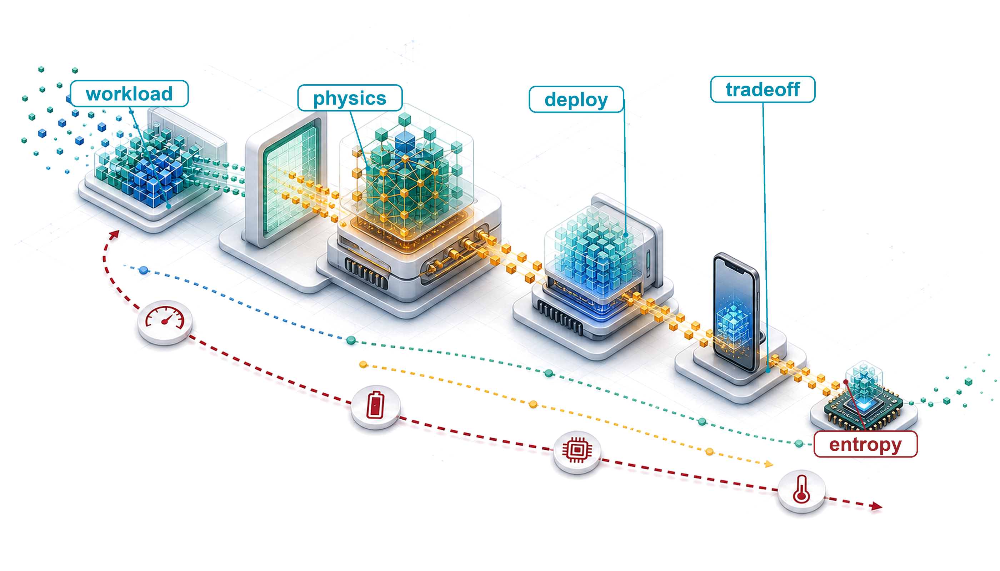
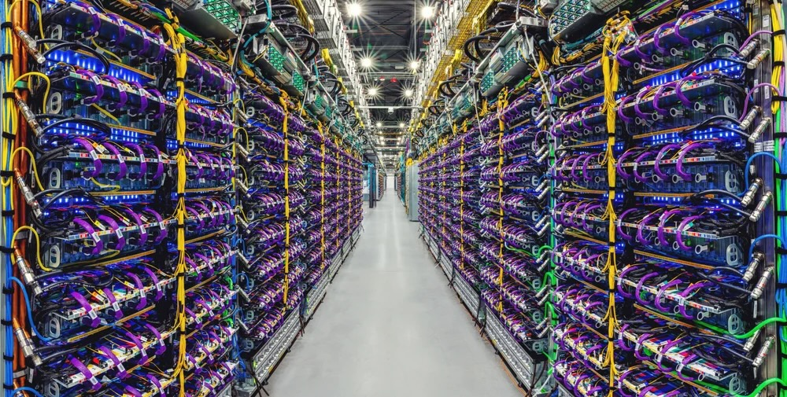
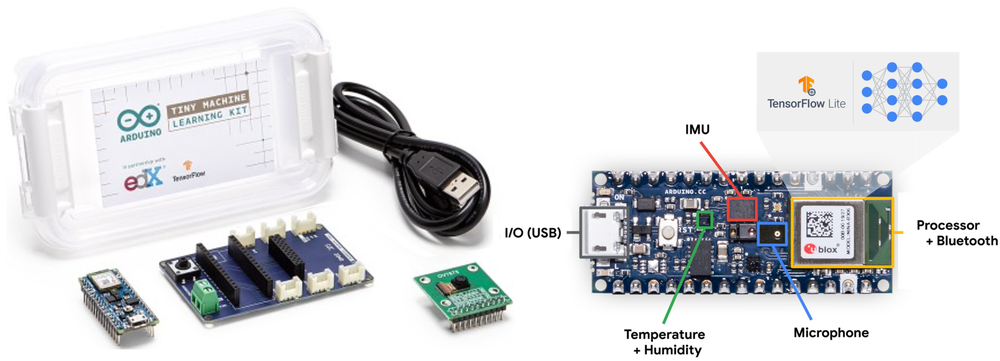
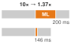

# ML Systems {#sec-ml-systems}

::: {layout-narrow}
::: {.column-margin}

\chapterminitoc

:::

::: {.content-visible when-format="pdf"}
\noindent
{fig-alt="Isometric blueprint showing one model artifact moving across cloud, edge, mobile, and tiny-device deployment environments with shrinking resource envelopes."}
:::

::: {.content-visible unless-format="pdf"}
{fig-alt="Isometric blueprint showing one model artifact moving across cloud, edge, mobile, and tiny-device deployment environments with shrinking resource envelopes."}
:::

:::

## Purpose {.unnumbered .unlisted}

\begin{marginfigure}
\mlsysstack{35}{20}{30}{30}{30}{30}{25}{15}
\end{marginfigure}

_Why does deploying the same model to a phone vs. a data center demand fundamentally different engineering?_

The defining insight of ML systems engineering is that constraints drive architecture. The speed of light sets an absolute floor on how quickly distant servers can respond. Thermodynamics limits how much computation can occur in a given volume before heat becomes unmanageable. Memory physics makes moving data often more expensive than processing it. These are not engineering limitations awaiting better technology; they are permanent physical boundaries that partition the world into fundamentally distinct operating regimes. A data center can train billion-parameter models but cannot guarantee low-latency responses to users thousands of miles away. A smartphone can respond instantly but has a fraction of the memory budget and must share a small battery with everything else the phone does. A microcontroller can run on a coin-cell battery for years but has barely enough compute for a simple keyword detector. Across these regimes, power budget spans roughly nine orders of magnitude, from the megawatts of a data center to the milliwatts of a microcontroller, and memory capacity spans from terabytes to kilobytes. The same model, the same algorithm applied to the same data, demands radically different engineering in each regime, not because the physics changes but because different constraints dominate. Teams that treat deployment as an afterthought, training in one environment and deferring target constraints until launch, discover too late that the target environment invalidates months of architectural decisions. The engineering task is therefore not to identify a universally best deployment but to locate the constraint that binds in the intended operating regime. In D·A·M terms, understanding these regimes transforms deployment from an operational detail into a first-order co-design problem in which data locality, algorithm structure, and machine constraints jointly determine what is possible.

::: {.content-visible when-format="pdf"}

\newpage

:::

::: {.callout-learning-objectives}

- Explain how physical constraints create deployment paradigms from cloud to TinyML
- Apply the iron law and bottleneck principle to determine whether compute, memory bandwidth, I/O, or a memory-capacity or energy precondition binds a workload
- Map workload archetypes to deployment paradigms using lighthouse model examples
- Compare cloud, edge, mobile, and TinyML by operational constraints and quantitative trade-offs
- Apply the decision framework to select paradigms by privacy, latency, compute, and cost constraints
- Analyze hybrid patterns that combine paradigms to satisfy system constraints
- Evaluate deployment decisions, common fallacies, and universal principles that transfer across scales

:::

```{python}
#| echo: false
from mlsysim import *
from mlsysim.core.units import *
```

## Deployment Paradigm Framework {#sec-ml-systems-deployment-paradigm-framework-0d25}

Consider two extremes: a wake-word detector on a smartwatch and a recommendation engine in a data center. The wake-word detector represents a TinyML workload operating under milliwatt power budgets and kilobyte memory limits; the recommendation engine exemplifies a cloud ML workload requiring terabytes of embedding tables and megawatt-scale infrastructure. These systems solve different problems under opposite physical constraints, and their supporting infrastructure differs sharply in scale and design. The introduction's D·A·M taxonomy (@fig-ai-triad) treated the machine as one of three interacting components. Between these two extremes, the machine is the component that changes most, and its physical limits decide which data and algorithmic choices remain open.

Physical constraints\index{Physical constraints!deployment implications} determine where an ML model can run and shape what is possible in ways no algorithmic choice can override. The engineering challenge extends far beyond parameter weights: in production systems, the learned model represents only a small fraction of the total operational codebase [@sculley2015hidden]. The surrounding infrastructure (data ingestion pipelines, feature extraction, serving runtimes, telemetry, and hardware resource managers) must conform directly to the host platform's physical envelope.

::: {.column-margin}
{width="100%" fig-alt="Vertical bar ladder of four deployment tiers by power on a log scale: Cloud 3 MW, Edge 200 W, Mobile 5 W, TinyML 50 mW, spanning megawatts to milliwatts."}

*Power spans the paradigms from megawatts (cloud) to milliwatts (TinyML); each bar marks one representative platform, not the whole tier.*
:::

Three physical constraints (latency, power dissipation, and memory) divide ML deployment into four distinct paradigms, each shaped by hardware trade-offs rather than arbitrary product categories. Centralizing computation in Cloud ML\index{Cloud ML!characteristics} provides elastic compute and large memory capacity, but every inference incurs network latency over wide-area links. Moving workloads to Edge ML\index{Edge ML!latency benefits} eliminates that network round trip and keeps sensitive data on premises [@shi2016], but limits available compute to local rack power and cooling budgets. On battery-powered devices, Mobile ML\index{Mobile ML!energy constraints} delivers responsive interaction directly to handsets and tablets, but must operate within a passive thermal envelope where sustained computation triggers throttling. At the low-power extreme, TinyML\index{TinyML!always-on sensing} runs on microcontrollers [@janapa_reddi2022], where milliwatt power budgets and kilobyte-scale memory require compact models and integer arithmetic. The memory constraint changes form along the way. In the data center it usually binds as bandwidth, while on a microcontroller it binds first as capacity. @Fig-cloud-edge-TinyML-comparison arranges these deployment tiers along a physical continuum spanning nine orders of magnitude in operating power (from warehouse-scale megawatts in data centers down to milliwatts on embedded microcontrollers), isolating the fundamental trade-off between centralized computational scale and local execution autonomy. The figure draws edge AI broadly, as everything outside the data center. This chapter splits that span three ways. The intelligent device (a phone) is mobile ML, the gateway and on-premises servers are edge ML, and the ultra-low-power sensors are TinyML.

::: {#fig-cloud-edge-TinyML-comparison fig-env="figure" fig-pos="htb" fig-cap="**Distributed Intelligence Spectrum**: Deployment tiers form a continuum governed by physical constraints, spanning nine orders of magnitude in power. Moving from centralized cloud infrastructure to on-device TinyML trades raw computational capacity and elastic scale for deterministic latency, data locality, and network independence." fig-alt="Horizontal spectrum showing five deployment tiers from left to right: ultra-low-power devices and sensors, intelligent device, gateway, on-premises servers, and cloud. Arrows indicate TinyML, edge AI, and cloud AI spans across the spectrum."}

```{.tikz}
\begin{tikzpicture}[line cap=round,line join=round,font=\sffamily\small]
  % Parameters
  \def\angle{1.0}       % angle
  \def\length{20.5}     % Lengths (cm)
  \def\npoints{5}       % number of points
  \def\startfrac{0.13}  % start (e.g.. 0.2 = 20%)
  \def\endfrac{0.87}    % end (e.g.. 0.8 = 80%)

 \draw[line width=1pt, black!70] (0,0) -- ({\length*cos(\angle)}, {\length*sin(\angle)})coordinate(end);
 %
  \foreach \i in {0,1,...,\numexpr\npoints-1} {
    \pgfmathsetmacro{\t}{\startfrac + (\endfrac - \startfrac)*\i/(\npoints-1)}
\coordinate(T\i)at({\t*\length*cos(\angle)}, {\t*\length*sin(\angle)});
  }

\tikzset {
pics/gatewey/.style = {
        code = {
\colorlet{red}{white}
\begin{scope}[local bounding box=GAT,scale=0.9, every node/.append style={transform shape}]
\def\rI{4mm}
\def\rII{2.8mm}
\def\rIII{1.6mm}
\draw[red,line width=1.25pt](0,0)--(0,0.38)--(1.2,0.38)--(1.2,0)--cycle;
\draw[red,line width=1.5pt](0.6,0.4)--(0.6,0.9);

\draw[red, line width=1.5pt] (0.6,0.9)+(60:\rI) arc[start angle=60, end angle=-60, radius=\rI];
\draw[red, line width=1.5pt] (0.6,0.9)+(50:\rII) arc[start angle=50, end angle=-50, radius=\rII];
\draw[red, line width=1.5pt] (0.6,0.9)+(30:\rIII) arc[start angle=30, end angle=-30, radius=\rIII];
%
 \draw[red, line width=1.5pt] (0.6,0.9)+(120:\rI) arc[start angle=120, end angle=240, radius=\rI];
\draw[red, line width=1.5pt] (0.6,0.9)+(130:\rII) arc[start angle=130, end angle=230, radius=\rII];
\draw[red, line width=1.5pt] (0.6,0.9)+(150:\rIII) arc[start angle=150, end angle=210, radius=\rIII];
\fill[red](0.6,0.9)circle (1.5pt);

\foreach\i in{0.15,0.3,0.45,0.6}{
\fill[red](\i,0.19)circle (1.5pt);
}

\fill[red](1,0.19)circle (2pt);
\end{scope}
}}}

\tikzset {
pics/cloud/.style = {
        code = {
\colorlet{red}{white}
\begin{scope}[local bounding box=CLO,scale=0.6, every node/.append style={transform shape}]
\draw[red,line width=1.5pt](0,0)to[out=170,in=180,distance=11](0.1,0.61)
to[out=90,in=105,distance=17](1.07,0.71)
to[out=20,in=75,distance=7](1.48,0.36)
to[out=350,in=0,distance=7](1.48,0)--(0,0);
\draw[red,line width=1.5pt](0.27,0.71)to[bend left=25](0.49,0.96);
\draw[red,line width=1.5pt](0.67,1.21)to[out=55,in=90,distance=13](1.5,0.96)
to[out=360,in=30,distance=9](1.68,0.42);
\end{scope}
}}}

\tikzset {
  pics/server/.style = {
    code = {
      \colorlet{red}{white}
      \begin{scope}[anchor=center, transform shape,scale=0.8, every node/.append style={transform shape}]
        \draw[red,line width=1.25pt,fill=white](-0.55,-0.5) rectangle (0.55,0.5);
\foreach \i in {-0.25,0,0.25} {
                \draw[BlueLine,line width=1.25pt]( -0.55,\i) -- (0.55, \i);
}
        \foreach \i in {-0.375, -0.125, 0.125, 0.375} {
          \draw[BlueLine,line width=1.25pt](-0.45,\i)--(0,\i);
          \fill[BlueLine](0.35,\i) circle (1.5pt);
        }

\draw[red,line width=1.75pt](0,-0.53) |- (-0.55,-0.7);
        \draw[red,line width=1.75pt](0,-0.53) |- (0.55,-0.7);
      \end{scope}
    }
  }
}

\tikzset {
pics/cpu/.style = {
        code = {
\definecolor{CPU}{RGB}{0,120,176}
\colorlet{CPU}{white}
\begin{scope}[local bounding box = CPU,scale=0.33, every node/.append style={transform shape}]
\node[fill=CPU,minimum width=66, minimum height=66,
            rounded corners=2,outer sep=2pt] (C1) {};
\node[fill=violet,minimum width=54, minimum height=54] (C2) {};
%\node[fill=CPU!40,minimum width=44, minimum height=44] (C3) {CPU};

\foreach \x/\y in {0.11/1,0.26/2,0.41/3,0.56/4,0.71/5,0.85/6}{
\node[fill=CPU,minimum width=4, minimum height=15,
           inner sep=0pt,anchor=south](GO\y)at($(C1.north west)!\x!(C1.north east)$){};
}
\foreach \x/\y in {0.11/1,0.26/2,0.41/3,0.56/4,0.71/5,0.85/6}{
\node[fill=CPU,minimum width=4, minimum height=15,
           inner sep=0pt,anchor=north](DO\y)at($(C1.south west)!\x!(C1.south east)$){};
}
\foreach \x/\y in {0.11/1,0.26/2,0.41/3,0.56/4,0.71/5,0.85/6}{
\node[fill=CPU,minimum width=15, minimum height=4,
           inner sep=0pt,anchor=east](LE\y)at($(C1.north west)!\x!(C1.south west)$){};
}
\foreach \x/\y in {0.11/1,0.26/2,0.41/3,0.56/4,0.71/5,0.85/6}{
\node[fill=CPU,minimum width=15, minimum height=4,
           inner sep=0pt,anchor=west](DE\y)at($(C1.north east)!\x!(C1.south east)$){};
}
\end{scope}
    }  }}

\tikzset {
pics/mobile/.style = {
        code = {
\colorlet{red}{white}
\begin{scope}[local bounding box=MOB,scale=0.4, every node/.append style={transform shape}]
\node[rectangle,draw=red,minimum height=94,minimum width=47,
            rounded corners=6,thick,fill=white](R1){};
\node[rectangle,draw=red,minimum height=67,minimum width=38,thick,fill=GreenFill](R2){};
\node[circle,minimum size=8,below= 2pt of R2,inner sep=0pt,thick,fill=GreenFill]{};
\node[rectangle,fill=GreenFill,minimum height=2,minimum width=20,above= 4pt of R2,inner sep=0pt,thick]{};
%
 \end{scope}
     }  }}

\node[draw=none,fill=RedFill,circle,minimum size=20mm](GA)at(T2){};
\pic[shift={(-0.55,-0.5)}] at (T2) {gatewey};
\node[above=0 of GA]{Gateway};
\node[draw=none,fill=VioletL,circle,minimum size=20mm](CP)at(T0){};
\pic[shift={(0,-0)}] at (T0) {cpu};
\node[above=0 of CP,align=center]{Ultra-Low-Power\\Devices and Sensors};
\node[draw=none,fill=GreenFill,,circle,minimum size=20mm](MO)at(T1){};
 \pic[shift={(0,0)}] at (T1) {mobile};
 \node[above=0 of MO,align=center]{Intelligent Device};
\node[draw=none,fill=BlueFill,circle,minimum size=20mm](SE)at(T3){};
\pic[shift={(-0.03,0.1)}] at (T3) {server};
 \node[above=0 of SE,align=center]{On-Premises Servers};
\node[draw=none,fill=BrownL,circle,minimum size=20mm](CL)at(T4){};
\pic[shift={(-0.48,-0.35)}] at (T4) {cloud};
 \node[above=0 of CL,align=center]{Cloud};
%
\path (T0) -- (T1) coordinate[pos=0.5] (M1);
\path (0,0) -- (T0) coordinate[pos=0.25] (M0);
\path (T3) -- (T4) coordinate[pos=0.5] (M2);
\path (T4) -- (end) coordinate[pos=0.75] (M3);

\foreach \x in {0,1,2,3}{
\fill[OliveLine](M\x)circle (2.5pt);
}

\path[red](M0)--++(270:1.6)coordinate(LL1)-|coordinate(LL2)(M2);
\path[red](M0)--++(270:1.25)coordinate(L1)-|coordinate(L2)(M1);
\path[red](M0)--++(270:1.1)-|coordinate(L3)(M2);
\path[red](M0)--++(270:1.1)-|coordinate(L4)(M3);
%
\draw[black!70,thick](M0)--(LL1);
\draw[black!70,thick](M1)--(L2);
\draw[black!70,thick](M3)--(L4);
\draw[black!70,thick](M2)--(LL2);
\draw[latex-latex,line width=1pt,draw=black!60](L1)--node[red,fill=white]{TinyML}(L2);
\draw[latex-latex,line width=1pt,draw=black!60](L3)--node[fill=white]{Cloud AI}(L4);
\draw[latex-latex,line width=1pt,draw=black!60]([yshift=4pt]LL1)--node[fill=white,text=black]{Edge AI}([yshift=4pt]LL2);
\foreach \x in {0,1,2,3}{
\fill[OliveLine](M\x)circle (2.5pt);
}
%
\path[](M0)--++(90:1.9)-|node[pos=0.25]{\textbf{The Distributed Intelligence Spectrum}}(M3);
\end{tikzpicture}

```
:::

While @fig-cloud-edge-TinyML-comparison diagrams the continuous topological progression from embedded sensors to data centers, @tbl-deployment-paradigms-overview quantifies conceptual operating envelopes across processing location, round-trip latency, power draw, and memory capacity. The cloud row describes facility power; the other rows describe local systems or devices. These envelopes compare deployment scales, whose physical basis is developed in @sec-ml-systems-deployment-spectrum-71be.

```{python}
#| echo: false
# ┌─────────────────────────────────────────────────────────────────────────────
# │ DEPLOYMENT OVERVIEW TABLE
# ├─────────────────────────────────────────────────────────────────────────────
# │ Context: @tbl-deployment-paradigms-overview
# │
# │ Goal: Latency and mobile power columns for the deployment overview table.
# │ Show: Per-paradigm latency ranges and smartphone TDP envelope.
# │ How: Read pre-formatted range strings from mlsysim constants.
# │
# └─────────────────────────────────────────────────────────────────────────────

# ┌── LEGO ───────────────────────────────────────────────
class DeploymentOverviewTable:
    """Latency and power ranges for @tbl-deployment-paradigms-overview."""

    # ┌── 1. LOAD (Constants) ───────────────────────────────────────────────
    mobile_tdp_min_w, mobile_tdp_max_w = [int(v) for v in Platforms.Mobile.tdp_range_w.split("-")]

    # ┌── 4. OUTPUT (Formatting) ──────────────────────────────────────────────
    cloud_latency_range_str = MarkdownStr(Platforms.Cloud.latency_range_ms)
    edge_latency_range_str = MarkdownStr(Platforms.Edge.latency_range_ms)
    mobile_latency_range_str = MarkdownStr(Platforms.Mobile.latency_range_ms)
    tiny_latency_range_str = MarkdownStr(Platforms.Tiny.latency_range_ms)
    mobile_tdp_range_str = fmt_range(
        mobile_tdp_min_w,
        mobile_tdp_max_w,
        precision=0,
        commas=False,
        unit="W",
    )
```

| **Paradigm**  | **Where**        |                       **Latency (ms)**                      |                        **Power**                        | **Memory** | **Best For**                 |
|:--------------|:-----------------|:-----------------------------------------------------------:|:-------------------------------------------------------:|:----------:|:-----------------------------|
| **Cloud ML**  | Data centers     |  `{python} DeploymentOverviewTable.cloud_latency_range_str` |                            MW                           |     TB     | Training, complex inference  |
| **Edge ML**   | Local servers    |  `{python} DeploymentOverviewTable.edge_latency_range_str`  |                          100 W                          |     GB     | Real-time inference, privacy |
| **Mobile ML** | Smartphones      | `{python} DeploymentOverviewTable.mobile_latency_range_str` | `{python} DeploymentOverviewTable.mobile_tdp_range_str` |     GB     | Personal AI, offline         |
| **TinyML**    | Microcontrollers |  `{python} DeploymentOverviewTable.tiny_latency_range_str`  |                            mW                           |     KB     | Always-on sensing            |

: **The Deployment Spectrum (Conceptual)**: Four paradigms span nine orders of magnitude in power (MW to mW) and memory (TB to KB). This conceptual overview defines each paradigm by its operating regime, and each power entry names a typical class rather than a bound; the concrete hardware spectrum in @tbl-representative-systems grounds these categories in specific platforms and quantitative decision thresholds. The hardware specifications and physical constants underpinning these numbers are catalogued in @sec-appdx-system-assumptions. {#tbl-deployment-paradigms-overview tbl-colwidths="[14,17,12,12,15,30]"}

### The architectural anchor: The single-node stack {#sec-ml-systems-architectural-anchor}

To navigate these operating regimes, we anchor our engineering decisions in a four-layer model of the **single-node stack**\index{Single-node stack!architecture layers}, which refines the machine side of the D·A·M taxonomy for one host while data and algorithm enter through workload requirements. At the top of the stack, the application defines the mission through a training-throughput or inference-latency target. The ML framework\index{ML framework!compiler role} translates model code into executable operations. The operating system\index{Operating system!runtime role} orchestrates resources and moves data between host memory and accelerator memory. The hardware itself, defined by high-bandwidth memory (HBM) capacity, memory bandwidth, intra-node interconnects such as NVLink, and compute throughput, sets the physical limits, with the memory wall as a recurring constraint.

::: {.column-margin .margin-pointer}
↪ How an ML framework turns model code into executed operations, eagerly or through a captured graph, is developed in @sec-ml-frameworks-three-execution-strategies-5934.
:::

The hardware layer fixes the terms on offer to any model: a memory bandwidth $(\Bandwidth)$, a peak compute rate $(\PeakRate)$, and a fixed overhead $(\Latency)$. The silicon contract\index{Silicon contract!hardware side} names the bargain struck over these terms. The hardware offers them, and a workload, by its structure, commits to saturating one of them first. This chapter works with the hardware's half, asking which term a given platform makes scarce; the model architecture's half, the wager on which resource to saturate, is stated as a principle (\ref{pri-silicon-contract}) once model architectures enter the book. Every chapter that follows analyzes one or more of these layers, because the single machine is where those terms are set and where most engineering decisions in this book are made.

The physical constraints developed next act on this stack through the iron law of ML systems, which decomposes end-to-end latency into data movement, computation, and overhead. Different deployment environments emphasize different constraints: cloud training can be compute-bound, mobile systems face power walls, and TinyML devices often reach memory-capacity limits. By pairing the physical constraints with the iron law, we develop a quantitative vocabulary for reasoning about which paradigm fits a given workload and *why*.

::: {.column-margin .margin-pointer}
↩ The iron law of ML systems and its decomposition of end-to-end latency are established in @sec-introduction-iron-law-ml-systems-c32a.
:::

## Physical Constraints: Why Paradigms Exist {#sec-ml-systems-deployment-spectrum-71be}

A safety system with a 10 ms reaction budget cannot wait for a cross-country round trip, and a billion-parameter model cannot be squeezed into a microcontroller by better code alone. These are not implementation bugs; they are consequences of the physical laws of speed of light\index{Physical constraints!speed of light}, power thermodynamics\index{Physical constraints!thermodynamics}, and memory signaling\index{Physical constraints!memory signaling}. The introduction named the three resulting constraints, the light barrier, the power wall, and the memory wall, when it previewed the deployment spectrum; this section gives each one its equation and its consequence for where a model can run. Where a system runs changes the terms the hardware offers, and so reshapes the silicon contract\index{Silicon contract!physical constraints} between model and hardware.[^fn-paradigm-deployment-tradeoff]

::: {.column-margin .margin-pointer}
↩ A first sketch of the deployment spectrum and its three walls is established in @sec-introduction-deployment-spectrum-a38c.
:::

::: {.content-visible when-format="pdf"}

\newpage

:::

### The light barrier {.unnumbered}

The **light barrier**\index{Light barrier!latency floor} establishes the absolute latency[^fn-latency-system-tradeoff] floor. Let $\text{Distance}$ denote the one-way path length and $c_{\text{fiber}}$ the propagation speed in optical fiber. @Eq-latency-physics gives the minimum round-trip time:
$$L_{\text{lat,min}} = \frac{2 \times \text{Distance}}{c_{\text{fiber}}} \approx \frac{2 \times \text{Distance}}{200{,}000 \text{ km/s}}$$ {#eq-latency-physics}
For optical fiber, $c_{\text{fiber}} \approx 200{,}000$ km/s, roughly two-thirds of its vacuum value because light propagates more slowly through glass than through a vacuum.

```{python}
#| echo: false
#| label: light-barrier-calc
# ┌─────────────────────────────────────────────────────────────────────────────
# │ LIGHT BARRIER LATENCY CALCULATION
# ├─────────────────────────────────────────────────────────────────────────────
# │ Context: "The light barrier" narrative (Physical Constraints section)
# │
# │ Goal: Demonstrate the physical latency floor of cloud computing.
# │ Show: Cross-country round-trip time exceeds tight real-time budgets.
# │ How: Apply the mlsysim network latency formula for CA-to-VA distance.
# │
# └─────────────────────────────────────────────────────────────────────────────
from mlsysim.physics import calc_network_latency_ms
from mlsysim.fmt import fmt, check, fmt_time, fmt_length, fmt_text

# ┌── LEGO ───────────────────────────────────────────────
class LightLatency:
    """
    Namespace for Light-Speed Latency calculation.
    Scenario: Cross-country packet transmission (CA to VA) vs 10 ms budget.
    """

    # ┌── 1. LOAD (Constants) ───────────────────────────────────────────────
    distance_km = 3600 * ureg.km  # California to Virginia (straight-line)
    safety_budget_ms = 10

    # ┌── 2. EXECUTE (The Compute) ─────────────────────────────────────────
    # Calculate Round-trip time (RTT) based on speed of light in fiber
    min_latency_ms = calc_network_latency_ms(distance_km)

    # ┌── 3. GUARD (Invariants) ───────────────────────────────────────────
    check(min_latency_ms > safety_budget_ms, f"Physics forbids cloud ({min_latency_ms:.1f} ms) within {safety_budget_ms} ms budget!")

    # ┌── 4. OUTPUT (Formatting) ──────────────────────────────────────────────
    min_latency_ms_str = fmt_time(min_latency_ms, 'millisecond', precision=0, commas=False)
    min_latency_str = fmt_text(min_latency_ms_str, " round-trip")
    distance_km_str = fmt_length(distance_km, unit=kilometer, precision=0, commas=True)

LightLatency.min_latency_value = LightLatency.min_latency_ms_str
```

California to Virginia (~`{python} LightLatency.distance_km_str` straight-line) requires ~`{python} LightLatency.min_latency_str` before any computation begins. Actual services add routing, protocol, queuing, and processing latency. Applications requiring sub-10 ms response *cannot* use distant cloud infrastructure, because physics forbids it. This constraint creates the need for edge ML and TinyML, since a tight latency budget forces computation to move closer to the data source.

### The power wall {.unnumbered}

The **power wall**\index{Power wall!thermal limits}\index{Power wall!frequency scaling} emerged because thermodynamics limits how much computation can occur in a given volume. Dynamic CMOS power follows @eq-power-scaling, where $C$ is capacitance, $V$ is supply voltage, and $f$ is clock frequency. Switching transistors faster requires higher voltage to charge gate capacitance in less time ($V \propto f$). Consequently, pushing clock frequency escalates dynamic power cubically ($\text{Power} \propto f^3$), rapidly hitting a thermal ceiling.
$$\text{Power} \propto C \times V^2 \times f \quad \text{where } V \propto f \implies \text{Power} \propto f^3$$ {#eq-power-scaling}

```{python}
#| echo: false
#| label: power-wall-throttling
from mlsysim.fmt import fmt_fps, fmt_time

# ┌─────────────────────────────────────────────────────────────────────────────
# │ POWER WALL: MOBILE THERMAL THROTTLING SCENARIO
# ├─────────────────────────────────────────────────────────────────────────────
# │ Context: Power Wall prose immediately below—illustrates throttling
# │          behavior on battery-powered devices.
# │
# │ Goal: Provide concrete FPS numbers showing thermal throttling on mobile.
# │ Show: A mobile model drops from 60 FPS to 15 FPS after 1 minute.
# │ How: Simple illustrative constants (no computation needed).
# │
# └─────────────────────────────────────────────────────────────────────────────

# ┌── LEGO ───────────────────────────────────────────────
class ThrottlingScenario:
    """Namespace for illustrative mobile thermal throttling."""

    # ┌── 1. LOAD (Constants) ───────────────────────────────────────────────
    fps_start = 60
    fps_throttled = 15
    duration_min = 1

    # ┌── 2. EXECUTE (The Compute) ─────────────────────────────────────────
    # (illustrative scenario—no derived quantities)

    # ┌── 3. GUARD (Invariants) ───────────────────────────────────────────

    # ┌── 4. OUTPUT (Formatting) ──────────────────────────────────────────────
    fps_start_str = fmt_fps(fps_start)
    fps_throttled_str = fmt_fps(fps_throttled)
    duration_min_str = fmt_time(duration_min, "minute", precision=0, commas=False, style="word")
```

```{python}
#| echo: false
# ┌─────────────────────────────────────────────────────────────────────────────
# │ MOBILE TDP — POWER WALL NARRATIVE
# ├─────────────────────────────────────────────────────────────────────────────
# │ Context: Power Wall prose (mobile thermal throttling paragraph)
# │
# │ Goal: Cite the smartphone TDP envelope where throttling begins.
# │ Show: 2–5 W mobile power budget from centralized constants.
# │ How: Read Platforms.Mobile.tdp_range_w.
# │
# └─────────────────────────────────────────────────────────────────────────────

# ┌── LEGO ───────────────────────────────────────────────
class MobileTdpPowerWall:
    """Mobile TDP envelope cited in the Power Wall narrative."""

    # ┌── 1. LOAD (Constants) ───────────────────────────────────────────────
    mobile_tdp_min_w, mobile_tdp_max_w = [int(v) for v in Platforms.Mobile.tdp_range_w.split("-")]

    # ┌── 4. OUTPUT (Formatting) ──────────────────────────────────────────────
    mobile_tdp_range_str = fmt_range(
        mobile_tdp_min_w,
        mobile_tdp_max_w,
        precision=0,
        commas=False,
        unit="W",
    )
```

Under this illustrative assumption, doubling clock frequency requires approximately 8$\times$ more dynamic power. The breakdown of broad voltage scaling[^fn-dennard-scaling-origin] ended "free" frequency speedups and forced the industry toward parallelism (multi-core) and specialization (GPUs, Tensor Processing Units (TPUs)). Mobile devices hit hard thermal limits at `{python} MobileTdpPowerWall.mobile_tdp_range_str`; exceeding this causes "throttling," where the device reduces performance to prevent overheating. In practice, this means a mobile model that runs at `{python} ThrottlingScenario.fps_start_str` for `{python} ThrottlingScenario.duration_min_str` may throttle to `{python} ThrottlingScenario.fps_throttled_str` as the device heats up. This physical limit gives rise to mobile ML: battery-powered devices cannot simply run cloud-scale models locally.

[^fn-dennard-scaling-origin]: **Dennard scaling**\index{Dennard scaling!origin and breakdown}: Named after @dennard1974 at IBM, who described MOSFET scaling relationships under which shrinking devices could reduce voltage and current while keeping power density approximately controlled. As voltage scaling slowed and energy became a first-order architectural constraint, performance growth shifted toward parallelism and specialization: multi-core processors, GPUs, and TPUs [@hennessy2019; @esmaeilzadeh2011].

### The memory wall {.unnumbered}

The **memory wall**\index{Memory wall!bandwidth divergence}\index{Memory wall!compute-memory gap} [@wulf1995] reflects the widening bandwidth[^fn-bandwidth-memory-wall] gap. A simple book-level sketch uses representative annual growth factors to show why the gap compounds:
$$\frac{\text{Compute Growth Rate}}{\text{Memory Bandwidth Growth Rate}} \approx \frac{1.6}{1.2} \approx 1.33$$ {#eq-memory-wall}

In @eq-memory-wall, the numerator and denominator are dimensionless annual growth factors. A ratio above 1 means compute capability is pulling away from memory bandwidth, so each hardware generation makes data movement a larger share of the performance problem unless the workload increases locality or arithmetic intensity (operations performed per byte moved).

```{python}
#| echo: false
#| label: memory-wall-trends
# ┌─────────────────────────────────────────────────────────────────────────────
# │ MEMORY WALL: COMPUTE VS BANDWIDTH GROWTH RATES
# ├─────────────────────────────────────────────────────────────────────────────
# │ Context: Prose immediately below @eq-memory-wall, quantifying the
# │          compute-memory divergence.
# │
# │ Goal: Provide the two growth-rate numbers cited in Memory Wall narrative.
# │ Show: Compute doubles every 18 months; memory BW grows ~20% annually.
# │ How: Canonical industry trend constants formatted for prose.
# │
# └─────────────────────────────────────────────────────────────────────────────
from mlsysim.fmt import check, fmt, fmt_multiple, fmt_percent

# ┌── LEGO ───────────────────────────────────────────────
class MemoryWallTrends:
    """Namespace for compute vs memory bandwidth growth rates."""

    # ┌── 1. LOAD (Constants) ───────────────────────────────────────────────
    compute_doubling_months = 18
    mem_bw_growth_pct = 20

    # ┌── 2. EXECUTE (The Compute) ─────────────────────────────────────────
    # Convert the doubling period to an annual growth factor and compound
    # the compute-to-bandwidth ratio over a decade.
    compute_annual_factor = 2 ** (12 / compute_doubling_months)  # ~1.59x per year
    mem_bw_annual_factor = 1 + mem_bw_growth_pct / 100  # 1.2x per year
    decade_gap = (compute_annual_factor / mem_bw_annual_factor) ** 10

    # ┌── 3. GUARD (Invariants) ───────────────────────────────────────────
    check(1.55 < compute_annual_factor < 1.65, f"18-month doubling should be ~1.6x/year, got {compute_annual_factor:.2f}")
    check(10 < decade_gap < 25, f"Decade compute/bandwidth gap should be ~16x, got {decade_gap:.1f}")

    # ┌── 4. OUTPUT (Formatting) ──────────────────────────────────────────────
    compute_doubling_months_str = fmt_time(compute_doubling_months, "month", precision=0, style="word")
    mem_bw_growth_pct_str = fmt_percent(mem_bw_growth_pct / 100, precision=0, style="prose")
    compute_annual_mult_str = fmt_multiple(compute_annual_factor, precision=1, commas=False)
    decade_gap_mult_str = fmt_multiple(round(decade_gap), precision=0, commas=False)
```

The representative trends behind this ratio are that processors have doubled in compute capacity roughly every `{python} MemoryWallTrends.compute_doubling_months_str`, about `{python} MemoryWallTrends.compute_annual_mult_str` per year (the numerator of @eq-memory-wall), but memory bandwidth has improved only ~`{python} MemoryWallTrends.mem_bw_growth_pct_str` annually (the denominator). The ratio compounds: sustained for a decade, it leaves compute about `{python} MemoryWallTrends.decade_gap_mult_str` further ahead of bandwidth than at the start. This widening gap makes data movement\index{Data movement!energy dominance} a frequent bottleneck and energy cost in ML workloads. Physically, while an arithmetic operation in an on-chip arithmetic logic unit (ALU) moves charges across mere micrometers of local wire (consuming tens to hundreds of femtojoules), fetching an operand from off-chip DRAM requires charging capacitive printed circuit board (PCB) traces and I/O pads centimeters long, consuming hundreds of picojoules, two to three orders of magnitude more energy per access. The constraint affects all paradigms, and it takes a different form on TinyML devices, where capacity, not bandwidth, is usually exhausted first.

::: {.column-margin .margin-pointer}
↪ The architectural responses to the memory wall, HBM and on-chip SRAM hierarchies, are developed in @sec-hardware-acceleration-memory-hierarchy-1839.
:::

::: {#chk-ml-systems-physical-constraints-deployment .callout-checkpoint title="Physical constraints and deployment"}

Deployment choices are governed by physics, not just preference. Check your understanding:

- [ ] **Light barrier**: Can you use the cross-country propagation bound to explain why that distant cloud path cannot meet a $<10\text{ ms}$ safety deadline?
- [ ] **Power wall**: Can you explain why a workload that exceeds a phone's sustained heat-dissipation budget cannot maintain its initial performance?
- [ ] **Memory wall**: Can you explain why data movement is often more expensive (in time and energy) than computation?

:::

These physical laws explain *why* the four paradigms exist. Physics creates the boundaries; privacy regulation, economic incentives, and data sovereignty requirements reinforce and sharpen them without creating them. No regulation can make the speed of light faster, and no economic model can repeal thermodynamics.

::: {.column-margin}
{width="100%" fig-alt="Two diverging trend strokes: a steep red compute-growth curve pulls away from a shallow blue memory-bandwidth curve, with the widening gap shaded red."}

*Compute capacity outruns memory bandwidth; the widening gap is the memory wall.*
:::

These physical constraints do not operate in isolation. In practice, an ML system is limited by whichever physical boundary binds on its primary resource first. Evaluating these limits quantitatively requires analytical tools: the iron law to decompose execution time into its components, the bottleneck principle to identify the rate-limiting stage, and workload archetypes to classify the model's resource demands.

## Analyzing Workloads {#sec-ml-systems-analyzing-workloads-cbb8}

Given a recommendation engine or wake-word detector, the workload question is which term will bind first on the target hardware. The central analytical tool for answering that silicon-contract\index{Silicon contract!iron law} question is the iron law of ML systems\index{Iron law of ML systems!deployment analysis} from @sec-introduction-iron-law-ml-systems-c32a, restated here in the same notation because every tier in this chapter is analyzed through it. For a serialized execution path, @eq-iron-law adds three costs:
$$T = \frac{\DataVolume}{\Bandwidth} + \frac{\Operations}{\PeakRate \cdot \EfficiencyHw} + \Latency$$ {#eq-iron-law}

@Eq-iron-law decomposes total latency into three terms: data movement $(\DataVolume/\Bandwidth)$, compute $(\Operations/(\PeakRate \cdot \EfficiencyHw))$, and fixed overhead $(\Latency)$. For an inference path that executes these stages sequentially, their times add. A single request can also contain overlapping work, so its latency must follow the actual dependencies. In production systems, however, tasks are processed continuously as a stream, and the analysis shifts from single-task latency to identifying which term limits the system. The answer depends entirely on the deployment environment. A workload is **compute bound**\index{Compute-bound vs. memory-bound!definition} when its compute term $\Operations/(\PeakRate \cdot \EfficiencyHw)$ exceeds its data term $\DataVolume/\Bandwidth$, and memory bound in the reverse case. A model that is compute bound during training may become memory bound during inference; a system that runs efficiently in the cloud may hit power limits on mobile devices. Batch size is one lever that moves a workload between these regimes. Larger batches reuse each loaded weight across more inputs, shifting a memory-bound kernel toward compute-bound behavior, at the price of a larger working set and a longer service time per batch. In pipelined production serving, hardware concurrency alters this linear sum: faster stages hide behind whichever subsystem saturates first.

### The bottleneck principle {#sec-ml-systems-bottleneck-principle-3514}

The iron law tells us the cost of each term. The **bottleneck principle**\index{Bottleneck principle!definition} tells us which term matters. In a pipelined ML workload, identifying the system bottleneck\index{System Bottleneck!identifying} matters because speeding a nonlimiting stage does not increase ideal steady-state throughput while the slowest stage remains unchanged. Modern accelerators use **pipelined execution**\index{Pipelined execution!throughput analysis} to overlap data movement with computation: while the accelerator computes on batch $n$, the memory system prefetches batch $n+1$. Once the pipeline fills, different requests occupy different stages. Under ideal overlap, the slowest stage sets the interval between completions, although each request still traverses its dependent stages. @Eq-bottleneck extends the pipelined form from @sec-introduction-iron-law-ml-systems-c32a with one more overlapped stage, $T_{\text{IO}}$, the time to transfer data over a storage or network link. Here the left-hand side is the steady-state time per completed task, with fixed overhead treated as nonoverlapped; equality requires ideal overlap of the other stages:
$$ T_{\text{pipelined}} \ge \max\left(\frac{\DataVolume}{\Bandwidth}, \frac{\Operations}{\PeakRate \cdot \EfficiencyHw}, T_{\text{IO}}\right) + \Latency $$ {#eq-bottleneck}

::: {.content-visible when-format="pdf"}
```{=latex}
\Needspace{5\baselineskip}
```
:::

*   **$\frac{\DataVolume}{\Bandwidth}$ (Memory)**: Time to move data between memory and processor.
*   **$\frac{\Operations}{\PeakRate \cdot \EfficiencyHw}$ (Compute)**: Time to execute calculations.
*   **$T_{\text{IO}}$ (I/O)**: Time to move data over a storage or network link (including offloading to a remote server).
*   **$\Latency$ (Overhead)**: Fixed latency (kernel launch, runtime overhead).

When a system is memory bound\index{Compute-bound vs. memory-bound!memory-bound optimization} $(\DataVolume/\Bandwidth > \Operations/(\PeakRate \cdot \EfficiencyHw))$, faster processors $(\PeakRate)$ do not raise ideal pipeline throughput while memory remains the slowest stage, just as widening a highway cannot help traffic constrained by a narrow bridge. Shortening a sequential compute stage can still reduce an individual request's latency. Engineers must identify the dominant term before optimizing. The iron law quantifies the *cost of each ingredient*; the bottleneck principle identifies the *speed of the assembly line*. As a rule of thumb, use the *additive form* in @eq-iron-law for a single task's serialized path, and the *max form* in @eq-bottleneck for an ideally overlapped continuous stream. Actual dependencies determine which stages can overlap.

::: {.column-margin}
{width="100%" fig-alt="D·A·M locator triangle with the Machine node highlighted and the Data and Algorithm nodes shown in gray."}

*The machine axis sets the deployment envelope.*
:::

### Workload archetypes {#sec-ml-systems-workload-archetypes-fd10}

The bottleneck principle reduces optimization to identifying the dominant constraint for a given workload. The answer depends on all three D·A·M axes\index{DAM taxonomy@D·A·M taxonomy!workload classification} at once: the data a request carries, the algorithm's arithmetic and memory demands, and the machine that executes it. Different deployment environments create different bottlenecks along these axes, so the same model family can require different engineering when it moves from a cloud server with terabytes of memory to a microcontroller with kilobytes. Classifying workloads by what binds them first yields four **workload archetypes**\index{Workload archetype!definition}.[^fn-archetype-system-bottleneck] These are not model categories; they are recurring physical bottlenecks that determine which engineering moves can help. Two of them are named by the iron law's own terms. The other two are bound by preconditions the time equation assumes are already met, that the working set fits in memory and that the energy budget can pay for the run, which is why a capacity or energy limit can decide feasibility before any term of @eq-iron-law is evaluated.

The first split, between the two iron-law terms, separates arithmetic-bound systems from data-movement-bound systems. A **compute beast**\index{Arithmetic intensity!high intensity workloads}\index{Compute beast!definition} performs many calculations per byte loaded, so progress comes from higher arithmetic throughput, better utilization, and more parallel execution; large neural-network training is the canonical case. A **bandwidth hog**\index{Autoregressive generation!memory-bound}\index{Bandwidth hog!definition}, by contrast, waits on dense weight or activation movement, so wider memory buses and better data reuse matter more than additional peak FLOP/s; autoregressive text generation illustrates this regime.

The second split covers workloads where the binding constraint is not a term of the time equation at all. **Sparse scatter**\index{Embedding table!memory capacity bound}\index{Sparse scatter!definition} workloads are dominated by irregular table lookups and poor cache locality, so memory capacity, access latency, and communication shape performance in recommendation systems with massive embedding tables. **Tiny constraint**\index{Tiny constraint!definition} workloads face the opposite envelope: energy per inference\index{Energy per inference!binding constraint} and memory footprint, not raw speed, determine whether always-on sensing\index{Always-on sensing!power constraints} can run at all.

[^fn-archetype-system-bottleneck]: [offset=10mm] **Workload archetype**\index{Workload archetype!definition}: A classification of ML workloads by their dominant bottleneck, either a term of the iron law or a memory-capacity or energy precondition it assumes is met, rather than by their model family. The distinction matters because the optimization strategy differs fundamentally: a compute-bound workload benefits from faster arithmetic $(\PeakRate)$, while a bandwidth-bound workload benefits from wider memory buses or fewer bytes moved through reuse, fusion, compression, or lower precision. Misidentifying the archetype wastes optimization effort on the wrong term of the iron law, as when teams add accelerator FLOP/s to a memory-bound inference pipeline and observe zero speedup.

[^fn-paradigm-deployment-tradeoff]: [offset=-12mm] **Deployment paradigm**\index{Deployment paradigm!definition}: A distinct operating regime defined by latency, power, memory, and connectivity constraints. The Cloud-to-TinyML spectrum changes which resources bind; optimizing within an infeasible regime cannot satisfy the application's deployment budget. Raising a cloud model's throughput by 5 percent, for example, cannot rescue an application whose 10 ms latency budget the network round trip alone exceeds.

[^fn-latency-system-tradeoff]: **Latency**\index{Latency!responsiveness constraint}\index{Latency!deployment constraint}: The time between issuing a request and receiving a result, corresponding to $T$ in the iron law, where propagation delay enters through the fixed-overhead term $\Latency$. The light barrier makes that propagation floor irreducible, as @eq-latency-physics quantifies. Every millisecond consumed by distance is a millisecond unavailable for model inference, which is why the light barrier forces paradigm selection rather than mere optimization.

[^fn-bandwidth-memory-wall]: **Memory bandwidth (the memory wall)**\index{Memory bandwidth!memory wall}: The term "memory wall" was coined by Wulf and McKee in 1995, who predicted that the processor-memory performance gap would eventually dominate system performance—a prediction that proved prescient for ML workloads in which weight or activation movement can bind performance. In the iron law, bandwidth $(\Bandwidth)$ appears in the denominator of the data term $\DataVolume/\Bandwidth$, so doubling the bytes moved without a corresponding bandwidth increase raises the data-movement time. The resulting bottleneck depends on arithmetic intensity, batch size, data reuse, access pattern, and hardware balance rather than model size alone.

::: {#lhs-ml-systems-five-reference-workloads .callout-lighthouse title="Five reference workloads"}

@Sec-introduction-lighthouse-models-9b1c introduced five lighthouse models\index{Lighthouse model!reference workloads} by the system bottleneck each isolates (@tbl-lighthouse-examples); @tbl-ml-systems-lighthouse-archetypes pairs each with a representative workload archetype and deployment paradigm. The classifications describe operating regimes: batched image processing can emphasize arithmetic, single-request text generation can emphasize weight transfers, and a large recommendation table can exceed local memory capacity. Changing batch size, model size, or hardware can change the binding constraint. The two views of MobileNetV2 agree. The introduction filed it under latency and power because that is the budget it was built for; here it is an efficient compute beast because its execution profile is still dominated by arithmetic, only far less of it, sized to fit a phone's power envelope. Whether its latency and power actually fit a given phone still depends on the implementation and workload. @Sec-network-architectures-lighthouse-roster-model-biographies-a763 provides full architectural details and model biographies.

| **Lighthouse**             | **Archetype**             | **Deployment Paradigm**        |
|:---------------------------|:--------------------------|:-------------------------------|
| **ResNet-50**              | Compute Beast             | Cloud training, edge inference |
| **GPT-2/Llama**            | Bandwidth Hog             | Cloud inference                |
| **DLRM**                   | Sparse Scatter            | Cloud for large tables         |
| **MobileNetV2**            | Compute Beast (efficient) | Mobile, edge                   |
| **Keyword Spotting (KWS)** | Tiny Constraint           | TinyML, always-on              |

: **Five Lighthouse Models**: Recurring workloads used throughout the book to ground the iron law in concrete practice. Each lighthouse pairs an archetype (Compute Beast, Bandwidth Hog, Sparse Scatter, Tiny Constraint) with the deployment paradigm where it predominantly runs, isolating a distinct systems bottleneck. {#tbl-ml-systems-lighthouse-archetypes}
```{=latex}
\vspace*{-2ex}
```
:::

These archetypes map onto deployment paradigms. Large-scale compute beasts (training) and sparse scatter workloads gravitate to cloud data centers; efficient compute beasts such as MobileNetV2 can fit mobile and edge devices; bandwidth hogs run in the cloud unless a smaller model fits locally; and tiny constraint workloads belong on microcontrollers.

```{python}
#| echo: false
#| label: lighthouse-setup
# ┌─────────────────────────────────────────────────────────────────────────────
# │ LIGHTHOUSE MODEL SPECIFICATIONS
# ├─────────────────────────────────────────────────────────────────────────────
# │ Context: Workload archetype prose (five Lighthouse Model summaries)
# │
# │ Goal: Provide specs for the five Lighthouse Models (ResNet-50, GPT-2/Llama,
# │       DLRM, MobileNetV2, KWS DS-CNN).
# │ Show: Parameter count, FLOP profile, and memory footprint per workload.
# │ How: Retrieve parameters and FLOPs from Models twin; derive sizes using
# │       size_in_bytes() with 4-byte (FP32) precision, except KWS, which is
# │       sized at 1-byte (INT8) precision as deployed on a microcontroller.
# │
# └─────────────────────────────────────────────────────────────────────────────
from mlsysim import Models
from mlsysim.fmt import check, fmt, fmt_count, fmt_count_range, fmt_flops, fmt_int, fmt_memory, fmt_multiple, fmt_qty_int, fmt_range
from mlsysim.core.units import Mparam, Bparam, Kparam, MB, GB, KB, byte, GFLOPs, MFLOPs

# ┌── LEGO ───────────────────────────────────────────────
class LighthouseModels:
    """Five reference workload specs for the archetype narrative."""

    # ┌── 1. LOAD (Constants) ───────────────────────────────────────────────
    m_resnet = Models.Vision.ResNet50
    m_gpt2 = Models.Language.GPT2
    m_llama_7b = Models.Language.Llama2_7B
    m_llama_70b = Models.Language.Llama2_70B
    m_dlrm = Models.Recommendation.DLRM
    m_mobilenet = Models.Vision.MobileNetV2
    m_kws = Models.Tiny.DS_CNN
    mobile_tdp_min_w, mobile_tdp_max_w = [int(v) for v in Platforms.Mobile.tdp_range_w.split("-")]

    # ┌── 2. EXECUTE (The Compute) ─────────────────────────────────────────
    resnet_fp32_size = m_resnet.size_in_bytes(4 * byte)
    resnet_fp32_value = resnet_fp32_size.to(MB).magnitude
    dlrm_embedding = m_dlrm.size_in_bytes()
    mobilenet_flops_reduction = (m_resnet.inference_flops / m_mobilenet.inference_flops).to("count").magnitude
    kws_size = m_kws.size_in_bytes(1 * byte)
    kws_size_kb = kws_size.to(KB).magnitude

    # ┌── 3. GUARD (Invariants) ───────────────────────────────────────────
    check(resnet_fp32_size >= 90 * MB, f"ResNet50 size should be ~98 MB, got {resnet_fp32_value:.0f} MB")
    check(mobilenet_flops_reduction > 10, "MobileNet reduction should be >10x vs ResNet.")
    check(180 <= kws_size_kb <= 220, f"KWS INT8 size should be about 200 KB, got {kws_size_kb:.0f} KB")

    # ┌── 4. OUTPUT (Formatting) ──────────────────────────────────────────────
    resnet_gflop_str = fmt_flops(m_resnet.inference_flops, unit=GFLOPs, precision=1)
    resnet_params_m_str = fmt_count(m_resnet.parameters, scale="million", precision=1, label="parameter")
    resnet_fp32_mb_str = fmt_memory(resnet_fp32_size, unit=MB, precision=1)
    gpt2_params_b_str = fmt_count(m_gpt2.parameters, scale="billion", precision=1, label="parameter")
    llama_range_str = fmt_count_range(
        m_llama_7b.parameters,
        m_llama_70b.parameters,
        scale="billion",
        precision=0,
        commas=False,
        label="parameter",
    )
    dlrm_embedding_gb_str = fmt_qty_int(dlrm_embedding, GB)
    mobilenet_flops_reduction_mult_str = fmt_multiple(mobilenet_flops_reduction, precision=1)
    mobile_tdp_range_str = fmt_range(
        mobile_tdp_min_w,
        mobile_tdp_max_w,
        precision=0,
        commas=False,
        unit="W",
    )
    kws_params_str = fmt_count(m_kws.parameters, scale="K", commas=False, label="parameter")
    kws_mflop_str = fmt_flops(m_kws.inference_flops, unit=MFLOPs, precision=0)
    kws_size_kb_str = fmt_qty_int(kws_size, KB)
```

The archetypes become concrete once each lighthouse is given its cost. The image classifier **ResNet-50**\index{ResNet-50!systems characteristics} spends approximately `{python} LighthouseModels.resnet_gflop_str` per image on `{python} LighthouseModels.resnet_params_m_str`, which occupy `{python} LighthouseModels.resnet_fp32_mb_str` at FP32 [@he2016]. That regular, compute-dense structure makes it the canonical benchmark for hardware accelerator performance.

The language models **GPT-2/Llama**\index{GPT-2!autoregressive bottleneck}\index{Llama!memory-bound inference} exemplify autoregressive text generation [@radford2019language; @touvron2023llama]. These models generate text one token at a time. Because multi-billion parameter models exceed on-chip cache, weights reside in external memory; generating text token-by-token for one request at a time forces the processor to stream the weights across the memory bus for each token with little reuse across inputs (`{python} LighthouseModels.gpt2_params_b_str` for GPT-2, `{python} LighthouseModels.llama_range_str` for Llama). This sequential access pattern creates an autoregressive bottleneck that shapes serving cost [@pope2023efficiently].

::: {.column-margin .margin-pointer}
↪ Continuous batching and KV-cache paging, the runtime mechanisms that serve token-by-token generation, are developed in @sec-model-serving-continuous-batching-8bb6.
:::

The recommendation lighthouse, **DLRM**\index{DLRM!memory capacity bound}\index{Recommendation system!DLRM}, represents the embedding-heavy recommendation workload behind large-scale "You might also like" systems [@naumov2019deep]. It maps users and items to embedding vectors stored in tables that can exceed `{python} LighthouseModels.dlrm_embedding_gb_str` of embeddings, making memory capacity rather than computation the binding constraint.

The mobile lighthouse, **MobileNetV2**\index{MobileNetV2!depthwise separable convolutions}\index{MobileNetV2!efficiency gains}, performs the same image classification task as ResNet-50 while cutting its computation by `{python} LighthouseModels.mobilenet_flops_reduction_mult_str` [@sandler2018]. It gets there by restructuring the image-filtering layers, splitting each expensive filtering step into two much cheaper ones (depthwise separable convolutions). That reduction makes it a candidate for real-time inference within a smartphone's `{python} LighthouseModels.mobile_tdp_range_str` envelope; the implementation and workload determine whether it meets the deadline.

::: {.column-margin .margin-pointer}
↪ How depthwise separable convolutions factor one filtering step into two cheaper ones is developed in @sec-network-architectures-efficient-architectures-keyword-spotting-0625.
:::

The TinyML lighthouse, **keyword spotting (KWS)**\index{Keyword spotting!TinyML archetype}, represents the always-on sensing archetype. KWS systems detect short trigger phrases with compact models built for resource-constrained microcontrollers [@zhang2017hello]. The lighthouse workload has approximately `{python} LighthouseModels.kws_params_str`, about `{python} LighthouseModels.kws_size_kb_str` at INT8 (stored in flash), placing it in the kilobyte-memory, milliwatt-budget TinyML regime.

```{python}
#| echo: false
#| label: doorbell-scorecard-values
# ┌─────────────────────────────────────────────────────────────────────────────
# │ DOORBELL SCORECARD: VALUES FOR THE PROSE
# ├─────────────────────────────────────────────────────────────────────────────
# │ Context: Smart doorbell paragraph and @fig-doorbell-scorecard.
# │
# │ Goal: Show where the scorecard's flash and latency numbers come from.
# │ Show: Weights use ~12% of flash; latency = compute + overhead ≈ 101 ms,
# │       which passes the canonical 200 ms budget and fails a 50 ms one.
# │ How: Evaluate the SmartDoorbell scenario (same tightening as the figure)
# │      and decompose its latency with SingleNodeModel.
# │
# └─────────────────────────────────────────────────────────────────────────────
import mlsysim
from mlsysim.solvers import SingleNodeModel
from mlsysim.fmt import check, fmt_flops, fmt_flop_rate, fmt_memory, fmt_memory_capacity, fmt_percent, fmt_time
from mlsysim.core.units import MB, MFLOPs, GFLOPs, millisecond, second

# ┌── LEGO ───────────────────────────────────────────────
class DoorbellScorecard:
    """Flash and latency values behind the smart doorbell scorecard."""

    # ┌── 1. LOAD (Constants) ───────────────────────────────────────────────
    scenario = mlsysim.Scenarios.SmartDoorbell
    strict_sla = mlsysim.Q_("50 ms")  # same tightening as @fig-doorbell-scorecard

    # ┌── 2. EXECUTE (The Compute) ─────────────────────────────────────────
    canonical_eval = scenario.evaluate()
    strict_eval = scenario.model_copy(update={"sla_latency": strict_sla}).evaluate()
    perf = SingleNodeModel().solve(scenario.workload, scenario.system, batch_size=1, precision="fp16")
    weight_bytes = strict_eval.feasibility.metrics["weight_size"]
    flash_capacity = strict_eval.feasibility.metrics["capacity"]
    flash_util = (weight_bytes / flash_capacity).to("").magnitude
    latency = strict_eval.performance.metrics["latency"]
    latency_util = (latency / strict_sla).to("").magnitude

    # ┌── 3. GUARD (Invariants) ───────────────────────────────────────────
    check(canonical_eval.performance.status == "PASS", "Doorbell should pass its canonical latency budget.")
    check(strict_eval.feasibility.status == "PASS", "Doorbell weights should fit in flash.")
    check(strict_eval.performance.status == "FAIL", "Doorbell should fail the tightened 50 ms budget.")
    check(abs((perf.latency - latency).to(millisecond).magnitude) < 0.01, "Latency decomposition must match the evaluation.")

    # ┌── 4. OUTPUT (Formatting) ──────────────────────────────────────────────
    flops_str = fmt_flops(scenario.workload.inference_flops, unit=MFLOPs, precision=0, commas=False)
    rate_str = fmt_flop_rate(perf.peak_flops_actual, unit=GFLOPs / second, precision=2, commas=False)
    compute_ms_str = fmt_time(round(perf.latency_compute.to(millisecond).magnitude) * millisecond, millisecond, precision=0, commas=False)
    overhead_ms_str = fmt_time(round(perf.latency_overhead.to(millisecond).magnitude) * millisecond, millisecond, precision=0, commas=False)
    latency_ms_str = fmt_time(round(latency.to(millisecond).magnitude) * millisecond, millisecond, precision=0, commas=False)
    weight_mb_str = fmt_memory(weight_bytes, unit=MB, precision=1, commas=False)
    flash_mb_str = fmt_memory_capacity(flash_capacity.to(MiB).magnitude * MB, unit=MB, precision=0, commas=False)
    flash_util_pct_str = fmt_percent(flash_util, precision=1, commas=False, style="prose")
    latency_util_pct_str = fmt_percent(round(latency_util, 2), precision=0, commas=False, style="prose", max_ratio=3)
    canonical_sla_ms_str = fmt_time(scenario.sla_latency, millisecond, precision=0, commas=False)
    strict_sla_ms_str = fmt_time(strict_sla, millisecond, precision=0, commas=False)
```

A smart doorbell, a TinyML scenario that recurs through later chapters alongside the five lighthouses, applies the same always-on pattern to vision. A visual wake-word model, a small classifier that answers only whether a person is in view, runs on an ESP32-S3 microcontroller, the TinyML platform of @tbl-representative-systems. Its feasibility is screened in two levels, storage first and latency second. At level 1, the `{python} DoorbellScorecard.weight_mb_str` of 16-bit weights occupy `{python} DoorbellScorecard.flash_util_pct_str` of the `{python} DoorbellScorecard.flash_mb_str` flash. Passing this storage check does not establish complete memory fit, because intermediate results and runtime state must also fit in SRAM, the two-tier split that @sec-ml-systems-tinyml-advantages-operational-tradeoffs-2d40 develops. Level 2 applies the iron law. The model needs `{python} DoorbellScorecard.flops_str` per frame, and the microcontroller sustains about `{python} DoorbellScorecard.rate_str` at this precision, so compute takes `{python} DoorbellScorecard.compute_ms_str`; about `{python} DoorbellScorecard.overhead_ms_str` of fixed overhead brings the total to `{python} DoorbellScorecard.latency_ms_str`. That clears the scenario's canonical `{python} DoorbellScorecard.canonical_sla_ms_str` budget. A more responsive chime with a `{python} DoorbellScorecard.strict_sla_ms_str` budget changes the verdict without changing the model, and @fig-doorbell-scorecard plots that tightened case. Each bar is demand over supply, so flash stays far below the saturation line while latency reaches `{python} DoorbellScorecard.latency_util_pct_str` of its budget. Storage was never the constraint that decided feasibility; latency is.

::: {#fig-doorbell-scorecard fig-env="figure" fig-pos="htb" fig-cap="**Smart Doorbell Constraint Scorecard**: Each bar is demand over supply, so the dashed line marks the point where a level is exactly saturated. The model occupies a small fraction of the ESP32-S3's 4 MB flash budget (Level 1: PASS), but its 101 ms latency (25 MFLOP of compute plus fixed overhead) is twice a tightened 50 ms budget for a responsive chime (Level 2: FAIL), even though it clears the scenario's canonical 200 ms budget." fig-alt="A horizontal bar chart showing two levels of constraints. Level 1: Memory (flash capacity) shows a green bar (PASS). Level 2: Latency (SLA) shows a red bar (FAIL), exceeding the limit line."}

```{python}
#| echo: false
#| label: doorbell-scorecard
# ┌─────────────────────────────────────────────────────────────────────────────
# │ DOORBELL SCORECARD (FIGURE)
# ├─────────────────────────────────────────────────────────────────────────────
# │ Context: Lighthouse model evaluation
# │ Goal: Visualize the two-level feasibility scorecard for the smart doorbell
# └─────────────────────────────────────────────────────────────────────────────

# ┌── 1. CANVAS ────────────────────────────────────────────────────────────────
# │ Initialize the visualization modules
import mlsysim
import matplotlib.pyplot as plt

# ┌── 2. ARRAYS ────────────────────────────────────────────────────────────────
# │ Load the Doorbell scenario with a strict real-time interaction budget.
# │ The canonical scenario uses a 200 ms SLA; this scorecard intentionally
# │ tightens the target to show latency as the active deployment constraint.
doorbell_strict = mlsysim.Scenarios.SmartDoorbell.model_copy(update={"sla_latency": mlsysim.Q_("50 ms")})
doorbell_eval = doorbell_strict.evaluate()

# ┌── 3. RENDER ────────────────────────────────────────────────────────────────
# │ Plot the feasibility scorecard using the mlsysim helper
fig, ax = mlsysim.plot_evaluation_scorecard(doorbell_eval)

# graphical adjustments for aesthetics
fig.set_size_inches(9, 4.2)

for patch in ax.patches:
    old_h = patch.get_height()
    new_h = old_h * 0.45
    patch.set_y(patch.get_y() + (old_h - new_h) / 2)
    patch.set_height(new_h)

# bar colors
bar_colors = ["#55B27D", "#D9534F"]
for patch, color in zip(ax.patches, bar_colors):
    patch.set_facecolor(color)
    patch.set_edgecolor("#2f5d46")
    patch.set_linewidth(1.0)

# color of the reference vertical line
for line in ax.lines:
    line.set_color("#444444")
    line.set_linestyle("--")
    line.set_linewidth(1.8)

# style for percentage labels
for txt in ax.texts:
    s = txt.get_text().strip()

    txt.set_fontsize(11)
    txt.set_fontweight("bold")

    if s.endswith("%"):
        txt.set_color("#D9534F" if float(s.rstrip("%")) > 100 else "#11823b")  # red = over budget

# the scorecard's memory level is evaluated against the ESP32-S3 flash capacity
ax.set_yticks(ax.get_yticks(), [t.get_text().replace("Memory (RAM)", "Memory (flash)") for t in ax.get_yticklabels()])

# ┌── 4. DECORATE ──────────────────────────────────────────────────────────────
# │ Display the figure
plt.show()
plt.close()
```

:::

The range in compute requirements and memory footprints explains why no single deployment paradigm fits all workloads. A keyword spotter can operate with roughly `{python} LighthouseModels.kws_mflop_str` per inference and about `{python} LighthouseModels.kws_size_kb_str` of INT8 weights, while ResNet-50 requires about `{python} LighthouseModels.resnet_gflop_str` per image and roughly `{python} LighthouseModels.resnet_fp32_mb_str` of FP32 weights. The reference DLRM example already reaches `{python} LighthouseModels.dlrm_embedding_gb_str`, and production DLRM-style recommendation systems can exceed 100 TB. Language models add a bandwidth-dominated regime: billions of parameters streamed repeatedly from memory during autoregressive inference.

## System Balance and Hardware {#sec-ml-systems-system-balance-hardware-96ab}

The iron law and workload archetypes gain practical meaning only when matched against real silicon, and that match proceeds from coarse to fine. The coarse test asks whether an operation can fit inside the latency budget at all. The fine test asks which hardware resource limits the operations that do fit, and its answer depends on system balance, the ratio of peak compute throughput to memory bandwidth and I/O capacity on a given platform.

Operation latencies\index{Latency!decision thresholds} supply the coarse test, and they turn latency-vs-throughput trade-offs\index{Latency vs. throughput!trade-offs} into decisions through concrete numbers. They span roughly eight orders of magnitude, from about a nanosecond for an on-chip cache hit or a single accelerator multiply, through milliseconds for one mobile vision inference, to tens or hundreds of milliseconds for a cross-region network call. @Sec-appdx-machine-foundations-numbers-know-b531 collects the memory-hierarchy and network round-trip anchors along with illustrative application latency budgets. The span matters because of one strict rule: an operation with latency $> X$ *cannot* appear on the critical path of a system whose latency budget is $X$ ms.[^fn-critical-path-ml]

[^fn-critical-path-ml]: **Critical path**\index{Critical path!optimization}: The longest sequential chain of dependent operations in a pipeline. The decision rule in the triggering sentence is strict: if a 200 ms cross-region network call appears anywhere on the critical path, a system with a 100 ms total budget is guaranteed to fail regardless of how fast every other stage runs. Model inference need not be the longest stage; preprocessing and postprocessing can dominate, making the critical path longer than model execution alone suggests.

::: {.column-margin}
{width="100%" fig-alt="A roofline silhouette: a blue memory-bound slope rising to a dashed ridge line, then a flat orange compute-bound ceiling, with a batch-1 workload dot on the memory-bound slope, left of the ridge, and a gray arrow to a B=32 dot on the compute-bound ceiling, right of the ridge."}

*Batch-1 inference sits on the memory-bound side of the roofline.*
:::

With the critical path settled, system balance decides which resource limits the operations that remain. Roofline analysis classifies bottlenecks by comparing a workload's arithmetic intensity\index{Arithmetic intensity}, the operations performed per byte moved (FLOP/byte) that the memory wall made decisive, against the hardware machine balance point $(\PeakRate / \Bandwidth)$, the ridge point introduced with the iron law in @sec-introduction-iron-law-ml-systems-c32a [@williams2009]. The framing is informal here; @sec-appdx-machine-foundations-roofline-model-2529 develops the model, defining arithmetic intensity formally and deriving the ridge point that separates the memory-bound and compute-bound regimes. In that framing, the same ResNet-50 model can shift from compute-bound\index{Compute-Bound vs. Memory-Bound!training vs. inference}\index{Roofline Model!bottleneck analysis} training behavior at high batch sizes to more memory-sensitive single-image inference at batch=1. Deployment paradigm selection must account for this shift.

The batch-size shift is one instance of a broader change between execution phases, in which physical constraints reconfigure all three D·A·M axes\index{DAM taxonomy@D·A·M taxonomy!training vs. inference} at once. Training learns patterns over large mutable batches; serving applies immutable weights under latency deadlines (@tbl-dam-phase).

```{=latex}
\begingroup
\renewcommand{\arraystretch}{1.3}
```

| **Component**                                           | **Training (Mutable)**                                      | **Inference (Immutable)**                               |
|:--------------------------------------------------------|:------------------------------------------------------------|:--------------------------------------------------------|
| **Data**\index{Training!data throughput}                | Massive throughput: large batches, shuffling, augmentation  | Low latency: single samples, freshness, speed           |
| **Algorithm**\index{Training!bidirectional computation} | Learning phase: update model parameters from examples       | Prediction phase: apply fixed weights to new inputs     |
| **Machine**\index{Inference!latency optimization}       | Throughput-optimized: high-bandwidth clusters, large memory | Latency-optimized: edge devices, inference accelerators |

: **D·A·M $\times$ Phase**: The same model imposes starkly different demands on Data, Algorithm, and Machine depending on whether the system is training or serving. When bottlenecks shift unexpectedly, check which phase is currently being optimized. {#tbl-dam-phase tbl-colwidths="[14,44,42]"}

```{=latex}
\endgroup
```

A quantitative comparison applies this analysis to ResNet-50 inference on a high-end data center accelerator and a mobile neural processing unit (NPU). Treat these as point-in-time hardware anchors: the arithmetic is about compute rate, memory bandwidth, and batch size.

::: {#nbk-ml-systems-resnet-50-cloud-vs-mobile .callout-notebook title="ResNet-50 on cloud vs. mobile"}

```{=latex}
\begin{minipage}{1\linewidth}
```
**Problem**: Is ResNet-50 inference\index{ResNet-50!cloud vs. mobile} compute bound or memory bound on (a) a high-end data center accelerator (an NVIDIA A100) and (b) a flagship mobile NPU?

**Given** (from lighthouse models):

```{python}
#| echo: false
#| label: resnet-setup
# ┌─────────────────────────────────────────────────────────────────────────────
# │ RESNET-50 MODEL SIZE SETUP
# ├─────────────────────────────────────────────────────────────────────────────
# │ Context: @nbk-ml-systems-resnet-50-cloud-vs-mobile
# │
# │ Goal: Contrast ResNet-50 footprint across precision formats.
# │ Show: How reducing bytes moved changes the data volume term of the iron law.
# │ How: Calculate model size in MB for FP32, FP16, and INT8.
# │
# └─────────────────────────────────────────────────────────────────────────────
from mlsysim import Models
from mlsysim.fmt import fmt, fmt_count, fmt_flops, fmt_memory, check

# ┌── LEGO ───────────────────────────────────────────────
class ResnetSetup:
    """ResNet-50 footprint for the cloud-vs-mobile notebook callout."""

    # ┌── 1. LOAD (Constants) ───────────────────────────────────────────────
    m = Models.Vision.ResNet50

    # ┌── 2. EXECUTE (The Compute) ────────────────────────────────────────
    resnet_fp32_bytes_value = m.size_in_bytes(4 * byte)
    resnet_fp16_bytes_value = m.size_in_bytes(2 * byte)
    resnet_int8_bytes_value = m.size_in_bytes(1 * byte)
    resnet_params_m_value = m.parameters.to(Mparam).magnitude

    # ┌── 3. GUARD (Invariants) ───────────────────────────────────────────
    check(resnet_fp32_bytes_value == 2 * resnet_fp16_bytes_value, "FP32 size must be 2x FP16 size")
    check(resnet_fp16_bytes_value == 2 * resnet_int8_bytes_value, "FP16 size must be 2x INT8 size")
    check(25 < resnet_params_m_value < 26, f"ResNet-50 parameters unexpected: {resnet_params_m_value}")

    # ┌── 4. OUTPUT (Formatting) ─────────────────────────────────────────────
    resnet_gflop_str = fmt_flops(m.inference_flops, unit=GFLOPs, precision=1, commas=False)
    resnet_params_m_str = fmt_count(m.parameters, scale="million", precision=1, commas=False, label="parameter")
    resnet_fp32_mb_str = fmt_memory(resnet_fp32_bytes_value, unit=MB, precision=1, commas=False)
    resnet_fp16_mb_str = fmt_memory(resnet_fp16_bytes_value, unit=MB, precision=1, commas=False)
    resnet_int8_mb_str = fmt_memory(resnet_int8_bytes_value, unit=MB, precision=1, commas=False)
```

- ResNet-50: `{python} ResnetSetup.resnet_gflop_str` per inference, `{python} ResnetSetup.resnet_params_m_str` (`{python} ResnetSetup.resnet_fp32_mb_str` FP32, `{python} ResnetSetup.resnet_fp16_mb_str` FP16)

```{=latex}
\end{minipage}
```

```{=latex}
\begin{minipage}{1\linewidth}
```
**Analysis**:

**(a) Cloud data-center accelerator (batch=1, FP16)**

```{python}
#| echo: false
#| label: resnet-cloud
# ┌─────────────────────────────────────────────────────────────────────────────
# │ RESNET-50 CLOUD BOTTLENECK ANALYSIS
# ├─────────────────────────────────────────────────────────────────────────────
# │ Context: @nbk-ml-systems-resnet-50-cloud-vs-mobile — part (a)
# │
# │ Goal: Identify the bottleneck for single-image cloud inference.
# │ Show: A100 inference is memory-bound at batch=1.
# │ How: SingleNodeModel for A100 roofline bounds at FP16.
# │
# └─────────────────────────────────────────────────────────────────────────────
from mlsysim import Models, Hardware, Engine
from mlsysim.solvers import SingleNodeModel
from mlsysim.fmt import fmt, fmt_int, sci_latex, fmt_frac, MarkdownStr, fmt_flop_rate, fmt_bandwidth, fmt_multiple, check
from mlsysim.core.units import flop, byte, TFLOPs, TB, millisecond, second

# ┌── LEGO ───────────────────────────────────────────────
class ResnetCloud:
    """A100 roofline analysis for ResNet-50 cloud inference."""

    # ┌── 1. LOAD (Constants) ───────────────────────────────────────────────
    m = Models.Vision.ResNet50
    h = Hardware.Cloud.A100

    # ┌── 2. EXECUTE (The Compute) ────────────────────────────────────────
    p = SingleNodeModel().solve(m, h, batch_size=1, precision="fp16", efficiency=1.0)
    cloud_compute_ms_value = p.latency_compute.to(millisecond).magnitude
    cloud_traffic_bytes = (p.latency_memory * p.peak_bw_actual).to(byte)
    cloud_memory_ms_display = p.latency_memory.to(millisecond).magnitude
    cloud_ratio_x_value = cloud_memory_ms_display / cloud_compute_ms_value
    cloud_ai_display = (m.inference_flops / cloud_traffic_bytes).to(flop / byte).magnitude
    resnet_flops_latex = sci_latex(m.inference_flops.to(flop))
    cloud_traffic_bytes_latex = sci_latex(cloud_traffic_bytes)

    # ┌── 3. GUARD (Invariants) ───────────────────────────────────────────
    check(p.bottleneck.lower() == "memory", "Cloud inference must be memory bound")
    check(cloud_ratio_x_value > 1.0, "Memory time must exceed compute time")

    # ┌── 4. OUTPUT (Formatting) ─────────────────────────────────────────────
    cloud_compute_frac = fmt_frac(resnet_flops_latex, sci_latex(p.peak_flops_actual.to(flop / second)), f"{cloud_compute_ms_value:.3f}", "ms")
    cloud_memory_frac = fmt_frac(cloud_traffic_bytes_latex, sci_latex(p.peak_bw_actual.to(byte / second)), f"{cloud_memory_ms_display:.3f}", "ms")
    cloud_ai_frac = fmt_frac(resnet_flops_latex, cloud_traffic_bytes_latex, f"{round(cloud_ai_display):.0f}", "FLOP/byte")
    cloud_peak_tflop_per_s_str = fmt_flop_rate(p.peak_flops_actual, unit=TFLOPs / second, precision=0, commas=False)
    cloud_bandwidth_tb_per_s_str = fmt_bandwidth(p.peak_bw_actual, unit=TB / second, precision=2, commas=False)
    cloud_ratio_mult_str = fmt_multiple(cloud_ratio_x_value, precision=1, commas=False)
    cloud_bottleneck_str = MarkdownStr(p.bottleneck)
    # Ridge point (machine balance) from the same peak rate and bandwidth
    cloud_ridge_value = (p.peak_flops_actual / p.peak_bw_actual).to(flop / byte).magnitude
    cloud_ridge_str = fmt_int(round(cloud_ridge_value), commas=False)
```

- Peak compute: `{python} ResnetCloud.cloud_peak_tflop_per_s_str` (FP16)
- Memory bandwidth: `{python} ResnetCloud.cloud_bandwidth_tb_per_s_str`
- Compute time: $\IronLawComputeTime$ = `{python} ResnetCloud.cloud_compute_frac`
- Memory time (weights plus activations): $\IronLawMemoryTime$ = `{python} ResnetCloud.cloud_memory_frac`
- **Result**: Bottleneck = `{python} ResnetCloud.cloud_bottleneck_str` (`{python} ResnetCloud.cloud_ratio_mult_str` slower than compute)
- **Ridge point**: $\PeakRate/\Bandwidth$ = `{python} ResnetCloud.cloud_peak_tflop_per_s_str` ÷ `{python} ResnetCloud.cloud_bandwidth_tb_per_s_str` ≈ `{python} ResnetCloud.cloud_ridge_str` FLOP/byte.
- **Analysis**: Arithmetic intensity = `{python} ResnetCloud.cloud_ai_frac`, just below the ridge point, so the workload is memory bound; above the ridge it would be compute bound. For single-image inference, the low batch size yields limited reuse, explaining why even high-throughput accelerators can be memory bound at batch = 1. Both times use peak rates (efficiency $\EfficiencyHw = 1$ and full bandwidth), so they are lower bounds; because this workload sits close to the ridge, the efficiencies a real kernel achieves decide which term dominates in practice.

**(b) Mobile: Flagship NPU (batch=1, INT8)**

```{python}
#| echo: false
#| label: resnet-mobile
# ┌─────────────────────────────────────────────────────────────────────────────
# │ RESNET-50 MOBILE (NPU) BOTTLENECK ANALYSIS
# ├─────────────────────────────────────────────────────────────────────────────
# │ Context: @nbk-ml-systems-resnet-50-cloud-vs-mobile — part (b) + key insight
# │
# │ Goal: Identify the mobile bottleneck and compare against cloud memory time.
# │ Show: Bandwidth gap drives cross-platform inference speedup.
# │ How: SingleNodeModel for mobile NPU; duplicate cloud FP16 memory time locally.
# │
# └─────────────────────────────────────────────────────────────────────────────
from mlsysim import Models, Hardware, Engine
from mlsysim.solvers import SingleNodeModel
from mlsysim.fmt import MarkdownStr, fmt, fmt_bandwidth, fmt_frac, fmt_multiple, fmt_ops_rate, sci_latex, check
from mlsysim.core.units import flop, byte, TOPS, GB, millisecond, second

# ┌── LEGO ───────────────────────────────────────────────
class ResnetMobile:
    """Mobile NPU roofline analysis and cross-platform comparison."""

    # ┌── 1. LOAD (Constants) ───────────────────────────────────────────────
    m = Models.Vision.ResNet50
    h = Hardware.Mobile.iPhone15Pro
    h_cloud = Hardware.Cloud.A100

    # ┌── 2. EXECUTE (The Compute) ────────────────────────────────────────
    p = SingleNodeModel().solve(m, h, batch_size=1, precision="int8", efficiency=1.0)
    p_cloud = SingleNodeModel().solve(m, h_cloud, batch_size=1, precision="fp16", efficiency=1.0)
    cloud_memory_ms_display = p_cloud.latency_memory.to(millisecond).magnitude
    mobile_compute_ms_display = (m.inference_flops / p.peak_flops_actual).to(millisecond).magnitude
    mobile_traffic_bytes = (p.latency_memory * p.peak_bw_actual).to(byte)
    mobile_memory_ms_display = p.latency_memory.to(millisecond).magnitude
    mobile_ratio_x_value = mobile_memory_ms_display / mobile_compute_ms_display
    bw_advantage_x_value = h_cloud.memory.bandwidth / p.peak_bw_actual
    inference_speed_x_value = mobile_memory_ms_display / cloud_memory_ms_display
    resnet_flops_latex = sci_latex(m.inference_flops.to(flop))
    resnet_int8_ops_latex = f"{resnet_flops_latex} \\text{{ INT8 ops}}"
    mobile_npu_ops_latex = f"{sci_latex(p.peak_flops_actual.to(flop/second))} \\text{{ INT8 ops/s}}"
    mobile_traffic_bytes_latex = sci_latex(mobile_traffic_bytes)
    mobile_npu_bw_latex = sci_latex(p.peak_bw_actual.to(byte / second))

    # ┌── 3. GUARD (Invariants) ───────────────────────────────────────────
    check(p.bottleneck.lower() == "memory", "Mobile inference must be memory bound")
    check(mobile_ratio_x_value > 1.0, "Mobile memory time must exceed compute time")
    check(bw_advantage_x_value > 1.0, "Cloud bandwidth must exceed mobile bandwidth")
    check(inference_speed_x_value > 1.0, "Cloud inference must be faster than mobile")

    # ┌── 4. OUTPUT (Formatting) ─────────────────────────────────────────────
    mobile_compute_frac = fmt_frac(resnet_int8_ops_latex, mobile_npu_ops_latex, f"{mobile_compute_ms_display:.2f}", "ms")
    mobile_memory_frac = fmt_frac(mobile_traffic_bytes_latex, mobile_npu_bw_latex, f"{mobile_memory_ms_display:.2f}", "ms")
    mobile_tops_str = fmt_ops_rate(p.peak_flops_actual, unit=TOPS, precision=0, commas=False)
    mobile_bw_gb_per_s_str = fmt_bandwidth(p.peak_bw_actual, unit=GB / second, precision=1, commas=False)
    mobile_ratio_mult_str = fmt_multiple(mobile_ratio_x_value, precision=1, commas=False)
    mobile_bottleneck_str = MarkdownStr(p.bottleneck)
    bw_advantage_mult_str = fmt_multiple(bw_advantage_x_value, precision=1, commas=False)
    inference_speed_mult_str = fmt_multiple(inference_speed_x_value, precision=1, commas=False)
```

- Peak compute: ~`{python} ResnetMobile.mobile_tops_str` (INT8)—representative of modern mobile NPUs
- Memory bandwidth: ~`{python} ResnetMobile.mobile_bw_gb_per_s_str` (LPDDR5)
- Model size: `{python} ResnetSetup.resnet_int8_mb_str` (INT8 quantized)
- Compute time: $\IronLawComputeTime$ = `{python} ResnetMobile.mobile_compute_frac`
- Memory time (weights plus activations): $\IronLawMemoryTime$ = `{python} ResnetMobile.mobile_memory_frac`
- **Result**: Bottleneck = `{python} ResnetMobile.mobile_bottleneck_str` (`{python} ResnetMobile.mobile_ratio_mult_str` slower than compute)

**Systems insight**: Both platforms are memory bound for single-image inference. The A100's faster memory bandwidth (`{python} ResnetCloud.cloud_bandwidth_tb_per_s_str` vs. `{python} ResnetMobile.mobile_bw_gb_per_s_str` = `{python} ResnetMobile.bw_advantage_mult_str`) translates to roughly `{python} ResnetMobile.inference_speed_mult_str` faster inference; peak compute alone is not the limiting comparison. This explains why byte-reduction and lower-precision techniques can beat simply buying more peak FLOP/s for deployment.

ResNet-50 becomes compute bound when batching and data reuse raise computation per byte moved above the hardware balance point, $\ArithmeticIntensity > \PeakRate/\Bandwidth$, where $\ArithmeticIntensity = \Operations/\DataVolume$. Specifically, during batched inference, the static model weights are transferred across the memory bus only once and subsequently reused across all $\BatchSize$ samples in the batch. This amortizes the weight transfer over $\BatchSize$ inputs, increasing the arithmetic intensity until computation time overtakes memory-transfer time. The crossover is architecture- and implementation-dependent because activation traffic, input/output movement, cache reuse, and runtime execution details all change the effective bytes moved per inference.

```{=latex}
\end{minipage}
```
:::

```{python}
#| echo: false

# ┌─────────────────────────────────────────────────────────────────────────────
# │ HARDWARE SPECTRUM: REPRESENTATIVE SYSTEMS TABLE
# ├─────────────────────────────────────────────────────────────────────────────
# │ Context: @tbl-representative-systems in @sec-ml-systems-system-balance-hardware-96ab
# │
# │ Goal: Ground abstract deployment paradigms in concrete hardware specs for
# │       TPU v4 Pod (Cloud), DGX Spark (Edge), and ESP32-CAM (TinyML).
# │ Show: The roughly 8-order-of-magnitude power gap (MW cloud to sub-watt TinyML)
# │       and 6-order-of-magnitude cost gap ($millions to $10) across tiers.
# │ How: Read memory, power, and cost from MLSysIM platform and hardware registries.
# │
# └─────────────────────────────────────────────────────────────────────────────

from mlsysim import Hardware, ReferenceStats, Systems
from mlsysim.fmt import (
    check,
    fmt_memory_capacity,
    fmt_usd,
    fmt_count,
    fmt_power,
    fmt_flop_rate,
)
from mlsysim.core.units import (
    TB,
    GB,
    MB,
    GiB,
    TiB,
    watt,
    MW,
    USD,
    EFLOP,
    PFLOP,
    second,
)

# ┌── LEGO ───────────────────────────────────────────────
class HardwareSpectrumSetup:
    """Namespace for Hardware Spectrum Setup."""

    # ┌── 2. EXECUTE (The Compute) ─────────────────────────────────────────
    cloud_peak_flops = Systems.Pods.TPUv4_4096.chips * Hardware.Cloud.TPUv4.compute.peak_flops
    # NVIDIA's marketed "1 petaflop" envelope is FP4 with sparsity; the registry
    # stores dense fp4 (500 TFLOPS) separately per its dense convention.
    edge_peak_ai_flops = Hardware.Workstation.DGX_Spark.compute.precision_flops["fp4_sparse"]

    # ┌── 3. GUARD (Invariants) ───────────────────────────────────────────
    check(cloud_peak_flops > edge_peak_ai_flops, "Cloud peak compute must exceed edge workstation")
    check(round(cloud_peak_flops.to(EFLOP / second).magnitude, 1) == 1.1, f"TPU v4 pod peak FLOP/s mismatch: {cloud_peak_flops}")

    # ┌── 4. OUTPUT (Formatting) ─────────────────────────────────────────────
    tpu_chip_count_str = fmt_count(
        Systems.Pods.TPUv4_4096.chips,
        label="TPU v4 chip",
        precision=0,
        commas=True,
    )
    cloud_mem_tb_str = fmt_memory_capacity(Systems.Pods.TPUv4_4096.memory.to(TiB).magnitude * TB, unit=TB, precision=0, commas=False)
    cloud_pwr_mw_str = fmt_power(Systems.Pods.TPUv4_4096.power, unit=MW, precision=0, commas=False)
    edge_mem_gb_str = fmt_memory_capacity(Hardware.Workstation.DGX_Spark.memory.capacity.to(GiB).magnitude * GB, unit=GB, precision=0, commas=False)
    edge_stor_tb_str = fmt_memory_capacity(Hardware.Workstation.DGX_Spark.storage.capacity.to(TiB).magnitude * TB, unit=TB, precision=0, commas=False)
    edge_pwr_w_str = fmt_power(Hardware.Workstation.DGX_Spark.tdp, unit=watt, precision=0, commas=False)
    edge_price_min_str = fmt_usd(Hardware.Workstation.DGX_Spark.unit_cost.to(USD).magnitude, precision=0)
    edge_price_max_str = fmt_usd(Hardware.Workstation.DGX_Spark.unit_cost_max.to(USD).magnitude, precision=0)
    tiny_flash_mb_str = fmt_memory_capacity(Hardware.Tiny.ESP32_S3.memory.flash_capacity.to(MiB).magnitude * MB, unit=MB, precision=0, commas=False)
    tiny_pwr_min_w_str = fmt_power(Hardware.Tiny.ESP32_S3.tdp_min, unit=watt, precision=2, commas=False)
    tiny_pwr_max_w_str = fmt_power(Hardware.Tiny.ESP32_S3.tdp_max, unit=watt, precision=1, commas=False)
    tiny_price_usd_str = fmt_usd(
        ReferenceStats.EdgeDeviceSpectrum.MicrocontrollerBoardCost.to(USD).magnitude,
        precision=0,
        commas=False,
    )

    # ┌── 4. OUTPUT (Formatting) ─────────────────────────────────────────────
    cloud_peak_eflop_per_s_str = fmt_flop_rate(cloud_peak_flops, unit=EFLOP / second, precision=1, commas=False)
    edge_peak_pflop_per_s_str = fmt_flop_rate(edge_peak_ai_flops, unit=PFLOP / second, precision=0, commas=False)
```

```{python}
#| echo: false
# ┌─────────────────────────────────────────────────────────────────────────────
# │ REPRESENTATIVE SYSTEMS — MOBILE HARDWARE ROW
# ├─────────────────────────────────────────────────────────────────────────────
# │ Context: @tbl-representative-systems Mobile ML row
# │
# │ Goal: Mobile RAM, storage, and TDP for the hardware spectrum table.
# │ Show: Smartphone resource ranges and 2–5 W TDP envelope.
# │ How: Read mobile platform ranges from MLSysIM Platforms.
# │
# └─────────────────────────────────────────────────────────────────────────────
from mlsysim import Platforms
from mlsysim.fmt import MarkdownStr, fmt_range

# ┌── LEGO ───────────────────────────────────────────────
class RepresentativeSystemsMobileRow:
    """Mobile ML row values for @tbl-representative-systems."""

    # ┌── 1. LOAD (Constants) ───────────────────────────────────────────────
    mobile_ram_min_gb, mobile_ram_max_gb = [int(v) for v in Platforms.Mobile.ram_range.split("-")]
    mobile_tdp_min_w, mobile_tdp_max_w = [int(v) for v in Platforms.Mobile.tdp_range_w.split("-")]

    # ┌── 4. OUTPUT (Formatting) ──────────────────────────────────────────────
    mobile_ram_range_str = fmt_range(
        mobile_ram_min_gb,
        mobile_ram_max_gb,
        precision=0,
        commas=False,
        unit="GB",
    )
    mobile_storage_range_str = MarkdownStr(Platforms.Mobile.storage_range)
    mobile_tdp_range_str = fmt_range(
        mobile_tdp_min_w,
        mobile_tdp_max_w,
        precision=0,
        commas=False,
        unit="W",
    )
```

```{python}
#| echo: false
#| label: deployment-thresholds-local
# ┌─────────────────────────────────────────────────────────────────────────────
# │ DEPLOYMENT THRESHOLDS TABLE
# ├─────────────────────────────────────────────────────────────────────────────
# │ Context: @tbl-representative-systems (compute and bandwidth envelope columns).
# │
# │ Goal: Populate the per-tier envelope columns of the hardware spectrum table.
# │ Show: Compute, memory bandwidth, and TinyML power envelopes per tier.
# │ How: Load deployment thresholds from Platforms; derive mobile NPU/bw from
# │      phone twins.
# │
# └─────────────────────────────────────────────────────────────────────────────
from mlsysim import Hardware, Platforms
from mlsysim.fmt import (
    fmt,
    check,
    fmt_bandwidth,
    fmt_flop_rate,
    fmt_ops_rate,
    fmt_power,
    fmt_range,
    fmt_qty_range,
    MarkdownStr,
)
from mlsysim.core.units import TOPS, GB, TFLOPs, PFLOP, milliwatt, second

# ┌── LEGO ───────────────────────────────────────────────
class DeploymentThresholdsTable:
    """Per-tier envelope columns for @tbl-representative-systems."""

    # ┌── 1. LOAD (Constants) ───────────────────────────────────────────────
    cloud_compute_threshold = Platforms.Cloud.compute_threshold
    cloud_bandwidth_threshold = Platforms.Cloud.bandwidth_threshold
    edge_compute_threshold = Platforms.Edge.compute_threshold
    edge_bandwidth_threshold = Platforms.Edge.bandwidth_threshold
    tiny_compute_threshold = Platforms.Tiny.compute_threshold
    tiny_power_threshold = Platforms.Tiny.power_threshold
    representative_phones = [
        Hardware.Mobile.Pixel8,
        Hardware.Mobile.iPhone15Pro,
        Hardware.Mobile.Snapdragon8Gen3,
    ]

    # ┌── 2. EXECUTE (The Compute) ─────────────────────────────────────────
    mobile_npu_lo = min(representative_phones, key=lambda p: p.compute.peak_flops.to(TOPS).magnitude).compute.peak_flops
    mobile_npu_hi = max(representative_phones, key=lambda p: p.compute.peak_flops.to(TOPS).magnitude).compute.peak_flops
    mobile_bw_lo = min(representative_phones, key=lambda p: p.memory.bandwidth.to(GB / second).magnitude).memory.bandwidth
    mobile_bw_hi = max(representative_phones, key=lambda p: p.memory.bandwidth.to(GB / second).magnitude).memory.bandwidth

    # ┌── 3. GUARD (Invariants) ───────────────────────────────────────────
    check(cloud_compute_threshold is not None, "Cloud compute threshold must be set.")
    check(cloud_bandwidth_threshold is not None, "Cloud bandwidth threshold must be set.")
    check(edge_compute_threshold is not None, "Edge compute threshold must be set.")
    check(edge_bandwidth_threshold is not None, "Edge bandwidth threshold must be set.")
    check(tiny_compute_threshold is not None, "TinyML compute threshold must be set.")
    check(tiny_power_threshold is not None, "TinyML power threshold must be set.")
    check(mobile_npu_hi.to(TOPS).magnitude > mobile_npu_lo.to(TOPS).magnitude, "Mobile NPU range collapsed to a single value.")
    check(mobile_bw_hi.to(GB / second).magnitude > mobile_bw_lo.to(GB / second).magnitude, "Mobile bandwidth range collapsed to a single value.")

    # ┌── 4. OUTPUT (Formatting) ──────────────────────────────────────────────
    cloud_thresh_tflop_per_s_str = fmt_flop_rate(cloud_compute_threshold, unit=TFLOPs / second, precision=0, commas=False, lower_bound=True)
    cloud_thresh_bw_gb_per_s_str = fmt_bandwidth(cloud_bandwidth_threshold, unit=GB / second, precision=0, commas=False, lower_bound=True)
    edge_thresh_pflop_per_s_str = fmt_flop_rate(edge_compute_threshold, unit=PFLOP / second, precision=0, commas=False, approx=True)
    edge_thresh_bw_gb_per_s_str = fmt_bandwidth(edge_bandwidth_threshold, unit=GB / second, precision=0, commas=False, lower_bound=True)
    mobile_npu_range_str = fmt_qty_range(
        mobile_npu_lo,
        mobile_npu_hi,
        TOPS,
        precision=0,
        commas=False,
    )
    mobile_bw_range_str = fmt_qty_range(
        mobile_bw_lo,
        mobile_bw_hi,
        GB / second,
        precision=None,
        commas=False,
    )
    tiny_thresh_tops_str = fmt_ops_rate(tiny_compute_threshold, unit=TOPS, precision=0, commas=False, upper_bound=True)
    tiny_thresh_mw_str = fmt_power(tiny_power_threshold, unit=milliwatt, precision=0, commas=False, upper_bound=True)
```

The four deployment paradigms gain precision when grounded in concrete hardware. Where @tbl-deployment-paradigms-overview defined the paradigms by operating regime, @tbl-representative-systems places one real platform in each and pairs it with the per-device envelope that marks the tier.[^fn-cost-spectrum-ml] The example-platform and power columns describe complete systems, including a cloud pod, while the tier compute and bandwidth columns describe per-device envelopes. The following spans compare those complete examples, not equivalent individual chips. Memory drops from `{python} HardwareSpectrumSetup.cloud_mem_tb_str` (cloud) to 512 KB (TinyML), a 250 million-fold reduction. Power spans nine orders of magnitude, from about `{python} HardwareSpectrumSetup.cloud_pwr_mw_str` for the cloud pod to the TinyML tier's average-power target of `{python} DeploymentThresholdsTable.tiny_thresh_mw_str`, and hardware cost spans six, from multimillion-dollar clusters to \$10 microcontrollers. Together with facility overheads such as power usage effectiveness (PUE),[^fn-pue-facility-efficiency] these spreads decide which paradigm can serve a workload economically, and they explain why model compression becomes essential as the budget tightens.

The hardware spectrum\index{Hardware spectrum!resource progression}\index{Hardware spectrum!deployment platforms} turns the bottleneck diagnosis into a fit test. These platforms are products of decades of hardware evolution, from floating-point coprocessors in the 1980s through graphics processors in the 2000s to today's domain-specific AI accelerators. Here the consequence matters most: each workload must be matched to the tier whose compute, bandwidth, power, and cost envelope it can satisfy.

::: {.column-margin .margin-pointer}
↪ The progression from floating-point coprocessors to domain-specific AI accelerators is developed in @sec-hardware-acceleration-specialized-computing-22ce.
:::

```{=latex}
\begingroup
\renewcommand{\arraystretch}{1.3}
```

| **Paradigm**  | **Example Platform**                                                                                                                                                                                                             |                          **Tier Compute**                         |                         **Tier Memory BW**                        | **Power**                                                                                                                                                                              |                                                **Price**                                                 | **Binding Constraint**                            |
|:--------------|:---------------------------------------------------------------------------------------------------------------------------------------------------------------------------------------------------------------------------------|:-----------------------------------------------------------------:|:-----------------------------------------------------------------:|:---------------------------------------------------------------------------------------------------------------------------------------------------------------------------------------|:--------------------------------------------------------------------------------------------------------:|:--------------------------------------------------|
| **Cloud ML**  | Google TPU v4 Pod: `{python} HardwareSpectrumSetup.tpu_chip_count_str`, `{python} HardwareSpectrumSetup.cloud_peak_eflop_per_s_str` BF16, `{python} HardwareSpectrumSetup.cloud_mem_tb_str` HBM2                                 | `{python} DeploymentThresholdsTable.cloud_thresh_tflop_per_s_str` | `{python} DeploymentThresholdsTable.cloud_thresh_bw_gb_per_s_str` | ~`{python} HardwareSpectrumSetup.cloud_pwr_mw_str` per pod; PUE 1.1–1.3                                                                                                                |                                                  Rental                                                  | Compute (training); memory bandwidth (LLM decode) |
| **Edge ML**   | NVIDIA DGX Spark: GB10 Grace Blackwell (`{python} HardwareSpectrumSetup.edge_peak_pflop_per_s_str` sparse FP4), `{python} HardwareSpectrumSetup.edge_mem_gb_str` LPDDR5x, `{python} HardwareSpectrumSetup.edge_stor_tb_str` NVMe |  `{python} DeploymentThresholdsTable.edge_thresh_pflop_per_s_str` |  `{python} DeploymentThresholdsTable.edge_thresh_bw_gb_per_s_str` | ~`{python} HardwareSpectrumSetup.edge_pwr_w_str`; 100 W class typical                                                                                                                  | ~`{python} HardwareSpectrumSetup.edge_price_min_str`–`{python} HardwareSpectrumSetup.edge_price_max_str` | Memory bandwidth                                  |
| **Mobile ML** | Flagship smartphone: mobile SoC (CPU + GPU + NPU), `{python} RepresentativeSystemsMobileRow.mobile_ram_range_str` RAM, `{python} RepresentativeSystemsMobileRow.mobile_storage_range_str` storage                                |     `{python} DeploymentThresholdsTable.mobile_npu_range_str`     |      `{python} DeploymentThresholdsTable.mobile_bw_range_str`     | `{python} RepresentativeSystemsMobileRow.mobile_tdp_range_str`                                                                                                                         |                                                  \$999+                                                  | Energy (battery and heat)                         |
| **TinyML**    | ESP32-S3: dual-core @ 240 MHz, 512 KB SRAM, `{python} HardwareSpectrumSetup.tiny_flash_mb_str` flash                                                                                                                             |     `{python} DeploymentThresholdsTable.tiny_thresh_tops_str`     |                                 —                                 | `{python} HardwareSpectrumSetup.tiny_pwr_min_w_str`–`{python} HardwareSpectrumSetup.tiny_pwr_max_w_str` active; `{python} DeploymentThresholdsTable.tiny_thresh_mw_str` average target |                           `{python} HardwareSpectrumSetup.tiny_price_usd_str`                            | Memory capacity (model must fit on chip)          |

: **Hardware Spectrum (Concrete Platforms)**: One representative platform for each paradigm in @tbl-deployment-paradigms-overview, with the per-device compute and memory-bandwidth envelope that marks the tier and the constraint that usually binds first there: an iron-law term for cloud and edge, a precondition outside the time equation for mobile (energy) and TinyML (memory capacity). Envelope figures mark a paradigm's typical class rather than a hard ceiling. The DGX Spark sits at the high end of the edge spectrum and illustrates the ceiling of noncloud deployment; most edge deployments use far smaller devices. BF16 and FP4 are reduced-precision number formats (16 and 4 bits per value; "sparse" rates count skipped zero-valued operations); HBM2 and LPDDR5x are high-bandwidth and low-power memory types; NVMe is solid-state storage. {#tbl-representative-systems tbl-colwidths="[10,27,12,12,15,10,14]"}

```{=latex}
\endgroup
```

::: {#psp-ml-systems-system-balance-across-paradigms .callout-perspective title="System balance across paradigms"}

The last column of @tbl-representative-systems reads each tier through the pipelined bound in @eq-bottleneck. For cloud and edge the binding constraint is a term of that bound; for mobile and TinyML it is a limit the time equation leaves out, and in every tier the dominant constraint\index{System bottleneck!dominant constraints} sets the optimization strategy. Compute-bound cloud training rewards higher accelerator utilization and larger batches. Memory-bound large language model (LLM) decode (token-by-token generation) and edge inference reward fewer bytes moved, through smaller models, lower precision, and more reuse per loaded weight; a faster accelerator helps them little. Mobile adds an implicit energy term, because battery energy is power integrated over time and heat caps sustained power, so lower precision and duty cycling pay off twice. TinyML faces a precondition before any term applies: the model must fit on chip, which calls for tiny models and fixed-point arithmetic. @Sec-appdx-dam-taxonomy-bottleneck-diagnostic-3fc9 maps each dominant term to the optimizations that work and the ones that are wasted, turning this diagnosis into an action plan.

:::

[^fn-cost-spectrum-ml]: [offset=45mm] **ML hardware cost spectrum**\index{Hardware cost!deployment spectrum}: AI infrastructure spans six orders of magnitude in cost, from \$10 microcontrollers to multi-million-dollar accelerator clusters. This million-fold range means deployment paradigm selection is simultaneously a physics decision and an economics decision. Even within individual-device choices, the same accuracy target may be achievable on a low-cost microcontroller only after substantial model reduction, or on an expensive data-center accelerator with a much larger resource budget, with fundamentally different latency, power, and operational cost profiles.

[^fn-pue-facility-efficiency]: **Power usage effectiveness (PUE)**\index{PUE!definition}: This metric isolates facility energy overhead, including cooling and power distribution, from the energy delivered to computing equipment. Even a PUE of 1.06 leaves substantial noncompute power\index{PUE!efficiency overhead} at data-center scale. TinyML does not require dedicated facility cooling, although sensing, communication, conversion losses, and sleep power still contribute to its complete system-energy budget. These device-level costs sit outside PUE.

Each paradigm is therefore an operating envelope defined by a different binding resource, and moving from warehouse data centers down to microcontrollers traces a physical gradient that trades raw compute throughput for energy and memory efficiency. The four sections that follow walk that gradient one tier at a time, and each asks the same four questions, which the constraint map in each section draws as four branches: which constraint binds, how the system responds, where the paradigm fails, and which workloads fit. Because that structure is shared, each section concentrates on what is distinctive about its tier and on the one or two calculations that decide whether a workload belongs there.

## Cloud ML: Computational Power {#sec-ml-systems-cloud-ml-maximizing-computational-power-a338}

```{python}
#| echo: false
#| label: gpt3-training-scale
# ┌─────────────────────────────────────────────────────────────────────────────
# │ GPT-3 TRAINING SCALE: CLOUD ML OPENING EXAMPLE
# ├─────────────────────────────────────────────────────────────────────────────
# │ Context: Opening paragraph of the Cloud ML section
# │          (immediately below).
# │
# │ Goal: Compute GPT-3 PFLOP-days and provide training scale stats.
# │ Show: 3,640 PF-days, 10,000 V100s, and 15 days.
# │ How: Derive PFLOP-days from Models.Language.GPT3.training_ops; format
# │      GPU count and duration from Models.Language.GPT3 training_*_ref
# │      (Patterson et al. 2021 reconstruction of the run).
# │
# └─────────────────────────────────────────────────────────────────────────────
from mlsysim import Models
from mlsysim.fmt import fmt, fmt_count, fmt_energy, fmt_time, check
from mlsysim.core.units import PFLOPs, SEC_PER_DAY, count, day, GWh

# ┌── LEGO ───────────────────────────────────────────────
class GPT3TrainingScale:
    """Namespace for GPT-3 training scale statistics."""

    # ┌── 1. LOAD (Constants) ───────────────────────────────────────────────
    m_gpt3 = Models.Language.GPT3
    gpt3_days = m_gpt3.training_days_ref.to(day).magnitude
    gpt3_v100_count = m_gpt3.training_accelerators_ref.to(count).magnitude

    # ┌── 2. EXECUTE (The Compute) ─────────────────────────────────────────
    gpt3_pflop_days = (m_gpt3.training_ops / (PFLOPs * SEC_PER_DAY)).to_base_units().magnitude

    # ┌── 3. GUARD (Invariants) ───────────────────────────────────────────
    check(gpt3_pflop_days >= 3000, f"GPT-3 training should be >=3000 PFLOP-days, got {gpt3_pflop_days:.0f}")
    check(m_gpt3.training_hardware_label == "V100", "prose names V100 GPUs; the GPT-3 reference run must be the V100 run")

    # ┌── 4. OUTPUT (Formatting) ──────────────────────────────────────────────
    gpt3_pflop_days_str = fmt_count(gpt3_pflop_days, precision=1, commas=True, label="PFLOP-day", plural_label="PFLOP-days", allow_fractional=True)
    gpt3_v100_count_str = fmt_count(gpt3_v100_count, commas=True, label="V100 GPU")
    gpt3_days_str = fmt_time(round(gpt3_days), "day", precision=0, style="word")
    gpt3_energy_gwh_str = fmt_energy(m_gpt3.training_energy_mwh, unit=GWh, precision=1, commas=False)
```

Consider what it took to train GPT-3\index{GPT-3!training scale}:[^fn-nlp-training-scale] `{python} GPT3TrainingScale.gpt3_pflop_days_str` of computation, `{python} GPT3TrainingScale.gpt3_v100_count_str` running for approximately `{python} GPT3TrainingScale.gpt3_days_str`, and about `{python} GPT3TrainingScale.gpt3_energy_gwh_str` of electricity [@patterson2021carbon]. A PFLOP-day is $10^{15}$ FLOP/s sustained for one day, about $8.6 \times 10^{19}$ FLOPs, so this total is the same few hundred zettaFLOPs estimated from the model's parameter and token counts in @sec-introduction-deep-learning-era-infrastructure-bottleneck-2f02. No smartphone, edge server, or single machine could have completed this training run on a practical schedule. It required a data-center-scale cluster\index{Data center!ML infrastructure} with enough aggregate compute, memory, and storage. That bill is the bitter lesson\index{Bitter lesson!cloud scale} paid in hardware. General methods that improve with computation keep winning, and the computation they consume concentrates wherever power, cooling, and accelerators can be pooled. Cloud ML\index{Cloud ML!data center scale} rests on this proposition. When latency can be tolerated, it offers computational scale that no other paradigm can match.

::: {.column-margin .margin-pointer}
↩ The bitter lesson, the volume's account of why compute-scaled general methods keep winning, is established in @sec-introduction-bitter-lesson-79c7.
:::

Centralizing these resources under a utility model[^fn-cloud-utility-model] allows providers to assemble specialized accelerator topologies tailored to distinct hardware demands. This infrastructure serves as the natural home for three of the four workload archetypes\index{Cloud ML!workload archetypes}: compute beast workloads like ResNet training that demand sustained TFLOP/s across thousands of accelerators, bandwidth hog workloads like large language model inference that benefit from TB/s HBM bandwidth, and sparse scatter workloads like recommendation systems that require terabytes of embedding tables and high-bandwidth interconnects for all-to-all communication patterns.

Cloud deployments scale from single-accelerator instances to warehouse-scale clusters, but systems engineering at every one of these scales begins on a single node, with memory bus saturation, PCIe and NVLink bandwidth, and accelerator utilization inside one machine.

[^fn-cloud-utility-model]: **Cloud as utility computing**\index{Cloud infrastructure!utility model}: The utility model allows providers to offer a specialized hardware portfolio that is economically infeasible for a single organization to maintain. This provides direct, on-demand access to the specific architectures required by each workload archetype: dense accelerator pods for compute beasts, HBM-equipped nodes for bandwidth hogs, and high-memory systems with fast interconnects for sparse scatter. A team can therefore rent a purpose-built, \$10M+ supercomputing pod for a few hours rather than owning it.

[^fn-nlp-training-scale]: **Large language model (LLM) training scale**\index{LLM!training scale}: Only centralized data centers can aggregate enough $\PeakRate$ for `{python} GPT3TrainingScale.gpt3_pflop_days_str` training runs [@patterson2021carbon], and the same aggregation that makes such runs possible places the model far from the users and sensors it will eventually serve.

::: {#dfn-ml-systems-cloud-ml .callout-definition title="Cloud ML"}

***Cloud machine learning***\index{Cloud ML!definition} is the deployment paradigm that trades latency for elastic compute by locating ML workloads in centralized data centers, decoupling computational capacity from the physical location of data sources and users.

1.  **Significance**: Cloud deployment dominates the $\PeakRate$ term: a single cloud region can provision thousands of accelerators on demand, delivering aggregate throughput that no typical on-premises installation can match economically. The trade-off is the $\Latency$ term: a minimum round-trip latency of 10--100 ms (set by the speed of light over continental distances) makes those distant cloud paths infeasible for workloads requiring sub-10 ms response.
2.  **Distinction**: Unlike edge ML, which prioritizes latency determinism and data locality at fixed $\PeakRate$, cloud ML prioritizes elastic $\PeakRate$ at the cost of variable $\Latency$.
3.  **Common pitfall**: A frequent misconception is that cloud ML is "unlimited compute." In reality, the distance penalty $(\Latency)$ and the ingestion bottleneck $(\DataVolume/\Bandwidth)$ are physics constraints that no software optimization can eliminate, setting a hard floor on response time for any workload whose data originates outside the data center.

:::

@Fig-cloud-ml diagrams the cloud computing trade-off across four operational branches, tracing how pooling elastic accelerators and sharding models overcome local capacity ceilings while encountering hard failure boundaries in speed-of-light propagation latency and internet dependence.

::: {#fig-cloud-ml fig-env="figure" fig-pos="htb" fig-cap="**Cloud ML Constraint Map**: Centralized infrastructure solves the scale problem for compute beasts, bandwidth hogs, and sparse scatter workloads, but it introduces the distance, dependency, privacy, and cost constraints that determine when cloud ML stops being the right deployment target." fig-alt="Constraint map for cloud ML with four branches: binding constraint, system response, failure boundary, and workloads that fit. The map connects scale and relaxed latency budgets to pooled accelerators, sharding, speed-of-light latency, internet dependence, and cloud-scale workloads."}

```{.tikz}
\begin{tikzpicture}[font=\small\sffamily]
\tikzset{
  Box/.style={inner xsep=2pt,
  draw=GreenLine,
  fill=GreenL!50,
  node distance=0.3,
    line width=0.75pt,
    anchor=west,
    text width=30mm,align=flush center,
    minimum width=30mm, minimum height=10.0mm
  },
  Box2/.style={Box,draw=BlueLine,fill=BlueL!50, text width=32mm, minimum width=31mm
  },
  Box3/.style={Box,draw=OrangeLine,fill=OrangeL!40, text width=30mm, minimum width=32mm
  },
 Box4/.style={Box,draw=VioletLine,fill=VioletL2!40, text width=32mm, minimum width=32mm
  },
 Line/.style={line width=1.0pt,black!50,text=black,-{Triangle[width=0.8*6pt,length=0.98*6pt]}},
}
\node[Box4, fill=VioletL2!90!violet!50,](B1){Binding\\ Constraint};
\node[Box2,right=2 of B1,fill=BlueL](B2){System\\ Response};
\node[Box,right=2 of B2,fill=GreenL](B3){Failure\\ Boundary};
\node[Box3,right=2 of B3,fill=OrangeL](B4){Workloads\\ That Fit};
\node[Box,draw=OliveLine,fill=OliveL!30, minimum height=11.5mm,
above=0.5 of $(B2.north east)!0.5!(B3.north west)$](B0){Cloud ML};
%
\node[Box4,below=0.5 of B1](B11){Scale Exceeds\\ Local Machines};
\node[Box4,below=of B11](B12){Data or State\\ Is Centralized};
\node[Box4,below=of B12](B13){Latency Budget\\ Is Relaxed};
\node[Box4,below=of B13](B14){Usage Is\\ Elastic};
%
\node[Box2,below=0.5 of B2](B21){Pool Accelerators\\ and Storage};
\node[Box2,below=of B21](B22){Shard Data\\ and Models};
\node[Box2,below=of B22](B23){Schedule at\\ Fleet Scale};
\node[Box2,below=of B23](B24){Centralize\\ Operations};
%
\node[Box,below=0.5 of B3](B31){Speed-of-Light\\ Latency};
\node[Box,below=of B31](B32){Internet\\ Dependence};
\node[Box,below=of B32](B33){Data Sovereignty\\ Exposure};
\node[Box,below=of B33](B34){Utilization-Driven\\ Cost};
%
\node[Box3,below=0.5 of B4](B41){Large-Model\\ Training};
\node[Box3,below=of B41](B42){Recommendation\\ Systems};
\node[Box3,below=of B42](B43){Fraud\\ Detection};
\node[Box3,below=of B43](B44){Cloud-Assisted\\ Voice};
%
\foreach \i in{1,2,3,4}{
  \foreach \x in{1,2,3,4}{
\draw[Line](B\x.west)--++(180:0.5)|-(B\x\i);
}
}
\foreach \x in{1,2,3,4}{
\draw[Line](B0)-|(B\x);
}
\end{tikzpicture}
```

:::

Workloads that thrive in this regime (such as asynchronous fraud detection, batch recommendation updates, and large language model pretraining) tolerate this bargain because scale matters more than instantaneous response. When an application requires real-time control, however, network latency stops being an engineering inconvenience and becomes a hard physical barrier. The light-barrier calculation already ruled out a cross-country data center for a 10 ms budget; the sharper question is whether a regional data center, much closer to the machine it protects, fares any better.

```{python}
#| echo: false
#| label: distance-penalty

# ┌─────────────────────────────────────────────────────────────────────────────
# │ DISTANCE PENALTY CALCULATION
# ├─────────────────────────────────────────────────────────────────────────────
# │ Context: "The Distance Penalty" callout in
# │          @sec-ml-systems-cloud-ml-tradeoffs-constraints-96ed
# │
# │ Goal: Demonstrate why cloud inference is physically impossible for a
# │       10 ms safety-critical response budget at 1,500 km distance.
# │ Show: That speed-of-light RTT alone (15 ms) already exceeds the 10 ms
# │       budget, leaving a −5 ms deficit before any computation begins.
# │ How: Apply calc_network_latency_ms() using SPEED_OF_LIGHT_FIBER_KM_S;
# │      subtract RTT from budget to get deficit.
# │
# └─────────────────────────────────────────────────────────────────────────────

from mlsysim.physics import calc_network_latency_ms, SPEED_OF_LIGHT_FIBER_KM_S
from mlsysim.fmt import check, fmt, fmt_length, fmt_time, fmt_velocity
from mlsysim.core.units import kilometer, millisecond, second

# ┌── LEGO ───────────────────────────────────────────────
class DistancePenalty:
    """Namespace for Distance Penalty."""

    # ┌── 1. LOAD (Constants) ──────────────────────────────────────────────
    distance = 1500 * kilometer  # scenario assumption: cloud datacenter distance
    safety_budget = 10 * millisecond  # scenario assumption: safety response budget

    # ┌── 2. EXECUTE (The Compute) ────────────────────────────────────────
    round_trip = calc_network_latency_ms(distance) * millisecond
    deficit = safety_budget - round_trip
    overrun = -deficit

    # ┌── 3. GUARD (Invariants) ───────────────────────────────────────────
    check(overrun > 0 * millisecond, f"Round trip should exceed the safety budget; got {overrun}.")

    # ┌── 4. OUTPUT (Formatting) ─────────────────────────────────────────────
    sol_km_per_s_str = fmt_velocity(SPEED_OF_LIGHT_FIBER_KM_S, unit=kilometer / second, precision=0, commas=True)
    rtt_formatted_ms_str = fmt_time(round(round_trip), millisecond, precision=0, commas=False)
    overrun_ms_str = fmt_time(round(overrun), millisecond, precision=0, commas=False)
    distance_km_str = fmt_length(distance, unit=kilometer, precision=0, commas=True)
    safety_budget_ms_str = fmt_time(safety_budget, millisecond, precision=0, commas=False)
```

::: {#nbk-ml-systems-distance-penalty .callout-notebook title="The distance penalty"}

**Problem**: Consider a real-time safety monitor for a robotic arm on a factory floor. The safety logic requires a `{python} DistancePenalty.safety_budget_ms_str` end-to-end response time to prevent injury, so the distance penalty\index{Distance penalty!cloud latency} imposed by the light barrier\index{Light barrier!safety-critical systems} matters. The model runs in a regional cloud data center `{python} DistancePenalty.distance_km_str` away, less than half the cross-country distance. Can the safety budget be met?

**Physics**:

1.  **Light in fiber**: ~`{python} DistancePenalty.sol_km_per_s_str`.
2.  **Round-trip propagation**: (`{python} DistancePenalty.distance_km_str` $\times$ 2)/`{python} DistancePenalty.sol_km_per_s_str` = `{python} DistancePenalty.rtt_formatted_ms_str`.
3.  **Result**: Round-trip propagation alone requires `{python} DistancePenalty.rtt_formatted_ms_str`, exceeding the `{python} DistancePenalty.safety_budget_ms_str` end-to-end budget by `{python} DistancePenalty.overrun_ms_str` before the model performs any inference.

**Systems insight**: Even a regional data center misses the budget on propagation alone, so physics has made cloud ML *impossible* for this application. The model must move to the edge.

:::

### Cloud infrastructure and scale {#sec-ml-systems-cloud-infrastructure-scale-f0b1}

Cloud ML concentrates computational resources at physical dimensions no local device approaches. TPU supercomputer designs organize thousands of specialized accelerator chips into data-center-scale systems that deliver PFLOP/s-to-EFLOP/s reduced-precision throughput [@jouppi2023], orders of magnitude beyond the edge and mobile rows of @tbl-representative-systems\index{Cloud ML!accelerator infrastructure}.

[^fn-tpu-hardware-specialization]: **Tensor processing unit (TPU)**\index{TPU!specialization trade-off}: An application-specific integrated circuit (ASIC) that delivers PFLOP/s-scale throughput by hard-wiring its architecture for the matrix multiplication operations that dominate ML workloads. This extreme specialization trades general-purpose flexibility for a $>10\times$ improvement in performance-per-watt compared to a general-purpose accelerator on the same ML task. The high cost of deploying these accelerators at data center scale is therefore only economical for massive, sustained ML computation.

@Fig-cloudml-example captures the physical reality of warehouse-scale infrastructure, showing aisles of liquid-cooled racks packed with thousands of interconnected TPU accelerator chips[^fn-tpu-hardware-specialization] and dense optical cabling bundles that draw megawatts to sustain exaFLOP-scale matrix throughput. That physical scale is what makes training on hundreds of terabytes of data practical.

::: {.column-margin .margin-pointer}
↪ How training extends beyond a single node across distributed workers is developed in @sec-model-training-scaling-beyond-single-node-a671.
:::

::: {#fig-cloudml-example fig-env="figure" fig-pos="htb" fig-cap="**Cloud Data Center Scale**: Dedicated accelerator facilities aggregate thousands of specialized TPU chips in liquid-cooled racks to deliver exaFLOP-scale matrix throughput. This centralized infrastructure makes large-scale model training and high-throughput serving viable, but incurs megawatt-scale power consumption and speed-of-light network distance penalties. Image source: [@pichai2023gemini]." fig-alt="Perspective view down a central aisle between densely cabled server racks illuminated by blue and purple indicator lights."}

{width="100%"}

:::

Centralization also changes how models are served and governed. Cloud APIs make trained models accessible worldwide across mobile, web, and IoT platforms. Shared infrastructure enables engineering teams to collaborate with unified version control, while pay-as-you-go pricing models[^fn-cloud-elastic-cost] convert upfront capital expenditure (CapEx) into usage-based operational expenditure (OpEx) that scales with demand.

Scale does not make the cloud universally superior. The data-gravity principle\index{Data gravity principle!cloud limitations} (\ref{pri-data-gravity}) explains why. Shipping a dataset of size $\DataVolume$ over a network link of bandwidth $\Bandwidth_{\text{network}}$ takes $\DataVolume/\Bandwidth_{\text{network}}$, a time that grows with the data, while shipping the computation (a model and its code) costs roughly the same however much data waits at the other end. As data volume grows, moving the data to a remote cluster therefore eventually costs more than moving the computation to the data. @Sec-appdx-data-foundations-napkin-math-physics-data-gravity-9ae0 works through the transfer arithmetic, and the edge section applies the same comparison to a single request under a deadline. The deployment paradigm is dictated by the binding physical constraint, not by the largest available throughput.

[^fn-cloud-elastic-cost]: **Pay-as-you-go pricing**\index{Cloud economics!elastic pricing}: A cloud economic model where users pay for accelerator-hours consumed rather than hardware owned. Elastic pricing converts the fixed cost of idle $\PeakRate$ into a variable cost proportional to actual utilization, but sustained 24/7 workloads can cost more on cloud than equivalent on-premises hardware amortized over three years, a crossover that drives the total cost of ownership (TCO) analysis in @tbl-ml-systems-cloud-tco.

### Cloud ML trade-offs and constraints {#sec-ml-systems-cloud-ml-tradeoffs-constraints-96ed}

The distance penalty is the cloud's most consequential cost\index{Cloud ML!latency limitations}, and network jitter makes it unpredictable as well as large. Three further costs follow from centralization: the exposure of data the cloud must receive, spending that scales with use, and dependence on the network.

Privacy and security\index{Cloud ML!privacy concerns} pose additional boundaries for cloud deployment. Transmitting sensitive data to remote data centers expands the disclosure surface and complicates regulatory compliance. Organizations handling data subject to regulations such as the General Data Protection Regulation (GDPR)\index{GDPR!compliance, cloud deployment}[^fn-gdpr-ml-constraint] or the Health Insurance Portability and Accountability Act (HIPAA)\index{HIPAA!compliance, cloud deployment}[^fn-hipaa-ml-overhead] must select, document, and maintain safeguards appropriate to the data, system, and applicable legal duties. Privacy-preserving approaches can reduce how much sensitive data leaves its original environment, but they complement rather than replace infrastructure controls.

[^fn-gdpr-ml-constraint]: [offset=-12mm] **GDPR (General Data Protection Regulation)**\index{GDPR!ML erasure constraint}: Article 17 provides a right to erasure when specified grounds apply [@gdpr2016]. For an ML system, an erasure request requires tracing where the person's data persists across source stores, derived features, logs, caches, and model artifacts. Retraining may be one remediation, but the regulation does not prescribe retraining every model that encountered the data.

[^fn-hipaa-ml-overhead]: [offset=9mm] **HIPAA**\index{HIPAA!security safeguards}: The Security Rule requires regulated entities to implement reasonable and appropriate administrative, physical, and technical safeguards for electronic protected health information, including access and audit controls [@hhs2005hipaasecurity]. The rule is technology-neutral and does not mandate confidential-computing enclaves; concrete controls and their performance overhead depend on the system's risk analysis and implementation.

Cost management introduces operational complexity requiring TCO[^fn-tco-deployment-analysis]\index{Total cost of ownership!cloud vs. edge}\index{Total cost of ownership!deployment decisions} analysis rather than naive unit comparisons.

[^fn-tco-deployment-analysis]: [offset=65mm] **Total cost of ownership (TCO)**\index{Total cost of ownership!deployment economics}: Quantifies the gap between sticker price and true system cost by including all direct and indirect costs (power, cooling, labor) over a system's lifetime, trading upfront capital expense (CapEx) against recurring operational expense (OpEx). For an on-premises GPU, the purchase price is only one component of the three-year TCO, alongside operating costs.

```{python}
#| echo: false

# ┌─────────────────────────────────────────────────────────────────────────────
# │ CLOUD VS. EDGE TOTAL COST OF OWNERSHIP (TCO)
# ├─────────────────────────────────────────────────────────────────────────────
# │ Context: "Cloud vs. Edge TCO" worked example callout in
# │          @sec-ml-systems-cloud-ml-tradeoffs-constraints-96ed
# │
# │ Goal: Compute and compare 3-year annualized TCO for cloud (AWS A10G) vs.
# │       on-premises edge (GenericServer) serving 1 million requests/day.
# │ Show: That edge saves ~45% at this volume, but labor (~60% of edge cost)
# │       dominates—making "minimize compute" a misleading optimization target.
# │ How: Model cloud CapEx (GPU hours + egress + load balancer + logs) and
# │      edge CapEx/OpEx (amortized hardware + power + cooling + fiber + labor)
# │      using HOURS_PER_YEAR, Infrastructure.Pricing.Cloud.EgressPerGB.rate, and Infrastructure.Pricing.Cloud.ElectricityPerKwh.rate.
# │
# └─────────────────────────────────────────────────────────────────────────────
from mlsysim import Hardware
from mlsysim.fmt import fmt_percent, fmt_int, fmt_usd, fmt, check, MarkdownStr, fmt_count, fmt_power, fmt_time, fmt_memory
from mlsysim.core.units import USD, GB, kWh, watt, hour, kilowatt, KB

# ┌── LEGO ───────────────────────────────────────────────
class CloudEdgeTCO:
    """
    Namespace for Cloud vs. Edge TCO comparison.
    Scenario: 1M req/day inference service cost analysis.
    """

    # ┌── 1. LOAD (Constants) ───────────────────────────────────────────────
    # Scenario
    requests_per_day = 1_000_000
    inference_ms = 10
    response_size = 100 * KB  # scenario assumption

    # Cloud (AWS 2024)
    gpu_price_per_hr = Infrastructure.Pricing.Cloud.A10GInferencePerHour.rate.to(USD / hour).magnitude
    gpu_instances = 4
    egress_rate = Infrastructure.Pricing.Cloud.EgressPerGB.rate
    lb_base_per_hr = 0.025
    lb_lcu_per_hr = 0.008
    avg_lcu = 50

    # Edge
    server = Hardware.Edge.GenericServer
    server_cost = 15000
    server_life_years = 3
    server_tdp = server.tdp
    electricity_rate = Infrastructure.Pricing.Cloud.ElectricityPerKwh.rate
    cooling_overhead = 0.30  # scenario assumption: edge-site cooling overhead
    fiber_annual = 1200
    devops_fte = 0.1
    devops_salary = 150000

    # ┌── 2. EXECUTE (The Compute) ─────────────────────────────────────────
    # Step 1: Cloud
    c_gpu = gpu_instances * HOURS_PER_YEAR * gpu_price_per_hr
    egress_volume_per_day = requests_per_day * response_size
    c_egress = (egress_volume_per_day * DAYS_PER_YEAR * egress_rate).to(USD).magnitude
    c_lb = lb_base_per_hr * HOURS_PER_YEAR + lb_lcu_per_hr * avg_lcu * HOURS_PER_YEAR
    c_logs = 2000
    c_fixed = c_gpu + c_lb + c_logs
    c_total = c_gpu + c_egress + c_lb + c_logs

    # Step 2: Edge
    e_capex = server_cost / server_life_years
    annual_energy = server_tdp * HOURS_PER_YEAR * hour
    e_power = (annual_energy * electricity_rate).to(USD).magnitude
    e_cool = e_power * cooling_overhead
    e_net = fiber_annual
    e_labor = devops_fte * devops_salary
    e_total = e_capex + e_power + e_cool + e_net + e_labor

    cost_gap = c_total - e_total
    edge_savings_pct = ((c_total - e_total) / c_total) * 100
    labor_pct = (e_labor / e_total) * 100

    # Step 3: Provisioned vs. used GPU time (why the cloud bill is mostly fixed)
    gpu_busy_hours_per_day = requests_per_day * inference_ms / 1000 / SEC_PER_HOUR
    gpu_provisioned_hours_per_day = gpu_instances * HOURS_PER_DAY
    gpu_utilization = gpu_busy_hours_per_day / gpu_provisioned_hours_per_day

    # ┌── 3. GUARD (Invariants) ───────────────────────────────────────────
    check(c_total >= e_total, f"Edge should be cheaper at 1M volume. Cloud=${c_total:.0f}, Edge=${e_total:.0f}")
    check(c_fixed > e_total, "Fixed cloud cost should already exceed edge TCO in this scenario.")
    check(gpu_utilization < 0.10, f"Fixed pool should be lightly used at this volume, got {gpu_utilization:.1%}.")

    # ┌── 4. OUTPUT (Formatting) ──────────────────────────────────────────────
    # Typed formatters own compact counts, units, currency, percent, and power.
    requests_str = fmt_count(requests_per_day, scale='M', commas=False)
    inference_ms_str = fmt_time(inference_ms, 'millisecond', precision=0, commas=False)
    response_kb_str = fmt_memory(response_size, unit=KB, precision=0, commas=False)
    gpu_instances_str = fmt(gpu_instances, precision=0, commas=False)
    gpu_price_str = fmt_usd(gpu_price_per_hr, precision=2, commas=False, per="hr")
    egress_gb_str = fmt_memory(egress_volume_per_day, unit=GB, precision=0, commas=False, per='day')
    egress_price_str = fmt_usd(egress_rate, precision=2, commas=False, per="GB")
    hours_per_year_str = fmt_time(HOURS_PER_YEAR, "hour", precision=0, per="year")
    days_per_year_str = fmt_time(DAYS_PER_YEAR, "day", precision=0, commas=False, per="year")

    c_gpu_usd_str = fmt_usd(round(c_gpu), precision=0, approx=True)
    c_egress_usd_str = fmt_usd(round(c_egress), precision=0, approx=True)
    c_lb_usd_str = fmt_usd(round(c_lb), precision=0, approx=True)
    c_logs_usd_str = fmt_usd(c_logs, precision=0, approx=True)
    c_total_usd_str = fmt_usd(round(c_total), precision=0, approx=True, per="year")

    e_capex_str = fmt_usd(round(e_capex), precision=0, approx=True)
    e_power_usd_str = fmt_usd(e_power, precision=1, approx=True)
    e_cool_usd_str = fmt_usd(e_cool, precision=1, approx=True)
    e_net_usd_str = fmt_usd(e_net, precision=0, approx=True)
    e_labor_usd_str = fmt_usd(round(e_labor), precision=0, approx=True)
    e_total_usd_str = fmt_usd(e_total, approx=True, per="year", commas=True)

    edge_savings_str = fmt_percent(edge_savings_pct / 100, precision=1, commas=False, style='prose')
    labor_pct_str = fmt_percent(labor_pct / 100, precision=1, commas=False, style='prose')
    cost_gap_usd_str = fmt_usd(round(cost_gap), precision=0, approx=True, per="year")

    # Additional Outputs for Prose
    server_cost_str = fmt_usd(server_cost, precision=0)
    server_life_years_str = fmt_time(server_life_years, "year", precision=0, commas=False, style="word")
    power_w_str = fmt_power(server_tdp, unit=watt, precision=0, commas=False)
    electricity_usd_str = fmt_usd(electricity_rate, precision=2, commas=False, per="kWh")
    devops_fte_str = fmt_count(devops_fte, precision=1, commas=False, label="FTE", plural_label="FTE", allow_fractional=True)
    devops_salary_usd_str = fmt_usd(devops_salary, precision=0)
    lb_base_usd_str = fmt_usd(lb_base_per_hr, precision=3, commas=False, per="hr")
    cooling_overhead_pct_str = fmt_percent(cooling_overhead, precision=0, commas=False, style='symbol')
    gpu_busy_hours_str = fmt(gpu_busy_hours_per_day, precision=1, commas=False)
    gpu_provisioned_hours_str = fmt(gpu_provisioned_hours_per_day, precision=0, commas=False)
    gpu_utilization_pct_str = fmt_percent(gpu_utilization, precision=1, commas=False, style='prose')
```

A vision system serves `{python} CloudEdgeTCO.requests_str` daily inferences at ResNet-50 scale (`{python} CloudEdgeTCO.inference_ms_str` latency, `{python} CloudEdgeTCO.response_kb_str` response). The comparison spans `{python} CloudEdgeTCO.server_life_years_str`. The `{python} CloudEdgeTCO.gpu_instances_str` instances are a provisioning choice (redundancy and headroom for traffic peaks), not a throughput requirement. @Tbl-ml-systems-cloud-tco itemizes the annual GPU, network, load-balancer, and observability costs of this fixed-capacity cloud implementation under public list pricing, and @tbl-ml-systems-edge-tco itemizes the corresponding hardware, power, cooling, network, and DevOps labor costs of an on-premises edge-server implementation.

```{=latex}
\begingroup
\renewcommand{\arraystretch}{1.35}
```

| **Cost Component**     | **Calculation**                                                                                                                                        |                             **Annual Cost** |
|:-----------------------|:-------------------------------------------------------------------------------------------------------------------------------------------------------|--------------------------------------------:|
| **GPU inference**      | `{python} CloudEdgeTCO.gpu_instances_str` instances $\times$ `{python} CloudEdgeTCO.hours_per_year_str` $\times$ `{python} CloudEdgeTCO.gpu_price_str` |       `{python} CloudEdgeTCO.c_gpu_usd_str` |
| **Network egress**     | `{python} CloudEdgeTCO.egress_gb_str` $\times$ `{python} CloudEdgeTCO.days_per_year_str` $\times$ `{python} CloudEdgeTCO.egress_price_str`             |    `{python} CloudEdgeTCO.c_egress_usd_str` |
| **Load balancer**      | `{python} CloudEdgeTCO.lb_base_usd_str` + capacity units                                                                                               |        `{python} CloudEdgeTCO.c_lb_usd_str` |
| **Monitoring/logging** | Monitoring, alerts                                                                                                                                     |      `{python} CloudEdgeTCO.c_logs_usd_str` |
| **Total Cloud**        |                                                                                                                                                        | **`{python} CloudEdgeTCO.c_total_usd_str`** |

: **Cloud Inference Annual TCO**: Itemized GPU, network, load-balancer, and observability costs for the fixed-capacity cloud implementation of the ResNet-50-scale vision workload. {#tbl-ml-systems-cloud-tco tbl-colwidths="[33,37,30]"}

```{=latex}
\endgroup
```

```{=latex}
\begingroup
\renewcommand{\arraystretch}{1.3}
```

| **Cost Component**   | **Calculation**                                                                                                                              |                             **Annual Cost** |
|:---------------------|:---------------------------------------------------------------------------------------------------------------------------------------------|--------------------------------------------:|
| **Hardware CapEx**   | `{python} CloudEdgeTCO.server_cost_str` ÷ `{python} CloudEdgeTCO.server_life_years_str` life                                                 |         `{python} CloudEdgeTCO.e_capex_str` |
| **Power (24/7)**     | `{python} CloudEdgeTCO.power_w_str` $\times$ `{python} CloudEdgeTCO.hours_per_year_str` $\times$ `{python} CloudEdgeTCO.electricity_usd_str` |     `{python} CloudEdgeTCO.e_power_usd_str` |
| **Cooling overhead** | ~`{python} CloudEdgeTCO.cooling_overhead_pct_str` of power                                                                                   |      `{python} CloudEdgeTCO.e_cool_usd_str` |
| **Network (fiber)**  | Fixed line for remote management                                                                                                             |       `{python} CloudEdgeTCO.e_net_usd_str` |
| **DevOps labor**     | `{python} CloudEdgeTCO.devops_fte_str` $\times$ `{python} CloudEdgeTCO.devops_salary_usd_str` salary                                         |     `{python} CloudEdgeTCO.e_labor_usd_str` |
| **Total Edge**       |                                                                                                                                              | **`{python} CloudEdgeTCO.e_total_usd_str`** |

: **Edge Inference Annual TCO**: Itemized hardware, power, cooling, network, and DevOps labor costs for the on-premises edge-server implementation, exposing labor as the dominant component of this scenario. {#tbl-ml-systems-edge-tco tbl-colwidths="[33,37,30]"}

```{=latex}
\endgroup
```

::: {#nbk-ml-systems-cloud-vs-edge-tco .callout-notebook title="Cloud vs. edge TCO"}

**Problem**: When all costs are included (GPU hours, network egress, power, cooling, and labor, itemized in @tbl-ml-systems-cloud-tco and @tbl-ml-systems-edge-tco), is cloud or on-premises edge deployment cheaper over `{python} CloudEdgeTCO.server_life_years_str`?

**Math**: The question is the annual cost at this operating point, so the comparison in @eq-edge-breakeven is the gap between the two annual totals:
$$\text{Annual cost gap} = \text{Cloud annual TCO} - \text{Edge annual TCO}$$ {#eq-edge-breakeven}

At `{python} CloudEdgeTCO.requests_str` inferences/day, the gap is `{python} CloudEdgeTCO.c_total_usd_str` − `{python} CloudEdgeTCO.e_total_usd_str` = `{python} CloudEdgeTCO.cost_gap_usd_str`. Almost all of the cloud bill is provisioned capacity rather than use. At `{python} CloudEdgeTCO.inference_ms_str` per request the day's traffic needs only about `{python} CloudEdgeTCO.gpu_busy_hours_str` GPU-hours of the `{python} CloudEdgeTCO.gpu_provisioned_hours_str` provisioned, about `{python} CloudEdgeTCO.gpu_utilization_pct_str` utilization. Only egress scales with traffic.

**Result**: Edge costs about `{python} CloudEdgeTCO.edge_savings_str` less at this operating point. Because the fixed cloud pool alone already costs more than the whole edge deployment, no traffic level in this scenario makes the cloud cheaper; a genuine break-even\index{Break-even analysis!edge vs. cloud utilization} analysis would need cloud capacity that scales with demand.

**Systems insight**: Edge TCO is dominated by labor (`{python} CloudEdgeTCO.e_labor_usd_str` ÷ `{python} CloudEdgeTCO.e_total_usd_str` ≈ `{python} CloudEdgeTCO.labor_pct_str`), not hardware. Organizations without existing DevOps capacity should factor in the full cost of maintaining on-premises infrastructure.

:::

Beyond the direct bill, unpredictable usage spikes complicate budgeting and call for automated monitoring and cost governance. Network dependency, the last of the three costs, creates an availability hazard: any connectivity disruption between clients and the data center immediately degrades or halts service. Proprietary cloud APIs compound the dependency with vendor lock-in\index{Vendor lock-in!cloud deployment}, creating software portability friction when migrating workloads across providers. Even so, centralized infrastructure remains uniquely suited to consumer applications that require elastic capacity at global scale.

### Large-scale training and inference {#sec-ml-systems-largescale-training-inference-e16d}

Cloud ML's\index{Cloud ML!consumer-scale applications} computational advantages manifest most visibly in consumer-facing applications that require massive scale. Virtual assistants\index{Voice assistant!hybrid architecture} like Siri and Alexa illustrate the hybrid architectures\index{Hybrid architecture!wake-word detection} that characterize modern ML systems: wake-word detection\index{Wake-word detection!layered architecture} can run on dedicated sub-milliwatt-to-milliwatt hardware directly on the device, enabling always-on listening without continuously activating the main processor; initial speech recognition can run on-device for privacy and responsiveness; and complex natural language understanding and generation can use cloud infrastructure for access to larger models and broader knowledge.

Economics drive this architecture as much as latency. Attempting to process voice interactions for billions of devices entirely in the cloud runs into both an economic and an infrastructure ceiling. Quantifying the voice assistant wall shows both limits at once.

```{python}
#| echo: false
#| label: voice-assistant-wall-calc
# ┌─────────────────────────────────────────────────────────────────────────────
# │ VOICE ASSISTANT WALL: ECONOMICS + INFRASTRUCTURE
# ├─────────────────────────────────────────────────────────────────────────────
# │ Context: "The Voice Assistant Wall" callout in
# │          @sec-ml-systems-largescale-training-inference-e16d
# │
# │ Goal: Show what the hybrid voice design removes (cloud-side wake-word
# │       detection, which needs every microphone streamed continuously) and
# │       what it keeps (post-wake queries served in the cloud).
# │ Show: The $500M/year cost and ~32 TB/s aggregate audio of cloud-side
# │       detection; the ~860x cut in audio leaving each device once detection
# │       is local; the residual post-wake load of 1 billion devices ×
# │       20 queries/day at 200 ms/query (average and peak data centers).
# │ How: Calculate always-on audio bandwidth, post-wake audio volume, GPU-hours
# │       per day, and datacenter count (with 3× peak multiplier).
# │
# └─────────────────────────────────────────────────────────────────────────────
from mlsysim.fmt import fmt_percent, fmt_int, fmt_usd, fmt, fmt_count, fmt_time, check, fmt_qty_range, fmt_bandwidth
from mlsysim.core.units import BILLION, SEC_PER_HOUR, HOURS_PER_DAY, BITS_PER_BYTE, MS_PER_SEC, byte, KB, TB, milliwatt, second

# ┌── LEGO ───────────────────────────────────────────────
class VoiceAssistantWall:
    """
    Namespace for Voice Assistant Scaling logic.
    Scenario: 1 Billion devices, economics vs infrastructure limits.
    """

    # ┌── 1. LOAD (Constants) ───────────────────────────────────────────────
    # Economics
    ww_devices_b = 1
    ww_cloud_cost_per_device = 0.50
    ww_edge_power_min_mw = 0.1
    ww_edge_power_max_mw = 1
    ww_edge_cost_per_year = 0.01

    # Infrastructure
    vi_devices_b = 1
    vi_queries_per_day = 20
    vi_gpu_ms_per_query = 200
    vi_gpus_per_datacenter = 10_000
    vi_audio_sample_rate = 16_000
    vi_audio_bits = 16
    vi_waking_hours = 16
    vi_peak_multiplier = 3
    vi_query_audio_s = 5  # scenario assumption: seconds of audio uploaded per post-wake query

    # ┌── 2. EXECUTE (The Compute) ─────────────────────────────────────────
    # Step 1: Economics
    ww_total_cloud_cost = ww_devices_b * BILLION * ww_cloud_cost_per_device

    # Step 2: Infrastructure - Compute
    vi_total_queries_day = vi_devices_b * BILLION * vi_queries_per_day
    vi_gpu_seconds_day = vi_total_queries_day * vi_gpu_ms_per_query / MS_PER_SEC
    vi_gpu_hours_day = vi_gpu_seconds_day / SEC_PER_HOUR
    vi_gpu_hours_dc_value = vi_gpus_per_datacenter * HOURS_PER_DAY
    vi_datacenters_avg = vi_gpu_hours_day / (vi_gpus_per_datacenter * HOURS_PER_DAY)
    vi_peak_ratio = vi_peak_multiplier * (HOURS_PER_DAY / vi_waking_hours)
    vi_datacenters_peak = vi_datacenters_avg * vi_peak_ratio

    # Step 3: Infrastructure - Bandwidth
    vi_audio_bytes_per_sec = vi_audio_sample_rate * (vi_audio_bits / BITS_PER_BYTE)
    vi_audio_rate = vi_audio_bytes_per_sec * byte / second
    # Step 4: Total audio bandwidth across 1 billion devices
    vi_total_audio_rate = vi_audio_bytes_per_sec * vi_devices_b * BILLION * byte / second
    # Step 5: Audio that still leaves each device once detection is local
    vi_stream_s_per_day = HOURS_PER_DAY * SEC_PER_HOUR
    vi_query_audio_s_per_day = vi_queries_per_day * vi_query_audio_s
    vi_audio_reduction = vi_stream_s_per_day / vi_query_audio_s_per_day

    # ┌── 3. GUARD (Invariants) ───────────────────────────────────────────
    check(vi_datacenters_peak >= 20, f"Residual post-wake load ({vi_datacenters_peak:.0f} DCs) unexpectedly low.")
    check(800 <= vi_audio_reduction <= 900, f"Local detection should cut uploaded audio ~860x, got {vi_audio_reduction:.0f}x.")

    # ┌── 4. OUTPUT (Formatting) ──────────────────────────────────────────────
    # Economics Strings
    ww_devices_b_str = fmt_count(ww_devices_b * BILLION, scale="B", precision=0, commas=False)
    ww_cloud_cost_str = fmt_usd(ww_cloud_cost_per_device, precision=2, commas=False, per="device/year")
    ww_total_cost_str = fmt_usd(ww_total_cloud_cost, precision=0, commas=True, per="year")
    ww_edge_power_range_str = fmt_qty_range(
        ww_edge_power_min_mw * milliwatt,
        ww_edge_power_max_mw * milliwatt,
        milliwatt,
        precision=(1, 0),
        commas=False,
    )
    ww_edge_cost_str = fmt_usd(ww_edge_cost_per_year, precision=2, commas=False, per="device/year")

    # Infrastructure Strings
    vi_devices_str = fmt(vi_devices_b, precision=0, commas=False)
    vi_queries_str = fmt_rate(vi_queries_per_day, "queries/day", precision=0, commas=False)
    vi_total_queries_str = fmt_rate(vi_total_queries_day, "queries/day", scale="B", commas=False)
    vi_gpu_ms_str = fmt_time(vi_gpu_ms_per_query, 'millisecond', precision=0, commas=False)
    vi_gpu_hours_str = fmt_int(vi_gpu_hours_day, commas=True)
    vi_gpu_hours_dc_str = fmt_int(vi_gpu_hours_dc_value, commas=True)
    vi_gpus_dc_str = fmt_count(vi_gpus_per_datacenter, commas=True, label="GPU")
    vi_dc_avg_str = fmt(vi_datacenters_avg, precision=1, commas=False)
    vi_dc_peak_str = fmt(vi_datacenters_peak, precision=1, commas=False)
    vi_peak_ratio_mult_str = fmt_multiple(vi_peak_ratio, precision=1, commas=False)
    vi_audio_kb_per_s_str = fmt_bandwidth(vi_audio_rate, unit=KB / second, precision=0, commas=False)
    vi_audio_tb_per_s_str = fmt_bandwidth(vi_total_audio_rate, unit=TB / second, precision=0, commas=False)
    vi_query_audio_s_str = fmt_time(vi_query_audio_s, 'second', precision=0, commas=False)
    vi_audio_reduction_mult_str = fmt_multiple(round(vi_audio_reduction, -1), precision=0, commas=True)
```

::: {#nbk-ml-systems-voice-assistant-wall .callout-notebook title="The voice assistant wall"}

**Problem**: In this illustrative capacity scenario, `{python} VoiceAssistantWall.ww_devices_b_str` voice assistant devices (smartphones, smart speakers, earbuds) each issue `{python} VoiceAssistantWall.vi_queries_str` after the wake word. Detecting the wake word itself in the cloud\index{Cloud ML!scaling limits} would require every microphone to stream audio continuously. What load would cloud-side detection impose, and what load remains in the cloud once detection moves on device?

**Cloud-side detection**: First, the always-listening path that local detection removes.

- **Audio streaming**: Every device streams audio continuously (16 kHz, 16-bit), about `{python} VoiceAssistantWall.vi_audio_kb_per_s_str` each. Across `{python} VoiceAssistantWall.vi_devices_str` billion devices the aggregate is `{python} VoiceAssistantWall.vi_audio_tb_per_s_str`, and each stream would also need its own continuously running detector.
- **Cloud cost**: ~`{python} VoiceAssistantWall.ww_cloud_cost_str` → `{python} VoiceAssistantWall.ww_devices_b_str` devices = `{python} VoiceAssistantWall.ww_total_cost_str`. Economically prohibitive under these assumptions for a free feature.
- **TinyML alternative**: `{python} VoiceAssistantWall.ww_edge_power_range_str` local wake-word detection, <`{python} VoiceAssistantWall.ww_edge_cost_str`. If each post-wake query uploads about `{python} VoiceAssistantWall.vi_query_audio_s_str` of audio, local detection cuts the audio leaving each device by about `{python} VoiceAssistantWall.vi_audio_reduction_mult_str`.

```{=latex}
\vspace*{-1ex}
```
**Residual cloud load**: Second, the post-wake queries the hybrid design still serves\index{Scaling!infrastructure, voice assistants} in the cloud.

Five parameters determine the required cluster capacity:

1.  **Query volume**: `{python} VoiceAssistantWall.vi_devices_str` billion devices $\times$ `{python} VoiceAssistantWall.vi_queries_str` = `{python} VoiceAssistantWall.vi_total_queries_str`.
2.  **GPU demand**: Each query requires ~`{python} VoiceAssistantWall.vi_gpu_ms_str` of GPU time. Total: `{python} VoiceAssistantWall.vi_gpu_hours_str` GPU-hours/day.
3.  **Scenario capacity**: A data-center equivalent provisioned with `{python} VoiceAssistantWall.vi_gpus_dc_str` provides `{python} VoiceAssistantWall.vi_gpu_hours_dc_str` GPU-hours/day.
4.  **Average requirement**: ~`{python} VoiceAssistantWall.vi_dc_avg_str` dedicated data centers just for voice inference.
5.  **Peak reality**: Queries cluster in waking hours (~`{python} VoiceAssistantWall.vi_peak_ratio_mult_str` peak-to-average), requiring ~`{python} VoiceAssistantWall.vi_dc_peak_str` data centers at peak.

**Systems insight**: Detecting the wake word in the cloud would require streaming every microphone continuously, about `{python} VoiceAssistantWall.vi_audio_tb_per_s_str` across a billion devices, before a single user query is answered. Local detection reduces each device's upload to its post-wake queries, `{python} VoiceAssistantWall.vi_queries_str` of a few seconds each. The residual post-wake load is still large, tens of data centers at peak, but it is bounded by what users actually ask, and it is the load the hybrid design deliberately keeps in the cloud because language understanding needs large models.

:::

The voice assistant pipeline illustrates a core systems principle: constraints drive hierarchical architecture. Partitioning the pipeline into an on-device wake-word filter and a cloud-based language model relieves both the client's energy limit and the data center's capacity limit.

Large-scale recommendation engines demonstrate the cloud bargain in a memory-capacity-bound form. DLRM-style systems[^fn-dlrm-memory-bound] map millions of users and items to dense vectors through embedding tables that routinely exceed terabytes in aggregate, far beyond any single accelerator. The tables are sharded across pooled host and accelerator memory, and the all-to-all lookups of every forward and backward pass need the low-latency cluster fabrics that only a data center provides.

::: {.column-margin .margin-pointer}
↪ The memory-capacity bounds and sparse gather patterns of high-cardinality embedding tables are developed in @sec-network-architectures-sparse-architectures-recommendation-systems-5d19.
:::

These applications trade latency for scale, accepting remote-path delay in exchange for computational resources that cannot be supplied locally. The trade fails when a latency budget drops below what the remote path permits, or when data volumes exceed what networks can carry; computation must then move closer to the data source.

[^fn-dlrm-memory-bound]: **Deep learning recommendation model (DLRM)**\index{DLRM!memory-bound constraint}: Meta's 2019 architecture that exemplifies the sparse scatter archetype. Embedding tables for production recommendation systems can exceed 100 TB, making DLRM constrained by memory capacity and communication $\Bandwidth$ rather than raw $\PeakRate$. This inversion of the typical compute-bound assumption forces specialized cluster designs where memory, not arithmetic, is the scarce resource.

## Edge ML: Latency and Privacy {#sec-ml-systems-edge-ml-reducing-latency-privacy-risk-2625}

The robotic-arm safety monitor in napkin math \ref{nbk-ml-systems-distance-penalty} left one option open, running the model beside the arm it protects.[^fn-iiot-edge-latency] Moving computation adjacent to the data source removes that remote transmission term from the request path, and edge ML is the paradigm built on that move.

Edge ML trades elastic cloud capacity for sub-100 ms latency determinism and local data retention. In archetype terms, edge deployment shifts the binding constraint: a bandwidth hog workload that is memory bound in the cloud can become dominated by remote-path latency when offloaded over wide-area links. Under the iron law from @eq-bottleneck, local execution removes the I/O offload term from the request path, leaving execution time bounded by local compute and memory transfer.

[^fn-iiot-edge-latency]: **Industrial IoT (IIoT)**\index{IIoT!latency constraint}: A domain where latency constraints can be set by physical safety rather than user perception. Keeping sensing and the stop decision local removes the long-haul network term but leaves the edge system bounded by its local compute capacity $(\PeakRate)$.

::: {#dfn-ml-systems-edge-ml .callout-definition title="Edge ML"}

***Edge machine learning***\index{Edge ML!definition} is the deployment paradigm optimized for latency determinism and data locality by locating computation physically adjacent to data sources.

1.  **Significance**: It circumvents the distance penalty $(\Latency)$ of the cloud, trading elastic scale for a fixed local compute capacity $(\PeakRate)$.
2.  **Distinction**: Unlike cloud ML, which prioritizes throughput, edge ML prioritizes determinism and privacy. Unlike TinyML, edge ML may still use workstation-class accelerators such as general-purpose GPUs (GPGPUs).
3.  **Common pitfall**: A frequent misconception is that edge ML refers to a specific hardware class. In reality, it is a location paradigm: it spans from IoT gateways to on-premises servers, unified by physical proximity to the data source.

:::

Real-time deadlines are not the only driver. Data sovereignty\index{Edge ML!data sovereignty} and privacy regulation often prohibit transmitting raw sensor streams across external networks, which places computation on local gateways, industrial PCs, and on-premises servers. @Fig-edge-ml partitions this operational bargain across four structural columns, charting how placing compute near sensors and filtering data locally satisfies sub-100 ms response times while introducing failure boundaries in fixed node capacity and remote fleet management.

::: {.column-margin}
{width="100%" fig-alt="Two-rung bandwidth ladder comparing 100 raw 1080p camera feeds at about 18.7 GB per second with a 10G link at about 1.25 GB per second."}

*Raw edge data can be wider than the network pipe.*
:::

::: {#fig-edge-ml fig-env="figure" fig-pos="htb" fig-cap="**Edge ML Constraint Map**: Moving computation near the data removes the network-latency term and reduces bandwidth pressure, but it replaces centralized scale with fixed local capacity, distributed security exposure, and operational complexity across many sites." fig-alt="Constraint map for edge ML with four branches: binding constraint, system response, failure boundary, and workloads that fit. The map connects sub-100 ms response, raw data rates, and on-premises data to nearby compute, local filtering, fixed capacity, distributed security, and edge workloads."}

```{.tikz}
\begin{tikzpicture}[font=\small\sffamily]
\tikzset{
  Box/.style={inner xsep=2pt,
  draw=GreenLine,
  fill=GreenL!50,
  node distance=0.4,
    line width=0.75pt,
    anchor=west,
    text width=37mm,align=flush center,
    minimum width=37mm, minimum height=10mm
  },
  Box2/.style={Box,draw=BlueLine,fill=BlueL!50, text width=27mm, minimum width=27mm
  },
  Box3/.style={Box,draw=OrangeLine,fill=OrangeL!40, text width=28mm, minimum width=28mm
  },
 Box4/.style={Box,draw=VioletLine,fill=VioletL2!40, text width=30mm, minimum width=30mm
  },
 Line/.style={line width=1.0pt,black!50,text=black,-{Triangle[width=0.8*6pt,length=0.98*6pt]}},
}
\node[Box4, fill=VioletL2!90!violet!50,](B1){Binding\\ Constraint};
\node[Box2,right=2 of B1,fill=BlueL](B2){System\\ Response};
\node[Box,right=2 of B2,fill=GreenL](B3){Failure\\ Boundary};
\node[Box3,right=2 of B3,fill=OrangeL](B4){Workloads\\ That Fit};
\node[Box,draw=OliveLine,fill=OliveL!30, minimum height=11.5mm,
above=0.6 of $(B2.north east)!0.5!(B3.north west)$](B0){Edge ML};
%
\node[Box4,below=0.37 of B1](B11){Sub-100 ms\\ Response};
\node[Box4,below=of B11](B12){Raw Data Wider\\ Than Network};
\node[Box4,below=of B12](B13){Data Must Stay\\ On Premises};
\node[Box4,below=of B13](B14){Site Must Operate\\ Offline};
%
\node[Box2,below=0.37 of B2](B21){Place Compute\\ Near Sensors};
\node[Box2,below=of B21](B22){Filter Data\\ Before Upload};
\node[Box2,below=of B22](B23){Use Local\\ Accelerators};
\node[Box2,below=of B23](B24){Synchronize\\ Summaries};
%
\node[Box,below=0.37 of B3](B31){Fixed Local\\ Capacity};
\node[Box,below=of B31](B32){Distributed Device\\ Security};
\node[Box,below=of B32](B33){Fleet\\ Management};
\node[Box,below=of B33](B34){Model Update\\ Coordination};
%
\node[Box3,below=0.37 of B4](B41){Industrial\\ IoT};
\node[Box3,below=of B41](B42){Retail Video\\ Analytics};
\node[Box3,below=of B42](B43){Autonomous\\ Vehicles};
\node[Box3,below=of B43](B44){Hospital\\ Imaging};
%
\foreach \i in{1,2,3,4}{
\draw[Line](B1.west)--++(180:0.5)|-(B1\i);
}
\foreach \i in{1,2,3,4}{
\draw[Line](B2.west)--++(180:0.5)|-(B2\i);
}
\foreach \i in{1,2,3,4}{
\draw[Line](B3.west)--++(180:0.5)|-(B3\i);
}
\foreach \i in{1,2,3,4}{
\draw[Line](B4.west)--++(180:0.5)|-(B4\i);
}
\foreach \x in{1,2,3,4}{
\draw[Line](B0)-|(B\x);
}
\end{tikzpicture}
```

:::

Sensor ingestion rates above network uplink capacity rule out transmitting the full raw stream.[^fn-iot-data-wall] Local filtering or compression can reduce the transmitted representation; the complete local and remote paths then determine where inference can meet the application's requirements.

[^fn-iot-data-wall]: **Internet of things (IoT) data wall**\index{IoT!data wall}: McKinsey estimates that IoT deployments could create trillions of dollars in economic value by 2030, but those deployments depend on continuous sensor streams from devices distributed across homes, factories, farms, vehicles, and infrastructure [@mckinsey2021iot]. In many of those settings, the aggregate $\DataVolume$ from raw streams overwhelms the available uplink budget or latency budget for centralized ingestion, making local edge processing an architectural requirement rather than merely a cost optimization.

```{python}
#| echo: false

# ┌─────────────────────────────────────────────────────────────────────────────
# │ BANDWIDTH BOTTLENECK CALCULATION
# ├─────────────────────────────────────────────────────────────────────────────
# │ Context: "The Bandwidth Bottleneck" worked example callout in
# │          @sec-ml-systems-edge-ml-benefits-deployment-challenges-b2d0
# │
# │ Goal: Prove that streaming 100 × 1080p cameras to the cloud is physically
# │       impossible over a 10 Gbps link and economically prohibitive via egress.
# │ Show: That aggregate data rate (≈18.7 GB/s) exceeds the 10 Gbps line by ≈15×,
# │       and 24/7 egress costs $M/month—making local edge processing mandatory.
# │ How: Calculate bytes/frame × fps × cameras; compare to Ethernet_10G cap;
# │      use calc_monthly_egress_cost() for the economic wall.
# │
# └─────────────────────────────────────────────────────────────────────────────
from mlsysim import Systems
from mlsysim.physics import calc_monthly_egress_cost
from mlsysim.fmt import fmt_int, fmt_usd, fmt, check, fmt_rate, fmt_fps, fmt_bandwidth, fmt_memory
from mlsysim.core.units import USD, GB, MB, KB, second

# ┌── LEGO ───────────────────────────────────────────────
class BandwidthBottleneck:
    """
    Namespace for Bandwidth Bottleneck calculation.
    Scenario: 100 cameras at 1080p saturating a 10 Gbps link.
    """

    # ┌── 1. LOAD (Constants) ───────────────────────────────────────────────
    num_cameras = 100
    fps = VIDEO_FPS_STANDARD
    width = VIDEO_1080P_WIDTH
    height = VIDEO_1080P_HEIGHT
    bpp = VIDEO_BYTES_PER_PIXEL_RGB
    network = Systems.Fabrics.Ethernet_10G

    # ┌── 2. EXECUTE (The Compute) ─────────────────────────────────────────
    bytes_per_frame = width * height * bpp
    bytes_per_sec_single = bytes_per_frame * fps

    total_bytes_per_sec = (num_cameras * bytes_per_sec_single).to("byte/second")
    network_cap_bytes = network.bandwidth.to("byte/second")

    shortfall_ratio = (total_bytes_per_sec / network_cap_bytes).to("").magnitude

    metadata_events_per_sec = 20
    metadata_kb_per_event = 1 * KB
    metadata_bytes_per_sec = (metadata_events_per_sec * metadata_kb_per_event / second).to("byte/second")
    metadata_reduction = (total_bytes_per_sec / metadata_bytes_per_sec).to("").magnitude

    # Step 1: Cost (using helper formula)
    monthly_cost = calc_monthly_egress_cost(total_bytes_per_sec, Infrastructure.Pricing.Cloud.EgressPerGB.rate)

    # ┌── 3. GUARD (Invariants) ───────────────────────────────────────────
    check(total_bytes_per_sec > network_cap_bytes, f"Bandwidth ({total_bytes_per_sec}) fits within Network ({network_cap_bytes})! No bottleneck.")
    check(shortfall_ratio > 10, f"Narrative Violation: Bandwidth shortage dropped to {shortfall_ratio:.1f}x (text implies ~15x)")

    # ┌── 4. OUTPUT (Formatting) ──────────────────────────────────────────────
    cam_rate_mb_per_s_str = fmt_bandwidth(bytes_per_sec_single, unit=MB / second, precision=1, commas=False)
    total_rate_gb_per_s_str = fmt_bandwidth(total_bytes_per_sec, unit=GB / second, precision=1, commas=False)
    monthly_cost_m_str = fmt_usd(monthly_cost, precision=1, commas=False, scale="M", per="month")
    net_cap_gb_per_s_str = fmt_bandwidth(network.bandwidth, unit=GB / second, precision=2, commas=False)
    bw_short_mult_str = fmt_multiple(shortfall_ratio, precision=1, commas=False)
    metadata_events_per_sec_str = fmt_rate(metadata_events_per_sec, "events/s", precision=0, commas=False)
    metadata_kb_per_event_str = fmt_memory(metadata_kb_per_event, unit=KB, precision=0, commas=False)
    metadata_reduction_mult_str = fmt_multiple(metadata_reduction, precision=0, commas=True)

    num_cameras_str = fmt(num_cameras, precision=0, commas=False)
    bb_fps_str = fmt_fps(fps.to("Hz").magnitude)
    egress_cost_str = fmt_usd(Infrastructure.Pricing.Cloud.EgressPerGB.rate.to(USD / GB).magnitude, precision=2, commas=False, per="GB")
    video_width_str = fmt(width, precision=0, commas=False)
    video_height_str = fmt(height, precision=0, commas=False)
    bytes_per_pixel_value_str = fmt(bpp, precision=0, commas=False)
```

::: {#nbk-ml-systems-bandwidth-bottleneck .callout-notebook title="The bandwidth bottleneck"}

**Problem**: Consider a quality control system for a factory floor with `{python} BandwidthBottleneck.num_cameras_str` cameras running at `{python} BandwidthBottleneck.bb_fps_str` with 1080p resolution. Does video streaming become the bandwidth bottleneck\index{Bandwidth!bottleneck, video streaming}, and does edge ML\index{Edge ML!bandwidth reduction} reduce the bandwidth enough to process locally?

**Physics**:

1.  **Raw data rate per camera**: `{python} BandwidthBottleneck.video_width_str` $\times$ `{python} BandwidthBottleneck.video_height_str` $\times$ `{python} BandwidthBottleneck.bytes_per_pixel_value_str` bytes $\times$ `{python} BandwidthBottleneck.bb_fps_str` ≈ `{python} BandwidthBottleneck.cam_rate_mb_per_s_str`.
2.  **Total data rate**: `{python} BandwidthBottleneck.num_cameras_str` cameras $\times$ `{python} BandwidthBottleneck.cam_rate_mb_per_s_str` = `{python} BandwidthBottleneck.total_rate_gb_per_s_str`.
3.  **Cloud transfer exposure**: Uploading raw camera feeds is primarily a bandwidth, ingest, storage, and processing problem; per-GB cloud egress charges apply when data is transferred back out of the cloud. If the raw stream were later retrieved at `{python} BandwidthBottleneck.egress_cost_str` data-transfer-out pricing, the transfer charge alone would reach `{python} BandwidthBottleneck.monthly_cost_m_str`.
4.  **Network reality**: Even a dedicated 10 Gbps line (`{python} BandwidthBottleneck.net_cap_gb_per_s_str`) cannot carry the load, because the workload demands `{python} BandwidthBottleneck.bw_short_mult_str` more bandwidth than exists.

**Systems insight**: Streaming these raw feeds over the stated link is *impossible*. Local processing or a smaller transmitted representation is required; compression changes the bandwidth calculation but must preserve the information and timing needed for defect detection. If an edge server transmits only defect metadata (`{python} BandwidthBottleneck.metadata_kb_per_event_str` per detection at roughly `{python} BandwidthBottleneck.metadata_events_per_sec_str` across the floor), bandwidth falls by about `{python} BandwidthBottleneck.metadata_reduction_mult_str`.

:::

```{python}
#| echo: false
#| label: energy-anchors-calc
# ┌─────────────────────────────────────────────────────────────────────────────
# │ ENERGY PER INFERENCE: SINGLE SOURCE FOR FIGURE, NOTEBOOK, AND TABLE
# ├─────────────────────────────────────────────────────────────────────────────
# │ Context: @fig-energy-per-inference, napkin math "The energy of transmission",
# │          and the energy-per-inference perspective box (via EnergyInference)
# │
# │ Goal: Hold one value per tier for energy per inference so every figure,
# │       table, and notebook in the chapter agrees.
# │ Show: ~10 µJ KWS, ~2.6 mJ MobileNetV2 (phone), ~16 mJ ResNet-50 (Jetson),
# │       ~76 mJ ResNet-50 (A100), ~1 kJ cloud LLM query: eight orders of magnitude.
# │ How: SingleNodeModel energy (device TDP scaled by utilization over the
# │      batch-1 latency window) for the three vision rows; scenario anchors
# │      for the KWS and LLM-query endpoints.
# │
# └─────────────────────────────────────────────────────────────────────────────
import math
from mlsysim import Models, Hardware
from mlsysim.solvers import SingleNodeModel
from mlsysim.fmt import check, fmt_energy, fmt_multiple
from mlsysim.core.units import joule, kJ, mJ, uJ

# ┌── LEGO ───────────────────────────────────────────────
class EnergyAnchors:
    """Energy per inference across deployment tiers (device accounting boundary)."""

    # ┌── 1. LOAD (Constants) ───────────────────────────────────────────────
    e_kws_j = 10 * uJ  # scenario anchor: always-on KWS inference on a low-power path
    e_llm_query_j = 1000 * joule  # scenario anchor: cloud LLM query incl. system overhead (~1 kJ)

    # ┌── 2. EXECUTE (The Compute) ─────────────────────────────────────────
    p_resnet_cloud = SingleNodeModel().solve(Models.Vision.ResNet50, Hardware.Cloud.A100, batch_size=1)
    p_resnet_edge = SingleNodeModel().solve(Models.Vision.ResNet50, Hardware.Edge.JetsonOrinNX, batch_size=1)
    p_mobilenet = SingleNodeModel().solve(Models.Vision.MobileNetV2, Hardware.Mobile.iPhone15Pro, batch_size=1)
    e_resnet_cloud_j = p_resnet_cloud.energy.to(joule)
    e_resnet_edge_j = p_resnet_edge.energy.to(joule)
    e_mobilenet_j = p_mobilenet.energy.to(joule)
    span = (e_llm_query_j / e_kws_j).to("").magnitude
    span_orders = math.log10(span)
    kws_vs_cloud_vision = (e_resnet_cloud_j / e_kws_j).to("").magnitude

    # ┌── 3. GUARD (Invariants) ───────────────────────────────────────────
    check(abs(span_orders - 8) < 0.05, f"Figure and prose claim an eight-order span; got {span_orders:.2f}.")
    check(e_kws_j < e_mobilenet_j < e_resnet_edge_j < e_resnet_cloud_j < e_llm_query_j, "Tier energies must rise monotonically.")
    check(3.5 < math.log10(kws_vs_cloud_vision) < 4.5, f"KWS vs. cloud ResNet-50 should be ~4 orders; got {kws_vs_cloud_vision:.0f}x.")

    # ┌── 4. OUTPUT (Formatting) ──────────────────────────────────────────────
    e_kws_str = fmt_energy(e_kws_j, unit=uJ, precision=0, commas=False)
    e_mobilenet_str = fmt_energy(e_mobilenet_j, unit=mJ, precision=1, commas=False)
    e_resnet_edge_str = fmt_energy(e_resnet_edge_j, unit=mJ, precision=1, commas=False)
    e_resnet_cloud_str = fmt_energy(e_resnet_cloud_j, unit=mJ, precision=1, commas=False)
    e_llm_query_str = fmt_energy(e_llm_query_j, unit=kJ, precision=0, commas=False)
    span_mult_str = fmt_multiple(span, precision=0, commas=True)
    kws_vs_cloud_vision_mult_str = fmt_multiple(round(kws_vs_cloud_vision, -2), precision=0, commas=True, approx=True)
```

```{python}
#| echo: false
#| label: energy-transmission-calc
# ┌─────────────────────────────────────────────────────────────────────────────
# │ ENERGY OF TRANSMISSION CALCULATION
# ├─────────────────────────────────────────────────────────────────────────────
# │ Context: Napkin math "The energy of transmission" (Edge ML section)
# │
# │ Goal: Compare energy costs of cloud offload vs. local compute.
# │ Show: Transmission of 1 MB costs ~1000× the NPU compute energy of one
# │       MobileNetV2 inference, and still ~40× the whole-phone estimate.
# │ How: Calculate J for data transfer vs. NPU-only local inference (registry
# │      anchor) and vs. the whole-device estimate in EnergyAnchors.
# │
# └─────────────────────────────────────────────────────────────────────────────
from mlsysim.fmt import check, fmt, fmt_energy, fmt_energy_per_byte, fmt_memory, fmt_multiple, fmt_percent

# ┌── LEGO ───────────────────────────────────────────────
class EnergyTransmission:
    """
    Namespace for Energy of Transmission vs Compute.
    Scenario: Cost of sending 1 MB to cloud vs running MobileNetV2 locally.
    """

    # ┌── 1. LOAD (Constants) ───────────────────────────────────────────────
    data_size = 1.0 * MB  # scenario assumption: one raw sensor payload
    tx_energy_per_mb = Systems.NetworkEnergy.Per5gMb
    local_energy_op = Models.Vision.MobileNetV2.inference_energy  # NPU compute only
    local_energy_device = EnergyAnchors.e_mobilenet_j  # whole phone over the latency window

    # ┌── 2. EXECUTE (The Compute) ─────────────────────────────────────────
    cloud_energy_total = (data_size * tx_energy_per_mb).to(mJ)
    local_energy_total = local_energy_op

    ratio = (cloud_energy_total / local_energy_total).to("").magnitude
    ratio_device = (cloud_energy_total / local_energy_device).to("").magnitude

    # ┌── 3. GUARD (Invariants) ───────────────────────────────────────────
    check(ratio >= 500, f"Transmission ({cloud_energy_total}) is not expensive enough vs Compute ({local_energy_total}). Ratio: {ratio:.1f}x")
    check(ratio_device >= 10, f"Transmission should still dominate whole-device inference; got {ratio_device:.1f}x")

    # ┌── 4. OUTPUT (Formatting) ──────────────────────────────────────────────
    data_mb_str = fmt_memory(data_size, unit=MB, precision=0, commas=False)
    tx_energy_mj_per_mb_str = fmt_energy_per_byte(tx_energy_per_mb, unit=mJ / MB, precision=0, commas=False)
    compute_energy_mj_str = fmt_energy(local_energy_op, unit=mJ, precision=1, commas=False, per="inference")
    cloud_total_mj_str = fmt_energy(cloud_energy_total, unit=mJ, precision=0, commas=False)
    local_total_mj_str = fmt_energy(local_energy_total, unit=mJ, precision=1, commas=False)
    ratio_mult_str = fmt_multiple(round(ratio), precision=0, commas=True)
    ratio_device_mult_str = fmt_multiple(round(ratio_device), precision=0, commas=False)
```

Saturating an uplink with uncompressed sensor streams demonstrates the bandwidth barrier of centralized ingestion. For battery-powered edge devices (wireless cameras, drones, wearables), the energy cost of wireless communication introduces an even stricter physical ceiling. Offloading adds energy to the time-based analysis of @eq-bottleneck, so the local-versus-offload decision must weigh joules as well as milliseconds.

::: {#nbk-ml-systems-energy-transmission .callout-notebook title="The energy of transmission"}

**Problem**: Should a battery-powered sensor process data locally (on-device NPU inference) or send it to the cloud when the energy of transmission\index{Energy of transmission!local vs. cloud} must come out of a fixed battery budget\index{Energy wall!battery constraints}?

**Given**:

*   **Data $(\DataVolume)$**: `{python} EnergyTransmission.data_mb_str` (illustrative payload volume).
*   **Transmission energy $(E_{\text{tx}})$**: `{python} EnergyTransmission.tx_energy_mj_per_mb_str` (Wi-Fi/LTE).
*   **Compute energy $(E_{\text{local}})$**: `{python} EnergyTransmission.compute_energy_mj_str` (illustrative MobileNetV2 anchor for the neural processing unit alone, excluding the rest of the phone).

```{=latex}
\vspace*{-1.0ex}
```
**Math**:

1.  **Cloud approach**: $E_{\text{cloud}} \approx \DataVolume \times E_{\text{tx}}$ = `{python} EnergyTransmission.data_mb_str` $\times$ `{python} EnergyTransmission.tx_energy_mj_per_mb_str` = `{python} EnergyTransmission.cloud_total_mj_str`.
2.  **Local approach**: $E_{\text{local}} \approx$ Inference = `{python} EnergyTransmission.local_total_mj_str`.

**Systems insight**: Transmitting raw data is `{python} EnergyTransmission.ratio_mult_str` more expensive than processing it locally. Charging local inference with the whole phone's energy over the inference window (`{python} EnergyAnchors.e_mobilenet_str`, the MobileNetV2 bar charted in @fig-energy-per-inference) still leaves transmission `{python} EnergyTransmission.ratio_device_mult_str` more expensive. Even if the cloud had infinite speed $(T \approx 0)$, the stated battery budget favors local inference over raw-data transmission. The machine constraint (battery) shapes the deployment choice.

:::

Offloading raw telemetry over cellular or Wi-Fi links rapidly depletes onboard battery reserves. @Fig-energy-per-inference charts this disparity on a logarithmic scale spanning eight orders of magnitude, isolating the `{python} EnergyAnchors.span_mult_str` gap between an always-on TinyML keyword spotting inference (about `{python} EnergyAnchors.e_kws_str`) and a cloud foundation-model query (about `{python} EnergyAnchors.e_llm_query_str`, an order-of-magnitude scenario anchor that includes data-center overhead rather than a measured value). This steep energy gradient demonstrates why continuous sensing demands local, specialized low-power acceleration rather than constant wireless offloading.

::: {#fig-energy-per-inference fig-env="figure" fig-pos="htb" fig-cap="**Energy per Inference Across Deployment Tiers**: An eight-order-of-magnitude energy gap separates always-on TinyML keyword spotting (~10 µJ) from a cloud foundation-model query (~1 kJ) on a log scale. The three vision bars are device-level estimates (the device's power draw at its modeled utilization over the batch-1 inference window, counting the whole phone, the edge tier's NVIDIA Jetson embedded GPU module, or the A100 card) from the same analytical model used throughout this chapter; the two endpoints are scenario anchors. This divergence explains why always-on edge sensing requires specialized low-power architectures rather than continuous wireless streaming to the cloud." fig-alt="Horizontal log-scale bar chart of energy per inference for five workloads across four deployment paradigms. TinyML keyword spotting is about 10 microjoules; Mobile MobileNetV2 and Edge ResNet-50 fall in the single and low tens of millijoules; Cloud ResNet-50 on an A100 is under a tenth of a joule; and a Cloud GPT-4 query is about 1 kilojoule, eight orders of magnitude above keyword spotting."}

```{python}
#| echo: false
# ┌─────────────────────────────────────────────────────────────────────────────
# │ ENERGY PER INFERENCE: LOG-SCALE BAR CHART
# ├─────────────────────────────────────────────────────────────────────────────
# │ Context: @fig-energy-per-inference—Edge ML section
# │
# │ Goal: Visualize the 8-order-of-magnitude energy gap across paradigms.
# │ Show: Why always-on sensing requires TinyML and why cloud offloading
# │       is physically impossible for battery-powered devices.
# │ How: Horizontal bar chart on log scale plotting the EnergyAnchors values
# │      (energy-anchors-calc), the same values behind the energy table.
# │
# └─────────────────────────────────────────────────────────────────────────────
# ┌── 1. CANVAS ────────────────────────────────────────────────────────────────
# │ Visualize the 8-order-of-magnitude energy gap across paradigms.
import sys
import os
import numpy as np

# ┌── 2. ARRAYS ────────────────────────────────────────────────────────────────
sys.path.insert(0, ".")
from binder.tools.figures import style as book_style

fig, ax, COLORS, plt = book_style.setup_plot(figsize=(8, 3.1))

# —Data (energy per inference, from EnergyAnchors) ---
workloads = [
    "TinyML\nKeyword Spotting",
    "Mobile\nMobileNetV2 (phone)",
    "Edge\nResNet-50 (Jetson)",
    "Cloud\nResNet-50 (A100)",
    "Cloud\nGPT-4 Query",
]
energy_j = [
    EnergyAnchors.e_kws_j.to("J").magnitude,
    EnergyAnchors.e_mobilenet_j.to("J").magnitude,
    EnergyAnchors.e_resnet_edge_j.to("J").magnitude,
    EnergyAnchors.e_resnet_cloud_j.to("J").magnitude,
    EnergyAnchors.e_llm_query_j.to("J").magnitude,
]

paradigm_colors = [
    COLORS["OrangeLine"],  # TinyML
    COLORS["BlueLine"],  # Mobile
    COLORS["GreenLine"],  # Edge
    COLORS["RedLine"],  # Cloud (ResNet)
    COLORS["RedLine"],  # Cloud (GPT-4)
]

# —Plot (horizontal log-scale bars) ---
y_pos = np.arange(len(workloads))
bars = ax.barh(y_pos, energy_j, color=paradigm_colors, edgecolor="white", height=0.6, alpha=0.85)

ax.set_xscale("log")
ax.set_yticks(y_pos)
ax.set_yticklabels(workloads, fontsize=9)
ax.set_xlabel("Energy per Inference (J)")
ax.set_xlim(1e-6, 1e5)
ax.invert_yaxis()

# Add value labels on bars
labels = [
    "~" + EnergyAnchors.e_kws_str,
    "~" + EnergyAnchors.e_mobilenet_str,
    "~" + EnergyAnchors.e_resnet_edge_str,
    "~" + EnergyAnchors.e_resnet_cloud_str,
    "~" + EnergyAnchors.e_llm_query_str,
]

# ┌── 3. RENDER ────────────────────────────────────────────────────────────────
for bar, label in zip(bars, labels):
    width = bar.get_width()
    ax.text(width * 2.5, bar.get_y() + bar.get_height() / 2, label, va="center", ha="left", fontsize=8, fontweight="bold", color=COLORS["primary"])

# Annotate the 8-order-of-magnitude gap with a double-headed arrow

# ┌── 4. DECORATE ──────────────────────────────────────────────────────────────
ax.annotate(
    "",
    xy=(14e2, 0),
    xytext=(14e2, 4),
    arrowprops=dict(arrowstyle="<->", color=COLORS["crimson"], lw=1.0),
)
ax.text(17e2, 2, EnergyAnchors.span_mult_str, fontsize=9, fontweight="bold", color=COLORS["crimson"], ha="left", va="center", rotation=90)

ax.grid(axis="x", alpha=0.3)
ax.grid(axis="y", visible=False)
plt.show()
plt.close()
```

:::

```{python}
#| echo: false
#| label: energy-inference-calc
# ┌─────────────────────────────────────────────────────────────────────────────
# │ ENERGY PER INFERENCE: ACCOUNTING BOUNDARY AND BATTERY BUDGET
# ├─────────────────────────────────────────────────────────────────────────────
# │ Context: "Reading the energy-per-inference numbers" perspective box, which
# │          interprets @fig-energy-per-inference.
# │
# │ Goal: Contrast energy efficiency across deployment tiers.
# │ Show: The A100 accounting boundary and how many KWS inferences vs. LLM
# │       queries one phone battery could supply.
# │ How: Reuse the EnergyAnchors values (energy-anchors-calc) and convert the
# │      two endpoints into inferences per phone battery.
# │
# └─────────────────────────────────────────────────────────────────────────────
from mlsysim import Models, Hardware, Engine, ReferenceStats
from mlsysim.fmt import check, fmt_charge, fmt_count, fmt_latency, fmt_power, fmt_voltage
from mlsysim.core.units import joule, kJ, mJ, uJ, ureg

# ┌── LEGO ───────────────────────────────────────────────
class EnergyInference:
    """
    Namespace for Energy Per Inference comparison.
    Scenario: Battery life across Cloud vs. Edge vs. TinyML paradigms.
    Energies come from EnergyAnchors (energy-anchors-calc), the same values
    plotted in @fig-energy-per-inference.
    """

    # ┌── 1. LOAD (Constants) ───────────────────────────────────────────────
    batt_energy_j = ReferenceStats.PhoneBattery.EnergyJ
    full_server_draw = 1 * ureg.kW  # scenario assumption: whole 8-accelerator server at load

    # ┌── 2. EXECUTE (The Compute) ─────────────────────────────────────────
    e_gpt4_j = EnergyAnchors.e_llm_query_j
    e_resnet_cloud_j = EnergyAnchors.e_resnet_cloud_j
    e_kws_j = EnergyAnchors.e_kws_j

    # Accelerator-only accounting behind the cloud ResNet-50 row
    a100_latency = EnergyAnchors.p_resnet_cloud.latency.to(ureg.ms)
    a100_avg_power = (e_resnet_cloud_j / a100_latency).to(ureg.W)

    # Inferences per full battery charge at the two endpoints
    q_gpt4 = (batt_energy_j / e_gpt4_j).to("").magnitude
    q_kws = (batt_energy_j / e_kws_j).to("").magnitude

    # ┌── 3. GUARD (Invariants) ───────────────────────────────────────────
    check(a100_avg_power < Hardware.Cloud.A100.tdp, f"Batch-1 A100 average power should sit below TDP; got {a100_avg_power:.0f}.")
    check(a100_latency < 1 * ureg.ms, f"Prose states a sub-millisecond A100 batch-1 window; got {a100_latency:.2f}.")

    # ┌── 4. OUTPUT (Formatting) ──────────────────────────────────────────────
    q_gpt4_str = fmt_count(round(q_gpt4), commas=True, label="query")
    q_kws_str = fmt_count(round(q_kws / BILLION) * BILLION, scale="billion", precision=0, commas=False, label="inference")

    a100_latency_ms_str = fmt_latency(a100_latency, unit=ureg.ms, precision=2, commas=False)
    a100_avg_power_w_str = fmt_power(round(a100_avg_power.magnitude, -1) * ureg.W, unit=ureg.W, precision=0, commas=False, approx=True)
    full_server_draw_kw_str = fmt_power(full_server_draw, unit=ureg.kW, precision=0, commas=False, approx=True)
    batt_cap_mah_str = fmt_charge(ReferenceStats.PhoneBattery.CapacityMah, unit=ureg.mAh, precision=0, commas=False)
    batt_volt_str = fmt_voltage(ReferenceStats.PhoneBattery.VoltageV, unit=ureg.V, precision=1, commas=False)
```

::: {#psp-ml-systems-energy-per-inference .callout-perspective title="Reading the energy-per-inference numbers"}

The logarithmic comparisons plotted in @fig-energy-per-inference combine solver-derived device-energy estimates with separate scale anchors; they are not controlled full-system measurements. Each vision bar counts one device over its batch-1 inference window. The cloud ResNet-50 bar, for example, charges an A100 averaging about `{python} EnergyInference.a100_avg_power_w_str` for `{python} EnergyInference.a100_latency_ms_str`; it excludes the host CPUs, memory, networking, and cooling that bring an entire server to about `{python} EnergyInference.full_server_draw_kw_str`, so a whole-server accounting of the same request would be several times larger.

The span becomes tangible when measured in a familiar unit of energy, one smartphone battery\index{Energy per inference!paradigm comparison}. The nominal energy stored in a `{python} EnergyInference.batt_volt_str`, `{python} EnergyInference.batt_cap_mah_str` battery equals about `{python} EnergyInference.q_kws_str` keyword-spotting inferences but only about `{python} EnergyInference.q_gpt4_str` to a cloud LLM. The comparison is one of scale only: a cloud query's energy is spent in the data center, not drawn from the phone. Nor are the keyword-spotting counts elapsed battery life: actual runtime\index{TinyML!energy efficiency} still depends on inference cadence, sleep power, sensing, communication, and the rest of the device.

:::

### The data locality invariant {#sec-ml-systems-data-locality-invariant}

The decision between local edge processing and remote cloud processing is governed by a bandwidth-latency trade-off\index{Bandwidth!latency trade-off}. The data locality invariant below is the per-request, deadline-bound form of the data-gravity principle from the cloud section: where data gravity weighs moving a whole dataset against moving the computation, the invariant weighs moving one input against one deadline. Remote execution is infeasible when its complete path violates the service deadline; otherwise, the faster feasible path follows from comparing complete local and remote times.

::: {#dfn-ml-systems-data-locality-invariant .callout-definition title="The data locality invariant"}

***The data locality invariant***\index{Data locality invariant!definition} first tests a complete remote path against the service deadline. Let $T_{\text{remote}}$ denote complete remote-path time, $\Deadline$ the deadline, $\Bandwidth_{\text{network}}$ offload bandwidth, $L_{\text{lat,network}}$ network latency, and $R_{\text{peak,remote}}$ and $\eta_{\text{hw,remote}}$ the remote compute rate and efficiency:
$$T_{\text{remote}} = \frac{\DataVolume}{\Bandwidth_{\text{network}}} + L_{\text{lat,network}} + \frac{\Operations}{R_{\text{peak,remote}} \cdot \eta_{\text{hw,remote}}}, \quad \text{remote feasible} \iff T_{\text{remote}} \le \Deadline$$

The corresponding $T_{\text{local}}$ is the complete local-path time. If both paths are feasible, compare $T_{\text{local}}$ and $T_{\text{remote}}$; either path can be rejected by the deadline. Here, $L_{\text{lat,network}}$ captures the full network round-trip time (propagation, routing, and protocol handshakes), while the return payload transmission time is typically omitted because inference results (such as a class label or bounding box) are orders of magnitude smaller than the raw input payload $\DataVolume$.

1.  **Significance**: The invariant defines a crossover beyond which adding remote compute $(R_{\text{peak,remote}})$ has little effect because transmission dominates $T_{\text{remote}}$. The local path is preferred only after its own complete execution time and resource limits are checked.
2.  **Distinction**: Unlike the iron law, which decomposes one execution path, the locality invariant compares two complete paths against each other and against an explicit service deadline.
3.  **Common pitfall**: A frequent misconception is that 5G/6G "solves" locality. While these technologies improve $\Bandwidth_{\text{network}}$, they do not remove propagation and protocol latency, so a remote path can still miss a tight service deadline.

:::

The locality formulation also explains what every local tier gains, edge, mobile, and TinyML alike\index{Edge ML!privacy benefits}. Local execution removes network transit time ($\DataVolume/\Bandwidth_{\text{network}} + L_{\text{lat,network}}$) from the request path, which makes closed-loop latency deterministic whenever the local path meets its own deadline, $T_{\text{local}} \le \Deadline$. Uplink traffic drops from raw sensor bitrates to lightweight event telemetry, relieving congestion and recurring transit charges. Keeping raw sensor data where it is captured shrinks the transmission attack surface, although local processing alone does not guarantee privacy: data at rest still needs access control, and retention and secondary use still need governance. Local inference also continues through wide-area outages whenever local power and sensor links remain functional. Mobile and TinyML inherit all four gains; what distinguishes them is the price each pays for them.

Evaluating a single high-rate sensor frame against a strict frame deadline illustrates the locality crossover in practice.

```{python}
#| echo: false
#| label: data-locality-invariant-calc
# ┌─────────────────────────────────────────────────────────────────────────────
# │ DATA LOCALITY INVARIANT: DRONE OFFLOAD CALCULATION
# ├─────────────────────────────────────────────────────────────────────────────
# │ Context: "Napkin math: The locality crossover" callout immediately below.
# │
# │ Goal: Quantify when a high-rate vision workload must stay local.
# │ Show: A 4K frame takes longer to transmit than the remote response budget.
# │ How: Compare frame transmission time over 100 Mbps with cloud RTT + compute.
# │
# └─────────────────────────────────────────────────────────────────────────────
from mlsysim.fmt import fmt, check, MarkdownStr, fmt_bandwidth, fmt_time, fmt_fps, fmt_memory
from mlsysim.core.units import (
    VIDEO_4K_WIDTH,
    VIDEO_4K_HEIGHT,
    VIDEO_BYTES_PER_PIXEL_RGB,
    MB,
    byte,
    bit,
    megabit,
    second,
    millisecond,
)

# ┌── LEGO ───────────────────────────────────────────────
class DataLocalityInvariant:
    """
    Namespace for the data locality invariant worked example.
    Scenario: 4K video stream vs. cloud offload.
    """

    # ┌── 1. LOAD (Constants) ───────────────────────────────────────────────
    width = VIDEO_4K_WIDTH  # 4K (2160p) frame, from registry
    height = VIDEO_4K_HEIGHT
    bpp = VIDEO_BYTES_PER_PIXEL_RGB  # RGB bytes/pixel, from registry
    net_bw_mbps = 100  # scenario: cellular uplink
    cloud_lat_ms = 100  # scenario: cloud round-trip latency
    remote_compute_ms = 10  # scenario: remote inference time
    fps = 60  # scenario: drone camera frame rate

    # ┌── 2. EXECUTE (The Compute) ─────────────────────────────────────────
    frame_size = width * height * bpp
    net_bw = net_bw_mbps * megabit / second
    frame_bits = frame_size * (8 * bit / byte)
    tx_time = frame_bits / net_bw
    remote_compute_path = (cloud_lat_ms + remote_compute_ms) * millisecond
    remote_total = tx_time + remote_compute_path
    frame_budget = second / fps

    # ┌── 3. GUARD (Invariants) ───────────────────────────────────────────
    check(remote_total > frame_budget, "The remote path should miss the per-frame deadline at 100 Mbps.")

    # ┌── 4. OUTPUT (Formatting) ──────────────────────────────────────────────
    frame_mb_str = fmt_memory(frame_size, unit=MB, precision=1)
    tx_time_ms_str = fmt_time(tx_time, millisecond, precision=1, commas=True)
    remote_ms_str = fmt_time(remote_compute_path, millisecond, precision=0)
    remote_total_ms_str = fmt_time(remote_total, millisecond, precision=1)
    frame_budget_ms_str = fmt_time(frame_budget, millisecond, precision=1)
    net_bw_mbit_per_s_str = fmt_bandwidth(net_bw, unit=megabit / second, precision=0, commas=False)
    frame_label_str = MarkdownStr("4K")
    fps_str = fmt_fps(fps)
```

::: {#nbk-ml-systems-napkin-math-locality-crossover .callout-notebook title="The locality crossover"}

**Problem**: Should a drone's object avoidance system (4K, `{python} DataLocalityInvariant.fps_str`) offload to the cloud, or does this become a locality crossover\index{Locality crossover!worked example}?

**Given**:

- **Data $(\DataVolume)$**: `{python} DataLocalityInvariant.frame_label_str` frame ≈ `{python} DataLocalityInvariant.frame_mb_str`.
- **Bandwidth $(\Bandwidth_{\text{network}})$**: `{python} DataLocalityInvariant.net_bw_mbit_per_s_str` cellular uplink.
- **Remote network and compute response**: `{python} DataLocalityInvariant.remote_ms_str` (round-trip + remote compute).

**Math**:

1.  **Transmission time**: `{python} DataLocalityInvariant.frame_mb_str` $\times$ 8 bits/`{python} DataLocalityInvariant.net_bw_mbit_per_s_str` = `{python} DataLocalityInvariant.tx_time_ms_str`.
2.  **Complete remote path**: Transmission + `{python} DataLocalityInvariant.remote_ms_str` remote response = `{python} DataLocalityInvariant.remote_total_ms_str`, vs. a `{python} DataLocalityInvariant.frame_budget_ms_str` frame interval.

**Systems insight**: The remote path misses the frame interval before control-loop slack is considered, and faster remote compute cannot remove the transmission time. Cloud offload is therefore infeasible under these assumptions; the local path must still be measured to confirm that it meets the deadline.

:::

### Edge ML deployment challenges {#sec-ml-systems-edge-ml-benefits-deployment-challenges-b2d0}

Edge deployment trades network transit for fixed local capacity\index{Edge ML!distributed processing}\index{Edge ML!deployment challenges}. Edge hardware spans a wide power envelope, from 5--50 W embedded modules to site-powered servers drawing hundreds of watts, and its binding limit is the fixed capacity of a site rather than the elastic capacity of a cloud region. Embedded modules, the most common edge form factor, operate within 1--8 GB of memory,[^fn-edge-resource-limits] and their power and board budgets cannot support the wide, high-power interfaces of HBM. They rely on LPDDR or shared system DRAM instead, so memory capacity limits parameter scale and memory bandwidth limits throughput, and fitting modern machine learning models into these bounds requires efficiency techniques that store weights in fewer bits (quantization), remove weights that contribute little (pruning), or train a smaller model to imitate a larger one (distillation). Model footprint, activation buffers, runtime state, and thermal duty cycles all become binding. Operationally, coordinating software updates and model versions across thousands of heterogeneous, physically exposed devices requires specialized deployment pipelines,[^fn-edge-fleet-ops] where rollback costs and silent failures present challenges absent in centralized data centers.

::: {.column-margin .margin-pointer}
↪ Over-the-air updates, dual-bank rollback, and lightweight fleet telemetry for edge devices are operationalized in @sec-ml-operations-edge-ai-deployment-patterns-dc1d.
:::

[^fn-edge-resource-limits]: **Edge server constraints**\index{Edge hardware!resource limits}: Across representative edge envelopes, 1--8 GB can hold roughly 1--8 billion INT8 weights before activations, runtime state, and other buffers, so the memory budget, not a fixed parameter count, sets the ceiling. Sustainable compute is further limited by power, cooling, and duty cycle.

[^fn-edge-fleet-ops]: **Edge fleet coordination**\index{Edge orchestration!fleet challenges}: Managing thousands of distributed edge devices introduces failure modes absent from centralized cloud: intermittent connectivity causes model version drift, hardware heterogeneity requires per-target optimization, and physical accessibility makes firmware rollbacks costly.

```{python}
#| echo: false
#| label: edge-sizing-throughput
# ┌─────────────────────────────────────────────────────────────────────────────
# │ EDGE INFERENCE SIZING: THROUGHPUT REQUIREMENTS
# ├─────────────────────────────────────────────────────────────────────────────
# │ Context: @nbk-ml-systems-edge-inference-sizing — scenario + requirements table
# │
# │ Goal: Derive sustained GFLOP/s and TOPS-equivalent from store camera load.
# │ Show: Per-store inference rate cascaded through YOLOv8-nano FLOPs.
# │ How: inf/sec × model FLOPs × headroom → required TOPS equivalent.
# │
# └─────────────────────────────────────────────────────────────────────────────
from mlsysim import Models
from mlsysim.fmt import fmt, fmt_flop_rate, fmt_flops, fmt_ops_rate, fmt_rate, fmt_ratio, fmt_fps, check
from mlsysim.core.units import GFLOPs, TOPS, second

# ┌── LEGO ───────────────────────────────────────────────
class EdgeSizingThroughput:
    """Throughput requirements for the retail edge-sizing callout."""

    # ┌── 1. LOAD (Constants) ───────────────────────────────────────────────
    stores = 500
    cameras_per_store = 20
    fps = 15
    headroom = 2.0
    model = Models.Vision.YOLOv8_Nano

    # ┌── 2. EXECUTE (The Compute) ────────────────────────────────────────
    inf_per_sec = cameras_per_store * fps
    yolo_flops = model.inference_flops if model.inference_flops else model.training_ops
    sustained_flop_rate = inf_per_sec * yolo_flops / second
    required_ops_rate = sustained_flop_rate * headroom

    # ┌── 3. GUARD (Invariants) ───────────────────────────────────────────
    check(inf_per_sec == 300, f"Expected 300 inf/sec, got {inf_per_sec}")
    check(required_ops_rate == sustained_flop_rate * headroom, "Headroom multiplier mismatch")
    check(required_ops_rate > sustained_flop_rate, "Required throughput must exceed sustained load")

    # ┌── 4. OUTPUT (Formatting) ─────────────────────────────────────────────
    stores_str = fmt(stores, precision=0, commas=False)
    cameras_per_store_str = fmt_rate(cameras_per_store, "cameras/store", precision=0, commas=False)
    fps_str = fmt_fps(fps)
    headroom_factor_str = fmt_ratio(headroom, precision=0, commas=False)
    inf_per_sec_str = fmt_rate(inf_per_sec, "inferences/s", precision=0, commas=False)
    yolo_gflop_per_inference_str = fmt_flops(yolo_flops, unit=GFLOPs, precision=1, per="inference")
    sustained_gflop_per_s_str = fmt_flop_rate(sustained_flop_rate, unit=GFLOPs / second, precision=0)
    req_tops_equiv_str = fmt_ops_rate(required_ops_rate, unit=TOPS, precision=2, commas=False)
```

A realistic retail deployment shows how those constraints turn into throughput, hardware, and fleet-cost requirements. Consider a smart retail chain that deploys person detection across `{python} EdgeSizingThroughput.stores_str` stores, each with `{python} EdgeSizingThroughput.cameras_per_store_str` running at `{python} EdgeSizingThroughput.fps_str`. @Tbl-ml-systems-edge-sizing-requirements cascades the per-store inference rate through the per-frame FLOP count of YOLOv8-nano\index{YOLOv8-nano!edge inference sizing}, a compact object-detection model, to yield the throughput each store must sustain. The 2$\times$ headroom keeps the device out of saturation when traffic bursts above the average rate.

```{=latex}
\begingroup
\renewcommand{\arraystretch}{1.45}
```

| **Metric**               |                                                          **Calculation**                                                          |                           **Result**                           |
|:-------------------------|:---------------------------------------------------------------------------------------------------------------------------------:|:--------------------------------------------------------------:|
| **Inferences per store** |               `{python} EdgeSizingThroughput.cameras_per_store_str` $\times$ `{python} EdgeSizingThroughput.fps_str`              |        `{python} EdgeSizingThroughput.inf_per_sec_str`         |
| **Model compute**        |                             YOLOv8-nano: `{python} EdgeSizingThroughput.yolo_gflop_per_inference_str`                             |   `{python} EdgeSizingThroughput.sustained_gflop_per_s_str`    |
| **Required throughput**  | `{python} EdgeSizingThroughput.sustained_gflop_per_s_str` $\times$ `{python} EdgeSizingThroughput.headroom_factor_str` (headroom) | ~`{python} EdgeSizingThroughput.req_tops_equiv_str` equivalent |

: **Edge Inference Sizing Requirements**: Per-store throughput target for the smart-retail person-detection scenario. {#tbl-ml-systems-edge-sizing-requirements tbl-colwidths="[33,42,25]"}

```{=latex}
\endgroup
```

@Tbl-ml-systems-edge-hardware-options compares throughput, power, unit cost, and fleet cost for three candidate edge accelerators\index{Edge accelerator!deployment selection}, including embedded GPU accelerators\index{Embedded GPU accelerator!edge deployment}.

```{python}
#| echo: false

# ┌─────────────────────────────────────────────────────────────────────────────
# │ EDGE INFERENCE SIZING: HARDWARE + FLEET TCO
# ├─────────────────────────────────────────────────────────────────────────────
# │ Context: @nbk-ml-systems-edge-inference-sizing — hardware table + TCO
# │
# │ Goal: Compare edge accelerators and 3-year fleet TCO vs. cloud inference.
# │ Show: Sharded Coral clears throughput at lower capex than Jetson.
# │ How: Recompute throughput requirement; calc_fleet_tco() per candidate.
# │
# └─────────────────────────────────────────────────────────────────────────────
from math import ceil
from mlsysim import Hardware, Models
from mlsysim.physics import calc_fleet_tco
from mlsysim.fmt import fmt_percent, fmt, fmt_rate, fmt_usd, check, fmt_qty_range, fmt_time, fmt_ops_rate, fmt_power
from mlsysim.core.units import GFLOPs, TOPS, second, hour, USD, watt, kWh

# ┌── LEGO ───────────────────────────────────────────────
class EdgeSizingFleetTCO:
    """Hardware comparison and fleet TCO for the retail edge-sizing callout."""

    # ┌── 1. LOAD (Constants) ───────────────────────────────────────────────
    stores = 500
    cameras_per_store = 20
    fps = 15
    headroom = 2.0
    derate = 0.5
    years = 3
    model = Models.Vision.YOLOv8_Nano
    coral = Hardware.Edge.Coral
    jetson = Hardware.Edge.JetsonOrinNX
    nuc = Hardware.Edge.NUC_Movidius
    coral_cost = 150
    jetson_cost = 600
    nuc_cost = 400

    # ┌── 2. EXECUTE (The Compute) ────────────────────────────────────────
    inf_per_sec = cameras_per_store * fps
    yolo_flops = model.inference_flops if model.inference_flops else model.training_ops
    sustained_flop_rate = inf_per_sec * yolo_flops / second
    required_tops_equiv = (sustained_flop_rate * headroom).to(TOPS).magnitude
    coral_peak = coral.compute.peak_flops
    coral_sustained = coral_peak * derate
    coral_sustained_tops = coral_sustained.to(TOPS).magnitude
    coral_boards_exact = required_tops_equiv / coral_sustained_tops
    coral_units_per_store = ceil(required_tops_equiv / coral_sustained_tops)
    coral_cluster_peak = coral_units_per_store * coral_peak
    coral_cluster_sustained = coral_units_per_store * coral_sustained
    coral_cluster_quantity = stores * coral_units_per_store
    coral_cluster_capex = coral_cost * coral_cluster_quantity
    elec_rate = Infrastructure.Pricing.Cloud.ElectricityPerKwh.rate
    coral_cluster_power_opex = (coral.tdp * coral_units_per_store * stores * HOURS_PER_YEAR * hour * years * elec_rate).to(USD).magnitude
    coral_cluster_tco = coral_cluster_capex + coral_cluster_power_opex
    cloud_gpu_price_per_hr = 0.75
    cloud_gpus_per_store = 1  # scenario assumption: one dedicated cloud GPU per store
    cloud_annual = stores * cloud_gpus_per_store * HOURS_PER_YEAR * cloud_gpu_price_per_hr
    cloud_tco_3yr = cloud_annual * years

    # ┌── 3. GUARD (Invariants) ───────────────────────────────────────────
    check(coral_units_per_store > 1, "A single derated Coral should not meet this workload.")
    check(coral_cluster_sustained.to(TOPS).magnitude >= required_tops_equiv, "Clustered Coral configuration should clear the requirement.")

    # ┌── 4. OUTPUT (Formatting) ─────────────────────────────────────────────
    req_tops_equiv_str = fmt_ops_rate(required_tops_equiv * TOPS, unit=TOPS, precision=2, commas=False)
    derate_pct_str = fmt_percent(derate, precision=0, commas=False, style='prose')
    coral_tops_str = fmt_ops_rate(coral_peak, unit=TOPS, precision=0, commas=False)
    coral_sustained_tops_str = fmt_ops_rate(coral_sustained, unit=TOPS, precision=0, commas=False)
    coral_units_per_store_str = fmt_rate(coral_units_per_store, "boards/store", precision=0, commas=False)
    coral_boards_exact_str = fmt(coral_boards_exact, precision=1, commas=False)
    coral_cluster_peak_tops_str = fmt_ops_rate(coral_cluster_peak, unit=TOPS, precision=0, commas=False)
    coral_cluster_sustained_tops_str = fmt_ops_rate(coral_cluster_sustained, unit=TOPS, precision=0, commas=False)
    coral_cluster_unit_cost_str = fmt_usd(coral_cost * coral_units_per_store, precision=0, commas=False)
    coral_cluster_power_w_str = fmt_power(coral.tdp * coral_units_per_store, unit=watt, precision=0, commas=False)
    coral_cluster_power_kw_str = fmt_power(coral.tdp * coral_units_per_store, unit=kilowatt, precision=3, commas=False)
    jetson_cost_str = fmt_usd(jetson_cost, precision=0, commas=False)
    jetson_power_range_str = fmt_qty_range(jetson.tdp_min, jetson.tdp_max, watt, precision=0, commas=False)
    jetson_tops_str = fmt_ops_rate(jetson.compute.precision_flops["int8"], unit=TOPS, precision=0, commas=False)
    jetson_fleet_usd_str = fmt_usd(jetson_cost * stores, precision=0, commas=True)
    nuc_cost_str = fmt_usd(nuc_cost, precision=0, commas=False)
    nuc_power_w_str = fmt_power(nuc.tdp, unit=watt, precision=0, commas=False)
    nuc_tops_str = fmt_ops_rate(nuc.compute.peak_flops, unit=TOPS, precision=0, commas=False)
    nuc_fleet_usd_str = fmt_usd(nuc_cost * stores, precision=0, commas=True)
    coral_cluster_fleet_usd_str = fmt_usd(coral_cluster_capex, precision=0, commas=True)
    jetson_vs_coral_cluster_capex_ratio_mult_str = fmt_multiple(jetson_cost / (coral_cost * coral_units_per_store), precision=1, commas=False)
    years_count_str = fmt_time(years, "year", precision=0, commas=False, style="word")
    years_span_str = fmt_time(years, "year", precision=0, commas=False, style="word")
    stores_str = fmt(stores, precision=0, commas=False)
    hours_per_year_str = fmt_time(HOURS_PER_YEAR, 'hour', precision=0, commas=False, per="year")
    elec_cost_str = fmt_usd(elec_rate.to(USD / kWh).magnitude, precision=2, commas=False, per="kWh")
    coral_cluster_power_opex_str = fmt_usd(coral_cluster_power_opex, precision=1, commas=True)
    coral_cluster_tco_str = fmt_usd(coral_cluster_capex + coral_cluster_power_opex, precision=1, commas=True)
    cloud_cost_str = fmt_usd(cloud_tco_3yr, precision=0, commas=True)
```

```{python}
#| echo: false
#| label: edge-sizing-feasibility
# ┌─────────────────────────────────────────────────────────────────────────────
# │ EDGE INFERENCE SIZING: PER-CANDIDATE FEASIBILITY
# ├─────────────────────────────────────────────────────────────────────────────
# │ Context: @nbk-ml-systems-edge-inference-sizing — feasibility of every
# │          candidate, not only the Coral configuration.
# │
# │ Goal: Show which candidates meet the derated throughput target per store.
# │ Show: One Jetson suffices; one NUC falls short; Coral needs several boards.
# │ How: Apply the same derate to each candidate's peak and count units.
# │
# └─────────────────────────────────────────────────────────────────────────────
from math import ceil
from mlsysim.fmt import check, fmt, fmt_ops_rate, fmt_usd
from mlsysim.core.units import TOPS

# ┌── LEGO ───────────────────────────────────────────────
class EdgeSizingFeasibility:
    """Per-candidate throughput check for the retail edge-sizing callout."""

    # ┌── 1. LOAD (Constants) ───────────────────────────────────────────────
    t = EdgeSizingFleetTCO
    required_tops = t.required_tops_equiv

    # ┌── 2. EXECUTE (The Compute) ─────────────────────────────────────────
    jetson_sustained = (t.jetson.compute.precision_flops["int8"] * t.derate).to(TOPS).magnitude
    nuc_sustained = (t.nuc.compute.peak_flops * t.derate).to(TOPS).magnitude
    jetson_units = ceil(required_tops / jetson_sustained)
    nuc_units = ceil(required_tops / nuc_sustained)
    nuc_fleet_capex = t.nuc_cost * nuc_units * t.stores
    jetson_fleet_capex = t.jetson_cost * jetson_units * t.stores

    # ┌── 3. GUARD (Invariants) ───────────────────────────────────────────
    check(jetson_units == 1, "One derated Jetson should meet the per-store requirement.")
    check(nuc_units > 1, "One derated NUC should fall short of the per-store requirement.")
    check(t.coral_cluster_tco < jetson_fleet_capex, "Coral TCO should undercut Jetson capex alone.")
    check(t.coral_cluster_tco < nuc_fleet_capex, "Coral TCO should undercut a feasible NUC fleet's capex alone.")

    # ┌── 4. OUTPUT (Formatting) ──────────────────────────────────────────────
    jetson_sustained_tops_str = fmt_ops_rate(jetson_sustained * TOPS, unit=TOPS, precision=0, commas=False)
    nuc_sustained_tops_str = fmt_ops_rate(nuc_sustained * TOPS, unit=TOPS, precision=1, commas=False)
    nuc_units_str = fmt(nuc_units, precision=0, commas=False)
    nuc_fleet_capex_str = fmt_usd(nuc_fleet_capex, precision=0, commas=True)
    jetson_fleet_capex_str = fmt_usd(jetson_fleet_capex, precision=0, commas=True)
```

```{=latex}
\begingroup
\renewcommand{\arraystretch}{1.4}
```

| **Edge Device**                                                                |                                                              **INT8 TOPS**                                                               |                        **Power**                        |                       **Unit Cost**                       |                       **Fleet Cost**                      |
|:-------------------------------------------------------------------------------|:----------------------------------------------------------------------------------------------------------------------------------------:|:-------------------------------------------------------:|:---------------------------------------------------------:|:---------------------------------------------------------:|
| **NVIDIA Jetson Orin NX**                                                      |                                              `{python} EdgeSizingFleetTCO.jetson_tops_str`                                               |   `{python} EdgeSizingFleetTCO.jetson_power_range_str`  |       `{python} EdgeSizingFleetTCO.jetson_cost_str`       |     `{python} EdgeSizingFleetTCO.jetson_fleet_usd_str`    |
| **Intel NUC + Movidius**                                                       |                                                `{python} EdgeSizingFleetTCO.nuc_tops_str`                                                |      `{python} EdgeSizingFleetTCO.nuc_power_w_str`      |         `{python} EdgeSizingFleetTCO.nuc_cost_str`        |      `{python} EdgeSizingFleetTCO.nuc_fleet_usd_str`      |
| **Google Coral Dev (`{python} EdgeSizingFleetTCO.coral_units_per_store_str`)** | peak `{python} EdgeSizingFleetTCO.coral_cluster_peak_tops_str`<br>derated `{python} EdgeSizingFleetTCO.coral_cluster_sustained_tops_str` | `{python} EdgeSizingFleetTCO.coral_cluster_power_w_str` | `{python} EdgeSizingFleetTCO.coral_cluster_unit_cost_str` | `{python} EdgeSizingFleetTCO.coral_cluster_fleet_usd_str` |

: **Edge Accelerator Options**: Throughput, power, and cost for three candidate edge accelerators at fleet scale. Fleet cost assumes one unit per store for Jetson and NUC. Jetson power depends on the module: Jetson Orin Nano draws 7--15 W, Orin NX 10--25 W, and AGX Orin 15--60 W, so Jetson power figures in this book should be read against the module named in context. {#tbl-ml-systems-edge-hardware-options tbl-colwidths="[40,15,15,15,15]"}

```{=latex}
\endgroup
```

::: {#nbk-ml-systems-edge-inference-sizing .callout-notebook title="Edge inference sizing"}

**Problem**: Given the throughput target in @tbl-ml-systems-edge-sizing-requirements and the candidates in @tbl-ml-systems-edge-hardware-options, which edge accelerator (USB-scale TPU, workstation-class embedded GPU, or general-purpose mini-PC) delivers the required throughput at the lowest three-year fleet cost?

**Math**: We screen capacity using an assumed sustained rate rather than the datasheet peak. The scenario's `{python} EdgeSizingFleetTCO.derate_pct_str` derating plays the role of the efficiency $\EfficiencyHw$ in the iron law. One Jetson derates from `{python} EdgeSizingFleetTCO.jetson_tops_str` to `{python} EdgeSizingFeasibility.jetson_sustained_tops_str`, far above the `{python} EdgeSizingFleetTCO.req_tops_equiv_str` requirement. One NUC derates to `{python} EdgeSizingFeasibility.nuc_sustained_tops_str` and falls short; meeting the target would take `{python} EdgeSizingFeasibility.nuc_units_str` per store, about `{python} EdgeSizingFeasibility.nuc_fleet_capex_str` of hardware across the fleet. A Coral Dev Board is rated at `{python} EdgeSizingFleetTCO.coral_tops_str` peak; the same derating gives `{python} EdgeSizingFleetTCO.coral_sustained_tops_str`, so the count per store is `{python} EdgeSizingFleetTCO.req_tops_equiv_str` required ÷ `{python} EdgeSizingFleetTCO.coral_sustained_tops_str` per board = `{python} EdgeSizingFleetTCO.coral_boards_exact_str` boards, which rounds up to `{python} EdgeSizingFleetTCO.coral_units_per_store_str`. This estimate assumes the model's operations and numerical format are supported and that work can be divided across the boards at the assumed rate.

Over `{python} EdgeSizingFleetTCO.years_span_str` across `{python} EdgeSizingFleetTCO.stores_str` stores, the TCO comparison for that configuration is Hardware `{python} EdgeSizingFleetTCO.coral_cluster_fleet_usd_str` + Power (`{python} EdgeSizingFleetTCO.coral_cluster_power_kw_str` $\times$ `{python} EdgeSizingFleetTCO.stores_str` $\times$ `{python} EdgeSizingFleetTCO.hours_per_year_str` $\times$ `{python} EdgeSizingFleetTCO.years_count_str` $\times$ `{python} EdgeSizingFleetTCO.elec_cost_str` = `{python} EdgeSizingFleetTCO.coral_cluster_power_opex_str`) = `{python} EdgeSizingFleetTCO.coral_cluster_tco_str` total vs. a baseline of one dedicated cloud GPU per store, at the same `{python} CloudEdgeTCO.gpu_price_str` instance rate as the cloud-versus-edge comparison, of ~`{python} EdgeSizingFleetTCO.cloud_cost_str`. The other two candidates need no power arithmetic to rank, because the Coral configuration's complete three-year cost is already below the Jetson fleet's `{python} EdgeSizingFeasibility.jetson_fleet_capex_str` hardware bill and far below a feasible NUC fleet's.

**Result**: One Coral alone is undersized under these assumptions, but the sharded configuration with `{python} EdgeSizingFleetTCO.coral_units_per_store_str` is a low-cost edge candidate within the hardware-and-power boundary, with an estimated `{python} EdgeSizingFleetTCO.coral_cluster_sustained_tops_str` and about `{python} EdgeSizingFleetTCO.jetson_vs_coral_cluster_capex_ratio_mult_str` lower per-store hardware CapEx than Jetson. Jetson remains the simpler single-device candidate when integration complexity matters more than hardware cost.

**Systems insight**: Edge sizing is a capacity-and-cost problem, not a device-name problem. The cheapest feasible design may be several small accelerators per site rather than one larger board, but that hardware saving must be weighed against the coordination and maintenance burden of a sharded edge fleet. The estimate narrows the candidates; measurements of the actual model and runtime must establish task quality, throughput, and end-to-end latency before deployment.

:::

Physical exposure compounds these operational challenges. Unlike servers housed in access-controlled data centers, edge hardware deployed across retail floors or public infrastructure is physically accessible to adversaries. This exposure requires hardware-enforced protection mechanisms: secure boot chains to prevent unauthorized firmware modification, encrypted local storage for model weights and intermediate activations, and tamper-evident enclosures. Furthermore, capital expenditures scale linearly with deployment footprint: equipping 1,000 sites with \$500–2,000 of edge hardware per site requires \$500,000–2,000,000 in upfront CapEx before installation, cabling, and fleet operations. Whether that upfront investment yields a lower total cost of ownership than recurring cloud inference depends on utilization duty cycles, local energy rates, and site maintenance overhead.

### Real-time industrial and IoT systems {#sec-ml-systems-realtime-industrial-iot-systems-373a}

Edge applications differ by domain, but each makes a locality argument concrete: the system cannot wait for the network, cannot ship the data, cannot expose the raw signal, or cannot stop during an outage. Autonomous vehicles\index{Edge ML!autonomous vehicles}\index{Autonomous Vehicle!latency requirements} represent a demanding application because safety-critical perception and control decisions must fit millisecond-scale budgets. Onboard systems process streams from multiple cameras and other sensors through local hardware; a remote cloud path cannot satisfy the tight control loop when its network delay alone exceeds the deadline.

Smart retail\index{Edge ML!smart retail} environments demonstrate edge ML's practical advantages for privacy-sensitive, bandwidth-intensive applications. A checkout-free store[^fn-checkout-free-edge] can process feeds from many cameras on local edge servers, tracking customer movements and item selections without continuously transmitting raw video over a wide-area link. This architecture reduces bandwidth demand and transmission exposure, but it does not by itself ensure privacy: retention, access, secondary use, and governance controls still determine the system's compliance and risk.

The industrial IoT\index{IoT!deployment scale}\index{Edge ML!industrial IoT}[^fn-industry-four-feedback] uses edge ML for applications where millisecond-level responsiveness directly impacts production efficiency and worker safety. Manufacturing facilities deploy edge ML systems for real-time quality control\index{Quality control!edge processing} and predictive maintenance\index{Predictive maintenance!edge deployment}.[^fn-predictive-maint-edge]

Many industrial and retail edge systems are stationary and connected to site power, where a factory edge server drawing hundreds of watts around the clock remains viable. Mobile devices, by contrast, travel with untethered users on strictly bounded battery reserves. When computation moves from stationary infrastructure to an untethered mobile device, energy consumption replaces latency as the primary governing constraint, and the dominant optimization target shifts from raw execution time to energy per inference.

[^fn-checkout-free-edge]: **Checkout-free retail**\index{Checkout-free retail!edge processing}: A store may fuse camera observations with shelf events and transaction state locally, then transmit only selected events or aggregates. The privacy boundary must still include those derived records, because reducing raw-video transport does not determine retention, access, or secondary use.

[^fn-industry-four-feedback]: **Industry 4.0**\index{Industry 4.0!control loop latency}: The fourth industrial revolution integrates ML into the sensor-actuator feedback loop on factory floors. The systems consequence is that the end-to-end control loop latency $(T)$ must be shorter than the physical process it governs: a welding robot that detects a defect at 60 Hz has a 16.7 ms sampling interval, requiring a deployment whose complete response path fits that deadline.

[^fn-predictive-maint-edge]: **Predictive maintenance**\index{Predictive maintenance!edge duty cycle}: Models analyze sensor data such as vibration and temperature to estimate equipment condition and failure risk. Continuous monitoring makes sensing cadence, duty cycle, power, and local storage first-class constraints. Battery-powered nodes may require sub-watt average operation, whereas mains-powered industrial gateways can use a much larger envelope.

## Mobile ML: Offline Intelligence {#sec-ml-systems-mobile-ml-personal-offline-intelligence-0983}

Carrying edge-style locality into a user's pocket changes which budget binds. A phone must deliver responsive, private inference all day from a pocket-sized battery\index{Mobile ML!battery constraints}, inside a thin chassis with no fan to carry heat away.

Mobile ML integrates machine learning directly into smartphones and tablets. It fits workloads where data locality, offline operation, and immediate response matter more than computational scale, such as voice recognition, computational photography,[^fn-computational-photo-ml] health monitoring, and navigation or translation that must keep working without a network, and its battery and thermal envelope\index{Mobile ML!thermal envelope} suit frequent, short-duration inference rather than sustained heavy computation.

```{python}
#| echo: false
#| label: mobile-efficiency-recap
# ┌─────────────────────────────────────────────────────────────────────────────
# │ MOBILE EFFICIENCY: LOCAL MODEL AND TDP RECAP
# ├─────────────────────────────────────────────────────────────────────────────
# │ Context: Mobile ML opening constraint paragraph and footnotes below.
# │
# │ Goal: Keep MobileNet efficiency and mobile TDP references local to the prose.
# │ Show: MobileNet FLOP reduction and passive mobile thermal envelope.
# │ How: Recompute MobileNet-vs-ResNet reduction and read the mobile TDP range.
# │
# └─────────────────────────────────────────────────────────────────────────────
from mlsysim import Models
from mlsysim.fmt import fmt, check, fmt_multiple, fmt_range

# ┌── LEGO ───────────────────────────────────────────────
class MobileEfficiencyRecap:
    """Local recap for MobileNet efficiency and mobile thermal limits."""

    # ┌── 1. LOAD (Constants) ───────────────────────────────────────────────
    m_mobilenet = Models.Vision.MobileNetV2
    mobile_tdp_range = Platforms.Mobile.tdp_range_w
    mobile_tdp_min_w, mobile_tdp_max_w = [int(v) for v in mobile_tdp_range.split("-")]

    # ┌── 2. EXECUTE (The Compute) ─────────────────────────────────────────
    mobilenet_flops_reduction = (Models.Vision.ResNet50.inference_flops / m_mobilenet.inference_flops).to("").magnitude

    # ┌── 3. GUARD (Invariants) ───────────────────────────────────────────
    check(mobilenet_flops_reduction > 10, "MobileNet reduction should be >10x vs ResNet.")

    # ┌── 4. OUTPUT (Formatting) ──────────────────────────────────────────────
    mobilenet_flops_reduction_mult_str = fmt_multiple(mobilenet_flops_reduction, precision=1, commas=False)
    mobile_tdp_range_str = fmt_range(
        mobile_tdp_min_w,
        mobile_tdp_max_w,
        precision=0,
        commas=False,
        unit="W",
    )
```

The mobile environment introduces a critical constraint absent from stationary deployments: energy per inference becomes a first-order design parameter. Under the iron law in @eq-iron-law, cloud and edge systems optimize for minimizing $T$, total latency. Mobile systems face an additional constraint: $\text{Energy} = \text{Power} \times T$, and the power wall described by @eq-power-scaling caps sustained power at `{python} MobileEfficiencyRecap.mobile_tdp_range_str`. In archetype terms, a compute beast workload like image classification must be transformed into a more compact vision model,[^fn-depthwise-mobile-efficiency] reducing FLOPs by `{python} MobileEfficiencyRecap.mobilenet_flops_reduction_mult_str` while preserving enough accuracy for the application. The shift is qualitative: the design accepts lower peak throughput in exchange for sustainable operation within a `{python} MobileEfficiencyRecap.mobile_tdp_range_str` thermal envelope.

[^fn-computational-photo-ml]: **Computational photography**\index{Computational photography!pipeline constraint}: Uses ML algorithms (for example, multi-frame fusion, neural denoising) to overcome the physical limits of small mobile camera sensors. This exemplifies the mobile computing trade-off, as a multi-stage pipeline must execute within the user's perceived shutter delay while adhering to a shared `{python} MobileEfficiencyRecap.mobile_tdp_range_str` thermal budget.

[^fn-depthwise-mobile-efficiency]: **Mobile vision model reduction**\index{Model compression!mobile vision}: MobileNet-style architectures\index{MobileNetV2!mobile power reduction} reduce the computation in common vision layers while preserving useful accuracy for mobile tasks. The systems point here is that mobile deployment often requires changing the model family, not merely moving the same model to a phone.

::: {#dfn-ml-systems-mobile-ml .callout-definition title="Mobile ML"}

***Mobile machine learning***\index{Mobile ML!definition}\index{Mobile machine learning|see{Mobile ML}} is the deployment paradigm bounded by thermal design power (TDP)\index{Thermal design power!mobile constraint} and battery energy.

1.  **Significance**: It is constrained by the few-watt heat dissipation capacity of passive cooling, requiring architectures that prioritize sustained energy efficiency over peak throughput $(\PeakRate)$.
2.  **Distinction**: Unlike edge ML, which may have active cooling, mobile ML must operate within a personal energy budget. Unlike TinyML, it still provides a rich OS and multi-watt compute capacity.
3.  **Common pitfall**: A frequent misconception is that mobile ML performance is a fixed value. In reality, it is a time-varying constraint: performance often drops as the device hits its thermal wall, triggering thermal throttling that lowers clock frequencies and reduces the active duty cycle.

:::

Two boundaries close the mobile envelope, and together they push the design toward on-device NPU acceleration and model compression (@fig-mobile-ml). The first is the **battery tax**\index{Battery tax!always-on constraints}, the share of the phone's finite energy budget that an always-on ML feature spends before the rest of the system runs. The battery limits total energy over time.

Thermodynamics imposes a second boundary that holds even for a plugged-in tablet. Every watt becomes heat, and where a data center removes heat with active cooling, a thin mobile device relies on passive transfer through its chassis and surfaces. This creates the **thermal wall**\index{Thermal wall!definition}, a hard ceiling on sustained power consumption that exists independently of battery capacity.

::: {#fig-mobile-ml fig-env="figure" fig-pos="htb" fig-cap="**Mobile ML Constraint Map**: On-device processing buys responsiveness, privacy, offline operation, and personalization, but the phone's shared battery and passive thermal envelope make sustained energy efficiency the binding design constraint." fig-alt="Constraint map for mobile ML with four branches: binding constraint, system response, failure boundary, and workloads that fit. The map connects battery, passive cooling, private sensor data, and mobility to on-device inference, NPUs, compression, thermal throttling, and mobile workloads."}

```{.tikz}
\begin{tikzpicture}[font=\small\sffamily]
\tikzset{
  Box/.style={inner xsep=2pt,
  draw=GreenLine,
  fill=GreenL!50,
  node distance=0.24,
    line width=0.75pt,
    anchor=west,
    text width=38mm,align=flush center,
    minimum width=32mm, minimum height=9.5mm
  },
  Box2/.style={Box,draw=BlueLine,fill=BlueL!50, text width=30mm, minimum width=30mm
  },
  Box3/.style={Box,draw=OrangeLine,fill=OrangeL!40, text width=35mm, minimum width=35mm
  },
 Box4/.style={Box,draw=VioletLine,fill=VioletL2!40, text width=32mm, minimum width=32mm
  },
 Line/.style={line width=1.0pt,black!50,text=black,-{Triangle[width=0.8*6pt,length=0.98*6pt]}},
}
\node[Box4, fill=VioletL2!90!violet!50,](B1){Binding\\ Constraint};
\node[Box2,right=2 of B1,fill=BlueL](B2){System\\ Response};
\node[Box,right=2 of B2,fill=GreenL](B3){Failure\\ Boundary};
\node[Box3,right=2 of B3,fill=OrangeL](B4){Workloads\\ That Fit};
\node[Box,draw=OliveLine,fill=OliveL!30, minimum height=11.5mm,
above=0.5of $(B2.north east)!0.5!(B3.north west)$](B0){Mobile ML};
%
\node[Box4,below=0.17 of B1](B11){Shared Battery\\ Budget};
\node[Box4,below=of B11](B12){Passive Thermal\\ Envelope};
\node[Box4,below=of B12](B13){Private Sensor\\ Data};
\node[Box4,below=of B13](B14){User Is Offline\\ or Moving};
%
\node[Box2,below=0.17 of B2](B21){Run Inference\\ on Device};
\node[Box2,below=of B21](B22){Use NPU and\\ Fused Kernels};
\node[Box2,below=of B22](B23){Compress Model\\ and Activations};
\node[Box2,below=of B23](B24){Throttle by\\ Thermal State};
%
\node[Box,below=0.17 of B3](B31){Battery\\ Tax};
\node[Box,below=of B31](B32){Thermal\\ Throttling};
\node[Box,below=of B32](B33){Storage and\\ Memory Limits};
\node[Box,below=of B33](B34){Platform Update\\ Fragmentation};
%
\node[Box3,below=0.17 of B4](B41){Computational\\ Photography};
\node[Box3,below=of B41](B42){Speech and\\ Translation};
\node[Box3,below=of B42](B43){Health\\ Monitoring};
\node[Box3,below=of B43](B44){Personalization};
%
\foreach \i in{1,2,3,4}{
\draw[Line](B1.west)--++(180:0.5)|-(B1\i);
}
\foreach \i in{1,2,3,4}{
\draw[Line](B2.west)--++(180:0.5)|-(B2\i);
}
\foreach \i in{1,2,3,4}{
\draw[Line](B3.west)--++(180:0.5)|-(B3\i);
}
\foreach \i in{1,2,3,4}{
\draw[Line](B4.west)--++(180:0.5)|-(B4\i);
}
\foreach \x in{1,2,3,4}{
\draw[Line](B0)-|(B\x);
}
\end{tikzpicture}

```

:::

```{python}
#| echo: false
#| label: battery-tax
# ┌─────────────────────────────────────────────────────────────────────────────
# │ BATTERY TAX: ALWAYS-ON MOBILE ML POWER BUDGET
# ├─────────────────────────────────────────────────────────────────────────────
# │ Context: Callout "The Battery Tax"—shows why continuous mobile ML drains batteries
# │
# │ Goal: Quantify the energy cost of always-on mobile inference.
# │ Show: That a 2 W detector depletes a standard phone battery in under 8 hours.
# │ How: Calculate runtime from power draw and battery capacity (Wh).
# │
# └─────────────────────────────────────────────────────────────────────────────
from mlsysim import Hardware, ReferenceStats
from mlsysim.fmt import check, fmt, fmt_energy, fmt_frac, fmt_percent, fmt_power, fmt_time
from mlsysim.core.units import Wh, hour, watt

# ┌── LEGO ───────────────────────────────────────────────
class BatteryTax:
    """
    Namespace for Battery Tax calculation.
    Scenario: Always-on object detection draining a phone battery.
    """

    # ┌── 1. LOAD (Constants) ───────────────────────────────────────────────
    phone = Hardware.Mobile.iPhone15Pro
    power_draw = ReferenceStats.MobilePower.ObjectDetector

    # ┌── 2. EXECUTE (The Compute) ─────────────────────────────────────────
    battery_wh = phone.battery_capacity.to(Wh)
    runtime_hours = (battery_wh / power_draw).to(hour)
    full_day_energy = power_draw * HOURS_PER_DAY * hour
    daily_budget_ratio = (full_day_energy / battery_wh).to("").magnitude

    # ┌── 3. GUARD (Invariants) ───────────────────────────────────────────
    runtime_h = runtime_hours.to(hour).magnitude
    check(runtime_h < 24, "Narrative Violation: Battery now lasts more than a day with continuous ML!")
    check(runtime_h < 8, f"Narrative Violation: Battery lasts too long ({runtime_h:.1f} h) for the 'few hours' narrative.")
    check(daily_budget_ratio > 1, "Always-on detector should exceed a full-day phone battery budget.")

    # ┌── 4. OUTPUT (Formatting) ──────────────────────────────────────────────
    pwr_w_str = fmt_power(power_draw, unit=watt, precision=0, commas=False)
    batt_wh_str = fmt_energy(battery_wh, unit=Wh, precision=0, commas=False)
    # a full-day always-on detector exceeds 100% of the battery budget (≈320%)
    budget_pct_str = fmt_percent(daily_budget_ratio, precision=0, commas=False, style='prose', max_ratio=4)
    phone_day_hours_str = fmt_time(HOURS_PER_DAY, hour, precision=0, commas=False, style="word")

    _runtime_hours_display = fmt(runtime_h, precision=1, commas=False)
    # Units are set upright inside the math fraction ("15\text{ Wh}"), not as italic variables.
    runtime_frac = fmt_frac(batt_wh_str.replace(" ", "\\text{ ") + "}", pwr_w_str.replace(" ", "\\text{ ") + "}", _runtime_hours_display, "hours")

BatteryTax.runtime_hours_display = BatteryTax._runtime_hours_display
```

::: {#nbk-ml-systems-battery-tax .callout-notebook title="The battery tax"}

**Problem**: Consider deploying a "real-time" background object detector on a smartphone. The model consumes `{python} BatteryTax.pwr_w_str` of continuous power when active. The phone has a standard `{python} BatteryTax.batt_wh_str` battery. Can the feature stay on all day? This is the battery tax\index{Battery tax!always-on constraints} that turns battery life\index{Battery life!ML impact} into a mobile ML energy-budget\index{Mobile ML!energy budget} constraint.

**Physics**:

1.  **Ideal runtime**: `{python} BatteryTax.runtime_frac`
2.  **Reality**: A user expects their phone to last `{python} BatteryTax.phone_day_hours_str`. Running this single feature continuously for a day would require `{python} BatteryTax.budget_pct_str` of the phone's daily energy budget.

```{=latex}
\vspace*{-1ex}
```
**Systems insight**: The model cannot simply be "deployed." Compression must reduce model work, and duty cycling must reduce on-time, so the feature can stay on all day.

:::

::: {.column-margin}
{width="100%" fig-alt="Two horizontal throughput levels: a high burst line and, well below it, a lower sustained line after thermal throttling engages."}

*Sustained thermal performance falls well below burst peaks.*
:::

The distinction matters for engineering decisions: the battery tax is a budget problem, solvable in principle by reducing how often the model runs or by increasing battery capacity. The thermal wall is a physics ceiling. A larger battery cannot raise the maximum sustained wattage a passive chassis can dissipate; duty-cycle and software changes can only reduce heat generation. Sustained operation above the thermal envelope triggers hardware throttling regardless of remaining battery energy. The two constraints therefore attack different points in the iron law: the battery limits total operations per charge ($\Operations$ integrated over time), while the thermal wall caps the instantaneous rate ($\PeakRate \cdot \EfficiencyHw$) the silicon can sustain.

```{python}
#| echo: false
#| label: thermal-quant-calc

# ┌─────────────────────────────────────────────────────────────────────────────
# │ THERMAL WALL: QUANTIZATION POWER REDUCTION
# ├─────────────────────────────────────────────────────────────────────────────
# │ Context: Callout "The Thermal Wall"—shows limits of model reduction for thermal
# │
# │ Goal: Demonstrate the limits of thermal dissipation on mobile devices.
# │ Show: That even 4× lower active power cannot save heavy models from throttling.
# │ How: Contrast optimized power draw against the 3 W mobile TDP limit.
# │
# └─────────────────────────────────────────────────────────────────────────────

from mlsysim import ReferenceStats
from mlsysim.fmt import fmt_percent, fmt, check, fmt_fps, fmt_multiple, fmt_time, fmt_temperature, fmt_temperature_rate, fmt_power
from mlsysim.core.units import watt, second, ureg

# ┌── LEGO ───────────────────────────────────────────────
class ThermalQuantCalc:
    """Namespace for Thermal Quant Calc."""

    # ┌── 1. LOAD (Constants) ───────────────────────────────────────────────
    baseline_power = 12 * watt  # scenario assumption: W, unoptimized vision model power
    quant_reduction_factor = 4  # scenario assumption: active-power reduction after FP32→INT8 redesign
    mobile_tdp = ReferenceStats.MobilePower.MobileNpuTypical
    temp_rise = 1 * ureg.delta_degC / second
    trip_time = 60 * second  # scenario assumption: time to thermal trip
    trip_temp = ureg.Quantity(80, ureg.degC)
    fps_before = 100  # dimensionless display rate for prose
    fps_after = 30  # dimensionless display rate for prose

    # ┌── 2. EXECUTE (The Compute) ─────────────────────────────────────────
    quant_power = baseline_power / quant_reduction_factor  # 12 W / 4 = 3 W

    # ┌── 3. GUARD (Invariants) ───────────────────────────────────────────
    check(
        abs(quant_power.to(watt).magnitude - mobile_tdp.to(watt).magnitude) < 0.1,
        f"Quantized power ({quant_power.to(watt).magnitude} W) should land near the mobile TDP ({mobile_tdp.to(watt).magnitude} W).",
    )

    # ┌── 4. OUTPUT (Formatting) ──────────────────────────────────────────────
    baseline_w_str = fmt_power(baseline_power, unit=watt, precision=0, commas=False)
    mobile_tdp_w_str = fmt_power(mobile_tdp, unit=watt, precision=0, commas=False)
    quant_power_w_str = fmt_power(quant_power, unit=watt, precision=0, commas=False)
    quant_reduction_factor_mult_str = fmt_multiple(quant_reduction_factor, precision=0, commas=False)
    quant_reduction_factor_str = fmt(quant_reduction_factor, precision=0, commas=False)
    temp_rise_s_str = fmt_temperature_rate(temp_rise, precision=0, commas=False)
    trip_time_s_str = fmt_time(trip_time, second, precision=0, commas=False)
    trip_temp_str = fmt_temperature(trip_temp, precision=0, commas=False)
    fps_before_str = fmt_fps(fps_before)
    fps_after_str = fmt_fps(fps_after)
```

::: {#nbk-ml-systems-thermal-wall .callout-notebook title="The thermal wall"}

**Problem**: An unoptimized vision model requires `{python} ThermalQuantCalc.baseline_w_str` peak compute. Can it be deployed on a mobile device, or does it hit the thermal wall\index{Thermal wall!mobile constraints} and the mobile power wall\index{Power wall!mobile implications}?

**Scenario**: A mobile system-on-chip (SoC) allows approximately `{python} ThermalQuantCalc.mobile_tdp_w_str` for passive cooling. Assume the unoptimized model ships anyway. A representative throttling trace for this heavier model (a different and more demanding case than the power-wall example earlier in the chapter) runs in three steps:

1. **Temperature rise**: At `{python} ThermalQuantCalc.baseline_w_str`, the device temperature rises at approximately `{python} ThermalQuantCalc.temp_rise_s_str`.
2. **Thermal trip**: Within `{python} ThermalQuantCalc.trip_time_s_str`, the hardware reaches the thermal trip point\index{Thermal trip point!hardware safety} (`{python} ThermalQuantCalc.trip_temp_str`), triggering OS throttling.
3. **Throttled throughput**: The `{python} ThermalQuantCalc.fps_before_str` model suddenly drops to `{python} ThermalQuantCalc.fps_after_str` to stay within the thermal envelope.

**Math**: Assume that a redesign (a lighter architecture running INT8 instead of FP32 arithmetic) cuts active power by an illustrative `{python} ThermalQuantCalc.quant_reduction_factor_mult_str`: `{python} ThermalQuantCalc.baseline_w_str` ÷ `{python} ThermalQuantCalc.quant_reduction_factor_str` = `{python} ThermalQuantCalc.quant_power_w_str`, which lands right at the `{python} ThermalQuantCalc.mobile_tdp_w_str` passive-cooling ceiling with no headroom to spare. The factor is a scenario input for the whole redesign. Quantization alone shrinks weight storage by that factor but does not cut power proportionally, because switching and leakage energy outside the arithmetic remain.

**Systems insight**: Even a `{python} ThermalQuantCalc.quant_reduction_factor_mult_str` power reduction does not create thermal headroom; it only just reaches the sustainable limit. Optimization can bring a model down to the thermal ceiling; it cannot raise the ceiling.

:::

### Mobile ML benefits and resource constraints {#sec-ml-systems-mobile-ml-benefits-resource-constraints-c568}

```{python}
#| echo: false
#| label: mobile-battery-capacity
# ┌─────────────────────────────────────────────────────────────────────────────
# │ MOBILE BATTERY CAPACITY
# ├─────────────────────────────────────────────────────────────────────────────
# │ Context: Prose immediately below (Mobile ML Benefits) and
# │          @sec-ml-systems-fallacies-pitfalls-3dfe (Fallacy on mobile power).
# │
# │ Goal: Provide phone battery capacity for energy budget calculations.
# │ Show: Typical smartphone battery is ~15 Wh.
# │ How: Read from phone hardware twin; format for inline ref.
# │
# └─────────────────────────────────────────────────────────────────────────────
from mlsysim import Hardware
from mlsysim.fmt import check, fmt, fmt_length, fmt_time, fmt_velocity
from mlsysim.core.units import Wh, hour, watt

# ┌── LEGO ───────────────────────────────────────────────
class MobileBatteryCapacity:
    """Namespace for mobile battery capacity."""

    # ┌── 1. LOAD (Constants) ───────────────────────────────────────────────
    h_phone = Hardware.Mobile.iPhone15Pro
    phone_battery = h_phone.battery_capacity if h_phone.battery_capacity else 15 * Wh
    phone_battery_high = 22 * Wh  # scenario assumption
    baseline_runtime = 24 * hour  # scenario assumption
    added_ml_power = 1 * watt  # scenario assumption

    # ┌── 2. EXECUTE (The Compute) ─────────────────────────────────────────
    baseline_power = phone_battery / baseline_runtime
    baseline_power_high = phone_battery_high / baseline_runtime
    added_ml_runtime_low = phone_battery / (baseline_power + added_ml_power)
    added_ml_runtime_high = phone_battery_high / (baseline_power_high + added_ml_power)

    # ┌── 3. GUARD (Invariants) ───────────────────────────────────────────
    added_ml_runtime_low_h = added_ml_runtime_low.to(hour).magnitude
    added_ml_runtime_high_h = added_ml_runtime_high.to(hour).magnitude
    check(9 <= added_ml_runtime_low_h <= 10, "15 Wh phone plus 1 W continuous ML should run about 9 hours.")
    check(11 <= added_ml_runtime_high_h <= 12, "22 Wh phone plus 1 W continuous ML should run about 12 hours.")

    # ┌── 4. OUTPUT (Formatting) ──────────────────────────────────────────────
    phone_battery_wh_str = fmt_energy(phone_battery, unit=Wh, precision=0, commas=True)
    added_ml_runtime_low_hours_str = fmt_time(added_ml_runtime_low, hour, precision=1, commas=False, style="word")
    added_ml_runtime_high_hours_str = fmt_time(added_ml_runtime_high, hour, precision=1, commas=False, style="word")
```

```{python}
#| echo: false
#| label: mobile-resource-recap
# ┌─────────────────────────────────────────────────────────────────────────────
# │ MOBILE RESOURCE CONSTRAINTS: LOCAL HARDWARE RECAP
# ├─────────────────────────────────────────────────────────────────────────────
# │ Context: Mobile ML resource-constraints paragraph immediately below and the
# │          mobile application and transition paragraphs that follow it.
# │
# │ Goal: Keep the mobile TDP and UI latency refs local to the Mobile ML section.
# │ Show: Smartphone sustained-power envelope and UI latency budget.
# │ How: Parse the Platforms mobile tier envelope strings.
# │
# └─────────────────────────────────────────────────────────────────────────────
from mlsysim.fmt import check, fmt_range

# ┌── LEGO ───────────────────────────────────────────────
class MobileResourceRecap:
    """Local recap for smartphone power and latency envelopes."""

    # ┌── 1. LOAD (Constants) ───────────────────────────────────────────────
    mobile_latency_range = Platforms.Mobile.latency_range_ms
    mobile_tdp_range = Platforms.Mobile.tdp_range_w
    mobile_latency_min_ms, mobile_latency_max_ms = [int(v) for v in mobile_latency_range.split("-")]
    mobile_tdp_min_w, mobile_tdp_max_w = [int(v) for v in mobile_tdp_range.split("-")]

    # ┌── 3. GUARD (Invariants) ───────────────────────────────────────────
    check(mobile_tdp_max_w > mobile_tdp_min_w, "Mobile TDP range collapsed to a single value.")
    check(mobile_latency_max_ms > mobile_latency_min_ms, "Mobile latency range collapsed to a single value.")

    # ┌── 4. OUTPUT (Formatting) ──────────────────────────────────────────────
    mobile_tdp_range_str = fmt_range(
        mobile_tdp_min_w,
        mobile_tdp_max_w,
        precision=0,
        commas=False,
        unit="W",
    )
    mobile_latency_range_str = fmt_range(
        mobile_latency_min_ms,
        mobile_latency_max_ms,
        precision=0,
        commas=False,
        unit="ms",
    )
```

The mobile row of @tbl-representative-systems gives the hardware envelope: gigabytes of RAM, neural processing units\index{Neural processing unit!mobile devices}\index{Mobile ML!NPU inference}[^fn-npu-energy-efficiency] delivering tens of TOPS, and `{python} MobileResourceRecap.mobile_tdp_range_str` of sustained power on a system-on-chip\index{System-on-chip!mobile architecture}[^fn-soc-hardware-integration] that integrates computation and memory to minimize data-movement energy. Memory capacity constrains model footprint and memory bandwidth\index{Mobile ML!memory bandwidth limits} constrains how quickly weights and activations move, but the battery sets the budget users notice. Adding 1 W of continuous ML processing to a phone that otherwise lasts 24 hours would cut its runtime to roughly `{python} MobileBatteryCapacity.added_ml_runtime_low_hours_str`–`{python} MobileBatteryCapacity.added_ml_runtime_high_hours_str`, depending on a battery capacity of `{python} MobileBatteryCapacity.phone_battery_wh_str`–22 Wh.

[^fn-soc-hardware-integration]: **System-on-chip (SoC)**\index{System-on-chip!energy integration}: Mobile SoCs integrate CPU, GPU, and NPU cores with caches and memory controllers to reduce data-movement costs. Mobile DRAM is generally off-die, and feasible model size depends on capacity, precision, working memory, bandwidth, and latency.

[^fn-npu-energy-efficiency]: **Neural processing unit (NPU)**\index{Neural processing unit!energy efficiency}: A dedicated hardware block on a mobile system-on-chip whose circuits are designed for low-precision tensor operations. This specialization can improve energy efficiency relative to CPU execution, helping AI workloads fit within mobile power budgets.

Mobile adds two gains to those every local tier shares. The first is hardware isolation for the most sensitive inputs: on-device enclaves such as Apple's Secure Enclave keep biometric matching inside a dedicated subsystem,[^fn-faceid-privacy-enclave] although the strength of any privacy guarantee still depends on the complete system design and threat model. The second is personalization, because models can exploit on-device signals and user context without shipping raw data anywhere. Specialized on-device ML frameworks\index{ML framework!on-device deployment} keep such inference within `{python} MobileResourceRecap.mobile_latency_range_str` user-interface response times.

[^fn-faceid-privacy-enclave]: **Face ID**\index{Face ID!privacy architecture}: Apple performs facial matching within the Secure Enclave\index{Secure Enclave!biometric privacy} and encrypts the stored mathematical representations so that they remain available only to that subsystem and do not leave the device [@apple2024facialmatching; @apple2024secureenclave]. Apple reports a random false-match probability below 1 in 1,000,000 for one enrolled appearance, with higher probabilities for some populations and configurations. The example shows how local inference and hardware isolation can reduce transmission exposure while supporting low-latency authentication.

The price is paid in engineering effort as well as joules. Peak NPU throughput can substantially exceed what the device sustains under prolonged load, device heterogeneity requires multiple model variants, development multiplies across platforms, and app-store review and staged release slow iteration compared with a service its operator controls entirely.

### Personal assistant and media processing {#sec-ml-systems-personal-assistant-media-processing-98d7}

Across mobile applications, the central systems problem is that several short pipelines must share the same battery and thermal budget. Computational photography\index{Mobile ML!computational photography} exemplifies the challenge of running multiple ML pipelines within a thermal envelope. Modern flagships process each photo through multiple ML stages: portrait mode[^fn-portrait-mode-pipeline] uses depth estimation and segmentation, night mode aligns multiple frames with ML-based denoising, and HDR merging, super-resolution, and scene optimization run in sequence. The engineering challenge is not any individual model but the pipeline: these models must share a `{python} MobileResourceRecap.mobile_tdp_range_str` power budget and complete within the user's perceived shutter delay, requiring careful scheduling across CPU, GPU, and NPU to avoid thermal throttling.

Voice-driven interactions\index{Mobile ML!voice recognition} partition work across the same SoC by power tier: wake-word detection runs continuously on a dedicated low-power core, while speech recognition and keyboard prediction wake the higher-power neural processing tiers only when needed.

Health monitoring\index{Mobile ML!health monitoring} and augmented reality push mobile ML to its sustained-performance limits. Wearables like Apple Watch process ECG and accelerometer data on-device to reduce data transmission, while AR frameworks demand a 16.7 ms total frame budget at 60 FPS for simultaneous localization, hand tracking, and scene understanding. These applications represent the ceiling of what battery-powered, passively-cooled devices can sustain, and they define the boundary beyond which mobile optimization alone is insufficient.

[^fn-portrait-mode-pipeline]: **Portrait Mode pipeline**\index{Portrait Mode!pipeline latency}: This is not a single model but a sequence of real-time models for depth estimation, segmentation, and rendering. The core engineering problem is managing the pipeline's aggregate latency and power, not any single model's performance. The entire pipeline must execute within the user's perceived shutter delay and share the phone's `{python} MobileResourceRecap.mobile_tdp_range_str` thermal budget, forcing scheduling trade-offs across the CPU, GPU, and NPU to avoid throttling.

```{python}
#| echo: false
#| label: mobile-resnet-pitfall-recap
# ┌─────────────────────────────────────────────────────────────────────────────
# │ MOBILE PITFALL: LOCAL RESNET-50 FOOTPRINT RECAP
# ├─────────────────────────────────────────────────────────────────────────────
# │ Context: Desktop-trained model pitfall paragraph immediately below.
# │
# │ Goal: Keep ResNet-50 size, FLOP refs, and low-end edge target refs local to
# │       the mobile pitfall.
# │ Show: FP32 weight footprint and per-inference compute cost.
# │ How: Recompute from centralized ResNet constants and load the edge target
# │      from ReferenceStats.
# │
# └─────────────────────────────────────────────────────────────────────────────
from mlsysim import Models, ReferenceStats
from mlsysim.fmt import check, fmt_flops, fmt_flop_rate, fmt_memory
from mlsysim.core.units import byte, MB, GFLOPs, param, second

# ┌── LEGO ───────────────────────────────────────────────
class MobileResnetPitfallRecap:
    """Local recap for ResNet-50 mobile deployment pitfalls."""

    # ┌── 1. LOAD (Constants) ───────────────────────────────────────────────
    resnet_params = Models.Vision.ResNet50.parameters
    resnet_flops = Models.Vision.ResNet50.inference_flops
    edge_profile = ReferenceStats.EdgeDeviceSpectrum
    edge_ram = edge_profile.LowEndEdgeRam
    edge_compute = edge_profile.LowEndEdgeCompute

    # ┌── 2. EXECUTE (The Compute) ─────────────────────────────────────────
    resnet_fp32_bytes = resnet_params * 4 * byte / param
    resnet_gflops_value = resnet_flops.to(GFLOPs).magnitude
    resnet_fp32_value = resnet_fp32_bytes.to(MB).magnitude

    # ┌── 3. GUARD (Invariants) ───────────────────────────────────────────
    check(resnet_fp32_bytes >= 90 * MB, f"ResNet-50 FP32 size should be near 100 MB; got {resnet_fp32_value:.0f} MB.")
    check(resnet_flops >= 4 * GFLOPs, f"ResNet-50 compute should be about 4 GFLOPs; got {resnet_gflops_value:.1f}.")
    check(edge_ram == 512 * MB, "Edge RAM scenario should remain 512 MB.")
    check(edge_compute == 1 * (GFLOPs / second), "Edge compute scenario should remain 1 GFLOP/s.")

    # ┌── 4. OUTPUT (Formatting) ──────────────────────────────────────────────
    resnet_fp32_mb_str = fmt_memory(resnet_fp32_bytes, unit=MB, precision=1, commas=False)
    resnet_gflop_str = fmt_flops(resnet_flops, unit=GFLOPs, precision=1, commas=False)
    edge_ram_mb_str = fmt_memory(edge_ram, unit=MB, precision=0, commas=False)
    edge_compute_gflop_per_s_str = fmt_flop_rate(edge_compute, unit=GFLOPs / second, precision=0, commas=False)
```

These successes can create a misleading sense of ease. A common pitfall is deploying desktop-trained models directly to mobile or edge devices without architecture modifications. A desktop ResNet-50 pipeline may require gigabytes once activations, batches, preprocessing buffers, and runtime overhead are included, even though the FP32 weights alone are about `{python} MobileResnetPitfallRecap.resnet_fp32_mb_str`. Such a pipeline, requiring `{python} MobileResnetPitfallRecap.resnet_gflop_str` per inference, cannot run unchanged on a representative low-end edge target with `{python} MobileResnetPitfallRecap.edge_ram_mb_str` of RAM and a `{python} MobileResnetPitfallRecap.edge_compute_gflop_per_s_str` processor. Beyond simple resource violations, desktop-optimized models may use operations unsupported by mobile hardware, assume numerical formats unavailable on embedded systems, or require batch processing incompatible with single-sample inference. Successful deployment demands architecture-aware design from the beginning: model families, arithmetic formats, and implementation choices must all match the target device.

::: {.column-margin .margin-pointer}
↪ The framework that organizes pruning, distillation, and quantization to fit edge memory budgets is developed in @sec-model-compression-optimization-framework-9e21.
:::

Mobile ML shows that useful intelligence fits within a `{python} MobileResourceRecap.mobile_tdp_range_str` thermal envelope on battery power. A smartphone still costs hundreds of dollars, carries gigabytes of memory, and needs a daily recharge, and no amount of mobile optimization closes the roughly 10,000-fold memory gap to a device that must cost dollars and run unattended for years. That regime needs a different class of hardware and algorithms.

## TinyML: Ubiquitous Sensing {#sec-ml-systems-tinyml-ubiquitous-sensing-scale-a67b}

Imagine instrumenting every pallet in a warehouse, every cable on a suspension bridge, every beehive in an apiary. To put "eyes and ears" on this many physical objects, tens of thousands to millions, the device must cost dollars, not hundreds of dollars, and measure millimeters, not centimeters. Smartphones are far too expensive and too large; what is needed is ubiquitous sensing\index{TinyML!ubiquitous sensing} at unit costs under ten dollars and physical dimensions measured in millimeters\index{TinyML!cost efficiency}.

TinyML completes the deployment spectrum by pushing intelligence to its physical limits: low-cost, low-power ML on deeply constrained embedded devices [@janapa_reddi2022]. Devices costing under \$10 and averaging less than one milliwatt[^fn-milliwatt-power-threshold] of power when duty-cycled make ubiquitous[^fn-ubiquitous-computing-paradigm] sensing economically practical at massive scale; MLPerf Tiny and MCUNet show how such constraints are evaluated and optimized in practice [@banbury2021mlperftiny; @lin2020mcunet]. This is the domain of the tiny constraint archetype, where the optimization objective shifts from maximizing throughput to minimizing energy per inference. With duty-cycled execution, a keyword spotting model consuming about `{python} EnergyAnchors.e_kws_str` per inference can operate for years on a coin-cell battery\index{Coin-cell battery!deployment longevity}, trading model capacity for operational longevity. @Fig-TinyML-example highlights this integration on an Arduino Nano 33 BLE development board, where on-board microphone, motion, and environmental sensors share a single substrate with a low-power microcontroller executing quantized TensorFlow Lite models within a milliwatt power envelope.

[^fn-milliwatt-power-threshold]: **The 1 mW Threshold**: Ambient energy harvesting\index{Energy harvesting!milliwatt threshold} can power a device indefinitely only when long-term harvested power exceeds the complete system's average load. Available power varies across sources and environments—solar cells the size of a thumbnail may produce ~10 mW outdoors but ~10 µW indoors, thermoelectric generators on warm pipes ~100 µW, and RF energy from nearby transmitters ~10 µW. This crossover can transform the deployment model from "battery-limited lifetime" to "deploy and forget," but it depends on the source, environment, and workload.

::: {#fig-TinyML-example fig-env="figure" fig-pos="htb" fig-cap="**TinyML Hardware Scale**: Microcontroller development boards integrate sensors, processing cores, and low-power radios onto single substrates operating under strict kilobyte-scale SRAM and milliwatt power bounds. This compact footprint shifts the optimization objective from peak throughput to energy per inference, enabling multi-year deployment on coin-cell batteries. Image source: Figure 6 in [@janapa_reddi2022], licensed under [CC BY 4.0](https://creativecommons.org/licenses/by/4.0/)." fig-alt="Composite image showing an Arduino Tiny Machine Learning Kit, a small sensor board, and an annotated Arduino Nano 33 BLE board with callouts to its USB port, IMU, temperature-and-humidity sensor, microphone, processor, Bluetooth module, and TensorFlow Lite model."}

{width="85%"}

:::

Operating at this physical scale requires microcontrollers (MCUs)[^fn-mcu-resource-floor] that eliminate the power-hungry infrastructure of conventional computing. Mobile and edge processors rely on external dynamic RAM (DRAM), high-speed memory buses, and operating system runtimes that draw hundreds of milliwatts simply to refresh memory cells and toggle bus lines. Microcontrollers dispense with external memory buses entirely, integrating the processor core, non-volatile flash, and static RAM (SRAM) onto a single silicon die [@banbury2021mlperftiny; @lin2020mcunet; @janapa_reddi2022]. Eliminating off-chip signaling lets duty-cycled average power fall below a milliwatt and sleep power reach microwatts, although active inference on boards such as the ESP32-S3 still draws tens to hundreds of milliwatts. The same integration imposes an unforgiving memory ceiling. On-chip SRAM is physically constrained by silicon die area: because each SRAM cell requires six transistors ($6\text{T}$), expanding capacity directly inflates manufacturing cost. A TinyML model must therefore execute within tens to hundreds of kilobytes of SRAM, with no virtual memory, paging, or swap space to cushion an overflow. Single-die integration is also what places the keyword spotter at the bottom of @fig-energy-per-inference, about four orders of magnitude below even a single cloud vision inference,[^fn-tinyml-energy-gap] and it is what makes continuous multi-year operation on coin-cell batteries possible.[^fn-coin-cell-longevity] Fitting the entire inference pipeline, from sensor acquisition to classification output, into this kilobyte-scale memory footprint requires formalizing the TinyML operating regime.

[^fn-mcu-resource-floor]: **Microcontroller (MCU)**\index{Microcontroller!memory ceiling}: A single-chip computer whose design prioritizes minimal cost and power over performance, creating the "radical constraint" mentioned. Many TinyML targets provide only tens to hundreds of kilobytes of on-chip SRAM and no virtual memory; some higher-end microcontrollers can attach external memory. The complete model, activations, and runtime state must therefore fit the memory actually available to the target, often orders of magnitude less than a smartphone provides.

[^fn-tinyml-energy-gap]: **TinyML energy gap**\index{TinyML!energy gap}: This differential is rooted in hardware design philosophy; cloud GPUs are optimized for raw throughput, consuming hundreds of watts, while TinyML microcontrollers are designed for near-zero power sleep states. A batch-1 ResNet-50 inference on a cloud accelerator consumes about `{python} EnergyAnchors.e_resnet_cloud_str` of accelerator energy, while an always-on keyword spotter uses about `{python} EnergyAnchors.e_kws_str`, a gap of `{python} EnergyAnchors.kws_vs_cloud_vision_mult_str`. A cloud LLM query at about `{python} EnergyAnchors.e_llm_query_str` widens the gap to `{python} EnergyAnchors.span_mult_str`, the span plotted in @fig-energy-per-inference.

[^fn-coin-cell-longevity]: **Coin-cell deployment**\index{Battery!coin-cell deployment}: A CR2032 battery (225 mAh at 3 V, ~675 mWh) ideally powers a complete 10–50 µW system for about 1.5–7.7 years. This "deploy-and-forget" operating model drives innovation in intermittent computing\index{Intermittent computing!power management}, where the device sleeps between inferences to stretch the energy budget across years of unattended operation.

[^fn-ubiquitous-computing-paradigm]: **Ubiquitous computing**\index{Ubiquitous computing!etymology}\index{Ubiquitous computing!TinyML realization}: Mark Weiser's ubiquitous-computing vision imagined computation woven into everyday environments until it receded from direct attention [@weiser1991computer]. TinyML is one modern path toward that vision: when the cost and power of an intelligent sensor become low enough for mass deployment, the optimization objective shifts from performance (throughput) to power (energy per inference), the central trade-off of the tiny constraint archetype.

::: {#dfn-ml-systems-tinyml .callout-definition title="TinyML"}

***TinyML***\index{TinyML!definition} is the machine learning domain of always-on sensing constrained by kilobyte-scale memory and milliwatt-scale power.

1.  **Significance**: It necessitates models whose weights and code fit in flash while activations and runtime state fit in on-chip SRAM, enabling continuous inference on milliwatt power budgets.
2.  **Distinction**: Unlike mobile ML, which uses multi-watt processors and a full OS, TinyML runs on microcontrollers using bare-metal firmware or a real-time operating system.
3.  **Common pitfall**: A frequent misconception is that TinyML is just "small models." In reality, it is an energy-bound paradigm: the primary metric is energy per inference (microjoules), not just the parameter count.

:::

This definition reframes the iron law of ML systems. In terms of @eq-bottleneck, TinyML imposes a physical memory-capacity precondition that execution time does not capture: the weight footprint $\WeightMemory$ and activation footprint $\ActivationMemory$ must stay within memory capacity $C_{\text{mem}}$. When total memory is measured in kilobytes, model structure and runtime allocation determine feasibility before latency optimization begins, and every avoidable data movement spends part of the energy budget. The objective therefore shifts from raw throughput toward energy per inference and memory fit.

The same four-branch map applies at the bottom of the spectrum (@fig-tiny-ml). Milliwatt budgets and kilobyte memories force on-chip integer execution and duty-cycled sleep, and they move the failure boundary away from latency toward compression-driven accuracy loss and risky firmware updates.

::: {#fig-tiny-ml fig-env="figure" fig-pos="htb" fig-cap="**TinyML Constraint Map**: Milliwatt power and kilobyte memory make always-on sensing economically possible, but those same limits force the model, activations, runtime, and update path to fit a radically smaller engineering envelope." fig-alt="Constraint map for TinyML with four branches: binding constraint, system response, failure boundary, and workloads that fit. The map connects milliwatt power, kilobyte memory, always-on operation, and sparse connectivity to on-chip models, integer arithmetic, sleeping between detections, compression loss, firmware update risk, and tiny sensing workloads."}

```{.tikz}
\begin{tikzpicture}[font=\small\sffamily]
\tikzset{
  Box/.style={inner xsep=2pt,
  draw=GreenLine,
  fill=GreenL!50,
  node distance=0.4,
    line width=0.75pt,
    anchor=west,
    text width=32mm,align=flush center,
    minimum width=32mm, minimum height=9.5mm
  },
  Box2/.style={Box,draw=BlueLine,fill=BlueL!50, text width=27mm, minimum width=27mm
  },
  Box3/.style={Box,draw=OrangeLine,fill=OrangeL!40, text width=28mm, minimum width=28mm
  },
Box4/.style={Box,draw=VioletLine,fill=VioletL2!40, text width=39mm, minimum width=39mm
  },
 Line/.style={line width=1.0pt,black!50,text=black,-{Triangle[width=0.8*6pt,length=0.98*6pt]}},
}
\node[Box4, fill=VioletL2!90!violet!50,](B1){Binding\\ Constraint};
\node[Box2,right=2 of B1,fill=BlueL](B2){System\\ Response};
\node[Box,right=2 of B2,fill=GreenL](B3){Failure\\ Boundary};
\node[Box3,right=2 of B3,fill=OrangeL](B4){Workloads\\ That Fit};
\node[Box,draw=OliveLine,fill=OliveL!30, minimum height=11.5mm,
above=0.5of $(B2.north east)!0.5!(B3.north west)$](B0){TinyML};
%
\node[Box4,below=0.37 of B1](B11){Milliwatt Power\\ Budget};
\node[Box4,below=of B11](B12){Kilobyte Memory\\ Envelope};
\node[Box4,below=of B12](B13){Always-On\\ Duty Cycle};
\node[Box4,below=of B13](B14){Sparse Network\\ Access};
%
\node[Box2,below=0.27 of B2](B21){Fit Model and\\ Activations on Chip};
\node[Box2,below=of B21](B22){Use Integer and\\ Binary Arithmetic};
\node[Box2,below=of B22](B23){Sleep Between\\ Detections};
\node[Box2,below=of B23](B24){Summarize Before\\ Transmission};
%
\node[Box,below=0.37 of B3](B31){Compression-Driven\\ Accuracy Loss};
\node[Box,below=of B31](B32){Firmware Update\\ Risk};
\node[Box,below=of B32](B33){Toolchain\\ Fragmentation};
\node[Box,below=of B33](B34){No Local\\ Full Training};
%
\node[Box3,below=0.37 of B4](B41){Wake-Word\\ Detection};
\node[Box3,below=of B41](B42){Wildlife\\ Monitoring};
\node[Box3,below=of B42](B43){Medical\\ Wearables};
\node[Box3,below=of B43](B44){Factory\\ Sensors};
%
\foreach \i in{1,2,3,4}{
\draw[Line](B1.west)--++(180:0.5)|-(B1\i);
}
\foreach \i in{1,2,3,4}{
\draw[Line](B2.west)--++(180:0.5)|-(B2\i);
}
\foreach \i in{1,2,3,4}{
\draw[Line](B3.west)--++(180:0.5)|-(B3\i);
}
\foreach \i in{1,2,3,4}{
\draw[Line](B4.west)--++(180:0.5)|-(B4\i);
}
\foreach \x in{1,2,3,4}{
\draw[Line](B0)-|(B\x);
}
\end{tikzpicture}
```

:::

### TinyML advantages and operational trade-offs {#sec-ml-systems-tinyml-advantages-operational-tradeoffs-2d40}

TinyML devices\index{TinyML!resource constraints} range from palm-sized developer kits\index{Microcontroller!ML deployment} to millimeter-scale chips,[^fn-tinyml-device-range] and their kilobyte memories and milliwatt budgets buy months or years of autonomous operation[^fn-ondevice-training-limits] at the price of specialized algorithms, aggressive model compression\index{TinyML!model compression}, and careful systems co-design.

[^fn-ondevice-training-limits]: **On-device training constraints**\index{TinyML!training memory constraint}: Updating a model requires working memory beyond that needed to apply it, including information retained from the prediction computation to determine parameter changes. Intermediate results can be discarded only after their final use, which often occurs later during training than during inference. With only 256 KB–2 MB RAM, many microcontrollers cannot hold the full training state; specialized methods reduce that state by limiting which parameters change. TinyTL, for example, freezes the weights and updates mainly the biases, so most intermediate activations need not be retained for the update [@cai2020tinytl]. Training elsewhere and delivering an updated model is therefore a common design, although constrained local adaptation remains possible.

[^fn-tinyml-device-range]: **TinyML device range**\index{TinyML!device form factor}: This physical range reflects a direct trade-off between deployment context and computational capability. Millimeter-scale systems prioritize minimal power (~140 µW) for single-function, long-duration tasks, whereas palm-sized boards trade larger size and higher power for the ability to process multiple complex sensor streams. This co-design choice creates a >10,000$\times$ power and ~100$\times$ area difference across the operational spectrum of TinyML devices.

Beyond the locality gains every local tier shares, TinyML changes deployment economics. Removing the radio uplink and the application processor lets per-node unit cost fall to single-digit dollars, which makes dense instrumentation across thousands of physical assets financially viable, and microjoule inference budgets allow multi-year operation on inexpensive coin-cell batteries or on harvested ambient energy.

The trade-offs are just as distinctive. Microcontrollers commonly provide $10^5$ to $10^6$ bytes of RAM and enforce a strict two-tier memory partition: static model weights and compiled code reside in non-volatile flash (often a few megabytes), while mutable activations and the runtime buffer (the *tensor arena*) must fit within the much smaller on-chip SRAM (a few hundred kilobytes at most, such as the ESP32-S3's 512 KB, and as little as tens of kilobytes on the smallest parts). As a result, peak intermediate activation volume, rather than static parameter storage, is frequently the barrier that prevents a model from executing. The smart doorbell's level-1 check (@fig-doorbell-scorecard) shows why that check is only a first screen: its weights fill just `{python} DoorbellScorecard.flash_util_pct_str` of flash, a figure that says nothing about whether its intermediate results fit in SRAM. Embedded development also demands cross-stack co-design: engineers manage memory pools by hand, debug bare-metal firmware without operating-system abstractions, and optimize operator kernels directly for constrained instruction sets.

Operating under these physical bounds introduces unique lifecycle and reliability challenges. An energy-harvesting device can satisfy its long-term average power budget yet fail when stored energy is exhausted before the next harvest. Its duty cycle must therefore respect both energy per inference and the timing of available power. Model quality can also suffer from aggressive quantization and pruning: converting 32-bit floating-point weights to 8-bit integers (INT8) saves memory but can degrade accuracy and robustness on out-of-distribution sensor inputs. Furthermore, post-deployment flexibility is sharply constrained: models are compiled directly into monolithic firmware images, making field updates dependent on slow and risky firmware re-flashing workflows. Ecosystem fragmentation[^fn-tinyml-compression-stack] across microcontroller vendors and ML frameworks creates additional overhead and portability challenges.

[^fn-tinyml-compression-stack]: **TinyML ecosystem fragmentation**\index{TinyML!ecosystem fragmentation}: TinyML spans microcontroller families such as Arm Cortex-M, RISC-V, and Xtensa, each with different instruction sets, memory layouts, kernels, and vendor toolchains; cloud and mobile stacks also vary, but their runtimes usually hide more of this hardware diversity. A model optimized for one microcontroller target may therefore require retuning and revalidation for another, multiplying the engineering cost of multi-device deployment.

### Environmental and health monitoring {#sec-ml-systems-environmental-health-monitoring-14ad}

The TinyML regime becomes essential when power budgets, unit economics, and physical isolation rule out every higher tier. Wake-word detection\index{TinyML!wake-word detection} is the most familiar case: the always-on detector acts as a power gate that wakes the costlier processors only when a wake phrase is heard.[^fn-wearable-always-on] Precision agriculture\index{TinyML!precision agriculture} applies the same locality pressure at farm scale. FarmBeats used sensors, cameras, drones, and local gateway processing to reduce raw data movement where connectivity was costly [@vasisht2017farmbeats], and TinyML pushes that logic down to sensing nodes that must run under milliwatt budgets.

```{python}
#| echo: false
#| label: wildlife-bandwidth-reduction-calc
# ┌─────────────────────────────────────────────────────────────────────────────
# │ WILDLIFE MONITORING: RAW AUDIO VS DETECTION SUMMARY BANDWIDTH
# ├─────────────────────────────────────────────────────────────────────────────
# │ Context: Wildlife conservation example immediately below.
# │
# │ Goal: Quantify how local TinyML audio analysis reduces satellite transfer.
# │ Show: Raw audio summaries shrink from GB/day to KB/day, a >10,000x reduction.
# │ How: Convert the raw daily audio and summary payloads to bytes and divide.
# │
# └─────────────────────────────────────────────────────────────────────────────
from mlsysim.fmt import fmt, check, fmt_memory
from mlsysim.core.units import GB, KB

# ┌── LEGO ───────────────────────────────────────────────
class WildlifeMonitoring:
    """Namespace for wildlife-monitoring bandwidth reduction."""

    # ┌── 1. LOAD (Constants) ───────────────────────────────────────────────
    raw_audio_per_day = 4.3 * GB  # scenario assumption
    summary_per_day = 400 * KB  # scenario assumption

    # ┌── 2. EXECUTE (The Compute) ─────────────────────────────────────────
    reduction = (raw_audio_per_day / summary_per_day).to("").magnitude

    # ┌── 3. GUARD (Invariants) ───────────────────────────────────────────
    check(reduction > 10_000, f"Expected >10,000x bandwidth reduction, got {reduction:.0f}x.")

    # ┌── 4. OUTPUT (Formatting) ──────────────────────────────────────────────
    raw_audio_gb_per_day_str = fmt_memory(raw_audio_per_day, unit=GB, precision=1, commas=False, per='day')
    summary_kb_per_day_str = fmt_memory(summary_per_day, unit=KB, precision=0, commas=False, per='day')
    reduction_mult_str = fmt_multiple(round(reduction), precision=0, commas=True)
```

Wildlife conservation\index{Wildlife conservation!TinyML monitoring} shows the uplink arithmetic. Solar-powered acoustic sensors identify species on-device and transmit periodic detection summaries rather than raw audio, cutting uplink data from `{python} WildlifeMonitoring.raw_audio_gb_per_day_str` to `{python} WildlifeMonitoring.summary_kb_per_day_str`, a `{python} WildlifeMonitoring.reduction_mult_str` reduction that conserves power in off-grid deployments. Medical wearables\index{TinyML!medical wearables} apply the same logic to physiological monitoring, where runtime remains bounded by sensor draw, radio power, duty cycle, and sleep energy rather than by the model alone.

These four paradigms form an operational continuum bounded by the speed of light, heat dissipation, and memory signaling. When architecting an ML system, engineering begins by systematically mapping application constraints against these physical boundaries.

[^fn-wearable-always-on]: **Always-on wake-word detection**\index{Wake-word detection!always-on power budget}: A small, specialized model listens for the acoustic signature of a wake phrase and acts as a power gate for the higher-power application processor. The acceptable detector budget depends on the platform, but spending even a few extra milliwatts continuously can materially shorten battery life. The architecture succeeds only when the always-on path consumes far less average power than the components it prevents from waking.

## Paradigm Selection {#sec-ml-systems-comparative-analysis-paradigm-selection-bf66}

An architect choosing where to run an ML feature rarely optimizes one dimension. A privacy rule may forbid cloud processing, a latency budget may forbid remote inference, a memory footprint may exceed the mobile device, and a cost target may rule out always-on edge hardware. Cloud, edge, mobile, and TinyML are operating envelopes for those conflicts, so selecting among them requires a unified comparison framework and a structured decision process.

### Comparative trade-off analysis {#sec-ml-systems-quantitative-tradeoff-analysis-56a8}

Deployment decisions require evaluating latency-vs-throughput paradigm trade-offs\index{Latency vs. throughput!paradigm trade-offs}\index{Scalability!paradigm comparison}\index{Offline capability!paradigm comparison} across physical and operational envelopes at once. The resource envelopes are already on the table: @tbl-deployment-paradigms-overview gives each paradigm's latency, power, and memory regime, and @tbl-representative-systems grounds them in concrete platforms. What those tables leave out are the operational dimensions that decide many real deployments: how the system scales, what it exposes, whether it needs a network, what it costs, and how hard it is to build and ship. @Tbl-big_vs_tiny contrasts the four paradigms along those eight dimensions.

| **Aspect**                 | **Cloud ML**                          | **Edge ML**                           | **Mobile ML**                                     | **TinyML**                |
|:---------------------------|:--------------------------------------|:--------------------------------------|:--------------------------------------------------|:--------------------------|
| **Scalability**            | High (provider capacity limits)       | Good (limited by edge hardware)       | Moderate (per-device scaling)                     | Limited (fixed hardware)  |
| **Data Exposure**          | Remote processing expands the surface | Local processing reduces transmission | On-device processing reduces transmission         | Raw data can remain local |
| **Connectivity Required**  | Constant high-bandwidth               | Intermittent                          | Optional                                          | None                      |
| **Offline Capability**     | None                                  | Good                                  | Excellent                                         | Complete                  |
| **Real-time Processing**   | Dependent on network                  | Good                                  | Very Good                                         | Excellent                 |
| **Cost**                   | High (\$1000s+/month)                 | Moderate (\$100s–\$1,000s)            | Device purchase (\$200–\$1000+; often user-owned) | Very Low (\$1–\$10)       |
| **Development Complexity** | High (cloud expertise needed)         | Moderate-High (edge+networking)       | Moderate (mobile SDKs)                            | High (embedded expertise) |
| **Deployment Speed**       | Fast                                  | Moderate                              | Fast                                              | Slow                      |

: **Operational Paradigm Comparison**: Eight operational dimensions that complement the resource envelopes of @tbl-deployment-paradigms-overview and @tbl-representative-systems. Cloud ML scales most easily, while local processing can reduce transmission and centralized-storage exposure without itself guaranteeing privacy; offline capability and real-time response improve toward TinyML, while development complexity is highest at the two ends of the spectrum. {#tbl-big_vs_tiny tbl-colwidths="[16,20,20,22,22]"}

This contrast reflects the fundamental tension between data locality and computational scale. Remote processing expands the network attack surface and requires robust transport encryption and tenancy isolation; local processing confines raw data to the device, mitigating ingress exposure without eliminating physical side-channel risks. The workload archetypes from @sec-ml-systems-analyzing-workloads-cbb8 map directly to these boundaries, with each archetype gravitating toward paradigms that alleviate its primary bottleneck.

@Fig-op-char plots these multi-dimensional trade-offs across two complementary four-axis radar profiles on an ordinal 0–10 scale: subplot (a) contrasts compute power, low-latency capability, scalability, and energy efficiency, while subplot (b) evaluates operational autonomy across connectivity independence, data locality, real-time processing, and offline capability.

::: {#fig-op-char fig-env="figure" fig-pos="htb" fig-cap="**Paradigm Comparison Radar Plots**: Two radar plots compare performance and operational characteristics across cloud, edge, mobile, and TinyML paradigms using ordinal 0--10 scores. The left plot contrasts compute power, low-latency capability, scalability, and energy efficiency; the right plot contrasts connectivity independence, data locality, real-time capability, and offline operation. In both plots, a larger polygon indicates stronger performance, with cloud ML peaking on compute and scalability and TinyML peaking on energy efficiency, data locality, and offline operation." fig-alt="Two radar plots with four overlapping polygons each. Left plot axes: compute power, low-latency capability, scalability, energy efficiency. Right plot axes: connectivity independence, data locality, real-time capability, offline capability."}

```{.tikz}
\begin{tikzpicture}[font=\sffamily]
\pgfplotsset{myaxis/.style={
   y axis line style={draw=none},
   x axis line style={draw=black,line width=1 pt},
    width=8cm,
    height=8cm,
    grid=both,
    grid style={black!30,dashed},
    tick align=inside,
    tick style={draw=none},
    ymin=0, ymax=10,
    ytick={1,3,5,7,9},
    yticklabels={},
    xtick={0,90,180,270},
    xticklabel style={align=center,font=\fontsize{8pt}{9}\selectfont\sffamily},
 % yticklabel style={font=\fontsize{7pt}{7}\selectfont\sffamily},
     yticklabel style={
     rotate around={50:(axis cs:0,0)},
     anchor=center
    },
   xlabel style={font=\fontsize{7pt}{7}\selectfont\sffamily,rotate=30},
   label distance=5pt,
   legend style={at={(1.25,1)}, anchor=north},
   legend cell align=left,
   legend style={fill=BrownL!30,draw=BrownLine,row sep=2.1pt,
   font=\fontsize{7pt}{7}\selectfont\sffamily},
      cycle list={
     {myblue,line width=1.5pt,fill=myblue!70,fill opacity=0.9},
     {mygreen,line width=1.5pt,fill=mygreen!70,fill opacity=0.4},
     {myorange,line width=1.5pt,fill=myorange!20,fill opacity=0.4},
     {myred,line width=1.5pt,fill=myred!70,fill opacity=0.4},
  },
    after end axis/.code={
      % manual y-tick labels
      \foreach \R in {1,3,5,7,9}{
      \pgfmathtruncatemacro{\newR}{\R + 0.5} %
        \node[
          font=\footnotesize\sffamily,
          anchor=base
        ]
        at (axis cs:50,\newR) {\R};
      }
    },
    legend image code/.code={
      % rectangle in Legend
      \draw[fill=#1,draw=none,fill opacity=1]
        (0pt,-2pt) rectangle (4mm,3pt);
    }
    }}
 %left graph
\begin{scope}[local bounding box=GR1,shift={(0,0)}]
\begin{polaraxis}[myaxis,
    xticklabels={Compute\\ Power, Low-Latency\\ Capability, Scalability,Energy\\ Efficiency},
]
% Cloud ML
\addplot+[]  coordinates {(0,10) (90,2) (180,10) (270,3) (360,10)};
% Edge ML
\addplot+[] coordinates {(0,8) (90,7) (180,8) (270,5) (360,8)};
% Mobile ML
\addplot+[] coordinates {(0,6) (90,8) (180,7) (270,7) (360,6)};
% TinyML
\addplot+[]  coordinates {(0,3) (90,9) (180,5) (270,10) (360,3)};
\legend{Cloud ML, Edge ML, Mobile ML, TinyML}
\addplot[draw=myblue,line width=1.5pt]   coordinates {(0,10) (90,2) (180,10) (270,3) (360,10)};
\addplot[draw=mygreen,line width=1.5pt]  coordinates {(0,8) (90,7) (180,8) (270,5) (360,8)};

\end{polaraxis}
\end{scope}
\node[below=2mm of GR1,xshift=-5mm]{\large a)};
 %right graph
\begin{scope}[local bounding box=GR2,shift={(10,0)}]
\begin{polaraxis}[myaxis,
xticklabels={Connectivity\\ Independence, Data\\ Locality, Real-time\\ Processing,Offline\\ Capability},
]
% Cloud ML
\addplot+[]  coordinates {(0,2) (90,3) (180,2) (270,2) (360,2)};
% Edge ML
\addplot+[] coordinates {(0,7) (90,7) (180,8) (270,6) (360,7)};
% Mobile ML
\addplot+[] coordinates {(0,8) (90,9) (180,7) (270,8) (360,8)};
% TinyML
\addplot+[]  coordinates {(0,10) (90,10) (180,10) (270,10) (360,10)};
%\legend{Cloud ML, Edge ML, Mobile ML, TinyML}
\addplot[draw=myblue,line width=1.5pt]  coordinates {(0,2) (90,3) (180,2) (270,2) (360,2)};
\addplot[draw=mygreen,line width=1.5pt] coordinates {(0,7) (90,7) (180,8) (270,6) (360,7)};
\end{polaraxis}
\end{scope}
\node[below=2mm of GR2]{\large b)};
\end{tikzpicture}
```

:::

The divergent polygon contours in @fig-op-char demonstrate that no single deployment tier dominates across all operational dimensions. Instead, each paradigm shifts engineering complexity to a distinct subsystem. Cloud deployments demand expertise in distributed consensus, multi-tenant networking, and dynamic cost governance. Edge and TinyML deployments impose severe physical limitations on thermal envelope and memory capacity, requiring bare-metal optimization, heterogeneous hardware abstraction, and remote fleet orchestration. Mobile deployments operate on user-owned hardware, mitigating infrastructure costs while introducing platform-specific driver fragmentation, aggressive operating-system background task throttling, and strict energy budgets.

A common architectural failure is selecting a deployment target based on model accuracy alone while treating hardware constraints as downstream optimization details. An unquantized model that delivers 99 percent accuracy in an offline evaluation becomes unviable if its memory footprint triggers paging on mobile hardware, or if continuous inference drives thermal throttling within seconds. Physical invariants—memory capacity, thermal dissipation limits, and network transit delay—must serve as early screening criteria before model development begins, pruning invalid deployment targets before training resources are expended.

### Decision framework {#sec-ml-systems-decision-framework-241f}

Systematic paradigm selection relies on a tiered decision framework\index{Decision framework!paradigm selection} ordered by how rapidly a constraint invalidates an architecture. The screening hierarchy evaluates four successive gates: regulatory privacy, physical latency, local compute capacity, and lifecycle economics. Privacy leads the order even though physics, not regulation, creates the paradigm boundaries, because a legal prohibition on moving data eliminates an option before anything is measured, whereas the latency and compute gates require numbers. @Fig-mlsys-playbook-flowchart formalizes this screening sequence through four sequential question layers, routing candidate applications toward viable deployment targets while pruning physically infeasible architectures.

::: {#fig-mlsys-playbook-flowchart fig-env="figure" fig-pos="htb" fig-cap="**Deployment Decision Screening**: Four layers organize privacy, latency, compute-demand, and cost questions, then associate their branches with cloud, edge, mobile, and TinyML options. Reconverging branches and a low-cost branch that reaches both mobile and TinyML make this a screening aid rather than a deterministic selector." fig-alt="Flowchart with four question layers: privacy, low-latency requirement, compute demand, and cost. Labeled branches lead to cloud ML, edge ML, mobile ML, and TinyML options; several branches reconverge, and the low-cost branch reaches both mobile ML and TinyML."}

```{.tikz}
\resizebox{.8\textwidth}{!}{%
\begin{tikzpicture}[line join=round,font=\small\sffamily]
\tikzset{%
Line/.style={black!50,-{Triangle[width = 5pt, length = 8pt]}, line width = 1.25pt,text=black},
LineA/.style={line width=1.0pt,black!50,latex-latex},
Box/.style={inner xsep=2pt,inner ysep=6pt,
    node distance=1.5,
    draw=BlueLine,
    line width=0.75pt,
    fill=BlueL!40,
    align=flush center,
    text width=28mm,
    minimum width=28mm, minimum height=12mm
  },
start/.style={inner xsep=2pt,draw=magenta, line width=0.75pt,  fill=magenta!07,rounded corners=8pt,
    text width=25mm,align=flush center, minimum width=25mm, minimum height=9mm},
Box3/.style={draw=VioletLine,fill=VioletL2, trapezium,aspect=1.75,inner xsep=-2ex, text width=38mm,
    node distance=1.5,font=\footnotesize\sffamily,
diamond, minimum width=35mm, minimum height=23mm,line width=0.75pt, align= flush center},
Text/.style={above,text=black!80, font=\footnotesize\sffamily},
}

\node[start](B1){Start};
\node[Box3,below=0.52 of B1](B2){Is privacy\\ critical?};
\node[Box, left=of B2](B3){Cloud Processing Allowed};
\node[Box, right=of B2](B4){Local Processing Preferred};
%
\node[Box3,below=of B2](2B1){Is low latency\\ required ($<$10 ms)?};
\node[Box, left=of 2B1](2B2){Latency\\ Tolerant};
\node[Box, right=of 2B1](2B3){Tiny or\\ Edge ML};
%
\node[Box3,below=of 2B1](3B1){Does the model require significant compute?};
\node[Box, left=of 3B1](3B2){Heavy\\ Compute};
\node[Box, right=of 3B1](3B3){Lightweight Processing};
%
\node[Box3,below=of 3B1](4B1){Are there strict\\ cost constraints?};
\node[Box,left=of 4B1](4B2){Flexible\\ Budget};
\node[Box,right=of 4B1](4B3){Low-Cost\\ Options};
%
\node[start,below =1.85 of 4B2](5B1){Cloud ML};
\node[start,below =1.85 of 4B3](5B4){Tiny ML};
\node[start](5B2) at($(5B1.east)!0.28!(5B4.west)$){Edge ML};
\node[start](5B3) at($(5B1.east)!0.73!(5B4.west)$){Mobile ML};
%arrows
\draw[Line](B1)--(B2);
\draw[Line](B2)--node[Text,pos=0.2]{No}(B3);
\draw[Line](B2)--node[Text,pos=0.2]{Yes}(B4);
\draw[Line](2B1)--node[Text,pos=0.2]{No}(2B2);
\draw[Line](2B1)--node[Text,pos=0.2]{Yes}(2B3);
\draw[Line](3B1)--node[Text,pos=0.2]{Yes}(3B2);
\draw[Line](3B1)--node[Text,pos=0.2]{No}(3B3);
\draw[Line](4B1)--node[Text,pos=0.2]{No}(4B2);
\draw[Line](4B1)--node[Text,pos=0.2]{Yes}(4B3);
%
\draw[Line](B3.south)--++(0,-13mm)-|(2B1);
\draw[Line](B4.south)--++(0,-13mm)-|(2B1);
\draw[Line](2B2.south)--++(0,-13mm)-|(3B1);
\draw[Line](2B3.south)--++(0,-13mm)-|(3B1);
\draw[Line](3B3.south)--++(0,-13mm)-|(4B1);
%
\draw[Line](4B3.south)--++(0,-6mm)-|(5B4);
\draw[Line](4B3.south)--++(0,-6mm)-|(5B3);
\draw[Line](4B2.south)--++(0,-6mm)-|(5B2);

\draw[Line](3B2.west)--++(-5mm,0)|-(5B1);

\begin{scope}[on background layer,font=\footnotesize\sffamily\bfseries]
\node[draw=GreenLine,inner xsep=8mm,inner ysep=1mm,yshift=1mm,
fill=green!02,fit=(B1)(B3)(B4)(B2),  minimum width=155mm, line width=0.35pt](BB1){};
%
\node[draw=BackLine,inner xsep=8mm,inner ysep=3mm,yshift=1mm,
fill=BackColor!10,fit=(2B1)(2B2)(2B3),  minimum width=155mm, line width=0.35pt](BB2){};
%
\node[draw=RedLine,inner xsep=8mm,inner ysep=3mm,yshift=1mm,
fill=magenta!02,fit=(3B1)(3B2)(3B3),  minimum width=155mm, line width=0.35pt](BB3){};
%
\node[draw=BrownLine,inner xsep=8mm,inner ysep=3mm,yshift=1mm,
fill=BrownL!07,fit=(4B1)(4B2)(4B3),  minimum width=155mm, line width=0.35pt](BB4){};
%
\node[draw=BlueLine,inner xsep=8mm,inner ysep=6mm,yshift=-0.85mm,
fill=cyan!03,fit=(5B1)(5B4),  minimum width=155mm, line width=0.35pt](BB5){};
%
\node[below=3pt of BB1.north east,anchor=north east]{Layer: Privacy};
\node[below=3pt of BB2.north east,anchor=north east]{Layer: Performance};
\node[below=3pt of BB3.north east,anchor=north east]{Layer: Compute Needs};
\node[below=3pt of BB4.north east,anchor=north east]{Layer: Cost};
\node[above=0pt of BB5.south east,anchor=south east]{Layer: Deployment Options};
\end{scope}
\end{tikzpicture}}
```

:::

The flowchart functions as a coarse-grained filter rather than a single-path deterministic algorithm. Upstream gates impose hard physical and regulatory constraints that eliminate entire branches regardless of downstream desirability. If regulatory rules or data sovereignty forbid off-device transmission, remote cloud processing is eliminated immediately. Similarly, if physical deadline requirements fall below network round-trip times, network-dependent paradigms are ruled out regardless of server compute capacity. As branches reconverge at the cost layer—where both mobile ML and TinyML emerge as low-cost options—the framework narrows the design space to a manageable subset of candidates for detailed benchmarking. An automotive emergency braking scenario demonstrates how the latency gate binds before compute capacity or cost enter consideration.

```{python}
#| echo: false
#| label: braking-distance-calc
# ┌─────────────────────────────────────────────────────────────────────────────
# │ BRAKING DISTANCE CALCULATION
# ├─────────────────────────────────────────────────────────────────────────────
# │ Context: Emergency braking example in @sec-ml-systems-decision-framework-241f
# │
# │ Goal: Calculate the distance a car travels during a given latency.
# │ Show: That at 100 km/h, a 100 ms latency equals 2.8 meters of travel.
# │ How: Convert km/h to m/s; multiply by latency in seconds.
# │
# └─────────────────────────────────────────────────────────────────────────────
from mlsysim.fmt import check, fmt, fmt_time, fmt_length, fmt_rate, fmt_fps
from mlsysim.core.units import ms, second, meter

class BrakingDistance:
    # ┌── 1. LOAD ──────────────────────────────────────────
    speed_kmh = 100
    latency_ms = 100
    detection_gflop = 10  # scenario: pedestrian-detection model cost per frame
    detection_fps = 30  # scenario: required detection frame rate
    # ┌── 2. EXECUTE ───────────────────────────────────────
    speed_ms = speed_kmh / 3.6  # km/h -> m/s
    distance_m = speed_ms * (latency_ms * ms).to(second).magnitude
    sustained_gflop_s = detection_gflop * detection_fps

    # ┌── 3. GUARD ─────────────────────────────────────────
    check(round(distance_m, 1) == 2.8, f"Narrative claim: distance traveled at 100 km/h in 100 ms must be 2.8 m, got {distance_m:.2f}")
    check(sustained_gflop_s == 300, f"Expected 300 GFLOP/s sustained, got {sustained_gflop_s}")

    # ┌── 4. OUTPUT ────────────────────────────────────────
    speed_kmh_str = fmt_rate(speed_kmh, "km/h", precision=0, commas=False)
    distance_m_str = fmt_length(distance_m * meter, unit=meter, precision=1, commas=False)
    latency_str = fmt_time(latency_ms, ms, precision=0, commas=False)
    detection_gflop_str = fmt(detection_gflop, precision=0, commas=False)
    detection_fps_str = fmt_fps(detection_fps)
    sustained_gflops_str = fmt(sustained_gflop_s, precision=0, commas=False)
```

::: {#exmp-ml-systems-autonomous-vehicle-emergency-braking .callout-example title="Autonomous vehicle emergency braking"}

**Scenario**: An autonomous vehicle vision system performs real-time pedestrian detection for emergency braking under a strict `{python} BrakingDistance.latency_str` end-to-end latency budget.

**Diagnosis**: At `{python} BrakingDistance.speed_kmh_str`, the vehicle covers `{python} BrakingDistance.distance_m_str` during the `{python} BrakingDistance.latency_str` budget, so every millisecond of delay is distance traveled before braking begins. The scenario assumes 50–150 ms of network round-trip delay for cloud offload, which consumes half the budget at best and more than all of it at worst before any detection runs. Local object detection on an automotive edge accelerator takes 10–30 ms; at `{python} BrakingDistance.detection_gflop_str` GFLOPs per frame and `{python} BrakingDistance.detection_fps_str`, that accelerator must sustain `{python} BrakingDistance.sustained_gflops_str` GFLOP/s.

**Systems lesson**: Hard real-time safety constraints eliminate cloud offloading regardless of compute availability. Latency bounds dictate an Edge ML deployment architecture, reserving cloud connections for offline model training and telemetry aggregation.

:::

Passing the physical and economic screening gates establishes technical feasibility, but an architect must also account for operational maintainability. Deploying a model across thousands of edge nodes or millions of microcontrollers introduces sustained lifecycle overhead: automated firmware updates, out-of-band telemetry, distributed drift monitoring, and hardware failure recovery. An organization equipped for cloud operations may lack the embedded toolchains and physical testing infrastructure required to support edge or TinyML targets at scale.

Beyond the operational demands of specific hardware tiers lies a prior systems question: whether the feature justifies a machine learning deployment at all. Deep neural networks impose a substantial maintenance burden that traditional software avoids. Before committing to any ML architecture, an engineer must evaluate whether a deterministic heuristic can solve the problem at a fraction of the operational cost.

::: {#psp-ml-systems-complexity-tax .callout-perspective title="The complexity tax"}

Consider a classification task solvable either by deterministic heuristic rules or by a deep learning pipeline. The heuristic requires fifty lines of code, incurs near-zero compute cost, demands approximately one hour per month to update rules, and fails in ways engineers can read in the code. The ML system may require only fifty lines of model definition, but it introduces roughly 2,000 lines of supporting infrastructure for feature ingestion, telemetry logging, drift monitoring, and GPU driver management, alongside 40 hours per month diagnosing data drift and maintaining pipelines.

An ML model that increases accuracy from 90 percent to 95 percent while introducing a 40$\times$ expansion in operational maintenance requires an economic comparison. The accuracy and maintenance ratios alone do not establish the return; the value of the avoided errors must justify the additional engineering cost. Machine learning systems engineering focuses on minimizing this overhead through resilient architectures; when the ongoing maintenance cost outstrips the value of marginal statistical gains, deterministic software remains the correct systems choice.

:::

This trade-off reframes model selection as a systems-level optimization spanning physical execution limits, capital expenditure, and the ongoing maintenance of prediction quality. When this **complexity tax**\index{Complexity tax!ML vs. heuristics} outweighs the operational value of improved statistical predictions, maintaining an ML deployment actively degrades overall system efficiency.

::: {#chk-ml-systems-system-design .callout-checkpoint title="System design"}

A deployment choice must first pass the physical gates, then justify its added complexity.

**Decision gates**

- [ ] **Physical feasibility**: If a remote path's propagation floor exceeds the service deadline, can you reject it and identify which local execution and memory measurements are still needed before choosing an alternative?
- [ ] **The baseline**: Can you distinguish a rule-based baseline, such as a regular expression, from a simple learned baseline, such as a small model trained on a handful of features, and explain what comparison each provides?
- [ ] **The infrastructure cost**: What evidence about error consequences and engineering cost is needed to decide whether a five-point accuracy gain (90 to 95 percent) justifies a 40$\times$ increase in monthly maintenance hours?

:::

Navigating these trade-offs demonstrates that paradigm selection is an architectural optimization bounded by the physical invariants of computation, communication, and storage. While the decision framework establishes baseline feasibility, real-world applications often present mutually incompatible constraints. An intelligent system may demand petabyte-scale training capacity alongside sub-millisecond response times and offline privacy. When no individual tier can satisfy these conflicting physical boundaries alone, systems engineering bridges the gap by partitioning the workload across multiple operating environments.

## Hybrid Architectures {#sec-ml-systems-hybrid-architectures-combining-paradigms-7cdd}

The sequential triage formalized in @fig-mlsys-playbook-flowchart isolates candidate deployment paradigms by evaluating applications against successive physical constraints. However, production workloads rarely operate under a single uniform constraint across their entire lifecycle. Real-time control requires sub-millisecond response loops, continuous sensing requires sub-milliwatt power envelopes, and high-capacity representation requires clusters of multi-gigabyte accelerators. No single hardware platform satisfies all three simultaneously: placing an entire workload in the cloud violates latency deadlines and network bandwidth limits, while confining it to an embedded microcontroller starves it of memory and arithmetic throughput. Production systems resolve this tension through *hybrid architectures*\index{Hybrid architecture!combining paradigms}, partitioning the computational pipeline across multiple hardware tiers to ensure each stage executes where its binding constraint is cheapest to satisfy. Three integration patterns\index{Hybrid ML!integration strategies} govern this division of labor.

### Integration patterns {#sec-ml-systems-integration-patterns-5935}

The three essential hybrid ML patterns differ by which physical boundary dictates the partition: train-serve split\index{Hybrid ML!train-serve split}, hierarchical processing\index{Hybrid ML!hierarchical processing}, or progressive deployment\index{Hybrid ML!progressive deployment}. Selecting a pattern is an iron-law decision: each stage of computation must execute where its binding term—whether throughput capacity $\PeakRate$, local latency floor $\Latency$, or memory capacity—incurs the lowest system penalty.

Under a **train-serve split**\index{Train-serve split!economics}, training executes in centralized data centers while inference runs locally on edge, mobile, or embedded devices. This decoupling resolves the fundamental asymmetry between model optimization and model execution. Training must retain intermediate results and information used to calculate and apply parameter updates, in addition to the model weights. Under common 16-bit mixed-precision training with a standard adaptive optimizer, the weights, their gradients, and the optimizer's running statistics together occupy about 16 bytes per parameter, roughly 8$\times$ the 2 bytes per parameter that 16-bit inference weights need, before any batch activations are counted (@sec-model-training-memory-management-c1ec develops this accounting). Inference uses the trained weights to compute predictions, sometimes through repeated passes as in token-by-token generation, and must satisfy local latency and privacy constraints. Amortization underpins the economics of this split: the high fixed cost of training is distributed across millions of forward-pass queries served locally without recurring network transmission costs.[^fn-train-serve-asymmetry]

::: {.column-margin .margin-pointer}
↪ Memory accounting for optimizer states, gradients, and activation buffers during training is developed in @sec-model-training-memory-management-c1ec.
:::

::: {#dfn-ml-systems-hybrid-ml .callout-definition title="Hybrid ML"}

***Hybrid machine learning***\index{Hybrid ML!definition}\index{Hybrid machine learning|see{Hybrid ML}} is the deployment strategy that distributes an ML pipeline across two or more deployment tiers, assigning each stage according to its latency, compute, data, and operational constraints.

1.  **Significance**: Hybrid architectures exploit the iron law's additive structure: the edge tier can reduce $\Latency$ for time-sensitive preprocessing and inference, while the cloud tier can provide the $\PeakRate$ needed for training, retraining, and heavy batch inference. The split follows the data locality invariant: compare each stage's complete local and remote paths, reject paths that miss the service deadline, and then choose among the feasible alternatives.
2.  **Distinction**: Unlike cloud-only deployment (which accepts the distance penalty for all stages) or edge-only deployment (which accepts limited $\PeakRate$ for all stages), hybrid ML dynamically assigns each pipeline stage to the tier where its binding iron law term is minimized.
3.  **Common pitfall**: A frequent misconception is that hybrid ML is just "running two models." In reality, the participating tiers must share synchronized state—feature definitions, model versions, and preprocessing logic—so that their paths produce consistent results. Without this synchronization, training-serving skew emerges at tier boundaries.

:::

Under **hierarchical processing**\index{Hierarchical processing!data flow}, computation cascades across tiers to progressively filter and aggregate data, matching communication volume to available interconnect bandwidth. Sensor streams generated at the physical periphery often exceed wide-area network (WAN) uplink capacity; continuously streaming raw, uncompressed telemetry to a data center saturates network links and wastes radio power. To prevent network saturation, early tiers filter data locally: TinyML microcontrollers run low-power anomaly detectors, edge gateways aggregate and correlate temporal features across multiple sensors, and cloud clusters ingest only anomalous events or aggregated summaries for global analytics. During inference serving, hierarchical processing frequently takes the form of a confidence cascade. A compact, low-latency model on the local device evaluates the input first. If its prediction confidence exceeds a calibrated confidence threshold, the device returns the result immediately, bypassing the network entirely. Only ambiguous or low-confidence inputs trigger a WAN payload transfer to a larger cloud model, minimizing median service latency while maintaining peak model accuracy.

Under **progressive deployment**\index{Progressive deployment!model compression}, an engineering team derives a family of specialized model variants from a unified architecture or training corpus, tailoring each variant to the memory capacity, arithmetic intensity, and thermal limits of a specific tier. Rather than forcing a single model onto every device, developers produce tier-specific artifacts and evaluate the quality lost or retained as resource demands fall. The compression mechanisms are developed later; the placement decision here depends on whether each artifact meets its task and hardware constraints. For a shared image-classification task, an edge server and a phone can use different members of a model family, each evaluated against the same task requirements and its own resource budget. A voice interface that divides wake-word detection, acoustic processing, and language understanding among tiers instead illustrates hierarchical processing across different tasks. Such a system can also use tier-specific variants within a task, combining the patterns.

[^fn-train-serve-asymmetry]: **Train-serve cost asymmetry**\index{Train-serve split!cost asymmetry}: Training usually requires many forward and backward passes, whereas one inference request uses a trained artifact for one or more forward passes. Training is not literally one-time because models may be retrained, and inference cost varies sharply with model size, sequence length, batching, and service overhead. The economic rationale for the split is amortization: repeated use can spread each training cycle's fixed cost across many served predictions.

With three integration patterns available, selection becomes a constraint-matching problem: choose the pattern whose trade-off profile matches the system's dominant bottleneck. @Tbl-ml-systems-hybrid-pattern-selection summarizes the trade-off, the conditions that favor each pattern, and the conditions that argue against it.

| **Pattern**                 | **Trade-off**                          | **Choose when**                                                                             | **Avoid when**                                                      |
|:----------------------------|:---------------------------------------|:--------------------------------------------------------------------------------------------|:--------------------------------------------------------------------|
| **Train-Serve Split**       | Training cost vs. inference latency    | Training requires more resources than inference; training data may leave the serving device | Local adaptation cannot wait for remote training and model delivery |
| **Hierarchical Processing** | Local autonomy vs. global optimization | Data volume exceeds transmission capacity; decisions needed at multiple timescales          | All processing can occur at one tier; network is reliable and fast  |
| **Progressive Deployment**  | Model quality vs. deployment reach     | Same model needed at multiple capability levels; graceful degradation required              | Model cannot be meaningfully compressed; single deployment target   |

: **Hybrid Pattern Selection Guide**: The trade-off, favoring conditions, and disqualifying conditions for each of the three hybrid integration patterns. Selection matches the pattern's trade-off profile to the system's dominant bottleneck. {#tbl-ml-systems-hybrid-pattern-selection tbl-colwidths="[22,22,30,26]"}

Production deployments rarely implement these patterns in isolation; complex systems compose them across different phases of the pipeline. An autonomous vehicle, for example, combines progressive deployment to fit specialized vision backbones into its on-board compute envelope, hierarchical processing to arbitrate between immediate millisecond-scale emergency braking on local hardware and multi-second trajectory planning, and a train-serve split that uploads anomalous driving slices to cloud clusters for fleet-level retraining. Privacy-preserving distributed training approaches extend this composition further when raw training data cannot leave client devices for regulatory or privacy reasons. In federated learning, for example, each device trains on its own data and sends only model updates to the cloud for aggregation.

### Production system integration {#sec-ml-systems-production-system-integration-3bb3}

Production hybrid systems coordinate multiple execution tiers through structured interaction channels. @Fig-hybrid diagrams this multi-tier topology across five distinct communication pathways: compiled model artifacts deploy downward from cloud training clusters to edge, mobile, and TinyML inference engines, while raw sensor streams and filtered telemetry propagate upward toward cloud analytics, complemented by peer-to-peer result forwarding and local assist handoffs.

::: {#fig-hybrid fig-env="figure" fig-pos="htb" fig-cap="**Hybrid System Interactions**: Data flows upward from sensors through processing layers to cloud analytics, while trained models deploy downward to edge, mobile, and TinyML inference points. Five connection types (deploy, data, results, assist, and sync) establish a distributed architecture where each paradigm contributes unique capabilities." fig-alt="System diagram with four ML paradigms: TinyML sensors, edge inference, mobile processing, and cloud training. Arrows show deploy, data, results, sync, and assist flows between tiers."}

```{.tikz}
\resizebox{\textwidth}{!}{%
\begin{tikzpicture}[font=\small\sffamily]
\tikzset{
  Line/.style={line width=1.0pt, black!50, -latex},
  Box/.style={
    inner xsep=2pt,
    text width=21mm, align=center,
    minimum width=21mm, minimum height=9mm,
    line width=0.75pt
  },
  Text/.style={
    inner xsep=2.5pt, inner ysep=1.5pt,
    draw=none,
    fill=TextColor,
    font=\footnotesize\sffamily,
    text=black!90,
    align=center
  },
  ContBox/.style={
    draw=BackLine, line width=0.75pt,
    fill=BackColor
  },
  ContTitle/.style={
    font=\small\sffamily, text=black!85
  }
}

% ==================== NODE POSITIONS ====================
% Top Tier: Cloud ML (centered at x = 0, y = 2.7)
\node[Box, fill=RedL, draw=RedLine] (CloudTrain) at (-2.2, 2.7) {Training};
\node[Box, fill=RedL, draw=RedLine] (CloudAnal)  at ( 2.2, 2.7) {Analytics};

% Middle Tier: Edge ML (x = -5.5) and Mobile ML (x = 5.5)
\node[Box, fill=BlueFill, draw=BlueLine] (EdgeInf)  at (-5.5,  0.4) {Inference};
\node[Box, fill=BlueFill, draw=BlueLine] (EdgeProc) at (-5.5, -1.0) {Processing};

\node[Box, fill=OrangeFill, draw=OrangeLine] (MobInf)  at ( 5.5,  0.4) {Inference};
\node[Box, fill=OrangeFill, draw=OrangeLine] (MobProc) at ( 5.5, -1.0) {Processing};

% Bottom Tier: TinyML (centered at x = 0, y = -2.5)
\node[Box, fill=GreenL, draw=GreenLine] (TinyInf)  at (0, -1.8) {Inference};
\node[Box, fill=GreenL, draw=GreenLine] (TinySens) at (0, -3.2) {Sensors};

% ==================== CONTAINERS ====================
\scoped[on background layer] {
  % Cloud ML Container
  \node[ContBox, inner xsep=5mm, inner ysep=3.5mm, fit=(CloudTrain)(CloudAnal)] (BCloud) {};
  \node[ContTitle, below=2.5pt of BCloud.north, anchor=north] {Cloud ML};

  % Edge ML Container with generous bottom margin for title
  \node[ContBox, inner xsep=3.5mm, inner ysep=3mm, fit={(EdgeInf) (EdgeProc) ($(EdgeProc.south)+(0,-5.5mm)$)}] (BEdge) {};
  \node[ContTitle, above=1.5mm of BEdge.south, anchor=south] {Edge ML};

  % Mobile ML Container with generous bottom margin for title
  \node[ContBox, inner xsep=3.5mm, inner ysep=3mm, fit={(MobInf) (MobProc) ($(MobProc.south)+(0,-5.5mm)$)}] (BMob) {};
  \node[ContTitle, above=1.5mm of BMob.south, anchor=south] {Mobile ML};

  % TinyML Container with generous bottom margin for title
  \node[ContBox, inner xsep=3.5mm, inner ysep=3mm, fit={(TinyInf) (TinySens) ($(TinySens.south)+(0,-5.5mm)$)}] (BTiny) {};
  \node[ContTitle, above=1.5mm of BTiny.south, anchor=south] {TinyML};
}

% ==================== INTRA-TIER FLOWS ====================
\draw[Line] (EdgeInf)  -- node[Text, pos=0.5] {Results} (EdgeProc);
\draw[Line] (MobInf)   -- node[Text, pos=0.5] {Results} (MobProc);
\draw[Line] (TinySens) -- node[Text, pos=0.5] {Data}    (TinyInf);

% ==================== DOWNWARD DEPLOY FLOW ====================
% Deploy bus runs horizontally at y = 1.55 (cleanly between BCloud bottom and BEdge/BMob top)
\draw[Line] (CloudTrain.south) -- (-2.2, 1.55) -| node[Text, pos=0.25] {Deploy} (-5.0, 0.85);
\draw[Line] (-2.2, 1.55) -| (6.0, 0.85);
\draw[Line] (-2.2, 1.55) -- (0, 1.55) -- (TinyInf.north);

% ==================== OVERHEAD ASSIST ARCH ====================
% Mobile Inference to Edge Inference (Assist offload): arch at y = 4.85
\draw[Line] (5.0, 0.85) -- (5.0, 4.85) -- node[Text, pos=0.5] {Assist} (-6.0, 4.85) -- (-6.0, 0.85);

% ==================== UPWARD TELEMETRY TO CLOUD ANALYTICS ====================
% Edge Processing -> Cloud Analytics (Results): left bus at x = -7.8, enters at y = 4.15 into CloudAnal.north
\draw[Line] (EdgeProc.west) -- (-7.8, -1.0) -- (-7.8, 4.15) -- node[Text, pos=0.6] {Results} (2.2, 4.15) -- (CloudAnal.north);

% Mobile Processing -> Cloud Analytics (Data): right bus at x = 7.8, enters CloudAnal.east at y = 2.7
\draw[Line] (MobProc.east) -- (7.8, -1.0) -- node[Text, pos=0.5] {Data} (7.8, 2.7) -- (CloudAnal.east);

% ==================== TINYML TO EDGE & MOBILE ====================
% TinyML Inference -> Edge Processing: Results (badge on vertical segment at x = -2.8)
\draw[Line] (TinyInf.west) -- (-2.8, -1.8) -- node[Text, pos=0.5] {Results} (-2.8, -1.0) -- (EdgeProc.east);

% TinyML Inference -> Mobile Processing: Sync (badge on vertical segment at x = 2.8)
\draw[Line] (TinyInf.east) -- (2.8, -1.8) -- node[Text, pos=0.5] {Sync} (2.8, -1.0) -- (MobProc.west);

\end{tikzpicture}%
}
```

:::

Production systems demonstrate these integration patterns by placing each tier boundary at a distinct physical bottleneck:

1. **Industrial defect detection**: Assembly lines running at high cycle rates require sub-10 ms deterministic visual inspection. Streaming high-resolution camera frames over WAN to a data center violates inspection deadlines and exhausts factory uplink bandwidth. The system deploys a train-serve split: centralized cloud infrastructure leverages multi-accelerator pods to train high-capacity vision models across historical defect databases, then compiles and quantizes runtime weights for factory-floor edge servers and embedded smart cameras. These on-premises accelerators read frames over local buses (a PCIe card slot or a direct camera interface) and execute inference there, guaranteeing bounded latency without external network dependencies.
2. **Agricultural monitoring**: Deployed across hundreds of hectares, remote soil probes operate on coin-cell batteries or small solar harvesters, communicating over low-power wide-area radios such as LoRa, which carry little data and spend much energy per bit. Streaming continuous moisture and temperature telemetry exhausts battery reserves within days. Hierarchical processing confines high-frequency sampling and basic anomaly detection to TinyML microcontrollers operating in sub-milliwatt power budgets. When anomalies occur, local edge gateways aggregate measurements across spatial clusters of probes, transmitting only compressed, field-level summaries over cellular backhaul to cloud servers responsible for farm-wide irrigation scheduling.
3. **Wearable fitness tracking**: A battery-powered smartwatch must keep its always-on sensing path averaging under $1\text{ mW}$ to preserve battery life. The system employs hierarchical processing: lightweight integer kernels run on an embedded microcontroller to track real-time motion and detect heart-rate thresholds; intermediate biometric data synchronizes over Bluetooth Low Energy (BLE) to a paired smartphone, which leverages mobile neural engines and gigabytes of DRAM to classify complex activity patterns; finally, the smartphone transmits periodic compressed summaries over Wi-Fi or cellular networks to cloud infrastructure for longitudinal health modeling.

### Why hybrid approaches work {#sec-ml-systems-hybrid-approaches-work-4bb8}

Although the four deployment tiers differ by orders of magnitude in available energy, memory capacity, and compute throughput, they rest on identical systems foundations. Every tier moves data through a pipeline, manages a fixed budget of compute, memory, energy, and network capacity, and binds models to hardware through a software architecture. On those three shared foundations rest the same cross-cutting concerns of efficiency, monitoring, and trustworthy engineering (@fig-ml-systems-convergence).

::: {#fig-ml-systems-convergence fig-env="figure" fig-pos="htb" fig-cap="**Convergence of ML Systems**: Despite vast resource disparities across cloud, edge, mobile, and TinyML tiers, all deployments converge on three shared systems foundations: data pipelines, resource management, and hardware-software architecture. These shared pillars in turn support unified requirements for performance optimization, operational monitoring, and trustworthy engineering." fig-alt="Three-layer diagram. The top layer contains cloud ML, edge ML, mobile ML, and TinyML. The middle layer contains data pipeline, resource management, and system architecture, with sublabels for collection, processing, deployment, compute, memory, energy, network, models, hardware, and software. The bottom layer contains optimization and efficiency, operational aspects, and trustworthy AI. Two downward arrows connect the layers."}

```{.tikz}
\begin{tikzpicture}[font=\small\sffamily]
  \tikzset{
    Box/.style={draw=none,minimum width=38mm, minimum height=20mm, node distance=7mm},
    Arr/.style={-{Triangle[width=10pt,length=8pt]}, line width=5pt,cyan!40,shorten >=1pt, shorten <=2pt},
 Box2/.style={align=flush center, inner xsep=2pt,draw=none,
  font=\footnotesize\sffamily\bfseries, line width=0.75pt, fill=OrangeL!30, text width=38mm,
    minimum width=36mm, minimum height=7mm},
  Box3/.style = {Box2,draw=none,fill=cyan!10},
  Box4/.style = {Box2,draw=none,fill=GreenFill!60},
LineA/.style = {violet!60,{Circle[line width=1.0pt,fill=white,length=5.5pt]}-,line width=1.5pt,shorten <=-3pt},
    Arr/.style={-{Triangle[width=14pt,length=11pt]}, line width=8pt,black!40,shorten >=1pt, shorten <=2pt},
Txt/.style = {font=\footnotesize\sffamily,black!80,align=center}
}
\tikzset{
pics/stitAI/.style = {
        code = {
        \pgfkeys{/channel/.cd, #1}
\def\inset{2.2pt} %
\def\myshape{%
  (0,1.34) to[out=220,in=0] (-1.20,1.03) --
  (-1.20,-0.23) to[out=280,in=160] (0,-1.53) to[out=20,in=260] (1.20,-0.23) --
  (1.20,1.03)  to[out=180,in=320] cycle
}
\begin{scope}[shift={($(0,0)+(0,0)$)},scale=\scalefac,every node/.append style={transform shape}]
 \begin{scope}
 \clip[] \myshape;
 \draw[fill=\filllcolor,draw=\drawcolor!60, line width=3*\inset] \myshape;
\end{scope}
\node[draw=\drawcolor,line width=\Linewidth,rounded corners=4pt, fill=\filllcirclecolor,
font=\huge\sffamily,minimum size=13mm](AI) at(-1.1,-0.1){AI};
\draw[blue,rounded corners,line width=\Linewidth,-{Circle[blue,fill=yellow,length=6.5pt]}]
(AI.30)--++(3mm,0)--++(0,3mm)--++(6mm,0);
\draw[green!60!black,rounded corners,line width=\Linewidth,-{Circle[green!60!black,fill=yellow,length=6.5pt]}]
(AI.0)--++(9mm,0);
\draw[red,rounded corners,line width=\Linewidth,-{Circle[red,fill=yellow,length=6.5pt]}]
(AI.330)--++(3mm,0)--++(0,-3mm)--++(6mm,0);
\end{scope}
    }
  }
}
%cloud ML
\tikzset {
pics/cloudA/.style = {
        code = {
        \pgfkeys{/channel/.cd, #1}
\begin{scope}[local bounding box=CLO,scale=\scalefac, every node/.append style={transform shape}]
\node[draw=\drawcolor!90!red,line width=\Linewidth,minimum width=6mm,minimum height=12mm](VSK)at(0,0.5){};
\node[draw=\drawcolor!90!red,line width=\Linewidth,fill=white,minimum width=9mm,minimum height=4mm](VSKG)at(VSK.north){};
\node[draw=\drawcolor!90!red,line width=\Linewidth,fill=white,minimum width=9mm,minimum height=4mm](VSKC)at(VSK.center){};
\node[draw=\drawcolor!90!red,line width=\Linewidth,fill=white,minimum width=9mm,minimum height=4mm](VSKD)at(VSK.south){};
\draw[fill=\filllcolor,draw=\drawcolor!60,,line width=\Linewidth](0,0)to[out=170,in=180,distance=11](0.1,0.61)
to[out=90,in=105,distance=17](1.07,0.71)
to[out=20,in=75,distance=7](1.48,0.36)
to[out=350,in=0,distance=7](1.48,0)--(0,0);
\draw[draw=\drawcolor!60,,line width=\Linewidth](0.27,0.71)to[bend left=25](0.49,0.96);
\draw[draw=\drawcolor!60,,line width=\Linewidth](0.67,1.21)to[out=55,in=90,distance=13](1.5,0.96)
to[out=360,in=30,distance=9](1.68,0.42);
\node[single arrow, draw=orange,fill=orange,
      minimum width = 10pt, single arrow head extend=3pt,
      minimum height=10mm,
      rotate=270]at(1.05,0) {};
\end{scope}
}
}
}
	% #1 number of teeths
	% #2 radius intern
	% #3 radius extern
	% #4 angle from start to end of the first arc
	% #5 angle to decale the second arc from the first
	% #6 inner radius to cut off
	\tikzset{
	  pics/gear/.style args={#1/#2/#3/#4/#5/#6/#7}{
	   code={
	           \pgfkeys{/channel/.cd, #7}
	\begin{scope}[shift={($(0,0)+(0,0)$)},scale=\scalefac,every node/.append style={transform shape}]
	    \pgfmathtruncatemacro{\N}{#1}%
	    \def\rin{#2}\def\rout{#3}\def\aA{#4}\def\aOff{#5}\def\rcut{#6}%
	    \path[rounded corners=1.5pt,draw=\drawcolor,fill=\filllcolor]
	      (0:\rin)
	      \foreach \i [evaluate=\i as \n using (\i-1)*360/\N] in {1,...,\N}{%
	        arc (\n:\n+\aA:\rin)
	        -- (\n+\aA+\aOff:\rout)
	        arc (\n+\aA+\aOff:\n+360/\N-\aOff:\rout)
	        -- (\n+360/\N:\rin)
	      } -- cycle;
	      \draw[draw=none,fill=white](0,0) circle[radius=\rcut];
	\end{scope}
	  }}
	}

\tikzset {
pics/cloudML/.style = {
        code = {
        \pgfkeys{/channel/.cd, #1}
\begin{scope}[local bounding box=CLO,scale=\scalefac, every node/.append style={transform shape}]
\draw[fill=\filllcolor,draw=\drawcolor!60,,line width=\Linewidth](0,0)to[out=170,in=180,distance=11](0.1,0.61)
to[out=90,in=105,distance=17](1.07,0.71)
to[out=20,in=75,distance=7](1.48,0.36)
to[out=350,in=0,distance=7](1.48,0)--(0,0);
\draw[draw=\drawcolor!60,,line width=\Linewidth](0.27,0.71)to[bend left=25](0.49,0.96);
%\draw[draw=\drawcolor!60,,line width=\Linewidth](0.67,1.21)to[out=55,in=90,distance=13](1.5,0.96)
%to[out=360,in=30,distance=9](1.68,0.42);
%\node[single arrow, draw=orange,fill=orange,
   %   minimum width = 10pt, single arrow head extend=3pt,
   %   minimum height=10mm,
   %   rotate=270]at(1.05,0) {};
 \draw[red,rounded corners,line width=\Linewidth,-{Circle[red,fill=yellow,length=6.5pt]}]
(0.3,0.1)--++(0,-8mm)--++(-5mm,0);
 \draw[violet,rounded corners,line width=\Linewidth,-{Circle[violet,fill=yellow,length=6.5pt]}]
(0.7,0.1)--++(0,-10mm);
 \draw[blue,rounded corners,line width=\Linewidth,-{Circle[blue,fill=yellow,length=6.5pt]}]
(1.1,0.1)--++(0,-8mm)--++(5mm,0);
\pic[shift={(0,0)}] at (0.65,0.1) {gear={12/1.5/1.9/8/4/0.8/scalefac=0.35,
drawcolor=mypurple,filllcolor=mypurple}};
\end{scope}
}
}
}
\tikzset {
pics/mobile/.style = {
        code = {
        \pgfkeys{/channel/.cd, #1}
\begin{scope}[local bounding box=MOB,scale=\scalefac, every node/.append style={transform shape}]
\node[rectangle,draw=\drawcolor,minimum height=94,minimum width=47,
            rounded corners=4,thick,fill=white](R1){};
\node[rectangle,draw=\drawcolor,minimum height=67,minimum width=38,thick,fill=\filllcolor](R2){\Large AI};
\node[circle,minimum size=8,below= 2pt of R2,inner sep=0pt,thick,fill=\filllcirclecolor]{};
\node[rectangle,fill=\filllcirclecolor,minimum height=1,minimum width=20,above= 4pt of R2,inner sep=0pt,thick]{};
%
 \end{scope}
     }
  }
}
%brain
\tikzset{pics/brain/.style = {
        code = {
        \pgfkeys{/channel/.cd, #1}
\begin{scope}[local bounding box=BRAIN,scale=\scalefac, every node/.append style={transform shape}]
\draw[fill=\filllcolor,line width=\Linewidth](-0.3,-0.10)to(0.08,0.60)
to[out=60,in=50,distance=3](-0.1,0.69)to[out=160,in=80](-0.26,0.59)to[out=170,in=90](-0.46,0.42)
to[out=170,in=110](-0.54,0.25)to[out=210,in=150](-0.54,0.04)
to[out=240,in=130](-0.52,-0.1)to[out=300,in=240]cycle;
\draw[fill=\filllcolor,line width=\Linewidth]
(-0.04,0.64)to[out=120,in=0](-0.1,0.69)(-0.19,0.52)to[out=120,in=330](-0.26,0.59)
(-0.4,0.33)to[out=150,in=280](-0.46,0.42)
%
(-0.44,-0.03)to[bend left=30](-0.34,-0.04)
(-0.33,0.08)to[bend left=40](-0.37,0.2) (-0.37,0.12)to[bend left=40](-0.45,0.14)
(-0.26,0.2)to[bend left=30](-0.24,0.13)
(-0.16,0.32)to[bend right=30](-0.27,0.3)to[bend right=30](-0.29,0.38)
(-0.13,0.49)to[bend left=30](-0.04,0.51);
\draw[rounded corners=0.8pt,line width=\Linewidth,\drawcircle,-{Circle[fill=\filllcolor,length=2.5pt]}](-0.23,0.03)--(-0.15,-0.03)--(-0.19,-0.18)--(-0.04,-0.28);
\draw[rounded corners=0.8pt,line width=\Linewidth,\drawcircle,-{Circle[fill=\filllcolor,length=2.5pt]}](-0.17,0.13)--(-0.04,0.05)--(-0.06,-0.06)--(0.14,-0.11);
\draw[rounded corners=0.8pt,line width=\Linewidth,\drawcircle,-{Circle[fill=\filllcolor,length=2.5pt]}](-0.12,0.23)--(0.31,0.0);
\draw[rounded corners=0.8pt,line width=\Linewidth,\drawcircle,-{Circle[fill=\filllcolor,length=2.5pt]}](-0.07,0.32)--(0.06,0.26)--(0.16,0.33)--(0.34,0.2);
\draw[rounded corners=0.8pt,line width=\Linewidth,\drawcircle,-{Circle[fill=\filllcolor,length=2.5pt]}](-0.01,0.43)--(0.06,0.39)--(0.18,0.51)--(0.31,0.4);
\end{scope}
     }
  }
}
\tikzset{mycylinder/.style={cylinder, shape border rotate=90, aspect=1.3, draw, fill=white,
minimum width=25mm,minimum height=11mm,line width=\Linewidth,node distance=-0.15},
pics/dataP/.style = {
        code = {
        \pgfkeys{/channel/.cd, #1}
\begin{scope}[local bounding box=STREAMING,scale=\scalefac, every node/.append style={transform shape}]
\node[mycylinder,fill=\filllcolor!50] (A) {};
\node[mycylinder, above=of A,fill=\filllcolor!50] (B) {};
\node[mycylinder, above=of B,fill=\filllcolor!10] (C) {};
\fill[\filllcolor!50!black]($(C.west)!0.12!(C.east)$)circle(3pt);
\fill[\filllcolor!50!black]($(B.west)!0.12!(B.east)$)circle(3pt);
\fill[\filllcolor!50!black]($(A.west)!0.12!(A.east)$)circle(3pt);
%
\draw[draw=\drawcolor,line width=2.5*\Linewidth](B.east)--++(17mm,0);
\node[draw=\drawcolor,line width=\Linewidth,minimum width=9mm,fill=white,minimum height=22mm](BD)at($(B.east)+(8mm,0)$){};
\node[draw=\drawcolor,line width=\Linewidth,minimum width=5mm,minimum height=8mm,fill=white](BDM)at($(BD.east)+(5mm,0)$){};
\node[circle,draw=orange,line width=\Linewidth,minimum size=5mm]at($(BD.north)!0.2!(BD.south)$){};
\node[rectangle,draw=blue,line width=\Linewidth,minimum size=5mm]at($(BD.north)!0.5!(BD.south)$){};
\node[circle,draw=green,line width=\Linewidth,minimum size=5mm]at($(BD.north)!0.8!(BD.south)$){};
\end{scope}
     }
  }
}
\tikzset {
pics/hand/.style = {
        code = {
        \pgfkeys{/channel/.cd, #1}
\begin{scope}[local bounding box=MOB,scale=\scalefac, every node/.append style={transform shape}]
\draw[draw=\drawcolor,line width=\Linewidth,fill=\filllcirclecolor](1.07,-0.02)--(1.70,0.2)arc(110:-40:1.0mm)--(1.0,-0.48)arc(-60:-100:4.0mm)--(0.4,-0.34)--(0.15,-0.42)
--(-0.1,0.13)--(0.31,0.33)--(1,0.08)to [bend left=25]cycle;
\draw[draw=\drawcolor,line width=\Linewidth](-0.1,0.13)--(0.31,0.33)--(1,0.08)arc(60:-90:1.4mm)--(0.55,-0.03);
\node[draw=\drawcolor,line width=\Linewidth,fill=cyan ,minimum width=8mm,minimum height=5mm,rotate=117]at(-0.17,-0.26){};
 \end{scope}
     }
  }
}
\tikzset{%
 LineST/.style={-{Circle[\drawcolor,fill=white,length=7pt]},draw=\drawcolor,line width=\Linewidth,rounded corners},
 ellipseST/.style={fill=\filllcolor,ellipse,minimum width = 2.5mm, inner sep=2pt, minimum height =1.5mm},
 BoxST/.style={line width=\Linewidth,fill=white,draw=\drawcolor,rectangle,minimum width=56,minimum height=16
 ,rounded corners=2pt},
 pics/streaming/.style = {
        code = {
        \pgfkeys{/channel/.cd, #1}
\begin{scope}[local bounding box=STREAMING,scale=\scalefac, every node/.append style={transform shape}]
\node[BoxST,minimum width=44,minimum height=48](\picname-RE1){};
\foreach \i/\j in{1/north,2/center,3/south}{
\node[BoxST](\picname-GR\i)at(\picname-RE1.\j){};
\node[ellipseST]at($(\picname-GR\i.west)!0.2!(\picname-GR\i.east)$){};
\node[ellipseST]at($(\picname-GR\i.west)!0.4!(\picname-GR\i.east)$){};
}
\draw[LineST](\picname-GR1.40)--++(0,0.5)--++(1,0)coordinate(\picname-C1);
\draw[LineST](\picname-GR1)--++(2,0)coordinate(\picname-C2);
\draw[LineST](\picname-GR2)--++(1.8,0)coordinate(\picname-C3);
\draw[LineST](\picname-GR3)--++(2,0)coordinate(\picname-C4);
\draw[LineST](\picname-GR3.320)--++(0,-0.5)--++(1,0)coordinate(\picname-C5);
\draw[LineST](\picname-GR3.220)--++(0,-0.5)--++(-1,0)coordinate(\picname-C6);
\draw[LineST](\picname-GR3)--++(-2,0)coordinate(\picname-C7);
\draw[LineST](\picname-GR2)--++(-1.8,0)coordinate(\picname-C8);
\draw[LineST](\picname-GR1)--++(-2,0)coordinate(\picname-C9);
\draw[LineST](\picname-GR1.140)--++(0,0.5)--++(-1,0)coordinate(\picname-C10);
 \end{scope}
     }
  }
}
\tikzset{pics/light/.style = {
        code = {
        \pgfkeys{/channel/.cd, #1}
\begin{scope}[local bounding box=LIGHT,scale=\scalefac, every node/.append style={transform shape}]
 \draw[draw=\drawcolor,fill=\filllcolor,line width=\Linewidth](0,0)to[out=135,in=310](-0.18,0.5) to[out=125,in=230](-0.25,1.55)
  to[out=50,in=130,distance=14](0.89,1.55)  to[out=310,in=55](0.84,0.55)to[out=230,in=50](0.64,0) --cycle;
 \foreach \i in {0.13,0.23,0.33,0.43}{
\node[fill=\filllcolor!30!black,rounded corners=0.5pt,rectangle,minimum width=19,minimum height=2,inner sep=0pt,rotate=4]at(0.30,-\i){};
}
 \draw[draw=none,fill=\filllcolor!30!black,rounded corners=1pt](-0.03,-0.54)--(0.66,-0.5)--(0.43,-0.78)--(0.19,-0.778)--cycle;
 \end{scope}
     }
  }
}
\tikzset{%
  radius=2, start angle=-90, line cap=round,
  arr node/.style={sloped, allow upside down, single arrow,
    single arrow head extend=+.15cm, thick, minimum height=+.7cm, fill=white},
  arr/.style ={  edge node={node[arr node, pos={#1}]{}}},
  arr'/.style={insert path={node[arr node, pos={#1}]{}}},
 pics/infinityL/.style = {
        code = {
        \pgfkeys{/channel/.cd, #1}
\begin{scope}[local bounding box=LOOPS,scale=\scalefac, every node/.append style={transform shape}]
\draw[line width=+3mm, sloped, text=white,draw=\drawcolor]
  (0, 2) edge[preaction={line cap=butt, line width=+6mm, draw=white, overlay},
              out=0, in=180, arr=.2, arr=.8] (6, -2)
  (6, -2) arc[delta angle= 180]
    [arr'=.5] node[very near start]{} node[very near end]{}
  to[out=180, in=0, arr=.2, arr=.8] (0, -2) arc[delta angle=-180]
    [arr'=.5] node[very near start]{} node[very near end]{};

 \end{scope}
     }
  }
}
\pgfkeys{
  /channel/.cd,
   Depth/.store in=\Depth,
  Height/.store in=\Height,
  Width/.store in=\Width,
  filllcirclecolor/.store in=\filllcirclecolor,
  filllcolor/.store in=\filllcolor,
  drawcolor/.store in=\drawcolor,
  drawcircle/.store in=\drawcircle,
  scalefac/.store in=\scalefac,
  Linewidth/.store in=\Linewidth,
  picname/.store in=\picname,
  filllcolor=BrownLine,
  filllcirclecolor=violet!20,
  drawcolor=black,
  drawcircle=violet,
  scalefac=1,
  Linewidth=0.5pt,
  Depth=1.3,
  Height=0.8,
  Width=1.1,
  picname=C
}
%Clodu ML
\node[Box, fill=white](B1){};
\pic[shift={(-0.42,-0.40)}] at  (B1){cloudA={scalefac=0.85,filllcirclecolor=orange!80,drawcolor=BlueLine,
filllcolor=cyan!10,  Linewidth=1.0pt}};
\draw[violet,line width=1.5pt](B1.south west)--coordinate(S1)(B1.south east);
\node[Box2,anchor=north,below= 0.2 of B1](T1){Cloud ML};
\node[Txt,anchor=south,above= 0 of B1](TT1){Cloud ML\\ Training at Scale};
%\draw[LineA](S1)--(CR);
%Edge ML
\node[Box, right=of B1](B2){};
\pic[shift={(-0.52,-0.10)}] at  (B2){cloudML={scalefac=0.92,filllcirclecolor=GreenLine,drawcolor=black,
filllcolor=BrownL!30,  Linewidth=1.0pt}};
\draw[violet,line width=1.5pt](B2.south west)--coordinate(S2)(B2.south east);
\node[Box2,anchor=north,below= 0.2 of B2](T2){Edge ML};
\node[Txt,anchor=south,above= 0 of B2](TT2){Edge ML\\ On-Device Inference};
%Mobile ML
\node[Box, right=of B2](B3){};
 \pic[shift={(0,0.03)}] at  (B3){mobile={scalefac=0.55,filllcirclecolor=myblue,drawcolor=mybrown,filllcolor=mybrown!06,  Linewidth=1.0pt}};
\draw[violet,line width=1.5pt](B3.south west)--coordinate(S3)(B3.south east);
\node[Box2,anchor=north,below= 0.2 of B3](T3){Mobile ML};
\node[Txt,anchor=south,above= 0 of B3](TT3){Personal Devices\\ User Applications};
%Tiny ML
\node[Box, right=of B3](B4){};
\begin{scope}[local bounding box=TINYML,shift={($(0,0)+(B4)$)}]
\pic[shift={(0,0)}] at (0,0) {gear={12/1.5/1.9/8/4/1.2/scalefac=0.49,drawcolor=GreenLine,filllcolor=GreenLine}};
\pic[shift={(0,0)}] at (0.11,-0.2){brain={scalefac=1,picname=1,filllcolor=orange!30!, filllcirclecolor=cyan!55!black!60, Linewidth=0.75pt}};
\end{scope}
\draw[violet,line width=1.5pt](B4.south west)--coordinate(S4)(B4.south east);
\node[Box2,anchor=north,below= 0.2 of B4](T4){TinyML};
\node[Txt,anchor=south,above= 0 of B4](TT4){Resource-Constrained \\ Devices};
%%%%%%%%%%%%%%%%%%%%%%
%Data Pipeline
\node[Box,below=3.2 of B1](2B1){};
\pic[shift={(-0.56,-0.6)}] at  (2B1){dataP={scalefac=0.56,picname=1,filllcirclecolor=violet!20,filllcolor=BlueLine, Linewidth=0.7pt}};
\draw[violet,line width=1.5pt](2B1.south west)--coordinate(2S1)(2B1.south east);
\node[Box3,anchor=north,below= 0.2 of 2B1](2T1){Data Pipeline};
\node[Txt,anchor=south,above= 0 of 2B1](2TT1){Collection – Processing –\\ Deployment};
%System Architecture
\node[Box,below=3.2 of B4](2B3){};
\pic[shift={(0,0)}] at  (2B3){streaming={scalefac=0.43,picname=2,drawcolor=mybrown, Linewidth=1.25pt}};
\draw[violet,line width=1.5pt](2B3.south west)--coordinate(2S3)(2B3.south east);
\node[Box3,anchor=north,below= 0.2 of 2B3](2T3){System Architecture};
\node[Txt,anchor=south,above= 0 of 2B3](2TT3){Models – Hardware – \\ Software};
%
\coordinate(DR)at($(2B1)!0.5!(2B3)$);
%Resource Management
\node[Box](2B2)at(DR){};
\begin{scope}[local bounding box=RESOURCE,shift={($(-0.67,-0.2)+(2B2)$)}]
\pic[shift={(0,0)}] at (1.1,0.65) {gear={12/1.5/1.9/9/0.5/0.8/scalefac=0.25,drawcolor=RedLine,filllcolor=RedLine}};
\pic[shift={(0,0)}] at (0,0){hand={scalefac=1,picname=1,filllcolor=orange!30!, filllcirclecolor=brown!60, Linewidth=1.25pt}};
\end{scope}
\draw[violet,line width=1.5pt](2B2.south west)--coordinate(2S2)(2B2.south east);
\node[Box3,anchor=north,below= 0.2 of 2B2](2T2){Resource Management};
\node[Txt,anchor=south,above= 0 of 2B2](2TT2){Compute – Memory –\\ Energy – Network};
%%%%%%%%%%%%%%%%%%%%%%%%%
%%%%%%%%%%%%%%%%%%%%%%
%Optimization
\node[Box,below=3.25 of 2B1](3B1){};
\pic[shift={(-0.20,-0.350)}] at  (3B1){light={scalefac=0.7,drawcolor=yellow!90!black,filllcolor=yellow!50!, Linewidth=1.0pt}};
\draw[violet,line width=1.5pt](3B1.south west)--coordinate(3S1)(3B1.south east);
\node[Box4,anchor=north,below= 0.2 of 3B1](3T1){Optimization \& Efficiency};
\node[Txt,anchor=south,above= 0 of 3B1](3TT1){Model – Hardware –\\ Energy};
%Operational Aspects
\node[Box,below=3.25 of 2B2](3B2){};
\pic[shift={(-0.8,0)}] at  (3B2){infinityL={scalefac=0.27,picname=1,Linewidth=0.8pt,
 filllcolor=BrownLine,drawcolor=GreenLine}};
\draw[violet,line width=1.5pt](3B2.south west)--coordinate(3S2)(3B2.south east);
\node[Box4,anchor=north,below= 0.2 of 3B2](2T2){Operational Aspects};
\node[Txt,anchor=south,above= 0 of 3B2](3TT2){Deployment – Monitoring –\\  Update};
%Trustworthy AI
\node[Box,below=3.25 of 2B3](3B3){};
\pic[shift={(0,0.1)}] at  (3B3){stitAI={scalefac=0.66,filllcirclecolor=orange!80,,drawcolor=BlueLine,filllcolor=cyan!10,  Linewidth=1.0pt}};
\draw[violet,line width=1.5pt](3B3.south west)--coordinate(3S3)(3B3.south east);
\node[Box4,anchor=north,below= 0.2 of 3B3](3T3){Trustworthy AI };
\node[Txt,anchor=south,above= 0 of 3B3](3TT3){Security – Privacy –\\ Reliability};
%
\begin{scope}[on background layer]
\node[draw=brown,inner sep=3mm,dashed,line width=1pt,fit=(T1)(B1)(TT4)(B4)](F1){};
\node[anchor=south east,font=\small\sffamily\bfseries]at(F1.north east){ML System Implementations};
%
\node[draw=myblue,inner sep=3mm,dashed,line width=1pt,fit=(2T1)(2B1)(2TT3)(2B3)](F2){};
\node[anchor=south east,font=\small\sffamily\bfseries]at(F2.north east){Core System Principles};
%
\node[draw=mygreen,inner sep=3mm,dashed,line width=1pt,fit=(3T1)(3B1)(3TT3)(3B3)](F3){};
\node[anchor=south east,font=\small\sffamily\bfseries]at(F3.north east){System Considerations};
\end{scope}
%
\draw[Arr](F1)--(F2);
\draw[Arr](F2)--(F3);
\end{tikzpicture}
```

:::

This architectural convergence explains why engineering optimizations transfer bidirectionally across hardware scales: they target the same underlying physical bottlenecks. Across all tiers, reading an operand from off-chip memory incurs orders of magnitude higher energy and latency costs than performing an arithmetic operation. Because the memory wall governs both an embedded microcontroller and a warehouse-scale accelerator, techniques pioneered under extreme edge constraints directly relieve bottlenecks in the data center. Lower-precision numerical representations (such as FP8, INT8, and INT4), originally designed to fit model weights into megabytes of mobile DRAM or kilobytes of microcontroller SRAM, serve an identical economic purpose in cloud clusters: cutting DRAM traffic in half and multiplying the effective throughput of the accelerator's matrix units. Similarly, kernel fusion (executing a chain of operations in one pass so that intermediate results stay on chip) and static memory staging developed to prevent off-chip spills on mobile SoCs directly reduce HBM traffic during cloud autoregressive decoding. In reverse, techniques for partitioning computational graphs across distributed cloud clusters provide the foundational formalisms for splitting pipeline stages across heterogeneous mobile SoCs containing discrete CPUs, GPUs, and neural processing units.

The shared systems foundation extends through data engineering, model compression, and operational lifecycles. These engineering principles apply whether the execution target is a multi-node TPU pod or an ultra-low-power ESP32 microcontroller. Because the foundational abstractions remain invariant, so do their vulnerabilities: data distribution drift, model staleness, and telemetry degradation recur at every tier, requiring uniform monitoring discipline across the entire hybrid hierarchy.

::: {#chk-ml-systems-hybrid-ml-patterns .callout-checkpoint title="Hybrid ML patterns"}

Hybrid architectures work when partitioning work across tiers, not when copying the same pipeline everywhere.

**Integration patterns**

- [ ] **Train-serve split**: Can you explain why training in the cloud and serving on edge/mobile is often economically optimal, even when the model runs locally?
- [ ] **Hierarchical processing**: Can you describe what each tier does in a sensor → edge → cloud pipeline, and why pushing some decisions down reduces both latency and bandwidth?
- [ ] **Progressive deployment**: Can you explain why a shared task may require different model artifacts on different tiers, and which quality and resource measurements would establish their suitability?

**Design sanity checks**

- [ ] **Boundary choice**: Given a concrete application, can you justify where the tier boundary should fall (latency, privacy, bandwidth, power), not just what model to use?
- [ ] **State synchronization**: Can you identify which feature definitions, model versions, and preprocessing logic must remain synchronized across tiers?

:::

## System Entropy: Why Deployment Is Not the End {#sec-ml-systems-system-entropy-9c4e}

Across all four deployment tiers mapped into the convergence hierarchy of @fig-ml-systems-convergence, correct execution does not establish reliable predictions on a changing population. A fixed model can return the same output for the same input while its accuracy over incoming inputs changes. Consider an unchanged deployment in which the algorithm ($\text{A}$) and machine ($\text{M}$) remain fixed: the model weights reside in memory, and the runtime executes the same compute graph on every forward pass. The operational data distribution ($\text{D}$), however, evolves as user behaviors change, sensor calibrations drift, and environments fluctuate. Because model parameters represent an empirical fit to a fixed training distribution $\TrainingDistribution$, changes in the live distribution $\CurrentDistribution$ can reduce prediction quality. The introduction called the result silent degradation and its cause data drift. Seen at the level of a whole deployed system, the accumulated decay is what this chapter calls **system entropy**\index{System entropy!definition}\index{System entropy!model decay}, a loss of predictive order that accumulates even when code, model weights, and execution environments remain byte-for-byte identical.

The degradation equation (@eq-degradation) provides a local approximation to this decay\index{Degradation equation!distribution shift}: where outcome evidence supports the relationship, accuracy falls from its deployment value $\InitialAccuracy$ in proportion to the statistical distance $\mathcal{D}(\CurrentDistribution \lVert \TrainingDistribution)$ between the live and training distributions, scaled by the model's sensitivity $\lambda$. Because inference engines report success as long as matrix multiplications finish without numeric exceptions or memory faults, statistical degradation remains invisible to traditional infrastructure monitoring. An unmonitored model can continue generating confident predictions while its operational utility erodes. Distribution drift alone does not establish that loss. Safeguarding system reliability therefore requires telemetry to trigger investigation, outcome evidence to confirm degradation, and diagnosis to determine whether pipeline repair or a model update is warranted, an operational discipline analyzed in @sec-ml-operations.

::: {.column-margin .margin-pointer}
↩ The divergence between static code binaries and non-stationary production distributions is established in @sec-introduction-ml-vs-traditional-software-e19a.
:::

::: {.column-margin .margin-pointer}
↪ Drift detection that compares live feature distributions against the training baseline with statistical distance measures is operationalized in @sec-ml-operations-feature-distribution-monitoring-b8a0.
:::

When predictions drive automated actions, undetected errors can accumulate into physical or financial losses. In 2021 Zillow wrote down \$304 million in housing inventory after its Zillow Offers\index{Zillow Offers!forecast risk} home-buying business purchased houses at prices above its own revised estimates of their future selling prices [@zillow2021offers]. Zillow's account does not attribute the losses to drift specifically, but whatever degraded the forecasts, coupling them directly to purchase commitments with no circuit breaker between forecast uncertainty and purchases turned forecast error into a threat to an entire business unit.

::: {.column-margin .margin-pointer}
↪ The full Zillow Offers case, read as a coupled-decision failure, is developed in @sec-ml-operations-production-debt-patterns-ffdc.
:::

The Zillow Offers failure illustrates that a machine learning system encompasses both the predictive model and the operational feedback loop that acts on its outputs. Treating deployment as a terminal handoff, in which a trained model is frozen and left to execute unattended, leaves changes in prediction quality unchecked. Changes in data ($\text{D}$) can erode the value of an algorithm ($\text{A}$) that the machine ($\text{M}$) continues to execute flawlessly; outcome evidence establishes whether that loss has occurred. Protecting a production pipeline requires engineering safeguards across the entire architecture, from input drift telemetry and validation gates to automated circuit breakers.

## Fallacies and Pitfalls {#sec-ml-systems-fallacies-pitfalls-3dfe}

Most deployment misconceptions share one root. Each treats a physical envelope as a software detail that a later optimization can fix. Data movement, thermal dissipation, and hardware balance behave counterintuitively for engineers trained on general-purpose software, and each fallacy and pitfall below records a system mismatched to its operating envelope.

::: {.fallacy-pitfall}

**Fallacy**: *One deployment paradigm solves all ML problems.*

Physical constraints create hard boundaries that no single paradigm can span. The memory-wall discussion in @sec-ml-systems-deployment-spectrum-71be demonstrates that memory bandwidth, memory capacity, and access latency scale far more slowly than raw arithmetic compute, producing distinct physical bottlenecks across deployment tiers. @Tbl-deployment-paradigms-overview lists illustrative deployment envelopes rather than physics-only latency bounds. A real-time robotics system requiring sub-10 ms response cannot use a remote cloud path whose end-to-end network round-trip exceeds that budget, while a billion-parameter language model cannot reside within the few hundred kilobytes of SRAM on a microcontroller regardless of compression. Robust architectures frequently combine paradigms, leveraging cloud resources for distributed training and burst capacity while executing localized inference or sensor preprocessing on client devices.

A related misconception assumes that moving computation closer to the user always reduces latency, overlooking the execution delay introduced by thermally constrained or lower-bandwidth edge processors, a trade-off exposed when end-to-end latency is separated from model execution time, as in @sec-benchmarking-endtoend-vs-component-latency-9952.

:::

```{python}
#| echo: false
#| label: mobile-power-fallacy-calc

# ┌─────────────────────────────────────────────────────────────────────────────
# │ MOBILE POWER FALLACY: BATTERY DEPLETION CALCULATIONS
# ├─────────────────────────────────────────────────────────────────────────────
# │ Context: Fallacy "Model optimization overcomes mobile device power limits"
# │
# │ Goal: Demonstrate the physical limits of battery-powered inference and cooling.
# │ Show: That a 5 W workload depletes a phone battery quickly and exceeds TDP.
# │ How: Calculate runtime from local phone Wh capacity and recap thermal constants.
# │
# └─────────────────────────────────────────────────────────────────────────────

from mlsysim import Hardware, ReferenceStats
from mlsysim.fmt import check, fmt, fmt_energy, fmt_frac, fmt_multiple, fmt_percent, fmt_power, fmt_time
from mlsysim.core.units import Wh, watt, hour, ureg

# ┌── LEGO ───────────────────────────────────────────────
class MobilePowerFallacyCalc:
    """Namespace for Mobile Power Fallacy Calc."""

    # ┌── 1. LOAD (Constants) ──────────────────────────────────────────────
    h_phone = Hardware.Mobile.iPhone15Pro
    battery = h_phone.battery_capacity if h_phone.battery_capacity else 15 * Wh
    low_power = 1 * watt  # scenario assumption: light inference
    high_power = 5 * watt  # scenario assumption: heavy on-device model
    mobile_tdp = ReferenceStats.MobilePower.MobileNpuTypical
    quant_reduction_factor = 4  # illustrative scenario factor, not a universal power guarantee

    # ┌── 2. EXECUTE (The Compute) ────────────────────────────────────────
    low_power_runtime = (battery / low_power).to(hour)
    high_power_runtime = (battery / high_power).to(hour)

    # ┌── 3. GUARD (Invariants) ───────────────────────────────────────────
    battery_wh = battery.to(Wh).magnitude
    check(10 <= battery_wh <= 25, f"Representative phone battery should be in a realistic Wh range, got {battery_wh:.1f}.")
    check(high_power_runtime < low_power_runtime, "Higher-power mobile workload should drain the battery faster.")

    # ┌── 4. OUTPUT (Formatting) ─────────────────────────────────────────────
    phone_battery_wh_str = fmt_energy(battery, unit=Wh, precision=0, commas=False)
    low_power_w_str = fmt_power(low_power, unit=watt, precision=0, commas=False)
    high_power_w_str = fmt_power(high_power, unit=watt, precision=0, commas=False)
    low_power_hours_str = fmt_time(round(low_power_runtime), hour, precision=0, commas=False)
    high_power_hours_str = fmt_time(round(high_power_runtime), hour, precision=0, commas=False)
    mobile_tdp_w_str = fmt_power(mobile_tdp, unit=watt, precision=0, commas=False)
    quant_reduction_factor_mult_str = fmt_multiple(quant_reduction_factor, precision=0, commas=False)

    # Inline fractions showing the physics.
    # Units are set upright inside the math fraction ("15\text{ Wh}"), not as italic variables.
    low_power_frac = fmt_frac(
        phone_battery_wh_str.replace(" ", "\\text{ ") + "}", low_power_w_str.replace(" ", "\\text{ ") + "}", f"{low_power_hours_str}"
    )
    high_power_frac = fmt_frac(
        phone_battery_wh_str.replace(" ", "\\text{ ") + "}", high_power_w_str.replace(" ", "\\text{ ") + "}", f"{high_power_hours_str}"
    )
```

::: {.fallacy-pitfall}

**Pitfall**: *Relying on model optimization to overcome mobile power and thermal limits.*

Compression techniques cannot overcome fundamental thermodynamic limits. Consider a smartphone equipped with a `{python} MobilePowerFallacyCalc.phone_battery_wh_str` battery. A light inference workload drawing `{python} MobilePowerFallacyCalc.low_power_w_str` runs for `{python} MobilePowerFallacyCalc.low_power_frac`, but an intensive workload drawing `{python} MobilePowerFallacyCalc.high_power_w_str`—typical of unoptimized on-device foundation models—depletes that same battery in `{python} MobilePowerFallacyCalc.high_power_frac`.

Sustained execution at `{python} MobilePowerFallacyCalc.high_power_w_str` also triggers severe thermal throttling\index{Thermal throttling!performance limits}, as smartphone chassis budget only approximately `{python} MobilePowerFallacyCalc.mobile_tdp_w_str` for steady-state passive dissipation. While quantizing FP32 parameters to INT8 yields an illustrative `{python} MobilePowerFallacyCalc.quant_reduction_factor_mult_str` reduction in memory footprint, dynamic switching energy and static leakage do not scale down proportionally. A continuous inference pipeline that exceeds the passive thermal envelope inevitably forces dynamic frequency scaling, requiring engineers to lower duty cycles, restructure model architectures, or migrate compute to dedicated accelerator silicon.

:::

::: {.fallacy-pitfall}

**Fallacy**: *TinyML represents scaled-down mobile ML.*

The boundary between TinyML and mobile deployment is qualitative: physical constraints force fundamentally different algorithmic and execution models. As @sec-ml-systems-tinyml-advantages-operational-tradeoffs-2d40 establishes, microcontrollers provide $10^5$ to $10^6$ bytes of on-chip RAM compared to mobile platforms with `{python} RepresentativeSystemsMobileRow.mobile_ram_range_str` of LPDDR DRAM, a 10,000$\times$ capacity disparity that dictates memory residency. Where mobile systems execute models with tens of millions of parameters, TinyML architectures are restricted to tens or hundreds of thousands of parameters, demanding specialized depthwise operations and layer scheduling designed to minimize peak activation memory. Operating power budgets exhibit an even sharper discontinuity: mobile inference draws `{python} MobileResourceRecap.mobile_tdp_range_str`, whereas TinyML targets an average power of `{python} DeploymentThresholdsTable.tiny_thresh_mw_str` to operate within energy-harvesting envelopes. Teams that apply mobile optimization techniques directly to TinyML environments discover that post-training quantization from FP32 to INT8\index{Quantization!TinyML limits} is insufficient on the smallest microcontrollers, where total working memory must fit inside as little as 64 KB of SRAM, forcing complete algorithmic redesign.

:::

```{python}
#| echo: false
#| label: tco-pitfall-calc

# ┌─────────────────────────────────────────────────────────────────────────────
# │ TCO PITFALL: EDGE VS CLOUD TOTAL COST OF OWNERSHIP
# ├─────────────────────────────────────────────────────────────────────────────
# │ Context: Pitfall "Minimizing computational resources minimizes total cost"
# │
# │ Goal: Demonstrate why minimizing compute doesn't always minimize TCO.
# │ Show: That edge deployments can have 3× higher total cost due to OpEx.
# │ How: Model CapEx and OpEx for a 100-unit edge fleet.
# │
# └─────────────────────────────────────────────────────────────────────────────

from mlsysim.fmt import fmt_percent, fmt, fmt_usd, check, fmt_multiple
from mlsysim.core.units import USD, ureg

# ┌── LEGO ───────────────────────────────────────────────
class TcoPitfallCalc:
    """Namespace for Tco Pitfall Calc."""

    # ┌── 1. LOAD (Constants) ──────────────────────────────────────────────
    # Cloud costs (monthly)
    cloud_compute = 2000 * USD / ureg.month  # scenario assumption: inference compute

    # Edge costs (monthly)
    edge_hardware = 500 * USD / ureg.month  # scenario assumption: amortized hardware
    edge_network = 3000 * USD / ureg.month  # scenario assumption: network engineering
    edge_maintenance = 500 * USD / ureg.month  # scenario assumption: hardware maintenance
    edge_reliability = 2000 * USD / ureg.month  # scenario assumption: reliability engineering

    # ┌── 2. EXECUTE (The Compute) ────────────────────────────────────────
    edge_total = edge_hardware + edge_network + edge_maintenance + edge_reliability

    tco_ratio = edge_total / cloud_compute  # 3x

    # ┌── 3. GUARD (Invariants) ───────────────────────────────────────────
    check(round(tco_ratio) == 3, f"Narrative claim: edge total cost must be 3x cloud compute, got {tco_ratio}")
    check(edge_total > cloud_compute, "Edge total cost must exceed cloud compute cost")

    # ┌── 4. OUTPUT (Formatting) ──────────────────────────────────────────────
    cloud_compute_usd_str = fmt_usd(cloud_compute, precision=0, commas=True, per="month")
    edge_hw_usd_str = fmt_usd(edge_hardware, precision=0, commas=False, per="month")
    edge_network_usd_str = fmt_usd(edge_network, precision=0, commas=True, per="month")
    edge_maint_usd_str = fmt_usd(edge_maintenance, precision=0, commas=False, per="month")
    edge_reliability_usd_str = fmt_usd(edge_reliability, precision=0, commas=True, per="month")
    edge_total_usd_str = fmt_usd(edge_total, precision=0, commas=True, per="month")
    tco_ratio_mult_str = fmt_multiple(round(tco_ratio), precision=0, commas=False)
```

::: {.fallacy-pitfall}

**Pitfall**: *Minimizing computational resources minimizes total cost.*

Optimizing per-inference compute resources in isolation often increases operational expenditure and slows deployment velocity. As the decision framework in @sec-ml-systems-decision-framework-241f emphasizes, architectural selection requires evaluating total cost of ownership (TCO) across the entire system lifecycle rather than raw server bills. In this scenario, a cloud inference service costing `{python} TcoPitfallCalc.cloud_compute_usd_str` in compute appears expensive compared to `{python} TcoPitfallCalc.edge_hw_usd_str` in amortized edge hardware. However, a distributed edge fleet introduces recurring operational expenses: network engineering (`{python} TcoPitfallCalc.edge_network_usd_str`), field hardware maintenance (`{python} TcoPitfallCalc.edge_maint_usd_str`), and fleet reliability engineering (`{python} TcoPitfallCalc.edge_reliability_usd_str`). These push total edge operational costs to `{python} TcoPitfallCalc.edge_total_usd_str`, a `{python} TcoPitfallCalc.tco_ratio_mult_str` increase over the cloud baseline. Unlike the single-server comparison in napkin math \ref{nbk-ml-systems-cloud-vs-edge-tco}, this scenario operates a distributed fleet, where network, maintenance, and reliability labor scale with the number of sites. Furthermore, if a cloud-managed service reaches production in two months while custom edge infrastructure requires six, the four-month delay introduces severe opportunity costs. Sound systems engineering balances compute efficiency against developer velocity, fleet manageability, and operational maintenance.

:::

```{python}
#| echo: false
#| label: amdahl-camera-calc

# ┌─────────────────────────────────────────────────────────────────────────────
# │ AMDAHL'S LAW: CAMERA PIPELINE EXAMPLE
# ├─────────────────────────────────────────────────────────────────────────────
# │ Context: Fallacy "Model optimization translates linearly to system speedup"
# │
# │ Goal: Demonstrate Amdahl's Law in a smartphone camera pipeline.
# │ Show: That a 10× model speedup yields only a 1.37× end-to-end improvement.
# │ How: Calculate total latency before and after local classifier optimization.
# │
# └─────────────────────────────────────────────────────────────────────────────

from mlsysim.fmt import fmt_int, fmt_multiple, fmt_multiple_range, fmt_percent, check, fmt_time
from mlsysim.core.units import millisecond
from mlsysim.physics import calc_amdahls_speedup

# ┌── LEGO ───────────────────────────────────────────────
class AmdahlCameraCalc:
    """Namespace for Amdahl Camera Calc."""

    # ┌── 1. LOAD (Constants) ──────────────────────────────────────────────
    cam_isp = 100 * millisecond  # scenario assumption: ISP + auto-exposure
    cam_ml = 60 * millisecond  # scenario assumption: ML scene classification
    cam_post = 40 * millisecond  # scenario assumption: tone mapping + HDR merge
    cam_ml_speedup = 10  # dimensionless 10× faster ML model
    general_ml_frac_low = 0.30  # dimensionless workload fraction
    general_ml_frac_high = 0.50  # dimensionless workload fraction
    general_model_speedup = 100  # dimensionless model speedup

    # ┌── 2. EXECUTE (The Compute) ────────────────────────────────────────
    cam_total = cam_isp + cam_ml + cam_post  # 200 ms
    cam_ml_fraction = cam_ml / cam_total  # 0.30
    cam_non_ml_fraction = 1 - cam_ml_fraction  # 0.70

    cam_speedup_10x = calc_amdahls_speedup(cam_ml_fraction, cam_ml_speedup)
    cam_speedup_inf = calc_amdahls_speedup(cam_ml_fraction, float("inf"))  # theoretical max
    cam_ml_optimized = cam_ml / cam_ml_speedup  # 6 ms
    cam_total_optimized = cam_isp + cam_ml_optimized + cam_post  # 146 ms
    range_speedup_low = calc_amdahls_speedup(general_ml_frac_low, general_model_speedup)
    range_speedup_high = calc_amdahls_speedup(general_ml_frac_high, general_model_speedup)

    # ┌── 3. GUARD (Invariants) ───────────────────────────────────────────
    check(round(cam_speedup_10x, 2) == 1.37, f"Narrative claim: 10x model speedup yields 1.37x pipeline speedup, got {cam_speedup_10x:.2f}")
    check(round(cam_speedup_inf, 2) == 1.43, f"Amdahl theoretical max speedup mismatch: {cam_speedup_inf:.2f}")
    check(cam_total_optimized < cam_total, "Optimized pipeline latency must be lower than baseline")

    # ┌── 4. OUTPUT (Formatting) ─────────────────────────────────────────────
    cam_isp_ms_str = fmt_time(cam_isp, millisecond, precision=0, commas=False)
    cam_ml_ms_str = fmt_time(cam_ml, millisecond, precision=0, commas=False)
    cam_post_ms_str = fmt_time(cam_post, millisecond, precision=0, commas=False)
    cam_total_ms_str = fmt_time(cam_total, millisecond, precision=0, commas=False)
    cam_non_ml_pct_str = fmt_percent(round(cam_non_ml_fraction, 2), precision=0, commas=False, style="prose")
    cam_speedup_10x_mult_str = fmt_multiple(cam_speedup_10x, precision=2, commas=False)  # "1.37"
    cam_ml_speedup_mult_str = fmt_multiple(cam_ml_speedup, precision=0, commas=False)
    cam_speedup_inf_mult_str = fmt_multiple(cam_speedup_inf, precision=2, commas=False)  # "1.43"
    cam_ml_opt_ms_str = fmt_time(round(cam_ml_optimized), millisecond, precision=0, commas=False)
    cam_total_opt_ms_str = fmt_time(round(cam_total_optimized), millisecond, precision=0, commas=False)
    range_speedup_mult_str = fmt_multiple_range(range_speedup_low, round(range_speedup_high), precision=(1, 0), commas=False)
```

::: {.column-margin}
{width="100%" fig-alt="Two stacked pipeline bars, before and after a 10× model-stage speedup: the model segment shrinks sharply while the other camera-pipeline stages stay fixed, so the total drops only modestly."}

*A faster model stage does not linearly speed up a camera pipeline.*
:::

::: {.fallacy-pitfall}

**Fallacy**: *Model optimization translates linearly to system speedup.*

Amdahl's law[^fn-amdahls-law-pipeline]\index{Amdahl's law!speedup limits}\index{Optimization!Amdahl's law} bounds end-to-end speedup by the execution time of the stages an optimization leaves untouched, the same bound that @sec-introduction-fallacies-pitfalls-230d applied to a preprocessing-dominated inference pipeline. On a device the untouched stages are often the rest of the sensor pipeline. Formalized through the bottleneck principle (@sec-ml-systems-bottleneck-principle-3514) and derived in @sec-appdx-machine-foundations-strong-scaling-amdahls-law-c6c2, the achievable system speedup is $\text{Speedup}_{\text{overall}} = \frac{1}{(1-f_{\text{parallel}}) + \frac{f_{\text{parallel}}}{G_{\text{accel}}}}$, where $f_{\text{parallel}}$ is the fraction of total runtime subject to acceleration and $G_{\text{accel}}$ is the speedup factor of that isolated fraction. Consider tapping the shutter on a smartphone camera. The capture pipeline processes raw sensor frames through `{python} AmdahlCameraCalc.cam_isp_ms_str` of image signal processing (ISP auto-exposure and white balance), `{python} AmdahlCameraCalc.cam_ml_ms_str` of ML scene classification, and `{python} AmdahlCameraCalc.cam_post_ms_str` of tone mapping and HDR merge, totaling `{python} AmdahlCameraCalc.cam_total_ms_str`. Accelerating the neural network stage by `{python} AmdahlCameraCalc.cam_ml_speedup_mult_str` (`{python} AmdahlCameraCalc.cam_ml_opt_ms_str` instead of `{python} AmdahlCameraCalc.cam_ml_ms_str`) reduces total latency from `{python} AmdahlCameraCalc.cam_total_ms_str` to \mbox{`{python} AmdahlCameraCalc.cam_total_opt_ms_str`}. Despite a tenfold model speedup, end-to-end latency improves by only `{python} AmdahlCameraCalc.cam_speedup_10x_mult_str`. Even reducing model latency to zero $(G_{\text{accel}} \to \infty)$ yields a maximum speedup of `{python} AmdahlCameraCalc.cam_speedup_inf_mult_str`, bounded by the remaining `{python} AmdahlCameraCalc.cam_non_ml_pct_str` of unaccelerated pipeline execution. Optimizing an ML system requires profiling the full execution graph; accelerating an isolated stage yields diminishing returns once that stage ceases to be the critical-path bottleneck.

[^fn-amdahls-law-pipeline]: [offset=45mm] **Amdahl's law**\index{Amdahl's law!pipeline bottleneck}: Formalized by @amdahl1967 for multiprocessor scaling, this principle applies directly to ML deployment pipelines where the model is only one stage among many. In this camera pipeline example, ML inference is `{python} AmdahlCameraCalc.cam_ml_ms_str` of `{python} AmdahlCameraCalc.cam_total_ms_str`; even a 100$\times$ model speedup yields at most `{python} AmdahlCameraCalc.cam_speedup_inf_mult_str` end-to-end improvement here (and about `{python} AmdahlCameraCalc.range_speedup_mult_str` for pipelines where ML is 30 to 50 percent of runtime) because the rest of the pipeline is unchanged. Teams that benchmark model latency in isolation systematically overestimate deployment gains.

:::

::: {.fallacy-pitfall}

**Pitfall**: *Assuming more training data always improves deployed model performance.*

Three constraints bound the returns of data scaling\index{Scaling laws!data limitations}. First, algorithmic capacity ($\text{A}$) saturates: when a model's parameter budget is fixed, additional training data cannot overcome representational bottlenecks once the architecture exhausts its expressive capacity. Second, data quality ($\text{D}$) dominates raw volume: label noise, sensor calibration errors, and artifactual correlations contaminate gradient updates\index{Data quality!vs. data quantity}, causing scaled-up corrupted corpora to reinforce systematic bias rather than improve generalization. Third, the deployment tier decides which data counts as in-domain. A microcontroller's microphone, a phone camera, and a data-center log stream capture inputs with different noise, resolution, and sampling, so a large corpus gathered under one tier's conditions can match another tier's inputs poorly. High-fidelity data collected under the target tier's own sensing conditions often yields higher serving accuracy than a much larger out-of-domain corpus.

:::

::: {.fallacy-pitfall}

**Fallacy**: *One model binary can serve every edge hardware target efficiently.*

Teams frequently compile a single model artifact and deploy it uniformly across diverse devices, treating deployment as a packaging step rather than a hardware co-design problem. In practice, hardware-specific compilation and kernel lowering (translating each operation into code tuned for the target's instruction set and memory layout) capture critical efficiencies that generic binaries forfeit. For example, executing quantized INT8 operations on a dedicated neural processing unit (NPU) achieves substantially higher throughput per watt than running the identical model on a general-purpose CPU, because fixed-function INT8 tensor engines avoid instruction-decode overhead and floating-point datapath energy. Furthermore, kernel fusion\index{Kernel fusion!inference optimization} preserves intermediate activation tensors within on-chip SRAM or register files rather than evicting them to energy-expensive off-chip DRAM. Similarly, tuning memory layouts to align tensor channels with accelerator vector registers eliminates fragmented memory reads that waste bus bandwidth. As the deployment paradigm analysis in @sec-ml-systems-deployment-paradigm-framework-0d25 establishes, hardware architectures impose divergent execution constraints: a binary compiled for a general-purpose mobile CPU fails to use the on-chip SRAM buffers and specialized matrix engines of an embedded NPU. A portable model artifact serves only as an intermediate representation; production deployment requires compiling and profiling against the target runtime, hardware execution backend, memory hierarchy, and thermal envelope.

:::

## Summary {#sec-ml-systems-summary-d75c}

The same model demands different engineering on a phone and in a data center because each deployment target sets different terms for the hardware's half of the silicon contract. The iron law of ML systems ($T = \frac{\DataVolume}{\Bandwidth} + \frac{\Operations}{\PeakRate \cdot \EfficiencyHw} + \Latency$) unifies these physical limits into a single execution model: propagation delay contributes fixed latency ($\Latency$), the memory wall bounds data movement ($\DataVolume/\Bandwidth$), and thermal power budgets cap sustained compute. Across cloud, edge, mobile, and TinyML tiers, the categorical power envelope from megawatts to milliwatts spans nine orders of magnitude, while representative systems occupy narrower ranges within it.

By applying the bottleneck principle to workload archetypes, engineers determine whether a model's latency is dominated by compute efficiency, memory bandwidth, or network transit before committing to single-node or hybrid architectures. The quantitative trade-offs summarized in @tbl-big_vs_tiny and the tiered screening sequence formalized in @fig-mlsys-playbook-flowchart establish the physical baselines that govern all downstream decisions in model compression, data pipeline design, and high-performance serving.

::: {.callout-takeaways title="Same model, different engineering"}

* **Physical constraints define feasibility**: Speed of light (about `{python} LightLatency.min_latency_ms_str` cross-country round trip), power wall\index{Physical constraints!permanent boundaries}, memory wall, and latency budgets create hard boundaries that engineering cannot overcome, only navigate.
* **Identify bottlenecks before optimizing**: The same model can be compute bound in batched training yet memory bound at batch-1 inference. The iron law and bottleneck principle pinpoint which constraint dominates; shortening a nonlimiting stage may reduce request latency without increasing steady-state throughput.
* **Workload archetypes determine deployment feasibility**: A compute beast such as large-scale image-model training often needs cloud-scale resources; a tiny constraint workload such as keyword spotting requires microcontroller efficiency. The same optimization strategy cannot serve both; engineers must match the workload archetype to the deployment paradigm.
* **Deployment power spans nine orders**: Cloud data-center infrastructure operates at megawatt scale, while TinyML systems target milliwatts. This gap enables entirely different application classes rather than representing a limitation.
* **Hybrid architectures are prevalent in production systems**: Voice assistants\index{Hybrid architecture!voice assistant example} span TinyML (wake-word), mobile (speech-to-text), and cloud (language understanding). When one paradigm does not suffice, integration patterns (train-serve split, hierarchical processing, progressive deployment) formalize how paradigms combine.
* **System-level speedup obeys Amdahl's law, not model-level gains**: In the worked camera pipeline, a `{python} AmdahlCameraCalc.cam_ml_speedup_mult_str` faster model yields only `{python} AmdahlCameraCalc.cam_speedup_10x_mult_str` system speedup\index{Amdahl's law!system optimization} because the other stages account for `{python} AmdahlCameraCalc.cam_non_ml_pct_str` of the pipeline. Profile the full system before optimizing any component.
* **Deployment begins a feedback loop**: Live data can diverge from training conditions while code and weights stay fixed, so monitoring and bounded operational exposure are part of the system architecture.

:::

Deployment paradigms are not product categories. They are operating regions carved out by physical law, and selecting one changes which constraint is most likely to bind. Data-center training can push against peak compute ($\Operations/\PeakRate$). Mobile inference is bounded by energy, with the battery setting the budget and the chassis capping the rate at which it can be spent. Remote real-time inference can be constrained by propagation delay ($\Latency$). Systems engineering begins by measuring that binding constraint, and the measurement is worth most when it comes early. Optimizing model architecture or software runtimes without respecting the terms of the silicon contract produces fragile systems that fail under real-world operational pressure.

::: {.callout-chapter-connection title="From theory to process"}

While the physical constraints and decision framework established in @sec-ml-systems-decision-framework-241f define where an ML system can physically execute, physical feasibility alone does not guarantee operational success over time. Knowing where a model can run helps little if the team learns it too late, because constraints discovered at launch invalidate months of earlier decisions. @Sec-ml-workflow opens with exactly that failure, a deployment memory budget discovered only after five months of work, and shows how such constraints must travel backward to the first design meeting. It introduces the ML workflow and the machine learning lifecycle it manages, the iterative engineering process that carries a system from problem definition through deployment, monitoring, and maintenance.

:::

::: { .quiz-end }
:::
