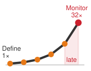
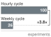
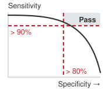
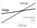

# ML Lifecycle {#sec-ml-workflow}

::: {layout-narrow}
::: {.column-margin}

\chapterminitoc

:::

::: {.content-visible when-format="pdf"}
\noindent
{fig-alt="Isometric blueprint of an ML workflow loop connecting definition, data, training, deployment, monitoring, and feedback around a central model workbench."}
:::

::: {.content-visible unless-format="pdf"}
{fig-alt="Isometric blueprint of an ML workflow loop connecting definition, data, training, deployment, monitoring, and feedback around a central model workbench."}
:::

:::

## Purpose {.unnumbered .unlisted}

::: {.content-visible when-format="pdf"}
\begin{marginfigure}
\mlsysstack{15}{15}{20}{30}{30}{45}{25}{25}
\end{marginfigure}
:::

::: {.content-visible unless-format="pdf"}
::: {.column-margin}
{width="100%" fig-alt="Machine Learning Systems Architecture Stack"}

*Architecture stack focus for this chapter.*
:::
:::

_Why is seeing the whole map necessary before walking any single path?_

Engineering organizations often split an ML system into three specialties, with one team curating datasets, another tuning model architectures, and a third provisioning serving hardware. The components those teams own remain coupled. The volume and quality of collected data bound which algorithms are viable, the computational structure of the chosen algorithm dictates what hardware can execute it efficiently, and the memory and bandwidth of the target hardware reshape what preprocessing can run at inference. Optimizing each in isolation tends to produce accurate models that cannot be deployed and efficient data pipelines that serve the wrong distributions, and the cost of such a mismatch compounds with how late it surfaces. A memory limit discovered during initial design changes one line of a hardware specification; the same limit discovered on the eve of deployment discards months of training runs, annotation budgets, and integration work. Before analyzing any single component, an engineer needs the full map of how an ML system is specified, trained, validated, deployed, and sustained as one operational loop. In D·A·M terms, the ML lifecycle is where data, algorithm, and machine are co-designed over time, each stage passing constraints to the others until their combined capability meets real-world requirements.

::: {.content-visible when-format="pdf"}

\newpage

:::

::: {.callout-learning-objectives}

- Explain the six ML lifecycle stages as coordinated data-algorithm-machine decisions with feedback
- Compare ML workflows with traditional software using drift, nondeterminism, and operational feedback
- Analyze how problem-definition constraints propagate through data, modeling, validation, and deployment
- Estimate rework from a late-discovered constraint by tracing dependent data, model, validation, and deployment artifacts
- Evaluate accuracy, efficiency, reproducibility, and deployment readiness trade-offs across lifecycle stages
- Design feedback loops that connect monitoring signals to retraining, maintenance, and revised requirements

:::

## The Lifecycle as a Loop {#sec-ml-workflow-understanding-ml-lifecycle-ca87}

Building an ML system takes far more than training a model. A team must decide what the system has to do and within which limits, gather and prepare the data it learns from, train and test the model, install it where it will run, and keep checking that it still works as the world around it changes. @Sec-ml-systems examined one of those limits in depth, showing that the deployment target can change the engineering of the same model by orders of magnitude between a phone and a data center. The rest of this book takes the remaining work apart piece by piece along the data, algorithm, and machine axes, from data pipelines and model architectures through training, optimization, and serving. Those pieces are not independent. Each hands its results to the next, and a mistake made in one tends to surface in another, so understanding any single piece first requires understanding how they connect: the sequence of stages every ML system moves through, what each stage hands to the next, and how a constraint discovered in one place reaches the others.

That sequence is the **machine learning lifecycle**\index{Machine learning lifecycle}, a structured, iterative process[^fn-crisp-dm-lifecycle] that guides the development, evaluation, and improvement of ML systems [@amershi2019]. Numbered in the order a project first meets them, its six stages each produce something the next one needs. Problem definition (1) turns a request into measurable targets and deployment constraints. Data collection and preparation (2) turns raw observations into a versioned, validated dataset. Model development and training (3) turns that dataset into trained weights. Evaluation and validation (4) tests those weights against the targets and records the evidence for a release decision in a release manifest. Deployment and integration (5) installs the approved model where it must run. Monitoring and maintenance (6) watches the running system and sends what it learns back to earlier stages, closing the loop drawn in @fig-lifecycle-overview.

[^fn-crisp-dm-lifecycle]: **CRISP-DM (cross-industry standard process for data mining)**\index{Cross-industry standard process for data mining!lifecycle influence}: CRISP-DM codified data-intensive system development as six interconnected, iterative phases rather than a linear waterfall [@chapman2000crisp]; its core design principle (moving back and forth between phases as results require) directly informs the modern ML lifecycle's structure.

::: {#fig-lifecycle-overview fig-env="figure" fig-pos="htb" fig-cap="**Simplified Lifecycle with Feedback**: The six core stages of ML engineering form a closed loop rather than a linear handoff. A primary feedback path from monitoring back to data collection supports investigation and adaptation as production distributions shift, model accuracy degrades, and operational constraints evolve." fig-alt="Six-stage flowchart across two rows, with each stage numbered 1 through 6: problem definition, data collection, model development, and evaluation run left to right along the top row; deployment and integration sits at the right of the bottom row with an arrow running left to monitoring and maintenance. Feedback loop arrow curves from monitoring back to data collection."}

```{.tikz}
\begin{tikzpicture}[font=\small\sffamily]
\tikzset{
Box2/.style={align=flush center, inner sep=2pt,draw=none,fill=black!70,
font=\fontsize{8pt}{8}\sffamily\bfseries,text=white,minimum width=20mm, minimum height=5mm },
Box/.style={align=center, inner xsep=2pt,draw=black!70, line width=1pt,node distance=15mm,
fill=none, minimum width=25mm, minimum height=20mm},
Circle1/.style={circle,  minimum size=33mm, draw=none, fill=BrownLine!20},
LineD/.style={BrownLine!60!black!20,line width=4.0pt,dashed,dash pattern=on 5pt off 2pt,
{-{Triangle[width=1.5*6pt,length=2.0*5pt]}},shorten <=5pt,shorten >=1pt},
LineA/.style={BrownLine!80!black!40,line width=4.0pt,
{-{Triangle[width=1.5*6pt,length=2.0*5pt]}},shorten <=5pt,shorten >=1pt},
ALineA/.style={violet!60,{Circle[line width=1.0pt,fill=white,round,length=5pt,width=5pt]}-,
line width=1.2pt,shorten <=-15pt,shorten >=-6pt}
}

%dataS
\tikzset{%
 pics/dataS/.style = {
        code = {
        \pgfkeys{/channel/.cd, #1}
\begin{scope}[local bounding box=FUNNEL,scale=\scalefac, every node/.append style={transform shape}]
%plats
\draw[fill=\filllcolor,line width=\Linewidth,draw=\drawcolor](0,-0.3)--(-0.67,0.03)--(0,0.37)--(0.67,0.03)--cycle;
\draw[fill=\filllcirclecolor,line width=\Linewidth,draw=\drawcolor](0,0)--(-0.67,0.33)--(0,0.67)--(0.67,0.33)--cycle;
\draw[fill=\filllcolor,line width=\Linewidth,draw=\drawcolor](0,0.3)--(-0.67,0.63)--(0,0.97)--(0.67,0.63)--cycle;
%left
\draw[line width=\Linewidth,draw=\drawcolor](-0.39,1.21)--++(210:0.55)--++(270:1.22)--(-0.39,-0.56);
\fill[line width=\Linewidth,fill=\filllcirclecolor!60!violet!,draw=green,draw=\drawcolor](-0.39,1.21)circle(3pt);
\fill[line width=\Linewidth,fill=\filllcolor,draw=green,draw=\drawcolor](-0.39,-0.56)circle(3pt);
%right
\draw[line width=\Linewidth,draw=\drawcolor](0.39,1.21)--++(330:0.55)--++(270:1.22)--(0.39,-0.56);
\fill[line width=\Linewidth,fill=\filllcirclecolor!60!violet!,draw=green,draw=\drawcolor](0.39,1.21)circle(3pt);
\fill[line width=\Linewidth,fill=\filllcolor,draw=green,draw=\drawcolor](0.39,-0.56)circle(3pt);
\end{scope}
     }
  }
}
%testing+pencil
\tikzset{
pics/testing/.style = {
        code = {
        \pgfkeys{/channel/.cd, #1}
\begin{scope}[local bounding box=TESTING1,shift={($(0,0)+(0,0)$)},scale=\scalefac,every node/.append style={transform shape}]
\newcommand{\tikzxmark}{%
\tikz[scale=0.18] {
    \draw[line width=0.7,line cap=round,RedLine] (0,0) to [bend left=6] (1,1);
    \draw[line width=0.7,line cap=round,RedLine] (0.2,0.95) to [bend right=3] (0.8,0.05);
}}
\newcommand{\tikzxcheck}{%
\tikz[scale=0.16] {
    \draw[line width=0.7,line cap=round,GreenLine] (0.5,0.75)--(0.85,-0.1) to [bend left=16] (1.5,1.55);

}}
 \node[draw, minimum width  =15mm, minimum height = 20mm, inner sep = 0pt,
        rounded corners,draw = \drawcolor, fill=\filllcolor!10, line width=\Linewidth](COM){};
\node[draw=GreenLine,inner sep=4pt,fill=white](CB1) at ($(COM.north west)!0.25!(COM.south west)+(0.3,0)$){};
\node[xshift=0pt]at(CB1){\tikzxcheck};
\node[draw=RedLine,inner sep=4pt,fill=white](CB2) at ($(COM.north west)!0.5!(COM.south west)+(0.3,0)$){};
\node[xshift=0pt]at(CB2){\tikzxmark};
\node[draw=RedLine,inner sep=4pt,fill=white](CB3) at ($(COM.north west)!0.75!(COM.south west)+(0.3,0)$){};
\node[xshift=0pt]at(CB3){\tikzxmark};
\draw[GreenLine,decoration={zigzag,segment length=4pt, amplitude=0.5pt},decorate]($(CB1)+(0.3,0.05)$)--++(0:0.8);
\draw[GreenLine,decoration={zigzag,segment length=4pt, amplitude=0.5pt},decorate]($(CB1)+(0.3,-0.12)$)--++(0:0.7);
\draw[RedLine,decoration={zigzag,segment length=4pt, amplitude=0.5pt},decorate]($(CB2)+(0.3,0.05)$)--++(0:0.8);
\draw[RedLine,decoration={zigzag,segment length=4pt, amplitude=0.5pt},decorate]($(CB2)+(0.3,-0.12)$)--++(0:0.6);
\draw[RedLine,decoration={zigzag,segment length=4pt, amplitude=0.5pt},decorate]($(CB3)+(0.3,0.05)$)--++(0:0.8);
\draw[RedLine,decoration={zigzag,segment length=4pt, amplitude=0.5pt},decorate]($(CB3)+(0.3,-0.12)$)--++(0:0.6);
\end{scope}
    }
  }
}
%pencil
\tikzset{
pics/pencil/.style = {
        code = {
        \pgfkeys{/channel/.cd, #1}
\begin{scope}[local bounding box=TESTING1,shift={($(0,0)+(0,0)$)},scale=\scalefac,every node/.append style={transform shape},rotate=340]
            \fill[fill=\filllcolor!70] (0,4) -- (0.4,4) -- (0.4,0) --(0.3,-0.15) -- (0.2,0) -- (0.1,-0.14) -- (0,0) -- cycle;
            \draw[color=white,thick] (0.2,4) -- (0.2,0);
            \fill[black] (0,3.5) -- (0.2,3.47) -- (0.4,3.5) -- (0.4,4) arc(30:150:0.23cm);
            \fill[fill=\filllcolor!40] (0,0) -- (0.2,-0.8)node[coordinate,pos=0.75](a){} -- (0.4,0)node[coordinate,pos=0.25](b){} -- (0.3,-0.15) -- (0.2,0) -- (0.1,-0.14) -- cycle;
            \fill[fill=\filllcolor] (a) -- (0.2,-0.8) -- (b) -- cycle;

\end{scope}
    }
  }
}
%nodes
\tikzset{
pics/nodes/.style = {
        code = {
        \pgfkeys{/channel/.cd, #1}
\begin{scope}[shift={($(0,0)+(0,0)$)},scale=\scalefac,every node/.append style={transform shape}]
%\node[draw=white,fill=none,circle,minimum size=0.925*40mm,line width=1pt](CI){};
%\draw[step=5mm,draw=white] (-2,-2) grid (2,2);
\foreach \x/\y[count=\a] in {-0.2/0.35,
0.7/0.6,-0.5/1.4,-1.20/-0.8,-0.1/-1.3,-0.4/-0.43,
0.61/-0.3,1/-0.85,0.45/1.2,-0.96/0.63}{
\node[circle,fill=myblue,draw=black,inner sep=0pt,minimum size=3mm](XB\a)at(\x,\y){};
}
\foreach \x/\y[count=\a] in {-2.0/0.1
}{
\node[circle,fill=myred,draw=black,inner sep=0pt,minimum size=3mm](XR\a)at(\x,\y){};
}

\foreach \x/\y[count=\a] in {1.87/0.1
}{
\node[circle,fill=mygreen,draw=black,inner sep=0pt,minimum size=3mm](XG\a)at(\x,\y){};
}

\foreach \x in {1,3,4,6,10}{
\draw[RedLine,line width=0.5pt](XR1) edge  (XB\x);
}
\foreach \x in {1,2,5,8,9}{
\draw[mygreen,line width=0.5pt](XG1) edge  (XB\x);
}
\foreach \x in {2,3,6,9,10}{
\draw[black,line width=0.5pt](XB1) edge  (XB\x);
}
\foreach \x in {4,5,7}{
\draw[black,line width=0.5pt](XB6) edge  (XB\x);
}
\draw[black,line width=0.5pt](XB4) edge  (XB5);
\draw[black,line width=0.5pt](XB3) edge  (XB9);
\foreach \x in {2,8}{
\draw[black,line width=0.5pt](XB7) edge  (XB\x);
}
\end{scope}
    }
  }
}

%target
\tikzset{
pics/target/.style = {
        code = {
        \pgfkeys{/channel/.cd, #1}
\begin{scope}[shift={($(0,0)+(0,0)$)},scale=\scalefac,every node/.append style={transform shape}]
\definecolor{col1}{RGB}{62,100,125}
\definecolor{col2}{RGB}{219,253,166}
\colorlet{col1}{\filllcolor}
\colorlet{col2}{\filllcirclecolor}
\foreach\i/\col [count=\k]in {22mm/col1,17mm/col2,12mm/col1,7mm/col2,2.5mm/col1}{
\node[circle,inner sep=0pt,draw=\drawcolor,fill=\col,minimum size=\i,line width=\Linewidth](C\k){};
}
\draw[thick,fill=brown,xscale=-1](0,0)--++(111:0.13)--++(135:1)--++(225:0.1)--++(315:1)--cycle;
\path[green,xscale=-1](0,0)--(135:0.85)coordinate(XS1);
\draw[thick,fill=yellow,xscale=-1](XS1)--++(80:0.2)--++(135:0.37)--++(260:0.2)--++(190:0.2)--++(315:0.37)--cycle;
\end{scope}
    }
  }
}
%cloud-arrow
\tikzset {
pics/cloudA/.style = {
        code = {
        \pgfkeys{/channel/.cd, #1}
\begin{scope}[local bounding box=CLO,scale=0.8, every node/.append style={transform shape}]
\node[draw=\drawcolor!90!red,line width=\Linewidth,minimum width=6mm,minimum height=12mm](VSK)at(0,0.5){};
\node[draw=\drawcolor!90!red,line width=\Linewidth,fill=white,minimum width=9mm,minimum height=4mm](VSKG)at(VSK.north){};
\node[draw=\drawcolor!90!red,line width=\Linewidth,fill=white,minimum width=9mm,minimum height=4mm](VSKC)at(VSK.center){};
\node[draw=\drawcolor!90!red,line width=\Linewidth,fill=white,minimum width=9mm,minimum height=4mm](VSKD)at(VSK.south){};
\draw[fill=\filllcolor,draw=\drawcolor!60,,line width=\Linewidth](0,0)to[out=170,in=180,distance=11](0.1,0.61)
to[out=90,in=105,distance=17](1.07,0.71)
to[out=20,in=75,distance=7](1.48,0.36)
to[out=350,in=0,distance=7](1.48,0)--(0,0);
\draw[draw=\drawcolor!60,,line width=\Linewidth](0.27,0.71)to[bend left=25](0.49,0.96);
\draw[draw=\drawcolor!60,,line width=\Linewidth](0.67,1.21)to[out=55,in=90,distance=13](1.5,0.96)
to[out=360,in=30,distance=9](1.68,0.42);
\node[single arrow, draw=orange,fill=orange,
      minimum width = 10pt, single arrow head extend=3pt,
      minimum height=10mm,
      rotate=270]at(1.05,0) {};
\end{scope}
}
}
}
%display
\tikzset{%
    comp/.style = {draw,
        minimum width  =18mm,
        minimum height = 15mm,
        inner sep      = 0pt,
        rounded corners,
       draw = \drawcolor,
       fill=\filllcolor!10,
       line width=2.0pt
    },
 pics/displayK/.style = {
        code = {
        \pgfkeys{/channel/.cd, #1}
\begin{scope}[local bounding box=COMPUTER1,shift={(0,0)}]
 \node[comp](\picname-COM){};
% \draw[draw = \drawcolor,line width=1.0pt]
% ($(\picname-COM.north west)!0.85!(\picname-COM.south west)$)-- ($(\picname-COM.north east)!0.85!(\picname-COM.south east)$);
\draw[draw = \drawcolor,line width=\Linewidth]($(\picname-COM.south west)!0.4!(\picname-COM.south east)$)--++(270:0.2)coordinate(DL);
\draw[draw = \drawcolor,line width=\Linewidth]($(\picname-COM.south west)!0.6!(\picname-COM.south east)$)--++(270:0.2)coordinate(DD);
\draw[draw = \drawcolor,line width=3*\Linewidth,shorten <=-3mm,shorten >=-3mm](DL)--(DD);
 \draw[
  line width=1pt,
  draw=red,
  line cap=round,
  line join=round
]
(-0.70,0) --(-0.40,0) --
(-0.30,0.13) --
(-0.2,-0.18) --
(-0.05,0.32) --
(0.05,-0.15) --
(0.15,0.23) --
(0.38,-0.15) --
(0.40,0.0) --
(0.70,0.0);
\end{scope}
   }
  }
}

%%%%%%%%%%
\pgfkeys{
  /channel/.cd,
   Depth/.store in=\Depth,
  Height/.store in=\Height,
  Width/.store in=\Width,
  filllcirclecolor/.store in=\filllcirclecolor,
  filllcolor/.store in=\filllcolor,
  drawcolor/.store in=\drawcolor,
  drawcircle/.store in=\drawcircle,
  scalefac/.store in=\scalefac,
  Linewidth/.store in=\Linewidth,
  picname/.store in=\picname,
  tiecolor/.store in=\tiecolor,
  bodycolor/.store in=\bodycolor,
  stetcolor/.store in=\stetcolor,
  tiecolor=red,      % default tie color
  bodycolor=blue!30,  % default body color
  stetcolor=green,  % default stet color
  filllcolor=BrownLine,
  filllcirclecolor=violet!20,
  drawcolor=black,
  drawcircle=violet,
  scalefac=1,
  Linewidth=0.5pt,
  Depth=0.2,
  Height=0.5,
  Width=0.25,
  picname=C
}
%Problem Definition
\node[Box,draw=none](B1){};
 \pic[shift={(0,0)}] at  (B1){target={scalefac=0.7,picname=1,
 drawcolor=BlueD,filllcolor=myred,Linewidth=0.7pt, filllcirclecolor=myred!20}};
 \draw[ALineA,draw=mygreen](B1.south west)--++(200:0.45)
 node[below=1pt,Box2,fill=mygreen]{Problem\\ Definition};
%Data Collection \&  Preparation
\node[Box,right= of B1,draw=none](B2){};
\pic[shift={(0,-0.28)}] at  (B2){dataS={scalefac=0.9,picname=1,Linewidth=1.0pt,
 filllcolor=cyan!90!black!40!,drawcolor=black,filllcirclecolor=orange}};
\draw[ALineA,draw=mygreen](B2.south west)--++(200:0.45)
 node[below=1pt,Box2,fill=mygreen]{Data Collection  \\ \& Preparation};
%Model Development \& Training
\node[Box,right= of B2,draw=none](B3){};
 %persons 1
\pic[shift={(0,0)}] at  (B3){nodes={scalefac=0.6,picname=1,drawcolor=orange,filllcirclecolor=orange!20,filllcolor=orange}};
\draw[ALineA,draw=mygreen](B3.south west)--++(200:0.45)
 node[below=1pt,Box2,fill=mygreen]{Model Development\\ \& Training};
%Evaluation \& Validation
\node[Box,right=of B3,draw=none](B4){};
\pic[shift={(0,0)}] at  (B4){testing={scalefac=0.85,picname=1,drawcolor=myblue,filllcolor=myblue, Linewidth=1.0pt}};
\pic[shift={(0,-0.5)},rotate=-15] at  (B4){pencil={scalefac=0.37,picname=1,filllcolor=mygreen, Linewidth=1.0pt}};
\draw[ALineA,draw=mygreen](B4.south west)--++(200:0.45)
 node[below=1pt,Box2,fill=mygreen]{Evaluation \& \\ Validation};
%Deployment \& Integration
\node[Box,below= 1.25 of B4,draw=none](B5){};
%AI
\pic[shift={(-0.50,-0.40)}] at  (B5){cloudA={scalefac=1,filllcirclecolor=orange!80,drawcolor=BlueLine,
filllcolor=cyan!10,  Linewidth=1.0pt}};

\draw[ALineA,draw=mygreen](B5.south west)--++(200:0.45)
	 node[below=1pt,Box2,fill=mygreen]{Deployment \&\\ Integration};
%Monitoring \& Maintenance
\node[Box,left=of B5,draw=none](B6){};
%AI
\pic[shift={(0,0.1)}] at  (B6){displayK={scalefac=0.45,picname=D,
filllcolor=gray, drawcolor=BlueLine!70!black,Linewidth=0.7pt}};
\draw[ALineA,draw=mygreen](B6.south west)--++(200:0.45)
	 node[below=1pt,Box2,fill=mygreen]{Monitoring \&\\ Maintenance};

%arrows
\foreach \x in{1,2,3,4,5}{
\pgfmathtruncatemacro{\nx}{\x + 1} %
\draw[LineA,BrownLine!80!black!70](B\x)--(B\nx);
}
\draw[LineD](B6)-|node[above,pos=0.25,font=\footnotesize\sffamily,text=black!70]{Feedback}(B2);
%stage numbers
\foreach \x in{1,2,3,4,5,6}{
\node[circle,fill=black!70,text=white,font=\footnotesize\bfseries\sffamily,inner sep=1.5pt,minimum size=4.5mm] at (B\x.north west){\x};
}
\end{tikzpicture}

```

:::

The return arrow from monitoring is what makes the lifecycle a loop rather than a checklist. Evidence flows back from later stages to earlier ones, and constraints should flow back with it. A memory limit set by the deployment device belongs in problem definition, where it can shape the dataset, the model, and the evaluation, not in deployment, where it can only reject them.

::: {#dfn-ml-workflow-machine-learning-lifecycle .callout-definition title="Machine learning lifecycle"}

***Machine learning lifecycle***\index{Machine learning lifecycle!definition} is the iterative engineering process of building, deploying, monitoring, and updating ML systems, where evidence from later stages can feed back to earlier stages because model performance may change after deployment.

1.  **Significance**: The lifecycle is a closed loop, not a linear pipeline. Each stage hands the next an artifact it depends on (targets, a dataset, trained weights, release evidence, a running service, monitoring evidence), so a decision at one stage constrains every stage after it, and evidence from a later stage can force an earlier one to be revisited. How often the loop must turn is itself a recurring budget, set by how quickly the deployment environment changes and how long verified labels take to arrive.
2.  **Distinction**: Unlike traditional software, whose behavior changes when code, configuration, dependencies, or environment changes, ML behavior can also change as the world changes. A deployed model's accuracy may change through distribution shift even when the code, infrastructure, and configuration remain untouched.
3.  **Common pitfall**: A frequent misconception is that the lifecycle ends at deployment. In reality, deployment is the beginning of the feedback loop. Production monitoring surfaces drift, drift triggers investigation, and outcome evidence determines whether a retrained model should re-enter the deployment stage.

:::

Carrying constraints around that loop is the job of the **ML workflow**\index{ML workflow!definition}\index{ML workflow!systematic framework}, the engineering framework that makes constraints explicit at each stage and traces how deployment constraints propagate across Data, Algorithm, and Machine. The two terms divide the job. The lifecycle is *what gets traversed*, the stages themselves; the workflow is *how the traversal is managed*, the engineering discipline of orchestrating them. The workflow marks the shift from model researcher to systems engineer. A researcher optimizes individual elements: a better architecture, a cleaner dataset, a faster accelerator. A systems engineer orchestrates those elements into production systems that reliably deliver value.

::: {.column-margin .margin-pointer}
↩ The deployment paradigms whose memory, latency, and power constraints the workflow propagates are established in @sec-ml-systems-deployment-paradigm-framework-0d25.
:::

```{python}
#| echo: false
#| output: false
from mlsysim import *
from mlsysim.core.units import *

# ┌─────────────────────────────────────────────────────────────────────────────
# │ CHAPTER IMPORTS
# ├─────────────────────────────────────────────────────────────────────────────
# │ Context: Global imports for all compute cells in this chapter
# │
# │ Goal: Centralize import statements for the chapter.
# │ Show: A clean namespace for subsequent calculations.
# │ How: Import constants, formatting helpers, and pint units.
# │
# └─────────────────────────────────────────────────────────────────────────────
import pint
from mlsysim.fmt import fmt, check, MarkdownStr, fmt_math
from IPython.display import Markdown
```

In practice, the stages between problem definition and deployment run as two pipelines on different clocks. @Fig-ml-lifecycle zooms into that work as ten finer-grained blocks. The upper data pipeline, the substance of stage 2, continuously transforms raw operational streams through ingestion, curation, annotation, and validation into versioned, ML-ready datasets. The lower model pipeline executes the inner development loop of stages 3 and 4: training architectures, computing evaluation metrics, validating system constraints, and packaging approved artifacts for deployment, with stage 4's release manifest drawn as an ML certificate. Outer-loop feedback arrows carry production telemetry and validation discoveries back to upstream data stages, the return path that stage 6 operates.

::: {#fig-ml-lifecycle fig-env="figure" fig-pos="htb" fig-cap="**Dual-Pipeline ML Development**: Machine learning engineering decouples into parallel data and model pipelines operating on different timescales. While the model pipeline executes rapid inner-loop training and evaluation, outer-loop feedback from production deployment and data validation continuously reshapes upstream collection, labeling, and curation." fig-alt="Two parallel pipelines: a green data pipeline of six stages above a blue model pipeline of four stages. A deployment feedback arrow returns to data collection; curved arrows labeled Data fixes and Data needs loop back to earlier data stages."}

```{.tikz}
\begin{tikzpicture}[font=\sffamily]
%
\tikzset{
  Box/.style={align=flush center,
    inner xsep=2pt,
    node distance=1.6,
    draw=GreenLine,
    line width=0.75pt,
    fill=GreenFill,
    text width=25mm,
    minimum width=25mm, minimum height=23mm
  },
  Box1/.style={Box, node distance=3.7,text width=28mm,minimum width=28mm,fill=BlueFill,draw=BlueLine
  },
 Line/.style={line width=1.30pt,black!50,text=black, -{Triangle[length=3mm, width=1.75mm]}},
 Text/.style={font=\sffamily\footnotesize,align=center
  },
DLine/.style={draw=VioletLine, line width=2pt, -{Triangle[length=4mm, width=2.5mm,bend]},
shorten >=1.1mm, shorten <=1.15mm},
}
%
\node[Box](B1){\textbf{Data Collection}\\\small Continuous input stream};
\node[Box,right=of B1](B2){\textbf{Data Ingestion}\\\small Prep data for downstream ML apps};
\node[Box, right=of B2](B3){\textbf{Data Analysis, Curation}\\\small  Inspect/select the right data};
\node[Box, right=of B3](B4){\textbf{Data Labeling}\\\small  Annotate data};
\node[Box, right=of B4](B5){\textbf{Data Validation}\\\small Verify data is usable through pipeline};
\node[Box, right=of B5](B6){\textbf{Data Preparation}\\\small Prep data for ML uses (split, versioning)};
%
\coordinate(D1) at ($(B2.south west)+(0,-4.25)$);
\coordinate(D4) at ($(B5.south east)+(0,-4.25)$);
\coordinate(D2) at ($(D1)!0.35!(D4)$);
\coordinate(D3) at ($(D1)!0.67!(D4)$);
%
\node[Box1]at(D1)(2B2){\textbf{ML System Deployment}\\\small  Deploy ML\\ system to\\ production};
\node[Box1]at(D2)(2B3){\textbf{ML System Validation}\\\small Validate ML\\ system for\\ deployment};
\node[Box1]at(D3)(2B4){\textbf{Model Evaluation}\\\small Compute\\ model KPIs};
\node[Box1]at(D4)(2B5){\textbf{Model Training}\\\small Use ML algorithms\\ to create models};

\coordinate(S) at ($(B4.south)!0.5!(2B4.north)$);

\begin{scope}[local bounding box=AR,shift={($(S)+(-6,-0.7)$)},anchor=center]
% Dimensions
\def\w{6cm}
\def\h{15mm}
\def\r{6mm} % radius
\def\gap{4mm} % break lengths

\draw[BlueLine, -{Latex[length=10pt,width=22pt]},line width=10pt]
  (\w,\h-\r) -- (\w,\r)
  arc[start angle=0, end angle=-90, radius=\r]
  -- (\gap,0);

  \draw[GreenLine, -{Latex[length=10pt,width=22pt]},line width=10pt]
  (0,\r) -- (0,\h-\r)
  arc[start angle=180, end angle=90, radius=\r]
  -- ({\w-\gap},\h);
\end{scope}
%%%
\draw[Line](B1)--node[below,Text]{Raw\\ data}(B2);
\draw[Line](B2)--node[below,Text]{Indexed\\ data}(B3);
\draw[Line](B3)--node[below,Text]{Selected\\ data}(B4);
\draw[Line](B4)--node[below,Text]{Labeled\\ data}(B5);
\draw[Line](B5)--node[below,Text]{Validated\\ data}(B6);
\draw[Line](B6)|-node[left,Text,pos=0.2]{ML-ready\\ datasets}(2B5);
\draw[Line](2B5)--node[below,Text]{Models}(2B4);
\draw[Line](2B4)--node[below,Text]{KPIs}(2B3);
\draw[Line](2B3)--node[below,Text]{Validated\\ ML System}
node[above,Text]{ML\\ Certificate}(2B2);
\draw[Line](2B2)-|node[below,Text,pos=0.3]{Online\\ ML System}
node[right,Text,pos=0.8]{Online\\ Performance}(B1);

\draw
  (current bounding box.south west) coordinate (bbSW)
  (current bounding box.north east) coordinate (bbNE);

\draw[overlay,DLine,distance=44](B3.north)to[out=120,in=80]
node[below]{Data fixes}(B1.north);
\draw[DLine,distance=44,overlay](B5.north)to[out=120,in=80]
node[below]{Data needs}(B3.north);
%
\path[use as bounding box]
  ($(bbSW)+(0mm,-1mm)$)
  rectangle
  ($(bbNE)+(0mm,11.5mm)$);
%\path[red,use as bounding box] (-1.4,1.82) rectangle (21,2.43);
\end{tikzpicture}
```

:::

::: {.column-margin .margin-pointer}
↪ The operational tooling and infrastructure that automate these lifecycle stages at scale are developed in @sec-ml-operations.
:::

### ML vs. traditional software {#sec-ml-workflow-ml-vs-traditional-software-development-c5f5}

The loop and its two pipelines exist because of one difference between ML systems and traditional software. Both iterate.[^fn-waterfall-model-ml] The difference that forces new workflow controls is narrower than iteration and sharper. Rule-based software encodes explicit logic, so its behavior changes when someone changes the code, configuration, or dependencies. An ML system learns a statistical mapping from data, so its behavior can also change when the data changes while the code stays fixed. Every workflow addition this chapter introduces (versioned datasets,[^fn-data-versioning-drift] statistical evaluation gates, drift monitoring) exists to manage that second path.

[^fn-waterfall-model-ml]: **Waterfall model**\index{Waterfall model!contrast with ML}: A plan-driven lifecycle is often depicted as a sequence of requirements, implementation, and testing, but @royce1970managing warned that a purely sequential implementation was risky and described iteration between successive phases. ML systems add data and model feedback that must be managed explicitly.

::: {.column-margin .margin-pointer}
↩ Data-defined behavior, and the silent degradation it makes possible, are established in @sec-introduction-ml-vs-traditional-software-e19a.
:::

In fraud detection, a rule such as "decline if the amount exceeds \$5,000 abroad" changes only when someone edits it, and a test against its specification shows what it will do. A learned fraud score\index{Fraud Detection!ML vs. rule-based} changes whenever it is retrained on new transactions, and the labels that grade it (confirmed fraud cases) may arrive weeks late. Both approaches need revalidation as fraud patterns shift, and both trade lost revenue against fraud losses when setting decision thresholds. Only the learned score, however, can change its decision logic without a code change, and only fresh labeled data can show whether today's model still catches today's fraud. That is why its workflow must version data, gate releases on statistical evidence, and monitor for drift.

These differences alter how lifecycle stages interact. While conventional software engineering relies on production feedback to refine code and requirements, ML systems introduce feedback loops where operational data reshapes training distributions, detected drift prompts investigation, and runtime errors expose dataset blind spots. @Tbl-sw-ml-cycles contrasts traditional software and ML engineering across six core lifecycle dimensions, highlighting how data evolution redefines testing, deployment, and ongoing maintenance.

[^fn-data-versioning-drift]: **Data versioning**\index{Data versioning!reproducibility}: Unlike code, which changes through discrete, auditable commits, data can drift gradually (distribution shift), suddenly (schema migration), or subtly (label quality degradation). Plain Git is impractical for many multi-terabyte datasets, so teams commonly version external-data manifests or pointers using tools such as DVC and Git LFS. Without data versioning, teams cannot reliably reproduce a prior training run or determine whether an accuracy regression stems from a code change or a data change.

| **Aspect**                 | **Traditional Software Lifecycles**                                                                 | **Machine Learning Lifecycles**                                                                            |
|:---------------------------|:----------------------------------------------------------------------------------------------------|:-----------------------------------------------------------------------------------------------------------|
| **Problem Definition**     | Functional requirements specify behavior; tests check the code against them.                        | Objectives are statistical targets whose feasibility is known only after experiments on data.              |
| **Development Process**    | Engineers write and revise the logic directly in code and configuration.                            | Engineers shape behavior indirectly through data, features, architecture, and training runs.               |
| **Testing and Validation** | Many functional tests have exact expected results; performance and reliability remain quantitative. | Metrics over held-out data, reported with uncertainty and across subgroups.                                |
| **Deployment**             | Logic stays fixed until code, configuration, or dependencies change.                                | Accuracy can degrade when input distributions shift, with code unchanged.                                  |
| **Maintenance**            | Maintenance involves modifying code to address bugs or add features.                                | Continuous monitoring, updating data pipelines, retraining models, and adapting to new data distributions. |
| **Feedback Loops**         | Production feedback changes code, configuration, and requirements.                                  | Production data can become future training data, so feedback also reshapes data collection and the model.  |

: **Traditional Software vs. ML Development Lifecycles**: Six dimensions where ML development diverges from traditional software engineering. Both use production feedback, while ML systems add loops in which deployment insights reshape data collection, monitoring drives model updates, and production experience informs model design. {#tbl-sw-ml-cycles tbl-colwidths="[15,40,45]"}

::: {#chk-ml-workflow-ml-vs-traditional-devops .callout-checkpoint title="ML vs. traditional software"}

ML systems are not traditional software with a model attached. Check the differences that force a separate workflow:

- [ ] **Failure modes**: Can you explain how a shift in input data can degrade an ML system silently, with no code change and no error raised?
- [ ] **Logic source**: Can you explain why changing training data can change model behavior even when the code remains fixed?
- [ ] **Iteration**: Can you explain why ML requires monitoring and, when evidence warrants it, model or data updates?

:::

Each difference in the comparison traces back to behavior learned from data, which ties every stage to the stages around it. A diagram shows where the stages sit but not how tightly they bind. Seeing that requires a concrete system, and this chapter carries one through every stage.

### The running case: Diabetic retinopathy screening {#sec-ml-workflow-case-study-diabetic-retinopathy-screening-7d71}

Diabetic retinopathy (DR) is a major cause of preventable vision loss.[^fn-dr-scale-screening] While early detection prevents severe vision loss, limited access to specialist ophthalmologists in rural regions motivates automated screening programs. Google built one of the best documented of these programs, a deep-learning model that performed at the level of ophthalmologists on curated retinal images [@gulshan2016] and that Google Health then deployed in clinics in Thailand [@beede2020human]. Detecting the pathology, however, requires identifying subtle microvascular features under variable capture conditions. @Fig-eye-dr contrasts a normal retina (Panel A) with one exhibiting diabetic retinopathy (Panel B).

[^fn-dr-scale-screening]: **Diabetic retinopathy (DR)**\index{Diabetic retinopathy!deployment scale}: DR is a common complication of diabetes; early detection can prevent vision loss, but specialist access varies substantially across countries. This gap motivates scalable screening programs. In clinics with limited hardware or unreliable connectivity, model size, offline capability, latency, and workflow integration can become binding deployment constraints.

::: {#fig-eye-dr fig-env="figure" fig-pos="htb" fig-cap="**Retinal Hemorrhages in DR Screening**: Side-by-side fundus images illustrate the subtle visual features an ML screening system must detect. Identifying localized microvascular lesions (such as the indicated hemorrhage) requires preserving fine spatial resolution through the vision pipeline and establishing strict input-quality validation to handle lighting and camera variations in clinical field deployments. Source: @peng2016deep." fig-alt="Two side-by-side retinal fundus images labeled A. HEALTHY and B. DISEASED. An arrow labeled Hemorrhages points to a small lesion in the diseased retina."}

{width="90%"}

:::

Diabetic retinopathy screening\index{Diabetic retinopathy!case study introduction} serves as the running case study throughout this chapter because it is a real production system whose documentation covers the full lifecycle, and because a task that looks straightforward on the surface revealed deep operational friction in practice. Google's program spans both sides of the lab-to-field divide. Its controlled validation documented expert-level accuracy, while its deployment in Thai clinics exposed problems the validation never saw: images rejected as ungradable, retakes that added work for nurses, and screening delayed when slow clinic internet connections held up uploads to the remote grading service.[^fn-healthcare-deployment-gap]

[^fn-healthcare-deployment-gap]: **Healthcare AI deployment gap**\index{Healthcare AI!deployment gap}\index{Workflow!lab-deployment gap}: In the Thai DR deployment studied by @beede2020human, 393 of 1,838 submitted images (21 percent) failed the system's image-quality requirements, often because clinic lighting, camera maintenance, or dilation practices did not match its assumptions. The case shows why laboratory metrics alone do not establish deployment readiness.

The scenario this chapter uses to put numbers on each stage is a composite based on that real case study. Because the remote grading path depended on each clinic's internet connection, the scenario moves inference into the clinic: a network of rural clinics, each executing local inference on an Orin Nano-class edge device with 4 to 8 GB of shared memory and an intermittent wide-area uplink of roughly 2 Mbps. The clinical mandate requires more than 90 percent sensitivity and a result the nurse can act on before the patient leaves, which means within seconds of capture and even when the uplink is down. Sensitivity measures the fraction of true disease cases correctly flagged; its denominator includes only patients with the condition, meaning high aggregate accuracy on an imbalanced, mostly healthy population provides no assurance that sick patients will be detected. Specificity measures the fraction of healthy patients correctly left unflagged, bounding unnecessary referrals that would overwhelm regional specialists. Hardware limits, operator variance, and data distributions govern real-world viability far more than benchmark scores do.

A team that runs these stages as a line rather than a loop fails in a predictable way. Day one: "Build a diabetic retinopathy screening model for rural clinics." Day 90: 92 percent sensitivity on the validation set used to guide development. Day 120: 94 percent sensitivity after a month of architecture tuning. Day 150: the model is handed to deployment engineers. Day 151: deployment engineers report that the model needs 4 GB of memory to run. Day 152: someone checks the deployment target, a low-power edge device in each clinic whose 4--8 GB of memory is shared with the operating system, the camera pipeline, and the clinic software; the clinic's IT plan reserves about 500 MB of it for the model. Day 153: five months of work is discarded.

The model's accuracy was excellent. The team's machine learning skills were excellent. *The failure was a workflow failure.* A deployment constraint that should have shaped every decision from day one was discovered only after the work was done. That 500 MB budget should have propagated backward to the first architecture meeting, constraining which models were even worth considering. Instead, the team optimized each component in isolation (data collection, architecture selection, training), and the integration failure appeared only when the pieces were assembled. The day-153 failure is one instance of a general principle about how constraints travel through the lifecycle.

## Constraint Propagation Principle {#sec-ml-workflow-decisions-cascade-system-98f4}

::: {.column-margin}
{width="100%" fig-alt="Six dots on a linear cost scale, one per lifecycle stage, from Define at 1× to Monitor at 32×. The line stays nearly flat for the early stages and bends sharply upward at the last two; the final segment is shaded and labeled late."}

*Under an illustrative doubling per stage, a constraint caught at monitoring costs 32$\times$ one caught at definition; real rework depends on which artifacts relied on it.*
:::

In the DR scenario, a screening result must reach the nurse during the visit even when the intermittent 2 Mbps clinic uplink is down, which rules out cloud inference and requires edge deployment. The edge target's memory and power budgets then constrain model architecture, favoring compact MobileNet-class models over large ensembles (several models whose predictions are combined) and requiring automated image-quality checks at capture time. Each downstream constraint narrows the design space for upstream stages, coupling hardware limits directly to data collection and model design. The stage numbers of @fig-lifecycle-overview state that coupling precisely, from (1) problem definition to (6) monitoring and maintenance.

::: {#dfn-ml-workflow-constraint-propagation-principle .callout-definition title="Constraint propagation principle"}

***The constraint propagation principle***\index{Constraint propagation principle!definition} states that a constraint discovered late in the ML lifecycle can force rework across affected upstream stages. Datasets, trained weights, validation evidence, and deployment packages record decisions that later work depends on. Correcting a missing constraint requires tracing those dependencies to determine which artifacts must change and which remain valid. Estimating actual rework requires the effort to revise each affected artifact, repeat its dependent work, and validate the resulting system.

1.  **Significance**: A 100 ms latency target discovered at deployment (stage 5) may propagate backward to constrain model size (stage 3: operation count $\Operations$), dataset requirements (stage 2: dataset size $\DatasetSize$, the number of training examples), and problem definition (stage 1: what accuracy is achievable). Rework depends on which earlier decisions relied on the missing constraint. Within the iron law, a latency budget bounds total time $\Time$, and therefore every term that sums to it, so it redefines the feasible region for $\Operations$, for the bytes moved $\DataVolume$ (distinct from the example count $\DatasetSize$), and for the hardware efficiency $\EfficiencyHw$ the model must achieve.
2.  **Distinction**: Unlike modular decomposition (which encourages independent optimization of each component), this principle mandates end-to-end reasoning, because an accuracy optimum reached in isolation can be an infeasible system.
3.  **Common pitfall**: A frequent misconception is that deployment is "the last step." The deployment environment is the day-one constraint: its latency budget, memory capacity, and power envelope define the boundaries of every upstream decision.

:::

Propagation runs in both directions, so the stages form a network of constraints rather than a chain. Backward propagation carries a deployment limit upstream. When rural clinic deployment reveals tight bandwidth, the team can compress images before sending them over the uplink, but lossy compression degrades input quality, so the training dataset must then include matching compression artifacts or the model will see different inputs in service than in training (training-serving skew). Shifting inference entirely to the edge and transmitting only the diagnostic result relieves the uplink instead, but tightens the edge device's memory capacity and power budget. Forward propagation carries an early data decision downstream. Capturing fundus images at the resolution needed to see small hemorrhages fixes the model's input size, and with it the operation count every inference must pay on the clinic device. Upstream data choices and downstream machine boundaries remain physically coupled.

Decisions made without accounting for downstream execution boundaries accumulate technical debt\index{Technical debt!ML systems}.[^fn-ml-debt-entanglement] The stage interface specification (@tbl-stage-interface) operationalizes this principle by making constraints explicit at each stage boundary. Those contracts enable earlier detection of constraints. When propagation occurs specifically through data quality failures, the resulting pattern is known as a **data cascade**\index{Data cascade!definition}: a chain of downstream failures triggered by bad data [@sambasivan2021].

Propagation explains why a late constraint is expensive but not how expensive. Measuring that cost starts with where the lifecycle's engineering time goes.

[^fn-ml-debt-entanglement]: **ML technical debt**\index{Technical debt!ML entanglement}: @sculley2015hidden identify ML-specific debt mechanisms such as *entanglement* (changing one feature affects all others because the model learned joint distributions), *hidden feedback loops* (predictions influence future training data), and *undeclared consumers* (downstream systems depending on outputs without contracts). Since ML code is often only a small part of a production system, the surrounding configuration, pipelines, and infrastructure can allow this debt to accumulate silently.

::: {.column-margin .margin-pointer}
↪ Shared contracts and deployment paths that reject incompatible changes before they reach production are enforced in @sec-ml-operations-development-infrastructure-automation-de41.
:::

## Quantifying the ML Lifecycle {#sec-ml-workflow-quantifying-ml-lifecycle-bd69}

The DR team lost five months to one late constraint, counting both the hours already spent and the experiments those hours could have run. Measuring where a lifecycle's hours go shows that engineering effort rarely concentrates where research literature spends its pages. Conceptual models of the ML lifecycle\index{Machine learning lifecycle!time allocation across stages} describe which stages exist, but systems decisions turn on quantitative reality: where engineering hours are spent, how much compute is consumed, and which pipeline stalls delay deployment.

```{python}
#| echo: false
#| label: data-scientist-time-allocation
# ┌─────────────────────────────────────────────────────────────────────────────
# │ DATA SCIENTIST TIME ALLOCATION
# ├─────────────────────────────────────────────────────────────────────────────
# │ Context: Used in CrowdFlower survey prose and @fig-ds-time caption
# │
# │ Goal: Keep survey percentage summaries tied to the pie-slice values.
# │ Show: That cleaning plus collection dominate reported practitioner time.
# │ How: Sum the reported percentage buckets and guard that they cover 100%.
# │
# └─────────────────────────────────────────────────────────────────────────────
from mlsysim import Literature

# ┌── LEGO ───────────────────────────────────────────────
class DataScientistTime:
    """CrowdFlower survey percentage buckets used in the time-allocation figure."""

    # ┌── 1. LOAD (Constants) ──────────────────────────────────────────────
    cleaning_pct = Literature.Surveys.DataScientistCleaning
    collection_pct = Literature.Surveys.DataScientistCollecting
    mining_pct = Literature.Surveys.DataScientistMining
    training_set_pct = Literature.Surveys.DataScientistBuildingTrainingSets
    algorithm_refinement_pct = Literature.Surveys.DataScientistRefiningAlgorithms
    other_pct = Literature.Surveys.DataScientistOther

    # ┌── 2. EXECUTE (The Compute) ────────────────────────────────────────
    data_work_pct = cleaning_pct + collection_pct
    model_focused_pct = mining_pct + training_set_pct + algorithm_refinement_pct
    total_pct = data_work_pct + model_focused_pct + other_pct

    # ┌── 3. GUARD (Invariants) ───────────────────────────────────────────
    check(total_pct == 100, f"Survey buckets sum to {total_pct}%, not 100%.")
    check(data_work_pct > model_focused_pct, "Data work should dominate model-focused buckets.")

    # ┌── 4. OUTPUT (Formatting) ──────────────────────────────────────────
    cleaning_str = fmt_percent(cleaning_pct / 100, precision=0, commas=False, style='prose')
    collection_str = fmt_percent(collection_pct / 100, precision=0, commas=False, style='prose')
    data_work_str = fmt_percent(data_work_pct / 100, precision=0, commas=False, style='prose')
    model_focused_str = fmt_percent(model_focused_pct / 100, precision=0, commas=False, style='prose')
```

Practitioner surveys reveal a stark asymmetry between where research attention centers and where practitioners report spending their time, with about `{python} DataScientistTime.data_work_str` of data scientists in CrowdFlower's 2016 survey naming data collection or cleaning as the activity that consumed most of their time [@crowdflower2016data]. In the full distribution (@fig-ds-time), algorithm refinement and training-set construction together draw fewer responses than data collection alone.

::: {#fig-ds-time fig-env="figure" fig-pos="htb" fig-cap="**Data Scientist Most-Time Responses**: In CrowdFlower's 2016 survey, `{python} DataScientistTime.cleaning_str` of respondents selected cleaning and organizing data as the activity where they spent the most time, with `{python} DataScientistTime.collection_str` selecting data collection. Model-focused responses such as pattern mining, training set construction, and algorithm refinement together represent roughly `{python} DataScientistTime.model_focused_str` of responses. Adapted from @crowdflower2016data." fig-alt="Pie chart of where surveyed data scientists spend the most time: 60 percent cleaning and organizing data, 19 percent collecting datasets, 9 percent mining patterns, 3 percent building training sets, 4 percent refining algorithms, 5 percent other."}

```{.tikz}
\scalebox{0.75}{%
\begin{tikzpicture}[line join=round,font=\small\sffamily]
\makeatletter
\def\pgfpie@legend#1{%
  \coordinate[xshift=15mm,
  yshift={(\the\pgfpie@sliceLength*0.5+1)*0.5cm}] (pgfpie@legendpos) at
  (current bounding box.east);

\scope[node distance=2.25mm]
    \foreach \pgfpie@p/\pgfpie@t [count=\pgfpie@i from 0] in {#1}
    {
      \pgfpie@findColor{\pgfpie@i}
      \node[circle,draw, fill={\pgfpie@thecolor}, draw=none,inner sep=5 pt,below =1.6mm of {pgfpie@legendpos},
      label={[font=\footnotesize\sffamily]0:{\pgfpie@t}}] (pgfpie@legendpos) {};
    }
  \endscope
}
\makeatother
\definecolor{Greenn}{RGB}{84,180,53}
\definecolor{Redd}{RGB}{249,56,39}
\definecolor{Orangee}{RGB}{255,157,35}
\definecolor{Brownn}{RGB}{214,128,96}
\definecolor{Bluee}{RGB}{0,97,168}
\definecolor{Violett}{RGB}{178,108,186}
\definecolor{Yelloww}{RGB}{255,210,76}
\tikzset{lines/.style={
  draw=none,
  line width=0.75pt
}}

\pie[text=legend,radius=2.65,
     style={lines},
     color={Greenn!60, Redd!90, Orangee, Bluee!80, Yelloww, Violett},
     every slice/.style={draw=blue}
     ]
{60/Cleaning and organizing data,
19/Collecting datasets,
9/Mining data for patterns,
3/Building training sets,
4/Refining algorithms,
5/Other}
\end{tikzpicture}}
```

:::

The survey responses identify data work as a major time sink for these practitioners, without measuring how all engineering hours were divided. In the DR project, where each image must be graded by multiple ophthalmologists before it can train anything, collection and labeling can delay useful experiments more than training does; improving that pipeline can then reduce iteration time before model or training optimizations become the binding concern. The workflow must identify its actual bottleneck rather than assign investment priorities from response shares alone. Even so, the imbalance explains why data engineering, developed in @sec-data-engineering, deserves explicit planning rather than treatment as setup work.

Beyond time allocation, iteration velocity\index{Machine learning lifecycle!iteration cycles} governs project progress. The feedback arrows in @fig-ml-lifecycle (the *Data fixes* loop from curation back to collection, the *Data needs* loop from validation back to curation, and the *Online Performance* path from production deployment back to collection) are not rare exceptions; they are paths teams traverse repeatedly. When clinic images drift or labels prove wrong, rework sends the DR team back to collection. When a candidate architecture exceeds the clinic device's memory, engineers must revisit model design. When the serving path cannot return a result during the visit, deployment stalls. Each loop consumes calendar time and compute budget, increasing development cost whenever downstream stages fail to catch violations early. A slow loop is expensive. Consider two candidate DR models developed over the same six months: a large ensemble trained in the cloud, which takes a week per training run, and a lightweight edge model that trains in hours.

::: {.column-margin}
{width="100%" fig-alt="Two horizontal gray bars: 100 experiments for an hourly cycle and 26 for a weekly cycle, joined by a bracket labeled approximately 3.8 times."}

*Over the same six months, the hourly cycle tests nearly four times as many ideas.*
:::

```{python}
#| echo: false
#| label: iteration-tax-calc
# ┌─────────────────────────────────────────────────────────────────────────────
# │ ITERATION TAX CALCULATION
# ├─────────────────────────────────────────────────────────────────────────────
# │ Context: Used in "The Iteration Tax" callout comparing slow vs fast cycles
# │
# │ Goal: Illustrate one assumed accuracy trajectory for fast and slow cycles.
# │ Show: Both cycles end near the ceiling; the fast cycle tests ~4x as many ideas.
# │ How: Model accuracy growth as a function of iteration count over time.
# │
# └─────────────────────────────────────────────────────────────────────────────

# ┌── LEGO ───────────────────────────────────────────────
class IterationTax:
    """
    Namespace for Iteration Tax calculation.
    Scenario: Comparing a large, slow-to-train model vs a small, fast model
    over a fixed 6-month development window.
    """

    # ┌── 1. LOAD (Constants) ───────────────────────────────────────────────
    weeks_total = 26
    hours_per_week = 168

    # Large Model (Starts better, iterates slow)
    large_start_acc = 95.0
    large_gain_per_iter = 0.15  # Reduced from 0.5: SOTA gains are hard!
    large_cycle_time_hours = 168  # 1 week

    # Small Model (Starts worse, iterates fast)
    small_start_acc = 90.0
    small_gain_per_iter = 0.1
    small_cycle_time_hours = 1  # 1 hour
    small_effective_iters = 100  # scenario cap on useful experiments

    # ┌── 2. EXECUTE (The Compute) ─────────────────────────────────────────
    # Step 1: Large model: 1 iter/week -> 26 iters
    large_iters = weeks_total * (hours_per_week / large_cycle_time_hours)
    large_final_acc = min(large_start_acc + (large_iters * large_gain_per_iter), 99.0)

    # Small model: Potential thousands, but capped by human ability to generate ideas
    # Step 2: We allow small model to reach same ceiling
    small_uncapped_acc = small_start_acc + (small_effective_iters * small_gain_per_iter)
    small_final_acc = min(small_uncapped_acc, 99.0)
    # Step 3: What velocity actually buys: hypotheses tested
    ideas_ratio = small_effective_iters / large_iters

    # ┌── 3. GUARD (Invariants) ───────────────────────────────────────────
    # Invariant: Small model must CATCH UP or BEAT Large model
    check(large_iters == weeks_total, f"Large model should run one experiment per week, got {large_iters}.")
    check(small_effective_iters <= weeks_total * hours_per_week, "Effective small-model iterations exceed hourly capacity.")
    check(abs(small_final_acc - large_final_acc) < 0.5, f"Both models should end near the ceiling; got {small_final_acc}% vs {large_final_acc}%.")
    check(3.5 <= ideas_ratio <= 4.5, f"Fast-cycle team should test about four times as many ideas, got {ideas_ratio:.1f}x.")

    # ┌── 4. OUTPUT (Formatting) ──────────────────────────────────────────────
    weeks_str = fmt_time(weeks_total, "week", precision=0, commas=False, style="word")
    weeks_span_str = fmt_time(weeks_total, "week", precision=0, commas=False, style="word")
    hours_week_str = fmt_time(hours_per_week, "hour", precision=0, commas=False, per="week")
    large_iters_str = fmt(large_iters, precision=0, commas=False)

    large_time_weeks_str = fmt_time(large_cycle_time_hours * hour, week, precision=0, commas=False, style="word")
    large_acc_str = fmt_percent(large_start_acc / 100, precision=0, commas=False, style='prose')
    large_gain_str = fmt_pp(large_gain_per_iter, precision=2)
    large_final_str = fmt_percent(large_final_acc / 100, precision=1, commas=False, style='prose')

    small_time_hours_str = fmt_time(small_cycle_time_hours * hour, hour, precision=0, commas=False, style="word")
    small_acc_str = fmt_percent(small_start_acc / 100, precision=0, commas=False, style='prose')
    small_gain_str = fmt_pp(small_gain_per_iter, precision=1)
    small_iters_str = fmt(small_effective_iters, precision=0, commas=False)
    small_uncapped_str = fmt_percent(small_uncapped_acc / 100, precision=0, commas=False, style='prose')
    small_final_str = fmt_percent(small_final_acc / 100, precision=0, commas=False, style='prose')

    # Logic check helper for text
    small_total_capacity_str = fmt(weeks_total * hours_per_week, precision=0, commas=True)
    acc_ceiling_pct_str = fmt_percent(99 / 100, precision=0, commas=False, style='prose')
    ideas_ratio_mult_str = fmt_multiple(ideas_ratio, precision=1, commas=False)
```

::: {#nbk-ml-workflow-iteration-tax .callout-notebook title="The iteration tax"}

**Problem**: Compare what six months of development buys for a rural diabetic retinopathy screening system: a large ensemble developed on cloud hardware as a laboratory baseline, which would itself need compression before it could fit the clinic's memory budget (training time: `{python} IterationTax.large_time_weeks_str`, initial accuracy: `{python} IterationTax.large_acc_str`), or a lightweight edge model (training time: `{python} IterationTax.small_time_hours_str`, initial accuracy: `{python} IterationTax.small_acc_str`). How do the two compare in final accuracy and in the number of hypotheses the team can test?

**Math**: In six months (~`{python} IterationTax.weeks_span_str`), the possible experiment count is:

1. Large model: `{python} IterationTax.weeks_str` of calendar time at `{python} IterationTax.large_time_weeks_str` per experiment. Each experiment improves accuracy by an assumed constant ~`{python} IterationTax.large_gain_str`.
2. Small model: `{python} IterationTax.weeks_str` of calendar time at `{python} IterationTax.hours_week_str` gives `{python} IterationTax.small_total_capacity_str` possible experiments at `{python} IterationTax.small_time_hours_str` each. Machine time is not the binding constraint at that cycle length, so this scenario counts only `{python} IterationTax.small_iters_str` of them as effective experiments, a few per working week, which is the pace at which a team can design, run, and learn from experiments. The remaining capacity sits idle for want of hypotheses. Because the slow-cycle team runs one experiment per week, this cap, not the hardware, sets the breadth ratio below; a team that could formulate useful hypotheses faster would raise the ratio in proportion. Even with a smaller assumed gain per iteration, more useful iterations can produce a larger cumulative gain.

**Result**: If each iteration improves accuracy by `{python} IterationTax.small_gain_str` on average, the small model starts at `{python} IterationTax.small_acc_str` and reaches `{python} IterationTax.small_uncapped_str` after `{python} IterationTax.small_iters_str` effective iterations, before applying the `{python} IterationTax.acc_ceiling_pct_str` ceiling. With the `{python} IterationTax.acc_ceiling_pct_str` ceiling applied, the small model achieves `{python} IterationTax.small_final_str`. The large model starts at `{python} IterationTax.large_acc_str` and reaches `{python} IterationTax.large_final_str` after `{python} IterationTax.large_iters_str` slower iterations. Both approaches end near the ceiling, and the accuracy gap between them is an artifact of the assumed gains, not a finding. The difference that survives is breadth. Under the stated cap, the fast-cycle team tested `{python} IterationTax.ideas_ratio_mult_str` as many ideas, so it also learned which augmentations and preprocessing choices matter, knowledge the slow-cycle team never acquired.

**Systems insight**: *Iteration velocity is a feature.* Its value lies in search breadth rather than in a guaranteed accuracy lead. When candidate systems have comparable attainable quality, shorter cycles expand how much of the design space a team can test. Speed alone cannot guarantee that a smaller model will outperform a larger one. In the DR screening scenario, the lightweight model's rapid iteration cycle enables the team to experiment with label-preserving input transformations, preprocessing pipelines, and architecture variations far more quickly.

:::

This cumulative delay defines the **iteration tax**\index{Iteration tax!definition}: time spent waiting on slow training runs or cumbersome validation pipelines reduces how many candidate models a team can test. Late discoveries amplify this penalty,[^fn-boehm-cost-curve] as the constraint propagation principle (@sec-ml-workflow-decisions-cascade-system-98f4) established. Violations caught only after deployment invalidate artifacts produced by earlier stages, forcing expensive retraining, pipeline adjustments, and renewed validation. Intercepting defects before they cascade into systemic rework requires explicit **stage interface contracts**\index{Stage interface specification!definition}\index{Stage interface specification!contracts} that validate outputs at every stage boundary (@sec-ml-workflow-stage-interface-specification-ae3c).

[^fn-boehm-cost-curve]: **Late correction costs**\index{Late correction cost!definition}: @boehm1981 discussed in *Software Engineering Economics* how defects found late can cost more to fix than those caught during requirements. In ML systems, late-discovered constraints may require retraining, data-pipeline changes, and renewed validation.

## Stage Ownership and Hand-offs {#sec-ml-workflow-six-core-lifecycle-stages-00b0}

The rural-clinic failure showed what happens when no stage owns a constraint. The deployment limit surfaced only after data curation, model training, and evaluation decisions had hardened around an unfeasible target, and preventing such misalignments requires clear ownership across the system stack.

The six stages of @fig-lifecycle-overview delineate project responsibilities, mapping directly onto the D·A·M\index{DAM taxonomy@D·A·M taxonomy!lifecycle stages} axes. Problem definition sets the governing requirements for all three. Data collection and preparation owns the Data axis, model development and training governs the Algorithm axis, and deployment and integration commits both to a physical Machine. Evaluation and monitoring own no single axis of their own; their role is verification, testing whether the three axes function harmoniously prior to release and continuously in production.


```{python}
#| echo: false
#| label: mobilenet-specs
# ┌─────────────────────────────────────────────────────────────────────────────
# │ MOBILENETV2 SPECIFICATIONS
# ├─────────────────────────────────────────────────────────────────────────────
# │ Context: Used in paragraph describing MobileNetV2 as a Lighthouse Model
# │
# │ Goal: Illustrate concrete workflow constraints for mobile deployment.
# │ Show: That problem definition establishes quantitative limits on model scale.
# │ How: Retrieve MobileNetV2 parameters and FLOPs from mlsysim.core.units.
# │
# └─────────────────────────────────────────────────────────────────────────────

from mlsysim.fmt import fmt, check, fmt_flops, fmt_memory
from mlsysim.core.units import MB, MFLOPs, byte, param

class MobilenetSpecs:
    """MobileNetV2 model size and FLOPs from canonical constants."""

    # ┌── 1. LOAD (Constants) ──────────────────────────────────────────────
    # MobileNetV2: 3.5M params, 600M FLOPs (300M multiply-adds)
    # Assuming FP32 weights for size estimate

    # ┌── 2. EXECUTE (The Compute) ────────────────────────────────────────
    mobilenet_size_q = Models.Vision.MobileNetV2.parameters * BYTES_FP32
    mobilenet_flops_q = Models.Vision.MobileNetV2.inference_flops

    # ┌── 3. GUARD (Invariants) ───────────────────────────────────────────
    check(13 * MB <= mobilenet_size_q <= 15 * MB, f"Unexpected MobileNetV2 size: {mobilenet_size_q.to(MB).magnitude:.1f} MB.")
    check(550 * MFLOPs <= mobilenet_flops_q <= 650 * MFLOPs, f"Unexpected MobileNetV2 FLOPs: {mobilenet_flops_q.to(MFLOPs).magnitude:.1f} MFLOPs.")

    # ┌── 4. OUTPUT (Formatting) ─────────────────────────────────────────────
    mobilenet_size_mb_str = fmt_memory(mobilenet_size_q, unit=MB, commas=False)
    mobilenet_mflop_str = fmt_flops(mobilenet_flops_q, unit=MFLOPs, precision=0, commas=False)
```

A single model choice in the DR project touches every stage. Problem definition fixed the clinic device's 500 MB model budget, so model development starts from architectures designed for budgets of that kind. MobileNetV2\index{MobileNetV2!workflow constraints}, the book's mobile lighthouse workload (@sec-introduction-lighthouse-models-9b1c), is a natural candidate backbone, at about `{python} MobilenetSpecs.mobilenet_size_mb_str` of FP32 weights and about `{python} MobilenetSpecs.mobilenet_mflop_str` per inference. It reaches that operation count by replacing standard image-processing layers with a cheaper variant[^fn-depthwise-mobile-workflow] rather than by pruning a larger model. Choosing it immediately constrains the other stages. Data preparation must produce images at the input resolution the backbone expects, evaluation must measure latency on the clinic device as well as sensitivity, and deployment must confirm that weights, activations, and runtime together fit the budget. If on-device evaluation then misses the latency target, the fix loops back to architecture or input resolution, so the stage sequence in the diagram is traversed as a cycle rather than once.

[^fn-depthwise-mobile-workflow]: **Depthwise separable convolutions**\index{Depthwise separable convolution!mobile deployment}: The layer type MobileNetV2 uses in place of standard convolutions. It splits one expensive operation into two cheaper ones and cuts computation by roughly 8--9$\times$ for typical kernel sizes [@sandler2018], which is what makes the roughly `{python} MobilenetSpecs.mobilenet_mflop_str` inference budget plausible on mobile-class hardware.

::: {#chk-ml-workflow-workflow-cycle .callout-checkpoint title="The workflow cycle"}

Verify that each stage enforces contracts that bind upstream choices to physical deployment constraints.

- [ ] **Problem definition**: Can you identify which stage records latency, memory, and accuracy targets, and explain why later stages need those targets?
- [ ] **Data preparation**: Can you identify which downstream artifacts must use the same image-resolution and preprocessing choices as the training data?
- [ ] **Model development**: Can you explain why model development needs a deployment memory budget before committing to a candidate?
- [ ] **Feedback**: Can you explain why a failed on-device latency test sends work back to architecture or input resolution rather than ending at deployment?

:::

Each of those stage decisions also lands on a term of the iron law\index{Iron law of ML systems!workflow mapping}.

::: {.column-margin .margin-pointer}
↩ The iron law of ML systems and its governing terms are established in @sec-introduction-iron-law-ml-systems-c32a.
:::

::: {#psp-ml-workflow-iron-law-workflow .callout-perspective title="Lifecycle stages and the iron law"}

The six lifecycle stages alter distinct terms in the iron law of ML systems $(\Time = \frac{\DataVolume}{\Bandwidth} + \frac{\Operations}{\PeakRate \cdot \EfficiencyHw} + \Latency)$. Rather than rigid one-to-one assignments, the mappings serve as diagnostic starting points:

-   Problem definition: Sets target constraints for accuracy, latency, cost, privacy, and deployment paradigm (screened across privacy, latency, compute, and cost gates using the decision framework in @fig-mlsys-playbook-flowchart). These targets determine which terms of the equation are permitted to grow and which must be bounded from the outset.
-   Data collection and preparation: Shapes dataset composition and the byte volume $(\DataVolume)$ presented to downstream pipelines. Curation can also change the training work required to reach a quality target.
-   Model development and training: Dictates the operation count $(\Operations)$, data reuse patterns, parameter movement, and achievable hardware efficiency $(\EfficiencyHw)$.
-   Evaluation and validation: Tests whether model quality and end-to-end execution meet deployment requirements on the target system.
-   Deployment and integration: Determines the serving path, including runtime data movement, execution efficiency, and fixed overhead $(\Latency)$.
-   Monitoring and maintenance: Observes distribution drift, latency, throughput, and operational cost after launch, feeding violations back into earlier stages for re-optimization.

Viewing the lifecycle through the iron law grounds latency and cost in hardware physics. Production workflows must simultaneously satisfy accuracy, safety, privacy, and organizational constraints that sit outside the equation.

:::


### Stage interface specification {#sec-ml-workflow-stage-interface-specification-ae3c}

Each lifecycle stage operates as a distinct engineering phase with defined inputs, outputs, and quality invariants. In production, pipeline orchestrators encode these dependencies as directed acyclic graphs (DAGs), where nodes represent discrete execution tasks and directed edges represent validated artifacts. While the overarching ML lifecycle forms a recurring feedback loop over weeks and months, each individual pipeline run executes as an acyclic sequence of dependent steps. This structure enables the orchestrator to parallelize independent branches, cache validated intermediate outputs, and halt execution the moment a contract is violated. Just as microservice architectures rely on interface specifications to enforce API boundaries, ML pipelines require strict schema, distribution, and performance contracts to prevent defective data or degraded weights from corrupting downstream artifacts. Each stage therefore has defined inputs, deliverables, and quality invariants (@tbl-stage-interface).

| **Stage**                         | **Input Contract**                                                                  | **Output Contract**                                                           | **Quality Invariant**                                                                                                                 |
|:----------------------------------|:------------------------------------------------------------------------------------|:------------------------------------------------------------------------------|:--------------------------------------------------------------------------------------------------------------------------------------|
| **Problem Definition**            | Business requirements; operational context                                          | Measurable objectives; deployment paradigm selection; resource constraints    | All success criteria are quantifiable; target deployment paradigm is explicit                                                         |
| **Data Collection & Preparation** | Objectives; deployment target; quality requirements                                 | Versioned dataset with schema; preprocessing pipeline; data validation rules  | Distribution approximates anticipated production environment; labeling meets accuracy requirements                                    |
| **Model Development & Training**  | Dataset; accuracy targets; resource constraints                                     | Trained model weights; training configuration; experiment logs                | Meets accuracy thresholds within computational budget; architecture compatible with deployment target                                 |
| **Evaluation & Validation**       | Trained model; held-out test data; evaluation criteria                              | Performance metrics across subgroups; failure mode analysis; release manifest | No critical subgroup falls below minimum thresholds; predicted confidence matches observed accuracy as closely as the domain requires |
| **Deployment & Integration**      | Validated model; infrastructure requirements; service-level agreement (SLA) targets | Serving endpoint; monitoring instrumentation; rollback procedures             | Latency and throughput meet paradigm requirements; integration tests pass                                                             |
| **Monitoring & Maintenance**      | Live system; performance baselines; alert threshold                                 | Drift detection alerts; update-review criteria; incident reports              | Alert coverage and detection windows are defined; detected degradation triggers review                                                |

: **Stage Interface Specification**: Each lifecycle stage has explicit input requirements, output deliverables, and quality invariants that must hold for the stage to be considered complete. Violations of these contracts create technical debt that compounds through subsequent stages. The deployment paradigm selection in Problem Definition (Cloud, Edge, Mobile, or TinyML) constrains all downstream stages, as a TinyML target imposes different data, model, and monitoring requirements than a Cloud target. {#tbl-stage-interface tbl-colwidths="[14,24,27,35]"}

Enforcing explicit contracts transforms the conceptual feedback loop in @fig-lifecycle-overview into an operational auditing mechanism. When validation or monitoring surfaces a defect, the contract boundary identifies which upstream stage owns the remedy. For example, a mismatch between training features and production inputs may demand targeted data collection, whereas an error in feature transformation points directly to a bug in the serving pipeline. Intercepting these violations at stage boundaries prevents defective assumptions from hardening into late-stage architectural rework.

```{python}
#| echo: false
#| label: constraint-propagation
# ┌─────────────────────────────────────────────────────────────────────────────
# │ ARTIFACT REWORK SCHEDULE
# ├─────────────────────────────────────────────────────────────────────────────
# │ Context: @exmp-ml-workflow-auditing-stage-transitions
# │
# │ Goal: Estimate delay from an explicit chain of affected artifacts.
# │ Show: The elapsed duration of a hypothetical sequential repair schedule.
# │ How: Sum supplied task durations, assuming resources are available.
# │
# └─────────────────────────────────────────────────────────────────────────────
from mlsysim.core.units import MB, day
from mlsysim.fmt import check, fmt_memory, fmt_time

class ConstraintPropagation:
    """Hypothetical rework schedule; durations are assumptions, not measurements."""

    # ┌── 1. LOAD (Constants) ──────────────────────────────────────────────
    stage5_memory_q = 500 * MB
    preparation_q = 1 * day
    training_q = 2 * day
    validation_q = 2 * day
    packaging_q = 1 * day

    # ┌── 2. EXECUTE (The Compute) ────────────────────────────────────────
    elapsed_q = preparation_q + training_q + validation_q + packaging_q

    # ┌── 3. GUARD (Invariants) ───────────────────────────────────────────
    check(elapsed_q == 6 * day, "Sequential repair should occupy six days.")
    check(
        all(duration > 0 * day for duration in (preparation_q, training_q, validation_q, packaging_q)),
        "Each affected task must have a positive duration.",
    )

    # ┌── 4. OUTPUT (Formatting) ──────────────────────────────────────────
    stage5_memory_mb_str = fmt_memory(stage5_memory_q, unit=MB, precision=0, commas=False)
    preparation_str = fmt_time(preparation_q, day, precision=0, commas=False, style="word")
    training_str = fmt_time(training_q, day, precision=0, commas=False, style="word")
    validation_str = fmt_time(validation_q, day, precision=0, commas=False, style="word")
    packaging_str = fmt_time(packaging_q, day, precision=0, commas=False, style="word")
    elapsed_str = fmt_time(elapsed_q, day, precision=0, commas=False, style="word")
```

::: {#exmp-ml-workflow-auditing-stage-transitions .callout-example title="Auditing stage transitions"}

**Scenario**: An engineering team claims to have completed Problem Definition for the DR screening classifier, attempting to transition to Data Collection without establishing deployment target constraints.

**Diagnosis**: The output contract lacks deployment paradigm selection and resource constraints (latency and memory targets). If the violation surfaces only at deployment as a trained model larger than the edge device's `{python} ConstraintPropagation.stage5_memory_mb_str` model budget, the audit must trace what relied on the missing limit. A smaller candidate may require revised input-resolution or preprocessing choices, new weights, repeated sensitivity and on-device memory tests, and a replacement deployment package. Existing raw images may remain usable; changing the candidate does not imply recollecting every image.

**Repair schedule**: Suppose the repair plan preserves the raw images and labels but changes input preparation and the candidate architecture. Assume `{python} ConstraintPropagation.preparation_str` to revise preparation, `{python} ConstraintPropagation.training_str` to train new weights, `{python} ConstraintPropagation.validation_str` to repeat validation, and `{python} ConstraintPropagation.packaging_str` to package the approved result. If each task waits for the preceding artifact and the required staff and compute are available, the repair takes `{python} ConstraintPropagation.elapsed_str`. This is a supplied schedule for this dependency chain, not a multiplier determined by the discovery stage. Queueing, failed validation, or parallel independent tests would change the elapsed time.

**Systems lesson**: Stage transitions act as quality gates in the ML lifecycle. Enforcing strict output contract validation before proceeding downstream prevents expensive upstream rework and ensures data collection aligns with target deployment hardware.

:::

Without explicit contract gates, unstated assumptions propagate downstream. The earliest opportunity to bound them is Problem Definition, which records the operational constraints that subsequent stages must satisfy.

## Stage 1: Problem Definition {#sec-ml-workflow-problem-definition-stage-5974}

Problem definition\index{Problem definition!ML vs. traditional} in ML begins with sentences that look deceptively simple. A product manager writes: "Build a model that detects diabetic retinopathy." That single sentence conceals a dozen engineering decisions: sensitivity thresholds for patient safety, hardware capabilities in rural clinics, latency budgets that keep clinicians engaged, and regulatory frameworks governing approval. Software requirements still govern control flow, interfaces, and data storage. ML adds an empirical obligation. Defining *what* the system should do is inseparable from defining *how* it will learn from data and what physical constraints its execution must survive.

The request for a model must first become a requirement for a useful improvement. In the clinic case, the baseline is the existing screening and referral workflow, evaluated on the outcomes and resource limits the proposed system must improve. A simpler rule or an existing model can provide an additional comparison where appropriate. If available data cannot support the required evaluation, or the expected benefit does not justify the added errors, cost, and maintenance, the team should revise the problem or retain the baseline rather than proceed automatically to training.

Balancing these demands requires reasoning across the full system stack. An engineering team cannot optimize accuracy in isolation, because pursuing marginal sensitivity gains by scaling model depth or adopting a larger model family inflates parameter count and computational demands (FLOPs per inference), directly challenging the memory capacity and thermal limits of low-cost clinic hardware. Conversely, pruning a model to fit an embedded accelerator's DRAM budget risks dropping sensitivity below clinical safety thresholds. Every technical decision operates within a multi-constraint optimization problem\index{Problem definition!multi-constraint optimization} where statistical goals, physical execution budgets, and operational mandates continually bound each other's feasible design space.

### Constraint layers {#sec-ml-workflow-balancing-competing-constraints-b92a}

Every ML problem definition decomposes into three interacting **constraint layers**\index{Constraint layer!definition}\index{Constraint layer!statistical physical operational}: statistical, physical, and operational. Rather than isolated requirements, these layers form a coupled stack where constraints in one tier immediately restrict the degrees of freedom in the others. The statistical layer specifies target behavior over data distributions, such as achieving $>90$ percent sensitivity and $>80$ percent specificity across diverse patient demographics and camera models, rather than an unweighted aggregate accuracy that conceals failure modes on minority subpopulations. The physical layer bounds execution within hardware limits: for rural clinics, inferencing on local edge accelerators under tight thermal budgets, bounded memory capacity (such as 4 to 8 GB of shared DRAM), and a result returned within seconds, during the visit, without depending on intermittent network uplinks. The operational layer encompasses clinical auditability, regulatory clearance, and governance frameworks that dictate long-term system maintenance.

The operational layer carries physical consequences that traditional software engineering rarely encounters. In a traditional database, deleting a patient's record is a `DELETE` statement. In an ML system, model weights may encode statistical patterns learned from that record. Where law or a regulator requires removing that influence, compliance may require machine unlearning [@cao2015; @bourtoule2021] (an active research area with incomplete guarantees) or retraining on the remaining data. The obligation and remedy depend on the governing rule and system; at DR-system scale, either can make privacy compliance a recurring compute-budget item and training provenance an architectural constraint.

::: {.column-margin .margin-pointer}
↪ Why removing a record's influence from trained weights remains a compliance obligation is developed in @sec-responsible-engineering.
:::

The constraint propagation principle (@sec-ml-workflow-decisions-cascade-system-98f4) explains why all three layers must be bound before development begins. A constraint that exists in the physical or operational environment but remains unstated in the problem definition does not vanish. It re-emerges later as an architectural violation after dependent decisions have hardened. For example, if an engineering team defines the objective solely as aggregate classification accuracy on retinal images, standard optimization will minimize the average training loss, which the majority class dominates. In an imbalanced screening population where 90 percent of patients are healthy, a model predicting "no disease" achieves 90 percent aggregate accuracy while failing every patient who needs urgent care. Preventing this requires translating a domain invariant (a missed diagnosis costs far more than a false referral) into an explicit statistical contract: class-weighted loss, a sensitivity floor, and subgroup targets.

::: {#ws-ml-workflow-amazon-recruiting-bias .callout-war-story title="When the label was the bias (2018)"}

**Context**: In 2014, Amazon assembled an engineering team at its Edinburgh hub to build an internal machine-learning system for ranking technical job applicants, training it on ten years of resumes submitted to Amazon [@dastin2018].

**Mechanism**: Because prior hiring was male-dominated, the model learned that male-coded language correlated with hiring success, systematically penalizing terms like "women's" and downgrading graduates of two all-women's colleges.

**Impact**: The model reproduced historical hiring bias, rendering automated resume screening unsuitable for production recruitment.

**Fix**: Amazon abandoned the experimental tool after attempts to remove explicit gender signals could not guarantee that it would not learn other discriminatory proxies.

**Systems lesson**: Problem definition must specify fairness, auditability, and rejection criteria before data collection and training. A workflow trained on biased labels does not learn the operational goal; it learns to reproduce the labels.

:::

### Problem definitions evolve {#sec-ml-workflow-adapting-definitions-scale-40ed}

A problem definition is not a static specification frozen at project inception; it evolves as deployment expands. When a DR screening program scales from a pilot clinic with a calibrated fundus camera to regional health centers with heterogeneous imaging hardware and differing patient demographics,[^fn-fairness-demographic-drift] the initial assumptions break. Sensor noise profiles diverge, optical resolutions shift, and demographic variations alter subgroup error rates. Adapting to this operational reality forces the problem definition to incorporate stratified accuracy targets and broader hardware compatibility matrices. How such subgroup and governance requirements are specified, tested, and maintained is developed in @sec-responsible-engineering.

[^fn-fairness-demographic-drift]: **Demographic drift**\index{Demographic drift!definition}: Population changes can expose performance gaps that aggregate evaluation obscures. Facial-analysis benchmarks found large demographic error-rate disparities [@buolamwini2018gender], while a healthcare risk-scoring study found racially biased allocation from a proxy label despite similar need [@obermeyer2019]. These examples come from other domains; they illustrate why a growing DR program should evaluate subgroup performance. \index{Algorithmic fairness!healthcare ML}

This dynamic evolution stems directly from the statistical nature of ML. Scaling exposes long-tail inputs absent from pilot evaluations, while production environments shift the input distribution in ways no static offline dataset fully captures. A robust problem definition anticipates this drift by establishing governance protocols upfront: defining which monitoring signals trigger formal re-evaluation and bounding how threshold updates propagate through subsequent pipeline stages. Once these operational constraints and performance boundaries are defined on paper, the workflow must ground them in physical artifacts, beginning with the data collection pipelines that gather the training distribution.

## Stage 2: Data Collection and Preparation {#sec-ml-workflow-data-collection-preparation-stage-ae99}

Constraints defined on paper only take effect when grounded in actual data. Moving from problem definition to data collection\index{Data collection!iron law data term} connects abstract accuracy targets with operational reality: sensor noise, missing records, and network limits. This stage determines dataset size $(\DatasetSize)$, the number of examples, and through it the iron law's byte volume $(\DataVolume)$, the bytes that storage systems, networks, and memory buses must move; the two grow together but are not the same quantity, since image resolution and encoding set how many bytes each example costs. The deployment constraints established during problem definition become technical data requirements: if the model must run on edge devices, the collection pipeline must produce inputs compatible with edge preprocessing; if it must achieve 90 percent sensitivity across diverse populations, the dataset must sample those subpopulations sufficiently to support model training.

Data collection and preparation is an ongoing engineering discipline rather than a one-time task. For diabetic retinopathy screening, these criteria demand a collection strategy far more stringent than standard computer vision benchmarks. The pipeline must assemble roughly $10^5$ retinal fundus photographs across diverse patient cohorts and imaging hardware, with each image graded by multiple ophthalmologists and disagreements resolved to establish consensus ground-truth labels capable of withstanding clinical and regulatory scrutiny. The annotation protocol must capture fine pathological features (microaneurysms, hemorrhages, and hard exudates) across the entire disease severity continuum. Curation also governs computational efficiency, because not all captured data contributes equally to training, and intelligent selection (@sec-data-selection-case-smaller-datasets-215e) can eliminate redundant samples while preserving the statistical coverage required for generalizable performance.

Each retinal photograph spans several megabytes, and clinical protocols capture multiple views per patient, immediately creating a physical infrastructure bottleneck. A busy rural facility generates gigabytes of raw imaging data each day, a volume that would overwhelm an intermittent 2 Mbps uplink during operating hours. Rather than saturating limited wide-area bandwidth with raw uploads, the system can execute inference locally on the edge accelerator and transmit only a compact edge summary\index{Edge summary!uplink reduction}: a structured record containing the diagnostic classification and clinical metadata. As quantified in napkin math \ref{nbk-ml-workflow-bandwidth-vs-compute}, local inference reduces uplink traffic from tens of megabytes to kilobytes per patient.

::: {.column-margin}
{width="100%" fig-alt="Two violet bars on a log scale: a long bar for raw images at 2 GB/day and a short bar for edge summaries at 1 MB/day, with a dimension arrow between their ends labeled 2,000×."}

*Edge summaries shrink the clinic's daily uplink about 2,000-fold.*
:::

```{python}
#| echo: false
#| label: bandwidth-vs-compute-calc
# ┌─────────────────────────────────────────────────────────────────────────────
# │ BANDWIDTH VS COMPUTE CALCULATION
# ├─────────────────────────────────────────────────────────────────────────────
# │ Context: Used in "Bandwidth vs. Compute" callout comparing cloud vs edge
# │
# │ Goal: Compare raw-upload link occupancy with summary uploads.
# │ Show: Raw uploads fit an eight-hour window but occupy a large share of a fragile link.
# │ How: Calculate total upload duration vs. available clinic hours.
# │
# └─────────────────────────────────────────────────────────────────────────────
from mlsysim import ReferenceStats
from mlsysim.fmt import check, fmt, fmt_bandwidth, fmt_multiple, fmt_percent, fmt_rate, fmt_time, fmt_memory
from mlsysim.core.units import MB, GB, KB, hour, megabit, second

# ┌── LEGO ───────────────────────────────────────────────
class BandwidthCompute:
    """
    Namespace for Bandwidth vs Compute calculation.
    Scenario: Rural clinic with 2 Mbps uplink trying to upload raw retinal scans.
    """

    # ┌── 1. LOAD (Constants) ───────────────────────────────────────────────
    patients_day = 100  # scenario assumption: a busy rural screening clinic
    photos_per_patient = 4  # screening protocol: two fields per eye
    mb_per_photo_q = ReferenceStats.ClinicalImaging.RetinalPhotoSize
    clinic_hours_q = 8.0 * hour  # scenario assumption
    uplink_q = 2.0 * (megabit / second)  # scenario assumption
    summary_per_patient_q = 10.0 * KB  # scenario assumption

    # ┌── 2. EXECUTE (The Compute) ─────────────────────────────────────────
    # Step 1: Data Volume
    daily_q = patients_day * photos_per_patient * mb_per_photo_q

    # Step 2: Transmission Time
    uplink_mbs_q = uplink_q.to(MB / second)
    upload_time_q = (daily_q / uplink_mbs_q).to(second)

    # Step 3: Saturation
    saturation_ratio = (upload_time_q / clinic_hours_q).to("").magnitude

    # Step 4: Edge Reduction
    summary_total_q = patients_day * summary_per_patient_q
    reduction_factor = (daily_q / summary_total_q).to("").magnitude

    # ┌── 3. GUARD (Invariants) ───────────────────────────────────────────
    check(
        0.15 < saturation_ratio < 0.5,
        f"Raw upload should fit the shift but occupy a large share of it, got {saturation_ratio:.0%}.",
    )
    check(round(daily_q.to(MB).magnitude) == 2000, f"Daily image volume changed unexpectedly: {daily_q.to(MB).magnitude:.1f} MB.")
    check(reduction_factor >= 1000, "Scenario summary reduction fell below 1,000x.")

    # ┌── 4. OUTPUT (Formatting) ──────────────────────────────────────────────
    bw_patients_str = fmt_rate(patients_day, "patients/day", precision=0, commas=False)
    bw_photos_str = fmt_rate(photos_per_patient, "photos/patient", precision=0, commas=False)
    bw_mb_per_photo_str = fmt_memory(mb_per_photo_q, unit=MB, precision=0, commas=False, per='photo')
    bw_daily_mb_str = fmt_memory(daily_q, unit=MB, precision=0, commas=True)
    bw_daily_gb_str = fmt_memory(daily_q, unit=GB, precision=0, commas=False, per='day')
    bw_upload_mbit_per_s_str = fmt_bandwidth(uplink_q, unit=megabit / second, precision=0, commas=False)
    bw_upload_mb_per_s_str = fmt_bandwidth(uplink_mbs_q, unit=MB / second, precision=2, commas=False)
    bw_upload_sec_str = fmt_time(upload_time_q, second, precision=0, commas=True)
    # One decimal: the saturation ratio below divides the unrounded duration by
    # the clinic window, so a rounded "8 h" here would contradict the printed percentage.
    bw_upload_hours_str = fmt_time(upload_time_q, hour, precision=1, commas=False)
    bw_clinic_hours_str = fmt_time(clinic_hours_q, hour, precision=0, commas=False)
    bw_bandwidth_pct_str = fmt_percent(saturation_ratio, precision=1, commas=False, style='prose')
    bw_summary_kb_str = fmt_memory(summary_per_patient_q, unit=KB, precision=0, commas=False, per='patient')
    bw_reduction_mult_str = fmt_multiple(reduction_factor, precision=0, commas=True)
```

::: {#nbk-ml-workflow-bandwidth-vs-compute .callout-notebook title="Bandwidth vs. compute"}

**Problem**: Quantify the uplink window occupancy for raw image uploads from a busy rural clinic capturing retinal images for diabetic retinopathy screening, and evaluate architectural alternatives to relieve link contention.

**Math**:

1.  Daily data: At `{python} BandwidthCompute.bw_patients_str`, `{python} BandwidthCompute.bw_photos_str`, and `{python} BandwidthCompute.bw_mb_per_photo_str`, the clinic produces `{python} BandwidthCompute.bw_daily_gb_str`.
2.  Upload time: The uplink is `{python} BandwidthCompute.bw_upload_mbit_per_s_str`, or `{python} BandwidthCompute.bw_upload_mb_per_s_str`. Dividing `{python} BandwidthCompute.bw_daily_mb_str` by that rate gives `{python} BandwidthCompute.bw_upload_sec_str`, approximately `{python} BandwidthCompute.bw_upload_hours_str`.
3.  **Constraint**: If the clinic requires same-shift upload during its `{python} BandwidthCompute.bw_clinic_hours_str` operating window, this transfer alone occupies the link for `{python} BandwidthCompute.bw_bandwidth_pct_str` of that window and may contend with other traffic.

**Systems insight**: On a good day the raw upload fits the shift, but it ties up a large share of the link, and on a day the link drops it does not happen at all. A screening result that must reach the nurse during the visit therefore cannot depend on the uplink, which is the case for local inference. Uploading detection summaries (`{python} BandwidthCompute.bw_summary_kb_str`) instead of images also cuts uplink traffic by `{python} BandwidthCompute.bw_reduction_mult_str`. Overnight batching of images for training remains possible and is not compared here.

:::

```{python}
#| echo: false
#| label: jetson-edge-tradeoff

# ┌─────────────────────────────────────────────────────────────────────────────
# │ JETSON EDGE TRADEOFF
# ├─────────────────────────────────────────────────────────────────────────────
# │ Context: Used in footnote [^fn-jetson-edge-tradeoff] on edge device trade-offs.
# │
# │ Goal: Pin Jetson Orin family power ranges and Orin Nano memory to the registry.
# │ Show: How edge deployment ties local compute, power, and memory constraints.
# │ How: Format registry-backed device specifications for prose.
# │
# └─────────────────────────────────────────────────────────────────────────────
from mlsysim import Hardware
from mlsysim.core.units import watt, GB
from mlsysim.fmt import fmt_memory, fmt_qty_range, fmt_memory_capacity

class JetsonSpecs:
    """Jetson Orin family TDP ranges + Orin Nano memory for the edge-tradeoff footnote."""

    # ┌── 4. OUTPUT (Formatting) ─────────────────────────────────────────────
    nano_power_str = fmt_qty_range(Hardware.Edge.JetsonOrinNano.tdp_min, Hardware.Edge.JetsonOrinNano.tdp_max, watt, precision=0, commas=False)
    nx_power_str = fmt_qty_range(Hardware.Edge.JetsonOrinNX.tdp_min, Hardware.Edge.JetsonOrinNX.tdp_max, watt, precision=0, commas=False)
    agx_power_str = fmt_qty_range(Hardware.Edge.JetsonAGXOrin.tdp_min, Hardware.Edge.JetsonAGXOrin.tdp_max, watt, precision=0, commas=False)
    nano_mem_str = fmt_memory_capacity(Hardware.Edge.JetsonOrinNano.memory.capacity, unit=GiB, precision=0, commas=False)
```

Running inference at the clinic, the alternative napkin math \ref{nbk-ml-workflow-bandwidth-vs-compute} quantifies, is the data locality invariant (\ref{dfn-ml-systems-data-locality-invariant}) applied to a clinic uplink. Edge accelerators such as the NVIDIA Jetson family[^fn-jetson-edge-tradeoff] make it practical, but they introduce a hardware trade-off: use a smaller model that fits a low-power edge budget, or provision more capable on-premise devices at higher cost.

[^fn-jetson-edge-tradeoff]: **NVIDIA Jetson**\index{NVIDIA Jetson!edge trade-off}: NVIDIA's Jetson family spans a wide SKU spectrum, from Jetson Orin Nano (`{python} JetsonSpecs.nano_power_str`) through Jetson Orin NX (`{python} JetsonSpecs.nx_power_str`) to Jetson AGX Orin (`{python} JetsonSpecs.agx_power_str`). This scenario uses an Orin Nano-class device (4--`{python} JetsonSpecs.nano_mem_str` shared LPDDR5, `{python} JetsonSpecs.nano_power_str` power envelope) as a concrete edge target. Its memory and power budgets constrain model complexity, while selecting a larger device changes both the feasible model and the per-clinic cost.

The bandwidth constraint makes infrastructure a data-collection decision rather than a late implementation detail. The scenario architecture combines edge devices for local inference and preprocessing, clinic aggregation servers for data management and buffering, and cloud training infrastructure for periodic model updates. It targets a result within seconds of capture and operation that does not depend on connectivity.

Privacy constraints impose a similar architectural decision. Patient privacy regulations may motivate local retention or distributed training, but they generally specify protections and permitted uses rather than one required training topology. Workflows that keep raw clinic data local while sharing only approved updates or summaries add complexity to both data collection and model training infrastructure.

### Lab-to-field data gap {#sec-ml-workflow-bridging-laboratory-realworld-data-e5b6}

Laboratory data and production data inhabit different worlds. This **lab-to-field gap**\index{Lab-to-field gap!definition}\index{Lab-to-field gap!data distribution shift} appeared when Google's DR screening reached clinics in Thailand [@beede2020human]: images arrive from diverse camera equipment operated by staff with varying expertise, often under suboptimal lighting with inconsistent patient positioning. A model trained on high-quality research images from standardized fundus cameras may fail on blurry, poorly lit images from older equipment, not because the algorithm is wrong but because the data distribution has shifted beyond the training envelope. Closing that gap across many clinics is an infrastructure problem as much as a modeling one.

### Distributed data infrastructure {#sec-ml-workflow-data-infrastructure-distributed-deployment-23ec}

If a deployment grows from a handful of clinics to hundreds, data infrastructure must scale accordingly. Each retinal image travels through multiple stages: clinic cameras capture the image, local systems provide initial storage and processing, quality validation checks ensure usability, secure transmission moves data to central systems, and finally, integration with training datasets completes the pipeline. The infrastructure decisions at each stage are shaped by the deployment constraints established during problem definition.

Storage placement also decides iteration velocity. The DR training set is read in full every epoch, validation sets occasionally, and the regulatory archive almost never, so each belongs on a different storage tier, and the training set's tier must deliver images as fast as the accelerator consumes them.

::: {.column-margin .margin-pointer}
↪ The cost and throughput of each storage tier, and why ML systems combine them, are measured in @sec-data-engineering-ml-storage-requirements-performance-1b0d.
:::

While tiered storage optimizes I/O within the centralized training cluster, ingesting data from hundreds of remote clinics introduces a distributed systems challenge. Rural clinic deployments face severe connectivity constraints that dictate transmission strategies. Facilities with reliable broadband can stream diagnostic summaries in near-real-time, whereas clinics with intermittent satellite links require **store-and-forward architectures**\index{Store-and-forward architecture!definition}\index{Store-and-forward architecture!intermittent connectivity} that buffer data locally and synchronize opportunistically during connectivity windows. This design choice propagates through the physical stack, because store-and-forward clinics require expanded local storage buffers, autonomous edge inference runtimes, and reconciliation protocols to resolve divergences between local preliminary classifications and subsequent centralized audit reviews.

Infrastructure scalability presents a steeper challenge than raw storage capacity. As a deployment expands from a pilot site to hundreds of clinics, data heterogeneity scales alongside byte volume: divergent camera optics, erratic clinic illumination, and variable operator training yield distinct input distributions. The data pipeline must process increasing throughput while maintaining strict provenance metadata that records camera model, capture settings, and operator ID for every image. This provenance trail proves essential for isolating site-specific accuracy regressions and satisfying regulatory audit requirements. Each clinic operates as a distinct data source.[^fn-clinic-data-cost]

Coordination infrastructure, including shared artifact registries, versioned data contracts, and automated validation gates, makes site-level variance visible before it corrupts model training. This distributed heterogeneity strongly motivates point-of-capture validation, because discovering that a clinic's camera has been miscalibrated weeks later during a centralized training run wastes storage, compute, and patient follow-up opportunities.

[^fn-clinic-data-cost]: **Distributed clinic data**\index{Distributed data!clinic coordination cost}: Training across clinic sites without simply pooling all raw data addresses privacy and governance constraints, but it shifts cost into coordination. Each site may use different cameras, serve different patient populations, and follow different operating routines, so the system must track where data came from and how each site differs. The workflow cost is therefore not just storage capacity; it is the engineering work needed to compare, validate, and update models across sites whose data does not behave identically.

### Quality assurance and validation {#sec-ml-workflow-quality-assurance-validation-f923}

A blurry retinal image that slips past quality checks does not merely waste storage. If such images enter training with unreliable labels or appear frequently in production, they distort the statistical evidence available to the model and degrade clinical safety. Quality assurance ensures that incoming data satisfies the invariants downstream stages depend upon. In the diabetic retinopathy scenario, automated quality-scoring models deployed at the fundus camera immediately flag out-of-focus or improperly framed captures, prompting clinical staff to retake the photograph while the patient is still present rather than discovering the defect weeks later during model training.

::: {.column-margin .margin-pointer}
↪ Data cascades, in which uncaught collection defects compound into downstream training and evaluation failures, are developed in @sec-data-engineering-data-cascades-systematic-foundations-matter-2efe.
:::

Validation extends beyond image quality to verify proper labeling, patient association, and privacy compliance. Local validation catches problems at the point of capture; centralized validation detects distributional anomalies across the full clinic network, for instance by flagging when a particular site's images skew toward a narrow demographic range that would bias the training set.

Data collection decisions directly constrain model development: bandwidth limits dictate what architectures are feasible, privacy requirements shape training pipelines, and quality variations across clinic environments determine robustness requirements. @Fig-ml-lifecycle-feedback zooms into stages 2 through 6, drawing data collection and data preparation as separate boxes and omitting problem definition, which sits upstream of every path shown. In the diabetic retinopathy deployment, when model evaluation uncovers performance deficits on legacy fundus cameras, the *Data gaps* pathway triggers targeted image collection from those specific clinics. Similarly, when validation across diverse patient cohorts reveals lower sensitivity for patients with cataracts, the *Validation Issues* vector motivates retraining with synthetic lens-opacity augmentations. In production, runtime telemetry routes along the *Data Quality Issues* and *Performance Insights* paths back into data preparation and collection whenever clinic hardware upgrades alter optical characteristics.

::: {#fig-ml-lifecycle-feedback fig-env="figure" fig-pos="htb" fig-cap="**Feedback Paths Across Lifecycle Stages**: Multi-stage feedback pathways show how downstream discoveries can require upstream corrections. Data-quality and distribution gaps detected during evaluation may prompt targeted collection or augmentation, while operational constraints and performance drift can motivate model, data, or pipeline changes after investigation." fig-alt="Diagram with six boxes: data collection, preparation, training, evaluation, deployment, monitoring. Labeled feedback arrows show data gaps, validation issues, performance insights, and deployment constraints flowing between stages."}

```{.tikz}
\begin{tikzpicture}[line join=round,font=\sffamily\small]
\tikzset{%
  Box/.style={align=flush center,
    inner xsep=2pt,
    node distance=0.65,
    draw=GreenLine,
    line width=0.75pt,
    fill=mygreen!06,
    %text width=35mm,
    minimum width=37mm, minimum height=16mm
  },
  Box2/.style={Box, draw=BrownLine, fill=BrownL!30,
  },
  Txt/.style={font=\sffamily\footnotesize,text=black!90
  },
  LineA/.style={black!30,line width=1.5pt,{-{Triangle[width=1.0*5pt,length=9pt]}},shorten <=2pt,shorten >=2pt},
}

%funnel
\tikzset{%
 pics/funnel/.style = {
        code = {
        \pgfkeys{/channel/.cd, #1}
\begin{scope}[local bounding box=FUNNEL,scale=\scalefac, every node/.append style={transform shape}]
\draw[fill=\filllcolor!50,line width=\Linewidth,draw=\drawcolor](-0.12,-0.81)--(-0.19,-0.25)--(-0.7,0.41)--(0.7,0.41)--(0.19,-0.25)--(0.12,-0.81)--cycle;
\draw[fill=\filllcolor!50,line width=\Linewidth,draw=\drawcolor](-0.19,-0.25)--(0.08,-0.25);
\draw[fill=\filllcolor!50,line width=\Linewidth,draw=\drawcolor](0.16,-0.09)--(0.41,0.31);
%
\node[line width=\Linewidth,draw=\drawcolor,fill=\filllcolor!50,inner sep=1pt,
rectangle,rounded corners=2pt,minimum width=16mm,minimum height=5pt]at(0,0.5){};
%
\foreach \i in{-0.5,0,0.5}{
\node[single arrow, line width=0.8*\Linewidth,draw=\filllcirclecolor,fill=\filllcirclecolor, rotate=270,inner sep=1pt,
      minimum width =9pt, single arrow head extend=2pt,
      minimum height=5mm]at(\i,0.9) {}; % length of arrow
   }
\node[single arrow,line width=0.8*\Linewidth,draw=\filllcirclecolor,fill=\filllcirclecolor, rotate=270,inner sep=1pt,
      minimum width =11pt, single arrow head extend=2pt,
      minimum height=5mm]at(0,-1.1) {}; % length of arrow
 \end{scope}
     }
  }
}
%nodes
\tikzset{
pics/nodes/.style = {
        code = {
        \pgfkeys{/channel/.cd, #1}
\begin{scope}[shift={($(0,0)+(0,0)$)},scale=\scalefac,every node/.append style={transform shape}]
\foreach \x/\y[count=\a] in {-0.2/0.35,
0.7/0.6,-0.5/1.4,-1.20/-0.8,-0.1/-1.3,-0.4/-0.43,
0.61/-0.3,1/-0.85,0.45/1.2,-0.96/0.63}{
\node[circle,fill=myblue,draw=black,inner sep=0pt,minimum size=3mm](XB\a)at(\x,\y){};
}
\foreach \x/\y[count=\a] in {-2.0/0.1
}{
\node[circle,fill=myred,draw=black,inner sep=0pt,minimum size=3mm](XR\a)at(\x,\y){};
}

\foreach \x/\y[count=\a] in {1.87/0.1
}{
\node[circle,fill=mygreen,draw=black,inner sep=0pt,minimum size=3mm](XG\a)at(\x,\y){};
}

\foreach \x in {1,3,4,6,10}{
\draw[RedLine,line width=0.5pt](XR1) edge  (XB\x);
}
\foreach \x in {1,2,5,8,9}{
\draw[mygreen,line width=0.5pt](XG1) edge  (XB\x);
}
\foreach \x in {2,3,6,9,10}{
\draw[black,line width=0.5pt](XB1) edge  (XB\x);
}
\foreach \x in {4,5,7}{
\draw[black,line width=0.5pt](XB6) edge  (XB\x);
}
\draw[black,line width=0.5pt](XB4) edge  (XB5);
\draw[black,line width=0.5pt](XB3) edge  (XB9);
\foreach \x in {2,8}{
\draw[black,line width=0.5pt](XB7) edge  (XB\x);
}
\end{scope}
    }
  }
}
%testing
\tikzset{
pics/testing/.style = {
        code = {
        \pgfkeys{/channel/.cd, #1}
\begin{scope}[local bounding box=TESTING1,shift={($(0,0)+(0,0)$)},scale=\scalefac,every node/.append style={transform shape}]
\newcommand{\tikzxmark}{%
\tikz[scale=0.18] {
    \draw[line width=0.7,line cap=round,RedLine] (0,0) to [bend left=6] (1,1);
    \draw[line width=0.7,line cap=round,RedLine] (0.2,0.95) to [bend right=3] (0.8,0.05);
}}
\newcommand{\tikzxcheck}{%
\tikz[scale=0.16] {
    \draw[line width=0.7,line cap=round,GreenLine] (0.5,0.75)--(0.85,-0.1) to [bend left=16] (1.5,1.55);

}}
 \node[minimum width  =15mm, minimum height = 20mm, inner sep = 0pt,
        rounded corners=2pt,draw = \drawcolor, fill=\filllcolor!10, line width=\Linewidth](COM){};
 \node[minimum width  =8mm, minimum height = 2mm, inner sep = 0pt,anchor=north,
        rounded corners=1.5pt,draw =white, fill=\drawcolor!70, line width=0.7*\Linewidth]at
        ($(COM.north)+(0,0.75mm)$)(GOR){};
 \node[minimum size = 2.5mm, inner sep = 0pt,circle,%anchor=north,
        rounded corners=0.5pt,draw =white, fill=\drawcolor!70, line width=0.7*\Linewidth]at(GOR.north)(GOR1){};
\node[draw=GreenLine,inner sep=4pt,fill=white](CB1) at ($(COM.north west)!0.25!(COM.south west)+(0.3,0)$){};
\node[xshift=0pt]at(CB1){\tikzxcheck};
\node[draw=RedLine,inner sep=4pt,fill=white](CB2) at ($(COM.north west)!0.5!(COM.south west)+(0.3,0)$){};
\node[xshift=0pt]at(CB2){\tikzxmark};
\node[draw=RedLine,inner sep=4pt,fill=white](CB3) at ($(COM.north west)!0.75!(COM.south west)+(0.3,0)$){};
\node[xshift=0pt]at(CB3){\tikzxmark};
\draw[GreenLine,decoration={zigzag,segment length=4pt, amplitude=0.5pt},decorate]($(CB1)+(0.3,0.05)$)--++(0:0.8);
\draw[GreenLine,decoration={zigzag,segment length=4pt, amplitude=0.5pt},decorate]($(CB1)+(0.3,-0.12)$)--++(0:0.7);
\draw[RedLine,decoration={zigzag,segment length=4pt, amplitude=0.5pt},decorate]($(CB2)+(0.3,0.05)$)--++(0:0.8);
\draw[RedLine,decoration={zigzag,segment length=4pt, amplitude=0.5pt},decorate]($(CB2)+(0.3,-0.12)$)--++(0:0.6);
\draw[RedLine,decoration={zigzag,segment length=4pt, amplitude=0.5pt},decorate]($(CB3)+(0.3,0.05)$)--++(0:0.8);
\draw[RedLine,decoration={zigzag,segment length=4pt, amplitude=0.5pt},decorate]($(CB3)+(0.3,-0.12)$)--++(0:0.6);
\end{scope}
    }
  }
}
%check mark
\tikzset{pics/.cd,
checkmark/.style={code={
        \pgfkeys{/channel/.cd, #1}
\pgfgettransformentries{\tmpxx}{\tmp}{\tmp}{\tmp}{\tmp}{\tmp}
\draw[line width=\tmpxx*1pt,draw=none,fill=\filllcirclecolor,line join=bevel] (0,.35) -- (.25,0) to[bend left=5] (0.8,.6) to[bend
right=5] (.25,.18) -- cycle;}}}
\tikzset{%
 pics/checkI/.style = {
        code = {
        \pgfkeys{/channel/.cd, #1}
\begin{scope}[local bounding box=CHECK,scale=\scalefac, every node/.append style={transform shape}]
\node[fill=\filllcolor,minimum width=6mm, minimum height=6mm,
            outer sep=2pt] (C1) {};
\pic[shift={(-0.27,-0.19)},scale=0.7]{checkmark};
 \end{scope}
     }
  }
}
%cloud
\tikzset {
pics/cloudA/.style = {
        code = {
        \pgfkeys{/channel/.cd, #1}
\begin{scope}[local bounding box=CLO,scale=\scalefac,, every node/.append style={transform shape}]
\node[draw=\drawcolor!90!red,line width=\Linewidth,minimum width=6mm,minimum height=12mm](VSK)at(0,0.5){};
\node[draw=\drawcolor!90!red,line width=\Linewidth,fill=white,minimum width=9mm,minimum height=4mm](VSKG)at(VSK.north){};
\node[draw=\drawcolor!90!red,line width=\Linewidth,fill=white,minimum width=9mm,minimum height=4mm](VSKC)at(VSK.center){};
\node[draw=\drawcolor!90!red,line width=\Linewidth,fill=white,minimum width=9mm,minimum height=4mm](VSKD)at(VSK.south){};
\draw[fill=\filllcolor,draw=\drawcolor!60,,line width=\Linewidth](0,0)to[out=170,in=180,distance=11](0.1,0.61)
to[out=90,in=105,distance=17](1.07,0.71)
to[out=20,in=75,distance=7](1.48,0.36)
to[out=350,in=0,distance=7](1.48,0)--(0,0);
\draw[draw=\drawcolor!60,,line width=\Linewidth](0.27,0.71)to[bend left=25](0.49,0.96);
\draw[draw=\drawcolor!60,,line width=\Linewidth](0.67,1.21)to[out=55,in=90,distance=13](1.5,0.96)
to[out=360,in=30,distance=9](1.68,0.42);
\node[single arrow, draw=orange,fill=orange,
      minimum width = 10pt, single arrow head extend=3pt,
      minimum height=10mm,
      rotate=270]at(1.05,0) {};
\end{scope}
}
}
}
%data
\tikzset{mycylinder/.style={cylinder, shape border rotate=90, aspect=1.3, draw, fill=white,
minimum width=25mm,minimum height=11mm,line width=\Linewidth,node distance=-0.15},
pics/data/.style = {
        code = {
        \pgfkeys{/channel/.cd, #1}
\begin{scope}[local bounding box=STREAMING,scale=\scalefac, every node/.append style={transform shape}]
\node[mycylinder,fill=\filllcolor!50] (A) {};
\node[mycylinder, above=of A,fill=\filllcolor!30] (B) {};
\node[mycylinder, above=of B,fill=\filllcolor!10] (C) {};
\fill[\filllcolor!50!black]($(C.west)!0.12!(C.east)$)circle(3pt);
\fill[\filllcolor!50!black]($(B.west)!0.12!(B.east)$)circle(3pt);
\fill[\filllcolor!50!black]($(A.west)!0.12!(A.east)$)circle(3pt);
 \end{scope}
     }
  }
}
%display
\tikzset{%
    comp/.style = {draw,
        minimum width  =18mm,
        minimum height = 15mm,
        inner sep      = 0pt,
        rounded corners=3pt,
       draw = \drawcolor,
       fill=\filllcolor!10,
       line width=2.0pt
    },
 pics/displayK/.style = {
        code = {
        \pgfkeys{/channel/.cd, #1}
\begin{scope}[local bounding box=COMPUTER1,scale=\scalefac, every node/.append style={transform shape}]
\node[comp](\picname-COM){};
\draw[draw = \drawcolor,line width=\Linewidth]($(\picname-COM.south west)!0.4!(\picname-COM.south east)$)--++(270:0.2)coordinate(DL);
\draw[draw = \drawcolor,line width=\Linewidth]($(\picname-COM.south west)!0.6!(\picname-COM.south east)$)--++(270:0.2)coordinate(DD);
\draw[draw = \drawcolor,line width=3*\Linewidth,shorten <=-3mm,shorten >=-3mm](DL)--(DD);
 \draw[
  line width=1pt,
  draw=red,
  line cap=round,
  line join=round
](-0.70,0) --(-0.40,0) --(-0.30,0.13) --(-0.2,-0.18) --(-0.05,0.32) --(0.05,-0.15) --
(0.15,0.23) --(0.38,-0.15) --(0.40,0.0) --(0.70,0.0);
\end{scope}
   }
  }
}

\pgfkeys{
  /channel/.cd,
   Depth/.store in=\Depth,
  Height/.store in=\Height,
  Width/.store in=\Width,
  filllcirclecolor/.store in=\filllcirclecolor,
  filllcolor/.store in=\filllcolor,
  drawcolor/.store in=\drawcolor,
  drawcircle/.store in=\drawcircle,
  scalefac/.store in=\scalefac,
  Linewidth/.store in=\Linewidth,
  picname/.store in=\picname,
  filllcolor=BrownLine,
  filllcirclecolor=violet!20,
  drawcolor=red,
  drawcircle=violet,
  scalefac=1,
  Linewidth=0.5pt,
  Depth=0.2,
  Height=0.5,
  Width=0.25,
  picname=C
}
% Model Training
\node[Box](B1){};
\coordinate(GO1)at($(B1.north west)!0.38!(B1.north east)$);
\coordinate(T1)at($(GO1)!0.5!(B1.south east)$);
\coordinate(I1)at($(B1.west)!0.21!(B1.east)$);
\node[align=center]at(T1){Model\\ Training};
\node[Box,fill=none]{};
\pic[shift={(0.2,0)}] at  (I1){nodes={scalefac=0.4,picname=1,drawcolor=orange,filllcirclecolor=orange!20,filllcolor=orange}};
%Model Deployment
\node[Box,right=5of B1](B2){};
\coordinate(GO2)at($(B2.north west)!0.4!(B2.north east)$);
\coordinate(T2)at($(GO2)!0.5!(B2.south east)$);
\coordinate(I2)at($(B2.west)!0.24!(B2.east)$);
\node[align=center]at(T2){Model\\ Deployment};
\pic[shift={(-0.36,-0.30)}] at  (I2){cloudA={scalefac=0.6,filllcirclecolor=orange!80,drawcolor=BlueLine,
filllcolor=cyan!10,  Linewidth=1.0pt}};
%Data Preparation
\node[Box,below left=0.5 of B1](B3){};
\coordinate(GO3)at($(B3.north west)!0.4!(B3.north east)$);
\coordinate(T3)at($(GO3)!0.5!(B3.south east)$);
\coordinate(I3)at($(B3.west)!0.24!(B3.east)$);
\node[align=center]at(T3){Data\\ Preparation};
\node[Box,below left=0.5 of B1,fill=none]{};
\pic[shift={(0,0.04)}] at  (I3){funnel={scalefac=0.55,Linewidth=0.5pt,
 filllcolor=mypurple,drawcolor=black,filllcirclecolor=red}};
%Model Evaluation
\node[Box,right=5 of B3](B4){};
\coordinate(GO4)at($(B4.north west)!0.4!(B4.north east)$);
\coordinate(T4)at($(GO4)!0.5!(B4.south east)$);
\coordinate(I4)at($(B4.west)!0.24!(B4.east)$);
\node[align=center]at(T4){Model\\ Evaluation};
\node[Box,right=5 of B3,fill=none]{};
\pic[shift={(-0.1,-0.02)}] at  (I4){testing={scalefac=0.6,drawcolor=mybrown,filllcolor=gray, Linewidth=1.0pt}};
\pic[shift={(0.3,-0.46)}] at  (I4){checkI={scalefac=0.7,filllcolor=GreenLine, filllcirclecolor=white,Linewidth=0.7pt}};
%Monitoring \& Maintenance
\node[Box,right=3.5 of B4](B5){};
\coordinate(GO5)at($(B5.north west)!0.4!(B5.north east)$);
\coordinate(T5)at($(GO5)!0.5!(B5.south east)$);
\coordinate(I5)at($(B5.west)!0.24!(B5.east)$);
\node[align=center]at(T5){Monitoring \&\\ Maintenance};
\node[Box,right=3.5 of B4,fill=none]{};
\pic[shift={(-0.02,0.06)}] at  (I5){displayK={scalefac=0.65,picname=D,
filllcolor=myblue, drawcolor=myblue,Linewidth=0.7pt}};
%Data Collection
\node[Box,below =1 of B3](B6){};
\coordinate(GO6)at($(B6.north west)!0.4!(B6.north east)$);
\coordinate(T6)at($(GO6)!0.5!(B6.south east)$);
\coordinate(I6)at($(B6.west)!0.24!(B6.east)$);
\node[align=center]at(T6){Data\\ Collection};
\node[Box,below =1 of B3,fill=none]{};
\pic[shift={(0,-0.5)}] at  (I6){data={scalefac=0.45,picname=1,filllcolor=red, Linewidth=0.6pt}};
%arrows
\draw[LineA](B6)--(B3);
\draw[LineA](B4)-|(B2);
\draw[LineA](B1.350)-|(B4);
\draw[LineA](B2)-|(B5.130);
\draw[LineA](B3.60)|-(B1);
\draw[LineA](B5.south)|-node[Txt,above,pos=0.6]{Performance Insights}(B6.350);
\draw[LineA](B4.south)|-node[Txt,above,pos=0.75]{Data gaps}(B6.10);
\draw[LineA](B4.west)-|node[Txt,above,pos=0.25]{Validation Issues}(B1);
\draw[LineA](B2.170)--node[Txt,above,pos=0.5]{Deployment Constraints}(B1.10);
%
\draw[LineA](B5)--++(0,35mm)-|node[Txt,above,pos=0.25]{Model Updates}(B1);
\draw[LineA](B5.50)--++(0,35mm)-|node[Txt,above,pos=0.25]{Data Quality Issues}(B3.120);
\end{tikzpicture}

```

:::

These feedback pathways settle what data the training set contains. A curated, validated dataset can still starve the next stage, however, if the order in which training reads it fights the storage system that holds it.

### Sample order and delivery rate {#sec-ml-workflow-erosion-determinism}

The DR training procedure considered here reads the training set, on the order of $10^5$ fundus photographs, in full on every epoch, using a fresh random order each time. Whether the accelerator stays busy during those passes depends on one comparison, the rate at which the data loader, the software that reads and batches examples for training, delivers images against the rate at which training consumes them. If delivery is slower, the accelerator idles however fast it is. The workflow must therefore record both the sample order training requires and the delivery rate the loader actually achieves, and test one against the other before treating the data handoff as complete.

Random sample order makes that test easier to fail. It scatters reads across storage and defeats the caching and prefetching that sequential reads enjoy, so the same dataset can feed the accelerator well or starve it depending on how it is laid out and read. Fixing a failed test is the work of data engineering and training systems; the workflow's responsibility is to run the delivery test and route a failure to the right fix.

::: {.column-margin .margin-pointer}
↪ How prefetching overlaps data delivery with computation so that the loader keeps the accelerator busy is developed in @sec-model-training-data-prefetching-pipeline-overlapping-e984.
:::

Data collection therefore does not end when training begins. Feedback from evaluation and production keeps revising what is collected, and the delivery test keeps checking whether the loader can feed what the model consumes. Building the collection and delivery pipelines is the subject of @sec-data-engineering, and deciding which collected examples deserve training compute is the subject of @sec-data-selection. What this stage hands forward is a versioned dataset, its preprocessing pipeline, and a measured delivery rate, which together become the raw material that model development turns into trained models.

## Stage 3: Model Development and Training {#sec-ml-workflow-model-development-training-stage-d901}

```{python}
#| echo: false
#| label: hyperparameter-grid-cost
# ┌─────────────────────────────────────────────────────────────────────────────
# │ HYPERPARAMETER GRID COST
# ├─────────────────────────────────────────────────────────────────────────────
# │ Context: Used in hyperparameter footnote explaining multiplicative search cost
# │
# │ Goal: Keep the grid-search experiment count executable.
# │ Show: That a small Cartesian grid already requires thousands of runs.
# │ How: Raise values-per-parameter to the number of independent parameters.
# │
# └─────────────────────────────────────────────────────────────────────────────
from mlsysim.fmt import fmt, fmt_count, fmt_math, check

# ┌── LEGO ───────────────────────────────────────────────
class HyperparameterGrid:
    """Naive Cartesian grid-search cost for a small hyperparameter sweep."""

    # ┌── 1. LOAD (Constants) ──────────────────────────────────────────────
    n_hyperparams = 5
    values_per_param = 4

    # ┌── 2. EXECUTE (The Compute) ────────────────────────────────────────
    experiment_count = values_per_param**n_hyperparams

    # ┌── 3. GUARD (Invariants) ───────────────────────────────────────────
    check(experiment_count == 1024, f"Expected 4^5 = 1,024 runs, got {experiment_count}.")

    # ┌── 4. OUTPUT (Formatting) ──────────────────────────────────────────
    n_hyperparams_str = fmt_count(n_hyperparams, label="hyperparameter", commas=False)
    values_per_param_str = fmt_count(values_per_param, label="value", commas=False)
    experiment_count_str = fmt(experiment_count, precision=0, commas=True)
    formula_math = fmt_math(f"{values_per_param}^{{{n_hyperparams}}}")
```

The DR team has on the order of $10^5$ labeled retinal images, the scale of the 128,000-image dataset in Google's study, along with a validated preprocessing pipeline and a target: more than 90 percent sensitivity\index{Sensitivity!medical AI metrics} on edge hardware, returned within seconds of capture. The question is no longer *what data* to collect but *what model* to build, and that question has no answer independent of the deployment constraints already established. In iron law terms, this stage defines the operations $(\Operations)$ term, because architectural choices set the computational floor that hardware must sustain. Training is where that cost is first paid. The model learns by making repeated passes over the labeled images, adjusting its parameters slightly after each group of examples, and a single training run can occupy an accelerator for hours or weeks. Every idea the team wants to test costs at least one such run, so training systems must coordinate data ingestion, accelerator execution, and the search over training settings[^fn-hyperparameter-search-cost] without stalling execution pipelines. In high-stakes domains like healthcare, every design decision affects clinical outcomes, so technical performance and operational constraints must be integrated from the start. The mechanisms behind these choices fill the chapters that follow: how a network computes and learns (@sec-neural-computation), how architecture shapes that computation (@sec-network-architectures), how frameworks execute it (@sec-ml-frameworks), and how a training run keeps the accelerator busy (@sec-model-training).

[^fn-hyperparameter-search-cost]: **Hyperparameter**\index{Hyperparameter!search cost}: Architectural and optimizer choices (for example, learning rate and network depth) affect the computational work of training. A naive Cartesian grid that trains every combination independently incurs a multiplicative search cost: `{python} HyperparameterGrid.n_hyperparams_str` with `{python} HyperparameterGrid.values_per_param_str` each produces `{python} HyperparameterGrid.experiment_count_str` (`{python} HyperparameterGrid.formula_math`) configurations. Search strategies that stop unpromising runs early or choose the next configuration from earlier results avoid completing every run, which is why the grid represents a baseline rather than an unavoidable cost.

```{python}
#| echo: false
#| label: imagenet-corpus

# ┌─────────────────────────────────────────────────────────────────────────────
# │ IMAGENET CORPUS
# ├─────────────────────────────────────────────────────────────────────────────
# │ Context: Used in transfer-learning prose and .[^fn-transfer-learning-efficiency]
# │
# │ Goal: Pin the ILSVRC-2012 pretraining image count to the dataset registry.
# │ Show: Why pretraining reduces domain-specific data requirements.
# │ How: Format the registry-backed full image count for prose.
# │
# └─────────────────────────────────────────────────────────────────────────────
from mlsysim import Datasets
from mlsysim.fmt import fmt_count

class ImageNetCorpus:
    """ILSVRC-2012 (ImageNet-1k) training-set image count for the transfer-learning prose."""

    # ┌── 4. OUTPUT (Formatting) ─────────────────────────────────────────────
    pretrain_images_str = fmt_count(Datasets.ImageNet.training_examples, scale="million", scale_style="word", precision=1)
```

The DR system faces a sharp training challenge: achieve expert-level diagnostic accuracy with finite labeled-data and optimization budgets. **Transfer learning**\index{Transfer learning!definition}[^fn-transfer-learning-efficiency] addresses this constraint by adapting a model pretrained on a source task to a target task. The ImageNet Large Scale Visual Recognition Challenge (ILSVRC) 2012 training subset contains `{python} ImageNetCorpus.pretrain_images_str` labeled images [@russakovsky2015]. Reusing learned representations can improve target-task optimization and generalization relative to random initialization, with the benefit depending on source-target similarity, which layers are transferred, and transfer-related optimization effects [@yosinski2014transferable].

[^fn-transfer-learning-efficiency]: **Transfer learning**\index{Transfer learning!compute efficiency}: For the same architecture, transfer learning changes how parameters are initialized and optimized, not the operations required at inference.

In Google's controlled validation study [@gulshan2016], transfer learning and a labeled dataset of 128,000 images produced an AUC[^fn-auc-threshold-independence] of 0.99, with sensitivity of 97.5 percent and specificity\index{Specificity!medical AI metrics} of 93.4 percent at one operating point. The result demonstrates the potential of pretraining on general images followed by further training on retinal images under the study conditions; it does not by itself establish deployment performance. Reaching a result of this kind takes repeated training runs over the full labeled dataset, and the arithmetic cost of each run on the available hardware sets how many runs a team can afford, which is the iteration tax again in another form.

[^fn-auc-threshold-independence]: **AUC (area under the ROC curve)**\index{Area under the ROC curve!threshold independence}: Measures the area under the receiver operating characteristic (ROC) curve plotting true positive rate vs. false positive rate across all classification thresholds, ranging from 0 to 1; 0.5 represents random discrimination, and values below 0.5 are possible. Unlike accuracy, AUC is threshold-independent and insensitive to class prevalence, making it a common metric for medical screening systems. The systems consequence: a model with 0.99 AUC can still produce unacceptable sensitivity at the specific operating threshold chosen for deployment, so AUC alone cannot validate deployment readiness.

Achieving high statistical accuracy on benchmark data is only the first hurdle. In production, edge deployment imposes non-negotiable physical boundaries, so models must fit within strict memory allocations, execute within tight latency envelopes, and operate within thermal limits.

**Ensemble learning**\index{Ensemble learning!accuracy vs. deployment trade-off} illustrates the tension between statistical maximization and operational feasibility. Combining predictions from multiple models routinely delivers top benchmark accuracy. Yet inference compute, parameter storage, and memory traffic scale directly with ensemble size. Serial execution increases latency, while parallel execution demands additional hardware concurrency, so no fixed latency multiplier follows from ensemble size alone. The historic Netflix Prize demonstrated how ensemble complexity can preclude deployment: the winning solution delivered the highest predictive accuracy, yet Netflix never deployed it because the operational costs of maintaining and serving the ensemble exceeded the marginal business value [@johnston2012netflixprize]. Even an ensemble of lightweight models multiplies orchestration complexity, working memory, and operational monitoring. Every architectural decision creates downstream systems ripples that accumulate at the physical deployment boundary.

### Accuracy vs. efficiency {#sec-ml-workflow-balancing-performance-deployment-constraints-1e8e}

Clinical diagnostics require specialized statistical objectives[^fn-medical-metrics-ppv] that differ fundamentally from the generic error measure that training minimizes. In diabetic retinopathy screening, missing an active case risks permanent vision loss, whereas misclassifying a healthy eye generates an unnecessary hospital referral. The system must therefore maintain high sensitivity ($>90$ percent) to catch pathology while preserving high specificity ($>80$ percent) to avoid overwhelming regional healthcare infrastructure. Furthermore, these targets must hold across diverse patient demographics, varying illumination, and distinct fundus camera models.

[^fn-medical-metrics-ppv]: **Medical AI performance metrics**\index{Medical AI!performance metrics}: This DR scenario sets a >90 percent sensitivity target because missed referable disease can delay care and contribute to avoidable vision loss; actual acceptance criteria are product- and regulator-specific. The subtler systems trap is positive predictive value (PPV)\index{Positive Predictive Value!prevalence dependence}: even a high-accuracy model can have low PPV in a low-prevalence population. This prevalence dependence can require different operating thresholds across deployment sites, a constraint invisible in standard ML evaluation.

::: {.column-margin .margin-pointer}
↪ The probability outputs and cross-entropy losses that standard classifiers optimize are developed in @sec-neural-computation-crossentropy-classification-loss-functions-7def.
:::

Optimizing for clinical metrics alone remains insufficient if the resulting architecture cannot execute within the physical deployment envelope. In this scenario, running the model must remain strictly within the 500 MB memory reservation on the clinic's shared 4--8 GB edge device. That budget must accommodate the static weight parameters alongside input buffers, dynamic activation tensors, and runtime execution overhead. Simultaneously, the accelerator must operate within the Orin Nano-class power envelope of `{python} JetsonSpecs.nano_power_str` and return each prediction within seconds. Balancing these competing pressures requires navigating the trade-offs of the iron law: shrinking parameter volume $(\DataVolume)$ and arithmetic operations $(\Operations)$, for example by storing each weight in fewer bits or removing parts of the model that contribute little, while continuously revalidating that the smaller model preserves clinical sensitivity.[^fn-compression-iterative-workflow]

[^fn-compression-iterative-workflow]: **Model compression pipeline**\index{Model compression!iterative workflow}: Bridging the gap between research accuracy and edge deployment requires an iterative "compress-validate-adjust" loop. Each compression step can reduce model size or execution cost, but it can also silently degrade sensitivity below the clinical threshold. Finding a model that fits in device memory while preserving clinical sensitivity typically requires multiple iterations because only the full validation suite reveals whether the smaller model still satisfies the problem definition.

::: {.column-margin .margin-pointer}
↪ Renegotiating accuracy against memory and latency envelopes through systematic pruning, quantization, and distillation is developed in @sec-model-compression-optimization-framework-9e21.
:::

The model that training produces is therefore a candidate, not yet the model that ships. Making it fit the clinic device is engineering work in its own right, and it acts on all three parts of the system. On the data side, training compute goes to the examples that teach the model the most (@sec-data-selection). On the algorithm side, the trained model is made smaller and cheaper to run (@sec-model-compression). On the machine side, its operations are mapped onto the accelerator so that the hardware's peak rate is approached in practice (@sec-hardware-acceleration). Each change is then measured against the budgets that problem definition fixed (@sec-benchmarking). None of these steps can be skipped by training a more accurate model, because accuracy and fit are separate properties that the workflow must establish separately.

### Constraint-driven development {#sec-ml-workflow-constraintdriven-development-process-cc90}

Real-world constraints shape model development from initial exploration through final optimization, demanding systematic experimentation. Development begins when data scientists collaborate with domain experts (ophthalmologists in the DR case) to identify subtle lesions and image-quality requirements that matter clinically. Without that domain knowledge, a model architect might choose a resolution or receptive field, the input region each internal feature can see, that discards relevant detail before the network can use it. This interdisciplinary approach helps model architectures preserve clinically relevant evidence while respecting the computational constraints identified during data collection.

Computational constraints profoundly shape experimental approaches. Each model variant, training setting, and preprocessing approach adds training runs, so exhaustive experimentation quickly becomes expensive. This economic reality drives investments in scheduling runs so accelerators do not sit idle, reusing intermediate results instead of recomputing them, and stopping runs that are clearly not improving. Searching training settings systematically, with disciplined experiment design, reduces computation relative to exhaustive search.

The inherent uncertainty of ML outcomes demands scientific methodology: controlled variables through fixed random seeds and environment versions, systematic **ablation studies**\index{Ablation study!definition}[^fn-ablation-component-isolation] to isolate component contributions, confounding factor analysis to separate architecture effects from optimization effects, and statistical significance testing across multiple training runs using paired offline tests rather than the A/B testing[^fn-ab-testing-production] reserved for comparing models on live production traffic. Without this rigor, teams cannot distinguish genuine performance improvements from statistical noise, a distinction that becomes critical when a model sits near the clinical sensitivity threshold. The test set must then contain enough confirmed positive cases that the lower bound of the confidence interval, not the point estimate, clears the floor.

[^fn-ablation-component-isolation]: **Ablation studies**\index{Ablation study!component isolation}: Named for surgical tissue removal, ablation studies systematically disable individual components to isolate their contribution to performance. The rigor matters because a 0.5 percentage-point sensitivity difference can determine whether the DR model meets its clinical sensitivity threshold. Without ablation, a team cannot distinguish a genuine architectural improvement from noise introduced by a different random seed, wasting iteration cycles on gains that are not real.

[^fn-ab-testing-production]: **A/B testing in ML**\index{A/B testing!ML deployment}: Compares a new model (B) against the production baseline (A) on randomly assigned live traffic to estimate the model's causal effect. Required sample size depends on the baseline event rate, effect size, variance, allocation, significance level, and statistical power [@kohavi2020trustworthy]; no universal interaction count or duration follows from a 0.5 percentage-point change alone.

At every development milestone, teams validate models against the deployment constraints identified in earlier lifecycle stages. Each architectural innovation must be evaluated for accuracy improvements and compatibility with edge device limitations and clinical workflow requirements. This dual validation approach ensures that development efforts align with deployment goals rather than optimizing for laboratory conditions that do not translate to real-world performance.

### Prototype to production {#sec-ml-workflow-prototype-productionscale-development-168a}

A small team of data scientists can often coordinate exploratory experiments using ad hoc scripts, spreadsheets, and shared notebooks. As projects evolve from prototype to production, however, complexity expands across multiple dimensions simultaneously: datasets grow, models require distributed training across accelerator clusters, and multiple engineers launch concurrent runs. Under these conditions, informal coordination rapidly becomes a development bottleneck. Without shared infrastructure, team members inadvertently train on conflicting data splits, duplicate expensive preprocessing passes across separate machines, overwrite shared model checkpoints, and struggle to reconcile divergent notebook versions. The time required to untangle conflicting artifacts and unrecorded configurations begins to dominate development.

Shared workflow platforms resolve this coordination friction by standardizing stage interfaces and centralizing resource management. Rather than relying on manual handoffs and uncoordinated scripts, a shared platform provides standardized data partitioning, cached preprocessing pipelines that compute intermediate representations once for the entire team, and automated job schedulers that allocate cluster accelerators efficiently. Furthermore, shared platforms track experiment metadata systematically, linking code revisions to exact training configurations, hyperparameters, and resulting evaluation metrics. Operating at scale therefore requires teams to systematically preserve each experiment's inputs, software dependencies, and execution configuration, establishing the baseline needed to verify genuine improvements.

### Reproducibility and technical debt {#sec-ml-workflow-reproducibility-technical-debt-4c78}

Shared infrastructure can accelerate experimentation, but rapid iteration creates a hidden liability. If experiments are not reproducible, the team cannot reliably distinguish genuine improvements from noise, and the codebase accumulates technical debt[^fn-artifact-lineage-tracking] that compounds with every unreproducible result.

Reproducing ML results requires tracking data versions, random seeds, hardware configurations, and library versions alongside program logic. Hardware and nondeterministic operations can alter training results, so teams need lineage to distinguish architectural changes from run-to-run variation. When parallel accelerator threads add up partial results during training, the order in which partial sums arrive can differ from run to run, and floating-point addition is non-associative ($(\FirstFloatingPointAddend+ \SecondFloatingPointAddend) + \ThirdFloatingPointAddend\neq \FirstFloatingPointAddend+ (\SecondFloatingPointAddend+ \ThirdFloatingPointAddend)$), so identical code can produce slightly different weights. Optimized math libraries may also benchmark several compute kernels (the routines that execute an operation such as a matrix multiplication on the accelerator) at runtime and select different ones across runs or machines unless deterministic execution is explicitly requested. Recording a random seed alone therefore does not establish reproducibility; the execution configuration and the measured variation across repeated runs matter as well. Systematic **experiment tracking**\index{Experiment tracking!definition}\index{Experiment tracking!tools and practices} records unique run identifiers and artifact versions. Experiment-tracking systems link data versions, code commits, hyperparameters, and resulting models so teams can reconstruct differences between runs.

::: {.column-margin .margin-pointer}
↪ The technical debt that accumulates when experiments and artifacts go untracked, and the practices that contain it, are developed in @sec-ml-operations-technical-debt-system-complexity-2762.
:::

[^fn-artifact-lineage-tracking]: **ML artifact interdependence**\index{Artifact!interdependence}: ML artifacts\index{Artifact!lineage tracking} are deeply interdependent. A model's measured accuracy is tied to the data version, preprocessing pipeline, and hyperparameter configuration used to produce it. Without lineage tracking, the team may not be able to determine whether a regression stems from code, data, or run-to-run variation, forcing expensive reruns of experiments whose provenance is lost.

The cost of neglecting **reproducibility**\index{Reproducibility!definition}\index{Reproducibility!experiment lineage} is economic, not just scientific. Teams that cannot reproduce a result waste cycles rerunning experiments that may not converge to the same outcome. Reproducibility infrastructure such as versioned environments, controlled pipelines, and automated checkpointing reduces redundant computation and supports more confident architectural decisions.

### Reproducible system artifacts {#sec-ml-workflow-systems-artifacts-beyond-model-weights-b895}

Experiment tracking needs a well-defined unit to version, and that unit is the stage's actual deliverable. A common failure mode is treating the trained model weights as the sole output of model development. In a mature ML workflow, the deliverable is a **reproducible system artifact**\index{Reproducible system artifact!definition} whose inference package has four components:

- **Model weights**: The learned parameters.
- **Inference code**: The exact code used to run the model, including preprocessing logic.
- **Environment specification**: The complete dependency graph (for example, a container image, `requirements.txt`, and accelerator drivers) required to execute the code.
- **Configuration**: Hyperparameters and runtime settings.

Reproducing inference and rebuilding a trained candidate require different evidence. Alongside the inference package, the artifact must link to the dataset version, training-code version, preprocessing recipe, training configuration, and execution environment that produced the weights. Under the data-as-code principle (\ref{pri-data-as-code}), a changed training set changes learned behavior as surely as changed inference code does. This provenance makes the training procedure repeatable; the nondeterminism described in @sec-ml-workflow-reproducibility-technical-debt-4c78 still requires checking variation across runs rather than promising identical weights.

Without bundling the environment with the model, dependency mismatches can create dangerous failures. Some incompatibilities, including unsupported driver combinations or missing libraries, fail loudly and immediately. Other differences in compatible kernels, linear algebra libraries, or image-resizing routines such as OpenCV and PIL may alter floating-point results or pixel interpolation without crashing the serving process. These changes can shift model outputs and affect accuracy. Environment reproducibility is therefore necessary not only for successful execution but also for validating equivalent inference behavior. A model that meets its sensitivity target in development must be reevaluated if its production environment changes, even when inference completes without an exception.

Reproducible trained models are necessary but not sufficient. A model that achieves expert-level accuracy on curated research data may still fail in production. The next stage subjects these trained artifacts to systematic testing against the conditions they will actually encounter.

## Stage 4: Evaluation and Validation {#sec-ml-workflow-evaluation-validation-stage-b47d}

In this illustrative scenario, the DR team's model achieves an AUC of 0.99 on a curated research dataset. The team then tests it on images from a rural clinic where a nurse with two weeks of training operates a five-year-old fundus camera, and sensitivity falls well below the 90 percent target. The software executes without throwing an exception or returning an error code; the model's learned features simply encounter pixel distributions distorted by optical blur, low illumination, and variable pupil dilation that never appeared in the training distribution. High accuracy on curated test partitions does not guarantee operational reliability in production. Before deployment, trained models must pass through systematic evaluation and validation gates to verify that they satisfy accuracy, latency, and robustness requirements across realistic deployment conditions. This stage transforms raw checkpoint files into production-ready software systems by measuring behavior against predefined operational thresholds.

::: {#dfn-ml-workflow-model-validation .callout-definition title="Model validation"}

***Model validation***\index{Model validation!definition} is an evidence gate for deciding whether a trained model is suitable to deploy for a specified use. It tests the model against deployment constraints such as latency targets, subgroup performance targets, cost budgets, and robustness under distribution shift, but cannot certify safety under every possible condition.

1.  **Significance**: Validation adds dimensions that test-set accuracy ignores. A model achieving 95 percent accuracy on a static test set may miss a 100 ms latency target on its slowest requests, underperform a required subgroup threshold such as a maximum five percentage-point performance gap across demographic groups, or lose more than ten percentage points of accuracy under common image-quality problems such as blur and glare. Each unchecked dimension is a deployment risk that compounds silently in production.
2.  **Distinction**: Evaluation measures model behavior using chosen datasets, metrics, and experiments, which may include out-of-distribution and subgroup tests. Validation assembles the broader evidence needed for a specified deployment decision, including system latency, throughput, robustness, operational readiness, and cost.
3.  **Common pitfall**: A frequent misconception is that validation is "one more test." In reality, it is a multi-dimensional gate: a model can pass the accuracy test and still fail validation because it violates latency, subgroup reliability, or cost constraints that accuracy alone does not measure.

:::

Evaluation supplies measurements; validation uses them to decide whether the integrated software and hardware pipeline meets its intended deployment requirements. This deployment decision is broader than evaluation on a validation set, the data partition used to guide model selection. A separate test set supplies evidence after those choices are fixed; repeatedly using it to choose a model weakens its independence. Accuracy on held-out examples supplies only part of the release evidence, alongside tests of execution, robustness, and operational readiness. Metric thresholds, controlled production exposure, environmental stress tests, and any required regulatory qualification address complementary risks, with the evidence and sequence determined by the intended use. The measurement methodology behind these gates is developed in @sec-benchmarking.

### Evaluation metrics and thresholds {#sec-ml-workflow-evaluation-metrics-thresholds-ca81}

Evaluation metrics must reflect the different consequences of errors in the target application. In diabetic retinopathy screening, standard classification accuracy is misleading due to class imbalance, since a trivial classifier predicting no disease for every sample would achieve high accuracy in a low-prevalence screening population while missing every treatable pathology. The scenario therefore sets separate requirements: sensitivity above 90 percent limits missed disease, while specificity above 80 percent limits false-positive referrals. Neither requirement alone establishes adequate clinical performance or referral capacity; that judgment also depends on disease prevalence, screening volume, and available care. The ROC curve summarizes how detection and false-positive rates change as the classification threshold varies. Evaluation must determine whether any threshold satisfies both requirements under the intended operating conditions.

::: {.column-margin}
{width="100%" fig-alt="Plot with specificity on the horizontal axis and sensitivity on the vertical axis. A red dashed horizontal line marks sensitivity above 90% and a red dashed vertical line marks specificity above 80%; the upper-right corner beyond both lines is shaded gray and labeled Pass. An illustrative dark curve falls from high sensitivity at low specificity to low sensitivity at high specificity, and briefly passes through the Pass corner."}

*Sweeping the threshold traces one illustrative curve; it must reach the corner where both floors hold.*
:::

Aggregate metrics can conceal localized failure modes. Stratified evaluation partitions the test corpus across metadata dimensions, such as patient age brackets, chronic comorbidities, and clinic camera models, to measure performance parity across slices. A DR model with 94 percent overall sensitivity may fall below 80 percent on images captured from patients with cataracts or under low ambient lighting. These localized performance drops remain invisible in aggregate evaluations but manifest as severe safety failures once deployed. Systematic benchmarking methodologies evaluate these sliced distributions automatically before promoting a candidate checkpoint.

In addition to label accuracy, evaluation must measure probability **calibration**\index{Calibration!definition}:[^fn-calibration-clinical-trust] whether a model's predicted confidence score aligns with its empirical error rate. Modern deep neural networks frequently produce uncalibrated posteriors, outputting overconfident predictions ($>90$ percent confidence) on misclassified or out-of-distribution samples [@guo2017calibration]. When automated triage pipelines route borderline cases to human specialists based on confidence cutoffs, miscalibration misallocates clinical attention and undermines practitioner trust.

[^fn-calibration-clinical-trust]: **Calibration**\index{Calibration!clinical trust}: A calibrated model's predicted probabilities match observed frequencies: 80 percent confidence should correspond to 80 percent correctness. Calibration is distinct from accuracy, and the systems consequence for the DR system is severe: clinicians use confidence scores for triage decisions, so a miscalibrated model that assigns 90 percent confidence to uncertain cases can misdirect clinical workflows more dangerously than a less accurate but well-calibrated alternative. Recalibration after training can improve it, but its effect must be evaluated on representative data.

::: {.column-margin .margin-pointer}
↪ How calibration is measured, and the recalibration methods that improve it, are developed in @sec-benchmarking-calibration-confidence-scores-matter-3669.
:::

### Offline and online evaluation {#sec-ml-workflow-offline-online-evaluation-3a6b}

The validation gate begins offline on static datasets and progresses incrementally toward live production traffic. Accuracy-only evaluation on held-out test partitions establishes predictive behavior but does not exercise bursty concurrency, network serialization, or telemetry overhead. Offline load tests and replay can expose such systems bottlenecks when they reproduce the relevant conditions; live traffic supplies additional evidence about the deployed environment. For a centralized service, online evaluation tests candidate models under real serving dynamics using **staged rollout**\index{Staged rollout!definition}\index{Staged rollout!shadow mode}:[^fn-progressive-deployment-canary]

1. **Shadow mode** (dark traffic): The API gateway mirrors live production requests asynchronously to the candidate model running on dedicated accelerator resources. The candidate executes inference under true input dimensions and concurrent request arrival patterns, but its predictions are written to telemetry logs rather than returned to clients. This isolates tail-latency spikes, out-of-memory (OOM) faults, and numerical divergences without user-facing blast radius.
2. **Canary deployment**: The ingress load balancer directs a small fraction of live traffic (such as 1 to 5 percent) to the new serving container, returning live predictions while monitoring systems telemetry for crash loops, latency regression, and downstream error spikes.
3. **A/B testing**: Traffic splitters partition user requests across candidate and baseline models using deterministic hashing, providing statistical evidence to verify whether algorithmic improvements translate into measurable business or clinical gains. In a regulated medical device, splitting patients between models is a clinical study that requires ethical approval, and changing a cleared model requires regulatory change control.

This staged rollout workflow manages deployment validation risk; it is distinct from the cross-tier model compression pattern termed progressive deployment in @sec-ml-systems-integration-patterns-5935.

::: {.column-margin .margin-pointer}
↪ Shadow and canary releases, the production form of this staged rollout, are operationalized alongside blue-green switching in @sec-ml-operations-model-deployment-b9b9.
:::

[^fn-progressive-deployment-canary]: **Staged rollout**\index{Staged rollout!workflow}: Shadow mode runs the new model in parallel, logging predictions without serving them. Canary deployment\index{Staged rollout!canary} (named after coal-mine canaries) then exposes a limited, configurable share of traffic and increases it gradually if metrics hold. Coverage depends on traffic, observability, duration, and the failure modes exercised, so staged rollout reduces risk without guaranteeing that it catches a fixed share of production issues.

Each validation stage adds a different kind of operational evidence (@tbl-ml-workflow-validation-stages).

| **Validation stage**   | **Typical evidence it adds** |
|:-----------------------|:-----------------------------|
| **Offline evaluation** | Algorithmic behavior         |
| **Shadow mode**        | Integration behavior         |
| **Canary deployment**  | Limited-traffic behavior     |
| **A/B testing**        | Comparative outcomes         |

: **Staged Validation Coverage**: The stages provide complementary, overlapping evidence rather than partitioning failures into exclusive classes. {#tbl-ml-workflow-validation-stages}

Serving infrastructure must support this staged validation pipeline by design. Retrofitting dynamic traffic splitting, asynchronous request mirroring, and differential output logging onto an existing centralized deployment stack requires extensive modifications to API gateways and telemetry pipelines. In the DR scenario, intermittent connectivity and local execution move these evidence gates to clinic devices and pilot sites. Teams can compare a candidate against recorded clinic inputs, run it alongside the active model where device resources permit, and introduce an approved update at a small group of clinics before expanding the rollout. The workflow must preserve the evidence and exposure limits of each gate while adapting its implementation to the deployment target.

### Production-condition validation {#sec-ml-workflow-validation-production-conditions-a351}

A model evaluated on one clinic's images still needs evidence for the other cameras, capture conditions, and patient populations specified during problem definition. Production-condition validation tests these requirements across site heterogeneity, input-level perturbations, and temporal drift. These dimensions apply within the offline and controlled-production gates in @sec-ml-workflow-offline-online-evaluation-3a6b; they are not stages that begin after live A/B testing. Held-out samples from the training distribution alone cannot supply all of this evidence.

External and multisite validation address site-level distribution shifts by determining whether the model has learned generalizable representations or overfit to the sensor hardware of the development environment. In retinal screening, camera sensor sensitivities, optical lens coatings, and illumination spectra differ across equipment vendors. A DR model trained exclusively on images from high-end fundus cameras in research hospitals can fail when deployed to community clinics using older hardware. Multisite validation requires benchmarking candidate models on data collected across independent clinic sites with varying hardware configurations, ambient lighting environments, and operator skill tiers.

Robustness testing shifts focus to individual inference requests, evaluating resilience against realistic physical distortions and edge cases. For computer vision pipelines, these perturbations include sensor noise, optical blur, uneven contrast, and partial pupil occlusions. In the Thai DR clinical study [@beede2020human], nurses working under poor lighting and often without pupil dilation captured many fundus images that the system rejected as ungradable. Evaluating models against synthetic and empirical perturbation suites exposes whether the serving pipeline requires an upstream image-quality filter to reject corrupt frames before allocating accelerator cycles for inference.

Temporal validation evaluates whether the model maintains predictive accuracy as the operating environment evolves over weeks and months. Cross-sectional test sets drawn from a fixed historical window fail to capture subsequent shifts in patient demographics, disease epidemiology, or clinical practice patterns. Input distribution changes with the relationship between inputs and labels unchanged produce *covariate shift* [@quinonero2009dataset], whereas shifts in the relationship between input features and clinical diagnoses cause **concept drift**\index{Concept drift!validation} [@gama2014]. Both phenomena can cause silent model degradation and motivate the continuous telemetry and drift detection pipelines described in @sec-ml-workflow-monitoring-maintenance-stage-e79a.

::: {.column-margin .margin-pointer}
↪ Statistical tests that detect covariate shift and concept drift in production are developed in @sec-ml-operations-model-infrastructure-monitoring-3988.
:::

### Regulatory validation {#sec-ml-workflow-regulatory-domainspecific-validation-f8ab}

Healthcare AI systems face device- and pathway-specific validation requirements. When U.S. Food and Drug Administration (FDA) premarket review is required, the safety and performance evidence must be appropriate to the device and its regulatory pathway; clinical data are required for some submissions, not all.[^fn-fda-samd-constraint]

[^fn-fda-samd-constraint]: **FDA AI/ML regulation**\index{Food and Drug Administration!SaMD constraint}: FDA marketing authorization requires evidence appropriate to the device, intended use, risk, and regulatory pathway. The FDA's 2021 action plan for AI/ML-based software as a medical device (SaMD) identified lifecycle management, real-world performance monitoring, and predetermined change control planning as central issues for adaptive medical-device software [@fda2021artificial]. These concerns make model versions, training provenance, monitoring, and change documentation important workflow artifacts without imposing one identical audit artifact at every lifecycle stage.

Domain-specific validation extends beyond statutory compliance to address clinical utility and safety protocols. In diabetic retinopathy screening, clinical validation studies deploy the automated system alongside licensed ophthalmologists, comparing model classifications against ground truth established by consensus adjudication panels. These studies must demonstrate not only non-inferior diagnostic accuracy but also safe failure modes: systems that *fail safely*, by routing ambiguous or low-confidence samples to clinical specialists, integrate successfully into care delivery, whereas systems that *fail silently* produce diagnostic errors that no one sees until patients are harmed.

Human factors validation evaluates the model as an embedded component within the human decision-making loop. An accurate model that induces high operator cognitive load, exhibits excessive inference latency that stalls patient intake, or triggers frequent false alarms creates alert fatigue, prompting clinic staff to disable or bypass the system. Validation protocols must therefore quantify sociotechnical metrics, including clinician override frequency, examination turnaround time, and referral concordance, alongside raw statistical accuracy.

### Deployment readiness {#sec-ml-workflow-validation-deployment-readiness-207c}

Passing the validation gate produces an immutable release manifest recording the evidence and approval for a particular model version, intended use, and operating conditions. This manifest records the exact model checkpoint hash, preprocessing container configuration, calibration parameters, benchmark scores across designated demographic and equipment slices, and any required regulatory authorization. The manifest binds the release to that evidence; it does not itself confer external authorization or establish performance outside the evaluated conditions. If a model fails to clear an established threshold, such as p99 serving latency (the latency that 99 percent of requests stay under) exceeding the service level agreement (SLA) budget or sensitivity on low-light fundus images falling below the safety floor, the release gate halts deployment. Diagnostics then route backward to the responsible lifecycle stage: data curation for targeted data collection, model training for loss function re-weighting, or runtime optimization to reduce execution cost.

Clearing the validation gate establishes the evidence and approval for a particular system configuration. Deployment must install and sustain that configuration at each clinic, including its preprocessing routines, compiled model, telemetry collectors, and rollback triggers. Rollout checks confirm that the installed serving path matches the evaluated conditions and that local integration has not invalidated the release evidence.

## Stage 5: Deployment and Integration {#sec-ml-workflow-deployment-integration-stage-d549}

A model that passes validation in development faces different failure modes once deployed to production. In the DR scenario, the model must run on Orin Nano-class edge devices in rural clinics with intermittent connectivity, integrate with hospital information systems with distinct schema requirements, and deliver predictions clinicians can interpret directly. The requirement to return a result before the patient leaves, even when the uplink is down, rules out round-trip cloud inference. Deployment is where abstract operational constraints become physical systems requirements. In iron-law terms, the serving path\index{Deployment!iron law overhead minimization} couples data movement, execution efficiency, and fixed overhead together; on the clinic device, the 500 MB memory reservation is the precondition every candidate must meet, and per-image latency then sits comfortably inside the seconds-scale budget. Dedicated serving infrastructure manages these trade-offs under live traffic, and @sec-model-serving develops it in depth.

### Deployment requirements {#sec-ml-workflow-technical-operational-requirements-36ab}

Deployment translates an abstract computational graph into hard physical budgets: peak memory footprint, execution latency, thermal dissipation limits, and network bandwidth. In the clinical screening scenario, these constraints force an architectural choice between centralized cloud serving and localized edge execution. A cloud deployment consolidates compute onto centralized accelerators, but requires stable wide-area network uplinks and incurs recurrent API and bandwidth charges. Conversely, an edge deployment eliminates network transit latency and operates during wide-area connectivity outages, but demands upfront hardware capital expenditure and restricts model size to local device memory. The cloud-versus-edge cost comparison in @sec-ml-systems-cloud-ml-tradeoffs-constraints-96ed compared the two options for a single server; what changes here is scale, with per-image cloud billing and one edge device per clinic across the whole screening network. Evaluating this trade-off requires quantifying the relationship between capital expense, operating expense, and inference volume.

```{python}
#| echo: false
#| label: deployment-economics-calc
# ┌─────────────────────────────────────────────────────────────────────────────
# │ DEPLOYMENT ECONOMICS CALCULATION
# ├─────────────────────────────────────────────────────────────────────────────
# │ Context: Used in "Cloud vs. Edge Deployment Economics" callout
# │
# │ Goal: Contrast annual operating cost for Cloud vs. Edge.
# │ Show: The payback implied by the scenario's CapEx and annual OpEx.
# │ How: Model CapEx and annual OpEx for 500 clinics.
# │
# └─────────────────────────────────────────────────────────────────────────────
from mlsysim import ReferenceStats
from mlsysim.fmt import check, fmt, fmt_int, fmt_rate, fmt_time, fmt_usd, fmt_memory
from mlsysim.core.units import MB, USD, millisecond, year, second, megabit

# ┌── LEGO ───────────────────────────────────────────────
class DeploymentEconomics:
    """
    Namespace for Cloud vs Edge Deployment Economics.
    Scenario: 500 clinics processing about 760K images/month total.
    """

    # ┌── 1. LOAD (Constants) ───────────────────────────────────────────────
    n_clinics = 500
    patients_day = 50
    billable_images_per_patient = 1
    days_year = DAYS_PER_YEAR  # scenario assumes clinics operate every day

    # Cloud Costs
    cloud_inf_cost_q = 0.01 * USD  # scenario assumption
    cloud_network_cost_q = 45000 * (USD / year)  # assumed connectivity and network-operations allocation
    cloud_latency_q = 200 * millisecond  # scenario assumption: remote processing after upload
    image_size_q = ReferenceStats.ClinicalImaging.RetinalPhotoSize
    uplink_q = 2.0 * (megabit / second)  # same clinic uplink as the bandwidth notebook

    # Edge Costs
    edge_unit_cost_q = 500 * USD  # scenario assumption
    edge_maint_cost_q = 25000 * (USD / year)  # scenario assumption
    edge_inf_cost_q = 0.001 * USD  # scenario assumption, per image
    edge_latency_q = 50 * millisecond  # scenario assumption

    # ┌── 2. EXECUTE (The Compute) ─────────────────────────────────────────
    total_images_year = n_clinics * patients_day * billable_images_per_patient * days_year

    # Step 2: Cloud TCO (OpEx only)
    cloud_annual_inf_q = total_images_year * cloud_inf_cost_q / year
    cloud_total_year_q = cloud_annual_inf_q + cloud_network_cost_q

    # Step 3: Edge TCO
    edge_capex_q = n_clinics * edge_unit_cost_q
    edge_inference_annual_q = total_images_year * edge_inf_cost_q / year
    edge_opex_year_q = edge_maint_cost_q + edge_inference_annual_q
    edge_total_yr1_q = edge_capex_q + edge_opex_year_q * year

    # Step 4: Cloud response time is bounded below by uploading the image
    cloud_upload_q = (image_size_q / uplink_q).to(second)

    # Step 5: Payback
    annual_savings_q = cloud_total_year_q - edge_opex_year_q
    payback_q = (edge_capex_q / annual_savings_q).to(year)

    # ┌── 3. GUARD (Invariants) ───────────────────────────────────────────
    check(
        image_size_q.to(MB).magnitude == 5.0,
        "Deployment image size must match the clinical imaging scenario anchor.",
    )
    check(cloud_upload_q > 10 * cloud_latency_q, "Uploading one image over the clinic uplink should dominate cloud response time.")
    check(edge_capex_q > cloud_total_year_q * year, "Edge deployment should have larger upfront cost than one year of cloud OpEx.")
    check(annual_savings_q >= 100_000 * (USD / year), f"Expected >= $100k annual savings, got {annual_savings_q}")
    check(
        payback_q <= 3.0 * year,
        f"Payback period ({fmt_time(payback_q, year, precision=1, commas=False, style='word')}) exceeds the scenario's assumed three-year window.",
    )

    # ┌── 4. OUTPUT (Formatting) ──────────────────────────────────────────────
    n_clinics_str = fmt(n_clinics, precision=0)
    patients_per_day_str = fmt_rate(patients_day, "patients/day", precision=0, commas=False)
    billable_images_per_patient_str = fmt(billable_images_per_patient, precision=0, commas=False)
    days_per_year_str = fmt_time(days_year, "day", precision=0, commas=False, style="word", per="year")
    monthly_images_str = fmt_int(round(total_images_year / 12 / THOUSAND) * THOUSAND)
    cloud_cost_per_image_str = fmt_usd(cloud_inf_cost_q, precision=2, commas=False, per="image")
    cloud_network_usd_str = fmt_usd(cloud_network_cost_q, precision=0, per="year")
    edge_cost_per_device_usd_str = fmt_usd(edge_unit_cost_q, precision=0, per="device")
    image_size_mb_str = fmt_memory(image_size_q, unit=MB, precision=0, commas=False)
    edge_inference_cost_str = fmt_usd(edge_inf_cost_q, precision=3, commas=False, per="image")
    cloud_latency_risk_ms_str = fmt_time(cloud_latency_q, millisecond, precision=0, commas=False, marker="+")
    edge_latency_benefit_ms_str = fmt_time(edge_latency_q, millisecond, precision=0, commas=False)
    cloud_upload_s_str = fmt_time(cloud_upload_q, second, precision=0, commas=False)

    cloud_annual_usd_str = fmt_usd(cloud_annual_inf_q, precision=0, commas=True, per="year")
    cloud_total_usd_str = fmt_usd(cloud_total_year_q, precision=0, commas=True, per="year")
    edge_capex_str = fmt_usd(edge_capex_q, precision=0, commas=True)
    edge_maintenance_usd_str = fmt_usd(edge_maint_cost_q, precision=0, per="year")
    edge_inference_annual_usd_str = fmt_usd(edge_inference_annual_q, precision=0, commas=True, per="year")
    edge_opex_year_str = fmt_usd(edge_opex_year_q, precision=0, commas=True, per="year")
    annual_savings_usd_str = fmt_usd(annual_savings_q, precision=0, commas=True, per="year")
    payback_years_str = fmt_time(payback_q, year, precision=1, commas=False, style="word", approx=True)
```

:::: {#nbk-ml-workflow-cloud-vs-edge-deployment-economics .callout-notebook title="Cloud vs. edge deployment economics"}

**Problem**: Treating the cloud option as a counterfactual cost benchmark because it fails the clinic's stated latency and connectivity requirements, compare the total cost of ownership and operational trade-offs between a cloud inference endpoint and on-premises edge servers for processing `{python} DeploymentEconomics.monthly_images_str` billable screening images monthly across `{python} DeploymentEconomics.n_clinics_str` clinics. Where the bandwidth calculation in napkin math \ref{nbk-ml-workflow-bandwidth-vs-compute} sized one busy clinic uploading every photograph, this network-wide estimate assumes an average clinic at `{python} DeploymentEconomics.patients_per_day_str` and bills one graded image per patient rather than every capture, so its image volume is lower by design.

Option A: Cloud inference.

- Model runs on centralized GPU servers
- Inference cost: ~`{python} DeploymentEconomics.cloud_cost_per_image_str` (cloud GPU time + API overhead)
- Annual inference cost across `{python} DeploymentEconomics.n_clinics_str` clinics, `{python} DeploymentEconomics.patients_per_day_str`, `{python} DeploymentEconomics.billable_images_per_patient_str` billable image per patient, `{python} DeploymentEconomics.days_per_year_str`, and `{python} DeploymentEconomics.cloud_cost_per_image_str` is `{python} DeploymentEconomics.cloud_annual_usd_str`
- Plus: An assumed connectivity and network-operations allocation for uploading `{python} DeploymentEconomics.image_size_mb_str` per billable image = ~`{python} DeploymentEconomics.cloud_network_usd_str`
- **Total**: ~`{python} DeploymentEconomics.cloud_total_usd_str` operational cost
- Risk: uploading one `{python} DeploymentEconomics.image_size_mb_str` image over the clinic's `{python} BandwidthCompute.bw_upload_mbit_per_s_str` uplink alone takes about `{python} DeploymentEconomics.cloud_upload_s_str`, before `{python} DeploymentEconomics.cloud_latency_risk_ms_str` of remote processing, far beyond the scenario latency target; connectivity outages halt screening

Option B: Edge deployment on a clinic device.

- One-time hardware: one `{python} DeploymentEconomics.edge_cost_per_device_usd_str` per clinic across `{python} DeploymentEconomics.n_clinics_str` clinics requires `{python} DeploymentEconomics.edge_capex_str` capital expense
- Inference cost: ~`{python} DeploymentEconomics.edge_inference_cost_str` (assumed all-in variable operating allocation)
- Annual cost: approximately `{python} DeploymentEconomics.edge_maintenance_usd_str` maintenance plus approximately `{python} DeploymentEconomics.edge_inference_annual_usd_str` variable inference cost, for about `{python} DeploymentEconomics.edge_opex_year_str`
- **Total**: `{python} DeploymentEconomics.edge_capex_str` upfront + ~`{python} DeploymentEconomics.edge_opex_year_str`
- Benefit: latency below `{python} DeploymentEconomics.edge_latency_benefit_ms_str`; works offline; much lower per-inference cost

**Math**:

- Annual savings: `{python} DeploymentEconomics.cloud_total_usd_str` (cloud) − `{python} DeploymentEconomics.edge_opex_year_str` (edge) = `{python} DeploymentEconomics.annual_savings_usd_str`
- Payback: `{python} DeploymentEconomics.edge_capex_str` (hardware) ÷ `{python} DeploymentEconomics.annual_savings_usd_str` = `{python} DeploymentEconomics.payback_years_str`

**Systems insight**: Under these scenario assumptions, edge deployment pays back in `{python} DeploymentEconomics.payback_years_str` and allows inference during connectivity outages, yet it requires tighter model optimization (must fit in edge memory) and more complex update pipelines. The deployment paradigm selected during Problem Definition determines whether the edge option is even viable.

::::

::: {.column-margin}
```{=latex}
\vspace*{-14mm}
```
{width="100%" fig-alt="Two straight lines of cumulative cost over time, in dark and medium gray: edge starts high with a shallow slope, cloud starts at zero with a steep slope, and they cross at a dot marked approximately 2.4 years."}

*Edge costs more up front, but cloud's running cost passes it in about 2.4 years.*
:::

In this scenario, bandwidth limits, latency targets, and offline operational requirements favor edge deployment. That choice dictates strict memory, latency, and thermal envelopes that model compression must satisfy and serving runtimes must execute within production bounds.

Host integration extends these physical constraints to the software interfaces of existing clinical infrastructure. The inference runtime must exchange data with hospital information systems (HIS) to ingest patient records and record diagnostic output. The model's prediction scores do not automatically provide reliable uncertainty estimates. Their interpretation must be evaluated on representative data before an interface contract uses them to route decisions. This contract specifies which classifications trigger automated referrals and which demand physician review, including how rejected or low-quality inputs are handled. A confidence threshold cannot be evaluated in isolation; its operational safety depends on the downstream workflow it triggers. Regulatory frameworks introduce structural constraints on this data lifecycle. Legal mandates such as data protection law (HIPAA in the United States) govern data transmission and restrict whether production inference payloads can be persisted, linked to patient identifiers, or ingested into retraining pipelines. When compliance prohibits retaining raw inputs, continuous improvement cannot rely on passive telemetry logging. Privacy rules thus constrain ongoing model maintenance strategies rather than serving merely as a transport-layer security checklist (@sec-ml-operations).

### Pilot to full deployment {#sec-ml-workflow-scaling-deployment-pilot-production-b3b2}

Production rollout proceeds in discrete stages to isolate failure modes across expanding execution environments. Offline replay and synthetic test harnesses verify schema contracts and concurrency limits without risking patient safety. Subsequent pilot deployments in a small number of clinics expose the serving stack to physical variations absent from laboratory benchmarks: optical distortion across camera models, sensor noise under uneven clinic lighting, and operator handling variations. Full-scale rollout broadens exposure to the long tail of anatomical variations and rare pathologies. Detecting these distribution shifts requires continuous runtime monitoring rather than assuming validation distributions persist indefinitely.

Scaling across hundreds of remote clinics introduces hardware heterogeneity and operational friction across distributed nodes. Variations in local sensor optics alter input pixel distributions before execution begins, necessitating robust input-validation kernels that reject out-of-spec captures locally. At the same time, severe wide-area bandwidth constraints\index{Edge deployment!bandwidth constraints} rule out continuous weight synchronization or streaming high-resolution telemetry back to a centralized cluster. Edge nodes must instead operate autonomously, caching execution metrics locally and synchronizing state opportunistically during scheduled maintenance windows.

Sustaining clinical utility requires calibrated uncertainty estimation rather than raw aggregate accuracy. When the model encounters ambiguous pathology, emitting an uncalibrated prediction risks diagnostic failure. Instead, an operational serving path incorporates **human-in-the-loop routing**\index{Human-in-the-loop!definition}\index{Human-in-the-loop!confidence-based routing}, using calibrated decision boundaries to direct borderline cases to expert clinicians. This routing mechanism serves a dual purpose: it acts as a real-time safety boundary for patient care, and it establishes a continuous data collection channel. Adjudicated edge cases yield verified, high-information annotations that are fed back into subsequent training iterations, directly counteracting the model's known failure modes.

Maintaining consistency across distributed deployments demands immutable model artifact versioning and atomic update procedures. Client runtimes must verify cryptographic checksums of compiled model binaries before loading new weights into memory, preventing partial updates from corrupting edge execution. Deployment marks the transition from static offline evaluation to continuous operations, where system telemetry continuously assesses whether real-world latency distributions and inference behaviors remain within specified operating bounds.

## Stage 6: Monitoring and Maintenance {#sec-ml-workflow-monitoring-maintenance-stage-e79a}

Consider an illustrative case six months after a DR screening system launches. A clinic upgrades its fundus cameras, and the new equipment produces images with different color profiles. In this assumed outcome, the model's sensitivity drops at that site because the pixel distributions it learned during training no longer match the images it receives; the monitoring team cannot establish that drop from the camera change alone. No code changed. The data drifted beyond the training envelope, and the model degraded silently. Where paired drift and outcome data support a local fit, the degradation equation (@eq-degradation) describes the mechanism. The new color profile raises the statistical divergence $\StatisticalDivergence$ between production and training images, and accuracy falls by roughly the fitted sensitivity $\FittedSensitivity$ times that divergence, with nothing in the serving logs to show it. *ML systems can degrade through data drift\index{Data drift!silent model degradation} even when their artifacts remain untouched.* This possibility means that deployment is not the end of the lifecycle but the beginning of an ongoing operational phase. Monitoring provides the statistical telemetry to detect degradation, while continuous maintenance pipelines update models when evidence warrants it. The infrastructure that runs this phase in production is developed in @sec-ml-operations.

In this illustrative scenario, monitoring tracks performance across clinics to detect whether changing patient demographics, camera technology, or equipment degradation affects accuracy. Adding a new imaging modality such as optical coherence tomography would be a product change requiring new data, validation, workflow integration, and any applicable regulatory review rather than routine maintenance. Three feedback pathways guide update decisions: performance evidence can motivate targeted data collection, data-quality findings can prompt preparation changes, and confirmed model degradation can justify retraining or another intervention. Because clinics upload only diagnostic summaries in normal operation, those pathways need a data path of their own: a sampled set of images, sent during off-hours and labeled centrally, supplies the outcome evidence and the retraining data that summaries cannot. Drift thresholds initiate review; they do not select the remedy automatically.

::: {.column-margin .margin-pointer}
↪ Divergence metrics and threshold conventions for measuring distribution drift are developed in @sec-appdx-data-foundations-measuring-drift-divergence-a6dd.
:::

### Production monitoring {#sec-ml-workflow-production-monitoring-dynamic-systems-49ea}

Monitoring must serve two audiences simultaneously: technical teams tracking system health metrics and clinical staff needing actionable insights. Initial deployment may reveal blind spots invisible during laboratory validation.[^fn-lab-clinic-gap] Clinics with older equipment may show accuracy decreases. Specific patient subgroups, such as those with proliferative retinopathy or cataracts complicating the fundus image, may trigger higher error rates. These discoveries drive targeted data collection and architectural improvements.

[^fn-lab-clinic-gap]: **Lab-to-clinic performance gap**\index{Lab-to-clinic gap!monitoring requirement}: Medical AI systems can experience substantial performance changes when camera models, image quality, patient populations, or operator workflows differ from development data; the gap arises because training data cannot capture the full diversity of production conditions. FDA has emphasized total product lifecycle oversight and real-world performance monitoring for AI/ML-enabled medical devices [@fda2021artificial], and device submissions may need evidence appropriate to the product's intended use and risk. For ML systems engineers, this means monitoring infrastructure should be a deployment prerequisite, not a postlaunch addition.

A DR screening system, where missed referable disease can delay care and contribute to avoidable vision loss, demands continuous operational monitoring plus periodic performance evaluation when labels arrive. Teams establish quantitative thresholds for latency, accuracy, and data distribution stability. Lightweight statistical tests for comparing production distributions against baseline data (such as the population stability index and Kolmogorov-Smirnov test)[^fn-psi-ks-drift] trigger responses ranging from automated alerts to retraining reviews.

[^fn-psi-ks-drift]: **Population stability index (PSI) and Kolmogorov-Smirnov (KS) test**\index{Population stability index!drift detection}\index{Kolmogorov-Smirnov test!drift detection}: Two lightweight statistical methods for detecting distribution drift; PSI bins features and computes divergence; thresholds such as 0.1 and 0.25 are operating conventions, not universal significance levels. The KS test measures maximum distance between empirical cumulative distributions. Both are cheap enough for frequent monitoring, but a detected input shift does not by itself prove an accuracy change; labels or other outcome evidence are needed.

::: {.column-margin .margin-pointer}
↪ Drift detection pipelines that run these tests against training baselines in production are operationalized in @sec-ml-operations-feature-distribution-monitoring-b8a0.
:::

```{python}
#| echo: false
#| label: monitoring-thresholds
# ┌─────────────────────────────────────────────────────────────────────────────
# │ MONITORING THRESHOLDS
# ├─────────────────────────────────────────────────────────────────────────────
# │ Context: Used in bullet list describing production DR system metrics
# │
# │ Goal: Provide illustrative numeric thresholds for production monitoring.
# │ Show: How sensitivity/specificity targets translate into alert thresholds.
# │ How: List target and alert levels for a medical diagnostic AI system.
# │
# └─────────────────────────────────────────────────────────────────────────────

from mlsysim.fmt import fmt, check
from mlsysim.core.units import millisecond

class MonitoringThresholds:
    """Illustrative monitoring targets and alert thresholds for the DR screening scenario."""

    # ┌── 1. LOAD (Constants) ──────────────────────────────────────────────
    # Scenario policy assumptions
    sens_target = 90  # target sensitivity percent
    spec_target = 80  # target specificity percent
    alert_margin_pp = 2
    latency_p95_target_q = 50 * millisecond  # scenario assumption
    latency_alert_multiplier = 2

    # ┌── 2. EXECUTE (The Compute) ────────────────────────────────────────
    sens_alert = sens_target - alert_margin_pp
    spec_alert = spec_target - alert_margin_pp
    latency_alert_q = latency_p95_target_q * latency_alert_multiplier

    # ┌── 3. GUARD (Invariants) ───────────────────────────────────────────
    check(sens_alert < sens_target, "Sensitivity alert threshold must sit below target.")
    check(spec_alert < spec_target, "Specificity alert threshold must sit below target.")
    check(latency_alert_q == 100 * millisecond, f"Latency alert threshold should be 100 ms, got {latency_alert_q.to(millisecond).magnitude}.")

    # ┌── 4. OUTPUT (Formatting) ─────────────────────────────────────────────
    sens_target_str = fmt_percent(sens_target / 100, precision=0, commas=False, style='prose')
    spec_target_str = fmt_percent(spec_target / 100, precision=0, commas=False, style='prose')
    sens_alert_str = fmt_percent(sens_alert / 100, precision=0, commas=False, style='prose')
    spec_alert_str = fmt_percent(spec_alert / 100, precision=0, commas=False, style='prose')
    latency_p95_target_ms_str = fmt_time(latency_p95_target_q, millisecond, precision=0, commas=False)
    latency_alert_ms_str = fmt_time(latency_alert_q, millisecond, precision=0, commas=False)
```

A production DR system can track four metric categories at different timescales. The following thresholds illustrate one scenario policy; clinical and operational teams must validate them for the intended product, population, and deployment environment.

- **Model performance metrics**\index{Model performance metrics!definition} (requiring ground truth, available with delay): sensitivity (target above `{python} MonitoringThresholds.sens_target_str`, alert if the rolling average, pooled across sites until enough confirmed cases accumulate to resolve a drop of that size, falls below `{python} MonitoringThresholds.sens_alert_str`), specificity (target above `{python} MonitoringThresholds.spec_target_str`, alert if it drops below `{python} MonitoringThresholds.spec_alert_str`), and subgroup performance (alert if any demographic drops more than 5 percentage points below baseline).
- **Proxy metrics**\index{Proxy metrics!definition} (available immediately, without ground truth): prediction confidence distribution (alert if mean confidence drops more than 10 percent relative to baseline), referral rate (alert if rate changes more than 15 percent from baseline), and image quality rejection rate (alert if more than 20 percent of images fail quality checks).
- **Operational metrics**: Inference latency (p95 below `{python} MonitoringThresholds.latency_p95_target_ms_str`, alert if above `{python} MonitoringThresholds.latency_alert_ms_str`), throughput (alert if queue depth exceeds 50 images), and error rate (alert if more than 0.1 percent of requests fail).
- **Data stability metrics**: Feature and prediction distributions compared with a baseline, with alerts when recent traffic moves outside the expected range.

The displayed alerts are urgent escalation thresholds, distinct from the acceptance targets. A measured target violation already opens a review of the affected site and system version; remaining between the target and the urgent threshold does not establish acceptable operation. The review checks the observation window, sample coverage, uncertainty, and the agreed response policy. Crossing an urgent threshold accelerates escalation under that policy. Neither threshold alone chooses retraining. The hierarchy matters because operational metrics surface immediate problems, proxy metrics flag possible model issues without ground truth, and labeled performance evidence arrives later.

For the camera upgrade, an immediate color-distribution alert supplies a signal and a site identifier, while unchanged latency and error rates narrow the operational investigation. The monitoring owner opens an incident record linking camera configuration, preprocessing, and model versions. The data owner compares capture quality and preprocessing outputs with the validated camera conditions; the clinical evaluation owner arranges labeled evidence representative of the affected screening population. Reviewed referrals alone select cases according to the existing routing policy, so they cannot establish sensitivity for all screened patients. Until that evidence arrives, the team has evidence of changed inputs, not a measured sensitivity loss, and applies the previously approved exposure limits or alternative screening workflow for unevaluated conditions.

If the investigation identifies an incompatible camera configuration, restoring a validated configuration is one candidate remedy. If representative outcome evidence instead shows that acceptable new-camera images miss the sensitivity target, the response returns to data collection and model development. The owners version the added camera-specific data, any preprocessing changes, and the resulting candidate artifact. Evaluation must then repeat the affected camera and patient-slice tests, check unaffected slices for regressions, and confirm latency and memory on the clinic device. A revised release manifest records the evidence and approval before a controlled rollout. The incident closes only after post-update monitoring checks the installed configuration and the relevant outcomes.

### Maintenance at scale {#sec-ml-workflow-maintenance-scale-554c}

Model updates require careful validation and controlled rollouts. Teams evaluate updates through staged rollouts, which for a regulated device such as the DR screener must follow its approved change-control plan, and implement rollback mechanisms[^fn-rollback-ml-state] that address issues quickly. ML systems must account for data evolution that can affect behavior independently of code changes.

[^fn-rollback-ml-state]: **ML rollback complexity**\index{Rollback!ML state mismatch}: An ML model's validity is coupled to the data distribution on which it was trained, not just its code. "Data evolution" means a simple rollback restores a model artifact but cannot restore the past data environment, creating a temporal state mismatch. Even a rapid rollback is therefore a mitigation tactic rather than a true system restore, as the stale model's performance on live data is not guaranteed.

In the illustrative scenario, scaling from pilot sites to hundreds of clinics increases monitoring complexity. The resulting log volume depends on request rates, sampling, payload sizes, and retention policies as well as the number of clinics. The monitoring infrastructure must track both global metrics and site-specific behaviors, maintain **data lineage**\index{Data lineage!definition}\index{Data lineage!regulatory compliance},[^fn-data-lineage-audit] the metadata trail linking production logs to data, code, and model versions, where required for regulatory compliance, and correlate production issues with training experiments for root cause analysis.

[^fn-data-lineage-audit]: **Data lineage**\index{Data lineage!audit trail}: Without this explicit trail, correlating a site-specific accuracy drop with a training experiment can require manual forensic analysis that delays root-cause identification.

Proactive maintenance closes the lifecycle loop. Operational signals identify potential problems, review determines whether newly validated data or another change is needed, and production evidence feeds back to refine problem definitions, data-quality standards, and architectural decisions. When retraining is selected, scheduled or evidence-triggered pipelines can incorporate approved data and return the candidate through validation. With the loop closed, the coupling among stages stops being a design-time concern and becomes a property of the running system, one whose consequences no single stage's metrics reveal.

## Systems Thinking {#sec-ml-workflow-integrating-systems-thinking-principles-24c0}

The camera-upgrade case that opened the monitoring stage touched every stage at once. A change in capture hardware at one clinic shifted the input distribution, degraded a model that had passed validation, and required routing evidence back through the lifecycle to identify and validate a remedy. The whole DR walk showed the same coupling: bandwidth, latency, and connectivity constraints favored edge deployment, edge deployment constrained model size, and model size reshaped preprocessing. Explaining coupled behavior of this kind requires **systems thinking**\index{Systems thinking!definition}\index{Systems thinking!principles in ML}, which analyzes how a system's parts interrelate rather than treating them in isolation. Three structural mechanisms account for most of it. The first, backward constraint propagation (@sec-ml-workflow-decisions-cascade-system-98f4), has recurred at every stage handoff since it was defined. Multi-scale feedback organizes the different response times within that loop, while emergent system trade-offs connect the resource and quality decisions encountered across its stages. Managing all three distinguishes proactive, constraint-driven system design from reactive post-deployment debugging.

::: {#chk-ml-workflow-cost-late-discovery .callout-checkpoint title="Closing the feedback loop"}

Apply the monitoring response to a different source of uncertainty.

During monitoring, a clinic reports a changed referral rate for patients over seventy. Latency and image-quality rejection rates remain stable. Labels are available only for referred patients, and the release manifest contains no separate sensitivity evaluation for this age group. The intended-use requirements include these patients, but the evaluation plan omitted the subgroup.

- [ ] **Evidence and immediate response**: Can you distinguish what the observed referral change establishes from what remains unknown, and identify the owner and approved exposure policy needed while representative labels are collected?
- [ ] **Dependency trace**: Can you identify which requirements, dataset coverage records, and evaluation artifacts need review, and explain what evidence would justify changing preprocessing or retraining rather than assuming both are necessary?
- [ ] **Re-release**: If representative labels confirm a sensitivity failure and a revised candidate is proposed, can you specify the subgroup, regression, and on-device evidence its release manifest must record before rollout?

:::

### Multi-scale feedback {#sec-ml-workflow-orchestrating-feedback-across-multiple-timescales-4e0b}

ML systems succeed by orchestrating feedback loops\index{Feedback Loop!multi-scale temporal structure} across multiple timescales, each serving a different purpose. One illustrative operating plan for the DR scenario uses minute-level checks to catch a misconfigured camera before it produces a shift's worth of unusable images; daily reviews for proxy shifts such as referral-rate, confidence, rejection-rate, or site-specific camera changes; weekly aggregation of labeled accuracy statistics and drift tests when ground truth is available; monthly analysis of population coverage; and quarterly review of whether the architecture still meets clinical needs. Actual cadences depend on label delay, product risk, traffic, and the cost of acting on each signal.

::: {.column-margin}
{width="100%" fig-alt="Vertical ladder of five gray bars on a log scale, longest at top: quarter, month, week, day, minute, spanning about five orders of magnitude in duration."}

*Monitoring loops span minutes to quarters, five orders of magnitude.*
:::

The temporal structure of these feedback loops reflects the inherent dynamics of ML systems. Rapid loops enable quick correction of operational issues; a clinic's misconfigured camera can be detected within minutes, even if correcting it takes a site visit. Slower loops enable strategic adaptation; recognizing that population demographic shifts require expanded training data takes months of monitoring to detect reliably. This multi-scale approach balances responsiveness against statistical stability. Overreacting to short-term variance causes pipeline thrashing, such as triggering unnecessary retraining on transient shifts, while sluggish adaptation allows silent accuracy decay to persist unmitigated.

### Emergent complexity and resource trade-offs {#sec-ml-workflow-emergent-complexity-resource-tradeoffs-14c9}

Complex systems produce **emergent behaviors**\index{Emergent behavior!definition} invisible when analyzing individual components. In a multisite DR deployment, individual clinics can exhibit stable aggregate performance while system-wide analysis detects degradation concentrated in specific demographic cohorts that no individual clinic has enough observations to characterize reliably. Network timeouts and out-of-memory crashes expose some failures directly, but neither conventional nor ML systems can rely on exceptions to reveal every harmful outcome. ML monitoring must also investigate data drift, concept drift, and bias amplification. Predictive quality can decline without generating stack traces or runtime exceptions, even while the model continues serving within its latency SLA.

Resource optimization introduces multi-dimensional trade-offs that also arise in conventional software, while ML adds learned statistical behavior to them. An accuracy improvement might require increasing model parameter count, forcing deployment onto more capable hardware; multiplied across hundreds of clinics, that marginal accuracy increment dictates cluster capital expenditure. These trade-offs are the physical constraints of deployment at work: edge deployment eliminates WAN latency but bounds model complexity by local SRAM and DRAM capacity and the device's power envelope; cloud deployment relaxes accelerator memory bounds but introduces network latency that can violate point-of-care clinical workflows. Every architectural choice reallocates pressure across the D·A·M triad.

Together, constraint propagation across stage boundaries, multi-scale feedback timing, and emergent system trade-offs show that ML systems cannot be engineered through modular decomposition alone. Optimizing data pipelines, model topologies, and execution targets without checking their dependencies can introduce runtime bottlenecks or silent failures. When engineering teams apply conventional software assumptions to these coupled dynamics, predictable antipatterns emerge wherever practitioners treat statistical loops as static pipelines or separate deployment constraints from model design.

## Fallacies and Pitfalls {#sec-ml-workflow-fallacies-pitfalls-4d91}

Applying conventional software patterns to machine learning workflows overlooks the statistical and data-dependent nature of learned systems. The resulting errors stall development cycles, cause silent production outages, and compound technical debt across pipeline stages.

::: {.fallacy-pitfall}

**Fallacy**: *ML development can follow traditional software workflows without modification.*

Software practices such as version control, unit testing, and iterative delivery remain necessary. Machine learning systems also derive behavior from data, so those practices must cover datasets, learned artifacts, and statistical performance evidence (@tbl-sw-ml-cycles). In an ML workflow, problem definitions evolve as exploratory training reveals distribution gaps, class imbalances, or infeasible accuracy-latency trade-offs. Practitioner surveys also report that data preparation is the activity most data scientists name as their largest time sink (@sec-ml-workflow-quantifying-ml-lifecycle-bd69). Treating data collection as a completed precursor rather than an active feedback loop traps teams in costly cycles when downstream evaluation forces fundamental revisions to early data assumptions.

:::

::: {.fallacy-pitfall}

**Pitfall**: *Treating data preparation as a one-time preprocessing step.*

Teams often treat data cleaning and feature engineering as a static milestone to clear before training begins. In production, incoming data distributions evolve continuously as user behavior shifts, sensors degrade, and upstream schemas change. The two-tier lifecycle of @fig-ml-lifecycle reflects this operational reality, with an upper data pipeline and a lower model pipeline that execute concurrently and feed back into each other. Early data preparation decisions cascade directly through training and deployment (@sec-ml-workflow-data-collection-preparation-stage-ae99). When data preparation is static, silent distribution shifts and training-serving feature skew bypass code-level tests, degrading inference accuracy long before raising an operational alert. Continuous data validation pipelines with automated schema checking and distribution monitoring are necessary to catch data drift at ingestion rather than after silent model failure in production.

:::

::: {.fallacy-pitfall}

**Fallacy**: *Passing model evaluation means the system is ready for deployment.*

Model-only offline evaluation measures statistical loss on curated validation sets while leaving operational serving dynamics untested. Strong aggregate metrics provide no guarantee that the system will satisfy physical deployment constraints. Across the dual pipelines mapped in @fig-ml-lifecycle, an accuracy-only evaluation tests the candidate model without establishing serving integration, real-time input delivery, or operational monitoring. The diabetic retinopathy case study (@sec-ml-workflow-case-study-diabetic-retinopathy-screening-7d71) exemplifies this disconnect. A model that achieved specialist-level accuracy on curated benchmark images rejected 21 percent of clinic images as ungradable and struggled with variable camera lighting, technician workflow interruptions, and intermittent network connectivity. Production readiness demands system-level verification, including tail-latency budgets under concurrency, feature pipeline consistency, and graceful degradation under hardware faults. Under the constraint propagation principle (@sec-ml-workflow-decisions-cascade-system-98f4), discovering operational failures only after deployment forces costly iterations across both model architecture and data collection.

:::

::: {.fallacy-pitfall}

**Pitfall**: *Scaling data collection before checking marginal model value.*

Expanding dataset size is often assumed to be a universally profitable investment for boosting accuracy. Additional examples incur storage, ingestion, and labeling costs, but their learning value depends on which gaps they fill. Once a region of the input distribution is well covered, returns there diminish, and more examples of already well-covered cases may contribute little, while targeted collection can expose a failure that aggregate accuracy conceals. The upstream feedback loops in @fig-ml-lifecycle route data fixes from curation back to collection before samples enter training, allowing observed errors and coverage gaps to guide acquisition. Because data quality decisions cascade through all downstream pipeline stages (@sec-ml-workflow-data-collection-preparation-stage-ae99), teams must measure the marginal gain in the required task and subgroup metrics against the cost of collecting and processing additional data.

:::

::: {.fallacy-pitfall}

**Fallacy**: *Skipping validation stages accelerates delivery.*

Compressing or bypassing justified validation stages transfers unresolved risk to production traffic. Multi-stage validation (@sec-ml-workflow-evaluation-validation-stage-b47d) supplies complementary evidence across increasingly realistic execution environments. Shadow evaluation can expose failures under live input distributions, such as payload deserialization bottlenecks, concurrency contention, and tail-latency violations, without letting the candidate determine user outcomes; a canary limits the users exposed to edge-case regressions or numerical instability when the candidate begins doing so. Their value depends on which uncertainty each resolves, and neither substitutes for the other or for independent offline evaluation. A release plan should state the evidence required, the exposure permitted, and the conditions for stopping or reversing a rollout. Removing a gate is justified only when its evidence obligation is met another way, not merely because delivery appears faster.

:::

::: {.fallacy-pitfall}

**Pitfall**: *Deferring deployment paradigm selection until after model development.*

Teams often assume deployment targets can be selected after optimizing model accuracy. In practice, the deployment paradigm (Cloud, Edge, Mobile, or TinyML) is a primary constraint that shapes every preceding lifecycle stage (@tbl-stage-interface). The day-153 failure is the canonical case, in which a model needing 4 GB reached deployment (stage 5) before anyone checked that the clinic device reserves about 500 MB for it. The resulting mismatch cascades backward, forcing teams to redesign data preprocessing, model architecture, and evaluation benchmarks. Deferring platform selection invites expensive iteration cycles, because deployment hardware dictates which models are physically realizable, not merely where they execute.

:::

## Summary {#sec-ml-workflow-summary-fb13}

The day-153 failure in the running case was a workflow failure, and the six stages traced since show why it was predictable. Those six project responsibilities coordinate the finer-grained data and model pipelines. Within them, the data pipeline transforms raw inputs through collection, ingestion, analysis, labeling, validation, and preparation into ML-ready datasets, and the model development pipeline takes these datasets through training, evaluation, validation, and deployment to create production systems. The closed-loop return paths in @fig-ml-lifecycle, which link deployment telemetry back to collection and curation, carry the chapter's central thesis, that production observations continuously reshape upstream pipelines rather than terminating at a deployment milestone.

Machine learning systems need additions to established software-engineering practice because ML workflows add probabilistic optimization, learned statistical behavior, and data-dependent feedback loops. The iron law supplies one quantitative lens: decisions across the lifecycle jointly change data movement, operation count, hardware efficiency, and fixed latency in $(\Time = \frac{\DataVolume}{\Bandwidth} + \frac{\Operations}{\PeakRate \cdot \EfficiencyHw} + \Latency)$, while production evidence feeds constraint violations back into review. This perspective recognizes that success emerges not from perfecting individual stages in isolation, but from understanding how data quality affects model performance, how deployment constraints shape training strategies, and how production insights inform each subsequent development iteration.

Two patterns define the engineering discipline of the ML lifecycle. Many practitioners report data collection, cleaning, labeling, validation, or preparation as major time sinks, while model development is only one part of the lifecycle. Production-ready systems also require repeated iteration cycles across data, model, and infrastructure stages, so investment in data engineering can have high leverage when data quality is a major source of rework. Early constraint discovery does not require freezing the workflow. It establishes an operating envelope through latency, memory, power, safety, and validation obligations while data and model choices continue to iterate within those bounds.

::: {.callout-takeaways title="See the whole map first"}

* **The lifecycle is a loop, not a checklist**: Because an ML system's behavior is learned from data, it can degrade while the code stays fixed, so production feedback is what makes the data and model pipelines a system. Monitoring, validation, and retraining send lessons from deployment back into collection, labeling, architecture, and infrastructure decisions.
* **Late constraints can increase rework**: A deployment limit discovered late may invalidate preprocessing, weights, validation evidence, and integration work. Trace those dependencies and estimate the required tasks to bound the correction effort and delay.
* **Accuracy is not deployment readiness**: A model can clear its offline accuracy target and still fail on latency, memory, subgroup sensitivity, calibration, or an unreproducible environment. Validation is a multi-dimensional gate whose release manifest records evidence for one specific configuration.
* **Iteration velocity expands search opportunity**: Under the worked assumptions, a lightweight model starting 5 percentage points behind ends near the same ceiling as the large model while testing about four times as many ideas. Workflow speed buys search breadth rather than guaranteed model quality.
* **Interfaces make feedback actionable**: Stage contracts define inputs, outputs, and quality invariants so that data, model, and deployment teams can detect violations before integration. Without explicit contracts, each stage can optimize locally while the system fails globally.
* **Production speaks on different clocks**: Real-time inference monitoring, batch update reviews, and quarterly architectural reviews answer different failure modes. Treating all feedback as one loop either reacts too slowly to drift or churns expensive workflows without signal.
* **Workflow carries constraints through time**: Problem definition records targets, data collection shapes evidence and byte volume, model development changes operations and reuse, deployment realizes the complete serving path, and monitoring sends violations back into review. The lifecycle is data-algorithm-machine coupling unfolding over time.

:::

Seen as a checklist, the lifecycle is a sequence of stages to clear in order. Seen correctly, it is a loop. A constraint discovered at deployment does not stay there; it may force rework in dependent model and data decisions. A workflow is therefore a coupled system rather than a pipeline, the same coupling the D·A·M taxonomy describes in *space*, now unfolding in *time*. Optimizing one stage in isolation moves the failure instead of removing it. Systematic workflow management is risk mitigation rather than bureaucratic overhead, and the discipline is to see the whole map before touching any single part of it.

::: {.callout-chapter-connection title="From blueprint to data"}

The lifecycle is the blueprint for every chapter that follows, and its first material is data. In the DR project that means on the order of $10^5$ graded fundus images, capture-quality checks at the camera, site provenance, and ingestion that survives a fragile uplink, needs particular to one deployment. @Sec-data-engineering takes up the stage in full on two workloads chosen to stress each of the bounds data places on a system. Data bounds a system twice, once through the coverage and labels that decide what the model can learn and once through the delivery rate that decides how fast the machine can learn it, and that chapter builds a pipeline that meets both bounds. Each later chapter assumes familiarity with where its techniques fit within this lifecycle.

:::

::: { .quiz-end }
:::
