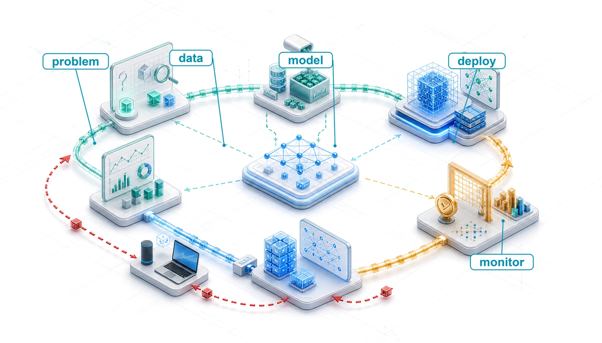

# ML Workflow {#sec-ml-workflow}

::: {layout-narrow}
::: {.column-margin}

\chapterminitoc

:::

::: {.content-visible when-format="pdf"}
\noindent
{fig-alt="Isometric blueprint of an ML workflow loop connecting definition, data, training, deployment, monitoring, and feedback around a central model workbench."}
:::

::: {.content-visible unless-format="pdf"}
{fig-alt="Isometric blueprint of an ML workflow loop connecting definition, data, training, deployment, monitoring, and feedback around a central model workbench."}
:::

:::

## Purpose {.unnumbered .unlisted}

\begin{marginfigure}
\mlsysstack{15}{15}{20}{30}{30}{45}{25}{25}
\end{marginfigure}

_Why is seeing the whole map necessary before walking any single path?_

The D·A·M taxonomy names the components of every ML system, and deployment location determines the physical constraints each component must satisfy. Teams often treat these as separate concerns, with one team collecting data, another designing the model, and a third provisioning hardware. Yet the taxonomy's deepest lesson is that these components interact. The collected data constrains which algorithms are feasible. The chosen algorithm dictates what hardware can run it. The target hardware reshapes what data can be processed. Pull on any single thread and the entire system shifts. These interactions play out across components and across time. A model that performs well at launch may degrade as the data distribution shifts, prompting investigation and, when evidence warrants it, model or data updates. Optimizing each piece in isolation is how teams build accurate models that cannot be deployed and efficient pipelines that feed the wrong data. When each team optimizes its own local metric, no one owns the outcome of the whole system. The cost of such a mismatch grows with how late it is found. A memory limit discovered at design time changes a line in a plan; the same limit discovered at launch can discard months of training runs, labeling budget, and integration work. A data engineer who sees how preprocessing choices constrain downstream architectures builds different pipelines than one who treats data preparation as an isolated task; a model developer who knows the deployment target's memory budget from day one makes different architecture decisions than one chasing accuracy in a vacuum. Before the details of any one component can be understood, the full map must show how an ML system is built, evaluated, and sustained as a coherent whole. The ML workflow sets that map in motion through iterative D·A·M co-design across data, algorithm, and machine until their emergent capability meets the requirements of the real world.

::: {.content-visible when-format="pdf"}

\newpage

:::

::: {.callout-learning-objectives}

- Explain the six ML lifecycle stages as coordinated data-algorithm-machine decisions with feedback
- Compare ML workflows with traditional software using drift, nondeterminism, and operational feedback
- Analyze how problem-definition constraints propagate through data, modeling, validation, and deployment
- Calculate late-discovery integration costs using the workflow's constraint propagation principle
- Evaluate accuracy, efficiency, reproducibility, and deployment readiness trade-offs across lifecycle stages
- Design feedback loops that connect monitoring signals to retraining, maintenance, and revised requirements

:::

## ML Lifecycle {#sec-ml-workflow-understanding-ml-lifecycle-ca87}

A typical deployment failure illustrates the danger of uncoordinated engineering. Day one: "Build a diabetic retinopathy screening model for rural clinics." Day 90: 95 percent accuracy on the validation set used to guide development. Day 120: 96 percent accuracy after a month of architecture tuning. Day 150: the model is handed to deployment engineers. Day 151: deployment engineers report that the model needs 4 GB of memory to run. Day 152: someone checks the deployment target, a low-power edge device in each clinic whose 4--8 GB of memory is shared with the operating system, the camera pipeline, and the clinic software, leaving the model a budget of about 500 MB. Day 153: five months of work is discarded.

The model's accuracy was excellent. The team's machine learning skills were excellent. *The failure was a workflow failure.* A deployment constraint that should have shaped every decision from day one was discovered only after the work was done. That 500 MB budget should have propagated backward to the first architecture meeting, constraining which models were even worth considering. Instead, the team optimized each component in isolation (data collection, architecture selection, training), and the integration failure appeared only when the pieces were assembled. A documented diabetic retinopathy (DR) deployment exposed analogous workflow and infrastructure gaps.[^fn-beede-clinical-deployment]

[^fn-beede-clinical-deployment]: **Lab-to-deployment gap**\index{Workflow!lab-deployment gap}: @beede2020human documented this empirically for a deep-learning diabetic retinopathy screening system deployed in Thai clinics. Although the system had specialist-level accuracy in earlier validation, 393 of 1,838 submitted images (21 percent) failed its image-quality requirements, often because clinic lighting, camera maintenance, or dilation practices did not match the system's assumptions. Those rejections added work for nurses, forced retakes or referrals, and exposed workflow and infrastructure barriers rather than simply a model-accuracy problem.

The **ML workflow**\index{ML workflow!systematic framework} is an engineering framework designed to prevent integration failures by making constraints explicit at each development stage and tracing how deployment constraints propagate across Data, Algorithm, and Machine. It marks the shift from model researcher to systems engineer. A researcher optimizes individual elements: a better architecture, a cleaner dataset, a faster accelerator. A systems engineer orchestrates those elements into production systems that reliably deliver value. The day-153 failure did not stem from an isolated modeling, data, or hardware defect; it arose from the unmanaged interaction among all three. The workflow supplies the mental map that keeps technical decisions attached to the larger system.

::: {.column-margin .margin-pointer}
↩ The deployment paradigms whose memory, latency, and power constraints the workflow propagates are established in @sec-ml-systems-deployment-paradigm-framework-0d25.
:::

The **machine learning lifecycle**\index{Machine learning lifecycle} is the sequence of stages this work moves through, a structured, iterative process[^fn-crisp-dm-lifecycle] that guides the development, evaluation, and improvement of ML systems [@amershi2019]. The formal definition emphasizes continuous management rather than a one-time release.

[^fn-crisp-dm-lifecycle]: **CRISP-DM (cross-industry standard process for data mining)**\index{Cross-industry standard process for data mining!lifecycle influence}: CRISP-DM codified data-intensive system development as six interconnected, iterative phases rather than a linear waterfall [@chapman2000crisp]; its core design principle (feedback loops between all phases) directly informs the modern ML lifecycle's structure. Boehm's software-engineering economics work discussed the higher cost of late fixes [@boehm1981]. The workflow model later uses $2^{i-1}$, where $i$ is the lifecycle stage index (1 = problem definition), as an illustrative sensitivity scenario rather than an empirical cost law.

```{python}
#| echo: false
#| output: false
from mlsysim import *
from mlsysim.core.units import *

# ┌─────────────────────────────────────────────────────────────────────────────
# │ CHAPTER IMPORTS
# ├─────────────────────────────────────────────────────────────────────────────
# │ Context: Global imports for all compute cells in this chapter
# │
# │ Goal: Centralize import statements for the chapter.
# │ Show: A clean namespace for subsequent calculations.
# │ How: Import constants, formatting helpers, and pint units.
# │
# └─────────────────────────────────────────────────────────────────────────────
import pint
from mlsysim.fmt import fmt, check, MarkdownStr, fmt_math
from IPython.display import Markdown
```

::: {#dfn-ml-workflow-machine-learning-lifecycle .callout-definition title="Machine learning lifecycle"}

***Machine learning lifecycle***\index{Machine learning lifecycle!definition} is the iterative engineering process of building, deploying, monitoring, and updating ML systems, where evidence from later stages can feed back to earlier stages because model performance may change after deployment.

1.  **Significance**: The lifecycle is a closed loop, not a linear pipeline. Statistical drift between live production traffic and the original training data serves as an early alert signal that raises the probability of accuracy loss; the exact relationship depends on the model, labels, loss, and deployment distribution. A full retraining run consumes substantial accelerator compute time (scaling with total model operations and bounded by effective hardware throughput)\index{Duty cycle!ML lifecycle maintenance}, while acquiring fresh verified labels incurs latency and financial expense. Drift velocity and validation delay therefore turn lifecycle maintenance into an operational budgeting problem, not just an engineering process.
2.  **Distinction**: Unlike traditional software, whose behavior changes when code, configuration, dependencies, or environment changes, ML behavior can also change as the world changes. A deployed model's accuracy may change through distribution shift even when the code, infrastructure, and configuration remain untouched.
3.  **Common pitfall**: A frequent misconception is that the lifecycle ends at deployment. In reality, deployment is the beginning of the feedback loop: production monitoring surfaces drift, drift triggers investigation, and outcome evidence determines whether a retrained model should re-enter the deployment stage.

:::

Here, *lifecycle* describes the stages themselves and *workflow* describes the engineering discipline of orchestrating them; the lifecycle is *what gets traversed*, the workflow is *how the traversal is managed*. This distinction requires **systems thinking**\index{Systems thinking!principles in ML}: analyzing how a system's parts interrelate rather than treating them in isolation. The patterns formalized in @sec-ml-workflow-integrating-systems-thinking-principles-24c0 and illustrated through the detailed case study explain why ML systems require integrated engineering approaches rather than sequential component optimization.

Understanding how these stages interconnect is essential before analyzing individual layers, as each technical domain—from storage pipelines to model training, execution frameworks, and serving infrastructure—operates as an interdependent system. @Fig-ml-lifecycle partitions ML engineering into decoupled data and model pipelines operating in counter-flow: the upper six-stage tier refines continuous raw input streams into ML-ready datasets, while the lower four-stage tier trains and validates deployable models, with return vectors routing runtime telemetry and data corrections back to upstream stages.

::: {#fig-ml-lifecycle fig-env="figure" fig-pos="htb" fig-cap="**Dual-Pipeline ML Development**: Machine learning engineering decouples into parallel data and model pipelines operating on different timescales. While the model pipeline executes rapid inner-loop training and evaluation, outer-loop feedback from production deployment and data validation continuously reshapes upstream collection, labeling, and curation." fig-alt="Two parallel pipelines: a green data pipeline of six stages above a blue model pipeline of four stages. A deployment feedback arrow returns to data collection; curved arrows labeled Data fixes and Data needs loop back to earlier data stages."}

```{.tikz}
```

:::

The conceptual stages of the ML lifecycle establish the *what* and *why* of the development process. The operational layer is the machinery that implements the workflow at scale through automation, tooling, and infrastructure. @Sec-ml-operations names and develops those practices in detail.

### Quantifying the ML lifecycle {#sec-ml-workflow-quantifying-ml-lifecycle-bd69}

Practitioner time allocation exposes where the lifecycle actually bottlenecks: engineering effort rarely concentrates where research literature spends its pages. Conceptual models of the ML lifecycle\index{Machine learning lifecycle!time allocation across stages} describe which stages exist, but systems decisions turn on quantitative reality—where engineering hours are spent, how much compute is consumed, and which pipeline stalls delay deployment.

```{python}
#| echo: false
#| label: data-scientist-time-allocation
# ┌─────────────────────────────────────────────────────────────────────────────
# │ DATA SCIENTIST TIME ALLOCATION
# ├─────────────────────────────────────────────────────────────────────────────
# │ Context: Used in CrowdFlower survey prose and @fig-ds-time caption
# │
# │ Goal: Keep survey percentage summaries tied to the pie-slice values.
# │ Show: That cleaning plus collection dominate reported practitioner time.
# │ How: Sum the reported percentage buckets and guard that they cover 100%.
# │
# └─────────────────────────────────────────────────────────────────────────────
from mlsysim import Literature

# ┌── LEGO ───────────────────────────────────────────────
class DataScientistTime:
    """CrowdFlower survey percentage buckets used in the time-allocation figure."""

    # ┌── 1. LOAD (Constants) ──────────────────────────────────────────────
    cleaning_pct = Literature.Surveys.DataScientistCleaning
    collection_pct = Literature.Surveys.DataScientistCollecting
    mining_pct = Literature.Surveys.DataScientistMining
    training_set_pct = Literature.Surveys.DataScientistBuildingTrainingSets
    algorithm_refinement_pct = Literature.Surveys.DataScientistRefiningAlgorithms
    other_pct = Literature.Surveys.DataScientistOther

    # ┌── 2. EXECUTE (The Compute) ────────────────────────────────────────
    data_work_pct = cleaning_pct + collection_pct
    model_focused_pct = mining_pct + training_set_pct + algorithm_refinement_pct
    total_pct = data_work_pct + model_focused_pct + other_pct

    # ┌── 3. GUARD (Invariants) ───────────────────────────────────────────
    check(total_pct == 100, f"Survey buckets sum to {total_pct}%, not 100%.")
    check(data_work_pct > model_focused_pct, "Data work should dominate model-focused buckets.")

    # ┌── 4. OUTPUT (Formatting) ──────────────────────────────────────────
    cleaning_str = fmt_percent(cleaning_pct / 100, precision=0, commas=False, style='prose')
    collection_str = fmt_percent(collection_pct / 100, precision=0, commas=False, style='prose')
    data_work_str = fmt_percent(data_work_pct / 100, precision=0, commas=False, style='prose')
    model_focused_str = fmt_percent(model_focused_pct / 100, precision=0, commas=False, style='prose')
```

Practitioner surveys reveal a stark asymmetry between where research attention centers and where engineering hours are spent, with about `{python} DataScientistTime.data_work_str` of data scientists in CrowdFlower's 2016 survey naming data collection or cleaning as the activity that consumed most of their time. @Fig-ds-time charts the reported distribution of primary engineering time sinks, contrasting the dominant data cleaning (60 percent) and collection (19 percent) slices against the narrow share occupied by algorithm refinement (4 percent) and training set construction (3 percent).

::: {#fig-ds-time fig-env="figure" fig-pos="htb" fig-cap="**Data Scientist Most-Time Responses**: In CrowdFlower's 2016 survey, `{python} DataScientistTime.cleaning_str` of respondents selected cleaning and organizing data as the activity where they spent the most time, with `{python} DataScientistTime.collection_str` selecting data collection. Model-focused responses such as pattern mining, training set construction, and algorithm refinement together represent roughly `{python} DataScientistTime.model_focused_str` of responses. Source: CrowdFlower, *Data Science Report 2016*." fig-alt="Pie chart of where surveyed data scientists spend the most time: 60 percent cleaning and organizing data, 19 percent collecting datasets, 9 percent mining patterns, 3 percent building training sets, 4 percent refining algorithms, 5 percent other."}

```{.tikz}
\scalebox{0.75}{%
```

:::

These survey proportions demonstrate why data engineering cannot be treated as mere preparatory plumbing. Data pipelines are the primary source of operational friction, iteration cycles, and system-level risk. Mastering data infrastructure provides maximum leverage before addressing the model architectures and training optimizations that ingest its output.

::: {.column-margin .margin-pointer}
↪ The data infrastructure that this leverage depends on is developed in @sec-data-engineering.
:::

Beyond time allocation, iteration velocity\index{Machine learning lifecycle!iteration cycles} governs project progress. The backward return vectors in @fig-ml-lifecycle—routing data fixes from curation back to collection and online performance insights from production deployment back to ingestion—are not rare exceptions; they are paths teams traverse repeatedly. When data quality degrades through distribution shift or incorrect labels, rework sends teams back to collection. When an architecture exceeds accelerator memory or suffers numerical instability, engineers must revisit model design. When the serving layer exceeds latency budgets, the deployment pipeline stalls. Each loop consumes calendar time and compute budget, increasing development cost whenever downstream stages fail to catch violations early.

::: {.column-margin}
{width="100%" fig-alt="Two rising strokes: a lower-starting fast-cycle line climbs to meet a higher-starting slow-cycle line near the same ceiling."}

*Under the stated assumptions, both models end near the ceiling; the faster cycle tests about four times as many ideas.*
:::

```{python}
#| echo: false
#| label: iteration-tax-calc
# ┌─────────────────────────────────────────────────────────────────────────────
# │ ITERATION TAX CALCULATION
# ├─────────────────────────────────────────────────────────────────────────────
# │ Context: Used in "The Iteration Tax" callout comparing slow vs fast cycles
# │
# │ Goal: Illustrate one assumed accuracy trajectory for fast and slow cycles.
# │ Show: Both cycles end near the ceiling; the fast cycle tests ~4x as many ideas.
# │ How: Model accuracy growth as a function of iteration count over time.
# │
# └─────────────────────────────────────────────────────────────────────────────

# ┌── LEGO ───────────────────────────────────────────────
class IterationTax:
    """
    Namespace for Iteration Tax calculation.
    Scenario: Comparing a large, slow-to-train model vs a small, fast model
    over a fixed 6-month development window.
    """

    # ┌── 1. LOAD (Constants) ───────────────────────────────────────────────
    weeks_total = 26
    hours_per_week = 168

    # Large Model (Starts better, iterates slow)
    large_start_acc = 95.0
    large_gain_per_iter = 0.15  # Reduced from 0.5: SOTA gains are hard!
    large_cycle_time_hours = 168  # 1 week

    # Small Model (Starts worse, iterates fast)
    small_start_acc = 90.0
    small_gain_per_iter = 0.1
    small_cycle_time_hours = 1  # 1 hour
    small_effective_iters = 100  # scenario cap on useful experiments

    # ┌── 2. EXECUTE (The Compute) ─────────────────────────────────────────
    # Step 1: Large model: 1 iter/week -> 26 iters
    large_iters = weeks_total * (hours_per_week / large_cycle_time_hours)
    large_final_acc = min(large_start_acc + (large_iters * large_gain_per_iter), 99.0)

    # Small model: Potential thousands, but capped by human ability to generate ideas
    # Step 2: We allow small model to reach same ceiling
    small_uncapped_acc = small_start_acc + (small_effective_iters * small_gain_per_iter)
    small_final_acc = min(small_uncapped_acc, 99.0)
    # Step 3: What velocity actually buys: hypotheses tested
    ideas_ratio = small_effective_iters / large_iters

    # ┌── 3. GUARD (Invariants) ───────────────────────────────────────────
    # Invariant: Small model must CATCH UP or BEAT Large model
    check(large_iters == weeks_total, f"Large model should run one experiment per week, got {large_iters}.")
    check(small_effective_iters <= weeks_total * hours_per_week, "Effective small-model iterations exceed hourly capacity.")
    check(abs(small_final_acc - large_final_acc) < 0.5, f"Both models should end near the ceiling; got {small_final_acc}% vs {large_final_acc}%.")
    check(3.5 <= ideas_ratio <= 4.5, f"Fast-cycle team should test about four times as many ideas, got {ideas_ratio:.1f}x.")

    # ┌── 4. OUTPUT (Formatting) ──────────────────────────────────────────────
    weeks_str = fmt_time(weeks_total, "week", precision=0, commas=False, style="word")
    weeks_span_str = fmt_time(weeks_total, "week", precision=0, commas=False, style="word")
    hours_week_str = fmt_time(hours_per_week, "hour", precision=0, commas=False, per="week")
    large_iters_str = fmt(large_iters, precision=0, commas=False)

    large_time_weeks_str = fmt_time(large_cycle_time_hours * hour, week, precision=0, commas=False, style="word")
    large_acc_str = fmt_percent(large_start_acc / 100, precision=0, commas=False, style='prose')
    large_gain_str = fmt_pp(large_gain_per_iter, precision=2)
    large_final_str = fmt_percent(large_final_acc / 100, precision=1, commas=False, style='prose')

    small_time_hours_str = fmt_time(small_cycle_time_hours * hour, hour, precision=0, commas=False, style="word")
    small_acc_str = fmt_percent(small_start_acc / 100, precision=0, commas=False, style='prose')
    small_gain_str = fmt_pp(small_gain_per_iter, precision=1)
    small_iters_str = fmt(small_effective_iters, precision=0, commas=False)
    small_uncapped_str = fmt_percent(small_uncapped_acc / 100, precision=0, commas=False, style='prose')
    small_final_str = fmt_percent(small_final_acc / 100, precision=0, commas=False, style='prose')

    # Logic check helper for text
    small_total_capacity_str = fmt(weeks_total * hours_per_week, precision=0, commas=True)
    acc_ceiling_pct_str = fmt_percent(99 / 100, precision=0, commas=False, style='prose')
    ideas_ratio_mult_str = fmt_multiple(ideas_ratio, precision=1, commas=False)
```

::: {#nbk-ml-workflow-iteration-tax .callout-notebook title="The iteration tax"}

**Problem**: Compare what six months of development buys for a rural diabetic retinopathy screening system: a large ensemble (training time: `{python} IterationTax.large_time_weeks_str`, initial accuracy: `{python} IterationTax.large_acc_str`) or a lightweight edge model (training time: `{python} IterationTax.small_time_hours_str`, initial accuracy: `{python} IterationTax.small_acc_str`). How do the two compare in final accuracy and in the number of hypotheses the team can test?

**Math**: In six months (~`{python} IterationTax.weeks_span_str`), the possible experiment count is:

1. Large model: `{python} IterationTax.weeks_str` of calendar time at `{python} IterationTax.large_time_weeks_str` per experiment. Each experiment improves accuracy by an assumed constant ~`{python} IterationTax.large_gain_str`.
2. Small model: `{python} IterationTax.weeks_str` of calendar time at `{python} IterationTax.hours_week_str` gives `{python} IterationTax.small_total_capacity_str` possible experiments at `{python} IterationTax.small_time_hours_str` each. Machine time is not the binding constraint at that cycle length, so this scenario counts only `{python} IterationTax.small_iters_str` of them as effective experiments, the number a team can realistically design, run, and learn from in six months. The remaining capacity sits idle for want of hypotheses. Even with a smaller assumed gain per iteration, more useful iterations can produce a larger cumulative gain.

**Result**: If each iteration improves accuracy by `{python} IterationTax.small_gain_str` on average, the small model starts at `{python} IterationTax.small_acc_str` and reaches `{python} IterationTax.small_uncapped_str` after `{python} IterationTax.small_iters_str` effective iterations, before applying the `{python} IterationTax.acc_ceiling_pct_str` ceiling. With the `{python} IterationTax.acc_ceiling_pct_str` ceiling applied, the small model achieves `{python} IterationTax.small_final_str`. The large model starts at `{python} IterationTax.large_acc_str` and reaches `{python} IterationTax.large_final_str` after `{python} IterationTax.large_iters_str` slower iterations. Both approaches end near the ceiling, and the accuracy gap between them is an artifact of the assumed gains, not a finding. The difference that survives any reasonable choice of parameters is breadth: the fast-cycle team tested `{python} IterationTax.ideas_ratio_mult_str` as many ideas, so it also learned which augmentations and preprocessing choices matter, knowledge the slow-cycle team never acquired.

**Systems insight**: *Iteration velocity is a feature.* Its value lies in search breadth rather than in a guaranteed accuracy lead. When candidate systems have comparable attainable quality, shorter cycles expand how much of the design space a team can test. Speed alone cannot guarantee that a smaller model will outperform a larger one. In the DR screening scenario, the lightweight model's rapid iteration cycle enables the team to experiment with label-preserving input transformations, preprocessing pipelines, and architecture variations far more quickly.

:::

This cumulative delay defines the **iteration tax**\index{Iteration tax!definition}: time spent waiting on slow training runs or cumbersome validation pipelines reduces how many candidate models a team can test. Late discoveries compound this penalty,[^fn-boehm-cost-curve] as formalized by the constraint propagation principle (@sec-ml-workflow-decisions-cascade-system-98f4). Violations discovered after deployment force expensive rollbacks across every preceding stage. This asymmetry demands explicit **stage interface contracts**\index{Stage interface specification!contracts}: validating outputs at every stage boundary intercepts defects before they compound into systemic rework. @Sec-ml-workflow-stage-interface-specification-ae3c formalizes these contracts across the six stages.

[^fn-boehm-cost-curve]: **Late correction costs**\index{Late correction cost!definition}: Boehm's *Software Engineering Economics* [@boehm1981] discussed how defects found late can cost more to fix than those caught during requirements. In ML systems, late-discovered constraints may require retraining, data-pipeline changes, and renewed validation. The doubling rule is an illustrative sensitivity scenario, not an empirical cost law.

The compounding cost of iteration delays and late discoveries reveals a broader structural reality: *ML workflows are not slow versions of traditional software lifecycles.* They differ fundamentally in where engineering effort concentrates, how feedback loops alter the system over time, and how late discoveries expand rework.

### ML vs. traditional software {#sec-ml-workflow-ml-vs-traditional-software-development-c5f5}

Traditional and ML systems both iterate.[^fn-waterfall-model-ml] The relevant distinction is how application behavior is specified. Rule-based software encodes explicit logic, while ML systems learn statistical mappings from data. This adds data, evaluation, and monitoring concerns to established software-engineering practices.

[^fn-waterfall-model-ml]: **Waterfall model**\index{Waterfall model!contrast with ML}: A plan-driven lifecycle is often depicted as a sequence of requirements, implementation, and testing, but @royce1970managing warned that a purely sequential implementation was risky and described iteration between successive phases. ML systems add data and model feedback that must be managed explicitly. This chapter uses an illustrative sensitivity model for ML lifecycle stages.

::: {.column-margin .margin-pointer}
↩ Data-defined behavior, and the silent degradation it makes possible, are established in @sec-introduction-ml-vs-traditional-software-e19a.
:::

Machine learning systems therefore require additional workflow controls. Consider fraud detection. A rule such as "decline if the amount exceeds \$5,000 abroad" encodes a decision that can be inspected and tested against its specification. A learned fraud score\index{Fraud Detection!ML vs. rule-based} also depends on training and evaluation data whose labels may arrive weeks late. Both approaches need revalidation as fraud patterns shift, and both trade lost revenue against fraud losses when setting decision thresholds. Learning adds the need to track how changing data affects learned behavior. This shift from explicit programming to learned behavior reshapes the development lifecycle, altering how teams establish reliability and robustness.

These differences alter how lifecycle stages interact. While conventional software engineering relies on production feedback to refine code and requirements, ML systems introduce feedback loops where operational data reshapes training distributions, detected drift prompts investigation, and runtime errors expose dataset blind spots. @Tbl-sw-ml-cycles contrasts traditional software and ML engineering across six core lifecycle dimensions, highlighting how data evolution redefines testing, deployment, and ongoing maintenance.[^fn-data-versioning-drift]

[^fn-data-versioning-drift]: **Data versioning**\index{Data versioning!reproducibility}: Unlike code, which changes through discrete, auditable commits, data can drift gradually (distribution shift), suddenly (schema migration), or subtly (label quality degradation). Plain Git is impractical for many multi-terabyte datasets, so teams commonly version external-data manifests or pointers using tools such as DVC and Git LFS. Without data versioning, teams cannot reliably reproduce a prior training run or determine whether an accuracy regression stems from a code change or a data change.

| **Aspect**                 | **Traditional Software Lifecycles**                                                                 | **Machine Learning Lifecycles**                                                                             |
|:---------------------------|:----------------------------------------------------------------------------------------------------|:------------------------------------------------------------------------------------------------------------|
| **Problem Definition**     | Functional requirements guide implementation and evolve with evidence.                              | Data-dependent performance objectives also require empirical validation.                                    |
| **Development Process**    | Iterative code, configuration, and interface development.                                           | Iterative experimentation with data, features, and models.                                                  |
| **Testing and Validation** | Many functional tests have exact expected results; performance and reliability remain quantitative. | Statistical validation and metrics that involve uncertainty.                                                |
| **Deployment**             | Fixed logic can encounter changed inputs or external state.                                         | Performance may change over time due to shifts in data distributions.                                       |
| **Maintenance**            | Maintenance involves modifying code to address bugs or add features.                                | Continuous monitoring, updating data pipelines, retraining models, and adapting to new data distributions.  |
| **Feedback Loops**         | Production feedback commonly changes code, configuration, and requirements.                         | Insights from deployment and monitoring often refine earlier stages like data preparation and model design. |

: **Traditional Software vs. ML Development Lifecycles**: Six dimensions where ML development diverges from traditional software engineering. Both use production feedback, while ML systems add loops in which deployment insights reshape data collection, monitoring drives model updates, and production experience informs model design. {#tbl-sw-ml-cycles tbl-colwidths="[15,40,45]"}

::: {#chk-ml-workflow-ml-vs-traditional-devops .callout-checkpoint title="ML vs. traditional software"}

ML systems are not traditional software with a model attached. Check the differences that force a separate workflow:

- [ ] Failure modes: Can you distinguish silent degradation from explicit failures, recognizing that either can occur in ML and conventional systems?
- [ ] Logic source: Can you explain why changing training data can change model behavior even when the code remains fixed?
- [ ] Iteration: Can you explain why ML requires monitoring and, when evidence warrants it, model or data updates?

:::

### Data locality at scale {#sec-ml-workflow-erosion-determinism}

The data contract must reconcile the statistical order of training examples with the physical cost of delivering them. Training often shuffles examples across epochs (full passes over the training set) to reduce dependence on their stored order; shuffling alone does not guarantee independent and identically distributed (i.i.d.) samples. Randomized access can stress the locality optimizations used by modern operating systems: OS kernels rely on spatial and temporal locality,[^fn-locality-violation-cost] the tendency for a program that reads byte $X$ to read nearby bytes soon and to reuse recently accessed memory.

[^fn-locality-violation-cost]: **Locality of reference**\index{Locality of reference!ML workload violation}: @denning1968 formalized the working-set principle for virtual memory. Randomly ordered examples can reduce locality when the logical order maps to scattered physical reads, but the effect depends on storage layout, batching, caching, and prefetching.

When randomized sample order maps to scattered physical reads, shuffling can reduce the effectiveness of file-system buffers and virtual-memory prefetchers. The penalty depends on how logical examples map to physical storage. Contiguous reads from shuffled shards may retain useful locality, whereas small reads across many shards expose storage and network latency. Layout-aware batching, caching, and explicit prefetching can restore locality and reduce these stalls. The relevant systems variable is the physical access pattern presented to the memory hierarchy, not randomization alone.

That distinction determines where to optimize. If the loader already issues large sequential reads, more caching adds little benefit. If it fans out small reads across many shards, repacking records or increasing read granularity matters far more than adding compute. The workflow must therefore record both the required sample order and the rate at which the loader can deliver examples to the accelerator. Data Engineering develops the storage mechanisms; the responsibility here is to test delivery against the model's consumption rate before treating the data handoff as complete.

::: {.column-margin .margin-pointer}
↩ I/O stalls and storage throughput bottlenecks limit pipelined training progress under the bottleneck principle established in @sec-ml-systems-bottleneck-principle-3514.
:::

Resolving storage access stalls protects the computational core of an ML system, but physical hardware efficiency represents only one dimension of project success. Without structured coordination across problem formulation, training, and operational monitoring, localized optimizations fail to produce reliable production outcomes. Organizing these interlocking activities requires a formal lifecycle framework.

## Lifecycle Stages {#sec-ml-workflow-six-core-lifecycle-stages-00b0}

The rural-clinic failure shows why ML projects need an explicit six-stage framework: deployment constraints surfaced only after data, model, and evaluation decisions had hardened around the wrong target. Conventional and ML lifecycles both use iteration, while ML systems add feedback from deployment into data, training, and evaluation. The six-stage framework captures this loop.

These six stages describe project responsibilities. Problem definition sets the requirements for the finer-grained data and model pipelines introduced earlier; collection and preparation belong to the data responsibility, while development, evaluation, deployment, and monitoring govern how their artifacts are used. The project view groups these responsibilities into two functional tiers. @Fig-lifecycle-overview stages these interactions across a closed loop: the top row advances from problem definition through evaluation and validation, while the bottom row routes deployment outputs through monitoring and maintenance, returning feedback directly to upstream data collection.

::: {#fig-lifecycle-overview fig-env="figure" fig-pos="htb" fig-cap="**Simplified Lifecycle with Feedback**: The six core stages of ML engineering form a closed loop rather than a linear handoff. A primary feedback path from monitoring back to data collection supports investigation and adaptation as production distributions shift, model accuracy degrades, and operational constraints evolve." fig-alt="Six-stage flowchart across two rows: problem definition, data collection, model development, and evaluation run left to right along the top row; deployment and integration sits at the right of the bottom row with an arrow running left to monitoring and maintenance. Feedback loop arrow curves from monitoring back to data collection."}

```{.tikz}

```

:::

```{python}
#| echo: false
#| label: mobilenet-specs
# ┌─────────────────────────────────────────────────────────────────────────────
# │ MOBILENETV2 SPECIFICATIONS
# ├─────────────────────────────────────────────────────────────────────────────
# │ Context: Used in paragraph describing MobileNetV2 as a Lighthouse Model
# │
# │ Goal: Illustrate concrete workflow constraints for mobile deployment.
# │ Show: That problem definition establishes quantitative limits on model scale.
# │ How: Retrieve MobileNetV2 parameters and FLOPs from mlsysim.core.units.
# │
# └─────────────────────────────────────────────────────────────────────────────

from mlsysim.fmt import fmt, check, fmt_flops, fmt_memory
from mlsysim.core.units import MB, MFLOPs, byte, param

class MobilenetSpecs:
    """MobileNetV2 model size and FLOPs from canonical constants."""

    # ┌── 1. LOAD (Constants) ──────────────────────────────────────────────
    # MobileNetV2: 3.5M params, 600M FLOPs (300M multiply-adds)
    # Assuming FP32 weights for size estimate

    # ┌── 2. EXECUTE (The Compute) ────────────────────────────────────────
    mobilenet_size_q = Models.Vision.MobileNetV2.parameters * BYTES_FP32
    mobilenet_flops_q = Models.Vision.MobileNetV2.inference_flops

    # ┌── 3. GUARD (Invariants) ───────────────────────────────────────────
    check(13 * MB <= mobilenet_size_q <= 15 * MB, f"Unexpected MobileNetV2 size: {mobilenet_size_q.to(MB).magnitude:.1f} MB.")
    check(550 * MFLOPs <= mobilenet_flops_q <= 650 * MFLOPs, f"Unexpected MobileNetV2 FLOPs: {mobilenet_flops_q.to(MFLOPs).magnitude:.1f} MFLOPs.")

    # ┌── 4. OUTPUT (Formatting) ─────────────────────────────────────────────
    mobilenet_size_mb_str = fmt_memory(mobilenet_size_q, unit=MB, commas=False)
    mobilenet_mflop_str = fmt_flops(mobilenet_flops_q, unit=MFLOPs, precision=0, commas=False)
```

MobileNetV2\index{MobileNetV2!workflow constraints} grounds these stages in physical constraints, where a small footprint makes edge deployment limits visible from the outset. For MobileNetV2, problem definition establishes tight constraints: about `{python} MobilenetSpecs.mobilenet_size_mb_str` model size, about `{python} MobilenetSpecs.mobilenet_mflop_str`, and real-time inference on mobile-class hardware. Those constraints shape the rest of the workflow immediately. Data collection must account for on-device preprocessing limitations, and model development must choose an architecture whose operations fit the budget. MobileNetV2 achieves this through depthwise separable convolutions,[^fn-depthwise-mobile-workflow] factorizing spatial and channel operations rather than simply pruning parameters. Evaluation validates both accuracy and latency on target devices, deployment tests whether the model fits the device's memory and power envelope, and monitoring tracks performance across diverse device populations. Each stage's decisions propagate through subsequent stages, and the workflow framework makes these dependencies explicit. A DR screening model optimized for rural clinic deployment faces analogous pressures of limited device memory and strict power budgets.

[^fn-depthwise-mobile-workflow]: **Depthwise separable convolutions**\index{Depthwise separable convolution!mobile deployment}: Replacing a standard convolution with this cheaper factorization reduces computation by roughly 8--9$\times$ for typical kernel sizes [@sandler2018], which is what makes the roughly `{python} MobilenetSpecs.mobilenet_mflop_str` inference budget plausible on mobile-class hardware.

Tracing MobileNetV2 through these transitions demonstrates that while a workflow diagram suggests sequential progression, production engineering is fundamentally cyclic, coupling downstream deployment constraints directly to upstream design.

::: {#chk-ml-workflow-workflow-cycle .callout-checkpoint title="The workflow cycle"}

Verify that each stage enforces contracts that bind upstream choices to physical deployment constraints.

- [ ] **Problem definition**: Can you identify which stage records latency, memory, and accuracy targets, and explain why later stages need those targets?
- [ ] **Data preparation**: Can you identify which downstream artifacts must use the same image-resolution and preprocessing choices as the training data?
- [ ] **Model development**: Can you explain why model development needs a deployment memory budget before committing to a candidate?
- [ ] **Deployment feedback**: Can you explain why an input-shift alert triggers investigation, and why outcome evidence is needed before deciding whether to retrain?

:::

Beyond procedural orchestration, each lifecycle stage acts on terms of the iron law of ML systems\index{Iron law of ML systems!workflow mapping}, and because the binding constraint differs across workload archetypes, each stage optimizes different terms for different workloads. ResNet-50\index{ResNet-50!workflow constraints}, DLRM\index{Deep Learning Recommendation Model!workflow constraints}, and keyword spotting (KWS)\index{Keyword spotting!energy constraint} are useful anchors because each stresses a different part of the system: dense vision training tries to keep accelerators busy, sparse recommendation spends much of its time moving embedding rows, and keyword spotting is constrained first by tiny memory and always-on energy budgets.

::: {.column-margin .margin-pointer}
↩ The iron law of ML systems and its governing terms are established in @sec-introduction-iron-law-ml-systems-c32a.
:::

Production systems rarely fall neatly into a single archetype. A medical imaging classifier, for instance, requires sustained computation while training over large image datasets, yet faces strict energy and memory limits when deployed to portable clinic hardware. Understanding how the workflow framework adapts across these trade-offs is essential for sound engineering decisions. @Tbl-lighthouse-workflow-comparison shows how three selected workflow stages manifest for these recurring workload archetypes.

| **Stage**    | **ResNet-50 vision training**                                                                             | **DLRM recommendation**                                                                                               | **KWS TinyML**                                                                          |
|:-------------|:----------------------------------------------------------------------------------------------------------|:----------------------------------------------------------------------------------------------------------------------|:----------------------------------------------------------------------------------------|
| **Data Eng** | Keep image batches available fast enough to sustain high GPU utilization.                                 | Keep online feature-store lookups within the serving latency budget; embedding tables dominate storage and freshness. | Curate short audio clips for an SRAM-constrained device.                                |
| **Training** | Coordinate preprocessing, batching, mixed precision, and model execution to reduce accelerator idle time. | Optimize sparse embedding lookups because memory bandwidth limits throughput.                                         | Search for the smallest model family that still recognizes the trigger phrase reliably. |
| **Deploy**   | Use large batches when throughput and cost matter more than single-request latency.                       | Meet strict interactive p99 latency targets while keeping features fresh.                                             | Stay within a strict always-on energy budget.                                           |

: **Workflow Variations by Lighthouse Model**: Three selected lifecycle stages target different iron law terms depending on the workload's binding constraint. ResNet-50 emphasizes useful computation per unit time, DLRM emphasizes data movement and embedding freshness, and KWS emphasizes energy and memory capacity. {#tbl-lighthouse-workflow-comparison tbl-colwidths="[9,30,31,30]"}

Each stage of this workflow presents distinct systems challenges, from curating multi-terabyte datasets to sustaining tail latency in production. Grounding these challenges requires a quantitative lens on how stages govern execution.

::: {#psp-ml-workflow-iron-law-workflow .callout-perspective title="The iron law of workflow"}

The six lifecycle stages alter distinct terms in the iron law of ML systems $(T = \frac{\DataVolume}{\Bandwidth} + \frac{O}{\PeakRate \cdot \EfficiencyHw} + \Latency)$. Rather than rigid one-to-one assignments, the mappings serve as diagnostic starting points:

-   Problem definition: Sets target constraints for accuracy, latency, cost, privacy, and deployment paradigm (screened across privacy, latency, compute, and cost gates using the decision framework in @fig-mlsys-playbook-flowchart). These targets determine which terms of the equation are permitted to grow and which must be bounded from the outset.
-   Data collection and preparation: Shapes dataset composition and the byte volume $(\DataVolume)$ presented to downstream pipelines. Curation can also change the training work required to reach a quality target.
-   Model development and training: Dictates the operation count $(O)$, data reuse patterns, parameter movement, and achievable hardware efficiency $(\EfficiencyHw)$.
-   Evaluation and validation: Tests whether model quality and end-to-end execution meet deployment requirements on the target system.
-   Deployment and integration: Determines the serving path, including runtime data movement, execution efficiency, and fixed overhead $(\Latency)$.
-   Monitoring and maintenance: Observes distribution drift, latency, throughput, and operational cost after launch, feeding violations back into earlier stages for re-optimization.

Viewing the lifecycle through the iron law grounds latency and cost in hardware physics. Production workflows must simultaneously satisfy accuracy, safety, privacy, and organizational constraints that sit outside the equation.

:::

### Case study: DR screening {#sec-ml-workflow-case-study-diabetic-retinopathy-screening-7d71}

Diabetic retinopathy (DR) screening\index{Diabetic retinopathy!case study introduction} serves as the running case study throughout this chapter because it passes three critical tests: it appears straightforward on the surface but reveals deep operational friction in practice, it exercises the full deployment spectrum from cloud training to edge inference, and its challenges are thoroughly documented across real-world deployments. The literature spans both sides of the lab-to-field divide: @gulshan2016 document the benchmark validation study for automated DR detection, while @beede2020human document the workflow and infrastructure failures that emerged when a deep-learning system was deployed in Thai clinics. Together, these sources provide an empirical baseline tracking data collection and validation through to physical deployment constraints. The scenario used in this chapter is our own composite, fixed once here so every stage can refer back to it: a network of rural clinics, each running inference on an Orin Nano-class edge device with 4 to 8 GB of shared memory and an intermittent uplink, a target of more than 90 percent sensitivity, and a latency budget of under 50 ms for model inference within 100 ms end to end.

Sensitivity measures the fraction of cases with the target disease that the system correctly flags. Its denominator includes disease cases, not all screened patients, so high overall accuracy does not establish that the sensitivity target is met. The scenario's threshold is a design assumption for tracing the workflow; evidence for a particular clinical use must establish its adequacy.

Diabetic retinopathy is a leading cause of preventable blindness.[^fn-dr-scale-screening] Limited specialist access in low-resource regions motivates automated screening programs, but detecting the disease requires identifying subtle pathological features. @Fig-eye-dr contrasts a normal retina (Panel A) against one exhibiting diabetic retinopathy (Panel B), where detecting localized microvascular lesions (such as the indicated hemorrhage) requires preserving fine spatial resolution throughout the vision pipeline and enforcing strict capture-quality validation.

[^fn-dr-scale-screening]: **Diabetic retinopathy (DR)**\index{Diabetic retinopathy!deployment scale}: DR is a common complication of diabetes; early detection can prevent vision loss, but specialist access varies substantially across countries. This gap motivates scalable screening programs. In clinics with limited hardware or unreliable connectivity, model size, offline capability, latency, and workflow integration can become binding deployment constraints.

::: {#fig-eye-dr fig-env="figure" fig-pos="htb" fig-cap="**Retinal Hemorrhages in DR Screening**: Side-by-side fundus images illustrate the subtle visual features an ML screening system must detect. Identifying localized microvascular lesions (such as the indicated hemorrhage) requires preserving fine spatial resolution through the vision pipeline and establishing strict input-quality validation to handle lighting and camera variations in clinical field deployments. Source: Google." fig-alt="Two side-by-side retinal fundus images labeled A. HEALTHY and B. DISEASED. An arrow labeled Hemorrhages points to a small lesion in the diseased retina."}

{width="90%"}

:::

Initial research achieved expert-level performance in controlled settings. However, translating laboratory models into clinical deployment exposed severe operational friction: sensor lighting variations, intermittent network connectivity in rural clinics, regulatory compliance, and clinic workflow integration.[^fn-healthcare-deployment-gap] Alongside sensitivity, the case uses specificity, the fraction of cases without the target disease that the system correctly leaves unflagged. AUC is the area under the receiver operating characteristic (ROC) curve. The same constraint propagation dynamics apply whether deploying medical diagnostics to rural health posts or computer vision to commodity smartphones: hardware limits, operator variance, and data quality govern real-world viability far more than benchmark AUC.

[^fn-healthcare-deployment-gap]: **Healthcare AI deployment gap**\index{Healthcare AI!deployment gap}: In the Thai DR deployment studied by @beede2020human, real clinics exposed workflow, image-quality, infrastructure, and human-factors constraints that were absent from controlled evaluation. The case shows why laboratory metrics alone do not establish deployment readiness.

### Stage interface specification {#sec-ml-workflow-stage-interface-specification-ae3c}

Each lifecycle stage operates as a distinct engineering phase with defined inputs, outputs, and quality invariants. In production workflow engines, these contracts are formalized across a workflow directed acyclic graph (DAG), where nodes represent discrete execution tasks and directed edges represent validated artifact dependencies. While the overarching ML lifecycle forms a cyclic feedback loop over weeks and months, each automated pipeline run executes as an acyclic graph of dependent steps, enabling orchestrators to parallelize independent branches, cache validated intermediate outputs, and halt execution before broken contracts propagate downstream. Just as microservices rely on interface specifications to establish integration boundaries, ML pipeline stages require schema and distribution contracts to detect incompatibilities before invalid data or degraded weights propagate downstream. @Tbl-stage-interface formalizes these contracts, defining the input requirements, deliverables, and quality invariants required across all six lifecycle stages.

| **Stage**                         | **Input Contract**                                                                  | **Output Contract**                                                                 | **Quality Invariant**                                                                                 |
|:----------------------------------|:------------------------------------------------------------------------------------|:------------------------------------------------------------------------------------|:------------------------------------------------------------------------------------------------------|
| **Problem Definition**            | Business requirements; operational context                                          | Measurable objectives; deployment paradigm selection; resource constraints          | All success criteria are quantifiable; target deployment paradigm is explicit                         |
| **Data Collection & Preparation** | Objectives; deployment target; quality requirements                                 | Versioned dataset with schema; preprocessing pipeline; data validation rules        | Distribution approximates anticipated production environment; labeling meets accuracy requirements    |
| **Model Development & Training**  | Dataset; accuracy targets;  resource constraints                                    | Trained model weights;  training configuration; experiment logs                     | Meets accuracy thresholds within computational budget; architecture compatible with deployment target |
| **Evaluation & Validation**       | Trained model; held-out test data; evaluation criteria                              | Performance metrics across subgroups; failure mode analysis; validation certificate | No critical subgroup falls below minimum thresholds; confidence calibration meets domain requirements |
| **Deployment & Integration**      | Validated model; infrastructure requirements; service-level agreement (SLA) targets | Serving endpoint; monitoring  instrumentation; rollback procedures                  | Latency and throughput meet  paradigm requirements; integration tests pass                            |
| **Monitoring & Maintenance**      | Live system; performance baselines; alert threshold                                 | Drift detection alerts; update-review criteria; incident reports                    | Alert coverage and detection windows are defined; detected degradation triggers review                |

: **Stage Interface Specification**: Each lifecycle stage has explicit input requirements, output deliverables, and quality invariants that must hold for the stage to be considered complete. Violations of these contracts create technical debt that compounds through subsequent stages. The deployment paradigm selection in Problem Definition (Cloud, Edge, Mobile, or TinyML) constrains all downstream stages, as a TinyML target imposes different data, model, and monitoring requirements than a Cloud target. {#tbl-stage-interface tbl-colwidths="[14,24,27,35]"}

These interface contracts explain why ML projects require the recursive feedback loop diagrammed in @fig-lifecycle-overview: when downstream validation or monitoring detects that an upstream invariant was violated (such as training data diverging from live serving inputs), engineering effort must cycle back to data collection to correct the distribution rather than pushing flawed weights into production. Teams that validate contracts at each stage transition catch violations early, when correction costs are lowest. Validating stage contracts before advancing prevents defects from compounding into late-stage redesigns, as illustrated in the transition audit below.

```{python}
#| echo: false
#| label: constraint-propagation
# ┌─────────────────────────────────────────────────────────────────────────────
# │ CONSTRAINT PROPAGATION PRINCIPLE
# ├─────────────────────────────────────────────────────────────────────────────
# │ Context: Used in "Auditing Stage Transitions" callout, Fallacies section,
# │          and Summary section for an illustrative late-discovery sensitivity model
# │
# │ Goal: Illustrate one assumed doubling rule for late constraint discovery.
# │ Show: How the assigned multiplier changes across lifecycle stages.
# │ How: Model a simple doubling rule across the six stages of the ML lifecycle.
# │
# └─────────────────────────────────────────────────────────────────────────────

from mlsysim.physics import calc_constraint_propagation_factor
from mlsysim.fmt import check, fmt_count_range, fmt_multiple, fmt_percent, fmt_time, fmt_time_range, fmt_memory

class ConstraintPropagation:
    """Illustrative doubling model for late constraint discovery across lifecycle stages."""

    # ┌── 1. LOAD (Constants) ──────────────────────────────────────────────
    ML_WORKFLOW_STAGE_PROBLEM_DEFINITION = 1  # ML workflow lifecycle stage index
    ML_WORKFLOW_STAGE_DEPLOYMENT = 5
    ML_WORKFLOW_STAGE_MONITORING = 6
    ML_WORKFLOW_CONSTRAINT_COST_BASE = 2
    stage_deployment = ML_WORKFLOW_STAGE_DEPLOYMENT
    stage_monitoring = ML_WORKFLOW_STAGE_MONITORING
    stage_definition = ML_WORKFLOW_STAGE_PROBLEM_DEFINITION
    avoided_cycles_min = 2
    avoided_cycles_max = 4
    weeks_per_cycle = 4
    sensitivity_target_pct = 90
    specificity_target_pct = 80
    stage5_latency_q = 100 * millisecond  # scenario assumption
    stage5_memory_q = 500 * MB  # scenario assumption
    jetson_latency_q = 50 * millisecond  # scenario assumption
    jetson_model_q = 200 * MB  # scenario assumption
    resnet_variant_q = 200 * MB  # scenario assumption

    # ┌── 2. EXECUTE (The Compute) ────────────────────────────────────────
    cost_factor = calc_constraint_propagation_factor(stage_definition, stage_deployment, ML_WORKFLOW_CONSTRAINT_COST_BASE)
    monitoring_cost_factor = calc_constraint_propagation_factor(stage_definition, stage_monitoring, ML_WORKFLOW_CONSTRAINT_COST_BASE)
    rework_weeks_min = avoided_cycles_min * weeks_per_cycle
    rework_weeks_max = avoided_cycles_max * weeks_per_cycle

    # ┌── 3. GUARD (Invariants) ───────────────────────────────────────────
    check(cost_factor == 16, f"Stage 5 scenario should assign 16x, got {cost_factor}x.")
    check(monitoring_cost_factor == 32, f"Stage 6 scenario should assign 32x, got {monitoring_cost_factor}x.")
    check(rework_weeks_min == 8 and rework_weeks_max == 16, "Scenario should assign an 8--16 week rework range.")

    # ┌── 4. OUTPUT (Formatting) ─────────────────────────────────────────────
    cost_factor_mult_str = fmt_multiple(cost_factor, precision=0, commas=False)
    rework_cycles_str = fmt_count_range(
        avoided_cycles_min,
        avoided_cycles_max,
        precision=0,
        commas=False,
    )
    rework_weeks_str = fmt_time_range(
        rework_weeks_min,
        rework_weeks_max,
        "week",
        precision=0,
        commas=False,
        style="word",
    )
    sensitivity_target_pct_str = fmt_percent(sensitivity_target_pct / 100, precision=0, commas=False, style='prose')
    specificity_target_pct_str = fmt_percent(specificity_target_pct / 100, precision=0, commas=False, style='prose')
    stage5_latency_ms_str = fmt_time(stage5_latency_q, millisecond, precision=0, commas=False)
    stage5_memory_mb_str = fmt_memory(stage5_memory_q, unit=MB, precision=0, commas=False)
    jetson_latency_ms_str = fmt_time(jetson_latency_q, millisecond, precision=0, commas=False)
    jetson_model_mb_str = fmt_memory(jetson_model_q, unit=MB, precision=0, commas=False)
    resnet_variant_mb_str = fmt_memory(resnet_variant_q, unit=MB, precision=0, commas=False)
```

::: {#exmp-ml-workflow-auditing-stage-transitions .callout-example title="Auditing stage transitions"}

**Scenario**: An engineering team claims to have completed Problem Definition for a medical imaging classifier, attempting to transition to Data Collection without establishing deployment target constraints.

**Diagnosis**: The output contract lacks deployment paradigm selection and resource constraints (latency and memory targets). Attempting to deploy late in the lifecycle exposes violations (e.g., edge device memory limit < `{python} ConstraintPropagation.jetson_model_mb_str`), incurring an estimated `{python} ConstraintPropagation.cost_factor_mult_str` rework multiplier under the chapter's illustrative sensitivity model compared to catching the constraint during Problem Definition.

**Systems lesson**: Stage transitions act as control-plane quality gates in the ML lifecycle. Enforcing strict output contract validation before proceeding downstream prevents expensive upstream rework and ensures data collection aligns with target deployment hardware.

:::

Without explicit contract gates, unstated assumptions propagate downstream. The earliest opportunity to bound them is Problem Definition, which records the operational constraints that subsequent stages must satisfy.

## Problem Definition {#sec-ml-workflow-problem-definition-stage-5974}

Problem definition\index{Problem definition!ML vs. traditional} in ML begins with sentences that look deceptively simple. A product manager writes: "Build a model that detects diabetic retinopathy." That single sentence conceals a dozen engineering decisions: sensitivity thresholds for patient safety, hardware capabilities in rural clinics, latency budgets that keep clinicians engaged, and regulatory frameworks governing approval. Software requirements still govern control flow, interfaces, and data storage. ML adds an empirical obligation: defining *what* the system should do is inseparable from defining *how* it will learn from data and what physical constraints its execution must survive.

The request for a model must first become a requirement for a useful improvement. In the clinic case, the baseline is the existing screening and referral workflow, evaluated on the outcomes and resource limits the proposed system must improve. A simpler rule or an existing model can provide an additional comparison where appropriate. If available data cannot support the required evaluation, or the expected benefit does not justify the added errors, cost, and maintenance, the team should revise the problem or retain the baseline rather than proceed automatically to training.

Balancing these demands requires reasoning across the full system stack. An engineering team cannot optimize accuracy in isolation: pursuing marginal sensitivity gains by scaling model depth or switching to vision transformers inflates parameter count and computational demands (FLOPs per inference), directly challenging the memory capacity and thermal limits of low-cost clinic hardware. Conversely, pruning a model to fit an embedded accelerator's DRAM budget risks dropping sensitivity below clinical safety thresholds. Every technical decision operates within a multi-constraint optimization problem\index{Problem definition!multi-constraint optimization} where statistical goals, physical execution budgets, and operational mandates continually bound each other's feasible design space.

### Constraint layers {#sec-ml-workflow-balancing-competing-constraints-b92a}

Every ML problem definition decomposes into three interacting **constraint layers**\index{Constraint layer!statistical physical operational}: statistical, physical, and operational. Rather than isolated requirements, these layers form a coupled stack where constraints in one tier immediately restrict the degrees of freedom in the others. The statistical layer specifies target behavior over data distributions—such as achieving $>90$ percent sensitivity and $>80$ percent specificity across diverse patient demographics and camera models, rather than an unweighted aggregate accuracy that conceals failure modes on minority subpopulations. The physical layer bounds execution within hardware limits: for rural clinics, inferencing on local edge accelerators under tight thermal budgets, bounded memory capacity (such as 4 to 8 GB of shared DRAM), and a 100 ms end-to-end latency budget to keep clinical workflows interactive without depending on intermittent network uplinks. The operational layer encompasses clinical auditability, regulatory clearance, and governance frameworks that dictate long-term system maintenance.

The operational layer carries physical consequences that traditional software engineering rarely encounters. In a traditional database, deleting a patient's record is a `DELETE` statement. In an ML system, model weights may encode statistical patterns learned from that record: where law or a regulator requires removing that influence, compliance may require machine unlearning (an active research area with incomplete guarantees) or retraining on the remaining data. The obligation and remedy depend on the governing rule and system; at DR-system scale, either can make privacy compliance a recurring compute-budget item and training provenance an architectural constraint.

The constraint propagation principle (@sec-ml-workflow-decisions-cascade-system-98f4) explains why all three layers must be bound before development begins: a constraint that exists in the physical or operational environment but remains unstated in the problem definition does not vanish—it re-emerges later as an architectural violation after dependent decisions have hardened. For example, if an engineering team defines the objective solely as aggregate classification accuracy on retinal images, standard optimization will minimize the average training loss, which the majority class dominates. In an imbalanced screening population where 90 percent of patients are healthy, a model predicting "no disease" achieves 90 percent aggregate accuracy while failing every patient who needs urgent care. Preventing this requires translating a domain invariant (a missed diagnosis costs far more than a false referral) into an explicit statistical contract: class-weighted loss, a sensitivity floor, and subgroup targets.

::: {#ws-ml-workflow-amazon-recruiting-bias .callout-war-story title="When the label was the bias (2018)"}

**Context**: In 2014, Amazon assembled an engineering team at its Edinburgh hub to build an internal machine-learning system for ranking technical job applicants, training it on ten years of resumes submitted to Amazon [@dastin2018].

**Mechanism**: Because prior hiring was male-dominated, the model learned that male-coded language correlated with hiring success, systematically penalizing terms like "women's" and downgrading graduates of all-women's colleges.

**Impact**: The model reproduced historical hiring bias, rendering automated resume screening unsuitable for production recruitment.

**Fix**: Amazon abandoned the experimental tool after attempts to remove explicit gender signals could not guarantee that it would not learn other discriminatory proxies.

**Systems lesson**: Problem definition must specify fairness, auditability, and rejection criteria before data collection and training. A workflow trained on biased labels does not learn the operational goal; it learns to reproduce the labels.

:::

### Problem definitions evolve {#sec-ml-workflow-adapting-definitions-scale-40ed}

A problem definition is not a static specification frozen at project inception; it evolves as deployment expands. When a DR screening program scales from a pilot clinic with a calibrated fundus camera to regional health centers with heterogeneous imaging hardware and differing patient demographics,[^fn-fairness-demographic-drift] the initial assumptions break. Sensor noise profiles diverge, optical resolutions shift, and demographic variations alter subgroup error rates. Adapting to this operational reality forces the problem definition to incorporate stratified accuracy targets and broader hardware compatibility matrices.

[^fn-fairness-demographic-drift]: **Demographic drift**\index{Demographic drift!definition}: Population changes can expose performance gaps that aggregate evaluation obscures. Facial-analysis benchmarks found large demographic error-rate disparities [@buolamwini2018gender], while a healthcare risk-scoring study found racially biased allocation from a proxy label despite similar need [@obermeyer2019]. These examples illustrate why a growing DR program should evaluate subgroup performance rather than claiming that such a rollout occurred. \index{Algorithmic fairness!healthcare ML}

This dynamic evolution stems directly from the statistical nature of ML. Scaling exposes long-tail inputs absent from pilot evaluations, while production environments shift the input distribution in ways no static offline dataset fully captures. A robust problem definition anticipates this drift by establishing governance protocols upfront: defining which monitoring signals trigger formal re-evaluation and bounding how threshold updates propagate through subsequent pipeline stages. Once these operational constraints and performance boundaries are defined on paper, the workflow must ground them in physical artifacts—beginning with the data collection pipelines that gather the training distribution.

## Data Collection {#sec-ml-workflow-data-collection-preparation-stage-ae99}

Constraints defined on paper only take effect when grounded in actual data. Moving from problem definition to data collection\index{Data collection!iron law data term} connects abstract accuracy targets with operational reality: sensor noise, missing records, and network limits. This stage determines dataset size $(D)$ and, in iron-law terms, the byte volume $(\DataVolume)$ that storage systems, networks, and memory buses must move. The deployment constraints established during problem definition become technical data requirements: if the model must run on edge devices, the collection pipeline must produce inputs compatible with edge preprocessing; if it must achieve 90 percent sensitivity across diverse populations, the dataset must sample those subpopulations sufficiently to support model training.

Data collection and preparation is an ongoing engineering discipline rather than a one-time task. For DR screening, the pipeline must ingest images statistically diverse enough to generalize across clinics, robust enough to handle varying capture conditions, and annotated with enough clinical rigor to withstand regulatory audits.

Problem definition decisions shape data requirements in the DR example. The multi-dimensional success criteria established (accuracy across diverse populations, hardware efficiency, and regulatory compliance) demand a data collection strategy that goes beyond typical computer vision datasets. Not all data contributes equally to learning, either—@sec-data-selection-case-smaller-datasets-215e shows how selection can retain comparable performance with less compute when a dataset contains redundancy, provided the selected subset preserves the evidence the task requires.

The DR system requires on the order of $10^5$ retinal fundus photographs, each reviewed by multiple expert ophthalmologists. Expert consensus addresses the inherent subjectivity in medical diagnosis (two ophthalmologists may disagree on borderline cases) while establishing ground truth labels that can withstand regulatory scrutiny. The annotation process must capture clinically relevant features like microaneurysms, hemorrhages, and hard exudates across the full spectrum of disease severity.

Raw high-resolution retinal scans can reach tens of megabytes per image before compression, creating substantial infrastructure challenges. A clinic processing dozens of patients per day can produce gigabytes to tens of gigabytes of imaging data per week. This data volume can occupy much of a limited uplink during clinic hours, making local processing one option alongside compression, batching, scheduling, or increased link capacity.

::: {.column-margin}
{width="100%" fig-alt="Vertical ladder of three bars on a log scale: a top bar labeled approximately 5000 times for the reduction ratio, a middle bar for raw retinal-image uploads, and a short bottom bar for compact edge detection summaries sent over the network."}

*Edge summaries beat raw medical-image uploads when bandwidth dominates.*
:::

```{python}
#| echo: false
#| label: bandwidth-vs-compute-calc
# ┌─────────────────────────────────────────────────────────────────────────────
# │ BANDWIDTH VS COMPUTE CALCULATION
# ├─────────────────────────────────────────────────────────────────────────────
# │ Context: Used in "Bandwidth vs. Compute" callout comparing cloud vs edge
# │
# │ Goal: Compare raw-upload link occupancy with summary uploads.
# │ Show: That raw uploads slightly exceed an assumed eight-hour same-shift window.
# │ How: Calculate total upload duration vs. available clinic hours.
# │
# └─────────────────────────────────────────────────────────────────────────────
from mlsysim import ReferenceStats
from mlsysim.fmt import check, fmt, fmt_bandwidth, fmt_multiple, fmt_percent, fmt_rate, fmt_time, fmt_memory
from mlsysim.core.units import MB, GB, KB, hour, megabit, second

# ┌── LEGO ───────────────────────────────────────────────
class BandwidthCompute:
    """
    Namespace for Bandwidth vs Compute calculation.
    Scenario: Rural clinic with 2 Mbps uplink trying to upload raw retinal scans.
    """

    # ┌── 1. LOAD (Constants) ───────────────────────────────────────────────
    patients_day = 150  # Increased from 100 to ensure bandwidth saturation
    photos_per_patient = 10
    mb_per_photo_q = ReferenceStats.ClinicalImaging.RetinalPhotoSize
    clinic_hours_q = 8.0 * hour  # scenario assumption
    uplink_q = 2.0 * (megabit / second)  # scenario assumption
    summary_per_patient_q = 10.0 * KB  # scenario assumption

    # ┌── 2. EXECUTE (The Compute) ─────────────────────────────────────────
    # Step 1: Data Volume
    daily_q = patients_day * photos_per_patient * mb_per_photo_q

    # Step 2: Transmission Time
    uplink_mbs_q = uplink_q.to(MB / second)
    upload_time_q = (daily_q / uplink_mbs_q).to(second)

    # Step 3: Saturation
    saturation_ratio = (upload_time_q / clinic_hours_q).to("").magnitude

    # Step 4: Edge Reduction
    summary_total_q = patients_day * summary_per_patient_q
    reduction_factor = (daily_q / summary_total_q).to("").magnitude

    # ┌── 3. GUARD (Invariants) ───────────────────────────────────────────
    check(
        upload_time_q >= clinic_hours_q,
        f"Upload no longer exceeds the assumed same-shift window ({upload_time_q.to(hour).magnitude:.1f} h < {clinic_hours_q.to(hour).magnitude:.1f} h).",
    )
    check(round(daily_q.to(MB).magnitude) == 7500, f"Daily image volume changed unexpectedly: {daily_q.to(MB).magnitude:.1f} MB.")
    check(reduction_factor >= 1000, "Scenario summary reduction fell below 1,000x.")

    # ┌── 4. OUTPUT (Formatting) ──────────────────────────────────────────────
    bw_patients_str = fmt_rate(patients_day, "patients/day", precision=0, commas=False)
    bw_photos_str = fmt_rate(photos_per_patient, "photos/patient", precision=0, commas=False)
    bw_mb_per_photo_str = fmt_memory(mb_per_photo_q, unit=MB, precision=0, commas=False, per='photo')
    bw_daily_mb_str = fmt_memory(daily_q, unit=MB, precision=0, commas=True)
    bw_daily_gb_str = fmt_memory(daily_q, unit=GB, precision=1, commas=False, per='day')
    bw_upload_mbit_per_s_str = fmt_bandwidth(uplink_q, unit=megabit / second, precision=0, commas=False)
    bw_upload_mb_per_s_str = fmt_bandwidth(uplink_mbs_q, unit=MB / second, precision=2, commas=False)
    bw_upload_sec_str = fmt_time(upload_time_q, second, precision=0, commas=True)
    # One decimal: the saturation ratio below divides the unrounded duration by
    # the clinic window, so a rounded "8 h" here would contradict the printed percentage.
    bw_upload_hours_str = fmt_time(upload_time_q, hour, precision=1, commas=False)
    bw_clinic_hours_str = fmt_time(clinic_hours_q, hour, precision=0, commas=False)
    bw_bandwidth_pct_str = fmt_percent(saturation_ratio, precision=1, commas=False, style='prose')
    bw_summary_kb_str = fmt_memory(summary_per_patient_q, unit=KB, precision=0, commas=False, per='patient')
    bw_reduction_mult_str = fmt_multiple(reduction_factor, precision=0, commas=True)
```

::: {#nbk-ml-workflow-bandwidth-vs-compute .callout-notebook title="Bandwidth vs. compute"}

**Problem**: Quantify the uplink window occupancy for raw image uploads from a rural clinic capturing retinal images for diabetic retinopathy screening, and evaluate architectural alternatives to relieve link contention.

**Math**:

1.  Daily data: At `{python} BandwidthCompute.bw_patients_str`, `{python} BandwidthCompute.bw_photos_str`, and `{python} BandwidthCompute.bw_mb_per_photo_str`, the clinic produces `{python} BandwidthCompute.bw_daily_gb_str`.
2.  Upload time: The uplink is `{python} BandwidthCompute.bw_upload_mbit_per_s_str`, or `{python} BandwidthCompute.bw_upload_mb_per_s_str`. Dividing `{python} BandwidthCompute.bw_daily_mb_str` by that rate gives `{python} BandwidthCompute.bw_upload_sec_str`, approximately `{python} BandwidthCompute.bw_upload_hours_str`.
3.  **Constraint**: If the clinic requires same-shift upload during its `{python} BandwidthCompute.bw_clinic_hours_str` operating window, this transfer alone occupies the link for `{python} BandwidthCompute.bw_bandwidth_pct_str` of that window and may contend with other traffic.

**Systems insight**: Local inference with uploaded detection summaries (`{python} BandwidthCompute.bw_summary_kb_str`) reduces bandwidth usage by `{python} BandwidthCompute.bw_reduction_mult_str`. Overnight batching, compression, scheduling, or a faster link are alternatives not compared by this calculation.

:::

### Lab-to-field data gap {#sec-ml-workflow-bridging-laboratory-realworld-data-e5b6}

Laboratory data and production data inhabit different worlds. This **lab-to-field gap**\index{Lab-to-field gap!data distribution shift} appears when DR screening deploys to rural clinics across Thailand and India: images arrive from diverse camera equipment operated by staff with varying expertise, often under suboptimal lighting with inconsistent patient positioning. A model trained on high-quality research images from standardized fundus cameras may fail on blurry, poorly-lit images from older equipment—not because the algorithm is wrong, but because the data distribution has shifted beyond the training envelope.

```{python}
#| echo: false
#| label: jetson-edge-tradeoff

# ┌─────────────────────────────────────────────────────────────────────────────
# │ JETSON EDGE TRADEOFF
# ├─────────────────────────────────────────────────────────────────────────────
# │ Context: Used in footnote [^fn-jetson-edge-tradeoff] on edge device trade-offs.
# │
# │ Goal: Pin Jetson Orin family power ranges and Orin Nano memory to the registry.
# │ Show: How edge deployment ties local compute, power, and memory constraints.
# │ How: Format registry-backed device specifications for prose.
# │
# └─────────────────────────────────────────────────────────────────────────────
from mlsysim import Hardware
from mlsysim.core.units import watt, GB
from mlsysim.fmt import fmt_memory, fmt_qty_range, fmt_memory_capacity

class JetsonSpecs:
    """Jetson Orin family TDP ranges + Orin Nano memory for the edge-tradeoff footnote."""

    # ┌── 4. OUTPUT (Formatting) ─────────────────────────────────────────────
    nano_power_str = fmt_qty_range(Hardware.Edge.JetsonOrinNano.tdp_min, Hardware.Edge.JetsonOrinNano.tdp_max, watt, precision=0, commas=False)
    nx_power_str = fmt_qty_range(Hardware.Edge.JetsonOrinNX.tdp_min, Hardware.Edge.JetsonOrinNX.tdp_max, watt, precision=0, commas=False)
    agx_power_str = fmt_qty_range(Hardware.Edge.JetsonAGXOrin.tdp_min, Hardware.Edge.JetsonAGXOrin.tdp_max, watt, precision=0, commas=False)
    nano_mem_str = fmt_memory_capacity(Hardware.Edge.JetsonOrinNano.memory.capacity, unit=GiB, precision=0, commas=False)
```

Because raw image uploads can exceed clinic uplink capacity, edge deployment offers an alternative; this is the data locality invariant (\ref{dfn-ml-systems-data-locality-invariant}) applied to a clinic uplink. Deploying edge accelerators such as the NVIDIA Jetson family[^fn-jetson-edge-tradeoff] allows clinics to preprocess and run inference locally. This reduces network transmission by orders of magnitude, but introduces a hardware trade-off: use a smaller model that fits a low-power edge budget, or provision more capable on-premise devices at higher cost.

[^fn-jetson-edge-tradeoff]: **NVIDIA Jetson**\index{NVIDIA Jetson!edge trade-off}: NVIDIA's Jetson family spans a wide SKU spectrum, from Jetson Orin Nano (`{python} JetsonSpecs.nano_power_str`) through Jetson Orin NX (`{python} JetsonSpecs.nx_power_str`) to Jetson AGX Orin (`{python} JetsonSpecs.agx_power_str`). This scenario uses an Orin Nano-class device (4--`{python} JetsonSpecs.nano_mem_str` shared LPDDR5, `{python} JetsonSpecs.nano_power_str` power envelope) as a concrete edge target. Its memory and power budgets constrain model complexity, while selecting a larger device changes both the feasible model and the per-clinic cost.

The bandwidth constraint makes infrastructure a data-collection decision rather than a late implementation detail. The scenario architecture combines edge devices for local inference and preprocessing, clinic aggregation servers for data management and buffering, and cloud training infrastructure for periodic model updates. It targets end-to-end latency under 100 milliseconds, of which model inference may take at most 50 ms, and operation without connectivity-induced delays.

Privacy constraints impose a similar architectural decision. Patient privacy regulations may motivate local retention or distributed training, but they generally specify protections and permitted uses rather than one required training topology. Workflows that keep raw clinic data local while sharing only approved updates or summaries add complexity to both data collection and model training infrastructure.

### Distributed data infrastructure {#sec-ml-workflow-data-infrastructure-distributed-deployment-23ec}

If a deployment grows from a handful of clinics to hundreds, data infrastructure must scale accordingly. Each retinal image travels through multiple stages: clinic cameras capture the image, local systems provide initial storage and processing, quality validation checks ensure usability, secure transmission moves data to central systems, and finally, integration with training datasets completes the pipeline. The infrastructure decisions at each stage are shaped by the deployment constraints established during problem definition.

```{python}
#| echo: false
#| label: storage-tier-costs

# ┌─────────────────────────────────────────────────────────────────────────────
# │ STORAGE TIER COSTS
# ├─────────────────────────────────────────────────────────────────────────────
# │ Context: Used in footnote [^fn-tiered-storage-ml] explaining storage tiers
# │
# │ Goal: Contrast the economics of hot and cold storage tiers.
# │ Show: The roughly 4× cost premium of hot storage vs. its bandwidth advantage.
# │ How: List storage prices for local NVMe and S3 Standard tiers.
# │
# └─────────────────────────────────────────────────────────────────────────────

from mlsysim import Infrastructure
from mlsysim.fmt import check, fmt_multiple, fmt_usd

class StorageCosts:
    """Hot vs. cold storage cost comparison for tiered storage footnote."""

    # ┌── 1. LOAD (Constants) ──────────────────────────────────────────────
    # NVMe SSD: ~$0.10/GB/month (AWS EBS gp2 baseline)
    # S3 Standard: ~$0.023/GB/month
    nvme_rate = Infrastructure.Pricing.Storage.NvmeLowPerTbMonth.rate
    s3_rate = Infrastructure.Pricing.Storage.S3StandardPerTbMonth.rate

    # ┌── 2. EXECUTE (The Compute) ────────────────────────────────────────
    cost_ratio = (nvme_rate / s3_rate).to("").magnitude

    # ┌── 3. GUARD (Invariants) ───────────────────────────────────────────
    check(4.0 <= cost_ratio <= 5.0, f"Expected roughly 4x storage gap, got {cost_ratio:.1f}x.")

    # ┌── 4. OUTPUT (Formatting) ─────────────────────────────────────────────
    cost_nvme_str = fmt_usd(nvme_rate, precision=2, commas=False, per="GB/month", approx=True)
    cost_s3_str = fmt_usd(s3_rate, precision=3, commas=False, per="GB/month", approx=True)
    cost_ratio_mult_str = fmt_multiple(cost_ratio, precision=1, commas=False)
```

Storage tiers are another place where the data pipeline either preserves or erodes downstream iteration velocity. Different data access patterns demand different storage solutions, so teams typically implement **tiered storage architectures**\index{Tiered storage!hot warm cold architecture},[^fn-tiered-storage-ml] each calibrated to access frequency and performance requirements.

[^fn-tiered-storage-ml]: **Tiered storage**\index{Tiered storage!ML I/O bottleneck}: Places data on different storage media based on access frequency and performance requirements. The storage price gap is roughly `{python} StorageCosts.cost_ratio_mult_str` in this example: Non-Volatile Memory Express (NVMe) SSDs deliver 500,000+ input/output operations per second (IOPS) for random reads at `{python} StorageCosts.cost_nvme_str`, while object storage costs `{python} StorageCosts.cost_s3_str` but incurs 100--200 ms request latency. For ML training loops requiring sustained sequential streaming at 1--10 GB/s, fetching thousands of individual image files introduces random seeking and protocol overhead that collapses throughput, converting a compute-bound training loop into an I/O-bound stall that starves accelerator execution units.

Hot storage uses high-throughput NVMe SSDs for data currently used in training loops. Warm storage uses S3-compatible object storage for recent datasets and active validation sets. Cold storage uses low-cost archival systems, such as AWS Glacier, for historical data required for regulatory audit trails but rarely accessed.

In practice, the boundary between tiers is dynamic: a dataset migrates from warm to hot when selected for the next training run, and from hot to cold when the model it trained is superseded. Automated lifecycle policies manage these transitions, promoting data based on training schedules and demoting it based on access recency.

::: {.column-margin .margin-pointer}
↪ The cost and throughput of each storage tier, and why ML systems combine them, are measured in @sec-data-engineering-ml-storage-requirements-performance-1b0d.
:::

Rural clinic deployments face severe connectivity constraints that force a choice between transmission strategies. Clinics with reliable broadband can stream images in near-real-time for centralized processing, but clinics with intermittent satellite links, common in remote regions of India and sub-Saharan Africa, require **store-and-forward architectures**\index{Store-and-forward architecture!intermittent connectivity} that batch images during connectivity windows and reconcile results asynchronously. The choice propagates through the entire stack: store-and-forward clinics need larger local storage buffers, more robust local inference capabilities, and conflict-resolution logic when locally generated predictions differ from later cloud-based analysis.

Infrastructure scalability poses a harder challenge than raw capacity. As the system grows from a handful of pilot clinics to hundreds of production sites, data heterogeneity grows alongside data volume: each clinic's camera model, lighting environment, and operator habits can produce a different image distribution. The infrastructure must handle increasing throughput while also tracking which data came from where. This provenance metadata proves essential for debugging accuracy regressions at specific sites and for satisfying the audit trail requirements that regulatory validation demands. Each clinic becomes a distinct data source.[^fn-clinic-data-cost]

The workflow response is coordination infrastructure. Shared artifact repositories, versioned APIs, and automated testing pipelines make clinic-specific variation visible before it becomes a model failure. That same heterogeneity is what makes point-of-capture validation necessary: the larger and more varied the clinic network becomes, the less useful it is to discover quality failures weeks later in a centralized training run.

[^fn-clinic-data-cost]: **Distributed clinic data**\index{Distributed data!clinic coordination cost}: Training across clinic sites without simply pooling all raw data addresses privacy and governance constraints, but it shifts cost into coordination. Each site may use different cameras, serve different patient populations, and follow different operating routines, so the system must track where data came from and how each site differs. The workflow cost is therefore not just storage capacity; it is the engineering work needed to compare, validate, and update models across sites whose data does not behave identically.

### Quality assurance and validation {#sec-ml-workflow-quality-assurance-validation-f923}

A blurry retinal image that slips past quality checks does not merely waste storage. If such images enter training with unreliable labels or appear frequently in production, they can distort the evidence available to the model and increase error risk. Quality assurance ensures that data meets the requirements downstream stages depend on. In our DR example, automated checks at the point of collection flag issues like poor focus or incorrect framing, allowing clinic staff to recapture images immediately rather than discovering the problem weeks later during model training.

::: {.column-margin .margin-pointer}
↪ Data cascades, in which uncaught collection defects compound into downstream training and evaluation failures, are developed in @sec-data-engineering-data-cascades-systematic-foundations-matter-2efe.
:::

Validation extends beyond image quality to verify proper labeling, patient association, and privacy compliance. Local validation catches problems at the point of capture; centralized validation detects distributional anomalies across the full clinic network—for instance, flagging when a particular site's images skew toward a narrow demographic range that would bias the training set.

Data collection decisions directly constrain model development: bandwidth limits dictate what architectures are feasible, privacy requirements shape training pipelines, and quality variations across clinic environments determine robustness requirements. @Fig-ml-lifecycle-feedback traces how downstream operational discoveries route corrections back across upstream stage boundaries. In the diabetic retinopathy deployment, when model evaluation uncovers performance deficits on legacy fundus cameras, the *Data gaps* pathway triggers targeted image collection from those specific clinics. Similarly, when validation across diverse patient cohorts reveals lower sensitivity for patients with cataracts, the *Validation Issues* vector motivates retraining with synthetic lens-opacity augmentations. In production, runtime telemetry routes along the *Data Quality Issues* and *Performance Insights* paths back into data preparation and collection whenever clinic hardware upgrades alter optical characteristics.

::: {#fig-ml-lifecycle-feedback fig-env="figure" fig-pos="htb" fig-cap="**Feedback Paths Across Lifecycle Stages**: Multi-stage feedback pathways show how downstream discoveries can require upstream corrections. Data-quality and distribution gaps detected during evaluation may prompt targeted collection or augmentation, while operational constraints and performance drift can motivate model, data, or pipeline changes after investigation." fig-alt="Diagram with six boxes: data collection, preparation, training, evaluation, deployment, monitoring. Labeled feedback arrows show data gaps, validation issues, performance insights, and deployment constraints flowing between stages."}

```{.tikz}

```

:::

These feedback pathways reinforce a central point: data collection does not end when training begins. The quality, volume, and diversity of the data flowing through these pipelines now become the raw material for the next stage—turning curated datasets into trained models.

## Model Development {#sec-ml-workflow-model-development-training-stage-d901}

```{python}
#| echo: false
#| label: hyperparameter-grid-cost
# ┌─────────────────────────────────────────────────────────────────────────────
# │ HYPERPARAMETER GRID COST
# ├─────────────────────────────────────────────────────────────────────────────
# │ Context: Used in hyperparameter footnote explaining multiplicative search cost
# │
# │ Goal: Keep the grid-search experiment count executable.
# │ Show: That a small Cartesian grid already requires thousands of runs.
# │ How: Raise values-per-parameter to the number of independent parameters.
# │
# └─────────────────────────────────────────────────────────────────────────────
from mlsysim.fmt import fmt, fmt_count, fmt_math, check

# ┌── LEGO ───────────────────────────────────────────────
class HyperparameterGrid:
    """Naive Cartesian grid-search cost for a small hyperparameter sweep."""

    # ┌── 1. LOAD (Constants) ──────────────────────────────────────────────
    n_hyperparams = 5
    values_per_param = 4

    # ┌── 2. EXECUTE (The Compute) ────────────────────────────────────────
    experiment_count = values_per_param**n_hyperparams

    # ┌── 3. GUARD (Invariants) ───────────────────────────────────────────
    check(experiment_count == 1024, f"Expected 4^5 = 1,024 runs, got {experiment_count}.")

    # ┌── 4. OUTPUT (Formatting) ──────────────────────────────────────────
    n_hyperparams_str = fmt_count(n_hyperparams, label="hyperparameter", commas=False)
    values_per_param_str = fmt_count(values_per_param, label="value", commas=False)
    experiment_count_str = fmt(experiment_count, precision=0, commas=True)
    formula_math = fmt_math(f"{values_per_param}^{{{n_hyperparams}}}")
```

The DR team has 128,000 labeled retinal images, a validated preprocessing pipeline, and a target: more than 90 percent sensitivity\index{Sensitivity!medical AI metrics} on edge hardware with less than 50 ms inference latency. The question is no longer *what data* to collect but *what model* to build—and that question has no answer independent of the deployment constraints already established. In iron law terms, this stage defines the Operations $(O)$ term: architectural choices set the computational floor that hardware must sustain. Training systems must coordinate data ingestion, distributed parameter synchronization, and hyperparameter exploration[^fn-hyperparameter-search-cost] without stalling execution pipelines. In high-stakes domains like healthcare, every design decision affects clinical outcomes, so technical performance and operational constraints must be integrated from the start.

[^fn-hyperparameter-search-cost]: **Hyperparameter**\index{Hyperparameter!search cost}: Architectural and optimizer choices (for example, learning rate and network depth) affect the computational work of training. A naive Cartesian grid that trains every combination independently incurs a multiplicative search cost: `{python} HyperparameterGrid.n_hyperparams_str` with `{python} HyperparameterGrid.values_per_param_str` each produces `{python} HyperparameterGrid.experiment_count_str` (`{python} HyperparameterGrid.formula_math`) configurations. Early stopping, multifidelity methods, and adaptive search can avoid completing every run, which is why the grid represents a baseline rather than an unavoidable cost.

::: {.column-margin .margin-pointer}
↪ The training pipeline that keeps data ingestion, forward and backward passes, and parameter updates from stalling the accelerator is developed in @sec-model-training-pipeline-architecture-81c9.
:::

```{python}
#| echo: false
#| label: imagenet-corpus

# ┌─────────────────────────────────────────────────────────────────────────────
# │ IMAGENET CORPUS
# ├─────────────────────────────────────────────────────────────────────────────
# │ Context: Used in transfer-learning prose and .[^fn-transfer-learning-efficiency]
# │
# │ Goal: Pin the ILSVRC-2012 pretraining image count to the dataset registry.
# │ Show: Why pretraining reduces domain-specific data requirements.
# │ How: Format the registry-backed full image count for prose.
# │
# └─────────────────────────────────────────────────────────────────────────────
from mlsysim import Datasets
from mlsysim.fmt import fmt_count

class ImageNetCorpus:
    """ILSVRC-2012 (ImageNet-1k) training-set image count for the transfer-learning prose."""

    # ┌── 4. OUTPUT (Formatting) ─────────────────────────────────────────────
    pretrain_images_str = fmt_count(Datasets.ImageNet.training_examples, scale="million", scale_style="word", precision=1)
```

The DR system faces a sharp training challenge: achieve expert-level diagnostic accuracy with finite labeled-data and optimization budgets. **Transfer learning**\index{Transfer learning!definition}[^fn-transfer-learning-efficiency] addresses this constraint by adapting a model pretrained on a source task to a target task. The ImageNet Large Scale Visual Recognition Challenge (ILSVRC) 2012 training subset contains `{python} ImageNetCorpus.pretrain_images_str` labeled images [@russakovsky2015]. Reusing learned representations can improve target-task optimization and generalization relative to random initialization, with the benefit depending on source-target similarity, which layers are transferred, and transfer-related optimization effects [@yosinski2014transferable].

[^fn-transfer-learning-efficiency]: **Transfer learning**\index{Transfer learning!compute efficiency}: For the same architecture, transfer learning changes how parameters are initialized and optimized, not the operations required at inference.

In the controlled validation study reported by @gulshan2016, transfer learning and a labeled dataset of 128,000 images produced an AUC[^fn-auc-threshold-independence] of 0.99, with sensitivity of 97.5 percent and specificity\index{Specificity!medical AI metrics} of 93.4 percent at one operating point. The result demonstrates the potential of large-scale pretraining with domain-specific fine-tuning under the study conditions; it does not by itself establish deployment performance. Backpropagation translates classification loss into weight adjustments across millions of parameters; the underlying neural primitives ultimately dictate whether training scales efficiently on specialized hardware.

[^fn-auc-threshold-independence]: **AUC (area under the ROC curve)**\index{Area under the ROC curve!threshold independence}: Measures the area under the receiver operating characteristic (ROC) curve plotting true positive rate vs. false positive rate across all classification thresholds, ranging from 0 to 1; 0.5 represents random discrimination, and values below 0.5 are possible. Unlike accuracy, AUC is threshold-independent and insensitive to class prevalence, making it a common metric for medical screening systems. The systems consequence: a model with 0.99 AUC can still produce unacceptable sensitivity at the specific operating threshold chosen for deployment, so AUC alone cannot validate deployment readiness.

Achieving high accuracy is only the first challenge. Edge deployment constraints impose strict efficiency requirements: models may need to fit within tens to hundreds of megabytes, complete inference in tens of milliseconds, and operate within tight memory budgets.

From a workflow perspective, accuracy gains must be weighed against deployment constraints. **Ensemble learning**\index{Ensemble learning!accuracy vs. deployment trade-off}[^fn-ensemble-deployment-cost] illustrates this tension: combining predictions from multiple models can improve accuracy, but adds computation and model storage. Serial execution also adds latency; parallel execution requires enough hardware to carry the models together. Whether diversity comes from training on data subsets (**bagging**\index{Bagging!ensemble method}), sequentially correcting errors (**boosting**\index{Boosting!ensemble method}), or combining predictions with a meta-model (**stacking**\index{Stacking!ensemble method}), each additional model adds serving overhead that must fit the deployment target. The Netflix Prize showed how ensemble complexity can block deployment: the winning solution delivered high accuracy, but Netflix did not deploy it because the operational costs exceeded the business benefit [@johnston2012netflixprize].

[^fn-ensemble-deployment-cost]: **Ensemble learning**\index{Ensemble learning!deployment cost}: Combines predictions from multiple models (bagging, boosting, stacking). Inference compute and model storage generally sum across constituents. Serial execution can increase latency, while parallel execution trades latency for additional hardware and coordination; no fixed proportional latency multiplier follows from ensemble size.

Research models often span multiple gigabytes when using ensembles, exceeding the memory limits of edge devices. Rather than tuning accuracy in isolation, teams must apply systematic model compression\index{Model compression!workflow role}. Techniques such as quantization and pruning reduce model size and memory traffic, but each compression step must be validated to ensure it does not drop clinical sensitivity below required thresholds. Model development is an ongoing balance between statistical performance and physical execution cost.

### Reproducible system artifacts {#sec-ml-workflow-systems-artifacts-beyond-model-weights-b895}

The accuracy-efficiency balancing act produces more than trained weights alone. A common failure mode is treating the trained model weights as the sole output of this stage. In a mature ML workflow, the deliverable is a **reproducible system artifact**\index{Reproducible system artifact!definition} with four components:

- **Model weights**: The learned parameters.
- **Inference code**: The exact code used to run the model, including preprocessing logic.
- **Environment specification**: The complete dependency graph (for example, Docker container, `requirements.txt`, CUDA drivers) required to execute the code.
- **Configuration**: Hyperparameters and runtime settings.

The artifact must also record the dataset version that produced the weights. Under the data-as-code principle (\ref{pri-data-as-code}), a changed training set changes learned behavior as surely as changed inference code does, so an artifact that omits its data lineage cannot be rebuilt.

Without bundling the environment with the model, dependency mismatches can create dangerous failures. Some incompatibilities, including unsupported CUDA combinations or missing libraries, fail loudly and immediately. Other differences in compatible kernels, linear algebra libraries, or image-resizing routines such as OpenCV and PIL may alter floating-point results or pixel interpolation without crashing the serving process. These changes can shift model outputs and affect accuracy. Environment reproducibility is therefore necessary not only for successful execution but also for validating equivalent inference behavior. A model that achieves 99 percent accuracy in development must be reevaluated if its production environment changes, even when inference completes without an exception.

### Accuracy vs. efficiency {#sec-ml-workflow-balancing-performance-deployment-constraints-1e8e}

::: {.column-margin .margin-pointer}
↪ The probability outputs and cross-entropy losses that standard classifiers optimize are developed in @sec-neural-computation-crossentropy-classification-loss-functions-7def.
:::

Medical applications demand specific performance metrics[^fn-medical-metrics-ppv] that differ from the standard classification outputs and losses @sec-neural-computation-crossentropy-classification-loss-functions-7def introduces. A DR system requires high sensitivity (to limit missed referable disease) and high specificity (to avoid overwhelming referral systems). These metrics must be maintained across diverse patient populations and image quality conditions.

[^fn-medical-metrics-ppv]: **Medical AI performance metrics**\index{Medical AI!performance metrics}: Medical AI evaluation emphasizes sensitivity (true positive rate) and specificity (true negative rate) alongside aggregate accuracy. This DR scenario sets a >90 percent sensitivity target because missed referable disease can delay care and contribute to avoidable vision loss; actual acceptance criteria are product- and regulator-specific. The subtler systems trap is positive predictive value (PPV)\index{Positive Predictive Value!prevalence dependence}: even a high-accuracy model can have low PPV in a low-prevalence population. This prevalence dependence can require different operating thresholds across deployment sites, a constraint invisible in standard ML evaluation.

Optimizing for clinical performance alone is not enough. In this scenario, executing the model must remain within the 500 MB budget that the opening failure discovered too late, inside the edge target's 4--8 GB of shared system memory. The stored model artifact accounts for only part of that requirement; execution also needs memory for inputs, intermediate results, and runtime workspace. The device must simultaneously operate inside a sub-20 watt power envelope and meet the clinical latency budget. Improvements in one dimension often come at the cost of others: the Operations $(\Operations)$ term, the model byte footprint that contributes to $\DataVolume$, and fixed serving overhead $(\Latency)$ can pull in different directions. @Sec-network-architectures explores model capacity, while @sec-ml-systems discusses deployment feasibility, and the inherent tension between them drives architectural decisions. Systematic compression and revalidation[^fn-compression-iterative-workflow] can bridge the gap, meeting deployment requirements while aiming to preserve clinical utility.

[^fn-compression-iterative-workflow]: **Model compression pipeline**\index{Model compression!iterative workflow}: Bridging the gap between research accuracy and edge deployment requires an iterative "compress-validate-adjust" loop. Each compression step can reduce model size or execution cost, but it can also silently degrade sensitivity below the clinical threshold. Finding a model that fits in device memory while preserving clinical sensitivity typically requires multiple iterations because only the full validation suite reveals whether the smaller model still satisfies the problem definition.

::: {.column-margin .margin-pointer}
↪ Renegotiating accuracy against memory and latency envelopes through systematic pruning, quantization, and distillation is developed in @sec-model-compression-optimization-framework-9e21.
:::

The ensemble trade-off illustrates a broader pattern. Even an ensemble of lightweight models, each of which might fit the edge target on its own, adds pipeline complexity: orchestration logic, summed memory, and multi-model monitoring. Every architectural decision creates this kind of downstream ripple.

### Constraint-driven development {#sec-ml-workflow-constraintdriven-development-process-cc90}

Real-world constraints shape model development from initial exploration through final optimization, demanding systematic experimentation. Development begins when data scientists collaborate with domain experts (ophthalmologists in the DR case) to identify subtle lesions and image-quality requirements that matter clinically. Without that domain knowledge, a model architect might choose a resolution or receptive field, the input region each internal feature can see, that discards relevant detail before the network can use it. This interdisciplinary approach helps model architectures preserve clinically relevant evidence while respecting the computational constraints identified during data collection.

Computational constraints profoundly shape experimental approaches. Multiple model variants, hyperparameter sweeps, and preprocessing approaches can make exhaustive experimentation expensive. This economic reality drives investments in better job scheduling, caching of intermediate results, early stopping, and automated resource optimization. Systematic hyperparameter optimization and disciplined experiment design can reduce computation relative to exhaustive search.

The inherent uncertainty of ML outcomes demands scientific methodology: controlled variables through fixed random seeds and environment versions, systematic **ablation studies**\index{Ablation study!definition}[^fn-ablation-component-isolation] to isolate component contributions, confounding factor analysis to separate architecture effects from optimization effects, and statistical significance testing across multiple training runs using paired offline tests rather than the A/B testing[^fn-ab-testing-production] reserved for comparing models on live production traffic. Without this rigor, teams cannot distinguish genuine performance improvements from statistical noise—a distinction that becomes critical when a 0.5 percentage-point sensitivity difference determines whether a model meets the clinical sensitivity threshold.

[^fn-ablation-component-isolation]: **Ablation studies**\index{Ablation study!component isolation}: Named for surgical tissue removal, ablation studies systematically disable individual components to isolate their contribution to performance. The rigor matters because a 0.5 percentage-point sensitivity difference can determine whether the DR model meets its clinical sensitivity threshold. Without ablation, a team cannot distinguish a genuine architectural improvement from noise introduced by a different random seed, wasting iteration cycles on phantom gains.

[^fn-ab-testing-production]: **A/B testing in ML**\index{A/B testing!ML deployment}: Compares a new model (B) against the production baseline (A) on randomly assigned live traffic to estimate the model's causal effect. Required sample size depends on the baseline event rate, effect size, variance, allocation, significance level, and statistical power; no universal interaction count or duration follows from a 0.5 percentage-point change alone.

At every development milestone, teams validate models against the deployment constraints identified in earlier lifecycle stages. Each architectural innovation must be evaluated for accuracy improvements and compatibility with edge device limitations and clinical workflow requirements. This dual validation approach ensures that development efforts align with deployment goals rather than optimizing for laboratory conditions that do not translate to real-world performance.

### Prototype to production {#sec-ml-workflow-prototype-productionscale-development-168a}

A team of three data scientists may manage experiments with spreadsheets and shared notebooks, while a team of 30 is more likely to need shared workflow infrastructure. As projects evolve from prototype to production, complexity grows across multiple dimensions simultaneously: larger datasets, more sophisticated models, concurrent experiments, and distributed training infrastructure. Informal coordination can become a bottleneck at production scale as teams share data splits, resolve experiment conflicts, and reconcile notebook versions. @Fig-mlops-returns plots conceptual experimentation velocity as team size expands from 1 to 40 engineers, contrasting the saturating "Coordination Tax" of ad hoc scripts against the super-linear "Flywheel Effect" enabled by a shared workflow platform.

::: {#fig-mlops-returns fig-env="figure" fig-pos="htb" fig-cap="**Illustrative Workflow Automation Dynamics**: Conceptual scaling curves contrast the experimentation velocity of manual workflows against shared workflow platforms as team size grows. Unstructured ad hoc scripts eventually hit a \"coordination tax\" from merge conflicts and unversioned artifacts, whereas shared platforms can reduce duplicated work through reusable components and automated lineage. The curves illustrate assumptions rather than empirical scaling laws." fig-alt="Illustrative line chart comparing assumed experimentation velocity with team size. The manual-workflow curve eventually declines, while the shared-platform curve continues rising."}

```{python}
#| echo: false
#| label: mlops-returns-plot
# ┌─────────────────────────────────────────────────────────────────────────────
# │ MLOPS RETURNS FIGURE
# ├─────────────────────────────────────────────────────────────────────────────
# │ Context: Figure showing scaling dynamics of manual vs automated workflows
# │
# │ Goal: Demonstrate why infrastructure investment yields outsized returns.
# │ Show: How shared workflow platforms enable super-linear scaling vs. manual coordination.
# │ How: Plot throughput curves for automated vs. manual ML workflows.
# │
# └─────────────────────────────────────────────────────────────────────────────

# ┌── LEGO ───────────────────────────────────────────────

# ┌── 1. LOAD (Inputs and Imports) ─────────────────────────────────────────────
import sys
import numpy as np
import matplotlib.pyplot as plt

# Ensure mlsys/viz is available in Quarto execution
sys.path.insert(0, ".")
from binder.tools.figures import style as book_style

team_size_value = np.linspace(1, 40, 100)  # team size range

# ┌── 2. EXECUTE (The Compute) ────────────────────────────────────────────────
velocity_manual_value = 5 * team_size_value * np.exp(-0.05 * team_size_value)  # saturating
velocity_platform_value = 5 * team_size_value**1.1  # super-linear

# ┌── 3. GUARD (Invariants) ───────────────────────────────────────────────────
check(len(team_size_value) == 100, "Team-size grid should contain 100 samples.")
check(velocity_platform_value[-1] > velocity_manual_value[-1], "Platform curve should exceed manual curve at scale.")

# ┌── 4. OUTPUT (Figure) ──────────────────────────────────────────────────────
fig, ax, COLORS, plt = book_style.setup_plot(figsize=(10, 3.75))
ax.plot(
    team_size_value,
    velocity_manual_value,
    "--",
    color=COLORS["RedLine"],
    label="Ad hoc Scripts",
    linewidth=2,
)
ax.plot(
    team_size_value,
    velocity_platform_value,
    "-",
    color=COLORS["BlueLine"],
    label="Shared Platform",
    linewidth=2.5,
)

ax.fill_between(
    team_size_value,
    velocity_manual_value,
    velocity_platform_value,
    color=COLORS["BlueL"],
    alpha=0.2,
)

ax.text(
    16.0,
    117,
    "The Flywheel\nEffect",
    ha="center",
    color=COLORS["BlueLine"],
    fontweight="normal",
    fontsize=8,
    bbox=dict(facecolor='white', alpha=0.8, edgecolor='none', pad=0.2),
)
ax.annotate("", xy=(18, 110), xytext=(18, 40), arrowprops=dict(arrowstyle="->", color=COLORS["BlueLine"]))

ax.text(
    15,
    29,
    "Coordination Tax",
    ha="center",
    color=COLORS["RedLine"],
    fontweight="normal",
    fontsize=8,
    bbox=dict(facecolor='white', alpha=0.8, edgecolor='none', pad=0.3),
)

ax.set_xlabel("Team Size (Engineers)")
ax.set_ylabel("Experimentation Velocity (relative units)")
ax.legend(loc='upper left', fontsize=8, frameon=True, facecolor='white', framealpha=0.95, edgecolor='gray', fancybox=True, borderpad=0.6)
plt.show()
plt.close()
```

:::

The scaling trajectories charted in @fig-mlops-returns encode assumed analytical functions ($5n \cdot e^{-0.05n}$ for manual workflows and $5n^{1.1}$ for shared platforms, where $n$ is team size) rather than empirical fleet-wide measurements. The manual-workflow curve models coordination overhead from sharing data splits, resolving experiment conflicts, and reconciling notebook versions. Conversely, the platform curve reflects compounding gains from reusable preprocessing components, versioned experiment tracking, and automated scheduling. Actual throughput need not saturate or grow super-linearly; it depends on workload parallelism, platform overhead, team structure, and experiment quality. The comparison therefore demonstrates why shared infrastructure can reduce duplicated work and manual handoffs without predicting an identical quantitative return for every engineering organization.

### Reproducibility and technical debt {#sec-ml-workflow-reproducibility-technical-debt-4c78}

Shared infrastructure can accelerate experimentation—but rapid iteration creates a hidden liability. If experiments are not reproducible, the team cannot reliably distinguish genuine improvements from noise, and the codebase accumulates technical debt[^fn-artifact-lineage-tracking] that compounds with every unreproducible result.

Reproducing ML results requires tracking data versions, random seeds, hardware configurations, and library versions alongside program logic. Hardware and nondeterministic operations can alter training results, so teams need lineage to distinguish architectural changes from run-to-run variation. Parallel execution can change the order in which numerical results are combined, and floating-point addition is non-associative ($(a + b) + c \neq a + (b + c)$). Library settings can also change which implementations execute. Recording a random seed alone therefore does not establish reproducibility; the execution configuration and the measured variation across repeated runs matter as well. Systematic **experiment tracking**\index{Experiment tracking!tools and practices} records unique run identifiers and artifact versions. Systems such as MLflow and Weights & Biases link data versions, code commits, hyperparameters, and resulting models so teams can reconstruct differences between runs.

[^fn-artifact-lineage-tracking]: **ML artifact interdependence**\index{Artifact!interdependence}: ML artifacts\index{Artifact!lineage tracking} are deeply interdependent. A model's measured accuracy is tied to the data version, preprocessing pipeline, and hyperparameter configuration used to produce it. Without lineage tracking, the team may not be able to determine whether a regression stems from code, data, or run-to-run variation, forcing expensive reruns of experiments whose provenance is lost.

The cost of neglecting **reproducibility**\index{Reproducibility!experiment lineage} is economic, not just scientific. Teams that cannot reproduce a result waste cycles rerunning experiments that may not converge to the same outcome. Reproducibility infrastructure such as versioned environments, controlled pipelines, and automated checkpointing reduces redundant computation and supports more confident architectural decisions.

Reproducible, optimized models are necessary but not sufficient. A model that achieves expert-level accuracy on curated research data may still fail in production. The next stage subjects these trained artifacts to systematic testing against the conditions they will actually encounter.

## Evaluation and Validation {#sec-ml-workflow-evaluation-validation-stage-b47d}

Suppose a diabetic retinopathy (DR) screening model achieves an area under the ROC curve (AUC) of 0.99 on a curated research dataset. On field images from a rural clinic, where a newly trained technician operates an older fundus camera, its sensitivity could fall well below the 90 percent target. The software would execute without throwing an exception or returning an error code; the convolutional filters would simply encounter pixel distributions distorted by optical blur, low illumination, and variable pupil dilation that never appeared in the training distribution. High accuracy on curated test partitions does not guarantee operational reliability in production. Before deployment, trained models must pass through systematic evaluation and validation gates to verify that they satisfy accuracy, latency, and robustness requirements across realistic deployment conditions. This stage transforms raw checkpoint files into production-ready software systems by measuring behavior against predefined operational thresholds.

::: {.column-margin}
{width="100%" fig-alt="A horizontal scale with a red dot for the field sensitivity sitting left of a red dashed line labeled 90% floor."}

*Production validation is a gate: field sensitivity below the required floor fails deployment.*
:::

::: {#dfn-ml-workflow-model-validation .callout-definition title="Model validation"}

***Model validation***\index{Model validation!definition} is an evidence gate for deciding whether a trained model is suitable to deploy for a specified use. It tests the model against deployment constraints such as latency targets, subgroup performance targets, cost budgets, and robustness under distribution shift, but cannot certify safety under every possible condition.

1.  **Significance**: Validation adds dimensions that test-set accuracy ignores. A model achieving 95 percent accuracy on a static test set may miss a 100 ms latency target on its slowest requests, underperform a required subgroup threshold such as a maximum five percentage-point performance gap across demographic groups, or lose more than ten percentage points of accuracy under common image-quality problems such as blur and glare. Each unchecked dimension is a deployment risk that compounds silently in production.
2.  **Distinction**: Evaluation measures model behavior using chosen datasets, metrics, and experiments, which may include out-of-distribution and subgroup tests. Validation assembles the broader evidence needed for a specified deployment decision, including system latency, throughput, robustness, operational readiness, and cost.
3.  **Common pitfall**: A frequent misconception is that validation is "one more test." In reality, it is a multi-dimensional gate: a model can pass the accuracy test and still fail validation because it violates latency, subgroup reliability, or cost constraints that accuracy alone does not measure.

:::

Evaluation supplies measurements; validation uses them to decide whether the integrated software and hardware pipeline meets its intended deployment requirements. This deployment decision is broader than evaluation on a validation set, the data partition used to guide model selection. A separate test set supplies evidence after those choices are fixed; repeatedly using it to choose a model weakens its independence. Accuracy on held-out examples supplies only part of the release evidence, alongside tests of execution, robustness, and operational readiness. Metric thresholds, controlled production exposure, environmental stress tests, and any required regulatory qualification address complementary risks, with the evidence and sequence determined by the intended use.

### Evaluation metrics and thresholds {#sec-ml-workflow-evaluation-metrics-thresholds-ca81}

Evaluation metrics must reflect the different consequences of errors in the target application. In diabetic retinopathy screening, standard classification accuracy is misleading due to class imbalance: a trivial classifier predicting no disease for every sample would achieve high accuracy in a low-prevalence screening population while missing every treatable pathology. The scenario therefore sets separate requirements: sensitivity above 90 percent limits missed disease, while specificity above 80 percent limits false-positive referrals. Neither requirement alone establishes adequate clinical performance or referral capacity; that judgment also depends on disease prevalence, screening volume, and available care. The receiver operating characteristic (ROC) curve summarizes how detection and false-positive rates change as the classification threshold varies. Evaluation must determine whether any threshold satisfies both requirements under the intended operating conditions.

Aggregate metrics can conceal localized failure modes. Stratified evaluation partitions the test corpus across metadata dimensions—such as patient age brackets, chronic comorbidities, and clinic camera models—to measure performance parity across slices. A vision backbone achieving 94 percent overall accuracy across an entire benchmark may fall below 80 percent on images captured from patients with cataracts or under low ambient lighting. These localized performance drops remain invisible in aggregate evaluations but manifest as severe safety failures once deployed. Systematic benchmarking methodologies evaluate these sliced distributions automatically before promoting a candidate checkpoint.

In addition to label accuracy, evaluation must measure probability **calibration**\index{Calibration!definition}:[^fn-calibration-clinical-trust] whether a model's predicted confidence score aligns with its empirical error rate. Modern deep neural networks frequently produce uncalibrated posteriors, outputting overconfident predictions ($>90$ percent confidence) even on samples near decision boundaries. When automated triage pipelines route borderline cases to human specialists based on confidence cutoffs, miscalibration misallocates clinical attention and undermines practitioner trust.

[^fn-calibration-clinical-trust]: **Calibration**\index{Calibration!clinical trust}: A calibrated model's predicted probabilities match observed frequencies: 80 percent confidence should correspond to 80 percent correctness. Calibration is distinct from accuracy, and the systems consequence for the DR system is severe: clinicians use confidence scores for triage decisions, so a miscalibrated model that assigns 90 percent confidence to uncertain cases can misdirect clinical workflows more dangerously than a less accurate but well-calibrated alternative. Platt scaling\index{Platt scaling!calibration} and temperature scaling\index{Temperature scaling!calibration} can improve posttraining calibration, but their effectiveness must be evaluated on representative data.

### Offline and online evaluation {#sec-ml-workflow-offline-online-evaluation-3a6b}

The validation gate begins offline on static datasets and progresses incrementally toward live production traffic. Accuracy-only evaluation on held-out test partitions establishes predictive behavior but does not exercise bursty concurrency, network serialization, or telemetry overhead. Offline load tests and replay can expose such systems bottlenecks when they reproduce the relevant conditions; live traffic supplies additional evidence about the deployed environment. Online evaluation tests candidate models under real serving dynamics using **staged rollout**\index{Staged rollout!shadow mode}:[^fn-progressive-deployment-canary]

1. **Shadow mode** (dark traffic): The API gateway mirrors live production requests asynchronously to the candidate model running on dedicated accelerator resources. The candidate executes inference under true input dimensions and concurrent request arrival patterns, but its predictions are written to telemetry logs rather than returned to clients. This isolates tail-latency spikes, out-of-memory (OOM) faults, and numerical divergences without user-facing blast radius.
2. **Canary deployment**: The ingress load balancer directs a small fraction of live traffic (such as 1 to 5 percent) to the new serving container, returning live predictions while monitoring systems telemetry for crash loops, latency regression, and downstream error spikes.
3. **A/B testing**: Traffic splitters partition user requests across candidate and baseline models using deterministic hashing, providing statistical evidence to verify whether algorithmic improvements translate into measurable business or clinical gains.

This staged rollout workflow manages deployment validation risk; it is distinct from the cross-tier model compression pattern termed progressive deployment in @sec-ml-systems-integration-patterns-5935.

::: {.column-margin .margin-pointer}
↪ Shadow and canary releases, the production form of this staged rollout, are operationalized alongside blue-green switching in @sec-ml-operations-model-deployment-b9b9.
:::

[^fn-progressive-deployment-canary]: **Staged rollout**\index{Staged rollout!workflow}: Shadow mode runs the new model in parallel, logging predictions without serving them. Canary deployment\index{Staged rollout!canary} (named after coal-mine canaries) then exposes a limited, configurable share of traffic and increases it gradually if metrics hold. Coverage depends on traffic, observability, duration, and the failure modes exercised, so staged rollout reduces risk without guaranteeing that it catches a fixed share of production issues.

Each validation stage contributes distinct, complementary operational evidence, as @tbl-ml-workflow-validation-stages summarizes.

| **Validation stage**   | **Typical evidence it adds** |
|:-----------------------|:-----------------------------|
| **Offline evaluation** | Algorithmic behavior         |
| **Shadow mode**        | Integration behavior         |
| **Canary deployment**  | Limited-traffic behavior     |
| **A/B testing**        | Comparative outcomes         |

: **Staged Validation Coverage**: The stages provide complementary, overlapping evidence rather than partitioning failures into exclusive classes. {#tbl-ml-workflow-validation-stages}

Serving infrastructure must support this staged validation pipeline by design. Retrofitting dynamic traffic splitting, asynchronous request mirroring, and differential output logging onto an existing deployment stack requires extensive modifications to API gateways and telemetry pipelines.

### Production-condition validation {#sec-ml-workflow-validation-production-conditions-a351}

Production-condition validation evaluates whether an ML model withstands the physical and operational environments specified during problem definition. Evaluation confined to held-out samples from the training distribution does not test every deployment condition; production validation deliberately stress-tests this assumption across three dimensions: site heterogeneity, input-level perturbations, and temporal drift.

External and multisite validation address site-level distribution shifts: determining whether the model has learned generalizable representations or overfit to the sensor hardware of the development environment. In retinal screening, camera sensor sensitivities, optical lens coatings, and illumination spectra differ across equipment vendors. A DR model trained exclusively on images from high-end fundus cameras in research hospitals can fail when deployed to community clinics using older hardware. Multisite validation requires benchmarking candidate models on data collected across independent clinic sites with varying hardware configurations, ambient lighting environments, and operator skill tiers.

Robustness testing shifts focus to individual inference requests, evaluating resilience against realistic physical distortions and edge cases. For computer vision pipelines, these perturbations include sensor noise, optical blur, uneven contrast, and partial pupil occlusions. In the Thai DR clinical study (@beede2020human), field technicians with limited formal training frequently captured off-center or poorly focused fundus images. Evaluating models against synthetic and empirical perturbation suites exposes whether the serving pipeline requires an upstream image-quality filter to reject corrupt frames before allocating accelerator cycles for inference.

Temporal validation evaluates whether the model maintains predictive accuracy as the operating environment evolves over weeks and months. Cross-sectional test sets drawn from a fixed historical window fail to capture subsequent shifts in patient demographics, disease epidemiology, or clinical practice patterns. Input distribution changes with the relationship between inputs and labels unchanged produce *covariate shift*, whereas shifts in the relationship between input features and clinical diagnoses cause **concept drift**\index{Concept drift!validation}. Both phenomena can cause silent model degradation and motivate the continuous telemetry and drift detection pipelines described in @sec-ml-workflow-monitoring-maintenance-stage-e79a.

### Regulatory validation {#sec-ml-workflow-regulatory-domainspecific-validation-f8ab}

Healthcare AI systems face device- and pathway-specific validation requirements. When FDA premarket review is required, the safety and performance evidence must be appropriate to the device and its regulatory pathway; clinical data are required for some submissions, not all.[^fn-fda-samd-constraint]

[^fn-fda-samd-constraint]: **FDA AI/ML regulation**\index{Food and Drug Administration!SaMD constraint}: FDA marketing authorization requires evidence appropriate to the device, intended use, risk, and regulatory pathway. The FDA's 2021 AI/ML SaMD Action Plan identified lifecycle management, real-world performance monitoring, and predetermined change control planning as central issues for adaptive medical-device software [@fda2021artificial]. These concerns make model versions, training provenance, monitoring, and change documentation important workflow artifacts without imposing one identical audit artifact at every lifecycle stage.

Domain-specific validation extends beyond statutory compliance to address clinical utility and safety protocols. In diabetic retinopathy screening, clinical validation studies deploy the automated system alongside licensed ophthalmologists, comparing model classifications against ground truth established by consensus adjudication panels. These studies must demonstrate not only non-inferior diagnostic accuracy but also safe failure modes: systems that *fail safely*—by routing ambiguous or low-confidence samples to clinical specialists—integrate successfully into care delivery, whereas systems that *fail silently* generate catastrophic diagnostic errors.

Human factors validation evaluates the model as an embedded component within the human decision-making loop. An accurate model that induces high operator cognitive load, exhibits excessive inference latency that stalls patient intake, or triggers frequent false alarms creates alert fatigue, prompting clinic staff to disable or bypass the system. Validation protocols must therefore quantify sociotechnical metrics—including clinician override frequency, examination turnaround time, and referral concordance—alongside raw statistical accuracy.

### Deployment readiness {#sec-ml-workflow-validation-deployment-readiness-207c}

Passing the validation gate produces an immutable release manifest recording the evidence and approval for a particular model version, intended use, and operating conditions. This manifest records the exact model checkpoint hash, preprocessing container configuration, calibration parameters, benchmark scores across designated demographic and equipment slices, and any required regulatory authorization. The manifest binds the release to that evidence; it does not itself confer external authorization or establish performance outside the evaluated conditions. If a model fails to clear an established threshold—such as p99 serving latency exceeding the service level agreement (SLA) budget or sensitivity on low-light fundus images falling below the safety floor—the release gate halts deployment. Diagnostics then route backward to the responsible lifecycle stage: data curation for targeted data collection, model training for loss function re-weighting, or runtime optimization to reduce execution cost.

Clearing the validation gate establishes the evidence and approval for a particular system configuration. Deployment must install and sustain that configuration at each clinic, including its preprocessing routines, compiled model, telemetry collectors, and rollback triggers. Rollout checks confirm that the installed serving path matches the evaluated conditions and that local integration has not invalidated the release evidence.

::: {.column-margin .margin-pointer}
↪ Validated release packages transition from throughput-oriented training to per-request latency objectives under the serving paradigm developed in @sec-model-serving-serving-paradigm-9634.
:::

## Deployment and Integration {#sec-ml-workflow-deployment-integration-stage-d549}

A model that passes validation in development faces different failure modes once deployed to production. In the DR scenario, the model must run on Orin Nano-class edge devices in rural clinics with intermittent connectivity, integrate with hospital information systems with distinct schema requirements, and deliver predictions clinicians can interpret directly. The scenario's latency and connectivity requirements rule out round-trip cloud inference. Deployment is where abstract operational constraints become physical systems requirements. In iron-law terms, the serving path\index{Deployment!iron law overhead minimization} couples data movement, execution efficiency, and fixed overhead together; which term binds varies by archetype. ResNet-50-class vision workloads may use batching to improve throughput, DLRM-class recommendation workloads emphasize interactive latency and embedding access, and TinyML-class audio workloads operate under severe energy budgets (@tbl-lighthouse-workflow-comparison). Dedicated serving infrastructure manages these trade-offs under live traffic.

### Deployment requirements {#sec-ml-workflow-technical-operational-requirements-36ab}

Deployment translates an abstract computational graph into hard physical budgets: peak memory footprint, execution latency, thermal dissipation limits, and network bandwidth. In the clinical screening scenario, these constraints force an architectural choice between centralized cloud serving and localized edge execution. A cloud deployment consolidates compute onto centralized accelerators, but requires stable wide-area network uplinks and incurs recurrent API and bandwidth charges. Conversely, an edge deployment eliminates network transit latency and operates during wide-area connectivity outages, but demands upfront hardware capital expenditure and restricts model size to local device memory. Napkin math \ref{nbk-ml-systems-cloud-vs-edge-tco} compared the two options for a single server; what changes here is scale, with per-image cloud billing and one edge device per clinic across the whole screening network. Evaluating this trade-off requires quantifying the relationship between capital expense, operating expense, and inference volume.

```{python}
#| echo: false
#| label: deployment-economics-calc
# ┌─────────────────────────────────────────────────────────────────────────────
# │ DEPLOYMENT ECONOMICS CALCULATION
# ├─────────────────────────────────────────────────────────────────────────────
# │ Context: Used in "Cloud vs. Edge Deployment Economics" callout
# │
# │ Goal: Contrast annual operating cost for Cloud vs. Edge.
# │ Show: The payback implied by the scenario's CapEx and annual OpEx.
# │ How: Model CapEx and annual OpEx for 500 clinics.
# │
# └─────────────────────────────────────────────────────────────────────────────
from mlsysim import ReferenceStats
from mlsysim.fmt import check, fmt, fmt_int, fmt_rate, fmt_time, fmt_usd, fmt_memory
from mlsysim.core.units import MB, USD, millisecond, year

# ┌── LEGO ───────────────────────────────────────────────
class DeploymentEconomics:
    """
    Namespace for Cloud vs Edge Deployment Economics.
    Scenario: 500 clinics processing about 760K images/month total.
    """

    # ┌── 1. LOAD (Constants) ───────────────────────────────────────────────
    n_clinics = 500
    patients_day = 50
    billable_images_per_patient = 1
    days_year = DAYS_PER_YEAR  # scenario assumes clinics operate every day

    # Cloud Costs
    cloud_inf_cost_q = 0.01 * USD  # scenario assumption
    cloud_network_cost_q = 45000 * (USD / year)  # assumed connectivity and network-operations allocation
    cloud_latency_q = 200 * millisecond  # scenario assumption
    image_size_q = ReferenceStats.ClinicalImaging.RetinalPhotoSize

    # Edge Costs
    edge_unit_cost_q = 500 * USD  # scenario assumption
    edge_maint_cost_q = 25000 * (USD / year)  # scenario assumption
    edge_inf_cost_q = 0.001 * USD  # scenario assumption, per image
    edge_latency_q = 50 * millisecond  # scenario assumption

    # ┌── 2. EXECUTE (The Compute) ─────────────────────────────────────────
    total_images_year = n_clinics * patients_day * billable_images_per_patient * days_year

    # Step 2: Cloud TCO (OpEx only)
    cloud_annual_inf_q = total_images_year * cloud_inf_cost_q / year
    cloud_total_year_q = cloud_annual_inf_q + cloud_network_cost_q

    # Step 3: Edge TCO
    edge_capex_q = n_clinics * edge_unit_cost_q
    edge_inference_annual_q = total_images_year * edge_inf_cost_q / year
    edge_opex_year_q = edge_maint_cost_q + edge_inference_annual_q
    edge_total_yr1_q = edge_capex_q + edge_opex_year_q * year

    # Step 4: Payback
    annual_savings_q = cloud_total_year_q - edge_opex_year_q
    payback_q = (edge_capex_q / annual_savings_q).to(year)

    # ┌── 3. GUARD (Invariants) ───────────────────────────────────────────
    check(
        image_size_q.to(MB).magnitude == 5.0,
        "Deployment image size must match the clinical imaging scenario anchor.",
    )
    check(edge_capex_q > cloud_total_year_q * year, "Edge deployment should have larger upfront cost than one year of cloud OpEx.")
    check(annual_savings_q >= 100_000 * (USD / year), f"Expected >= $100k annual savings, got {annual_savings_q}")
    check(
        payback_q <= 3.0 * year,
        f"Payback period ({fmt_time(payback_q, year, precision=1, commas=False, style='word')}) exceeds the scenario's assumed three-year window.",
    )

    # ┌── 4. OUTPUT (Formatting) ──────────────────────────────────────────────
    n_clinics_str = fmt(n_clinics, precision=0)
    patients_per_day_str = fmt_rate(patients_day, "patients/day", precision=0, commas=False)
    billable_images_per_patient_str = fmt(billable_images_per_patient, precision=0, commas=False)
    days_per_year_str = fmt_time(days_year, "day", precision=0, commas=False, style="word", per="year")
    monthly_images_str = fmt_int(round(total_images_year / 12 / THOUSAND) * THOUSAND)
    cloud_cost_per_image_str = fmt_usd(cloud_inf_cost_q, precision=2, commas=False, per="image")
    cloud_network_usd_str = fmt_usd(cloud_network_cost_q, precision=0, per="year")
    edge_cost_per_device_usd_str = fmt_usd(edge_unit_cost_q, precision=0, per="device")
    image_size_mb_str = fmt_memory(image_size_q, unit=MB, precision=0, commas=False)
    edge_inference_cost_str = fmt_usd(edge_inf_cost_q, precision=3, commas=False, per="image")
    cloud_latency_risk_ms_str = fmt_time(cloud_latency_q, millisecond, precision=0, commas=False, marker="+")
    edge_latency_benefit_ms_str = fmt_time(edge_latency_q, millisecond, precision=0, commas=False)

    cloud_annual_usd_str = fmt_usd(cloud_annual_inf_q, precision=0, commas=True, per="year")
    cloud_total_usd_str = fmt_usd(cloud_total_year_q, precision=0, commas=True, per="year")
    edge_capex_str = fmt_usd(edge_capex_q, precision=0, commas=True)
    edge_maintenance_usd_str = fmt_usd(edge_maint_cost_q, precision=0, per="year")
    edge_inference_annual_usd_str = fmt_usd(edge_inference_annual_q, precision=0, commas=True, per="year")
    edge_opex_year_str = fmt_usd(edge_opex_year_q, precision=0, commas=True, per="year")
    annual_savings_usd_str = fmt_usd(annual_savings_q, precision=0, commas=True, per="year")
    payback_years_str = fmt_time(payback_q, year, precision=1, commas=False, style="word", approx=True)
```

:::: {#nbk-ml-workflow-cloud-vs-edge-deployment-economics .callout-notebook title="Cloud vs. edge deployment economics"}

**Problem**: Treating the cloud option as a counterfactual cost benchmark because it fails the clinic's stated latency and connectivity requirements, compare the total cost of ownership and operational trade-offs between a cloud inference endpoint and on-premises edge servers for processing `{python} DeploymentEconomics.monthly_images_str` billable screening images monthly across `{python} DeploymentEconomics.n_clinics_str` clinics.

Option A: Cloud inference.

- Model runs on centralized GPU servers
- Inference cost: ~`{python} DeploymentEconomics.cloud_cost_per_image_str` (cloud GPU time + API overhead)
- Annual inference cost across `{python} DeploymentEconomics.n_clinics_str` clinics, `{python} DeploymentEconomics.patients_per_day_str`, `{python} DeploymentEconomics.billable_images_per_patient_str` billable image per patient, `{python} DeploymentEconomics.days_per_year_str`, and `{python} DeploymentEconomics.cloud_cost_per_image_str` is `{python} DeploymentEconomics.cloud_annual_usd_str`
- Plus: An assumed connectivity and network-operations allocation for uploading `{python} DeploymentEconomics.image_size_mb_str` per billable image = ~`{python} DeploymentEconomics.cloud_network_usd_str`
- **Total**: ~`{python} DeploymentEconomics.cloud_total_usd_str` operational cost
- Risk: `{python} DeploymentEconomics.cloud_latency_risk_ms_str` exceeds the scenario latency target; connectivity outages halt screening

Option B: Edge deployment on a clinic device.

- One-time hardware: one `{python} DeploymentEconomics.edge_cost_per_device_usd_str` per clinic across `{python} DeploymentEconomics.n_clinics_str` clinics requires `{python} DeploymentEconomics.edge_capex_str` capital expense
- Inference cost: ~`{python} DeploymentEconomics.edge_inference_cost_str` (assumed all-in variable operating allocation)
- Annual cost: approximately `{python} DeploymentEconomics.edge_maintenance_usd_str` maintenance plus approximately `{python} DeploymentEconomics.edge_inference_annual_usd_str` variable inference cost, for about `{python} DeploymentEconomics.edge_opex_year_str`
- **Total**: `{python} DeploymentEconomics.edge_capex_str` upfront + ~`{python} DeploymentEconomics.edge_opex_year_str`
- Benefit: latency below `{python} DeploymentEconomics.edge_latency_benefit_ms_str`; works offline; much lower per-inference cost

**Math**:

- Annual savings: `{python} DeploymentEconomics.cloud_total_usd_str` (cloud) − `{python} DeploymentEconomics.edge_opex_year_str` (edge) = `{python} DeploymentEconomics.annual_savings_usd_str`
- Payback: `{python} DeploymentEconomics.edge_capex_str` (hardware) ÷ `{python} DeploymentEconomics.annual_savings_usd_str` = `{python} DeploymentEconomics.payback_years_str`

**Systems insight**: Under these scenario assumptions, edge deployment pays back in `{python} DeploymentEconomics.payback_years_str` and allows inference during connectivity outages, yet it requires tighter model optimization (must fit in edge memory) and more complex update pipelines. The deployment paradigm selected during Problem Definition determines whether the edge option is even viable.

::::

::: {.column-margin}
```{=latex}
\vspace*{-14mm}
```
{width="100%" fig-alt="Two unlabeled rising curves with the region between them shaded; the steeper curve crosses and overtakes the shallower one partway across."}

*Cloud cost outpaces edge cost as the deployment grows.*
:::

In this scenario, bandwidth limits, latency targets, and offline operational requirements favor edge deployment. That choice dictates strict memory, latency, and thermal envelopes that model compression must satisfy and serving runtimes must execute within production bounds.

Host integration extends these physical constraints to the software interfaces of existing clinical infrastructure. The inference runtime must exchange data with hospital information systems (HIS) to ingest patient records and record diagnostic output. The model's prediction scores do not automatically provide reliable uncertainty estimates. Their interpretation must be evaluated on representative data before an interface contract uses them to route decisions. This contract specifies which classifications trigger automated referrals and which demand physician review, including how rejected or low-quality inputs are handled. A confidence threshold cannot be evaluated in isolation; its operational safety depends on the downstream workflow it triggers. Regulatory frameworks introduce structural constraints on this data lifecycle. Legal mandates such as HIPAA govern data transmission and restrict whether production inference payloads can be persisted, linked to patient identifiers, or ingested into retraining pipelines. When compliance prohibits retaining raw inputs, continuous improvement cannot rely on passive telemetry logging. Privacy rules thus constrain ongoing model maintenance strategies rather than serving merely as a transport-layer security checklist (@sec-ml-operations).

### Pilot to full deployment {#sec-ml-workflow-scaling-deployment-pilot-production-b3b2}

Production rollout proceeds in discrete stages to isolate failure modes across expanding execution environments. Offline replay and synthetic test harnesses verify schema contracts and concurrency limits without risking patient safety. Subsequent pilot deployments in a small number of clinics expose the serving stack to physical variations absent from laboratory benchmarks: optical distortion across camera models, sensor noise under uneven clinic lighting, and operator handling variations. Full-scale rollout broadens exposure to the long tail of anatomical variations and rare pathologies. Detecting these distribution shifts requires continuous runtime monitoring rather than assuming validation distributions persist indefinitely.

Scaling across hundreds of remote clinics introduces hardware heterogeneity and operational friction across distributed nodes. Variations in local sensor optics alter input pixel distributions before execution begins, necessitating robust input-validation kernels that reject out-of-spec captures locally. At the same time, severe wide-area bandwidth constraints\index{Edge deployment!bandwidth constraints} rule out continuous weight synchronization or streaming high-resolution telemetry back to a centralized cluster. Edge nodes must instead operate autonomously, caching execution metrics locally and synchronizing state opportunistically during scheduled maintenance windows.

Sustaining clinical utility requires calibrated uncertainty estimation rather than raw aggregate accuracy. When the model encounters ambiguous pathology, emitting an uncalibrated prediction risks diagnostic failure. Instead, an operational serving path incorporates **human-in-the-loop routing**\index{Human-in-the-loop!confidence-based routing}, using calibrated decision boundaries to direct borderline cases to expert clinicians. This routing mechanism serves a dual purpose: it acts as a real-time safety boundary for patient care, and it establishes a continuous data collection channel. Adjudicated edge cases yield verified, high-information annotations that are fed back into subsequent training iterations, directly counteracting the model's known failure modes.

Maintaining consistency across distributed deployments demands immutable model artifact versioning and atomic update procedures. Client runtimes must verify cryptographic checksums of compiled model binaries before loading new weights into memory, preventing partial updates from corrupting edge execution. Deployment marks the transition from static offline evaluation to continuous operations, where system telemetry continuously assesses whether real-world latency distributions and inference behaviors remain within specified operating bounds.

## Monitoring and Maintenance {#sec-ml-workflow-monitoring-maintenance-stage-e79a}

Consider an illustrative case six months after a DR screening system launches. A clinic upgrades its fundus cameras, and the new equipment produces images with different color profiles. The model's sensitivity then drops at that site because the pixel distributions it learned during training no longer match the images it receives. No code changed. The data drifted beyond the training envelope, and the model degraded silently. *ML systems can degrade through data drift\index{Data drift!silent model degradation} even when their artifacts remain untouched.* This possibility means that deployment is not the end of the lifecycle but the beginning of an ongoing operational phase. Monitoring provides the statistical telemetry to detect degradation, while continuous maintenance pipelines update models when evidence warrants it.

In this illustrative scenario, monitoring tracks performance across clinics to detect whether changing patient demographics, camera technology, or equipment degradation affects accuracy. Adding a new imaging modality such as optical coherence tomography would be a product change requiring new data, validation, workflow integration, and any applicable regulatory review rather than routine maintenance. Three feedback pathways guide update decisions: performance evidence can motivate targeted data collection, data-quality findings can prompt preparation changes, and confirmed model degradation can justify retraining or another intervention. Drift thresholds initiate review; they do not select the remedy automatically.

::: {.column-margin .margin-pointer}
↪ Divergence metrics and threshold conventions for measuring distribution drift are developed in @sec-appdx-data-foundations-measuring-drift-divergence-a6dd.
:::

### Production monitoring {#sec-ml-workflow-production-monitoring-dynamic-systems-49ea}

Monitoring must serve two audiences simultaneously: technical teams tracking system health metrics and clinical staff needing actionable insights. Initial deployment may reveal blind spots invisible during laboratory validation.[^fn-lab-clinic-gap] Clinics with older equipment may show accuracy decreases. Specific patient subgroups, such as those with proliferative retinopathy or cataracts complicating the fundus image, may trigger higher error rates. These discoveries drive targeted data collection and architectural improvements.

[^fn-lab-clinic-gap]: **Lab-to-clinic performance gap**\index{Lab-to-clinic gap!monitoring requirement}: Medical AI systems can experience substantial performance changes when camera models, image quality, patient populations, or operator workflows differ from development data; the gap arises because training data cannot capture the full diversity of production conditions. FDA has emphasized total product lifecycle oversight and real-world performance monitoring for AI/ML-enabled medical devices, and device submissions may need evidence appropriate to the product's intended use and risk. For ML systems engineers, this means monitoring infrastructure should be a deployment prerequisite, not a postlaunch addition.

A DR screening system, where missed referable disease can delay care and contribute to avoidable vision loss, demands continuous operational monitoring plus periodic performance evaluation when labels arrive. Teams establish quantitative thresholds for latency, accuracy, and data distribution stability. Lightweight statistical tests for comparing production distributions against baseline data (such as the population stability index and Kolmogorov-Smirnov test)[^fn-psi-ks-drift] trigger responses ranging from automated alerts to retraining reviews.

[^fn-psi-ks-drift]: **Population stability index (PSI) and Kolmogorov-Smirnov (KS) test**\index{Population stability index!drift detection}\index{Kolmogorov-Smirnov test!drift detection}: Two lightweight statistical methods for detecting distribution drift; PSI bins features and computes divergence; thresholds such as 0.1 and 0.25 are operating conventions, not universal significance levels. The KS test measures maximum distance between empirical cumulative distributions. Both are cheap enough for frequent monitoring, but a detected input shift does not by itself prove an accuracy change; labels or other outcome evidence are needed.

::: {.column-margin .margin-pointer}
↪ Drift detection pipelines that run these tests against training baselines in production are operationalized in @sec-ml-operations-feature-distribution-monitoring-b8a0.
:::

```{python}
#| echo: false
#| label: monitoring-thresholds
# ┌─────────────────────────────────────────────────────────────────────────────
# │ MONITORING THRESHOLDS
# ├─────────────────────────────────────────────────────────────────────────────
# │ Context: Used in bullet list describing production DR system metrics
# │
# │ Goal: Provide illustrative numeric thresholds for production monitoring.
# │ Show: How sensitivity/specificity targets translate into alert thresholds.
# │ How: List target and alert levels for a medical diagnostic AI system.
# │
# └─────────────────────────────────────────────────────────────────────────────

from mlsysim.fmt import fmt, check
from mlsysim.core.units import millisecond

class MonitoringThresholds:
    """Illustrative monitoring targets and alert thresholds for the DR screening scenario."""

    # ┌── 1. LOAD (Constants) ──────────────────────────────────────────────
    # Scenario policy assumptions
    sens_target = 90  # target sensitivity percent
    spec_target = 80  # target specificity percent
    alert_margin_pp = 2
    latency_p95_target_q = 50 * millisecond  # scenario assumption
    latency_alert_multiplier = 2

    # ┌── 2. EXECUTE (The Compute) ────────────────────────────────────────
    sens_alert = sens_target - alert_margin_pp
    spec_alert = spec_target - alert_margin_pp
    latency_alert_q = latency_p95_target_q * latency_alert_multiplier

    # ┌── 3. GUARD (Invariants) ───────────────────────────────────────────
    check(sens_alert < sens_target, "Sensitivity alert threshold must sit below target.")
    check(spec_alert < spec_target, "Specificity alert threshold must sit below target.")
    check(latency_alert_q == 100 * millisecond, f"Latency alert threshold should be 100 ms, got {latency_alert_q.to(millisecond).magnitude}.")

    # ┌── 4. OUTPUT (Formatting) ─────────────────────────────────────────────
    sens_target_str = fmt_percent(sens_target / 100, precision=0, commas=False, style='prose')
    spec_target_str = fmt_percent(spec_target / 100, precision=0, commas=False, style='prose')
    sens_alert_str = fmt_percent(sens_alert / 100, precision=0, commas=False, style='prose')
    spec_alert_str = fmt_percent(spec_alert / 100, precision=0, commas=False, style='prose')
    latency_p95_target_ms_str = fmt_time(latency_p95_target_q, millisecond, precision=0, commas=False)
    latency_alert_ms_str = fmt_time(latency_alert_q, millisecond, precision=0, commas=False)
```

A production DR system can track four metric categories at different timescales. The following thresholds illustrate one scenario policy; clinical and operational teams must validate them for the intended product, population, and deployment environment.

- **Model performance metrics**\index{Model performance metrics!definition} (requiring ground truth, available with delay): sensitivity (target above `{python} MonitoringThresholds.sens_target_str`, alert if seven-day rolling average drops below `{python} MonitoringThresholds.sens_alert_str`), specificity (target above `{python} MonitoringThresholds.spec_target_str`, alert if it drops below `{python} MonitoringThresholds.spec_alert_str`), and subgroup performance (alert if any demographic drops more than 5 percentage points below baseline).
- **Proxy metrics**\index{Proxy metrics!definition} (available immediately, without ground truth): prediction confidence distribution (alert if mean confidence drops more than 10 percent relative to baseline), referral rate (alert if rate changes more than 15 percent from baseline), and image quality rejection rate (alert if more than 20 percent of images fail quality checks).
- **Operational metrics**: Inference latency (p95 below `{python} MonitoringThresholds.latency_p95_target_ms_str`, alert if above `{python} MonitoringThresholds.latency_alert_ms_str`), throughput (alert if queue depth exceeds 50 images), and error rate (alert if more than 0.1 percent of requests fail).
- **Data stability metrics**: Feature and prediction distributions compared with a baseline, with alerts when recent traffic moves outside the expected range.

The hierarchy matters: operational metrics can surface immediate problems, proxy metrics can flag possible model issues without waiting for ground truth, and performance metrics often arrive later because they require labeled data.

### Maintenance at scale {#sec-ml-workflow-maintenance-scale-554c}

Model updates require careful validation and controlled rollouts. Teams employ A/B testing frameworks to evaluate updates and implement rollback mechanisms[^fn-rollback-ml-state] that address issues quickly. ML systems must account for data evolution that can affect behavior independently of code changes.

[^fn-rollback-ml-state]: **ML rollback complexity**\index{Rollback!ML state mismatch}: An ML model's validity is coupled to the data distribution on which it was trained, not just its code. "Data evolution" means a simple rollback restores a model artifact but cannot restore the past data environment, creating a temporal state mismatch. Even a rapid rollback is therefore a mitigation tactic rather than a true system restore, as the stale model's performance on live data is not guaranteed.

In the illustrative scenario, scaling from pilot sites to hundreds of clinics increases monitoring complexity. The resulting log volume depends on request rates, sampling, payload sizes, and retention policies as well as the number of clinics. The monitoring infrastructure must track both global metrics and site-specific behaviors, maintain **data lineage**\index{Data lineage!regulatory compliance},[^fn-data-lineage-audit] the metadata trail linking production logs to data, code, and model versions, where required for regulatory compliance, and correlate production issues with training experiments for root cause analysis.

[^fn-data-lineage-audit]: **Data lineage**\index{Data lineage!audit trail}: The automated recording of metadata linking each clinic's production logs to the exact data, code, and model version that generated them. Without this explicit trail, correlating a site-specific accuracy drop with a training experiment can require manual forensic analysis that delays root-cause identification.

Proactive maintenance closes the lifecycle loop: operational signals identify potential problems, review determines whether newly validated data or another change is needed, and production evidence feeds back to refine problem definitions, data-quality standards, and architectural decisions. When retraining is selected, scheduled or evidence-triggered pipelines can incorporate approved data and return the candidate through validation. Underlying these operational dynamics are three fundamental systems principles: constraints propagate across stage boundaries, feedback operates across mismatched timescales, and system-level behavior diverges from component-level metrics (@sec-ml-workflow-integrating-systems-thinking-principles-24c0).

## Systems Thinking {#sec-ml-workflow-integrating-systems-thinking-principles-24c0}

The diabetic retinopathy scenario demonstrated how lifecycle stages interact as a coupled system: physical constraints at the point of care directly governed model capacity, training data curation, and preprocessing logic. Three structural mechanisms explain these coupled interactions: backward constraint propagation, multi-scale feedback loops, and emergent system trade-offs. Managing these mechanisms distinguishes proactive, constraint-driven system design from reactive post-deployment debugging.

### Constraint propagation principle {#sec-ml-workflow-decisions-cascade-system-98f4}

::: {.column-margin}
{width="100%" fig-alt="Rising correction-cost curve across six lifecycle stages, from define at 1x to monitor at 32x. The curve steepens as constraints are discovered later in the lifecycle."}

*An illustrative doubling scenario visualizes late-discovery sensitivity.*
:::

In the DR scenario, an intermittent 2 Mbps clinic uplink ruled out cloud inference, requiring edge deployment. The edge target's memory and power budgets then constrained model architecture, favoring lightweight factorized convolutions over large ensembles and requiring automated image-quality checks at capture time. Each downstream constraint narrowed the design space for upstream stages, coupling hardware limits directly to data collection and model design.

::: {#dfn-ml-workflow-constraint-propagation-principle .callout-definition title="The constraint propagation principle"}

***The constraint propagation principle***\index{Constraint propagation principle!definition} states that a constraint discovered late in the ML lifecycle can force rework across affected upstream stages. While Boehm's classical software cost curve suggests exponential escalation, in ML systems the $2^{i-1}$ relation, where $i$ is the lifecycle stage index (1 = problem definition), serves as an illustrative order-of-magnitude sensitivity model rather than an empirical accounting formula: actual rework costs depend on which specific data, training, and validation artifacts must be rebuilt.

1.  **Significance**: A 100 ms latency target discovered at deployment (stage 5) may propagate backward to constrain model size (stage 3: operation count $\Operations$), dataset requirements (stage 2: dataset size $\DatasetSize$), and problem definition (stage 1: what accuracy is achievable). Rework depends on which earlier decisions relied on the missing constraint. Within the iron law, a deployment constraint on $\Latency$ or $\PeakRate$ can redefine the feasible region for $O$, $\DataVolume$, and $\EfficiencyHw$.
2.  **Distinction**: Unlike modular decomposition (which encourages independent optimization of each component), this principle mandates end-to-end reasoning: optimizing accuracy in isolation may produce a model that is infeasible to deploy, so an accuracy optimum reached in isolation can be an infeasible system.
3.  **Common pitfall**: A frequent misconception is that deployment is "the last step." The deployment environment is the day-one constraint: its latency budget, memory capacity, and power envelope define the boundaries of every upstream decision.

:::

Propagation operates bidirectionally, creating dynamic constraint networks rather than linear dependencies. When rural clinic deployment reveals tight bandwidth limitations, teams may redesign the pipeline to transmit compact outputs after local inference. If the system instead compresses model inputs to traverse the uplink, the lossy compression artifacts degrade input quality; the training dataset must then incorporate matching distortion augmentations to prevent training-serving skew. Conversely, shifting inference entirely to the edge to transmit only diagnosis scalars relieves uplink bandwidth but tightens the edge device's DRAM capacity and thermal envelope. Upstream data choices and downstream machine boundaries remain physically coupled.

Decisions made without accounting for downstream execution boundaries accumulate technical debt\index{Technical debt!ML systems}.[^fn-ml-debt-entanglement] The stage interface specification (@tbl-stage-interface) operationalizes this principle by making constraints explicit at each stage boundary. Those contracts enable earlier detection of constraints. When propagation occurs specifically through data quality failures, the resulting pattern is known as a **data cascade**\index{Data cascade!definition}: a chain of downstream failures triggered by bad data [@sambasivan2021].

[^fn-ml-debt-entanglement]: **ML technical debt**\index{Technical debt!ML entanglement}: @sculley2015hidden identify ML-specific debt mechanisms such as *entanglement* (changing one feature affects all others because the model learned joint distributions), *hidden feedback loops* (predictions influence future training data), and *undeclared consumers* (downstream systems depending on outputs without contracts). Since ML code is often only a small part of a production system, the surrounding configuration, pipelines, and infrastructure can allow this debt to accumulate silently.

::: {.column-margin .margin-pointer}
↪ Shared contracts and deployment paths that reject incompatible changes before they reach production are enforced in @sec-ml-operations-development-infrastructure-automation-de41.
:::

### Multi-scale feedback {#sec-ml-workflow-orchestrating-feedback-across-multiple-timescales-4e0b}

ML systems succeed by orchestrating feedback loops\index{Feedback Loop!multi-scale temporal structure} across multiple timescales, each serving a different purpose. One illustrative operating plan for the DR scenario uses minute-level checks to catch a misconfigured camera before it produces a shift's worth of unusable images; daily reviews for proxy shifts such as referral-rate, confidence, rejection-rate, or site-specific camera changes; weekly aggregation of labeled accuracy statistics and drift tests when ground truth is available; monthly analysis of population coverage; and quarterly review of whether the architecture still meets clinical needs. Actual cadences depend on label delay, product risk, traffic, and the cost of acting on each signal.

::: {.column-margin}
{width="100%" fig-alt="Vertical ladder of six feedback-loop cadences as nested blue bars, longest at top to shortest at bottom: quarter, month, week, day, hour, minute. The bar lengths span roughly five orders of magnitude in duration."}

*An illustrative monitoring plan spans minutes to quarters across five orders of magnitude.*
:::

The temporal structure of these feedback loops reflects the inherent dynamics of ML systems. Rapid loops enable quick correction of operational issues: a clinic's misconfigured camera can be detected and corrected within minutes. Slower loops enable strategic adaptation; recognizing that population demographic shifts require expanded training data takes months of monitoring to detect reliably. This multi-scale approach balances responsiveness against statistical stability. Overreacting to short-term variance causes pipeline thrashing, such as triggering unnecessary retraining on transient shifts, while sluggish adaptation allows silent accuracy decay to persist unmitigated.

### Emergent complexity and resource trade-offs {#sec-ml-workflow-emergent-complexity-resource-tradeoffs-14c9}

Complex systems produce **emergent behaviors**\index{Emergent behavior!definition} invisible when analyzing individual components. In a multisite DR deployment, individual clinics can exhibit stable aggregate performance while system-wide analysis detects degradation concentrated in specific demographic cohorts that no individual clinic has enough observations to characterize reliably. Network timeouts and out-of-memory crashes expose some failures directly, but neither conventional nor ML systems can rely on exceptions to reveal every harmful outcome. ML monitoring must also investigate data drift, concept drift, and bias amplification. Predictive quality can decline without generating stack traces or runtime exceptions, even while the model continues serving within its latency SLA.

::: {#chk-ml-workflow-cost-late-discovery .callout-checkpoint title="The cost of late discovery"}

Apply the constraint propagation principle to this scenario:

A team discovers during monitoring (Stage 6) that their DR model fails for patients over 70 years old. This demographic requirement should have been specified at Problem Definition (Stage 1).

- [ ] Cost multiplier: Interpret the $2^{i-1}$ sensitivity model's Stage 6 estimate, $2^{6-1} = 32\times$ relative to Stage 1. Why is this an illustrative rework multiplier rather than a measured cost for every project?
- [ ] Affected stages: Identify which intermediate stages may need to be revisited to fix this issue.
- [ ] Prevention rule: State the design rule that would have prevented this late-stage rework.

:::

Resource optimization introduces multi-dimensional trade-offs that also arise in conventional software, while ML adds learned statistical behavior to them. An accuracy improvement might require increasing model parameter count, forcing deployment onto more capable hardware; multiplied across hundreds of clinics, that marginal accuracy increment dictates cluster capital expenditure. These trade-offs are the physical constraints of deployment at work: edge deployment eliminates WAN latency but bounds model complexity by local SRAM and DRAM capacity and the device's power envelope; cloud deployment relaxes accelerator memory bounds but introduces network latency that can violate point-of-care clinical workflows. Every architectural choice reallocates pressure across the D·A·M triad.

These three structural patterns—constraint propagation across stage boundaries, multi-scale feedback timing, and emergent system trade-offs—demonstrate that ML systems cannot be engineered through modular decomposition alone. Optimizing data pipelines, model topologies, and execution targets without checking their dependencies can introduce runtime bottlenecks or silent failures. When engineering teams apply conventional software assumptions to these coupled dynamics, predictable antipatterns emerge. The fallacies and pitfalls in @sec-ml-workflow-fallacies-pitfalls-4d91 examine where these mental models break down across production lifecycles.

## Fallacies and Pitfalls {#sec-ml-workflow-fallacies-pitfalls-4d91}

Applying conventional software patterns to machine learning workflows overlooks the statistical and data-dependent nature of learned systems. The following fallacies and pitfalls capture recurring errors that stall development cycles, cause silent production outages, and compound technical debt across pipeline stages.

::: {.fallacy-pitfall}

**Fallacy**: *ML development can follow traditional software workflows without modification.*

Software practices such as version control, unit testing, and iterative delivery remain necessary. Machine learning systems also derive behavior from data, so those practices must cover datasets, learned artifacts, and statistical performance evidence (@tbl-sw-ml-cycles). In an ML workflow, problem definitions evolve as exploratory training reveals distribution gaps, class imbalances, or infeasible accuracy-latency trade-offs. Practitioner surveys also report that data preparation is the activity most data scientists name as their largest time sink (@sec-ml-workflow-quantifying-ml-lifecycle-bd69). Treating data collection as a completed precursor rather than an active feedback loop traps teams in costly cycles when downstream evaluation forces fundamental revisions to early data assumptions.

:::

::: {.fallacy-pitfall}

**Pitfall**: *Treating data preparation as a one-time preprocessing step.*

Teams often treat data cleaning and feature engineering as a static milestone to clear before training begins. In production, incoming data distributions evolve continuously as user behavior shifts, sensors degrade, and upstream schemas change. The dual-tier architecture diagrammed in @fig-ml-lifecycle reflects this operational reality: an upper data pipeline and a lower model pipeline must execute concurrently with continuous feedback between them. Early data preparation decisions cascade directly through training and deployment (@sec-ml-workflow-data-collection-preparation-stage-ae99). When data preparation is static, silent distribution shifts and training-serving feature skew bypass code-level tests, degrading inference accuracy long before raising an operational alert. Continuous data validation pipelines with automated schema checking and distribution monitoring are necessary to catch data drift at ingestion rather than after silent model failure in production.

:::

```{python}
#| echo: false
#| label: fallacies-constraint-propagation-anchor
# ┌─────────────────────────────────────────────────────────────────────────────
# │ FALLACIES CONSTRAINT PROPAGATION ANCHOR
# ├─────────────────────────────────────────────────────────────────────────────
# │ Context: Fallacies and Summary sections below.
# │
# │ Goal: Keep the stage-5 scenario multiplier local to repeated fallacy prose.
# │ Show: The illustrative model assigns 2^(5-1) = 16x at stage 5.
# │ How: Recompute the chapter's illustrative constraint-propagation rule.
# │
# └─────────────────────────────────────────────────────────────────────────────
from mlsysim.fmt import fmt, fmt_math, check
from mlsysim.physics import calc_constraint_propagation_factor

# ┌── LEGO ───────────────────────────────────────────────
class FallaciesConstraintPropagation:
    """Local constraint-propagation anchor for late-stage fallacies."""

    # ┌── 1. LOAD (Constants) ───────────────────────────────────────────────
    ML_WORKFLOW_STAGE_PROBLEM_DEFINITION = 1  # ML workflow lifecycle stage index
    ML_WORKFLOW_STAGE_DEPLOYMENT = 5
    ML_WORKFLOW_CONSTRAINT_COST_BASE = 2
    stage_deployment = ML_WORKFLOW_STAGE_DEPLOYMENT
    stage_definition = ML_WORKFLOW_STAGE_PROBLEM_DEFINITION

    # ┌── 2. EXECUTE (The Compute) ─────────────────────────────────────────
    cost_factor = calc_constraint_propagation_factor(stage_definition, stage_deployment, ML_WORKFLOW_CONSTRAINT_COST_BASE)

    # ┌── 3. GUARD (Invariants) ───────────────────────────────────────────
    check(cost_factor == 16, f"Stage 5 scenario should assign 16x, got {cost_factor}x.")

    # ┌── 4. OUTPUT (Formatting) ─────────────────────────────────────────────
    cost_factor_mult_str = fmt_multiple(cost_factor, precision=0, commas=False)
    constraint_math = fmt_math(f"2^{{{stage_deployment}-{stage_definition}}} = {cost_factor}\\times")
```

::: {.fallacy-pitfall}

**Fallacy**: *Passing model evaluation means the system is ready for deployment.*

Model-only offline evaluation measures statistical loss on curated validation sets while leaving operational serving dynamics untested. Strong aggregate metrics provide no guarantee that the system will satisfy physical deployment constraints. Across the dual pipelines mapped in @fig-ml-lifecycle, an accuracy-only evaluation tests the candidate model without establishing serving integration, real-time input delivery, or operational monitoring. The diabetic retinopathy case study (@sec-ml-workflow-case-study-diabetic-retinopathy-screening-7d71) exemplifies this disconnect: a model that achieved specialist-level accuracy on curated benchmark images struggled in clinic deployments due to variable camera lighting, technician workflow interruptions, and intermittent network connectivity. Production readiness demands system-level verification, including tail-latency budgets under concurrency, feature pipeline consistency, and graceful degradation under hardware faults. Under the constraint propagation principle (@sec-ml-workflow-decisions-cascade-system-98f4), discovering operational failures only after deployment forces costly iterations across both model architecture and data collection.

:::

::: {.fallacy-pitfall}

**Pitfall**: *Scaling data collection before checking marginal model value.*

Expanding dataset size is often assumed to be a universally profitable investment for boosting accuracy. Additional examples incur storage, ingestion, and labeling costs, but their learning value depends on which gaps they fill. More examples of already well-covered cases may contribute little, while targeted collection can expose a failure that aggregate accuracy conceals. The upstream feedback loops in @fig-ml-lifecycle route data fixes from curation back to collection before samples enter training, allowing observed errors and coverage gaps to guide acquisition. Because data quality decisions cascade through all downstream pipeline stages (@sec-ml-workflow-data-collection-preparation-stage-ae99), teams must measure the marginal gain in the required task and subgroup metrics against the cost of collecting and processing additional data.

:::

::: {.fallacy-pitfall}

**Fallacy**: *Skipping validation stages accelerates delivery.*

Compressing or bypassing justified validation stages transfers unresolved risk to production traffic. Multi-stage validation (@sec-ml-workflow-evaluation-validation-stage-b47d) supplies complementary evidence across increasingly realistic execution environments. Shadow evaluation can expose failures under live input distributions without letting the candidate determine user outcomes; a canary limits the users exposed when the candidate begins doing so. Their value depends on which uncertainty each resolves, and neither substitutes for the other or for independent offline evaluation. A release plan should state the evidence required, the exposure permitted, and the conditions for stopping or reversing a rollout. Removing a gate is justified only when its evidence obligation is met another way, not merely because delivery appears faster.

:::

::: {.fallacy-pitfall}

**Pitfall**: *Deferring deployment paradigm selection until after model development.*

Teams often assume deployment targets can be selected after optimizing model accuracy. In practice, the deployment paradigm (Cloud, Edge, Mobile, or TinyML) is a primary constraint that shapes every preceding lifecycle stage (@tbl-stage-interface). Suppose a team develops a 2 GB ensemble model before learning that its TinyML target has 256 KB of memory. The resulting mismatch cascades backward, forcing teams to redesign data preprocessing, model architecture, and evaluation benchmarks. The chapter's illustrative constraint-propagation model assigns a stage-5 discovery `{python} FallaciesConstraintPropagation.constraint_math` the stage-1 cost. Deferring platform selection guarantees expensive iteration cycles, because deployment hardware dictates which models are physically realizable, not merely where they execute.

:::

## Summary {#sec-ml-workflow-summary-fb13}

The lifecycle is a feedback loop, not a checklist. Its six project responsibilities coordinate the finer-grained data and model pipelines. Within those responsibilities, the data pipeline transforms raw inputs through collection, ingestion, analysis, labeling, validation, and preparation into ML-ready datasets. The model development pipeline takes these datasets through training, evaluation, validation, and deployment to create production systems. With the full chapter as context, the closed-loop return paths in @fig-ml-lifecycle—linking deployment telemetry back to collection and curation—carry the chapter's central thesis: production observations continuously reshape upstream pipelines rather than terminating at a deployment milestone.

Understanding this framework explains why machine learning systems require specialized additions to established software-engineering practices. ML workflows add probabilistic optimization, learned statistical behavior, and data-dependent feedback loops. The iron law supplies one quantitative lens: decisions across the lifecycle jointly change data movement, operation count, hardware efficiency, and fixed latency in $(T = \frac{\DataVolume}{\Bandwidth} + \frac{O}{\PeakRate \cdot \EfficiencyHw} + \Latency)$, while production evidence feeds constraint violations back into review. This perspective recognizes that success emerges not from perfecting individual stages in isolation, but from understanding how data quality affects model performance, how deployment constraints shape training strategies, and how production insights inform each subsequent development iteration.

Three patterns define the engineering discipline of the ML lifecycle. Many practitioners report data collection, cleaning, labeling, validation, or preparation as major time sinks, while model development is only one part of the lifecycle. Production-ready systems also require repeated iteration cycles across data, model, and infrastructure stages, so investment in data engineering can have high leverage when data quality is a major source of rework. Finally, late constraints can increase rework: the chapter's illustrative constraint-propagation model assigns a constraint discovered at stage $i$ roughly $2^{i-1}$ times the stage-1 correction cost, and it assigns a deployment paradigm mismatch discovered at stage 5 a `{python} FallaciesConstraintPropagation.cost_factor_mult_str` cost multiplier. Actual rework depends on which stages are affected. Early constraint discovery does not require freezing the workflow. It establishes an operating envelope through latency, memory, power, safety, and validation obligations while data and model choices continue to iterate within those bounds.

::: {.callout-takeaways title="See the whole map first"}

* **The lifecycle is a loop, not a checklist**: Data and model pipelines advance in parallel, but production feedback is what makes them a system. Monitoring, validation, and retraining send lessons from deployment back into collection, labeling, architecture, and infrastructure decisions.
* **Late constraints can increase rework**: The illustrative model assigns a deployment limit found at stage $i$ roughly $2^{i-1}$ times the stage-1 correction cost. The stage-5 mismatch's `{python} FallaciesConstraintPropagation.cost_factor_mult_str` multiplier shows why requirements should flow backward early.
* **Iteration velocity expands search opportunity**: Under the worked assumptions, a lightweight model starting 5 percentage points behind ends near the same ceiling as the large model while testing about four times as many ideas. Workflow speed buys search breadth rather than guaranteed model quality.
* **Interfaces make feedback actionable**: Stage contracts define inputs, outputs, and quality invariants so that data, model, and deployment teams can detect violations before integration. Without explicit contracts, each stage can optimize locally while the system fails globally.
* **Production speaks on different clocks**: Real-time inference monitoring, batch update reviews, and quarterly architectural reviews answer different failure modes. Treating all feedback as one loop either reacts too slowly to drift or churns expensive workflows without signal.
* **Workflow carries constraints through time**: Problem definition records targets, data collection shapes evidence and byte volume, model development changes operations and reuse, deployment realizes the complete serving path, and monitoring sends violations back into review. The lifecycle is data-algorithm-machine coupling unfolding over time.

:::

This workflow framework turns ad hoc ML experimentation into a more disciplined engineering practice. By understanding how data pipelines and model development interact through feedback loops, teams can identify integration risks earlier and allocate resources more deliberately. The constraint propagation principle shows why systematic workflow management is risk mitigation rather than bureaucratic overhead.

Seen as a checklist, the lifecycle is a sequence of stages to clear in order. Seen correctly, it is a loop. A constraint discovered at deployment does not stay there; it may force rework in dependent model and data decisions. A workflow is therefore a coupled system rather than a pipeline, the same coupling the D·A·M taxonomy describes in *space*, now unfolding in *time*. Optimizing one stage in isolation moves the failure instead of removing it, which is why the discipline is to see the whole map before touching any single part of it.

::: {.callout-chapter-connection title="From blueprint to data"}

The workflow framework is the blueprint for every chapter that follows. The first material that blueprint calls for is data. @Sec-data-engineering therefore develops the first D·A·M axis, Data, turning the data-collection stage traced here into versioned, tested pipelines. Each later chapter assumes familiarity with where its techniques fit within this workflow.

:::

::: { .quiz-end }
:::
