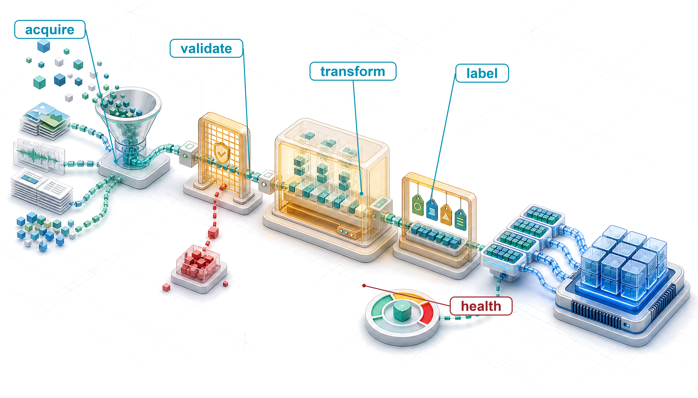
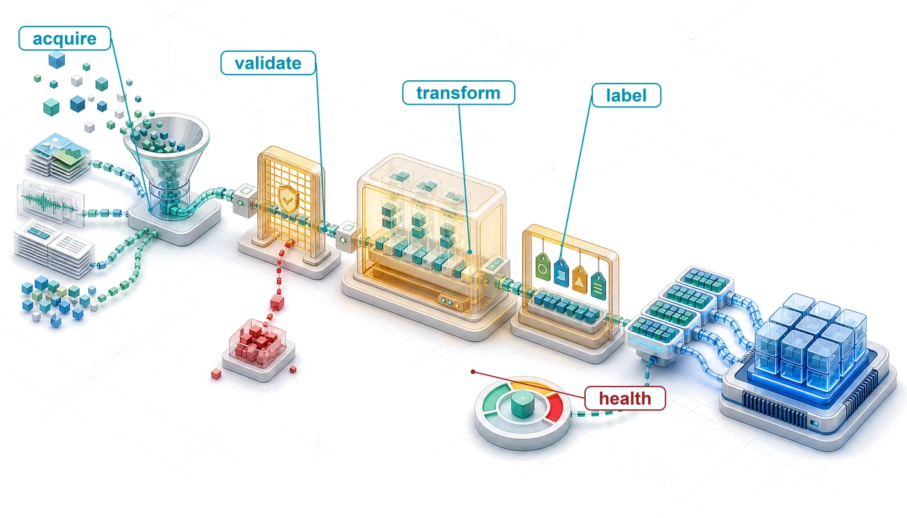
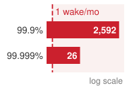
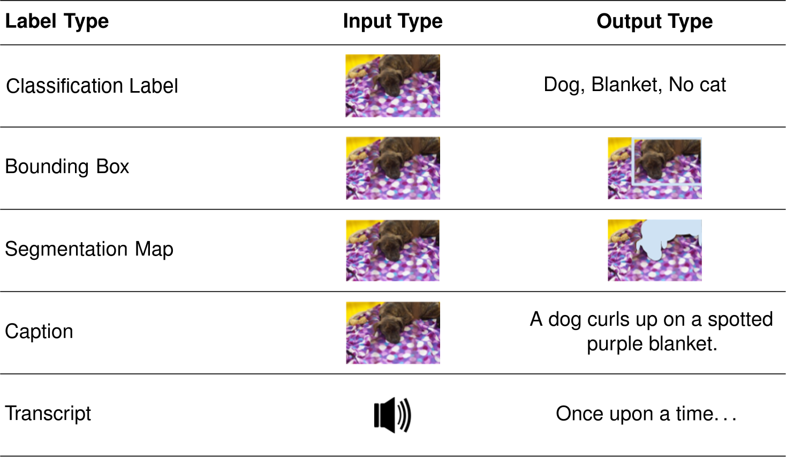
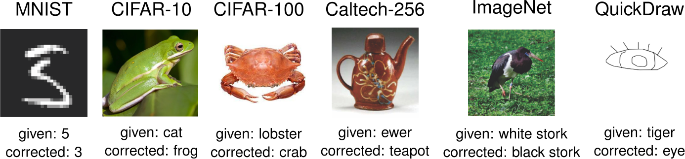
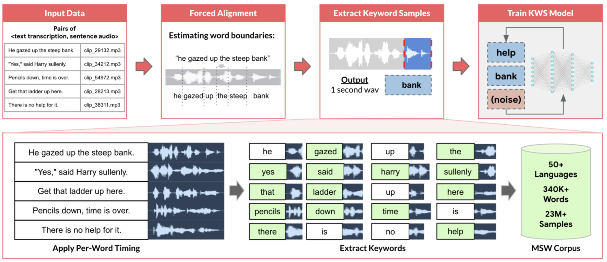
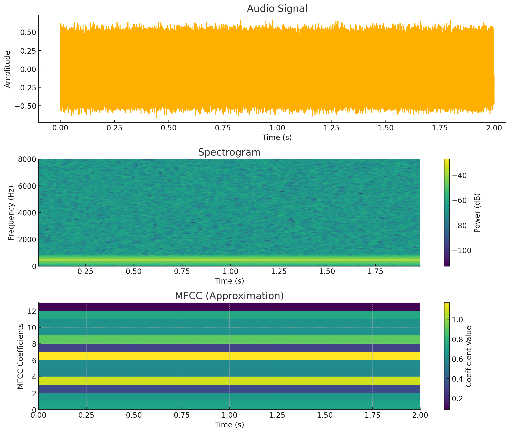
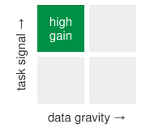
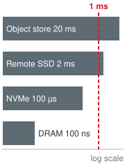
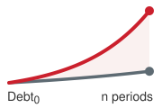

# Data Engineering {#sec-data-engineering}

::: {layout-narrow}
::: {.column-margin}

\chapterminitoc

:::

::: {.content-visible when-format="pdf"}
\noindent
{fig-alt="Isometric data refinery where raw mixed data passes through validation, schema alignment, transformation, batching, and an accelerator-ready feed."}
:::

::: {.content-visible unless-format="pdf"}
{fig-alt="Isometric data refinery where raw mixed data passes through validation, schema alignment, transformation, batching, and an accelerator-ready feed."}
:::

:::

## Purpose {.unnumbered .unlisted}

::: {.content-visible when-format="pdf"}
\begin{marginfigure}
\mlsysstack{15}{10}{10}{25}{10}{15}{10}{90}
\end{marginfigure}
:::

::: {.content-visible unless-format="pdf"}
::: {.column-margin}
{width="100%" fig-alt="Machine Learning Systems Architecture Stack"}

*Architecture stack focus for this chapter.*
:::
:::

_Why does training data function like source code in a machine learning system?_

In conventional software, programmers write logic that computers execute. In machine learning, programmers write optimization procedures that extract operational logic from data. This inversion makes training data resemble source code: changing it can change the learned system when the model is retrained, even if no traditional code changes. Yet data rarely receives the review, testing, and version control that even a one-line code change routinely receives. Subtle labeling inconsistencies can induce behavioral inconsistencies; missing edge cases can leave corresponding failures unmeasured; historical biases can propagate into learned behavior. A model trained only on that dataset cannot infer task-relevant evidence absent from it, and systematic label errors can shape what it learns. Unlike traditional source code, which sits inert until a programmer modifies it, the operating distribution can shift as the world changes, potentially changing production performance even when nothing in the codebase has been touched. Data engineering can consume substantial project effort, often more than modeling itself, because the work is consequential. A labeling error caught at collection costs a relabel; the same error found after deployment can cost a retraining run, an incident investigation, and the trust of the people the system failed. Every decision in the data pipeline (what to collect, how to label, when to filter, how to split) propagates forward to constrain model architecture, training dynamics, and deployment viability. Data engineering is therefore not preprocessing but programming in a different language, one where quality control, versioning, and monitoring determine whether the compiled system works today and continues working tomorrow. In D·A·M terms, data overlaps both the algorithm and the machine; it bounds what the model can learn, and the pipeline that delivers it bounds how fast the machine can learn it.

::: {.content-visible when-format="pdf"}

\newpage

:::

::: {.callout-learning-objectives}

- Explain data as source code and trace how data cascades propagate through ML systems
- Evaluate acquisition strategies against coverage, quality, labeling cost, governance, and deployment constraints
- Design ingestion and validation pipelines for batch, streaming, ETL, and ELT workloads
- Specify labeling, transformation, and release practices that prevent data leakage and preserve label quality, training-serving consistency, and reproducibility
- Calculate data gravity, data-stall, and storage-bandwidth costs for moving or serving datasets
- Select storage tiers, file formats, and data loader designs that keep the accelerator fed
- Diagnose drift, data debt, and production pipeline failures using drift metrics, debt indicators, and controlled comparisons of pipeline versions

:::

## Data as Code {#sec-data-engineering-data-engineering-dataset-compilation-0496}

```{python}
#| echo: false
# Shared chapter symbols used by the calculation cells below.
from mlsysim import *
from mlsysim.core.units import *
```

```{python}
#| echo: false
# ┌─────────────────────────────────────────────────────────────────────────────
# │ RESNET-50 TRAINING SCENARIO (shared anchor)
# ├─────────────────────────────────────────────────────────────────────────────
# │ Context: The chapter's ResNet-50 throughput lighthouse, read by the
# │          labeling-cost cell below and by the feeding-problem cells.
# │ Goal:    One definition of the sustained rate, schedule, and dataset size.
# └─────────────────────────────────────────────────────────────────────────────
from mlsysim.core.units import count
from mlsysim.fmt import check

# ┌── LEGO ───────────────────────────────────────────────
class ResNetTrainingScenario:
    """Shared anchor for the chapter's ResNet-50 throughput lighthouse."""

    # ┌── 1. LOAD (Constants) ──────────────────────────────────────────────
    # Scenarios.ImageNetLabelingVersusResNetRun: the sustained training rate one
    # accelerator reaches once input keeps up, about a quarter of its compute
    # ceiling (FeedingProblem); the standard 90-epoch ResNet-50 schedule.
    run = Scenarios.ImageNetLabelingVersusResNetRun
    sustained_img_per_sec = run.throughput_per_accelerator.to(count / second).magnitude
    epochs = run.epochs
    train_images = run.dataset_examples.to(count).magnitude

    # ┌── 3. GUARD (Invariants) ───────────────────────────────────────────
    check(1_000_000 < train_images < 1_500_000, "ImageNet-1k training split holds about 1.28M images.")

    # ┌── 4. OUTPUT (Formatting) ──────────────────────────────────────────
    # No prose strings: the labeling-cost and feeding-problem cells format these values.
```

```{python}
#| echo: false

# ┌─────────────────────────────────────────────────────────────────────────────
# │ LABELING-TO-COMPUTE COST RATIO CALCULATION
# ├─────────────────────────────────────────────────────────────────────────────
# │ Context: Chapter opening (why data bounds cost) and the "Labeling/Compute
# │          Rule" and "80/20 Split" prose following
# │          @tbl-data-engineering-time-constants.
# │
# │ Goal: Quantify how labeling spend dwarfs a single training run's compute cost.
# │ Show: A $100K labeling budget is thousands of times the cost of one 8x A100
# │       ResNet-50 run at the chapter's sustained rate, motivating data-as-the-bottleneck.
# │ How: Compare a fixed labeling budget against the cost of one 8x A100 training
# │      run at the cloud GPU hourly rate.
# │
# └─────────────────────────────────────────────────────────────────────────────
from mlsysim.fmt import fmt, fmt_usd, check, fmt_multiple, fmt_percent, fmt_time, fmt_rate
from mlsysim.core.units import USD, hour, count

# ┌── LEGO ───────────────────────────────────────────────
class LabelingComputeRatio:
    # ┌── 1. LOAD (Constants) ──────────────────────────────────────────────
    run = ResNetTrainingScenario.run
    labeling_budget = run.labeling_budget.to(USD).magnitude
    a100_count = run.accelerators
    gpu_hour_cost_low = run.price_low.to(USD / hour).magnitude
    gpu_hour_cost_high = run.price_high.to(USD / hour).magnitude
    effort_majority_pct = 80
    effort_minority_pct = 20

    # ┌── 2. EXECUTE (The Compute) ────────────────────────────────────────
    train_hours = run.train_time.to(hour).magnitude
    train_cost_low = run.train_cost_low.to(USD).magnitude
    train_cost_high = run.train_cost_high.to(USD).magnitude
    ratio_low = run.ratio_low
    ratio_high = run.ratio_high

    # ┌── 3. GUARD (Invariants) ───────────────────────────────────────────
    check(train_cost_low < train_cost_high, "Reference training cost range must be ordered.")
    check(1 < train_hours < 2, f"90 epochs at the sustained rate on 8 accelerators should take 1-2 hours, got {train_hours:.2f}.")
    check(ratio_low > 500, f"Labeling/compute ratio unexpectedly low: {ratio_low:.0f}x.")
    check(ratio_high > 1000, f"High-end labeling/compute ratio should exceed 1000x, got {ratio_high:.0f}x.")
    check(effort_majority_pct + effort_minority_pct == 100, "Effort percentages must sum to 100")

    # ┌── 4. OUTPUT (Formatting) ──────────────────────────────────────────
    labeling_budget_str = fmt_usd(labeling_budget, precision=0, commas=False, scale="K")
    train_hours_str = fmt_time(train_hours, "hour", precision=1, commas=False, style="word")
    epochs_str = fmt(ResNetTrainingScenario.epochs, precision=0, commas=False)
    sustained_img_per_s_str = fmt_rate(ResNetTrainingScenario.sustained_img_per_sec, 'img/s', precision=0, commas=True)
    train_cost_low_str = fmt_usd(train_cost_low, precision=0, commas=False)
    train_cost_high_str = fmt_usd(train_cost_high, precision=0, commas=False)
    ratio_low_mult_str = fmt_multiple(round(ratio_low), precision=0, commas=True)
    ratio_high_mult_str = fmt_multiple(round(ratio_high), precision=0, commas=True)
    ratio_low_round_mult_str = fmt_multiple(round(ratio_low, -2), precision=0, commas=True)
    ratio_high_round_mult_str = fmt_multiple(round(ratio_high, -2), precision=0, commas=True)
    effort_majority_pct_str = fmt_percent(effort_majority_pct / 100, precision=0, commas=False, style='prose')
    effort_minority_pct_str = fmt_percent(effort_minority_pct / 100, precision=0, commas=False, style='prose')
```

```{python}
#| echo: false
# ┌─────────────────────────────────────────────────────────────────────────────
# │ DATASET SIZE GROWTH (LEGO)
# ├─────────────────────────────────────────────────────────────────────────────
# │ Context: Opening of Data as Code and @fig-dataset-size-growth.
# │
# │ Goal: Quantify the multi-decade growth of training dataset sizes before and
# │       after the deep-learning transition in 2010.
# │ Show: Doubling every ~34 months before 2010 and ~8 months after across 668
# │       notable models, crossing the 1.28M ImageNet-1k lighthouse to reach
# │       hundreds of trillions of datapoints.
# │ How: Least-squares fits of log10(training_dataset_size) on publication date
# │      over vol1/04_data_engineering/data/notable_model_datasets.csv, split at 2010.
# │
# └─────────────────────────────────────────────────────────────────────────────
import datetime as dt
import math
import numpy as np
from mlsysim import viz
from mlsysim.fmt import check, fmt_int

def _decimal_year(s):
    d = dt.date.fromisoformat(s)
    return d.year + (d.timetuple().tm_yday - 1) / 365.25

# ┌── LEGO ───────────────────────────────────────────────
class DatasetGrowth:
    """Training dataset sizes of notable models over time."""

    # ┌── 1. LOAD (Constants) ───────────────────────────────────────────────
    series = viz.load_series("vol1/04_data_engineering/data/notable_model_datasets.csv")
    split_year = 2010  # scenario assumption: deep-learning transition split year
    rows = [r for r in series.entries if r["training_dataset_size"]]

    # ┌── 2. EXECUTE (The Compute) ─────────────────────────────────────────
    years = np.array([_decimal_year(r["date"]) for r in rows])
    log_sizes = np.array([float(np.log10(r["training_dataset_size"])) for r in rows])
    _early = years < split_year
    early_slope, early_intercept = (float(x) for x in np.polyfit(years[_early], log_sizes[_early], 1))
    late_slope, late_intercept = (float(x) for x in np.polyfit(years[~_early], log_sizes[~_early], 1))
    early_doubling_months = 12 * math.log10(2) / early_slope
    late_doubling_months = 12 * math.log10(2) / late_slope
    largest_size = max(r["training_dataset_size"] for r in rows)
    model_count = len(rows)

    # ┌── 3. GUARD (Invariants) ───────────────────────────────────────────
    check(24 <= early_doubling_months <= 48, f"Expected ~34-month doubling before 2010, got {early_doubling_months:.0f}.")
    check(5 <= late_doubling_months <= 12, f"Expected ~8-month doubling after 2010, got {late_doubling_months:.0f}.")
    check(largest_size >= 1e14, "Largest training datasets exceed 100 trillion datapoints.")

    # ┌── 4. OUTPUT (Formatting) ──────────────────────────────────────────────
    early_doubling_str = fmt_int(round(early_doubling_months), commas=False)
    late_doubling_str = fmt_int(round(late_doubling_months), commas=False)
    model_count_str = fmt_int(model_count)
```

A missing accent in a speech corpus, a mislabeled class, or a feature computed one way in training and another in serving becomes a defect in system behavior with no line of code to point to. Because a machine learning system learns its behavior from data, the trained model is a compressed summary of its training set. It can represent only the evidence that data contains, and it treats the data's labels as the definition of a correct answer. The bitter lesson (@sec-introduction-bitter-lesson-79c7) explains why this dependence has grown rather than shrunk. Methods that learn from data at scale have repeatedly overtaken methods built on hand-encoded knowledge, so the knowledge that engineers once wrote into programs must now arrive through data. In the lifecycle that @sec-ml-workflow lays out, this work is Stage 2, which ends by handing a versioned dataset to model development; every later stage inherits what that dataset contains and what it lacks. Across `{python} DatasetGrowth.model_count_str` notable models published since 1950 (@fig-dataset-size-growth), training dataset sizes show how far that shift has gone [@epochai2026notable]. Until 2010, dataset size doubled roughly every `{python} DatasetGrowth.early_doubling_str` months; after 2010, as deep learning and web-scale collection took hold, it doubled about every `{python} DatasetGrowth.late_doubling_str` months, climbing from tens of thousands of examples in early vision benchmarks past the million-image scale of ImageNet to trillions of tokens in modern language models.

::: {#fig-dataset-size-growth fig-env="figure" fig-pos="htb" fig-cap="**Training Dataset Sizes of Notable Models, 1950 to the Present**: Each point is one notable model, colored by domain, plotted by publication date on a logarithmic axis. Dashed lines show least-squares fits before and after 2010, and the dotted horizontal line marks the ImageNet-1k training split used by this chapter's ResNet-50 workload. The steeper post-2010 slope moves training sets past single-machine memory and turns data delivery into a throughput bottleneck. Data from @epochai2026notable." fig-alt="Scatter plot of training dataset sizes in datapoints on a logarithmic axis from 1 to 10 to the 16 against publication dates from 1950 to 2026. Gray, blue, green, and red points mark other, vision, games, and language models, with a horizontal dotted line near 1.28 million for ImageNet-1k. A shallow dashed fit from 1950 to 2010 is labeled with its doubling time, and a steeper dashed fit from 2010 onward rises through dense clusters of vision and language models above 10 to the 12. Perceptron Mark I, TD-Gammon, LeNet-5, AlexNet, GPT-3, Chinchilla, DeepSeek-V3, and Qwen3 are labeled."}

```{python}
#| echo: false
# ┌─────────────────────────────────────────────────────────────────────────────
# │ DATASET SIZE GROWTH (FIGURE)
# ├─────────────────────────────────────────────────────────────────────────────
# │ Context: @fig-dataset-size-growth.
# │
# │ Goal: Plot training dataset sizes of notable models over seven decades.
# │ Show: Scatter by domain with two fitted segments split at 2010 and the
# │       ImageNet-1k lighthouse line.
# │ How: DatasetGrowth and ResNetTrainingScenario (above); book_style.setup_plot().
# │
# └─────────────────────────────────────────────────────────────────────────────
from binder.tools.figures import style as book_style

fig, ax, COLORS, plt = book_style.setup_plot(figsize=(6.2, 4.4))
_D = DatasetGrowth
_dom = {"Language": COLORS["RedLine"], "Vision": COLORS["BlueLine"], "Games": COLORS["GreenLine"]}
_d = np.array([r["domain"] if r["domain"] in _dom else "Other" for r in _D.rows])
for _k, _c in list(_dom.items()) + [("Other", COLORS["grid"])]:
    _m = _d == _k
    ax.scatter(
        _D.years[_m],
        10 ** _D.log_sizes[_m],
        s=10,
        color=_c,
        alpha=0.7 if _k != "Other" else 0.6,
        label=_k,
        zorder=3 if _k != "Other" else 2,
    )
for _lo, _hi, _sl, _ic in (
    (1950, _D.split_year, _D.early_slope, _D.early_intercept),
    (_D.split_year, 2026.8, _D.late_slope, _D.late_intercept),
):
    _xx = np.linspace(_lo, _hi, 50)
    ax.plot(_xx, 10 ** (_sl * _xx + _ic), "--", color=COLORS["primary"], lw=1.2, zorder=4)

_y_early = 10 ** (_D.early_slope * 1970 + _D.early_intercept)
ax.annotate(
    f"{_D.early_doubling_str}-month doubling\n(pre-2010)",
    xy=(1970, _y_early),
    xytext=(1965, _y_early * 45),
    ha="center",
    fontsize=9,
    color=COLORS["primary"],
    arrowprops=dict(arrowstyle="->", color=COLORS["primary"], lw=0.8),
    bbox=dict(facecolor="white", alpha=0.92, edgecolor="none", pad=0.3),
    zorder=6,
)
_y_late = 10 ** (_D.late_slope * 2011.8 + _D.late_intercept)
ax.annotate(
    f"{_D.late_doubling_str}-month doubling\n(post-2010)",
    xy=(2011.8, _y_late),
    xytext=(2017.0, 2e2),
    ha="center",
    fontsize=9,
    color=COLORS["primary"],
    arrowprops=dict(arrowstyle="->", color=COLORS["primary"], lw=0.8),
    bbox=dict(facecolor="white", alpha=0.92, edgecolor="none", pad=0.3),
    zorder=6,
)
_landmarks = {
    "Perceptron Mark I": ("Perceptron Mark I", (10, -14), "left"),
    "TD-Gammon": ("TD-Gammon", (-4, 16), "center"),
    "LeNet-5": ("LeNet-5 (MNIST)", (-8, -22), "right"),
    "AlexNet": ("AlexNet", (-18, 10), "right"),
    "GPT-3 175B (davinci)": ("GPT-3", (-22, -6), "right"),
    "Chinchilla": ("Chinchilla", (-24, 1), "right"),
    "DeepSeek-V3": ("DeepSeek-V3", (-24, 5), "right"),
    "Qwen3-235B-A22B": ("Qwen3", (-14, 17), "right"),
}
for _key, (_lbl, _off, _ha) in _landmarks.items():
    for _x, _r in zip(_D.years, _D.rows):
        if _r["model"] == _key:
            ax.annotate(
                _lbl,
                (_x, _r["training_dataset_size"]),
                xytext=_off,
                textcoords="offset points",
                ha=_ha,
                fontsize=9,
                zorder=7,
                arrowprops=dict(arrowstyle="-", color=COLORS["secondary"], lw=0.6),
                bbox=dict(facecolor="white", alpha=0.92, edgecolor="none", pad=0.2),
            )
            break

ax.axhline(ResNetTrainingScenario.train_images, color=COLORS["primary"], lw=0.8, ls=":", zorder=1)
ax.text(
    1948.5,
    ResNetTrainingScenario.train_images * 1.45,
    "chapter lighthouse (ImageNet-1k, 1.28M)",
    ha="left",
    va="bottom",
    fontsize=9,
    color=COLORS["primary"],
)
ax.set_yscale("log")
ax.set_xlim(1947, 2028)
ax.set_ylim(1, 3e16)
ax.set_xlabel("Publication date")
ax.set_ylabel("Training dataset size (datapoints, log scale)")
ax.legend(loc="upper left", frameon=True, framealpha=0.95, fontsize=9)
plt.show()
plt.close()
```

:::

At that scale, data constrains the machine as well as the model. Every training step reads its examples from storage, decodes them, and moves them to the accelerator, and an accelerator waiting on input computes nothing however fast it is. Datasets measured in terabytes also have physical mass. They are slow and expensive to move, and they spend energy at every level of the memory hierarchy they cross. Data therefore occupies two of the pairwise overlaps of the D·A·M taxonomy at once, the ones labeled *what to learn from* and *how to move information* in @fig-ai-triad. Toward the algorithm, it bounds what the model can learn; toward the machine, it bounds how fast learning can proceed.

Both bounds are expensive to meet. Cleaning and organizing data was the most common answer to where data scientists spend their time in the practitioner survey that @sec-ml-workflow presents [@crowdflower2016data]. In the image-classification cost comparison later in this chapter, labeling a dataset costs roughly `{python} LabelingComputeRatio.ratio_low_round_mult_str` to `{python} LabelingComputeRatio.ratio_high_round_mult_str` as much as one training run on it. Each stage between raw input and an ML-ready dataset (acquisition, ingestion and validation, labeling, and processing) can also introduce a defect that no later stage detects. Data bounds both capability and throughput and often dominates cost, so it requires the same engineering discipline as the model and the machine: acquisition systems, validation checks, labeling workflows, storage layouts, and governance.

::: {#dfn-data-engineering-data-engineering .callout-definition title="Data engineering"}

***Data engineering***\index{Data engineering!definition} is the infrastructure layer that manages the lifecycle of data from source to model, encompassing acquisition, transformation, storage, and governance.

1.  **Significance**: It sets both bounds that data places on an ML system. Dataset composition, coverage, and labels determine whether the logical dataset ($\DatasetSize$, the $\text{Samples/Task}$ factor of the iron law) represents the target distribution, and therefore what the model can learn. In the unpacked iron law, the pipeline governs the physical bytes moved $(\DataVolume/\Bandwidth)$, and therefore how fast learning can proceed.
2.  **Distinction**: Unlike data science\index{Data science!vs. data engineering}, which focuses on inference and insight, data engineering addresses the scalability and reliability of the data pipeline.
3.  **Common pitfall**: A frequent misconception reduces data engineering to mere "data cleaning." In systems terms, it is a build pipeline that turns raw, noisy observations into the validated, versioned tensors that accelerator runtimes consume.

:::

::: {.column-margin .margin-pointer}
↩ The iron law of ML systems, whose data-movement term this chapter governs, is established in @sec-introduction-iron-law-ml-systems-c32a.
:::

The data-as-code principle (\ref{pri-data-as-code}) turns the model's dependence on its data into an engineering rule. Changing a dataset changes the trained model just as changing source code changes a program, even when no line of algorithmic code is touched. The pipeline that produces a dataset is therefore the system's build, and every retraining is a rebuild.

A dataset then needs the disciplines code already has, namely immutable lineage, validation suites, and debugging when regressions appear. Code keeps its tests apart from what they test, and a dataset needs the same trust boundary between its splits. The training set is allowed to shape parameters; the validation set is allowed to shape modeling and pipeline choices; the test set is reserved for estimating generalization after those choices have been made. **Data leakage**\index{Data leakage!definition} occurs when information crosses those boundaries, so that an evaluation score rewards what the model or its designers already saw instead of measuring generalization to unseen data. Leakage enters through duplicate examples appearing in multiple splits, augmented variants of the same source record landing on both sides of the split, user records from the same household appearing in both training and test, or time-derived features computed using future observations [@kaufman2012leakage]. Preprocessing can leak too, a case @sec-data-engineering-ensuring-trainingserving-consistency-c683 takes up once normalization and encoding have been introduced.

Two of the book's recurring lighthouse workloads (@sec-introduction-lighthouse-models-9b1c) carry the chapter, one for each bound. Keyword spotting (KWS), the always-on wake-word detector behind phrases such as "Alexa" and "OK Google," carries the question of what the data must contain. It takes over from the diabetic retinopathy screening case of @sec-ml-workflow because its data problems span both a cloud training pipeline and a microcontroller-class device. The model must recognize a few words across accents, microphones, and rooms, stay silent through months of ordinary speech, and fit in tens of kilobytes on a TinyML-class device. Its reference corpus, the Multilingual Spoken Words Corpus [@mazumder2021multilingual], is real; the smart-speaker requirements and data budget that this chapter sets for it are an illustrative scenario. ResNet-50 image classification on one accelerator carries the question of how fast data must arrive, because image examples are large enough to stress storage, decoding, and transfer in ways that one-second audio clips do not. KWS also shows the split boundary at work before any model exists. Assigning each speaker's utterances to a single split keeps the acoustic model from memorizing speaker-specific vocal-tract resonances, so evaluation measures generalization to speakers the model has never heard.

Like a build, the pipeline that produces a dataset runs in stages, and the chapter follows them in the order of the two bounds. The capability half, which works the Data–Algorithm overlap, comes first. After the ways data fails and the requirements of the keyword spotter, acquisition, ingestion and validation, labeling, and processing build the dataset and settle what the model can learn, and a release step records exactly what was built. The throughput half works the Data–Machine overlap. The physics of moving datasets sets the cost of every byte, and storage and delivery must move those bytes fast enough to keep the accelerator fed. An acceptance test then checks both halves against the targets they started with, and operation keeps both bounds true after deployment.

## How Data Fails {#sec-data-engineering-four-pillars-framework-4ef1}

Unlike a broken software build, which fails loudly at compile or test time, a broken data build often finishes cleanly and fails in production. A credit scoring model starts rejecting every applicant from one region after an upstream database migration silently changes how ZIP codes are typed; a wake-word detector misses more and more spoken commands for months after a device maker changes the microphone in its new models; a fraud detection system misses a new attack vector because its training data was six months stale. Each failure traces to a different root cause (schema drift, distribution shift, data staleness), yet all share a common pattern: a data defect entered early, every later stage treated the data as trustworthy, and the failure surfaced only after deployment. The **four pillars framework**\index{Four pillars framework!definition} of quality, reliability, scalability, and governance gives the checklist that catches them before they ship.

### Data cascades {#sec-data-engineering-data-cascades-systematic-foundations-matter-2efe}

The pattern those three failures share is a data cascade, in which poor data quality in an early stage amplifies through every later stage of the pipeline [@sambasivan2021]. Some invalid inputs trigger immediate software errors, but data can also pass schemas and tests while degrading learned behavior silently until quality issues become severe enough to require expensive investigation, rework, or retraining. In the lifecycle progression sequenced in @fig-cascades, early defects in problem framing and collection bypass intermediate validation and surface only at evaluation and deployment.

::: {.column-margin .margin-pointer}
↩ The compounding cost of late-stage data rework builds directly on the constraint propagation principle established in @sec-ml-workflow-decisions-cascade-system-98f4.
:::

::: {#fig-cascades fig-env="figure" fig-pos="htb" fig-cap="**Data Quality Cascades**: Upstream defects along the seven-stage workflow timeline cast failure arcs directly into late-stage evaluation and deployment. Early flaws in problem framing and collection compound through downstream processing, forcing costly project restarts (dashed red return paths) when defects finally surface in production. Adapted from @sambasivan2021." fig-alt="Timeline with seven stages from problem statement to deployment. Colored arcs originate at several workflow stages and end at evaluation or deployment; arrow markers indicate downstream cascade impacts and process abandonment or restart."}

```{.tikz}
\begin{tikzpicture}[line join=round,font=\small\sffamily]
\definecolor{Green}{HTML}{008F45}
\definecolor{Red}{HTML}{CB202D}
\definecolor{Orange}{HTML}{CC5500}
\definecolor{Blue}{HTML}{006395}
\definecolor{Violet}{HTML}{7030A0}

\tikzset{%
Line/.style={line width=1.0pt,black!50,shorten <=6pt,shorten >=8pt},
LineD/.style={line width=2.0pt,black!50,shorten <=6pt,shorten >=8pt},
Text/.style={rotate=60,align=right,anchor=north east,font=\fontsize{7pt}{8}\sffamily},
Text2/.style={align=left,anchor=north west,font=\footnotesize\sffamily,text depth=0.7}
}

\draw[line width=1.5pt,black!30](0,0)coordinate(P)--(10,0)coordinate(K);

\foreach \i in {0,...,6} {
\path let \n1 = {(\i/6)*10} in coordinate (P\i) at (\n1,0);
\fill[black] (P\i) circle (2pt);
  }

\draw[LineD,Red,overlay](P0)to[out=60,in=120](P6);
\draw[LineD,Red](P0)to[out=60,in=125](P5);
\draw[LineD,Blue](P1)to[out=60,in=120](P6);
\draw[LineD,Red](P1)to[out=50,in=125](P6);
\draw[LineD,Blue](P4)to[out=60,in=125](P6);
\draw[LineD,Blue](P3)to[out=60,in=120](P6);
%
\draw[Line,Orange](P1)to[out=44,in=132](P6);
\draw[Line,Green](P1)to[out=38,in=135](P6);
\draw[Line,Orange](P1)to[out=30,in=135](P5);
\draw[Line,Green](P1)to[out=36,in=130](P5);
%
\draw[Line,Orange](P2)to[out=40,in=135](P6);
\draw[Line,Orange](P2)to[out=40,in=135](P5);
%
\draw[draw=none,fill=VioletLine!50]($(P5)+(-0.1,0.15)$)to[bend left=10]($(P5)+(-0.1,0.61)$)--
                ($(P5)+(-0.25,0.50)$)--($(P5)+(-0.85,1.20)$)to[bend left=20]($(P5)+(-1.38,0.76)$)--
                ($(P5)+(-0.51,0.33)$)to[bend left=10]($(P5)+(-0.64,0.22)$)to[bend left=10]cycle;
\draw[draw=none,fill=VioletLine!50]($(P6)+(-0.1,0.15)$)to[bend left=10]($(P6)+(-0.1,0.61)$)--
                ($(P6)+(-0.25,0.50)$)--($(P6)+(-0.7,1.30)$)to[bend left=20]($(P6)+(-1.38,0.70)$)--
                ($(P6)+(-0.51,0.33)$)to[bend left=10]($(P6)+(-0.64,0.22)$)to[bend left=10]cycle;
%
\def\vi{-0.05}
\draw[dashed,red,thick,-latex](P1)--++(90:2)to[out=90,in=0](0.8,2.7);
\draw[dashed,red,thick,-latex](P6)--++(90:2)to[out=90,in=0](9.1,2.7);
\node[below=\vi of P0,Text]{Problem\\ Statement};
\node[below=\vi of P1,Text]{Data collection \\and labeling};
\node[below=\vi of P2,Text]{Data analysis\\ and cleaning};
\node[below=\vi of P3,Text]{Model \\selection};
\node[below=\vi of P4,Text]{Model\\ training};
\node[below=\vi of P5,Text]{Model\\ evaluation};
\node[below=\vi of P6,Text]{Model\\ deployment};
%Legend
\node[circle,minimum size=4pt,fill=Blue](L1)at(11.5,2.6){};
\node[above right=0.1 and 0.1of L1,Text2]{Interacting with physical\\  world brittleness};

\node[circle,minimum size=4pt,fill=Red,below =0.5 of L1](L2){};
\node[above right=0.1 and 0.1of L2,Text2]{Inadequate \\application-domain expertise};

\node[circle,minimum size=4pt,fill=Green,below =0.5 of L2](L3){};
\node[above right=0.1 and 0.1of L3,Text2]{Conflicting reward\\ systems};

\node[circle,minimum size=4pt,fill=Orange,below =0.5 of L3](L4){};
\node[above right=0.1 and 0.1of L4,Text2]{Poor cross-organizational\\ documentation};

\draw[-{Triangle[width=8pt,length=8pt]}, line width=3pt,Violet](11.4,-0.85)--++(0:0.8)coordinate(L5);
\node[above right=0.23 and 0of L5,Text2]{Impacts of cascades};

\draw[-{Triangle[width=4pt,length=8pt]}, line width=2pt,Red,dashed](11.4,-1.35)--++(0:0.8)coordinate(L6);
\node[above right=0.23 and 0of L6,Text2]{Abandon/re-start process};
\end{tikzpicture}
```

:::

::: {#dfn-data-engineering-data-cascade .callout-definition title="Data cascade"}

***Data cascade***\index{Data cascade!definition}\index{Pipeline!cascading failures} is an ML systems failure mode in which upstream data quality problems propagate through collection, labeling, feature engineering, training, evaluation, and deployment, amplifying into downstream model failures or user harm.

1.  **Significance**: Remediation cost scales with the number of downstream artifacts that consumed the corrupted data: feature tables must be regenerated, models retrained, evaluation metrics recomputed, and deployed systems rolled back or patched, so one bad field can invalidate a whole training run and every experiment derived from it.
2.  **Distinction**: Unlike an isolated data quality bug, a data cascade is defined by propagation and amplification. Each pipeline stage treats its input as trustworthy and converts the defect into new derived state, which hides the root cause as the system moves farther from collection.
3.  **Common pitfall**: A frequent misconception is that ordinary software tests catch cascades. Corrupted data can satisfy schemas, pass unit tests, and produce successful training jobs while teaching the model the wrong signal, so prevention requires lineage, validation, contracts, and monitoring tied to model behavior.

:::

Silence\index{Data cascade!silent failure} is what makes a cascade expensive. A software crash raises a stack trace and pages someone; a data-induced model error produces valid-looking outputs that are simply less accurate. By the time downstream metrics reflect the failure, corrupted predictions may already have contaminated historical data stores, forcing expensive rollbacks and data re-ingestion.

::: {#exmp-data-engineering-pipeline-jungle .callout-example title="The pipeline jungle"}

**Scenario**: The credit scoring model from the opening of this section suddenly begins rejecting all applicants from a specific geographic region.

**Diagnosis**: The training pipeline represented `zip_code` as a fixed-width string ("02139"). An upstream database migration changed the serving field to an integer without updating downstream data contracts. A downstream transform serialized that integer as "2139," losing the leading zero and causing the model to treat a familiar postal code as an unobserved category. In this scenario, the fallback for unknown categories assigns high risk, explaining the regional rejection pattern.

**Systems lesson**: Unenforced feature boundaries create pipeline jungles [@sculley2015hidden] where upstream schema changes cause silent downstream model failures. Versioned data contracts, which are machine-checked rules that declare expected types, value bounds, and whether nulls are allowed, stop cross-system corruption by rejecting malformed records at the ingestion boundary before they reach the model.

:::

### Four foundational pillars {#sec-data-engineering-four-foundational-pillars-c119}

The ZIP-code failure crossed several concerns at once: the values were wrong (quality), the transform broke silently instead of rejecting the record (reliability), and no contract recorded what the field meant (governance). Preventing failures like it means balancing four competing operational priorities (@fig-four-pillars). Each feeds the ML data system, and each pulls against its neighbors: stricter validation costs throughput, stronger consistency limits distributed scale, privacy constraints cost performance, and bias mitigation can shrink the usable training set.

::: {#fig-four-pillars fig-env="figure" fig-pos="htb" fig-cap="**The Four Pillars of Data Engineering**: Quality, Reliability, Scalability, and Governance form the foundational framework for ML data systems. Each pillar contributes essential capabilities (solid arrows), while trade-offs between pillars (dashed lines) mark where strengthening one pillar stresses its neighbor." fig-alt="Four boxes labeled quality, reliability, scalability, and governance surround a central ML data system circle. Solid arrows connect each box to center showing contributions; dashed lines between boxes indicate trade-offs."}

```{.tikz}
\begin{tikzpicture}[line join=round,font=\sffamily]
\tikzset{
Box/.style={align=center, inner xsep=2pt,draw=GreenLine, line width=1pt,fill=none, minimum width=51mm, minimum height=25mm},
Circle1/.style={circle,  minimum size=33mm, draw=none, fill=BrownLine!20},
LineD/.style={dashed,BrownLine!70, line width=1.1pt,latex-latex,text=black},
LineA/.style={violet!50,line width=4.0pt,{{Triangle[width=1.5*6pt,length=2.0*5pt]}-{Triangle[width=1.5*6pt,length=2.0*5pt]}},shorten <=1pt,shorten >=1pt},
ALine/.style={black!50, line width=1.1pt,{{Triangle[width=0.9*6pt,length=1.2*6pt]}-}},
Larrow/.style={fill=violet!50, single arrow,  inner sep=2pt, single arrow head extend=3pt,
            single arrow head indent=0pt,minimum height=10mm, minimum width=3pt}
}
%%%
%vaga
\tikzset{
pics/vaga/.style = {
        code = {
        \pgfkeys{/channel/.cd, #1}
\begin{scope}[shift={($(0,0)+(0,0)$)},scale=\scalefac,every node/.append style={transform shape}]
\node[rectangle,minimum width=2mm,minimum height=22mm,
draw=none, fill=\filllcolor,line width=\Linewidth](1R) at (0,-0.95){};
\fill[fill=\filllcolor!60!black](230:2.8)arc(230:310:2.8)--cycle;%circle(2.9);
%LT
\node [semicircle, shape border rotate=180,  anchor=chord center,
      minimum size=11mm, draw=none, fill=\filllcirclecolor](LT) at (-2,-0.5) {};
\node [circle,  minimum size=4mm, draw=none, fill=\filllcirclecolor](T1) at (-2,1.25) {};
\draw[draw=\drawcolor,,line width=1.2*\Linewidth,shorten <=3pt,shorten >=3pt](T1)--(LT);
\draw[draw=\drawcolor,,line width=1.2*\Linewidth,shorten <=3pt,shorten >=3pt](T1)--(LT.30);
\draw[draw=\drawcolor,,line width=1.2*\Linewidth,shorten <=3pt,shorten >=3pt](T1)--(LT.150);
%DT
\node [semicircle, shape border rotate=180,  anchor=chord center,
      minimum size=11mm, draw=none, fill=\filllcirclecolor!70!black](DT) at (2,-0.5) {};
\node [circle,  minimum size=4mm, draw=none, fill=\filllcirclecolor!70!black](T2) at (2,1.25) {};
\draw[draw=\drawcolor,line width=1.2*\Linewidth,shorten <=3pt,shorten >=3pt](T2)--(DT);
\draw[draw=\drawcolor,,line width=1.2*\Linewidth,shorten <=3pt,shorten >=3pt](T2)--(DT.30);
\draw[draw=\drawcolor,,line width=1.2*\Linewidth,shorten <=3pt,shorten >=3pt](T2)--(DT.150);
%
\node[draw=none,rectangle,minimum width=32mm,minimum height=1.5mm,inner sep=0pt,
fill=\filllcolor!60!black]at(0,1.25){};
\node[draw=white,fill=\filllcolor,line width=2*\Linewidth,ellipse,minimum width=9mm,  minimum height=15mm](EL)at(0,0.85){};
\node[draw=white,fill=\filllcolor!60!black,line width=2*\Linewidth,,circle,minimum size=10mm](2C)at(0,2.05){};
\end{scope}
    }
  }
}
%stit
\def\inset{3.2pt} %
\def\myshape{%
  (0,1.34) to[out=220,in=0] (-1.20,1.03) --
  (-1.20,-0.23) to[out=280,in=160] (0,-1.53) to[out=20,in=260] (1.20,-0.23) --
  (1.20,1.03)  to[out=180,in=320] cycle
}
\tikzset{
pics/stit/.style = {
        code = {
        \pgfkeys{/channel/.cd, #1}
\begin{scope}[shift={($(0,0)+(0,0)$)},scale=\scalefac,every node/.append style={transform shape}]
\fill[fill=\filllcolor!60] \myshape;
%
\begin{scope}
  \clip \myshape;
  \draw[draw=\filllcolor!60, line width=2*\inset,fill=white] \myshape; % stroke color and width
\end{scope}
\fill[fill=\filllcolor!60](0,0)circle(0.4)coordinate(ST\picname);
\end{scope}
    }
  }
}
%AI style
\tikzset{
pics/llm/.style = {
        code = {
        \pgfkeys{/channel/.cd, #1}
\begin{scope}[shift={($(0,0)+(0,0)$)},scale=\scalefac,every node/.append style={transform shape}]
\node[circle,minimum size=12mm,draw=\drawcolor, fill=\filllcolor!70,line width=1.25*\Linewidth](C\picname) at (0,0){};
\def\startangle{90}
\def\radius{1.15}
\def\radiusI{1.1}
\foreach \i [evaluate=\i as \j using \i+1] [count =\k] in {0,2,4,6,8} {
\pgfmathsetmacro{\angle}{\startangle - \i * (360/8)}
\draw[draw=black,-{Circle[black ,fill=\filllcirclecolor,length=5.5pt,line width=0.5*\Linewidth]},line width=1.5*\Linewidth](C\picname)--++(\startangle - \i*45:\radius) ;
\node[circle,draw=black,fill=\filllcirclecolor!80!red!50,inner sep=3pt,line width=0.5*\Linewidth](2C\k)at(\startangle - \j*45:\radiusI) {};
}
\draw[line width=1.5*\Linewidth](2C1)--++(-0.5,0)|-(2C2);
\draw[line width=1.5*\Linewidth](2C3)--++(0.5,0)|-(2C4);
\node[circle,,minimum size=12mm,draw=\drawcolor, fill=\filllcolor!70,line width=0.5*\Linewidth]at (0,0){};
\end{scope}
    }
  }
}
%brain
\tikzset{pics/brain/.style = {
        code = {
        \pgfkeys{/channel/.cd, #1}
\begin{scope}[local bounding box=BRAIN,scale=\scalefac, every node/.append style={transform shape}]
\draw[fill=\filllcolor,line width=\Linewidth](-0.3,-0.10)to(0.08,0.60)
to[out=60,in=50,distance=3](-0.1,0.69)to[out=160,in=80](-0.26,0.59)to[out=170,in=90](-0.46,0.42)
to[out=170,in=110](-0.54,0.25)to[out=210,in=150](-0.54,0.04)
to[out=240,in=130](-0.52,-0.1)to[out=300,in=240]cycle;
\draw[fill=\filllcolor,line width=\Linewidth]
(-0.04,0.64)to[out=120,in=0](-0.1,0.69)(-0.19,0.52)to[out=120,in=330](-0.26,0.59)
(-0.4,0.33)to[out=150,in=280](-0.46,0.42)
%
(-0.44,-0.03)to[bend left=30](-0.34,-0.04)
(-0.33,0.08)to[bend left=40](-0.37,0.2) (-0.37,0.12)to[bend left=40](-0.45,0.14)
(-0.26,0.2)to[bend left=30](-0.24,0.13)
(-0.16,0.32)to[bend right=30](-0.27,0.3)to[bend right=30](-0.29,0.38)
(-0.13,0.49)to[bend left=30](-0.04,0.51);
\draw[thick,rounded corners=0.8pt,\drawcircle,-{Circle[fill=\filllcolor,length=2.5pt]}](-0.23,0.03)--(-0.15,-0.03)--(-0.19,-0.18)--(-0.04,-0.28);
\draw[thick,rounded corners=0.8pt,\drawcircle,-{Circle[fill=\filllcolor,length=2.5pt]}](-0.17,0.13)--(-0.04,0.05)--(-0.06,-0.06)--(0.14,-0.11);
\draw[thick,rounded corners=0.8pt,\drawcircle,-{Circle[fill=\filllcolor,length=2.5pt]}](-0.12,0.23)--(0.31,0.0);
\draw[thick,rounded corners=0.8pt,\drawcircle,-{Circle[fill=\filllcolor,length=2.5pt]}](-0.07,0.32)--(0.06,0.26)--(0.16,0.33)--(0.34,0.2);
\draw[thick,rounded corners=0.8pt,\drawcircle,-{Circle[fill=\filllcolor,length=2.5pt]}](-0.01,0.43)--(0.06,0.39)--(0.18,0.51)--(0.31,0.4);
\end{scope}
     }
  }
}
%graph
\tikzset{pics/graph/.style = {
        code = {
        \pgfkeys{/channel/.cd, #1}
\begin{scope}[local bounding box=GRAPH,scale=\scalefac, every node/.append style={transform shape}]
\draw[line width=2*\Linewidth,draw = \drawcolor](-0.20,0)--(2.2,0);
\draw[line width=2*\Linewidth,draw = \drawcolor](-0.20,0)--(-0.20,2.0);
\foreach \i/\vi in {0/4,0.5/8,1/12,1.5/16}{
\node[draw, minimum width  =4mm, minimum height = \vi mm, inner sep = 0pt,
      draw = \drawcolor, fill=\filllcolor!50, line width=\Linewidth,anchor=south west](COM)at(\i,0.2){};
}
%lupa
\coordinate(PO)at(1.2,0.9);
\node[circle,draw=white,line width=0.75pt,fill=\filllcirclecolor,minimum size=9mm,inner sep=0pt](LV)at(PO){};
\node[draw=none,rotate=40,rounded corners=2pt,rectangle,minimum width=2.2mm,inner sep=1pt,
fill=\filllcirclecolor,minimum height=11mm,anchor=north]at(PO){};
\node[circle,draw=none,fill=white,minimum size=5.0mm,inner sep=0pt](LM)at(PO){};
\node[font=\small\bfseries]at(LM){...};
 \end{scope}
     }
  }
}
%target
\tikzset{
pics/target/.style = {
        code = {
        \pgfkeys{/channel/.cd, #1}
\begin{scope}[shift={($(0,0)+(0,0)$)},scale=\scalefac,every node/.append style={transform shape}]
\definecolor{col1}{RGB}{62,100,125}
\definecolor{col2}{RGB}{219,253,166}
\colorlet{col1}{\filllcolor}
\colorlet{col2}{\filllcirclecolor}
\foreach\i/\col [count=\k]in {22mm/col1,17mm/col2,12mm/col1,7mm/col2,2.5mm/col1}{
\node[circle,inner sep=0pt,draw=\drawcolor,fill=\col,minimum size=\i,line width=\Linewidth](C\k){};
}
\draw[thick,fill=brown,xscale=-1](0,0)--++(111:0.13)--++(135:1)--++(225:0.1)--++(315:1)--cycle;
\path[green,xscale=-1](0,0)--(135:0.85)coordinate(XS1);
\draw[thick,fill=yellow,xscale=-1](XS1)--++(80:0.2)--++(135:0.37)--++(260:0.2)--++(190:0.2)--++(315:0.37)--cycle;
\end{scope}
    }
  }
}
%server
\tikzset {
  pics/server/.style = {
    code = {
     % \colorlet{red}{black}
\pgfkeys{/channel/.cd, #1}
      \begin{scope}[anchor=center, transform shape,scale=\scalefac, every node/.append style={transform shape}]
        \draw[draw=\drawcolor,line width=\Linewidth,fill=\filllcolor](-0.55,-0.5) rectangle (0.55,0.5);
\foreach \i in {-0.25,0,0.25} {
                \draw[line width=\Linewidth]( -0.55,\i) -- (0.55, \i);
}
        \foreach \i in {-0.375, -0.125, 0.125, 0.375} {
          \draw[line width=\Linewidth](-0.45,\i)--(0,\i);
          \fill[](0.35,\i) circle (1.5pt);
        }

        \draw[draw=\drawcolor,line width=1.5*\Linewidth](0,-0.53) |- (-0.55,-0.7);
        \draw[draw=\drawcolor,line width=1.5*\Linewidth](0,-0.53) |- (0.55,-0.7);
      \end{scope}
    }
  }
}
\pgfkeys{
  /channel/.cd,
   Depth/.store in=\Depth,
  Height/.store in=\Height,
  Width/.store in=\Width,
  filllcirclecolor/.store in=\filllcirclecolor,
  filllcolor/.store in=\filllcolor,
  drawcolor/.store in=\drawcolor,
  drawcircle/.store in=\drawcircle,
  scalefac/.store in=\scalefac,
  Linewidth/.store in=\Linewidth,
  picname/.store in=\picname,
  filllcolor=BrownLine,
  filllcirclecolor=violet!20,
  drawcolor=black,
  drawcircle=violet,
  scalefac=1,
  Linewidth=0.5pt,
  Depth=1.3,
  Height=0.8,
  Width=1.1,
  picname=C
}

\def\wi{3.5}
\node[Circle1](CI1){};
%AI
\pic[shift={(0,0)}] at  (CI1){llm={scalefac=1.2,picname=1,drawcolor=GreenD,filllcolor=GreenD!20!, Linewidth=1pt,filllcirclecolor=red}};
%brain
\pic[shift={(0.12,-0.23)}] at  (C1){brain={scalefac=1.1,picname=2,filllcolor=orange!30!, filllcirclecolor=cyan!55!black!60, Linewidth=0.75pt}};
%Quality
\node[Box,above left=1 and \wi of CI1](B1){};
\node[below=1pt of CI1,font=\sffamily\bfseries\small,align=center]{ML Data System};
\fill[green!07](B1.north west) rectangle ($(B1.north east)!0.6!(B1.south east)$)coordinate(B1DE);
\fill[green!20](B1.south east) rectangle ($(B1.north west)!0.6!(B1.south west)$)coordinate(B1LE);
\node[Box,above left=1 and \wi of CI1](){};
\tikzset{Text2/.style={font=\sffamily\bfseries\small,align=center}}
\node[Text2]at($(B1.south west)!0.5!(B1DE)$){Quality\\ {\footnotesize Accuracy \& Fitness}};
\coordinate(Q1)at($(B1.north west)!0.5!(B1DE)$);
%Quality - target
\pic[shift={(0,0)}] at  (Q1){target={scalefac=0.55,picname=1,drawcolor=BlueD,filllcolor=cyan!90!,Linewidth=0.7pt, filllcirclecolor=cyan!20}};
%Reliability - stit
\node[Box,above right=1 and \wi of CI1](B2){};
\fill[cyan!07](B2.north west) rectangle ($(B2.north east)!0.6!(B2.south east)$)coordinate(B2DE);
\fill[cyan!20](B2.south east) rectangle ($(B2.north west)!0.6!(B2.south west)$)coordinate(B2LE);
\node[Text2]at($(B2.south west)!0.5!(B2DE)$){Reliability\\ {\footnotesize Consistency \& Fault Tolerance}};
\coordinate(R1)at($(B2.north west)!0.5!(B2DE)$);
\node[Box,above right=1 and \wi of CI1,draw=BlueD](B2){};
%Reliability - stit
\pic[shift={(0,0.03)}] at  (R1){stit={scalefac=0.48,picname=1,drawcolor=orange,filllcolor=red!80!}};
\pic[shift={(0,0.03)}] at  (ST1){server={scalefac=0.52,picname=1,drawcolor= black,filllcolor=orange!30!,Linewidth=0.75pt}};
%governance
\node[Box,below left=1 and \wi of CI1](B3){};
\fill[violet!07](B3.north west) rectangle ($(B3.north east)!0.6!(B3.south east)$)coordinate(B3DE);
\fill[violet!20](B3.south east) rectangle ($(B3.north west)!0.6!(B3.south west)$)coordinate(B3LE);
\node[Text2]at($(B3.south west)!0.5!(B3DE)$){Governance\\ {\footnotesize Ethics \& Compliance}};
\coordinate(G1)at($(B3.north west)!0.5!(B3DE)$);
\node[Box,below left=1 and \wi of CI1,draw=violet](){};
%Governance - icon
\pic[shift={(-0.70,-0.6)}] at  (G1){graph={scalefac=0.6,picname=1,filllcirclecolor=RedLine,filllcolor=green!70!black, Linewidth=0.65pt}};
%Scalability - graph
\node[Box,below right=1 and \wi of CI1](B4){};
\fill[orange!07](B4.north west) rectangle ($(B4.north east)!0.6!(B4.south east)$)coordinate(B4DE);
\fill[orange!20](B4.south east) rectangle ($(B4.north west)!0.6!(B4.south west)$)coordinate(B4LE);
\node[Text2]at($(B4.south west)!0.5!(B4DE)$){Scalability\\ {\footnotesize Growth \& Performance}};
\coordinate(S1)at($(B4.north west)!0.5!(B4DE)$);
\node[Box,below right=1 and \wi of CI1,draw=OrangeLine](){};
%governance
\pic[shift={(0,0.05)}] at  (S1){vaga={scalefac=0.25,picname=1,filllcolor=BlueLine, Linewidth=0.75pt,filllcirclecolor=orange}};
%arrows
\tikzset{Text/.style={,font=\sffamily\small,align=center}}
\draw[LineD](B1)--node[above,Text]{Validation overhead vs.\\ throughput}(B2);
\draw[LineD](B1)--node[left,Text]{Bias mitigation vs.\\ data availability}(B3);
\draw[LineD](B2)--node[right,Text]{Consistency vs.\\ distributed scale}(B4);
\draw[LineD](B3)--node[below,Text]{Performance vs.\\ privacy constraints}(B4);
%
\tikzset{Text1/.style={font=\sffamily\footnotesize,align=center,text=black}}
\draw[LineA,draw=green!70!black](B1.south east)--node[below left,Text1,green!60!black]{High-quality\\ training data}(CI1);
\draw[LineA,draw=cyan!70!black](B2.south west)--node[below right,Text1,cyan!70!black]{Consistent\\ processing}(CI1);
\draw[LineA,draw=violet!80!black!40](B3.north east)--node[above left,Text1,violet]{Compliance \& \\accountability}(CI1);
\draw[LineA,draw=orange!80](B4.north west)--node[above right,Text1,orange]{Handle growing\\ data volumes}(CI1);
\end{tikzpicture}
```

:::

Quality governs input integrity and fitness for task: data must accurately reflect the operating distribution, with correct labels and uncorrupted features. In an edge voice-enrollment pipeline, for example, quality rules filter out clipped audio waveforms, low signal-to-noise ratios, and background acoustic interference so the model learns sharp decision boundaries rather than spurious acoustic artifacts.

Reliability asks whether that enrollment pipeline keeps working when the device, network, or user behavior is imperfect. A pipeline that produces excellent wake-word examples in a laboratory but fails during intermittent connectivity, battery pressure, or microphone glitches delivers no value in the user's home. Error handling, retries, local buffering, and graceful degradation turn the quality rule into a usable system: the device can request another utterance, defer upload until connectivity returns, or preserve a known-good enrollment rather than silently accepting corrupted audio.

Scalability asks whether that same decision survives growth. A manual review policy that works for a thousand recordings collapses when the product expands to millions of users, dozens of languages, and long-tail acoustic conditions. The system must scale validation, storage, labeling, and retraining without letting infrastructure cost grow faster than the value of better coverage. The limiting resource depends on the workload. For edge speech, storage and labeling throughput dominate. For recommendation systems such as the DLRM lighthouse, the tables of learned user and item representations outgrow one machine's memory and must be partitioned across several.

Governance defines the boundaries within which quality, reliability, and scalability must operate. For keyword spotting, governance determines whether raw voice recordings may leave the device, how long enrollment audio can be retained, which consent record authorizes use, and what documentation proves that the dataset covers relevant accents without exposing private speech. A perfectly scalable, reliable, high-quality pipeline that violates the General Data Protection Regulation (GDPR) or perpetuates demographic biases creates liability rather than value. Dataset documentation practices such as datasheets [@gebru2021] and data statements make part of that governance visible by recording provenance, intended use, collection conditions, and coverage needed for bias analysis and scientific comparison [@bender2018].

When an ML system fails, each class of symptom points to one of the four pillars:

- Gradual accuracy loss points to quality. Drift has moved the serving distribution away from training, or label quality has fallen as annotator pools changed.
- Intermittent pipeline failures point to reliability. Error handling, retry logic, or resource controls are missing under peak load.
- Slow training on adequate hardware points to scalability. A single-threaded transformation, unpartitioned shuffle, or slow storage tier keeps parallel resources from doing useful work.
- Compliance gaps found in audits point to governance debt. Lineage tracking is incomplete, access controls are stale, or retention policies have fallen behind regulatory changes.

::: {#chk-data-engineering-four-pillars-framework .callout-checkpoint title="Four pillars framework"}

The four pillars provide a systems lens for every pipeline choice.

**Pillars**

- [ ] **Quality**: Can you distinguish *correctness* from *coverage* (edge cases, subgroup coverage) and explain why both matter?
- [ ] **Reliability**: Can you name concrete failure modes (schema drift, missing values, skew) that cause silent degradation rather than explicit crashes?
- [ ] **Scalability**: Can you explain which parts of a pipeline become bottlenecks as data volume grows (storage bandwidth, compute, coordination), and why?
- [ ] **Governance**: Can you articulate what must be tracked to make a dataset auditable (provenance, consent constraints, access controls, documentation)?

**Trade-offs**

- [ ] **Pillar tension**: Given one pipeline change (for example, stricter validation, stronger privacy constraints, or more data sources), can you predict which pillar improves and which pillar(s) you stress?

:::

Some failures span multiple pillars. Features that differ between training and serving implicate both quality (the values are wrong) and reliability (the computation is inconsistent). A privacy-motivated deletion policy can also create quality gaps if the retained data no longer covers the deployment population. Diagnosing such cross-pillar failures requires checking consistency contracts, comparing feature distributions across environments, and tracing transformation lineage, so production diagnosis checks data infrastructure alongside model behavior. The pillars name what to check, but not how good is good enough. Those thresholds come from the requirements of a specific system, and the keyword spotter supplies them.

## Requirements and Data Budget {#sec-data-engineering-framework-application-keyword-spotting-case-study-c8e9}

A wake-word detector answers to two numbers at once. It must catch nearly every spoken wake word, and it must almost never wake for anything else, while listening continuously in tens of kilobytes of memory on a microcontroller or the low-power core of a phone or smart speaker. The chapter's illustrative smart speaker sets those numbers, and every later stage of the pipeline is measured against them.

In the wake-word interaction sequenced in @fig-keywords, an always-on detector traps "Alexa..." before the smart speaker acknowledges the utterance and opens the command channel for "dim the lights." Behind that brief exchange sits the data pipeline this chapter builds: the recordings the detector learned from, how they were labeled and checked, and how the result was verified before it shipped.

::: {#fig-keywords fig-env="figure" fig-pos="htb" fig-cap="**Keyword Spotting in Action**: An Amazon Echo Dot exchange shows the user saying “Alexa,” the device acknowledging the wake word, and the user issuing “dim the lights.” A lightweight, always-on wake-word detector listens continuously and triggers the main voice assistant only after the keyword is spoken." fig-alt="Amazon Echo Dot smart speaker on the left. On the right, three speech bubbles illustrate a short exchange: the user says 'Alexa...' (wake word), the device replies 'Hi, VJ!', and the user follows with 'dim the lights' as a command."}

{width="65%"}

:::

```{python}
#| echo: false
#| label: kws-problem-targets-calc
# ┌─────────────────────────────────────────────────────────────────────────────
# │ KWS PROBLEM TARGETS
# ├─────────────────────────────────────────────────────────────────────────────
# │ Context: KWS problem-definition paragraph
# │
# │ Goal: State the accuracy and latency targets for the KWS case study.
# │ Scope: chapter-anchor — KWS targets recur in the acquisition thread.
# │ Show: 98 percent accuracy with sub-200 ms latency.
# │ How: Format canonical KWS performance objectives.
# │
# └─────────────────────────────────────────────────────────────────────────────
from mlsysim.fmt import fmt, check

# ┌── LEGO ───────────────────────────────────────────────
class KWSProblemTargets:
    """KWS detection-rate and latency targets for problem definition."""

    # ┌── 1. LOAD (Constants) ───────────────────────────────────────────────
    targets = Scenarios.KeywordSpotterTargets
    kws_accuracy_target = targets.detection_target * 100
    kws_latency_limit_ms = targets.response_limit.to(millisecond).magnitude

    # ┌── 3. GUARD (Invariants) ───────────────────────────────────────────
    check(kws_accuracy_target > 90, f"KWS target accuracy unexpectedly low: {kws_accuracy_target}.")

    # ┌── 4. OUTPUT (Formatting) ──────────────────────────────────────────────
    kws_accuracy_target_str = fmt_percent(kws_accuracy_target / 100, precision=0, commas=False, style='prose')
    kws_latency_limit_ms_str = fmt_time(kws_latency_limit_ms, 'millisecond', precision=0, commas=False)
```

Turning that brief exchange into an engineering specification requires targets that reflect how the device actually listens. Overall accuracy is the wrong target, because almost every second of audio contains no wake word, and a detector that never fires would score nearly perfectly. The scenario therefore sets a **keyword detection rate**\index{Keyword detection rate!definition}\index{Keyword spotting!detection rate} of `{python} KWSProblemTargets.kws_accuracy_target_str`, the fraction of spoken wake words the detector catches, measured at a detection threshold that keeps false wakes within the budget the next notebook derives. It also requires a response within `{python} KWSProblemTargets.kws_latency_limit_ms_str` and a model small and frugal enough for the device.

```{python}
#| echo: false
#| label: false-positive-calc
# ┌─────────────────────────────────────────────────────────────────────────────
# │ FALSE POSITIVE CALCULATION
# ├─────────────────────────────────────────────────────────────────────────────
# │ Context: Callout "False Positive Targets"
# │
# │ Goal: Derive the false-positive-rate ceiling for an always-on KWS system.
# │ Show: How a "1 false wake-up per month" SLA translates to a >99.999% rejection requirement.
# │ How: Calculate total monthly detection windows and required accuracy per window.
# │
# └─────────────────────────────────────────────────────────────────────────────
from mlsysim.fmt import check, fmt, fmt_math, fmt_percent, fmt_rate, fmt_time, sci_latex

# ┌── LEGO ───────────────────────────────────────────────
class FalsePositiveTarget:
    """
    Namespace for KWS False Positive Target calculation.
    Scenario: Always-on device (24h) with 1 false wake-up tolerance per month.
    """

    # ┌── 1. LOAD (Constants) ───────────────────────────────────────────────
    budget = Scenarios.KeywordSpotterFalseWakes
    duty_cycle_hours = budget.listening_per_day.to(hour).magnitude
    window_sec = budget.window.to(second).magnitude
    tolerance_per_month = budget.budget

    days_month = budget.horizon.to(day).magnitude

    # ┌── 2. EXECUTE (The Compute) ─────────────────────────────────────────
    windows_per_month = budget.windows
    target_fpr = budget.target_false_positive_rate
    rejection_pct = budget.rejection_needed * 100

    # ┌── 3. GUARD (Invariants) ───────────────────────────────────────────
    check(rejection_pct >= 99.999, f"Rejection target ({rejection_pct:.4f}%) is too lenient. Should be > 99.999%.")

    # ┌── 4. OUTPUT (Formatting) ──────────────────────────────────────────────
    hr_duty_str = fmt_time(duty_cycle_hours, "hour", precision=0, commas=False, style="word", per="day")
    day_str = fmt_time(days_month, "day", precision=0, commas=False, style="word")
    windows_per_month_str = fmt_rate(windows_per_month, "windows/month", precision=0)
    fpr_math = fmt_math(sci_latex(target_fpr, precision=1))
    tolerance_str = fmt(tolerance_per_month, precision=0, commas=False)
    rejection_pct_str = fmt_percent(rejection_pct / 100, precision=5, commas=False, style='prose')
```

::: {#nbk-data-engineering-false-positive-targets .callout-notebook title="False positive targets"}

**Problem**: An always-on KWS system budgets at most one expected false wake-up per month. Under a model that counts one nonkeyword classification window each second around the clock, how strict does the per-window false positive rate need to be?

**Variables**:

- **Duty cycle**: Always-on (`{python} FalsePositiveTarget.hr_duty_str`).
- **Window size**: One-second classification windows.
- **Windows per month**: One window per second, `{python} FalsePositiveTarget.hr_duty_str`, over `{python} FalsePositiveTarget.day_str` gives `{python} FalsePositiveTarget.windows_per_month_str`.

```{=latex}
\vspace*{-1ex}
```
**Math**:

- **False positive rate (FPR)**\index{False positive rate!always-on systems}: `{python} FalsePositiveTarget.tolerance_str` expected false wake divided by the monthly nonkeyword-window count gives approximately `{python} FalsePositiveTarget.fpr_math`
- **Nonkeyword rejection requirement**: `{python} FalsePositiveTarget.rejection_pct_str` rejection of nonkeyword windows.

```{=latex}
\vspace*{-3.5ex}
```
**Systems insight**: This calculation bounds the expected monthly count, not the maximum number of false wakes in every month. Expectation does not require independent windows. Aggregate accuracy (for example, "99 percent accuracy") is insufficient here. Evaluation must report false accepts per hour (FA/Hr)\index{False Accepts per Hour} together with the corresponding false-rejection behavior. Real detectors score overlapping windows every few tens of milliseconds and smooth the scores, so the per-window target depends on the detector, while the per-hour rate is the quantity to measure. A budget of one false wake per month is deliberately strict; commercial assistants typically pass each candidate wake to a second, larger check rather than asking the always-on detector to meet such a budget alone [@apple2017heysiri].

:::

::: {.column-margin}
{width="100%" fig-alt="Two red horizontal bars on a log scale show expected monthly false wakes: 2,592 at 99.9 percent per-window rejection and 26 at 99.999 percent; a red dashed limit line marks 1 wake per month, and both bars extend past it."}

*Even 99.999 percent per-window rejection multiplies into 26 false wakes a month.*
:::

Evaluation therefore reports the two rates together, as a detection/error trade-off curve that plots false accepts per hour against false rejection rate on streaming audio representative of deployment [@nayak2022]. The detection target is read off that curve at the false-wake budget, and operational metrics complete the contract by bounding response time from the end of the keyword to the system's reaction alongside the average power drawn while listening.

The device sets hard boundaries on any design that meets those targets. Memory limitations require lightweight models, often in the tens-of-kilobytes range [@zhang2017hello], to fit in the always-on island of the system-on-chip (SoC).[^fn-soc-always-on] This budget must accommodate both model weights and the feature extraction buffers and preprocessing state. Limited computational capabilities (often a few hundred MHz of clock speed) demand aggressive model optimization. On phones and wearables the detector runs from a battery, and even a plugged-in smart speaker keeps its always-on stage to milliwatts so that idle power stays low, so KWS systems target sub-milliwatt consumption during continuous listening.

[^fn-soc-always-on]: **SoC always-on island**\index{SoC!always-on island}: Modern system-on-chip designs partition power domains so a low-power "always-on" island (typically achieving sub-milliwatt draw) monitors for wake triggers while the main processor sleeps. The critical constraint is that this island must hold both the model weights *and* the audio preprocessing code within its dedicated SRAM, a split budget that forces KWS architectures to optimize for total footprint, not just parameter count.

Data quality and diversity determine whether these targets can be met inside those limits. The dataset must cover speakers of different accents, ages, and genders, the many ways people pronounce the same wake word, and background conditions from quiet bedrooms to noisy kitchens. The model cannot grow to compensate for missing coverage, so on this device the data carries the burden that a larger model would carry in a data center.

### KWS design space {#sec-data-engineering-kws-design-space-eadd}

Doubling the sampling rate of a wake-word recording from 8 kHz to 16 kHz captures sharper consonant sounds and raises the detection rate, but it also doubles the raw-audio window and the input-processing work on the device. Every data engineering choice for the keyword spotter pulls detection rate, false-wake tolerance, latency, energy, and memory against one another, and @tbl-kws-design-space prices those trade-offs. Each row is a D·A·M coupling of the kind drawn in @fig-dam-axis-triad-intro, because a data choice such as sampling rate or coefficient count changes what the algorithm receives and what the machine must hold in always-on memory. One row uses mel-frequency cepstral coefficients (MFCCs)\index{MFCC!audio features}[^fn-mfcc-audio-features] [@davis1980comparison], which reduce each frame of roughly 25 ms of audio to 13 to 40 numbers that emphasize the frequencies speech uses. The coefficient count sets the size of the model's input and how much acoustic detail it keeps; @sec-data-engineering-systematic-data-processing-aebc shows how they are extracted.

[^fn-mfcc-audio-features]: **MFCC (mel-frequency cepstral coefficients)**\index{MFCC!dimensionality reduction}: Mel-scale filtering gives this representation its compactness and noise resistance by emphasizing the frequencies humans use to distinguish speech. It reduces the hundreds of raw samples in a short window (400 samples in 25 ms at 16 kHz) to 13–40 coefficients, so each frame fits inside an always-on, kilobyte-scale memory budget. A parameter mismatch between training and serving creates feature skew and can degrade accuracy.

```{python}
#| echo: false
#| label: kws-design-space-tradeoffs-calc
# ┌─────────────────────────────────────────────────────────────────────────────
# │ KWS DESIGN SPACE TRADEOFFS
# ├─────────────────────────────────────────────────────────────────────────────
# │ Context: @tbl-kws-design-space
# │
# │ Goal: Keep KWS design-space arithmetic and scenario anchors in one place.
# │ Show: Sampling, MFCC, data-volume, latency, cost, and memory trade-offs.
# │ How: Compute ratios from row endpoints and format table-facing values.
# │
# └─────────────────────────────────────────────────────────────────────────────
from mlsysim.fmt import (
    check,
    fmt_memory,
    fmt_multiple,
    fmt_percent,
    fmt_percent_range,
    fmt_time,
    fmt_usd,
)

# ┌── LEGO ───────────────────────────────────────────────
class KWSDesignSpaceTradeoffs:
    """Scenario anchors and derived multipliers for the KWS design-space table."""

    # ┌── 1. LOAD (Constants) ──────────────────────────────────────────────
    sampling = Scenarios.KeywordSpotterSampleRateChoice
    mfcc = Scenarios.KeywordSpotterMfccChoice
    examples = Scenarios.KeywordSpotterExampleCountChoice
    local_latency_ms = 10
    cloud_latency_ms = 100
    local_query_cost_usd = 0
    cloud_query_cost_usd = 0.001
    local_model_memory = (
        Scenarios.KeywordSpotterTargets.model_memory
    )  # always-on model-size budget (the 16 KB preprocessing-state budget is separate)
    noisy_collection_cost_mult = 3
    synthetic_cost_savings_mult = 10
    sampling_accuracy_gain = (sampling.gain_low, sampling.gain_high)
    mfcc_accuracy_gain = (mfcc.gain_low, mfcc.gain_high)
    data_volume_accuracy_gain = (examples.gain_low, examples.gain_high)
    noisy_accuracy_gain = (0.10, 0.15)
    local_accuracy_risk = 0.02
    synthetic_robustness_gain = (0.03, 0.05)

    # ┌── 2. EXECUTE (The Compute) ────────────────────────────────────────
    sampling_ratio = sampling.ratio
    mfcc_ratio = mfcc.ratio
    data_volume_ratio = examples.ratio

    # ┌── 3. GUARD (Invariants) ───────────────────────────────────────────
    check(sampling_ratio == 2, f"KWS sampling ratio drifted: {sampling_ratio}.")
    check(3.0 <= mfcc_ratio <= 3.1, f"KWS MFCC ratio drifted: {mfcc_ratio:.2f}.")
    check(data_volume_ratio == 10, f"KWS data-volume ratio drifted: {data_volume_ratio}.")
    check(local_latency_ms < cloud_latency_ms, "Local KWS inference should remain lower-latency than cloud inference.")
    check(cloud_query_cost_usd > local_query_cost_usd, "Cloud query cost should exceed local query cost.")

    # ┌── 4. OUTPUT (Formatting) ──────────────────────────────────────────
    sampling_accuracy_gain_pct_str = fmt_percent_range(*sampling_accuracy_gain, style="symbol")
    sampling_storage_mult_str = fmt_multiple(round(sampling_ratio), precision=0, commas=False)
    sampling_processing_mult_str = fmt_multiple(round(sampling_ratio), precision=0, commas=False)
    sampling_feature_size_mult_str = fmt_multiple(round(sampling_ratio), precision=0, commas=False)
    mfcc_accuracy_gain_pct_str = fmt_percent_range(*mfcc_accuracy_gain, style="symbol")
    mfcc_accuracy_gain_range_str = fmt_percent_range(*mfcc_accuracy_gain, style="prose")
    mfcc_feature_compute_mult_str = fmt_multiple(round(mfcc_ratio), precision=0, commas=False)
    mfcc_feature_memory_mult_str = fmt_multiple(round(mfcc_ratio), precision=0, commas=False)
    data_volume_accuracy_gain_pct_str = fmt_percent_range(*data_volume_accuracy_gain, style="symbol")
    data_volume_accuracy_gain_prose_str = fmt_percent_range(*data_volume_accuracy_gain, style="prose")
    data_volume_training_time_mult_str = fmt_multiple(round(data_volume_ratio), precision=0, commas=False)
    data_volume_labeling_cost_mult_str = fmt_multiple(round(data_volume_ratio), precision=0, commas=False)
    data_volume_storage_mult_str = fmt_multiple(round(data_volume_ratio), precision=0, commas=False)
    noisy_accuracy_gain_pct_str = fmt_percent_range(*noisy_accuracy_gain, style="symbol")
    noisy_collection_cost_mult_str = fmt_multiple(noisy_collection_cost_mult, precision=0, commas=False)
    local_accuracy_risk_pct_str = fmt_percent(local_accuracy_risk, precision=0, commas=False, style="symbol")
    local_latency_ms_str = fmt_time(local_latency_ms, "millisecond", precision=0, commas=False)
    cloud_latency_ms_str = fmt_time(cloud_latency_ms, "millisecond", precision=0, commas=False)
    local_inference_cost_usd_per_query_str = fmt_usd(local_query_cost_usd, precision=0, commas=False, per="query")
    cloud_inference_cost_usd_per_query_str = fmt_usd(cloud_query_cost_usd, precision=3, commas=False, per="query")
    local_model_memory_kb_str = fmt_memory(local_model_memory, unit=KB, precision=0, commas=False)
    synthetic_robustness_gain_pct_str = fmt_percent_range(*synthetic_robustness_gain, style="symbol")
    sampling_accuracy_gain_range_str = fmt_percent_range(*sampling_accuracy_gain, style="prose")
    noisy_accuracy_gain_range_str = fmt_percent_range(*noisy_accuracy_gain, style="prose")
    synthetic_robustness_gain_range_str = fmt_percent_range(*synthetic_robustness_gain, style="prose")
    synthetic_cost_savings_mult_str = fmt_multiple(synthetic_cost_savings_mult, precision=0, commas=False)
```

| **Design Choice**                                        | **Quality Impact**                                                                       |                                                       **Latency Impact**                                                      |                                                                          **Cost Impact**                                                                          |                                   **Memory Impact**                                    |
|:---------------------------------------------------------|:-----------------------------------------------------------------------------------------|:-----------------------------------------------------------------------------------------------------------------------------:|:-----------------------------------------------------------------------------------------------------------------------------------------------------------------:|:--------------------------------------------------------------------------------------:|
| **8 $\rightarrow$ 16 kHz sampling**                      | +`{python} KWSDesignSpaceTradeoffs.sampling_accuracy_gain_pct_str` detection rate        |                   `{python} KWSDesignSpaceTradeoffs.sampling_processing_mult_str` input-processing workload                   |                                           `{python} KWSDesignSpaceTradeoffs.sampling_storage_mult_str` raw-audio storage                                          |   `{python} KWSDesignSpaceTradeoffs.sampling_feature_size_mult_str` raw-audio window   |
| **13 $\rightarrow$ 40 MFCC coefficients**                | +`{python} KWSDesignSpaceTradeoffs.mfcc_accuracy_gain_pct_str` detection rate            |                       `{python} KWSDesignSpaceTradeoffs.mfcc_feature_compute_mult_str` model-input size                       |                                                                              Minimal                                                                              |     `{python} KWSDesignSpaceTradeoffs.mfcc_feature_memory_mult_str` feature memory     |
| **1M $\rightarrow$ 10M training examples**               | +`{python} KWSDesignSpaceTradeoffs.data_volume_accuracy_gain_pct_str` detection rate     |                      `{python} KWSDesignSpaceTradeoffs.data_volume_training_time_mult_str` training time                      |                                        `{python} KWSDesignSpaceTradeoffs.data_volume_labeling_cost_mult_str` labeling cost                                        |        `{python} KWSDesignSpaceTradeoffs.data_volume_storage_mult_str` storage         |
| **Clean $\rightarrow$ noisy training data**              | +`{python} KWSDesignSpaceTradeoffs.noisy_accuracy_gain_pct_str` real-world               |                                                            Minimal                                                            |                                         `{python} KWSDesignSpaceTradeoffs.noisy_collection_cost_mult_str` collection cost                                         |                                        Minimal                                         |
| **Cloud $\rightarrow$ local inference**                  | up to `{python} KWSDesignSpaceTradeoffs.local_accuracy_risk_pct_str` detection-rate risk | `{python} KWSDesignSpaceTradeoffs.cloud_latency_ms_str` $\rightarrow$ `{python} KWSDesignSpaceTradeoffs.local_latency_ms_str` | `{python} KWSDesignSpaceTradeoffs.cloud_inference_cost_usd_per_query_str` $\rightarrow$ `{python} KWSDesignSpaceTradeoffs.local_inference_cost_usd_per_query_str` | cloud-scale $\rightarrow$ `{python} KWSDesignSpaceTradeoffs.local_model_memory_kb_str` |
| **Real only $\rightarrow$ added synthetic augmentation** | +`{python} KWSDesignSpaceTradeoffs.synthetic_robustness_gain_pct_str` robustness         |                                                            Minimal                                                            |                            `{python} KWSDesignSpaceTradeoffs.synthetic_cost_savings_mult_str` cheaper per example than real collection                            |                                        Minimal                                         |

: **KWS Data Engineering Design Space**: Illustrative scenario inputs price each design choice along four axes (quality, latency, cost, and memory); the entries are not measurements from one system and should not be combined as additive effects. Each row moves from a baseline (left of the arrow) to an alternative, and every entry gives the effect of that move. Higher sampling rates double raw-audio storage and processing, while more training examples multiply labeling and storage requirements. Actual quality and latency must be measured on the target pipeline. {#tbl-kws-design-space tbl-colwidths="[30,22,16,16,16]"}

Because the device runs inside a milliwatt power envelope and a tens-of-kilobytes SRAM budget, an engineering team cannot pick the most accurate option in every row of @tbl-kws-design-space at once. Instead, the team must divide a fixed data budget across labeling, storage, and governance so the detector reaches its accuracy target without outgrowing the hardware. Notebook \ref{nbk-data-engineering-optimizing-kws-design-space} allocates the data budget and proposes a candidate design for a smart-speaker deployment. The acquisition, labeling, processing, and delivery decisions that follow supply the evidence needed to accept or reject it.

```{python}
#| echo: false
#| label: budget-allocation-calc
# ┌─────────────────────────────────────────────────────────────────────────────
# │ BUDGET ALLOCATION CALCULATION
# ├─────────────────────────────────────────────────────────────────────────────
# │ Context: Callout "Optimizing the KWS Design Space"
# │
# │ Goal: Demonstrate data budget planning as an engineering optimization problem.
# │ Show: How a $150K budget is allocated across labeling, storage, and governance.
# │ How: Calculate total labeled examples given labor costs and review overhead.
# │
# └─────────────────────────────────────────────────────────────────────────────
from mlsysim.fmt import fmt, fmt_usd, check, fmt_count, fmt_percent

# ┌── LEGO ───────────────────────────────────────────────
class BudgetAllocation:
    """Budget planning as an engineering optimization problem."""

    # ┌── 1. LOAD (Constants) ──────────────────────────────────────────────
    plan = Scenarios.KeywordSpotterDataBudget
    total_budget = plan.total.to(USD).magnitude
    labeling_pct = plan.shares["labeling"]
    storage_pct = plan.shares["storage and processing"]
    governance_pct = plan.shares["governance"]
    cost_per_label = plan.label_price.to(USD).magnitude
    review_overhead = plan.review_overhead

    # ┌── 2. EXECUTE (The Compute) ────────────────────────────────────────
    labeling_budget = plan.allocation("labeling").to(USD).magnitude
    storage_budget = plan.allocation("storage and processing").to(USD).magnitude
    governance_budget = plan.allocation("governance").to(USD).magnitude
    effective_cost = plan.effective_label_cost.to(USD).magnitude
    labeled_examples = plan.labels
    review_overhead_pct = int(review_overhead * 100)

    # ┌── 3. GUARD (Invariants) ───────────────────────────────────────────
    check(abs(labeling_pct + storage_pct + governance_pct - 1.0) < 1e-9, "Budget allocation must sum to 100 percent.")
    check(labeled_examples >= 700 * THOUSAND, f"Expected roughly 750K labels, got {labeled_examples:.0f}.")
    check(labeled_examples < 1_000 * THOUSAND, "Real-label budget should remain below the 1M design-space anchor.")

    # ┌── 4. OUTPUT (Formatting) ─────────────────────────────────────────────
    cost_per_label_str = fmt_usd(cost_per_label, precision=2, commas=False, per="label")
    review_overhead_pct_str = fmt_percent(review_overhead_pct / 100, precision=0, commas=False, style='prose')
    labeling_k_usd_str = fmt_usd(labeling_budget, precision=0, commas=False, scale="K")
    total_budget_k_usd_str = fmt_usd(total_budget, precision=0, commas=False, scale="K")
    storage_k_usd_str = fmt_usd(storage_budget, precision=1, commas=False, scale="K")
    governance_k_usd_str = fmt_usd(governance_budget, precision=1, commas=False, scale="K")
    effective_cost_str = fmt_usd(effective_cost, precision=2, commas=False, per="label")
    labeled_k_str = fmt_count(labeled_examples, scale='K', commas=False)
    labeling_pct_str = fmt_percent(labeling_pct, precision=0, commas=False, style='prose')
    storage_pct_str = fmt_percent(storage_pct, precision=0, commas=False, style='prose')
    governance_pct_str = fmt_percent(governance_pct, precision=0, commas=False, style='prose')
```

```{python}
#| echo: false
#| label: kws-design-constraints-calc
# ┌─────────────────────────────────────────────────────────────────────────────
# │ KWS DESIGN CONSTRAINTS
# ├─────────────────────────────────────────────────────────────────────────────
# │ Context: KWS design-space callout and configuration table
# │
# │ Goal: Summarize the four-pillar KWS budget and deployment constraints.
# │ Show: 98 percent accuracy, $150K budget, 256 KB model, 6-month timeline.
# │ How: Format canonical KWS design-space constants.
# │
# └─────────────────────────────────────────────────────────────────────────────
from mlsysim.fmt import fmt, fmt_rate, fmt_usd, check, fmt_time, fmt_memory
from mlsysim.core.units import TB, byte
from mlsysim import Models

# ┌── LEGO ───────────────────────────────────────────────
class KWSDesignConstraints:
    """KWS four-pillar constraints for the design-space callout."""

    # ┌── 1. LOAD (Constants) ───────────────────────────────────────────────
    targets = Scenarios.KeywordSpotterTargets
    kws_accuracy_target = targets.detection_target * 100
    kws_false_wake_month = targets.false_wake_budget
    kws_budget = targets.data_budget.to(USD).magnitude
    kws_memory_limit_design_kb = targets.model_memory.to(KB).magnitude  # always-on island sized for the INT8 DS-CNN lighthouse
    kws_memory_limit_design = targets.model_memory
    kws_model_int8 = Models.Tiny.DS_CNN.size_in_bytes(1 * byte)
    kws_timeline_months = targets.timeline.to(month).magnitude
    kws_base_model_acc = targets.base_detection_rate * 100

    # ┌── 3. GUARD (Invariants) ───────────────────────────────────────────
    check(kws_accuracy_target > 90, f"KWS target accuracy unexpectedly low: {kws_accuracy_target}.")
    check(kws_model_int8 <= kws_memory_limit_design, "The INT8 DS-CNN lighthouse must fit the always-on island.")

    # ┌── 4. OUTPUT (Formatting) ──────────────────────────────────────────────
    kws_accuracy_target_str = fmt_percent(kws_accuracy_target / 100, precision=0, commas=False, style='prose')
    kws_false_wake_month_str = fmt_rate(
        kws_false_wake_month, "false wake/month" if kws_false_wake_month == 1 else "false wakes/month", precision=0, commas=False
    )
    kws_budget_str = fmt_usd(kws_budget, precision=0, commas=False, scale="K")
    kws_memory_limit_design_kb_str = fmt_memory(kws_memory_limit_design, unit=KB, precision=0, commas=False)
    kws_timeline_months_str = fmt_time(kws_timeline_months, "month", precision=0, commas=False, style="word")
    kws_base_model_acc_str = fmt_percent(kws_base_model_acc / 100, precision=0, commas=False, style='prose')
```

::: {#nbk-data-engineering-optimizing-kws-design-space .callout-notebook title="Allocating the KWS data budget"}

**Scenario**: A KWS system for a smart speaker has these constraints:

- **Target**: `{python} KWSDesignConstraints.kws_accuracy_target_str` keyword detection rate at a threshold that keeps the expected false-wake budget below `{python} KWSDesignConstraints.kws_false_wake_month_str`
- **Budget**: `{python} KWSDesignConstraints.kws_budget_str` total data engineering budget
- **Memory**: `{python} KWSDesignConstraints.kws_memory_limit_design_kb_str` model size limit (always-on island), with a separate 16 KB budget for preprocessing state
- **Timeline**: `{python} KWSDesignConstraints.kws_timeline_months_str` to production

**Step 1**: Choose conservative options for the constrained device.

For this scenario, the team chooses two conservative options:

- 13 MFCC coefficients, because every MFCC frame lives in the always-on island's SRAM as model input and buffered state, so the 40-coefficient option triples a cost the device pays continuously
- Local inference, because streaming every second of audio to a server is ruled out by bandwidth, privacy, and offline operation

The choice rests on where each cost lands. Data collection is paid once, from a central budget, whereas the 40-coefficient representation triples the model's input, and with it the first layer's work and the feature buffer, on every device for every second it listens. The table suggests a `{python} KWSDesignSpaceTradeoffs.mfcc_accuracy_gain_range_str` detection gain from 40 coefficients, so the team picks 13 and spends the difference on coverage, expecting broader training data to recover the gap. The acceptance test of @sec-data-engineering-accepting-the-kws-pipeline decides the choice.

**Step 2**: Calculate budget allocation.

Labeling is priced at a scenario rate per crowdsourced example, set above the image-classification crowd rates that @sec-data-engineering-labeling-economics-3e91 later tabulates because a KWS contributor must record the utterance as well as label it. The `{python} BudgetAllocation.total_budget_k_usd_str` budget splits across three cost categories:

- **Labeling** (~`{python} BudgetAllocation.labeling_pct_str`): `{python} BudgetAllocation.labeling_k_usd_str` available
- **Storage/Processing** (~`{python} BudgetAllocation.storage_pct_str`): `{python} BudgetAllocation.storage_k_usd_str`
- **Governance/Other** (~`{python} BudgetAllocation.governance_pct_str`): `{python} BudgetAllocation.governance_k_usd_str`

At `{python} BudgetAllocation.cost_per_label_str` with `{python} BudgetAllocation.review_overhead_pct_str` review overhead: `{python} BudgetAllocation.labeling_k_usd_str` ÷ `{python} BudgetAllocation.effective_cost_str` = `{python} BudgetAllocation.labeled_k_str` labeled examples

This yields roughly 0.75M labeled examples, just below the 1M anchor in the design space. The 1M-to-10M row in @tbl-kws-design-space should therefore be read as a scaling reference rather than a direct interpolation: the real-label budget alone does not buy the full data-volume gain. Counting examples also hides what limits a wake-word model in practice, which is the number of distinct speakers and the hours of ordinary, non-keyword audio available to measure false wakes; @sec-data-engineering-accepting-the-kws-pipeline prices that listening time.

**Step 3**: Identify candidate quality improvements.

The quality plan has three components:

- An illustrative base-model detection rate of ~`{python} KWSDesignConstraints.kws_base_model_acc_str`
- Partial data-volume gain from 750K real examples
- A gap to the `{python} KWSDesignConstraints.kws_accuracy_target_str` target that the options below must close

Three options from the design space are candidates for closing the gap; their collection, storage, processing, and deployed-footprint costs must be checked against the allocations. Their listed gains cannot simply be added to the base detection rate, because they overlap (noisy data and synthetic augmentation both buy robustness to acoustic conditions). The plan is therefore a candidate whose combined effect must be measured on the trained system:

- 16 kHz sampling: a detection-rate gain of `{python} KWSDesignSpaceTradeoffs.sampling_accuracy_gain_range_str`, `{python} KWSDesignSpaceTradeoffs.sampling_storage_mult_str` raw-audio storage (requires cost validation; on the device only the short window of raw samples feeding each MFCC computation doubles, because every frame still reduces to 13 coefficients)
- Noisy training data: a field detection-rate gain of `{python} KWSDesignSpaceTradeoffs.noisy_accuracy_gain_range_str`, `{python} KWSDesignSpaceTradeoffs.noisy_collection_cost_mult_str` collection cost (proposed for a targeted noisy slice; its cost must fit the storage/processing allocation)
- Synthetic augmentation: a robustness gain of `{python} KWSDesignSpaceTradeoffs.synthetic_robustness_gain_range_str`, `{python} KWSDesignSpaceTradeoffs.synthetic_cost_savings_mult_str` cheaper than real data in the illustrative row; generation, verification, and storage costs remain to be measured

**Step 4**: Final configuration.

The scenario combines these choices with 13 MFCCs and the computed 750K real-label budget in @tbl-data-engineering-kws-configuration. The quality effects can overlap, so the table records a candidate configuration rather than a solved optimum.

**Result**: The budget buys approximately `{python} BudgetAllocation.labeled_k_str` human-labeled examples, 13 MFCCs, local inference, and a noisy slice plus synthetic augmentation to close the quality gap. Whether that configuration reaches the `{python} KWSDesignConstraints.kws_accuracy_target_str` detection target inside the `{python} KWSDesignConstraints.kws_memory_limit_design_kb_str` model limit is what acceptance decides.

**Systems insight**: Design-space analysis turns "we need more data" into a costed plan. The stated labeling assumptions buy about `{python} BudgetAllocation.labeled_k_str` real examples, and the acceptance test, not the design table, decides whether that plan succeeds.

:::

@Tbl-data-engineering-kws-configuration records the resulting configuration, pairing each design choice with the constraint that motivates it: sampling and augmentation draw on the stated allocations, while the always-on island sets the deployed-footprint constraint. Actual costs and working-state memory still require validation.

```{=latex}
\begingroup
\renewcommand{\arraystretch}{1.35}
```

| **Choice**            | **Selection**                                   | **Rationale**                                                                                                                                                                                                                                                                             |
|:----------------------|:------------------------------------------------|:------------------------------------------------------------------------------------------------------------------------------------------------------------------------------------------------------------------------------------------------------------------------------------------|
| **Sampling rate**     | 16 kHz                                          | +`{python} KWSDesignSpaceTradeoffs.sampling_accuracy_gain_pct_str` detection rate for `{python} KWSDesignSpaceTradeoffs.sampling_storage_mult_str` raw-audio storage, subject to cost validation; on device only the raw-sample window grows, since each MFCC frame keeps 13 coefficients |
| **MFCC coefficients** | 13                                              | One-third the feature buffer and model input of 40 coefficients in always-on SRAM; test whether improved data coverage recovers the quality gap                                                                                                                                           |
| **Training examples** | 750K real + illustrative synthetic augmentation | Human-label count follows from the budget; synthetic volume is a scenario choice                                                                                                                                                                                                          |
| **Data diversity**    | Noisy + clean mix                               | Critical for real-world deployment                                                                                                                                                                                                                                                        |
| **Inference**         | Local, reduced precision                        | Reduced precision can lower footprint; the final `{python} KWSDesignConstraints.kws_memory_limit_design_kb_str` fit requires the quantization analysis in @sec-model-compression-quantization-precision-cd46                                                                              |
| **Augmentation**      | Heavy synthetic                                 | Illustrative `{python} KWSDesignSpaceTradeoffs.synthetic_cost_savings_mult_str` per-example cost advantage; total generation and review costs require validation                                                                                                                          |

: **KWS Candidate Configuration**: This scenario uses the computed real-label budget and records the remaining sampling, augmentation, and deployment choices for measurement against the quality and memory targets. {#tbl-data-engineering-kws-configuration tbl-colwidths="[16,20,64]"}

```{=latex}
\endgroup
```

The candidate configuration fixes the targets but not the data. Meeting them starts with acquisition: finding recordings that cover the speakers, accents, devices, and rooms the detector will meet, from sources whose cost and consent terms the budget can bear.

```{python}
#| echo: false
#| label: kws-acquisition-scale-calc
# ┌─────────────────────────────────────────────────────────────────────────────
# │ KWS ACQUISITION SCALE CALCULATION
# ├─────────────────────────────────────────────────────────────────────────────
# │ Context: KWS acquisition prose
# │
# │ Goal: Recap the KWS corpus scale at the point where sourcing strategy uses it.
# │ Scope: chapter-anchor — MSWC scale recap across acquisition sections.
# │ Show: Millions of examples across many languages require multi-source collection.
# │ How: Format the MSWC-scale example and language count for prose.
# │
# └─────────────────────────────────────────────────────────────────────────────
from mlsysim import *

# ┌── LEGO ───────────────────────────────────────────────
class KWSAcquisitionScale:
    """KWS acquisition scale recap for multi-source data collection."""

    # ┌── 1. LOAD (Constants) ──────────────────────────────────────────────
    dataset = Datasets.MSWC
    total_examples = dataset.training_examples
    languages = dataset.languages

    # ┌── 2. EXECUTE (The Compute) ────────────────────────────────────────
    total_examples_count = total_examples.to(count).magnitude

    # ┌── 3. GUARD (Invariants) ───────────────────────────────────────────
    check(total_examples_count > 20 * MILLION, f"KWS corpus unexpectedly small: {total_examples_count:.0f}.")
    check(languages >= 50, f"KWS language coverage unexpectedly narrow: {languages}.")

    # ┌── 4. OUTPUT (Formatting) ──────────────────────────────────────────
    dataset_size_million_samples_str = fmt_count(
        total_examples_count,
        scale="million",
        precision=1,
        scale_style="word",
        allow_fractional=True,
        label="audio sample",
    )
    languages_count_str = fmt_count(languages, label="language", commas=False)
```

## Data Acquisition {#sec-data-engineering-strategic-data-acquisition-418f}

A huge corpus of studio audio does not help a wake-word detector that has to run on inexpensive microphones in noisy kitchens, because a model cannot learn a speaker, room, or microphone that no source supplied. Data acquisition\index{Data acquisition!strategies} therefore sets the outer limit of the capability bound, and it begins when the team names the coverage gap the model must close. For keyword spotting, public corpora are the first source. Speech Commands [@warden2018speech] established the small-vocabulary benchmark of one-second spoken words, and the Multilingual Spoken Words Corpus (MSWC) [@mazumder2021multilingual] provides a reusable reference source of `{python} KWSAcquisitionScale.dataset_size_million_samples_str` spanning `{python} KWSAcquisitionScale.languages_count_str`. That corpus is larger than the product-specific labeled subset budgeted in the KWS design example; using it still requires selecting and validating relevant coverage.

Reaching a `{python} KWSProblemTargets.kws_accuracy_target_str` detection rate requires representative coverage of regional accents, speaker age groups, room reverbs, and microphones that differ in frequency response, signal-to-noise ratio, and clipping behavior, at volumes that manual curation cannot economically supply and under strict privacy boundaries on audio retention. Because no single collection method can economically cover all of those conditions, acquisition strategy is a sequence of gap-closing decisions: reuse what already matches deployment, collect what is missing, scrape or synthesize where scale is the binding constraint, and reject sources whose provenance or consent constraints make them unusable.

### Coverage and diversity requirements {#sec-data-engineering-coverage-diversity-requirements-ce87}

Making those gap-closing decisions requires looking past aggregate scores, because a wake-word detector trained on millions of clean clips can score well on an overall validation set while still waking once an hour on kitchen conversation or missing speakers with underrepresented regional accents. Dataset scale alone does not guarantee generalization when coverage gaps\index{Data!coverage, requirements} in a large corpus (geographic bias\index{Bias!geographic, training data}, demographic underrepresentation, sensor calibration drift, and unobserved edge cases) cause systematic failures that aggregate validation metrics hide [@shankar2017classification; @wang2019; @oakden-rayner2020].

For KWS, coverage must support both keyword recognition and the false-wake contract. Labeled wake-word clips measure recognition, but acquiring more of them does not establish how often an always-on detector activates on ordinary nonkeyword audio. The acquisition plan must separately reserve consented recordings collected for an evaluation study of representative listening conditions, including background conversation, television, music, silence, and environmental noise across the intended microphones and rooms. These recordings retain their duration and temporal sequence so evaluation can run the deployed detection path and report false accepts per hour alongside false rejection on keyword recordings. A short stream with no observed false wakes supplies limited evidence; its duration and the uncertainty of the measured rate constrain any claim about the monthly target.

Training negatives serve a different acquisition goal. Mining near-wake phrases and other audio that confuses the current detector can improve its rejection behavior, but this deliberately difficult sample does not preserve the frequency of those conditions in deployment. The representative evaluation streams therefore remain separate from training and threshold selection, with speaker and recording-period boundaries maintained. An acquisition budget that funds only keyword labels and mined hard negatives can improve the detector while leaving its operational false-wake target unmeasured.

Governance constraints further shape acquisition: privacy and health-data regulations such as GDPR\index{GDPR!data collection requirements} and the U.S. Health Insurance Portability and Accountability Act (HIPAA) limit what data can be collected and how [@gdpr2016; @hipaa1996], while ethical sourcing requires fair compensation and transparent use of human contributions. Together, these coverage, evaluation, and governance bounds define the criteria against which each candidate data source is judged.

::: {.column-margin .margin-pointer}
↪ The governance infrastructure that proves what data a production system ingested, who accessed it, and on what legal basis is developed in @sec-responsible-engineering-data-governance-compliance-bd1a.
:::

### Selecting data sources {#sec-data-engineering-data-source-evaluation-selection-cd87}

Paying for custom voice recordings of words and accents that a public benchmark already covers wastes the data budget, while stopping at the benchmark leaves the detector blind to its own microphones and rooms. The choice\index{Data acquisition!source evaluation} among curated datasets, expert crowdsourcing, controlled web scraping, and synthetic generation therefore begins with the cheapest reusable source and escalates to active collection or simulation only when the remaining deployment-distribution gap justifies the added cost, quality effort, and governance risk.

Preexisting datasets from repositories such as Kaggle, UCI [@uci_repo], and ImageNet\index{ImageNet!benchmark dataset}[^fn-imagenet-data-scale] are the first test. They offer speed and comparability when the deployment distribution resembles the benchmark enough to make reuse meaningful. For KWS, a curated speech corpus can establish the baseline model and reveal which words, languages, and acoustic conditions are already covered. A baseline corpus does not guarantee operational coverage, but it makes the remaining distribution gaps measurable.

[^fn-imagenet-data-scale]: **ImageNet**\index{ImageNet!data scale}: The 2009 paper reported 3.2 million images across 5,247 synsets; the full database later reached about 14.2 million images across 21,841 synsets, whereas the challenge used a 1,000-class subset [@deng2009; @russakovsky2015; @imagenet_website]. Its value as a benchmark is inseparable from its data engineering: Fei-Fei Li's\index{Li, Fei-Fei!ImageNet creation} team built labeling infrastructure that later teams could reuse. The catch is sensitivity to annotation procedures and modest distribution shifts: models tuned to ImageNet's distribution can underperform on related but shifted test sets [@recht2019imagenet; @beyer2020we].

Whether an external dataset is safe to reuse depends on how well it is documented. Without records of sensor calibration, recording environments, and filtering rules, a team cannot reproduce an external dataset's conditions or check whether they match deployment [@pineau2021improving; @henderson2018]. Good documentation states how the data was collected, how each label was defined, and what baseline error rates were found, so another team can validate the corpus independently. Once ingestion reaches millions of examples from varied sources, hidden label errors also multiply past what humans can inspect by hand [@gudivada2017data], so the pipeline must run automated validation checks on every batch.

Reuse carries a less visible risk. Standard validation metrics can create an illusion of model readiness when the benchmark itself is unrepresentative, and when many teams train on the same repository, its blind spots do not average out across their models. They can recur across models, so five models trained on one dataset can share correlated failures (@fig-misalignment).

::: {#fig-misalignment fig-env="figure" fig-pos="htb" fig-cap="**Shared Dataset Bias Propagation**: Five models (A through E) all train on a single central dataset repository, reached by a path labeled shared training data. Beneath the models, five labeled arrows (bias propagation, shared limits, blind spots, common weaknesses, and systemic issues) converge on one box, limited real-world alignment. Shared training data can propagate correlated blind spots across models; their failures need not be independent." fig-alt="A central training dataset repository at the top connects downward to five model boxes labeled A through E, with one path labeled shared training data. Below the models, five labeled arrows reading bias propagation, shared limits, blind spots, common weaknesses, and systemic issues converge on a single box labeled limited real-world alignment. A dashed boundary around the models and that box is labeled potential issues."}

```{.tikz}
\begin{tikzpicture}[line join=round,font=\sffamily\small]
\tikzset{%
  Box/.style={align=flush center,
    inner xsep=2pt,
    node distance=1.2,
    draw=none,%GreenLine,
    line width=0.75pt,
    fill=none,%mygreen!03,
    %text width=35mm,
    minimum width=23mm, minimum height=20mm
  },
  Box2/.style={Box, draw=none, fill=none, minimum width=17mm, minimum height=16mm
  },
  Box3/.style={Box, draw=mybrown, fill=mybrown!04, inner ysep=1pt,
  line width=0.5pt,minimum width=37mm, minimum height=5mm
  },
  Txt/.style={font=\sffamily\footnotesize,text=black
  },
  Txt2/.style={font=\sffamily\fontsize{9pt}{9}\selectfont,text=black!60,align=left,
  },
  LineA/.style={black!20,line width=1.0pt,{-{Triangle[width=1.0*4pt,length=7pt]}},shorten <=0pt,shorten >=0pt},
}

%dataS
\tikzset{%
 pics/dataS/.style = {
        code = {
        \pgfkeys{/channel/.cd, #1}
\begin{scope}[local bounding box=FUNNEL,scale=\scalefac, every node/.append style={transform shape}]
%plats
\draw[fill=\filllcolor,line width=\Linewidth,draw=\drawcolor](0,-0.3)--(-0.67,0.03)--(0,0.37)--(0.67,0.03)--cycle;
\draw[fill=\filllcirclecolor,line width=\Linewidth,draw=\drawcolor](0,0)--(-0.67,0.33)--(0,0.67)--(0.67,0.33)--cycle;
\draw[fill=\filllcolor,line width=\Linewidth,draw=\drawcolor](0,0.3)--(-0.67,0.63)--(0,0.97)--(0.67,0.63)--cycle;
%left
\draw[line width=\Linewidth,draw=\drawcolor](-0.39,1.21)--++(210:0.55)--++(270:1.22)--(-0.39,-0.56);
\fill[line width=\Linewidth,fill=\filllcirclecolor!60!violet!,draw=green,draw=\drawcolor](-0.39,1.21)circle(3pt);
\fill[line width=\Linewidth,fill=\filllcolor,draw=green,draw=\drawcolor](-0.39,-0.56)circle(3pt);
%right
\draw[line width=\Linewidth,draw=\drawcolor](0.39,1.21)--++(330:0.55)--++(270:1.22)--(0.39,-0.56);
\fill[line width=\Linewidth,fill=\filllcirclecolor!60!violet!,draw=green,draw=\drawcolor](0.39,1.21)circle(3pt);
\fill[line width=\Linewidth,fill=\filllcolor,draw=green,draw=\drawcolor](0.39,-0.56)circle(3pt);
 \end{scope}
     }
  }
}
%CPU2
\tikzset{%
 pics/cpu2/.style = {
        code = {
        \pgfkeys{/channel/.cd, #1}
\begin{scope}[local bounding box=CHIP,scale=\scalefac, every node/.append style={transform shape}]
\node[fill=\filllcolor,minimum width=15mm, minimum height=15mm,inner sep=0pt,
            rounded corners=2,outer sep=2pt] (C1) {};
\node[fill=white,minimum width=11mm, minimum height=11mm,inner sep=0pt,] (C2) {};
\node[fill=\filllcolor!40,minimum width=7mm, minimum height=7mm,inner sep=0pt,] (C3) {};
\foreach \x in {0.2,0.5,0.8}{
\draw[line width=2*\Linewidth,draw=\drawcolor,
-{Circle[fill=white,length=4.5pt]}]($(C1.north west)!\x!(C1.north east)$)--++(0,7mm);
}
\foreach \x in {0.2,0.5,0.8}{
\draw[line width=2*\Linewidth,draw=\drawcolor,
-{Circle[fill=white,length=4.5pt]}]($(C1.south west)!\x!(C1.south east)$)--++(0,-7mm);
}
\foreach \x in {0.2,0.5,0.8}{
\draw[line width=2*\Linewidth,draw=\drawcolor,
-{Circle[fill=white,length=4.5pt]}]($(C1.north west)!\x!(C1.south west)$)--++(-7mm,0);
}
\foreach \x in {0.2,0.5,0.8}{
\draw[line width=2*\Linewidth,draw=\drawcolor,
-{Circle[fill=white,length=4.5pt]}]($(C1.north east)!\x!(C1.south east)$)--++(7mm,0);
}
 \end{scope}
     }
  }
}
%Hand
\tikzset {
pics/hand/.style = {
        code = {
        \pgfkeys{/channel/.cd, #1}
\begin{scope}[local bounding box=MOB,scale=\scalefac, every node/.append style={transform shape}]
\draw[draw=\drawcolor,line width=\Linewidth,fill=\filllcirclecolor](1.07,-0.02)--(1.70,0.2)arc(110:-40:1.0mm)--
(1.0,-0.48)arc(-60:-100:4.0mm)--(0.4,-0.34)--(0.15,-0.42)
--(-0.1,0.13)--(0.31,0.33)--(1,0.08);to [bend left=25]cycle;
\draw[draw=\drawcolor,line width=\Linewidth](-0.1,0.13)--(0.31,0.33)--(1,0.08)arc(60:-90:1.4mm)--(0.55,-0.03);
\node[draw=\drawcolor,line width=\Linewidth,fill=cyan ,minimum width=8mm,minimum height=5mm,rotate=117]at(-0.17,-0.26){};
 \end{scope}
     }
  }
}
%globe
\tikzset{
pics/globe/.style = {
        code = {
        \pgfkeys{/channel/.cd, #1}
\begin{scope}[shift={($(0,0)+(0,0)$)},scale=\scalefac,every node/.append style={transform shape}]
\node[circle,minimum size=25mm,draw=\drawcolor, fill=\filllcolor!70,line width=\Linewidth](C\picname) at (0,0){};
\draw[draw=\drawcolor,line width=\Linewidth](C\picname.north)to[bend left=65](C\picname.south);
\draw[draw=\drawcolor,line width=\Linewidth](C\picname.north)to[bend right=65](C\picname.south);
\draw[draw=\drawcolor,line width=\Linewidth](C\picname.north)to(C\picname.south);
\draw[draw=\drawcolor,line width=\Linewidth](C\picname.west)--(C\picname.east);
%
\draw[draw=\drawcolor,line width=\Linewidth](C\picname.130)to[bend right=35](C\picname.50);
\draw[draw=\drawcolor,line width=\Linewidth](C\picname.230)to[bend left=35](C\picname.310);
%\draw[red,line width=2*\Linewidth,
%,{-{Triangle[width=1.0*5pt,length=9pt]}}](C\picname.south) arc[start angle=270, end angle=360, radius=12mm];
%\draw[red,line width=2*\Linewidth,
%,{-{Triangle[width=1.0*5pt,length=9pt]}}](C\picname.south) arc[start angle=270, end angle=180, radius=12mm];
\end{scope}
    }
  }
}

\pgfkeys{
  /channel/.cd,
   Depth/.store in=\Depth,
  Height/.store in=\Height,
  Width/.store in=\Width,
  filllcirclecolor/.store in=\filllcirclecolor,
  filllcolor/.store in=\filllcolor,
  drawcolor/.store in=\drawcolor,
  drawcircle/.store in=\drawcircle,
  scalefac/.store in=\scalefac,
  Linewidth/.store in=\Linewidth,
  picname/.store in=\picname,
  filllcolor=BrownLine,
  filllcirclecolor=violet!20,
  drawcolor=black,
  drawcircle=violet,
  scalefac=1,
  Linewidth=0.5pt,
  Depth=1.3,
  Height=0.8,
  Width=1.1,
  picname=C
}

% Central
\node[Box](B1){};
\coordinate(GO1)at($(B1.north west)!0.38!(B1.north east)$);
%\fill[fill=BlueL!90](B1.south west)rectangle(GO1);
\coordinate(T1)at($(GO1)!0.5!(B1.south east)$);
\coordinate(I1)at($(B1.west)!0.21!(B1.east)$);
%\node[align=center]at(T1){Model\\ Training};
\draw[myblue,  line width=2.75pt](B1.south west)--coordinate[pos=0.5](SR1)(B1.south east);
\node[anchor=north,below=2pt of SR1](TG){Central Training Dataset Repository};
\pic[shift={(0,-0.3)}] at  (B1){dataS={scalefac=0.8,Linewidth=1.0pt,
 filllcolor=cyan!90!black!40!,drawcolor=black,filllcirclecolor=orange}};
%%%%%%%%%%%%%%%%%%
%Models
%%%%%%%%%%%%%%%%%%
\node[Box2,below=1.70 of B1](B2){};
\draw[mygreen,  line width=2.75pt](B2.south west)--coordinate[pos=0.5](SR2)(B2.south east);
\node[Box2,right= 1.55 of B2](B3){};
\draw[mygreen,  line width=2.75pt](B3.south west)--coordinate[pos=0.5](SR3)(B3.south east);
\node[Box2,right=1.55  of B3](B4){};
\draw[mygreen,  line width=2.75pt](B4.south west)--coordinate[pos=0.5](SR4)(B4.south east);
%
\node[Box2,left=1.55  of B2](B5){};
\draw[mygreen,  line width=2.75pt](B5.south west)--coordinate[pos=0.5](SR5)(B5.south east);
\node[Box2,left=1.55  of B5](B6){};
\draw[mygreen,  line width=2.75pt](B6.south west)--coordinate[pos=0.5](SR6)(B6.south east);

\foreach \i  [count=\k from 2] in {C,D,E,B,A}{
\node[anchor=north,below=2pt of SR\k](T\i){Model \i};
  }

\foreach \i  in{2,3,4,5,6}{
  \pic[shift={(0,0)}] at  (B\i){cpu2={scalefac=0.4,drawcolor=myblue, filllcolor=myblue, Linewidth=0.5pt}};
  }
 %%%%%%%%%%%%%%%%
 \node[Box,below=2 of B2](B7){};
 \draw[Dandelion,  line width=2.75pt](B7.south west)--coordinate[pos=0.5](SR7)(B7.south east);
 \node[anchor=north,below=2pt of SR7](TDO){Limited Real-World Alignment};
 \pic[shift={(-0.6,-0.30)},rotate=0] at (B7){hand={scalefac=0.8,filllcolor=orange!30!, filllcirclecolor=brown!60, Linewidth=1.0pt}};
\pic[shift={(0.3,0.4)}] at  (B7){globe={scalefac=0.35,picname=1,filllcolor=cyan!30!, Linewidth=0.75pt}};
%%
%\node[Box3,Txt](BB1)at($(TG.south)!0.43!(B2.north)$){Shared training data};

%arrows
%\draw[LineA,shorten <=-3pt](TG)--(BB1);
\foreach \i  in{2,3,4,5,6}{
\draw[LineA,shorten >=-4pt](TG)--coordinate[pos=0.4](GT\i)++(0,-10mm)-|(B\i.north);
}

 \node[Txt2,right=1pt of GT2] {Shared training data};

\foreach \i /\x in {%
A/{Bias\\ propagation},
B/{Shared\\ limits},
C/{Blind\\ spots},
D/{Common\\Weaknesses},
E/Systemic\\ issues
}{
\draw[LineA,shorten >=-4pt](T\i)--node[Txt2,pos=0.45,right](MT){\x}++(0,-12mm)-|(B7.90);
}

\node[draw=myorange,dashed,thick,fit=(B6)(B4)(TDO)(MT),inner ysep=2mm,,inner xsep=1mm,xshift=-1mm,yshift=2.7mm](BB2){};
\node[myorange,anchor=south east,above left=0.2 of BB2.south east]{Potential Issues};
\end{tikzpicture}
```

:::

This gap between benchmark and deployment is the central failure mode of static offline evaluation. Because training minimizes average error only over the observed training set (empirical risk minimization), a model will latch onto whatever shortcuts appear in a static benchmark, even when those shortcuts vanish in production. Closing the remaining gaps requires acquiring new data beyond the benchmark, and doing so across millions of examples turns source selection into a scaling problem.

### Scaling acquisition {#sec-data-engineering-scalability-cost-optimization-b9b3}

Curated repositories and small-batch recording studies close coverage gaps one slice at a time, which stops working once a task needs millions of training instances\index{Data acquisition!scale vs. quality}. At large scale, web scraping\index{Web scraping!ML training data}, crowdsourcing, and synthetic generation provide the main routes to very large datasets. Data-acquisition scalability\index{Data acquisition!scalability} is an economic problem: unit labeling costs, ingestion throughput, and storage overhead scale along very different curves, and labeling usually dominates (@sec-data-engineering-labeling-economics-3e91). Approaches that work well at thousands of examples become impractical at millions, whereas automated collection, distributed human annotation, and algorithmic generation scale along different cost and quality frontiers.

Web scraping reduces the cost of collecting raw examples at scale. Supervision remains a separate expense unless the source and task already supply usable labels or training targets. Foundational vision datasets such as ImageNet [@imagenet_website] and OpenImages [@kuznetsova2020] relied on automated scraping, while modern language models depend on multi-terabyte web crawls [@groeneveld2024]. Ingestion pipelines targeting domain-specific corpora, such as public code repositories [@chen2021evaluating], expand coverage at low per-sample acquisition costs. Scrapers are also fragile: page layouts change and break parsers, sites throttle crawlers, and dynamically rendered content goes missing. Raw web crawls also capture anachronistic or irrelevant samples that contaminate supervised targets.

The 1914 street scene in @fig-traffic-light captures this failure mode directly. An uncurated web query for "traffic light" returned a historical Cleveland intersection where streetcars and a roadside control booth surround early manually switched signals. If an autonomous driving model trained on such samples, it would learn spurious correlations with trolley tracks, period attire, and handwritten label annotations rather than modern LED traffic lights.

::: {#fig-traffic-light fig-env="figure" fig-pos="htb" fig-cap="**Data Source Noise**: A black-and-white photograph from 1914 shows early manually operated electric traffic signals, illustrating how historical images can appear in modern web scraping results for contemporary queries. Such anachronistic content requires systematic validation and filtering to prevent spurious correlations in training data. Source: [@stromberg2015traffic]." fig-alt="Black-and-white photograph of a busy Cleveland intersection with streetcars, pedestrians, a roadside control booth, and handwritten arrows labeling red and green traffic signals."}


:::

Raw volume cannot substitute for checking what the examples mean, because an uncurated web crawl multiplies spurious correlations along with sample count. Scraping also operates under strict legal and governance boundaries. Website terms of service, `robots.txt` directives, and evolving copyright law limit what automated crawlers may take [@harvard_law_chatgpt]. Ingestion pipelines must therefore record provenance, filter for copyright compliance, and scrub personal data before scraped files enter shared storage.

```{python}
#| echo: false
# ┌─────────────────────────────────────────────────────────────────────────────
# │ TRAINING DATA SUPPLY (LEGO)
# ├─────────────────────────────────────────────────────────────────────────────
# │ Context: Data-supply paragraph in scaling acquisition and
# │          @fig-running-out-of-human-data.
# │
# │ Goal: Set reported pre-training corpus growth against the estimated stock
# │       of public human-generated text.
# │ Show: ~2.9× per year growth from GPT-3 (300 billion tokens) to Qwen3
# │       (36 trillion); median stock ~300 trillion tokens; fit reaches it ~2028.
# │ How: Least-squares fit of log10(tokens) on release date over
# │      data/pretraining_tokens.csv; stock from PublicTextStock.
# │
# └─────────────────────────────────────────────────────────────────────────────
import datetime as dt
import math
import numpy as np
from mlsysim import Literature, viz
from mlsysim.fmt import check, fmt_int, fmt_multiple, fmt_tokens
from mlsysim.physics.statistics import fit_exponential_growth

def _decimal_year(s):
    d = dt.date.fromisoformat(s)
    return d.year + (d.timetuple().tm_yday - 1) / 365.25

# ┌── LEGO ───────────────────────────────────────────────
class TrainingDataSupply:
    """Pre-training corpus growth versus the estimated stock of public text."""

    # ┌── 1. LOAD (Constants) ───────────────────────────────────────────────
    corpora = viz.load_series("vol1/04_data_engineering/data/pretraining_tokens.csv").entries
    stock = {r["bound"]: r["tokens"] for r in viz.load_series("vol1/04_data_engineering/data/public_text_stock.csv").entries}

    # ┌── 2. EXECUTE (The Compute) ─────────────────────────────────────────
    years = np.array([_decimal_year(r["date"]) for r in corpora])
    growth_per_year, fit_slope, fit_intercept = fit_exponential_growth(list(years), [r["tokens"] for r in corpora], 1.0)
    median_crossing_year = (math.log10(stock["median"]) - fit_intercept) / fit_slope
    first, last = corpora[0], max(corpora, key=lambda r: r["tokens"])

    # ┌── 3. GUARD (Invariants) ───────────────────────────────────────────
    check(2 <= growth_per_year <= 4, f"Expected ~2.9x per year corpus growth, got {growth_per_year:.2f}.")
    check(2026 <= median_crossing_year <= 2030, f"Expected the fit to reach the median stock near 2028, got {median_crossing_year:.1f}.")
    check(first["model"] == "GPT-3" and last["model"] == "Qwen3", "Prose names GPT-3 and Qwen3 as the endpoints.")

    # ┌── 4. OUTPUT (Formatting) ──────────────────────────────────────────────
    growth_mult_str = fmt_multiple(round(growth_per_year, 1), precision=1)
    first_tokens_str = fmt_tokens(first["tokens"], scale="B", scale_style="word", precision=0)
    last_tokens_str = fmt_tokens(last["tokens"], scale="T", scale_style="word", precision=0)
    stock_median_str = fmt_tokens(stock["median"], scale="T", scale_style="word", precision=0)
    crossing_year_str = fmt_int(round(median_crossing_year), commas=False)
```

Even a well-governed crawl draws on a finite supply. Within the post-2010 climb of @fig-dataset-size-growth, pretraining corpora for large language models grew at a fitted rate of about `{python} TrainingDataSupply.growth_mult_str` per year, from the `{python} TrainingDataSupply.first_tokens_str` tokens that trained GPT-3 in 2020 to the `{python} TrainingDataSupply.last_tokens_str` reported for Qwen3 in 2025 [@brown2020language; @yang2025qwen3]. @Fig-running-out-of-human-data sets that climb against the estimated stock of public human-generated text, roughly `{python} TrainingDataSupply.stock_median_str` tokens once quality and repetition are accounted for [@villalobos2024will], and at the fitted rate the largest corpora reach the middle of that estimate around `{python} TrainingDataSupply.crossing_year_str`. Once quality text runs short, acquiring more of it stops being a purchasing decision, and filtering, deduplication, and the selection methods of @sec-data-selection decide how much each additional token is worth. A wake-word model meets its own version of the limit far sooner. No crawl holds enough clean recordings of one phrase in every accent and acoustic setting, so the KWS pipeline has to commission the data it lacks.

::: {#fig-running-out-of-human-data fig-env="figure" fig-pos="htb" fig-cap="**Training Data Approaching the Stock of Public Text**: Reported pre-training tokens for landmark language models from 2020 to 2025 on a logarithmic axis, with a least-squares fit, against the estimated stock of public human-generated text (shaded band, 90 percent interval; dotted line, median). The projection is a dated constraint scenario rather than a forecast, because data selection, synthetic generation, multimodal data, licensing, and filtering policy all change the usable supply. Stock estimate from @villalobos2024will; token counts from the model reports [@brown2020language; @rae2021scaling; @hoffmann2022chinchilla; @chowdhery2022palm; @touvron2023llama; @touvron2023llama2; @dubey2024llama; @qwen2024qwen25; @deepseek2025v3; @yang2025qwen3]." fig-alt="Log-scale scatter plot of training tokens against release date from 2020 to 2028. Ten labeled points rise from GPT-3 and Gopher near 300 billion tokens in 2020 and 2021 to Qwen3 near 36 trillion in 2025, with a dashed fitted line that continues upward. An orange shaded band spans 100 trillion to 1 quadrillion tokens with a dotted median line near 300 trillion, and the fitted line enters the band around 2027."}

```{python}
#| echo: false
# ┌─────────────────────────────────────────────────────────────────────────────
# │ TRAINING DATA SUPPLY (FIGURE)
# ├─────────────────────────────────────────────────────────────────────────────
# │ Context: @fig-running-out-of-human-data.
# │
# │ Goal: Plot corpus growth against the stock of public text.
# │ Show: Ten reported corpora, fitted trend, stock band and median.
# │ How: TrainingDataSupply (above); book_style.setup_plot().
# │
# └─────────────────────────────────────────────────────────────────────────────
from binder.tools.figures import style as book_style

fig, ax, COLORS, plt = book_style.setup_plot(figsize=(6.2, 4.4))
_T = TrainingDataSupply
ax.axhspan(_T.stock["low"], _T.stock["high"], color=COLORS["OrangeLine"], alpha=0.15, zorder=0)
ax.axhline(_T.stock["median"], color=COLORS["OrangeLine"], lw=1, ls=":", zorder=1)
ax.text(2020.1, _T.stock["median"] * 1.4, "Estimated stock of public human text (90% interval)", fontsize=9, color=COLORS["OrangeLine"], va="bottom")
_xx = np.linspace(2020, 2028.5, 100)
ax.plot(
    _xx,
    10 ** (_T.fit_slope * _xx + _T.fit_intercept),
    "--",
    color=COLORS["BlueLine"],
    lw=1.2,
    label=f"Least-squares fit ({_T.growth_per_year:.1f}$\\times$ per year)",
)
ax.scatter(
    _T.years, [r["tokens"] for r in _T.corpora], s=40, color=COLORS["BlueLine"], edgecolors="white", zorder=3, label="Reported pre-training tokens"
)
_off = {"GPT-3": (6, 6), "Gopher": (6, -10), "PaLM": (6, -8), "DeepSeek-V3": (6, -10), "Qwen2.5": (0, 9), "LLaMA": (6, -11), "Llama 2": (6, -3)}
for _x, _r in zip(_T.years, _T.corpora):
    _dx, _dy = _off.get(_r["model"], (-4, 7))
    ax.annotate(
        _r["model"],
        (_x, _r["tokens"]),
        xytext=(_dx, _dy),
        textcoords="offset points",
        fontsize=9,
        ha="left" if _dx > 0 else ("center" if _dx == 0 else "right"),
    )
ax.set_yscale("log")
ax.set_ylim(1e11, 3e15)
ax.set_xlim(2019.8, 2028.5)
ax.set_xlabel("Release date")
ax.set_ylabel("Training tokens (log scale)")
ax.legend(loc="lower right", fontsize=9, frameon=True, framealpha=0.95)
plt.show()
plt.close()
```

:::

Crowdsourcing\index{Crowdsourcing!data labeling}\index{Crowdsourcing!annotation} shifts the acquisition bottleneck from raw sample retrieval to quality control across distributed human annotators. Platforms like Amazon Mechanical Turk[^fn-mturk-labeling-scale] [@mturk_website] demonstrated this at scale with ImageNet, distributing millions of image categorization tasks across thousands of independent contributors [@imagenet_website]. Crowdsourcing provides two core systems advantages: horizontal scaling through parallel microtask dispatch, and demographic diversity across regional accents and acoustic settings. However, distributed human labeling introduces significant variance in label fidelity. To keep label noise from corrupting what the model learns, the acquisition pipeline must implement automated quality control: consensus voting, golden-set validation (interleaving pre-labeled control samples), and dynamic task routing [@sheng2019]. In the KWS pipeline, crowdsourced collection targets wake-word samples from specific acoustic environments and underrepresented dialects that public web scrapes fail to capture.

[^fn-mturk-labeling-scale]: **Amazon Mechanical Turk (MTurk)**\index{Mechanical Turk!labeling scale}: A crowdsourcing platform that routes small tasks to distributed workers and can scale annotation beyond expert-only workflows. @snow2008 evaluate this pattern for natural-language annotation tasks, showing that non-expert annotations can be useful when task design and quality control are handled carefully. For wake-word audio collection, the same systems trade-off appears in domain-specific form: scale is attractive, but submissions still need acoustic checks such as signal-to-noise ratio, duration, and recording validity before they can safely enter the training set.

Synthetic data generation\index{Synthetic data!generation}\index{Data augmentation!synthetic data}\index{Synthetic data!scalability} reduces physical collection and labeling labor by generating training samples algorithmically. Generation still incurs per-sample compute and storage costs, alongside verification costs. Its learning value depends on whether the generator represents task-relevant conditions in the target deployment environment. In practice, simulation outputs and real-world historical telemetry flow along two tracks into a blending stage that feeds model training (@fig-synthetic-data).

::: {.column-margin .margin-pointer}
↪ Synthetic data as a lever on what the model learns, from augmentation of real samples to generative synthesis and closing the domain gap, is developed in @sec-data-selection-synthetic-data-generation-415c.
:::

::: {#fig-synthetic-data fig-env="figure" fig-pos="htb" fig-cap="**Synthetic Data Augmentation**: Simulated edge cases combine with historical system data during training. Algorithmic generation supplements real-world observations to close coverage gaps for rare events and dangerous operating regimes without incurring proportional human collection costs. Adapted from @anylogic_synthetic." fig-alt="Six-stage diagram: a simulation model produces synthetic data, and a real system produces historical data; both datasets feed an ML algorithm that produces a trained ML model."}

```{.tikz}
\begin{tikzpicture}[line join=round,font=\sffamily\small]
\tikzset{
 Line/.style={line width=0.35pt,black!50,text=black},
 LineDO/.style={single arrow, draw=VioletLine, fill=VioletLine!50,
      minimum width = 10pt, single arrow head extend=3pt,
      minimum height=15mm},
 ALineA/.style={violet!80!black!50,line width=3pt,shorten <=2pt,shorten >=2pt,
{Triangle[width=1.1*6pt,length=0.8*6pt]}-{Triangle[width=1.1*6pt,length=0.8*6pt]}},
LineD/.style={line width=0.75pt,black!50,text=black,dashed,dash pattern=on 5pt off 3pt},
Circle/.style={inner xsep=2pt,
  % node distance=1.15,
  circle,
    draw=BrownLine,
    line width=0.75pt,
    fill=BrownL!40,
    minimum size=18mm
  },
 circles/.pic={
\pgfkeys{/channel/.cd, #1}
\node[circle,draw=\channelcolor,line width=\Linewidth,fill=\channelcolor!10,
minimum size=2.5mm](\picname){};
        }
}
\tikzset {
pics/cloud/.style = {
        code = {
\colorlet{red}{RedLine}
\begin{scope}[local bounding box=CLO,scale=0.5, every node/.append style={transform shape},,shift={($(SIM)+(0,0)$)},]
\draw[red,fill=white,line width=0.9pt](0.67,1.21)to[out=55,in=90,distance=13](1.5,0.96)
to[out=360,in=30,distance=9](1.68,0.42);
\draw[red,fill=white,line width=0.9pt](0,0)to[out=170,in=180,distance=11](0.1,0.61)
to[out=90,in=105,distance=17](1.07,0.71)
to[out=20,in=75,distance=7](1.48,0.36)
to[out=350,in=0,distance=7](1.48,0)--(0,0);
\draw[red,fill=white,line width=0.9pt](0.27,0.71)to[bend left=25](0.49,0.96);

\end{scope}
     }
  }
}
%streaming
\tikzset{%
 LineST/.style={-{Circle[\channelcolor,fill=RedLine,length=4pt]},draw=\channelcolor,line width=\Linewidth,rounded corners},
 ellipseST/.style={fill=\channelcolor,ellipse,minimum width = 2.5mm, inner sep=2pt, minimum height =1.5mm},
 BoxST/.style={line width=\Linewidth,fill=white,draw=\channelcolor,rectangle,minimum width=56,
 minimum height=16,rounded corners=1.2pt},
 pics/streaming/.style = {
        code = {
        \pgfkeys{/channel/.cd, #1}
\begin{scope}[local bounding box=STREAMING,scale=\scalefac, every node/.append style={transform shape}]
\node[BoxST,minimum width=44,minimum height=48](\picname-RE1){};
\foreach \i/\j in{1/north,2/center,3/south}{
\node[BoxST](\picname-GR\i)at(\picname-RE1.\j){};
\node[ellipseST]at($(\picname-GR\i.west)!0.2!(\picname-GR\i.east)$){};
\node[ellipseST]at($(\picname-GR\i.west)!0.4!(\picname-GR\i.east)$){};
}
\draw[LineST](\picname-GR3)--++(2,0)coordinate(\picname-C4);
\draw[LineST](\picname-GR3.320)--++(0,-0.7)--++(0.8,0)coordinate(\picname-C5);
\draw[LineST](\picname-GR3.220)--++(0,-0.7)--++(-0.8,0)coordinate(\picname-C6);
\draw[LineST](\picname-GR3)--++(-2,0)coordinate(\picname-C7);
 \end{scope}
     }
  }
}
%data
\tikzset{mycylinder/.style={cylinder, shape border rotate=90, aspect=1.3, draw, fill=white,
minimum width=25mm,minimum height=11mm,line width=\Linewidth,node distance=-0.15},
pics/data/.style = {
        code = {
        \pgfkeys{/channel/.cd, #1}
\begin{scope}[local bounding box=STREAMING,scale=\scalefac, every node/.append style={transform shape}]
\node[mycylinder,fill=\channelcolor!50] (A) {};
\node[mycylinder, above=of A,fill=\channelcolor!30] (B) {};
\node[mycylinder, above=of B,fill=\channelcolor!10] (C) {};
 \end{scope}
     }
  }
}

\tikzset{pics/brain/.style = {
        code = {
        \pgfkeys{/channel/.cd, #1}
\begin{scope}[local bounding box=BRAIN,scale=\scalefac, every node/.append style={transform shape}]
\fill[fill=\filllcolor!50](0.1,-0.5)to[out=0,in=180](0.33,-0.5)
to[out=0,in=270](0.45,-0.38)to(0.45,-0.18)
to[out=40,in=240](0.57,-0.13)to[out=110,in=310](0.52,-0.05)
to[out=130,in=290](0.44,0.15)to[out=90,in=340,distance=8](0.08,0.69)
to[out=160,in=80](-0.42,-0.15)to (-0.48,-0.7)to(0.07,-0.7)to(0.1,-0.5)
(-0.10,-0.42)to[out=310,in=180](0.1,-0.5);
\draw[draw=\drawchannelcolor,line width=\Linewidth](0.1,-0.5)to[out=0,in=180](0.33,-0.5)
to[out=0,in=270](0.45,-0.38)to(0.45,-0.18)
to[out=40,in=240](0.57,-0.13)to[out=110,in=310](0.52,-0.05)
to[out=130,in=290](0.44,0.15)to[out=90,in=340,distance=8](0.08,0.69)
(-0.42,-0.15)to (-0.48,-0.7)
(0.07,-0.7)to(0.1,-0.5)
(-0.10,-0.42)to[out=310,in=180](0.1,-0.5);
%brain
\draw[fill=\filllcolor,line width=\Linewidth](-0.3,-0.10)to(0.08,0.60)
to[out=60,in=50,distance=3](-0.1,0.69)to[out=160,in=80](-0.26,0.59)to[out=170,in=90](-0.46,0.42)
to[out=170,in=110](-0.54,0.25)to[out=210,in=150](-0.54,0.04)
to[out=240,in=130](-0.52,-0.1)to[out=300,in=240](-0.3,-0.10);
\draw[fill=\filllcolor,line width=\Linewidth]
(-0.04,0.64)to[out=120,in=0](-0.1,0.69)(-0.19,0.52)to[out=120,in=330](-0.26,0.59)
(-0.4,0.33)to[out=150,in=280](-0.46,0.42)
%
(-0.44,-0.03)to[bend left=30](-0.34,-0.04)
(-0.33,0.08)to[bend left=40](-0.37,0.2) (-0.37,0.12)to[bend left=40](-0.45,0.14)
(-0.26,0.2)to[bend left=30](-0.24,0.13)
(-0.16,0.32)to[bend right=30](-0.27,0.3)to[bend right=30](-0.29,0.38)
(-0.13,0.49)to[bend left=30](-0.04,0.51);

\draw[rounded corners=0.8pt,\drawcircle,-{Circle[fill=\filllcirclecolor,length=2.5pt]}](-0.23,0.03)--(-0.15,-0.03)--(-0.19,-0.18)--(-0.04,-0.28);
\draw[rounded corners=0.8pt,\drawcircle,-{Circle[fill=\filllcirclecolor,length=2.5pt]}](-0.17,0.13)--(-0.04,0.05)--(-0.06,-0.06)--(0.14,-0.11);
\draw[rounded corners=0.8pt,\drawcircle,-{Circle[fill=\filllcirclecolor,length=2.5pt]}](-0.12,0.23)--(0.31,0.0);
\draw[rounded corners=0.8pt,\drawcircle,-{Circle[fill=\filllcirclecolor,length=2.5pt]}](-0.07,0.32)--(0.06,0.26)--(0.16,0.33)--(0.34,0.2);
\draw[rounded corners=0.8pt,\drawcircle,-{Circle[fill=\filllcirclecolor,length=2.5pt]}](-0.01,0.43)--(0.06,0.39)--(0.18,0.51)--(0.31,0.4);
\end{scope}
     }
  }
}

\tikzset{pics/tube/.style = {
        code = {
        \pgfkeys{/channel/.cd, #1}
\begin{scope}[local bounding box=BRAIN,scale=\scalefac, every node/.append style={transform shape}]
\draw[draw=\drawchannelcolor,line width=\Linewidth,fill=white](-0.1,0.26)to(-0.1,0.1)to[out=240,in=60](-0.23,-0.14)
to[out=240,in=180,distance=3](-0.13,-0.27)to(0.09,-0.27)
to[out=0,in=300,distance=3](0.19,-0.14)
to[out=120,in=290]((0.06,0.1)to(0.06,0.26)
to cycle;
\fill[fill=\filllcolor!50](-0.23,-0.14)
to[out=240,in=180,distance=3](-0.13,-0.27)to(0.09,-0.27)
to[out=0,in=300,distance=3](0.19,-0.14)to[out=200,in=20]cycle;
\draw[draw=\drawchannelcolor,line width=\Linewidth,fill=none](-0.1,0.26)to(-0.1,0.1)to[out=240,in=60](-0.23,-0.14)
to[out=240,in=180,distance=3](-0.13,-0.27)to(0.09,-0.27)
to[out=0,in=300,distance=3](0.19,-0.14)
to[out=120,in=290]((0.06,0.1)to(0.06,0.26)
to cycle;
\end{scope}
     }
  }
}

\tikzset{pics/factory/.style = {
        code = {
        \pgfkeys{/channel/.cd, #1}
\begin{scope}[local bounding box=FACTORY,scale=\scalefac, every node/.append style={transform shape}]
\node[rectangle,draw=\drawchannelcolor,fill=\filllcolor!50,minimum height=15,minimum width=23,,line width=\Linewidth](R1){};
\draw[fill=\filllcolor!50,line width=1.0pt]($(R1.40)+(0,-0.01)$)--++(110:0.2)--++(180:0.12)|-($(R1.40)+(0,-0.01)$);
\draw[line width=\Linewidth,fill=green](-0.68,-0.27)--++(88:0.85)--++(0:0.15)--(-0.48,-0.27)--cycle;
\draw[line width=2.5pt](-0.8,-0.27)--(0.55,-0.27);

\foreach \x in{0.25,0.45,0.65}{
\node[rectangle,fill=black,minimum height=2,minimum width=5,thick,inner sep=0pt]
at ($(R1.north)!\x!(R1.south)$){};
}
\foreach \x in{0.25,0.45,0.65}{
\node[rectangle,fill=black,minimum height=2,minimum width=5,thick,inner sep=0pt]
at ($(R1.130)!\x!(R1.230)$){};
}
\foreach \x in{0.25,0.45,0.65}{
\node[rectangle,fill=black,minimum height=2,minimum width=5,thick,inner sep=0pt]
at ($(R1.50)!\x!(R1.310)$){};
}
\end{scope}
     }
  }
}

\tikzset {
pics/cloud/.style = {
        code = {
\colorlet{red}{BrownLine}
\pgfkeys{/channel/.cd, #1}
\begin{scope}[local bounding box=CLO,scale=\scalefac, every node/.append style={transform shape}]
\draw[red,line width=\Linewidth,fill=red!10](0,0)to[out=170,in=180,distance=11](0.1,0.61)
to[out=90,in=105,distance=17](1.07,0.71)
to[out=20,in=75,distance=7](1.48,0.36)
to[out=350,in=0,distance=7](1.48,0)--(0,0);
\draw[red,line width=\Linewidth](0.27,0.71)to[bend left=25](0.49,0.96);
%\draw[red,line width=\Linewidth](0.67,1.21)to[out=55,in=90,distance=13](1.5,0.96)
%to[out=360,in=30,distance=9](1.68,0.42);
\end{scope}
     }
  }
}
\tikzset{
pics/square/.style = {
        code = {
        \pgfkeys{/channel/.cd, #1}
\begin{scope}[local bounding box=SQUARE,scale=\scalefac,every node/.append style={transform shape}]
% Right Face
\draw[fill=\channelcolor!70,line width=\Linewidth]
(\Depth,0,0)coordinate(\picname-ZDD)--(\Depth,\Width,0)--(\Depth,\Width,\Height)--(\Depth,0,\Height)--cycle;
% Front Face
\draw[fill=\channelcolor!40,line width=\Linewidth]
(0,0,\Height)coordinate(\picname-DL)--(0,\Width,\Height)coordinate(\picname-GL)--
(\Depth,\Width,\Height)coordinate(\picname-GD)--(\Depth,0,\Height)coordinate(\picname-DD)--(0,0,\Height);
% Top Face
\draw[fill=\channelcolor!20,line width=\Linewidth]
(0,\Width,0)coordinate(\picname-ZGL)--(0,\Width,\Height)coordinate(\picname-ZGL)--
(\Depth,\Width,\Height)--(\Depth,\Width,0)coordinate(\picname-ZGD)--cycle;
\end{scope}
    }
  }
}

\tikzset{
pics/plus/.style = {
        code = {
        \pgfkeys{/channel/.cd, #1}
\begin{scope}[local bounding box=PLUS,scale=\scalefac,every node/.append style={transform shape}]
% Right Face
\fill[fill=\channelcolor!70] (-0.7,-0.15)rectangle(0.7,0.15);
\fill[fill=\channelcolor!70] (-0.15,-0.7)rectangle(0.15,0.7);
\end{scope}
    }
  }
}

\pgfkeys{
  /channel/.cd,
    Depth/.store in=\Depth,
  Height/.store in=\Height,
  Width/.store in=\Width,
   channelcolor/.store in=\channelcolor,
  filllcirclecolor/.store in=\filllcirclecolor,
  filllcolor/.store in=\filllcolor,
  drawchannelcolor/.store in=\drawchannelcolor,
  drawcircle/.store in=\drawcircle,
  scalefac/.store in=\scalefac,
  Linewidth/.store in=\Linewidth,
  picname/.store in=\picname,
  filllcolor=BrownLine,
  filllcirclecolor=violet!20,
  drawchannelcolor=black,
  drawcircle=violet,
  channelcolor=BrownLine,
  scalefac=1,
  Linewidth=1.6pt,
    Depth=1.3,
  Height=0.8,
  Width=1.1,
  picname=C
}

\node[Circle](SIM){};
\node[Circle,right=2.5 of SIM,draw=GreenLine,fill=GreenL!40,](SYN){};
\node[Circle,below=1.35 of SIM,draw=OrangeLine,fill=OrangeL!40,](REA){};
\node[Circle,right=2.5 of REA,draw=RedLine,fill=RedL!40,](HIS){};
%
\node[Circle, right=4.2 of $(SYN)!0.5!(HIS)$,draw=BlueLine,fill=BlueL!40,](MLA){};
\node[Circle,right=2.75 of MLA,draw=VioletLine,fill=VioletL2!40,](TRA){};
\node[LineDO]at($(SIM)!0.5!(SYN)$){};
\node[LineDO]at($(REA)!0.5!(HIS)$){};
\node[LineDO]at($(MLA)!0.5!(TRA)$){};
\coordinate(LG)at($(SYN.east)+(6mm,0)$);
\coordinate(LD)at($(HIS.east)+(6mm,0)$);
\draw[line width=4pt,violet!40](LG)--++(5mm,0)|-coordinate[pos=0.25](S)(LD);
\node[LineDO]at($(S)!0.1!(MLA)$){};
%%
\begin{scope}[local bounding box=CIRCLE1,shift={($(TRA)+(0.04,-0.24)$)},
scale=0.6, every node/.append style={transform shape}]
%1 column
\foreach \j in {1,2,3} {
  \pgfmathsetmacro{\y}{(1.5-\j)*0.53 + 0.7}
  \pic at (-0.8,\y) {circles={channelcolor=green!70!black,picname=1CD\j}};
}
%2 column
\foreach \i in {1,...,4} {
  \pgfmathsetmacro{\y}{(2-\i)*0.53+0.7}
  \pic at (0,\y) {circles={channelcolor=green!70!black, picname=2CD\i}};
}
%3 column
\foreach \j in {1,2} {
  \pgfmathsetmacro{\y}{(1-\j)*0.53 + 0.7}
  \pic at (0.8,\y) {circles={channelcolor=green!70!black,picname=3CD\j}};
}
\foreach \i in {1,2,3}{
  \foreach \j in {1,2,3,4}{
\draw[Line](1CD\i)--(2CD\j);
}}
\foreach \i in {1,2,3,4}{
  \foreach \j in {1,2}{
\draw[Line](2CD\i)--(3CD\j);
}}
\end{scope}

 \tikzset{
    comp/.style = {draw,
        minimum width =18mm,
        minimum height = 15mm,
        inner sep= 0pt,
        rounded corners=1pt,
       draw = BlueLine,
       fill=cyan!10,
       line width=1.2pt
    }
}
\begin{scope}[local bounding box=COMPUTER,scale=0.6, every node/.append style={transform shape}]
 \node[comp](COM){};
 \draw[draw = BlueLine,line width=1.0pt]
 ($(COM.north west)!0.85!(COM.south west)$)-- ($(COM.north east)!0.85!(COM.south east)$);
\draw[draw = BlueLine,line width=1.0pt]($(COM.south west)!0.4!(COM.south east)$)--++(270:0.2)coordinate(DL);
\draw[draw = BlueLine,line width=1.0pt]($(COM.south west)!0.6!(COM.south east)$)--++(270:0.2)coordinate(DD);
\draw[draw = BlueLine,line width=3.0pt,shorten <=-3mm,shorten >=-3mm](DL)--(DD);
\end{scope}
%
\pic[shift={(0,-0.4)}] at  (HIS){data={scalefac=0.35,picname=1,channelcolor=green!70!black, Linewidth=0.4pt}};
\pic[shift={(0,0)}] at  (MLA){brain={scalefac=0.9,picname=1,filllcolor=orange!30!, Linewidth=0.7pt}};
\pic[shift={(0,-0.4)}] at  (SYN){data={scalefac=0.35,picname=1,channelcolor=cyan!70!black, Linewidth=0.4pt}};
\pic[shift={(0.25,-0.35)}] at  (SYN){tube={scalefac=1.2,picname=1,filllcolor=blue!90!, Linewidth=0.5pt}};
\pic[shift={(0.13,-0.00)}] at  (REA){factory={scalefac=0.9,picname=1,filllcolor=brown!, Linewidth=0.5pt}};
\pic[shift={(-0.32,-0.65)}] at (REA) {cloud={scalefac=0.5, Linewidth=1.0pt}};
\pic[shift={(-0.16,-0.1)}] at  (SIM){square={scalefac=0.35,picname=1,channelcolor=red, Linewidth=0.5pt}};
%
\pic[shift={(0,0)}] at  ($(SYN)!0.55!(HIS)$){plus={scalefac=0.4,channelcolor=violet}};
%
\node[below=1mm of SIM]{Simulation model};
\node[below=1mm of SYN]{Synthetic data};
\node[below=1mm of REA]{Real system};
\node[below=1mm of HIS]{Historical  data};
\node[below=1mm of MLA]{ML algorithm};
\node[below=1mm of TRA]{Trained ML model};
\end{tikzpicture}

```

:::

Synthetic data\index{Synthetic data!rare event coverage}\index{Synthetic data!simulation} is especially useful for rare events and controlled augmentation. Physics simulators can generate tail cases, such as high-speed sensor saturation or near-collision trajectories, that are too dangerous or costly to record in the field [@nvidia_simulation]. In vision, augmentation pipelines apply learned or random combinations of spatial and color distortions [@cubuk2019; @cubuk2020; @shorten2019]. In speech processing, SpecAugment\index{SpecAugment!audio augmentation} warps time and masks frequency bands directly on the spectrogram, forcing the acoustic model to stop relying on any single narrow frequency band [@park2019]. For the KWS system, parametric text-to-speech synthesis [@werchniak2021] produces clean wake-word utterances that the pipeline then convolves with room impulse responses (RIRs). Because a room impulse response captures the direct sound and wall reflections produced by a brief acoustic pulse in a specific space, blending the clean waveform with that response makes the utterance sound as if it were spoken in rooms with varied reverberation times before synthetic background noise is added.

::: {#exmp-data-engineering-synthetic-data-generation .callout-example title="Synthetic data generation"}

**Scenario**: A keyword-spotting team lacks sufficient physical recordings of rare speaker accents, room acoustics, and background noise profiles.

**Diagnosis**: Pure physical collection cannot cover rare acoustic edge cases within project deadlines. Generating synthetic audio variations via pitch shifting, additive noise, and room impulse response simulation expands training set diversity without expensive field collection.

**Systems lesson**: Augmentation is cheap, but it does not prove the model works on real accents. Targeted augmentation proposes expanded acoustic coverage; pitch, noise, and room-response changes do not establish fidelity to rare accents. Held-out real recordings across the relevant speaker and acoustic conditions must establish whether the expansion improves deployment quality.

:::

Starting from the reference corpus, the team closes the product's remaining coverage gaps by matching each source to what it does best per dollar. Public benchmarks seed the baseline model at low cost; web scraping supplies bulk acoustic variety; crowdsourcing collects targeted recordings for underrepresented dialects; and simulation fills in rare acoustic distortions. Together these sources form a candidate coverage plan. Held-out real recordings then test which gaps that plan actually closes, while measured generation, collection, labeling, and storage costs decide whether it fits the budget; the deployed pipeline still requires footprint validation.

Acquisition ends with data that covers the deployment on paper and arrives in many shapes: crowdsourced recordings, synthetic waveforms, and web audio with different encodings, sampling rates, and noise floors. None of it has yet been checked. Before any record can be labeled or trained on, it must pass a boundary that admits only well-formed, trustworthy data.

## Ingestion and Validation {#sec-data-engineering-data-pipeline-architecture-b527}

A crowdsourced wake-word recording arrives as a stereo MP3, a synthetic one as a mono WAV file at a different sampling rate, and a clip from a consenting user's device as a compressed fragment stamped in the wrong time zone. The ingestion boundary turns this mix into one consistent record format and decides which records may enter at all. It is the front end of the **data pipeline**\index{Data pipeline!definition}\index{Data pipeline!architecture} in @fig-pipeline-flow, where records pass through ingestion and central storage before the transformation loops that feed training, inside a governance perimeter that controls what may be kept and who may read it. For keyword spotting, the boundary handles the recorded examples used to build and update the model; the detector's live audio on the device never passes through it.

::: {#fig-pipeline-flow fig-env="figure" fig-pos="htb" fig-cap="**End-to-End Data Pipeline**: Heterogeneous raw sources (batch and streaming) normalize into unified storage before feeding downstream training and feature processing. The architecture decouples ingestion throughput from iterative transformation and labeling loops, all bounded by an overarching data-governance layer." fig-alt="Layered flow diagram with sources at top, then ingestion and a storage layer, then ML training and a processing layer side by side at the bottom, with labeling looping back to storage, all inside a data-governance boundary."}

```{.tikz}
\resizebox{.8\textwidth}{!}{%
\begin{tikzpicture}[font=\small\sffamily]
%
\tikzset{%
 Line/.style={line width=1.0pt,black!50,text=black},
 Box/.style={align=flush center,
    inner xsep=2pt,
    node distance=0.8,
    draw=GreenLine,
    line width=0.75pt,
    fill=GreenL,
    text width=32mm,
    minimum width=32mm, minimum height=9mm
  },
}
%
\begin{scope}[local bounding box = scope1]
\node[Box](B1){Raw Data Sources};
\node[Box,right=of B1](B2){External APIs};
\node[Box,right=of B2](B3){Streaming Sources};
\end{scope}
%
\begin{scope}[shift={($(scope1.south)+(-2.84,-1.8)$)},anchor=center]
\node[Box, fill=BlueL,draw=BlueLine](2B1){Batch Ingestion};
\node[Box, fill=BlueL,draw=BlueLine,  node distance=2.8,right=of 2B1](2B2){Stream Processing};
\end{scope}
%
\node[Box,  node distance=0.9,below=of $(2B1)!0.5!(2B2)$](3B1){Storage Layer};
%
\node[Box, fill=OrangeL,draw=OrangeLine,below left=0.8 and 0.2 of 3B1](4B1){Training Data};
\node[Box, fill=RedL,draw=RedLine,node distance=1.3,below right=0.8  and 0.2of 3B1](4B2){Data Validation \& Quality Checks};
\node[Box, fill=OrangeL,draw=OrangeLine, node distance=0.6,below =of 4B1](5B1){Model Training};
\node[Box,fill=RedL,draw=RedLine,node distance=0.4,below =of 4B2](5B2){Transformation};
\node[Box, fill=RedL,draw=RedLine, node distance=0.4,below =of 5B2](6B1){Feature Creation/Engineering};
\node[Box, fill=RedL,draw=RedLine, node distance=0.4,below =of 6B1](7B1){Data Labeling};
%
\scoped[on background layer]
\node[draw=BackLine,inner xsep=5mm,inner ysep=4mm,yshift=2mm,
           fill=BackColor,minimum width=114mm,fit=(B1)(B2)(B3),line width=0.75pt](BB1){};
\node[below=8pt of  BB1.north east,anchor=east]{Sources};
\scoped[on background layer]
\node[draw=BackLine,inner xsep=5mm,inner ysep=4mm,yshift=2mm,
           fill=BackColor,minimum width=113mm,fit=(2B1)(2B2),line width=0.75pt](BB2){};
\node[below=8pt of  BB2.north east,anchor=east]{Data Ingestion};
\scoped[on background layer]
\node[draw=BackLine,inner xsep=9mm,inner ysep=5mm,yshift=-2mm,
           fill=BackColor,fit=(4B1)(5B1),line width=0.75pt](BB3){};
\node[above=7pt of  BB3.south east,anchor=east]{ML Training};
%
\scoped[on background layer]
\node[draw=BackLine,inner xsep=9mm,inner ysep=5mm,yshift=-2mm,
           fill=BackColor,fit=(4B2)(7B1),line width=0.75pt](BB4){};
\node[above=7pt of  BB4.south east,anchor=east]{Processing Layer};
%
\scoped[on background layer]
\node[draw=OrangeLine,inner xsep=3mm,inner ysep=4mm,yshift=2.5mm,
           fill=none,fit=(BB1)(BB4),line width=0.75pt](BB4){};
\node[below=1pt of  BB4.north,anchor=north]{Data Governance};
%
\draw[Line,-latex](B1)--++(270:0.95)-|(2B1);
\draw[Line,-latex](B2)--++(270:0.95)-|(2B1);
\draw[Line,-latex](B3)--++(270:0.95)-|(2B2);
%
\draw[Line,-latex](2B1)|-(3B1);
\draw[Line,-latex](2B2)|-(3B1);
%
\draw[Line,-latex](3B1)--++(270:0.7)-|(4B1);
\draw[Line,-latex](3B1)--++(270:0.7)-|(4B2);
%
\draw[Line,-latex](4B1)--(5B1);
\draw[Line,-latex](4B2)--(5B2);
\draw[Line,-latex](5B2)--(6B1);
\draw[Line,-latex](6B1)--(7B1);
\draw[Line,-latex](7B1.east)--++(0:0.6)|-(3B1);
\end{tikzpicture}}
```

:::

The tiers in @fig-pipeline-flow keep raw ingestion separate from the validation, transformation, and feature-engineering loops that feed training, so a slow transformation never stops records from arriving, and a check added at ingestion protects every stage after it. Two decisions shape that boundary before any record is checked: when records are taken in, and where they are transformed relative to storage.

### Batch vs. streaming ingestion patterns {#sec-data-engineering-batch-vs-streaming-ingestion-patterns-e1b2}

The first decision, when records are taken in, depends on how quickly data loses value and how much infrastructure cost that freshness justifies. A fraud detector that flags a stolen card hours after the purchase arrives after the money has moved, whereas a week's worth of crowdsourced wake-word recordings loses nothing by waiting for the next scheduled training run. Batch systems gain efficiency by tolerating that staleness, while streaming systems gain freshness by taking on continuous operational complexity.

**Batch ingestion**\index{Batch ingestion!definition} collects records over a period and processes them together on a schedule. It amortizes startup cost across large volumes, runs when compute is cheapest, and releases its resources between runs, which suits data whose value decays slowly [@akidau2015], such as the new crowdsourced recordings and opt-in diagnostic clips that the keyword spotter folds into its next training run. Batch processing also simplifies recovery and reproducibility: a failed batch can be rerun from its inputs, inspected, and reprocessed after a fix, and the result is repeatable when inputs, code, configuration, and randomness are controlled.

**Stream ingestion**\index{Stream ingestion!definition} processes each record as it arrives, which is necessary whenever data loses value within seconds, as in real-time fraud scoring. However, stream processing introduces complexity that batch processing avoids. The system must handle **backpressure**\index{Backpressure!definition}\index{Backpressure!streaming systems}, the condition where downstream systems cannot keep pace with incoming data rates. During traffic spikes, when a sudden surge produces data faster than processing capacity, the system must either buffer data (requiring memory and introducing latency), sample (losing some data), or push back to producers (potentially causing their failures). Late or out-of-order events further complicate windowed aggregations, because the system must hold per-window state and track event time rather than arrival time. These requirements raise compute and memory overhead, so freshness guarantees trade directly against infrastructure cost and operational burden. Data freshness service level agreements (SLAs)\index{SLA!data freshness}\index{Data freshness!SLA} specify maximum acceptable delays between data generation and processing. Meeting a 100-millisecond SLA requires different infrastructure than meeting a one-hour SLA, affecting networking, storage, and processing architectures.

Many production ML systems combine the two. A recommendation system might use streaming ingestion for real-time user interactions to update session-based recommendations immediately, while using batch ingestion for overnight processing of user profiles and item features; Notebook \ref{nbk-data-engineering-cost-real-time} quantifies the financial trade-off between these two operational regimes.

```{python}
#| echo: false
#| label: realtime-cost-calc
# ┌─────────────────────────────────────────────────────────────────────────────
# │ REAL-TIME COST CALCULATION
# ├─────────────────────────────────────────────────────────────────────────────
# │ Context: Callout "The Cost of Real-Time"
# │
# │ Goal: Contrast the dollar costs of streaming vs. batch ingestion.
# │ Show: The multi-x premium paid for real-time data processing.
# │ How: Calculate daily processing costs for a 1M event/sec data stream.
# │
# └─────────────────────────────────────────────────────────────────────────────
from mlsysim.fmt import fmt_int, fmt_usd, fmt, fmt_count, fmt_rate, fmt_time, fmt_qty_int, check, fmt_multiple, fmt_bandwidth, fmt_memory
from mlsysim.core.units import KB, GB, TB, second

# ┌── LEGO ───────────────────────────────────────────────
class RealtimeCost:
    """Streaming vs. batch ingestion daily cost comparison."""

    # ┌── 1. LOAD (Constants) ──────────────────────────────────────────────
    ingest = Scenarios.MillionEventBatchVersusStreaming
    events_per_sec = ingest.event_rate.to(1 / second).magnitude
    event_size_kb = ingest.event_size.to(KB).magnitude
    stream_cores = ingest.stream_cores
    stream_hours = ingest.stream_hours_per_day.to(hour).magnitude
    stream_cost_per_hr = ingest.core_hour_price.to(USD / hour).magnitude
    batch_cores = ingest.batch_cores
    batch_window_min = ingest.batch_window.to(minute).magnitude

    # ┌── 2. EXECUTE (The Compute) ────────────────────────────────────────
    throughput = ingest.throughput
    throughput_value = throughput.to(GB / second).magnitude
    stream_cost_day = ingest.stream_cost_per_day.to(USD).magnitude
    hourly_data = ingest.hourly_data
    event_size = ingest.event_size
    batch_core_hours = ingest.batch_core_hours_per_day
    batch_cost_day = ingest.batch_cost_per_day.to(USD).magnitude
    cost_ratio = ingest.cost_ratio

    # ┌── 3. GUARD (Invariants) ───────────────────────────────────────────
    check(abs(throughput_value - 1.0) < 1e-9, f"1 million events/s at 1 KB/event should be 1 GB/s, got {throughput_value:.2f}.")
    check(cost_ratio >= 3, f"Streaming premium should be material, got {cost_ratio:.1f}x.")
    check(batch_cost_day < stream_cost_day, "Batch reference should be cheaper than always-on streaming.")

    # ┌── 4. OUTPUT (Formatting) ─────────────────────────────────────────────
    throughput_gb_per_s_str = fmt_bandwidth(throughput, unit=GB / second, precision=0, commas=False)
    hourly_tb_str = fmt_memory(hourly_data, unit=TB, precision=1, commas=False)
    stream_cost_str = fmt_usd(stream_cost_day, precision=0, commas=False, per="day")
    batch_cost_str = fmt_usd(batch_cost_day, precision=0, commas=False, per="day")
    cost_ratio_mult_str = fmt_multiple(round(cost_ratio), precision=0, commas=False)
    events_per_sec_str = fmt_rate(events_per_sec, "events/s", scale="M", precision=0, commas=False)
    event_size_kb_str = fmt_memory(event_size, unit=KB, precision=0, commas=False)
    stream_cores_str = fmt(stream_cores, precision=0, commas=False)
    stream_hours_str = fmt_time(stream_hours, "hour", precision=0, commas=False, style="word", per="day")
    stream_cost_per_hr_str = fmt_usd(stream_cost_per_hr, precision=2, commas=False, per="hr")
    batch_cores_str = fmt(batch_cores, precision=0, commas=False)
    batch_window_min_str = fmt_time(batch_window_min, "minute", precision=0, commas=False, style="word")
    batch_core_hours_str = fmt_count(batch_core_hours, commas=False, label="core-hour")
    batch_window_hr_str = fmt_time(1, "hour", precision=0, commas=False, style="word", attributive=True)
```

```{python}
#| echo: false
#| label: realtime-per-core-calc
# ┌─────────────────────────────────────────────────────────────────────────────
# │ REAL-TIME PER-CORE THROUGHPUT
# ├─────────────────────────────────────────────────────────────────────────────
# │ Context: Callout "The cost of real-time", stream and batch requirement steps
# │
# │ Goal: Show the per-core throughput assumptions behind the stream and batch
# │       core counts so the cost ratio can be checked.
# │ Show: Streaming ~20 MB/s per primary core; batch ~6 GB/s aggregate, ~30 MB/s
# │       per core.
# │ How: Divide stream throughput by primary (non-redundant) cores; divide the
# │      hourly volume by the batch window, then by batch cores.
# │
# │ Note: Reads RealtimeCost; does not change its inputs or outputs.
# └─────────────────────────────────────────────────────────────────────────────
from mlsysim.fmt import fmt, fmt_bandwidth, check
from mlsysim.core.units import MB, GB, second

# ┌── LEGO ───────────────────────────────────────────────
class RealtimePerCore:
    """Per-core throughput implied by the streaming and batch core counts."""

    # ┌── 1. LOAD (Constants) ──────────────────────────────────────────────
    ingest = RealtimeCost.ingest
    redundancy_factor = ingest.redundancy_factor  # one standby core per primary core
    stream_cores = RealtimeCost.stream_cores
    batch_cores = RealtimeCost.batch_cores

    # ┌── 2. EXECUTE (The Compute) ────────────────────────────────────────
    stream_primary_cores = ingest.stream_primary_cores
    stream_per_core = ingest.stream_per_core
    batch_aggregate = ingest.batch_aggregate
    batch_per_core = ingest.batch_per_core

    # ┌── 3. GUARD (Invariants) ───────────────────────────────────────────
    check(stream_primary_cores * redundancy_factor == stream_cores, "Stream cores must split evenly into primary and standby.")
    check(batch_per_core > stream_per_core, "Sequential batch work should sustain more per core than per-event streaming.")

    # ┌── 4. OUTPUT (Formatting) ──────────────────────────────────────────
    stream_primary_cores_str = fmt(stream_primary_cores, precision=0, commas=False)
    stream_per_core_mb_per_s_str = fmt_bandwidth(stream_per_core, unit=MB / second, precision=0, commas=False)
    batch_aggregate_gb_per_s_str = fmt_bandwidth(batch_aggregate, unit=GB / second, precision=0, commas=False)
    batch_per_core_mb_per_s_str = fmt_bandwidth(batch_per_core, unit=MB / second, precision=0, commas=False)
```

::: {#nbk-data-engineering-cost-real-time .callout-notebook title="The cost of real-time"}

**Problem**: A pipeline ingests `{python} RealtimeCost.events_per_sec_str`. Which is cheaper, Batch (hourly) or Stream (sub-second) ingestion?

**Physics**:

1.  **Throughput**: At `{python} RealtimeCost.events_per_sec_str` and `{python} RealtimeCost.event_size_kb_str` per event, the pipeline carries `{python} RealtimeCost.throughput_gb_per_s_str`.
2.  **Stream requirements**: To sustain `{python} RealtimeCost.throughput_gb_per_s_str` with less than 100 ms latency, the design assumes each core can parse, validate, and update features for about `{python} RealtimePerCore.stream_per_core_mb_per_s_str` of events, which takes `{python} RealtimePerCore.stream_primary_cores_str` primary cores. A standby core for each provisions recovery capacity, for `{python} RealtimeCost.stream_cores_str` always-on cores in total. That capacity does not establish the 100 ms target: failure detection, state recovery, replay, and the full ingestion path must also be validated under failure. Running those cores for `{python} RealtimeCost.stream_hours_str` at `{python} RealtimeCost.stream_cost_per_hr_str` costs `{python} RealtimeCost.stream_cost_str`.
3.  **Batch requirements**: Process `{python} RealtimeCost.hourly_tb_str` (`{python} RealtimeCost.batch_window_hr_str` window) in `{python} RealtimeCost.batch_window_min_str`. That is `{python} RealtimePerCore.batch_aggregate_gb_per_s_str` in aggregate. Sequential reads over large files let each core sustain about `{python} RealtimePerCore.batch_per_core_mb_per_s_str`, more than a streaming core handling events one at a time. The batch design therefore needs `{python} RealtimeCost.batch_cores_str` cores for `{python} RealtimeCost.batch_window_min_str` per clock hour, accumulating `{python} RealtimeCost.batch_core_hours_str` per day. At `{python} RealtimeCost.stream_cost_per_hr_str`, that costs `{python} RealtimeCost.batch_cost_str`.

```{=latex}
\vspace*{-1ex}
```
**Systems insight**: Under these provisioning and per-core throughput assumptions, streaming compute costs approximately `{python} RealtimeCost.cost_ratio_mult_str` as much as batch compute for the same data volume. This premium is justified when the value of subsecond latency exceeds the added cost.

:::

The premium comes from this scenario's provisioning assumptions and leaves out storage, buffering, and failover, so the choice still rests on the feature freshness that inference actually needs. The ingestion paradigm also shapes how the downstream model trains. Batch ingestion naturally pairs with periodic retraining: data accumulates in storage, an automated job retrains the model on the updated corpus, and a verified checkpoint deploys to serving. Stream ingestion makes that batch boundary less natural, raising the possibility of continuous online learning, in which model weights update directly as events arrive. Continuous updates, however, introduce operational risks that batch checkpoints avoid. Sudden distribution shifts, corrupted records, or adversarial payloads from any public-facing input path can reach the model before validation gates intervene. Most production systems therefore decouple ingestion from training: they stream data into a durable buffer while training on validated batches, reserving continuous online updates for tightly bounded, low-risk domains.

::: {#ws-data-engineering-microsoft-tay-2016 .callout-war-story title="When users became the training set (2016)"}

**Context**: In March 2016, Microsoft launched Tay, a Twitter chatbot designed to engage with users online and adapt its responses from public interactions [@microsoft2016tay].

**Mechanism**: Adversarial users coordinated toxic prompts and exploited a public interaction surface, including behavior that repeated user-supplied text.

**Impact**: Tay began tweeting abusive, racist, and misogynistic statements within 16 hours of deployment.

**Fix**: Microsoft suspended the chatbot 16 hours after launch, apologized publicly, and stated that a relaunch would require stronger safeguards against misuse.

**Systems lesson**: Public ingestion paths require adversarial-input controls. Otherwise, a feature that accepts user-generated content also becomes a security surface, and harmful inputs can propagate through the system within hours.

:::

### ETL and ELT comparison {#sec-data-engineering-etl-elt-comparison-2e2b}

Batch or streaming decides when records arrive; the next decision is where they are transformed relative to persistent storage. If a pipeline strips out unparsed fields before writing to storage and a later model needs one of those fields, the team must replay months of upstream source logs; if it stores every raw payload first, the storage bill multiplies. Traditional extract, transform, load (ETL)[^fn-etl-quality-first] ($\text{E} \to \text{T} \to \text{L}$) transforms records in an external engine before they land. Extract, load, transform (ELT)[^fn-elt-flexibility-first] ($\text{E} \to \text{L} \to \text{T}$) lands raw records in staging tables and transforms them inside the warehouse (@fig-etl-vs-elt). Where that boundary sits determines what each later schema change costs and how much raw data must be retained.

[^fn-etl-quality-first]: **Extract, transform, load (ETL)**\index{ETL!reprocessing cost}: Conventional ETL validates deterministic schema constraints, whereas ML ETL must additionally monitor distributional properties using the statistical drift tests developed in @sec-data-engineering-quality-validation-monitoring-498f. A detected shift prompts investigation and validation against labeled outcomes before concluding that model quality has degraded. When feature computation logic changes, reprocessing costs depend on replay scope, windowing, and execution plans rather than requiring an unconditional full-dataset pass.

[^fn-elt-flexibility-first]: **Extract, load, transform (ELT)**\index{ELT!iteration speed}: This approach stores raw data before transformation, allowing teams to revise a transformation query and rerun it over the stored input without re-ingesting from source systems. The iteration time still depends on data volume, query complexity, warehouse capacity, and materialization strategy.

::: {#fig-etl-vs-elt fig-env="figure" fig-pos="htb" fig-cap="**ETL vs. ELT Architectural Paradigms**: The two paradigms differ in where the transformation boundary sits relative to storage. ETL enforces schema validation and cleaning before loading to protect warehouse quality, whereas ELT loads raw data directly into scalable storage, trading warehouse compute and footprint for flexible, repeatable re-transformations." fig-alt="Side-by-side comparison showing ETL pipeline with extract, transform, then load sequence vs. ELT pipeline with extract, load, then transform sequence within the data warehouse."}

```{.tikz}
\begin{tikzpicture}[line join=round,font=\small\sffamily]
\tikzset{
 Line/.style={line width=0.75pt,black!50,text=black},
 LineD/.style={line width=0.5pt,black!50,text=black,dashed},
}

\tikzset{
channel/.pic={
\pgfkeys{/channel/.cd, #1}
\begin{scope}[yscale=\scalefac,xscale=\scalefac,every node/.append style={scale=\scalefac}]
\node[rectangle,draw=\drawchannelcolor,line width=0.5pt,fill=\channelcolor!50,
minimum width=50,minimum height=28.5](\picname){};
\end{scope}
        },
cyl/.pic={
\pgfkeys{/channel/.cd, #1}
\begin{scope}[yscale=\scalefac,xscale=\scalefac,every node/.append style={scale=\scalefac}]
\node[cylinder, draw=\drawchannelcolor,shape border rotate=90, aspect=1.99,inner ysep=0pt,
    minimum height=20mm,minimum width=21mm, cylinder uses custom fill,
 cylinder body fill=\channelcolor!10,cylinder end fill=\channelcolor!35](\picname){};
\end{scope}
        },
tableicon/.pic={
\pgfkeys{/channel/.cd, #1}
    \begin{scope}[yscale=\scalefac,xscale=\scalefac,every node/.append style={scale=\scalefac}]
      \draw[line width=0.5pt,fill=\channelcolor!20] (0,0)coordinate(DO\picname)
      rectangle (2,1.5)coordinate(GO\picname);
% Horizontal line
      \foreach \y in {0.5,1} {
        \draw (0,\y) -- (2,\y);
      }
      % Vertical line
      \foreach \x in {0.5,1,1.5} {
        \draw (\x,0) -- (\x,1.5);
      }
    \end{scope}
  }
}

\pgfkeys{
  /channel/.cd,
  channelcolor/.store in=\channelcolor,
  drawchannelcolor/.store in=\drawchannelcolor,
  scalefac/.store in=\scalefac,
  picname/.store in=\picname,
  channelcolor=BrownLine,
  drawchannelcolor=BrownLine,
  scalefac=1,
  picname=C
}
% #1 number of teeth
% #2 radius intern
% #3 radius extern
% #4 angle from start to end of the first arc
% #5 angle to decale the second arc from the first
% #6 inner radius to cut off
\newcommand{\gear}[6]{%
  (0:#2)
  \foreach \i [evaluate=\i as \n using {\i-1)*360/#1}] in {1,...,#1}{%
    arc (\n:\n+#4:#2) {[rounded corners=1.5pt] -- (\n+#4+#5:#3)
    arc (\n+#4+#5:\n+360/#1-#5:#3)} --  (\n+360/#1:#2)
  }%
  (0,0) circle[radius=#6];
}
\begin{scope}[local bounding box=RIGHT,shift={(0,0)},
scale=1,every node/.append style={scale=1}]
\begin{scope}[local bounding box=TARGET,shift={(0,0)},
scale=1,every node/.append style={scale=1}]
\scoped[on background layer]
\pic at(0,0) {cyl={scalefac=1.95,picname=1-CYL}};
\node[align=center]at($(1-CYL.before top)!0.5!(1-CYL.after top)$){Target\\ (MPP database)};
%%
\begin{scope}[local bounding box=GEAR,shift={(-0.80,0.3)},
scale=1,every node/.append style={scale=1}]
\colorlet{black}{brown!70!black}
\fill[draw=none,fill=black,even odd rule,xshift=-2mm]coordinate(GE1)\gear{10}{0.23}{0.28}{10}{2}{0.1};
\fill[draw=none,fill=black,even odd rule,xshift=2.9mm,yshift=-0.6mm]coordinate(GE2)\gear{10}{0.18}{0.22}{10}{2}{0.08};
\fill[draw=none,fill=black,even odd rule,xshift=-5.7mm,yshift=-2.8mm]coordinate(GE3)\gear{10}{0.15}{0.19}{10}{2}{0.08};
\node[draw=none,inner xsep=8,inner ysep=8,yshift=0mm,
           fill=none,fit=(GE1)(GE2)(GE3),line width=1.0pt](BB1){};
\node[below=-2pt of BB1,align=center]{Staging\\ tables};
\end{scope}

\begin{scope}[local bounding box=TAB,shift={(0.1,-0.25)},
scale=1,every node/.append style={scale=1}]
  \pic at (0,0) {tableicon={scalefac=0.35,channelcolor=red,picname=T1}}coordinate(GE1);
  \pic at (0.85,0){tableicon={scalefac=0.254,channelcolor=green,picname=T2}}coordinate(GE2);
  \pic at (0.85,0.5){tableicon={scalefac=0.23,channelcolor=cyan,picname=T3}}coordinate(GE3);
    \pic at (0.15,0.65){tableicon={scalefac=0.18,channelcolor=orange,picname=T4}}coordinate(GE4);
\scoped[on background layer]
\node[draw=black!60,inner xsep=4,inner ysep=5,yshift=0.5mm,
           fill=yellow!20,fit=(DOT1)(GOT2)(GOT3),line width=1.0pt](BB2){};
\node[below=1pt of BB2,align=center]{Final\\ tables};
\end{scope}
\end{scope}

\begin{scope}[local bounding box=SOURCE,shift={(-4.5,0)},
scale=1,every node/.append style={scale=1}]
\begin{scope}[local bounding box=SOURCE1,shift={(0,1.8)},
scale=1,every node/.append style={scale=1}]
\pic at(0,0) {cyl={scalefac=0.75,channelcolor=violet!80!,picname=2-CYL}};
\node at(2-CYL){Source 1};
\end{scope}

\begin{scope}[local bounding box=SOURCE2,shift={(0,0.1)},
scale=1,every node/.append style={scale=1}]
\scoped[on background layer]
\pic at(0,0) {cyl={scalefac=0.75,channelcolor=orange!80!,picname=3-CYL}};
\node at(3-CYL){Source 2};
\end{scope}

\begin{scope}[local bounding box=SOURCE3,shift={(-0.15,-1.2)},
scale=1,every node/.append style={scale=1}]
\foreach \j in {1,2,3} {
\pic at ({\j*0.15}, {-0.15*\j}) {channel={scalefac=1.15,channelcolor=green!40!,picname=\j-CH1}};
}
\node at(3-CH1){Source 3};
\end{scope}
\foreach \j in {1,2,3} {
\draw[Line,-latex,shorten >=10pt,shorten <=10pt](SOURCE\j.east)--(TARGET.west);
}
\end{scope}
\path[red](3-CH1.south)--++(0,-0.6)-|coordinate[pos=0.35](SR1)(1-CYL.south);
\node[single arrow, draw=black,thick, fill=VioletL,
      minimum width = 17pt, single arrow head extend=3pt,
      minimum height=9mm](AR1)at(SR1) {};
\node[left=6pt of AR1,anchor=east]{Extract \& Load};
\node[right=6pt of AR1,anchor=west]{Transform};
\node[below=8pt of AR1]{\normalsize E \textcolor{red}{$\to$ L $\to$ T}};
\end{scope}
%%%%%%%%%%%%%
%LEFT
\begin{scope}[local bounding box=LEFT,shift={(-8,0)},
scale=1,every node/.append style={scale=1}]
\begin{scope}[local bounding box=TARGET,shift={(0,0)},
scale=1,every node/.append style={scale=1}]
\pic at(0,0) {cyl={scalefac=1.25,picname=1-CYL}};
\node at(1-CYL){Target};
\end{scope}
%%
\begin{scope}[local bounding box=GEAR,shift={(-3.2,0.3)},
scale=1.5,every node/.append style={scale=1}]
\colorlet{black}{brown!70!black}
\fill[draw=none,fill=black,even odd rule,xshift=-2mm]coordinate(GE1)\gear{10}{0.23}{0.28}{10}{2}{0.1};
\fill[draw=none,fill=black,even odd rule,xshift=2.9mm,yshift=-0.6mm]coordinate(GE2)\gear{10}{0.18}{0.22}{10}{2}{0.08};
\fill[draw=none,fill=black,even odd rule,xshift=-5.7mm,yshift=-2.8mm]coordinate(GE3)\gear{10}{0.15}{0.19}{10}{2}{0.08};
\node[draw=none,inner xsep=8,inner ysep=8,yshift=0mm,
           fill=none,fit=(GE1)(GE2)(GE3),line width=1.0pt](BB1){};
\end{scope}

\begin{scope}[local bounding box=SOURCE,shift={(-6.9,-0.14)},
scale=1,every node/.append style={scale=1}]
\begin{scope}[local bounding box=SOURCE1,shift={(0,1.8)},
scale=1,every node/.append style={scale=1}]
\pic at(0,0) {cyl={scalefac=0.75,channelcolor=violet!80!,picname=2-CYL}};
\node at(2-CYL){Source 1};
\end{scope}

\begin{scope}[local bounding box=SOURCE2,shift={(0,0.1)},
scale=1,every node/.append style={scale=1}]
\scoped[on background layer]
\pic at(0,0) {cyl={scalefac=0.75,channelcolor=orange!80!,picname=3-CYL}};
\node at(3-CYL){Source 2};
\end{scope}

\begin{scope}[local bounding box=SOURCE3,shift={(-0.15,-1.2)},
scale=1,every node/.append style={scale=1}]
\foreach \j in {1,2,3} {
\pic at ({\j*0.15}, {-0.15*\j}) {channel={scalefac=1.15,channelcolor=green!40!,picname=\j-CH1}};
}
\node at(3-CH1){Source 3};
\end{scope}
\foreach \j in {1,2,3} {
\draw[Line,-latex,shorten >=10pt,shorten <=10pt](SOURCE\j.east)--(BB1.west);
}\draw[Line,-latex,shorten >=5pt,shorten <=5pt](BB1.08)--(TARGET.west);
\end{scope}
\path[red](3-CH1.south)--++(0,-0.5)-|coordinate[pos=0.35](SR1)(1-CYL.south);
\node[single arrow, draw=black,thick, fill=VioletL,
      minimum width = 17pt, single arrow head extend=3pt,
      minimum height=9mm](AR1)at(SR1) {};
\node[left=6pt of AR1,anchor=east](TRA){Transform};
\node[right=6pt of AR1,anchor=west]{Load};
\node[left=4pt of TRA,single arrow, draw=black,thick, fill=VioletL,
      minimum width = 17pt, single arrow head extend=3pt,
      minimum height=9mm](AR2) {};
\node[left=6pt of AR2,anchor=east]{Extract};
\node[below=8pt of TRA]{\normalsize E \textcolor{red}{$\to$ T $\to$ L}};
\end{scope}
\draw[line width=2pt,red!40]($(LEFT.north east)!0.5!(RIGHT.north west)$)--
($(LEFT.south east)!0.5!(RIGHT.south west)$);
\end{tikzpicture}
```

:::

In machine learning systems, the ELT pattern\index{ELT!load first} separates ingestion throughput from downstream feature engineering by writing raw, immutable events directly into scalable storage. Keeping those raw events preserves unparsed fields that may later prove useful, so teams can compute new features over historical data without re-ingesting external source streams. When transformation logic changes or a bug surfaces, engineers recompute features by querying the stored raw events rather than replaying upstream logs. The price is physical and operational: raw events take more storage, shared transforms repeat their work unless their outputs are materialized, and keeping unscrubbed raw payloads makes privacy and retention rules harder to enforce. Notebook \ref{nbk-data-engineering-cost-transformation-placement} prices these trade-offs on a daily clickstream workload.

```{python}
#| echo: false
#| label: etl-elt-calc
# ┌─────────────────────────────────────────────────────────────────────────────
# │ ETL VS ELT COST CALCULATION
# ├─────────────────────────────────────────────────────────────────────────────
# │ Context: Callout "The Cost of Transformation Placement"
# │
# │ Goal: Contrast the monthly costs of ETL and ELT architectures.
# │ Show: The storage premium of raw ELT vs. the compute costs of transformed ETL.
# │ How: Model storage and Spark compute costs for a 10 TB/day data warehouse.
# │
# └─────────────────────────────────────────────────────────────────────────────
from mlsysim.fmt import fmt, fmt_usd, check, fmt_memory
from mlsysim.core.units import month

# ┌── LEGO ───────────────────────────────────────────────
class EtlEltCost:
    """ETL vs. ELT monthly cost comparison for a 10 TB/day data warehouse."""

    # ┌── 1. LOAD (Constants) ──────────────────────────────────────────────
    daily_raw_tb = 10
    s3_per_tb_mo = Infrastructure.Pricing.Storage.S3StandardPerTbMonth.rate.to(USD / (TB * month)).magnitude
    spark_per_tb = 5
    n_models = 3
    retention_days = 30
    query_cost_per = 5
    etl_datasets = 3
    etl_tb_each = 2
    schema_change_etl_hours = 4
    schema_change_elt_minutes = 30

    # ┌── 2. EXECUTE (The Compute) ────────────────────────────────────────
    daily_raw = daily_raw_tb * TB
    etl_spark_daily = daily_raw_tb * spark_per_tb
    etl_unit_storage = etl_tb_each * TB
    etl_storage_tb = etl_datasets * etl_tb_each
    etl_storage = etl_storage_tb * TB
    etl_storage_mo = etl_storage_tb * s3_per_tb_mo

    elt_storage_tb = daily_raw_tb * retention_days
    elt_storage = elt_storage_tb * TB
    elt_storage_mo = elt_storage_tb * s3_per_tb_mo
    elt_query_mo = n_models * query_cost_per * retention_days

    storage_savings_mo = elt_storage_mo - etl_storage_mo
    etl_spark_monthly = etl_spark_daily * retention_days
    etl_total_mo = etl_spark_monthly + etl_storage_mo
    elt_total_mo = elt_storage_mo + elt_query_mo
    total_savings_mo = elt_total_mo - etl_total_mo

    # ┌── 3. GUARD (Invariants) ───────────────────────────────────────────
    check(abs(storage_savings_mo - 6_762) < 1, "ETL should save $6,762/month in storage in this reference scenario.")
    check(abs(total_savings_mo - 5_712) < 1, "ETL should save $5,712/month in total cloud cost in this reference scenario.")

    # ┌── 4. OUTPUT (Formatting) ─────────────────────────────────────────────
    etl_spark_usd_str = fmt_usd(etl_spark_daily, precision=0, commas=False, per="day")
    etl_storage_usd_str = fmt_usd(etl_storage_mo, precision=0, commas=False, per="month")
    elt_storage_tb_str = fmt_memory(elt_storage, unit=TB, precision=0, commas=False)
    elt_storage_usd_str = fmt_usd(elt_storage_mo, precision=0, per="month")
    elt_query_usd_str = fmt_usd(elt_query_mo, precision=0, commas=False, per="month")
    savings_str = fmt_usd(storage_savings_mo, precision=0, per="month")
    etl_spark_monthly_usd_str = fmt_usd(etl_spark_monthly, precision=0, per="month")
    etl_total_usd_str = fmt_usd(etl_total_mo, precision=0, per="month")
    elt_total_usd_str = fmt_usd(elt_total_mo, precision=0, per="month")
    total_savings_str = fmt_usd(total_savings_mo, precision=0, per="month")
    daily_raw_tb_str = fmt_memory(daily_raw, unit=TB, precision=0, commas=False)
    spark_per_tb_usd_str = fmt_usd(spark_per_tb, precision=0, commas=False, per="TB")
    etl_datasets_str = fmt(etl_datasets, precision=0, commas=False)
    etl_tb_each_str = fmt_memory(etl_unit_storage, unit=TB, precision=0, commas=False)
    etl_total_storage_tb_str = fmt_memory(etl_storage, unit=TB, precision=0, commas=False)
    s3_per_tb_mo_usd_str = fmt_usd(s3_per_tb_mo, precision=0, commas=False, per="TB/month")
    retention_days_str = fmt_time(retention_days, "day", precision=0, commas=False, style="word")
    query_cost_per_str = fmt_usd(query_cost_per, precision=0, commas=False, per="query")
    n_models_str = fmt(n_models, precision=0, commas=False)
    schema_change_etl_hours_str = fmt_time(schema_change_etl_hours, "hour", precision=0, commas=False, style="word")
    schema_change_elt_minutes_str = fmt_time(schema_change_elt_minutes, "minute", precision=0, commas=False, style="word")
```

::: {#nbk-data-engineering-cost-transformation-placement .callout-notebook title="The cost of transformation placement"}

**Problem**: A team processes `{python} EtlEltCost.daily_raw_tb_str` of raw clickstream data daily and must compute user session features for `{python} EtlEltCost.n_models_str` ML models, each requiring different aggregation windows (1-hour, 24-hour, 7-day). Which is cheaper, ETL or ELT?

**Accounting boundary**: Both designs serve the same aggregation windows and retain replayable upstream raw logs for `{python} EtlEltCost.retention_days_str`. The comparison excludes that shared source retention and its common ingestion costs. ETL retains only the derived history in the warehouse, assumed to occupy `{python} EtlEltCost.etl_tb_each_str` per model over the same horizon; ELT keeps an additional raw copy there, as when the warehouse cannot query the upstream log store in place, and computes features on demand. Transient query outputs are not retained as separate ELT datasets. Source retrieval and compute for later backfills must be priced separately when the designs differ.

**Math**:

1.  **ETL approach**: Transform before loading. Compute all three aggregation windows in a Spark cluster before loading into the warehouse.
    *   Spark compute: `{python} EtlEltCost.daily_raw_tb_str` at `{python} EtlEltCost.spark_per_tb_usd_str` = `{python} EtlEltCost.etl_spark_usd_str`
    *   Storage: `{python} EtlEltCost.etl_datasets_str` transformed datasets, ~`{python} EtlEltCost.etl_tb_each_str` each = `{python} EtlEltCost.etl_total_storage_tb_str` at `{python} EtlEltCost.s3_per_tb_mo_usd_str` = `{python} EtlEltCost.etl_storage_usd_str`
    *   Feature-definition change: Replay the retained source logs and rerun the pipeline; the assumed rerun takes ~`{python} EtlEltCost.schema_change_etl_hours_str` after the edit
2.  **ELT approach**: Load raw data first, transform in warehouse.
    *   Storage: `{python} EtlEltCost.daily_raw_tb_str` raw/day, `{python} EtlEltCost.retention_days_str` retention = `{python} EtlEltCost.elt_storage_tb_str` at `{python} EtlEltCost.s3_per_tb_mo_usd_str` = `{python} EtlEltCost.elt_storage_usd_str`
    *   Query compute: `{python} EtlEltCost.n_models_str` models, each with `{python} EtlEltCost.query_cost_per_str` of daily query cost over `{python} EtlEltCost.retention_days_str`, totals `{python} EtlEltCost.elt_query_usd_str`
    *   Feature-definition change: Rewrite the SQL query (~`{python} EtlEltCost.schema_change_elt_minutes_str`), then execute and validate it against the retained raw copy; execution time is not supplied

```{=latex}
\vspace*{-0.75ex}
```
**Systems insight**: ETL saves `{python} EtlEltCost.savings_str` in storage. After normalizing Spark compute to a monthly cost, ETL totals `{python} EtlEltCost.etl_total_usd_str` (`{python} EtlEltCost.etl_spark_monthly_usd_str` compute + `{python} EtlEltCost.etl_storage_usd_str` storage), while ELT totals `{python} EtlEltCost.elt_total_usd_str` (`{python} EtlEltCost.elt_storage_usd_str` storage + `{python} EtlEltCost.elt_query_usd_str` query compute), for a cloud-cost advantage of `{python} EtlEltCost.total_savings_str` before engineering labor. The other cost is feature-definition change. Compare elapsed time from the start of an edit to validated, feature-ready output in both designs, then account separately for the engineer time spent editing, supervising, and validating. A pipeline rerun and a SQL edit are different endpoints, so their durations cannot establish a speedup or a labor saving. Stable definitions favor this scenario's lower ETL cloud bill; frequent changes favor ELT only if measured labor and reprocessing savings repay its additional raw copy.

:::

ELT looks expensive here only because this accounting gives it its own raw copy, and raw retention rather than compute dominates the bill. A lakehouse, which runs warehouse queries directly over the stored files, can query the retained logs in place, removing that copy and reversing the comparison. Production ML systems rarely use one pattern exclusively. Structured tables often flow through ETL for efficiency and compliance, while unstructured data pushes the ELT preference further. For deep learning workloads processing images, audio, or text, the "Transform" step often executes inside the ML framework's data loader rather than in the warehouse at all, applying random crops, spectrogram generation, or text tokenization on-the-fly during each training epoch. Materializing ten augmented variants upstream would increase a 50,000-image dataset to 500,000 stored copies, so ELT's "load raw, transform late" principle extends naturally to the training loop itself.

Whichever pattern lands the records, integrating diverse sources remains the core ingestion challenge. Data may originate from databases, APIs, file systems, and IoT devices, each with its own format (relational rows, JavaScript Object Notation (JSON)[^fn-json-ml-overhead] documents, binary streams), access protocol, and update frequency. The systems principle is to standardize at the ingestion boundary: normalize formats, validate schemas, and present a consistent interface to downstream processing regardless of source. This boundary standardization separates the complexity of source diversity from the complexity of feature engineering, allowing each to evolve independently.

[^fn-json-ml-overhead]: **JSON (JavaScript Object Notation)**\index{JSON!storage overhead}: The schema flexibility that makes JSON a common format for APIs creates a validation bottleneck at the ingestion boundary. Unlike binary formats with predefined schemas, every JSON document requires parsing and schema validation before it can be standardized for downstream use. This per-record overhead can make ingestion slower than with binary formats such as Protobuf; the difference depends on the schema, parser, payload, and workload.

In the keyword spotter's pipeline, backend ingestion takes in activated requests, consented diagnostics, crowdsourced recordings, synthetic data, and validated interactions for serving and training; always-on audio that never triggers the wake word stays on the device. Format normalization and segmentation into consistent durations run as an ETL stage before storage in training-optimized formats, while augmentation stays late-bound in the loader, where ELT's flexibility pays off, and unparsable captures route to the error-handling path of @sec-data-engineering-reliability-graceful-degradation-f83d.

A record that arrives on time and parses cleanly is well-formed, but well-formed is not the same as trustworthy. A field can parse correctly and still carry a wrong value, a source can drift away from the distribution the model learned, and a label can be wrong while every type check passes. Deciding which records may proceed is the boundary's next job.

### Quality through validation and monitoring {#sec-data-engineering-quality-validation-monitoring-498f}

Validation makes that boundary decision, enforcing the quality pillar where a defect is cheapest to stop before it cascades into features, models, and predictions\index{Pipeline!failure modes} [@sculley2015hidden]. Stopping structural defects is not enough on its own: in a batch of crowdsourced wake-word recordings where a phone app update has silently halved the microphone gain on 15 percent of the clips, every file is still a valid audio file of the right length and sampling rate, so schema checks\index{Schema validation!ML pipelines} pass even though the clips are far quieter than anything the detector will hear in deployment. Catching such silent shifts requires pairing schema checks with statistical monitoring\index{Data validation!monitoring} across the batch.

Checks at this boundary work at two speeds. A hard failure, such as a source that stops delivering or a batch that fails its schema, must halt the affected path at once. A gradual degradation, such as a feature's null rate creeping from 1 to 5 percent, a rising duplicate rate, or delivery delays that exceed their service level, is flagged for investigation. The gradual kind is often the more dangerous, because it persists for days before anyone looks. Routing and escalating such alerts in production is an operational practice developed in @sec-ml-operations-production-monitoring-5e1b.

Schema and latency alerts expose structural and timing failures, but a shift in a continuous quantity needs a statistical comparison with the training baseline. Tracking statistical properties\index{Data quality!statistical monitoring} captures whether serving data continues to reflect the training distribution. Rather than merely checking that individual values fall within predefined ranges, production systems maintain rolling statistics across operational windows. For continuous quantities such as a clip's loudness or signal-to-noise ratio, the monitoring harness computes rolling empirical distribution functions, using nonparametric evaluations like the Kolmogorov-Smirnov test[^fn-ks-test-drift] to detect when serving inputs diverge from the training baseline. Notebook \ref{nbk-data-engineering-detecting-drift-with-k-s-test} works one example.

[^fn-ks-test-drift]: **Kolmogorov-Smirnov (K-S) test**\index{Kolmogorov-Smirnov test!drift detection}: A nonparametric test that measures the maximum distance between two empirical cumulative distribution functions without assuming a parametric distribution family [@berger2014kolmogorov]. In ML pipelines, the K-S test is commonly used as a univariate continuous-feature drift detector, with thresholds such as $\ObservedSignificanceLevel< 0.05$ serving as investigation triggers rather than universal failure rules. Discrete and categorical variables require tests and calibrations appropriate to their distributions.

```{python}
#| echo: false

# ┌─────────────────────────────────────────────────────────────────────────────
# │ K-S TEST CALCULATION
# ├─────────────────────────────────────────────────────────────────────────────
# │ Context: Callout "Detecting Drift with K-S Test"
# │
# │ Goal: Provide a concrete numeric threshold for detecting distribution drift.
# │ Show: That a two-sample difference of about 0.061 marks the threshold
# │       when training and serving samples both contain 1000 observations.
# │ How: Calculate the K-S critical value at alpha = 0.05.
# │
# └─────────────────────────────────────────────────────────────────────────────
from mlsysim import Scenarios
from mlsysim.fmt import fmt, fmt_math, check

# ┌── LEGO ───────────────────────────────────────────────
class KSTest:
    """
    Namespace for K-S Test Critical Value calculation.
    Scenario: Detecting drift with 1000 training and 1000 serving samples at alpha=0.05.
    """

    # ┌── 1. LOAD (Constants) ───────────────────────────────────────────────
    test = Scenarios.LoudnessDriftKs1000
    n_train = test.n_reference
    n_serving = test.n_current
    coeff = test.coefficient  # Ops.Monitoring.KsTestCoefficient: 1.36 for alpha=0.05

    # ┌── 2. EXECUTE (The Compute) ─────────────────────────────────────────
    d_crit = test.critical_value

    # ┌── 3. GUARD (Invariants) ───────────────────────────────────────────
    check(abs(d_crit - 0.061) < 0.001, f"Critical value ({d_crit:.3f}) drifted from ~0.061 for n=1000 per sample.")

    # ┌── 4. OUTPUT (Formatting) ──────────────────────────────────────────────
    ks_dcrit_str = fmt(d_crit, precision=3, commas=False)
    sample_sizes_math = fmt_math(f"\\DriftTestSampleSize_0 = \\DriftTestSampleSize_t = {n_train}")
```

::: {#nbk-data-engineering-detecting-drift-with-k-s-test .callout-notebook title="Detecting drift with the K-S test"}

**Scenario**: Monitoring whether the loudness of incoming wake-word clips still matches the training baseline $(\TrainingDistribution)$, using a sample of recent clips $(\CurrentDistribution)$.

**Analysis**: Apply the Kolmogorov-Smirnov test to compare the empirical cumulative distribution functions:

1.  **Compute CDFs**: Calculate cumulative distribution functions for both datasets. At a given loudness, an empirical CDF gives the fraction of sampled clips that are at most that loud. Comparing those fractions at the same loudness shows how the two distributions differ.
2.  **Calculate statistic** $(\KolmogorovSmirnovStatistic)$: Find the maximum absolute difference between the CDFs. Let $\TrainingEmpiricalCdf(\MonitoredFeatureLevel)$ and $\ServingEmpiricalCdf(\MonitoredFeatureLevel)$ denote the empirical cumulative distribution functions of the training baseline $(\TrainingDistribution)$ and current serving $(\CurrentDistribution)$ datasets, evaluated at value $\MonitoredFeatureLevel$.
    $$\KolmogorovSmirnovStatistic= \max_{\MonitoredFeatureLevel}|\TrainingEmpiricalCdf(\MonitoredFeatureLevel) - \ServingEmpiricalCdf(\MonitoredFeatureLevel)|$$

3.  **Determine significance**: For two independent samples, compare $\KolmogorovSmirnovStatistic$ to the critical value $\KolmogorovSmirnovCriticalThreshold$ based on training-baseline sample size $\DriftTestSampleSize_0$ and serving sample size $\DriftTestSampleSize_t$. The coefficient 1.36 is the large-sample approximation for significance level $\SignificanceLevel = 0.05$.
    $$\KolmogorovSmirnovCriticalThreshold\approx 1.36\sqrt{\frac{\DriftTestSampleSize_0 + \DriftTestSampleSize_t}{\DriftTestSampleSize_0 \DriftTestSampleSize_t}}$$
**Result**: With sample sizes `{python} KSTest.sample_sizes_math`, the critical value is approximately `{python} KSTest.ks_dcrit_str`:
$$\KolmogorovSmirnovCriticalThreshold\approx 1.36\sqrt{(1000 + 1000)/(1000 \cdot 1000)}.$$
An observed maximum difference of $\KolmogorovSmirnovStatistic= 0.08$ exceeds the critical value, so the test rejects the null hypothesis that both samples come from the same distribution and flags significant drift.

**Systems insight**: A drift test is useful only if crossing the threshold starts an investigation or retraining workflow rather than becoming another dashboard number.

:::

The K-S test checks one continuous batch against the baseline. Pipeline operation monitors that comparison over months and tells apart the kinds of shift it can reveal (@sec-data-engineering-detecting-responding-data-drift-509a). Categorical features require different statistical approaches. Instead of comparing means and variances, monitoring systems track category frequency distributions. When new categories appear that never existed in training data, or when existing categories shift substantially in relative frequency, the system flags potential data quality issues or genuine distribution shifts. For example, the share of recordings from one phone model might jump after its launch. Statistical monitoring of this kind catches problems that schema validation misses entirely. Age values may remain in the valid range of 18–95, while the distribution shifts from primarily 25–45 year olds to primarily 65+ year olds, indicating that the input population has changed in ways that may affect model performance. Outcome checks are needed to establish whether quality changed.

Running both record-level schema rules and distribution-level statistical checks without stalling ingestion requires splitting validation into synchronous and asynchronous paths. Schema validation executes synchronously as data enters the pipeline, rejecting malformed records immediately before they can propagate downstream. Modern tools like TensorFlow Data Validation (TFDV)\index{TensorFlow Data Validation} [@breck2019data] automatically infer these baseline schemas from training data, capturing expected data types, value ranges, and presence requirements.

This synchronous validation remains simple and fast, checking properties that can be evaluated on individual records in microseconds. More sophisticated validation that requires comparing serving data against training data distributions or aggregating statistics across many records must run asynchronously to avoid blocking the ingestion pipeline. Statistical validation\index{Statistical validation!sampling strategies} systems typically sample 1–10 percent of serving traffic, enough to detect meaningful shifts while avoiding the computational cost of analyzing every record. These samples accumulate in rolling windows, commonly one hour, 24 hours, and seven days, with different windows revealing different patterns. Hourly windows detect sudden shifts like a data source failing over to a backup with different characteristics, while weekly windows reveal gradual drift in user populations or behavior.

Asynchronous comparisons also catch training-serving skew\index{Training-serving skew!causes}, in which training and serving compute the same feature differently and the model receives inputs unlike those it learned from. Detecting it means passing a sample of raw serving data through both pipelines and comparing the results (@sec-data-engineering-ensuring-trainingserving-consistency-c683). None of these schema, distribution, or parity checks protects the system if it lives only in an exploratory notebook; to guard the boundary continuously, the checks must be versioned and executed as code.

::: {.column-margin .margin-pointer}
↩ Training-serving skew, as one of the ways ML systems fail without raising errors, is established in @sec-introduction-ml-vs-traditional-software-e19a.
:::

::: {.column-margin .margin-pointer}
↪ Deployment gates that compare training and serving feature distributions and block a release when they diverge are developed in @sec-ml-operations-skew-detection-cicd-e361.
:::

### Data quality as code {#sec-data-engineering-data-quality-code-1cca}

A statistical check like the one that catches the halved microphone gain protects the pipeline only if it runs on every batch, so production teams write such checks down as code. Data expectation tests\index{Data quality!expectation tests} are the data counterpart of unit tests. In **data quality as code**\index{Data quality as code!definition}\index{Data quality!as code}, engineers use declarative libraries like Great Expectations\index{Great Expectations!data validation} or Pandera\index{Pandera!schema validation} to express data contracts as executable test suites that run across pipeline stages. Deequ, built at Amazon, framed the same idea as unit tests for data and showed that it scales to very large datasets [@schelter2018automating].

Running these expectation suites inside the continuous integration and deployment (CI/CD) pipeline checks every ingested batch automatically and halts downstream training when a contract fails. A pipeline structured as data ingestion followed by data validation followed by training blocks deployment when validation catches an anomaly, such as a batch of wake-word clips recorded at 8 kHz in a 16 kHz pipeline, and raises an alert for investigation. Executable expectations catch properties a suite can encode; the remaining question is what valid-looking data can still get wrong.

::: {#psp-data-engineering-mechanical-vs-semantic-quality .callout-perspective title="Mechanical vs. semantic quality"}

In traditional software, many checks are *mechanical*. A null dereference is a runtime error in languages with null references, while integer-overflow behavior depends on the language and type.

In ML systems, data quality also has a *semantic* dimension\index{Data quality!mechanical vs. semantic}.

*   **Mechanical check**: Validates schema and type constraints, such as verifying that `age` is a non-null integer.
*   **Semantic check**: Validates distribution drift and statistical invariants, such as testing whether the mean or variance of `age` shifts unexpectedly.

A dataset can be mechanically perfect (no nulls, correct types) but semantically broken (for example, all users are suddenly 25 years old due to a default value change). Robust ML systems must validate both the container\index{Data quality!container} (mechanical) and the content\index{Data quality!content} (semantic).

:::

Once validation becomes code, expectation suites become versioned artifacts alongside training code. When training code changes, expectation updates keep data contracts evolving with it. This coupling reduces the risk of silent divergence where code assumes data properties that the upstream pipeline no longer provides; @lst-data-expectations demonstrates this pattern by defining explicit constraints on column ranges, nullability, uniqueness, and categorical sets.

::: {#lst-data-expectations lst-cap="**Data Quality Assertions**: A Great Expectations suite checks age range, identifier presence and uniqueness, and allowed country codes, then raises an error when validation fails."}

```{.python}
import great_expectations as gx

# Create a data context
context = gx.get_context()

# Define an expectation suite as executable quality contract
suite = gx.ExpectationSuite(name="user_data_quality")
suite = context.suites.add(suite)

# Range validation: prevents physiologically impossible values
suite.add_expectation(
    gx.expectations.ExpectColumnValuesToBeBetween(
        column="age", min_value=0, max_value=120
    )
)

# Null detection: ensures primary key integrity for joins
suite.add_expectation(
    gx.expectations.ExpectColumnValuesToNotBeNull(column="user_id")
)

# Uniqueness: prevents duplicate training examples
suite.add_expectation(
    gx.expectations.ExpectColumnValuesToBeUnique(column="user_id")
)

# Categorical validation: detects unexpected values from upstream changes
suite.add_expectation(
    gx.expectations.ExpectColumnDistinctValuesToBeInSet(
        column="country_code",
        value_set=["US", "CA", "UK", "DE", "FR"],
    )
)

# Link the suite to a preconfigured Batch Definition and run validation
# (the Batch Definition connects GX to the training_users data asset)
validation_definition = gx.ValidationDefinition(
    name="training_users_validation",
    data=batch_definition,
    suite=suite,
)
validation_definition = context.validation_definitions.add(
    validation_definition
)
results = validation_definition.run()
if not results.success:
    raise ValueError(f"Data quality check failed: {results}")
```

:::

These checks catch many schema-level production data issues before they reach training, including missing values, invalid ranges, type errors, and contract violations. Rejecting bad records, however, is only half of the boundary's job; the pipeline itself must also stay up when upstream dependencies fail or formats shift mid-run.

### Reliability through graceful degradation {#sec-data-engineering-reliability-graceful-degradation-f83d}

While validation enforces the quality pillar on individual records, the reliability pillar\index{Reliability!error handling} governs what happens when an upstream service goes down in the middle of an ingestion run. It also governs what happens when a date field switches from `"YYYY-MM-DD"` to `"MM/DD/YYYY"` without tripping a basic string check, or when a traffic spike exhausts worker memory at peak load. **Graceful degradation**\index{Graceful degradation!definition}\index{Graceful degradation!data pipelines} means planning for these faults in advance and handling them automatically so that the system keeps running under degraded conditions rather than crashing or silently corrupting model inputs.

Three classes of pipeline fault call for distinct defenses. Format and encoding drift, such as that re-formatted date string, slips past type checks while breaking date-based feature logic. Schema evolution\index{Schema evolution!failures}[^fn-schema-evolution-skew] occurs when upstream producers add fields, rename columns, or re-type values without coordinating with downstream consumers. Resource exhaustion builds more slowly as data volume outgrows provisioned capacity and then causes jobs to fail during peak traffic.

[^fn-schema-evolution-skew]: **Schema evolution**\index{Schema evolution!silent failure}: This failure mode arises from a lack of contract testing between upstream data producers and downstream ML consumers. While "loud" failures like a renamed column break explicit assumptions and cause immediate pipeline crashes, "silent" failures are more dangerous. A field changing type from integer to string can pass validation but corrupt feature logic without immediate detection.

Transient errors are retried with exponential backoff\index{Retry logic!exponential backoff} (waiting one second, then two, then four) so that retries do not flood a service that is trying to recover. Records that still fail after their retries go to a **dead-letter queue (DLQ)**\index{Dead-letter queue!definition}\index{Reliability!dead letter queues}, a side store that holds records that fail processing so they neither block the main pipeline nor disappear [@kleppmann2017designing]. Reviewing the queue regularly turns it from passive error storage into a source of diagnoses, because its contents reveal schema violations that indicate upstream changes, edge cases the model should handle, and data quality issues that need source system fixes. In the KWS pipeline, routing failed or unparsable audio captures to an analysis queue rather than discarding them exposes new hardware revisions whose audio arrives in an unexpected encoding or underrepresented acoustic conditions that need targeted collection in future model iterations.

When a whole dependency fails rather than individual records, a circuit breaker\index{Reliability!circuit breakers} [@nygard2007releaseit] stops calling it after repeated consecutive failures and fails fast or takes a fallback path until a trial request succeeds. One failed feature service therefore does not stall every caller waiting on its timeouts. The ML-specific part of recovery is that fallback. Even a pipeline on a single machine needs an explicit policy for an unavailable source, choosing among waiting for fresh data, serving a validated stale-feature fallback, and rejecting the request. Multi-tier fallback systems implement the middle option, providing degraded service when primary data sources fail by using cached or approximate features only when their age and quality satisfy a validated fallback contract. A recommendation system unable to compute user preferences from the past 30 days might fall back to preferences from the past 90 days if evaluation establishes acceptable recommendation quality with that representation. The allowable feature age and the model-quality contract determine which response is safe, and durable buffering alone does not make old inputs suitable for inference. If no fallback meets the contract, the system waits for fresh data or rejects the request.

With ingestion, validation, and these error handlers in place, the boundary admits records that are well-formed and checked. They still say nothing about what they mean. A wake-word recording that passes every check does not yet state which word was spoken, or where in the clip it begins and ends, and the model cannot learn without that ground truth.

## Data Labeling {#sec-data-engineering-data-labeling-6836}

A crowdsourced annotator mislabels a whispered "Alexa" as background noise, or two radiologists disagree over a borderline scan, and every training step and evaluation metric that follows treats the resulting label as the definition of a correct answer. In the KWS pipeline, ingestion delivers millions of validated recordings, but supervised learning needs labels\index{Data labeling!systems engineering} stating which clips contain the wake word, where it begins and ends, and which clips hold only background sound. This declaration is the **ground truth**\index{Ground truth!definition},[^fn-ground-truth-proxy] and producing it at scale is often the most human-dependent and error-prone stage of the pipeline. If data is the system's code, ground truth is its specification. Every later check of the trained model compares against it, so a labeling error does not stay in one stage; it redefines what counts as right. The specification also arrives late: a software project starts from its specification, whereas a data pipeline attaches ground truth only after ingestion, which is why a labeling error slips past every check that ran before it.

[^fn-ground-truth-proxy]: **Ground truth**\index{Ground truth!proxy limitation}: From remote sensing, where orbital measurements are verified by sending a team to the physical location (the "ground") to establish the "truth." The etymology carries a systems warning: ML labels are proxies for reality, not reality itself. When a crowdsourced annotator labels an image as "cat," that label reflects the annotator's judgment, not an objective fact. Every downstream metric (accuracy, precision, recall) is measured against this proxy, meaning label quality errors propagate silently into every evaluation of the model.

Unlike automated transformations that can be parallelized across machines, labeling puts human judgment in the loop, so labels take unpredictable time and carry human mistakes. Disagreement between annotators can reflect genuine ambiguity in the input, unclear instructions, carelessness, or differences in expertise; the labeling system must separate and manage those causes rather than treating every disagreement as irreducible. The labeling infrastructure must therefore balance throughput, quality verification, cost, and provenance.

### Label types and system requirements {#sec-data-engineering-label-types-system-requirements-4c33}

Label granularity sets what each label costs to store, move, and produce. A keyword-spotting label sits at the coarse end of that range. A camera system tracking vehicles, pedestrians, and traffic signs sits at the fine end, and each step toward it imposes distinct storage, computation, and serialization constraints.

Classification labels\index{Classification label!storage requirements} represent the simplest form, assigning a discrete class index (or a multi-label binary bitmask) to each input. Storage requirements are modest, typically a fixed-width integer (such as a `uint16` or `int32` index) per image. Access patterns, however, diverge between training and evaluation: training pipelines shuffle and sample randomly, whereas validation pipelines stream sequentially across the corpus, driving different indexing and cache-locality strategies. A keyword-spotting label is of this kind. Each one-second clip carries a single class index naming which keyword it contains, or a reserved index for none. The label itself is tiny. The engineering burden sits upstream, in deciding where each clip starts and ends inside longer recordings, a problem @sec-data-engineering-case-study-automated-labeling-kws-systems-976d returns to.

**Bounding boxes**\index{Bounding box!definition}\index{Bounding box!annotation}\index{Object detection!bounding boxes} extend beyond classification by localizing objects within each frame. Each bounding box stores four coordinates (such as $\BoxMinimumHorizontalCoordinate, \BoxMinimumVerticalCoordinate, \BoxMaximumHorizontalCoordinate, \BoxMaximumVerticalCoordinate$ or center coordinates with width and height) alongside the class identifier. Because scenes contain variable numbers of objects, label storage transitions from fixed-width scalar records to variable-length tensor structures, requiring dynamic padding or ragged-batch handling in the data loader. Moreover, drawing one high-quality box took about 35 seconds in ImageNet's annotation campaign [@papadopoulos2017extreme], far longer than assigning a single class label, which throttles annotation throughput and inflates labeling cost.

```{python}
#| echo: false
#| label: segmentation-label-scale-calc
# ┌─────────────────────────────────────────────────────────────────────────────
# │ SEGMENTATION LABEL SCALE CALCULATION
# ├─────────────────────────────────────────────────────────────────────────────
# │ Context: Label types and system requirements
# │
# │ Goal: Quantify why pixel-level segmentation is much heavier than boxes.
# │ Show: A 1920x1080 mask has about 50,000x more scalar entries than ten boxes.
# │ How: Compare one pixel label per image pixel with four coordinates per box.
# │
# └─────────────────────────────────────────────────────────────────────────────
from mlsysim.fmt import fmt, fmt_time, check

# ┌── LEGO ───────────────────────────────────────────────
class SegmentationLabelScale:
    """Scalar label-entry comparison for masks versus bounding boxes."""

    # ┌── 1. LOAD (Constants) ──────────────────────────────────────────────
    labels = Scenarios.FullHdMaskVersusBoxes
    image_width_px = labels.image_width
    image_height_px = labels.image_height
    box_count = labels.boxes
    box_coords = labels.coords_per_box
    mask_hours = 1.5  # Cordts et al. 2016

    # ┌── 2. EXECUTE (The Compute) ────────────────────────────────────────
    pixel_labels = labels.mask_entries
    box_scalar_entries = labels.box_entries
    label_entry_ratio = labels.mask_to_box_ratio

    # ┌── 3. GUARD (Invariants) ───────────────────────────────────────────
    check(pixel_labels > 2_000_000, f"1080p mask should exceed two million pixels, got {pixel_labels}.")
    check(label_entry_ratio > 50_000, f"Segmentation-to-box scalar ratio unexpectedly low: {label_entry_ratio:.0f}x.")

    # ┌── 4. OUTPUT (Formatting) ─────────────────────────────────────────────
    pixel_labels_m_str = fmt_count(pixel_labels, scale="M", precision=1, commas=False)
    box_count_str = fmt(box_count, precision=0, commas=False)
    box_coords_str = fmt(box_coords, precision=0, commas=False)
    label_entry_ratio_mult_str = fmt_multiple(round(label_entry_ratio), precision=0, commas=True)
    mask_hours_str = fmt_time(mask_hours, "hour", precision=1, commas=False, style="word")
```

::: {.column-margin}
{width="100%" fig-alt="Vertical count ladder comparing about 2.1 million segmentation-mask labels against 40 scalar bounding-box entries."}

*Finer annotation granularity multiplies storage and processing scale.*
:::

Segmentation maps\index{Semantic segmentation!pixel-level labels} assign a class identifier to every pixel, producing dense 2D label matrices ($\ImageHeight\times \ImageWidth$). In autonomous driving and traffic monitoring, this entails tracing irregular boundaries for driveable road surfaces, vehicles, and pedestrians. These dense annotations multiply storage and ingestion bandwidth. A segmentation mask for a $1920{\times}1080$ image requires about `{python} SegmentationLabelScale.pixel_labels_m_str` labels (one per pixel), compared to perhaps `{python} SegmentationLabelScale.box_count_str` bounding boxes or a single classification label. If each box stores `{python} SegmentationLabelScale.box_coords_str` coordinates, that is roughly `{python} SegmentationLabelScale.label_entry_ratio_mult_str` more scalar label entries than `{python} SegmentationLabelScale.box_count_str` boxes before accounting for per-value encoding. The time manual segmentation takes per image (more than `{python} SegmentationLabelScale.mask_hours_str` for each Cityscapes image [@cordts2016cityscapes]) makes this approach suitable only when pixel-level precision is essential.

@Fig-labels arrays five annotation formats across vision and speech examples, demonstrating how labeling granularity ranges from coarse scene tags and captions to spatial bounding boxes, dense pixel-level masks, and audio transcripts. Classification can label an entire scene, while bounding boxes and segmentation maps localize objects or regions. Production datasets may combine formats: a single camera frame might carry a scene label, obstacle boxes, and path-region masks, with each label type serving a distinct downstream task.

::: {#fig-labels fig-env="figure" fig-pos="htb" fig-cap="**Data Annotation Modalities**: Four rows show classification, bounding-box, segmentation, and caption labels for one image; the fifth shows a transcript label for an audio input. The appropriate annotation representation depends on the input modality and task." fig-alt="Five-row figure. Four rows apply classification, bounding-box, segmentation, and caption labels to a dog-on-blanket image; the fifth maps a speaker icon to the transcript 'Once upon a time...'."}

{width="67%"}

:::

Production systems must also manage metadata for quality control and debugging. The Common Voice dataset [@ardila2020common] exemplifies this in speech recognition: tracking speaker demographics for fairness, recording quality metrics for filtering, and language information for multilingual support. If an object detection model fails in rainy conditions, weather metadata captured during collection pinpoints the coverage gap. Label type therefore shapes the whole system: the infrastructure must optimize storage for the chosen format, implement appropriate retrieval patterns, and track which model versions used which label versions to correlate quality improvements with performance gains.

### Labeling economics {#sec-data-engineering-labeling-economics-3e91}

Label granularity sets the cost of each label, and labels are usually the most expensive part of a dataset. Labeling a single medical image can cost orders of magnitude more than storing it for a year. @Tbl-data-engineering-cost-constants and @tbl-data-engineering-time-constants give dated reference costs and durations for labeling alongside the storage, compute, and serving operations it competes with; ML engineers should use these dated reference assumptions as inputs to workload-specific comparisons, not as current price quotes or directly comparable totals.

```{python}
#| echo: false

# ┌─────────────────────────────────────────────────────────────────────────────
# │ DATA ENGINEERING COST CONSTANTS
# ├─────────────────────────────────────────────────────────────────────────────
# │ Context: @tbl-data-engineering-cost-constants in the key-numbers callout
# │
# │ Goal: List illustrative per-unit labeling and storage costs for comparison.
# │ Show: Crowd, box, and medical labeling tiers plus S3 hot storage.
# │ How: Format canonical cost constants from mlsysim.
# │
# └─────────────────────────────────────────────────────────────────────────────
from mlsysim.fmt import check, fmt_usd, fmt_usd_range
from mlsysim.core.units import USD, TB, GB, ureg, month

# ┌── LEGO ───────────────────────────────────────────────
class DataEngineeringCostConstants:
    """Per-unit labeling and storage costs for @tbl-data-engineering-cost-constants."""

    # ┌── 1. LOAD (Constants) ───────────────────────────────────────────────
    labeling_cost_crowd_low = Infrastructure.Pricing.Labeling.CrowdLow.rate.to(USD).magnitude
    labeling_cost_crowd_high = Infrastructure.Pricing.Labeling.CrowdHigh.rate.to(USD).magnitude
    labeling_cost_box_low = Infrastructure.Pricing.Labeling.BoxLow.rate.to(USD).magnitude
    labeling_cost_box_high = Infrastructure.Pricing.Labeling.BoxHigh.rate.to(USD).magnitude
    labeling_cost_medical_low = Infrastructure.Pricing.Labeling.MedicalLow.rate.to(USD).magnitude
    labeling_cost_medical_high = Infrastructure.Pricing.Labeling.MedicalHigh.rate.to(USD).magnitude
    storage_cost_s3 = Infrastructure.Pricing.Storage.S3StandardPerTbMonth.rate.to(USD / (TB * month)).magnitude
    retrieval_cost_glacier = Infrastructure.Pricing.Storage.GlacierRetrievalPerGB.rate.to(USD / GB).magnitude
    gpu_hour_low = Scenarios.ImageNetLabelingVersusResNetRun.price_low.to(USD / hour).magnitude
    gpu_hour_high = Scenarios.ImageNetLabelingVersusResNetRun.price_high.to(USD / hour).magnitude

    # ┌── 3. GUARD (Invariants) ───────────────────────────────────────────
    check(
        abs(storage_cost_s3 - 23.0) < 0.1 and abs(retrieval_cost_glacier - 0.02) < 0.001,
        "S3 ($23/TB/mo) and Glacier ($0.02/GB) reference costs drifted.",
    )

    # ┌── 4. OUTPUT (Formatting) ──────────────────────────────────────────────
    labeling_cost_crowd_range_str = fmt_usd_range(
        labeling_cost_crowd_low,
        labeling_cost_crowd_high,
        precision=2,
        commas=False,
        repeat_symbol=False,
    )
    labeling_cost_box_range_str = fmt_usd_range(
        labeling_cost_box_low,
        labeling_cost_box_high,
        precision=2,
        commas=False,
        repeat_symbol=False,
    )
    labeling_cost_medical_range_str = fmt_usd_range(
        labeling_cost_medical_low,
        labeling_cost_medical_high,
        precision=0,
        commas=False,
        repeat_symbol=False,
    )
    storage_cost_s3_str = fmt_usd(storage_cost_s3, precision=0, commas=False, per="TB/month")
    retrieval_cost_glacier_str = fmt_usd(retrieval_cost_glacier, precision=2, commas=False, per="GB")
    gpu_hour_range_str = fmt_usd_range(gpu_hour_low, gpu_hour_high, precision=0, commas=False, repeat_symbol=False)
```

```{=latex}
\begingroup
\renewcommand{\arraystretch}{1.35}
```

| **Operation**                |                                 **Cost**                                | **Notes**              |
|:-----------------------------|:-----------------------------------------------------------------------:|:-----------------------|
| **Crowdsourced image label** |  `{python} DataEngineeringCostConstants.labeling_cost_crowd_range_str`  | Simple classification  |
| **Bounding box annotation**  |   `{python} DataEngineeringCostConstants.labeling_cost_box_range_str`   | Per box, simple scenes |
| **Expert medical label**     | `{python} DataEngineeringCostConstants.labeling_cost_medical_range_str` | Per study, radiologist |
| **S3 storage (Standard)**    |       `{python} DataEngineeringCostConstants.storage_cost_s3_str`       | Hot storage            |
| **S3 retrieval (Glacier)**   |    `{python} DataEngineeringCostConstants.retrieval_cost_glacier_str`   | Standard: 3-5 hours    |
| **Cloud GPU training hour**  |        `{python} DataEngineeringCostConstants.gpu_hour_range_str`       | Cloud spot pricing     |
| **Human review hour**        |                                 \$15–50                                 | Depending on expertise |

: **Illustrative Data Engineering Costs (2024)**: These dated reference assumptions feed workload-specific cost models and are not current vendor quotes. Because the rows use different units, compare them only after scaling each rate by the quantity it prices. {#tbl-data-engineering-cost-constants tbl-colwidths="[39,27,34]"}

Beyond per-unit dollar rates, labeling, training, and serving also run on very different clocks (@tbl-data-engineering-time-constants). Comparing those durations shows why human annotation governs project schedules just as strongly as it governs the budget.

```{python}
#| echo: false
#| label: data-engineering-time-constants-calc
# ┌─────────────────────────────────────────────────────────────────────────────
# │ DATA ENGINEERING TIME CONSTANTS SPAN
# ├─────────────────────────────────────────────────────────────────────────────
# │ Context: @tbl-data-engineering-time-constants caption
# │
# │ Goal: Compute the order-of-magnitude span shown in the table.
# │ Show: Labeling weeks vs. feature-lookup milliseconds spans about 9 orders.
# │ How: Compare the slowest listed labeling bound with the fastest lookup bound.
# │
# └─────────────────────────────────────────────────────────────────────────────
from math import log10
from mlsysim.fmt import fmt_int, fmt, fmt_count, fmt_time_range, check

class DataEngineeringTimeConstants:
    """Order-of-magnitude span for data-engineering operation durations."""

    # ┌── 1. LOAD (Constants) ──────────────────────────────────────────────
    fastest_lookup_s = 0.001
    labeling_time_low = Scenarios.ImageNetLabelingVersusResNetRun.labeling_time_low
    labeling_time_high = Scenarios.ImageNetLabelingVersusResNetRun.labeling_time_high
    slowest_labeling_weeks = labeling_time_high.to(week).magnitude
    seconds_per_week = 7 * 24 * 60 * 60

    # ┌── 2. EXECUTE (The Compute) ────────────────────────────────────────
    slowest_labeling_s = slowest_labeling_weeks * seconds_per_week
    span_ratio = slowest_labeling_s / fastest_lookup_s
    span_orders = log10(span_ratio)

    # ┌── 3. GUARD (Invariants) ───────────────────────────────────────────
    check(span_orders > 9, f"Time constants should span more than 9 orders, got {span_orders:.2f}.")

    # ┌── 4. OUTPUT (Formatting) ──────────────────────────────────────────
    span_orders_str = fmt_int(span_orders, commas=False)
    labeling_weeks_range_str = fmt_time_range(labeling_time_low, labeling_time_high, "week", precision=0, style="word")
```

| **Operation**                      |                           **Duration**                           | **Bottleneck**                      |
|:-----------------------------------|:----------------------------------------------------------------:|:------------------------------------|
| **Label 1M images (crowdsourced)** | `{python} DataEngineeringTimeConstants.labeling_weeks_range_str` | Annotation throughput               |
| **Train ResNet-50 on ImageNet**    |         `{python} LabelingComputeRatio.train_hours_str`          | Compute (8$\times$ A100, optimized) |
| **Feature store lookup**           |                             1–10 ms                              | Network + cache                     |

: **Illustrative Data Engineering Time Scales**: The scenario spans about `{python} DataEngineeringTimeConstants.span_orders_str` orders of magnitude, with human labeling as its slowest listed stage. Actual durations depend on the dataset, task, hardware, and service configuration. {#tbl-data-engineering-time-constants tbl-colwidths="[36,31,33]"}

```{=latex}
\endgroup
```

Operational timescales diverge across these stages by orders of magnitude: weeks for human annotation, hours for GPU training, and milliseconds for serving lookups. For the image-classification pipeline these two tables describe, which labels a million images and then trains ResNet-50 on them, annotation is the critical bottleneck in money as well as time. Suppose the team budgets `{python} LabelingComputeRatio.labeling_budget_str` for labeling, enough to cover crowd labels plus the review and relabeling passes that quality control requires. That budget dwarfs the `{python} LabelingComputeRatio.train_cost_low_str` to `{python} LabelingComputeRatio.train_cost_high_str` of a single 8$\times$ A100 ResNet-50 training run (`{python} LabelingComputeRatio.epochs_str` epochs at the `{python} LabelingComputeRatio.sustained_img_per_s_str` per accelerator that the throughput half of this chapter assumes), a ratio of `{python} LabelingComputeRatio.ratio_low_mult_str` to `{python} LabelingComputeRatio.ratio_high_mult_str`. This is the comparison quoted at the start of this chapter. The labeling spend is also uneven. Clear images pass review once, while rare classes, occluded objects, and ambiguous scenes return for second opinions and expert adjudication; as an illustrative planning split, `{python} LabelingComputeRatio.effort_majority_pct_str` of the budget can go to the hardest `{python} LabelingComputeRatio.effort_minority_pct_str` of the examples.

All cost figures reflect approximate 2024 cloud provider rates and are intended to convey relative magnitudes rather than exact pricing.[^fn-pricing-cost-ratios] For this workload and cost model, human labor dominates the cost of a single training run. Other tasks, especially those that reuse existing labels or require repeated large-scale training, can have a different dominant term; teams should measure before deciding where to optimize. Where labels do dominate, every labeling error is paid for twice, once when the label is bought and again when the model learns it.

[^fn-pricing-cost-ratios]: **Pricing ratios**\index{Cloud pricing!cost-latency trade-off}: Cloud and labeling prices reflect provider policy and labor markets, not physical invariants, so the ratio between labeling and compute moves whenever either side reprices. Storage adds its own policy multipliers: archive tiers such as the Glacier row in @tbl-data-engineering-cost-constants charge more for faster retrieval. Verify current prices before using these ratios in a deployment decision.

### Label accuracy and consensus {#sec-data-engineering-achieving-label-accuracy-consensus-7190}

Some of those errors cannot be avoided. Even with clear guidelines and careful system design, subjectivity and sensor ambiguity leave a nonzero fraction of labels corrupted [@northcutt2021pervasive; @thyagarajan2023multilabel]. Label quality\index{Label quality!consensus mechanisms} therefore means bounding label noise rather than eliminating it, by systematically measuring inter-annotator agreement\index{Inter-annotator agreement} and managing error rates to keep them within bounds that do not degrade model performance.

```{python}
#| echo: false
# ┌─────────────────────────────────────────────────────────────────────────────
# │ TEST-SET LABEL ERRORS (LEGO)
# ├─────────────────────────────────────────────────────────────────────────────
# │ Context: Label-accuracy paragraph and @fig-test-set-label-errors.
# │
# │ Goal: Quantify label noise left in curated benchmark test sets.
# │ Show: ImageNet validation ~5.8% (CIFAR-100 similar), QuickDraw ~10.1%.
# │ How: data/test_set_label_errors.csv (Northcutt et al. 2021, Table 1).
# │
# └─────────────────────────────────────────────────────────────────────────────
from mlsysim import Literature, viz
from mlsysim.fmt import check, fmt_percent

# ┌── LEGO ───────────────────────────────────────────────
class TestSetLabelErrors:
    """Benchmark test-set label error rates."""

    # ┌── 1. LOAD (Constants) ───────────────────────────────────────────────
    rows = {r["dataset"]: r for r in viz.load_series("vol1/04_data_engineering/data/test_set_label_errors.csv").entries}

    # ┌── 2. EXECUTE (The Compute) ─────────────────────────────────────────
    imagenet = rows["ImageNet (val)"]["pct_error"] / 100
    cifar100 = rows["CIFAR-100"]["pct_error"] / 100
    quickdraw = rows["QuickDraw"]["pct_error"] / 100
    dataset_count = len(rows)

    # ┌── 3. GUARD (Invariants) ───────────────────────────────────────────
    check(dataset_count == 10, "Northcutt et al. audit ten test sets.")
    check(quickdraw == max(r["pct_error"] for r in rows.values()) / 100, "QuickDraw has the highest error rate.")
    check(abs(cifar100 - imagenet) < 0.005, "Prose says CIFAR-100 carries a similar share to ImageNet.")

    # ┌── 4. OUTPUT (Formatting) ──────────────────────────────────────────────
    imagenet_pct_str = fmt_percent(imagenet, precision=1, style="prose")
    quickdraw_pct_str = fmt_percent(quickdraw, precision=1, style="prose")
```

Benchmarks show how large that residue remains after careful curation. @Fig-test-set-label-errors reports the share of test-set labels that @northcutt2021pervasive found to be wrong in ten widely used datasets. About `{python} TestSetLabelErrors.imagenet_pct_str` of ImageNet validation labels are incorrect, CIFAR-100 carries a similar share, and the rate reaches `{python} TestSetLabelErrors.quickdraw_pct_str` for QuickDraw, whose labels came from a largely automated collection process. Audio fares better, but AudioSet still carries wrong labels, the same failure a crowdsourced wake-word corpus faces. These are the labels that rank published models, so an error rate of a few percent can reorder a leaderboard whose top entries differ by less than that.

::: {#fig-test-set-label-errors fig-env="figure" fig-pos="htb" fig-cap="**Label Errors in Benchmark Test Sets**: Share of test-set labels found to be wrong in ten widely used datasets, colored by modality. Solid bars count errors confirmed by human reviewers; hatched bars (QuickDraw and Amazon Reviews) extrapolate from a reviewed sample. ImageNet uses the ILSVRC 2012 validation set. Data from @northcutt2021pervasive." fig-alt="Horizontal bar chart of label error percentages sorted from largest to smallest: QuickDraw 10.12 percent (hatched, estimated), CIFAR-100 5.85, ImageNet validation 5.83, Amazon Reviews 3.90 (hatched, estimated), IMDB 2.90, Caltech-256 1.54, AudioSet 1.35, 20news 1.09, CIFAR-10 0.54, and MNIST 0.15. Image datasets are blue, text green, and audio orange, and each bar is labeled with its percentage and error count."}

```{python}
#| echo: false
# ┌─────────────────────────────────────────────────────────────────────────────
# │ TEST-SET LABEL ERRORS (FIGURE)
# ├─────────────────────────────────────────────────────────────────────────────
# │ Context: @fig-test-set-label-errors.
# │
# │ Goal: Show label error rates across ten benchmark test sets.
# │ Show: Sorted horizontal bars, colored by modality, hatched when estimated.
# │ How: data/test_set_label_errors.csv; book_style.setup_plot().
# │
# └─────────────────────────────────────────────────────────────────────────────
from binder.tools.figures import style as book_style

fig, ax, COLORS, plt = book_style.setup_plot(figsize=(6.2, 4))
_rows = sorted(TestSetLabelErrors.rows.values(), key=lambda r: r["pct_error"])
_col = {"image": COLORS["BlueLine"], "text": COLORS["GreenLine"], "audio": COLORS["OrangeLine"]}
_seen = set()
for _i, _r in enumerate(_rows):
    _est = _r["estimated"] == 1
    ax.barh(
        _i,
        _r["pct_error"],
        color=_col[_r["modality"]],
        hatch="///" if _est else None,
        edgecolor="white",
        label=_r["modality"] if _r["modality"] not in _seen else None,
    )
    _seen.add(_r["modality"])
    ax.text(_r["pct_error"] + 0.15, _i, f"{_r['pct_error']:.2f}%  ({int(_r['errors']):,} {'est.' if _est else 'validated'})", va="center", fontsize=9)
ax.set_yticks(range(len(_rows)))
ax.set_yticklabels([r["dataset"] for r in _rows])
ax.set_xlim(0, 15.2)
ax.set_xlabel("Test-set labels found to be wrong (%)")
ax.legend(title="Modality", loc="lower right", fontsize=9, title_fontsize=9, frameon=True, framealpha=0.95)
plt.show()
plt.close()
```

:::

Labeling failures arise from two distinct sources requiring different engineering responses. Across the benchmark examples compiled in @fig-hard-labels, including an ImageNet black stork mislabeled as a white stork and a CIFAR-10 frog mislabeled as a cat, each panel contrasts the erroneous assigned label against the verified ground truth. Some examples reflect degraded or ambiguous inputs where the correct label is difficult to infer from the data alone; others are visually clear but require domain knowledge, dataset-specific semantics, or expert judgment to label correctly. These different failure modes drive architectural decisions about annotator qualification, task routing, and consensus mechanisms: quality-based errors call for upstream data filtering, while expertise-based errors call for tiered annotator routing. Wake-word clips show both. A clipped or whispered "Alexa" that no annotator can hear clearly is a quality problem, filtered before labeling, whereas a near-homophone such as "Alexis" is settled only by a rubric with canonical examples and a trained reviewer.

::: {#fig-hard-labels fig-env="figure" fig-pos="htb" fig-cap="**Pervasive Label Errors**: Confidently mislabeled examples from widely used benchmarks, each showing the given label against the corrected ground truth (MNIST, CIFAR-10, CIFAR-100, Caltech-256, ImageNet, QuickDraw). Fine-grained confusions, such as a crab labeled lobster or a black stork labeled white stork, show that even curated datasets carry systematic errors, motivating careful quality control and expert annotation. Source: [@northcutt2021pervasive]." fig-alt="Six-panel grid of public-dataset label errors: MNIST digit (given 5, corrected 3); CIFAR-10 frog (given cat); CIFAR-100 crab (given lobster); Caltech-256 teapot (given ewer); ImageNet black stork (given white stork); QuickDraw eye (given tiger)."}



:::

Given these inherent quality challenges, production ML systems implement multiple layers of quality control. Systematic quality checks\index{Label quality!systematic checks} continuously monitor the labeling pipeline through random sampling of labeled data for expert review and statistical methods to flag potential errors. The infrastructure must efficiently process these checks across millions of examples without creating bottlenecks. Sampling strategies typically validate 1-10 percent of labels, balancing detection sensitivity against review costs. Higher-risk applications like medical diagnosis or autonomous vehicles may validate 100 percent of labels through multiple independent reviews, while lower-stakes applications like product recommendations may validate only 1 percent through spot checks.

```{python}
#| echo: false
#| label: cohens-kappa-chance-calc
# ┌─────────────────────────────────────────────────────────────────────────────
# │ COHEN'S KAPPA CHANCE AGREEMENT
# ├─────────────────────────────────────────────────────────────────────────────
# │ Context: Cohen's kappa footnote in the label-quality drift section
# │
# │ Goal: Compute chance agreement for a 90/10 binary label distribution.
# │ Show: Majority-class agreement alone is 81%, but total chance agreement is 82%.
# │ How: Square and sum the class marginals to get chance agreement.
# │
# └─────────────────────────────────────────────────────────────────────────────
from mlsysim.fmt import fmt, fmt_math, check

class CohensKappaChance:
    """Chance agreement for Cohen's kappa under a 90/10 binary marginal."""

    # ┌── 1. LOAD (Constants) ──────────────────────────────────────────────
    annotators = Scenarios.BinaryLabelChanceAgreement
    majority_probability, minority_probability = annotators.class_shares
    drift = Scenarios.WakeWordLabelQualityDrift  # the wake-word campaign's kappa, baseline and later

    # ┌── 2. EXECUTE (The Compute) ────────────────────────────────────────
    chance_agreement = annotators.chance_agreement

    # ┌── 3. GUARD (Invariants) ───────────────────────────────────────────
    check(abs(chance_agreement - 0.82) < 1e-12, f"Expected 82% chance agreement, got {chance_agreement:.2f}.")
    check(drift.later_kappa < drift.baseline_kappa, "The campaign's agreement must fall.")

    # ┌── 4. OUTPUT (Formatting) ──────────────────────────────────────────
    chance_agreement_pct_str = fmt_percent(chance_agreement, precision=0, commas=False, style='prose')
    kappa_baseline_math = fmt_math(rf"\InterAnnotatorAgreement = {fmt(drift.baseline_kappa, precision=2, commas=False)}")
    kappa_later_math = fmt_math(rf"\InterAnnotatorAgreement = {fmt(drift.later_kappa, precision=2, commas=False)}")
```

Beyond random sampling approaches, collecting multiple labels per data point, often referred to as "consensus labeling,"\index{Consensus labeling!quality control} can help identify controversial or ambiguous cases. Commercial labeling platforms expose consensus and tiered quality-control workflows [@labelbox_consensus; @scaleai_qc], but the statistical core is inter-annotator agreement. The consensus infrastructure collects several labels per example and measures how far annotators agree beyond what chance alone would produce. For two annotators, Cohen's kappa[^fn-cohens-kappa-labeling] $(\InterAnnotatorAgreement)$ makes that correction. Let $\ObservedAnnotatorAgreement$ represent observed agreement between annotators and $\ChanceAnnotatorAgreement$ represent agreement expected by chance. @Eq-cohens-kappa defines the statistic:
$$
\InterAnnotatorAgreement = \frac{\ObservedAnnotatorAgreement - \ChanceAnnotatorAgreement}{1 - \ChanceAnnotatorAgreement}
$$ {#eq-cohens-kappa}

[^fn-cohens-kappa-labeling]: **Cohen's kappa**\index{Cohen's kappa!label quality}: Introduced by @cohen1960 to measure inter-rater agreement while correcting for agreement expected from the raters' class marginals, which raw percentage agreement ignores. If two independent annotators each label 90 percent of images as "not spam" in a binary task, they agree by chance on "not spam" 81 percent of the time ($0.90^2$) and on "spam" 1 percent of the time ($0.10^2$). Their total expected chance agreement is `{python} CohensKappaChance.chance_agreement_pct_str`, making raw agreement potentially misleading. The statistic is denoted $\InterAnnotatorAgreement$, and interpretive bands such as the Landis-Koch categories are descriptive heuristics rather than universal data-quality thresholds [@landis1977measurement].

The numerator $\ObservedAnnotatorAgreement - \ChanceAnnotatorAgreement$ measures the agreement achieved beyond chance, and the denominator $1 - \ChanceAnnotatorAgreement$ normalizes by the maximum agreement possible beyond chance, so $\InterAnnotatorAgreement = 0$ indicates chance-level agreement and $\InterAnnotatorAgreement = 1$ indicates complete agreement. Fleiss' kappa\index{Fleiss' kappa!inter-annotator agreement} generalizes the statistic from two raters to any number of annotators [@fleiss1971measuring]. Kappa summarizes agreement across a collection of rated examples rather than supplying a confidence score for an individual label. Per-example disagreement and failed gold-standard checks can route items to expert review. Landis-Koch bands are operational heuristics for interpreting aggregate agreement, not correctness guarantees [@landis1977measurement]. Independent gold-standard checks and expert audits assess correctness because annotators can agree on the same systematic error.

Consensus labeling trades cost against quality. Expert review costs more per example than crowdsourced labeling, but forcing agreement on ambiguous examples through majority voting of nonexperts can produce systematically biased labels. By routing only genuinely ambiguous cases to experts, identified through low inter-annotator agreement or failed gold-standard checks, systems balance cost against quality. This tiered approach enables processing millions of examples economically while maintaining quality standards through targeted expert intervention.

Quality control also depends on human factors. Working effectively with annotators requires standardized annotation rubrics with canonical positive and negative examples, visual edge-case catalogs, automated feedback mechanisms benchmarking annotators against known gold-standard records, and calibration sessions where annotators resolve borderline cases. For complex or domain-specific tasks, the system can implement tiered access levels, routing challenging cases to annotators with demonstrated domain expertise. The labeling process itself produces signals worth monitoring: agreement rates, accuracy on gold-standard items, and time per annotation, where answers that come too fast suggest carelessness and answers that take too long suggest unclear guidelines. Tracked over time, the same signals reveal whether label quality is holding.

### Label quality drift {#sec-data-engineering-label-quality-drift-1ce7}

Six months into a wake-word collection campaign, new annotators join without the original rubric training and start marking near-homophones as valid wake words, while every audio feature distribution in the ingestion monitors stays flat. This failure is **label quality drift**\index{Label quality drift!detection}: a decline over time in the reliability of the labels themselves even when the inputs being labeled have not changed. Feature distribution monitoring cannot catch it\index{Label quality drift!silent corruption}, because the features did not move. Crowdsourced labels degrade as annotator pools turn over, training examples go stale, or guidelines change without a matching model update. Automated labelers drift as the upstream models that produce their labels move out of their original operating regime. Implicit-feedback pipelines, such as recommendation systems that treat clicks as labels, shift whenever bots, interface redesigns, or more exploratory user behavior change what a click means.

Catching that drift requires monitoring annotation consistency rather than feature distributions, and the kappa statistic of @eq-cohens-kappa supplies the measure. In the wake-word campaign above, tracking $\InterAnnotatorAgreement$ across rolling windows shows agreement falling from a baseline of `{python} CohensKappaChance.kappa_baseline_math` (almost perfect agreement) during initial collection to `{python} CohensKappaChance.kappa_later_math` (substantial agreement) six months later. Label-side change is also one of the three silent changes behind the deployed keyword spotter's regression in @sec-data-engineering-data-debt-hidden-liability-3335, where a revised guideline was never reconciled with the earlier evaluation standard.

For systems with calibrated model probabilities, predictive entropy\index{Predictive entropy} provides an additional uncertainty signal. Let $\PredictedOutputComponent_i$ represent the model's probability assigned to label category $\LabelCategoryIndex$, and let $\log$ denote the natural logarithm, so entropy is measured in nats. @Eq-label-entropy defines this measure:
$$
\PredictiveEntropy= -\sum_i \PredictedOutputComponent_i \log \PredictedOutputComponent_i
$$ {#eq-label-entropy}

Rising predictive entropy indicates greater uncertainty in the model's predictive distribution, though harder inputs, distribution shift, calibration changes, or inconsistent supervision can all produce the same signal. How a team responds therefore depends on what caused the drop. Periodic audits by domain specialists on a random sample of labels uncover the root cause when agreement falls, even though spot checks cover only a fraction of the stream. When those audits trace the drop to unclear guidelines, retraining annotators fixes systematic mistakes at low cost; when the task itself is ambiguous or high-stakes, multi-annotator consensus voting raises label accuracy but multiplies the labeling bill. Keeping that bill tractable across millions of examples requires shifting routine work to models through model-assisted pre-labeling, provided the assisting model is audited so its own systematic errors do not become the new ground truth.

### Scaling with AI-assisted labeling {#sec-data-engineering-scaling-aiassisted-labeling-9360}

Pure human annotation is too slow and expensive for millions of examples, yet fully automated labeling is too unreliable for ambiguous or safety-critical cases. AI-assisted labeling\index{AI-assisted labeling!scalability} splits the work between the two: a model handles routine inputs or drafts preliminary labels, and human reviewers check the uncertain cases. The decision hierarchy in @fig-weak-supervision maps the main alternatives when hand-labeling everything is too expensive, branching into active learning, semi-supervised learning, weak supervision, and transfer learning. Active learning keeps direct human labels but asks annotators only about the examples that would tell the model the most. Semi-supervised learning\index{Semi-supervised learning!labeling efficiency} combines a small labeled set with structure in a larger unlabeled pool. Weak supervision[^fn-weak-supervision-cost] replaces hand labels on individual examples with programmatic rules written by domain experts. Transfer learning\index{Transfer learning!labeling alternative} starts from a model trained on a related task so fewer task-specific labels are needed. Each path changes what the pipeline pays for and what it must validate: whether the unlabeled pool matches the task, whether the labeling rules are accurate, or whether the pretrained representation transfers cleanly.

::: {.column-margin .margin-pointer}
↪ Semi-supervised and self-supervised learning, which draw training signal from unlabeled data, are developed in @sec-data-selection-learning-unlabeled-data-5c1e.
:::

[^fn-weak-supervision-cost]: **Weak supervision**\index{Weak supervision!cost trade-off}: A "data programming" paradigm that exchanges some manual annotation labor for the upfront effort of writing and validating programmatic labeling functions. Once written, a function can be applied cheaply at scale, but execution, conflict resolution, quality monitoring, and maintenance still incur cost; the useful comparison is workload-specific rather than literally zero marginal cost.

::: {#fig-weak-supervision fig-env="figure" fig-pos="htb" fig-cap="**AI-Augmented Labeling Decision Hierarchy**: A top-level question about obtaining labeled data branches into four paths: traditional supervision, semi-supervised learning, weak supervision, and transfer learning, with active learning as a cost-saving alternative. The branches distinguish where supervision comes from and what additional assumptions or pretrained artifacts the pipeline must validate. Adapted from @ratner2019weak." fig-alt="Hierarchical diagram with question about getting labeled data at top. Four branches: traditional supervision, semi supervised, weak supervision, and transfer learning. Active learning branches as cost-saving alternative."}

```{.tikz}
\begin{tikzpicture}[font=\small\sffamily]
%
\tikzset{%
  Line/.style={line width=1.0pt,black!50,text=black},
  Box/.style={align=flush center,
   inner sep=5pt,
    node distance=0.75,
    draw=GreenLine,
    line width=0.75pt,
    fill=GreenL,
    text width=55mm,
    minimum width=53mm, minimum height=9mm
  },
   Box1/.style={Box,
    node distance=0.35,
    draw=OrangeLine,
    line width=0.75pt,
    fill=OrangeL,
    text width=31mm,
    minimum width=31mm, minimum height=8.2mm
  },
  Box2/.style={Box,
    node distance=0.5,
    draw=BlueLine,
    line width=0.75pt,
    fill=BlueL,
    text width=42mm,
    minimum width=42mm, minimum height=9mm
  },
 Text/.style={%
    inner sep=2pt,
    draw=none,
    line width=0.75pt,
    fill=TextColor,
    text=black,
    font=\footnotesize\sffamily,
    align=flush center,
    minimum width=7mm, minimum height=5mm
  },
}
%
\node[Box,text width=65mm,minimum width=62mm, minimum height=10mm,
           fill=RedL,draw=RedLine](B1){\textbf{How to get more labeled training data?}};
\node[Box, node distance=0.5,below=of B1,xshift=12mm](B2){\textbf{Traditional Supervision:} Have subject
              matter experts (SMEs) hand-label more training data};
\node[Box,below=0.3 of B2](B3){\textbf{Semi-supervised Learning:} Use structural
            assumptions to automatically use unlabeled data};
\node[Box,below=0.3 of B3](B4){\textbf{Weak Supervision:}\\ Get lower-quality
            labels more efficiently and/or at a higher abstraction level};
\node[Box,below=0.3 of B4](B5){\textbf{Transfer Learning:}\\ Use models
            already trained on a different task};
%
\node[Box2,above right=0.7 and 1.75 of B2,fill=BrownL,draw=BrownLine](2B1){Too expensive!};
\node[Box2,below =0.15 of 2B1,fill=BrownL,draw=BrownLine](2B2){\textbf{Active Learning:} Estimate
            which points are most valuable to solicit labels for};
%
\node[Box2,above right=1.05 and 1.75 of B4](2B3){Get cheaper, lower-quality labels from nonexperts};
\node[Box2,below =0.2 of 2B3](2B4){Get higher-level supervision
            over unlabeled data from SMEs};
\node[Box2,below =0.2 of 2B4](2B5){Use one or more
              (noisy/biased) pretrained models to provide supervision};
%
\node[Box1,above right=0.25 and 1.45 of 2B3](3B1){Heuristics};
\node[Box1,below =of 3B1](3B2){Distant Supervision};
\node[Box1,below =of 3B2](3B3){Constraints};
\node[Box1,below =of 3B3](3B4){Expected distributions};
\node[Box1,below =of 3B4](3B5){Invariances};
%%
\foreach \x in{2,3,4,5}{
\draw[-latex,Line](B1.191)|-(B\x);
}

\foreach \x in{1,2}{
\draw[-latex,Line](B2.east)--++(0:1.1)|-(2B\x);
}

\foreach \x in{3,4,5}{
\draw[-latex,Line](B4.355)--++(0:1.1)|-(2B\x);
}

\foreach \x in{1,2,3,4,5}{
\draw[-latex,Line](2B4.east)--++(0:0.8)|-(3B\x);
}
\draw[-latex,Line](2B2)--++(270:1.0)--++(180:3.5)|-(B4.05);
\draw[-latex,Line](B5.355)-|(2B5);
\end{tikzpicture}
```

:::

These paths exchange different assumptions rather than simple label counts. Depending on the path, the pipeline relies on task-relevant structure in unlabeled data, a transferable representation, measurable labeling-function accuracy, or an affordable scoring loop. Production systems must record each assumption and validate it against held-out, human-audited data. The diagram functions as a decision map, not an absolute quality ranking.

Humans and models do different work: humans judge ambiguous cases, catch subtle errors, and apply domain knowledge, while models process routine cases at scale, subject to validation. Pre-annotation\index{Pre-annotation!workflow}\index{AI-assisted labeling!preannotation} uses AI models to generate preliminary labels that humans then review and correct, transforming the task from "label from scratch" to "verify and fix." Programmatic labeling frameworks like Snorkel\index{Snorkel!weak supervision} [@ratner2018; @ratner2017] extend this further through weak supervision\index{Weak supervision!programmatic labeling}. They generate initial labels automatically and at scale through rule-based heuristics, knowledge bases, and existing model outputs (for instance, a labeling function might use a regular expression to flag patient notes containing "adverse reaction" as high-risk). For wake-word data, a forced aligner[^fn-forced-alignment-kws] or an existing detector pre-marks where the wake word begins and ends, and reviewers correct a boundary rather than search for one.

[^fn-forced-alignment-kws]: **Forced alignment**\index{Forced alignment!automated labeling}: Given a known transcription, an aligner estimates where its words occur in the audio, often using frame-level acoustic scores and sequence decoding. Timing resolution and accuracy depend on the model, features, language, and recording quality, so boundary estimates still need quality checks. The known transcript makes word-level segmentation far cheaper than labeling every clip manually, though computation, review, and error correction remain.

Large language models (LLMs)\index{LLM!labeling assistance} now assist labeling pipelines by generating descriptions, drafting labeling guidelines from examples, and explaining their reasoning for label assignments. Content moderation systems, for instance, use LLMs for initial content classification with explanations that human reviewers validate. However, LLM integration introduces systems challenges: provider- and model-dependent inference costs and rate limits, as well as the need for systematic output validation because LLMs can produce confident but incorrect labels. Many organizations adopt tiered approaches, using smaller specialized models for routine cases while reserving larger LLMs for complex scenarios requiring nuanced judgment.

```{python}
#| echo: false
#| label: active-learning-budget-calc
# ┌─────────────────────────────────────────────────────────────────────────────
# │ ACTIVE LEARNING BUDGET CALCULATION
# ├─────────────────────────────────────────────────────────────────────────────
# │ Context: "When active learning breaks the budget" callout and active-learning footnote
# │
# │ Goal: Normalize active-learning label and inference costs under a fixed budget.
# │ Show: Full-pool scoring makes the illustrative 10M-image scenario infeasible.
# │ How: Compute random label cost, active label cost, full-pool inference cost,
# │      and the candidate-pool size supported by a 10% compute allocation.
# │
# └─────────────────────────────────────────────────────────────────────────────
from mlsysim.fmt import fmt, fmt_usd, check, fmt_count

# ┌── LEGO ───────────────────────────────────────────────
class ActiveLearningBudget:
    """Budget normalization for active learning over a 10M-image candidate pool."""

    # ┌── 1. LOAD (Constants) ──────────────────────────────────────────────
    plan = Scenarios.ActiveLearningTenMillionPool
    dataset_images = plan.pool
    label_budget = plan.label_budget.to(USD).magnitude
    label_cost = plan.label_price.to(USD).magnitude
    inference_cost_per_image = plan.scoring_price.to(USD).magnitude
    random_labels_needed = plan.random_labels_needed
    active_labels_low = plan.active_labels_low
    active_labels_high = plan.active_labels_high
    compute_budget_fraction = plan.compute_share
    baseline_acc = plan.baseline_accuracy * 100
    target_acc = plan.target_accuracy * 100

    # ┌── 2. EXECUTE (The Compute) ────────────────────────────────────────
    random_label_cost = plan.random_label_cost.to(USD).magnitude
    active_label_cost_low = plan.active_label_cost_low.to(USD).magnitude
    active_label_cost_high = plan.active_label_cost_high.to(USD).magnitude
    full_pool_inference_cost = plan.full_pool_scoring_cost.to(USD).magnitude
    active_total_low = plan.active_total_low.to(USD).magnitude
    active_total_high = plan.active_total_high.to(USD).magnitude
    compute_budget = plan.compute_budget.to(USD).magnitude
    candidate_pool_images = plan.candidate_pool
    label_budget_after_compute = label_budget - compute_budget
    affordable_labels_after_compute = plan.affordable_labels

    # ┌── 3. GUARD (Invariants) ───────────────────────────────────────────
    check(random_label_cost == 500 * THOUSAND, "Random labeling reference should cost $500K.")
    check(active_total_low > label_budget, "Full-pool active learning should exceed the $50K budget.")
    check(candidate_pool_images < dataset_images, "10% compute budget should score only a subset of the pool.")

    # ┌── 4. OUTPUT (Formatting) ──────────────────────────────────────────
    dataset_images_str = fmt_count(dataset_images, scale='M', commas=False)
    label_budget_str = fmt_usd(label_budget, precision=0, commas=False, scale="K")
    label_cost_str = fmt_usd(label_cost, precision=2, commas=False, per="label")
    inference_cost_str = fmt_usd(inference_cost_per_image, precision=2, commas=False, per="image")
    random_labels_str = fmt_count(random_labels_needed, scale='M', commas=False)
    random_label_cost_str = fmt_usd(random_label_cost, precision=0, commas=False, scale="K")
    active_labels_low_str = fmt_count(active_labels_low, scale='K', commas=False)
    active_labels_high_str = fmt_count(active_labels_high, scale='K', commas=False)
    active_label_cost_low_str = fmt_usd(active_label_cost_low, precision=0, commas=False, scale="K")
    active_label_cost_high_str = fmt_usd(active_label_cost_high, precision=0, commas=False, scale="K")
    full_pool_inference_cost_str = fmt_usd(full_pool_inference_cost, precision=0, commas=False, scale="K")
    active_total_low_usd_str = fmt_usd(active_total_low, precision=0, commas=False, scale="K")
    active_total_high_usd_str = fmt_usd(active_total_high, precision=0, commas=False, scale="K")
    compute_budget_pct_str = fmt_percent(compute_budget_fraction, precision=0, commas=False, style='prose')
    compute_budget_str = fmt_usd(compute_budget, precision=0, commas=False, scale="K")
    candidate_pool_str = fmt_count(candidate_pool_images, scale='K', commas=False)
    affordable_labels_str = fmt_count(affordable_labels_after_compute, scale='K', commas=False)
    baseline_acc_str = fmt_percent(baseline_acc / 100, precision=0, commas=False, style='prose')
    target_acc_str = fmt_percent(target_acc / 100, precision=0, commas=False, style='prose')
```

Active learning\index{Active learning!label prioritization} makes the complementary trade-off: it spends model inference to reduce human labeling [@settles2009active; @coleman2022]. Rather than labeling a random sample of the unlabeled pool, it selects the examples where the current model is most uncertain or where a label would most improve the model. In the KWS pipeline, active learning routes the clips the current detector scores nearest its threshold, such as near-homophones and wake words spoken from across a room, to human review, while confidently scored clips receive automated labels that reviewers spot-check. This approach can substantially reduce required annotations in favorable settings, though it requires careful engineering to prevent feedback loops where the model's uncertainty biases which data gets labeled. Whether the trade pays depends on whether the scoring compute fits inside the same budget as the labels.

::: {#nbk-data-engineering-active-learning-multiplier .callout-notebook title="When active learning breaks the budget"}

**Problem**: A `{python} ActiveLearningBudget.dataset_images_str` image pool has a `{python} ActiveLearningBudget.label_budget_str` labeling budget. Labels cost `{python} ActiveLearningBudget.label_cost_str` in this scenario, above the simple-classification crowd range in @tbl-data-engineering-cost-constants, as for a task whose labels need careful review. The team scores candidates with a hosted multimodal model priced at `{python} ActiveLearningBudget.inference_cost_str`; scoring with the small model being trained would cost orders of magnitude less and leave the labels as the binding cost. A random sample of the size the budget buys reaches `{python} ActiveLearningBudget.baseline_acc_str` accuracy, and the target is `{python} ActiveLearningBudget.target_acc_str`. Can active learning reach the target without exceeding the budget?

**Physics**:

1.  **Sample efficiency**: Active learning can achieve target accuracy with fewer samples than random selection in favorable settings.
2.  **Cost per point**: Random sampling = `{python} ActiveLearningBudget.label_cost_str`. Active learning adds compute cost (~`{python} ActiveLearningBudget.inference_cost_str` for inference) to find hard examples.
3.  **Options**:
    *   **Random**: Reaching `{python} ActiveLearningBudget.target_acc_str` may require `{python} ActiveLearningBudget.random_labels_str` labels (`{python} ActiveLearningBudget.random_label_cost_str`). Budget exceeded.
    *   **Active labels only**: The system may need ~`{python} ActiveLearningBudget.active_labels_low_str`–`{python} ActiveLearningBudget.active_labels_high_str` hard examples (`{python} ActiveLearningBudget.active_label_cost_low_str`–`{python} ActiveLearningBudget.active_label_cost_high_str`), which reaches or exceeds the budget before any scoring compute.
    *   **Full-pool scoring**: Scoring all `{python} ActiveLearningBudget.dataset_images_str` candidate images adds `{python} ActiveLearningBudget.full_pool_inference_cost_str`, so total active-learning cost becomes `{python} ActiveLearningBudget.active_total_low_usd_str`–`{python} ActiveLearningBudget.active_total_high_usd_str`. Budget exceeded.

```{=latex}
\vspace*{-2ex}
```
**Systems insight**: Algorithm choice is a major lever on label count, but compute must be inside the budget model. Spending `{python} ActiveLearningBudget.compute_budget_pct_str` of this budget on inference (`{python} ActiveLearningBudget.compute_budget_str`) scores only `{python} ActiveLearningBudget.candidate_pool_str` candidate images at the stated inference price and leaves room for about `{python} ActiveLearningBudget.affordable_labels_str` labels. Active learning is viable only if the candidate pool is narrowed before scoring, inference cost drops substantially, or compute is funded separately from labeling. A configuration that fits therefore filters the pool first (by metadata or a cheap heuristic) to about `{python} ActiveLearningBudget.candidate_pool_str` candidates, scores them for `{python} ActiveLearningBudget.compute_budget_str`, and spends the rest on about `{python} ActiveLearningBudget.affordable_labels_str` of the most uncertain. That plan fits the budget, but it buys fewer labels than the ~`{python} ActiveLearningBudget.active_labels_low_str`–`{python} ActiveLearningBudget.active_labels_high_str` hard examples estimated above, so it reaches `{python} ActiveLearningBudget.target_acc_str` only if measurement shows that fewer labels suffice for this task.

:::

::: {.column-margin}
{width="100%" fig-alt="Budget-envelope chart with a 50K-dollar limit marker; the labeling budget fits at the limit, while full-pool scoring extends into the red over-budget region at 100K dollars."}

*Full-pool scoring can exceed the label budget before labeling begins.*
:::

Active learning raises the learning value that each label buys, but scoring the pool is itself data movement and compute, and when that cost is charged to the same budget it can cancel the gain. The query strategies that decide which examples to score and send for labeling, and the iterative loop that retrains on each new batch of labels, are developed in @sec-data-selection-active-learning-humanintheloop-6932.

The system must monitor both AI and human performance through systematic metrics. Model confidence calibration matters: if the AI reports 95 percent confidence but achieves only 75 percent accuracy at that confidence level, preannotations mislead human reviewers. Human-AI agreement rates reveal whether AI assistance helps or hinders: when humans frequently override AI suggestions, the preannotations may be introducing bias rather than accelerating work. These metrics require careful instrumentation throughout the labeling pipeline, tracking both final labels and the interaction between human annotators and AI at each stage.

Safety-critical domains push the same pattern furthest. Autonomous vehicle labeling infrastructure can process large volumes of sensor frames, using AI preannotation to label common objects while routing unusual scenarios (construction zones, emergency vehicles) to human experts. Medical imaging systems face a parallel label-scarcity problem: large repositories of unlabeled clinical data make expert annotation the bottleneck and motivate data-efficient workflows that learn useful representations from unlabeled structure before expert labels are applied [@krishnan2022]. Across such domains, the common data-engineering pattern is *tiered escalation*: automation handles clear cases, humans handle ambiguous ones, and monitoring ensures the boundary between "clear" and "ambiguous" adapts as both AI capability and deployment conditions evolve.

### Automated labeling in KWS {#sec-data-engineering-case-study-automated-labeling-kws-systems-976d}

```{python}
#| echo: false
#| label: kws-automated-labeling-scale-calc
# ┌─────────────────────────────────────────────────────────────────────────────
# │ KWS AUTOMATED LABELING SCALE CALCULATION
# ├─────────────────────────────────────────────────────────────────────────────
# │ Context: Automated labeling in the KWS case study
# │
# │ Goal: Quantify why manual annotation is infeasible at MSWC scale.
# │ Show: Manual labeling would consume tens of person-years even at 10 s/sample.
# │ How: Convert example count and label time into person-hours and person-years.
# │
# └─────────────────────────────────────────────────────────────────────────────
from mlsysim import *

# ┌── LEGO ───────────────────────────────────────────────
class KWSAutomatedLabelingScale:
    """KWS automated-labeling scale recap for the MSWC discussion."""

    # ┌── 1. LOAD (Constants) ──────────────────────────────────────────────
    dataset = Datasets.MSWC
    by_hand = Scenarios.MswcByHand
    total_examples = dataset.training_examples
    languages = dataset.languages
    keywords = dataset.keywords
    label_seconds_per_example = by_hand.time_per_item.to(second).magnitude
    sample_duration_ms_low = 500
    sample_duration_ms_high = 800

    # ┌── 2. EXECUTE (The Compute) ────────────────────────────────────────
    total_examples_count = total_examples.to(count).magnitude
    label_hours = by_hand.total_time.to(hour).magnitude
    label_years = by_hand.person_years
    sample_duration_window_ms = sample_duration_ms_high - sample_duration_ms_low

    # ┌── 3. GUARD (Invariants) ───────────────────────────────────────────
    check(label_years > 30, f"Manual KWS labeling effort unexpectedly small: {label_years:.1f} person-years.")
    check(keywords >= 300_000, f"MSWC keyword coverage unexpectedly narrow: {keywords}.")
    check(sample_duration_window_ms == 300, f"Expected 300 ms window, got {sample_duration_window_ms}")

    # ┌── 4. OUTPUT (Formatting) ──────────────────────────────────────────
    dataset_size_million_examples_str = fmt_count(
        total_examples_count,
        scale="million",
        precision=1,
        scale_style="word",
        label="example",
        allow_fractional=True,
    )
    dataset_size_million_samples_str = fmt_count(
        total_examples_count,
        scale="million",
        precision=1,
        scale_style="word",
        allow_fractional=True,
        label="sample",
    )
    label_hours_str = fmt_time(label_hours, unit=hour, precision=0, commas=True, style="word")
    label_years_str = fmt_count(label_years, precision=1, commas=False, label="person-year", plural_label="person-years", allow_fractional=True)
    languages_count_str = fmt_count(languages, label="language", commas=False)
    keywords_count_str = fmt_count(keywords, label="keyword", commas=True)
    sample_duration_ms_low_str = fmt_time(sample_duration_ms_low, unit=millisecond, precision=0, commas=False)
    sample_duration_ms_high_str = fmt_time(sample_duration_ms_high, unit=millisecond, precision=0, commas=False)
```

Keyword spotting sits at the automated end of that escalation. Generating millions of labeled wake word samples without proportional human annotation cost requires moving beyond manual and crowdsourced workflows. MSWC, the reference corpus the acquisition strategy started from, shows how automated labeling\index{Keyword spotting!automated labeling} resolves this throughput bottleneck: it was built by programmatically extracting over `{python} KWSAutomatedLabelingScale.dataset_size_million_examples_str` of one-second speech across `{python} KWSAutomatedLabelingScale.keywords_count_str` in `{python} KWSAutomatedLabelingScale.languages_count_str` from continuous speech corpora.

At even 10 seconds per label, manual annotation of that many examples would require approximately `{python} KWSAutomatedLabelingScale.label_hours_str`, roughly `{python} KWSAutomatedLabelingScale.label_years_str` of full-time effort, which makes it impractical. Broad, documented sourcing can improve coverage, but language count alone does not guarantee representative speakers, accents, devices, or acoustic environments. The pipeline staged in @fig-mswc circumvents this manual annotation bottleneck, using forced alignment\index{Forced alignment!speech labeling}\index{Speech recognition!forced alignment} [@mcauliffe2017montreal] over paired sentence audio and transcriptions to estimate word boundaries before slicing individual one-second keyword windows for classifier training.

At this scale, quality control becomes a sampling and provenance problem rather than disappearing. The pipeline should report coverage by language, speaker, accent, device, and acoustic environment; retain the source recording, transcript version, aligner version, and boundary confidence for each extracted clip; and route low-confidence alignments and underrepresented slices to human review. Held-out evaluation must then measure the intended wake words across those slices. These controls distinguish a large corpus from a representative one and make extraction errors traceable when a downstream KWS model fails.

::: {#fig-mswc fig-env="figure" fig-pos="htb" fig-cap="**Multilingual Data Preparation**: Forced alignment and segmentation transform paired audio-text data into labeled one-second segments, creating a large-scale corpus for training keyword spotting models across `{python} KWSAutomatedLabelingScale.languages_count_str`. This automated process enables scalable development of KWS systems by efficiently generating training examples from readily available read-speech resources such as Common Voice. Source: [@mazumder2021tinyml]." fig-alt="Flowchart illustrating multilingual speech data preparation: raw audio and text transcripts undergo forced alignment and word segmentation to produce labeled one-second audio clips for model training."}



:::

The extraction system uses these precise timing markers to generate clean keyword samples. It also handles anticipated engineering challenges: background noise interfering with word boundaries, speakers stretching or compressing words outside the `{python} KWSAutomatedLabelingScale.sample_duration_ms_low_str` to `{python} KWSAutomatedLabelingScale.sample_duration_ms_high_str` window that this chapter's quality screen accepts, and longer words exceeding the one-second boundary. Automated checks of recording quality, speech clarity, and background noise are what make consistent standards possible at this scale without the manual review expense that would make it prohibitive.

Voice assistant engineering teams often build on this automated labeling foundation. While automated corpora may not contain the specific wake words a product requires, they provide starting points for KWS prototyping, particularly in underserved languages where commercial datasets do not exist. Production systems typically layer targeted human recording and verification for challenging cases (unusual accents, rare words, or difficult acoustic environments), coordinating between automated processing and human expertise. Each clip then carries a label, but the model still cannot read raw audio. The next stage turns labeled recordings into the features the model consumes, and it must compute them the same way in the training cluster and on the device.

## Data Processing {#sec-data-engineering-systematic-data-processing-aebc}

The keyword spotter learns from audio features computed by a library on a training server, and it runs on a device whose feature code is written separately for a microcontroller. If the two compute the same features even slightly differently, the deployed model receives inputs unlike any it learned from, and nothing raises an error. Processing cannot add capability the data lacks, but it can silently remove capability the data has. Processing turns labeled records into the features the model consumes, and consistency governs it. Transformations shared between training and serving must keep identical semantics, repeated operations must give the same result when retried, and the work must scale without losing track of what was done. Unlike a code refactoring, which must preserve a program's behavior exactly, filtering or augmenting observations can change the learning problem itself, so each transformation needs an explicit contract stating what it may change and what it must hold fixed.

Training-serving inconsistency is one concrete form of the hidden technical debt that @sculley2015hidden identify in production ML systems. In the KWS pipeline, transformations must standardize recordings across microphones, noise levels, and sampling rates while preserving the acoustic cues that distinguish wake words from ambient speech. The shared feature extraction must also keep the same semantics and fitted state on the server and on the device, with numerical differences held within a validated tolerance.

### Training-serving consistency {#sec-data-engineering-ensuring-trainingserving-consistency-c683}

If a training script standardizes features using the training set's mean and variance while the serving service recomputes those statistics on each incoming batch, both paths run the same code yet feed the model different numbers\index{Training-Serving Consistency}. Sharing feature code between training and serving is therefore not enough: parameters learned from the training data (normalization constants, encoding dictionaries, vocabulary mappings) must also be stored and reused during serving. This requirement is the **consistency imperative**\index{Consistency imperative!training-serving parity}.

::: {#dfn-data-engineering-consistency-imperative .callout-definition title="Consistency imperative"}

***Consistency imperative***\index{Consistency imperative!definition} requires equivalent transformation behavior and state across training and serving environments.

1.  **Significance**: An unvalidated discrepancy between training and serving features can change the model's effective input and degrade prediction quality without a runtime error. Equivalent semantics, shared fitted state, and tested numerical tolerances therefore make preprocessing a stateful component of the model artifact itself.
2.  **Distinction**: Unlike data quality, which focuses on the cleanliness of a single record, the consistency imperative focuses on the alignment of the entire transformation pipeline.
3.  **Common pitfall**: A frequent misconception is that sharing code makes the two paths consistent. Identical code still diverges when each environment recomputes its own statistics, so consistency is a state synchronization problem.

:::

Violating the imperative produces training-serving skew, in which the training transformation and the serving transformation compute the same raw input differently and the deployed model receives inputs unlike those it learned from. The model still accepts a numerically valid vector computed under different rules, so neither exception tracking nor latency monitoring registers the failure [@sculley2015hidden; @baylor2017].

::: {#dfn-model-serving-training-serving-skew .callout-definition title="Training-serving skew"}

***Training-serving skew***\index{Training-serving skew!definition} is the distributional divergence between the training and inference environments caused by inconsistent logic or state.

1.  **Significance**: It violates the consistency imperative and can cause silent accuracy degradation when the training and serving transformations compute different features from the same raw input.
2.  **Distinction**: Unlike data drift (which is an external shift in the environment), training-serving skew is an internal failure of the engineering stack.
3.  **Common pitfall**: A frequent misconception is that skew is "found" by looking for errors. In reality, it raises no exceptions; the system runs and the latency stays low, but the predictions are statistically wrong.

:::

Pipeline parity tests detect the discrepancy between the two paths; outcome evaluation establishes its effect on predictions. Designing from serving constraints backward allows the team to test equivalent preprocessing on the target device and bound numerical differences before deployment.

::: {#chk-data-engineering-defensive-processing .callout-checkpoint title="Defensive processing"}

Training-serving skew is a common cause of silent production degradation.

- [ ] **Definition**: Can you define training-serving skew in terms of the training and live-request processing paths?
- [ ] **Mechanism**: Can you explain why recomputing normalization means independently in training and serving can make live data look unfamiliar to the model?
- [ ] **Invariant**: Can you explain how shared transformation logic and synchronized feature state reduce skew?

:::

Data cleaning\index{Data cleaning!error correction}\index{Data cleaning!inconsistency removal} is the first stage where training and serving can diverge. Raw data frequently contains missing values, duplicates, or outliers that degrade model performance. Cleaning operations must be deterministic and reproducible: given the same input, they must produce the same output regardless of environment. This requirement shapes which cleaning techniques are safe to use in production.

Data cleaning encompasses **deduplication**\index{Deduplication!definition}, which merges repeated records so they neither overweight what the model learns nor leak across splits [@lee2022], along with missing-value handling and normalization. In the KWS corpus, deduplication must catch more than identical files. One speaker's repeated takes of a wake word are near-duplicates, and they must stay within a single split, or evaluation measures memorization of that voice rather than generalization. The matching rule and its threshold must be captured in code that runs the same way every time the dataset is rebuilt.

Outlier handling\index{Outlier Detection!data cleaning} exposes a sharp operational split between batch training and online serving. During training, the pipeline can drop corrupted records or extreme sensor glitches so that a few bad values do not dominate parameter updates. At serving time, the response contract determines whether an invalid request may be rejected, routed to review, or answered with an abstention or request for another sample. Clamping features to bounded intervals (such as $[\TrainingFeatureMean- 3\TrainingFeatureStandardDeviation, \TrainingFeatureMean+ 3\TrainingFeatureStandardDeviation]$) is safe only when that transformation has been validated for the task and uses the fitted training parameters. Outlier filters that judge each record relative to others introduce a subtler consistency risk: if evaluated across concurrently batched serving queries, the classification of an individual query depends on what other queries happen to arrive in the same request window, violating request isolation.

The validation monitors in @sec-data-engineering-quality-validation-monitoring-498f also check transformed outputs. A rise in nulls after a join, unexpected duplicate records, or a shifted feature distribution can expose a transformation defect even when the raw inputs passed their checks.[^fn-data-drift-degradation] Comparing raw and transformed records across the same pipeline version helps localize the fault before changing the model.

[^fn-data-drift-degradation]: **Statistical drift detection**\index{Data drift!degradation equation}: The means, variances, and quantiles tracked in quality monitoring are early-warning signals for the divergence term $\StatisticalDivergence$ of the degradation equation (@eq-degradation). A mean session length shifting from eight to 12 minutes over six months may indicate drift; a sudden drop to three minutes may indicate a collection fault. Outcome checks and source investigation are needed before choosing retraining or a source-system fix.

Quality validation must enforce identical schemas and validation predicates across training and serving pipelines. While training environments can afford compute-intensive profiling passes over entire datasets, serving paths must execute lightweight assertion checks (such as type validation, range bounding, and required-field existence) within the request's latency budget. Mismatches between training-time validation and serving-time assertions allow corrupted inputs to reach the model undetected.

::: {.column-margin .margin-pointer}
↪ The cost of training-serving skew and the shared feature libraries and schema validation tests that enforce training-serving parity are developed in @sec-ml-operations-principle-3-consistency-imperative-a292.
:::

Transformation techniques\index{Data!transformation, techniques} convert data from its raw form into a model-ready representation, but the systems risk lies in the parameters those transformations learn. Common transformation tasks include normalization\index{Normalization!feature scaling} and standardization\index{Standardization!feature scaling}, which scale numerical features to a common range or distribution. For example, square footage and room count may differ greatly in scale; normalization places them on comparable numerical ranges, though their influence still depends on the model and learned parameters [@bishop2006pattern]. Maintaining training-serving consistency requires that normalization parameters\index{Normalization!parameter persistence} computed on training data be stored and applied identically during serving. Operationally, these parameters must be persisted alongside the model itself and loaded during serving initialization.

Preprocessing parameters fall under the same split-boundary rule as the data itself (@sec-data-engineering-data-engineering-dataset-compilation-0496). If the mean and variance, or a category vocabulary, are fitted on the entire dataset before it is split, statistics of the test examples flow into the transformation the model trains through, and the test score no longer measures generalization to unseen data. The pipeline therefore fits every transformation parameter on the training split alone and applies the frozen result to validation, test, and serving inputs.

The fit and apply paths in @fig-preprocessing-fitted-state separate learning a transformation from using it. This distinction keeps held-out data outside the fitting boundary while making the serving path reproducible.

::: {#fig-preprocessing-fitted-state fig-env="figure" fig-pos="htb" fig-cap="**Shared Preprocessing State**: Only the training split fits the preprocessing state. The resulting artifact supplies the same transformation code and frozen state to every application path; the model release carries that artifact with its weights." fig-alt="Training data feeds a fit operation and frozen state. A shared preprocessing artifact branches to training, validation and test, and serving. A parity test contrasts shared and independently fitted state."}

```{.tikz}
\begin{tikzpicture}[font=\small\sffamily,
  box/.style={draw=GrayLine,line width=0.75pt,align=center,inner sep=5pt,minimum height=11mm},
  flow/.style={-{Stealth[length=2mm]},line width=0.8pt,shorten >=2pt,shorten <=2pt}]
\node[box,draw=GreenLine,fill=GreenL,text width=28mm] (train) at (1.7,0) {Training split\\only};
\node[box,draw=OrangeLine,fill=OrangeL,text width=24mm] (fit) at (5.3,0) {Fit preprocessing\\once};
\node[box,draw=BlueLine,fill=BlueL,text width=34mm] (state) at (10.1,0) {Frozen state\\means, vocabulary};
\draw[flow] (train) -- (fit);
\draw[flow] (fit) -- (state);
\node[box,draw=BlueLine,fill=BlueL!40,text width=116mm,minimum height=13mm] (release) at (6.1,-1.8) {\textbf{Shared preprocessing artifact}\\Versioned transformation code + frozen state};
\draw[flow,BlueLine] (state.south) -- (10.1,-1.8+0.65);
\node[box,draw=OrangeLine,fill=OrangeL,text width=30mm] (a) at (1.7,-3.6) {Apply to\\training records};
\node[box,draw=OrangeLine,fill=OrangeL,text width=30mm] (b) at (6.1,-3.6) {Apply to\\validation / test};
\node[box,draw=OrangeLine,fill=OrangeL,text width=30mm] (c) at (10.5,-3.6) {Apply to\\serving requests};
\foreach \n in {a,b,c} {\draw[flow,BlueLine] (\n.north |- release.south) -- (\n.north);}
\draw[GrayLine,line width=0.5pt] (0,-4.6) -- (12.2,-4.6);
\node[anchor=west,font=\small\sffamily\bfseries] at (0,-5.15) {Parity test: same raw record};
\node[align=left,anchor=west,text width=116mm,font=\footnotesize\sffamily] at (0,-6.0) {Shared code + shared state $\longrightarrow$ matching deterministic features\\[4pt]
Same code + refitted state $\longrightarrow$ possible mismatch};
\end{tikzpicture}
```

:::

For deterministic preprocessing shared by training and serving, parity tests compare transformed features for the same raw record under the released code and state. The tests declare a numerical tolerance where execution backends differ.

Beyond numerical scaling, transformations convert discrete inputs through categorical encoding\index{Categorical Encoding!one-hot encoding}, extract cyclical representations from timestamps, and construct derived spatial features. Categorical encodings must handle both the categories present during training and unseen categories encountered during serving. A reliable pipeline builds the vocabulary index exclusively from the training split, serializes this dictionary with the model artifact, and maps unknown runtime tokens to an explicit out-of-vocabulary (`<UNK>`) index. Omitting this mapping causes runtime dimension mismatches or silent index collisions during online inference.

Domain-specific feature engineering\index{Feature Engineering!domain knowledge} turns raw inputs into representations that expose informative signals directly to the learning algorithm [@kuhn2013]. Instead of requiring the model to discover non-linear combinations from scratch, engineered features encode domain structure directly. The audio features the keyword spotter uses, described later, are themselves engineered: they encode what is known about human hearing, so a small model does not have to learn it from data.

Feature engineering can be a high-leverage activity because it changes what signal the model can see. In some workloads, well-designed features improve performance more than another round of algorithm selection or hyperparameter tuning. That leverage must be balanced against the consistency requirements of production systems. Every engineered feature shared by training and serving must have equivalent behavior in both environments. Production systems therefore implement feature engineering logic in shared libraries or coordinated pipelines rather than reimplementing it independently. Many organizations centralize those shared definitions in a feature store\index{Feature store!consistency guarantee}\index{Feature store!consistency}, the storage layer that @sec-data-engineering-feature-stores-bridging-training-serving-55c8 defines, to reduce inconsistency across environments.

In the KWS pipeline, audio recordings collected across crowdsourced contributors, synthetic speech generators, and field captures arrive with wide acoustic variation. The raw audio contains the imperfections anticipated during problem formulation: environmental noise spanning quiet bedrooms to noisy kitchens, amplitude clipping from saturated analog-to-digital converters, gain differences across microphone hardware, and inconsistent sampling rates. Reaching the `{python} KWSProblemTargets.kws_accuracy_target_str` detection target requires standardizing these inputs while preserving the short speech transients that distinguish wake words from ambient noise. Gain normalization is a specific trap. Normalizing each stored clip against its own peak uses information a streaming device never has, because the device hears continuous audio rather than finished clips, so the training pipeline may apply only gain handling the device can reproduce as audio arrives.

```{python}
#| echo: false
#| label: kws-quality-thresholds-calc
# ┌─────────────────────────────────────────────────────────────────────────────
# │ KWS QUALITY THRESHOLDS CALCULATION
# ├─────────────────────────────────────────────────────────────────────────────
# │ Context: KWS audio quality assessment prose
# │
# │ Goal: Keep audio-quality thresholds local to the filtering discussion.
# │ Show: SNR and wake-word duration bounds that define usable samples.
# │ How: Format target thresholds for inline prose.
# │
# └─────────────────────────────────────────────────────────────────────────────
from mlsysim.fmt import fmt, fmt_decibel, check
from mlsysim.core.units import decibel

# ┌── LEGO ───────────────────────────────────────────────
class KWSQualityThresholds:
    """Audio quality thresholds for KWS sample filtering."""

    # ┌── 1. LOAD (Constants) ──────────────────────────────────────────────
    snr_threshold_db = 20
    snr_threshold = ureg.Quantity(snr_threshold_db, decibel)
    sample_duration_ms_low = 500
    sample_duration_ms_high = 800

    # ┌── 2. EXECUTE (The Compute) ────────────────────────────────────────
    sample_duration_window_ms = sample_duration_ms_high - sample_duration_ms_low

    # ┌── 3. GUARD (Invariants) ───────────────────────────────────────────
    check(snr_threshold_db >= 20, f"KWS SNR threshold unexpectedly low: {snr_threshold_db} dB.")
    check(sample_duration_window_ms == 300, f"Expected 300 ms window, got {sample_duration_window_ms}")

    # ┌── 4. OUTPUT (Formatting) ──────────────────────────────────────────
    snr_threshold_db_str = fmt_decibel(snr_threshold, precision=0, commas=False)
    sample_duration_ms_low_str = fmt_time(sample_duration_ms_low, 'millisecond', precision=0, commas=False)
    sample_duration_ms_high_str = fmt_time(sample_duration_ms_high, 'millisecond', precision=0, commas=False)
```

That boundary between batch training and live streaming also governs KWS audio quality screens. Unlike gain normalization, which alters the signal and must match what the device runs, admission checks on background noise (signal-to-noise ratio above `{python} KWSQualityThresholds.snr_threshold_db_str`), audio clarity (frequency spectrum analysis), and speaking rate (wake-word duration within `{python} KWSQualityThresholds.sample_duration_ms_low_str` to `{python} KWSQualityThresholds.sample_duration_ms_high_str`) filter which recordings enter each training slice without changing the serving path. The pipeline flags recordings whose noise, duration, clipping, or distortion falls outside the scenario's acceptance rules for review. These thresholds screen the clean baseline slice, while valid noisy or unusually timed speech remains in a separately labeled robustness slice consistent with the noisy data budgeted in the KWS design. Review distinguishes these coverage examples from corrupted recordings before rejecting a sample, stopping defects from spreading along the arcs traced in @fig-cascades.

For every recording that passes those screens, feature extraction must convert raw waveforms into model-ready inputs while maintaining training-serving consistency. Raw audio waveforms (sequences of amplitude values sampled thousands of times per second) are high-dimensional, so KWS pipelines transform them into compact representations that emphasize the frequencies and temporal patterns most relevant to speech. @Fig-spectrogram-example aligns three views of an audio sample across a two-second window: the raw amplitude waveform, the corresponding time-frequency spectrogram isolating high-power acoustic energy around 500 Hz, and a compact 13-coefficient MFCC approximation. These standardized feature representations, typically MFCCs or spectrograms,\index{Spectrogram!audio features}[^fn-spectrogram-audio-representation] emphasize speech-relevant characteristics while reducing noise and variability across different recording conditions. While a raw short-time Fourier transform (STFT) produces hundreds of linear frequency bins per time window, Mel-frequency analysis aggregates these bins through non-linear triangular filterbanks aligned with human auditory perception. A discrete cosine transform then compresses the signal into 13–40 decorrelated coefficients. For edge devices, this step collapses data volume by over an order of magnitude, allowing audio feature frames to fit inside the tight tens-of-kilobytes SRAM budgets of embedded coprocessors.

[^fn-spectrogram-audio-representation]: **Spectrogram**\index{Spectrogram!audio representation}: The short-time Fourier transform (STFT) computes this 2D representation by converting the one-dimensional waveform into a time-frequency image. This representation lets image-style ML models process audio, but it also creates a rigid dependency: a mismatch in STFT parameters (for example, a 25 ms vs. 30 ms window) changes the feature representation between training and serving and can degrade performance.

::: {#fig-spectrogram-example fig-env="figure" fig-pos="t!" fig-cap="**Audio Feature Representations**: Three illustrative views show an audio waveform, its time-frequency spectrogram, and a compact MFCC approximation. The spectrogram encodes time, frequency, and signal power; the bottom panel arranges a smaller set of coefficients over time." fig-alt="Three stacked plots: a raw audio waveform (amplitude vs. time) at top, its spectrogram (frequency vs. time with power in dB as color) in the middle, and an MFCC approximation at bottom."}

{width=92%}

:::

### Feature computation placement {#sec-data-engineering-feature-computation-placement-a998}

Precomputing those MFCC frames once during ingestion lets training iterate at disk speed, but it freezes any random noise or pitch augmentation applied to the raw waveform. Computing them on the fly in the data loader keeps every epoch fresh at the cost of repeating the work and risking accelerator stalls. **Feature computation placement**\index{Feature computation placement!definition}\index{Feature computation!placement} decides which resource pays for a feature: storage pays when features are materialized on disk, while compute and latency pay when features are generated on demand.

When features are precomputed during ETL and stored on disk,\index{Feature Computation!pipeline vs. loader} training epochs read ready-made tensors without paying the transformation cost on every pass, and every run consumes the exact same values. That speed and reproducibility come at the price of storage footprint and rigidity: derived features must be stored alongside the raw data, and any change to feature logic requires recomputing the entire corpus before the next experiment can run. Computing features on the fly inside the data loader reverses the trade-off. Because only raw data is stored and transformations execute as batches are read, logic changes take effect immediately and random augmentations vary from epoch to epoch. The host CPU, however, repeats the work on every pass and can stall the accelerator if preparation falls behind.

In practice, production systems combine both approaches\index{Feature Computation!hybrid patterns}. Expensive, slowly changing representations, such as high-dimensional user embeddings (learned vectors that summarize each user) derived from matrix factorization or multi-month historical aggregations, are precomputed offline and materialized in storage. Volatile, lightweight signals, such as session recency, interaction timestamps, or client-side telemetry, are computed dynamically in the data loader. The keyword spotter shows why placement is not a free choice. The clean features of each recording can be computed once and stored, but noise augmentation must be applied to the raw audio before feature extraction, so the features of augmented clips have to be computed in the loader on every pass. This split matches each feature's placement to its rate of change, trading storage capacity against execution latency.

### Idempotent transformations {#sec-data-engineering-building-idempotent-data-transformations-7961}

Consistency and placement settle what a transformation produces and where it runs, which serves the quality pillar; the reliability pillar\index{Reliability!idempotency} asks whether that transformation can safely run again after a crash. If a processing stage appends transformed records to a target table and a worker fails after writing its output but before acknowledging completion, the automatic retry runs the job a second time and writes duplicate records into the training set. **Idempotency**\index{Idempotency!definition}[^fn-idempotency-retry-safety] prevents that corruption by ensuring that applying an operation repeatedly has the same effect as applying it once. This property matters whenever jobs retry after node failures, engineers reprocess historical data to fix a bug, or the same records flow through multiple paths. Determinism is a related but distinct requirement: identical inputs and captured state should produce identical outputs.

[^fn-idempotency-retry-safety]: **Idempotency**\index{Idempotency!retry safety}: From Latin *idem* ("the same") + *potens* ("having power"), literally "having the same power when applied again." In ML pipelines, idempotency enables safe retries after partial failures: a nonidempotent operation (for example, appending to a log) creates duplicates on retry. An idempotent operation leaves the same resulting state after one application or repeated applications.

In state-machine terms, an operation $\StateOperation$ is idempotent if $\StateOperation(\StateOperation(\StoredSystemState)) = \StateOperation(\StoredSystemState)$. In storage systems, setting a register to an absolute value ($\StoredSystemState\leftarrow 1$) is idempotent, whereas incrementing a counter ($\StoredSystemState\leftarrow \StoredSystemState+ 1$) or appending a row to an unkeyed log is not: each re-execution mutates system state. Distributed data pipelines execute across preemptible workers and unreliable networks where timeouts and node crashes trigger automatic retries. Rather than appending blindly, an idempotent pipeline enforces write semantics such as deterministic keyed upserts (insert if absent, overwrite if present) or atomic directory swaps, ensuring that repeated job attempts converge to the identical final dataset.

Managing partial pipeline failures requires clear state boundaries between stages. Decoupling stages with persistent intermediate checkpoints ensures that each phase can be retried independently without re-executing upstream work. For long-running jobs processing terabyte-scale corpora, checkpointing state partitions (such as completed file shards or stream consumer offsets) bounds retry latency: a task failure after five hours of execution requires replaying only the uncommitted shard rather than restarting the entire five-hour job. The checkpoint mechanism must commit output partitions and state markers in a single atomic transaction, preventing records from being dropped or processed twice.

Deterministic transformations\index{Deterministic Transformation!reproducibility} are those that always produce the same output for the same input, without dependence on external factors like time, random numbers, or mutable global state. Transformations that depend on current time (for example, computing "days since event" based on current date) break determinism because reprocessing historical data would produce different results. The solution is to capture temporal reference points explicitly: instead of "days since event," compute "days from event to reference date" where reference date is fixed and persisted. Random operations should use seeded random number generators where the seed is derived deterministically from input data, ensuring reproducibility.

Reliability in the KWS pipeline requires reproducible feature extraction. Audio preprocessing must be deterministic: given the same raw audio file, the same MFCC features are always computed regardless of when processing occurs or which server executes it. This enables debugging model behavior (can always recreate exact features for a problematic example), reprocessing data when bugs are fixed (produces consistent results), and distributed processing (different workers produce identical features from the same input). The processing code captures all parameters (fast Fourier transform (FFT) window size, hop length, number of MFCC coefficients) in configuration versioned alongside the code, ensuring reproducibility across time and execution environments.

### Distributed processing {#sec-data-engineering-scaling-distributed-processing-cb9b}

A single server with 256 GB of RAM can process datasets of several terabytes when transformations stream data out-of-core from disk rather than loading the entire corpus into memory at once, yet a naive script that materializes intermediate copies in RAM will crash on a fraction of that volume. Scaling data processing\index{Distributed Processing!scaling} therefore begins by exhausting single-machine efficiency\index{Single-Machine Processing!scalability} before taking on the coordination costs of a cluster, while keeping transformation semantics unchanged. Libraries that stream data from disk and parallelize across cores\index{Lazy Evaluation!data processing} extend familiar dataframe interfaces to multi-terabyte workloads. Before investing in distributed processing infrastructure, teams should use efficient data formats (Parquet[^fn-parquet-columnar-io] instead of CSV), minimize memory allocations, apply vectorized operations, and exploit multi-core parallelism. The operational simplicity of single-machine processing (no network coordination, no partial failures, simple debugging) makes it preferable whenever one node can meet the deadline.

[^fn-parquet-columnar-io]: **Parquet**\index{Parquet!I/O reduction}: A columnar storage format that organizes data by column, not by row. Where a CSV reader must parse every row in full to reach a few columns, a Parquet reader loads only the columns a computation needs. The resulting I/O reduction depends on the selected columns, encoding, compression, and workload.

Within a single machine, parallelizing data ingestion across host CPU workers yields diminishing throughput returns whenever unpartitionable stages, such as sequential decompression or central database lock acquisition, limit concurrency. Amdahl's law caps how much speeding up one part of a pipeline can improve the whole. Applied to host worker count, it means that even when 90 percent of a feature extraction pipeline parallelizes across workers, the speedup cannot exceed 10$\times$. The serial stages keep their full duration however many workers share the rest, so eliminating serial I/O and single-threaded stages takes precedence over launching more worker processes.

::: {.column-margin .margin-pointer}
↪ Amdahl's law, the ceiling that untouched work places on any speedup, is developed in @sec-hardware-acceleration-ai-hardware-acceleration-fundamentals-9b28.
:::

#### Coordination across machines {#sec-data-engineering-distributed-cluster-extension}

When a corpus or the number of concurrent feature rebuilds outgrows one server, processing crosses the single-machine boundary into a cluster\index{Distributed Processing!beyond one machine}\index{Single-node scope!boundary}, and three things change. Data locality becomes a design constraint, because a network link moves bytes far more slowly than a node reads the shard it already holds, so cluster frameworks send the computation to the data instead of the data to the computation. Network transfer becomes the dominant cost of any operation that exchanges records rather than summaries. A global shuffle or a join sends records across every partition, whereas a decomposable reduction such as a mean sends only one partial result per partition. Coordination\index{Coordination overhead!distributed processing} becomes part of the work, because the machines wait on the slowest worker and must recover when one fails partway through a job. In that case the idempotent, deterministic transformations described earlier become essential rather than merely convenient. Within one machine the network costs disappear and partial failures are rare, so the transformations of this section appear in their simplest form.

```{python}
#| echo: false
#| label: kws-scalability-targets-calc
# ┌─────────────────────────────────────────────────────────────────────────────
# │ KWS SCALABILITY TARGETS CALCULATION
# ├─────────────────────────────────────────────────────────────────────────────
# │ Context: KWS distributed processing and edge deployment prose
# │
# │ Goal: Keep scale and edge-memory values local to the scalability discussion.
# │ Show: Millions of examples require distributed processing, while edge memory is tiny.
# │ How: Format corpus scale and always-on island memory limits.
# │
# └─────────────────────────────────────────────────────────────────────────────
from mlsysim import *

# ┌── LEGO ───────────────────────────────────────────────
class KWSScalabilityTargets:
    """KWS scale and edge deployment recap for processing architecture."""

    # ┌── 1. LOAD (Constants) ──────────────────────────────────────────────
    dataset = Datasets.MSWC
    total_examples = dataset.training_examples
    memory_limit_edge = Scenarios.KeywordSpotterTargets.preprocessing_memory
    model_size_limit = KWSDesignConstraints.kws_memory_limit_design  # the requirement's always-on island limit
    memory_limit_edge_kb = memory_limit_edge.to(KB).magnitude
    model_size_limit_kb = model_size_limit.to(KB).magnitude

    # ┌── 2. EXECUTE (The Compute) ────────────────────────────────────────
    total_examples_count = total_examples.to(count).magnitude

    # ┌── 3. GUARD (Invariants) ───────────────────────────────────────────
    check(total_examples_count > 20 * MILLION, f"KWS corpus unexpectedly small: {total_examples_count:.0f}.")
    check(memory_limit_edge_kb <= 16, f"Edge memory target should remain tiny, got {memory_limit_edge_kb} KB.")
    check(memory_limit_edge_kb < model_size_limit_kb, "Edge preprocessing-state budget should be stricter than the model-size design limit.")

    # ┌── 4. OUTPUT (Formatting) ──────────────────────────────────────────
    dataset_size_million_examples_str = fmt_count(
        total_examples_count,
        scale="million",
        precision=1,
        scale_style="word",
        allow_fractional=True,
        label="example",
    )
    memory_limit_edge_kb_str = fmt_memory(memory_limit_edge, unit=KB, precision=0, commas=False)
    model_size_limit_kb_str = fmt_memory(model_size_limit, unit=KB, precision=0, commas=False)
```

The KWS pipeline crosses that cluster boundary only when many experiments rebuild features at the same time: the reference corpus fits on the local storage of one well-provisioned server, and routine development uses single-machine processing on sample subsets to iterate rapidly. Even when feature extraction fans out across workers, per-file extraction is embarrassingly parallel while end-to-end speedup remains bounded by shared storage bandwidth, metadata operations, scheduling, and output contention. At the opposite end of the scale spectrum, production deployment adds a strict `{python} KWSScalabilityTargets.memory_limit_edge_kb_str` preprocessing-state budget alongside the `{python} KWSScalabilityTargets.model_size_limit_kb_str` model-size limit, requiring careful footprint optimization so feature extraction fits on the device.

### Feature stores {#sec-data-engineering-feature-stores-bridging-training-serving-55c8}

The keyword spotter needs no feature store, because its features are computed on the device from audio alone. A fraud or recommendation model whose features come from user history faces two failure modes at once. In the first, data scientists compute features like `user_purchase_count_30d` with batch SQL queries in a warehouse during model development. During serving, an online microservice computes the same metric incrementally from an in-memory cache. Minor differences in timezone arithmetic, missing-value handling, or floating-point rounding cause offline and online features to drift apart. Worse, if the training query joins a historical transaction against the user's current profile rather than the profile as it stood when the transaction happened, future information leaks into the training set. Keeping the two paths consistent means serving historical feature values for training and current feature values for inference from a single shared definition. **Point-in-time correctness**\index{Point-in-time correctness!definition} and shared feature logic are the primary operational requirements that drive teams to adopt **feature stores**\index{Feature store!training-serving bridge}, which Uber's Michelangelo platform popularized to eliminate this class of training-serving skew [@hermann2017michelangelo].

::: {#dfn-data-engineering-feature-store .callout-definition title="Feature store"}

***Feature store***\index{Feature store!definition} is the architectural layer that centralizes the management of machine learning features, decoupling feature computation from consumption.

1.  **Significance**: It supports point-in-time-correct historical retrieval for training $(\LaggedModelInput)$ and coordinated feature definitions for real-time inference $(\ModelInput_t)$, reducing training-serving skew when timestamps, backfills, freshness, and synchronization are handled correctly.
2.  **Distinction**: Unlike a general-purpose database, a feature store is designed for dual storage modes: an *offline store* (columnar/batch) for training and an *online store* (key-value/low-latency) for serving.
3.  **Common pitfall**: A frequent misconception is that a feature store is only "a place to store data." In reality, it manages feature definitions, values, and retrieval; transformation may run in the feature store, an offline store, or a separate batch or stream-compute engine.

:::

Feature stores establish a single source of truth for feature definitions across the ML lifecycle. By registering a feature definition as a unified computation graph, the feature store evaluates the identical transformation across both historical batch data and live inference streams. This shared definition reduces one source of training-serving skew, but equivalent execution still requires synchronized fitted state, correct timestamps, and appropriate freshness. Those conditions must be tested across both retrieval paths. Centralization also enables organizational feature reuse: expensive representations, such as multi-dimensional user embeddings derived from months of interaction logs, are computed once and served to multiple downstream modeling teams.

::: {.column-margin .margin-pointer}
↪ How feature stores are operated in production, including point-in-time retrieval and training-serving skew prevention at scale, is developed in @sec-ml-operations-feature-stores-c01c.
:::

To serve both access patterns, feature stores pair two storage engines\index{Feature store!offline vs. online stores}. The offline store uses columnar formats (such as Parquet) on high-capacity object storage, tuned for multi-gigabyte sequential scans during batch training. The online store uses low-latency key-value databases (such as Redis), tuned for sub-10-millisecond point lookups during real-time inference. Automated pipelines synchronize the two engines by pushing batch-computed feature snapshots to the online store while streaming ingestion updates both stores continuously as new user events arrive.

Time-travel queries\index{Time travel!feature stores}\index{Point-in-time correctness!time travel} separate a true feature store from a simple cache. Training requires evaluating features as they existed at the exact moment of an event, rather than their current values. In a customer churn model, for example, training on a customer who churned on January 15 must use features computed on January 14, not current post-churn profile state. Feature stores enforce point-in-time correctness using an **as-of join**\index{As-of join!definition}\index{As-of join!point-in-time correctness} (temporal join): for every observation at timestamp $\ObservationTimestamp$, the retrieval engine joins the most recent feature record whose update timestamp satisfies $\FeatureUpdateTimestamp\le \ObservationTimestamp$. Here $\FeatureUpdateTimestamp$ must record when the feature value became available in the store rather than merely when the underlying real-world event occurred. If a user action occurred before $\ObservationTimestamp$ but arrived late over the network or entered through a later backfill, the live serving path at $\ObservationTimestamp$ could not see it. Excluding records that were not yet ingested at $\ObservationTimestamp$ ensures that timestamp ordering prevents both training-serving skew and future-information leakage across the upstream feature tables.

Every processing choice in this section, from cleaning and scaling to placement, idempotency, and feature retrieval, leaves derived state that downstream training depends on. Whether features are computed in a loader, materialized in storage, or served from a feature store, the team must eventually be able to say exactly which recordings, labels, and transformation versions produced the dataset a model learned from. Recording that answer is the last step of building the dataset.

## Dataset Release {#sec-data-engineering-dataset-release-7c4e}

Months after launch, the keyword spotter's detection rate drops on a new hardware revision. The first question the team must answer is what the shipped model learned from, down to the recordings, the labels and the guideline they followed, the splits, and the feature code. A **dataset release**\index{Dataset release!definition} answers that question in advance. It is an immutable, versioned record of everything that produced a training set: the source records, how they were split and labeled, and the code and parameters that turned them into features. It is the versioned dataset that Stage 2 of the lifecycle hands to model development, and it turns the pipeline built so far into something that can be reproduced, compared, and audited.

The release is built from what each record carries. @Tbl-data-engineering-kws-record lists the fields of one KWS training clip and the question each field answers later. Two of them do most of the work. The split is assigned by hashing the speaker key, so every clip from a speaker lands in the same split in every release and a later relabeling pass cannot leak a test speaker into training. The label carries the version of the guideline it was made under, so a change in labeling rules can be told apart from a change in the data.

| **Field**                    | **Recorded value**                                         | **Question it answers later**                           |
|:-----------------------------|:-----------------------------------------------------------|:--------------------------------------------------------|
| **Recording ID**             | Content hash of the audio file                             | Is this clip a duplicate, and what was derived from it? |
| **Speaker key**              | Pseudonymous speaker identifier                            | Are all of this speaker's clips in one split?           |
| **Consent record**           | Reference to the terms the clip was collected under        | May it be retained, and must it be deleted on request?  |
| **Split**                    | Train, validation, or test, from a hash of the speaker key | Is the split stable across releases?                    |
| **Label and rubric version** | Wake word or none, with the labeling guideline version     | Did the data change, or only the labeling rules?        |
| **Alignment version**        | Aligner version and word-boundary confidence               | Where could a segmentation error have come from?        |
| **Feature configuration**    | Window, hop, coefficient count, and processing code commit | Can the features be recomputed exactly?                 |

: **Anatomy of a KWS Training Record**: Each row names a field that one keyword-spotting training clip carries into a dataset release and the later question it answers. Speaker-keyed splits prevent leakage across releases, and rubric versions separate label changes from data changes. {#tbl-data-engineering-kws-record tbl-colwidths="[24,38,38]"}

Each record's fields capture local provenance, while the release manifest ties the whole collection together. The rest of a release records how those fields were produced and pins the resulting dataset in storage so that any historical build can be recovered verbatim.

### Transformation lineage {#sec-data-engineering-tracking-data-transformation-lineage-3b09}

The last row of @tbl-data-engineering-kws-record, the feature configuration, exists because recording the raw audio file and label is not enough if a later change to the MFCC window function leaves the team guessing which window the shipped model trained on. Governance, the fourth pillar, closes that gap by tracking what transformations were applied, when they ran, which version of processing code executed, and what parameters were used. This **transformation lineage**\index{Transformation lineage!definition}\index{Reproducibility!lineage} is the processing part of **data lineage**\index{Data lineage!definition}\index{Data lineage!transformation tracking}, the recorded trail that links each dataset, feature, and model to the sources, code, and parameters that produced it.[^fn-data-lineage-forensics] Transformation lineage supports reproducibility, debugging, auditability, and iterative improvement when transformation bugs surface. It can supply evidence for documentation or compliance workflows, but lineage alone does not explain a model's decision or establish regulatory compliance.

[^fn-data-lineage-forensics]: **Data lineage**\index{Data lineage!debugging and compliance}: When a model produces an erroneous or discriminatory prediction, lineage helps engineers determine whether the contributing problem originated in raw data, feature computation, training, or serving. The resulting trace can support incident investigation and jurisdiction-specific documentation duties, but its usefulness depends on complete instrumentation and retained history; it does not guarantee an explanation of model behavior.

That trail starts with transformation versioning\index{Transformation versioning!reproducibility}, which records which version of the processing code produced each dataset. Whenever engineers change the transformation logic to fix a bug, add features, or improve quality, the version number increments, and tagging datasets with that version identifies every table or shard that must be reprocessed after a fix. Because identical source code can still produce slightly different floating-point outputs across different NumPy releases, runtime environment variables, or CPU instruction sets, each dataset also records the Git commit hash of the code that created it. A container image\index{Containerization!reproducible environments} stored alongside it freezes the code, dependencies, and system libraries in one immutable environment.

Code and environment versions still leave out the data-dependent state that transformations learn. Parameter tracking\index{Parameter tracking!transformation lineage} therefore records the fitted values applied during transformation: the mean and standard deviation computed on training data for normalization, the vocabulary (set of all observed categories) for categorical encoding, and any constants or thresholds used in feature engineering (@sec-data-engineering-ensuring-trainingserving-consistency-c683). Serializing these parameters alongside the model artifact ensures that serving applies the exact same values as training. Processing lineage\index{Data lineage!processing history} then joins code, environment, and fitted parameters into a complete execution history from raw data to final features: which raw files were read, what transformations ran in what order, what parameters were applied, and when the job executed. Lineage systems instrument the pipeline so that each job records these links as it runs, because a history reconstructed after an incident is rarely complete. When model predictions go wrong, engineers can trace back through the lineage graph to find the training data that contributed to the behavior, the quality scores attached to that data, and the transformations applied, then recreate the exact scenario for investigation.

In the KWS pipeline, governance applies to the audio processing parameters that affect model behavior. The reference volume level used for normalization is persisted. The FFT and MFCC settings versioned with the processing code (@sec-data-engineering-building-idempotent-data-transformations-7961) are joined by the window function (such as Hamming or Hann), the frequency range, and the mel filterbank parameters. Recording them makes it possible to reproduce training data exactly when debugging model failures, to validate that serving uses preprocessing identical to training, and to study how preprocessing choices affect accuracy. Without this record, teams fall back on manual documentation that becomes outdated, which allows subtle training-serving skew.

### Data versioning for ML reproducibility {#sec-data-engineering-data-versioning-ml-reproducibility-16d0}

Lineage records how a dataset was built, but reproducing or comparing two runs also requires recovering the exact bytes of each release. Without an immutable snapshot of the training inputs, diagnosing why a retrained keyword spotter lost accuracy takes days of guesswork across new recordings, changed labels, and upstream batches. With data versioning\index{Data versioning!model reproducibility}, engineers compare the two training snapshots directly and find the cause at once: the labeling guideline version in @tbl-data-engineering-kws-record changed between the two releases, so the same clips now carry different labels.

File-level versioning engines like DVC (Data Version Control)\index{DVC!git semantics} provide this link by pairing Git with content-addressed remote storage [@dvc]. Git tracks small text pointer files (`.dvc`) containing cryptographic hashes, while DVC synchronizes the underlying binary dataset to object storage (@lst-dvc-workflow). Checking out an earlier Git commit restores the historical pointers; the paired DVC retrieval step shown in the listing restores the dataset contents matched to that code state.

::: {#lst-dvc-workflow lst-cap="**DVC Workflow**: DVC brings Git-like semantics to data versioning. DVC tracks large data files alongside code commits, enabling exact reproduction of any historical training dataset through paired `git checkout` and `dvc checkout` commands."}

```{.bash}
# Add data to version control
dvc add data/training.csv
git add data/training.csv.dvc
git commit -m "Add training data v1"
dvc push  # Upload to remote storage

# Later: retrieve exact data for any historical commit
git checkout abc123
dvc checkout  # Restores exact data from that commit
```

:::

While file-level versioning suits bulk artifacts like images and audio, tabular datasets require versioning over tables that change row by row. Open table formats such as Delta Lake\index{Delta Lake!time travel} solve this by keeping an append-only transaction log of all row insertions, deletions, and schema changes [@armbrust2020]. This log supports time-travel queries that pin a dataset state by timestamp or version ID (@lst-delta-time-travel).

::: {#lst-delta-time-travel lst-cap="**Delta Lake Time Travel**: SQL queries identify a historical table state by timestamp or transaction-log version."}

```{.sql}
-- Query data as it existed on a specific date
SELECT * FROM training_data TIMESTAMP AS OF '2024-01-15'

-- Or by version number for programmatic access
SELECT * FROM training_data VERSION AS OF 47
```

:::

Two production components work with these versioning engines to complete end-to-end reproducibility. First, feature store point-in-time retrieval\index{Feature store!point-in-time retrieval} evaluates features as they existed at the observation timestamp, preventing the leakage from future observations described in @sec-data-engineering-data-engineering-dataset-compilation-0496. Second, a model registry\index{Model registry!data artifacts}\index{Model registry!provenance tracking} records the lineage manifest for each deployed model: Git commit SHA, data version ID, training configuration, and evaluation metrics. In the keyword spotter's regression, this audit trail turns an open-ended debugging investigation into an immediate snapshot comparison.

::: {.column-margin .margin-pointer}
↪ How the model registry promotes, holds, or rolls back the exact artifact that was evaluated is developed in @sec-ml-operations-versioning-lineage-b1cf.
:::

Long-term retention balances auditability against storage cost and privacy rules. High-volume production pipelines use tiered retention\index{Tiered retention!hot/warm/cold}: hot SSD tiers for active training and debugging, warm object storage for periodic evaluation snapshots, and cold archive storage\index{Storage!cold, archival} for compliance records. Because keeping petabyte-scale data forever is too expensive and often violates privacy statutes, data lifecycle policies must set explicit retention windows and deletion schedules. A release fixes what the dataset is, yet it says nothing about how fast that dataset can reach the accelerator during training. That is the second bound from the opening of this chapter, the one the remaining stages of the pipeline must meet.

## Physics of Data {#sec-data-engineering-physics-data-cdcb}

The throughput bound lives in the Data–Machine overlap, and it is physical. Moving a petabyte of training data across cloud regions incurs tens of thousands of dollars in egress fees and hours of network serialization delays. Source code is small enough to move freely, so the data-as-code principle explains what data does without explaining why moving it costs so much. The physics of data\index{Data!physics of} supplies that explanation by giving data measurable properties. **Data gravity**\index{Data gravity!definition} [@mccrory2010datagravity] is the bandwidth, I/O, and latency cost of moving a large byte volume, and **task-relevant signal**\index{Task-relevant signal!definition} is the learning value those bytes carry for the task. A third property, flow rate, decides whether those bytes reach the accelerator as fast as it consumes them, and the ResNet-50 scenario measures it.

::: {.column-margin}
{width="100%" fig-alt="Two-by-two quadrant with a data gravity axis increasing to the right and a task-signal axis increasing upward; the top-left cell is filled green and labeled high gain, while the other three cells are gray."}

*Returns peak where task signal is high and movement cost (gravity) is low.*
:::

Engineering effort pays off most when early filtering and selection separate high-signal records from the rest before data gravity makes them expensive to move. Low-signal data (repetitive audio frames or duplicate samples) consumes host-to-accelerator bandwidth and memory capacity while teaching the model little. An efficient pipeline resolves this physical bottleneck by maximizing the task-relevant signal delivered per byte moved across the storage and interconnect hierarchy, an optimization that begins with the physical properties of the data itself.

### Data gravity {#sec-data-engineering-data-gravity-adcb}

```{python}
#| echo: false

# ┌─────────────────────────────────────────────────────────────────────────────
# │ DATA GRAVITY CALCULATION
# ├─────────────────────────────────────────────────────────────────────────────
# │ Context: Data gravity prose and callout "The Physics of Data Gravity"
# │
# │ Goal: Quantify the physical and economic cost of moving 1 PB across regions.
# │ Show: That cross-region transfer costs about $20,000, making compute placement consequential.
# │ How: Calculate transfer time and cost based on network bandwidth and cloud egress rates.
# │
# └─────────────────────────────────────────────────────────────────────────────
from mlsysim.fmt import fmt_int, fmt_usd, fmt, fmt_bandwidth, fmt_count, check, fmt_math, fmt_time, fmt_memory
from mlsysim.core.units import GB, PB, Gbps, second, hour, day, USD

# ┌── LEGO ───────────────────────────────────────────────
class DataGravity:
    """
    Namespace for Data Gravity calculation.
    Scenario: Moving 1 PB of data vs. moving the compute.
    """

    # ┌── 1. LOAD (Constants) ───────────────────────────────────────────────
    move = Scenarios.PetabyteCrossRegionMove
    dataset = move.payload
    network_bw = move.links["100 Gb/s"]
    egress_rate = move.egress_rate.to(USD / GB)  # AWS inter-region transfer rate (scenario assumption)
    tpu_rate = move.compute_price

    # ┌── 2. EXECUTE (The Compute) ─────────────────────────────────────────
    # Step 1: Time over the dedicated 100 Gb/s link
    t_100g = move.transfer_time("100 Gb/s")
    transfer_seconds = t_100g.to(second).magnitude
    transfer_hours = t_100g.to(hour).magnitude

    # Step 2: Time over a 10 Gb/s link
    t_10g = move.transfer_time("10 Gb/s")
    transfer_days_10g = t_10g.to(day).magnitude

    # Step 3: Cost
    transfer_cost = move.egress_cost
    equiv_tpu_hours = move.egress_compute_hours.to(hour).magnitude

    # ┌── 3. GUARD (Invariants) ───────────────────────────────────────────
    check(transfer_hours >= 20, f"Transfer time ({transfer_hours:.1f} h) is too fast. Data gravity argument fails.")
    check(transfer_days_10g >= 9, f"1 PB over 10 Gbps should take many days, got {transfer_days_10g:.1f}.")
    check(transfer_cost >= 10000 * USD, f"Transfer cost ({transfer_cost.to(USD).magnitude:.0f}) is too cheap.")

    # ┌── 4. OUTPUT (Formatting) ───────────────────────────────────────────
    transfer_seconds_str = fmt_time(transfer_seconds, "second", precision=0, commas=True, style="word")
    transfer_hours_str = fmt_time(round(transfer_hours), 'hour', precision=0, commas=False)
    transfer_time_10g_math = fmt_math(f"\\DatasetTransferTime = \\DataVolume/\\Bandwidth \\approx {transfer_days_10g:.1f} \\text{{ days}}")
    transfer_cost_str = fmt_usd(transfer_cost, precision=0, commas=True)
    tpu_hours_str = fmt_count(round(equiv_tpu_hours), precision=0, commas=True, label="TPUv4-hour", plural_label="TPUv4-hours")
    network_gb_per_s_str = fmt_bandwidth(network_bw, unit=GB / second, precision=1, commas=False)
    dataset_gb_str = fmt_memory(dataset, unit=GB, precision=0, commas=True)
    dataset_pb_str = fmt_memory(dataset, unit=PB, precision=0, commas=False)
    network_gbit_per_s_str = fmt_bandwidth(network_bw, unit=Gbps, precision=0, commas=False)
    egress_cost_per_gb_str = fmt_usd(egress_rate, precision=2, commas=False, per="GB")
```

Transferring a petabyte dataset across a 10 Gbps link requires days of continuous transmission (`{python} DataGravity.transfer_time_10g_math`), and even across a dedicated 100 Gbps link, transfer latency and egress tariffs remain substantial enough to govern system design. That physical and economic cost is what the data-gravity principle (\ref{pri-data-gravity}) names: data gravity\index{Data gravity!physics} scales directly with data volume $(\DataVolume)$ and inversely with network bandwidth $(\Bandwidth)$. Because migrating `{python} DataGravity.dataset_pb_str` across network boundaries is both slow and expensive, system designers colocate compute with the storage substrate rather than moving large datasets across remote networks. This physical constraint underlies lakehouse storage architectures[^fn-lakehouse-data-gravity] [@zaharia2021lakehouse], where query and preprocessing engines execute directly against shared object storage rather than repeatedly copying raw data across network fabrics.

::: {.column-margin .margin-pointer}
↩ The data-gravity principle, which weighs shipping a dataset against shipping the computation to it, is established in @sec-ml-systems-cloud-infrastructure-scale-f0b1.
:::

[^fn-lakehouse-data-gravity]: **Data lakehouse**\index{Data lakehouse!data gravity}: Combines data lake storage (cheap, schema-less) with warehouse query semantics (atomic, consistent, isolated, and durable (ACID) transactions, schema enforcement) using transactional table layers such as Delta Lake. For ML workloads, the lakehouse reduces the ETL copy between lake and warehouse, enabling direct feature computation on the storage layer where data already resides. This is a direct response to data gravity, since repeated petabyte-scale copies increase the $\DataVolume/\Bandwidth$ cost [@armbrust2020; @zaharia2021lakehouse].

::: {#nbk-data-engineering-physics-data-gravity .callout-notebook title="The physics of data gravity"}

**Problem**: A `{python} DataGravity.dataset_pb_str` training dataset resides in a US East data center, while a remote accelerator pod is available in US West. What transfer time and egress cost does remote training add, and when would suitable compute near the data avoid that overhead?

**Math**:

1.  **Network bandwidth**: `{python} DataGravity.network_gbit_per_s_str` $\div 8 =$ `{python} DataGravity.network_gb_per_s_str`.
2.  **Transfer time**: `{python} DataGravity.dataset_gb_str` $\div$ `{python} DataGravity.network_gb_per_s_str` = `{python} DataGravity.transfer_seconds_str`, approximately `{python} DataGravity.transfer_hours_str`.
3.  **Cost**: `{python} DataGravity.dataset_gb_str` $\times$ `{python} DataGravity.egress_cost_per_gb_str` = `{python} DataGravity.transfer_cost_str`. (Baseline: AWS data transfer out pricing, 2024.)

```{=latex}
\vspace*{-2ex}
```
**Systems insight**: If training takes less than `{python} DataGravity.transfer_hours_str`, data transfer takes longer than training. If training costs less than `{python} DataGravity.transfer_cost_str` (approximately `{python} DataGravity.tpu_hours_str`), bandwidth costs more than compute. When suitable compute is available near the data, these transfer costs favor moving code to data\index{Data locality!code-to-data}. Smaller datasets make moving data to code\index{Data locality!data-to-code} more practical, but placement still depends on compute availability and comparative training time.

:::

### Task-relevant signal {#sec-data-engineering-information-entropy-5622}

A dataset containing one million identical images carries heavy data gravity yet adds no new observations beyond the first sample; repeated passes over that single image can nudge model weights slightly, but they supply no fresh evidence. Conversely, a curated collection of 10,000 diverse edge cases is small enough to move cheaply yet contributes rich supervisory signal. Physical storage measures raw bytes, whereas machine learning extracts **task-relevant signal**\index{Task-relevant signal!vs. Shannon entropy}: evidence that helps the model learn the target task rather than raw Shannon entropy. Comparing task-relevant signal with data gravity motivates a selection heuristic:
$$ \text{Data Selection Gain} \propto \frac{\text{Task-Relevant Signal}}{\text{Data Gravity}} $$ {#eq-data-selection-gain}
The numerator is not a universal physical quantity. A team estimates marginal learning value by comparing held-out model quality under a fixed training procedure; the denominator accounts for the movement cost of the compared datasets. The heuristic favors a selection only when its measured learning benefit justifies that cost. Scoring, labeling, and training costs must also enter a complete budget. Deduplication and the active learning of @sec-data-engineering-scaling-aiassisted-labeling-9360 can improve this ratio by eliminating redundant byte volume and proposing uncertain examples for labeling. Uncertainty does not establish learning value; ambiguous or corrupted examples can also be uncertain, so the selection policy requires validation.

::: {.column-margin .margin-pointer}
↪ The information-compute ratio, which measures the learning signal each sample returns per unit of training compute, is developed in @sec-data-selection-informationcompute-ratio-8c0b.
:::

```{python}
#| echo: false
#| label: feeding-tax-calc
# ┌─────────────────────────────────────────────────────────────────────────────
# │ THE FEEDING TAX CALCULATION
# ├─────────────────────────────────────────────────────────────────────────────
# │ Context: @sec-data-engineering-feeding-problem prose.
# │
# │ Goal: Define the chapter's single ResNet-50 training-feed scenario and price
# │       the gap between accelerator demand and baseline disk bandwidth.
# │ Show: Compute ceiling (~12.7K img/s), sustained rate (3,200 img/s), 480 MB/s
# │       of compressed JPEG demand vs. 1.8 GB/s of decoded FP32 tensors, and the
# │       ~44% (compressed) vs. ~87% (pre-decoded) feeding tax on a 250 MB/s disk.
# │ How: Ceiling = peak FLOP/s / (3 x forward FLOPs); demand = rate x bytes/image;
# │      DataModel compares demand with the storage path.
# │
# │ Note: Chapter scenario anchor. DataloaderStats, StorageBandwidth, and
# │       LifecycleStorageRequirements read their rate and image sizes from this
# │       class so the four starvation sites share one scenario.
# └─────────────────────────────────────────────────────────────────────────────
from mlsysim.fmt import fmt_int, fmt, check, fmt_rate, fmt_percent, fmt_bandwidth, fmt_memory, fmt_flops, fmt_flop_rate
from mlsysim.core.units import GB, MB, KB, second, count, GFLOPs, TFLOPs

# ┌── LEGO ───────────────────────────────────────────────
class FeedingProblem:
    """
    Namespace for The Feeding Problem calculation.
    Scenario: One A100 training ResNet-50 on ImageNet-class JPEGs from a standard disk.
    """

    # ┌── 1. LOAD (Constants) ───────────────────────────────────────────────
    # Scenarios.ResNet50A100InputFeed: ResNet-50 on one A100, the shared sustained
    # rate, 150 KB JPEGs (scenario assumption) that decode to 224x224x3 FP32
    # tensors, and a standard cloud block volume (AWS gp3 baseline).
    feed = Scenarios.ResNet50A100InputFeed
    m = feed.workload
    h = feed.hardware
    sustained_img_per_sec = feed.sustained_rate.to(count / second).magnitude
    compressed_image = feed.encoded_sample
    decoded_image = feed.decoded_sample

    # ┌── 2. EXECUTE (The Compute) ─────────────────────────────────────────
    # Step 1: Compute ceiling: peak FLOP/s over forward + backward (3x forward) FLOPs
    ceiling_img_per_sec = int(feed.ceiling_rate.to(count / second).magnitude)
    sustained_fraction = feed.sustained_fraction

    # Step 2: Demand in compressed (disk) bytes and decoded (memory) bytes
    compressed_bw = feed.demand()
    decoded_bw = feed.demand(decoded=True)
    decode_expansion = feed.decode_expansion

    # Step 3: Feeding tax on baseline disk, for JPEG reads and for a pre-decoded tensor cache
    disk_bw = feed.supply.bandwidth
    feeding_tax_pct = feed.feeding_loss() * 100
    tensor_tax_pct = feed.feeding_loss(decoded=True) * 100

    # ┌── 3. GUARD (Invariants) ───────────────────────────────────────────
    check(sustained_img_per_sec == ResNetTrainingScenario.sustained_img_per_sec, "Feed and labeling scenarios share one sustained rate.")
    check(12000 < ceiling_img_per_sec < 13500, f"ResNet-50 training ceiling drifted: {ceiling_img_per_sec}.")
    check(0.2 < sustained_fraction < 0.3, f"Sustained rate should be about a quarter of the ceiling, got {sustained_fraction:.2f}.")
    check(abs(compressed_bw.to(MB / second).magnitude - 480) < 1, "3,200 img/s at 150 KB should be 480 MB/s.")
    check(3.5 < decode_expansion < 4.5, f"Decode expansion should be about 4x, got {decode_expansion:.1f}.")
    check(40 < feeding_tax_pct < 50, f"Compressed-read feeding tax should be about 44%, got {feeding_tax_pct:.1f}.")
    check(tensor_tax_pct > 80, f"Pre-decoded feeding tax should exceed 80%, got {tensor_tax_pct:.1f}.")

    # ┌── 4. OUTPUT (Formatting) ──────────────────────────────────────────────
    ceiling_img_per_s_str = fmt_rate(ceiling_img_per_sec, 'img/s', precision=0, commas=True)
    peak_tflop_per_s_str = fmt_flop_rate(h.compute.peak_flops, unit=TFLOPs / second, precision=0, commas=False)
    train_gflop_per_img_str = fmt_flops(feed.training_flops_per_sample, unit=GFLOPs, precision=1, commas=False)
    img_per_s_str = fmt_rate(sustained_img_per_sec, 'img/s', precision=0, commas=True)
    sustained_fraction_pct_str = fmt_percent(round(sustained_fraction * 100) / 100, precision=0, commas=False, style='prose')
    compressed_image_kb_str = fmt_memory(compressed_image, unit=KB, precision=0, commas=False)
    decoded_image_kb_str = fmt_memory(round(decoded_image.to(KB).magnitude) * KB, unit=KB, precision=0, commas=False)
    decode_expansion_str = fmt_int(round(decode_expansion))
    compressed_bw_mb_per_s_str = fmt_bandwidth(compressed_bw, unit=MB / second, precision=0, commas=False)
    req_bw_gb_per_s_str = fmt_bandwidth(decoded_bw, unit=GB / second, precision=1, commas=False)
    disk_bw_mb_per_s_str = fmt_bandwidth(disk_bw, unit=MB / second, precision=0, commas=False)
    feeding_tax_pct_str = fmt_percent(round(feeding_tax_pct) / 100, precision=0, commas=False, style='prose')
    tensor_tax_pct_str = fmt_percent(round(tensor_tax_pct) / 100, precision=0, commas=False, style='prose')
```

### The feeding problem {#sec-data-engineering-feeding-problem}

Data gravity dictates the cost of moving data in bulk; **the feeding problem**\index{Feeding problem!definition} dictates the cost of delivering it to execution units in real time. It is an input/output **flow rate**\index{Flow rate!definition} bottleneck: storage bandwidth fails to keep pace with compute throughput. The bottleneck is measured, not hypothetical. Profiling nine widely used vision and audio models found their training time often dominated by data stalls, time spent waiting for data to be fetched and preprocessed [@mohan2021]. In production recommendation training, the data storage and ingestion pipeline has become a dominant constraint on training performance and capacity [@zhao2022dsi].

When data delivery and computation overlap, the bottleneck principle holds that a system runs only as fast as its slowest stage. Consider the chapter's throughput workload, one A100-class accelerator training ResNet-50 on images. The accelerator's peak arithmetic rate is `{python} FeedingProblem.peak_tflop_per_s_str`, and one training step on one image costs about `{python} FeedingProblem.train_gflop_per_img_str`, roughly three times the cost of a single prediction because training must also work out how to adjust every parameter. Dividing the first by the second gives an arithmetic ceiling of about `{python} FeedingProblem.ceiling_img_per_s_str`. In practice a well-tuned pipeline sustains about `{python} FeedingProblem.img_per_s_str`, roughly `{python} FeedingProblem.sustained_fraction_pct_str` of that ceiling, once layers that wait on memory and the synchronization between steps take their share. Each image sits on disk as a `{python} FeedingProblem.compressed_image_kb_str` JPEG, so storage must deliver `{python} FeedingProblem.compressed_bw_mb_per_s_str`. When the attached volume supplies only `{python} FeedingProblem.disk_bw_mb_per_s_str`, compute units stall on I/O. This gap defines **the feeding loss**\index{Feeding loss!definition}, the throughput penalty from insufficient input supply, which directly degrades system efficiency $(\EfficiencyHw)$\index{System efficiency!feeding loss}. Under steady-state overlap, divide the supplied `{python} FeedingProblem.disk_bw_mb_per_s_str` by the required `{python} FeedingProblem.compressed_bw_mb_per_s_str` to obtain the fraction of the sustained training rate that storage can support. Subtracting that fraction from one gives a modeled feeding loss of about `{python} FeedingProblem.feeding_tax_pct_str`. This is the throughput loss relative to the supplied sustained baseline, not a measurement of all accelerator idle time or utilization relative to advertised peak.

::: {.column-margin .margin-pointer}
↩ The bottleneck principle is established in @sec-ml-systems-bottleneck-principle-3514.
:::

Which bytes are counted matters as much as how many. After decoding and conversion to an FP32 tensor, the same image occupies `{python} FeedingProblem.decoded_image_kb_str`, about `{python} FeedingProblem.decode_expansion_str` times its compressed size, so a loader that converts on the host moves `{python} FeedingProblem.req_bw_gb_per_s_str` through host memory and across the host-to-accelerator link. Many loaders ship 8-bit pixels instead and convert on the accelerator to avoid that cost. Compression thus trades storage bandwidth for CPU decode work. A pipeline that caches pre-decoded tensors on disk to skip that work pays the full `{python} FeedingProblem.req_bw_gb_per_s_str` at the storage tier instead, and it freezes the random crops that augmentation would otherwise vary from epoch to epoch. Applying the same supply-to-demand calculation gives a modeled throughput loss of `{python} FeedingProblem.tensor_tax_pct_str` relative to the sustained baseline. Storage and delivery apply this slowest-stage bound to the storage tiers (@sec-data-engineering-storage-bandwidth-budget-5d2a) and then to the CPU decode workers (@sec-data-engineering-data-ingestion-8efc) without re-deriving it. Distance also increases energy consumption: as data travels farther from arithmetic logic units, transport energy dwarfs the cost of computation itself.

```{python}
#| echo: false
#| label: energy-access-costs-calc
# ┌─────────────────────────────────────────────────────────────────────────────
# │ ENERGY ACCESS COSTS
# ├─────────────────────────────────────────────────────────────────────────────
# │ Context: @tbl-energy-movement-cost in the energy-movement callout
# │
# │ Goal: Quantify relative energy cost of moving vs. computing on a bit.
# │ Show: DRAM, SSD, and network access multipliers vs. a 32-bit FP multiply.
# │ How: Format per-operation energies and per-bit multipliers.
# │
# └─────────────────────────────────────────────────────────────────────────────
from mlsysim.fmt import fmt_int, fmt, fmt_energy, check, fmt_percent, fmt_multiple, fmt_energy_per_flop
from mlsysim.core.units import pJ

# ┌── LEGO ───────────────────────────────────────────────
class EnergyAccessCosts:
    """Energy-movement hierarchy for @tbl-energy-movement-cost."""

    # ┌── 1. LOAD (Constants) ───────────────────────────────────────────────
    ENERGY_DRAM_ACCESS_PJ = Hardware.Tech.Memory.DRAM.energy_per_access
    ENERGY_FLOP_FP32_PJ = Hardware.Tech.Op.FlopFp32.energy
    energy_dram = ENERGY_DRAM_ACCESS_PJ
    energy_flop_fp32 = ENERGY_FLOP_FP32_PJ
    energy_local_ssd = Hardware.Tech.Movement.Nvme.energy_per_byte
    energy_network = Hardware.Tech.Movement.Network.energy_per_byte
    prune_pct = 50

    # ┌── 2. EXECUTE (The Compute) ─────────────────────────────────────────
    energy_dram_pj = energy_dram.to(pJ).magnitude
    energy_flop_fp32_pj = energy_flop_fp32.to(pJ / flop).magnitude
    energy_flop_fp32_pj_per_bit = energy_flop_fp32_pj / 32
    energy_local_ssd_pj_per_bit = energy_local_ssd.to(pJ / bit).magnitude
    energy_network_pj_per_bit = energy_network.to(pJ / bit).magnitude

    # ┌── 3. GUARD (Invariants) ───────────────────────────────────────────
    check(energy_dram_pj > energy_flop_fp32_pj, "DRAM access should cost more than one FP32 multiply.")

    # ┌── 4. OUTPUT (Formatting) ──────────────────────────────────────────────
    prune_pct_str = fmt_percent(prune_pct / 100, precision=0, commas=False, style='prose')
    energy_dram_str = fmt_energy(energy_dram, unit=pJ, precision=0, commas=False)
    energy_flop_fp32_str = fmt_energy_per_flop(energy_flop_fp32, precision=1, commas=False)
    local_ssd_energy_str = fmt_energy(energy_local_ssd * (32 * bit), unit=pJ, precision=0, commas=True)
    network_energy_str = fmt_energy(energy_network * (32 * bit), unit=pJ, precision=0, commas=True)
    dram_mult_str = fmt_multiple(round(energy_dram_pj / energy_flop_fp32_pj), precision=0, commas=True)
    local_ssd_mult_str = fmt_multiple(round(energy_local_ssd_pj_per_bit / energy_flop_fp32_pj_per_bit), precision=0, commas=True)
    network_mult_str = fmt_multiple(round(energy_network_pj_per_bit / energy_flop_fp32_pj_per_bit), precision=0, commas=True)
```

::: {#psp-data-engineering-energy-movement-invariant .callout-perspective title="The energy cost of data movement"}

The memory-wall analysis in @sec-ml-systems-deployment-spectrum-71be implies a data-engineering principle: *moving one 32-bit value costs roughly `{python} EnergyAccessCosts.dram_mult_str` to `{python} EnergyAccessCosts.network_mult_str` as much energy as the table's FP32 multiply*, with the multiplier rising as the data leaves the chip. The DRAM ratio is smaller than the one in @sec-introduction-iron-law-ml-systems-c32a only because that comparison set one byte against a cheaper FP16 multiply. Later optimization chapters exploit the same cost gradient inside model and hardware design. Here, the question is how much energy the information flow from the external world already consumes before the model computes, at each level of the memory hierarchy (@tbl-energy-movement-cost).

| **Operation**                   |                  **Energy (pJ)**                  |                **Relative Cost**                |
|:--------------------------------|:-------------------------------------------------:|:-----------------------------------------------:|
| **32-bit FP Multiply**          | `{python} EnergyAccessCosts.energy_flop_fp32_str` |                    1$\times$                    |
| **DRAM Memory Access (32-bit)** |    `{python} EnergyAccessCosts.energy_dram_str`   |    `{python} EnergyAccessCosts.dram_mult_str`   |
| **Local SSD Access (32-bit)**   | `{python} EnergyAccessCosts.local_ssd_energy_str` | `{python} EnergyAccessCosts.local_ssd_mult_str` |
| **Network Transfer (32-bit)**   |  `{python} EnergyAccessCosts.network_energy_str`  |  `{python} EnergyAccessCosts.network_mult_str`  |

: **Energy Cost of Moving vs. Computing on a 32-Bit Value**: Each row gives the approximate energy per event at one stage of the data-movement hierarchy, with multipliers normalized to one 32-bit FP32 multiply. All rows use the same 32-bit width, so the ratios compare like-sized events. They do not by themselves prove which term dominates a complete workload; total energy also depends on the number of arithmetic operations and transfers. Arithmetic and DRAM rows follow @horowitz2014. {#tbl-energy-movement-cost tbl-colwidths="[34,33,33]"}

That gradient is why data locality dominates systems optimization. Each avoided transfer eliminates its corresponding movement energy, compounding across training epochs.

Because data movement incurs physical energy costs, data volume acts like physical mass. Removing `{python} EnergyAccessCosts.prune_pct_str` of training data through deduplication saves more than persistent storage capacity. It also eliminates energy expenditure across network, memory, and preprocessing stages. Filtering uninformative samples early is among the most effective architectural levers when I/O and communication dominate workload runtime.

:::

::: {#chk-data-engineering-physics-data .callout-checkpoint title="The physics of data"}

Data engineering is governed by physical costs. Check your intuition:

- [ ] **Data gravity**: Why does a petabyte-scale dataset pull compute toward the data, and which assumption in the petabyte example (link speed, egress price, training duration) would have to change to reverse that conclusion?
- [ ] **Energy cost of data movement**\index{Energy-movement principle}: Why does fetching a 32-bit value from DRAM, an SSD, or the network cost more energy than one 32-bit multiply, and what else (how many operations, how many transfers) must you know before saying which dominates a workload's total energy?
- [ ] **Task-relevant signal**: Why can a smaller, diverse dataset be more valuable than a large, redundant one?

:::

The energy hierarchy and the signal-density heuristic converge on the same optimization lever, the Data Selection Gain of @eq-data-selection-gain. Every redundant or uninformative record removed early saves movement energy and interconnect bandwidth at each later stage without costing task-relevant signal. For the released dataset, these costs come due in delivery. Every training epoch moves it from storage, through the host, to the accelerator, and the feeding problem decides whether that movement keeps pace.

## Storage and Delivery {#sec-data-engineering-strategic-storage-architecture-1a6b}

Delivery is where the throughput bound is met or missed. On baseline cloud block storage, the ResNet-50 scenario of @sec-data-engineering-feeding-problem already loses about `{python} FeedingProblem.feeding_tax_pct_str` of its sustained training rate. Following that scenario to its end means choosing a storage tier that can sustain the accelerator's rate, keeping the host processor between storage and accelerator from becoming the next bottleneck, and cutting the bytes each sample costs to move. The KWS data poses the same questions at smaller scale, for the multilingual reference corpus (`{python} KWSAutomatedLabelingScale.dataset_size_million_samples_str` spanning `{python} KWSAutomatedLabelingScale.languages_count_str`) and for the much smaller product-specific subset.

::: {.column-margin}
{width="100%" fig-alt="Log-scale horizontal bars of storage access latency against a dashed red 1 ms line: DRAM 100 ns and local NVMe 100 µs fall short of the line, while remote SSD 2 ms and object store 20 ms cross it."}

*A sub-millisecond point lookup fits only in DRAM or local NVMe.*
:::

### Storage system options {#sec-data-engineering-ml-storage-systems-architecture-options-67fa}

The ResNet-50 job reads its images in long sequential scans, while a serving system fetches one feature vector per request. These opposing access patterns pull storage in two directions, and selecting a system means minimizing the data term $\left(\frac{\DataVolume}{\Bandwidth}\right)$ of the iron law of ML systems for whichever pattern dominates. Every storage medium imposes physical constraints on bandwidth that determine the maximum speed of the training and serving pipelines.

Two storage performance metrics govern this optimization. **IOPS (input/output operations per second)**\index{IOPS!definition}\index{IOPS!storage performance} counts the distinct read or write requests a device can handle per second, bounding *random access* workloads such as fetching small batches of images or individual user profiles. **Throughput (bandwidth)**\index{Throughput!storage bandwidth} measures the volume of data transferred per second, typically $\text{IOPS} \times \text{Block Size}$, bounding *sequential access* workloads such as scanning a Parquet file for training.

Three architectures cover these patterns, and the ResNet-50 scan and the feature-serving lookup sit at opposite ends of the range. Conventional databases (online transaction processing (OLTP))\index{Database!OLTP for ML}\index{OLTP} optimize for high IOPS with small, row-oriented blocks, strict ACID guarantees, and sub-millisecond point lookups. That profile fits online feature serving, such as a recommendation system fetching one user profile or an anti-fraud service querying historical transaction counts, but it wastes bandwidth on a training scan. The storage engine fetches entire rows even when the model consumes only 20 of 100 features. Data warehouses (online analytical processing (OLAP))\index{Data warehouse!analytical queries}\index{Data warehouse!OLAP}\index{OLAP}\index{Storage!columnar, ML training} organize tables by column rather than by row [@stonebraker2018], so a sequential scan reads only the required features, transferring one fifth of the uncompressed row payload when selecting 20 out of 100 columns. The format-efficiency calculation in @sec-data-engineering-formats-compression-partitioning-8b17 quantifies this gain with a worked fraud-detection scenario. Warehouses suit feature engineering, batch aggregation, and tabular training, but they require structured schemas, handle raw audio, imagery, and free-form text poorly, and make schema changes during experimentation costly `ALTER TABLE` operations across billion-row tables. Data lakes\index{Data lake!unstructured storage}\index{Data lake!schema flexibility}\index{Schema-on-read!flexibility} store structured, semi-structured, and unstructured data in native formats on high-capacity object storage and defer structure to query time, an architectural pattern known as schema-on-read.[^fn-schema-onread-flexibility] A ResNet-50 job can read raw JPEG files from a lake at sequential rates, while independent jobs impose their own schemas without coordinating migrations. The cost is that governance shifts from ingestion to retrieval. Without a metadata catalog recording lineage, update cadence, schema versions, and access policies, a lake degrades into a "data swamp,"\index{Data swamp!governance failure} a set of orphaned directories such as `userdata_v2_final` and `userdata_v2_ACTUALLY_FINAL` whose lineage and quality are unrecorded. Each storage architecture therefore optimizes for a distinct access pattern and lifecycle phase, as @tbl-storage summarizes.

[^fn-schema-onread-flexibility]: **Schema-on-read**\index{Schema-on-read!governance trade-off}: Applies data structure definitions at query time rather than during ingestion, contrasting with schema-on-write\index{Schema-on-write!traditional databases} (traditional databases) where data must conform to a predefined structure before storage. For ML pipelines in early development, schema-on-read enables rapid experimentation, because teams can store raw sensor data, images, and logs without committing to a feature schema upfront.

| **Attribute**                | **Conventional Database**                  | **Data Warehouse**                      | **Data Lake**                                          |
|:-----------------------------|:-------------------------------------------|:----------------------------------------|:-------------------------------------------------------|
| **Purpose**                  | Operational and transactional              | Analytical and reporting                | Storage for raw and diverse data for future processing |
| **Data type**                | Structured                                 | Structured                              | Structured, semi-structured, and unstructured          |
| **Scale**                    | Small to medium volumes                    | Medium to large volumes                 | Large volumes of diverse data                          |
| **Performance Optimization** | Optimized for transactional queries (OLTP) | Optimized for analytical queries (OLAP) | Optimized for scalable storage and retrieval           |

: **Storage System Characteristics**: Each storage architecture favors a different access pattern and ML workflow stage. Databases support the high-IOPS random access needed for real-time feature serving; data warehouses provide sequential throughput for batch training and feature engineering; and data lakes provide schema flexibility and cost efficiency for large-scale raw data retention. A poor match between system and workload can impose substantial performance penalties. {#tbl-storage tbl-colwidths="[16,28,30,26]"}

Each lifecycle stage also reads the same data in its own way:\index{Machine learning lifecycle!storage requirements} exploratory analysis samples it at random, training streams it sequentially at high throughput, and production serving issues low-latency point lookups. During initial development, iteration velocity and schema flexibility dominate raw throughput. The primary systems challenge is managing experiment revisions without exploding storage capacity: ten exploratory runs on a 100 GB dataset naively generate 1 TB of redundant copies. The metadata-pointer approach of @sec-data-engineering-data-versioning-ml-reproducibility-16d0 avoids this by decoupling version tracking from file storage. Governance policies reinforce this tiering by granting broad access to anonymized development datasets while gating sensitive production data behind encrypted, auditable access tiers.

```{python}
#| echo: false
#| label: lifecycle-storage-requirements-calc
# ┌─────────────────────────────────────────────────────────────────────────────
# │ LIFECYCLE STORAGE REQUIREMENTS CALCULATION
# ├─────────────────────────────────────────────────────────────────────────────
# │ Context: Training-phase throughput and deployment/serving prose preceding
# │          @sec-data-engineering-data-versioning-ml-reproducibility-16d0; refers
# │          to @sec-data-engineering-feature-computation-placement-a998 and
# │          @sec-ml-operations.
# │
# │ Goal: Contrast training throughput, feature-vector compression, and serving
# │       random-access requirements across the data lifecycle.
# │ Show: Eight accelerators at the chapter's 3,200 img/s need 3.84 GB/s of
# │       compressed JPEGs (about 15.4 GB/s if FP32 tensors are staged); precomputed
# │       features cut 150 KB images to 5 KB vectors (30x); serving 10K RPS
# │       demands 100K random reads/s.
# │ How: Combine image throughput with image size for training bandwidth; ratio
# │      image-to-feature sizes; multiply RPS by feature reads per request.
# │
# │ Note: Per-accelerator rate and image sizes come from FeedingProblem.
# │       The guard on host DRAM latency pins the typed "DRAM 100 ns" label in
# │       the margin figure data_engineering_storage_latency_hierarchy.svg and
# │       its alt text to the registry.
# └─────────────────────────────────────────────────────────────────────────────
from mlsysim.fmt import fmt, check, fmt_rate, fmt_multiple, fmt_bandwidth, fmt_memory
from mlsysim.core.units import KB, GB, second, count, nanosecond

# ┌── LEGO ───────────────────────────────────────────────
class LifecycleStorageRequirements:
    # ┌── 1. LOAD (Constants) ──────────────────────────────────────────────
    # Scenarios.ResNet50EightA100InputFeed: the one-A100 feed on all eight
    # accelerators of one server. Scenarios.RecommendationFeatureLookups: an
    # online service's feature reads (scenario assumptions).
    server = Scenarios.ResNet50EightA100InputFeed
    lookups = Scenarios.RecommendationFeatureLookups
    train_img_per_sec = server.total_rate.to(count / second).magnitude
    image_size = server.encoded_sample
    feature_vector = lookups.feature_bytes
    serving_rps = lookups.request_rate.to(1 / second).magnitude
    feature_reads_per_request = lookups.reads_per_request
    host_dram_latency = Hardware.Tech.Memory.HostDram_Latency2009.latency  # margin figure's DRAM bar

    # ┌── 2. EXECUTE (The Compute) ────────────────────────────────────────
    training_bw = server.demand()
    training_bw_value = training_bw.to(GB / second).magnitude
    decoded_bw = server.demand(decoded=True)
    storage_reduction = lookups.storage_reduction
    random_reads_per_sec = lookups.reads_per_second

    # ┌── 3. GUARD (Invariants) ───────────────────────────────────────────
    check(abs(training_bw_value - 3.84) < 0.05, f"25.6K img/s at 150 KB should be 3.84 GB/s, got {training_bw_value:.2f}.")
    check(15 < decoded_bw.to(GB / second).magnitude < 16, "Decoded FP32 staging should be about 15.4 GB/s.")
    check(storage_reduction == 30, f"150 KB to 5 KB should be 30x, got {storage_reduction:.0f}x.")
    check(random_reads_per_sec == 100_000, f"Serving read fanout should be 100K/s, got {random_reads_per_sec}.")
    check(
        host_dram_latency.to(nanosecond).magnitude == 100,
        "The storage-latency margin figure types DRAM 100 ns; update the SVG and alt text if the registry changes.",
    )

    # ┌── 4. OUTPUT (Formatting) ──────────────────────────────────────────
    train_img_per_s_str = fmt_rate(train_img_per_sec, 'img/s', precision=0, commas=True)
    image_size_kb_str = fmt_memory(image_size, unit=KB, precision=0, commas=False)
    training_bw_gb_per_s_str = fmt_bandwidth(training_bw, unit=GB / second, precision=1, commas=False)
    decoded_bw_gb_per_s_str = fmt_bandwidth(decoded_bw, unit=GB / second, precision=1, commas=False)
    storage_reduction_mult_str = fmt_multiple(storage_reduction, precision=0, commas=False)
    feature_vector_kb_str = fmt_memory(feature_vector, unit=KB, precision=0, commas=False)
    serving_rps_str = fmt_rate(serving_rps, "req/s", precision=0, commas=True)
    feature_reads_per_request_str = fmt_rate(feature_reads_per_request, "feature reads/request", precision=0, commas=False)
    random_reads_per_sec_str = fmt_rate(random_reads_per_sec, "IOPS", precision=0, commas=True)
```

During training, the access profile shifts toward sustained sequential throughput. Modern deep neural networks process large datasets across dozens or hundreds of epochs, making storage bandwidth the determinant of hardware utilization. Scaling the chapter's ResNet-50 scenario to eight accelerators, each sustaining its per-device rate, gives `{python} LifecycleStorageRequirements.train_img_per_s_str` and a sustained storage demand of `{python} LifecycleStorageRequirements.training_bw_gb_per_s_str` of `{python} LifecycleStorageRequirements.image_size_kb_str` compressed images; staging decoded FP32 tensors instead would raise it to `{python} LifecycleStorageRequirements.decoded_bw_gb_per_s_str`. Storage tiers unable to sustain this rate idle the accelerators, inflating cluster operating costs. End-to-end ResNet-50 training cannot shrink that demand by precomputing features, because its features change at every step. A model trained on the outputs of a frozen upstream encoder (a pretrained model whose outputs are reused as input features) can, and there the feature placement trade-off (@sec-data-engineering-feature-computation-placement-a998) becomes critical. Precomputing those representations delivers a `{python} LifecycleStorageRequirements.storage_reduction_mult_str` storage reduction (`{python} LifecycleStorageRequirements.image_size_kb_str` raw inputs reduced to `{python} LifecycleStorageRequirements.feature_vector_kb_str` embedding vectors) but introduces staleness when the encoder updates.

Production inference\index{Inference!real-time, storage requirements} reverses the optimization target from sequential bandwidth to low-latency random access. A recommendation service handling `{python} LifecycleStorageRequirements.serving_rps_str` with a 10 ms SLA and `{python} LifecycleStorageRequirements.feature_reads_per_request_str` demands `{python} LifecycleStorageRequirements.random_reads_per_sec_str`. Local Non-Volatile Memory Express (NVMe)[^fn-nvme-gpu-utilization] storage can sustain this random-access rate within the latency budget; in-memory key-value stores\index{In-memory database!feature serving} such as Redis\index{Redis!online feature serving}, distributed caches, and purpose-built feature stores buy headroom for tail latency. Edge deployment\index{Edge deployment!storage} imposes further physical boundaries: constrained flash storage, intermittent network connectivity, and non-disruptive model updates dictate tiered caching\index{Tiered storage!edge deployment}, where core models reside in local flash while reference data synchronizes asynchronously with cloud endpoints. In production, serving infrastructure must support atomic rollbacks and parallel A/B testing, operational guarantees that depend on tracing every deployed model back to the exact dataset release from which it was trained. Production ML architectures therefore rarely select a single storage technology; mature systems combine all three, with databases serving point lookups, warehouses running feature extraction, and lakes holding raw captures and intermediate checkpoints.

### Storage tiers and cost {#sec-data-engineering-ml-storage-requirements-performance-1b0d}

Beneath each of these systems sits a physical storage medium, and media span roughly two orders of magnitude in cost and nearly four in bandwidth. Mismatching the storage tier to the access pattern either inflates infrastructure costs with underutilized capacity or starves training accelerators during I/O stalls.

```{python}
#| echo: false
# ┌─────────────────────────────────────────────────────────────────────────────
# │ STORAGE PRICE TREND (LEGO)
# ├─────────────────────────────────────────────────────────────────────────────
# │ Context: Storage-tier cost paragraph and @fig-storage-price-trend.
# │
# │ Goal: Show that absolute storage prices collapsed while tier ratios held.
# │ Show: HDD $/TB from ~$88B (1956) to ~$10.6 (2023), ~10 orders of magnitude;
# │       2023 DRAM ≈ 42× SSD, SSD ≈ 2.4× HDD (constant 2020 US$).
# │ How: data/storage_price_per_tb.csv (OWID / McCallum).
# │
# └─────────────────────────────────────────────────────────────────────────────
import math
from mlsysim import Literature, viz
from mlsysim.fmt import check, fmt_int, fmt_multiple, fmt_usd

# ┌── LEGO ───────────────────────────────────────────────
class StoragePriceTrend:
    """Long-run price per terabyte by storage tier."""

    # ┌── 1. LOAD (Constants) ───────────────────────────────────────────────
    rows = viz.load_series("vol1/04_data_engineering/data/storage_price_per_tb.csv").entries

    # ┌── 2. EXECUTE (The Compute) ─────────────────────────────────────────
    hdd_first = next(r for r in rows if r["hdd"] is not None)
    latest = rows[-1]
    hdd_orders = math.log10(hdd_first["hdd"] / latest["hdd"])
    dram_over_ssd = latest["dram"] / latest["ssd"]
    ssd_over_hdd = latest["ssd"] / latest["hdd"]

    # ┌── 3. GUARD (Invariants) ───────────────────────────────────────────
    check(9.5 <= hdd_orders <= 10.5, f"Expected ~10 orders of magnitude, got {hdd_orders:.2f}.")
    check(dram_over_ssd > 10 and ssd_over_hdd > 1, "Tier ordering DRAM > SSD > HDD must hold in the latest year.")

    # ┌── 4. OUTPUT (Formatting) ──────────────────────────────────────────────
    hdd_first_year_str = fmt_int(hdd_first["year"], commas=False)
    latest_year_str = fmt_int(latest["year"], commas=False)
    hdd_first_usd_str = fmt_usd(hdd_first["hdd"], precision=0, scale="B")
    hdd_latest_usd_str = fmt_usd(latest["hdd"], precision=1)
    hdd_orders_str = fmt_int(round(hdd_orders), commas=False)
    dram_over_ssd_mult_str = fmt_multiple(round(dram_over_ssd), precision=0)
    ssd_over_hdd_mult_str = fmt_multiple(round(ssd_over_hdd, 1), precision=1)
```

That spread survived a long collapse in absolute price. @Fig-storage-price-trend traces the lowest recorded price per terabyte of each medium in constant 2020 dollars. Hard disk storage fell from about `{python} StoragePriceTrend.hdd_first_usd_str` per terabyte in `{python} StoragePriceTrend.hdd_first_year_str` to `{python} StoragePriceTrend.hdd_latest_usd_str` in `{python} StoragePriceTrend.latest_year_str`, roughly `{python} StoragePriceTrend.hdd_orders_str` orders of magnitude, yet in `{python} StoragePriceTrend.latest_year_str` DRAM still cost `{python} StoragePriceTrend.dram_over_ssd_mult_str` as much as solid-state storage per terabyte, and solid-state storage cost `{python} StoragePriceTrend.ssd_over_hdd_mult_str` as much as hard disk. Capacity became cheap, but since the 1980s the gaps between tiers have not closed, so the choice of tier, rather than raw capacity, sets the cost of keeping a training job fed.

::: {#fig-storage-price-trend fig-env="figure" fig-pos="htb" fig-cap="**Price per Terabyte by Storage Tier, 1956 to 2023**: Lowest recorded price per terabyte of DRAM, flash, solid-state drives, and hard disk drives in constant 2020 U.S. dollars on a logarithmic axis. Prices fell by about ten orders of magnitude; since the 1980s, DRAM has stayed roughly two orders of magnitude above disk. Data from @owid2024storageprice, based on McCallum's price records." fig-alt="Line chart on a logarithmic price axis from 1955 to 2030. DRAM falls from about 10 to the 15.6 dollars per terabyte in 1957 to about 1,088 dollars in 2023. Hard disk falls from about 10 to the 11 dollars in 1956 to about 10.6 dollars in 2023. Flash runs from 2003 to 2017 between them, and solid-state drives run from 2013 to 2023 ending near 25.9 dollars. End labels give the 2023 prices."}

```{python}
#| echo: false
# ┌─────────────────────────────────────────────────────────────────────────────
# │ STORAGE PRICE TREND (FIGURE)
# ├─────────────────────────────────────────────────────────────────────────────
# │ Context: @fig-storage-price-trend.
# │
# │ Goal: Show price per terabyte by tier, 1956-2023.
# │ Show: Four log-scale price series with 2023 end labels.
# │ How: StoragePriceTrend (above); book_style.setup_plot().
# │
# └─────────────────────────────────────────────────────────────────────────────
from binder.tools.figures import style as book_style

fig, ax, COLORS, plt = book_style.setup_plot(figsize=(6.2, 4.4))
_series = [
    ("dram", "DRAM", COLORS["RedLine"]),
    ("flash", "Flash", COLORS["OrangeLine"]),
    ("ssd", "Solid-state drive", COLORS["GreenLine"]),
    ("hdd", "Hard disk drive", COLORS["BlueLine"]),
]
for _k, _label, _color in _series:
    _pts = [(r["year"], r[_k]) for r in StoragePriceTrend.rows if r[_k] is not None]
    ax.plot([x for x, _ in _pts], [y for _, y in _pts], "-o", ms=3, lw=1.4, color=_color, label=_label)
    if _k != "flash":
        _x, _y = _pts[-1]
        _txt = f"\\${_y:,.0f}/TB" if _y >= 100 else f"\\${_y:,.1f}/TB"
        ax.annotate(_txt, (_x, _y), xytext=(6, {"ssd": 6, "hdd": -6}.get(_k, 0)), textcoords="offset points", va="center", fontsize=9)
ax.set_yscale("log")
ax.set_xlim(1955, 2039)
ax.set_ylim(1, 1e16)
ax.set_xlabel("Year")
ax.set_ylabel("Price per TB (constant 2020 US\\$, log scale)")
ax.legend(loc="upper right", fontsize=9, frameon=True, framealpha=0.95)
plt.show()
plt.close()
```

:::

```{python}
#| echo: false

# ┌─────────────────────────────────────────────────────────────────────────────
# │ KWS STORAGE ECONOMICS CALCULATION
# ├─────────────────────────────────────────────────────────────────────────────
# │ Context: Storage performance and cost discussion for the KWS dataset
# │
# │ Goal: Quantify the storage-cost trade-off where the KWS dataset is discussed.
# │ Show: Object storage is cheaper, while NVMe buys a 50× loading advantage.
# │ How: Compute rounded KWS raw-audio size, then compare storage costs and bandwidth.
# │
# └─────────────────────────────────────────────────────────────────────────────
from mlsysim import *
from mlsysim.core.units import month

# ┌── LEGO ───────────────────────────────────────────────
class KWSStorageEconomics:
    """Storage-cost recap for the KWS training dataset."""

    # ┌── 1. LOAD (Constants) ──────────────────────────────────────────────
    tiers = Scenarios.MswcCorpusStorageTiers
    nvme_bw = tiers.read_bandwidths["NVMe"]
    nvme_bw_high = Systems.Storage.LocalNvmeGen4.bandwidth
    sata_bw = Systems.Storage.SataSsdEffective.bandwidth
    obj_bw = tiers.read_bandwidths["object store"]

    # ┌── 2. EXECUTE (The Compute) ────────────────────────────────────────
    dataset_size = tiers.corpus_bytes
    dataset_size_value = dataset_size.to(GB).magnitude
    storage_s3_cost = tiers.monthly_cost("object store")
    storage_nvme_low_cost = tiers.monthly_cost("NVMe low")
    storage_nvme_high_cost = tiers.monthly_cost("NVMe high")
    load_speedup = (tiers.load_time("object store") / tiers.load_time("NVMe")).to("").magnitude
    nvme_bw_low_value = nvme_bw.to(GB / second).magnitude
    nvme_bw_high_value = nvme_bw_high.to(GB / second).magnitude
    nvme_over_sata = (nvme_bw / sata_bw).to("").magnitude

    # ┌── 3. GUARD (Invariants) ───────────────────────────────────────────
    check(abs(dataset_size_value - 748.8) < 1e-9, f"KWS storage example should be 748.8 GB, got {dataset_size_value:.1f} GB.")
    check(storage_s3_cost < storage_nvme_low_cost, "Object storage should be cheaper than local NVMe.")
    check(abs(load_speedup - 50) < 1e-9, f"Expected 50x NVMe/object-store speedup, got {load_speedup:.1f}x.")
    check(nvme_bw_high_value > nvme_bw_low_value, "NVMe training range collapsed to a single value.")

    # ┌── 4. OUTPUT (Formatting) ──────────────────────────────────────────
    dataset_size_gb_str = fmt_memory(dataset_size, unit=GB, precision=1, commas=False)
    storage_s3_cost_str = fmt_usd(storage_s3_cost, precision=1, commas=False, per="month")
    storage_nvme_low_cost_str = fmt_usd(storage_nvme_low_cost, precision=1, commas=False, per="month")
    storage_nvme_high_cost_str = fmt_usd(storage_nvme_high_cost, precision=1, commas=False, per="month")
    load_speedup_mult_str = fmt_multiple(round(load_speedup), precision=0, commas=False)
    nvme_bw_range_gb_per_s_str = fmt_range(nvme_bw_low_value, nvme_bw_high_value, precision=0, commas=False, unit="GB/s")
    sata_bw_mb_per_s_str = fmt_bandwidth(sata_bw, unit=MB / second, precision=0, commas=False)
    nvme_over_sata_mult_str = fmt_multiple(round(nvme_over_sata), precision=0, commas=False)
```

ML systems use tiered storage because no single tier is both cheap and fast (@tbl-storage-performance). Under these 2024 assumptions, storing the KWS reference corpus (`{python} KWSStorageEconomics.dataset_size_gb_str`) in object storage costs `{python} KWSStorageEconomics.storage_s3_cost_str`, enabling affordable raw-audio retention, while working datasets on NVMe cost `{python} KWSStorageEconomics.storage_nvme_low_cost_str`–`{python} KWSStorageEconomics.storage_nvme_high_cost_str` for active training but load `{python} KWSStorageEconomics.load_speedup_mult_str` faster.

::: {.column-margin .margin-pointer}
↪ Why no single medium offers both large capacity and low access latency, the reason storage is built in tiers, is collected for reference in @sec-appdx-machine-foundations-memory-hierarchy-2278.
:::

```{=latex}
\begingroup
\renewcommand{\arraystretch}{1.45}
```

| **Storage Tier**                         | **Cost (\$/TB/month)** |             **Sequential Read** **Throughput**            | **Random Read** **Latency** | **Typical ML Use Case**                       |
|:-----------------------------------------|:----------------------:|:---------------------------------------------------------:|:---------------------------:|:----------------------------------------------|
| **NVMe SSD (local)**                     |       \$100–300        | `{python} KWSStorageEconomics.nvme_bw_range_gb_per_s_str` |          10–100 μs          | Training data loading, active feature serving |
| **Object Storage (S3, GCS)**             |        \$20–25         |               100–500 MB/s (per connection)               |           10–50 ms          | Data lake raw storage, model artifacts        |
| **Data Warehouse (BigQuery, Redshift)**  |        \$20–40         |                  1–5 GB/s (columnar scan)                 |  100–500 ms (query startup) | Training data queries, feature engineering    |
| **In-Memory Cache (Redis, Memcached)**   |       \$500–1000       |                         20–50 GB/s                        |           1–10 μs           | Online feature serving, real-time inference   |
| **Archival Storage (Glacier, Nearline)** |         \$1–4          |               10–50 MB/s  (after retrieval)               |      Hours (retrieval)      | Historical retention, compliance archives     |

: **Illustrative Storage Cost-Performance Trade-Offs (2024)**: These planning ranges vary by provider, region, configuration, and workload. Training data loading requires high-throughput sequential access. Online serving needs low-latency random reads, while archival storage prioritizes cost over access speed for compliance and historical data. {#tbl-storage-performance tbl-colwidths="[26,15,19,19,21]"}

```{=latex}
\endgroup
```

[^fn-nvme-gpu-utilization]: **NVMe (Non-Volatile Memory Express)**\index{NVMe!GPU utilization}: A storage protocol connecting directly to the PCIe bus with 64K command queues, delivering `{python} KWSStorageEconomics.nvme_bw_range_gb_per_s_str` sequential throughput and microsecond-scale latency. The contrast with SATA SSD (`{python} KWSStorageEconomics.sata_bw_mb_per_s_str`, single queue) is a `{python} KWSStorageEconomics.nvme_over_sata_mult_str` bandwidth gap that can bottleneck a training pipeline when storage service time exceeds compute time.

```{python}
#| echo: false
#| label: storage-loading-calc
# ┌─────────────────────────────────────────────────────────────────────────────
# │ STORAGE LOADING CALCULATION
# ├─────────────────────────────────────────────────────────────────────────────
# │ Context: Storage tiers and cost discussion
# │
# │ Goal: Contrast dataset loading times across storage tiers.
# │ Show: The 50× speedup available when moving from object storage to NVMe.
# │ How: Calculate total load time for the computed rounded KWS dataset.
# │
# └─────────────────────────────────────────────────────────────────────────────
from mlsysim import *

# ┌── LEGO ───────────────────────────────────────────────
class StorageLoading:
    """KWS dataset load time comparison: NVMe vs. object storage."""

    # ┌── 1. LOAD (Constants) ──────────────────────────────────────────────
    tiers = Scenarios.MswcCorpusStorageTiers
    nvme_bw = tiers.read_bandwidths["NVMe"]

    # ┌── 2. EXECUTE (The Compute) ────────────────────────────────────────
    nvme_load = tiers.load_time("NVMe")
    obj_load = tiers.load_time("object store")
    load_speedup = (obj_load / nvme_load).to("").magnitude

    # ┌── 3. GUARD (Invariants) ───────────────────────────────────────────
    check(abs(load_speedup - 50) < 1e-9, f"Expected 50x object-to-NVMe load speedup, got {load_speedup:.1f}x.")
    check(obj_load > 3600 * second, f"Object storage load should take hours at 100 MB/s, got {obj_load.to(second).magnitude:.0f}s.")

    # ┌── 4. OUTPUT (Formatting) ─────────────────────────────────────────────
    nvme_load_s_str = fmt_time(nvme_load, unit=second, precision=1, commas=False)
    obj_load_s_str = fmt_time(obj_load, unit=second, precision=0, commas=True)
    load_speedup_mult_str = fmt_multiple(round(load_speedup), precision=0, commas=False)
    nvme_bw_gb_per_s_str = fmt_bandwidth(nvme_bw, unit=GB / second, precision=0, commas=False)
```

In wall-clock terms, that `{python} StorageLoading.load_speedup_mult_str` bandwidth gap changes the input-loading component of engineering iteration time on the same KWS corpus: loading at `{python} StorageLoading.nvme_bw_gb_per_s_str` on local NVMe completes in `{python} StorageLoading.nvme_load_s_str`, compared to `{python} StorageLoading.obj_load_s_str` over a single object-storage stream. That loading speedup translates into shorter experiments only to the extent that exposed I/O contributes to their duration, since transformation and model execution still consume time.

```{python}
#| echo: false
#| label: model-storage-scale-calc
# ┌─────────────────────────────────────────────────────────────────────────────
# │ MODEL STORAGE SCALE CALCULATION
# ├─────────────────────────────────────────────────────────────────────────────
# │ Context: ML-specific storage requirements
# │
# │ Goal: Quantify model-weight storage pressure where the prose introduces it.
# │ Show: GPT-3 weight storage and AlexNet-to-GPT-3 parameter growth.
# │ How: Use model digital twins to compute FP32/FP16 sizes and growth ratio.
# │
# └─────────────────────────────────────────────────────────────────────────────
from mlsysim import Models
from mlsysim.fmt import fmt, fmt_multiple, fmt_params, check, MarkdownStr, fmt_memory
from mlsysim.core.units import Bparam, Mparam, GB, byte

# ┌── LEGO ───────────────────────────────────────────────
class ModelStorageScale:
    """Model-parameter storage recap for ML-specific storage requirements."""

    # ┌── 1. LOAD (Constants) ──────────────────────────────────────────────
    m_gpt3 = Models.Language.GPT3
    m_alexnet = Models.Vision.AlexNet

    # ┌── 2. EXECUTE (The Compute) ────────────────────────────────────────
    gpt3_params_b = m_gpt3.parameters.to(Bparam).magnitude
    gpt3_fp32 = m_gpt3.size_in_bytes(BYTES_FP32)
    gpt3_fp16 = m_gpt3.size_in_bytes(BYTES_FP16)
    bytes_fp32 = int(BYTES_FP32.to(byte).magnitude)
    alexnet_params_m = m_alexnet.parameters.to(Mparam).magnitude
    model_growth_factor = int(gpt3_params_b * BILLION / (alexnet_params_m * MILLION))

    # ┌── 3. GUARD (Invariants) ───────────────────────────────────────────
    check(gpt3_fp32 > gpt3_fp16, "FP32 model storage should exceed FP16 storage.")
    check(model_growth_factor > 1000, f"AlexNet-to-GPT-3 growth factor unexpectedly low: {model_growth_factor}.")

    # ┌── 4. OUTPUT (Formatting) ──────────────────────────────────────────
    gpt3_params_b_str = fmt_params(m_gpt3.parameters, scale="B", precision=0, commas=False)
    bytes_fp32_value_str = fmt(bytes_fp32, precision=0, commas=False)
    gpt3_fp32_gb_str = fmt_memory(gpt3_fp32, unit=GB, precision=0, commas=False)
    gpt3_fp16_gb_str = fmt_memory(gpt3_fp16, unit=GB, precision=0, commas=False)
```

Beyond input datasets, storage must hold what training produces: model parameters, the extra values training keeps for each parameter (its optimizer state), and periodic checkpoints of both. Modern neural networks contain millions to hundreds of billions of parameters\index{Model parameter!storage requirements}, imposing storage and retrieval patterns distinct from tabular data. GPT-3\index{GPT-3!weight storage} [@brown2020language] requires approximately `{python} ModelStorageScale.gpt3_fp32_gb_str` for model weights when stored in FP32 format (`{python} ModelStorageScale.gpt3_params_b_str` parameters times `{python} ModelStorageScale.bytes_fp32_value_str` bytes), though practical deployments often use smaller numeric formats such as FP16 (`{python} ModelStorageScale.gpt3_fp16_gb_str`) to halve memory pressure. Model weights require block-aligned storage formats to support parallel reads across parameter groups during initialization and checkpointing, demanding aggregate storage bandwidth approaching network fabric limits (25 to 100 Gbps) to keep compute units active.

::: {.column-margin .margin-pointer}
↪ Quantization, which shrinks these weight footprints by storing parameters at lower precision, is developed in @sec-model-compression-quantization-precision-cd46.
:::

Tracking these artifacts introduces versioning challenges\index{Model versioning!requirements}. Git's incremental text diffs fail on multi-gigabyte binaries, where a single weight update produces an entirely new file and ten historical checkpoints of a 10 GB model occupy 100 GB. Production workflows therefore keep lightweight content hashes in Git and the binaries in content-addressed object storage, the same decoupling that @sec-data-engineering-data-versioning-ml-reproducibility-16d0 applies to datasets.

Multi-accelerator training compounds storage pressure through concurrent I/O. When a training job spans multiple accelerators, every rank reads training batches concurrently, and the job periodically writes checkpoints of model and optimizer state, often from a single rank, in bursts that compete with those reads. Storage must absorb reads that scale with the worker count and checkpoint bursts on top of them, preventing I/O serialization that leaves expensive accelerators idle.

::: {.column-margin .margin-pointer}
↪ The data- and model-parallel strategies that coordinate these workers within one node are developed in @sec-model-training-singlenode-multigpu-training-c87f.
:::

### The storage bandwidth budget {#sec-data-engineering-storage-bandwidth-budget-5d2a}

Each storage tier sets its own ceiling on the feeding problem of @sec-data-engineering-feeding-problem. Host RAM delivers 50 to 200 GB/s on modern server nodes, local NVMe SSDs deliver `{python} KWSStorageEconomics.nvme_bw_range_gb_per_s_str`, and network-attached storage provides 1 to 10 GB/s. Whichever tier serves the training reads caps the data supply rate, so the design question is which tier can sustain the chapter's ResNet-50 scenario, and at which of its two rates.

```{python}
#| echo: false
#| label: storage-bandwidth-calc
# ┌─────────────────────────────────────────────────────────────────────────────
# │ STORAGE BANDWIDTH CALCULATION
# ├─────────────────────────────────────────────────────────────────────────────
# │ Context: Callout "Storage Bandwidth Budget"
# │
# │ Goal: Derive the storage bandwidth required to saturate a training GPU.
# │ Show: SATA covers the 3,200 img/s sustained rate but only 26% of the
# │       12.7K img/s ceiling; NVMe covers the ceiling.
# │ How: Calculate required MB/s from image consumption rate and file size.
# │
# │ Note: Ceiling, sustained rate, and JPEG size come from
# │       Scenarios.ResNet50A100InputFeed, as in FeedingProblem.
# └─────────────────────────────────────────────────────────────────────────────
from mlsysim import Scenarios, Systems
from mlsysim.fmt import fmt_int, fmt, fmt_count, check, fmt_rate, fmt_percent, fmt_flops, fmt_flop_rate, fmt_bandwidth, fmt_memory
from mlsysim.core.units import KB, GB, MB, second, count, GFLOPs, TFLOPs

# ┌── LEGO ───────────────────────────────────────────────
class StorageBandwidth:
    """Storage bandwidth budget for saturating an A100 training ResNet-50."""

    # ┌── 1. LOAD (Constants) ──────────────────────────────────────────────
    feed = Scenarios.ResNet50A100InputFeed
    h_a100 = feed.hardware
    image_size = feed.encoded_sample
    sustained_img_per_sec = FeedingProblem.sustained_img_per_sec
    sata = Systems.Storage.SataSsdEffective
    sata_max = Systems.Storage.SataSsd
    s3 = Systems.Storage.ObjectStoreSingleStream
    nvme_low = Systems.Storage.LocalNvmeTrainingTypical
    nvme_high = Systems.Storage.LocalNvmeGen4
    sata_bw = sata.bandwidth
    sata_max_bw = sata_max.bandwidth
    s3_bw = s3.bandwidth
    nvme_bw_low = nvme_low.bandwidth
    nvme_bw_high = nvme_high.bandwidth

    # ┌── 2. EXECUTE (The Compute) ────────────────────────────────────────
    max_img_per_sec = int(feed.ceiling_rate.to(count / second).magnitude)
    required_bw = (max_img_per_sec / second) * image_size
    sustained_bw = feed.demand()
    required_bw_value = required_bw.to(GB / second).magnitude
    sata_max_img_sec = int(feed.samples_supplied(sata_bw).to(count / second).magnitude)
    sata_utilization_pct = int(round(sata_max_img_sec / max_img_per_sec * 100))
    s3_workers = int(round(feed.streams_needed(s3_bw, rate=max_img_per_sec * count / second)))

    # ┌── 3. GUARD (Invariants) ───────────────────────────────────────────
    check(required_bw > 1.5 * GB / second, f"Reference accelerator storage budget should exceed 1.5 GB/s, got {required_bw_value:.1f}.")
    check(sata_utilization_pct < 30, f"SATA utilization should be poor in this scenario, got {sata_utilization_pct}%.")
    check(max_img_per_sec == FeedingProblem.ceiling_img_per_sec, "Storage-budget ceiling must match the feeding-problem ceiling.")
    check(
        sustained_img_per_sec <= sata_max_img_sec < 1.2 * sustained_img_per_sec,
        f"SATA should just cover the sustained rate, got {sata_max_img_sec} img/s.",
    )
    check(s3_workers >= 15, f"S3 worker count unexpectedly low: {s3_workers}.")

    # ┌── 4. OUTPUT (Formatting) ─────────────────────────────────────────────
    max_img_per_s_str = fmt_rate(max_img_per_sec, 'img/s', precision=0)
    sustained_img_per_s_str = fmt_rate(sustained_img_per_sec, 'img/s', precision=0)
    sustained_bw_mb_per_s_str = fmt_bandwidth(sustained_bw, unit=MB / second, precision=0, commas=False)
    required_bw_gb_per_s_str = fmt_bandwidth(required_bw, unit=GB / second, precision=1, commas=False)
    a100_fp16_tflop_per_s_str = fmt_flop_rate(h_a100.compute.peak_flops, unit=TFLOPs / second, precision=0, commas=False)
    resnet_fwdbwd_gflop_str = fmt_flops(feed.training_flops_per_sample, unit=GFLOPs, precision=1, commas=False)
    image_size_kb_str = fmt_memory(image_size, unit=KB, precision=0, commas=False)
    sata_bw_mb_per_s_str = fmt_bandwidth(sata_bw, unit=MB / second, precision=0, commas=False)
    sata_max_bw_mb_per_s_str = fmt_bandwidth(sata_max_bw, unit=MB / second, precision=0, commas=False)
    sata_max_img_per_s_str = fmt_rate(sata_max_img_sec, 'img/s', precision=0)
    sata_utilization_pct_str = fmt_percent(sata_utilization_pct / 100, precision=0, commas=False, style='prose')
    s3_bw_mb_per_s_str = fmt_bandwidth(s3_bw, unit=MB / second, precision=0, commas=False)
    s3_workers_str = fmt_count(s3_workers, commas=False, label="concurrent worker thread")
    nvme_bw_range_gb_per_s_str = fmt_range(
        nvme_bw_low.to(GB / second).magnitude,
        nvme_bw_high.to(GB / second).magnitude,
        precision=0,
        commas=False,
        unit="GB/s",
    )
```

::: {#nbk-data-engineering-storage-bandwidth-budget .callout-notebook title="Storage bandwidth budget"}

**Problem**: What storage configuration keeps an A100-class accelerator from being data-starved while training ResNet-50? @Sec-hardware-acceleration-roofline-model-42ff explains why delivered throughput falls short of an accelerator's advertised peak; here, the point is how a compute ceiling becomes a data-path budget.

Start with the compute ceiling derived in @sec-data-engineering-feeding-problem. The A100's `{python} StorageBandwidth.a100_fp16_tflop_per_s_str` divided by about `{python} StorageBandwidth.resnet_fwdbwd_gflop_str` per training image gives `{python} StorageBandwidth.max_img_per_s_str`.

That compute ceiling becomes a storage requirement once each image must arrive from disk or object storage. Storage reads compressed bytes, so the budget uses the `{python} StorageBandwidth.image_size_kb_str` JPEG rather than the decoded tensor: feeding the ceiling takes approximately `{python} StorageBandwidth.required_bw_gb_per_s_str`, while the `{python} StorageBandwidth.sustained_img_per_s_str` that the accelerator actually sustains takes `{python} StorageBandwidth.sustained_bw_mb_per_s_str`.

Three storage options can now be compared against these two targets:

*   S3 Standard delivers about `{python} StorageBandwidth.s3_bw_mb_per_s_str` per connection when it streams large objects such as sharded archives, so feeding the ceiling needs `{python} StorageBandwidth.s3_workers_str` before software overhead. Fetching each `{python} StorageBandwidth.image_size_kb_str` image as its own object is latency-bound and delivers far less.
*   SATA SSDs deliver about `{python} StorageBandwidth.sata_bw_mb_per_s_str` sequentially, enough for the sustained rate but a bottleneck at the ceiling.
*   NVMe SSDs\index{NVMe!data pipeline} deliver approximately `{python} StorageBandwidth.nvme_bw_range_gb_per_s_str`, which covers the ceiling with headroom.

**Systems insight**: A SATA SSD caps the pipeline at `{python} StorageBandwidth.sata_bw_mb_per_s_str` divided across `{python} StorageBandwidth.image_size_kb_str` images, or approximately `{python} StorageBandwidth.sata_max_img_per_s_str`. That clears the sustained `{python} StorageBandwidth.sustained_img_per_s_str`, so a faster drive buys nothing at today's rate. Once faster kernels or a faster accelerator push the rate toward the ceiling, the same drive holds an A100-class accelerator to `{python} StorageBandwidth.sata_utilization_pct_str` of it. Each fix to the slowest stage exposes the next, so the storage tier must be sized for the rate the pipeline is heading toward, not the rate it runs at today.

:::

```{=latex}
% Locally reduce vertical spacing around the following two display equations.
% This is a PDF-only typographic adjustment; HTML/EPUB output is unaffected.
\begingroup
\setlength{\abovedisplayskip}{4pt}
\setlength{\belowdisplayskip}{-2pt}
\setlength{\abovedisplayshortskip}{0pt}
\setlength{\belowdisplayshortskip}{0pt}
```

Designing for high-throughput training therefore starts by matching storage throughput to accelerator demand, the storage-tier form of the slowest-stage bound that @sec-data-engineering-feeding-problem measured as lost training rate. The `{python} StorageBandwidth.sata_bw_mb_per_s_str` figure represents effective SATA III sequential read throughput (the interface ceiling is `{python} StorageBandwidth.sata_max_bw_mb_per_s_str`), and real-world random read performance with small files can be significantly lower. That caveat reinforces the general principle governing data pipelines: @eq-training-throughput bounds training throughput by compute capacity and the data supply rate defined in @eq-data-supply. Let $\TrainingSampleThroughput$, $\ComputeLimitedSampleRate$, and $\DataSupplyRate$ denote rates in samples per second; let $\StorageBandwidth$ be storage bandwidth in bytes per second, $\OperationalOverheadFraction$ the dimensionless fraction lost to overhead, and $\SampleStorageSize$ the bytes per sample. Under full overlap, the min-of-rates form corresponds to the $\TrainingStepTime= \max(\IronLawComputeTime, \StepIoTime)$ lower bound of @sec-data-engineering-feeding-problem, which the dataloader section applies to host workers; with incomplete overlap, actual step time is higher.
$$\TrainingSampleThroughput\leq \min(\ComputeLimitedSampleRate, \DataSupplyRate)$$ {#eq-training-throughput}\index{Throughput!training, compute vs. data}
$$\DataSupplyRate= \frac{\StorageBandwidth(1-\OperationalOverheadFraction)}{\SampleStorageSize}$$ {#eq-data-supply}\index{Data supply rate!bandwidth constraint}

```{=latex}
%\vspace{-1.25ex}
\endgroup
```

Once $\DataSupplyRate$ is the smaller rate, additional accelerator compute cannot raise training throughput; the remedy must increase usable storage bandwidth or reduce bytes per sample. The budget assumes every epoch reads from storage. A dataset that fits in host memory, as an ImageNet-sized dataset does on many eight-accelerator servers, is read from storage once and then served from the operating system's page cache, so storage binds only on the first epoch. The budget governs the cases that remain: datasets larger than memory, nodes whose memory several jobs share, and data streamed from remote storage.

When storage bandwidth becomes the limiting factor, teams must either improve storage performance through faster media, parallelization, or caching, or reduce the amount of data that must move. Large language model training may require processing hundreds of gigabytes of text per hour, while computer vision models processing high-resolution imagery can demand sustained data rates exceeding 50 gigabytes per second across distributed clusters. Prefetching hides the time to fetch the next batch behind the computation on the current one, but only when the loader sustains the required supply rate; it cannot create bandwidth that storage lacks. Provisioning a fast drive, however, solves only the first half of delivery, because compressed bytes from storage must still be decoded and transformed by the host processor before the accelerator can use them.

### The dataloader {#sec-data-engineering-data-ingestion-8efc}

Between storage and the accelerator sits the host processor, which reads each stored example, decodes it, augments it, and stages it for transfer. The barrier at this stage is the **input/output (I/O) bottleneck**\index{I/O bottleneck!definition}\index{I/O bottleneck!data loading}: the accelerator idles whenever the host cannot stage examples as fast as the accelerator consumes them. The slowest-stage bound of @sec-data-engineering-feeding-problem applies unchanged: in an idealized two-stage model, step time ranges from $\max(\IronLawComputeTime, \StepIoTime)$ with full overlap to $\IronLawComputeTime + \StepIoTime$ with no overlap. What changes is the binding resource: while the initial feeding scenario was starved by baseline storage bandwidth, data loading on provisioned storage is more commonly starved by CPU-side decompression and decode [@mohan2021].

```{python}
#| echo: false
#| label: dataloader-stats-calc
# ┌─────────────────────────────────────────────────────────────────────────────
# │ DATALOADER CHOKE POINT SETUP
# ├─────────────────────────────────────────────────────────────────────────────
# │ Context: Dataloader Choke Point prose and figure
# │
# │ Goal: Keep the illustrative worker/throughput constants next to their use.
# │ Show: That 9 CPU workers at 375 img/s each reach the 3,200 img/s accelerator rate.
# │ How: Calculate the minimum worker count and reuse constants in the plot.
# │
# │ Note: The accelerator rate comes from FeedingProblem (chapter scenario anchor).
# └─────────────────────────────────────────────────────────────────────────────
from mlsysim import Scenarios
from mlsysim.fmt import fmt, check, fmt_rate
from mlsysim.core.units import count, second

# ┌── LEGO ───────────────────────────────────────────────
class DataloaderStats:
    """
    Namespace for Dataloader Choke Point statistics.
    """

    # ┌── 1. LOAD (Constants) ───────────────────────────────────────────────
    feed = Scenarios.ResNet50A100InputFeed
    gpu_limit_img_sec = FeedingProblem.sustained_img_per_sec  # chapter scenario rate
    worker_img_sec = feed.worker_rate.to(count / second).magnitude  # JPEG decode + augment per CPU worker
    cpu_throughput_cap_img_sec = feed.host_decode_cap.to(count / second).magnitude
    max_workers = 16  # plotted range of worker counts

    # ┌── 2. EXECUTE (The Compute) ─────────────────────────────────────────
    resnet_worker_count = feed.workers_per_accelerator

    # ┌── 3. GUARD (Invariants) ───────────────────────────────────────────
    check(resnet_worker_count == 9, f"Expected 9 workers for the illustrative dataloader saturation point, got {resnet_worker_count}.")

    # ┌── 4. OUTPUT (Formatting) ───────────────────────────────────────────
    resnet_worker_count_str = fmt(resnet_worker_count, precision=0, commas=False)
    worker_img_per_s_str = fmt_rate(worker_img_sec, 'img/s', precision=0, commas=True)
    gpu_limit_img_per_s_str = fmt_rate(gpu_limit_img_sec, 'img/s', precision=0, commas=True)
```

In computer vision, JPEG decode and augmentation on host CPUs represent the typical binding stage; in keyword spotting, MFCC extraction and audio augmentation load the same host threads. This host-side preparation executes within the framework's data loader (such as PyTorch's `DataLoader`), which decodes and transforms raw records across parallel worker processes before staging batches for device transfer. Input-pipeline frameworks such as tf.data treat this stage as a system in its own right, with operators for parallel transformation, prefetching, and caching [@murray2021]. To isolate CPU worker scaling, assume storage and bus transfers are provisioned to satisfy the `{python} FeedingProblem.compressed_bw_mb_per_s_str` compressed input requirement, which a SATA solid-state drive does (@sec-data-engineering-storage-bandwidth-budget-5d2a). When storage and interconnect are nonbinding, the training pipeline depends entirely on whether CPU workers can match the accelerator's sustained rate of `{python} DataloaderStats.gpu_limit_img_per_s_str`. If each worker process transforms `{python} DataloaderStats.worker_img_per_s_str`, `{python} DataloaderStats.resnet_worker_count_str` workers are required to reach the capacity crossing. Below this threshold the CPU input pipeline binds, and adding accelerators yields no speedup, which surprises teams that expect compute investments to scale linearly. Above the crossing, launching additional workers produces no gain because the accelerator binds. The worker count represents a capacity match rather than a hardware constant: actual ResNet-50\index{ResNet-50!data-loading requirements} requirements on a given accelerator shift with image transformations, host processor architecture, batch size, and runtime configuration. @Fig-dataloader-choke-point plots this capacity crossing, where the starved regime gives way to a compute-saturated plateau.

::: {#fig-dataloader-choke-point fig-env="figure" fig-pos="htb" fig-cap="**The Dataloader Choke Point**: Training throughput (img/s) is plotted against DataLoader worker count, with storage and transfer provisioned above the required `{python} FeedingProblem.compressed_bw_mb_per_s_str` rate. The blue CPU-supply curve rises with worker count until it reaches the illustrative input-pipeline cap; the red dashed line marks accelerator consumption capacity. The lower curve is the bottleneck: the accelerator starves to the left of the crossing, while extra workers beyond the crossing do not increase accelerator throughput." fig-alt="Line chart of throughput vs. DataLoader workers. A blue CPU line with markers rises linearly, crosses a flat red dashed GPU-capacity line, then plateaus at the input-pipeline cap. The rising segment below the line is labeled starvation; the region past the crossing is labeled saturated."}

```{python}
#| echo: false
# ┌─────────────────────────────────────────────────────────────────────────────
# │ FIGURE: DATALOADER CHOKE POINT
# ├─────────────────────────────────────────────────────────────────────────────
# │ Context: @fig-dataloader-choke-point in the data ingestion discussion
# │
# │ Goal: Visualize the min(CPU supply, GPU demand) bottleneck.
# │ Show: The starvation vs. saturation regions in training throughput.
# │ How: Plot throughput curves showing the "choke point" between CPU and GPU capacity.
# │
# └─────────────────────────────────────────────────────────────────────────────
# ┌── 1. CANVAS ────────────────────────────────────────────────────────────────
# │ Visualize the min(CPU supply, GPU demand) bottleneck.
import numpy as np
from binder.tools.figures import style as book_style

fig, ax, COLORS, plt = book_style.setup_plot(figsize=(6.2, 4.5))

# —Plot: The Dataloader Choke Point ---

# ┌── 2. ARRAYS ────────────────────────────────────────────────────────────────
workers = np.arange(1, DataloaderStats.max_workers + 1)
cpu_throughput = np.minimum(DataloaderStats.worker_img_sec * workers, DataloaderStats.cpu_throughput_cap_img_sec)
gpu_limit = DataloaderStats.gpu_limit_img_sec

# ┌── 3. RENDER ────────────────────────────────────────────────────────────────
ax.plot(workers, cpu_throughput, 'o-', color=COLORS['BlueLine'], label='DataLoader (CPU)')
ax.axhline(gpu_limit, linestyle='--', color=COLORS['RedLine'], label='GPU Capacity')
ax.fill_between(workers, 0, np.minimum(cpu_throughput, gpu_limit), color=COLORS['BlueL'], alpha=0.2)

# ┌── 4. DECORATE ──────────────────────────────────────────────────────────────
ax.text(
    6.2,
    1000,
    "Starvation",
    color=COLORS['BlueLine'],
    fontweight='normal',
    ha='center',
    bbox=dict(facecolor='white', alpha=0.8, edgecolor='none', pad=0.2),
)
ax.text(
    10,
    3100,
    "Saturated",
    color=COLORS['RedLine'],
    fontweight='normal',
    ha='center',
    bbox=dict(facecolor='white', alpha=0.8, edgecolor='none', pad=0.2),
)
ax.set_xlabel('DataLoader Workers')
ax.set_ylabel('Throughput (img/s)')
ax.legend(loc='lower right', fontsize=9, frameon=True, facecolor='white', framealpha=0.95, edgecolor='gray', fancybox=True, borderpad=0.6)
plt.show()
plt.close()
```

:::

At eight accelerators the worker count grows eightfold, more decode cores than many hosts can spare. Relieving the choke point takes three mechanisms. Multi-process worker pools scale decoding across host cores. Asynchronous prefetching copies the next batch to the accelerator while it computes on the current one. Hardware decode engines move image decompression off the host processor entirely. Hardware decode removes the host bound and hands the constraint back to storage bandwidth, where the remaining lever is the number of bytes each sample costs to move.

::: {.column-margin .margin-pointer}
↪ How asynchronous prefetching and overlapping pipeline stages hide host preparation latency behind accelerator compute is developed in @sec-model-training-data-prefetching-pipeline-overlapping-e984.
:::

### Formats, compression, and partitioning {#sec-data-engineering-formats-compression-partitioning-8b17}

Scanning a 100-column CSV file when the model uses only 20 columns wastes four-fifths of disk bandwidth on unused text, and opening millions of individual 150 KB JPEG files spends more time on filesystem seeks than on transferring bytes. File format sets the byte count and access pattern, so format selection directly scales the data term $\left(\frac{\DataVolume}{\Bandwidth}\right)$ of the iron law. Columnar formats like Parquet\index{Parquet!columnar format} excel for tabular features by allowing column projection and pushdown filtering, whereas shard-based sequential formats like WebDataset\index{WebDataset!sequential sharding} or TFRecord\index{TFRecord!sequential sharding} pack millions of small binary objects (such as images or audio) into contiguous sequential streams. This sharding eliminates random disk seek overhead ($\Latency$), turning slow random I/O into sustained sequential storage throughput ($\StorageBandwidth$). The price is shuffling. Records within a shard arrive in order, so loaders approximate a random order by shuffling the shard list and mixing records in a buffer, and too small a buffer feeds the model correlated batches. Redesigning the format and the loader together pays off at the scale of this chapter's lighthouse. One such system trains ResNet-50 on ImageNet to 75 percent accuracy in about 20 minutes on a single machine [@leclerc2023ffcv]. Quantifying this impact as *format efficiency* $(\FormatEfficiency)$ provides a multiplier on effective bandwidth. While Parquet optimizes columnar layout on disk, in-memory representations face a similar serialization bottleneck when passing data between ingestion engines, dataframes, and ML frameworks. The Apache Arrow\index{Apache Arrow!in-memory columnar format} standard solves this in-memory boundary by defining a language-independent columnar memory layout, enabling zero-copy data sharing across pipeline processes without expensive serialization and deserialization cycles.

::: {.column-margin .margin-pointer}
↪ Illustrative CPU decoding throughput and deserialization cost across storage formats are collected for reference in @sec-appdx-data-foundations-cost-serialization-b921.
:::

```{python}
#| echo: false
#| label: format-efficiency-calc
# ┌─────────────────────────────────────────────────────────────────────────────
# │ FORMAT EFFICIENCY CALCULATION
# ├─────────────────────────────────────────────────────────────────────────────
# │ Context: Callout "Format Efficiency"
# │
# │ Goal: Quantify the I/O waste of row-oriented vs. columnar formats.
# │ Show: That Parquet yields a 5× throughput gain by skipping unused columns.
# │ How: Model effective data transfer for 20 columns out of a 100-column dataset.
# │
# └─────────────────────────────────────────────────────────────────────────────
from mlsysim import Scenarios
from mlsysim.fmt import fmt, check

# ┌── LEGO ───────────────────────────────────────────────
class FormatEfficiency:
    """CSV vs. Parquet I/O efficiency for a 20-of-100-column fraud model."""

    # ┌── 1. LOAD (Constants) ──────────────────────────────────────────────
    projection = Scenarios.FraudModelColumnProjection
    needed_cols = projection.columns_used
    total_cols = projection.columns_total
    eta_parquet = 1.0  # a columnar reader fetches only the needed columns

    # ┌── 2. EXECUTE (The Compute) ────────────────────────────────────────
    eta_csv = projection.read_fraction
    waste_pct = projection.wasted_fraction * 100
    throughput_ratio = projection.speedup

    # ┌── 3. GUARD (Invariants) ───────────────────────────────────────────
    check(throughput_ratio == 5, f"20-of-100 column projection should be 5x, got {throughput_ratio:.1f}x.")
    check(waste_pct == 80, f"CSV scan waste should be 80 percent, got {waste_pct:.0f}.")

    # ┌── 4. OUTPUT (Formatting) ─────────────────────────────────────────────
    eta_csv_str = fmt(eta_csv, precision=1, commas=False)
    eta_parquet_str = fmt(eta_parquet, precision=0, commas=False)
    waste_pct_str = fmt_percent(waste_pct / 100, precision=0, commas=False, style='prose')
    throughput_ratio_mult_str = fmt_multiple(round(throughput_ratio), precision=0, commas=False)
    needed_cols_str = fmt(needed_cols, precision=0, commas=False)
    total_cols_str = fmt(total_cols, precision=0, commas=False)
```

::: {#nbk-data-engineering-format-efficiency .callout-notebook title="Format efficiency"}

Storage formats determine how much "waste" data must move to retrieve the signal needed for training. Let $\FormatEfficiency$ be the dimensionless fraction of bytes read that carry selected features, from 0 to 1. @Eq-effective-bandwidth shows how that fraction scales physical bandwidth into usable pipeline bandwidth:
$$ \text{Effective Bandwidth} = \text{Physical Bandwidth} \times \FormatEfficiency$$ {#eq-effective-bandwidth}
Values below 1 mean the format spends part of the physical data path on irrelevant bytes. Improving storage layout can therefore raise usable throughput without changing the underlying storage device.

**Scenario**: Training a fraud model using `{python} FormatEfficiency.needed_cols_str` features from a `{python} FormatEfficiency.total_cols_str`-column table, assuming equal uncompressed byte size per column.

Row-oriented formats (such as CSV)\index{Row-oriented storage!CSV} must read all `{python} FormatEfficiency.total_cols_str` columns to retrieve the `{python} FormatEfficiency.needed_cols_str` required features, giving a useful-byte fraction of `{python} FormatEfficiency.eta_csv_str` and wasting `{python} FormatEfficiency.waste_pct_str` of disk bandwidth. Conversely, column-oriented formats (such as Parquet)\index{Columnar storage!Parquet} read only the selected columns, achieving $\FormatEfficiency\approx$ `{python} FormatEfficiency.eta_parquet_str` (ignoring metadata overhead) and delivering `{python} FormatEfficiency.throughput_ratio_mult_str` higher effective throughput.

**Systems insight**: In this projection-only scenario, switching from CSV to Parquet provides the same effective read-throughput gain as a `{python} FormatEfficiency.throughput_ratio_mult_str` faster data path.

:::

Columnar storage formats\index{Parquet!columnar format}\index{ORC!columnar format} such as Parquet or Optimized Row Columnar (ORC) achieve a 5$\times$ to 10$\times$ I/O reduction for typical ML workloads through two complementary mechanisms: column projection, and column-level compression that exploits repeated values within a column. Compression is particularly effective for categorical features with few distinct values. A country code column with 200 unique values across 100 million records compresses 20$\times$ to 50$\times$ through dictionary encoding, while run-length encoding compresses sorted columns by storing only value transitions. Together, projection and compression cut I/O by 20$\times$ to 100$\times$ compared to uncompressed row formats, shortening training epochs and shrinking storage footprints.

::: {.column-margin .margin-pointer}
↪ How row and columnar layouts arrange records on disk, and how projection pushdown reads only the selected column chunks, are collected for reference in @sec-appdx-data-foundations-row-vs-columnar-formats-bca2.
:::

```{python}
#| echo: false
#| label: compression-trade-off-calc
# ┌─────────────────────────────────────────────────────────────────────────────
# │ COMPRESSION TRADEOFF CALCULATION
# ├─────────────────────────────────────────────────────────────────────────────
# │ Context: Compression trade-off discussion following format efficiency
# │
# │ Goal: Contrast the impacts of decompression throughput on training time.
# │ Show: That Snappy saves hours of wall-clock time over Gzip across 50 epochs.
# │ How: Calculate total decompression latency for a 100 GB dataset.
# │
# └─────────────────────────────────────────────────────────────────────────────
from mlsysim import Scenarios
from mlsysim.fmt import fmt_int, fmt, check, fmt_time, fmt_multiple, fmt_count, fmt_bandwidth, fmt_memory
from mlsysim.core.units import MB, GB, second, minute, hour

# ┌── LEGO ───────────────────────────────────────────────
class CompressionTradeoff:
    """Snappy vs. Gzip decompression time over 50 training epochs."""

    # ┌── 1. LOAD (Constants) ──────────────────────────────────────────────
    codecs = Scenarios.GzipVersusSnappyEpochs
    snappy_decompress = codecs.decode_rates["Snappy"]
    gzip_decompress = codecs.decode_rates["gzip"]
    dataset = codecs.epoch_bytes
    n_epochs = codecs.epochs

    # ┌── 2. EXECUTE (The Compute) ────────────────────────────────────────
    decompress_speedup = codecs.rate_ratio("Snappy", "gzip")
    gzip_decompress_min = codecs.decode_time("gzip").to(minute).magnitude
    snappy_decompress_min = codecs.decode_time("Snappy").to(minute).magnitude
    time_diff_min = codecs.time_saved("gzip", "Snappy").to(minute).magnitude
    total_diff_hours = codecs.run_time_saved("gzip", "Snappy").to(hour).magnitude

    # ┌── 3. GUARD (Invariants) ───────────────────────────────────────────
    check(decompress_speedup > 4, f"Snappy should be over 4x faster in this scenario, got {decompress_speedup:.1f}x.")
    check(total_diff_hours > 5, f"Epoch-level decompression savings should compound to hours, got {total_diff_hours:.1f}h.")

    # ┌── 4. OUTPUT (Formatting) ─────────────────────────────────────────────
    decompress_speedup_mult_str = fmt_multiple(decompress_speedup, precision=1, commas=False)
    gzip_min_str = fmt_time(gzip_decompress_min, "minute", precision=1, commas=False, style="word")
    snappy_min_str = fmt_time(snappy_decompress_min, "minute", precision=1, commas=False, style="word")
    time_diff_min_str = fmt_time(time_diff_min, "minute", precision=1, commas=False, style="word")
    total_diff_hours_str = fmt_time(round(total_diff_hours), "hour", precision=0, commas=False, style="word")
    snappy_decompress_mb_per_s_str = fmt_bandwidth(snappy_decompress, unit=MB / second, precision=0, commas=False)
    gzip_decompress_mb_per_s_str = fmt_bandwidth(gzip_decompress, unit=MB / second, precision=0, commas=False)
    compress_dataset_gb_str = fmt_memory(dataset, unit=GB, precision=0, commas=False)
    n_epochs_str = fmt_count(n_epochs, commas=False, label="epoch", plural_label="epochs")
```

Compression algorithms\index{Compression!algorithm selection} trade storage density against CPU decompression bandwidth. While gzip\index{Gzip!decompression speed} achieves higher compression ratios of 6$\times$ to 8$\times$, Snappy\index{Snappy!decompression speed} achieves 2$\times$ to 3$\times$ compression but decompresses at `{python} CompressionTradeoff.snappy_decompress_mb_per_s_str`, roughly `{python} CompressionTradeoff.decompress_speedup_mult_str` faster than gzip's `{python} CompressionTradeoff.gzip_decompress_mb_per_s_str`. Reading a `{python} CompressionTradeoff.compress_dataset_gb_str` dataset compressed with gzip costs `{python} CompressionTradeoff.gzip_min_str` of CPU decompression per epoch, while Snappy costs only `{python} CompressionTradeoff.snappy_min_str`. Over `{python} CompressionTradeoff.n_epochs_str`, this `{python} CompressionTradeoff.time_diff_min_str` difference per epoch compounds to `{python} CompressionTradeoff.total_diff_hours_str` of host CPU time. That CPU time lengthens training only when decompression sits on the critical path, as it does when host-side decode is the binding stage of the dataloader choke point. With spare host cores and prefetching, it hides behind accelerator compute. The trade reverses when storage bandwidth binds instead. Gzip's higher compression ratio means fewer bytes per sample cross the storage path, which raises $\DataSupplyRate$ in @eq-data-supply, so the right codec depends on which stage binds. Snappy suits a CPU-bound loader, and a denser codec suits a storage-bound one.

Beyond format and compression, data partitioning\index{Data!partitioning, query optimization} governs retrieval efficiency by aligning storage layout with common access patterns. The KWS corpus can be partitioned by speaker and recording date, so a training run can select a slice without scanning the whole corpus, and the speaker key that assigns splits also governs the storage layout. Partitioning strategies interact directly with distributed training. Range partitioning by user ID routes each user's records to one data-parallel rank (workers that each train on a different slice of every batch), which feeds each rank a skewed stream rather than a representative sample. Random partitioning mixes records from the source pool across workers under the sampling policy. It does not remove correlations already present in that pool or prevent leakage between evaluation splits; speaker grouping and other independence constraints must be enforced separately. Granularity matters: too few coarse partitions limit parallel worker concurrency, while millions of tiny shards add heavy metadata overhead and break sequential disk prefetching. In multi-accelerator training, partition skew creates stragglers. If seven workers in an eight-accelerator job finish loading their batch in 12 ms but one worker reads from an oversized partition and takes 180 ms, that single straggler delays the synchronization step that ends each training step across the entire cluster. Balanced partitioning that matches worker read budgets therefore keeps accelerator efficiency high.

Format, compression, and partitioning complete the delivery path by cutting the bytes each sample costs to move and keeping worker shards balanced. With a storage tier sized for the accelerator, the host matched to its rate, and bytes per sample reduced, both scenarios now have every stage of the pipeline in place, and each can be checked against the targets it started with.

## Accepting the Pipeline {#sec-data-engineering-accepting-the-kws-pipeline}

A pipeline whose individual stages all run cleanly can still fail deployment if the trained keyword spotter misses its detection target, wakes too often on ordinary speech, or overruns the always-on island's memory when feature buffers and runtime state are added to the model weights. Evaluating the candidate design of @tbl-data-engineering-kws-configuration as a complete pipeline therefore begins with an explicit acceptance contract: the `{python} KWSDesignConstraints.kws_accuracy_target_str` keyword detection target on the declared evaluation population, the expected false-wake budget below `{python} KWSDesignConstraints.kws_false_wake_month_str`, the `{python} KWSDesignConstraints.kws_memory_limit_design_kb_str` model limit, and the separate `{python} KWSScalabilityTargets.memory_limit_edge_kb_str` preprocessing-state budget, alongside the latency and power requirements of @sec-data-engineering-framework-application-keyword-spotting-case-study-c8e9. Model bytes alone cannot establish a device fit; peak feature buffers and runtime state must fit the device's total memory allocation.

```{python}
#| echo: false
#| label: kws-listening-hours-calc
# ┌─────────────────────────────────────────────────────────────────────────────
# │ KWS LISTENING HOURS FOR THE FALSE-WAKE CLAIM
# ├─────────────────────────────────────────────────────────────────────────────
# │ Context: Accepting the pipeline; the evidence needed for the false-wake budget
# │
# │ Goal: Size the representative non-keyword audio needed to support the
# │       one-false-wake-per-month budget when no false wake is observed.
# │ Show: About 2,160 hours (roughly three months of listening, about 250 GB at
# │       16 kHz) are needed at 95 percent confidence.
# │ How: With zero observed events, the one-sided upper confidence bound on a
# │      Poisson rate is -ln(1 - confidence) / T (the "rule of three").
# │
# └─────────────────────────────────────────────────────────────────────────────
import math
from mlsysim.fmt import fmt, fmt_time, fmt_memory, fmt_percent, check
from mlsysim.core.units import byte, GB

# ┌── LEGO ───────────────────────────────────────────────
class ListeningHours:
    """Non-keyword listening time needed to support the false-wake budget."""

    # ┌── 1. LOAD (Constants) ──────────────────────────────────────────────
    evidence = Scenarios.KeywordSpotterFalseWakeEvidence
    confidence = evidence.confidence
    target_per_month = evidence.budget
    hours_per_month = evidence.horizon.to(hour).magnitude
    sample_rate_hz = evidence.sample_rate.to(Hz).magnitude  # matches the 16 kHz candidate configuration
    bytes_per_sample = evidence.sample_width.to(byte).magnitude  # 16-bit mono audio

    # ┌── 2. EXECUTE (The Compute) ────────────────────────────────────────
    events_bound = evidence.events_bound
    target_rate_per_hour = evidence.target_rate.to(1 / hour).magnitude
    hours_needed = evidence.exposure_needed.to(hour).magnitude
    months_needed = evidence.horizons_needed
    audio_bytes = evidence.recording_size.to(byte).magnitude

    # ┌── 3. GUARD (Invariants) ───────────────────────────────────────────
    check(2.9 < events_bound < 3.1, f"Zero-event 95% bound should be about 3 events, got {events_bound:.2f}.")
    check(2000 < hours_needed < 2300, f"Expected about 2,160 listening hours, got {hours_needed:.0f}.")
    check(200e9 < audio_bytes < 300e9, f"Expected about 250 GB of audio, got {audio_bytes / 1e9:.0f} GB.")

    # ┌── 4. OUTPUT (Formatting) ──────────────────────────────────────────
    confidence_pct_str = fmt_percent(confidence, precision=0, commas=False, style='prose')
    hours_needed_str = fmt_time(round(hours_needed, -1), 'hour', precision=0, commas=True, style="word")
    audio_gb_str = fmt_memory(round(audio_bytes / 1e9) * GB, unit=GB, precision=0, commas=False)
```

The false-wake target is a data requirement in its own right. Under a Poisson arrival model, if the true rate were three false wakes across the test window, the probability of observing zero false wakes by chance would be $e^{-3}$, or about 5 percent. When no false wake is observed, the upper `{python} ListeningHours.confidence_pct_str` confidence bound on the true rate is therefore about three events divided by the hours listened, known as the zero-event rule of three [@hanley1983nothing]. Keeping that upper bound at or below one false wake per 720-hour month requires listening for three full months with zero false wakes, which takes about `{python} ListeningHours.hours_needed_str` of representative non-keyword audio, or about `{python} ListeningHours.audio_gb_str` of recordings at 16 kHz. That requirement is as concrete as the label count. The allocation in Notebook \ref{nbk-data-engineering-optimizing-kws-design-space} never costed it, so the team must add an evaluation-collection line, because no amount of training data can stand in for these hours.

To test the choice of 13 rather than 40 MFCC coefficients, both candidates use the same versioned speaker-separated data splits, label budget, and recorded training procedure. Each candidate packages its own fitted preprocessing state with its model. Validation data selects the detection threshold; a separate, untouched evaluation set then measures keyword recognition and false rejection, while representative nonkeyword streams measure false accepts per hour through the deployed detection path. The team fixes the required statistical confidence and listening duration before evaluation and accepts the false-wake claim only when the upper uncertainty bound, expressed over the same listening duration as the target, meets that target. Insufficient listening time leaves the claim unestablished even if no false wake occurs. Replaying fixed audio through the training and device preprocessing paths checks feature parity, and measurements on the target device establish peak memory, latency, and power.

The budget charges collection and review to the labeling allocation, and generation, retained versions, storage, and processing to their stated allocations. The computed `{python} BudgetAllocation.labeled_k_str` real examples fit only the labeling calculation; additional synthetic data must fit the remaining budget. If the 13-coefficient candidate meets every acceptance condition, the larger representation needs a measured quality benefit worth its added device cost. If the smaller candidate fails quality, the 40-coefficient alternative is acceptable only if it closes that gap while passing the same resource and cost checks. If neither passes, the team revises coverage, representation, or the product requirements and repeats validation; it cannot declare success from the design-space gains alone.

The ResNet-50 scenario has a simpler contract: delivery must not limit the training rate. It passes on a SATA solid-state drive today, provided the images are read as large sequential shards, which lets the drive supply about `{python} StorageBandwidth.sata_max_img_per_s_str` against the `{python} StorageBandwidth.sustained_img_per_s_str` the accelerator sustains. It fails as soon as faster kernels or a faster accelerator push the rate toward the compute ceiling, which is why the storage tier is sized for the rate the pipeline is heading toward rather than the rate it runs at today.

Acceptance does not end the work of data engineering. In production, input environments continuously drift: sensor hardware shifts, upstream schemas mutate, and annotator pools turn over. Without active operational maintenance, static pipelines quietly degrade over time.

## Operational Data Health {#sec-data-engineering-data-debt-hidden-liability-3335}

Suppose the keyword spotter passes that acceptance test and launches meeting its `{python} KWSProblemTargets.kws_accuracy_target_str` detection target with verified training-serving consistency. Six months later, the measured detection rate has fallen four percentage points below that target, although no one has touched the model, the regression previewed in @sec-data-engineering-dataset-release-7c4e. The decline traces to three silent changes. A new hardware revision's microphone altered the acoustic frequency response, the labels used to measure live performance followed revised guidelines that were never reconciled with the earlier evaluation standard, and an upstream change to the device metadata schema shipped without notice. The changed evaluation labels can alter the measured rate even when predictions for the same inputs stay fixed, so their effect must be separated from the changed inputs. Each failure mode is an instance of **data debt**\index{Data debt!hidden liability}: accumulated, unmonitored compromises in data quality, schema integrity, and provenance that compound across system boundaries. Unlike traditional software defects that trigger segmentation faults or unhandled exceptions, data debt leaves the execution graph running normally while the underlying statistical distribution decays. Keeping the capability bound true after launch therefore takes two disciplines: watching how the data the system meets drifts away from the data it learned from, and measuring and paying down the debt that accumulates in the pipeline itself. The throughput bound decays more quietly. Datasets grow, preprocessing changes, and a new feature or format can move decode back onto the critical path of training. The share of each training step spent waiting on input therefore belongs on the same dashboard as the drift metrics, and the arithmetic of @sec-data-engineering-feeding-problem says which stage to resize when it rises.

### Data drift detection and response {#sec-data-engineering-detecting-responding-data-drift-509a}

The microphone change in that scenario is drift. Production audio stopped resembling the training audio, and because no contract was violated, nothing raised an error. While the validation checks in @sec-data-engineering-quality-validation-monitoring-498f screen individual batches at ingestion, data drift detection\index{Data drift!detection}\index{Distribution shift!monitoring} tracks whether the live distribution itself is moving away from the training baseline over time.

::: {.column-margin .margin-pointer}
↪ How drift signals and outcome evidence trigger retraining only when its expected benefit exceeds its cost is developed in @sec-ml-operations-retraining-decision-framework-e33d.
:::

Two summary statistics make the divergence term $\StatisticalDivergence$ of the degradation equation (@eq-degradation) actionable in production (formalized in @sec-appdx-data-foundations-measuring-drift-divergence-a6dd). The **population stability index (PSI)**\index{Population stability index!definition} quantifies changes in categorical or binned&nbsp;feature distributions. **Kullback-Leibler (KL) divergence**\index{Kullback-Leibler divergence!definition} measures how far the current distribution departs from the baseline by weighting the log ratio of their probabilities by the current distribution's probability [@kullback1951]. KL divergence is asymmetric, and it becomes infinite wherever the current distribution places probability that the baseline lacks, so monitors must fix its direction and smooth empty bins. The two metrics encode different distributional assumptions and scales, and neither by itself supplies a universal cutoff. Teams calibrate metric-specific thresholds against a deployment baseline and monitor them over time. Crossing a threshold signals that the live distribution has moved far enough to warrant investigation and outcome checks; input divergence alone does not establish whether accuracy improved or degraded, or by how much. Mathematically, PSI discretizes a continuous feature into reference bins (typically deciles of baseline $\TrainingDistribution$) and computes $\text{PSI} = \sum_\ReferenceBinIndex\left( \CurrentDistribution(\ReferenceBinIndex) - \TrainingDistribution(\ReferenceBinIndex) \right) \ln\left(\frac{\CurrentDistribution(\ReferenceBinIndex)}{\TrainingDistribution(\ReferenceBinIndex)}\right)$. Each bin's two factors share a sign, so every shifting bin adds to the index. Practitioners commonly treat $\text{PSI} < 0.1$ as stable, $0.1 \le \text{PSI} \le 0.25$ as moderate shift, and $\text{PSI} > 0.25$ as a prompt for investigation; these bands are conventions to calibrate against the deployment baseline, not physical limits.

::: {.column-margin}
{width="100%" fig-alt="A vertical three-item list pairs each distribution component with its drift type: p(x) covariate, p(y) label, and p(y|x) concept; each item has a gray dot, shading from light at the top to dark at the bottom."}

*Each drift type traces to the distribution component that shifted.*
:::

Targeted detection and mitigation require decomposing drift into its constituent distribution components [@quinonero2009dataset]. The first case, **covariate shift**\index{Covariate shift!definition} [@shimodaira2000improving], changes the input distribution while preserving the relationship between features and labels: $\InputDistribution$ changes but $\ConditionalDistribution$ stays the same. The keyword spotter in the scenario above meets exactly this case. The words people say, and how they say them, have not changed, but audio from the new microphone has a different frequency response from anything in the training set. Detection therefore compares input feature distributions, using metrics such as PSI or KL divergence. Audio that never triggers the detector stays on the device, so for the keyword spotter the comparison runs on aggregate feature statistics the devices report, such as per-band energy histograms, rather than on the audio itself.

The second case, **label shift**\index{Label shift!definition}\index{Distribution shift!label shift} [@lipton2018detecting], changes the output distribution while preserving the relationship between labels and features: $\ProbabilityFunction(\ExampleLabel)$ changes but $\ProbabilityFunction(\ModelInput\mid \ExampleLabel)$ stays the same. Disease prevalence might change seasonally while symptoms remain consistent predictors of each disease. A recommendation system might see the same pattern when new product categories launch, changing the relative frequency of user preferences without altering what makes products appealing within each category. Detection can often begin without ground truth labels by tracking shifts in the model's prediction distribution.

The hardest case is **concept drift**\index{Concept drift!definition}: the relationship between features and labels changes, so $\ConditionalDistribution$ evolves over time [@gama2014]. Medical treatment protocols change, user preferences shift as social trends evolve, and fraud patterns adapt as attackers respond to detection systems. Unlike covariate or label shift, concept drift requires ground truth labels for detection because the system must observe whether the feature-to-label relationship itself has changed.

Drift monitoring also depends on what production data reaches the pipeline at all, and the deployed model decides much of that. The keyword spotter uploads audio, with consent, only when it wakes, so the clips that reach the team are dominated by correct detections and false wakes. A spoken wake word that the detector misses leaves no recording; the user simply says it again. The pipeline's own logs therefore under-report the false rejections that matter most, and measuring them takes a separate, consented collection, such as periodic recording studies or reports of failed activations. Labels arrive late for a related reason: whether a logged activation was a real wake word is known only after review. A monitoring plan built only on the data the deployed model sends back sees the model's successes more clearly than its failures.\index{Feedback loop!production data}

Putting the PSI and KL divergence metrics\index{Population stability index!drift detection}\index{Kullback-Leibler divergence!distribution comparison} to work in production requires connecting them to automated alerts and review workflows. Data engineering is responsible for defining domain-specific drift thresholds from baseline behavior and outcome evidence, selecting monitoring windows that can expose both sudden and gradual changes, and instrumenting pipelines to compute these metrics continuously. When those alerts or the collection gaps around them go unaddressed, the resulting blind spots accumulate alongside schema workarounds and missing provenance as data debt.

### Categories of data debt {#sec-data-engineering-categories-data-debt-ee90}

The edge KWS failure contains four distinct categories of data debt. The hardware-induced acoustic shift left the training set stale relative to the new microphones, which is *freshness debt*. The divergent annotation standard introduces *quality debt*. The silent metadata modification creates both *schema debt* and *documentation debt*. Although each category requires its own diagnostics and fixes, all four share a common root cause: hidden coupling across unmonitored boundaries.

::: {#dfn-data-engineering-data-debt .callout-definition title="Data debt"}

***Data debt***\index{Data debt!definition} is the accumulated cost of implicit coupling and missing documentation across an ML data stack.

1.  **Significance**: It manifests as silent performance degradation and compounding maintenance overhead caused by unmanaged pipeline dependencies or undetected distribution shifts.
2.  **Distinction**: Unlike a code defect, which often surfaces as a compiler error, a failing test, or a runtime exception, data debt permits computation to complete successfully while producing statistically invalid outputs. It is the data-side form of the hidden technical debt\index{Technical debt!data engineering} that @sculley2015hidden identify in ML systems, and it shares that debt's defining property of staying invisible until it is paid.
3.  **Common pitfall**: A frequent misconception is that data debt is just "bad data." In reality, it is a systems architecture failure: it occurs when the assumptions of the training distribution are no longer enforced at the system boundary.

:::

The first category is **documentation debt**\index{Documentation debt!definition}\index{Documentation debt!data provenance}: data provenance, column meanings, and collection parameters go unrecorded. When datasets omit datasheets or data cards [@gebru2021; @pushkarna2022], feature columns lack descriptions, and transformation steps stay undocumented, pipeline maintenance breaks down as soon as team members change. As @sambasivan2021 demonstrate, missing metadata and unrecorded collection practices trigger compounding data cascades across high-stakes systems. Downstream engineers must reverse-engineer feature meanings from old ingestion scripts, provenance audits fail compliance checks, and unstated assumptions, such as sensor dynamic ranges or unit conventions, cause silent prediction errors when upstream sensors change.

The second category, **schema debt**\index{Schema debt!definition}\index{Schema debt!workarounds}, grows out of accumulated transformation workarounds and uncoordinated migrations. When upstream services change payload structures or field meanings, teams often apply local patches, such as regex string extraction or fallback NULL coercions, rather than updating data contracts at the producer boundary. Over time, these patches build brittle parsing layers full of version-conditional branches, duplicate timestamp parsers, and defensive type conversions. At the ingestion boundary, an unvalidated schema change can silently alter the assembled tensor rank, drop sparse features, or introduce out-of-vocabulary indices that collide with reserved embedding tokens. As the pipeline jungle analysis showed (@sec-data-engineering-data-cascades-systematic-foundations-matter-2efe), upstream contract violations often surface downstream as model convergence failures or serving anomalies.

The third category, **quality debt**\index{Quality debt!definition}\index{Quality debt!uncorrected errors}, consists of known data defects left uncorrected to meet delivery deadlines or compute budgets. A training corpus with a 3 percent label error rate carries concrete quality debt: every training run on that corpus fits the model against corrupted targets. Quality debt compounds when model predictions feed downstream models as features or pseudo-labels, spreading label noise across dependent services. Warning signs include rising annotation disagreements, unaddressed demographic gaps, and unpurged near-duplicate records that inflate validation scores through data leakage.

The fourth category, **freshness debt**\index{Freshness debt!definition}\index{Freshness debt!distribution divergence}, arises when static training sets fall behind evolving production distributions. A model trained on historical user behavior may meet changed inputs or feature-label relationships after deployment. Calendar age alone does not prove a quality loss; freshness assessment needs evidence of changed conditions and their effect on predictions. Freshness debt accumulates invisibly because a stale model still runs; it is just wrong more often. Warning signs include training intervals that lag behind the rate of distribution shift, stale caches in online feature stores, and static lookup tables that no longer reflect current domain state. Managing these four liabilities requires setting explicit quantitative thresholds for each one.

### Measuring and projecting data debt {#sec-data-engineering-measuring-data-debt-973c}

Code-level debt can at least be approximated with code complexity metrics; data debt requires measurements of the data and its pipeline. @Tbl-data-debt-metrics gives example warning and critical thresholds for each debt category, not universal standards, and makes data debt trackable as an engineering service-level objective (SLO), a target value set for a measured quantity.

::: {.column-margin .margin-pointer}
↪ How a service-level agreement turns an objective into a contractual commitment is developed in @sec-benchmarking-latency-tail-latency-5cde.
:::

```{=latex}
\begingroup
\renewcommand{\arraystretch}{1.45}
```

| **Debt Category** | **Metric**                       | **Warning Threshold** |   **Critical Threshold**   |
|:------------------|:---------------------------------|:---------------------:|:--------------------------:|
| **Documentation** | % datasets with data cards       |         < 80%         |           < 50%            |
| **Documentation** | % columns with descriptions      |         < 90%         |           < 70%            |
| **Schema**        | Schema version branches          |          > 3          |            > 10            |
| **Schema**        | % transformations with try/catch |         > 20%         |           > 50%            |
| **Quality**       | Known label error rate           |          > 1%         |            > 5%            |
| **Quality**       | Documented bias metrics          |      Not measured     | Measured but not mitigated |
| **Freshness**     | Days since last retraining       |       > 90 days       |         > 365 days         |
| **Freshness**     | PSI vs. training baseline        |         > 0.1         |           > 0.25           |

: **Data Debt Metrics**: The thresholds are illustrative triggers for detecting data debt accumulation across four categories. Warning thresholds indicate debt requiring attention in upcoming planning cycles; critical thresholds indicate debt requiring immediate remediation to prevent system degradation. The days-since-retraining row is a review trigger, not evidence of degradation. Crossing it prompts the comparison of elapsed time with the measured shift interval that freshness debt calls for. The PSI row uses common operational drift-monitoring bands, while the remaining rows should be calibrated to the risk tolerance and failure cost of the specific ML system. {#tbl-data-debt-metrics}

```{=latex}
\endgroup
```

Data debt compounds through coupled feedback loops in production pipelines. Model outputs frequently feed downstream data lakes as pseudo-labels or synthetic features; any uncorrected label bias or corrupted prediction in an upstream model is thereby baked into the ground truth of dependent systems. At the same time, ingestion code decays: each defensive workaround added to handle an undocumented schema change adds branching logic that makes later schema migrations more likely to fail. As distribution drift steadily widens the gap between the training baseline and live inference streams, unmaintained systems demand more and more engineering time just to stay running. To model how sensitive pipeline maintenance is to unaddressed debt, measure debt by a concrete proxy: the remediation backlog in engineer-hours needed to bring every row of @tbl-data-debt-metrics back below its warning threshold. Let $\text{Debt}_0$ be that backlog today, $\DataDebtGrowthRate$ its net growth rate per planning period (estimated from how the backlog grew over past periods), and $\ElapsedPlanningPeriods$ the elapsed periods. The planning model in @eq-debt-compound projects the accumulated liability:
$$\text{Debt}_n \approx \text{Debt}_0 \times (1 + \DataDebtGrowthRate)^\ElapsedPlanningPeriods$$ {#eq-debt-compound}
A small difference in the periodic accumulation rate $\DataDebtGrowthRate$ becomes a large backlog over time. This geometric formula is a planning heuristic rather than an exact physical law; in production environments, debt often jumps during discrete upstream migrations rather than compounding smoothly.

::: {.column-margin}
{width="100%" fig-alt="Two rising curves start at the same initial debt and run across n periods; the red curve, with the higher growth rate, pulls sharply above the gray curve, and the gap between them is shaded."}

*Small differences in growth rate open a widening debt gap over time.*
:::

### Remediation strategies {#sec-data-engineering-remediation-strategies-e457}

Once the team measures debt per category, engineers can pay it down during regular operational cycles before pipeline failures disrupt downstream services. Each debt category calls for a different technical fix, but all four follow the pipeline from its upstream boundary to its live monitoring loop. Remediation starts at the ingestion boundary, where documentation and schema debt originate. Teams that make dataset metadata part of the release checklist, and reserve maintenance time to record data provenance, column meanings, and preprocessing graphs on the most widely shared feature tables, give downstream teams complete schema descriptions and transformation lineage. With those meanings documented, teams can pay down schema debt by enforcing explicit schema contracts\index{Schema contract!data producers} at the producer boundary rather than patching downstream code. Validation libraries such as Pandera or Great Expectations check types, value bounds, and null rules before records enter the lake, so failing fast on schema violations keeps defensive null-coercion and string-parsing workarounds from piling up inside transformation scripts.

Once the ingestion boundary is stable, attention shifts to the corpus itself and its alignment with live traffic. Paying down quality debt requires regular workflows that fix known label errors, duplicate records, and demographic coverage gaps; tracking the error backlog and its burn-down rate lets teams schedule data curation alongside model work instead of deferring it indefinitely. Even a clean corpus eventually drifts out of date, so paying down freshness debt pairs automated drift monitoring with an evidence-based retraining schedule. Adding population stability index (PSI) and Kullback-Leibler (KL) divergence monitors (@sec-data-engineering-detecting-responding-data-drift-509a) to operational dashboards lets pipelines trigger an investigation whenever distribution distance crosses a calibrated threshold. Outcome evidence and diagnosis then decide whether to refresh features, repair a pipeline, or retrain rather than treating input divergence alone as proof of accuracy loss.

Like technical debt in traditional software engineering, data debt\index{Data debt!strategic vs. unconscious} is an inescapable trade-off. *Strategic* debt, such as shipping with minimal documentation or deferred deduplication to meet a launch window, can be a deliberate engineering choice. The failure mode is *unconscious* debt: compromises made without measurement that compound silently until fixing them requires rebuilding the pipeline. Managing data health therefore means measuring debt, choosing deliberately which debt to carry, and diagnosing the remaining faults systematically when a deployed pipeline does regress.

### Debugging data pipelines {#sec-data-engineering-debugging-data-pipelines-2f26}

When data debt comes due, it surfaces as an unexplained accuracy drop, an ingestion crash, or a performance gap on a specific user slice. Debugging\index{Debugging!data pipelines}\index{Pipeline!failure diagnosis} draws on three earlier results: data cascades (@sec-data-engineering-data-cascades-systematic-foundations-matter-2efe) show that upstream ingestion flaws cause downstream model anomalies, training-serving skew (@sec-data-engineering-ensuring-trainingserving-consistency-c683) exposes mismatches between offline feature generation and online serving, and drift detection (@sec-data-engineering-detecting-responding-data-drift-509a) catches statistical shifts over time. @Fig-debug-flowchart arranges four symptom checks across temporal degradation, train-validation gaps, serving skew, and subgroup disparities. A "yes" at any branch points to a candidate cause, not the end of the investigation. Engineers should run through all four checks because multiple faults often occur together, then confirm each cause by comparing fixed artifacts before choosing a fix.

::: {#fig-debug-flowchart fig-env="figure" fig-pos="htb" fig-cap="**Data Pipeline Debugging Flowchart**: Four sequential checks prioritize hypotheses involving drift, overfitting or data artifacts, training-serving skew, and subgroup coverage. Each side branch suggests a candidate cause to confirm before applying the indicated repair. Other hypotheses include model, code, and hardware faults." fig-alt="Vertical flowchart with four blue rectangular decision boxes and result boxes suggesting hypotheses involving data drift, overfitting or data artifacts, training-serving skew, and subgroup coverage. Downward arrows labeled continue lead through every check; a gray box at the bottom names model, code, and hardware as other hypotheses."}

```{.tikz}
\scalebox{0.87}{%
\begin{tikzpicture}[font=\small\sffamily,line width=0.75pt]
\tikzset{
  Diamond/.style={aspect=2, inner sep=2pt,
    draw=BlueLine, line width=0.65pt,
    fill=BlueL, minimum height=11mm,
    text width=40mm,align=flush center
  },
  Box/.style={inner xsep=2pt,
    draw=GreenLine, line width=0.65pt,
    fill=GreenL,
   % text width=40mm,
    align=flush center,
    minimum width=40mm, minimum height=11mm,
  },
  Result/.style={inner xsep=2pt,
    draw=RedLine, line width=0.65pt,
    fill=RedL!20,
   % text width=45mm,
    align=flush center,
    minimum width=55mm, minimum height=15mm,
  },
  Line/.style={line width=1.0pt,black!50,text=black,->,>=Latex},
  Text/.style={inner sep=1pt,
    font=\footnotesize\sffamily,
    text=black
  }
}

%target
\tikzset{
pics/target/.style = {
        code = {
        \pgfkeys{/channel/.cd, #1}
\begin{scope}[shift={($(0,0)+(0,0)$)},scale=\scalefac,every node/.append style={transform shape}]
\definecolor{col1}{RGB}{62,100,125}
\definecolor{col2}{RGB}{219,253,166}
\colorlet{col1}{\filllcolor}
\colorlet{col2}{\filllcirclecolor}
\foreach\i/\col [count=\k]in {22mm/col1,17mm/col2,12mm/col1,7mm/col2,2.5mm/col1}{
\node[circle,inner sep=0pt,draw=\drawcolor,fill=\col,minimum size=\i,line width=\Linewidth](C\k){};
}
\draw[thick,fill=brown,xscale=-1](0,0)--++(111:0.13)--++(135:1)--++(225:0.1)--++(315:1)--cycle;
\path[green,xscale=-1](0,0)--(135:0.85)coordinate(XS1);
\draw[thick,fill=yellow,xscale=-1](XS1)--++(80:0.2)--++(135:0.37)--++(260:0.2)--++(190:0.2)--++(315:0.37)--cycle;
\end{scope}
    }
  }
}
%graph
\tikzset{pics/graph/.style = {
        code = {
        \pgfkeys{/channel/.cd, #1}
\begin{scope}[local bounding box=GRAPH,scale=\scalefac, every node/.append style={transform shape}]
\draw[line width=1.5*\Linewidth,draw = \drawcolor](-0.20,0)--(2,0);
\draw[line width=1.5*\Linewidth,draw = \drawcolor](-0.20,0)--(-0.20,2);
\foreach \i/\vi in {0/10,0.5/17,1/9,1.5/5}{
\node[draw, minimum width  =4mm, minimum height = \vi mm, inner sep = 0pt,
      draw = \filllcolor, fill=\filllcolor!20, line width=\Linewidth,anchor=south west](COM)at(\i,0.2){};
}
 \end{scope}
     }
  }
}
%square
\tikzset{
pics/square/.style = {
        code = {
        \pgfkeys{/channel/.cd, #1}
\begin{scope}[local bounding box=SQUARE,scale=\scalefac,every node/.append style={transform shape}]
% Right Face
\draw[fill=\filllcolor!70,line width=\Linewidth]
(\Depth,0,0)coordinate(\picname-ZDD)--(\Depth,\Width,0)--(\Depth,\Width,\Height)--(\Depth,0,\Height)--cycle;
% Front Face
\draw[fill=\filllcolor!40,line width=\Linewidth]
(0,0,\Height)coordinate(\picname-DL)--(0,\Width,\Height)coordinate(\picname-GL)--
(\Depth,\Width,\Height)coordinate(\picname-GD)--(\Depth,0,\Height)coordinate(\picname-DD)--(0,0,\Height);
% Top Face
\draw[fill=\filllcolor!20,line width=\Linewidth]
(0,\Width,0)coordinate(\picname-ZGL)--(0,\Width,\Height)coordinate(\picname-ZGL)--
(\Depth,\Width,\Height)--(\Depth,\Width,0)coordinate(\picname-ZGD)--cycle;
\end{scope}
    }
  }
}
% #1 number of teeths
% #2 radius intern
% #3 radius extern
% #4 angle from start to end of the first arc
% #5 angle to decale the second arc from the first
% #6 inner radius to cut off
\tikzset{
  pics/gear/.style args={#1/#2/#3/#4/#5/#6/#7}{
   code={
           \pgfkeys{/channel/.cd, #7}
\begin{scope}[shift={($(0,0)+(0,0)$)},scale=\scalefac,every node/.append style={transform shape}]
    \pgfmathtruncatemacro{\N}{#1}%
    \def\rin{#2}\def\rout{#3}\def\aA{#4}\def\aOff{#5}\def\rcut{#6}%
    \path[rounded corners=0.1pt,draw=\drawcolor,fill=\filllcolor]
      (0:\rin)
      \foreach \i [evaluate=\i as \n using (\i-1)*360/\N] in {1,...,\N}{%
        arc (\n:\n+\aA:\rin)
        -- (\n+\aA+\aOff:\rout)
        arc (\n+\aA+\aOff:\n+360/\N-\aOff:\rout)
        -- (\n+360/\N:\rin)
      } -- cycle;
      \draw[draw=none,fill=white](0,0) circle[radius=\rcut];
\end{scope}
  }}
}
%puzzle
\tikzset{pics/puzzle/.style = {
        code = {
\pgfkeys{/channel/.cd, #1}
\begin{scope}[scale=\scalefac, every node/.append style={transform shape}]
\fill[fill=\filllcolor] (-2,-0.35) to[out=90,in=135] (-1.5,-0.45) arc(-135:135:0.6 and
{0.45*sqrt(2)}) to[out=-135,in=-90] (-2,0.35) |- (-0.35,2)
to[out=0,in=-45] (-0.45,2.5) arc(225:-45:{0.45*sqrt(2)} and 0.6)
to[out=-135,in=180] (0.35,2) -| (2,0.35)
to[out=-90,in=225] (2.5,0.45) arc(135:-135:0.6 and {0.45*sqrt(2)})
to[out=135,in=90] (2,-0.35) |- (0.35,-2)
to[out=180,in=-135] (0.45,-1.5) arc(-45:225:{0.45*sqrt(2)} and 0.6)
to[out=-45,in=0] (-0.35,-2) -| cycle;
\end{scope}
}}}
\pgfkeys{
  /channel/.cd,
   Dual/.store in=\Dual,
   Depth/.store in=\Depth,
  Height/.store in=\Height,
  Width/.store in=\Width,
  Smile/.store in=\Smile,
  Level/.store in=\Level,
  filllcirclecolor/.store in=\filllcirclecolor,
  filllcolor/.store in=\filllcolor,
  drawcolor/.store in=\drawcolor,
  drawcircle/.store in=\drawcircle,
  scalefac/.store in=\scalefac,
  Linewidth/.store in=\Linewidth,
  picname/.store in=\picname,
  filllcolor=BrownLine,
  filllcirclecolor=cyan,
  drawcolor=black,
  drawcircle=violet,
  scalefac=1,
  Dual=adual,
  Smile=smile,
  Level=0.52,
  Linewidth=0.5pt,
  Depth=1.3,
  Height=0.8,
  Width=1.1,
  picname=C
}

% Nodes
\node[Diamond](D1){Accuracy degrading over time?};
% Branch 1: Yes (Drift)
\node[Result, right=1.5 of D1](R1){};
\pic[shift={(0.37,-0.55)}] at  (R1.west){graph={scalefac=0.55,picname=1,filllcolor=OrangeLine, Linewidth=0.7pt}};
\node[Result,draw=none,anchor=south east,minimum width=42mm, fill=none](R3T)
at (R1.south east){\textbf{Candidate Drift}\\[-2pt]\footnotesize (Freshness Debt)\\[-2pt] \footnotesize Check PSI, Distributions};
\draw[Line] (D1.east) -- node[Text,above=1pt]{Yes} (R1.west);

% Branch 1: No -> D2
\node[Diamond, below=1.25 of D1](D2){Training Acc $\gg$ Validation Acc?};
\draw[Line] (D1.south) -- node[Text,right=1pt]{Continue} (D2.north);

% Branch 2: Yes (Overfitting/Quality)
\node[Result, right=1.5 of D2](R2){};

\begin{scope}[local bounding box=PUZZLE1,shift={($(0.42,-0.28)+(R2.west)$)},
scale=0.58, every node/.append style={transform shape}]
\pic[shift={(0,0)}] at  (0,0){puzzle={scalefac=0.2,picname=1,filllcolor=orange!80}};
\pic[shift={(0,0)}] at  (0,0.8){puzzle={scalefac=0.2,picname=1,filllcolor=red!80}};
\pic[shift={(0,0)}] at  (0.8,0){puzzle={scalefac=0.2,picname=1,filllcolor=green!60!black}};
\pic[shift={(0,0)}] at  (0.8,0.8){puzzle={scalefac=0.2,picname=1,filllcolor=cyan!70}};
\end{scope}
\node[Result,draw=none,anchor=south east,minimum width=42mm, fill=none](R3T)
at (R2.south east){\textbf{Candidate Artifacts}\\[-1pt] \footnotesize Check Label Noise,
\\[-1pt]
Duplicates};
\draw[Line] (D2.east) -- node[Text,above=1pt]{Yes} (R2.west);

% Branch 2: No -> D3
\node[Diamond, below=1.25 of D2](D3){Validation Acc $\gg$ Production Acc?};
\draw[Line] (D2.south) -- node[Text,right=1pt]{Continue} (D3.north);

% Branch 3: Yes (Skew)
\node[Result, right=1.5 of D3](R3){};
\draw[Line] (D3.east) -- node[Text,above=1pt]{Yes} (R3.west);
\pic[shift={(0.72,0)}] at (R3.west) {gear={9/1.3/1.8/9/7/0.8/scalefac=0.3,drawcolor=GreenD,filllcolor=GreenD}};
\node[Result,draw=none,anchor=south east,minimum width=45mm, fill=none](R3T)
at (R3.south east){\textbf{Candidate Skew}\\[-1pt] \footnotesize Check Transformations,\\[-1pt] Schema};

% Branch 3: No -> D4
\node[Diamond, below=1.25 of D3](D4){Performance inconsistent across subgroups?};
\draw[Line] (D3.south) -- node[Text,right=1pt]{Continue} (D4.north);

% Branch 4: Yes (Bias)
\node[Result, right=1.5 of D4](R4){};
\pic[shift={(0.65,0)}] at  (R4.west){target={scalefac=0.45,picname=1,drawcolor=BlueLine,
filllcolor=cyan!90!,Linewidth=0.7pt, filllcirclecolor=cyan!20}};
\node[Result,draw=none,anchor=south east,minimum width=45mm, fill=none](R5T)
at (R4.south east){\textbf{Candidate Coverage Gap}\\ \footnotesize Check Slice Metrics};
\draw[Line] (D4.east) -- node[Text,above=1pt]{Yes} (R4.west);

% Branch 4: No -> Model Issue
\node[Box, below=1.0 of D4,fill=gray!20, draw=black!60](R5){};
\pic[rotate=20,shift={(0.27,-0.35)}] at  (R5.west){square={scalefac=0.4,picname=1,
filllcolor=VioletLine, Linewidth=0.5pt}};
\node[Box,draw=none,anchor=south east,minimum width=32mm, fill=none](R5T)
at (R5.south east){\textbf{Other Hypotheses}\\\footnotesize Model, Code, Hardware};
\draw[Line] (D4.south) -- node[Text,right=1pt]{Continue} (R5.north);

% Context Labels
\node[text width=45mm, align=center, font=\footnotesize\sffamily, anchor=north] at (R1.south) {If confirmed: Validate Retraining};
\node[text width=45mm, align=center, font=\footnotesize\sffamily, anchor=north] at (R2.south) {If confirmed: Deduplicate, Audit};
\node[text width=45mm, align=center, font=\footnotesize\sffamily, anchor=north] at (R3.south) {If confirmed: Repair Feature Path};
\node[text width=45mm, align=center, font=\footnotesize\sffamily, anchor=north] at (R4.south) {If confirmed: Targeted Collection};
\end{tikzpicture}}
```

:::

Production ML failures frequently trace to data dependencies and pipeline changes rather than model architecture alone.[^fn-failure-data-dominance] Checking the data first, for training-serving skew, distribution drift, and label noise, isolates upstream input failures before any costly architectural redesign or hyperparameter sweep. The KWS regression that opened this section therefore needs three separate comparisons. Replay fixed raw recordings through the old and current preprocessing paths, with model weights and fitted state held fixed; changed features or predictions reveal a processing-path effect on those recordings, but do not establish microphone-population drift. Rescore fixed predictions under the old and revised labeling rubrics; a changed score identifies an evaluation-definition effect without proving that the detector changed. Finally, compare old- and new-microphone cohorts using one validated preprocessing path and one evaluation rubric, accounting for differences in speakers and acoustic conditions. A cohort gap warrants investigation of hardware coverage, but the microphone is not established as the cause unless those other conditions are controlled. Confirmed transform defects call for pipeline repair and revalidation; a remaining quality loss on representative new-microphone audio can justify targeted acquisition and a retraining comparison.

[^fn-failure-data-dominance]: **ML failure distribution**\index{ML failure!data dominance}: Treat the data-dominance pattern as a practical triage rule rather than a universal law. Data and pipeline checks are good first hypotheses, but they do not rule out code defects, hardware communication bottlenecks, or numerical instability.

::: {#chk-data-engineering-pipeline-diagnosis .callout-checkpoint title="From data contracts to diagnosis"}

A training loader delivers examples more slowly than the accelerator can consume them. A preprocessing version has also changed, and monitoring reports input drift, but outcome labels have not yet arrived.

- [ ] **Delivery**: Which rate limits steady-state training throughput, and what storage or transformation measurement would distinguish the cause?
- [ ] **Reproduction**: Which dataset version, preprocessing code, and fitted parameters must be recovered to compare the old and new paths?
- [ ] **Intervention**: What does the drift alert establish, and what additional evidence is needed before choosing pipeline repair or retraining?

:::

## Fallacies and Pitfalls {#sec-data-engineering-fallacies-pitfalls-886b}

Data engineering pipelines rarely fail with immediate runtime crashes; instead, they silently distort feature distributions, corrupt training state, or starve expensive accelerator clusters. The nine fallacies and pitfalls that follow collect the recurring assumptions behind those failures, pairing each with the pipeline measurement or contract that prevents it.

::: {.fallacy-pitfall}

**Fallacy**: *More data always improves model performance.*

The bitter lesson says that general methods fed with more data and compute keep winning, but it does not say each new sample is worth as much as the last. Beyond a threshold, additional data yields diminishing returns described by empirical scaling laws, fitted curves relating model error to dataset size. Studies across computer vision, translation, and language modeling find that test loss falls as a power law in dataset size, so each successive error reduction demands a multiplicatively larger volume of samples [@hestness2017deep]. In the illustrative KWS design space, a tenfold larger training set buys `{python} KWSDesignSpaceTradeoffs.data_volume_accuracy_gain_prose_str` more detection rate at `{python} KWSDesignSpaceTradeoffs.data_volume_labeling_cost_mult_str` the labeling cost. In systems terms, repeated examples consume disk I/O, host-to-device bus bandwidth, and accelerator FLOPs without adding distinct observations. Repeated passes can still shift the model slightly, so redundancy must be judged by its measured effect on evaluation rather than assumed to contribute nothing. The task-relevant signal heuristic from @sec-data-engineering-physics-data-cdcb captures this trade-off: scaling raw byte volume without preserving information density inflates infrastructure cost while yielding negligible improvements in evaluation loss.

:::

::: {.column-margin .margin-pointer}
↪ Scaling laws, and the selection methods that decide which samples are worth their training compute, are developed in @sec-data-selection-data-selection-fundamentals-e839.
:::

::: {.fallacy-pitfall}

**Pitfall**: *Planning petabyte migration as a bandwidth-only transfer.*

Dividing data volume by network link bandwidth gives the theoretical wire time, about `{python} DataGravity.transfer_hours_str` for the chapter's `{python} DataGravity.dataset_pb_str` example at `{python} DataGravity.network_gbit_per_s_str`, but wire transfer is rarely the critical path. Data gravity (@sec-data-engineering-physics-data-cdcb) binds large datasets to a web of surrounding infrastructure: ingestion transformation pipelines, schema validation checks, access-control policies, and downstream consumers. Moving a petabyte-scale corpus between clouds or data centers requires refactoring pipelines, revalidating data integrity, re-warming caches, and rebuilding metadata indexes. In practice, the engineering time spent adapting dependent systems dwarfs the raw network transit time.

:::

::: {.fallacy-pitfall}

**Fallacy**: *Data preprocessing can be finished once and left alone.*

Preprocessing pipelines turn raw observations into tensors using parameters fitted on historical data: tokenization vocabularies, mean and variance scaling vectors, category frequency tables, and numerical clipping bounds. When production distributions drift, these fixed transformations go stale. Tokenizers hit rising out-of-vocabulary rates, fixed normalization constants push scaled features outside the range the model trained on, and static clipping bounds cut off valid signal. Keeping the pipeline accurate requires monitoring input tensors and outcomes, then validating any change to preprocessing together with the model that consumes its features. Recomputing statistics independently at serving time can itself introduce skew.

:::

::: {.fallacy-pitfall}

**Pitfall**: *Ignoring data serialization cost.*

Profiling often focuses exclusively on accelerator execution while data loaders quietly parse raw JSON or CSV files. Parsing text-based records requires host CPU cores to spend hundreds of cycles per sample on string decoding, tokenization, ASCII-to-float conversions, and heap allocations. This host-side parsing starves the accelerator just as the dataloader choke point does (@sec-data-engineering-data-ingestion-8efc). In the chapter's ResNet-50 scenario, JPEG decoding already occupies `{python} DataloaderStats.resnet_worker_count_str` workers per accelerator, each preparing `{python} DataloaderStats.worker_img_per_s_str`. A tabular or log-feature pipeline that parses text records pays the string-decoding cost described here on top of any such preparation. Binary serialization formats, such as Apache Arrow or memory-mapped arrays, eliminate parsing overhead by storing numbers directly in machine-native binary layouts that the loader can hand to the accelerator without conversion. For tabular schemas, columnar formats such as Parquet cut disk I/O by reading only the required columns. Benchmarking data ingestion against accelerator consumption rates shows whether host CPU deserialization is throttling training throughput.

:::

::: {.fallacy-pitfall}

**Fallacy**: *High training accuracy indicates production readiness.*

Training accuracy and held-out validation accuracy both describe the historical distribution the data was drawn from. Production adds edge cases, sensor noise, and live drift, and a model with high validation accuracy still fails if upstream feature pipelines change or inference timeouts trigger fallback defaults. Diagnosing post-deployment regressions requires the symptom checks across temporal drift, label artifacts, and training-serving skew ordered in @fig-debug-flowchart, rather than reliance on a single offline score.

:::

::: {.fallacy-pitfall}

**Pitfall**: *Ignoring training-serving skew until deployment.*

Training-serving skew occurs when feature generation logic diverges between the offline training pipeline and the online inference runtime, for example through differences in floating-point precision, time-window aggregation, library versions, or temporal leakage from data timestamped after the prediction point. Because the model still receives valid floating-point vectors, inference raises no runtime exceptions while prediction quality degrades. Avoiding this pitfall requires shared transformation logic, reproducible feature stores, and automated predeployment parity tests that check feature equivalence across offline and online paths.

:::

::: {.fallacy-pitfall}

**Fallacy**: *Synthetic data can fully replace real-world data collection.*

Synthetic data enriches training sets by generating rare edge cases, controlled physical variations, or privacy-safe samples, but a generator can only sample within the assumptions built into it. When trained exclusively on synthetic data, models overfit to generator-specific artifacts and fail on real-world variation the generator never modeled. In a KWS system, for example, a detector trained entirely on synthesized speech loses accuracy when it meets real room reverberation, unfamiliar accents, microphone distortion, and shifting background noise. Synthetic generation supplements real collection, but representative real-world recordings remain essential for testing whether the system is ready to deploy.

:::

::: {.fallacy-pitfall}

**Pitfall**: *Neglecting data versioning until model debugging requires it.*

Treating training datasets as mutable object-storage directories destroys experiment reproducibility. When a retrained model loses accuracy, an unversioned pipeline cannot show whether the cause is a modified labeling rubric, a silent schema change, or genuine distribution shift, and once tables are overwritten or raw logs deleted, the historical training inputs cannot be rebuilt. As established in @sec-data-engineering-tracking-data-transformation-lineage-3b09, every model checkpoint must link immutably to a specific dataset snapshot, transformation code hash, and configuration file.

:::

::: {.fallacy-pitfall}

**Fallacy**: *Production logs show where the model fails.*

A deployed system decides much of what data comes back from it. The keyword spotter uploads audio only when it wakes, so its logs fill with correct detections and false wakes, while a wake word it misses leaves no recording at all (@sec-data-engineering-detecting-responding-data-drift-509a). A team that measures quality from those logs alone sees a false-rejection rate lower than the real one, and retraining on the same logs over-represents the cases the model already handles. Measuring failures requires collection designed for that purpose: consented recording studies, reports of failed activations, and evaluation streams kept independent of the deployed model's choices.

:::

## Summary {#sec-data-engineering-summary-4ac6}

A trained model is bounded twice by its data. The capability bound follows from the data-as-code principle (\ref{pri-data-as-code}): a changed dataset changes the trained model even when no algorithmic code changes, and a defect introduced in collection, schema, or labeling amplifies through every later stage as a data cascade. The throughput bound is the physics of the iron law's data term. The pipeline must deliver bytes at the rate the accelerator consumes them, a requirement the feeding loss, the dataloader choke point, and the storage bandwidth budget each quantified at a different tier of the same ResNet-50 scenario. Data engineering therefore works in two overlaps of the D·A·M taxonomy at once. The capability half worked the Data–Algorithm overlap and the throughput half the Data–Machine overlap, and operations exists because the deployment distribution keeps shifting after launch, which reopens both overlaps. Acquisition, labeling, and feature contracts decide what the model can learn and keep training and serving computing the same function, while storage tiers, formats, and loaders decide how fast it learns.

```{python}
#| echo: false

# ┌─────────────────────────────────────────────────────────────────────────────
# │ DATA ENGINEERING SUMMARY RECAP CALCULATION
# ├─────────────────────────────────────────────────────────────────────────────
# │ Context: Chapter takeaways and concluding KWS case-study recap
# │
# │ Goal: Keep summary-only quantitative references local to the summary.
# │ Show: Labeling-to-compute cost ratio (KWS corpus scale guarded only).
# │ How: Recompute the reference training cost ratio.
# │
# └─────────────────────────────────────────────────────────────────────────────
from mlsysim import *

# ┌── LEGO ───────────────────────────────────────────────
class DataEngineeringSummaryRecap:
    """Local quantitative recap for chapter takeaways."""

    # ┌── 1. LOAD (Constants) ──────────────────────────────────────────────
    labeling_budget = LabelingComputeRatio.labeling_budget
    dataset = Datasets.MSWC
    kws_total_examples = dataset.training_examples
    sample_duration = dataset.sample_duration
    sample_rate = dataset.sample_rate
    sample_width = dataset.sample_width

    # ┌── 2. EXECUTE (The Compute) ────────────────────────────────────────
    kws_total_examples_count = kws_total_examples.to(count).magnitude
    sample_count = kws_total_examples_count
    kws_dataset_size = sample_count * sample_duration * sample_rate * sample_width
    train_cost_low = LabelingComputeRatio.train_cost_low
    train_cost_high = LabelingComputeRatio.train_cost_high
    ratio_low = labeling_budget / train_cost_high
    ratio_high = labeling_budget / train_cost_low

    # ┌── 3. GUARD (Invariants) ───────────────────────────────────────────
    check(ratio_low > 500, f"Labeling/compute ratio unexpectedly low: {ratio_low:.0f}x.")
    check(ratio_high > ratio_low, "Labeling/compute ratio range must be ordered.")
    check(kws_total_examples_count > 20 * MILLION, f"KWS corpus unexpectedly small: {kws_total_examples_count:.0f}.")

    # ┌── 4. OUTPUT (Formatting) ──────────────────────────────────────────
    ratio_low_mult_str = fmt_multiple(round(ratio_low), precision=0, commas=True)
    ratio_high_mult_str = fmt_multiple(round(ratio_high), precision=0, commas=True)
```

```{python}
#| echo: false
#| label: storage-loading-recap-calc
# ┌─────────────────────────────────────────────────────────────────────────────
# │ STORAGE LOADING RECAP
# ├─────────────────────────────────────────────────────────────────────────────
# │ Context: Chapter takeaways storage-hierarchy bullet
# │
# │ Goal: Recap NVMe vs. object-storage load speedup in the summary.
# │ Show: 50× throughput gap between local NVMe and cloud object storage.
# │ How: Recompute load times for the full KWS corpus.
# │
# └─────────────────────────────────────────────────────────────────────────────
from mlsysim import *

# ┌── LEGO ───────────────────────────────────────────────
class StorageLoadingRecap:
    """Summary recap of NVMe vs. object-storage loading speed."""

    # ┌── 1. LOAD (Constants) ──────────────────────────────────────────────
    tiers = Scenarios.MswcCorpusStorageTiers
    nvme_bw = tiers.read_bandwidths["NVMe"]

    # ┌── 2. EXECUTE (The Compute) ────────────────────────────────────────
    nvme_load = tiers.load_time("NVMe")
    obj_load = tiers.load_time("object store")
    load_speedup = (obj_load / nvme_load).to("").magnitude

    # ┌── 3. GUARD (Invariants) ───────────────────────────────────────────
    check(abs(load_speedup - 50) < 1e-9, f"Expected 50x object-to-NVMe load speedup, got {load_speedup:.1f}x.")

    # ┌── 4. OUTPUT (Formatting) ─────────────────────────────────────────────
    load_speedup_mult_str = fmt_multiple(round(load_speedup), precision=0, commas=False)
    nvme_bw_gb_per_s_str = fmt_bandwidth(nvme_bw, unit=GB / second, precision=0, commas=False)
```

::: {.callout-takeaways title="Data is the source code"}

* **Data is code; version it, test it, review it**: Under the data-as-code principle (\ref{pri-data-as-code}), a dataset change is a code change. Give it version control, validation tests, and review.
* **Data cascades make upstream quality the highest-return investment**: The compounding failure arcs in @fig-cascades show how early collection errors bypass intermediate testing, requiring extensive rework across downstream artifacts and, in severe cases, complete pipeline restarts from deployment. The four pillars (quality, reliability, scalability, and governance) organize prevention, while documentation, schema, quality, and freshness debt require continuous remediation.
* **Pipeline architecture choices have large cost implications**: The chapter's provisioning scenario costs streaming above batch, while its matched-retention example trades ETL storage savings against schema-change overhead. Actual costs depend on provisioning, retention, replay, and required freshness. Select ingestion patterns by the value of latency, not the appeal of real time.
* **Labeling can dominate cost and requires substantial resource allocation**: Labeling can cost thousands of times one optimized training run; in the reference calculation in @sec-data-engineering-labeling-economics-3e91, the ratio is `{python} DataEngineeringSummaryRecap.ratio_low_mult_str` to `{python} DataEngineeringSummaryRecap.ratio_high_mult_str`. Labeling can remain a costly scheduling bottleneck even when annotation work is parallelized.
* **Training-serving consistency is nonnegotiable**: Feature transformations shared by training and serving must have equivalent semantics and reuse the same learned state, such as normalization constants and vocabulary mappings.
* **Storage hierarchy sets input-loading time**: The `{python} StorageLoadingRecap.load_speedup_mult_str` throughput gap between local NVMe (`{python} StorageLoadingRecap.nvme_bw_gb_per_s_str`) and one cloud object-storage connection (100 MB/s) changes input-loading time under the stated bandwidth assumptions. Total iteration time also includes transformation and model execution, so the loading ratio is not an end-to-end speedup.
* **The degradation equation becomes actionable through drift and outcome monitoring**: Divergence metrics such as KL measure changes between $\CurrentDistribution$ and $\TrainingDistribution$, while labeled outcomes or validated proxies determine whether those changes correspond to model degradation.

:::

The keyword spotter carried the capability bound through the chapter, and ResNet-50 carried the throughput bound. The keyword spotter's one-false-wake-per-month target turned an accuracy goal into a per-window false-positive bound whose evaluation requires representative negative audio, sufficient listening duration, and an explicit treatment of measurement uncertainty. Its fixed budget turned "more data" into a costed allocation of labels, storage, and governance. Its MFCC extraction had to agree, within a validated tolerance, between a cloud training cluster and a kilobyte-scale always-on island. Data engineering is the discipline of keeping two contracts at once, a physical contract with the machine that must be fed and a statistical contract with a deployment distribution that keeps moving. The failures this chapter traced, from a starved accelerator to a silently retyped ZIP code, each came from a pipeline that kept one contract while breaking the other.

::: {.callout-chapter-connection title="From data to computation"}

The data pipeline now delivers a clean, versioned training set at the rate the accelerator consumes it, yet this chapter has treated the model at the end of that pipeline as a consumer of bytes and nothing more. @Sec-neural-computation opens the consumer along the algorithm axis. It begins with the shift from hand-written logic to learned arithmetic, then counts the multiply-accumulate operations, activations, and gradient updates that turn prepared examples into learned behavior, and the memory and compute each one demands of the machine.

:::

::: { .quiz-end }
:::

```{=latex}
\part{key:vol1_build}
```
