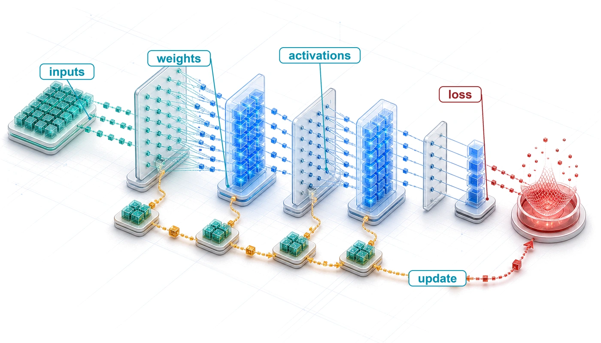
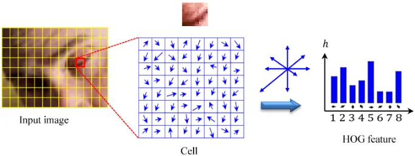
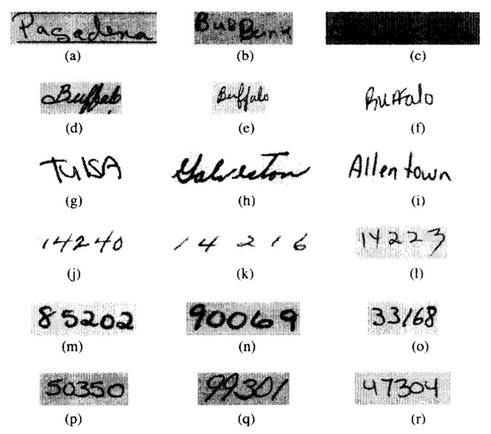

# Neural Computation {#sec-neural-computation}

::: {layout-narrow}
::: {.column-margin}

\chapterminitoc

:::

::: {.content-visible when-format="pdf"}
\noindent
{fig-alt="Layered isometric blueprint of neural computation where inputs move through weighted layers, activations form, and a loss signal returns through the model."}
:::

::: {.content-visible unless-format="pdf"}
{fig-alt="Layered isometric blueprint of neural computation where inputs move through weighted layers, activations form, and a loss signal returns through the model."}
:::

:::

## Purpose {.unnumbered .unlisted}

::: {.content-visible when-format="pdf"}
\begin{marginfigure}
\mlsysstack{20}{15}{90}{55}{10}{0}{0}{10}
\end{marginfigure}
:::

::: {.content-visible unless-format="pdf"}
::: {.column-margin}
{width="100%" fig-alt="Machine Learning Systems Architecture Stack"}

*Architecture stack focus for this chapter.*
:::
:::

_Why does understanding a neural network's math matter more than reading its code?_

Neural network code can look deceptively simple because a few tensor operations hide the workload that every layer of the system must execute. Matrix dimensions determine arithmetic and data movement; intermediate values determine memory pressure; numerical ranges and gradients determine whether learning remains stable. An operation that looks cheap in isolation can dominate a system when repeated across a batch or when its outputs must be retained for learning, so source-code length gives little indication of resource cost. Doubling both input and output dimensions quadruples a dense layer's arithmetic, and keeping activations for the backward pass can multiply memory use several times over, while the code looks no more complicated than before. Two implementations of the same model can run very differently because batch shape, precision, and the target machine change what fits, how quickly it runs, and whether its calculations remain numerically valid. When training stalls or deployment exhausts memory, reading a framework call rarely identifies which resource is the binding constraint. A numerical failure, a memory bottleneck, and an inefficient implementation can produce similar high-level symptoms while demanding different remedies. Diagnosis and planning therefore require reasoning from the underlying operations to the bytes moved, values retained, and work repeated. This view can expose a mismatch before an expensive training run or deployment attempt does, when correcting it still costs an edit rather than a week of lost compute. Those primitives provide a stable vocabulary across architectures and make software abstractions auditable, turning opaque code into a workload that can be measured, diagnosed, and mapped to hardware. In D·A·M terms, neural computation is the interface where algorithmic structure becomes machine work and where physical limits feed back into model design.

::: {.content-visible when-format="pdf"}

\newpage

:::

::: {.callout-learning-objectives}

- Explain why learned arithmetic replaced rule-based logic for high-dimensional pattern recognition
- Compare activation functions by nonlinearity, gradient behavior, and hardware execution cost
- Calculate parameter counts, multiply-accumulate operations, activation storage, and memory traffic for multilayer networks
- Apply cross-entropy loss and gradient updates to reason about supervised learning dynamics
- Derive forward and backward propagation as matrix operations over batches
- Analyze training vs. inference workloads using compute, memory, and deployment constraints
- Evaluate an end-to-end document-recognition pipeline from preprocessing through decision thresholds and human review

:::

## From Logic to Arithmetic {#sec-neural-computation-deep-learning-systems-engineering-foundation-597f}

```{python}
#| echo: false
from mlsysim import *
from mlsysim.core.units import *

# ┌─────────────────────────────────────────────────────────────────────────────
# │ DL PRIMER COMMON IMPORTS
# ├─────────────────────────────────────────────────────────────────────────────
# │ Context: Chapter-scoped import cell for all compute cells below.
# │
# │ Goal: Centralize unit imports for the chapter.
# │ Show: A clean shared namespace for subsequent LEGO cells.
# │ How: Wildcard-import mlsysim.constants for units.
# │
# └─────────────────────────────────────────────────────────────────────────────
```

```{python}
#| echo: false
#| label: neural-computation-reference-calcs
# ┌─────────────────────────────────────────────────────────────────────────────
# │ NEURAL COMPUTATION REFERENCE IMPORTS
# ├─────────────────────────────────────────────────────────────────────────────
# │ Context: Shared imports for early-chapter reference LEGO cells below.
# │
# │ Goal: Centralize imports for footnote-local calculations.
# └─────────────────────────────────────────────────────────────────────────────
from mlsysim.physics import memory_from_params
from mlsysim.fmt import fmt_int, fmt, fmt_math, fmt_qty_int, check, MarkdownStr, sci_latex
```

```{python}
#| echo: false
#| label: mnist-headline-ledger
from mlsysim.fmt import fmt, fmt_count, fmt_qty_int, check

# ┌─────────────────────────────────────────────────────────────────────────────
# │ MNIST HEADLINE LEDGER—CHAPTER OPENING
# ├─────────────────────────────────────────────────────────────────────────────
# │ Context: Opening paragraphs and the running-example callout of
# │          @sec-neural-computation-deep-learning-systems-engineering-foundation-597f;
# │          reused in @sec-neural-computation-neural-network-fundamentals-07e4
# │          and notebook \ref{nbk-nn-computation-counting-ops-forward-pass}.
# │
# │ Goal: State the running 784→128→64→10 network's headline ledger up front.
# │ Show: 109,184 MACs (218,368 FLOPs) per digit, 109,386 parameters, ~438 KB in FP32.
# │ How: Sum layer products for MACs; add biases for parameters; multiply by 4 bytes.
# │
# └─────────────────────────────────────────────────────────────────────────────

# ┌── LEGO ───────────────────────────────────────────────
class MNISTInference:
    """Namespace for the running MNIST network's headline ledger."""

    # ┌── 1. LOAD (Constants) ───────────────────────────────────────────────
    input_dim = 28 * 28
    h1_dim = 128
    h2_dim = 64
    out_dim = 10
    bytes_per_value = BYTES_FP32

    # ┌── 2. EXECUTE (The Compute) ─────────────────────────────────────────
    total_macs = input_dim * h1_dim + h1_dim * h2_dim + h2_dim * out_dim
    total_params = total_macs + h1_dim + h2_dim + out_dim
    weight_bytes = total_params * bytes_per_value

    # ┌── 3. GUARD (Invariants) ───────────────────────────────────────────
    check(total_macs == 109_184, f"MNIST MLP MAC mismatch: {total_macs}")
    check(total_params == 109_386, f"MNIST MLP parameter mismatch: {total_params}")
    check(437 < weight_bytes.to(KB).magnitude < 438, f"Expected ~438 KB of FP32 weights, got {weight_bytes.to(KB)}")

    # ┌── 4. OUTPUT (Formatting) ──────────────────────────────────────────────
    total_macs_str = fmt_count(total_macs, precision=0, label="MAC")
    total_flops_str = fmt_count(total_macs * 2, precision=0, label="FLOP")
    total_params_str = fmt_count(total_params, label="parameter")
    weight_kb_str = fmt_qty_int(weight_bytes, KB, commas=False)
    h1_dim_str = fmt(h1_dim, precision=0, commas=False)
    h2_dim_str = fmt(h2_dim, precision=0, commas=False)
    out_dim_str = fmt(out_dim, precision=0, commas=False)
```

Recognizing one handwritten digit costs the small network at the center of this chapter `{python} MNISTInference.total_macs_str`. A multiply-accumulate (MAC) multiplies one weight by one input value and adds the product to a running sum ($\MacAccumulator\leftarrow \MacAccumulator+ \ModelWeight\cdot \LayerInputComponent$), and the usual convention counts it as two floating-point operations ($1\text{ MAC} = 2\text{ FLOPs}$), so the digit costs `{python} MNISTInference.total_flops_str`. None of that work is a logical branch. A program that once tested pixel thresholds and stroke patterns with if-then-else rules has become a fixed sequence of arithmetic, and how fast it runs now depends on how quickly the machine can supply operands to that arithmetic, whether memory bandwidth or arithmetic capacity runs out first. Such a program also fails differently. It rarely fails logically; it fails numerically, as values grow or shrink until they stop carrying information.

The pipeline of @sec-data-engineering ends with a clean, versioned training set. One example from such a set, a handwritten digit, is where the model's work begins. An example does not learn on its own. The next system boundary is the model, the algorithm axis of D·A·M, where data becomes learned behavior, and this chapter follows what the model does with that one digit. Matrix multiplications and activation functions carry it forward to ten scores, the chain rule carries the error in those scores back as gradients, and an update folds the gradients into the weights.

The silicon contract (principle \ref{pri-silicon-contract}) says which hardware resource a model architecture will saturate first. This chapter supplies the model's side of that contract. The architecture's mathematical operators fix the work to be done and the state to be held. Precision, data layout, implementation, and hardware then fix how many bytes actually move, and therefore the realized latency and energy. Honoring the contract requires understanding both the operators and how they map to the machine.

::: {.column-margin .margin-pointer}
↩ The hardware's side of the silicon contract, the terms that memory bandwidth, peak compute rate, and fixed overhead set for any model, is established on the single-node stack in @sec-ml-systems-architectural-anchor.
:::

The digit passes through five stages in the life of a model. The *forward pass* carries the image through three weight matrices to ten class scores, the *loss* reduces those scores to one number that says how wrong they are, the *backward pass* carries that signal back through the layers with the chain rule, the *update* adjusts every parameter, and *serving* runs the forward pass alone with frozen weights. The iron law of ML systems (principle \ref{pri-iron-law}) charges each stage for the bytes it moves, the operations it performs, and its fixed overhead, and @tbl-nn-computation-stage-costs shows how differently the five stages spend those terms. The loss costs almost nothing, yet it is the only signal training receives; the update does little arithmetic but touches every parameter; the backward pass cannot run without the activations the forward pass left behind. Training repeats the first four stages millions of times and serving repeats only the first, and that asymmetry produces the chapter's central result, the gap between what training and inference must hold in memory.

| **Stage**         | **Work**                                                                            | **Data moved**                                               | **State left behind**                     | **Usually dominant cost**                   |
|:------------------|:------------------------------------------------------------------------------------|:-------------------------------------------------------------|:------------------------------------------|:--------------------------------------------|
| **Forward pass**  | One MAC per weight per example (`{python} MNISTInference.total_macs_str` per digit) | Every weight read; each layer's activations written and read | Activations, kept until the backward pass | Bytes at small batch, operations at large   |
| **Loss**          | A few operations per class                                                          | Ten scores per example                                       | One number per batch                      | Negligible                                  |
| **Backward pass** | Up to twice the forward pass                                                        | Weights and saved activations read; gradients written        | Gradients                                 | Operations or bytes, as in the forward pass |
| **Update**        | A few operations per parameter                                                      | Every weight, gradient, and optimizer value read and written | Optimizer state                           | Bytes                                       |
| **Serving**       | The forward pass alone                                                              | Weights plus two short-lived activation buffers              | Nothing beyond the weights                | Bytes and fixed overhead at small batch     |

: **Where Each Stage Spends Its Budget**: Work, data movement, and retained state for the five stages in the life of a model, for the running 784-128-64-10 network. Training repeats the first four stages for every batch, while serving runs only the forward pass. Later sections derive each row, and the summary returns to the table. {#tbl-nn-computation-stage-costs tbl-colwidths="[14,24,24,19,19]"}

::: {#exmp-nn-computation-running-example-mnist-digit-recognition .callout-example title="Running example: MNIST digit recognition"}

**Scenario**: A handwritten-digit classifier receives $28{\times}28$ grayscale images from the Modified National Institute of Standards and Technology (MNIST) dataset [@lecun1998], flattens each into 784 pixel values, and maps them through hidden layers of `{python} MNISTInference.h1_dim_str` and `{python} MNISTInference.h2_dim_str` units to `{python} MNISTInference.out_dim_str` class scores, one per digit (784 → 128 → 64 → 10).

**Diagnosis**: The network holds `{python} MNISTInference.total_params_str`, which occupy `{python} MNISTInference.weight_kb_str` in 32-bit floating point (FP32), and it spends `{python} MNISTInference.total_macs_str` (`{python} MNISTInference.total_flops_str`) to classify one digit. Those three numbers summarize what one classification costs.

**Systems lesson**: The task is small enough to compute by hand yet exercises every mechanism that larger networks scale up. Each later section either derives one of these numbers or asks what happens to it when the network trains, grows, or ships.

:::

Even this small network is deep in the sense the field uses: each of its layers computes new features from the layer before, and training learns those features from examples instead of receiving them from a designer.

::: {#dfn-nn-computation-deep-learning .callout-definition title="Deep learning"}

***Deep learning***\index{Deep learning!definition} is the computational paradigm that learns layered feature representations\index{Feature learning!hierarchical} from data by composing nonlinear transformations. For suitable tasks, those learned representations can reduce manual feature engineering while increasing computation $(\Operations)$ and state.

1.  **Significance**: For suitable compositional function classes, depth can represent a hierarchy much more parameter-efficiently than a shallow network. Each layer adds work and state, and the resulting binding constraint may lie on the data, algorithm, or machine axis depending on the workload.
2.  **Distinction**: Shallow methods\index{Shallow learning!vs. deep learning} such as logistic regression and support vector machines can work well with appropriate representations. Deep learning instead uses multiple nonlinear stages to learn representations jointly with the prediction task, which can reduce manual feature design and sometimes support transfer across tasks.
3.  **Common pitfall**: A frequent misconception is that parameter count alone explains deep learning. Two networks with the same parameter count can differ sharply in what they learn, because architecture, data, optimization, and scale together determine the practical result.

:::

Learning representations end to end also introduces engineering failure modes that conventional software debugging cannot isolate. Deep learning failures produce subtle symptoms: gradient instabilities\index{Gradient instabilities!training failure mode}[^fn-gradient-instabilities-depth] that halt convergence, numerical precision errors that corrupt parameter state across millions of updates, or inefficient memory access patterns in tensor operations (operations on multidimensional arrays of numbers) that leave accelerator compute units underutilized. Resolving these failures requires reasoning about the physical execution of tensor algebra on hardware rather than stepping through procedural control flow.

```{python}
#| echo: false
#| label: early-systems-claims
# ┌─────────────────────────────────────────────────────────────────────────────
# │ EARLY SYSTEMS CLAIMS—GRADIENT INSTABILITIES FOOTNOTE
# ├─────────────────────────────────────────────────────────────────────────────
# │ Context: Footnote [^fn-gradient-instabilities-depth] in the Purpose section.
# │
# │ Goal: Quantify vanishing gradients after 20 sigmoid layers.
# └─────────────────────────────────────────────────────────────────────────────

# ┌── LEGO ───────────────────────────────────────────────
class EarlySystemsClaims:
    """Namespace for early-chapter gradient-instability footnote."""

    # ┌── 1. LOAD (Constants) ──────────────────────────────────────────────
    sigmoid_depth = 20
    sigmoid_peak_derivative = 0.25

    # ┌── 2. EXECUTE (The Compute) ────────────────────────────────────────
    gradient_scale = sigmoid_peak_derivative**sigmoid_depth

    # ┌── 3. GUARD (Invariants) ───────────────────────────────────────────
    check(gradient_scale < 1e-12, f"20 sigmoid layers should nearly zero gradients; got {gradient_scale:.2e}")

    # ┌── 4. OUTPUT (Formatting) ──────────────────────────────────────────
    sigmoid_depth_str = fmt(sigmoid_depth, precision=0, commas=False)
    gradient_scale_math = fmt_math(sci_latex(gradient_scale, precision=1))
```

[^fn-gradient-instabilities-depth]: **Gradient instabilities**\index{Gradient instabilities!training failure}: In a simplified `{python} EarlySystemsClaims.sigmoid_depth_str`-layer path through sigmoid (S-shaped) activations, the activation-derivative factors alone are bounded above by $0.25^{20}$, or `{python} EarlySystemsClaims.gradient_scale_math`. The complete gradient also includes weights and other operations, but repeated saturated derivatives can still make early-layer updates negligible. Plateaus or not-a-number (NaN) values can reveal the symptom without identifying the cause; rectified linear unit (ReLU) activations and careful initialization (both taught later in this chapter), together with normalization, better optimizers, and residual connections, all helped make deep networks trainable, and @sec-network-architectures-evolution-dense-spatial-processing-2761 treats residual connections in detail.

Diagnosing and resolving these failures requires understanding how algorithmic formulations translate directly into physical hardware demands. Those demands depend first on representation, meaning whether patterns are expressed through hand-authored rules, engineered statistical features, or learned parameters.

## Computing with Patterns {#sec-neural-computation-evolution-ml-paradigms-ec9c}

One task makes the history concrete: classifying a $28{\times}28$ grayscale image of a handwritten digit. Computing has attacked that task with three representation strategies, hand-authored decision logic, engineered feature extractors, and learned neural representations. Under illustrative implementations, one digit costs roughly one hundred comparisons under the first, several thousand arithmetic operations under the second, and more than one hundred thousand MACs under the third. Each approach replaced one whose representations ran out, and each shifted which hardware resource binds.

::: {.column-margin .margin-pointer}
↩ The succession of logic, knowledge, feature-engineering, and infrastructure bottlenecks that these paradigms answered is established in @sec-introduction-ai-paradigm-evolution-ae2b.
:::

### From rules to engineered features {#sec-neural-computation-feature-engineering-bottleneck-6172}

```{python}
#| echo: false
#| label: paradigm-systems-cost
# ┌─────────────────────────────────────────────────────────────────────────────
# │ PARADIGM SYSTEMS COST—RUNNING MNIST EXAMPLE
# ├─────────────────────────────────────────────────────────────────────────────
# │ Context: Rule-based, HOG, and deep-learning cost prose in
# │          @sec-neural-computation-evolution-ml-paradigms-ec9c.
# │
# │ Goal: Establish operation and memory counts for each paradigm on one digit.
# └─────────────────────────────────────────────────────────────────────────────
from mlsysim.fmt import fmt_int, fmt, fmt_count, fmt_memory, fmt_qty_int, check

_MNIST_DIMS = [784, 128, 64, 10]

# ┌── LEGO ───────────────────────────────────────────────
class ParadigmSystemsCost:
    """Namespace for paradigm cost escalation on one MNIST digit."""

    # ┌── 1. LOAD (Constants) ──────────────────────────────────────────────
    rb_pixels = Datasets.MNIST.image_width * Datasets.MNIST.image_height
    rb_ops = 100
    rb_mem_bytes = rb_pixels
    hog_grid_dim = 7
    hog_cells = hog_grid_dim * hog_grid_dim
    hog_bins = 9
    hog_ops_approx = 8 * THOUSAND
    hog_mem_kb = 2
    mnist_dims = _MNIST_DIMS
    training_examples = Datasets.MNIST.training_examples.to(count).magnitude

    # ┌── 2. EXECUTE (The Compute) ────────────────────────────────────────
    dl_total_macs = _MNIST_DIMS[0] * _MNIST_DIMS[1] + _MNIST_DIMS[1] * _MNIST_DIMS[2] + _MNIST_DIMS[2] * _MNIST_DIMS[3]
    dl_params_with_bias = sum(_MNIST_DIMS[i] * _MNIST_DIMS[i + 1] + _MNIST_DIMS[i + 1] for i in range(len(_MNIST_DIMS) - 1))
    hog_features = hog_cells * hog_bins
    hog_ops_ratio = hog_ops_approx / rb_ops
    rb_mem = rb_mem_bytes * byte
    hog_mem = hog_mem_kb * KB
    dl_weight = dl_params_with_bias * BYTES_FP32
    dl_weight_kb = dl_weight.to(KB).magnitude
    dl_ops_ratio = dl_total_macs / rb_ops

    # ┌── 3. GUARD (Invariants) ───────────────────────────────────────────
    check(dl_total_macs == 109_184, f"Expected 109,184 MNIST MACs, got {dl_total_macs}")
    check(hog_ops_ratio == 80, f"Expected HOG/rule-based ops ratio of 80x, got {hog_ops_ratio:.1f}x")
    check(round(dl_ops_ratio) == 1092, f"Expected ~1,092x ops ratio, got {dl_ops_ratio:.1f}x")
    check(round(dl_weight_kb) == 438, f"Expected ~438 KB FP32 weight footprint, got {dl_weight_kb:.1f} KB")

    # ┌── 4. OUTPUT (Formatting) ─────────────────────────────────────────────
    rb_comparisons_str = fmt_count(rb_ops, precision=0, commas=False, label="comparison")
    rb_mem_bytes_str = fmt_memory(rb_mem, unit=byte, precision=0, commas=True)
    hog_grid_str = fmt_int(hog_grid_dim, commas=False)
    hog_bins_str = fmt(hog_bins, precision=0, commas=False)
    hog_features_str = fmt(hog_features, precision=0, commas=True)
    hog_ops_approx_str = fmt_count(hog_ops_approx, precision=0, commas=True, label="operation")
    hog_ops_ratio_mult_str = fmt_multiple(hog_ops_ratio, precision=0, commas=False)
    hog_mem_kb_str = fmt_memory(hog_mem, unit=KB, precision=0, commas=False)
    dl_total_macs_str = fmt_count(dl_total_macs, precision=0, commas=True, label="MAC")
    dl_params_str = fmt_count(dl_params_with_bias, label="parameter")
    dl_weight_kb_str = fmt_qty_int(dl_weight, KB, commas=False)
    dl_ops_ratio_mult_str = fmt_multiple(round(dl_ops_ratio, -2), precision=0, commas=True)
    training_examples_str = fmt(training_examples, precision=0, commas=True)
```

Rule-based programming\index{Rule-based programming!limitations} requires developers to specify the procedures that map inputs to outputs. In the classical flow of @fig-traditional, human-authored rules and input data enter the program together, and the program deterministically computes the answers.

::: {#fig-traditional fig-env="figure" fig-pos="htb" fig-cap="**Traditional Programming Flow**: Answers are the program's output, never its input. This input-output pattern formed the basis for early AI systems but lacks the adaptability needed for complex pattern recognition tasks." fig-alt="Flow diagram with four boxes: rules and data as inputs flowing into central traditional programming box, which outputs answers. Arrows show data flow direction from inputs to output."}

```{.tikz}
\resizebox{.65\textwidth}{!}{
\begin{tikzpicture}[font=\small\sffamily]
%
\tikzset{%
Line/.style={line width=1.0pt,black!50,text=black},
  Box/.style={inner xsep=2pt,
    node distance=1,
    draw=GreenLine, line width=0.75pt,
    fill=GreenL,
    text width=22mm,align=flush center,
    minimum width=22mm, minimum height=8mm
  },
  Box1/.style={Box, draw=RedLine, fill=RedL,
    text width=36mm, minimum width=40mm
  },
}
%
 \node[Box1](B1){Traditional Programming};
 \node[Box,right=of B1](B2){Answers};
 \node[Box,above left=0.2 and 1 of B1](B3){Rules};
 \node[Box, below left=0.2 and 1 of B1](B4){Data};
 \draw[-latex,Line](B1)--(B2);
 \draw[-latex,Line](B3)-|(B1);
 \draw[-latex,Line](B4)-|(B1);
\end{tikzpicture}}
```

:::

An illustrative rule-based classifier for the digit compares pixel intensities against fixed thresholds, checks stroke patterns in localized regions, and branches on the results. Under this toy implementation, the computation requires roughly `{python} ParadigmSystemsCost.rb_comparisons_str` over `{python} ParadigmSystemsCost.rb_mem_bytes_str` of pixel data, a workload that is small, predictable, and easily held in an ordinary CPU cache. The comparison establishes a workload baseline, not the accuracy of a production rule system. Rules fail on coverage rather than cost. Every new writing style, slant, or stroke width demands new branches, and the expert systems\index{Expert systems!knowledge engineering} of the 1970s and 1980s stalled on perception tasks for the same reason, because the competence involved is implicit and resists explicit rules.

The failures of rule-based systems suggested an alternative. Rather than encoding human knowledge as explicit rules, the system could discover patterns from data, and machine learning took that direction by replacing a rule for every situation with programs that identified patterns in examples. The success of these methods, however, still depended heavily on human insight to define which patterns to look for, a process known as feature engineering\index{Feature engineering!classical ML}\index{Classical machine learning!feature engineering}.

Feature engineering transformed raw data into representations that expose patterns to learning algorithms. The histogram of oriented gradients (HOG)[^fn-hog-feature-descriptor] [@dalal2005hog] exemplifies this approach. The feature-extraction pipeline in @fig-hog partitions an image into spatial cells, quantizes local pixel gradient directions across an eight-way orientation star, and compiles them into localized histogram bins. This transforms raw pixels into shape descriptors robust to lighting variations and small positional changes.

::: {#fig-hog fig-env="figure" fig-pos="htb" fig-cap="**HOG Method**: A local image patch is divided into cells, gradient orientations are accumulated into a histogram, and the resulting descriptor summarizes local shape while reducing sensitivity to illumination. Source: Figure 5 of @bakheet2021hog, licensed under [CC BY 4.0](https://creativecommons.org/licenses/by/4.0/)." fig-alt="Diagram of HOG extraction: an input image grid with one cell highlighted, a magnified cell containing gradient-direction arrows, an orientation guide, and an eight-bin histogram labeled HOG feature."}



:::

[^fn-hog-feature-descriptor]: **Histogram of oriented gradients (HOG)**\index{HOG!fixed vs. learned features}: An influential handcrafted descriptor for pedestrian detection before deep learning [@dalal2005hog]. One common configuration computes gradient orientations in $8{\times}8$ pixel cells, with cell size and other choices tuned for the task. HOG's fixed computation graph can run efficiently on CPUs with predictable latency, while learned features can reduce descriptor redesign but do not automatically transfer across domains and often benefit from accelerators only as model and batch scale grow.

Feature engineering raises the digit's cost while keeping it CPU friendly. For the same $28{\times}28$ digit, an illustrative HOG implementation divides the image into a `{python} ParadigmSystemsCost.hog_grid_str` by `{python} ParadigmSystemsCost.hog_grid_str` grid of 4 by 4 cells, computes gradient magnitudes and orientations, bins them into `{python} ParadigmSystemsCost.hog_bins_str` orientation histograms per cell (the diagram draws eight directions; the bin count, like the cell size, is a tuning choice), and produces a `{python} ParadigmSystemsCost.hog_features_str`-element feature vector. A linear support vector machine (SVM) classifier then performs ten dot products over that vector. The result is roughly `{python} ParadigmSystemsCost.hog_ops_approx_str` and about `{python} ParadigmSystemsCost.hog_mem_kb_str` of working memory, about `{python} ParadigmSystemsCost.hog_ops_ratio_mult_str` the work of the toy rule-based baseline, but still structured and well served by CPU vector units using **single instruction, multiple data (SIMD)**\index{SIMD!definition}. Descriptor size, class count, and implementation all change this cost.

These descriptors carried face and pedestrian detection through the 2000s, but every new problem needed an expert to design a new extractor, and the resulting features missed whatever patterns their designers had not anticipated. Human expertise, not computation, set the ceiling on how much real-world visual variation a system could absorb.

### Automatic pattern discovery {#sec-neural-computation-deep-learning-automatic-pattern-discovery-214d}

Neural networks remove that ceiling by discovering their own features\index{Deep learning!automatic feature learning}, learning representations directly from raw data instead of following explicit rules or human-designed extractors. Supervised learning inverts the traditional programming relationship. Engineers provide examples and target answers, and optimization produces the decision rules as output rather than taking them as input (@fig-deeplearning). Humans still shape the task through data, objectives, architectures, and evaluation.

::: {#fig-deeplearning fig-env="figure" fig-pos="htb" fig-cap="**Data-Driven Rule Discovery**: The flow diagram inverts the traditional programming pattern: data and answers serve as inputs to the machine learning process, which produces a learned decision function as output. This shift replaces a hand-coded decision policy while leaving engineers responsible for the data, objective, architecture, and evaluation." fig-alt="Flow diagram with four boxes: answers and data as inputs flowing into central machine learning box, which outputs rules. Arrows show inverted flow compared to traditional programming, with rules as output rather than input."}

```{.tikz}
\resizebox{.65\textwidth}{!}{
\begin{tikzpicture}[font=\small\sffamily]
%
\tikzset{%
Line/.style={line width=1.0pt,black!50,text=black},
  Box/.style={inner xsep=2pt,
    node distance=1,
    draw=GreenLine, line width=0.75pt,
    fill=GreenL,
    text width=22mm,align=flush center,
    minimum width=22mm, minimum height=8mm
  },
  Box1/.style={Box,  draw=RedLine,
    fill=RedL, text width=36mm,
    minimum width=40mm
  },
}
%
 \node[Box1](B1){Machine Learning};
 \node[Box,right=of B1](B2){Rules};
 \node[Box,above left=0.2 and 1 of B1](B3){Answers};
 \node[Box, below left=0.2 and 1 of B1](B4){Data};
 \draw[-latex,Line](B1)--(B2);
 \draw[-latex,Line](B3)-|(B1);
 \draw[-latex,Line](B4)-|(B1);
\end{tikzpicture}}
```

:::

The same digit, processed by the chapter's three-layer network (784 → 128 → 64 → 10), costs `{python} ParadigmSystemsCost.dl_total_macs_str`, `{python} ParadigmSystemsCost.dl_ops_ratio_mult_str` the work of the toy rule-based baseline. The `{python} ParadigmSystemsCost.dl_params_str` occupy `{python} ParadigmSystemsCost.dl_weight_kb_str` in FP32, more than most L1 caches hold, so even inference creates traffic between cache levels. Training multiplies the cost further. Each image is processed forward and backward before an update, at two to three forward passes of dense-layer arithmetic, repeated over `{python} ParadigmSystemsCost.training_examples_str` images for multiple epochs (full passes over the training set). Dense matrix multiplications now dominate the arithmetic and favor parallel hardware, shifting the engineering challenge from control-flow branching to memory bandwidth, data reuse, and hardware parallelism.

::: {.column-margin}
```{=latex}
\vspace*{-5mm}
```
{width="100%" fig-alt="Vertical log-scale ladder of orange bars, smallest at bottom: rule-based comparisons, then HOG operations, then neural-network matrix MACs at the top, spanning several orders of magnitude."}

*In this MNIST comparison, learned features spend far more arithmetic.*
:::

This trade is the bitter lesson\index{Bitter lesson!feature learning} at the scale of a single layer. HOG encodes an expert's knowledge of edges and orientations in `{python} ParadigmSystemsCost.hog_ops_approx_str` that never change; the learned first layer spends far more arithmetic and lets the data decide which pixel combinations matter. As computation became cheap enough, the general method that converts arithmetic into accuracy overtook the hand-built one. That victory demands the arithmetic, memory traffic, and training infrastructure that the rest of this chapter quantifies.

::: {.column-margin .margin-pointer}
↩ Why general methods that scale with computation keep overtaking methods built on human knowledge, the bitter lesson, is established in @sec-introduction-bitter-lesson-79c7.
:::

The escalation matters less for its `{python} ParadigmSystemsCost.dl_ops_ratio_mult_str` operation count than for what each step does to the binding resource, which moves from branch-heavy CPU control, to batch-oriented feature pipelines, to memory-fed matrix parallelism (@tbl-evolution). Dense matrix work meets the memory wall\index{Memory wall!data movement bottleneck}, the widening gap between compute throughput and off-chip memory bandwidth, whenever an operation performs too little arithmetic per byte it moves, a ratio called arithmetic intensity that the forward-pass analysis later in this chapter measures for the running network.

::: {.column-margin .margin-pointer}
↩ The memory wall and the physical reasons that off-chip bandwidth lags arithmetic are established in @sec-ml-systems-deployment-spectrum-71be.
:::

::: {.column-margin .margin-pointer}
↪ The AI memory wall, the point at which added FLOP/s stops reducing runtime because data movement dominates, is developed in @sec-hardware-acceleration-understanding-ai-memory-wall-3ea9.
:::

| **System Aspect**    | **Traditional Programming** | **ML with Features**        | **Deep Learning**                        |
|:---------------------|:----------------------------|:----------------------------|:-----------------------------------------|
| **Computation**      | Often control-flow oriented | Structured parallel ops     | Often matrix-parallel                    |
| **Memory Access**    | Workload dependent          | Commonly batch-oriented     | Large tensor working sets                |
| **Data Movement**    | Program and input dependent | Feature-pipeline movement   | Parameter and activation movement        |
| **Hardware Needs**   | Commonly CPU-centric        | Often CPU with vector units | Frequently accelerator-friendly          |
| **Resource Scaling** | Input and program dependent | Descriptor and data driven  | Driven by width, batch, state, and reuse |

: **System Resource Tendencies**: The illustrated implementations shift from control-oriented rules to structured feature pipelines and then to matrix-heavy neural computation. These are workload tendencies rather than requirements of every program in each paradigm. {#tbl-evolution tbl-colwidths="[15,25,24,36]"}

Scale therefore has costs as well as gains. Larger models and training budgets turn arithmetic throughput, memory bandwidth, storage capacity, and communication into potential bottlenecks, and model size is not a decision rule. Choosing a model requires comparing candidates on representative deployment data and on the complete cost of training, serving, monitoring, and maintenance, with the uncertainty in both gains and costs included. The useful question is whether the measured gain from additional scale earns those system costs.

::: {.column-margin .margin-pointer}
↪ How model size, training data, and compute trade off along a compute-optimal frontier is developed in @sec-data-selection-computeoptimal-frontier-24ba.
:::

::: {#psp-nn-computation-when-use-neural-networks .callout-perspective title="When to use neural networks"}

Not every problem benefits from deep learning. Neural networks are strong candidates when data exhibits spatial, sequential, or hierarchical structure that an architecture can exploit, simpler baselines miss the required task quality, and measured gains justify the complete system cost (@tbl-nn-when-to-use). With limited labels, low-dimensional tabular data, approximately linear relationships, hard latency limits, or strict auditability requirements, classical methods may match the useful performance of a neural network with less training, serving, and maintenance effort (@tbl-nn-when-not-to-use).

```{=latex}
\begingroup
\renewcommand{\arraystretch}{1.4}
```

| **Condition**             | **Evidence to seek**                                  | **Rationale**                            |
|:--------------------------|:------------------------------------------------------|:-----------------------------------------|
| **Representative data**   | Training and validation cover deployment conditions   | Capacity cannot replace missing coverage |
| **Exploitable structure** | Spatial, sequential, or hierarchical patterns         | Architecture can encode a useful prior   |
| **Baseline gap**          | Simpler methods miss the required task-quality target | Complexity buys a measured gain          |
| **Operational fit**       | Gain survives latency, memory, and cost limits        | Offline accuracy alone is insufficient   |
| **Maintenance advantage** | Learned features reduce recurring manual updates      | Full-system maintenance becomes simpler  |

: **Neural-Network Candidates**: Conditions under which deep learning is likely to outperform classical methods. {#tbl-nn-when-to-use tbl-colwidths="[22,39,39]"}

| **Condition**                   | **Baseline to test**              | **Reason to prefer it**                            |
|:--------------------------------|:----------------------------------|:---------------------------------------------------|
| **Limited labeled data**        | Linear model or tree ensemble     | Lower variance and easier validation               |
| **Structured tabular inputs**   | Gradient boosting or linear model | Strong accuracy without learned features           |
| **Approximately linear signal** | Linear or additive model          | Transparent and inexpensive execution              |
| **Hard resource bound**         | Rules or compact classical model  | Predictable latency, memory use, and energy demand |
| **Direct auditability needed**  | Constrained tree or linear model  | Decisions are easier to inspect                    |

: **Classical-Method Candidates**: Conditions under which simpler models are likely to match or beat a neural network. {#tbl-nn-when-not-to-use tbl-colwidths="[27,32,41]"}

**Systems insight**: Establish a simple baseline before building a neural network. Compare candidates on the task metric that matters and on the resources required to train, serve, monitor, and update them. Retain the neural approach only when its measured benefit justifies that added system. The document-recognition history in @sec-neural-computation-case-study-usps-digit-recognition-97be shows why the comparison must include preprocessing, rejection policy, and the cost of human review rather than model accuracy alone.

```{=latex}
\endgroup
```
:::

### Why backpropagation waited for systems {#sec-neural-computation-evolution-neural-network-computing-8754}

Rosenblatt's perceptron introduced a learning neuron model in 1958 [@rosenblatt1958]. Backpropagation\index{Backpropagation!historical development}[^fn-backprop-credit-assignment] was applied to neural networks by Paul Werbos\index{Werbos, Paul!backpropagation} in 1974 [@werbos1974beyond], building on Seppo Linnainmaa\index{Linnainmaa, Seppo!automatic differentiation}'s 1970 work on automatic differentiation [@linnainmaa1970representation], and Rumelhart\index{Rumelhart, David!backpropagation}, Hinton\index{Hinton, Geoffrey!backpropagation}, and Williams\index{Williams, Ronald J.!backpropagation} showed in 1986 that hidden units could learn useful internal features [@rumelhart1986]. That demonstration did not resolve the systems problem that the digit classifier's cost exposes. Every increase in model size multiplies forward operations, saved activations, gradient computations, and parameter updates, so the decades between early backpropagation work and widespread adoption\index{Algorithm-hardware adoption lag} reflect the maturation of hardware, data, initialization, nonlinearities, optimization, benchmarks, and software infrastructure. An algorithm can be viable in principle long before its surrounding system makes it useful in practice. The lesson does not run in reverse: a computationally expensive idea is not vindicated by expense alone, and it must be evaluated together with the data, software, hardware, and task regime that would make it useful.

[^fn-backprop-credit-assignment]: **Backpropagation**\index{Backpropagation!memory cost}: Short for "backward propagation of errors," the algorithm uses the chain rule to compute how the loss is locally sensitive to millions of weights. Werbos applied it to neural networks in 1974 [@werbos1974beyond], and the 1986 Rumelhart, Hinton, and Williams publication demonstrated practical effectiveness [@rumelhart1986]. The systems cost: backprop requires storing forward-pass activations and additional training state, creating the several-times-higher memory footprint quantified in @sec-neural-computation-memory-training-vs-inference.

::: {.column-margin .margin-pointer}
↩ How AlexNet, GPUs, and ImageNet ended the feature-engineering era, and why infrastructure became the next bottleneck, is established in @sec-introduction-deep-learning-era-infrastructure-bottleneck-2f02.
:::

::: {#chk-nn-computation-understanding-deep-learnings-emergence .callout-checkpoint title="Understanding deep learning's emergence"}

Before turning to the primitives that set these costs, verify your understanding of why deep learning emerged when it did:

- [ ] **Adoption lag**: can you explain why backpropagation existed for more than a decade before it was widely used, naming the systems costs that grow with model size?
- [ ] **The cost of feature learning**: can you explain, using the digit-classification operation counts, why replacing hand-engineered features with learned ones raises the arithmetic and memory demand?
- [ ] **Bottleneck shift**: can you use @tbl-evolution to explain how the binding resource moves from control flow toward data movement as representation moves from rules to learned features?
- [ ] **Baseline first**: can you name two conditions under which a classical baseline should be tried before a neural network, and the evidence that would justify switching?

If any of these concepts remain unclear, review the relevant sections before continuing.

:::

The digit classifier's cost and the adoption lag lead to the same conclusion. What a network costs the machine is fixed by the primitives it is built from, and those primitives are the subject of the rest of this chapter.

::: {.content-visible when-format="pdf"}

\newpage

:::

## Neural Network Fundamentals {#sec-neural-computation-neural-network-fundamentals-07e4}

Each of the `{python} MNISTInference.total_macs_str` that classify a single digit belongs to some neuron combining its inputs. Individually those operations are trivial. At network scale, a processor spends more time waiting for operands than computing whenever its memory system cannot supply them fast enough, and an accelerator such as a graphics processing unit (GPU) outruns a CPU on suitable neural workloads because it devotes silicon to wide arithmetic arrays and high-bandwidth memory rather than to branch prediction. The structure of the network primitives determines how data flows through that hardware and how memory demands scale during training and inference.

Those primitives (weighted sums, nonlinear activations, and gradient-based learning) anchor the feed-forward networks of this chapter and recur inside the larger architectures that later chapters introduce, which add operators and execution patterns this simple model does not contain. Parallelism and the memory wall, the pressures traced through the paradigm comparison, follow from that structure. Many simple units operate simultaneously on shared inputs, weights change during training, and layers compose low-level features into high-level ones. That structure begins with the artificial neuron.[^fn-neuron-mcculloch-pitts] Understanding it plays the role for a neural network that understanding a single transistor plays for a processor.

[^fn-neuron-mcculloch-pitts]: **Neuron**\index{Neuron!McCulloch-Pitts model}: @mcculloch1943 introduced a mathematical threshold model of nervous activity: inputs combine and an all-or-none output fires when a threshold is met. That logical neuron is an origin point for the artificial-neuron abstraction and for networks built from many simple units. Learned weights, deep hierarchies, and modern fused multiply-add (FMA) accelerator datapaths are later developments that turn this abstraction into the matrix-heavy workloads studied in this chapter.

### The artificial neuron as a computing primitive {#sec-neural-computation-artificial-neuron-computing-primitive-45b4}

The basic unit of neural computation, the **artificial neuron**\index{Artificial neuron!definition}\index{Artificial neuron!computing primitive}\index{Neural network!artificial neuron} (or node), serves as a simplified mathematical abstraction of nervous activity [@mcculloch1943]. Later digital neural-network implementations adapted this abstraction into a standardized processing unit. @Fig-bio-nn2ai-nn sets the two side by side. The left panel draws a biological cell, with branching dendrites that receive signals, a cell body that holds the nucleus, and an axon that carries the output away. The right panel draws the mathematical model, in which the inputs $\LayerInputComponent_1$, $\LayerInputComponent_2$, and onward, plus a constant input of one that carries the bias, flow along weighted edges into a node that first forms a linear sum $\NeuronPreactivation$ and then applies an activation function $\ActivationFunction$ to emit the output $\NetworkOutput$. The column of labels between the panels pairs each biological structure with its arithmetic counterpart: dendrites with inputs, synapses with weights, the soma (cell body) with the linear sum, and axon firing with the activation.

::: {#fig-bio-nn2ai-nn fig-env="figure" fig-pos="htb" fig-cap="**Biological-to-Artificial Neuron Mapping**: Each biological structure on the left has an arithmetic counterpart on the right. Read the mapping as an abstraction rather than a resemblance claim, since it keeps only what reduces to arithmetic and discards the electrochemistry that produced the behavior." fig-alt="Side-by-side comparison of biological neuron and artificial neuron. Left shows biological cell with dendrites, cell body, and axon. Right shows mathematical model with inputs x, including a constant input x0 equal to 1 whose edge carries the bias b, weights w, a linear-function node, an activation function, and output. A column of label pairs between the panels maps dendrites to inputs, synapses to weights, soma to the linear function, and axon firing to the activation."}

```{.tikz}
\begin{tikzpicture}[line join=round,font=\sffamily\footnotesize]
\tikzset{
  Box/.style={,
    inner xsep=2pt,
    node distance=1.4,
    draw=GreenLine,
    line width=0.75pt,
    rounded corners,
    fill=mygreen!07,
    minimum width=65mm, minimum height=57mm
  },
    Txt/.style={black!50,font=\sffamily\itshape\fontsize {8pt}{7}\selectfont},
  }

\ExplSyntaxOn

\fp_new:N  \l__ctp_angle_fp
\tl_new:N  \l__ctp_spec_tl
\tl_new:N  \l__ctp_name_tl
\int_new:N \g__ctp_shading_int

\keys_define:nn { colour_transition_path }
  {
    angle .fp_set:N  = \l__ctp_angle_fp,
    angle .initial:n = 0,
  }

% Razdvaja stavku:
%   orange      -> boja=orange, pozicija prazna
%   orange/12   -> boja=orange, pozicija=12
\cs_new_protected:Npn \__ctp_split_item:nNN #1#2#3
  {
    \seq_set_split:Nnn \l_tmpa_seq {/} {#1}
    \tl_set:Ne #2 { \tl_trim_spaces:n { \seq_item:Nn \l_tmpa_seq {1} } }
    \int_compare:nNnTF { \seq_count:N \l_tmpa_seq } > {1}
      {
        \tl_set:Ne #3 { \tl_trim_spaces:n { \seq_item:Nn \l_tmpa_seq {2} } }
      }
      {
        \tl_clear:N #3
      }
  }

% Gradi shading specifikaciju.
% Ako pozicija nije data, računa se ravnomerno.
\cs_new_protected:Npn \__ctp_build_shading:n #1
  {
    \tl_clear:N \l__ctp_spec_tl

    \int_step_inline:nn { \clist_count:n {#1} }
      {
        \__ctp_split_item:nNN
          { \clist_item:nn {#1}{##1} }
          \l_tmpa_tl
          \l_tmpb_tl

        \tl_if_blank:VTF \l_tmpb_tl
          {
            \tl_set:Nx \l_tmpb_tl
              { \fp_eval:n { 100*(##1-1)/(\clist_count:n {#1}-1) } }
          }
          { }

        \tl_put_right:Nx \l__ctp_spec_tl
          {
            color(\tl_use:N \l_tmpb_tl bp)=(\tl_use:N \l_tmpa_tl)
          }

        \int_compare:nNnF {##1} = { \clist_count:n {#1} }
          {
            \tl_put_right:Nn \l__ctp_spec_tl { ; }
          }
      }
  }

\cs_new_protected:Npn \__ctp_declare_shading:
  {
    \int_gincr:N \g__ctp_shading_int
    \tl_set:Nx \l__ctp_name_tl
      { colourtransitionpath\int_use:N \g__ctp_shading_int }

    \use:e
      {
        \exp_not:N \pgfdeclarehorizontalshading
          { \tl_use:N \l__ctp_name_tl }
          { 100bp }
          { \tl_use:N \l__ctp_spec_tl }
      }
  }

% #1 = opcije (ugao)
% #2 = lista boja
% #3 = zatvorena putanja, BEZ završnog ;
\NewDocumentCommand \ColourTransitionPath { O{} m m }
  {
    \group_begin:
      \keys_set:nn { colour_transition_path } {#1}
      \clist_set:Nn \l_tmpa_clist {#2}

      \int_compare:nNnTF { \clist_count:N \l_tmpa_clist } = {1}
        {
          % Samo jedna boja
          \__ctp_split_item:nNN
            { \clist_item:Nn \l_tmpa_clist {1} }
            \l_tmpa_tl
            \l_tmpb_tl

          \path[fill=\l_tmpa_tl] #3 ;
        }
        {
          \__ctp_build_shading:n {#2}
          \__ctp_declare_shading:

          \path[
            path~picture={
              \shade[
                shading=\tl_use:N \l__ctp_name_tl,
                shading~angle=\fp_eval:n { -\l__ctp_angle_fp }
              ]
              (path~picture~bounding~box.north~west)
                rectangle
              (path~picture~bounding~box.south~east);
            }
          ] #3 ;
        }
    \group_end:
  }

\ExplSyntaxOff

\draw[black,fill=myorange](-0.81,0)to[out=200,in=330](-1.02,0)
to[out=-210,in=275](-1.13,0.23)to[out=90,in=225](-1.06,0.33)to[out=40,in=255](-0.99,0.43)
to[out=70,in=220](-0.8,0.79)to[out=200,in=70](-1.03,0.49)to[out=250,in=50](-1.11,0.37)
to[out=230,in=270](-1.15,0.4)to[out=100,in=250](-1.16,0.64)to[out=70,in=290](-1.12,1.13)
to[out=270,in=70](-1.205,0.68)to[out=240,in=310](-1.275,0.72)to[out=120,in=280](-1.41,1.07)
to[out=270,in=125](-1.28,0.62)to[out=310,in=100](-1.21,0.32)to[out=270,in=45](-1.26,0.08)
to[out=220,in=5](-1.50,0.0)to[out=175,in=260](-1.55,0.14)to[out=80,in=300](-1.6,0.38)
to[out=120,in=280](-1.73,0.78)to[out=260,in=120](-1.64,0.35)to[out=300,in=85](-1.615,0.09)
to[out=260,in=325](-1.73,0.095)to[out=149,in=315](-2.01,0.3)to[out=115,in=255](-1.967,0.48)
to[out=65,in=295](-1.959,0.77)to[out=265,in=285](-2.1,0.42)to[out=105,in=275](-2.205,0.87)
to[out=260,in=115](-2.14,0.39)to[out=295,in=135](-1.971,0.19)to[out=305,in=00](-2.1,0.166)
to[out=175,in=50](-2.43,0.04)to[out=25,in=170](-2.09,0.11)to[out=345,in=188](-1.91,0.09)
to[out=10,in=150](-1.71,0.02)to[out=-30,in=120](-1.58,-0.1)to[out=285,in=90](-1.57,-0.25)
to[out=280,in=60](-1.57,-0.45)to[out=240,in=20](-1.75,-0.58)to[out=180,in=320](-1.88,-0.48)
to[out=140,in=0](-2.29,-0.37)to[out=340,in=130](-1.85,-0.59)to[out=320,in=20](-1.95,-0.70)
to[out=200,in=90](-2.25,-1.20)to[out=70,in=230](-2.09,-0.87)to[out=45,in=200](-1.73,-0.69)
to[out=25,in=60](-1.68,-0.72)to[out=245,in=70](-1.79,-0.92)to[out=245,in=90](-1.84,-1.18)
to[out=75,in=220](-1.64,-0.83)to[out=55,in=190](-1.49,-0.59)to[out=5,in=120](-1.26,-0.69)
to[out=300,in=60](-1.26,-0.89)to[out=240,in=85](-1.36,-1.19)to[out=270,in=70](-1.42,-1.53)
to[out=40,in=90](-1.32,-1.17)to[out=88,in=230](-1.22,-0.93)to[out=68,in=110](-1.17,-0.93)
to[out=290,in=130](-1.08,-1.16)to[out=298,in=95](-1.06,-1.61)to[out=58,in=95](-1.00,-1.27)
to[out=115,in=125](-0.97,-1.2)to[out=335,in=135](-0.7,-1.36)to[out=95,in=340](-0.97,-1.15)
to[out=150,in=300](-1.06,-1.05)to[out=110,in=280](-1.155,-0.69)to[out=100,in=150](-0.99,-0.54)
to[out=325,in=170](-0.8,-0.62)to[out=-5,in=110](-0.755,-0.72)to[out=280,in=150](-0.455,-1.16)
to[out=130,in=280](-0.71,-0.70)to[out=105,in=180](-0.61,-0.655)to[out=355,in=160](-0.31,-0.73)
to[out=335,in=180](0.07,-0.84)to[out=155,in=330](-0.25,-0.70)to[out=145,in=230](-0.255,-0.643)
to[out=40,in=185](0.13,-0.54)to[out=170,in=45](-0.28,-0.61)to[out=220,in=340](-0.44,-0.62)
to[out=160,in=290](-0.95,-0.36)
to[out=105,in=190](-0.75,-0.11)coordinate(PL1)
to[out=5,in=190](0.10,-0.2)to[out=10,in=200](1.10,0.13)to[out=20,in=170](1.50,0.15)
to[out=345,in=152](1.88,0.01)to[out=325,in=122](1.95,-0.11)to[out=290,in=95](1.985,-0.30)
to[out=270,in=100](2,-0.60)
arc[start angle=110, end angle=430, radius=0.065] %1
to[out=95,in=280](2.031,-0.40)to[out=95,in=130](2.06,-0.395)to[out=305,in=150](2.288,-0.565)
arc[start angle=180, end angle=500, radius=0.065] %2
to[out=145,in=310](2.088,-0.35)to[out=135,in=280](2.03,-0.15)to[out=95,in=300](2.00,-0.06)
to[out=95,in=170](2.10,-0.06)to[out=95,in=170](2.10,-0.06)to[out=345,in=190](2.26,-0.06)
to[out=355,in=150](2.46,-0.21)to[out=320,in=150](2.55,-0.27)
arc[start angle=170, end angle=490, radius=0.065] %3
to[out=160,in=310](2.395,-0.09)to[out=130,in=180](2.42,-0.04)to[out=0,in=170](2.73,-0.03)
arc[start angle=170, end angle=490, radius=0.075] %4
to[out=170,in=10](2.4,0.01)to[out=190,in=350](2.1,0.03)to[out=170,in=330](1.91,0.07)
to[out=170,in=210](1.91,0.12)to[out=30,in=210](2.01,0.17)to[out=20,in=170](2.21,0.21)
to[out=330,in=180](2.41,0.18)to[out=10,in=170](2.52,0.185)
arc[start angle=180, end angle=495, radius=0.07] %5
to[out=190,in=350](2.28,0.23)to[out=160,in=190](2.28,0.28)to[out=35,in=210](2.48,0.41)
to[out=35,in=190](2.55,0.43)
arc[start angle=200, end angle=520, radius=0.07] %6
to[out=195,in=40](2.25,0.32)to[out=215,in=10](2.1,0.25)to[out=195,in=260](2.05,0.30)
to[out=70,in=230](2.185,0.50)
arc[start angle=250, end angle=565, radius=0.055] %7
to[out=215,in=75](1.99,0.25)to[out=255,in=25](1.93,0.2)to[out=205,in=25](1.83,0.161)
to[out=200,in=345](1.73,0.161)to[out=160,in=325](1.57,0.23)to[out=120,in=225](1.62,0.3)
to[out=40,in=235](1.76,0.45)to[out=50,in=215](1.96,0.60)to[out=45,in=210](2.33,0.79)
to[out=30,in=170](2.43,0.8)to[out=335,in=180](2.76,0.74)
arc[start angle=210, end angle=525, radius=0.06] %8
to[out=180,in=340](2.45,0.839)to[out=150,in=220](2.48,0.9)to[out=50,in=210](2.66,1.07)
arc[start angle=220, end angle=545, radius=0.065] %9
to[out=205,in=40](2.4,0.9)to[out=215,in=20](2.1,0.79)to[out=200,in=30](1.97,0.715)
to[out=220,in=250](1.925,0.75)to[out=90,in=245](1.975,0.95)to[out=65,in=225](2.175,1.15)
to[out=50,in=265](2.285,1.37)
arc[start angle=280, end angle=590, radius=0.05] %10
to[out=260,in=45](2.17,1.23)to[out=230,in=55](2.08,1.13)to[out=260,in=275](2.04,1.13)
to[out=100,in=255](2.034,1.44)
arc[start angle=285, end angle=590, radius=0.055] %11
to[out=260,in=105](1.98,1.15)to[out=280,in=55](1.92,0.95)to[out=230,in=90](1.85,0.67)
to[out=250,in=60](1.74,0.55)to[out=230,in=290](1.68,0.55)to[out=100,in=270](1.677,0.78)
to[out=100,in=290](1.65,0.86)to[out=72,in=260](1.767,1.08)to[out=72,in=270](1.78,1.18)
arc[start angle=295, end angle=600, radius=0.05] %12
to[out=272,in=60](1.64,0.95)to[out=252,in=280](1.6,0.95)to[out=112,in=270](1.545,1.25)
arc[start angle=290, end angle=610, radius=0.07] %13
to[out=260,in=100](1.58,0.82)to[out=150,in=300](1.274,1.1)
arc[start angle=320, end angle=620, radius=0.05] %14
to[out=300,in=140](1.35,0.92)to[out=320,in=130](1.55,0.75)to[out=320,in=90](1.58,0.59)
to[out=290,in=50](1.58,0.394)to[out=230,in=0](1.34,0.27)to[out=180,in=20](1.0,0.23)
to[out=200,in=30](0.5,0.03)to[out=210,in=180](-0.05,-0.07)
to[out=180,in=340](-0.45,0.01)to[out=166,in=10]cycle;

\definecolor{col1}{RGB}{131,216,255}
\definecolor{col2}{RGB}{65,167,250}
\definecolor{col3}{RGB}{36,110,173}
\definecolor{col4}{RGB}{0,18,34}
\definecolor{col5}{RGB}{14,60,102}
\definecolor{col6}{RGB}{32,112,180}

\ColourTransitionPath[angle=100]
    {col5,col4,col5,col5,col1,col1,col1}
    {
      (-0.6,0.12)
      to[out=5,in=170](-0.17,0.04)
      to[out=290,in=70](-0.23,-0.29)
      to[out=180,in=330](-0.65,-0.17)
      to[out=90,in=240]cycle
    }

\draw[black](-0.6,0.12)coordinate(1X1)
to[out=5,in=170](-0.17,0.04)
to[out=290,in=70](-0.23,-0.29)coordinate(1X2)
to[out=180,in=330](-0.65,-0.17)
to[out=90,in=240]cycle;

\coordinate(1S1)at($(1X1)!0.5!(1X2)$);
\node[draw=none,ellipse,minimum width=2mm,minimum height=1.2mm,
inner sep=0pt,rotate=-10,fill=col3](EL1)at(1S1){};
\node[draw=none,ellipse,minimum width=1.75mm,minimum height=0.8mm,
inner sep=0pt,rotate=-10,fill=col2,anchor=south]at(EL1.south){};
\node[draw=none,ellipse,minimum width=1.5mm,minimum height=0.4mm,
inner sep=0pt,rotate=-10,fill=col1,anchor=south]at(EL1.south){};
\node[draw=black,ellipse,minimum width=2mm,minimum height=1.2mm,
inner sep=0pt,rotate=-10,fill=none](EL1)at(1S1){};

%the second
\ColourTransitionPath[angle=80]
    {col5,col4,col5,col5,col1,col1,col1}
    {
    (-0.09,0.04)
to[out=0,in=190](0.3,0.09)
to[out=300,in=85](0.39,-0.25)
to[out=200,in=350](-0.09,-0.29)
to[out=97,in=260]cycle;
    }

\draw[black](-0.09,0.04)coordinate(2X1)
to[out=0,in=190](0.3,0.09)
to[out=300,in=85](0.39,-0.25)coordinate(2X2)
to[out=200,in=350](-0.09,-0.29)
to[out=97,in=260]cycle;

\coordinate(2S1)at($(2X1)!0.5!(2X2)$);
\node[draw=none,ellipse,minimum width=2mm,minimum height=1.2mm,
inner sep=0pt,rotate=10,fill=col3](EL2)at(2S1){};
\node[draw=none,ellipse,minimum width=1.75mm,minimum height=0.8mm,
inner sep=0pt,rotate=10,fill=col2,anchor=south]at(EL2.south){};
\node[draw=none,ellipse,minimum width=1.5mm,minimum height=0.4mm,
inner sep=0pt,rotate=10,fill=col1,anchor=south]at(EL2.south){};
\node[draw=black,ellipse,minimum width=2mm,minimum height=1.2mm,
inner sep=0pt,rotate=10,fill=none]at(2S1){};

%The third
\ColourTransitionPath[angle=65]
    {col5,col4,col5,col5,col1,col1,col1}
    {
(0.38,0.1)
to[out=25,in=190](0.76,0.27)
to[out=298,in=95](0.86,-0.04)
to[out=210,in=5](0.48,-0.2)
to[out=117,in=280]cycle;
    }

\draw[black](0.38,0.1)coordinate(3X1)
to[out=25,in=190](0.76,0.27)
to[out=298,in=95](0.86,-0.04)coordinate(3X2)
to[out=210,in=5](0.48,-0.2)
to[out=117,in=280]cycle;

\coordinate(3S1)at($(3X1)!0.5!(3X2)$);
\node[draw=none,ellipse,minimum width=2mm,minimum height=1.2mm,
inner sep=0pt,rotate=25,fill=col3](EL3)at(3S1){};
\node[draw=none,ellipse,minimum width=1.75mm,minimum height=0.8mm,
inner sep=0pt,rotate=25,fill=col2,anchor=south]at(EL3.south){};
\node[draw=none,ellipse,minimum width=1.5mm,minimum height=0.4mm,
inner sep=0pt,rotate=25,fill=col1,anchor=south]at(EL3.south){};
\node[draw=black,ellipse,minimum width=2mm,minimum height=1.2mm,
inner sep=0pt,rotate=25,fill=none]at(3S1){};

%The fourth
\ColourTransitionPath[angle=65]
    {col5,col4,col5,col5,col1,col1,col1}
    {
(0.84,0.285)
to[out=25,in=190](1.26,0.39)
to[out=298,in=95](1.32,0.08)
to[out=185,in=5](0.93,-0.02)
to[out=117,in=280]cycle;
    }

\draw[black](0.84,0.285)coordinate(4X1)
to[out=25,in=190](1.26,0.39)
to[out=298,in=95](1.32,0.08)coordinate(4X2)
to[out=185,in=5](0.93,-0.02)
to[out=117,in=280]cycle;

\coordinate(4S1)at($(4X1)!0.5!(4X2)$);
\node[draw=none,ellipse,minimum width=2mm,minimum height=1.2mm,
inner sep=0pt,rotate=15,fill=col3](EL4)at(4S1){};
\node[draw=none,ellipse,minimum width=1.75mm,minimum height=0.8mm,
inner sep=0pt,rotate=15,fill=col2,anchor=south]at(EL4.south){};
\node[draw=none,ellipse,minimum width=1.5mm,minimum height=0.4mm,
inner sep=0pt,rotate=15,fill=col1,anchor=south]at(EL4.south){};
\node[draw=black,ellipse,minimum width=2mm,minimum height=1.2mm,
inner sep=0pt,rotate=15,fill=none]at(4S1){};

%left

\coordinate(0S1)at(-1.25,-0.26);
\node[draw=none,ellipse,minimum width=3.8mm,minimum height=2.8mm,
inner sep=0pt,rotate=0,fill=col3](EL0)at(0S1){};
\node[draw=none,ellipse,minimum width=3.5mm,minimum height=1.9mm,
inner sep=0pt,rotate=0,fill=col2,anchor=south]at(EL0.south){};
\node[draw=none,ellipse,minimum width=3.1mm,minimum height=1.2mm,
inner sep=0pt,rotate=0,fill=col1,anchor=south]at(EL0.south){};
\node[draw=black,ellipse,minimum width=3.8mm,minimum height=2.8mm,
inner sep=0pt,rotate=0,fill=none]at(0S1){};

\coordinate (P1) at (2.00,-0.60);
\coordinate (N1) at ($(P1)-({0.065*cos(110)},{0.065*sin(110)})$);

\coordinate (P2) at (2.288,-0.565);
\coordinate (N2) at ($(P2)-({0.065*cos(180)},{0.065*sin(180)})$);

\coordinate (P3) at (2.55,-0.27);
\coordinate (N3) at ($(P3)-({0.065*cos(170)},{0.065*sin(170)})$);

\coordinate (P4) at (2.73,-0.03);
\coordinate (N4) at ($(P4)-({0.075*cos(170)},{0.075*sin(170)})$);

\coordinate (P5) at (2.52,0.185);
\coordinate (N5) at ($(P5)-({0.07*cos(180)},{0.07*sin(180)})$);

\coordinate (P6) at(2.55,0.43);
\coordinate (N6) at ($(P6)-({0.07*cos(200)},{0.07*sin(200)})$);

\coordinate (P7) at(2.185,0.5);
\coordinate (N7) at ($(P7)-({0.055*cos(250)},{0.055*sin(250)})$);

\coordinate (P8) at(2.76,0.74);
\coordinate (N8) at ($(P8)-({0.06*cos(210)},{0.06*sin(210)})$);

\coordinate (P9) at(2.66,1.07);
\coordinate (N9) at ($(P9)-({0.065*cos(220)},{0.065*sin(220)})$);

\coordinate (P10) at(2.285,1.37);
\coordinate (N10) at ($(P10)-({0.05*cos(280)},{0.05*sin(280)})$);

\coordinate (P11) at(2.034,1.44);
\coordinate (N11) at ($(P11)-({0.055*cos(285)},{0.055*sin(285)})$);

\coordinate (P12) at(1.78,1.18);
\coordinate (N12) at ($(P12)-({0.05*cos(295)},{0.05*sin(295)})$);

\coordinate (P13) at(1.545,1.25);
\coordinate (N13) at ($(P13)-({0.07*cos(290)},{0.07*sin(290)})$);

\coordinate (P14) at(1.274,1.1);
\coordinate (N14) at ($(P14)-({0.05*cos(320)},{0.05*sin(320)})$);

\foreach \x / \v in {1/1.64pt,2/1.64pt,3/1.64pt,
4/1.94pt,5/1.85pt,6/1.85pt,7/1.4pt,8/1.5pt,9/1.65pt,
10/1.3pt,11/1.4pt,12/1.3pt,13/1.8pt,14/1.3pt
}{
\shade[ball color=cyan!50!blue] (N\x) circle (\v);
}
%Labeling
\draw[](0S1)--++(245:1.65)node[below]{Nucleus};
\draw[](0S1)+(300:0.2)--++(306:1.65)node[below]{\textbf{Cell Body}};
\node[]at(-0.15,0.99){\textbf{Dendrites}};
\draw[red,<-,>=Latex](-2.1,0.9)--++(80:0.65)node[above=0pt,inner sep=0pt]{\textbf{Inputs}};
\node[]at(0.9,-0.4){\textbf{Axon}};
\draw[red,<-,>=Latex](N3)+(270:0.14)--++(256:1.15)node[below]{\textbf{Outputs}};

\begin{scope}[on background layer]
\node[Box](BB1)at(0.25,-0.1){};
\node[Box,right=2.5 of BB1](BB2){};
\end{scope}
\node[below=9pt of BB1.north,GreenLine]{\textbf{Biological Neuron}};
\node[below=9pt of BB2.north,GreenLine]{\textbf{Artificial Neuron}};

\begin{scope}[shift={($(BB2)+(-2.15,1.4)$)}]
 \tikzset{%
  Line/.style={line width=1.0pt,black!50,text=black},
  Box2/.style={inner sep=2pt,
    node distance=0.23,circle,
    draw=VioletLine, line width=0.75pt,
    fill=VioletL2,
    align=flush center,
    minimum width=8mm,
  },
}
%
\node[Box2](B1){$x_{0}$};
\node[Box2,below=of B1](B2){$x_1$};
\node[Box2,below=of B2](B3){$x_2$};
\node[Box2,node distance=0.7,below=of B3](B4){$x_n$};
\node[rotate=90,font=\tiny\sffamily]at($(B3)!0.5!(B4)$){$\bullet$ $\bullet$ $\bullet$};

\node[above=0.1 of B1,font=\sffamily\small](WE){\textbf{Inputs}};
\node[Box2,minimum width=12mm,right=2of $(B1)!0.5!(B4)$,
            fill=VioletL2,draw=VioletLine](B5){};
\draw[VioletLine,dashed,thick](B5.north)--(B5.south);
\node[right=2pt of B5.west]{$z$};
\node[left=2pt of B5.east]{$f$};
%
\node[below left=0 and -0.5 of B5.south,align=left]{Linear\\Function};
\node[below right=0 and 0.5 of B5.south,align=left]{Activation\\Function};
\foreach \x in{1,...,4}{
\draw[Line](B\x)--coordinate[pos=0.4](S\x)(B5);
}
\node[right=0pt of B1]{$=1$};
\node[below=0pt of S1]{$b$};
\node[below=0pt of S2]{$w_1$};
\node[below=0pt of S3]{$w_2$};
\node[below=3pt of S4]{$w_n$};
%
\draw[Line,-latex](B5)--node[above,pos=0.8]{$y$}++(1.97,0)
node[below,pos=0.7]{\textbf{Output}};
\end{scope}
%%between
\coordinate(TG)at($(BB1.north east)!0.5!(BB2.north west)$);
\coordinate(TD)at($(BB1.south east)!0.5!(BB2.south west)$);

\draw[black!40,shorten >=4mm,shorten <=4mm](TG)--(TD);

\foreach \x[count =\a]  in {0.14,0.38,0.62,0.85}{
\fill[black!30]($(TG)!\x!(TD)$) circle(2pt)coordinate(Q\a);
}
\node[above=2pt of Q1,Txt]{Dendrites};
\node[below=2pt of Q1,Txt]{= Inputs};

\node[above=2pt of Q2,Txt]{Synapses};
\node[below=2pt of Q2,Txt]{= Weights};

\node[above=2pt of Q3,Txt]{Soma};
\node[below=2pt of Q3,Txt]{= Linear fn(z)};

\node[above=2pt of Q4,Txt]{Axon firing};
\node[below=2pt of Q4,Txt]{= Activation (f)};

\end{tikzpicture}

```

:::

Read from left to right, the right panel of @fig-bio-nn2ai-nn carries one signal through four stages, and each stage takes its name from one label pair in the column between the panels:

1. **Input Reception** (Dendrites → $\LayerInputComponent_1, \LayerInputComponent_2, \dots, \LayerInputComponent_n$): The column of circles on the left of the panel is the vector of input features $\InputFeatureVector$ that the artificial neuron receives. In MNIST digit recognition, these represent pixel intensities. The dendrite analogy captures reception of many signals without claiming biological equivalence\index{Biological neuron!analogy limits}.
2. **Weighted Modulation** (Synapses → $\ModelWeight_1, \ModelWeight_2, \dots, \ModelWeight_n$)\index{Weights!learnable parameters}: Each input is multiplied by a learnable weight $\ModelWeight_i$, just as synaptic strengths modulate biological signals. These weights act as "gain" controls, determining how much influence each feature has on the final decision. A bias term $\NeuronBias$ (shown as the top input $\LayerInputComponent_0 = 1$ in @fig-bio-nn2ai-nn) shifts the activation threshold. Across a network, learned behavior is distributed over many such parameters rather than stored in one weight.
3. **Signal Aggregation** (Cell Body → Linear Function $\NeuronPreactivation$)\index{Bias!signal aggregation}: The left half of the split node, labeled $\NeuronPreactivation$, integrates the weighted signals, producing a single scalar value $\NeuronPreactivation= \sum (\LayerInputComponent_i \cdot \ModelWeight_i) + \NeuronBias$. This mirrors how a biological cell body sums incoming electrochemical signals to determine whether the neuron has received enough evidence for a particular pattern.
4. **Nonlinear Activation** (Axon → Activation Function $\ActivationFunction$)\index{Activation function!nonlinear transformation}: In the right half of the node, labeled $\ActivationFunction$, the aggregated signal passes through an activation function $\ActivationFunction(\NeuronPreactivation)$ and leaves along the output arrow, producing the activation output $\NeuronActivation= \ActivationFunction(\NeuronPreactivation)$ (often denoted $\NetworkOutput$). This mirrors the axon's all-or-nothing firing decision: the nonlinearity determines whether the neuron "fires" a signal to the next layer. Unlike the biological case, $\ActivationFunction$ can produce graded outputs (for example, ReLU passes positive values through, zeroes negatives), but the principle is the same, thresholding followed by propagation.

For the machine, one neuron costs $\LayerInputWidth$ MAC\index{MAC!multiply-accumulate operation}[^fn-multiply-accumulate-mac] operations. A direct scalar evaluation loads $\LayerInputWidth$ inputs, $\LayerInputWidth$ weights, and a bias before writing one output, so without reuse it moves about two values per MAC. Batched and tiled kernels reuse inputs and weights across many neuron evaluations and cut that traffic per MAC, which is why performance at network scale depends on how well the implementation reuses data as much as on how many operations it performs. Three constraints that a single neuron does not expose appear once neurons are composed into a network\index{Neural network!capacity vs. cost trade-off}. Moving parameters and activations can limit a large model more than arithmetic throughput does. Operations inside a layer can run in parallel, but layer $\LayerIndex+1$ waits for layer $\LayerIndex$, which places a floor under end-to-end latency. Precision trades against memory, throughput, and energy, because wider formats move more bytes while narrower ones need evidence that task quality survives, the search for minimum viable precision that @sec-model-compression develops. The perceptron formalization in @sec-neural-computation-perceptron-weighted-sum-9b3e turns the four stages into the equations that this accounting counts.

[^fn-multiply-accumulate-mac]: [offset=-50mm] **MAC (multiply-accumulate)**\index{MAC!neural computation}: Hardware data sheets report fused multiply-add throughput in FLOP/s, so a quoted FLOP/s rate is twice the corresponding MAC/s rate. Layer and batch choices also create activation, communication, and data-movement costs, so MAC count is necessary but not sufficient for a systems budget.

### Network architecture fundamentals {#sec-neural-computation-network-architecture-fundamentals-1f58}

Composing neurons into a network turns one neuron's cost into a network's, and each architectural choice, from how neurons connect to how layers are organized, fixes a computational pattern that hardware must then execute. The running network of Example \ref{exmp-nn-computation-running-example-mnist-digit-recognition} is built from exactly these choices, and the subsections below derive its parameter and operation counts one decision at a time, starting with the weighted sum inside each unit.

#### The perceptron's weighted sum {#sec-neural-computation-perceptron-weighted-sum-9b3e}

The computational machinery within each dense layer is the **perceptron**\index{Perceptron!definition}\index{Perceptron!Rosenblatt}\index{Neural network!perceptron},[^fn-perceptron-rosenblatt-model] which Rosenblatt introduced as a learning form of the artificial neuron [@rosenblatt1958]. Its signal path (inputs, weights, bias, aggregation, activation) is the one @sec-neural-computation-artificial-neuron-computing-primitive-45b4 traced through its biological origins. What remains is to formalize that path mathematically, because this repeated operation becomes the layer-level kernel that hardware executes. In the MNIST network, a first-layer unit combines all 784 pixel intensities into one activation that may respond to a learned pattern, such as a vertical edge shared by "one" and "seven." Inside one unit (@fig-perceptron), input features $\LayerInputComponent_i$ travel along weighted channels $\NeuronConnectionWeight$ and accumulate into a scalar sum with bias $\NeuronBias_j$, and the resulting linear score $\NeuronPreactivation_j$ passes through an activation $\ActivationFunction$ to produce output $\PredictedOutputComponent$. Different neurons repeat the same structure with different learned weights, allowing one layer to test many patterns against the same input.

[^fn-perceptron-rosenblatt-model]: **Perceptron**\index{Perceptron!linear separability limit}: A machine built to execute a learning algorithm, directly linking hardware and software from the start. A single linear-threshold layer cannot represent nonlinearly separable functions such as XOR, regardless of additional input hardware [@minsky1969perceptrons]. Multilayer nonlinear networks expand the representable function class, but they also introduce the training and systems costs developed in this chapter.

::: {#fig-perceptron fig-env="figure" fig-pos="htb" fig-cap="**Perceptron Architecture**: Inputs enter on the left, each scaled by its own weight, and the weighted products plus a bias meet at the summation node before a single activation function produces the output. The multiplies and the accumulation along this path are the per-neuron unit of work that the chapter's layer-cost calculations multiply out." fig-alt="Perceptron diagram with inputs x1 through xn on left, each connected to weight circles w1j through wnj. Weights feed into red summation node, which receives bias bj from below. Output zj flows to blue activation function f box, producing output y-hat on right."}

```{.tikz}
\scalebox{0.85}{
\begin{tikzpicture}[font=\sffamily]
\tikzset{%
  Line/.style={line width=1.0pt,black!50,text=black},
  Box/.style={inner xsep=3pt,
    node distance=0.4,
    circle,
    draw=GreenLine, line width=0.75pt,
    fill=GreenL,
    align=flush center,
    minimum width=8mm,
  },
}
%
\node[Box](B1){$w_{1j}$};
\node[Box,below=of B1](B2){$w_{2j}$};
\node[Box,below=of B2](B3){$w_{3j}$};
\node[Box,node distance=1.0,below=of B3](B4){$w_{nj}$};
\node[rotate=90,font=\tiny\sffamily]at($(B3)!0.5!(B4)$){$\bullet$ $\bullet$ $\bullet$};
\foreach \x in{1,...,3}{
\draw[Line,latex-](B\x)--++(180:2)node[left](X\x){$x_\x$};
}
\node[above=0.1 of B1,font=\sffamily\small](WE){Weights};
\path[](WE)-|coordinate(IN)(X1);
\node[font=\sffamily\small]at(IN){Inputs};

\draw[Line,latex-](B4)--++(180:2)node[left](X4){$x_n$};
\node[rotate=90,font=\tiny\sffamily]at($(X3)!0.5!(X4)$){$\bullet$ $\bullet$ $\bullet$};
\node[Box,minimum width=12mm,right=2of $(B1)!0.5!(B4)$,
            fill=RedL,draw=RedLine](B5){$\sum$};
\foreach \x in{1,...,4}{
\draw[Line,-latex](B\x)--(B5);
}
%
\node[Box,node distance=1.3,rectangle, right=of B5,fill=BlueL,
            draw=BlueLine, minimum width=11mm, minimum height=11mm,
            font=\sffamily\huge](SI){$f$};
\draw[Line,-latex](B5)--node[above]{$z_j$}(SI);
\draw[Line,latex-,font=\sffamily\small](B5)--
           node[right]{$b_j$}++(270:1.75)node[below,]{Bias};
\draw[Line,-latex](SI)--++(0:1.75)node[right](OU){$\hat{y}$};
\node[above=0.1 of OU,font=\sffamily\small]{Output};
\node[below=0.3 of SI,font=\sffamily\small,align=center]{Activation\\ function};
\end{tikzpicture}}
```

:::

Each input $\LayerInputComponent_i$ has a corresponding weight $\NeuronConnectionWeight$, and the perceptron multiplies each input by its matching weight. The intermediate output, $\NeuronPreactivation_j$, is computed as the weighted sum of inputs in @eq-weighted-sum:
$$ \NeuronPreactivation_j = \sum_i (\LayerInputComponent_i \cdot \NeuronConnectionWeight) $$ {#eq-weighted-sum}

Here, $\NeuronIndex$ identifies the receiving neuron once perceptrons are assembled into a layer, and the sum runs over all input indices $\InputFeatureIndex$. In plain terms, each input feature is scaled by how important it is (its weight), and the results are summed into a single score. This is the **dot product**\index{Dot product!definition} of two vectors.

A bias term $\NeuronBias_j$ shifts the linear output up or down, giving the model additional flexibility to fit the data. Thus, the intermediate linear combination computed by the perceptron including the bias becomes @eq-weighted-sum-bias:
$$ \NeuronPreactivation_j = \sum_i (\LayerInputComponent_i \cdot \NeuronConnectionWeight) + \NeuronBias_j $$ {#eq-weighted-sum-bias}

With this weighted sum in hand, a suitable output activation and loss can support regression or classification. A binary linear-threshold classifier selects one of two classes around a threshold; multiclass networks instead produce several scores and commonly normalize them into probabilities with softmax, an output function developed with the other activation functions below.

The formalization turns the neuron's cost into a layer's. A dense layer of $\LayerOutputWidth$ neurons repeats the weighted sum $\LayerOutputWidth$ times, so its arithmetic cost is $\LayerInputWidth \times \LayerOutputWidth$ MACs, exactly the matrix multiplication $\InputFeatureVector\WeightMatrix$ that hardware must execute, and the form in which the rest of this chapter counts work. The dot product is the operation that accelerators are built to execute at maximum throughput, which is why neural network performance is quoted in MACs or FLOPs completed per second; how those machines are organized around it is developed in @sec-hardware-acceleration-matrix-operations-neural-networks-527a. A weighted sum alone, however, can only draw straight boundaries, and the activation applied to it decides what the layer can represent.

#### Nonlinear activation functions {#sec-neural-computation-nonlinear-activation-functions-38bc}

**Activation functions**\index{Activation function!definition} are where expressiveness, gradient flow, and hardware cost meet. They convert linear weighted sums into nonlinear outputs. Applying an activation $\ActivationFunction$ to the weighted sum of @eq-weighted-sum-bias yields the generic artificial-neuron computation in @eq-perceptron:
$$ \PredictedOutputComponent_j = \ActivationFunction(\NeuronPreactivation_j) = \ActivationFunction\left(\sum_i (\LayerInputComponent_i \cdot \NeuronConnectionWeight) + \NeuronBias_j\right) $$ {#eq-perceptron}

This nonlinearity expands what multilayer networks can represent. Without it, a stack of linear layers collapses algebraically into one linear transformation, regardless of how many intermediate matrices the implementation evaluates. In @fig-nonlinear, a network without activation functions is constrained to a linear decision hyperplane (left panel) that misclassifies overlapping point clusters, whereas incorporating nonlinear activations enables curved decision boundaries (right panel) that contour around nonlinearly separable data. The visualization highlights representational expressiveness rather than an optimization guarantee; training dynamics and sample coverage still govern whether training actually finds that partition.

::: {#fig-nonlinear fig-env="figure" fig-pos="htb" fig-cap="**Linear vs. Nonlinear Decision Boundaries**: Two scatter plots compare the decision boundary a network draws on the same points with and without an activation function." fig-alt="Two scatter plots side by side. Left plot shows cyan and green points with straight red line failing to separate them, labeled NN without activation function. Right plot shows same points with curved red decision boundary successfully separating classes, labeled NN with activation function."}

```{.tikz}
\scalebox{0.7}{
 \begin{tikzpicture}[line join=round,font=\sffamily]
\newcounter{point}
\tikzset{
  circ/.pic={
    \pgfkeys{/circ/.cd, #1}
%red
\foreach \x/\y in{0.4/0.77,0.39/1.46,0.39/2.02,0.37/2.52,0.37/2.95,0.47/3.35,
0.84/0.42,0.68/1.09,0.7/1.72,0.74/2.36,0.77/2.78,0.85/3.18,1.16/3.44,
1.37/0.36,1.14/0.82,1.08/1.47,1.02/1.97,1.45/2.10,1.16/2.39,1.26/2.9,1.56/3.3,
1.89/2.37,1.64/2.7,2.09/2.96,2.00/3.37,
2.57/2.33,3.08/2.2,3.42/2.42,3.25/3.06,2.96/2.75,2.48/2.73,2.71/3.13,
2.44/3.44,3.07/3.48
}{
 \stepcounter{point} % We increment the counter for each iteration
\fill[draw=none,fill=\bballcolor](\x,\y)circle[radius=5.5pt];
%\node[font=\tiny\sffamily,blue] at (\x,\y) {C\arabic{point}};
\coordinate(C\arabic{point})at(\x,\y);
}
%blue
\foreach \x/\y in {1.83/0.36,2.29/0.35,2.71/0.35,3.38/0.35,
3.4/0.8,3.39/1.35,3.41/1.90,3.07/1.62,2.59/1.82,2.19/1.98,
1.79/1.67,1.52/1.25,1.66/0.80,2.13/0.72,2.63/0.74,3.04/0.59,
3.02/0.99,2.72/1.28,2.29/1.48,1.95/1.15,2.36/1.07}
{
    \stepcounter{point} %We increment the counter for each iteration
\fill[draw=none,fill=\bballcolorr](\x,\y)circle[radius=5.5pt];
%\node[font=\tiny\sffamily,red] at (\x,\y) {P\arabic{point}};
\coordinate(P\arabic{point})at(\x,\y);
}
  } }

\pgfkeys{
  /circ/.cd,
  bballcolor/.store in=\bballcolor,
  bballcolorr/.store in=\bballcolorr,
  bballcolor=red,      % default ball1 color
  bballcolorr=blue,      % default ball2 color
}
%LEFT
\begin{scope}[local bounding box=CIRC1,shift={(0,0)}]
\pic at (0,0) {circ={bballcolor=Cerulean,bballcolorr=LimeGreen}};
%fitting
\node[draw=black,inner xsep=4mm,inner ysep=3mm,
fill=none,fit=(C6)(P38)(C34),line width=1.75pt](BB1){};
\draw[red,line width=2pt]($(BB1.south west)!0.18!(BB1.south east)$)--
             ($(BB1.north east)!0.12!(BB1.south east)$);
\node[align=center,below=0.1 of BB1]{NN without Activation Function};
\end{scope}
%RIGHT
\begin{scope}[local bounding box=CIRC2,shift={(6,0)}]
\pic at (0,0) {circ={bballcolor=Cerulean,bballcolorr=LimeGreen}};
%fitting
\node[draw=black,inner xsep=4mm,inner ysep=3mm,
yshift=0mm,fill=none,fit=(C61)(P93)(C89),line width=1.75pt](BB2){};
\draw[red,line width=2pt]($(BB2.south west)!0.4!(BB2.south east)$)
to[out=90,in=270]($(C69)!0.5!(P90)$)
to[out=90,in=280]($(C70)!0.5!(P102)$)
to[out=110,in=240]($(C71)!0.5!(P101)$)
to[out=70,in=220]($(C73)!0.5!(P100)$)
to[out=30,in=200]($(C77)!0.5!(P99)$)
to[out=30,in=160]($(C81)!0.5!(P98)$)
to[out=340,in=220]($(C82)!0.5!(P96)$)
to[out=60,in=210]($(C83)!0.5!(P96)$)
to($(BB2.north east)!0.4!(BB2.south east)$);
\node[align=center,below=0.1 of BB2]{NN with Activation Function};
\end{scope}
\end{tikzpicture}}
```

:::

XOR is the classic function that no single weighted sum can compute, and its four input pairs show why a hidden nonlinear layer changes what a network can represent.

::: {#exmp-nn-computation-building-intuition-xor-problem .callout-example title="Building intuition: The XOR problem"}

Consider a network learning the XOR function\index{XOR problem!nonlinearity requirement}\index{Nonlinearity!XOR problem}, a classic problem that requires nonlinearity. With inputs $\LayerInputComponent_1$ and $\LayerInputComponent_2$ that can be 0 or 1, XOR outputs 1 when inputs differ and 0 when they are the same.

**Setup**: Two inputs → two hidden neurons → one output

**Example**: With hidden units $\HiddenUnitOutput_1 = \text{ReLU}(\LayerInputComponent_1 + \LayerInputComponent_2)$ and $\HiddenUnitOutput_2 = \text{ReLU}(\LayerInputComponent_1 + \LayerInputComponent_2 - 1)$, the output $\NetworkOutput= \HiddenUnitOutput_1 - 2\HiddenUnitOutput_2$ gives 0, 1, 1, 0 for inputs $(0,0)$, $(0,1)$, $(1,0)$, $(1,1)$. The input $(1,1)$ drives both hidden units, and the second one cancels the first. No single weighted sum of $\LayerInputComponent_1$ and $\LayerInputComponent_2$ can produce that pattern.

```{=latex}
\vspace*{-1.0ex}
```
**Systems insight**: Hidden layers do not merely add capacity; they change the class of functions the system can represent. XOR, which no single-layer perceptron can compute [@minsky1969perceptrons], is the small example that makes depth a structural requirement rather than a decorative design choice.

:::

The XOR network is the smallest case of a general result. The **universal approximation theorem**\index{Universal approximation theorem}[^fn-universal-approximation-theorem] establishes that sufficiently wide networks with suitable activation functions can approximate broad classes of functions arbitrarily well. This theoretical foundation, combined with the computational and optimization characteristics of specific activation functions like ReLU and sigmoid, explains neural networks' practical effectiveness in complex tasks. The theorem, however, states a pure existence result under the assumption of unlimited width; it says nothing about the accelerator executing the computation. ML systems impose hard limits on both dimensions of the width-vs.-depth trade-off: a single hidden layer wide enough to approximate a complex function requires parameter storage and activation memory that can exhaust the accelerator's device memory (VRAM) entirely, and a network too deep to fit its activations in memory stalls the backward pass on the same constraint. The engineering problem is therefore not whether a network of sufficient width or depth exists, but whether it fits within the memory and bandwidth envelope of the target hardware.

[^fn-universal-approximation-theorem]: **Universal approximation theorem**\index{Universal approximation theorem!depth vs. width}: Under conditions on the activation, target function, compact domain, and approximation tolerance, a sufficiently wide single-hidden-layer network can approximate the target arbitrarily well [@cybenko1989; @hornik1989]. This existence result is nonconstructive: it does not specify how to find the weights or how many neurons practical training will require. Why depth can nonetheless beat width is the subject of @sec-neural-computation-depth-matters-power-hierarchical-representations-f83c.

Comparing activation functions requires one idea from training, which @sec-neural-computation-learning-process-0b83 develops fully. Training adjusts each weight by its *gradient*, a number measuring how much the prediction error would change if that weight moved slightly. That signal travels backward through the network, a pass called *backpropagation*, and is multiplied at each layer by the activation's slope, so an activation whose slope is near zero passes almost no learning signal to the layers before it.

The choice of activation function therefore affects both learning and computational efficiency. ReLU[^fn-relu-hardware-efficiency] ($\max(0, \NeuronPreactivation)$) became a common hidden-layer activation for feed-forward networks because it is inexpensive, has local derivative one for positive inputs, and can produce sparse activations [@nair2010rectified; @glorot2011deep]. Earlier differentiable deep networks often used sigmoid or tanh. Their smooth S-curves saturate, a failure the sigmoid discussion below develops. That contrast is not a simple ranking: sigmoid remains appropriate for some binary outputs, tanh remains useful when bounded zero-centered activations are desired, and modern architectures use additional activation families. The relevant design question is which function supplies the required output semantics and gradient behavior at an acceptable execution cost. Understanding those roles explains ReLU's adoption without turning it into a universal default. @Fig-activation-functions charts the response curves and output ranges of three standard element-wise nonlinearities alongside the vector-level softmax function, contrasting their saturation regimes.

[^fn-relu-hardware-efficiency]: **ReLU (rectified linear unit)**\index{ReLU!etymology}\index{ReLU!hardware efficiency}: Unlike the costly exponential operations in prior activation functions, ReLU's `max(0, x)` operation maps to a simple comparison and selection. Its cheap evaluation and its non-saturating positive branch made deep networks markedly faster to train; in the AlexNet paper, a four-layer convolutional network reached 25 percent training error on CIFAR-10 six times sooner with ReLU than with tanh [@krizhevsky2012imagenet].

::: {#fig-activation-functions fig-env="figure" fig-pos="htb" fig-cap="**Common Activation Functions**: Four panels plot nonlinear activation functions with their output ranges. Sigmoid maps inputs to $(0,1)$ with smooth gradients, tanh provides zero-centered outputs in $(-1,1)$, and ReLU outputs zero for negative inputs. Softmax (bottom-right) shows one component of a 3-element vector while the other two logits are fixed at 13 and 0. Its magnified y-axis (roughly $0$ to $0.05$) is not comparable to the other panels, and it shows only one component of a vector whose outputs are interdependent and sum to 1." fig-alt="Four plots arranged in 2x2 grid. Top-left: sigmoid S-curve from 0 to 1. Top-right: tanh S-curve from -1 to 1. Bottom-left: ReLU showing zero for negative inputs, linear for positive inputs. Bottom-right: one softmax component as its logit varies while the other two logits remain fixed at 13 and 0, shown on a magnified vertical axis spanning roughly 0 to 0.05."}

```{.tikz}
\begin{tikzpicture}[line join=round,font=\sffamily\small]
\pgfplotsset{
    compat=1.15,
    MyStyle/.style={
        title style={yshift=-1mm},
        legend style={at={(0.17,0.88)}, anchor=south},
        legend cell align={left},
        axis x line=bottom,
        axis y line*=left,
        axis line style={thick},
        width=10cm,
        height=7cm,
        grid = major,
        major grid style={dashed},
        xlabel = {},
        tick style = {line width=1.0pt},
        tick align = inside,
        tick label style={/pgf/number format/assume math mode=true},
        ticklabel style={font=\footnotesize\sffamily,
},
   yticklabel style={ font=\footnotesize\sffamily,
  /pgf/number format/fixed,
  /pgf/number format/fixed zerofill,
  /pgf/number format/precision=2
},
    },
}

 \begin{scope}[local bounding box=GR1,shift={($(0,0)+(0,0)$)}]
 \begin{axis}[
        title = {Sigmoid Activation Function},
        MyStyle,
        ymin=-0.05, ymax=1.05,
        xmin=-10.5,xmax=10.75,
        xtick={-10.0,-7.5,-5,0,-2.5,0.0,2.5,5.0,7.5,10.0},]
        \addplot[
BlueLine,line width=2pt,
            domain = -10:10,
            samples = 100
        ]
            {1/(1+exp(-x))};
            \addlegendentry{Sigmoid}
    \end{axis}
    \end{scope}
 %
\begin{scope}[local bounding box=GR2,shift={($(0,0)+(10.5,0)$)}]
 \begin{axis}[
        title = {Tanh Activation Function},
        MyStyle,
        ymin=-1.1, ymax=1.1,
        xmin=-10.5,xmax=10.75,
        xtick={-10.0,-7.5,-5,0,-2.5,0.0,2.5,5.0,7.5,10.0},
        ytick={-1.00,-0.75,-0.5,-0.25,0.0,0.25,0.50,0.75,1.00},
    ]
        \addplot[
            OrangeLine,line width=2pt,
            domain = -10:10,
            samples = 100
        ]
           {tanh(x)};
           \addlegendentry{Tanh}
    \end{axis}
    \end{scope}
 %
 \begin{scope}[local bounding box=GR3,shift={($(0,0)+(0,-7)$)}]
 \begin{axis}[
        title = {ReLU Activation Function},
        MyStyle,
        ymin=-0.5, ymax=10.5,
        xmin=-10.5,xmax=10.75,
        xtick={-10.0,-7.5,-5,0,-2.5,0.0,2.5,5.0,7.5,10.0},
        ytick={0,2,4,6,8,10},
    ]
        \addplot[
            red,line width=2pt,
            domain = -10:10,
            samples = 100
        ]
          {max(0, x)};
          \addlegendentry{ReLU}
    \end{axis}
    \end{scope}
     %
 \begin{scope}[local bounding box=GR4,shift={($(0,0)+(10.5,-7)$)}]
 \begin{axis}[
        title = {Softmax Activation Function},
        MyStyle,
        ymin=-0.002, ymax=0.052,
        xmin=-10.5,xmax=10.75,
        xtick={-10.0,-7.5,-5,0,-2.5,0.0,2.5,5.0,7.5,10.0},
        ytick={0.000,0.005,0.010,0.015,0.020,0.025,0.030,0.035,0.040,0.045,0.050},
        scaled y ticks = false,
   yticklabel style={/pgf/number format/precision=3},
    ]
        \addplot[
            green!70!black,line width=2pt,
            domain = -10:10,
            samples = 100
        ]
           {exp(x)/(exp(13)+exp(0)+exp(x))};
           \addlegendentry{Softmax}
    \end{axis}
    \end{scope}
\end{tikzpicture}
```

:::

##### Sigmoid {#sec-neural-computation-sigmoid-a98f}

The logistic sigmoid function[^fn-sigmoid-etymology-activation] squashes continuous inputs onto the open interval $(0,1)$ (@eq-sigmoid):
$$ \SigmoidFunction(\NeuronPreactivation) = \frac{1}{1 + e^{-\NeuronPreactivation}} $$ {#eq-sigmoid}

[^fn-sigmoid-etymology-activation]: **Sigmoid**\index{Sigmoid!etymology}\index{Sigmoid!computational cost}: From Greek *sigma* + *eidos* ("sigma-shaped"), referring to the S-curve that maps inputs to the bounded (0, 1) range. The mapping requires an exponential approximation, commonly implemented through specialized instructions, lookup tables, or polynomial methods. It is generally more expensive than ReLU's comparison-and-selection operation, although the measured gap depends on precision, vectorization, and hardware. ReLU's adoption reflected both easier gradient flow on its positive branch and cheaper execution.

The S-shaped curve maps logits, the raw unnormalized scores a layer produces, to $(0,1)$, so sigmoid can parameterize a binary probability. It approaches one for large positive inputs and zero for large negative inputs. Sigmoid is smooth and differentiable everywhere. Gradient-based learning does not require that smoothness; ReLU, introduced below, has a corner at zero, and implementations simply assign it a slope there.

Sigmoid has a significant limitation: for inputs with large absolute values (far from zero), the gradient becomes extremely small, a phenomenon called the **vanishing gradient problem**\index{Vanishing gradient problem!definition}\index{Vanishing gradient problem!activation saturation} [@bengio1994learning].[^fn-vanishing-gradient-depth] During backpropagation, these small activation derivatives multiply with weight-dependent factors across layers. Repeated saturation can make early-layer gradients and weight updates negligibly small, preventing useful learning along those paths.

[^fn-vanishing-gradient-depth]: **Vanishing gradient problem**\index{Vanishing gradient problem!exponential decay}: Sigmoid's derivative is at most 0.25, so each additional sigmoid layer can shrink the activation-derivative part of the gradient by at least a factor of four, the compounding that the chapter's opening footnote evaluated over 20 layers.

##### Tanh {#sec-neural-computation-tanh-e981}

The hyperbolic tangent[^fn-tanh-etymology-activation] centers output activations around zero over the interval $(-1,1)$ (@eq-tanh):
$$ \tanh(\NeuronPreactivation) = \frac{e^\NeuronPreactivation- e^{-\NeuronPreactivation}}{e^\NeuronPreactivation+ e^{-\NeuronPreactivation}} $$ {#eq-tanh}

[^fn-tanh-etymology-activation]: **Tanh (hyperbolic tangent)**\index{Tanh!etymology}\index{Tanh!zero-centered advantage}: By centering its output range on zero, `tanh` can reduce the correlated-update behavior associated with all-positive activations. Its computational cost is similar to sigmoid because it also depends on exponential approximations, while its saturation behavior still permits vanishing gradients.

Tanh produces an S-shaped curve similar to sigmoid but centered at zero: negative inputs map to negative outputs and positive inputs to positive outputs. This symmetry balances gradient flow during training, often yielding faster convergence than sigmoid.

Like sigmoid, tanh is smooth and differentiable everywhere, and it saturates near -1 and 1, so it shares the vanishing gradient problem for inputs with large magnitudes. Despite this limitation, tanh's zero-centered outputs make it preferable to sigmoid for hidden layers in many architectures, particularly in recurrent neural networks, which reapply the same layer at every step of a sequence and so must keep activations balanced across those time steps.

The search for an activation function that avoids saturation while remaining computationally efficient led to one of deep learning's most important innovations.

##### ReLU {#sec-neural-computation-relu-7184}

ReLU sets negative values to zero while maintaining linear identity for positive inputs (@eq-relu):
$$ \text{ReLU}(\NeuronPreactivation) = \max(0, \NeuronPreactivation) = \begin{cases} \NeuronPreactivation& \text{if } \NeuronPreactivation> 0 \\ 0 & \text{if } \NeuronPreactivation\leq 0 \end{cases} $$ {#eq-relu}

ReLU's characteristic shape, a straight line for positive inputs and zero for negative inputs, provides three advantages. First, its local derivative is one for positive inputs, avoiding activation saturation on that branch; the complete network gradient can still shrink or grow through weights and other operations. Second, ReLU introduces deterministic activation sparsity\index{Sparsity!activation sparsity} by setting negative values to zero. Third, ReLU uses a comparison and selection\index{ReLU!computational efficiency}, `output = (input > 0) ? input : 0`, rather than an exponential approximation. These are local properties of the operator, while end-to-end performance depends on how it is fused with neighboring work.

ReLU is not without drawbacks. The **dying ReLU problem**\index{Dying ReLU problem!definition}\index{ReLU!dying ReLU problem} occurs when neurons become stuck in the inactive state, permanently outputting zero and ceasing to learn. If a neuron's weights evolve during training such that the preactivation $\NeuronPreactivation= \InputFeatureVector\WeightVector+ \NeuronBias$ is consistently negative across all training examples, the neuron outputs zero for every input. Since ReLU's gradient is also zero for negative inputs, no gradient flows back through this neuron during backpropagation. The weights cannot update, and the neuron remains dead. This can happen when the learning rate, the step size that scales each weight update, is large enough to push weights into unfavorable regions. Careful initialization [@he2015], moderate learning rates, leaky ReLU variants, and normalization layers[^fn-batch-norm-cost] help mitigate dying ReLUs by keeping preactivation distributions well scaled.

[^fn-batch-norm-cost]: **Batch normalization**\index{Batch normalization!training stability}: Normalization layers [@ioffe2015batch] stabilize intermediate activations across training batches, permitting higher learning rates and reducing the risk of dying ReLUs. @Sec-network-architectures-normalization-layers-mathematical-foundations-0fb7 examines the trade-offs among normalization variants, and @sec-model-compression-operator-fusion-ac1d shows how batch normalization folds into adjacent weights for inference.

##### Softmax {#sec-neural-computation-softmax-ebe5}

Unlike *element-wise* activation functions that operate independently on each value, softmax\index{Activation function!softmax}\index{Softmax!probability distribution}[^fn-softmax-etymology-probability] is a *vector-level* function: it considers all values simultaneously to produce a probability distribution. In simple classifiers, softmax is commonly used in the output layer rather than as an element-wise hidden activation; it also normalizes learned importance-score vectors in attention architectures. The softmax function is defined in @eq-softmax:
$$ \text{softmax}(\NeuronPreactivation_i) = \frac{e^{\NeuronPreactivation_i}}{\sum_{j=1}^\ClassCount e^{\NeuronPreactivation_j}} $$ {#eq-softmax}

[^fn-softmax-etymology-probability]: **Softmax**\index{Softmax!etymology}\index{Softmax!numerical stability}: The name, coined by @bridle1990probabilistic, reflects its role as a "soft" or differentiable version of `argmax`, a function that must evaluate an entire vector to find its maximum value. This vector-wise operation is not used as a drop-in replacement for element-wise nonlinearities such as ReLU, but it is central whenever a model must normalize a vector of scores, including classification heads and attention layers. Direct exponentiation can overflow in 32-bit floating point, so stable implementations subtract the largest logit first (@sec-neural-computation-batch-loss-calculation-methods-f02b).

For a vector of $\ClassCount$ values (often called logits\index{Logits!raw network scores}[^fn-logits-etymology-probability]), softmax transforms them into $\ClassCount$ probabilities that sum to 1. As plotted in the bottom-right panel of @fig-activation-functions, individual softmax components exhibit exponential scaling across logit values, though true evaluation couples all vector elements to guarantee that outputs normalize to 1.

[^fn-logits-etymology-probability]: **Logits**\index{Logits!inference optimization}: In multiclass neural classifiers, logits are unnormalized output scores. Score differences correspond to log probability ratios after softmax, while an individual multiclass logit is not itself a calibrated log-odds quantity. Because `argmax` over logits and `argmax` over softmax probabilities select the same class, inference can skip softmax when only the top class is needed.

Softmax converts arbitrary real-valued logits into normalized predicted probabilities, but those values are not necessarily calibrated confidence estimates. The class with the highest probability becomes the predicted class, and larger logits receive disproportionately higher probabilities.

The mathematical relationship between input logits and output probabilities is differentiable, allowing gradients to flow back through softmax during training. When combined with cross-entropy loss (discussed in @sec-neural-computation-loss-functions-6fc2), softmax produces particularly clean gradient expressions that guide learning effectively.

```{python}
#| echo: false
#| label: activation-logic-costs
# ┌─────────────────────────────────────────────────────────────────────────────
# │ ACTIVATION LOGIC COSTS
# ├─────────────────────────────────────────────────────────────────────────────
# │ Context: Transistor-tax paragraph in @sec-neural-computation-nonlinear-activation-functions-38bc
# │
# │ Goal: Contrast the silicon area and energy cost of Sigmoid vs. ReLU.
# │ Show: That ReLU is ~50× cheaper in terms of transistor area.
# │ How: Model logic complexity (transistor count) for comparison vs. exponential.
# │
# └─────────────────────────────────────────────────────────────────────────────
from mlsysim.fmt import fmt_int, fmt, check

# ┌── LEGO ───────────────────────────────────────────────
class ActivationLogic:
    """
    Namespace for Activation Logic Cost calculation.
    Scenario: Estimating transistor-level complexity for ALUs.
    """

    # ┌── 1. LOAD (Constants) ───────────────────────────────────────────────
    # Illustrative comparator-plus-selection budget
    relu_transistors = 50

    # Illustrative high-precision exponential-approximation budget
    sigmoid_transistors = 2500

    # ┌── 2. EXECUTE (The Compute) ─────────────────────────────────────────
    ratio = sigmoid_transistors / relu_transistors

    # ┌── 3. GUARD (Invariants) ───────────────────────────────────────────
    check(ratio >= 40, f"Illustrative logic-cost ratio changed unexpectedly: {ratio:.1f}x")

    # ┌── 4. OUTPUT (Formatting) ──────────────────────────────────────────────
    relu_transistor_str = fmt(relu_transistors, precision=0, commas=False)
    sigmoid_transistor_str = fmt(sigmoid_transistors, precision=0)
    activation_ratio_mult_str = fmt_multiple(ratio, commas=False, precision=0)
```

Activation choice also carries a silicon cost, a **transistor tax**\index{Transistor tax!definition}\index{Transistor tax!activation functions}\index{Logic unit cost!activation functions} paid in circuit complexity, area, and switching energy; a ReLU datapath needs only a sign-bit comparator and a multiplexer, roughly `{python} ActivationLogic.relu_transistor_str` transistor equivalents, whereas an exponential approximation for sigmoid or tanh is modeled here as a stylized budget of `{python} ActivationLogic.sigmoid_transistor_str` transistor equivalents, `{python} ActivationLogic.activation_ratio_mult_str` the comparator, an order-of-magnitude teaching ratio rather than a constant across manufacturing nodes. Logic area is only half the cost, because an element-wise activation run as its own kernel is limited by memory traffic rather than arithmetic, a gap the forward-pass analysis later quantifies, so compilers fuse it into the preceding matrix multiplication, and ReLU's backward pass needs only one bit per unit recording whether the unit was active. A dead ReLU unit still occupies weight memory and still costs MACs on every inference while contributing nothing to the output, and ReLU's zeros save no work in a dense kernel unless sparse hardware or routines exploit them. One neuron is now complete, and the next question is how many of them run side by side.

::: {.column-margin}
{width="100%" fig-alt="Log-scale ladder of two orange bars: a long sigmoid bar labeled 2,500 above a short ReLU bar labeled 50, with a dimension bracket between the two bar ends labeled 50×."}

*Sigmoid's exponential datapath dwarfs ReLU in transistor-equivalents (illustrative).*
:::

#### Layers and connections {#sec-neural-computation-layers-connections-76c3}

Neurons run side by side in layers\index{Neural network!layers}\index{Layer!organization}, collections of units that execute in parallel across shared inputs, and the power of neural networks comes from that organization rather than from any single unit. An input layer\index{Layer!input} ingests raw feature tensors; one or more hidden layers\index{Layer!hidden} transform those representations through successive matrix multiplications and nonlinear activations; and an output layer\index{Layer!output} emits task-specific predictions or decision logits.

In the feedforward schematic of @fig-layers, the task fixes only the two ends. The input layer's width matches the four input features and the output layer's width matches the two predictions. The hidden layers between them can widen and narrow freely, which is why hidden width is a design decision rather than a property of the data. Each hidden layer applies a parameterized linear transformation followed by an element-wise nonlinearity, progressively constructing higher-level abstractions from raw input signals.

::: {#fig-layers fig-env="figure" fig-pos="htb" fig-cap="**Layered Network Architecture**: Deep neural networks transform data through successive layers, enabling the extraction of increasingly complex features and patterns. Each layer applies nonlinear transformations to the outputs of the previous layer, ultimately mapping raw inputs to desired outputs." fig-alt="Neural network diagram showing a four-node input layer on the left, four hidden layers of ten, eight, twelve, and eight nodes with an ellipsis indicating more, and a two-node output layer on the right. Arrows show data flow from left to right. A brace above the hidden columns is labeled Hidden layers, with Input layer and Output layer as plain labels at the top corners."}

```{.tikz}
\begin{tikzpicture}[line join=round,font=\sffamily\small]
\tikzset{%
Line/.style={line width=0.35pt,black!60,-latex}
}

\tikzset{
  box/.pic={
    \pgfkeys{/box/.cd, #1}
\foreach \x in {1,...,\columns}{
    \foreach \y in {1,...,\rows}{
        %
        \node[draw=black, fill=\ffill, minimum width=\cellsize,
                    minimum height=\cellheight, line width=\Linewidth] (cell-\x-\y\br) at (\x*\cellsize,-\y*\cellheight) {};
    }
}
 } }

\pgfkeys{
  /box/.cd,
  cellsize/.store in=\cellsize,
  linewidth/.store in=\Linewidth,
  cellheight/.store in=\cellheight,
  columns/.store in=\columns,
  br/.store in=\br,
  ffill/.store in=\ffill,
  rows/.store in=\rows,
  columns=1,
  rows=3,
  br=A,
  ffill=red,
  cellsize=5mm,
  cellheight=5mm,
  linewidth=0.75pt
}

\pic at (0,0) {box={columns=1,rows=4,br=A,ffill=Thistle!30,linewidth=1.5pt}};
\pic at (3.0,16mm) {box={columns=1,rows=10,br=B,ffill=Dandelion!40}};
\pic at (6,11mm) {box={columns=1,rows=8,br=C,ffill=red!20}};
\pic at (9.0,21mm) {box={columns=1,rows=12,br=D,ffill=Cerulean!40}};
\pic at (12,11mm) {box={columns=1,rows=8,br=E,ffill=green!30}};
\pic at (15,-4mm) {box={columns=1,rows=2,br=F,ffill=Thistle!30,linewidth=1.5pt}};

\foreach \x in {1,...,4}{
    \foreach \y in {1,...,10}{
\draw[Line](cell-1-\x A.east)--(cell-1-\y B.west);
}}

\foreach \x in {1,...,10}{
    \foreach \y in {1,...,8}{
\draw[Line](cell-1-\x B.east)--(cell-1-\y C.west);
}}

\foreach \x in {1,...,8}{
    \foreach \y in {1,...,12}{
\draw[Line](cell-1-\x C.east)--(cell-1-\y D.west);
}}

\foreach \x in {1,...,8}{
    \foreach \y in {1,...,2}{
\draw[Line](cell-1-\x E.east)--(cell-1-\y F.west);
}}

\node[font=\Large]at($(cell-1-6D.south east)!0.5!(cell-1-4E.south west)$){$\bullet$ $\bullet$ $\bullet$};
\path[](cell-1-1B.north west)--++(90:0.5)coordinate(L)-|coordinate(D)(cell-1-1E.north east);
\draw[thick,decoration={brace,amplitude=11pt},decorate](L)--node[above=9pt](HL){Hidden layers}(D);

\path(HL)-|node[]{Input layer}(cell-1-1A);
\path(HL)-|node[]{Output layer}(cell-1-1F);
\end{tikzpicture}

```

:::

As data flows through the network, it is transformed at each layer to extract meaningful patterns. Each layer applies the neuron's weighted sum and activation in parallel across all its neurons, and its outputs become the next layer's inputs. Simple features detected in early layers combine into increasingly complex patterns in deeper layers.

On the machine, a layer is one matrix multiplication over all of its neurons at once, and the boundary between layers is where data moves and waits. Each layer writes its output as an activation tensor that the next layer must read, inference can discard that tensor once the next layer has consumed it, and training must keep it until the backward pass. The next layer cannot start until that tensor exists, which is the source of the latency floor that no amount of parallel hardware inside a layer removes. @Fig-neuron-to-machine traces that translation in three steps. One neuron is a dot product of $\LayerInputWidth$ MACs; stacking a layer's neurons and a batch of $\BatchSize$ examples (inputs processed together in one pass) turns those dot products into one matrix multiply of $\BatchSize\cdot\PreviousLayerWidth\cdot\CurrentLayerWidth$ MACs (for the first MNIST layer at batch 32, $(32{\times}784)\cdot(784{\times}128)$); and the hardware executes that multiply by holding a tile of weights in an array of multiply-accumulate units while rows of inputs stream past, so each weight fetched from memory serves every example in the batch. What each of those multiplications reads besides the activations is the layer's parameters.

::: {#fig-neuron-to-machine fig-env="figure" fig-pos="htb" fig-cap="**From Neuron to Machine**: One neuron is a dot product between an input row and a weight column. A layer applied to a batch stacks those dot products into one matrix multiply whose cost is the product of batch size, input width, and output width. On an accelerator, a tile of the weight matrix stays inside an array of multiply-accumulate units while input rows stream through, so the batch, not the neuron, sets how much arithmetic each fetched weight pays for." fig-alt="Three panels left to right. One neuron: a horizontal input bar of size 1 by n-in times a vertical weight bar of size n-in by 1, labeled a dot product of n-in MACs. One layer, one batch: matrix X of size B by n-in times W of size n-in by n-out equals Z of size B by n-out, labeled B times n-in times n-out MACs. On the machine: four input rows stream into a four-by-four grid of green multiply-accumulate cells holding a weight tile, producing Z on the right; caption says each weight is fetched once and reused by all B rows."}

```{.tikz}
\scalebox{0.8}{
\begin{tikzpicture}[font=\sffamily\small, >=latex]
\tikzset{
  Vec/.style={draw=BlueLine, fill=BlueL, line width=0.75pt},
  Wt/.style={draw=GreenLine, fill=GreenL, line width=0.75pt},
  Out/.style={draw=RedLine, fill=RedL, line width=0.75pt},
  Cap/.style={font=\sffamily\footnotesize, align=center, text width=46mm},
  Head/.style={font=\sffamily\bfseries\small, align=center},
}
% ---------- Panel A: one neuron = one dot product ----------
\begin{scope}[shift={(0,0)}]
\node[Head] at (1.6,3.5) {One neuron};
\draw[Vec] (0,1.9) rectangle (2.4,2.2);
\node[left,font=\footnotesize] at (0,2.05) {$x$};
\node[font=\footnotesize] at (1.2,2.45) {$1 \times n_{\text{in}}$};
\node at (2.65,2.05) {$\cdot$};
\draw[Wt] (2.9,0.4) rectangle (3.2,2.2);
\node[font=\footnotesize, right] at (3.2,1.3) {$w$};
\node[font=\footnotesize, rotate=90] at (3.55,1.3) {};
\node[font=\footnotesize] at (3.05,0.15) {$n_{\text{in}} \times 1$};
\node[Cap] at (1.6,-0.6) {a dot product:\\ $n_{\text{in}}$ multiply-accumulates\\ (MACs) per input};
\end{scope}
\draw[->, line width=1pt, GrayLine] (4.0,1.3) -- node[above,font=\footnotesize]{batch}node[below,font=\footnotesize]{+ width} (5.0,1.3);
% ---------- Panel B: one layer, one batch = one matrix multiply ----------
\begin{scope}[shift={(5.4,0)}]
\node[Head] at (2.1,3.5) {One layer, one batch};
\draw[Vec] (0,0.8) rectangle (1.6,2.2);
\node[font=\footnotesize] at (0.8,1.5) {$X$};
\node[font=\footnotesize] at (0.8,0.55) {$B \times n_{\text{in}}$};
\node at (1.85,1.5) {$\cdot$};
\draw[Wt] (2.1,0.4) rectangle (3.0,2.2);
\node[font=\footnotesize] at (2.55,1.3) {$W$};
\node[font=\footnotesize] at (2.55,0.15) {$n_{\text{in}} \times n_{\text{out}}$};
\node at (3.25,1.5) {$=$};
\draw[Out] (3.5,0.8) rectangle (4.4,2.2);
\node[font=\footnotesize] at (3.95,1.5) {$Z$};
\node[font=\footnotesize] at (3.95,0.55) {$B \times n_{\text{out}}$};
\node[Cap] at (2.2,-0.6) {a matrix multiply:\\ $B \cdot n_{\text{in}} \cdot n_{\text{out}}$ MACs,\\ $n_{\text{in}} \cdot n_{\text{out}}$ weights};
\end{scope}
\draw[->, line width=1pt, GrayLine] (10.0,1.3) -- node[above,font=\footnotesize]{tile} (11.0,1.3);
% ---------- Panel C: on the machine ----------
\begin{scope}[shift={(11.4,0)}]
\node[Head] at (1.7,3.5) {On the machine};
% weight tile held in the array
\foreach \i in {0,...,3}{\foreach \j in {0,...,3}{
  \draw[Wt] (1.0+0.42*\j, 0.6+0.42*\i) rectangle ++(0.36,0.36);
}}
\node[font=\footnotesize, align=center] at (1.84,2.6) {weight tile held in the\\multiply-accumulate array};
% streamed rows of X
\foreach \k in {0,...,3}{
  \draw[Vec] (-0.2+0.0, 0.6+0.42*\k) rectangle ++(0.7,0.36);
}
\draw[->, BlueLine, line width=0.9pt] (0.55,1.44) -- (0.95,1.44);
\node[font=\footnotesize, align=center, BlueLine] at (0.15,0.25) {rows of $X$\\stream in};
\draw[->, RedLine, line width=0.9pt] (2.75,1.44) -- (3.25,1.44);
\node[font=\footnotesize, RedLine, right] at (3.25,1.44) {$Z$};
\node[Cap] at (1.7,-0.75) {each weight fetched once\\ and reused by all $B$ rows,\\ so a larger batch does more\\ work per byte moved};
\end{scope}
\end{tikzpicture}}
```

:::

### Parameters and connections {#sec-neural-computation-parameters-connections-27c9}

Each of those multiplications reads the layer's learnable parameters,[^fn-parameter-memory-cost] its weights and biases, alongside the incoming activations. The parameters decide which transformation a layer applies, and their organization fixes both what the network can learn and how many bytes every pass must move.

[^fn-parameter-memory-cost]: **Parameter memory cost**\index{Parameter!memory multiplier}: Parameter count is a misleading proxy for memory importance. The normalization layers that @sec-network-architectures-normalization-layers-mathematical-foundations-0fb7 introduces, for example, add a few learned scale and shift parameters per layer that barely affect byte budgets but can strongly affect model behavior when training choices change. Conversely, the bulk of parameters in dense weight matrices require extra state during training: gradients plus optimizer bookkeeping beyond the stored weights themselves. A model that fits in memory for inference may therefore require several times more memory for training, a cost quantified later in the training memory budget.

#### Weight matrices {#sec-neural-computation-weight-matrices-9f9a}

Weights\index{Weights!matrix organization}\index{Weight matrix!layer connections} determine how strongly inputs influence neuron outputs. In a dense layer they organize into a matrix. With $\LayerInputWidth$ input features and $\LayerOutputWidth$ neurons, the weights form a matrix $\WeightMatrix\in \mathbb{R}^{\LayerInputWidth \times \LayerOutputWidth}$, where each column represents the weights for a single neuron.

For a single neuron $\NeuronIndex$, preactivation is the scalar dot product $\NeuronPreactivation_j = \sum_{i=1}^{\LayerInputWidth} (\LayerInputComponent_i \cdot \NeuronConnectionWeight) + \NeuronBias_j$. For a layer of $\LayerOutputWidth$ neurons, the same dot product repeats once per neuron, and placing the weight columns side by side computes all $\LayerOutputWidth$ preactivations as one matrix product (@eq-layer-linear):
$$ \PreactivationVector= \InputFeatureVector\WeightMatrix+ \BiasVector$$ {#eq-layer-linear}

For a batch, the input becomes a matrix and the same layer becomes a matrix-matrix product. Each weight $\NeuronConnectionWeight$ represents the strength of the connection between input feature $\InputFeatureIndex$ and neuron $\NeuronIndex$ in the layer.

The canonical case studied here connects each neuron in a layer to every neuron in the previous layer, forming a "dense" or "fully connected" layer\index{Fully-connected layer!dense connectivity}. This pattern allows each neuron to use all features from the previous layer. Fully connected layers establish the mathematical principles needed here, while alternative connectivity patterns exploit structure in the data and can reduce work or improve statistical efficiency.

@Fig-connections details this dense interconnect topology on a concrete two-layer network ($3 \to 4 \to 2$ units). Layer counts in this chapter count layers of weights, not layers of units, so this network has two and the MNIST network ($784 \to 128 \to 64 \to 10$) has three. The figure labels every scalar weight $\NeuronConnectionWeight$ and layer bias $\NeuronBias_j$ alongside intermediate node activations. Reading the incoming edges for any single destination neuron isolates one column of the weight matrix, while evaluating all destinations in parallel forms the complete matrix-vector multiplication. The numerical values illustrate parameter placement rather than an active inference pass; the essential systems property is the matrix dimension. For layers of widths $(\LayerWidth_0, \LayerWidth_1, \LayerWidth_2)$, with $\LayerWidth_0$ the input width, the weight matrices span $\WeightMatrix^{(1)} \in \mathbb{R}^{\LayerWidth_0 \times \LayerWidth_1}$ and $\WeightMatrix^{(2)} \in \mathbb{R}^{\LayerWidth_1 \times \LayerWidth_2}$, requiring $\LayerWidth_0\LayerWidth_1+\LayerWidth_1\LayerWidth_2$ weights before biases.

::: {#fig-connections fig-env="figure" fig-pos="htb" fig-cap="**Fully Connected Layers**: A two-layer network (three layers of units) connects every neuron to all neurons in the preceding layer. Labeled edges and nodes illustrate the organization of weights, biases, and activations; they are not a worked numerical forward pass." fig-alt="Network with three layers of units: three green input nodes, four blue hidden nodes, and two red output nodes. Labeled arrows show illustrative weight values on each connection. Input, hidden, and output nodes show illustrative values, and bias values are labeled at the hidden and output layers."}

```{.tikz}
\scalebox{0.78}{\begin{tikzpicture}[font=\small\sffamily]
\definecolor{Blue}{RGB}{0,195,240}
  \tikzstyle{neuron}=[rectangle,draw=none,fill=BlueFill,minimum size=10mm,inner sep=0pt]
  \tikzstyle{input neuron}=[neuron, fill=GreenFill];  \tikzstyle{output neuron}=[neuron, fill=red!50];
  \tikzstyle{hidden neuron}=[neuron, fill=Blue,node distance=0.9];
  \tikzstyle{annot} = [sloped,text centered,text=black,midway,fill=white,inner sep=2pt,
                    font=\fontsize{7pt}{7}\selectfont\sffamily]
  \tikzstyle{arrowR} = [line width=1.0pt,-latex,olive]
  \tikzstyle{arrowB} = [line width=1.0pt,-latex,RedLine]
  \tikzstyle{unutra} = [draw=yellow,regular polygon,line width=0.75pt, regular polygon sides=7,
                                     minimum size=10mm]
\tikzstyle{arrowC} = [line width=1.0pt,latex-,olive]
%
\node[hidden neuron] (H1) {.8337};
\node[hidden neuron,below=of H1] (H2) {.8764};
\node[hidden neuron,below=of H2] (H3) {.9087};
\node[hidden neuron,below=of H3] (H4) {.9329};
\node[input neuron,left=5 of $(H1)!0.25!(H2)$] (0H1) {1.0};
\node[input neuron,left=5 of $(H2)!0.5!(H3)$] (0H2) {5.0};
\node[input neuron,left=5 of $(H3)!0.75!(H4)$] (0H3) {9.0};

\node[output neuron,right=5 of $(H1)!0.5!(H2)$] (3H1) {.4886};
\node[output neuron,right=5 of $(H3)!0.5!(H4)$] (3H2) {.5114};
%
\draw[arrowR](0H1)--node[annot]{$w^{(1)}_{00}=0.01$} (H1);
\draw[arrowR](0H1)--node[annot,pos=0.15]{0.02}(H2);
\draw[arrowR](0H1)--node[annot,pos=0.15]{0.03}(H3);
\draw[arrowR](0H1)--node[annot,pos=0.1]{0.04}(H4);
%
\draw[arrowR](0H2)--node[annot,pos=0.12]{0.05}(H1);
\draw[arrowR](0H2)--node[annot,pos=0.15]{0.06}(H2);
\draw[arrowR](0H2)--node[annot,pos=0.15]{0.07}(H3);
\draw[arrowR](0H2)--node[annot,pos=0.12]{0.08}(H4);
%
\draw[arrowR](0H3)--node[annot,pos=0.12]{0.09}(H1);
\draw[arrowR](0H3)--node[annot,pos=0.12]{0.10}(H2);
\draw[arrowR](0H3)--node[annot,pos=0.12]{0.11}(H3);
\draw[arrowR](0H3)--node[annot,pos=0.5]{$w^{(1)}_{23}=0.12$}(H4);
%
\draw[arrowB](H1)--node[annot]{$w^{(2)}_{00}=0.17$} (3H1);
\draw[arrowB](H1)--node[annot,pos=0.12]{0.18} (3H2);
%
\draw[arrowB](H2)--node[annot,pos=0.12]{0.19} (3H1);
\draw[arrowB](H2)--node[annot,pos=0.12]{0.20} (3H2);
%
\draw[arrowB](H3)--node[annot,pos=0.12]{0.21} (3H1);
\draw[arrowB](H3)--node[annot,pos=0.12]{0.22} (3H2);
%
\draw[arrowB](H4)--node[annot,pos=0.12]{0.23} (3H1);
\draw[arrowB](H4)--node[annot,pos=0.5]{$w^{(2)}_{31}=0.24$} (3H2);
%%
\draw[arrowC](H1.150)--++(160:0.35)
   node[left,inner sep=1pt,text=black,
    font=\fontsize{7pt}{7}\selectfont\sffamily]{$b^{(1)}_0=0.13$};
\draw[arrowC](H2.80)--++(130:0.35)
   node[above,inner sep=1pt,text=black,
    font=\fontsize{7pt}{7}\selectfont\sffamily]{0.14};
\draw[arrowC](H3.80)--++(130:0.35)
    node[above,inner sep=1pt,text=black,
     font=\fontsize{7pt}{7}\selectfont\sffamily]{0.15};
\draw[arrowC](H4.210)--++(200:0.35)
    node[left,inner sep=1pt,text=black,
     font=\fontsize{7pt}{7}\selectfont\sffamily]{$b^{(1)}_3=0.16$};
%
\draw[arrowC,RedLine](3H1.70)--++(60:0.35)
              node[above,inner sep=1pt,text=black,
               font=\fontsize{7pt}{7}\selectfont\sffamily]{$b^{(2)}_0=0.25$};
\draw[arrowC,RedLine](3H2.70)--++(60:0.35)
              node[above,inner sep=1pt,text=black,
               font=\fontsize{7pt}{7}\selectfont\sffamily]{$b^{(2)}_1=0.26$};
%
\node[above=0.3 of H1,BlueLine](HL){Hidden layer};
\path[red](HL)-|coordinate(OL)(3H1);
\path[red](HL)-|coordinate(IL)(0H1);
\node[green!40!black!90]at(IL){Input layer};
\node[red]at(OL){Output layer};
\end{tikzpicture}}
```

:::

```{python}
#| echo: false
#| label: dense-layer-lighthouse-share
# ┌─────────────────────────────────────────────────────────────────────────────
# │ DENSE LAYER SHARE OF A TRANSFORMER LAYER
# ├─────────────────────────────────────────────────────────────────────────────
# │ Context: Machine-reading paragraph closing
# │          @sec-neural-computation-weight-matrices-9f9a.
# │
# │ Goal: Show that the dense layer counted for MNIST holds most of the weights
# │       of a standard transformer layer.
# │ Show: Feed-forward share of one GPT-2 layer's weights (two-thirds), and
# │       the per-layer feed-forward and attention weight counts.
# │ How: Attention projections hold 4·d² weights; a feed-forward block that
# │      widens to 4·d holds 2·d·(4d) = 8·d²; d from the GPT-2 registry entry.
# │      Biases and normalization parameters are ignored.
# └─────────────────────────────────────────────────────────────────────────────
from mlsysim import Models
from mlsysim.fmt import fmt_count, fmt_percent, check

# ┌── LEGO ───────────────────────────────────────────────
class DenseLayerLighthouseShare:
    """Feed-forward share of a standard transformer layer's weights."""

    # ┌── 1. LOAD (Constants) ──────────────────────────────────────────────
    hidden_dim = Models.Language.GPT2.hidden_dim  # GPT-2 model width
    attention_projections = 4  # query, key, value, output
    ffn_expansion = 4  # feed-forward widens to 4·d

    # ┌── 2. EXECUTE (The Compute) ────────────────────────────────────────
    attention_weights = attention_projections * hidden_dim**2
    ffn_weights = 2 * hidden_dim * (ffn_expansion * hidden_dim)
    layer_weights = attention_weights + ffn_weights
    ffn_share = ffn_weights / layer_weights

    # ┌── 3. GUARD (Invariants) ───────────────────────────────────────────
    check(abs(ffn_share - 2 / 3) < 1e-9, f"Feed-forward share should be 2/3, got {ffn_share:.4f}")
    check(19e6 < ffn_weights < 22e6, f"GPT-2 feed-forward weights per layer should be ~20M, got {ffn_weights:,}")

    # ┌── 4. OUTPUT (Formatting) ──────────────────────────────────────────
    ffn_share_str = fmt_percent(round(ffn_share, 2), precision=0, commas=False, style="prose")
    ffn_weights_m_str = fmt_count(ffn_weights, scale="M", precision=1, commas=False)
    layer_weights_m_str = fmt_count(layer_weights, scale="M", precision=1, commas=False)
    hidden_dim_str = fmt_count(hidden_dim, precision=0, commas=True)
```

These products account for most of the work in a dense feed-forward network; whether they are compute bound or memory bound depends on their dimensions, batch size, precision, implementation, and target hardware. The layer looks elementary, yet the same dense layer is the feed-forward block inside every transformer layer and the towers of the deep learning recommendation model (DLRM), so the arithmetic counted here is the arithmetic those lighthouses spend. A transformer layer whose feed-forward block widens to four times the model width $\HiddenDimension$ holds $8\HiddenDimension^2$ feed-forward weights against $4\HiddenDimension^2$ in its attention projections, so the feed-forward block holds `{python} DenseLayerLighthouseShare.ffn_share_str` of the layer's weights; in the GPT-2 lighthouse, with $\HiddenDimension$ = `{python} DenseLayerLighthouseShare.hidden_dim_str`, that is about `{python} DenseLayerLighthouseShare.ffn_weights_m_str` of each layer's `{python} DenseLayerLighthouseShare.layer_weights_m_str` weights. @Sec-network-architectures develops both architectures in full.

#### Bias terms {#sec-neural-computation-bias-terms-d450}

Alongside its column of weights, each neuron in a layer carries one more parameter, a bias term[^fn-bias-parameter-cost]\index{Bias!activation threshold}. While weights determine the relative importance of inputs, biases allow neurons to shift their activation functions. This shifting is important for learning, as it gives the network flexibility to fit more complex patterns.

For a layer with $\LayerOutputWidth$ neurons, the bias terms form a vector $\BiasVector\in \mathbb{R}^{\LayerOutputWidth}$. During layer execution, this bias vector is the $\BiasVector$ added to the weighted sum in @eq-layer-linear, shifting each neuron's activation threshold independently at the cost of one addition per output value. The arithmetic is negligible, but its placement is not: run as a separate step, the bias addition would read the layer's entire output tensor from memory and write it back for one addition per value, so optimized libraries apply it, together with the activation, while each output tile is still on chip at the end of the matrix multiply.

[^fn-bias-parameter-cost]: **Bias terms**\index{Bias!parameter overhead}: Biases add one parameter per neuron, compared with $\LayerInputWidth$ weights for a neuron with $\LayerInputWidth$ inputs, so they account for $1/(\LayerInputWidth+1)$ of that layer's parameters. Their model-wide share and effect on accuracy depend on layer widths, architecture, and normalization. Some modern architectures omit biases in layers followed by batch normalization because the normalization transform includes a learned shift.

The organization of weights and biases across a feed-forward network follows a systematic pattern. For each parameterized affine layer $\LayerIndex$, three components define its computation; the weights and biases are learned, while the activation function is usually chosen by the designer:

* A weight matrix $\WeightMatrix^{(\LayerIndex)}$
* A bias vector $\BiasVector^{(\LayerIndex)}$
* An activation function $\ActivationFunction^{(\LayerIndex)}$

This yields the complete layer computation in @eq-layer-activation:
$$ \ActivationVector^{(\LayerIndex)} = \ActivationFunction^{(\LayerIndex)}(\PreactivationVector^{(\LayerIndex)}) = \ActivationFunction^{(\LayerIndex)}(\ActivationVector^{(\LayerIndex-1)}\WeightMatrix^{(\LayerIndex)} + \BiasVector^{(\LayerIndex)}) $$ {#eq-layer-activation}

Here, $\ActivationVector^{(\LayerIndex)}$ (written as $\ActivationMatrix^{(\LayerIndex)}$ for batches) represents the layer's activation output. The row-vector convention is adopted throughout: each sample is a row, and the weight matrix $\WeightMatrix^{(\LayerIndex)} \in \mathbb{R}^{\PreviousLayerWidth \times \CurrentLayerWidth}$ maps from the previous layer's width to the current layer's width. With @eq-layer-activation, one layer is fully specified, and what remains is choosing the layers themselves: how many, how wide, and how connected.

```{python}
#| echo: false
from mlsysim.fmt import MarkdownStr

# ┌─────────────────────────────────────────────────────────────────────────────
# │ MNIST ARCHITECTURE CHECKPOINT RECAP
# ├─────────────────────────────────────────────────────────────────────────────
# │ Context: Checkpoint callout in @sec-neural-computation-network-architecture-
# │          fundamentals-1f58.
# │
# │ Goal: Keep the canonical architecture string local to the self-test.
# └─────────────────────────────────────────────────────────────────────────────

# ┌── LEGO ───────────────────────────────────────────────
class MnistArchCheckpointRecap:
    """Namespace for checkpoint self-test architecture string."""

    # ┌── 1. LOAD (Constants) ──────────────────────────────────────────────
    mnist_dims = [784, 128, 64, 10]

    # ┌── 4. OUTPUT (Formatting) ─────────────────────────────────────────────
    mnist_arch_str = MarkdownStr("784 → 128 → 64 → 10")
```

### Architecture design {#sec-neural-computation-architecture-design-523c}

Architecture design determines how individual neurons, activation functions, and weight matrices connect to solve problems that no single layer can handle. That design has direct systems consequences, because each topological choice (adding a layer, widening a hidden dimension, changing connectivity) changes the parameter count, memory footprint, and arithmetic cost.

Network topology\index{Network topology!layer organization} describes how individual neurons organize into layers and connect to form complete neural networks. XOR (Example \ref{exmp-nn-computation-building-intuition-xor-problem}) showed why a hidden layer is needed at all; real networks also require systematic consideration of design constraints and computational scale. The chapter's MNIST digit recognizer\index{MNIST!digit recognition} shows how problem structure fixes some network dimensions while leaving the hidden layers as a design decision.

#### Feedforward network architecture {#sec-neural-computation-feedforward-network-architecture-d2cf}

Applying the three-layer architecture to MNIST reveals how data characteristics and task requirements constrain network design\index{Feedforward network!architecture}\index{Neural network!feedforward}. The dual-panel layout in @fig-mnist-topology-1 contrasts the conceptual and physical representations of this input mapping: panel (a) sets a $28{\times}28$ pixel grayscale image of digit 7 beside the input units and ten class outputs, while panel (b) illustrates the physical flattening of those 784 pixels into a contiguous one-dimensional column vector before feeding the input layer. Fully connected layers assign an independent weight to every coordinate of this 784-element vector, flattening out spatial coordinates and discarding pixel adjacency. Convolutional architectures instead encode spatial locality directly. That choice is an *inductive bias*\index{Inductive bias!fully connected vs. convolutional}, a built-in structural assumption about the data (here, that nearby pixels matter together) which restricts the functions a model can learn toward those expected to be useful [@mitchell1980need]. The fully connected network makes almost no such assumption, so it must learn from data the structure that a stronger bias would supply, and that learning requires more parameters.

::: {.column-margin .margin-pointer}
↪ How spatial locality and weight sharing replace the parameter overhead of fully connected layers is developed as a spatial inductive bias in @sec-network-architectures-cnns-spatial-pattern-processing-5b8d.
:::

```{python}
#| echo: false
from mlsysim.fmt import fmt

# ┌─────────────────────────────────────────────────────────────────────────────
# │ MNIST INPUT DIMENSION—FEEDFORWARD SECTION
# ├─────────────────────────────────────────────────────────────────────────────
# │ Context: Input-layer width prose in @sec-neural-computation-feedforward-
# │          network-architecture-d2cf.
# │
# │ Goal: Derive flattened MNIST input width from image dimensions.
# └─────────────────────────────────────────────────────────────────────────────

# ┌── LEGO ───────────────────────────────────────────────
class MnistInputDimLocal:
    """Namespace for MNIST flattened input width."""

    # ┌── 1. LOAD (Constants) ──────────────────────────────────────────────
    mnist_input_neurons = Datasets.MNIST.image_width * Datasets.MNIST.image_height

    # ┌── 4. OUTPUT (Formatting) ─────────────────────────────────────────────
    mnist_input_str = fmt(mnist_input_neurons, precision=0, commas=False)
```

The input layer's width is directly determined by the data format. For a 28 by 28 pixel image, each pixel becomes an input feature, requiring `{python} MnistInputDimLocal.mnist_input_str` input neurons. Equivalently, 28 rows and 28 columns flatten into `{python} MnistInputDimLocal.mnist_input_str` values. The data can be represented either as a 2D spatial grid of pixels or as a flattened 1D vector, where each value represents the intensity of one pixel.

The output layer's structure is determined by the task requirements. For 10-class digit recognition, the final layer provisions 10 output neurons, one for each possible digit (0--9). When presented with an image, the network produces a score for each output neuron; a softmax can then convert those logits into predicted class probabilities.

Between these fixed input and output layers, there is flexibility in designing the hidden layer topology. The choice of hidden layer structure, including the number of layers to use and their respective widths, represents one of the key design decisions in neural networks. Additional layers increase the network's depth, allowing it to learn more abstract features through successive transformations. The width of each layer provides capacity for learning different features at each level of abstraction.

```{python}
#| echo: false
from mlsysim.physics import model_memory
from mlsysim.fmt import fmt_int, fmt, fmt_count, fmt_qty_int, check

# ┌─────────────────────────────────────────────────────────────────────────────
# │ MNIST NETWORK SCALE COMPARISON
# ├─────────────────────────────────────────────────────────────────────────────
# │ Context: Hidden-layer width trade-off prose in @sec-neural-computation-
# │          feedforward-network-architecture-d2cf.
# │
# │ Goal: Quantify parameter and memory cost of wide vs. modest hidden layers.
# └─────────────────────────────────────────────────────────────────────────────

# ┌── LEGO ───────────────────────────────────────────────
class MnistScaleComparison:
    """Namespace for wide vs. modest MNIST MLP scale comparison."""

    # ┌── 1. LOAD (Constants) ──────────────────────────────────────────────
    mnist_input_dim = 784
    mnist_output_dim = 10
    mnist_large_l1 = 1000
    mnist_large_l2 = 1000
    mnist_small_l1 = 100
    mnist_small_l2 = 100
    mnist_large_arch = [
        (mnist_input_dim, mnist_large_l1),
        (mnist_large_l1, mnist_large_l2),
        (mnist_large_l2, mnist_output_dim),
    ]
    mnist_small_arch = [
        (mnist_input_dim, mnist_small_l1),
        (mnist_small_l1, mnist_small_l2),
        (mnist_small_l2, mnist_output_dim),
    ]

    # ┌── 2. EXECUTE (The Compute) ────────────────────────────────────────
    mnist_large_params = sum(_i * _o + _o for _i, _o in mnist_large_arch)
    mnist_large_mem = mnist_large_params * BYTES_FP32
    mnist_small_params = sum(_i * _o + _o for _i, _o in mnist_small_arch)
    mnist_small_mem = mnist_small_params * BYTES_FP32

    # ┌── 3. GUARD (Invariants) ───────────────────────────────────────────
    check(mnist_large_params > mnist_small_params, "Large MLP parameters must exceed small MLP")
    check(mnist_large_mem > mnist_small_mem, "Large MLP memory must exceed small MLP")

    # ┌── 4. OUTPUT (Formatting) ─────────────────────────────────────────────
    mnist_large_params_m_str = fmt_count(mnist_large_params, scale='M', precision=1, commas=False)
    mnist_large_mem_mb_str = fmt_qty_int(mnist_large_mem, MB, commas=False)
    mnist_small_params_k_str = fmt_count(mnist_small_params, scale='K', precision=1, commas=False)
    mnist_small_mem_kb_str = fmt_qty_int(mnist_small_mem, KB, commas=False)
```

Widening both hidden layers from 100 to 1000 neurons, comparing a $784 \to 100 \to 100 \to 10$ network with a $784 \to 1000 \to 1000 \to 10$ network, increases parameters from ~`{python} MnistScaleComparison.mnist_small_params_k_str` to ~`{python} MnistScaleComparison.mnist_large_params_m_str` (~`{python} MnistScaleComparison.mnist_small_mem_kb_str` vs. ~`{python} MnistScaleComparison.mnist_large_mem_mb_str` in FP32). Whether the wider network improves accuracy requires training and evaluation; the storage increase alone already matters for mobile deployment budgets.

::: {#fig-mnist-topology-1 fig-env="figure" fig-pos="htb" fig-cap="**MNIST Network Topology**: Both panels draw the same network; only the form of the input changes, from a two-dimensional image in panel (a) to the flattened vector the input layer actually receives in panel (b)." fig-alt="Two panels showing MNIST digit recognition. Panel a: a digit 7 image labeled 28 px by 28 px beside a column of input-layer circles fully connected to 10 output nodes, one marked 1 and the rest marked 0. Panel b: the same network with the image flattened into a 784-element pixel vector that an arrow feeds into the input layer."}

```{.tikz}
\begin{tikzpicture}[line join=round,font=\sffamily]
 \tikzset{%
   mycycleR/.style={circle, draw=none, fill=Red, minimum width=8mm,node distance=0.4},
   LineA/.style={line width=2pt,violet!30,text=black,{Triangle[width=1.1*6pt,length=2.0*6pt]}-{Triangle[width=1.1*6pt,length=2.0*6pt]}},
   Line/.style={line width=0.5pt,BrownLine!50}
}
%circles sty
\tikzset{
  circles/.pic={
    \pgfkeys{/channel/.cd, #1}
\node[circle,draw=\channelcolor,line width=1pt,fill=\channelcolor!10,
minimum size=3mm](\picname){};
        }
}

\tikzset{
  channel/.pic={
    \pgfkeys{/channel/.cd, #1}
\begin{scope}[yscale=\scalefac,xscale=\scalefac,every node/.append style={scale=\scalefac}]
\node[rectangle,draw=\drawchannelcolor,line width=1pt,fill=\channelcolor!10,
minimum width=46,minimum height=56](\picname){};
\end{scope}
        }
}

\pgfkeys{
  /channel/.cd,
  channelcolor/.store in=\channelcolor,
  drawchannelcolor/.store in=\drawchannelcolor,
  scalefac/.store in=\scalefac,
  picname/.store in=\picname,
  channelcolor=BrownLine,
  drawchannelcolor=BrownLine,
  scalefac=1,
  picname=C
}
  \def\data{
    % 28-by-28 = 784 pixel values (shown here as a 20-row excerpt)
       0,0,0,0,0,0,0,0,0,0,0,0,0,0,0,0,0,0,0,0,0,0,0,0,0,0,0,0,0,
       0,0,0,0,0,0,0,0,0,0,0,0,0,0,0,0,0,0,0,0,0,0,0,0,0,0,0,0,0,
       0,0,0,0,0,0,0,0,0,0,0,0,0,0,0,0,0,0,0,0,0,0,0,0,0,0,0,0,0,
       0,0,0,0,0,0,255,255,255,255,255,255,255,255,255,255,255,255,255,255,255,255,0,0,0,0,0,0,0,
       0,0,0,0,0,0,255,255,255,255,255,255,255,255,255,255,255,255,255,255,255,255,0,0,0,0,0,0,0,
       0,0,0,0,0,0,255,255,0,0,0,0,0,0,0,0,0,0,255,255,255,255,0,0,0,0,0,0,0,
       0,0,0,0,0,0,0,0,0,0,0,0,0,0,0,0,0,255,255,255,255,0,0,0,0,0,0,0,0,
       0,0,0,0,0,0,0,0,0,0,0,0,0,0,0,0,255,255,255,255,0,0,0,0,0,0,0,0,0,
       0,0,0,0,0,0,0,0,0,0,0,0,0,0,0,255,255,255,255,0,0,0,0,0,0,0,0,0,0,
       0,0,0,0,0,0,0,0,0,0,0,0,0,0,255,255,255,255,0,0,0,0,0,0,0,0,0,0,0,
       0,0,0,0,0,0,0,0,0,0,0,0,0,255,255,255,255,0,0,0,0,0,0,0,0,0,0,0,0,
       0,0,0,0,0,0,0,0,0,0,0,0,255,255,255,255,0,0,0,0,0,0,0,0,0,0,0,0,0,
       0,0,0,0,0,0,0,0,0,0,0,255,255,255,255,0,0,0,0,0,0,0,0,0,0,0,0,0,0,
       0,0,0,0,0,0,0,0,0,0,255,255,255,255,0,0,0,0,0,0,0,0,0,0,0,0,0,0,0,
       0,0,0,0,0,0,0,0,0,255,255,255,255,0,0,0,0,0,0,0,0,0,0,0,0,0,0,0,0,
       0,0,0,0,0,0,0,0,255,255,255,255,0,0,0,0,0,0,0,0,0,0,0,0,0,0,0,0,0,
       0,0,0,0,0,0,0,255,255,255,255,0,0,0,0,0,0,0,0,0,0,0,0,0,0,0,0,0,0,
       0,0,0,0,0,0,255,255,255,255,0,0,0,0,0,0,0,0,0,0,0,0,0,0,0,0,0,0,0,
       0,0,0,0,0,0,255,255,255,255,0,0,0,0,0,0,0,0,0,0,0,0,0,0,0,0,0,0,0,
       0,0,0,0,0,0,0,0,0,0,0,0,0,0,0,0,0,0,0,0,0,0,0,0,0,0,0,0,0
  }
%%%%
\begin{scope}[local bounding box=AFIG]
\begin{scope}[local bounding box=BIT,scale=7.5]
  \pgfmathsetmacro{\w}{29} % width
  \pgfmathsetmacro{\h}{20} % height
  \foreach \i [count=\n from 0] in \data {
    \pgfmathtruncatemacro{\x}{mod(\n,\w)}
    \pgfmathtruncatemacro{\y}{\h - 1 - int(\n/\w)}
    \pgfmathsetmacro{\percent}{100 - (\i / 255.0 * 100)} % skala u [0,100]
    %\fill[black!\percent!white] (\x,\y) rectangle ++(1,-1);
\def\px{0.01} % pixel width
\def\py{0.013} % pixel height

\fill[black!\percent!white] ({\x*\px},{\y*\py}) rectangle ++(\px,-\py)coordinate(P\n);
  }

\fill[green](P39)circle(0.1pt);
\end{scope}

\draw[LineA,shorten <=-3mm,shorten >=-3mm]([yshift=5mm]BIT.north west)--node[above]{28 px}([yshift=5mm]BIT.north east);
\draw[LineA,shorten <=-3mm,shorten >=-3mm]([xshift=-5mm]BIT.north west)--node[left]{28 px}([xshift=-5mm]BIT.south west);

\begin{scope}[local bounding box=CIRCLES1,shift={($(0,0)+(3.3,0.4)$)}]
\foreach \i in {1,...,20} {
  \pgfmathsetmacro{\y}{(11.5-\i)*0.5}
  \pic at (0,\y) {circles={channelcolor=VioletLine,picname=1CI\i,}};
}
\end{scope}

\begin{scope}[local bounding box=CIRCLES1,shift={($(0,0)+(6.5,0)$)}]
\foreach \i in {1,...,10} {
  \pgfmathsetmacro{\y}{(6.5-\i)*0.5}
  \pic at (0,\y) {circles={channelcolor=VioletLine,picname=2CI\i}};
}
\foreach \i in {1,...,7,9,10} {
 \node[right=1mm of 2CI\i]{0};
  \node[right=1mm of 2CI8]{1};
 }
\end{scope}

\foreach \i in {1,...,20} {
\foreach \j in {1,...,10} {\draw[Line](1CI\i)--(2CI\j);
}}
\end{scope}
\node[below=2mm of AFIG,font=\Large]{a)};
%%%%%%%%%%%
%RIGHT
%%%%%%%%%%%

\begin{scope}[local bounding box=BFIG,shift={($(AFIG)+(10.50,0)$)}]
 \begin{scope}[local bounding box=PIXG,shift={(0,5)}]
 \def\rows{18}
  \def\cols{0}
  \def\lastrows{18}  % number of rows in last column
  \def\xsize{0.55}
  \def\ysize{0.4}

  \foreach \j in {0,...,\cols} {
      \foreach \i in {0,...,\rows} {
        % Random blend: 30–60
        \pgfmathsetmacro\blend{rnd*99 + 0}
        %
          \draw[draw=black,fill=black!\blend!white] (\j*\xsize, -\i*\ysize) rectangle ++(\xsize, -\ysize);
    }
  }
 \coordinate (1topLeft) at (0, 0);
\pgfmathsetmacro\ycoord{-\rows*\ysize - \ysize}
\pgfmathsetmacro\xcoord{\cols*\xsize + \xsize}
\coordinate (1bottomLeft) at (0,{\ycoord});
\coordinate (1topRight) at ({\xcoord},0);
\coordinate (1bottomRight) at (\xcoord,\ycoord);
\end{scope}
 \begin{scope}[local bounding box=PIXD,shift={(0,-3.5)}]
 \def\rows{3}
  \def\cols{0}
  \def\lastrows{19}
  \def\xsize{0.55}
  \def\ysize{0.4}

  \foreach \j in {0,...,\cols} {
      \foreach \i in {0,...,\rows} {
        % Random blend: 0–99
        \pgfmathsetmacro\blend{rnd*99 + 0}
        %
          \draw[draw=black,fill=black!\blend!white] (\j*\xsize, -\i*\ysize) rectangle ++(\xsize, -\ysize);
    }
  }
\coordinate (2topLeft) at (0, 0);
\pgfmathsetmacro\ycoord{-\rows*\ysize - \ysize}
\pgfmathsetmacro\xcoord{\cols*\xsize + \xsize}
\coordinate (2bottomLeft) at (0,{\ycoord});
\coordinate (2topRight) at ({\xcoord},0);
\coordinate (2bottomRight) at (\xcoord,\ycoord);
\end{scope}

\draw[LineA,shorten <=-3mm,shorten >=-3mm]([xshift=-5mm]1topLeft)--node[left]{784}([xshift=-5mm]2bottomLeft);
%%
\begin{scope}[local bounding box=CIRCLES2,shift={($(0,0)+(3.3,-0.55)$)}]
\foreach \i in {1,...,20} {
  \pgfmathsetmacro{\y}{(11.5-\i)*0.5}
  \pic at (0,\y) {circles={channelcolor=VioletLine,picname=1CI\i,}};
}
\end{scope}

\begin{scope}[local bounding box=CIRCLES22,shift={($(0,0)+(6.5,0)$)}]
\foreach \i in {1,...,10} {
  \pgfmathsetmacro{\y}{(6.5-\i)*0.5}
  \pic at (0,\y) {circles={channelcolor=VioletLine,picname=2CI\i}};
}
\foreach \i in {1,...,7,9,10} {
 \node[right=1mm of 2CI\i]{0};
  \node[right=1mm of 2CI8]{1};
 }
\end{scope}

\foreach \i in {1,...,20} {
\foreach \j in {1,...,10} {\draw[Line](1CI\i)--(2CI\j);
}}
\end{scope}
\node[below=0.6mm of BFIG,font=\Large]{b)};
\node[single arrow, draw=VioletLine, fill=VioletLine!50,
      minimum width = 10pt, single arrow head extend=3pt,
      minimum height=17mm]at([xshift=-15mm]CIRCLES2){};
\end{tikzpicture}
```

:::

#### Layer connectivity design patterns {#sec-neural-computation-layer-connectivity-design-patterns-c66e}

The fully connected architecture in @sec-neural-computation-parameters-connections-27c9 maximizes flexibility by connecting every neuron to every neuron in the next layer, but connectivity itself is an engineering decision. Dense, sparse, and skip patterns trade learning flexibility against parameter count, locality, and gradient flow.

```{python}
#| echo: false
#| label: dense-connectivity-mnist
# ┌─────────────────────────────────────────────────────────────────────────────
# │ DENSE CONNECTIVITY—FIRST MNIST LAYER
# ├─────────────────────────────────────────────────────────────────────────────
# │ Context: Dense-connectivity paragraph in
# │          @sec-neural-computation-layer-connectivity-design-patterns-c66e.
# │
# │ Goal: Size the first dense layer of the running network.
# │ Show: 784 × 128 = 100,352 weights.
# │ How: Product of the input width and the first hidden width.
# └─────────────────────────────────────────────────────────────────────────────
from mlsysim.fmt import fmt_count, check

# ┌── LEGO ───────────────────────────────────────────────
class DenseConnectivityMnist:
    """Weights in the first dense layer of the MNIST network."""

    # ┌── 1. LOAD (Constants) ──────────────────────────────────────────────
    input_dim = MNISTInference.input_dim
    h1_dim = MNISTInference.h1_dim

    # ┌── 2. EXECUTE (The Compute) ────────────────────────────────────────
    l1_weights = input_dim * h1_dim

    # ┌── 3. GUARD (Invariants) ───────────────────────────────────────────
    check(l1_weights == 100_352, f"Expected 100,352 first-layer weights, got {l1_weights:,}")

    # ┌── 4. OUTPUT (Formatting) ──────────────────────────────────────────
    l1_weights_str = fmt_count(l1_weights, precision=0, commas=True, label="weight parameter")
```

Dense connectivity\index{Dense connectivity!parameter scaling} represents the standard pattern where each neuron connects to every neuron in the subsequent layer. In the MNIST example, connecting the 784-dimensional input layer to a hidden layer of 128 neurons requires `{python} DenseConnectivityMnist.l1_weights_str` ($784{\times}128$). This full connectivity enables the layer to learn arbitrary linear combinations of its inputs; nonlinear activations between dense layers extend those combinations to nonlinear relationships. The number of parameters grows as the product of adjacent layer widths, so widening one layer scales them linearly while widening both scales them quadratically.

Sparse connectivity\index{Sparse connectivity!connection patterns} patterns introduce purposeful restrictions in how neurons connect between layers. Rather than maintaining all possible connections, neurons connect to only a subset of neurons in the adjacent layer. This approach draws inspiration from biological neural systems, where neurons typically form connections with a limited number of other neurons. In visual processing tasks like the MNIST example, neurons might connect only to inputs representing nearby pixels, reflecting the local nature of visual features.

As networks grow deeper, the path from input to output becomes longer, potentially complicating the learning process. Skip connections\index{Skip connection!gradient flow} address this by adding direct paths between nonadjacent layers [@he2016]. These connections provide alternative routes for information flow, supplementing the standard layer-by-layer progression. In a digit recognition pipeline, skip connections allow later layers to reference both high-level patterns and the original pixel values directly.

These connection patterns have direct hardware consequences as well as theoretical ones. Dense connections maximize learning flexibility and map efficiently onto the dense matrix-multiplication kernels that accelerators are built to execute. Sparse connections reduce theoretical parameter counts and FLOPs, but a sparse weight matrix does not automatically execute faster than a dense one on standard hardware. Unless the hardware supports a regular, structured sparsity pattern that its kernels can predict (such patterns are developed in @sec-hardware-acceleration-nm-structured-sparsity-mechanics-9a71), the arithmetic reduction does not translate to a proportional reduction in execution time. Skip connections help maintain effective information flow in deeper networks while preserving the gradient paths that make very deep architectures trainable.

#### Model size and computational complexity {#sec-neural-computation-model-size-computational-complexity-1f0f}

```{python}
#| echo: false
from mlsysim.fmt import fmt_int, fmt, fmt_count, fmt_math, check, MarkdownStr

# ┌─────────────────────────────────────────────────────────────────────────────
# │ MNIST MODEL SIZE—PARAMETER BREAKDOWN
# ├─────────────────────────────────────────────────────────────────────────────
# │ Context: @tbl-nn-computation-mnist-params and the parameter-count prose in
# │          @sec-neural-computation-model-size-computational-complexity-1f0f;
# │          reused by the training-memory ledger and the inference section.
# │
# │ Goal: Keep per-layer parameter counts adjacent to the prose that explains them.
# └─────────────────────────────────────────────────────────────────────────────

# ┌── LEGO ───────────────────────────────────────────────
class MnistModelSizeLocal:
    """Namespace for local MNIST model-size prose."""

    # ┌── 1. LOAD (Constants) ──────────────────────────────────────────────
    mnist_l1_dim = 784
    mnist_l2_dim = 128
    mnist_l3_dim = 64
    mnist_l4_dim = 10

    # ┌── 2. EXECUTE (The Compute) ────────────────────────────────────────
    weights = [
        mnist_l1_dim * mnist_l2_dim,
        mnist_l2_dim * mnist_l3_dim,
        mnist_l3_dim * mnist_l4_dim,
    ]
    biases = [mnist_l2_dim, mnist_l3_dim, mnist_l4_dim]
    params_per_layer = [w + b for w, b in zip(weights, biases)]
    total_params = sum(params_per_layer)
    total_macs = sum(weights)

    # ┌── 3. GUARD (Invariants) ───────────────────────────────────────────
    check(total_params == 109_386, f"Expected 109,386 MNIST parameters, got {total_params}")
    check(total_macs == 109_184, f"Expected 109,184 MNIST MACs, got {total_macs}")

    # ┌── 4. OUTPUT (Formatting) ──────────────────────────────────────────
    mnist_arch_str = MarkdownStr(f"{mnist_l1_dim} → {mnist_l2_dim} → {mnist_l3_dim} → {mnist_l4_dim}")
    w1_str = fmt(weights[0], precision=0, commas=True)
    w2_str = fmt(weights[1], precision=0, commas=True)
    w3_str = fmt(weights[2], precision=0, commas=True)
    w1_dims_math = fmt_math(f"{mnist_l1_dim}{{\\times}}{mnist_l2_dim}")
    w2_dims_math = fmt_math(f"{mnist_l2_dim}{{\\times}}{mnist_l3_dim}")
    w3_dims_math = fmt_math(f"{mnist_l3_dim}{{\\times}}{mnist_l4_dim}")
    b1_str = fmt(biases[0], precision=0, commas=False)
    b2_str = fmt(biases[1], precision=0, commas=False)
    b3_str = fmt(biases[2], precision=0, commas=False)
    p1_str = fmt(params_per_layer[0], precision=0, commas=True)
    p2_str = fmt(params_per_layer[1], precision=0, commas=True)
    p3_str = fmt(params_per_layer[2], precision=0, commas=True)
    total_params_str = fmt_count(total_params, label="parameter")
    dl_total_macs_str = fmt_count(total_macs, precision=0, commas=True, label="MAC")
    w_total_str = fmt(total_macs, precision=0, commas=True)
    b_total_str = fmt(sum(biases), precision=0, commas=False)
    p_total_str = fmt(total_params, precision=0, commas=True)
```

Every connectivity choice ends in a parameter count. How parameters\index{Model size!parameter count}\index{Memory footprint!computational requirements} (weights and biases) are arranged determines both learning capacity and computational cost. The parameter count, its numerical precision, and the operations it requires are the concrete terms of the model's side of the silicon contract. Parameter count grows with network width and depth, and @tbl-nn-computation-mnist-params lays it out for the running network layer by layer.

```{=latex}
\begingroup
\renewcommand{\arraystretch}{1.2}
```

| **Layer**             |                                     **Weights**                                     |                 **Biases**                 |                 **Parameters**                 |               **MACs per Image**               |
|:----------------------|:-----------------------------------------------------------------------------------:|:------------------------------------------:|:----------------------------------------------:|:----------------------------------------------:|
| **Input → Hidden1**   | `{python} MnistModelSizeLocal.w1_dims_math` = `{python} MnistModelSizeLocal.w1_str` |   `{python} MnistModelSizeLocal.b1_str`    |     `{python} MnistModelSizeLocal.p1_str`      |     `{python} MnistModelSizeLocal.w1_str`      |
| **Hidden1 → Hidden2** | `{python} MnistModelSizeLocal.w2_dims_math` = `{python} MnistModelSizeLocal.w2_str` |   `{python} MnistModelSizeLocal.b2_str`    |     `{python} MnistModelSizeLocal.p2_str`      |     `{python} MnistModelSizeLocal.w2_str`      |
| **Hidden2 → Output**  | `{python} MnistModelSizeLocal.w3_dims_math` = `{python} MnistModelSizeLocal.w3_str` |   `{python} MnistModelSizeLocal.b3_str`    |     `{python} MnistModelSizeLocal.p3_str`      |     `{python} MnistModelSizeLocal.w3_str`      |
| **Total**             |                      `{python} MnistModelSizeLocal.w_total_str`                     | `{python} MnistModelSizeLocal.b_total_str` | **`{python} MnistModelSizeLocal.p_total_str`** | **`{python} MnistModelSizeLocal.w_total_str`** |

: **MNIST Parameters and MACs by Layer**: Weight, bias, parameter, and per-image multiply-accumulate counts for the 784-128-64-10 network. A dense layer performs one MAC per weight for each input, so the weight and MAC columns match. Layer 1 (Input → Hidden1) dominates both because it multiplies the 784-dimensional input by 128 hidden units; deeper layers shrink rapidly as the representation compresses toward the 10-class output. {#tbl-nn-computation-mnist-params tbl-colwidths="[20,30,12,16,22]"}

```{=latex}
\endgroup
```

The first layer alone holds `{python} MnistModelSizeLocal.w1_str` of the `{python} MnistModelSizeLocal.w_total_str` weights. Because a dense layer performs one multiply-accumulate per weight for each input, the same table also counts the arithmetic per image, and the parameter and MAC columns differ only by the `{python} MnistModelSizeLocal.b_total_str` biases. At four bytes per FP32 value, the `{python} MnistModelSizeLocal.total_params_str` occupy `{python} MNISTInference.weight_kb_str`. Each must be stored in memory, read on every forward pass, and updated during learning, and the training and inference memory estimates later in this chapter start from this table rather than recounting it.

### Why depth matters: The power of hierarchical representations {#sec-neural-computation-depth-matters-power-hierarchical-representations-f83c}

The running network spreads its weights over three layers rather than one, and that depth is itself a design choice. A single-layer network attempting to classify handwritten digits must map raw pixels directly to labels\index{Deep learning!network depth}\index{Hierarchical representation!depth advantage}. A deeper network can instead exploit hierarchical structure when the target function is compositional.

Deep networks can exploit **compositionality**\index{Compositionality!definition}\index{Compositionality!pattern decomposition}, in which complex patterns may decompose into simpler patterns that themselves decompose further. In image recognition, learned representations can progress from local edges and textures toward parts and objects. Such hierarchical regularities occur in many datasets and motivate layered models, although a trained network need not recover this exact sequence.

Consider recognizing the digit "seven" in the MNIST example. A single-layer network maps all 784 pixel values directly to a decision. When the task has compositional structure, a deep network can compute the decision more parameter-efficiently by reusing intermediate features:

- **Layer 1** learns simple edge detectors: vertical lines, horizontal lines, diagonal strokes
- **Layer 2** combines edges into shapes: the horizontal top stroke of a "seven," the diagonal downstroke
- **Layer 3** combines shapes into complete digit patterns

Each layer builds on the previous, allowing later computations to reuse earlier features. The same edge detectors learned for "seven" can also contribute to recognizing "one," "four," and other digits. This **parameter reuse**\index{Parameter!reuse, hierarchical learning} helps explain why depth is an effective design choice without implying a fixed parameter advantage for every task. However, the choice between adding layers and widening existing ones is not symmetric\index{Neural network!depth vs. width trade-off}: depth and width contribute to representational capacity through different mechanisms.

Layered processing in biological vision helped motivate hierarchical models, without implying that artificial networks reproduce the same mechanisms. Specialized architectures encode different structural assumptions for images, sequences, and other data types. Depth explains why layered representations can be useful, and the neuron, layer, and parameter mechanics developed above explain how the hierarchy is implemented. Depth and width also cost the machine different things.

```{python}
#| echo: false
#| label: depth-width-cost
# ┌─────────────────────────────────────────────────────────────────────────────
# │ DEPTH VS. WIDTH COST SCALING
# ├─────────────────────────────────────────────────────────────────────────────
# │ Context: Callout psp-nn-computation-depth-vs-width-trade-off, @eq-depth-width-cost
# │          prose, @fig-depth-width-scaling, and the machine-reading paragraph in
# │          @sec-neural-computation-depth-matters-power-hierarchical-representations-f83c.
# │
# │ Goal: Show that MACs grow quadratically with width and linearly with depth,
# │       while retained activations grow linearly with both.
# │ Show: Width sweep (two hidden layers, widths 64–4,096) and depth sweep
# │       (width 512, 1–32 hidden layers) on the MNIST input and output; the
# │       running network's point; doubling factors for width and depth.
# │ How: MACs per example = Σ n_{l-1}·n_l; retained activations per example =
# │      Σ n_l over the input and every layer output. Input 784, output 10.
# └─────────────────────────────────────────────────────────────────────────────
from mlsysim.fmt import fmt, fmt_count, fmt_multiple, check

def _dw_net(hidden_layers, width, input_dim, out_dim):
    """Layer widths of a fully connected network with equal hidden widths."""
    return [input_dim] + [width] * hidden_layers + [out_dim]

def _dw_sweep(hidden_layer_counts, widths, input_dim, out_dim):
    """Networks for paired (hidden-layer count, width) settings."""
    return [_dw_net(h, w, input_dim, out_dim) for h, w in zip(hidden_layer_counts, widths)]

def _dw_macs(widths):
    """Forward MACs per example: one per weight."""
    return sum(a * b for a, b in zip(widths[:-1], widths[1:]))

# ┌── LEGO ───────────────────────────────────────────────
class DepthWidthCost:
    """Cost of fully connected networks as width and depth vary."""

    # ┌── 1. LOAD (Constants) ──────────────────────────────────────────────
    input_dim = MNISTInference.input_dim
    out_dim = MNISTInference.out_dim
    mnist_widths = [MNISTInference.input_dim, MNISTInference.h1_dim, MNISTInference.h2_dim, MNISTInference.out_dim]
    sweep_hidden_layers = 2  # matches the running network
    sweep_widths = [2**k for k in range(6, 13)]  # 64 ... 4,096
    sweep_fixed_width = 512
    sweep_depths = list(range(1, 33))  # 1 ... 32 hidden layers
    callout_deep = (10, 100)  # (hidden layers, width)
    callout_wide = (2, 500)

    # ┌── 2. EXECUTE (The Compute) ────────────────────────────────────────
    width_sweep_nets = _dw_sweep([sweep_hidden_layers] * len(sweep_widths), sweep_widths, input_dim, out_dim)
    depth_sweep_nets = _dw_sweep(sweep_depths, [sweep_fixed_width] * len(sweep_depths), input_dim, out_dim)
    width_sweep_macs = [_dw_macs(n) for n in width_sweep_nets]
    depth_sweep_macs = [_dw_macs(n) for n in depth_sweep_nets]
    depth_sweep_retained = [sum(n) for n in depth_sweep_nets]  # input + every layer output
    mnist_macs = _dw_macs(mnist_widths)

    width_double_factor = width_sweep_macs[-1] / width_sweep_macs[-2]  # 2,048 → 4,096
    depth_double_factor = depth_sweep_macs[-1] / depth_sweep_macs[15]  # 16 → 32 layers
    retained_double_factor = depth_sweep_retained[-1] / depth_sweep_retained[15]

    callout_deep_units = callout_deep[0] * callout_deep[1]
    callout_wide_units = callout_wide[0] * callout_wide[1]

    # ┌── 3. GUARD (Invariants) ───────────────────────────────────────────
    check(mnist_macs == MNISTInference.total_macs, "MNIST MACs must match the headline ledger")
    check(3.3 < width_double_factor < 4.0, f"Doubling a wide layer should multiply MACs by well over 3x, got {width_double_factor:.2f}")
    check(1.9 < depth_double_factor < 2.0, f"Doubling depth should nearly double MACs, got {depth_double_factor:.2f}")
    check(1.8 < retained_double_factor < 2.0, f"Doubling depth should nearly double activations, got {retained_double_factor:.2f}")
    check(callout_deep_units == callout_wide_units == 1_000, "Callout shapes must share 1,000 hidden units")

    # ┌── 4. OUTPUT (Formatting) ──────────────────────────────────────────
    width_double_mult_str = fmt_multiple(width_double_factor, precision=1)
    depth_double_mult_str = fmt_multiple(depth_double_factor, precision=1)
    retained_double_mult_str = fmt_multiple(retained_double_factor, precision=1)
    hidden_units_str = fmt_count(callout_deep_units, precision=0, commas=True)
    deep_layers_str = fmt(callout_deep[0], precision=0, commas=False)
    deep_width_str = fmt(callout_deep[1], precision=0, commas=False)
    wide_layers_str = fmt(callout_wide[0], precision=0, commas=False)
    wide_width_str = fmt(callout_wide[1], precision=0, commas=False)
    fixed_width_str = fmt(sweep_fixed_width, precision=0, commas=False)
    width_lo_str = fmt(sweep_widths[-2], precision=0, commas=True)
    width_hi_str = fmt(sweep_widths[-1], precision=0, commas=True)
    depth_lo_str = fmt(sweep_depths[15], precision=0, commas=False)
    depth_hi_str = fmt(sweep_depths[-1], precision=0, commas=False)
```

::: {#psp-nn-computation-depth-vs-width-trade-off .callout-perspective title="The depth vs. width trade-off"}

For certain function classes, depth provides an exponential representational advantage\index{Depth!exponential advantage}: a network with $\LayerCount$ layers can represent functions that require exponentially more units in a shallow network [@telgarsky2016benefits]. This restricted theoretical result explains why nonlinear composition can be parameter-efficient; it is not a universal guarantee for every task.

Modern architectures balance depth against width. A network with `{python} DepthWidthCost.deep_layers_str` layers of `{python} DepthWidthCost.deep_width_str` neurons has the same `{python} DepthWidthCost.hidden_units_str` total hidden units as one with `{python} DepthWidthCost.wide_layers_str` layers of `{python} DepthWidthCost.wide_width_str`, but not the same parameter count, function class, or execution graph. Both expose parallelism within each layer; the deeper network adds sequential dependencies and may represent some compositional functions more efficiently.

:::

The cost side of that trade-off follows from counting. For a fully connected network with layer widths running from $\LayerWidth_0$ (the input) to $\FinalLayerWidth$ (the output), each layer $\LayerIndex$ holds a $\PreviousLayerWidth{\times}\CurrentLayerWidth$ weight matrix and $\CurrentLayerWidth$ biases, and its forward pass performs one MAC per weight for every example. The training pass must also retain each layer's output for every example in a batch of $\BatchSize$, so the parameter count $\Parameters$, the forward operations per example $\Operations$ (two FLOPs per MAC), and the retained activation memory $\ActivationMemory$ follow @eq-depth-width-cost:
$$ \Parameters = \sum_{\LayerIndex=1}^{\LayerCount} (\PreviousLayerWidth + 1)\,\CurrentLayerWidth, \qquad \Operations = 2\sum_{\LayerIndex=1}^{\LayerCount} \PreviousLayerWidth\,\CurrentLayerWidth, \qquad \ActivationMemory \propto \BatchSize \sum_{\LayerIndex=1}^{\LayerCount} \CurrentLayerWidth $$ {#eq-depth-width-cost}

When every hidden layer has the same width $\HiddenDimension$, the sums collapse. Parameters and operations grow as $\LayerCount\HiddenDimension^2$, linear in depth and quadratic in width, while retained activations grow as $\BatchSize\LayerCount\HiddenDimension$, linear in both. @Fig-depth-width-scaling plots the two sweeps on the running network's input and output widths. Holding the network at two hidden layers and doubling their width from `{python} DepthWidthCost.width_lo_str` to `{python} DepthWidthCost.width_hi_str` multiplies MACs per example by `{python} DepthWidthCost.width_double_mult_str`, short of four only because the input layer's share still grows linearly, while holding the width at `{python} DepthWidthCost.fixed_width_str` and doubling depth from `{python} DepthWidthCost.depth_lo_str` to `{python} DepthWidthCost.depth_hi_str` hidden layers multiplies MACs by `{python} DepthWidthCost.depth_double_mult_str` and retained activations by `{python} DepthWidthCost.retained_double_mult_str`.

::: {#fig-depth-width-scaling fig-env="figure" fig-pos="htb" fig-cap="**Width Costs Quadratically, Depth Costs Linearly**: Forward multiply-accumulate operations (MACs) per example for fully connected networks on the MNIST input (784) and output (10) widths. Left: two hidden layers whose shared width sweeps from 64 to 4,096 on log-log axes; once the hidden-to-hidden matrix dominates, the curve follows the dashed slope-two guide, and the running 784-128-64-10 network sits near the narrow end. Right: hidden width fixed at 512 while depth sweeps from 1 to 32 hidden layers; MACs per example (left axis) and activations retained per example for training (right axis) both rise in a straight line." fig-alt="Two panels. Left: log-log plot of MACs per example against hidden width from 64 to 4096, a blue curve that steepens toward a dashed slope-two reference line, with a red marker for the MNIST 784-128-64-10 network near the left end. Right: linear plot against number of hidden layers from 1 to 32 at width 512, with a blue line of MACs per example in millions on the left axis and an orange dashed line of retained activation values per example in thousands on the right axis, both straight."}

```{python}
#| echo: false
#| label: depth-width-scaling-plot
# ┌─────────────────────────────────────────────────────────────────────────────
# │ DEPTH VS. WIDTH SCALING (FIGURE)
# ├─────────────────────────────────────────────────────────────────────────────
# │ Context: @fig-depth-width-scaling
# │
# │ Goal: Make the quadratic width cost and linear depth cost visible.
# │ Show: Left, MACs vs. width (log-log) with a slope-two guide and the MNIST
# │       point; right, MACs and retained activations vs. depth (twin axes).
# │ How: Plot the sweeps computed in DepthWidthCost; book_style.set_book_style().
# └─────────────────────────────────────────────────────────────────────────────
from binder.tools.figures import style as book_style

book_style.set_book_style()
COLORS = book_style.COLORS
plt = book_style.plt
fig, (ax_w, ax_d) = plt.subplots(1, 2, figsize=(6.2, 4.8))

# ┌── LEFT: width sweep ───────────────────────────────────────────────────────
widths = DepthWidthCost.sweep_widths
macs_w = DepthWidthCost.width_sweep_macs
ax_w.plot(widths, macs_w, color=COLORS['BlueLine'], lw=2, marker='o', ms=4, label='Two hidden layers of equal width')
guide = [macs_w[-1] * (w / widths[-1]) ** 2 for w in widths]
ax_w.plot(widths, guide, color=COLORS['primary'], lw=1, ls='--', label=r'Slope two (MACs $\propto$ width$^2$)')
ax_w.plot([MNISTInference.h1_dim], [DepthWidthCost.mnist_macs], marker='D', ms=7, color=COLORS['crimson'], ls='none', label='MNIST 784→128→64→10')
ax_w.set_xscale('log', base=2)
ax_w.set_yscale('log')
ax_w.set_xticks(widths)
ax_w.set_xticklabels([f"{w:,}" for w in widths], rotation=45, ha='right', rotation_mode='anchor')
ax_w.set_xlabel('Hidden width (units per layer)')
ax_w.set_ylabel('MACs per example')
ax_w.set_title('Width: quadratic growth')
ax_w.legend(loc='upper center', bbox_to_anchor=(0.5, -0.3), fontsize=9, frameon=False)

# ┌── RIGHT: depth sweep ──────────────────────────────────────────────────────
depths = DepthWidthCost.sweep_depths
macs_d = [m / 1e6 for m in DepthWidthCost.depth_sweep_macs]
act_d = [a / 1e3 for a in DepthWidthCost.depth_sweep_retained]
ax_d.plot(depths, macs_d, color=COLORS['BlueLine'], lw=2, label='MACs per example')
ax_d.set_xlabel(f'Hidden layers (width {DepthWidthCost.sweep_fixed_width})')
ax_d.set_ylabel('MACs per example (millions)', color=COLORS['BlueLine'])
ax_d.set_xlim(0, depths[-1] + 1)
ax_d.set_ylim(0, None)
ax_d.set_title('Depth: linear growth')
ax_a = ax_d.twinx()
ax_a.plot(depths, act_d, color=COLORS['OrangeLine'], lw=2, ls='--', label='Retained activations per example')
ax_a.set_ylabel('Retained activations (thousand values)', color=COLORS['OrangeLine'])
ax_a.set_ylim(0, None)
ax_a.grid(False)
lines = ax_d.get_lines() + ax_a.get_lines()
ax_d.legend(lines, [l.get_label() for l in lines], loc='upper center', bbox_to_anchor=(0.5, -0.3), fontsize=9, frameon=False)

fig.tight_layout()
plt.show()
plt.close()
```

:::

Depth and width add capacity on different terms. Depth adds capacity at linear cost in parameters, operations, and activation memory, but every added layer is another step that must finish before the next begins, so depth raises the latency floor of a single example, lengthens the list of activations that training must hold until the backward pass, and lengthens the path a gradient must survive on its way back to the first layer. Width adds capacity at quadratic cost in parameters and operations (activation memory still grows only linearly), yet all of it lands inside one matrix multiplication whose rows and columns can be spread across parallel hardware, so a wider layer keeps an accelerator busy without adding a sequential step. Choosing between them is therefore a choice between paying in serialized steps and memory or paying in arithmetic, and the batch size $\BatchSize$, which multiplies only the activation term, decides how heavily the memory side weighs during training.

::: {#chk-nn-computation-neural-network-architecture-fundamentals .callout-checkpoint title="Neural network architecture fundamentals"}

Before proceeding to training, verify your understanding of the foundational concepts:

Use the MNIST architecture `{python} MnistArchCheckpointRecap.mnist_arch_str` as the running check.

- [ ] **Neuron equation**: can you write the neuron equation, including weighted sum, bias, and activation function?
- [ ] **ReLU vs. sigmoid**: can you explain why ReLU is computationally cheaper than sigmoid while still providing the nonlinearity a multilayer network needs?
- [ ] **Layers to matrices**: can you map input, hidden, and output layers to the corresponding weight matrices $\WeightMatrix^{(\LayerIndex)} \in \mathbb{R}^{\PreviousLayerWidth \times \CurrentLayerWidth}$?
- [ ] **Parameter count**: can you calculate the total parameter count, including both weights and biases?
- [ ] **Width, depth, cost**: can you explain how layer width, depth, and connectivity change memory footprint and arithmetic cost?

If any of these feel unclear, review the earlier sections on neural network fundamentals, artificial neurons, and parameters before continuing. The upcoming sections on training and optimization build directly on these foundations.

:::

Network architecture, neurons, and parameters are now in place, but nothing yet explains how randomly initialized parameters become useful. Architecture answers *what* the model computes; training answers *how* it learns. The mechanics reveal systems constraints because training adds backward computation, saved activations, gradients, and optimizer state. Batch size then becomes a joint statistical and hardware choice, because it changes gradient noise, activation memory, data reuse, and parallel efficiency at once.

## Learning Process {#sec-neural-computation-learning-process-0b83}

```{python}
#| echo: false
from mlsysim.fmt import fmt, fmt_count

# ┌─────────────────────────────────────────────────────────────────────────────
# │ MNIST TRAINING INTRO RECAP
# ├─────────────────────────────────────────────────────────────────────────────
# │ Context: Opening paragraphs of @sec-neural-computation-learning-process-0b83.
# │
# │ Goal: Keep parameter count and training-set size local to training intro.
# └─────────────────────────────────────────────────────────────────────────────

# ┌── LEGO ───────────────────────────────────────────────
class MnistTrainingIntroRecap:
    """Namespace for learning-section MNIST training intro."""

    # ┌── 1. LOAD (Constants) ──────────────────────────────────────────────
    total_params = 109_386
    training_examples = Datasets.MNIST.training_examples.to(count).magnitude

    # ┌── 4. OUTPUT (Formatting) ──────────────────────────────────────────
    total_params_str = fmt_count(total_params, label="parameter")
    training_examples_str = fmt(training_examples, precision=0, commas=True)
```

The MNIST network currently holds `{python} MnistTrainingIntroRecap.total_params_str` set to random values, numbers that encode no knowledge at all. Learning turns them into a working classifier by repeating one short cycle of computation millions of times, and that repetition multiplies every cost the previous sections counted for a single forward pass.

### Supervised learning from labeled examples {#sec-neural-computation-supervised-learning-labeled-examples-5e6d}

At that starting point the network classifies digits no better than guessing among ten classes (about 10 percent accuracy). Transforming it into a 95 percent-accurate classifier requires supervised learning\index{Supervised learning!labeled examples}\index{Training!supervised learning}: showing the network labeled examples and adjusting its weights based on the errors it makes. Consider the MNIST digit recognition task: the dataset contains `{python} MnistTrainingIntroRecap.training_examples_str` training images, each a $28{\times}28$ pixel grayscale image paired with its correct digit label. The network must learn the relationship between these images and their corresponding digits through an iterative process of prediction and weight adjustment.

The relationship between inputs and outputs drives the training methodology. Training operates as a loop where each iteration processes a subset of training examples called a batch\index{Batch!training iteration}. For each batch, the network performs four operations: forward computation through the network layers generates predictions, a loss function measures prediction error under the chosen objective, backpropagation computes parameter gradients, and an optimizer uses those gradients to update the weights.

::: {#dfn-nn-computation-mini-batch .callout-definition title="Mini-batch"}

***Mini-batch***\index{Mini-batch!definition} is the subset of $\BatchSize$ training examples that pass together through one forward and one backward pass and whose gradients are averaged into a single parameter update; during training, an unqualified *batch* in this book means a mini-batch.

1.  **Significance**: The batch size $\BatchSize$ is the training loop's main systems knob. It sets how many examples share each weight read from memory, it multiplies the activations that training must keep until the backward pass, and it fixes how many updates one pass over the training set produces, so doubling $\BatchSize$ roughly doubles activation memory and halves the updates per pass.
2.  **Distinction**: Full-batch gradient descent uses the entire training set for every update, and purely stochastic gradient descent uses a single example. A micro-batch is a slice of a mini-batch whose gradients are accumulated before the one update, and an inference batch groups incoming requests without updating anything.
3.  **Common pitfall**: A frequent misconception is that a larger batch is free throughput. Each request waits longer, and beyond some size the optimizer needs more passes over the data to reach the same accuracy.

:::

Tracing dataflow along the red horizontal arrow in @fig-forward-propagation shows forward activations traversing the layers to evaluate loss, whereas the orange arrow running the opposite way carries gradients backward through the layers; the optimizer then turns those gradients into weight updates. This operational asymmetry underscores a critical systems requirement: training must retain intermediate forward activations in memory until the corresponding backward pass completes.

::: {#fig-forward-propagation fig-env="figure" fig-pos="htb" fig-cap="**Training Loop Architecture**: A prediction and true value meet at the loss function; backpropagation computes parameter gradients, and the optimizer turns those gradients into parameter updates for the next forward pass." fig-alt="Neural network training diagram. Input features x1, x2, through xn flow through blue, red, and green node layers via forward propagation. Prediction and true value feed the loss function. Backpropagation computes parameter gradients, which feed the optimizer; the optimizer updates weights and biases for the next forward pass. An orange arrow shows the backward-propagation direction."}

```{.tikz}
\scalebox{0.7}{\begin{tikzpicture}[font=\sffamily\small]
\definecolor{Red}{RGB}{227,48,103}
\definecolor{Green}{RGB}{102,187,120}
\tikzset{%
  mycycleR/.style={circle, draw=none, fill=Red, minimum width=8mm,node distance=0.4},
  mycycleB/.style={circle, draw=none, fill=Green, minimum width=8mm,node distance=0.4},
  mycycleD/.style={circle, draw=none, fill=BlueLine, minimum width=8mm,node distance=0.4},
  mylineD/.style={line width=0.75pt,draw=black!70,dashed},
  myelipse/.style={ellipse,draw = brown,fill = BlueFill,minimum width = 20mm,
minimum height = 10mm,node distance=0.4,align=center},
%
  Box/.style={
    inner xsep=2pt,
    draw=RedLine,
    line width=0.75pt,
    fill=RedL!20,
    align=flush center,
    text width=22mm,
    minimum width=22mm, minimum height=10mm
  },
%
Line/.style={line width=0.5pt,black!60,text=black},
Line2/.style={line width=0.85pt,black!60,text=black}
}

\begin{scope}[local bounding box = CIRC2]
\node[mycycleR] (2C1) {};
\node[mycycleR,below=of 2C1] (2C2) {};
\node[mycycleR,below=of 2C2] (2C3) {};
\node[mycycleR,below=of 2C3] (2C4) {};
%%
\node[mycycleD,left=1.6 of $(2C1)!0.5!(2C2)$] (1C1) {};
\node[mycycleD,left=1.6 of $(2C2)!0.5!(2C3)$] (1C2) {};
\node[mycycleD,left=1.6 of $(2C3)!0.5!(2C4)$] (1C3) {};
\foreach \x/\l in {1/1,2/2,3/n} {
\draw[latex-,line width=0.75pt](1C\x)--++(180:1)node[left](X\x ){$x_{\l}$};
}
\node[rotate=90,font=\Large\bfseries]at($(X2)!0.5!(X3)$){...};
\end{scope}
\begin{scope}[local bounding box = CIRC3,shift={(2.1,0)}]
\node[mycycleB] (3C1) {};
\node[mycycleB,below=of 3C1] (3C2) {};
\node[mycycleB,below=of 3C2] (3C3) {};
\node[mycycleB,below=of 3C3] (3C4) {};
\end{scope}
  \foreach \i in {1,2,3,4} {
        \foreach \j in {1,2,3,4} {
            \draw[Line,-latex] (2C\i) -- (3C\j);
        }
    }
      \foreach \i in {1,2,3} {
        \foreach \j in {1,2,3,4} {
            \draw[Line,-latex] (1C\i) --node(L\i\j){} (2C\j);
        }
    }
%
\node[mycycleD,fill=violet,right=1.5 of $(3C2)!0.5!(3C3)$] (4C1) {};
        \foreach \i in {1,2,3,4} {
            \draw[Line,-latex] (3C\i) --(4C1);
        }
\node[Box,right=1.95of 4C1](B1){Prediction\\ $({\hat{\mathbf{y}}})$};
\node[Box,right=of B1,fill=VioletL2,draw=VioletLine2](B2){True Value\\ $(\mathbf{y})$};
\node[myelipse,below=1.5 of $(B1)!0.5!(B2)$,fill=BlueL,draw=BlueLine,
            ](B3){Loss\\ Function $\mathcal{L}$};
\node[Box,below left=0.25 and 0.25 of B3,fill=BrownL,draw=BrownLine](B4){Parameter\\ Gradients};
\node[myelipse,left=0.8 of B4,fill=BlueL,draw=BlueLine](B5){Optimizer};
\node[Box,left=2.3 of B5,fill=BrownL,draw=BrownLine](B6){Weights\\ \& bias};
%
\draw[Line2,-latex](4C1)--(B1);
\draw[Line2,-latex](B1)--(B3);
\draw[Line2,-latex](B2)--(B3);
\draw[Line2,-latex](B3)|-node[pos=0.55,below,font=\scriptsize\sffamily]{Backpropagation}(B4);
\draw[Line2,-latex](B4)--(B5);
\draw[Line2,-latex](B5)--node[above]{Parameters}node[below]{update}(B6);
\draw[mylineD,-latex,shorten >=2pt](B6)--(L34.10);
\draw[mylineD,-latex,shorten >=2pt](B6)--(L33.180);
%%
\path[](1C1.west)--++(90:1.35)coordinate(A)-|coordinate(B)(4C1.east);
\path[](1C3.west)--++(270:2.9)coordinate(C)-|coordinate(D)(4C1.east);

\draw[RedLine, -{Triangle[width = 12pt, length = 5pt]}, line width = 5pt]
(A)--node[above,text=black]{Forward Propagation}(B);
\draw[OrangeLine, -{Triangle[width = 12pt, length = 5pt]}, line width = 5pt]
(D)--node[below,text=black]{Backpropagation}(C);
\end{tikzpicture}}
```

:::

The iterative approach can be expressed mathematically. Given an input image $\InputFeatureVector$ and its true label $\LabelVector$, the network computes its prediction according to @eq-network-prediction:
$$ \PredictedOutput = \NetworkFunction(\InputFeatureVector; \ModelParameters) $$ {#eq-network-prediction}

This equation encapsulates the entire forward pass: the network $\NetworkFunction$ takes an input $\InputFeatureVector$ (say, a $28{\times}28$ digit image) and, using its current parameters $\ModelParameters$ (weights and biases across all layers), produces a prediction $\PredictedOutput$ (a vector of ten probabilities, one per digit). The semicolon notation $\NetworkFunction(\InputFeatureVector; \ModelParameters)$ distinguishes the input $\InputFeatureVector$, which changes with every example, from $\ModelParameters$, which remains fixed during inference but evolves during training. The network's error is measured by a loss function[^fn-loss-function-error] $\LossFunction$ (@eq-loss-general):
$$ \text{loss} = \LossFunction(\PredictedOutput, \LabelVector) $$ {#eq-loss-general}

[^fn-loss-function-error]: **Loss function**\index{Loss function!etymology}: Formalized by Abraham Wald\index{Wald, Abraham!statistical decision theory} in statistical decision theory\index{Statistical decision theory!loss function origin} [@wald1949statistical] as the "cost" of an incorrect decision, $\LossFunction$ quantifies the gap between prediction $\PredictedOutput$ and ground truth $\LabelVector$. The choice of loss function shapes the optimization geometry: it determines the gradient landscape\index{Loss function!landscape geometry} that backpropagation must navigate. A loss with flat regions near incorrect predictions produces weak gradients that stall learning, while a loss with steep gradients near the decision boundary accelerates convergence where it matters most, a systems consequence explored in @sec-neural-computation-loss-functions-6fc2.

The error measurement drives the adjustment of network parameters: gradient descent (@sec-neural-computation-parameter-update-algorithms-b592) moves each parameter against its loss gradient, and backpropagation (@sec-neural-computation-gradient-computation-backpropagation-dacf) computes those gradients. In practice, training operates on batches of examples rather than individual&nbsp;inputs. For the MNIST dataset, each training iteration might process 32, 64, or 128 images simultaneously for reasons developed in @sec-neural-computation-minibatch-gradient-updates-4a04. The training cycle continues until the network achieves sufficient accuracy or reaches a predetermined number of iterations. Establishing proper metrics and evaluation protocols is essential for assessing training effectiveness (@sec-benchmarking-time-throughput-1252).

::: {.column-margin .margin-pointer}
↪ How long this cycle takes to reach a target accuracy, the time-to-accuracy measure that training benchmarks prefer over raw throughput, is developed in @sec-benchmarking-time-throughput-1252.
:::

### Forward pass computation {#sec-neural-computation-forward-pass-computation-e5dd}

An MNIST image becomes ten class scores by moving through weighted layers and nonlinear activations. That computation is **forward propagation**\index{Forward propagation!definition}\index{Forward propagation!computation process}: input data flows through the network's layers to generate predictions. During training, those predictions are paired with ground-truth targets at the loss function, closing the training loop of @fig-forward-propagation. The forward pass itself underlies both inference and training.

When an image of a handwritten digit enters the network, it undergoes a series of transformations through the layers. For the 784-128-64-10 digit classifier, a $28{\times}28$ pixel image is processed through multiple layers to ultimately produce probabilities for each possible digit (0–9).

```{python}
#| echo: false
#| label: mnist-forward-intro-local
# ┌─────────────────────────────────────────────────────────────────────────────
# │ MNIST FORWARD INTRO LOCAL RECAP
# ├─────────────────────────────────────────────────────────────────────────────
# │ Context: Opening prose for forward propagation in
# │          @sec-neural-computation-forward-pass-computation-e5dd.
# │
# │ Goal: Keep the 28×28 input and first-layer MAC count beside the explanation.
# │ Show: MNIST contributes 784 normalized input values; the first dense layer
# │       performs 100,352 MACs per image.
# │ How: Multiply image dimensions and first-hidden-layer width.
# │
# └─────────────────────────────────────────────────────────────────────────────
from mlsysim.fmt import fmt_int, fmt, fmt_count, check

# ┌── LEGO ───────────────────────────────────────────────
class MnistForwardIntroLocal:
    """Namespace for local MNIST forward-propagation introduction."""

    # ┌── 1. LOAD (Constants) ──────────────────────────────────────────────
    image_height = 28
    image_width = 28
    first_hidden_units = 128

    # ┌── 2. EXECUTE (The Compute) ────────────────────────────────────────
    input_values = image_height * image_width
    first_layer_macs = input_values * first_hidden_units

    # ┌── 3. GUARD (Invariants) ───────────────────────────────────────────
    check(input_values == 784, f"Expected 784 MNIST input values, got {input_values}")
    check(first_layer_macs == 100_352, f"Expected 100,352 first-layer MACs, got {first_layer_macs}")

    # ┌── 4. OUTPUT (Formatting) ──────────────────────────────────────────
    input_values_str = fmt(input_values, precision=0, commas=False)
    first_layer_macs_str = fmt_count(first_layer_macs, precision=0, commas=True, label="MAC")
```

The process begins with the input layer, where each pixel's grayscale value becomes an input feature. For MNIST, this means `{python} MnistForwardIntroLocal.input_values_str` input values ($28{\times}28$ = `{python} MnistForwardIntroLocal.input_values_str`), each normalized between 0 and 1. These values then propagate forward through the hidden layers.

Each forward pass through the MNIST network (784-128-64-10) requires substantial matrix operations. The first layer alone performs `{python} MnistForwardIntroLocal.first_layer_macs_str` per sample. When processing multiple samples in a batch, these operations multiply accordingly, requiring careful management of memory bandwidth and computational resources. Accelerators execute these operations efficiently by running many MACs in parallel, a design developed in @sec-hardware-acceleration.

#### Individual layer processing {#sec-neural-computation-individual-layer-processing-7ea9}

Each layer of the digit classifier turns its input into a more abstract representation in two steps, a linear transformation\index{Linear transformation!layer computation} of inputs followed by a nonlinear activation. The linear transformation applies the same weighted sum operation defined in @eq-weighted-sum-bias, but now using notation that tracks layer indices (@eq-layer-linear-transform):
$$ \PreactivationMatrix^{(\LayerIndex)} = \ActivationMatrix^{(\LayerIndex-1)}\WeightMatrix^{(\LayerIndex)} + \BiasVector^{(\LayerIndex)} $$ {#eq-layer-linear-transform}

Here, $\ActivationMatrix^{(\LayerIndex-1)}$ contains the activations from the previous layer (the outputs after applying activation functions), $\WeightMatrix^{(\LayerIndex)} \in \mathbb{R}^{\PreviousLayerWidth \times \CurrentLayerWidth}$ is the weight matrix for layer $\LayerIndex$, and $\BiasVector^{(\LayerIndex)}$ is the bias vector (broadcast across the batch). The superscript $(\LayerIndex)$ keeps track of which layer each parameter belongs to. This row-vector convention matches the single-sample equation in @eq-weighted-sum-bias: each row of $\ActivationMatrix$ is one sample, and right-multiplying by $\WeightMatrix$ transforms it to the next layer's width.

Following this linear transformation, each layer applies a nonlinear activation function $\ActivationFunction$ (here, $\ActivationFunction$ or $\ActivationFunction^{(\LayerIndex)}$ denotes a generic activation function at layer $\LayerIndex$), as expressed in @eq-layer-activation-transform:
$$ \ActivationMatrix^{(\LayerIndex)} = \ActivationFunction(\PreactivationMatrix^{(\LayerIndex)}) $$ {#eq-layer-activation-transform}

This process repeats at each layer, creating a chain of transformations:
$$ \text{Input} \rightarrow \text{Linear Transform} \rightarrow \text{Activation} \rightarrow \text{Linear Transform} \rightarrow \text{Activation} \rightarrow \cdots \rightarrow \text{Output} $$

The batch form is what the machine executes. Every one of the $\BatchSize$ rows of $\ActivationMatrix^{(\LayerIndex-1)}$ meets the same $\WeightMatrix^{(\LayerIndex)}$, so a single read of the weights serves the whole batch, the reuse that @fig-neuron-to-machine drew. For the digit classifier, the first such product turns the 784-dimensional input into 128 hidden values, and two more produce the ten class scores.

#### Matrix multiplication formulation {#sec-neural-computation-matrix-multiplication-formulation-417c}

The complete forward propagation process can be expressed as a composition of functions\index{Matrix multiplication!forward propagation}\index{Forward propagation!matrix operations}, each representing a layer's transformation. Formalizing this mathematically builds on the MNIST example.

For a network with $\LayerCount$ layers, the full forward computation is expressed as the composition in @eq-forward-composition:
$$ \ActivationMatrix^{(\LayerCount)} = \ActivationFunction^{(\LayerCount)}\!\Big(\cdots \ActivationFunction^{(2)}\!\Big(\ActivationFunction^{(1)}(\LayerInputMatrix\WeightMatrix^{(1)} + \BiasVector^{(1)})\WeightMatrix^{(2)} + \BiasVector^{(2)}\Big)\cdots \WeightMatrix^{(\LayerCount)} + \BiasVector^{(\LayerCount)}\Big) $$ {#eq-forward-composition}

::: {.column-margin}
{width="100%" fig-alt="Horizontal bar of the forward-pass floating-point budget. An orange segment labeled MatMul over 99 percent fills nearly the entire bar; a hairline gray sliver at the right end, marked by a leader, is labeled element-wise under 1 percent."}

*Matrix multiplication is over 99 percent of this network's forward-pass FLOPs.*
:::

The nested expression unfolds layer by layer, each step consuming the previous layer's activations:

1. First layer:
\begin{gather*}
\mathbf{Z}^{(1)} = \mathbf{X}\mathbf{W}^{(1)} + \mathbf{b}^{(1)}
\\[0.2ex]
\mathbf{A}^{(1)} = f^{(1)}(\mathbf{Z}^{(1)})
\end{gather*}

2. Hidden layers $(\LayerIndex = 2,\ldots, \LayerCount-1)$:
\begin{gather*}
\mathbf{Z}^{(\LayerIndex)} = \mathbf{A}^{(\LayerIndex-1)}\mathbf{W}^{(\LayerIndex)} + \mathbf{b}^{(\LayerIndex)}
\\[0.2ex]
\mathbf{A}^{(\LayerIndex)} = f^{(\LayerIndex)}(\mathbf{Z}^{(\LayerIndex)})
\end{gather*}

3. Output layer:
\begin{gather*}
\mathbf{Z}^{(\NumberOfLayers)} = \mathbf{A}^{(\NumberOfLayers-1)}\mathbf{W}^{(\NumberOfLayers)} + \mathbf{b}^{(\NumberOfLayers)}
\\[0.2ex]
\mathbf{A}^{(\NumberOfLayers)} = f^{(\NumberOfLayers)}(\mathbf{Z}^{(\NumberOfLayers)})
\end{gather*}
For a batch of $\BatchSize$ images in the MNIST network, four tensor dimensions govern the forward pass:

* Input $\LayerInputMatrix$: $\BatchSize{\times}784$
* First layer weights $\WeightMatrix^{(1)}$: $784{\times}\LayerWidth_1$
* Hidden layer weights $\WeightMatrix^{(\LayerIndex)}$: $\PreviousLayerWidth{\times}\CurrentLayerWidth$
* Output layer weights $\WeightMatrix^{(\LayerCount)}$: $\PenultimateLayerWidth{\times}10$

Of the two kinds of operation in that chain, the matrix multiplications dominate AI computation, and arithmetic intensity explains why. Intensity determines whether a kernel is compute or memory bound. Tiled dense matrix multiplication reuses each loaded value many times, whereas an unfused element-wise operation does little work per byte it moves. Writing $\ElementStorageSize$ for the bytes needed to store one value (4 bytes in FP32), @tbl-nn-computation-arith-intensity-gap compares their idealized intensities.

| **Operation**                                                       | **Operation Count ($\Operations$)** |              **Minimum Data Movement**              |                 **Idealized Intensity**                 | **Typical Optimization** |
|:--------------------------------------------------------------------|:-----------------------------------:|:---------------------------------------------------:|:-------------------------------------------------------:|:------------------------:|
| **Matrix Mul $(\SquareGemmDimension{\times}\SquareGemmDimension)$** |      $2\SquareGemmDimension^3$      | $3\SquareGemmDimension^2 \ElementStorageSize$ bytes | $\approx 2\SquareGemmDimension/(3 \ElementStorageSize)$ |  Tiling on CPU/GPU/TPU   |
| **Element-wise (ReLU)**                                             |       $\SquareGemmDimension^2$      | $2\SquareGemmDimension^2 \ElementStorageSize$ bytes |               $1/(2 \ElementStorageSize)$               | Vectorization and fusion |

: **Idealized Arithmetic Intensity of Matrix Multiply vs. Element-Wise ReLU**: A tiled dense $\SquareGemmDimension{\times}\SquareGemmDimension$ matrix multiplication performs $2\SquareGemmDimension^3$ operations while moving at least about $3\SquareGemmDimension^2 \ElementStorageSize$ bytes for $\ElementStorageSize$ bytes per value, so potential reuse grows with $\SquareGemmDimension$. A standalone element-wise activation remains at $1/(2 \ElementStorageSize)$ FLOP/byte (0.125 FLOP/byte for FP32); implementations often fuse it with a neighboring kernel to avoid a separate memory round trip. {#tbl-nn-computation-arith-intensity-gap tbl-colwidths="[20,19,21,19,21]"}

```{=latex}
\vspace*{-1ex}
```

::: {#psp-nn-computation-why-matrix-multiplication-dominates-ai .callout-perspective title="Why matrix multiplication dominates AI"}

Modern accelerators have large compute arrays relative to off-chip memory bandwidth. They approach peak arithmetic throughput only when operations expose enough reuse and parallel work. Dense and convolutional layers map well to optimized kernels; custom element-wise sequences are often fused so that their intermediate values remain on chip. How accelerators organize their compute arrays around matrix multiplication is developed in @sec-hardware-acceleration-ai-compute-primitives-2c99.

For a single sample, the layer operation $\InputFeatureVector\WeightMatrix$ is a **general matrix-vector multiply (GEMV)**\index{GEMV!definition}. Batching multiple samples turns this into $\LayerInputMatrix\WeightMatrix$, a **general matrix multiply (GEMM)**\index{GEMM!definition}\index{Matrix multiplication!GEMM optimization}. Accelerators pack wide parallel units and high-bandwidth memory hierarchies optimized for 2D matrix transformations. Because hardware vendors invest the bulk of their silicon area and compiler optimizations in GEMM throughput, almost every neural network layer (including the convolution and attention layers of later chapters) is structured to execute as matrix multiplication. Matrix operations account for over 99 percent of the floating-point operations in this chapter's dense network and dominate modern neural workloads. Model architectures are therefore shaped around the operations that matrix engines execute efficiently, which is the core of hardware-software co-design. The tiling that gives these kernels their data reuse is developed in @sec-hardware-acceleration-tiling-principle, and how GEMM arithmetic intensity grows with matrix dimension is collected for reference in @sec-appdx-algorithm-foundations-general-matrix-multiply-gemm-b55d.

:::

#### Step-by-step computation sequence {#sec-neural-computation-stepbystep-computation-sequence-2973}

Consider a batch of 32 images entering the network. Each image starts as a $28{\times}28$ grid of pixel values, which flattens into a 784-dimensional vector. For the entire batch, this yields an input matrix $\LayerInputMatrix$ of size $32{\times}784$, where each row represents one image. The values are typically normalized to lie between 0 and 1.

The transformation at each layer proceeds as a shape-changing sequence; the shapes determine both kernel choice and activation storage. The network first takes the input matrix $\LayerInputMatrix$ ($32{\times}784$) and transforms it using the first layer's weights. If the first hidden layer has 128 neurons, $\WeightMatrix^{(1)}$ is a $784{\times}128$ matrix, so the computation $\LayerInputMatrix\WeightMatrix^{(1)}$ produces a $32{\times}128$ matrix. Each element in this matrix then has its corresponding bias added and passes through an activation function. For example, with a ReLU activation, any negative values become zero while positive values remain unchanged. This nonlinear transformation enables the network to learn complex patterns in the data. The final layer transforms its inputs into a $32{\times}10$ matrix, where each row contains 10 class scores. Let $\NeuronPreactivation_j$ denote the raw score (logit) for digit $\ClassIndex$ and let $\NeuronPreactivation_k$ range over all 10 digits. Often, these scores are converted to probabilities using the softmax function in @eq-softmax:
$$ \PredictedOutputComponent_j = \frac{e^{\NeuronPreactivation_j}}{\sum_{k=1}^{10} e^{\NeuronPreactivation_k}} $$

For each image in the batch, the ten values $\PredictedOutputComponent_j$ form a probability distribution over the possible digits. The digit with the highest probability represents the network's prediction.

```{python}
#| echo: false
#| label: mnist-flops-calc

# ┌─────────────────────────────────────────────────────────────────────────────
# │ MNIST FLOPs CALC—FORWARD-PASS OPERATION COUNT
# ├─────────────────────────────────────────────────────────────────────────────
# │ Context: "Counting Ops in Forward Pass" worked example callout in
# │          @sec-neural-computation-matrix-multiplication-formulation-417c
# │
# │ Goal: Count operation-equivalent work per layer for the canonical 784→128→64→10
# │       MLP at batch=32, then show that doubling hidden widths (→256→128)
# │       causes ~4× growth.
# │ Show: That dense FC layers scale quadratically with width, so a 2× width increase costs
# │       ~4×, making architecture decisions a dominant systems variable.
# │ How: Apply the formula 2×Batch×M×N FLOPs for each matmul layer plus
# │      elementwise operations for bias+activation; compare original vs.
# │      doubled-width totals.
# │
# └─────────────────────────────────────────────────────────────────────────────

from mlsysim.fmt import fmt_int, fmt, fmt_count, fmt_math, fmt_percent, fmt_qty_int, check, MarkdownStr, fmt_arithmetic_intensity

# ┌── LEGO ───────────────────────────────────────────────
class MnistFlopsCalc:
    """Namespace for Mnist Flops Calc."""

    # ┌── 1. LOAD (Constants) ──────────────────────────────────────────────
    batch_size = 32
    in_dim = 784
    h1_dim = 128
    h2_dim = 64
    out_dim = 10
    double_h1_dim = 256
    double_h2_dim = 128

    # ┌── 2. EXECUTE (The Compute) ────────────────────────────────────────
    flops_l1_mm_value = 2 * batch_size * in_dim * h1_dim
    flops_l1_bias_value = 2 * (batch_size * h1_dim)  # Bias add + ReLU

    flops_l2_mm_value = 2 * batch_size * h1_dim * h2_dim
    flops_l2_bias_value = 2 * (batch_size * h2_dim)

    flops_l3_mm_value = 2 * batch_size * h2_dim * out_dim
    flops_l3_bias_value = 2 * (batch_size * out_dim)  # Bias + Softmax approx

    total_flops_value = flops_l1_mm_value + flops_l1_bias_value + flops_l2_mm_value + flops_l2_bias_value + flops_l3_mm_value + flops_l3_bias_value
    total_mops_value = (total_flops_value * flop).to(MFLOPs).magnitude
    weights = [
        in_dim * h1_dim,
        h1_dim * h2_dim,
        h2_dim * out_dim,
    ]
    biases = [h1_dim, h2_dim, out_dim]
    params_per_layer = [w + b for w, b in zip(weights, biases)]
    total_params = sum(params_per_layer)
    total_macs = sum(weights)
    bytes_per_element = BYTES_FP32
    param_mem = memory_from_params(total_params * param, bytes_per_element / param)
    param_mem_kb = param_mem.to(KB).magnitude
    inf_act_elements = in_dim + h1_dim + h2_dim + out_dim
    inf_act = inf_act_elements * bytes_per_element
    inf_act_kb = inf_act.to(KB).magnitude
    inference_total = param_mem + inf_act
    inference_total_kb = inference_total.to(KB).magnitude
    per_image_kops = (total_flops_value / batch_size) / THOUSAND
    single_image_traffic = param_mem + (in_dim + 2 * h1_dim + 2 * h2_dim + out_dim) * bytes_per_element
    single_image_arith_intensity = (((total_flops_value / batch_size) * flop) / single_image_traffic).to(flop / byte).magnitude
    layer1_pct = weights[0] / total_macs * 100
    batch_in_values = batch_size * in_dim
    batch_h1_values = batch_size * h1_dim
    batch_h2_values = batch_size * h2_dim
    batch_out_values = batch_size * out_dim
    batch_act_total_values = batch_in_values + batch_h1_values + batch_h2_values + batch_out_values
    # Separate dense layers; fused bias/activation; each hidden output is written then read.
    batch_inference_traffic = param_mem + batch_size * (in_dim + 2 * h1_dim + 2 * h2_dim + out_dim) * bytes_per_element
    batch_inference_traffic_kb = batch_inference_traffic.to(KB).magnitude
    batch_arith_intensity = ((total_flops_value * flop) / batch_inference_traffic).to(flop / byte).magnitude

    double_flops_l1_mm_value = 2 * batch_size * in_dim * double_h1_dim
    double_flops_l1_bias_value = 2 * (batch_size * double_h1_dim)
    double_flops_l2_mm_value = 2 * batch_size * double_h1_dim * double_h2_dim
    double_flops_l2_bias_value = 2 * (batch_size * double_h2_dim)
    double_flops_l3_mm_value = 2 * batch_size * double_h2_dim * out_dim
    double_flops_l3_bias_value = 2 * (batch_size * out_dim)
    double_total_flops_value = (
        double_flops_l1_mm_value
        + double_flops_l1_bias_value
        + double_flops_l2_mm_value
        + double_flops_l2_bias_value
        + double_flops_l3_mm_value
        + double_flops_l3_bias_value
    )
    double_total_mops_value = (double_total_flops_value * flop).to(MFLOPs).magnitude
    double_ratio_value = double_total_mops_value / total_mops_value

    # ┌── 3. GUARD (Invariants) ───────────────────────────────────────────
    check(round(total_mops_value, 1) == 7.0, f"Expected ~7.0 MFLOPs, got {total_mops_value:.1f}")
    check(round(per_image_kops) == 219, f"Expected ~219 KOp per image, got {per_image_kops:.1f}")
    check(inf_act_elements == 986, f"Expected 986 inference activation values, got {inf_act_elements}")
    check(437 < param_mem_kb < 438, f"Expected MNIST parameter memory near 438 KB, got {param_mem_kb:.1f} KB")
    check(441 < inference_total_kb < 442, f"Expected MNIST inference memory near 441 KB, got {inference_total_kb:.1f} KB")
    check(
        0.4 < single_image_arith_intensity < 0.6, f"Expected batch-1 arithmetic intensity near 0.5 FLOP/byte, got {single_image_arith_intensity:.1f}"
    )
    check(11 < batch_arith_intensity < 13, f"Expected batch-32 arithmetic intensity near 12 FLOP/byte, got {batch_arith_intensity:.1f}")

    # ┌── 4. OUTPUT (Formatting) ─────────────────────────────────────────────
    l1_mm_str = fmt(flops_l1_mm_value, precision=0)
    l1_bias_str = fmt(flops_l1_bias_value, precision=0)
    l2_mm_str = fmt(flops_l2_mm_value, precision=0)
    l2_bias_str = fmt(flops_l2_bias_value, precision=0)
    l3_mm_str = fmt(flops_l3_mm_value, precision=0)
    l3_bias_str = fmt(flops_l3_bias_value, precision=0)
    # FLOPs-column LHS products pinned to layer dimensions (2 ops x batch x dims)
    l1_mm_math = fmt_math(f"2 \\times {batch_size} \\times {in_dim}{{\\times}}{h1_dim}")
    l1_bias_math = fmt_math(f"2{{\\times}}{format(batch_h1_values, ',').replace(',', '{,}')}")
    l2_mm_math = fmt_math(f"2 \\times {batch_size} \\times {h1_dim}{{\\times}}{h2_dim}")
    l2_bias_math = fmt_math(f"2{{\\times}}{format(batch_h2_values, ',').replace(',', '{,}')}")
    l3_mm_math = fmt_math(f"2 \\times {batch_size} \\times {h2_dim}{{\\times}}{out_dim}")
    total_mops_str = fmt_int(total_mops_value, commas=False)
    per_image_kops_str = fmt_int(per_image_kops, commas=False)
    layer1_pct_str = fmt_percent(layer1_pct / 100, precision=1, commas=False, style='prose')
    single_image_arith_intensity_str = fmt_arithmetic_intensity(
        single_image_arith_intensity * flop / byte, unit=flop / byte, precision=1, commas=False
    )
    batch_arith_intensity_str = fmt_arithmetic_intensity(batch_arith_intensity * flop / byte, unit=flop / byte, precision=1, commas=False)
    batch_inference_traffic_kb_str = fmt_int(batch_inference_traffic_kb, commas=False)
    batch_in_str = fmt(batch_in_values, precision=0, commas=True)
    batch_h1_str = fmt(batch_h1_values, precision=0, commas=True)
    batch_h2_str = fmt(batch_h2_values, precision=0, commas=True)
    batch_out_str = fmt(batch_out_values, precision=0, commas=True)
    batch_act_total_str = fmt(batch_act_total_values, precision=0, commas=True)
    total_params_str = fmt_count(total_params, label="parameter")
    double_total_mops_str = fmt_int(double_total_mops_value, commas=False)
    double_ratio_mult_str = fmt_multiple(double_ratio_value, precision=1, commas=False)
```

::: {#nbk-nn-computation-counting-ops-forward-pass .callout-notebook title="Counting operations in forward pass"}

**Problem**: Determine the total arithmetic operation count ($\Operations$) for one forward pass through the MNIST network (784 → 128 → 64 → 10) with batch size 32.

**Background**: A matrix multiplication of dimensions $(\GemmRowDimension{\times}\GemmInnerDimension) \times (\GemmInnerDimension{\times}\GemmColumnDimension)$ requires $2 \times \GemmRowDimension\times \GemmInnerDimension\times \GemmColumnDimension$ FLOPs (one multiply and one add per output element, summed over $\GemmInnerDimension$ terms). Bias addition adds $\GemmRowDimension\times \GemmColumnDimension$ floating-point additions. ReLU activation adds $\GemmRowDimension\times \GemmColumnDimension$ comparisons, so the table reports total operation-equivalent work rather than pure FLOPs for activation rows.

**Solution**: @Tbl-nn-computation-mnist-flops breaks down the operation count layer by layer. The total comes to ~`{python} MnistFlopsCalc.total_mops_str` MOp, or `{python} MnistFlopsCalc.total_mops_str` MOp ÷ 32 = ~`{python} MnistFlopsCalc.per_image_kops_str` KOp per image. This per-image figure reconciles with the count at the start of the chapter. The three matrix-multiplication rows contribute `{python} MNISTInference.total_flops_str` per image, exactly two FLOPs for each of the `{python} MNISTInference.total_macs_str`, and the bias and activation rows add less than 1 percent on top.

**Systems insight**:

1. Layer 1 dominates: The first layer accounts for `{python} MnistFlopsCalc.layer1_pct_str` of all operations because it processes the largest input (784 dimensions). This is why dimensionality reduction in early layers is so impactful.
2. Compute vs. memory: At batch 1, `{python} MnistFlopsCalc.per_image_kops_str` KOp must amortize a parameter read for only one image, giving an arithmetic intensity of ~`{python} MnistFlopsCalc.single_image_arith_intensity_str` under this traffic model. At batch 32, one parameter read, one input read, one final-output write, and a write followed by a read for each hidden tensor move ~`{python} MnistFlopsCalc.batch_inference_traffic_kb_str` KB and raise the intensity to ~`{python} MnistFlopsCalc.batch_arith_intensity_str`. This idealized FP32 model treats each dense layer as a separate kernel with fused bias and activation, and counts transfers across a memory boundary at which no operands remain resident between kernels or batches. A hidden activation contributes twice because its producer writes it and its consumer reads it. Cache residency or cross-layer fusion can reduce traffic at that boundary; extra transfers can increase it. The comparison shows why batching improves reuse, but memory- or compute-bound behavior still depends on the machine's ridge point, the balance $\PeakRate/\Bandwidth$ introduced with the iron law, which the roofline model in @sec-hardware-acceleration-roofline-model-42ff develops.
3. Scaling intuition: Doubling the hidden layer widths (784 → 256 → 128 → 10) increases the operation count by about `{python} MnistFlopsCalc.double_ratio_mult_str` to about `{python} MnistFlopsCalc.double_total_mops_str` MOp. This comes from recomputing each layer: layers 1 and 3 double, layer 2 quadruples, so the total roughly doubles rather than quadrupling.

:::

```{=latex}
\begingroup
%\renewcommand{\arraystretch}{1.3}
```

| **Layer**   | **Operation**  |                 **Dimensions**                |                                 **Operations**                                 |
|:------------|:---------------|:---------------------------------------------:|:------------------------------------------------------------------------------:|
| **Layer 1** | MatMul         | ($32{\times}784$) $\times$ ($784{\times}128$) |   `{python} MnistFlopsCalc.l1_mm_math` = `{python} MnistFlopsCalc.l1_mm_str`   |
| **Layer 1** | Bias + ReLU    |                $32{\times}128$                | `{python} MnistFlopsCalc.l1_bias_math` = `{python} MnistFlopsCalc.l1_bias_str` |
| **Layer 2** | MatMul         |  ($32{\times}128$) $\times$ ($128{\times}64$) |   `{python} MnistFlopsCalc.l2_mm_math` = `{python} MnistFlopsCalc.l2_mm_str`   |
| **Layer 2** | Bias + ReLU    |                 $32{\times}64$                | `{python} MnistFlopsCalc.l2_bias_math` = `{python} MnistFlopsCalc.l2_bias_str` |
| **Layer 3** | MatMul         |   ($32{\times}64$) $\times$ ($64{\times}10$)  |   `{python} MnistFlopsCalc.l3_mm_math` = `{python} MnistFlopsCalc.l3_mm_str`   |
| **Layer 3** | Bias + Softmax |                 $32{\times}10$                |              ~`{python} MnistFlopsCalc.l3_bias_str` (simplified)               |
| **Total**   |                |                                               |               **~`{python} MnistFlopsCalc.total_mops_str` MOp**                |

: **MNIST Forward Pass Operation Count by Layer**: Operation-equivalent breakdown for a single forward pass through the 784-128-64-10 network at batch size 32. Matrix multiplication rows are FLOPs; bias, ReLU, and softmax rows are elementwise operations included to show their negligible contribution. Layer 1's matrix multiply dominates because it multiplies the 784-dimensional input against the widest weight matrix; bias and activation operations contribute under 1 percent of the total. {#tbl-nn-computation-mnist-flops tbl-colwidths="[14,20,27,39]"}

```{=latex}
\endgroup
```

#### Implementation and optimization considerations {#sec-neural-computation-implementation-optimization-considerations-f2ca}

Forward propagation is easy to state mathematically, but its implementation is constrained by activation storage, batch size, memory layout, and hardware fit. During training, each layer's activations must stay in memory until the backward pass consumes them. For the MNIST network at batch size 32, the input holds $32{\times}784$ = `{python} MnistFlopsCalc.batch_in_str` values, the hidden layers hold `{python} MnistFlopsCalc.batch_h1_str` and `{python} MnistFlopsCalc.batch_h2_str`, and the output holds `{python} MnistFlopsCalc.batch_out_str`, a total of `{python} MnistFlopsCalc.batch_act_total_str` values per batch that @sec-neural-computation-memory-training-vs-inference converts into bytes alongside the other training-state terms. Every one of these counts scales linearly with batch size, so doubling the batch to 64 doubles activation storage.

The same batch size sets the other side of the trade. Notebook \ref{nbk-nn-computation-counting-ops-forward-pass} estimated arithmetic intensity rising from ~`{python} MnistFlopsCalc.single_image_arith_intensity_str` at batch 1 to ~`{python} MnistFlopsCalc.batch_arith_intensity_str` at batch 32, because one read of each weight now serves 32 images. Batching therefore trades memory for reuse. Memory capacity bounds how far that trade can go, while gradient noise and per-request latency bound it from other directions. Memory layout and optimized linear-algebra libraries decide how much of that reuse an implementation actually captures, which is why parallel processors\index{GPU!parallel computation}\index{Parallel processing!neural networks} that can be fed from on-chip storage run large dense matrix operations substantially faster than CPUs\index{CPU!neural network execution}\index{Central processing unit|see{CPU}}, and why specialized accelerators add reduced-precision arithmetic and dataflows tailored to these patterns. Energy follows the same logic\index{Energy consumption!hardware platforms}\index{Throughput!accelerator parallelism}. Power alone does not determine energy per inference; the relevant quantity is power integrated over execution time for the same workload and quality target, and memory hierarchy and data movement often explain most of the difference between platforms.

@Fig-mnist-roofline places those two intensities on the roofline [@williams2009] of @sec-ml-systems-matching-workloads-hardware-bf91 for two machines whose FP32 ridge points happen to sit near the same value. At both batch sizes the running network lies on the sloped, bandwidth-limited side of both machines, so its attainable rate is bandwidth times intensity. Batching therefore gains more than an order of magnitude by climbing that slope, and at these intensities the accelerator outruns the CPU because it moves bytes faster, not because it multiplies faster. The plot assumes that every operand streams from main memory, as the notebook's traffic model does; a model this small can instead stay in a CPU's cache, which raises the bandwidth that actually feeds it.

::: {#fig-mnist-roofline fig-env="figure" fig-pos="htb" fig-cap="**The Running Network on the Roofline**: Attainable FP32 throughput against arithmetic intensity for a desktop CPU and a data-center accelerator, with the running network's forward pass at batch 1 and batch 32 under the main-memory traffic model of the operation-count notebook. Both points sit left of both ridge points, so batching raises throughput by climbing the bandwidth slope, and at these intensities the accelerator's lead equals its memory-bandwidth advantage rather than its arithmetic advantage." fig-alt="Log-log roofline plot of attainable FP32 rate against arithmetic intensity. A solid blue roofline for a data-center accelerator and a dashed brown roofline for a desktop CPU both bend at a ridge near 20 FLOP per byte. Red markers on each sloped segment show the network at batch 1 near 0.5 FLOP per byte and batch 32 near 12 FLOP per byte: about 25 GFLOP/s and 595 GFLOP/s on the CPU, about 2 and 40 TFLOP/s on the accelerator."}

```{python}
#| echo: false
#| label: mnist-roofline-plot
# ┌─────────────────────────────────────────────────────────────────────────────
# │ THE RUNNING NETWORK ON THE ROOFLINE (FIGURE)
# ├─────────────────────────────────────────────────────────────────────────────
# │ Context: @fig-mnist-roofline
# │
# │ Goal: Show batch 1 and batch 32 on two FP32 rooflines.
# │ Show: Desktop CPU and data-center accelerator rooflines; the two intensities.
# │ How: min(peak FP32, bandwidth x intensity); intensities from MnistFlopsCalc,
# │      peaks and bandwidths from the Hardware registry (ReferenceCPU, H100).
# └─────────────────────────────────────────────────────────────────────────────
import numpy as np
from binder.tools.figures import style as book_style

book_style.set_book_style()
COLORS = book_style.COLORS
plt = book_style.plt
fig, ax = plt.subplots(figsize=(6.2, 4.2))

# ┌── 1. LOAD: FP32 peak rate and memory bandwidth for one CPU and one accelerator ─
machines = [
    ("Desktop CPU (FP32)", Hardware.Cloud.ReferenceCPU, COLORS["BrownLine"], "--"),
    ("Data-center accelerator (FP32)", Hardware.Cloud.H100, COLORS["BlueLine"], "-"),
]
points = [("batch 1", MnistFlopsCalc.single_image_arith_intensity, "o"), ("batch 32", MnistFlopsCalc.batch_arith_intensity, "s")]

# ┌── 2. EXECUTE: attainable = min(peak, bandwidth x intensity) ──────────────────
ai = np.logspace(-1.3, 3, 400)
for label, hw, color, ls in machines:
    peak = hw.compute.precision_flops["fp32"].to(TFLOPs / second).magnitude
    bw = hw.memory.bandwidth.to(TB / second).magnitude
    ax.plot(ai, np.minimum(peak, bw * ai), color=color, lw=2.2, ls=ls, label=f"{label}, ridge ≈ {peak / bw:.0f} FLOP/byte")
    ax.axvline(peak / bw, color=color, lw=0.8, ls=":", alpha=0.7)
    for name, x, marker in points:
        y = min(peak, bw * x)
        ax.plot(x, y, marker, color=COLORS["crimson"], ms=7, zorder=4)
        ax.annotate(
            f"{name}\n{y * 1000:,.0f} GFLOP/s" if y < 1 else f"{name}\n{y:,.0f} TFLOP/s",
            xy=(x, y),
            xytext=(8, -30) if ls == "--" else (-78, 6),
            textcoords="offset points",
            fontsize=9,
            color=COLORS["primary"],
        )
ax.set_xscale("log")
ax.set_yscale("log")
ax.set_xlabel("Arithmetic intensity (FLOP/byte)")
ax.set_ylabel("Attainable FP32 rate (TFLOP/s)")
ax.set_xlim(ai[0], ai[-1])
ax.set_ylim(None, 400)
ax.legend(loc="lower center", bbox_to_anchor=(0.5, 1.01), frameon=False)
fig.tight_layout()
plt.show()
plt.close()
```

:::

Forward propagation transforms inputs into predictions, but a prediction teaches the network nothing until its error is measured.

### Loss functions {#sec-neural-computation-loss-functions-6fc2}

Forward propagation alone is all that **inference**\index{Inference!definition}\index{Inference!forward pass only} needs, because a trained model only has to make predictions. Training needs one more quantity, an error metric that measures how far those predictions fall from ground truth. Loss functions\index{Loss function!error measurement}\index{Loss function!optimization target} supply it, turning the gap between prediction and reality into a single number that optimization can minimize. They convert the abstract goal of "making good predictions" into a concrete optimization problem.

Continuing with the MNIST digit recognition example: when the network processes a handwritten digit image, it outputs ten class scores, often converted to predicted probabilities for digits 0–9. The loss function measures those predictions against the target. If an image displays a "seven," cross-entropy penalizes the model when it assigns too little probability to digit seven.

#### Error measurement fundamentals {#sec-neural-computation-error-measurement-fundamentals-844a}

A loss function assigns a scalar cost to a prediction and target under a chosen objective. For the machine it is the cheapest stage of the training step, a few operations for each of ten class scores against the `{python} MNISTInference.total_macs_str` per image that produced them, so what the system must get right about the loss is its numerical range rather than its cost. Lower loss indicates a better value of that objective on the evaluated examples, but it is not the same as higher accuracy: confidence and calibration can change while the predicted class remains unchanged. During training, gradients of the loss guide parameter updates. In handwritten-digit recognition, cross-entropy penalizes predictions that assign low probability to the correct digit.

Mathematically, a loss function $\LossFunction$ takes two inputs: the network's predictions $\PredictedOutput$ and the true values $\LabelVector$. For a single training example in digit classification, the loss measures the discrepancy between prediction and truth. When training with batches of data, the system computes the mean loss across all examples in the batch\index{Batch!loss averaging} (@eq-batch-loss):
$$ \BatchLoss = \frac{1}{\BatchSize}\sum_{i=1}^\BatchSize\LossFunction(\PredictedOutput_i, \LabelVector_i) $$ {#eq-batch-loss}
where $\BatchSize$ is the batch size\index{Batch size!loss computation} and $(\PredictedOutput_i, \LabelVector_i)$ represents the prediction and truth for the $\ExampleIndex$-th example. Averaging keeps the loss and mean-gradient scale comparable across batch sizes, although the best learning rate can still change with batch size and optimization regime. The summation also maps naturally to parallel hardware: each example's loss can be computed independently before a reduction combines them.

The choice of loss function depends on the type of task. For digit classification, the loss function must handle probability distributions over multiple classes, provide meaningful gradients that guide learning, penalize wrong predictions in proportion to their severity, and scale efficiently with batch processing. Cross-entropy loss satisfies all four requirements.

#### Cross-entropy and classification loss functions {#sec-neural-computation-crossentropy-classification-loss-functions-7def}

For classification tasks like MNIST digit recognition, **cross-entropy loss**\index{Cross-entropy loss!definition}\index{Loss function!cross-entropy}\index{Cross-entropy loss!information theory} is a common way to compare predicted probability distributions with true class labels. The information-theoretic idea of entropy traces to Shannon\index{Shannon, Claude!information theory} [@shannon1948]; in supervised classification, cross-entropy penalizes low probability assigned to the correct class.

The logarithm gives cross-entropy loss\index{Cross-entropy loss!classification loss} its optimization behavior because probabilities near zero for the correct class incur increasingly large penalties. This shape produces strong gradients for confidently wrong predictions and makes the correct-class probability the objective's central quantity.

For a single digit image, the network outputs a probability distribution over the 10 possible digits. Ground truth is represented as a one-hot vector[^fn-one-hot-encoding]\index{One-hot encoding!classification labels} where all entries are 0 except for a one at the correct digit's position. For instance, if the true digit is "seven," the label is $\LabelVector= \big[0, 0, 0, 0, 0, 0, 0, 1, 0, 0\big]$.

[^fn-one-hot-encoding]: **One-hot encoding**\index{One-hot encoding!sparsity scaling}: Representing each class as a binary vector with one entry per class, exactly one of which is 1; this encoding is sparse by construction: for MNIST's 10 classes, 90 percent of each label vector is zeros. Implementations commonly store an integer class index instead of materializing that vector. For very large output spaces, methods such as sampled softmax\index{Sampled softmax!compute efficiency} can also reduce the output computation.

The cross-entropy loss for this example is defined in @eq-cross-entropy:
$$ \LossFunction(\PredictedOutput, \LabelVector) = -\sum_{j=1}^{10} \TrueLabelComponent_j \log(\PredictedOutputComponent_j) $$ {#eq-cross-entropy}
where $\PredictedOutputComponent_j$ represents the network's predicted probability for digit $\ClassIndex$. Because $\LabelVector$ is one-hot, this simplifies to @eq-cross-entropy-simplified:
$$ \LossFunction(\PredictedOutput, \LabelVector) = -\log(\CorrectClassProbability) $$ {#eq-cross-entropy-simplified}
where $\CorrectClassIndex$ is the index of the correct class. The loss therefore depends only on the predicted probability for the correct digit; the network is penalized based on how confident it is in the right answer.

```{python}
#| echo: false
#| label: cross-entropy-loss-example
# ┌─────────────────────────────────────────────────────────────────────────────
# │ CROSS-ENTROPY LOSS EXAMPLE
# ├─────────────────────────────────────────────────────────────────────────────
# │ Context: Cross-entropy worked example in the Loss Functions section.
# │
# │ Goal: Compute the loss for a confident vs. a more-confident correct prediction.
# │ Show: -log(0.8) and -log(0.9) for the correct class.
# │ How: Negative natural log of the correct-class probability.
# │
# └─────────────────────────────────────────────────────────────────────────────
import math
from mlsysim.fmt import fmt, check

# ┌── LEGO ───────────────────────────────────────────────
class CrossEntropyExample:
    """Cross-entropy loss for a single correct-class probability."""

    # ┌── 1. LOAD (Constants) ───────────────────────────────────────────────
    p_correct = 0.8
    p_correct_confident = 0.9

    # ┌── 2. EXECUTE (The Compute) ─────────────────────────────────────────
    loss = -math.log(p_correct)
    loss_confident = -math.log(p_correct_confident)

    # ┌── 3. GUARD (Invariants) ───────────────────────────────────────────
    check(loss > loss_confident, "Higher confidence should lower the loss.")

    # ┌── 4. OUTPUT (Formatting) ──────────────────────────────────────────────
    loss_08_str = fmt(loss, precision=3, commas=False)
    loss_09_str = fmt(loss_confident, precision=3, commas=False)
```

For example, suppose the network assigns the probabilities in the left panel of @fig-cross-entropy-loss to an image of a "seven." The prediction is a distribution over all ten digits, while the label is a single one at the correct class and zero everywhere else.

::: {#fig-cross-entropy-loss fig-env="figure" fig-pos="htb" fig-cap="**Cross-Entropy Compares a Distribution with a One-Hot Label**: Left: the network places 0.8 on the correct class and 0.1 each on digits 0 and 9, while the target places all of its mass on the correct class. Right: because the target is one-hot, the loss reduces to the negative log of the correct-class probability. A uniform guess over ten classes costs about 2.3, a confident correct prediction costs little, and the penalty grows without bound as the probability assigned to the truth approaches zero." fig-alt="Two panels. Left: bar chart over digit classes 0 to 9 with predicted probability 0.8 at digit 7 and 0.1 at digits 0 and 9, overlaid by a dashed outline of height 1 at digit 7 marking the one-hot true label. Right: the curve negative log p falling from above 5 near p equals 0 to 0 at p equals 1, with marked points for a uniform guess at p equals 0.1 (loss 2.30), p equals 0.8 (loss 0.22), and p equals 0.9 (loss 0.11)."}

```{python}
#| echo: false
#| label: cross-entropy-loss-plot
# ┌─────────────────────────────────────────────────────────────────────────────
# │ CROSS-ENTROPY LOSS (FIGURE)
# ├─────────────────────────────────────────────────────────────────────────────
# │ Context: @fig-cross-entropy-loss
# │
# │ Goal: Show a predicted distribution against a one-hot label, and the loss
# │       as a function of the correct-class probability.
# │ Show: Left, bars for predicted probabilities with the one-hot target
# │       outlined; right, -log p with the uniform-guess, 0.8, and 0.9 points.
# │ How: Probabilities from CrossEntropyExample; illustrative remaining mass.
# └─────────────────────────────────────────────────────────────────────────────
import numpy as np
from binder.tools.figures import style as book_style

book_style.set_book_style()
COLORS = book_style.COLORS
plt = book_style.plt
fig, (ax_p, ax_l) = plt.subplots(1, 2, figsize=(6.2, 3.8), gridspec_kw={"width_ratios": [1.15, 1]})

# ┌── LEFT: predicted distribution vs. one-hot target ─────────────────────────
digits = np.arange(10)
true_digit = 7
predicted = np.zeros(10)
predicted[true_digit] = CrossEntropyExample.p_correct
predicted[0] = predicted[9] = (1 - CrossEntropyExample.p_correct) / 2
target = np.zeros(10)
target[true_digit] = 1.0
ax_p.bar([true_digit], [target[true_digit]], width=0.8, color="none", edgecolor=COLORS["crimson"], lw=1.6, ls="--", label="True label (one-hot)")
ax_p.bar(digits, predicted, width=0.55, color=COLORS["BlueL"], edgecolor=COLORS["BlueLine"], lw=1.0, label="Predicted probability")
ax_p.annotate(
    f"$p_7$ = {CrossEntropyExample.p_correct:.1f}",
    xy=(true_digit, predicted[true_digit]),
    xytext=(true_digit - 3.6, 0.6),
    arrowprops=dict(arrowstyle="->", color=COLORS["primary"]),
)
ax_p.set_xticks(digits)
ax_p.set_xlabel("Digit class")
ax_p.set_ylabel("Probability")
ax_p.set_ylim(0, 1.45)
ax_p.set_yticks(np.arange(0, 1.01, 0.2))
ax_p.set_title("Prediction vs. target\nfor an image of 7")
ax_p.legend(loc="upper left", frameon=False)
ax_p.grid(axis="x", visible=False)

# ┌── RIGHT: loss as a function of the correct-class probability ───────────────
p = np.linspace(0.005, 1.0, 400)
ax_l.plot(p, -np.log(p), color=COLORS["BlueLine"], lw=2)
uniform_p = 1 / len(digits)
marks = [
    (uniform_p, "uniform guess", COLORS["OrangeLine"], (0.22, 2.9)),
    (CrossEntropyExample.p_correct, f"$p_7$ = {CrossEntropyExample.p_correct:.1f}", COLORS["GreenLine"], (0.45, 1.6)),
    (CrossEntropyExample.p_correct_confident, f"$p_7$ = {CrossEntropyExample.p_correct_confident:.1f}", COLORS["VioletLine"], (0.72, 0.9)),
]
for pv, label, color, xytext in marks:
    lv = -math.log(pv)
    ax_l.plot(pv, lv, "o", color=color, ms=7, zorder=3)
    ax_l.annotate(f"{label}\nloss {lv:.2f}", xy=(pv, lv), xytext=xytext, color=color, arrowprops=dict(arrowstyle="->", color=color))
ax_l.set_xlabel("Predicted probability of the correct class")
ax_l.set_ylabel(r"Cross-entropy loss, $-\log p$")
ax_l.set_xlim(0, 1.02)
ax_l.set_ylim(0, 5.3)
ax_l.set_title("Loss grows as the correct-class\nprobability falls")
fig.tight_layout()
plt.show()
plt.close()
```

:::

The loss is $-\log(0.8)$, approximately `{python} CrossEntropyExample.loss_08_str`. If the network were more confident and predicted 0.9 for the correct digit, the loss would decrease to approximately `{python} CrossEntropyExample.loss_09_str`. The right panel of @fig-cross-entropy-loss shows why the logarithm suits training. Raising a correct-class probability that is already high earns little, while a confident mistake, a small probability on the true digit, produces a large loss and therefore a large corrective gradient.

#### Batch loss calculation methods {#sec-neural-computation-batch-loss-calculation-methods-f02b}

The practical computation of loss involves considerations for both numerical stability and batch processing. When working with batches of data, the objective evaluates the average loss across all examples.

For a batch of $\BatchSize$ examples, the cross-entropy loss becomes @eq-batch-cross-entropy:
$$ \BatchLoss = -\frac{1}{\BatchSize}\sum_{i=1}^\BatchSize\sum_{j=1}^{10} \BatchLabelComponent \log(\BatchPredictedProbability) $$ {#eq-batch-cross-entropy}

Here, $\ExampleIndex$ indexes examples in the batch, $\ClassIndex$ indexes the ten output classes, $\BatchLabelComponent$ is the one-hot target indicator for class $\ClassIndex$ on example $\ExampleIndex$, and $\BatchPredictedProbability$ is the predicted probability for that class. Averaging over $\BatchSize$ keeps the loss scale comparable as batch size changes.

Computing this loss efficiently requires careful consideration of numerical precision. The dangerous case is not an ordinary small probability, but a probability that an unstable softmax rounds to zero. If the correct-class probability becomes 0, then $\log(0)$ becomes $-\infty$ and subsequent arithmetic can produce a not-a-number value (NaN).

Stable implementations avoid materializing a numerically fragile probability before taking its logarithm:

1. Shift logits before exponentiation, the core of the log-sum-exp trick\index{Log-sum-exp trick!numerical stability} collected for reference in @sec-appdx-data-foundations-logits-numerical-stability-13e2; @eq-softmax-stable subtracts the largest logit from every exponent:
$$ \text{softmax}(\NeuronPreactivation_i) = \frac{\exp\big(\NeuronPreactivation_i - \max(\PreactivationVector)\big)}{\sum_j \exp\big(\NeuronPreactivation_j - \max(\PreactivationVector)\big)} $$ {#eq-softmax-stable}

Subtracting the same $\max(\PreactivationVector)$ from every logit leaves the softmax probabilities unchanged because the common factor cancels between numerator and denominator. The numerical effect is decisive: the largest shifted logit becomes zero, so the largest exponential is $\exp(0)=1$ rather than a potentially overflowing value.

2. Prefer fused cross-entropy from logits. For target class $\CorrectClassIndex$ and $\MaximumLogit=\max(\PreactivationVector)$, a stable implementation evaluates
$$ \LossFunction= -(\CorrectClassLogit-\MaximumLogit) + \log\!\sum_j \exp(\NeuronPreactivation_j-\MaximumLogit) $$ {#eq-cross-entropy-from-logits-stable}
@Eq-cross-entropy-from-logits-stable is mathematically equivalent to $-\log \CorrectClassProbability$ but never rounds a tiny softmax probability to zero first. Clamping a probability or adding $\NumericalStabilityConstant$ can be a defensive fallback, but it changes the objective and should not replace the stable formulation.

#### Impact on learning dynamics {#sec-neural-computation-impact-learning-dynamics-fb35}

With a batch size of 32 and 10 output classes, each training step processes 32 sets of 10 scores, computes a loss for each example, and averages them into one batch loss. During training, that value serves two roles. Its gradient supplies the update direction, and its trend helps diagnose whether optimization is progressing, stalling, or diverging. Task accuracy, calibration, and other evaluation metrics must still be measured separately on held-out data.

For the MNIST classifier, training loss often begins near $\log(10) \approx 2.3$ when class probabilities are close to uniform, falls rapidly during early optimization, and then improves more slowly. A low training loss indicates confidence on the training examples, not proof of generalization. Validation loss and task metrics determine whether the learned behavior transfers to held-out data.

The loss function's gradients with respect to the network's output logits provide the initial error signal that drives backpropagation. For one example, when softmax and cross-entropy are combined, each logit gradient has a particularly simple form: the difference between the predicted and target probabilities, $\PredictedOutputComponent_j - \TrueLabelComponent_j$ for logit $\NeuronPreactivation_j$. This mathematical property makes cross-entropy loss especially suitable for classification tasks, as it provides strong gradients even when predictions are far from the target. In systems runtimes, this mathematical cancellation is the primary motivation for fusing softmax and cross-entropy into a single operator. Fusing softmax with cross-entropy collapses the backward step to the subtraction $\PredictedOutput - \LabelVector$, saving a separate kernel and its memory round trip and avoiding an underflow-prone probability tensor.

The choice of loss function also influences other training decisions. Gradient scale interacts with the learning rate, while loss averaging across batches affects gradient noise and thus the useful batch-size regime. Curvature influences optimizer behavior, and convergence decisions require validation metrics and a stopping rule rather than the training-loss trajectory alone.

### Gradient descent and parameter updates {#sec-neural-computation-parameter-update-algorithms-b592}

The loss gives training a single number to reduce, and gradient descent is the rule for reducing it. Consider one weight $\ModelWeight$ and the batch loss plotted against it, as in @fig-gradient-descent-steps. At the current value of $\ModelWeight$, the curve has a slope $\partial \LossFunction/\partial \ModelWeight$, which is the gradient previewed in @sec-neural-computation-nonlinear-activation-functions-38bc. A positive slope means that increasing $\ModelWeight$ raises the loss, so the weight should move down; a negative slope means it should move up. Taking a small step against the slope, recomputing the slope, and stepping again walks the weight downhill toward lower loss. A network has one such slope per parameter. Collecting them gives the gradient vector $\nabla_{\ModelParameters}\LossFunction$, which points in the direction of steepest loss increase, and each update steps the opposite way.

::: {#dfn-nn-computation-gradient-descent .callout-definition title="Gradient descent"}

***Gradient descent***\index{Gradient descent!definition} is the iterative optimization algorithm that updates model parameters in the direction of the negative gradient, $\ModelParameters \leftarrow \ModelParameters - \LearningRate \nabla_\ModelParameters \LossFunction$ with learning rate $\LearningRate$, trading computational steps $(\Operations)$ for loss reduction.

1.  **Significance**: The update rule itself sets a memory floor. Every parameter needs a gradient of the same size, so in FP32 plain gradient descent holds 8 bytes per parameter (the weight plus its gradient) before counting saved activations. Optimizers that keep extra per-parameter state raise that floor, as the training-memory estimate later in this chapter shows, and @sec-model-training-memory-management-c1ec develops the complete accounting.
2.  **Distinction**: Backpropagation computes gradients (the "what to change" signal); an optimizer applies updates (the "change it" action).
3.  **Common pitfall**: A frequent misconception is that gradient descent finds the global minimum. Neural network loss landscapes are nonconvex with many local minima, saddle points, and plateaus. In practice, gradient descent and its variants converge to regions of low loss that generalize well, but the path depends on the learning rate schedule, batch size, and initialization.

:::

Gradient descent turns each parameter's gradient into a parameter change, using each weight's local loss sensitivity to reduce the loss over successive steps. The fundamental update rule\index{Update rule!gradient descent} is defined in @eq-gradient-descent:
$$ \UpdatedModelParameters= \CurrentModelParameters- \LearningRate \nabla_{\ModelParameters}\LossFunction$$ {#eq-gradient-descent}
where $\ModelParameters$ represents the collection of network parameters (weights and biases), $\LearningRate$ is the learning rate\index{Learning rate!update magnitude}\index{Hyperparameter!learning rate}, and $\nabla_{\ModelParameters}\LossFunction$ is the gradient of the loss with respect to those parameters, which backpropagation (@sec-neural-computation-gradient-computation-backpropagation-dacf) computes efficiently.

For the digit classifier, the update aims to reduce the chosen loss. If the network frequently confuses "seven"s with "one"s, the loss gradients from those examples guide the weight changes. The learning rate $\LearningRate$ controls adjustment magnitude. Values that are too large overshoot good parameters, values that are too small converge slowly, and the right value shifts with batch size, a coupling @sec-model-training-batch-size-parameter-updates-4d0b develops. @Fig-gradient-descent-steps shows the first failure on a single weight, where every step lands on the far side of the minimum.

::: {#fig-gradient-descent-steps fig-env="figure" fig-pos="htb" fig-cap="**Gradient Descent on One Weight**: An illustrative loss curve for a single weight, with each step moving the weight against the local slope by an amount proportional to the learning rate. Left: a well-chosen learning rate takes large steps where the slope is steep and smaller ones as the slope flattens near the minimum. Right: a learning rate close to the limit this curve tolerates overshoots the minimum on every step, so the weight oscillates from side to side and approaches the minimum only slowly; a slightly larger rate would diverge." fig-alt="Two panels plotting loss against a single weight w on the same U-shaped curve with its minimum at w equals 2. Left: green points from w equals minus 1.2 step down the curve with shrinking arrows and settle at the minimum. Right: red points jump back and forth across the minimum with long arrows, slowly descending. A dashed line marks the slope at the starting weight in both panels."}

```{python}
#| echo: false
#| label: gradient-descent-steps-plot
# ┌─────────────────────────────────────────────────────────────────────────────
# │ GRADIENT DESCENT ON ONE WEIGHT (FIGURE)
# ├─────────────────────────────────────────────────────────────────────────────
# │ Context: @fig-gradient-descent-steps
# │
# │ Goal: Show the update rule as steps against the slope, and the effect of
# │       the learning rate.
# │ Show: The same quadratic loss with six steps at two learning rates.
# │ How: Iterate w <- w - lr * dL/dw on an illustrative quadratic.
# └─────────────────────────────────────────────────────────────────────────────
import numpy as np
from binder.tools.figures import style as book_style

book_style.set_book_style()
COLORS = book_style.COLORS
plt = book_style.plt
fig, axes = plt.subplots(1, 2, figsize=(6.2, 4), sharey=True)

# ┌── 1. LOAD: an illustrative one-weight loss curve and two learning rates ─────
w_min, curvature = 2.0, 1.0  # loss = curvature * (w - w_min)^2
w_start = -1.2
lr_good, lr_large = 0.3, 0.97
n_steps = 6

def loss(w):
    return curvature * (w - w_min) ** 2

def grad(w):
    return 2 * curvature * (w - w_min)

def descend(lr):
    ws = [w_start]
    for _ in range(n_steps):
        ws.append(ws[-1] - lr * grad(ws[-1]))
    return np.array(ws)

w_axis = np.linspace(-1.6, 5.6, 300)
runs = [(axes[0], lr_good, COLORS["GreenLine"], "Well-chosen learning rate"), (axes[1], lr_large, COLORS["RedLine"], "Learning rate too large")]
for ax, lr, color, title in runs:
    ws = descend(lr)
    ax.plot(w_axis, loss(w_axis), color=COLORS["BlueLine"], lw=2, label="Loss")
    ax.plot(ws, loss(ws), "o", color=color, ms=6, zorder=3, label="Weight after each step")
    for a, b in zip(ws[:-1], ws[1:]):
        ax.annotate("", xy=(b, loss(b)), xytext=(a, loss(a)), arrowprops=dict(arrowstyle="->", color=color, lw=1.2))
    # tangent at the starting weight: the slope the first step follows
    t = np.linspace(w_start - 0.5, w_start + 1.1, 2)
    ax.plot(t, loss(w_start) + grad(w_start) * (t - w_start), ls="--", color=COLORS["secondary"], lw=1.2, label="Slope at the start")
    ax.set_title(title)
    ax.set_xlabel(r"Weight $w$")
    ax.set_xlim(-1.8, 5.8)
axes[0].set_ylabel("Loss")
axes[0].set_ylim(0, 12)
handles, labels = axes[0].get_legend_handles_labels()
fig.legend(handles, labels, loc="lower center", ncol=3, frameon=False)
fig.tight_layout(rect=(0, 0.08, 1, 1))
plt.show()
plt.close()
```

:::

Plain gradient descent applies @eq-gradient-descent directly to every weight\index{Training!weight optimization}\index{Weight update!optimization}. Practical optimizers refine it: they govern the step size, adjust the step direction, and carry momentum across iterations. No optimizer is universally best across all possible problems [@wolpert1997], so neural-network training depends on choosing update rules and hyperparameters that match the model, data, and hardware constraints.





Despite neural network loss landscapes\index{Loss landscape!nonconvex optimization} being highly nonconvex, gradient-based methods often find useful solutions when the model, data, initialization, and optimization regime are well matched. Why they do remains an active research question; one line of work, for example, studies the *implicit bias* of gradient descent, its tendency to settle on simple solutions among the many that fit the training data equally well [@neyshabur2017exploring]. For practical ML systems engineering, the key insight is empirical: learning rates, initialization, regularization, and the training configuration must be validated together.

#### Mini-batch gradient updates {#sec-neural-computation-minibatch-gradient-updates-4a04}

Applied to mini-batches (Definition \ref{dfn-nn-computation-mini-batch}), gradient descent becomes mini-batch gradient descent\index{Mini-batch!gradient descent}\index{Batch size!gradient stability}, which averages the gradients over the batch and performs one update instead of updating the weights after each individual image.

For a batch of size $\BatchSize$, let $\LossFunction_i$ denote the loss for example $\ExampleIndex$; the mean loss gradient becomes @eq-batch-gradient:
$$ \nabla_{\ModelParameters}\BatchLoss = \frac{1}{\BatchSize}\sum_{i=1}^\BatchSize\nabla_{\ModelParameters}\LossFunction_i $$ {#eq-batch-gradient}

With a typical batch size of 32, the system performs one forward pass over 32 images, computes 32 per-example losses, averages their gradients, and applies a single weight update. That average smooths noisy per-example gradients, but it also means the accelerator must keep the batch's activations available until the backward pass consumes them. Batch size therefore influences available parallelism and utilization together with model shape, kernel implementation, and hardware.

When the batch that optimization wants does not fit in accelerator memory, gradient accumulation\index{Gradient accumulation!memory budget} splits it into micro-batches whose gradients are summed before a single update, a technique @sec-model-training-gradient-accumulation-308f develops with its numerical caveats.

### Gradient computation and backpropagation {#sec-neural-computation-gradient-computation-backpropagation-dacf}

Gradient descent assumes the gradient is already in hand, but the loss alone does not tell the system how sensitive it is to each parameter. With `{python} MnistFlopsCalc.total_params_str` in the MNIST network, estimating every derivative through independent perturbations would be computationally prohibitive. This is the credit assignment problem\index{Credit assignment problem!weight responsibility} [@minsky1961steps]: connecting the final error to the parameters and intermediate values that can change it. Backpropagation solves it by applying the chain rule to compute all of those local sensitivities in one backward traversal.

::: {#dfn-nn-computation-backpropagation .callout-definition title="Backpropagation"}

***Backpropagation***\index{Backpropagation!definition}\index{Backpropagation!gradient computation}\index{Gradient!backpropagation} is the gradient-computation algorithm training systems use to apply the chain rule to a computational graph, using recorded operations and saved or recomputed forward-pass values to compute the gradient of the loss with respect to every parameter in a single backward traversal.

1.  **Significance**: For dense layers that require both parameter and input gradients, the backward pass costs on the order of twice the forward-pass FLOPs (a ratio derived from the layer equations later in this section) and requires retaining or recomputing the intermediate values needed by the chain rule. For a model with $\LayerCount$ layers, batch size $\BatchSize$, and layer widths $\LayerWidth_1,\ldots,\FinalLayerWidth$, the stored activations scale, in a simplified count, as $\mathcal{O}\!\left(\BatchSize\sum_{\LayerIndex=1}^{\LayerCount} \LayerWidth_\LayerIndex\right)$. Gradients and optimizer state add further memory, so a model that fits on one accelerator for inference may not fit there for training.
2.  **Distinction**: Numerical differentiation requires a perturbed evaluation for each of the model's $\Parameters$ parameters. Reverse-mode automatic differentiation computes all $\Parameters$ gradients in one backward traversal whose cost is proportional to the computational graph, avoiding $\Parameters$ separate forward passes.
3.  **Common pitfall**: A frequent misconception is that backpropagation is learning. It is a gradient computation algorithm; gradient descent performs the actual parameter update. Confusing the two hides which one sets activation storage and which sets optimizer state.

:::

A car factory gives a concrete version of the same credit-assignment problem. Vehicles pass through four stations: frame installation (A), engine mounting (B), wheel attachment (C), and final assembly (D). When inspectors find a defective car, they must determine which station caused the problem.

The solution works backward. Starting from the defect, inspectors trace responsibility through each station: how much D's assembly contributed vs. what it received from C, and how much C's work contributed vs. what came from B. Each station receives adjustment feedback proportional to its contribution. If Station B's engine mounting was the primary cause, it receives the strongest signal to change.

Backpropagation follows an analogous backward trace, but it computes sensitivity rather than causal blame. Starting from the loss, it evaluates how a small change in each layer's inputs would change that loss and propagates those derivatives backward. The optimizer later converts the resulting parameter gradients into actual updates.

In neural networks, each layer acts like a station on the assembly line, and backpropagation determines the sensitivity of the final loss to each connection. Translating this intuition into mathematics requires the chain rule of calculus. In the factory analogy, "Station D's adjustment signal" corresponds to the gradient at the output layer, local sensitivity maps to a partial derivative, and "sending feedback backward" describes the chain-rule multiplication that propagates gradients through the network.

The sensitivity is local to the current parameter values, input batch, and loss. It answers a counterfactual question, how an infinitesimal change here would change this loss, not whether a weight is permanently important or historically caused the prediction. The computational graph is what makes computing it mechanical. Each node records an operation, and its backward rule maps an incoming loss gradient to gradients for its inputs. The reverse traversal begins at the scalar loss, applies those local rules in reverse dependency order, and accumulates contributions when one value influences the loss through several downstream paths. This accumulation is why backpropagation is more than sending one error signal down a chain: the runtime must respect graph dependencies and combine every relevant path before a gradient is complete. The algorithm below turns that graph-level description into a layer-by-layer procedure.

::: {.column-margin .margin-pointer}
↪ How frameworks construct these dynamic computational graphs and record operations for reverse-mode automatic differentiation is developed in @sec-ml-frameworks-eager-execution-dynamic-graphs-29c2.
:::

```{=latex}
\vspace*{-1ex}
```

#### Backpropagation algorithm steps {#sec-neural-computation-backpropagation-algorithm-steps-6871}

Take the running example in which the network predicts a "three" for an image of a "seven." Backward propagation systematically calculates how the loss would respond to a small change in each weight at the current parameter values.

The process begins at the network's output, where the predicted digit probabilities are compared with the true label. The resulting loss gradient then flows backward through the network, giving the local sensitivity of the loss to each layer's values and weights. The computation follows the chain rule\index{Chain rule!gradient decomposition}\index{Gradient!chain rule}[^fn-chain-rule-depth] of calculus, breaking down the relationship between weights and loss into manageable steps.

[^fn-chain-rule-depth]: **Chain rule**\index{Chain rule!depth constraint}: The calculus identity $\frac{\partial \LossFunction}{\partial \ModelWeight} = \frac{\partial \LossFunction}{\partial \NeuronActivation^{(\LayerCount)}} \cdot \frac{\partial \NeuronActivation^{(\LayerCount)}}{\partial \NeuronActivation^{(\LayerCount-1)}} \cdots \frac{\partial \NeuronActivation^{(1)}}{\partial \ModelWeight}$ becomes a product of $\LayerCount$ terms for an $\LayerCount$-layer network. If each partial derivative is slightly less than one, the product vanishes exponentially; if slightly greater, it explodes. This multiplicative structure makes depth a systems constraint rather than an arbitrary design choice: it dictates the numerical precision requirements and initialization strategies [@glorot2010xavier; @he2015] needed to keep training stable.

The mathematical foundations of backpropagation provide the theoretical basis for training neural networks, but practical implementation requires software support. Wengert presented automatic numerical derivative evaluation without requiring analytical derivative expressions [@wengert1964]. Modern frameworks expose this capability through automatic differentiation systems that handle gradient computation automatically. The chain rule for composed layers is collected for reference in @sec-appdx-algorithm-foundations-chain-rule-automatic-differentiation-e0eb, which also shows why **reverse-mode automatic differentiation**\index{Automatic differentiation!reverse mode} computes all parameter gradients in a single backward pass. The core implementation contract appears in @algo-backpropagation-training-step. The forward pass must save the values that the backward pass will need.

```pseudocode
#| label: algo-backpropagation-training-step
#| pdf-line-number: true
#| pdf-right-comment: false
#| html-comment-delimiter: "▷"
\begin{algorithm}
\caption{Backpropagation training step}
\begin{algorithmic}
\Require mini-batch inputs $\mathbf{X}$, labels $\mathbf{y}$; $\NumberOfLayers$ layers with parameters $\{\mathbf{W}^{(\LayerIndex)}, \mathbf{b}^{(\LayerIndex)}\}_{\LayerIndex=1}^{\NumberOfLayers}$; loss $\mathcal{L}$
\Ensure parameter gradients $\{\nabla_{\mathbf{W}^{(\LayerIndex)}}\mathcal{L}, \nabla_{\mathbf{b}^{(\LayerIndex)}}\mathcal{L}\}$ for the optimizer
\State $\mathbf{A}^{(0)} \gets \mathbf{X}$
\For{$\LayerIndex = 1$ to $\NumberOfLayers$} \Comment{forward pass}
    \State compute $\mathbf{Z}^{(\LayerIndex)}, \mathbf{A}^{(\LayerIndex)}$; save the values its derivative needs
\EndFor
\State compute loss $\mathcal{L}(\mathbf{A}^{(\NumberOfLayers)}, \mathbf{y})$; seed the output gradient $\nabla_{\mathbf{A}^{(\NumberOfLayers)}}\mathcal{L}$
\For{$\LayerIndex = \NumberOfLayers$ down to $1$} \Comment{same local rule repeats}
    \State use the saved forward values to compute $\nabla_{\mathbf{W}^{(\LayerIndex)}}\mathcal{L}, \nabla_{\mathbf{b}^{(\LayerIndex)}}\mathcal{L}$
    \State propagate $\nabla_{\mathbf{A}^{(\LayerIndex-1)}}\mathcal{L}$ only if that input gradient is required
\EndFor
\State \Return the accumulated parameter gradients
\end{algorithmic}
\end{algorithm}
```

Saving activations in the forward loop of @algo-backpropagation-training-step is where the systems cost enters: each activation stays live until the backward pass reaches its layer, so **activation memory**\index{Activation memory!definition}\index{Storage!activation, backpropagation}\index{Memory footprint!training overhead} scales with batch size, layer count, and activation width. This is why training can exceed inference memory even when the parameter count is unchanged.



#### Error signal propagation {#sec-neural-computation-error-signal-propagation-9eeb}

The saved activations are consumed by an error signal\index{Gradient!error signal flow}\index{Error signal!backward propagation} that travels the network in reverse, starting from the loss at the output layer and computing how the loss is locally sensitive to each layer and, ultimately, each weight.

Consider what happens when the digit classifier misclassifies a "seven" as a "three." The loss function generates an initial error signal at the output layer, essentially indicating that the probability for "seven" should increase while the probability for "three" should decrease. This error signal then propagates backward through the network layers.

A scalar case shows the rule before the matrix form. If $\ChainRuleOutput= 3\ChainRuleIntermediate$ and $\ChainRuleIntermediate= \ChainRuleInput^2$, a small change in $\ChainRuleInput$ changes $\ChainRuleIntermediate$ by $2\ChainRuleInput$ per unit, and each unit change in $\ChainRuleIntermediate$ changes $\ChainRuleOutput$ by 3, so $d\ChainRuleOutput/d\ChainRuleInput= 3 \cdot 2\ChainRuleInput$. Backpropagation applies this multiply-the-local-slopes rule layer by layer. With many units per layer, each local slope becomes a matrix of slopes, called a *Jacobian*, but the rule is unchanged. For a network with $\LayerCount$ layers, the gradient flow can then be expressed mathematically. At each layer $\LayerIndex$, the sensitivity of the final loss to that layer's output is governed by the chain rule and the schematic Jacobian notation in @eq-chain-rule:
$$ \frac{\partial \LossFunction}{\partial \ActivationMatrix^{(\LayerIndex)}} = \frac{\partial \LossFunction}{\partial \ActivationMatrix^{(\LayerIndex+1)}} \frac{\partial \ActivationMatrix^{(\LayerIndex+1)}}{\partial \ActivationMatrix^{(\LayerIndex)}} $$ {#eq-chain-rule}

This computation cascades backward through the network, with each layer's gradients depending on those from the layer above it. Notebook \ref{nbk-nn-computation-tracing-gradients-worked-backpropagation-example} traces these equations with numbers on a two-unit network and can be read first if the matrix form is unfamiliar. Two parameterizations that represent the same function can produce differently scaled gradients. Backpropagation supplies these sensitivities, while the optimizer may normalize, accumulate, or otherwise transform them before updating the weights. The reverse order also fixes when memory peaks. The forward pass finishes holding every layer's output, the backward pass releases them from the last layer to the first as it consumes them, and gradients accumulate as it goes. A training step's memory therefore peaks at the turnaround between the two passes when saved activations dominate, or late in the backward pass when parameter state and accumulated gradients do, and @sec-neural-computation-memory-training-vs-inference shows both cases for the running network.

#### Initialization and numerical range {#sec-neural-computation-parameter-initialization-5d1a}

Whether a gradient survives this cascade depends first on where the parameters start. Parameter initialization\index{Initialization!Xavier/Glorot}\index{Initialization!He initialization} is critical to network behavior. Setting all parameters to zero would cause neurons in a layer to behave identically, preventing diverse feature learning. Instead, weights are typically initialized randomly, often using specific strategies like Xavier/Glorot initialization[^fn-glorot-init-variance] [@glorot2010xavier] or He initialization [@he2015], while biases often start at small constant values or zeros. The scale of these initial values matters because every layer multiplies its input by its weights. Weights that are systematically too large or too small compound across layers into exploding or vanishing signals, the same multiplicative failure that saturating activations cause (@sec-neural-computation-sigmoid-a98f).

[^fn-glorot-init-variance]: **Xavier/Glorot initialization**\index{Initialization!Glorot, variance scaling}: For a layer with $\LayerInputWidth$ inputs and $\LayerOutputWidth$ outputs, a common Glorot choice uses weight variance $2/(\LayerInputWidth+\LayerOutputWidth)$ to balance forward activations and backward gradients [@glorot2010xavier]. The fix costs zero additional FLOPs; it is purely a matter of setting the random distribution at startup.

The distribution of parameters affects information flow through layers. In digit recognition, if weights are too small, important input details might not propagate to later layers. If too large, the network might amplify noise. Biases help adjust the activation threshold of each neuron, enabling the network to learn optimal decision boundaries.

Initialization sets the starting scale, but the backward cascade still multiplies it layer after layer. As gradients flow backward through many layers, they can vanish or explode\index{Exploding gradient problem!training instability}\index{Gradient!vanishing and exploding}. Vanishing also has a numeric form, because each floating-point format has a smallest magnitude it can store at full precision, $1.18 \times 10^{-38}$ in FP32 and $6.10 \times 10^{-5}$ in FP16, the 2-byte half-precision format that halves memory and traffic relative to 4-byte FP32.[^fn-fp32-precision-format] Below it, values enter the *subnormal*\index{Subnormal numbers!gradient underflow} range, where the format gives up precision bits to represent ever-smaller magnitudes. Some accelerator modes skip that range for speed and flush such values straight to zero, and values smaller still underflow to zero on any hardware. A gradient that reaches zero this way stops updating its weight entirely. At the other extreme, values beyond the representable maximum can overflow to `Inf` and propagate `NaN`, destabilizing training.

[^fn-fp32-precision-format]: **FP32 and reduced-precision formats**\index{FP32!numerical precision}\index{BF16!reduced-precision format}\index{FP16!half precision}: The IEEE 754 binary32 format uses 32 bits (1 sign bit, 8 exponent bits, 23 fraction bits), whereas 16-bit alternatives split exponent and fraction differently: IEEE 754 FP16 allocates 5 exponent and 10 fraction bits, providing high precision but a narrow dynamic range ($6.1 \times 10^{-5}$ to $65{,}504$), so FP16 training multiplies the loss by a scale factor before the backward pass to keep small gradients representable (dynamic loss scaling). Brain Floating Point (BF16) allocates 8 exponent bits matching FP32's normal exponent range to reduce underflow risk relative to FP16; sufficiently small values can still underflow. Integer formats such as INT8 quarter the 32-bit footprint, a deployment technique that @sec-model-compression-quantization-precision-cd46 develops, and the loss-scaling recipe belongs to the mixed-precision training of @sec-model-training-mixedprecision-training-9218; the formats are collected for reference in @sec-appdx-machine-foundations-numerical-representations-c889.

Arithmetic without branches is not arithmetic without risk, and the danger of an unhandled overflow is not unique to machine learning. Safety-critical systems have failed catastrophically when a numerical invariant was violated.

::: {#ws-nn-computation-ariane-5-overflow .callout-war-story title="The overflow that became guidance (1996)"}

**Context**: The European Space Agency's Ariane 5 Flight 501 reused inertial reference software from Ariane 4, including numeric conversions whose assumptions matched the older vehicle's flight profile [@esa1996ariane501].

**Mechanism**: Ariane 5's flight profile caused a 64-bit floating-point value to exceed the range of a signed 16-bit integer during conversion, triggering an unhandled operand error.

**Impact**: About 37 seconds after liftoff, both inertial reference units had shut down, and the on-board computer read the active unit's diagnostic output as flight data. The launcher veered off its flight path, broke up, and self-destructed.

**Response**: The inquiry recommended limiting software to functions required during flight, reviewing range assumptions, and designing exception handling so a single conversion failure could not disable redundant units [@esa1996ariane501].

**Systems lesson**: Numerical ranges, exception handling, and reuse assumptions are part of the systems contract. A computation can be syntactically correct and still be invalid for the physical regime in which it runs. ML systems hit this whenever a numerical format's representable range fails to match the magnitudes flowing through it. A low-precision multiplication that overflows produces an Inf or NaN that propagates silently through the rest of the computation, making numerical regimes as important to debugging as control flow.

:::

Range and precision decide whether a gradient survives the backward pass at all. What computing it costs is set by the derivative calculation at each layer.

#### Derivative calculation process {#sec-neural-computation-derivative-calculation-process-edaa}

Computing gradients involves calculating several partial derivatives\index{Partial derivative!gradient computation}\index{Gradient!partial derivatives} at each layer: how changes in weights, biases, and activations affect the final loss. These computations follow directly from the chain rule of calculus but must be implemented efficiently for practical training.

For a hidden layer $\LayerIndex$ with an element-wise activation, backpropagation first transforms the incoming signal, then computes weight, bias, and input gradients:

First, the incoming error signal $\frac{\partial \LossFunction}{\partial \ActivationMatrix^{(\LayerIndex)}}$ is transformed into the preactivation gradient $\frac{\partial \LossFunction}{\partial \PreactivationMatrix^{(\LayerIndex)}}$ by multiplying element-wise ($\odot$) with the local activation function derivative (@eq-preactivation-gradient):
$$ \frac{\partial \LossFunction}{\partial \PreactivationMatrix^{(\LayerIndex)}} = \frac{\partial \LossFunction}{\partial \ActivationMatrix^{(\LayerIndex)}} \odot \ActivationFunction'(\PreactivationMatrix^{(\LayerIndex)}) $$ {#eq-preactivation-gradient}
For ReLU activations, $\ActivationFunction'(\PreactivationMatrix^{(\LayerIndex)})$ acts as a binary mask, passing gradients through active neurons ($\NeuronPreactivation> 0$) and zeroing out inactive ones. The classifier's softmax output couples coordinates, so it does not use this element-wise rule. Instead, its backward pass begins with the combined softmax/cross-entropy logit gradient stated in @sec-neural-computation-impact-learning-dynamics-fb35, predicted probability minus target for each class. For mean batch loss, each example's predicted-minus-target signal is divided by $\BatchSize$ at that starting point. The weight, bias, and input products below then propagate the already-normalized signal, applying the batch mean only once.

Weight gradients\index{Gradient!weight gradients} measure the local sensitivity of the final loss to each weight. With a batch size of $\BatchSize$, layer input dimension $\PreviousLayerWidth$, and layer output dimension $\CurrentLayerWidth$, the incoming activation matrix has shape $\ActivationMatrix^{(\LayerIndex-1)} \in \mathbb{R}^{\BatchSize\times \PreviousLayerWidth}$ and the sensitivity matrix has shape $\frac{\partial \LossFunction}{\partial \PreactivationMatrix^{(\LayerIndex)}} \in \mathbb{R}^{\BatchSize\times \CurrentLayerWidth}$. The optimizer uses these gradients to determine parameter updates (@eq-weight-gradient):
$$ \frac{\partial \LossFunction}{\partial \WeightMatrix^{(\LayerIndex)}} = {\ActivationMatrix^{(\LayerIndex-1)}}^T \frac{\partial \LossFunction}{\partial \PreactivationMatrix^{(\LayerIndex)}} $$ {#eq-weight-gradient}

The matrix product $(\PreviousLayerWidth \times \BatchSize) \times (\BatchSize \times \CurrentLayerWidth) \to (\PreviousLayerWidth \times \CurrentLayerWidth)$ contracts over the batch dimension $\BatchSize$, summing the outer products of activations and sensitivities across all examples in the mini-batch. With the mean-loss normalization already present in the sensitivity matrix, this product needs no further factor of $1/\BatchSize$.

Bias gradients\index{Gradient!bias gradients} measure how changing each bias term affects the loss. Since biases shift the activation threshold of neurons, these gradients indicate whether neurons should become more or less easily activated, as expressed in @eq-bias-gradient:
$$ \frac{\partial \LossFunction}{\partial \BiasVector^{(\LayerIndex)}} = \AllOnesVector^T \frac{\partial \LossFunction}{\partial \PreactivationMatrix^{(\LayerIndex)}} $$ {#eq-bias-gradient}

Here, $\AllOnesVector\in\mathbb{R}^{\BatchSize}$ is an all-ones vector, so left multiplication sums the per-example bias gradients across the batch.

Input gradients propagate the error signal backward to the previous layer. Rather than directly updating parameters, these gradients serve as the "adjustment signals" that allow earlier layers to learn from the final prediction error (@eq-activation-gradient):
$$ \frac{\partial \LossFunction}{\partial \ActivationMatrix^{(\LayerIndex-1)}} = \frac{\partial \LossFunction}{\partial \PreactivationMatrix^{(\LayerIndex)}} {\WeightMatrix^{(\LayerIndex)}}^T $$ {#eq-activation-gradient}

Here, the product $(\BatchSize \times \CurrentLayerWidth) \times (\CurrentLayerWidth \times \PreviousLayerWidth) \to (\BatchSize \times \PreviousLayerWidth)$ contracts over the output dimension $\CurrentLayerWidth$, preserving the per-example activation shape for preceding layers.

These equations reveal the physical origin of the classic systems rule that the backward pass requires roughly twice the arithmetic of the forward pass. The forward pass executes one matrix multiplication per dense layer, $\ActivationMatrix^{(\LayerIndex-1)}\WeightMatrix^{(\LayerIndex)}$. The backward pass executes two of the same size, one for the weight gradient (@eq-weight-gradient) and one for the input gradient that carries the signal to the preceding layer (@eq-activation-gradient). A full training step therefore costs about three times the forward FLOPs, one forward product and two backward products per layer. The weight-gradient product trains that layer's parameters; the input-gradient product supplies the signal needed to train preceding layers. For ordinary parameter training on fixed MNIST images, no preceding trainable layer consumes the gradient with respect to raw pixels, so the first layer's input-gradient product can be omitted.

```{python}
#| echo: false
#| label: mnist-training-arithmetic
# ┌─────────────────────────────────────────────────────────────────────────────
# │ MNIST TRAINING MATRIX WORK
# ├─────────────────────────────────────────────────────────────────────────────
# │ Context: Dense backward-pass cost in @sec-neural-computation-derivative-calculation-process-edaa.
# │ Goal: Price parameter training when raw-input gradients are not required.
# │ Show: The matrix-work multiplier relative to the forward pass.
# │ How: Count three products per layer, then omit the first input-gradient product.
# └─────────────────────────────────────────────────────────────────────────────
from mlsysim.fmt import fmt_multiple, check

class MnistTrainingArithmetic:
    # ┌── 1. LOAD (Constants) ──────────────────────────────────────────────
    dims = [784, 128, 64, 10]  # running teaching architecture
    batch_size = 32
    # ┌── 2. EXECUTE (The Compute) ────────────────────────────────────────
    layer_flops = []
    for input_width, output_width in zip(dims[:-1], dims[1:]):
        layer_flops.append(2 * batch_size * input_width * output_width)
    forward_flops = sum(layer_flops)
    training_flops = 3 * forward_flops - layer_flops[0]
    training_ratio = training_flops / forward_flops
    # ┌── 3. GUARD (Invariants) ───────────────────────────────────────────
    check(2.08 < training_ratio < 2.09, "MNIST matrix-work multiplier should be about 2.08.")
    # ┌── 4. OUTPUT (Formatting) ──────────────────────────────────────────
    training_ratio_mult_str = fmt_multiple(training_ratio, precision=2, commas=False)
```

For the running network, the dense matrix work is therefore three forward-pass counts minus the first layer's forward count, or about `{python} MnistTrainingArithmetic.training_ratio_mult_str` the forward matrix work for this network, before activation derivatives, bias reductions, loss, and optimizer work. Three times the forward matrix work remains a useful approximation when input gradients are needed throughout, or when the omitted first-layer product is a small fraction of total work. The running network makes the exception visible because its first layer accounts for most of its arithmetic.

```{python}
#| echo: false
#| label: seven-three-backward-trace
# ┌─────────────────────────────────────────────────────────────────────────────
# │ SEVEN-AS-THREE BACKWARD TRACE
# ├─────────────────────────────────────────────────────────────────────────────
# │ Context: Worked trace of the running confusion in
# │          @sec-neural-computation-derivative-calculation-process-edaa.
# │
# │ Goal: Trace one misclassification back through the 784→128→64→10 network.
# │ Show: Loss −log(0.1) ≈ 2.30; logit gradients +0.6 ("three") and −0.9
# │       ("seven"); 640, 8,192, and 100,352 weight gradients per layer.
# │ How: Softmax/cross-entropy logit gradient p − y; weight-gradient counts are
# │      the products of adjacent layer widths.
# │
# └─────────────────────────────────────────────────────────────────────────────
import math
from mlsysim.fmt import fmt, fmt_math, check

# ┌── LEGO ───────────────────────────────────────────────
class SevenThreeTrace:
    """Backward trace of a seven misread as a three."""

    # ┌── 1. LOAD (Constants) ──────────────────────────────────────────────
    p_three = 0.6  # scenario assumption: probability on the wrong class
    p_seven = 0.1  # scenario assumption: probability on the true class
    dims = [784, 128, 64, 10]

    # ┌── 2. EXECUTE (The Compute) ────────────────────────────────────────
    loss = -math.log(p_seven)
    grad_three = p_three - 0.0
    grad_seven = p_seven - 1.0
    w3_grads = dims[2] * dims[3]
    w2_grads = dims[1] * dims[2]
    w1_grads = dims[0] * dims[1]

    # ┌── 3. GUARD (Invariants) ───────────────────────────────────────────
    check(abs(loss - 2.303) < 0.001, f"Expected loss ~2.30, got {loss:.3f}")
    check(abs(grad_seven + 0.9) < 1e-9, f"Expected seven-logit gradient -0.9, got {grad_seven}")
    check((w3_grads, w2_grads, w1_grads) == (640, 8_192, 100_352), "Unexpected weight-gradient counts")

    # ┌── 4. OUTPUT (Formatting) ──────────────────────────────────────────
    p_three_str = fmt(p_three, precision=1, commas=False)
    p_seven_str = fmt(p_seven, precision=1, commas=False)
    loss_str = fmt(loss, precision=2, commas=False)
    grad_three_math = fmt_math(f"+{grad_three:.1f}")
    grad_seven_math = fmt_math(f"{grad_seven:.1f}")
    w3_grads_str = fmt(w3_grads, precision=0, commas=True)
    w2_grads_str = fmt(w2_grads, precision=0, commas=True)
    w1_grads_str = fmt(w1_grads, precision=0, commas=True)
```

The running confusion makes these equations concrete. Suppose that, for an image of a seven, the network assigns probability `{python} SevenThreeTrace.p_three_str` to "three" and only `{python} SevenThreeTrace.p_seven_str` to "seven," so the cross-entropy loss, the negative log of the correct-class probability, is about `{python} SevenThreeTrace.loss_str`. The combined softmax and cross-entropy gradient at each logit is the predicted probability minus the target, so the "three" logit receives `{python} SevenThreeTrace.grad_three_math`, a push downward, the "seven" logit receives `{python} SevenThreeTrace.grad_seven_math`, a push upward, and the other eight logits receive their small predicted probabilities. That ten-value error signal first meets the output layer. @Eq-weight-gradient multiplies it by the saved 64-value activation of the second hidden layer to produce all `{python} SevenThreeTrace.w3_grads_str` output-weight gradients, and @eq-activation-gradient multiplies it by the transposed output weights to send a 64-value signal back to that hidden layer. The ReLU mask then zeroes the entries of units that were inactive for this image, and the same two products repeat, yielding `{python} SevenThreeTrace.w2_grads_str` weight gradients and a 128-value signal for the first hidden layer, and finally `{python} SevenThreeTrace.w1_grads_str` first-layer weight gradients computed from the saved 784 pixel values. No gradient is needed for the pixels themselves. Every step consumed a value saved during the forward pass, which is why training must keep each activation until this trace reaches its layer.

::: {#psp-nn-computation-memory-cost-backprop .callout-perspective title="The memory cost of backprop"}

Activation retention is one component of a broader training-state budget. Under a simplified single-device accounting that excludes temporary workspaces and framework overhead, @eq-training-memory captures the four principal byte counts:
$$ \text{Training Memory} \approx \text{Model Weights} + \text{Gradients} + \text{Optimizer States} + \text{Activations} $$ {#eq-training-memory}

The derivative equations also record which stored values each step depends on:

- The weight gradient in @eq-weight-gradient needs the incoming activation $\ActivationMatrix^{(\LayerIndex-1)}$.
- The activation derivative may need $\PreactivationMatrix^{(\LayerIndex)}$ or a compact mask that records which nonlinear units were active.
- The input gradient in @eq-activation-gradient needs the layer weights $\WeightMatrix^{(\LayerIndex)}$.
- The optimizer consumes the completed parameter gradients and may add momentum, variance, or other state after backpropagation has produced them.

A training system can retain these values for the fastest backward pass, recompute selected values to save memory, or offload and partition state across memory tiers or devices. None of these choices eliminates cost: recomputation spends additional FLOPs, while offload and partitioning introduce data movement and synchronization. For deep networks with large batches, wide activations, or high-resolution inputs, this trade-off can dominate accelerator capacity. @Sec-appdx-algorithm-foundations-true-cost-training-memory-e54e provides the complete training-memory equation and a worked analysis of weights, gradients, optimizer state, and activation costs.

:::

A minimal network makes the gradient arithmetic concrete by tracing actual values through backpropagation.

```{=latex}
\vspace*{-1.5ex}
```

::: {#nbk-nn-computation-tracing-gradients-worked-backpropagation-example .callout-notebook title="Tracing gradients: A worked backpropagation example"}

**Setup**: Consider a network with two inputs, a hidden layer of two neurons (ReLU activation), and one output neuron (no activation, for simplicity). Suppose the current weights and biases are:

- **Hidden layer**: $\WeightMatrix^{(1)} = \begin{bmatrix} 0.5 & -0.3 \\ 0.8 & 0.2 \end{bmatrix}$, $\BiasVector^{(1)} = [0,\; 0]$
- **Output layer**: $\WeightMatrix^{(2)} = \begin{bmatrix} 0.6 \\ -0.4 \end{bmatrix}$, $\NeuronBias^{(2)} = 0$

```{=latex}
\vspace*{-1.25ex}
```
Given input $\InputFeatureVector= [1.0,\; 0.5]$ and target $\TrueLabelComponent= 1.0$. Because this toy network produces a single number rather than class probabilities, it uses the simpler squared-error loss, half the squared difference between prediction and target: $\LossFunction= \frac{1}{2}(\PredictedOutputComponent- \TrueLabelComponent)^2$.

**Forward pass** (to establish the values backpropagation needs):

- Hidden preactivation:
$$\PreactivationVector^{(1)} = \InputFeatureVector\WeightMatrix^{(1)} + \BiasVector^{(1)} = [1.0 \cdot 0.5 + 0.5 \cdot 0.8,\; 1.0 \cdot (-0.3) + 0.5 \cdot 0.2] = [0.9,\; -0.2]$$
- Hidden activation (ReLU): $\ActivationVector^{(1)} = [\max(0, 0.9),\; \max(0, -0.2)] = [0.9,\; 0.0]$
- Output: $\PredictedOutputComponent= \ActivationVector^{(1)}\WeightMatrix^{(2)} + \NeuronBias^{(2)} = 0.9 \cdot 0.6 + 0.0 \cdot (-0.4) = 0.54$
- Loss: $\LossFunction= \frac{1}{2}(0.54 - 1.0)^2 = 0.1058$

```{=latex}
\vspace*{-1.25ex}
```
**Backward pass** (applying the chain rule layer by layer):

**Step 1**: Output layer gradient. The loss gradient with respect to the output is
$$\frac{\partial \LossFunction}{\partial \PredictedOutputComponent} = \PredictedOutputComponent- \TrueLabelComponent= 0.54 - 1.0 = -0.46.$$
**Step 2**: Output weight gradients (applying @eq-weight-gradient). Since the output layer has no activation function
$$\frac{\partial \LossFunction}{\partial \NeuronPreactivation^{(2)}} = \frac{\partial \LossFunction}{\partial \PredictedOutputComponent} = -0.46, \quad\text{and}\quad
\frac{\partial \LossFunction}{\partial \WeightMatrix^{(2)}} = {\ActivationVector^{(1)}}^T \frac{\partial \LossFunction}{\partial \NeuronPreactivation^{(2)}} = \begin{bmatrix} 0.9 \\ 0.0 \end{bmatrix} \cdot (-0.46) = \begin{bmatrix} -0.414 \\ 0.0 \end{bmatrix}$$
**Step 3**: Propagate to hidden layer (applying @eq-activation-gradient). The error signal sent backward is:
$$\frac{\partial \LossFunction}{\partial \ActivationVector^{(1)}} = \frac{\partial \LossFunction}{\partial \NeuronPreactivation^{(2)}} {\WeightMatrix^{(2)}}^T = (-0.46) \cdot [0.6,\; -0.4] = [-0.276,\; 0.184]$$

**Step 4**: Pass through ReLU. The ReLU derivative is one where $\NeuronPreactivation> 0$ and 0 otherwise, so
$$\frac{\partial \LossFunction}{\partial \PreactivationVector^{(1)}} = [-0.276 \cdot 1,\; 0.184 \cdot 0] = [-0.276,\; 0.0].$$
The second neuron's gradient is zeroed because ReLU blocked its forward signal.

**Step 5**: Hidden weight gradients (applying @eq-weight-gradient):
$$\frac{\partial \LossFunction}{\partial \WeightMatrix^{(1)}} = \InputFeatureVector^T \cdot \frac{\partial \LossFunction}{\partial \PreactivationVector^{(1)}} = \begin{bmatrix} 1.0 \\ 0.5 \end{bmatrix} \cdot [-0.276,\; 0.0] = \begin{bmatrix} -0.276 & 0.0 \\ -0.138 & 0.0 \end{bmatrix}$$

**Weight updates** (with learning rate $\LearningRate = 0.1$): Each weight moves opposite to its gradient. For example, $\LayerWeightEntry^{(1)}_{11}$ updates from $0.5$ to $0.5 - 0.1 \cdot (-0.276) = 0.5276$, nudging the network toward the correct output. The second hidden neuron's weights receive zero updates for this example because ReLU blocked its activation, illustrating the mechanism that can lead to dead neurons if it happens persistently across the training data.

**Systems insight**: Backpropagation is a data-dependency graph as well as a calculus procedure. Training systems must preserve the forward activations needed by this backward pass, which is why activation memory becomes a first-order systems cost.

:::

Modern practitioners rarely implement these gradients by hand. An autograd\index{Autograd!automatic differentiation} engine records each operation during the forward pass, keeps the values its backward rule needs, and schedules the reverse traversal; how frameworks build that graph, eagerly or ahead of time, is developed in @sec-ml-frameworks-execution-problem-e1e1. The bookkeeping it performs is exactly the activation-memory cost that the worked example below quantifies.

#### Worked example: Training vs. inference memory {#sec-neural-computation-memory-training-vs-inference}

```{python}
#| echo: false
#| label: mnist-training-memory-calc

# ┌─────────────────────────────────────────────────────────────────────────────
# │ MNIST TRAINING VS INFERENCE MEMORY—DETAILED BREAKDOWN
# ├─────────────────────────────────────────────────────────────────────────────
# │ Context: "Memory: Training vs. Inference" worked example callout in
# │          @sec-neural-computation-model-size-computational-complexity-1f0f
# │
# │ Goal: Compute per-layer and total memory for the 784→128→64→10 MLP at
# │       batch=32, then contrast training vs. inference footprint at the same batch.
# │ Show: That training requires about 3× more memory than inference in this
# │       simplified ledger because it adds saved activations, gradients, and
# │       Adam optimizer state.
# │ How: Compute weights, biases, activation storage, and optimizer state locally
# │      at batch=32; model inference with the peak adjacent-layer rolling buffer.
# │
# └─────────────────────────────────────────────────────────────────────────────

from mlsysim.fmt import fmt_int, fmt, check, fmt_qty_int, fmt_memory

_MNIST_LAYERS_DIMS = [784, 128, 64, 10]
_MNIST_BATCH_SIZE = 32

# ┌── LEGO ───────────────────────────────────────────────
class MnistTrainingMemoryCalc:
    """Namespace for MNIST training vs. inference memory callout."""

    # ┌── 1. LOAD (Constants) ──────────────────────────────────────────────
    layers_dims = _MNIST_LAYERS_DIMS
    batch_size = _MNIST_BATCH_SIZE
    bytes_per_param = int(BYTES_FP32.to(byte).magnitude)

    # ┌── 2. EXECUTE (The Compute) ────────────────────────────────────────
    total_params = sum(in_dim * out_dim + out_dim for in_dim, out_dim in zip(layers_dims[:-1], layers_dims[1:]))
    param_mem = memory_from_params(total_params * param, bytes_per_param * byte / param)
    grad_mem = param_mem
    opt_mem = param_mem * 2
    param_mem_kb = param_mem.to(KB).magnitude
    grad_mem_kb = grad_mem.to(KB).magnitude
    opt_mem_kb = opt_mem.to(KB).magnitude
    batch_act_sizes = [_MNIST_BATCH_SIZE * dim for dim in _MNIST_LAYERS_DIMS]
    act_mem = sum(batch_act_sizes) * bytes_per_param * byte
    inference_peak_act_values = max(
        _MNIST_BATCH_SIZE * (in_dim + out_dim) for in_dim, out_dim in zip(_MNIST_LAYERS_DIMS[:-1], _MNIST_LAYERS_DIMS[1:])
    )
    inf_act = inference_peak_act_values * bytes_per_param * byte
    act_mem_kb = act_mem.to(KB).magnitude
    inf_act_kb = inf_act.to(KB).magnitude
    inference_total_kb = param_mem_kb + inf_act_kb
    training_total_kb = param_mem_kb + act_mem_kb + grad_mem_kb + opt_mem_kb
    inference_total = inference_total_kb * KB
    training_total = training_total_kb * KB
    training_ratio = training_total_kb / inference_total_kb

    # ┌── 3. GUARD (Invariants) ───────────────────────────────────────────
    check(3.0 <= training_ratio <= 3.5, f"Expected ~3.3× training/inference ratio, got {training_ratio:.1f}")

    # ┌── 4. OUTPUT (Formatting) ──────────────────────────────────────────────
    bytes_fp32_value_str = fmt(bytes_per_param, precision=0, commas=False)
    param_kb_str = fmt_memory(param_mem, unit=KB, precision=1, commas=False)
    grad_kb_str = fmt_memory(grad_mem, unit=KB, precision=1, commas=False)
    opt_kb_str = fmt_memory(opt_mem, unit=KB, precision=1, commas=False)
    act_in_count_str = fmt(batch_act_sizes[0], precision=0)
    act_in_kb_str = fmt_memory(batch_act_sizes[0] * bytes_per_param * byte, unit=KB, precision=1, commas=False)
    act_h1_count_str = fmt(batch_act_sizes[1], precision=0)
    act_h1_kb_str = fmt_memory(batch_act_sizes[1] * bytes_per_param * byte, unit=KB, precision=1, commas=False)
    act_h2_count_str = fmt(batch_act_sizes[2], precision=0)
    act_h2_kb_str = fmt_memory(batch_act_sizes[2] * bytes_per_param * byte, unit=KB, precision=1, commas=False)
    act_out_count_str = fmt(batch_act_sizes[3], precision=0)
    act_out_kb_str = fmt_memory(batch_act_sizes[3] * bytes_per_param * byte, unit=KB, precision=1, commas=False)
    total_act_count_str = fmt(sum(batch_act_sizes), precision=0)
    total_act_kb_str = fmt_qty_int(act_mem, KB, commas=False)
    total_infer_act_kb_str = fmt_qty_int(inf_act, KB, commas=False)
    total_train_mb_str = fmt_memory(training_total, unit=MB, precision=1, commas=False)
    total_infer_kb_str = fmt_qty_int(inference_total, KB, commas=False)
    training_ratio_mult_str = fmt_multiple(training_ratio, commas=False)
```

The four terms of @eq-training-memory can now be evaluated for the running network. A single forward pass through the `{python} MnistModelSizeLocal.mnist_arch_str` network costs `{python} MnistModelSizeLocal.dl_total_macs_str`. The memory footprint during training tells a different story. Evaluating the memory footprint at batch size 32 in 32-bit (4-byte) floating-point precision reveals the gap between training and inference demands across parameters, activations, gradients, and optimizer state.

The first contribution is the model parameters, already tallied layer by layer in @tbl-nn-computation-mnist-params. The `{python} MnistModelSizeLocal.total_params_str` at `{python} MnistTrainingMemoryCalc.bytes_fp32_value_str` bytes each occupy `{python} MnistTrainingMemoryCalc.param_kb_str`.

```{=latex}
\begingroup
\renewcommand{\arraystretch}{1.2}
```

Activations are the next contribution. @Tbl-nn-computation-mnist-activations records each layer's activation tensor and its memory cost at batch size 32.

| **Layer**   | **Activation Shape** |                       **Values**                       |                        **Memory**                       |
|:------------|:--------------------:|:------------------------------------------------------:|:-------------------------------------------------------:|
| **Input**   |   $32{\times}784$    |  `{python} MnistTrainingMemoryCalc.act_in_count_str`   |     `{python} MnistTrainingMemoryCalc.act_in_kb_str`    |
| **Hidden1** |   $32{\times}128$    |  `{python} MnistTrainingMemoryCalc.act_h1_count_str`   |     `{python} MnistTrainingMemoryCalc.act_h1_kb_str`    |
| **Hidden2** |    $32{\times}64$    |  `{python} MnistTrainingMemoryCalc.act_h2_count_str`   |     `{python} MnistTrainingMemoryCalc.act_h2_kb_str`    |
| **Output**  |    $32{\times}10$    |  `{python} MnistTrainingMemoryCalc.act_out_count_str`  |    `{python} MnistTrainingMemoryCalc.act_out_kb_str`    |
| **Total**   |                      | `{python} MnistTrainingMemoryCalc.total_act_count_str` | **`{python} MnistTrainingMemoryCalc.total_act_kb_str`** |

: **MNIST Activation Memory at Batch Size 32**: Per-layer activation tensor shapes, value counts, and 32-bit float memory cost during a single forward pass. Input activations dominate the activation table at `{python} MnistTrainingMemoryCalc.act_in_kb_str`; for this small MNIST multilayer perceptron (MLP), the total activation footprint remains below the parameter footprint, while larger batches and deeper networks make activations a central training-memory concern. {#tbl-nn-computation-mnist-activations tbl-colwidths="[25,25,25,25]"}

Training adds two memory contributions that inference never pays. Gradients occupy the same space as the parameters they update, here `{python} MnistTrainingMemoryCalc.grad_kb_str`, and the optimizer adds its own state. The Adaptive Moment Estimation (Adam) optimizer\index{Adam optimizer!state buffers},[^fn-adam-memory-overhead] a widely used refinement of gradient descent, keeps two running averages for every parameter, one of its recent gradients (the *first moment*) and one of its recent squared gradients (the *second moment*), and uses them to adapt each parameter's step size. Those two buffers occupy twice the parameter size, another `{python} MnistTrainingMemoryCalc.opt_kb_str`. @Tbl-nn-computation-mnist-memory-budget summarizes the per-component memory footprint for training vs. inference.

| **Component**       |                        **Training**                        |                       **Inference**                        |
|:--------------------|:----------------------------------------------------------:|:----------------------------------------------------------:|
| **Parameters**      |      `{python} MnistTrainingMemoryCalc.param_kb_str`       |      `{python} MnistTrainingMemoryCalc.param_kb_str`       |
| **Activations**     |    `{python} MnistTrainingMemoryCalc.total_act_kb_str`     | `{python} MnistTrainingMemoryCalc.total_infer_act_kb_str`  |
| **Gradients**       |       `{python} MnistTrainingMemoryCalc.grad_kb_str`       |                             —                              |
| **Optimizer state** |       `{python} MnistTrainingMemoryCalc.opt_kb_str`        |                             —                              |
| **Total**           | **~`{python} MnistTrainingMemoryCalc.total_train_mb_str`** | **~`{python} MnistTrainingMemoryCalc.total_infer_kb_str`** |

: **MNIST Training vs. Inference Memory at Batch Size 32**: A simplified FP32 memory estimate for the MNIST MLP. Training retains saved activations and adds gradients plus two Adam buffers; inference uses the peak adjacent-layer buffer. Framework workspace and memory-saving techniques can change the totals. {#tbl-nn-computation-mnist-memory-budget tbl-colwidths="[33,34,33]"}

```{=latex}
\endgroup
```

@Fig-training-step-memory follows the same memory through one training step. At batch 32 the parameter state of weights, gradients, and Adam buffers sets the peak, and the saved activations are a thin layer on top. Multiplying the batch by 32 leaves the parameter state untouched and multiplies the activation layer by 32, until saved activations are most of the memory and the peak moves to the moment the forward pass ends. The same network and the same arithmetic per example can therefore be parameter-bound or activation-bound in memory, and the batch size decides which.

::: {#fig-training-step-memory fig-env="figure" fig-pos="htb" fig-cap="**Memory Over One Training Step**: Live FP32 memory of the running 784-128-64-10 network at each event of a training step, with weights and the two Adam buffers resident throughout. The forward pass (F1 to F3) keeps every layer's output, the backward pass (B3 to B1) releases them as it consumes them while gradients accumulate, and the update leaves only parameter state. The left panel runs batch 32 and the right panel batch 1,024. The dashed line is inference: weights plus the largest pair of adjacent activation buffers." fig-alt="Two panels of stacked bars over eight events: load batch, F1, F2, F3, B3, B2, B1, update. Bars stack weights, Adam state, gradients, and saved activations in kilobytes. Left, batch 32: bars near 1,400 KB rising to about 1,850 KB at B1 as gradients appear, with an inference line near 550 KB. Right, batch 1,024: activation layer dominates, bars rise to about 5,300 KB at F3 and fall to about 1,750 KB at update, with an inference line near 4,150 KB."}

```{python}
#| echo: false
#| label: training-step-memory-plot
# ┌─────────────────────────────────────────────────────────────────────────────
# │ TRAINING-STEP MEMORY TIMELINE (FIGURE)
# ├─────────────────────────────────────────────────────────────────────────────
# │ Context: @fig-training-step-memory
# │
# │ Goal: Show the training ledger as live memory over one step.
# │ Show: Stacked bars per event (load, forward per layer, backward per layer,
# │       update) for batch 32 and 1,024; inference peak as a dashed line.
# │ How: Activations kept forward, freed backward; gradients added per layer;
# │      weights + two Adam buffers constant; FP32, decimal KB.
# └─────────────────────────────────────────────────────────────────────────────
import numpy as np
from binder.tools.figures import style as book_style

book_style.set_book_style()
COLORS = book_style.COLORS
plt = book_style.plt
fig, axes = plt.subplots(1, 2, figsize=(6.2, 4.4), sharey=False)

dims = _MNIST_LAYERS_DIMS
bytes_per = int(BYTES_FP32.to(byte).magnitude)
n_layers = len(dims) - 1
layer_params = [dims[i] * dims[i + 1] + dims[i + 1] for i in range(n_layers)]
param_kb = sum(layer_params) * bytes_per / 1000

def timeline(batch):
    """Live bytes (KB) per component at each event of one training step."""
    acts = [batch * d * bytes_per / 1000 for d in dims]
    labels, A, G = [], [], []
    live = [acts[0]]
    labels.append("load\nbatch")
    A.append(sum(live))
    G.append(0.0)
    for l in range(n_layers):  # forward: keep every output
        live.append(acts[l + 1])
        labels.append(f"F{l+1}")
        A.append(sum(live))
        G.append(G[-1])
    grads = 0.0
    for l in reversed(range(n_layers)):  # backward: free as consumed
        live.pop()  # layer l's output no longer needed
        grads += layer_params[l] * bytes_per / 1000
        labels.append(f"B{l+1}")
        A.append(sum(live))
        G.append(grads)
    live.pop()  # input freed after B1
    labels.append("update")
    A.append(0.0)
    G.append(grads)
    infer_peak = max(acts[i] + acts[i + 1] for i in range(n_layers))
    return labels, np.array(A), np.array(G), infer_peak

series = [
    ("Weights", "BlueL", "BlueLine"),
    ("Adam state", "VioletL", "VioletLine"),
    ("Gradients", "OrangeL", "OrangeLine"),
    ("Saved activations", "RedL", "RedLine"),
]
for ax, batch in zip(axes, (_MNIST_BATCH_SIZE, 32 * _MNIST_BATCH_SIZE)):
    labels, A, G, infer_peak = timeline(batch)
    x = np.arange(len(labels))
    stack = [np.full_like(A, param_kb), np.full_like(A, 2 * param_kb), G, A]
    bottom = np.zeros_like(A)
    for vals, (name, fill, line) in zip(stack, series):
        ax.bar(x, vals, bottom=bottom, width=0.72, color=COLORS[fill], edgecolor=COLORS[line], linewidth=0.6, label=name)
        bottom = bottom + vals
    ax.axhline(param_kb + infer_peak, color=COLORS["GreenLine"], ls="--", lw=1.5, label="Inference peak (weights + two buffers)")
    ax.axvline(n_layers + 0.5, color=COLORS["secondary"], lw=0.8, ls=":")
    top = bottom.max() * 1.3
    ax.set_ylim(0, top)
    ax.text(n_layers / 2, top * 0.95, "forward", ha="center", va="top", fontsize=9, color=COLORS["secondary"])
    ax.text(n_layers + 0.5 + (n_layers + 1) / 2, top * 0.95, "backward\n+ update", ha="center", va="top", fontsize=9, color=COLORS["secondary"])
    ax.set_xticks(x)
    ax.set_xticklabels([t.replace("\n", " ") for t in labels], rotation=45, ha="right", rotation_mode="anchor")
    ax.set_title(f"Batch {batch:,}")
    ax.grid(axis="x", visible=False)
axes[0].set_ylabel("Live memory (KB, FP32)")
handles, names = axes[0].get_legend_handles_labels()
fig.legend(handles, names, loc="lower center", ncol=3, frameon=False)
fig.tight_layout(rect=(0, 0.13, 1, 1))
plt.show()
plt.close()
```

:::

Scale drives the systems lesson. At batch size 32, training requires `{python} MnistTrainingMemoryCalc.training_ratio_mult_str` the inference memory in this simplified estimate; the inference column follows from the buffer-lifetime rule of @sec-neural-computation-memory-computational-resources-d02b. The absolute gap grows with parameter and activation storage; the ratio depends on their balance and on implementation choices such as recomputing some activations instead of storing them, numerical precision, and workspace reuse.

#### Scaling beyond MNIST {#sec-neural-computation-computational-implementation-details-1ecc}

```{python}
#| echo: false
# ┌─────────────────────────────────────────────────────────────────────────────
# │ PARAMETER GROWTH OF NOTABLE MODELS (LEGO)
# ├─────────────────────────────────────────────────────────────────────────────
# │ Context: Opening paragraph of Scaling beyond MNIST and
# │          @fig-parameter-growth.
# │
# │ Goal: Place the running network's parameter count on the long-run trend.
# │ Show: Doubling every ~43 months before 2010 and ~10 months after; largest
# │       models above a trillion parameters.
# │ How: Least-squares fits of log10(parameters) on publication date over
# │      Literature.Series.NotableModels, split at 2010.
# │
# └─────────────────────────────────────────────────────────────────────────────
import datetime as dt
import numpy as np
from mlsysim import Literature
from mlsysim.fmt import check, fmt_count, fmt_int

# ┌── LEGO ───────────────────────────────────────────────
class ParameterGrowth:
    """Parameter counts of notable models over time."""

    # ┌── 1. LOAD (Constants) ───────────────────────────────────────────────
    split_year = 2010
    rows = [r for r in Literature.Series.NotableModels.entries if r["parameters"]]

    # ┌── 2. EXECUTE (The Compute) ─────────────────────────────────────────
    years = np.array([dt.date.fromisoformat(r["date"]).year + (dt.date.fromisoformat(r["date"]).timetuple().tm_yday - 1) / 365.25 for r in rows])
    log_params = np.log10([r["parameters"] for r in rows])
    early = years < split_year
    early_slope, early_intercept = np.polyfit(years[early], log_params[early], 1)
    late_slope, late_intercept = np.polyfit(years[~early], log_params[~early], 1)
    early_doubling_months = 12 * np.log10(2) / early_slope
    late_doubling_months = 12 * np.log10(2) / late_slope
    largest_params = max(r["parameters"] for r in rows)
    model_count = len(rows)

    # ┌── 3. GUARD (Invariants) ───────────────────────────────────────────
    check(25 <= early_doubling_months <= 60, f"Expected ~43-month doubling before 2010, got {early_doubling_months:.0f}.")
    check(6 <= late_doubling_months <= 16, f"Expected ~10-month doubling after 2010, got {late_doubling_months:.0f}.")
    check(largest_params >= 1e12, "Prose says the largest models exceed a trillion parameters.")

    # ┌── 4. OUTPUT (Formatting) ──────────────────────────────────────────────
    early_doubling_str = fmt_int(round(early_doubling_months), commas=False)
    late_doubling_str = fmt_int(round(late_doubling_months), commas=False)
    model_count_str = fmt_int(model_count)
```

The running network is the smallest case in this chapter. @Fig-parameter-growth plots the parameter counts of `{python} ParameterGrowth.model_count_str` notable models published since 1950. Until about 2010 the count doubled roughly every `{python} ParameterGrowth.early_doubling_str` months; after 2010, as deep learning took hold, it doubled about every `{python} ParameterGrowth.late_doubling_str` months, and the largest models now hold more than a trillion parameters. Every dense parameter carries the same three obligations as the running network's weights, so the per-parameter bookkeeping counted for a small digit classifier is the arithmetic that sets the memory and bandwidth budgets of the models in later chapters. The parameter climb parallels the growth in training compute that @fig-ai-training-compute-growth traced.

::: {#fig-parameter-growth fig-env="figure" fig-pos="htb" fig-cap="**Parameter Counts of Notable Models, 1950 to the Present**: Each point is one notable model, colored by domain, plotted by publication date on a logarithmic axis. Dashed lines are least-squares fits before and after 2010; the steeper second segment coincides with the rise of deep learning. Data from @epochai2026notable." fig-alt="Scatter plot of parameter counts on a logarithmic axis from about 10 to 10 to the 12.5 against publication dates from 1950 to 2026. Gray, blue, green, and red points mark other, vision, games, and language models. A shallow dashed fit from 1950 to 2010 is labeled with its doubling time, and a steeper dashed fit from 2010 onward rises through dense clusters of red language models above 10 to the 11. Perceptron Mark I, LeNet-5, AlexNet, GPT-3, and PaLM are labeled."}

```{python}
#| echo: false
# ┌─────────────────────────────────────────────────────────────────────────────
# │ PARAMETER GROWTH (FIGURE)
# ├─────────────────────────────────────────────────────────────────────────────
# │ Context: @fig-parameter-growth.
# │
# │ Goal: Plot parameter counts of notable models over seventy years.
# │ Show: Scatter by domain with two fitted segments split at 2010.
# │ How: ParameterGrowth (above); book_style.setup_plot().
# │
# └─────────────────────────────────────────────────────────────────────────────
from binder.tools.figures import style as book_style

fig, ax, COLORS, plt = book_style.setup_plot(figsize=(6.2, 4.4))
_G = ParameterGrowth
_dom = {"Language": COLORS["RedLine"], "Vision": COLORS["BlueLine"], "Games": COLORS["GreenLine"]}
_d = np.array([r["domain"] if r["domain"] in _dom else "Other" for r in _G.rows])
for _k, _c in list(_dom.items()) + [("Other", COLORS["grid"])]:
    _m = _d == _k
    ax.scatter(_G.years[_m], 10 ** _G.log_params[_m], s=10, color=_c, alpha=0.7 if _k != "Other" else 0.6, label=_k, zorder=3 if _k != "Other" else 2)
for _lo, _hi, _sl, _ic, _txt, _xm, _lift in (
    (1950, _G.split_year, _G.early_slope, _G.early_intercept, _G.early_doubling_str, 1968, 10),
    (_G.split_year, 2026.8, _G.late_slope, _G.late_intercept, _G.late_doubling_str, 2012.5, 2500),
):
    _xx = np.linspace(_lo, _hi, 50)
    ax.plot(_xx, 10 ** (_sl * _xx + _ic), "--", color=COLORS["primary"], lw=1.2)
    ax.text(
        _xm,
        10 ** (_sl * _xm + _ic) * _lift,
        f"{_txt}-month doubling",
        ha="center",
        bbox=dict(facecolor="white", alpha=0.9, edgecolor="none", pad=0.4),
        zorder=6,
    )
for _n in ("Perceptron Mark I", "LeNet-5", "AlexNet", "GPT-3 175B (davinci)", "PaLM (540B)"):
    for _x, _r in zip(_G.years, _G.rows):
        if _r["model"] == _n:
            ax.annotate(
                _n.replace(" (davinci)", "").replace(" (540B)", ""),
                (_x, _r["parameters"]),
                xytext=(-6, -14) if _n.startswith("GPT-3") else (-6, 6),
                textcoords="offset points",
                ha="right",
                zorder=7,
                bbox=dict(facecolor="white", alpha=1.0, edgecolor="none", pad=0.3),
            )
            break
ax.axhline(MnistModelSizeLocal.total_params, color=COLORS["primary"], lw=0.8, ls=":", zorder=1)
ax.text(1947.5, MnistModelSizeLocal.total_params / 1.4, "running network (MNIST classifier)", ha="left", va="top", color=COLORS["primary"])
ax.set_yscale("log")
ax.set_xlabel("Publication date")
ax.set_ylabel("Parameters (log scale)")
ax.legend(loc="upper left", frameon=True, framealpha=0.95, markerscale=2)
plt.show()
plt.close()
```

:::

The MNIST network's memory is small, but each of its terms grows with network width and batch size, as @eq-depth-width-cost showed. As model size scales, activation storage, gradient storage, optimizer-state traffic, and scheduling pressure grow together.

```{python}
#| echo: false
#| label: adam-memory-overhead-calc

# ┌─────────────────────────────────────────────────────────────────────────────
# │ ADAM MEMORY OVERHEAD EXAMPLE
# ├─────────────────────────────────────────────────────────────────────────────
# │ Context: Footnote [^fn-adam-memory-overhead] in
# │          @sec-neural-computation-computational-implementation-details-1ecc.
# │
# │ Goal: Verify the 7-billion-parameter Adam optimizer-state memory example.
# │ Show: Two FP32 moment tensors for a 7-billion-parameter model require 56 GB.
# │ How: Multiply params × bytes × Adam state tensors; convert bytes to GB.
# │
# └─────────────────────────────────────────────────────────────────────────────

from mlsysim import Models
from mlsysim.fmt import fmt_count, check, fmt_memory

# ┌── LEGO ───────────────────────────────────────────────
class AdamMemoryOverhead:
    """Namespace for Adam optimizer-state memory example."""

    # ┌── 1. LOAD (Constants) ──────────────────────────────────────────────
    params = Models.Language.Llama2_7B.parameters
    bytes_per_param = 4
    adam_state_tensors = 2

    # ┌── 2. EXECUTE (The Compute) ────────────────────────────────────────
    state = memory_from_params(params, bytes_per_param * byte / param) * adam_state_tensors
    state_gb = state.to(GB)

    # ┌── 3. GUARD (Invariants) ───────────────────────────────────────────
    check(state_gb.magnitude == 56, f"Expected 56 GB Adam state, got {state_gb.magnitude:g}")

    # ┌── 4. OUTPUT (Formatting) ─────────────────────────────────────────────
    params_b_str = fmt_count(params, scale="billion", commas=False, attributive=True)
    state_gb_str = fmt_memory(state, unit=GB, precision=0, commas=False)
```

[^fn-adam-memory-overhead]: **Adam (adaptive moment estimation)**\index{Adam optimizer!memory overhead}: Maintains per-parameter first- and second-moment estimates of the gradient, requiring 2$\times$ additional FP32 memory beyond the parameters themselves [@kingma2014adam]. For a 100K-parameter MNIST model this overhead is negligible, but for a `{python} AdamMemoryOverhead.params_b_str` parameter model it adds ~`{python} AdamMemoryOverhead.state_gb_str`, often the difference between fitting on one GPU or requiring partitioning. Adam is widely used because its adaptive updates work robustly across many tasks, but learning rate, schedule, regularization, and memory strategy still require validation.

Memory bandwidth and footprint compound these capacity requirements. A training step reads parameters, produces gradients, and retains or recomputes the forward-pass values required by each layer's backward calculation. Saved-activation storage generally grows with batch size and network depth, making peak training memory larger than the inference footprint for the same model and batch. For modest networks like the MNIST example, this traffic remains manageable. As models grow, memory bandwidth and activation storage can become binding constraints, motivating high-bandwidth memory, narrower number formats for some tensors (mixed precision), partitioning state across devices, and activation recomputation, which discards selected saved activations and recomputes them during the backward pass. @Sec-model-training-mixedprecision-training-9218 and @sec-model-training-gradient-accumulation-checkpointing-0c47 develop the first and last of these.

```{python}
#| echo: false
#| label: memory-explosion-calc

# ┌─────────────────────────────────────────────────────────────────────────────
# │ MEMORY EXPLOSION COMPARISON
# ├─────────────────────────────────────────────────────────────────────────────
# │ Context: "The Memory Explosion" callout in
# │          @sec-neural-computation-model-size-computational-complexity-1f0f,
# │          quantifying the scale gap that motivates production GPU requirements.
# │
# │ Goal: Contrast the toy MNIST MLP (~109K params, ~438 KB) with GPT-2
# │       (1.5 billion parameters, ~6 GB) to make the 14K× parameter scale-up visceral.
# │ Show: That crossing from toy to production scale requires GPU memory rather
# │       than CPU RAM, justifying the accelerator infrastructure introduced in
# │       @sec-hardware-acceleration.
# │ How: Re-derive MNIST params from the canonical architecture; read Models.Language.GPT2.parameters
# │      from mlsysim.core.units; compute memory with model_memory(); express ratio.
# │
# └─────────────────────────────────────────────────────────────────────────────

from mlsysim.physics import model_memory
from mlsysim.fmt import fmt_int, fmt, fmt_qty_int, fmt_params, check, fmt_memory

# ┌── LEGO ───────────────────────────────────────────────
class MemoryExplosionCalc:
    """Namespace for Memory Explosion Calc."""

    # ┌── 1. LOAD (Constants) ──────────────────────────────────────────────
    # Re-derived inputs (MNIST canonical architecture: 784→128→64→10)
    mnist_l1_dim = 784  # input: 28×28 pixels
    mnist_l2_dim = 128  # hidden layer 1
    mnist_l3_dim = 64  # hidden layer 2
    mnist_l4_dim = 10  # output: 10 digit classes
    mnist_arch_value = [(mnist_l1_dim, mnist_l2_dim), (mnist_l2_dim, mnist_l3_dim), (mnist_l3_dim, mnist_l4_dim)]
    mnist_params_value = sum(i * o + o for i, o in mnist_arch_value)  # weights + biases

    # ┌── 2. EXECUTE (The Compute) ────────────────────────────────────────
    mnist_mem = mnist_params_value * BYTES_FP32
    mnist_mem_kb_value = mnist_mem.to(KB).magnitude  # Decimal KB (1000-byte) for prose display
    gpt2_params_count_value = Models.Language.GPT2.parameters.to(param).magnitude
    gpt2_params_b_value = Models.Language.GPT2.parameters.to(Bparam).magnitude
    gpt2_mem = gpt2_params_count_value * BYTES_FP32
    gpt2_mem_gb_value = gpt2_mem.to(GB).magnitude
    mem_jump_value = gpt2_params_count_value / mnist_params_value
    resnet_params_count_value = Models.Vision.ResNet50.parameters.to(param).magnitude
    resnet_mem = resnet_params_count_value * BYTES_FP32

    # ┌── 3. GUARD (Invariants) ───────────────────────────────────────────
    check(round(mnist_mem_kb_value) == 438, f"Expected MNIST FP32 memory ~438 KB, got {mnist_mem_kb_value:.1f}")
    check(gpt2_params_b_value == 1.5, f"Expected GPT-2 constant to be 1.5 billion parameters, got {gpt2_params_b_value}")
    check(mem_jump_value > 10_000, f"GPT-2 should be >10Kx MNIST params, got {mem_jump_value:.0f}x")
    check(mnist_params_value < resnet_params_count_value < gpt2_params_count_value, "ResNet-50 must sit between MNIST and GPT-2.")

    # ┌── 4. OUTPUT (Formatting) ─────────────────────────────────────────────
    bytes_fp32_str = fmt_int(BYTES_FP32.to(byte).magnitude)
    mnist_params_count_str = fmt(mnist_params_value, precision=0)  # e.g. "109,386"
    mnist_params_k_str = fmt_params(mnist_params_value * param, scale="K", precision=1, commas=False)  # e.g. "109K"
    mnist_mem_kb_str = fmt_qty_int(mnist_mem, KB, commas=False)
    gpt2_params_count_str = fmt(gpt2_params_count_value, precision=0, commas=True)  # e.g. "1,558,000,000"
    gpt2_params_b_str = fmt_params(gpt2_params_count_value, scale="B", precision=1, commas=False)  # e.g. "1.6B"
    gpt2_mem_gb_str = fmt_memory(gpt2_mem, unit=GB, precision=0, commas=False)
    resnet_params_m_str = fmt_params(resnet_params_count_value * param, scale="M", precision=1, commas=False)
    resnet_mem_mb_str = fmt_memory(resnet_mem, unit=MB, precision=1, commas=False)
    memory_jump_factor_mult_str = fmt_multiple(round(mem_jump_value, -3), precision=0, commas=True)  # e.g. "14,000"
```

The memory requirements summarized in @tbl-nn-computation-mnist-memory-budget seem modest for a digit classifier. Scaling to production-sized models transforms these requirements dramatically, changing the hardware regime.

::: {#lhs-nn-computation-memory-explosion .callout-lighthouse title="MNIST-to-ResNet-to-GPT-2 memory scaling"}

The MNIST running example and the GPT-2 lighthouse show how model scale changes the data $(\DataVolume)$ term of the iron law of ML systems (principle \ref{pri-iron-law}).

-   MNIST (running example): `{python} MemoryExplosionCalc.mnist_params_count_str` parameters at `{python} MemoryExplosionCalc.bytes_fp32_str` bytes each occupy approximately `{python} MemoryExplosionCalc.mnist_mem_kb_str`. This entire model fits inside the L2 cache of a modern processor.
-   ResNet-50 (lighthouse): `{python} MemoryExplosionCalc.resnet_params_m_str` parameters occupy approximately `{python} MemoryExplosionCalc.resnet_mem_mb_str` in FP32, far beyond any cache but comfortably inside one accelerator's device memory.
-   GPT-2 (lighthouse): `{python} MemoryExplosionCalc.gpt2_params_count_str` parameters at `{python} MemoryExplosionCalc.bytes_fp32_str` bytes each occupy approximately `{python} MemoryExplosionCalc.gpt2_mem_gb_str` before activations and runtime workspace. This exceeds cache capacity and places the model in a device-memory or multi-device regime unless precision is reduced.

**Systems insight**: Moving from ~`{python} MemoryExplosionCalc.mnist_params_k_str` to `{python} MemoryExplosionCalc.gpt2_params_b_str` parameters is a `{python} MemoryExplosionCalc.memory_jump_factor_mult_str` jump. The increase represents a phase change in engineering, not merely "more parameters." MNIST can keep its weights near the processor; GPT-2 serving must manage a much larger memory working set. Whether a particular layer is compute or memory bound still depends on batch size, precision, reuse, and hardware balance.

:::

@Fig-model-bytes-tiers sets the three footprints against the memory that would hold them. Each step to the right is a step down the memory hierarchy, from a microcontroller's on-chip SRAM through an accelerator's L2 cache to its high-bandwidth memory (HBM), toward storage that is larger, farther from the arithmetic, and slower to read.

::: {#fig-model-bytes-tiers fig-env="figure" fig-pos="htb" fig-cap="**Where the Bytes Live**: FP32 footprints of the MNIST network and the ResNet-50 and GPT-2 lighthouses on a log scale, for weights alone (inference) and for weights plus gradients plus two Adam buffers (training, before activations). Dashed lines mark the capacity of a microcontroller's on-chip SRAM, an accelerator's L2 cache, and its high-bandwidth device memory. MNIST's training state crosses a tier boundary that its weights do not; ResNet-50 and GPT-2 sit in device memory either way, and what changes is how much of it they claim." fig-alt="Horizontal log-scale bar chart from 10 KB to 1 TB. For MNIST MLP, ResNet-50, and GPT-2, a blue weights-only bar and a longer orange training-state bar. Dashed red vertical lines labeled microcontroller SRAM (ESP32-S3) near 0.5 MB, accelerator L2 cache (H100) near 50 MB, and accelerator HBM (H100) near 80 GB. MNIST weights fall left of the SRAM line, ResNet-50 weights just past the L2 line, GPT-2 training state below the HBM line."}

```{python}
#| echo: false
#| label: model-bytes-tiers-plot
# ┌─────────────────────────────────────────────────────────────────────────────
# │ WHERE THE BYTES LIVE (FIGURE)
# ├─────────────────────────────────────────────────────────────────────────────
# │ Context: @fig-model-bytes-tiers, lighthouse memory-scaling callout
# │
# │ Goal: Place MNIST, ResNet-50, and GPT-2 FP32 footprints against memory tiers.
# │ Show: Log-scale bars for weights and for weights + gradients + Adam state;
# │       dashed lines for ESP32-S3 SRAM, H100 L2, H100 HBM capacity.
# │ How: Parameter counts from Models registry; capacities from Hardware registry.
# └─────────────────────────────────────────────────────────────────────────────
import numpy as np
from binder.tools.figures import style as book_style

book_style.set_book_style()
COLORS = book_style.COLORS
plt = book_style.plt
fig, ax = plt.subplots(figsize=(6.2, 3.8))

dims = _MNIST_LAYERS_DIMS
mnist_params = sum(dims[i] * dims[i + 1] + dims[i + 1] for i in range(len(dims) - 1))
models = [
    ("MNIST MLP", mnist_params),
    ("ResNet-50", Models.Vision.ResNet50.parameters.to(param).magnitude),
    ("GPT-2", Models.Language.GPT2.parameters.to(param).magnitude),
]
bpp = BYTES_FP32.to(byte).magnitude
tiers = [
    ("Microcontroller SRAM\n(ESP32-S3)", Hardware.Tiny.ESP32_S3.memory.sram_capacity.to(byte).magnitude),
    ("Accelerator L2 cache\n(H100)", Hardware.Cloud.H100.memory.l2_cache.to(byte).magnitude),
    ("Accelerator HBM\n(H100)", Hardware.Cloud.H100.memory.capacity.to(byte).magnitude),
]
y = np.arange(len(models))
weights = np.array([n * bpp for _, n in models])
train = weights * 4  # weights + gradients + two Adam buffers, before activations
ax.barh(
    y + 0.18,
    train,
    height=0.34,
    color=COLORS["OrangeL"],
    edgecolor=COLORS["OrangeLine"],
    label="Training state (weights + gradients + Adam), before activations",
)
ax.barh(y - 0.18, weights, height=0.34, color=COLORS["BlueL"], edgecolor=COLORS["BlueLine"], label="Weights only (inference)")
ax.set_xscale("log")
ax.set_xlim(1e4, 1e12)
ax.set_yticks(y)
ax.set_yticklabels([m for m, _ in models])
ax.invert_yaxis()
for name, cap in tiers:
    ax.axvline(cap, color=COLORS["crimson"], lw=1.2, ls="--")
    ax.text(
        cap,
        1.02,
        name,
        transform=ax.get_xaxis_transform(),
        fontsize=9,
        color=COLORS["crimson"],
        ha="right" if name.startswith("Micro") else "center",
        va="bottom",
    )
ticks = [1e4, 1e5, 1e6, 1e7, 1e8, 1e9, 1e10, 1e11, 1e12]
ax.set_xticks(ticks)
ax.set_xticklabels(["10 KB", "100 KB", "1 MB", "10 MB", "100 MB", "1 GB", "10 GB", "100 GB", "1 TB"])
ax.set_xlabel("Bytes (FP32, log scale)")
ax.grid(axis="y", visible=False)
h, l = ax.get_legend_handles_labels()
ax.legend(h[::-1], l[::-1], loc="upper center", bbox_to_anchor=(0.5, -0.25), ncol=1, frameon=False)
fig.tight_layout()
plt.show()
plt.close()
```

:::

Engineers also need the same reasoning in seconds rather than minutes. Multiplying parameters by bytes per value and by the number of training-state copies rejects an impossible configuration before any profiling, and @sec-model-training-memory-management-c1ec turns those napkin rules into a complete training-memory budget.

::: {#chk-nn-computation-backpropagation .callout-checkpoint title="Backpropagation"}

The credit assignment problem asks how the loss depends on parameters throughout the network. Backpropagation computes those gradients via the chain rule; verify that the mechanism is clear:

**Mechanism**

- [ ] **Chain rule**: can you explain how @eq-chain-rule decomposes a complex error signal into local gradients for each layer?
- [ ] **Gradient decay**: why do gradients often vanish in deep networks?

**Training vs. inference**

- [ ] **Computational cost**: under what input-gradient assumption does dense training require roughly three times the forward matrix work, and which product can ordinary training on fixed raw inputs omit?
- [ ] **Memory cost**: why must training retain or recompute the forward values needed by the backward pass, and how does this scale with batch size and network depth?
- [ ] **Layer cost**: for a dense layer mapping 4,096 inputs to 4,096 outputs at batch size 32, estimate its forward FLOPs and its FP16 output-activation bytes to one significant figure, then say what doubling the batch does to each of them and to the layer's weight bytes.

:::

### Iterative learning process {#sec-neural-computation-iterative-learning-process-10b9}

```{python}
#| echo: false
#| label: mnist-epoch-local
# ┌─────────────────────────────────────────────────────────────────────────────
# │ MNIST EPOCH LOCAL RECAP
# ├─────────────────────────────────────────────────────────────────────────────
# │ Context: Mini-batch SGD epoch explanation in
# │          @sec-neural-computation-iterative-learning-process-10b9.
# │
# │ Goal: Keep dataset size, batch size, and batches-per-epoch close to the prose.
# │ Show: 60,000 MNIST training images at batch size 32 form 1,875 batches.
# │ How: Divide training examples by batch size and guard exact divisibility.
# │
# └─────────────────────────────────────────────────────────────────────────────
from mlsysim.fmt import fmt_int, fmt, check

# ┌── LEGO ───────────────────────────────────────────────
class MnistEpochLocal:
    """Namespace for local MNIST epoch arithmetic."""

    # ┌── 1. LOAD (Constants) ──────────────────────────────────────────────
    training_examples = int(Datasets.MNIST.training_examples.to(count).magnitude)
    batch_size = 32

    # ┌── 2. EXECUTE (The Compute) ────────────────────────────────────────
    epoch_batches = training_examples // batch_size

    # ┌── 3. GUARD (Invariants) ───────────────────────────────────────────
    check(training_examples % batch_size == 0, "MNIST epoch example should divide evenly.")
    check(epoch_batches == 1_875, f"Expected 1,875 batches per epoch, got {epoch_batches}")

    # ┌── 4. OUTPUT (Formatting) ──────────────────────────────────────────
    training_examples_str = fmt(training_examples, precision=0, commas=True)
    batch_size_str = fmt(batch_size, precision=0, commas=False)
    epoch_batches_str = fmt(epoch_batches, precision=0, commas=True)
```

The cost of one training step is now known in operations and in bytes. Training repeats that step, forward propagation, backward propagation, and a weight update, in a loop\index{Training loop!iterative learning} that runs until the network achieves satisfactory performance or reaches a predetermined number of iterations.

A single pass through the entire training dataset is called an epoch\index{Epoch!dataset iteration}.[^fn-epoch-training-nn] For MNIST, with `{python} MnistEpochLocal.training_examples_str` training images and a batch size of `{python} MnistEpochLocal.batch_size_str`, each epoch consists of `{python} MnistEpochLocal.epoch_batches_str` batch iterations. @Algo-minibatch-sgd lays out the loop of mini-batch stochastic gradient descent (SGD)\index{Stochastic gradient descent!mini-batch procedure} [@robbins1951stochastic], so called because each update follows a gradient estimated from a random sample of the data rather than the full dataset. Each epoch shuffles the data, steps through it one mini-batch at a time with a forward and backward pass, and applies a single parameter update per batch.

[^fn-epoch-training-nn]: **Epoch**\index{Epoch!training cycles}: One complete pass through a training dataset. The number of passes is a direct multiplier on total work: a 100-epoch MNIST run executes 100$\times$ more forward and backward passes than a single epoch. Large language-model training is often specified by a token budget rather than a simple epoch count because data sources may be mixed and sampled at different rates. The same accounting still applies: every additional training token adds another forward and backward computation.

```pseudocode
#| label: algo-minibatch-sgd
#| pdf-line-number: true
#| pdf-right-comment: false
#| html-comment-delimiter: "▷"
\begin{algorithm}
\caption{Mini-batch stochastic gradient descent}
\begin{algorithmic}
\Require training set $\{(\mathbf{x}_i,\mathbf{y}_i)\}_{i=1}^{D}$; rate $\LearningRate$; batch size $\BatchSize$; epochs $N_{\text{epochs}}$; initial $\theta_0$
\Ensure trained parameters $\ModelParameters$
\State $\ModelParameters \gets \theta_0$
\For{$e = 1$ to $N_{\text{epochs}}$}
    \State shuffle the training set \Comment{reduce order-dependent patterns}
    \For{each mini-batch $\mathcal{M}$ of size $\BatchSize$}
        \State $\PredictedOutput_i \gets f(\mathbf{x}_i;\ModelParameters)$ for all $(\mathbf{x}_i,\mathbf{y}_i) \in \mathcal{M}$ \Comment{one MAC per weight per example; every activation saved}
        \State $\LossFunction_{\mathcal{M}} \gets \tfrac{1}{B}\sum_{(\mathbf{x}_i,\mathbf{y}_i)\in \mathcal{M}} \mathcal{L}(\PredictedOutput_i, \mathbf{y}_i)$ \Comment{a few operations per class; negligible}
        \State $\Gradient \gets \nabla_\ModelParameters \LossFunction_{\mathcal{M}}$ \Comment{backward: up to twice the forward MACs; reads the saved activations}
        \State $\ModelParameters \gets \ModelParameters - \LearningRate\, \Gradient$ \Comment{reads and writes every parameter; almost pure data movement}
    \EndFor
    \State evaluate on validation; stop if the convergence criterion is met
\EndFor
\State \Return $\ModelParameters$
\end{algorithmic}
\end{algorithm}
```

The mini-batch loop makes the batch size $\BatchSize$ a hardware unit of work: a larger $\BatchSize$ can improve matrix utilization and accelerator occupancy but raises activation memory, and because the update fires once per batch rather than once per example, $\BatchSize$ also sets the gradient-update cadence. The inner loop in @algo-minibatch-sgd is the unit that the hardware repeatedly executes, and its comments carry the chapter's cost accounting line by line. The forward line spends the MACs of @tbl-nn-computation-mnist-params for every example in the batch and leaves activations behind, the backward line spends up to twice that and consumes those activations, and the update line does little arithmetic but touches every parameter, so its cost is set by bytes moved rather than operations performed. (In the algorithm, $\DatasetSize$ counts training examples; it is not the iron law's $\DataVolume$, which counts bytes moved.) Notebook \ref{nbk-nn-computation-epoch-time-energy} evaluates one full epoch of this loop in seconds and joules on two machines.

```{python}
#| echo: false
#| label: mnist-epoch-time-energy
# ┌─────────────────────────────────────────────────────────────────────────────
# │ ONE MNIST EPOCH ON TWO MACHINES—TIME AND ENERGY
# ├─────────────────────────────────────────────────────────────────────────────
# │ Context: Notebook nbk-nn-computation-epoch-time-energy in
# │          @sec-neural-computation-iterative-learning-process-10b9.
# │
# │ Goal: Evaluate all three iron-law terms for one training epoch of the
# │       running network on a desktop CPU and a data-center accelerator.
# │ Show: Work time from the roofline rate at batch 32, overhead time from
# │       per-operation dispatch and kernel launch, and data-movement vs.
# │       arithmetic energy per step.
# │ How: FLOPs per step = training ratio x forward FLOPs per image x batch;
# │      attainable rate = min(FP32 peak, bandwidth x intensity); overhead =
# │      operations per step x per-operation overhead; energy from Hardware.Tech.
# └─────────────────────────────────────────────────────────────────────────────
from mlsysim import Ops
from mlsysim.fmt import fmt, fmt_flops, fmt_magnitude, fmt_multiple, fmt_percent, fmt_time, check

# ┌── LEGO ───────────────────────────────────────────────
class EpochTimeEnergy:
    """One training epoch of the running network: work, overhead, and energy."""

    # ┌── 1. LOAD (Constants) ──────────────────────────────────────────────
    steps = MnistEpochLocal.epoch_batches
    batch = MnistEpochLocal.batch_size
    fwd_flops_per_image = 2 * MNISTInference.total_macs
    train_ratio = MnistTrainingArithmetic.training_ratio
    intensity_b32 = MnistFlopsCalc.batch_arith_intensity  # FLOP/byte
    intensity_b1 = MnistFlopsCalc.single_image_arith_intensity  # FLOP/byte
    # Launched operations per step: 3 forward layers (bias + ReLU fused), loss,
    # 5 backward matrix products (no input gradient for raw pixels), 2 ReLU
    # masks, and 1 fused optimizer update.
    ops_per_step = 3 + 1 + 5 + 2 + 1
    dispatch = Ops.RuntimeOverheads.PythonDispatch
    launch = Ops.RuntimeOverheads.KernelLaunch
    machines = {
        "cpu": Hardware.Cloud.ReferenceCPU,
        "acc": Hardware.Cloud.H100,
    }
    e_dram_byte = Hardware.Tech.Memory.DRAM.energy_per_byte
    # One FLOP is half of a multiply-accumulate: average the multiply and add energies.
    e_fp32_flop = (Hardware.Tech.Op.FlopFp32.energy + Hardware.Tech.Op.AddFp32.energy) / 2

    # ┌── 2. EXECUTE (The Compute) ─────────────────────────────────────────
    flops_step = (train_ratio * fwd_flops_per_image * batch) * flop
    rate = {}
    for k, hw in machines.items():
        peak = hw.compute.precision_flops["fp32"].to(flop / second)
        bw_bound = (hw.memory.bandwidth * intensity_b32 * flop / byte).to(flop / second)
        rate[k] = min(peak, bw_bound)
    work_epoch_cpu = (steps * flops_step / rate["cpu"]).to(millisecond)
    work_epoch_acc = (steps * flops_step / rate["acc"]).to(millisecond)
    ovh_epoch_cpu = (steps * ops_per_step * dispatch).to(millisecond)
    ovh_epoch_acc = (steps * ops_per_step * (dispatch + launch)).to(millisecond)
    total_cpu = work_epoch_cpu + ovh_epoch_cpu
    total_acc = work_epoch_acc + ovh_epoch_acc
    acc_work_speedup = (work_epoch_cpu / work_epoch_acc).to("").magnitude
    ovh_share_acc = (ovh_epoch_acc / total_acc).to("").magnitude
    move_vs_arith_b32 = (e_dram_byte / (intensity_b32 * flop / byte) / e_fp32_flop).to("").magnitude
    move_vs_arith_b1 = (e_dram_byte / (intensity_b1 * flop / byte) / e_fp32_flop).to("").magnitude

    # ┌── 3. GUARD (Invariants) ───────────────────────────────────────────
    check(rate["cpu"] < rate["acc"], "The accelerator should have the higher attainable rate.")
    check(ovh_share_acc > 0.9, f"Overhead should dominate the accelerator epoch, got {ovh_share_acc:.2f}")
    check(move_vs_arith_b1 > move_vs_arith_b32 > 1, "Data movement should dominate energy, more so at batch 1.")
    check(total_cpu < total_acc, "At this scale the CPU should finish the epoch first.")

    # ┌── 4. OUTPUT (Formatting) ──────────────────────────────────────────
    _ms = lambda q: round(q.to(millisecond).magnitude) * millisecond  # whole milliseconds for prose
    steps_str = fmt(steps, precision=0, commas=True)
    flops_step_mflop_str = fmt_flops(flops_step, unit=MFLOPs, precision=1, commas=False)
    work_cpu_ms_str = fmt_time(_ms(work_epoch_cpu), unit="millisecond", precision=0, commas=False)
    work_acc_ms_str = fmt_time(work_epoch_acc, unit="millisecond", precision=1, commas=False)
    acc_work_speedup_mult_str = fmt_multiple(round(acc_work_speedup), precision=0, commas=False)
    ops_per_step_str = fmt(ops_per_step, precision=0, commas=False)
    dispatch_us_str = fmt_time(dispatch, unit="microsecond", precision=0, commas=False)
    launch_us_str = fmt_time(launch, unit="microsecond", precision=0, commas=False)
    ovh_cpu_ms_str = fmt_time(_ms(ovh_epoch_cpu), unit="millisecond", precision=0, commas=False)
    ovh_acc_ms_str = fmt_time(ovh_epoch_acc, unit="millisecond", precision=1, commas=False)
    total_cpu_ms_str = fmt_time(_ms(total_cpu), unit="millisecond", precision=0, commas=False)
    total_acc_ms_str = fmt_time(_ms(total_acc), unit="millisecond", precision=0, commas=False)
    ovh_share_acc_str = fmt_percent(ovh_share_acc, precision=1, commas=False, style="prose")
    e_dram_pj_value_str = fmt_magnitude(e_dram_byte, unit=pJ / byte, precision=0, commas=False)
    e_fp32_pj_value_str = fmt_magnitude(e_fp32_flop * flop, unit=pJ, precision=1, commas=False)
    move_b32_mult_str = fmt_multiple(move_vs_arith_b32, precision=1, commas=False)
    move_b1_mult_str = fmt_multiple(round(move_vs_arith_b1), precision=0, commas=False)
```

::: {#nbk-nn-computation-epoch-time-energy .callout-notebook title="One epoch on two machines"}

**Problem**: How long does one training epoch of the running network take on a desktop CPU and on a data-center accelerator, which term of the iron law sets that time, and where does the energy go?

**Background**: One epoch at batch `{python} MnistEpochLocal.batch_size_str` is `{python} EpochTimeEnergy.steps_str` steps of about `{python} EpochTimeEnergy.flops_step_mflop_str` each, the forward work of @tbl-nn-computation-mnist-params scaled by the training-step ratio derived earlier. At batch 32 the network's arithmetic intensity sits below both machines' ridge points (@fig-mnist-roofline), so each step runs at the bandwidth-limited rate. Every operation a step launches also pays a fixed cost: about `{python} EpochTimeEnergy.dispatch_us_str` for the framework to dispatch it and, on the accelerator, about `{python} EpochTimeEnergy.launch_us_str` more to launch it, across roughly `{python} EpochTimeEnergy.ops_per_step_str` operations per step.

**Solution**: The arithmetic and data movement of a whole epoch take about `{python} EpochTimeEnergy.work_cpu_ms_str` on the CPU and `{python} EpochTimeEnergy.work_acc_ms_str` on the accelerator, a `{python} EpochTimeEnergy.acc_work_speedup_mult_str` advantage. The fixed per-operation costs add about `{python} EpochTimeEnergy.ovh_cpu_ms_str` on the CPU and `{python} EpochTimeEnergy.ovh_acc_ms_str` on the accelerator, so the totals come to about `{python} EpochTimeEnergy.total_cpu_ms_str` and `{python} EpochTimeEnergy.total_acc_ms_str`. On the accelerator, `{python} EpochTimeEnergy.ovh_share_acc_str` of the epoch is overhead, and the CPU finishes first. Energy tells a parallel story. With the energy constants introduced alongside the iron law [@horowitz2014], about `{python} EpochTimeEnergy.e_dram_pj_value_str` pJ per byte moved from dynamic random-access memory (DRAM) and `{python} EpochTimeEnergy.e_fp32_pj_value_str` pJ per FP32 operation (the average of a multiply and an add), moving a step's bytes costs `{python} EpochTimeEnergy.move_b32_mult_str` the energy of its arithmetic at batch 32, and `{python} EpochTimeEnergy.move_b1_mult_str` at batch 1.

**Systems insight**: At this scale the third term of the iron law, fixed overhead, decides the run, and the accelerator's bandwidth advantage disappears behind it; a network this small trains at least as fast on a CPU. Larger models, larger batches, and fewer, fused operations shift the balance back toward the work terms, which is how frameworks gain their speed (@sec-ml-frameworks), while the energy result anticipates why reuse, batching, and narrower formats matter as much to power as to time (@sec-introduction-iron-law-ml-systems-c32a).

:::

#### Convergence and stability considerations {#sec-neural-computation-convergence-stability-considerations-a9b7}

Training loss tracks the optimization objective on recent batches, while validation accuracy measures task performance on a separate held-out validation set; the test set remains reserved for final evaluation after model and hyperparameter choices are fixed. The validation set is where the most common training failure shows. A network that achieves 99.5 percent accuracy on training data but only 85 percent on relevant unseen data exhibits a large generalization gap, a strong sign of overfitting. The model may have learned useful patterns while also specializing too closely to the training sample.

::: {#dfn-nn-computation-overfitting .callout-definition title="Overfitting"}

***Overfitting***\index{Overfitting!definition} is a generalization failure\index{Generalization!vs. overfitting} in which performance on the training sample improves while performance on relevant unseen data does not.

1.  **Significance**: The diagnostic signature is measurable: training loss continues to fall while validation loss rises or the relevant validation metric plateaus, creating a widening generalization gap. Data coverage, architecture, optimization, regularization, and the relationship between train and deployment distributions all matter.
2.  **Distinction**: Unlike underfitting (where the model lacks the capacity to capture the target function and both training and validation error remain high), overfitting produces low training error but high validation error.
3.  **Common pitfall**: More data helps only when it is representative of the behavior the system must generalize to. Additional examples, augmentation, regularization\index{Regularization!preventing overfitting}, and early stopping are possible interventions, but each must be evaluated on held-out data from the relevant operating regime.

:::

**Regularization**\index{Regularization!definition} controls overfitting by constraining what the network can fit. The most common form adds a penalty on weight magnitude to the loss. An $\ell_2$ term $\WeightPenaltyStrength \sum \ModelWeight^2$, where $\WeightPenaltyStrength$ sets the penalty strength, shrinks every weight slightly at each step, which is why it is also called **weight decay**\index{Weight decay!definition}. An $\ell_1$ term $\WeightPenaltyStrength \sum \lvert \ModelWeight\rvert$ pushes weights toward zero, producing the unstructured sparsity that @sec-model-compression exploits. Neither penalty needs persistent state of its own. **Dropout**\index{Dropout!definition} [@srivastava2014] zeroes a random fraction of activations at every training step so that no unit can rely on a single upstream partner; it costs a fresh random mask per activation during training and disappears at inference. Early stopping, halting training once validation loss stops improving, is the third common control, and it depends on the periodic validation and checkpointing that close this section.

Convergence monitoring\index{Convergence!monitoring}\index{Validation!accuracy plateau} provides essential feedback during training and continues into production deployment. A flattening training-loss curve signals slowing optimization, but it does not identify the cause: the run may be approaching a useful solution, encountering an optimization limit, or underfitting. A validation plateau is similarly diagnostic rather than conclusive. The gap between training and validation performance helps distinguish overfitting\index{Overfitting!training challenge} from improvements that transfer to held-out examples. For the machine, the quantity that matters is time to a target accuracy, which is the number of steps the optimizer needs times the time each step takes. Batch size pulls the two factors in opposite directions. A larger batch means fewer steps per epoch (`{python} MnistEpochLocal.epoch_batches_str` for MNIST at batch `{python} MnistEpochLocal.batch_size_str`) and better weight reuse per step, but each step costs more time and activation memory, and past some size the optimizer needs more epochs to reach the same accuracy. The useful batch is the one that minimizes that product within the memory available for training.

Selecting a stopping point also requires periodically evaluating the model on the validation set and saving its weights to durable storage, a practice called checkpointing\index{Checkpointing!I/O cost} (not to be confused with activation recomputation, which some frameworks also call checkpointing) that @sec-model-training-training-state-checkpoints-5b3e develops. For the MNIST network a checkpoint write is negligible; for a model whose parameters occupy tens to hundreds of gigabytes, every checkpoint and every validation pass is a recurring storage and compute cost whose frequency must be balanced against recovery and model-selection needs.

The complete training pipeline runs from forward propagation through loss computation to gradient-based weight updates. Training, however, is preparation, not the end goal. Once parameters are optimized, deploying the model for real-time predictions changes the resource profile entirely.

::: {#chk-nn-computation-neural-network-learning-process .callout-checkpoint title="Neural network learning process"}

The complete training cycle provides the mathematical machinery that enables neural networks to learn from data. Before moving to inference and deployment, verify core understanding of the training cycle:

Use the MNIST network (784 → 128 → 64 → 10) and a batch size of 32 as the running check.

- [ ] **Forward pass**: can you trace the forward pass using $\PreactivationMatrix^{(\LayerIndex)} = \ActivationMatrix^{(\LayerIndex-1)}\WeightMatrix^{(\LayerIndex)} + \BiasVector^{(\LayerIndex)}$ and $\ActivationMatrix^{(\LayerIndex)} = \ActivationFunction(\PreactivationMatrix^{(\LayerIndex)})$?
- [ ] **Cross-entropy loss**: can you explain what cross-entropy loss measures and why batch loss is averaged across examples?
- [ ] **Generalization**: using training and validation loss, can you tell overfitting apart from slow optimization, and name one control that limits overfitting?
- [ ] **Update rule**: can you write the gradient descent update rule and explain how batch size trades memory, throughput, and gradient stability?
- [ ] **Cost of an epoch**: can you say which term of the iron law sets the time of one training epoch of this network on an accelerator, and why larger batches or fused operations change the answer?

If any concepts feel unclear, review the earlier sections on forward passes, loss functions, backpropagation, and learning before continuing. These mechanisms form the foundation for the training-vs.-inference distinction that follows.

:::

## Inference Pipeline {#sec-neural-computation-inference-pipeline-5372}

Training transforms randomly initialized weights into parameters that encode useful patterns, but deployment executes those parameters under a different resource profile. During inference,\index{Inference!deployment phase}\index{Training vs. inference!resource differences}[^fn-inference-phase-shift] the same mathematical operators face a different operating regime: online latency deadlines or offline throughput targets replace the training objective, gradients and optimizer state disappear from memory, and target execution environments range from milliwatt edge processors to multi-accelerator cloud servers. This transition reshapes how memory bandwidth, compute capacity, and pipeline stages govern system performance. Because ordinary inference never updates the weights, a deployed model adapts to a changing world only through monitored data collection, validation, and retraining, a loop that operations practice owns.

[^fn-inference-phase-shift]: **Inference**\index{Inference!etymology}: From Latin *inferre* ("to bring in, to conclude"), borrowed from logic where it means deriving conclusions from premises. The ML usage marks a systems boundary: training executes forward and backward passes and maintains optimizer state, while ordinary inference executes the forward graph with frozen parameters. Removing gradients, optimizer state, and most saved activations can reduce memory and computation substantially, but the ratio depends on architecture, batch size, precision, runtime workspace, and serving strategy.

The training memory estimate of @sec-neural-computation-memory-training-vs-inference counted four kinds of state. Inference keeps exactly one of them, the weights, and replaces the saved activations with a pair of short-lived buffers. Persistent weights plus rolling activations is the whole of inference memory for a feed-forward network, and this section quantifies that contrast for the running network, then shows how batching trades latency for reuse and why the stages around the network can dominate once the network itself is fast.

::: {.column-margin .margin-pointer}
↪ When monitored drift should trigger retraining, and what each retraining cadence costs, is operationalized in @sec-ml-operations-retraining-decision-framework-e33d.
:::

### Operational phase differences {#sec-neural-computation-operational-phase-differences-3f95}

The two phases differ first in what they execute and how long their state lives\index{Training vs. inference!operational differences}\index{Inference!forward pass only}. Inference executes only the forward pass, evaluating inputs against static parameters with batch sizes dictated by incoming traffic. Training couples that forward pass with backpropagation for gradient computation and parameter updates, selecting batch sizes to maximize accelerator occupancy and gradient stability. Unlike inference, training must retain intermediate activations, gradients, and optimizer state simultaneously, multiplying working memory demands. While the underlying network weights are identical, the execution graph changes: training-only regularizers such as dropout are stripped away, while adjacent matrix operations and activations can be fused or quantized into specialized execution kernels. In @fig-training-vs-inference, training couples large-batch processing with a bidirectional loop in which output errors trigger a reverse gradient pass, whereas inference executes a strictly unidirectional forward pass over smaller, variable batch sizes without backward state retention.

::: {#fig-training-vs-inference fig-env="figure" fig-pos="htb" fig-cap="**Inference vs. Training Flow**: Both flows run the same fully connected network; the batch outlines (dashed and varied for inference, solid and uniform for training) mark the two operating regimes." fig-alt="Two parallel diagrams comparing inference and training. Both show stacked rectangles representing batches feeding into network layers and output nodes. Inference section shows smaller varied batch sizes with dashed outlines. Training section shows larger fixed batches with solid outlines. Network architecture identical in both with fully connected layers."}

```{.tikz}
\scalebox{0.85}{%
\begin{tikzpicture}[line join=round,font=\sffamily]
\tikzset{
 Line/.style={line width=0.75pt,black!50,text=black},
 LineD/.style={line width=0.5pt,black!50,text=black},
 LineE/.style={line width=1.95pt,brown!50,text=black}
}
\makeatletter
\newif\ifboxdashed
\boxdashedfalse % default: not dashed

\tikzset{
  circles/.pic={
    \pgfkeys{/channel/.cd, #1}
\node[circle,draw=\channelcolor,line width=1pt,fill=\channelcolor!10,
minimum size=4.5mm,\ifboxdashed dashed\fi](\picname){};
        }
}

\tikzset{
  channel/.pic={
    \pgfkeys{/channel/.cd, #1}
\node[rectangle,draw=\drawchannelcolor,line width=1pt,fill=\channelcolor!10,
minimum height=13mm,minimum width=22mm,\ifboxdashed dashed\fi](\picname){};
        }
}

\pgfkeys{
  /channel/.cd,
  channelcolor/.store in=\channelcolor,
  drawchannelcolor/.store in=\drawchannelcolor,
  scalefac/.store in=\scalefac,
  picname/.store in=\picname,
  channelcolor=BrownLine,
  drawchannelcolor=BrownLine,
  scalefac=1,
  dashed/.code={\boxdashedtrue},
  picname=C
}
\makeatother
\tikzset{
  man/.pic={
  \pgfkeys{/man/.cd, #1}
     % tie
    \draw[draw=\tiecolor,fill=\tiecolor] (0.0,-1.1)--(0.16,-0.87)--(0.09,-0.46)--(0.13,-0.37)--(0.0,-0.28)
                   --(-0.13,-0.37)--(-0.09,-0.46)--(-0.16,-0.87)--cycle;
    % ears
    \draw[fill=black] (0.74,0.95) to[out=20,in=80](0.86,0.80) to[out=250,in=330](0.65,0.65) to[out=70,in=260] cycle;
    \draw[fill=black] (-0.76,0.96) to[out=170,in=110](-0.85,0.80) to[out=290,in=190](-0.65,0.65) to[out=110,in=290] cycle;

    % head
    \fill[fill=black] (0,0) to[out=180,in=290](-0.72,0.84) to[out=110,in=190](-0.56,1.67)
                      to[out=70,in=110](0.68,1.58) to[out=320,in=80](0.72,0.84) to[out=250,in=0] cycle;
    % face
    \fill[fill=white] (0,0.11) to[out=175,in=290](-0.53,0.65) to[out=110,in=265](-0.61,1.22)
                      to[out=80,in=235](-0.50,1.45) to[out=340,in=215](0.50,1.47)
                      to[out=310,in=85](0.60,0.92) to[out=260,in=2] cycle;
    \draw[fill=black] (-0.50,1.45) to[out=315,in=195](0.40,1.25) to[out=340,in=10](0.37,1.32)
                      to[out=190,in=310](-0.40,1.49) -- cycle;
    % neck
    \draw[line width=1.25pt] (-0.62,-0.2) to[out=50,in=290] (-0.5,0.42);
    \draw[line width=1.25pt] (0.62,-0.2) to[out=130,in=250] (0.5,0.42);
    % body
    \draw[draw=\bodycolor,fill=\bodycolor] (0.0,-1.0) to[out=150,in=290](-0.48,-0.14) to[out=200,in=50](-1.28,-0.44)
                   to[out=240,in=80](-1.55,-1.76) -- (1.55,-1.76)
                   to[out=100,in=300](1.28,-0.44) to[out=130,in=340](0.49,-0.14)
                   to[out=245,in=30] cycle;
    % right stet
    \draw[line width=2pt,\stetcolor] (0.8,-0.21) to[bend left=7](0.78,-0.64)
         to[out=350,in=80](0.98,-1.35) to[out=250,in=330](0.72,-1.60);
    \draw[line width=2pt,\stetcolor] (0.43,-1.53) to[out=180,in=240](0.3,-1.15)
         to[out=60,in=170](0.78,-0.64);
    % left stet
    \draw[line width=2pt,\stetcolor] (-0.75,-0.21) to[bend right=20](-0.65,-1.45);
    \node[fill=\stetcolor,circle,minimum size=5pt] at (-0.65,-1.45) {};
    % eyes
    \node[circle,fill=black,inner sep=2pt] at (0.28,0.94) {};
    \node[circle,fill=black,inner sep=2pt] at (-0.28,0.94) {};
     % mouth
    \draw[line width=1.0pt] (-0.25,0.5) to[bend right=\emotion](0.25,0.5);
  },
}
\pgfkeys{
  /man/.cd,
  tiecolor/.store in=\tiecolor,
  bodycolor/.store in=\bodycolor,
  stetcolor/.store in=\stetcolor,
  emotion/.store in=\emotion,
  emotion=40,
  tiecolor=red,      % default tie color
  bodycolor=blue!30,  % default body color
  stetcolor=green,  % default stet color
}
%%%%
\begin{scope}[local bounding box=DOWN,shift={(0,0)}]
\begin{scope}[local bounding box=CHANEL1,shift={(0,0)}]
\foreach \i/\clr/\da in {1/BrownLine/dashed,2/BrownLine/dashed,3/BrownLine/dashed,4/BrownLine/,5/green/} {
\pic at ({-\i*0.17}, {-0.17*\i}) {channel={picname=\i-CH1,channelcolor=\clr,\da}};
}
\end{scope}
\node[below=0.1 of 5-CH1]{\textbf{Inference}};
\draw[Line,latex-latex]([xshift=3mm]5-CH1.south east)--node[pos=0.37, right=12pt, align=left] {Smaller,\ varied batch}
([xshift=3mm]1-CH1.south east);

\begin{scope}[local bounding box=MAN,shift={($(5-CH1.north west)!0.5!(5-CH1.south east)$)},scale=0.3, every node/.append style={transform shape}]
\pic at (0,0) {man={tiecolor=brown, bodycolor=BlueLine,stetcolor=BlueLine,emotion=50}};
\end{scope}

\begin{scope}[local bounding box=CIRCLE1,shift={($(CHANEL1)+(7.5,-0.3)$)}]
\foreach \i in {1,...,5} {
  \pgfmathsetmacro{\y}{(2-\i)*0.6+0.7}
  \pic at (0,\y) {circles={channelcolor=RedLine,picname=1CD\i}};
}
%middle -3 neurons
\foreach \j in {1,2,3} {
  \pgfmathsetmacro{\y}{(1-\j)*0.6 + 0.7}
  \pic at (1.5,\y) {circles={channelcolor=RedLine,picname=2CD\j}};
}
%right -3 neurons
\foreach \j in {1,2,3} {
  \pgfmathsetmacro{\y}{(1-\j)*0.6 + 0.7}
  \pic at (3.0,\y) {circles={channelcolor=RedLine,picname=3CD\j}};
}
\end{scope}
\coordinate(DL)at($(1CD3)+(-2,0)$);
\coordinate(DD)at($(3CD2)+(2.5,0)$);
\foreach \i in {1,2,3,4,5}{
  \foreach \j in {1,2,3}{\draw[LineD](1CD\i)--(2CD\j);
}}

\foreach \i in {1,2,3}{
  \foreach \j in {1,2,3}{\draw[LineD](2CD\i)--(3CD\j);
}}

\draw[LineE,-latex](DL)--(DD)node[above left]{forward}node[right]{``person''};
\end{scope}
%%%%%%%%%%
%ABOVE
%%%%%%%%%%
\begin{scope}[local bounding box=ABOVE,shift={(0,3.28)}]
\begin{scope}[local bounding box=CHANEL1,shift={(0.6,0)}]
\foreach \i/\clr/\da in {1/BrownLine/,2/BrownLine/,3/BrownLine/,4/BrownLine/,5/BrownLine/,6/BrownLine/,7/yellow!70!/} {
\pic at ({-\i*0.17}, {-0.17*\i}) {channel={picname=\i-CH1,channelcolor=\clr,\da}};
}
\end{scope}
\node[below=0.1 of 7-CH1]{\textbf{Training}};
\draw[Line,latex-latex]([xshift=3mm]7-CH1.south east)--node[pos=0.37, right=12pt, align=left] {Large batch}
([xshift=3mm]1-CH1.south east);
%person
\begin{scope}[local bounding box=MAN,shift={($(7-CH1.north west)!0.5!(7-CH1.south east)$)},scale=0.3, every node/.append style={transform shape}]
\pic at (0,0) {man={tiecolor=GreenLine, bodycolor=VioletLine,stetcolor=VioletLine,emotion=-50}};
\end{scope}

\begin{scope}[local bounding box=CIRCLE1,shift={($(CHANEL1)+(7.0,-0.1)$)}]
\foreach \i in {1,...,5} {
  \pgfmathsetmacro{\y}{(2-\i)*0.6+0.7}
  \pic at (0,\y) {circles={channelcolor=RedLine,picname=1CD\i}};
}
%middle -3 neurons
\foreach \j in {1,2,3} {
  \pgfmathsetmacro{\y}{(1-\j)*0.6 + 0.7}
  \pic at (1.5,\y) {circles={channelcolor=RedLine,picname=2CD\j}};
}
%right -3 neurons
\foreach \j in {1,2,3} {
  \pgfmathsetmacro{\y}{(1-\j)*0.6 + 0.7}
  \pic at (3.0,\y) {circles={channelcolor=RedLine,picname=3CD\j}};
}
\end{scope}
\coordinate(DL)at($(1CD2)+(-2,0)$);
\coordinate(DD)at($(3CD1)+(2.5,0)$);
\coordinate(DL2)at($(1CD4)+(-2,0)$);
\coordinate(DD2)at($(3CD3)+(2.5,0)$);
\foreach \i in {1,2,3,4,5}{
  \foreach \j in {1,2,3}{\draw[LineD](1CD\i)--(2CD\j);
}}

\foreach \i in {1,2,3}{
  \foreach \j in {1,2,3}{\draw[LineD](2CD\i)--(3CD\j);
}}

\draw[LineE,-latex](DL)--(DD)node[above left]{forward}node(PE)[right]{``person''};
\draw[LineE,latex-](DL2)--(DD2)node[below left]{backward}node[right]{};
\draw[LineE,-latex,red](PE)|-node[fill=white,pos=0.2]{error}(DD2);
\end{scope}
\end{tikzpicture}}
```

:::

These computational differences manifest directly in hardware selection and deployment topologies. Training clusters rely on high-bandwidth, high-memory accelerators backed by hundreds of watts per socket and dedicated data-center cooling infrastructure.[^fn-training-gpu-power] Inference deployments on constrained hardware\index{Constrained hardware!inference deployment} prioritize bounded tail latency and energy efficiency across heterogeneous platforms: mobile devices execute on low-power neural processing units (typically 2–4 W), edge servers employ dedicated inference accelerators,[^fn-edge-tpu-efficiency] and cloud instances use reduced numerical precision to saturate dedicated matrix-multiply units (NVIDIA's versions are called Tensor Cores\index{Tensor Core!reduced-precision matrix units}). At scale, production serving introduces operational requirements that do not arise in isolated training runs, including dynamic request batching, load balancing, and failure isolation. At the memory level, training retains all forward activations until backward passes consume them, whereas inference discards or overwrites intermediate buffers as execution advances through the graph; @tbl-forward-pass-comparison summarizes this resource profile.

::: {.column-margin .margin-pointer}
↪ Tensor Cores, which execute a small matrix multiply-accumulate per instruction and set the reduced-precision peak rates quoted for data center GPUs, are developed in @sec-hardware-acceleration-tensor-cores-771f.
:::

```{python}
#| echo: false
#| label: gpu-specs-footnote
# ┌── LEGO ───────────────────────────────────────────────
# │ Context: Training-GPU and edge-accelerator footnotes immediately below
from mlsysim import Hardware, TOPS, watt, ReferenceStats
from mlsysim.fmt import check, fmt_multiple, fmt_ops_rate, fmt_power

class GpuSpecsFootnote:
    # ┌── 1. LOAD (Constants) ──────────────────────────────────────────────
    h_edge_tpu = Hardware.Edge.Coral
    a100_tdp_w_value = Hardware.Cloud.A100.tdp.to(watt).magnitude
    h100_tdp_w_value = Hardware.Cloud.H100.tdp.to(watt).magnitude
    mobile_inference_tdp_high_w_value = ReferenceStats.MobilePower.MobileNpuPeak.to(watt).magnitude
    edge_tpu_tops_value = h_edge_tpu.compute.peak_flops.to(TOPS).magnitude
    edge_tpu_tdp_w_value = h_edge_tpu.tdp.to(watt).magnitude
    jetson_orin_tops_value = Hardware.Edge.JetsonAGXOrin.compute.precision_flops["int8"].to(TOPS).magnitude
    jetson_orin_tdp_low_w_value = Hardware.Edge.JetsonAGXOrin.tdp_min.to(watt).magnitude
    jetson_orin_tdp_high_w_value = Hardware.Edge.JetsonAGXOrin.tdp_max.to(watt).magnitude
    # ┌── 2. EXECUTE (The Compute) ────────────────────────────────────────
    training_mobile_ratio = a100_tdp_w_value / mobile_inference_tdp_high_w_value
    edge_throughput_ratio = jetson_orin_tops_value / edge_tpu_tops_value
    # ┌── 3. GUARD (Invariants) ───────────────────────────────────────────
    check(training_mobile_ratio >= 100, f"Training GPU should be >=100x mobile power, got {training_mobile_ratio:.1f}x")
    check(edge_throughput_ratio > 60, f"Jetson Orin should be >60x Edge TPU throughput, got {edge_throughput_ratio:.1f}x")
    # ┌── 4. OUTPUT (Formatting) ──────────────────────────────────────────────
    a100_tdp_w_str = fmt_power(Hardware.Cloud.A100.tdp, unit=watt, precision=0, commas=False)
    h100_tdp_w_str = fmt_power(Hardware.Cloud.H100.tdp, unit=watt, precision=0, commas=False)
    training_mobile_ratio_mult_str = fmt_multiple(training_mobile_ratio, precision=0, commas=False)
    edge_tpu_tops_str = fmt_ops_rate(h_edge_tpu.compute.peak_flops, unit=TOPS, precision=0, commas=False)
    edge_tpu_tdp_w_str = fmt_power(h_edge_tpu.tdp, unit=watt, precision=0, commas=False)
    jetson_orin_tops_str = fmt_ops_rate(Hardware.Edge.JetsonAGXOrin.compute.precision_flops["int8"], unit=TOPS, precision=0, commas=False)
    jetson_orin_tdp_low_w_str = fmt_power(Hardware.Edge.JetsonAGXOrin.tdp_min, unit=watt, precision=0, commas=False)
    jetson_orin_tdp_high_w_str = fmt_power(Hardware.Edge.JetsonAGXOrin.tdp_max, unit=watt, precision=0, commas=False)
    edge_throughput_ratio_mult_str = fmt_multiple(edge_throughput_ratio, precision=1, commas=False)
```

[^fn-training-gpu-power]: **Training GPU power budget**\index{GPU!training, power budget}: The "high-memory" requirement is driven by the need to hold parameters, gradients, optimizer state, and activations simultaneously. The corresponding power draw dictates the "dedicated data-center cooling infrastructure," as a single high-end training GPU consumes `{python} GpuSpecsFootnote.a100_tdp_w_str`--`{python} GpuSpecsFootnote.h100_tdp_w_str`. Even compared with a 4 W mobile inference chip, that is at least `{python} GpuSpecsFootnote.training_mobile_ratio_mult_str` the power budget.

[^fn-edge-tpu-efficiency]: **Edge inference accelerators**\index{Edge inference!power tiers}: Google's edge Tensor Processing Unit (TPU), the Edge TPU (Google Coral)\index{Edge TPU!inference efficiency}, operates in the mobile/embedded tier at about `{python} GpuSpecsFootnote.edge_tpu_tdp_w_str`, delivering `{python} GpuSpecsFootnote.edge_tpu_tops_str` through an INT8 datapath. Edge servers sit in a different tier: Jetson AGX Orin\index{Jetson AGX Orin!edge inference} reaches `{python} GpuSpecsFootnote.jetson_orin_tops_str` at `{python} GpuSpecsFootnote.jetson_orin_tdp_low_w_str`--`{python} GpuSpecsFootnote.jetson_orin_tdp_high_w_str`, about `{python} GpuSpecsFootnote.edge_throughput_ratio_mult_str` more throughput but with wired-power assumptions.

```{python}
#| echo: false
#| label: mnist-inference-resource-local
# ┌─────────────────────────────────────────────────────────────────────────────
# │ MNIST INFERENCE RESOURCE LOCAL RECAP
# ├─────────────────────────────────────────────────────────────────────────────
# │ Context: Training-vs-inference table, inference memory breakdown, and
# │          deployment self-test in @sec-neural-computation-inference-pipeline-5372.
# │
# │ Goal: Keep inference-side parameter, activation, MAC, and training-ratio
# │       values adjacent to the deployment prose that uses them.
# │ Show: 784→128→64→10 has 109,386 parameters, 986 single-image activation
# │       values, 109,184 inference MACs, and about 3× training/inference memory
# │       when both phases use batch 32 in the simplified ledger.
# │ How: Recompute weights, biases, activations, and memory from local dimensions.
# │
# └─────────────────────────────────────────────────────────────────────────────
from mlsysim.fmt import fmt_int, fmt, fmt_count, fmt_qty_int, fmt_memory, fmt_math, check, MarkdownStr

# ┌── LEGO ───────────────────────────────────────────────
class MnistInferenceResourceLocal:
    """Namespace for local MNIST inference resource prose."""

    # ┌── 1. LOAD (Constants) ──────────────────────────────────────────────
    in_dim = 784
    h1_dim = 128
    h2_dim = 64
    out_dim = 10
    batch_size = 32
    bytes_per_element = BYTES_FP32
    layers_dims = [in_dim, h1_dim, h2_dim, out_dim]

    # ┌── 2. EXECUTE (The Compute) ────────────────────────────────────────
    weights = [in_dim * h1_dim, h1_dim * h2_dim, h2_dim * out_dim]
    biases = [h1_dim, h2_dim, out_dim]
    params_per_layer = [w + b for w, b in zip(weights, biases)]
    total_params = sum(params_per_layer)
    total_macs = sum(weights)
    param_mem = memory_from_params(total_params * param, bytes_per_element / param)
    inf_act_elements = sum(layers_dims)
    inf_output_act_elements = sum(layers_dims[1:])
    inf_act = inf_act_elements * bytes_per_element
    batch_act_elements = batch_size * inf_act_elements
    batch_act = batch_act_elements * bytes_per_element
    inference_peak_act_elements = batch_size * max(
        in_dim + h1_dim,
        h1_dim + h2_dim,
        h2_dim + out_dim,
    )
    inference_peak_act = inference_peak_act_elements * bytes_per_element
    inference_total = param_mem + inference_peak_act
    training_total = param_mem + batch_act + param_mem + (2 * param_mem)
    training_ratio = (training_total / inference_total).to_base_units().magnitude
    batch_output_act_elements = batch_size * inf_output_act_elements

    # ┌── 3. GUARD (Invariants) ───────────────────────────────────────────
    check(total_params == 109_386, f"Expected 109,386 parameters, got {total_params}")
    check(total_macs == 109_184, f"Expected 109,184 MACs, got {total_macs}")
    check(437 < param_mem.to(KB).magnitude < 438, f"Expected parameter memory near 438 KB, got {param_mem.to(KB).magnitude:.1f} KB")
    check(3.0 < training_ratio < 3.5, f"Expected training/inference ratio near 3.3x, got {training_ratio:.1f}")

    # ┌── 4. OUTPUT (Formatting) ──────────────────────────────────────────
    mnist_arch_str = MarkdownStr(f"{in_dim} → {h1_dim} → {h2_dim} → {out_dim}")
    training_ratio_mult_str = fmt_multiple(training_ratio, commas=False)
    w1_str = fmt(weights[0], precision=0, commas=True)
    w2_str = fmt(weights[1], precision=0, commas=True)
    w3_str = fmt(weights[2], precision=0, commas=True)
    w1_dims_math = fmt_math(f"{in_dim}{{\\times}}{h1_dim}")
    w2_dims_math = fmt_math(f"{h1_dim}{{\\times}}{h2_dim}")
    w3_dims_math = fmt_math(f"{h2_dim}{{\\times}}{out_dim}")
    b1_str = fmt(biases[0], precision=0, commas=False)
    b2_str = fmt(biases[1], precision=0, commas=False)
    b3_str = fmt(biases[2], precision=0, commas=False)
    total_params_str = fmt_count(total_params, label="parameter")
    param_mem_kb_str = fmt_qty_int(param_mem, KB, commas=False)
    total_inf_act_str = fmt(inf_act_elements, precision=0, commas=False)
    total_infer_act_kb_str = fmt_qty_int(inf_act, KB, commas=False)
    inf_output_act_str = fmt(inf_output_act_elements, precision=0, commas=True)
    batch_output_act_str = fmt(batch_output_act_elements, precision=0, commas=True)
    batch_size_str = fmt(batch_size, precision=0, commas=False)
    inference_peak_act_kb_str = fmt_qty_int(inference_peak_act, KB, commas=False)
    inference_total_kb_str = fmt_qty_int(inference_total, KB, commas=False)
    training_total_mb_str = fmt_memory(training_total, unit=MB, precision=1, commas=False)
```

```{=latex}
\begingroup
\renewcommand{\arraystretch}{1.3}
```

| **Characteristic**     | **Training Forward Pass**                         | **Inference Forward Pass**                       |
|:-----------------------|:--------------------------------------------------|:-------------------------------------------------|
| **Activation Storage** | Retains values required by the backward pass      | Retains the current input and output buffers     |
| **Memory Pattern**     | Saves or recomputes selected intermediate states  | Reuses buffers as successive layers complete     |
| **Computational Flow** | Same matrix products; each layer input is kept    | Same matrix products; each input freed after use |
| **Resource Profile**   | Weights, gradients, optimizer state, saved inputs | Weights plus the largest adjacent buffer pair    |

: **Training vs. Inference Forward Pass**: Both phases execute the same forward equations, but they manage state differently. Training must retain or recompute the values required by the backward pass and also carries gradients and optimizer state. Inference can reuse a rolling pair of layer buffers. {#tbl-forward-pass-comparison tbl-colwidths="[18,47,35]"}

### Memory and computational resources {#sec-neural-computation-memory-computational-resources-d02b}

Inference has two memory obligations. The first is persistent: the trained weights and biases must remain available for every request. The second is transient: in this sequential feed-forward graph, each layer produces an activation buffer that is needed only until the next layer consumes it. This distinction is the reason inference can be much leaner than training, even though the arithmetic in the forward pass is the same.

For the canonical MNIST network (`{python} MnistInferenceResourceLocal.mnist_arch_str`), the persistent parameter block contains `{python} MnistInferenceResourceLocal.total_params_str`, or about `{python} MnistInferenceResourceLocal.param_mem_kb_str` at 32-bit floating point precision\index{Floating point!FP32 precision}. The layer-level counts in @tbl-nn-computation-mnist-params show why inference is cheap to plan. Each fully connected layer performs one multiply-add for each weight, so parameter memory and arithmetic scale together.

```{=latex}
\endgroup
```

The transient side is where inference saves the most\index{Memory management!inference efficiency}\index{Memory!reuse, activation buffers}. Under the retained-activation training scheme used here, activation tensors persist until backpropagation reaches their corresponding layers, producing cumulative memory consumption across the entire network depth ($\sum_\LayerIndex \ActivationMemory^{(\LayerIndex)}$, where $\ActivationMemory^{(\LayerIndex)}$ is the byte size of layer $\LayerIndex$'s activations). In a sequential feed-forward graph, inference needs a layer's input buffer only until that layer has produced its output. Once layer $\LayerIndex+1$ finishes execution, the activation buffer for layer $\LayerIndex$ is dead and its storage can be overwritten, so peak transient activation memory falls from the cumulative total to the largest adjacent pair, $\max_\LayerIndex \big(\ActivationMemory^{(\LayerIndex)} + \ActivationMemory^{(\LayerIndex+1)}\big)$. A skip connection or any other later consumer extends a buffer's lifetime and must enter that plan; the static memory planners that serving runtimes build on this property are developed in @sec-model-serving-specialized-inference-engines-475f.

For the running network at batch size `{python} MnistInferenceResourceLocal.batch_size_str`, that rule produces the inference column of @tbl-nn-computation-mnist-memory-budget. Inference holds the `{python} MnistInferenceResourceLocal.param_mem_kb_str` parameter block plus a rolling activation pair of about `{python} MnistInferenceResourceLocal.inference_peak_act_kb_str`, roughly `{python} MnistInferenceResourceLocal.inference_total_kb_str` in all. The training step of @tbl-nn-computation-mnist-memory-budget holds about `{python} MnistInferenceResourceLocal.training_total_mb_str`, `{python} MnistInferenceResourceLocal.training_ratio_mult_str` as much, for the same weights and the same forward arithmetic. The entire difference is state that training keeps and inference does not: saved activations, gradients, and optimizer buffers. Fixed parameters and short buffer lifetimes also make inference easier to optimize, and batching is the first lever.

### Performance enhancement techniques {#sec-neural-computation-performance-enhancement-techniques-692f}

Freezing parameters and eliminating backward state simplifies optimization\index{Inference!optimization techniques}\index{Optimization!performance, inference} by removing parameter updates and their dependencies. For a fixed forward compute graph, runtime engines can plan memory layout, operator scheduling, and numerical precision against the physical limits of the target processor.

Input batching trades per-request latency against hardware efficiency\index{Batch size!inference trade-off}\index{Inference!batch size selection}. A single request ($\BatchSize=1$) turns each fully connected layer into a matrix-vector product, which reads every weight to use it in one multiply-accumulate ($\NeuronPreactivation_j \leftarrow \NeuronPreactivation_j + \LayerInputComponent_i \WeightMatrixEntry$), so the work per byte is as low as it can be; notebook \ref{nbk-nn-computation-counting-ops-forward-pass} put the running network at about `{python} MnistFlopsCalc.single_image_arith_intensity_str` in that regime. Aggregating requests into a batch turns the same layer into a matrix-matrix product that reuses each loaded weight across all $\BatchSize$ inputs, which raised the intensity to about `{python} MnistFlopsCalc.batch_arith_intensity_str` at batch 32. The reuse matters most when weights stream from off-chip memory and the intensity sits below the machine's ridge point; a model as small as MNIST can instead keep its weights in cache from one request to the next.

Batching also increases the activation values produced: the MNIST network produces `{python} MnistInferenceResourceLocal.inf_output_act_str` layer-output values per image (`{python} MnistInferenceResourceLocal.total_inf_act_str` values including the input), or `{python} MnistInferenceResourceLocal.batch_output_act_str` layer-output values for a batch of `{python} MnistInferenceResourceLocal.batch_size_str`. These are cumulative counts across layers; simultaneous storage follows the rolling-buffer rule of @sec-neural-computation-memory-computational-resources-d02b. Production systems serving interactive traffic must also limit the wait to accumulate inputs according to their service-level latency budget.

::: {.column-margin .margin-pointer}
↪ How serving systems batch incoming requests dynamically to amortize parameter transfers is developed in @sec-model-serving-static-vs-dynamic-batching-fd0a.
:::

The stages around the network have an entirely different computational profile from the forward pass. While neural network execution exploits massively parallel matrix units on accelerators, preprocessing (such as image decoding and normalization) and postprocessing (such as argmax reduction, threshold checking, and message serialization) often execute on the host CPU, although implementations can parallelize or accelerate them. Amdahl's law, met in the introduction, bounds end-to-end speedup by the fraction of time that is not accelerated, so as accelerator kernels drive forward-pass execution times toward zero, these unaccelerated CPU stages and their associated Peripheral Component Interconnect Express (PCIe) data transfers can come to dominate end-to-end request latency.

Three further mechanics complete the inference design space, and each has an owning chapter. Kernel fusion\index{Kernel fusion!inference memory traffic} keeps a layer's intermediate results in on-chip storage instead of writing them to off-chip memory between the matrix multiply, the bias addition, and the activation (@sec-ml-frameworks-execution-strategy-matters-memory-wall-1ce8). Quantization\index{Precision!numerical, inference optimization} stores frozen weights in fewer bits, which inference tolerates better than training because no small gradient updates must survive (@sec-model-compression-posttraining-quantization-bb5b). Autoregressive transformers add a key-value cache of intermediate results from earlier tokens that grows with every token generated (@sec-network-architectures-inference-memory-bandwidth-wall-98d1).

The complete lifecycle of the running network, from architecture through training to inference, is now a set of operations with quantifiable costs. Those estimates were made in a controlled setting, with clean data, no deadline, and an unchallenged machine. A production deployment, where none of those conditions holds, is the real test of whether they are complete.

::: {#chk-nn-computation-complete-neural-network-system .callout-checkpoint title="Complete neural network system"}

Before turning to how these mechanics first performed in deployment, verify your understanding of the complete neural network lifecycle:

Use the MNIST classifier (`{python} MnistInferenceResourceLocal.mnist_arch_str`) as the running production system.

- [ ] **System lifecycle**: can you trace the lifecycle from architecture design to training loop to trained model to inference deployment?
- [ ] **Training vs. inference memory**: at a matched batch size, can you explain why this estimate gives training roughly `{python} MnistInferenceResourceLocal.training_ratio_mult_str` the memory of inference, naming the gradients, optimizer state, and saved-activation terms?
- [ ] **End-to-end trace**: can you trace one digit image through preprocessing, forward propagation, and postprocessing to a final prediction, and say which of those stages usually run on the host CPU rather than the accelerator?
- [ ] **Bottleneck spotting**: if the forward pass became ten times faster while preprocessing on the host CPU stayed unchanged, which stage would set the end-to-end rate, and what bound does Amdahl's law place on the overall speedup?
- [ ] **Batching trade**: can you explain why batching raises arithmetic intensity at batch size $\BatchSize > 1$, what it costs in activation memory and per-request latency, and why serving systems cap the wait to fill a batch?

:::

Recognizing a digit was not always a benchmark. Decades before large datasets and specialized accelerators, the same task ran in production, in the mail-sorting and check-reading systems where neural inference first met a physical deadline.

## Handwritten Digit Recognition {#sec-neural-computation-case-study-usps-digit-recognition-97be}

In the late 1980s, LeCun and colleagues demonstrated backpropagation-based recognition of handwritten ZIP-code digits from USPS-supplied images [@lecun1989]. Related convolutional document-recognition work later supported commercially deployed bank-check readers [@lecun1998]. These were distinct systems, but they exposed the same engineering pattern: preprocessing normalized variable handwriting, neural inference produced candidate digits, rejection thresholds sent uncertain predictions to human review, and downstream logic converted accepted predictions into operational decisions. That shared pipeline is the chapter's running digit task, deployed. It tests every cost estimate the chapter has built, because preprocessing, model structure, and rejection policy must interact under a physical throughput constraint, and its first obligation is to turn the network's scores into decisions.

### From scores to decisions {#sec-neural-computation-output-interpretation-decision-making-33be}

Neural network outputs become useful only after they are converted back into decisions a conventional system can act on. Preprocessing bridges real-world data into tensor form; postprocessing maps neural outputs into labels, decision thresholds, validation logic, error handling, and downstream messages. For the running network, raw logits are not enough. A digit-recognition system needs the most likely digit class, a confidence score whose calibration has been evaluated, and a fallback route that directs ambiguous or low-confidence predictions to human review or a secondary recognizer.

That fallback route is itself a design decision with a measurable trade. A confidence threshold on the top-class probability sends every prediction below it to a person. Raising the threshold reduces the accepted fraction and increases review workload. For a fixed set of scored inputs, it cannot increase the number of accepted mistakes, but the error rate among the remaining accepted predictions can rise or fall because both the error count and the accepted count change. Engineers therefore measure a risk-coverage curve, plotting error among accepted predictions against the fraction of inputs accepted, on held-out data that resembles deployment traffic. A usable operating point must meet the error budget while keeping rejected traffic within review capacity. Softmax probabilities need not be calibrated, and distribution shifts can change both counts, so the selected threshold and its review workload require monitoring.

Confidence thresholds\index{Confidence threshold!automation trade-off} determine the division of labor between automation and human review. An expected-cost rule [@chow1970optimum] chooses threshold $\ResponseThreshold$ to minimize $\ManualReviewFraction(\ResponseThreshold)\,\ManualReviewCost + \MisclassifiedFraction(\ResponseThreshold)\,\ErroneousPredictionCost$ subject to throughput and latency constraints, where $\ManualReviewFraction(\ResponseThreshold)$ and $\MisclassifiedFraction(\ResponseThreshold)$ are the fractions of all arriving items sent to manual review and accepted with a wrong automated classification, and $\ManualReviewCost$ and $\ErroneousPredictionCost$ are their per-item costs. Both fractions count against every arriving item, so an error rate reported only among accepted items must first be multiplied by the accepted fraction. The 1989 ZIP-code system reported one measured point on this curve, examined in @sec-neural-computation-performance-outcomes-operational-impact-f3ab.

### The document-recognition challenge {#sec-neural-computation-mail-sorting-challenge-ef8c}

Operating constraints in document sorting stem directly from the physical handling machinery. In an illustrative postal sorter, envelopes move past optical scanners along mechanical transport belts at fixed velocities, leaving a bounded interval per item to acquire the image, isolate characters, evaluate the model, and actuate physical diverter gates. A misrouted envelope or misread check incurs severe operational costs in manual re-handling or downstream financial reconciliation. Because raw accuracy on uncontrolled handwriting cannot reach 100 percent, the pipeline must couple automated inference with an explicit rejection mechanism that routes ambiguous inputs to human operators. The sample grid in @fig-usps-digit-examples catalogs this sensory variability across real-world postal envelopes, where character segmentation and recognition contend with heavy cursive slant, inconsistent stroke widths, broken loops, and dense background texturing across city names and five-digit ZIP codes.

::: {#fig-usps-digit-examples fig-env="figure" fig-pos="htb" fig-cap="**Handwritten Address Variability**: Address and ZIP-code samples exhibit wide variation in stroke width, slant, spacing, and character formation. A document-recognition pipeline must absorb this variation without confusing legitimate writing differences with changes in the intended characters. Source: [CEDAR CD-ROM 1 USPS Office of Advanced Technology database](https://cedar.buffalo.edu/Databases/CDROM1/)." fig-alt="Grid of handwritten city names, including Pasadena, Burbank, Buffalo, Tulsa, Galveston, and Allentown, and five-digit ZIP codes, showing variation in stroke width, slant, spacing, and character formation."}

{width="77%"}

:::

Absorbing this physical variability requires distributing the computational burden across multiple pipeline stages. Upstream image capture and normalization bound the input distribution presented to the neural network, neural inference maps pixel patterns to class scores whose calibration must be evaluated, and downstream threshold logic governs the trade-off between automated throughput and error.

### Engineering process and design decisions {#sec-neural-computation-engineering-process-design-decisions-2e8e}

Recognizing a clean, centered digit is straightforward. Recognizing handwriting amid variable backgrounds, scale, alignment, and image quality requires engineering decisions at every stage from data preparation to deployment.

The dataset histories must remain separate. Early ZIP-code research used postal digit images supplied for that task [@lecun1989]. MNIST was later constructed from National Institute of Standards and Technology (NIST) handwritten-digit databases and standardized into size-normalized benchmark images [@lecun1998]. It did not arise from collecting live envelopes under varying colors, textures, lighting, and orientations. Across both datasets, however, the engineering requirement was the same: preprocessing had to reduce irrelevant variation without erasing the stroke information needed for recognition.

Architecture design balances accuracy, processing time, and memory cost. For the chapter's standardized $28{\times}28$ digit input, the central question is how much model capacity the available latency and hardware budget can support. Fully connected layers scale with the product of input and output dimensions, demanding substantial parameter storage and memory bandwidth. Convolutional layers instead slide one small set of weights across every image position, reducing parameter volume through sharing. Activation storage requires a separate calculation using each layer's output shape and the batch size; fewer weights do not guarantee smaller intermediate tensors.

Training must cover handwriting variation rather than optimize only for a curated test set. Preprocessing normalizes size and orientation, while augmentation\index{Data augmentation!training diversity} can expose the model to additional plausible variation. Evaluation must then measure performance across relevant writing styles and operating conditions.

::: {.column-margin .margin-pointer}
↩ Why evaluation on curated data must be validated against field conditions is established in @sec-ml-workflow-evaluation-validation-stage-b47d.
:::

### Shared pipeline architecture {#sec-neural-computation-production-system-architecture-130f}

The composite architecture in @fig-usps-inference-pipeline separates the computational responsibilities shared by postal ZIP-code research and deployed bank-check readers; it does not reconstruct a single historical machine. Upstream preprocessing ingests raw scanner data and filters input noise; the core deep-learning stage evaluates digit representations; and downstream postprocessing inspects confidence metrics against threshold rules, passing accepted classifications to the application while isolating ambiguous digits for further processing or manual review.

::: {#fig-usps-inference-pipeline fig-env="figure" fig-pos="htb" fig-cap="**Document-Recognition Pipeline**: A composite six-stage flow distilled from postal ZIP-code research and deployed check-reading systems. Image acquisition and conventional preprocessing prepare handwritten digits for neural inference, and raw scores then pass through postprocessing to the final application output." fig-alt="Six-box linear pipeline: raw data and preprocessing in blue, a neural network in green, and raw output, postprocessing, and final output in purple."}

```{.tikz}
\begin{tikzpicture}[font=\small\sffamily, >=stealth]
\tikzset{
Box/.style={align=center, inner xsep=2pt,draw=GreenLine, line width=1pt,fill=none,
minimum width=24mm, minimum height=25mm,node distance=1.0},
LineA/.style={BrownLine!70,line width=4.0pt,{-{Triangle[width=1.5*6pt,length=2.0*5pt]}},shorten <=1pt,shorten >=1pt},
ALine/.style={black!50, line width=1.1pt,{{Triangle[width=0.9*6pt,length=1.2*6pt]}-}},
Larrow/.style={fill=violet!50, single arrow,  inner sep=2pt, single arrow head extend=3pt,
            single arrow head indent=0pt,minimum height=10mm, minimum width=3pt}
}
%inbox
\tikzset{%
 pics/inbox/.style = {
        code = {
        \pgfkeys{/channel/.cd, #1}
\begin{scope}[local bounding box=INBOX,scale=\scalefac, every node/.append style={transform shape}]
\node[line width=\Linewidth,draw=\drawcolor,fill=\filllcolor!50,
rectangle,rounded corners=3pt,minimum width=14mm,minimum height=10mm]at(0,0.3){};
\node[line width=\Linewidth,draw=\drawcolor,fill=\filllcolor,
rectangle,rounded corners=3pt,minimum width=15mm,minimum height=10mm]at(0,0.1){};
\node[line width=\Linewidth,draw=\drawcolor,fill=\filllcolor!50,
,rectangle,rounded corners=3pt,minimum width=17mm,minimum height=10mm]
at(0,-0.1){};
\draw[line width=\Linewidth,draw=\drawcolor,fill=\filllcirclecolor,,rounded corners=2pt](-0.92,0.05)--
(-0.92,-0.78)--(0.92,-0.78)--(0.92,0.05)--(0.40,0.05)--(0.32,-0.2)--(-0.29,-0.2)--(-0.40,0.05)--cycle;

\node[single arrow, line width=\Linewidth,draw=black,fill=cyan!90!black!30, rotate=270,
      minimum width = 15pt, single arrow head extend=6pt,
      minimum height=10mm]at(0,0.5) {}; % length of arrow
 \end{scope}
     }
  }
}
%brain
\tikzset{pics/brain/.style = {
        code = {
        \pgfkeys{/channel/.cd, #1}
\begin{scope}[local bounding box=BRAIN,scale=\scalefac, every node/.append style={transform shape}]
\fill[fill=\filllcolor!50](0.1,-0.5)to[out=0,in=180](0.33,-0.5)
to[out=0,in=270](0.45,-0.38)to(0.45,-0.18)
to[out=40,in=240](0.57,-0.13)to[out=110,in=310](0.52,-0.05)
to[out=130,in=290](0.44,0.15)to[out=90,in=340,distance=8](0.08,0.69)
to[out=160,in=80](-0.42,-0.15)to (-0.48,-0.7)to(0.07,-0.7)to(0.1,-0.5)
(-0.10,-0.42)to[out=310,in=180](0.1,-0.5);
\draw[draw=\drawcolor,line width=\Linewidth](0.1,-0.5)to[out=0,in=180](0.33,-0.5)
to[out=0,in=270](0.45,-0.38)to(0.45,-0.18)
to[out=40,in=240](0.57,-0.13)to[out=110,in=310](0.52,-0.05)
to[out=130,in=290](0.44,0.15)to[out=90,in=340,distance=8](0.08,0.69)
(-0.42,-0.15)to (-0.48,-0.7)
(0.07,-0.7)to(0.1,-0.5)
(-0.10,-0.42)to[out=310,in=180](0.1,-0.5);
\draw[fill=\filllcolor,line width=\Linewidth](-0.3,-0.10)to(0.08,0.60)
to[out=60,in=50,distance=3](-0.1,0.69)to[out=160,in=80](-0.26,0.59)to[out=170,in=90](-0.46,0.42)
to[out=170,in=110](-0.54,0.25)to[out=210,in=150](-0.54,0.04)
to[out=240,in=130](-0.52,-0.1)to[out=300,in=240]cycle;
\draw[fill=\filllcolor,line width=\Linewidth]
(-0.04,0.64)to[out=120,in=0](-0.1,0.69)(-0.19,0.52)to[out=120,in=330](-0.26,0.59)
(-0.4,0.33)to[out=150,in=280](-0.46,0.42)
%
(-0.44,-0.03)to[bend left=30](-0.34,-0.04)
(-0.33,0.08)to[bend left=40](-0.37,0.2) (-0.37,0.12)to[bend left=40](-0.45,0.14)
(-0.26,0.2)to[bend left=30](-0.24,0.13)
(-0.16,0.32)to[bend right=30](-0.27,0.3)to[bend right=30](-0.29,0.38)
(-0.13,0.49)to[bend left=30](-0.04,0.51);

\draw[rounded corners=0.8pt,\drawcircle,-{Circle[fill=\filllcirclecolor,length=2.5pt]}](-0.23,0.03)--(-0.15,-0.03)--(-0.19,-0.18)--(-0.04,-0.28);
\draw[rounded corners=0.8pt,\drawcircle,-{Circle[fill=\filllcirclecolor,length=2.5pt]}](-0.17,0.13)--(-0.04,0.05)--(-0.06,-0.06)--(0.14,-0.11);
\draw[rounded corners=0.8pt,\drawcircle,-{Circle[fill=\filllcirclecolor,length=2.5pt]}](-0.12,0.23)--(0.31,0.0);
\draw[rounded corners=0.8pt,\drawcircle,-{Circle[fill=\filllcirclecolor,length=2.5pt]}](-0.07,0.32)--(0.06,0.26)--(0.16,0.33)--(0.34,0.2);
\draw[rounded corners=0.8pt,\drawcircle,-{Circle[fill=\filllcirclecolor,length=2.5pt]}](-0.01,0.43)--(0.06,0.39)--(0.18,0.51)--(0.31,0.4);
\end{scope}
     }
  }
}
%llm
\tikzset{
pics/llm/.style = {
        code = {
        \pgfkeys{/channel/.cd, #1}
\begin{scope}[shift={($(0,0)+(0,0)$)},scale=\scalefac,every node/.append style={transform shape}]
\node[circle,minimum size=12mm,draw=\drawcolor, fill=\filllcolor!70,line width=0.5*\Linewidth](C\picname) at (0,0){};
\def\startangle{90}
\def\radius{1.15}
\def\radiusI{1.1}
\foreach \i [evaluate=\i as \j using \i+1] [count =\k] in {0,2,4,6,8} {
\pgfmathsetmacro{\angle}{\startangle - \i * (360/8)}
\draw[draw=black,-{Circle[black ,fill=\filllcirclecolor,length=5.5pt,line width=0.5*\Linewidth]},line width=1.5*\Linewidth](C\picname)--++(\startangle - \i*45:\radius) ;
\node[circle,draw=black,fill=\filllcirclecolor!80!red!50,inner sep=3pt,line width=0.5*\Linewidth](2C\k)at(\startangle - \j*45:\radiusI) {};
}
\draw[line width=1.5*\Linewidth](2C1)--++(-0.5,0)|-(2C2);
\draw[line width=1.5*\Linewidth](2C3)--++(0.5,0)|-(2C4);
\node[circle,,minimum size=12mm,draw=\drawcolor, fill=\filllcolor!70,line width=0.5*\Linewidth]at (0,0){};
\node[draw,rectangle,rounded corners=1pt,minimum width=7mm,minimum height=4mm,fill=orange!10](R1)at(0.1,0.1){};
\draw[BrownLine,shorten <=2pt,shorten >=2pt ]($(R1.north west)!0.35!(R1.south west)$)--($(R1.north east)!0.35!(R1.south east)$);
\draw[BrownLine,shorten <=2pt,shorten >=2pt ]($(R1.north west)!0.7!(R1.south west)$)--($(R1.north east)!0.7!(R1.south east)$);
\node[draw,rectangle,rounded corners=1pt,minimum width=6mm,minimum height=4mm,fill=orange!10](R2)at(-0.05,-0.15){};
\draw[BrownLine,shorten <=2pt,shorten >=2pt ]($(R2.north west)!0.35!(R2.south west)$)--($(R2.north east)!0.35!(R2.south east)$);
\draw[BrownLine,shorten <=2pt,shorten >=2pt ]($(R2.north west)!0.7!(R2.south west)$)--($(R2.north east)!0.7!(R2.south east)$);
\end{scope}
    }
  }
}
%funnel
\tikzset{%
 pics/funnel/.style = {
        code = {
        \pgfkeys{/channel/.cd, #1}
\begin{scope}[local bounding box=FUNNEL,scale=\scalefac, every node/.append style={transform shape}]
\draw[fill=\filllcolor,line width=\Linewidth,draw=\drawcolor](-0.12,-0.81)--(-0.19,-0.25)--(-0.7,0.41)--(0.7,0.41)--(0.19,-0.25)--(0.12,-0.81)--cycle;
\draw[fill=\filllcolor,line width=\Linewidth,draw=\drawcolor](-0.19,-0.25)--(0.08,-0.25);
\draw[fill=\filllcolor,line width=\Linewidth,draw=\drawcolor](0.16,-0.09)--(0.41,0.31);
%
\node[line width=\Linewidth,draw=\drawcolor,fill=\filllcolor,inner sep=1pt,
rectangle,rounded corners=2pt,minimum width=16mm,minimum height=5pt]at(0,0.5){};
%
\foreach \i in{-0.5,0,0.5}{
\node[single arrow, line width=0.8*\Linewidth,draw=black,fill=\filllcirclecolor, rotate=270,inner sep=1pt,
      minimum width =9pt, single arrow head extend=2pt,
      minimum height=5mm]at(\i,0.9) {}; % length of arrow
   }
\node[single arrow,line width=0.8*\Linewidth,draw=black,fill=\filllcirclecolor, rotate=270,inner sep=1pt,
      minimum width =11pt, single arrow head extend=2pt,
      minimum height=5mm]at(0,-1.1) {}; % length of arrow
 \end{scope}
     }
  }
}
\def\inset{2.0pt} %
\def\myshape{%
  (0,1.34) to[out=220,in=0] (-1.20,1.03) --
  (-1.20,-0.23) to[out=280,in=160] (0,-1.53) to[out=20,in=260] (1.20,-0.23) --
  (1.20,1.03)  to[out=180,in=320] cycle
}
\tikzset{
pics/stitC/.style = {
        code = {
        \pgfkeys{/channel/.cd, #1}
\begin{scope}[shift={($(0,0)+(0,0)$)},scale=\scalefac,every node/.append style={transform shape}]
\fill[fill=\filllcolor!60] \myshape;
%
\begin{scope}
  \clip \myshape;
  \draw[draw=\filllcolor!60, line width=3*\inset,fill=white] \myshape; % Color and thickness as desired
\end{scope}
\draw[red,line width=3pt](-0.7,-0.35)--++(320:0.5)--++(50:1.5);
\end{scope}
    }
  }
}
%gear-arrow
% #1 number of teeths
% #2 radius intern
% #3 radius extern
% #4 angle from start to end of the first arc
% #5 angle to decale the second arc from the first
% #6 inner radius to cut off
\tikzset{
  pics/gearAR/.style args={#1/#2/#3/#4/#5/#6/#7}{
   code={
           \pgfkeys{/channel/.cd, #7}
\begin{scope}[shift={($(0,0)+(0,0)$)},scale=\scalefac,every node/.append style={transform shape},
LinE/.style={\filllcirclecolor,line width=5.0pt,
{{Triangle[width=1.5*10pt,length=2.0*5pt]}-},shorten <=5pt,shorten >=1pt},
ELin/.style={\filllcirclecolor,line width=7.0pt,
{-{Triangle[width=1.15*10pt,length=2.0*5pt]}},shorten <=0pt,shorten >=0pt}]
    \pgfmathtruncatemacro{\N}{#1}%,
    \def\rin{#2}\def\rout{#3}\def\aA{#4}\def\aOff{#5}\def\rcut{#6}%
    \path[rounded corners=0.5pt,draw=\drawcolor,fill=\filllcolor]
      (0:\rin)
      \foreach \i [evaluate=\i as \n using (\i-1)*360/\N] in {1,...,\N}{%
        arc (\n:\n+\aA:\rin)
        -- (\n+\aA+\aOff:\rout)
        arc (\n+\aA+\aOff:\n+360/\N-\aOff:\rout)
        -- (\n+360/\N:\rin)
      } -- cycle;
      \draw[draw=none,fill=white](0,0) circle[radius=\rcut];
\draw[ELin](0,0)--++(0:2.5);
\end{scope}
  }}
}
%testing+pencil
\tikzset{
pics/testing/.style = {
        code = {
        \pgfkeys{/channel/.cd, #1}
\begin{scope}[local bounding box=TESTING1,shift={($(0,0)+(0,0)$)},scale=\scalefac,every node/.append style={transform shape}]
\newcommand{\tikzxmark}{%
\tikz[scale=0.18] {
    \draw[line width=0.7,line cap=round,RedLine] (0,0) to [bend left=6] (1,1);
    \draw[line width=0.7,line cap=round,RedLine] (0.2,0.95) to [bend right=3] (0.8,0.05);
}}
\newcommand{\tikzxcheck}{%
\tikz[scale=0.16] {
    \draw[line width=0.7,line cap=round,GreenLine] (0.5,0.75)--(0.85,-0.1) to [bend left=16] (1.5,1.55);

}}
 \node[draw, minimum width  =15mm, minimum height = 20mm, inner sep = 0pt,
        rounded corners,draw = \drawcolor, fill=\filllcolor!10, line width=\Linewidth](COM){};
\node[draw=GreenLine,inner sep=4pt,fill=white](CB1) at ($(COM.north west)!0.25!(COM.south west)+(0.3,0)$){};
\node[xshift=0pt]at(CB1){\tikzxcheck};
\node[draw=RedLine,inner sep=4pt,fill=white](CB2) at ($(COM.north west)!0.5!(COM.south west)+(0.3,0)$){};
\node[xshift=0pt]at(CB2){\tikzxmark};
\node[draw=RedLine,inner sep=4pt,fill=white](CB3) at ($(COM.north west)!0.75!(COM.south west)+(0.3,0)$){};
\node[xshift=0pt]at(CB3){\tikzxmark};
\draw[GreenLine,decoration={zigzag,segment length=4pt, amplitude=0.5pt},decorate]($(CB1)+(0.3,0.05)$)--++(0:0.8);
\draw[GreenLine,decoration={zigzag,segment length=4pt, amplitude=0.5pt},decorate]($(CB1)+(0.3,-0.12)$)--++(0:0.7);
\draw[RedLine,decoration={zigzag,segment length=4pt, amplitude=0.5pt},decorate]($(CB2)+(0.3,0.05)$)--++(0:0.8);
\draw[RedLine,decoration={zigzag,segment length=4pt, amplitude=0.5pt},decorate]($(CB2)+(0.3,-0.12)$)--++(0:0.6);
\draw[RedLine,decoration={zigzag,segment length=4pt, amplitude=0.5pt},decorate]($(CB3)+(0.3,0.05)$)--++(0:0.8);
\draw[RedLine,decoration={zigzag,segment length=4pt, amplitude=0.5pt},decorate]($(CB3)+(0.3,-0.12)$)--++(0:0.6);
\end{scope}
    }
  }
}
%pencil
\tikzset{
pics/pencil/.style = {
        code = {
        \pgfkeys{/channel/.cd, #1}
\begin{scope}[local bounding box=TESTING1,shift={($(0,0)+(0,0)$)},scale=\scalefac,every node/.append style={transform shape},rotate=340]
            \fill[fill=\filllcolor!70] (0,4) -- (0.4,4) -- (0.4,0) --(0.3,-0.15) -- (0.2,0) -- (0.1,-0.14) -- (0,0) -- cycle;
            \draw[color=white,thick] (0.2,4) -- (0.2,0);
            \fill[black] (0,3.5) -- (0.2,3.47) -- (0.4,3.5) -- (0.4,4) arc(30:150:0.23cm);
            \fill[fill=\filllcolor!40] (0,0) -- (0.2,-0.8)node[coordinate,pos=0.75](a){} -- (0.4,0)node[coordinate,pos=0.25](b){} -- (0.3,-0.15) -- (0.2,0) -- (0.1,-0.14) -- cycle;
            \fill[fill=\filllcolor] (a) -- (0.2,-0.8) -- (b) -- cycle;

\end{scope}
    }
  }
}
\pgfkeys{
  /channel/.cd,
   Depth/.store in=\Depth,
  Height/.store in=\Height,
  Width/.store in=\Width,
  filllcirclecolor/.store in=\filllcirclecolor,
  filllcolor/.store in=\filllcolor,
  drawcolor/.store in=\drawcolor,
  drawcircle/.store in=\drawcircle,
  scalefac/.store in=\scalefac,
  Linewidth/.store in=\Linewidth,
  picname/.store in=\picname,
  filllcolor=BrownLine,
  filllcirclecolor=violet!20,
  drawcolor=black,
  drawcircle=violet,
  scalefac=1,
  Linewidth=0.5pt,
  Depth=1.3,
  Height=0.8,
  Width=1.1,
  picname=C
}
%Raw Data
\node[Box](B1){};
\fill[cyan!07](B1.north west) rectangle ($(B1.north east)!0.6!(B1.south east)$)coordinate(B1DE);
\fill[cyan!20](B1.south east) rectangle ($(B1.north west)!0.6!(B1.south west)$)coordinate(B1LE);
\node[Box,draw=BlueD](){};
\tikzset{Text2/.style={font=\sffamily\bfseries\small,align=center}}
\node[Text2]at($(B1.south west)!0.5!(B1DE)$){Raw Data};
\coordinate(Q1)at($(B1.north west)!0.5!(B1DE)$);
\pic[shift={(0,0)}] at  (Q1){inbox={scalefac=0.7,picname=1,Linewidth=1.0pt,
 filllcolor=BrownL,drawcolor=black,filllcirclecolor=orange!70!yellow!80}};
%Preprocessing
\node[Box, right=0.75 of B1](B2){};
\fill[cyan!07](B2.north west) rectangle ($(B2.north east)!0.6!(B2.south east)$)coordinate(B2DE);
\fill[cyan!20](B2.south east) rectangle ($(B2.north west)!0.6!(B2.south west)$)coordinate(B2LE);
\node[Box, right=0.75 of B1,draw=BlueD](B2){};
\node[Text2]at($(B2.south west)!0.5!(B2DE)$){Pre-\\processing};
\coordinate(Q2)at($(B2.north west)!0.5!(B2DE)$);
\pic[shift={(0,0)}] at  (Q2){funnel={scalefac=0.53,picname=1,Linewidth=0.5pt,
 filllcolor=green!70!orange!70,drawcolor=black,filllcirclecolor=red!70!blue!80}};
%Neural Network
\node[Box, right=of B2](B3){};
\fill[green!07](B3.north west) rectangle ($(B3.north east)!0.6!(B3.south east)$)coordinate(B3DE);
\fill[green!20](B3.south east) rectangle ($(B3.north west)!0.6!(B3.south west)$)coordinate(B3LE);
\node[Box, right=of B2,draw=GreenD](B3){};
\node[Text2]at($(B3.south west)!0.5!(B3DE)$){Neural\\ Network};
\coordinate(Q3)at($(B3.north west)!0.5!(B3DE)$);
%\pic[shift={(0,0)}] at  (Q3){brain={scalefac=0.9,picname=1,filllcolor=orange!30!, Linewidth=0.95pt}};
\pic[shift={(0,0)}] at  (Q3){llm={scalefac=0.6,drawcolor=BlueLine,filllcolor=BlueLine!50!, Linewidth=1pt,filllcirclecolor=red}};
%Raw output
\node[Box, right=of B3](B4){};
\fill[violet!07](B4.north west) rectangle ($(B4.north east)!0.6!(B4.south east)$)coordinate(B4DE);
\fill[violet!20](B4.south east) rectangle ($(B4.north west)!0.6!(B4.south west)$)coordinate(B4LE);
\node[Box, right=of B3,draw=VioletLine](B4){};
\node[Text2]at($(B4.south west)!0.5!(B4DE)$){Raw\\ Output};
\coordinate(Q4)at($(B4.north west)!0.5!(B4DE)$);
 \pic[shift={(0,0)}] at (Q4) {gearAR={14/1.4/1.8/8/4/0.7/scalefac=0.35,drawcolor=BlueLine,filllcolor=BlueLine,filllcirclecolor=red}};
%Postprocessing
\node[Box, right=0.75of B4](B5){};
\fill[violet!05](B5.north west) rectangle ($(B5.north east)!0.6!(B5.south east)$)coordinate(B5DE);
\fill[violet!15](B5.south east) rectangle ($(B5.north west)!0.6!(B5.south west)$)coordinate(B5LE);
\node[Box, right=0.75of B4,draw=VioletLine](B5){};
\node[Text2]at($(B5.south west)!0.5!(B5DE)$){Post-\\processing};
\coordinate(Q5)at($(B5.north west)!0.5!(B5DE)$);
\pic[shift={(0,0)}] at  (Q5){testing={scalefac=0.65,picname=1,drawcolor=myblue,filllcolor=myblue, Linewidth=1.0pt}};
\pic[shift={(0,-0.5)},rotate=-15] at  (Q5){pencil={scalefac=0.30,picname=1,filllcolor=mygreen, Linewidth=1.0pt}};
%%%%%%
%Final output
\node[Box, right= 0.75of B5](B6){};
\fill[violet!05](B6.north west) rectangle ($(B6.north east)!0.6!(B6.south east)$)coordinate(B6DE);
\fill[violet!15](B6.south east) rectangle ($(B6.north west)!0.6!(B6.south west)$)coordinate(B6LE);
\node[Box, right=0.75of B5,draw=VioletLine]{};
\node[Text2]at($(B6.south west)!0.5!(B6DE)$){Final Output};
\coordinate(Q6)at($(B6.north west)!0.5!(B6DE)$);
\pic[shift={(0,0.05)}] at  (Q6){stitC={scalefac=0.45,drawcolor=orange,filllcolor=green!55!black}};
%arrows
\foreach \i in{1,2,3,4,5}{
\pgfmathtruncatemacro{\X}{\i + 1} %
\draw[LineA](B\i)--(B\X);
}
\node[draw=myblue,line width=0.75pt,fit=(B1)(B2),inner ysep=3mm,inner xsep=4mm,xshift=1mm](F1){};
\node[draw=none,fit=(B3),inner ysep=3mm,inner xsep=4mm](F2){};
\node[draw=mypurple,line width=0.75pt,fit=(B4)(B6),inner ysep=3mm,inner xsep=4mm,xshift=-1mm](F3){};
\node[below =0pt of F1,text=myblue]{Preprocessing};
\node[below =0pt of F2,text=GreenD]{Deep Learning};
\node[below =0pt of F3,text=mypurple]{Postprocessing};
\end{tikzpicture}
```

:::

The pipeline begins with image acquisition. In postal research, the input was an image of a handwritten ZIP-code region; deployed check readers similarly began with scanned document images. Acquisition quality determines how much variation the later preprocessing and recognition stages must absorb.

Preprocessing\index{Preprocessing!image normalization}\index{Preprocessing!digit segmentation} locates the relevant field, separates or otherwise identifies its characters, and normalizes the resulting images. Thresholding, connected-component analysis, and size normalization are representative conventional techniques. The chapter uses standardized $28{\times}28$ images for its MNIST calculations; that dimension is a teaching convention here, not a claim about every postal or check-reading deployment.

```{python}
#| echo: false
#| label: usps-lenet-specs
from mlsysim import BYTES_FP32, param
from mlsysim import Models
from mlsysim.fmt import (
    fmt_count,
    fmt_memory,
    check,
    fmt_params,
)

class UspsLenetSpecs:
    # ┌── 1. LOAD (Constants) ──────────────────────────────────────────────
    lenet_1_params = Models.Vision.LeNet1.parameters.to(param).magnitude
    running_mnist_params = 109_386  # 784→128→64→10 with biases

    # ┌── 2. EXECUTE (The Compute) ────────────────────────────────────────
    lenet_1_mem = lenet_1_params * BYTES_FP32
    lenet_1_mem_kb = lenet_1_mem.to(KB).magnitude

    # ┌── 3. GUARD (Invariants) ───────────────────────────────────────────
    check(round(lenet_1_mem_kb) == 40, f"Expected LeNet-1 memory ~40 KB, got {lenet_1_mem_kb:.1f}")
    check(running_mnist_params > 10 * lenet_1_params, "Running MNIST MLP should be >10x larger than LeNet-1.")

    # ┌── 4. OUTPUT (Formatting) ──────────────────────────────────────────
    lenet_1_params_str = fmt_count(lenet_1_params, label="parameter")
    lenet_1_params_count_str = fmt_count(lenet_1_params, precision=0, commas=True)  # bare count for @tbl-usps-numbers
    lenet_1_mem_kb_str = fmt_memory(lenet_1_mem, unit=KB, precision=0, commas=False)  # e.g. "40 KB"
    running_mnist_params_k_str = fmt_params(running_mnist_params, scale="K", precision=1, commas=False)
```

The neural network then processes each normalized digit image. The 1989 ZIP-code research system used an early LeNet variant\index{LeNet!architecture comparison} [@lecun1989] with approximately `{python} UspsLenetSpecs.lenet_1_params_str`, occupying approximately `{python} UspsLenetSpecs.lenet_1_mem_kb_str` in single precision. This parameter footprint is an order of magnitude smaller than the `{python} UspsLenetSpecs.running_mnist_params_k_str` in this chapter's fully connected MNIST network.

Postprocessing\index{Postprocessing!confidence thresholds}\index{Confidence threshold!decision making} converts digit scores into application decisions. For a ZIP-code task, one uncertain digit can send the complete code for further processing or human review. Deployed document readers use the same general principle: accept sufficiently confident predictions and reject uncertain cases instead of forcing an answer.

Deployed document readers must satisfy end-to-end timing constraints\index{Latency!real-time constraints}\index{Inference!latency requirements} spanning acquisition, preprocessing, inference, postprocessing, and downstream action. The exact machinery differs between mail and financial-document applications, but throughput depends on the complete pipeline rather than neural-network latency alone.

### Performance outcomes and operational impact {#sec-neural-computation-performance-outcomes-operational-impact-f3ab}

The 1989 ZIP-code study reported its model, recognition, throughput, and training measurements as one experimental system. @Tbl-usps-numbers keeps those measurements together, revealing how rejection policy and preprocessing affect the meaning of raw classifier speed [@lecun1989].

```{=latex}
\begingroup
\renewcommand{\arraystretch}{1.3}
```

| **Metric**              | **Reported Result**                                                              |
|:------------------------|:---------------------------------------------------------------------------------|
| **Error and rejection** | 1% classification error after rejecting 12.1% of test digits                     |
| **Throughput**          | 10–12 classifications/sec including acquisition; over 30/sec after normalization |
| **Model parameters**    | ~`{python} UspsLenetSpecs.lenet_1_params_count_str`                              |
| **Training**            | 23 passes; about 3 days on a Sun-4/260 workstation                               |

: **Early ZIP-Code Recognition Results**: Measurements from the 1989 backpropagation system applied to USPS-supplied digit images. The rejection result shows why an operational error rate must be read together with the fraction of inputs withheld from automatic classification [@lecun1989]. {#tbl-usps-numbers}

```{=latex}
\endgroup
```

These measurements highlight three systems trade-offs across the pipeline:

First, the measured rate depended on the measurement boundary. The system exceeded 30 classifications per second after normalization but processed 10 to 12 per second including acquisition. The reciprocal rates are completion intervals, not necessarily individual-digit latencies when stages overlap. The comparison exposes surrounding acquisition and preprocessing work, but does not allocate that work among mechanical handling, scanning, and segmentation. Stage timings are needed before choosing which part of the complete path to accelerate.

Second, operational reliability depended on an explicit rejection pathway. The experiment rejected 12.1 percent of test digits rather than forcing a classification for every input, and rejecting this tail of high-uncertainty predictions reduced the observed classification error on the remaining automated stream to 1 percent. That is one point on the risk-coverage curve of @sec-neural-computation-output-interpretation-decision-making-33be, and the expected-cost rule there decides whether it is the right one; the 12.1 percent becomes a review workload that the rule must account for.

Third, training-time cost constrained the exploration of model sizes. Training `{python} UspsLenetSpecs.lenet_1_params_count_str` parameters required 23 passes across roughly three days on a Sun-4/260 workstation. That measurement shows the cost of the reported configuration; it does not establish a universal maximum model size for the era. Larger candidates would require a new compute, memory, and training-time budget.

Maintaining these systems in production introduces lifecycle requirements beyond model training. Changes in scanner optics, ink formulations, envelope textures, or regional writing styles cause input distributions to drift over time. Production monitoring must track input image statistics and rejection rates alongside raw classification latency, prompting investigation when rejection threatens review capacity. Whether the remedy is data collection, preprocessing repair, threshold adjustment, or retraining depends on the cause and on validated error costs.

::: {.column-margin .margin-pointer}
↪ How production monitoring detects silent degradation from input drift while code and weights stay unchanged is developed in @sec-ml-operations-production-monitoring-5e1b.
:::

### Key engineering lessons and design principles {#sec-neural-computation-key-engineering-lessons-design-principles-f84e}

Across postal ZIP-code research and deployed check readers, neural computation succeeded only when the surrounding pipeline shared its operating constraint. Each of the chapter's mechanisms reappears in that pipeline at system scale. The forward-pass operation count set the cost of inference, but the gap between more than 30 classifications per second after normalization and 10 to 12 per second including acquisition is the Amdahl effect of the boundary stages that the inference section predicted. The network's output scores became decisions only through a threshold whose position traded automated volume against residual error. The convolutional reader's parameter footprint, an order of magnitude below the fully connected network's, shows that connectivity patterns, not layer depth alone, govern the state a model must store. Connectivity is the parameter lever. A layer that slides one small set of weights across every image position stores far fewer parameters than one that gives every pixel its own weight, and @sec-network-architectures builds its architectures on exactly that lever.

Modern edge systems face different power, latency, and deployment budgets, but the same three obligations hold. Preprocessing must absorb the variability of the physical world before the network sees it, confidence thresholds must protect the downstream error budget, and end-to-end throughput, not model latency alone, governs how much model capacity the system can afford.

The deployed reader worked because its data, network, and machine fit each other. The running network's own numbers show the same alignment, one axis at a time.

::: {.column-margin .margin-pointer}
↩ The D·A·M taxonomy and its three diagnostic axes are established in @sec-introduction-defining-ml-systems-d4af.
:::

## D·A·M Reading of Neural Computation {#sec-neural-computation-deep-learning-ai-triad-09cb}

```{python}
#| echo: false
#| label: dam-mnist-ledger
# ┌─────────────────────────────────────────────────────────────────────────────
# │ D·A·M READING OF THE MNIST LEDGER
# ├─────────────────────────────────────────────────────────────────────────────
# │ Context: @sec-neural-computation-deep-learning-ai-triad-09cb.
# │
# │ Goal: Show that input resolution (data) fixes the first weight matrix.
# │ Show: 784×128 = 100,352 weights, 91.9 percent of MACs; a 56×56 input gives
# │       401,408 first-layer weights (4×).
# │ How: Multiply flattened input width by the first hidden width.
# └─────────────────────────────────────────────────────────────────────────────
from mlsysim.fmt import fmt, fmt_percent, check

# ┌── LEGO ───────────────────────────────────────────────
class DamMnistLedger:
    """Data-axis numbers for the D·A·M reading of the running network."""

    # ┌── 1. LOAD (Constants) ──────────────────────────────────────────────
    side = 28
    side_doubled = 56  # scenario assumption: doubled input resolution
    h1 = 128
    total_macs = 784 * 128 + 128 * 64 + 64 * 10

    # ┌── 2. EXECUTE (The Compute) ────────────────────────────────────────
    w1 = side * side * h1
    w1_doubled = side_doubled * side_doubled * h1
    w1_share = w1 / total_macs

    # ┌── 3. GUARD (Invariants) ───────────────────────────────────────────
    check(w1 == 100_352, f"Expected 100,352 first-layer weights, got {w1}")
    check(w1_doubled == 4 * w1, "Doubling input side should quadruple W1")
    check(0.91 < w1_share < 0.93, f"Expected ~92 percent first-layer share, got {w1_share:.3f}")

    # ┌── 4. OUTPUT (Formatting) ──────────────────────────────────────────
    w1_str = fmt(w1, precision=0, commas=True)
    w1_doubled_str = fmt(w1_doubled, precision=0, commas=True)
    w1_share_str = fmt_percent(w1_share, precision=1, commas=False, style='prose')
```

The D·A·M taxonomy\index{DAM taxonomy@D·A·M taxonomy!alignment of components} reads the running network's numbers one axis at a time, and each axis turns out to fix one of its numbers.

The data axis fixed the largest weight matrix before any design choice was made. A $28{\times}28$ image flattens to 784 inputs, so the first layer holds `{python} DamMnistLedger.w1_str` weights and performs `{python} DamMnistLedger.w1_share_str` of the network's arithmetic. The same digits scanned at $56{\times}56$ would quadruple that matrix to `{python} DamMnistLedger.w1_doubled_str` weights without changing the model's depth or the task. Data also decides whether those weights are worth learning. USPS ZIP images, MNIST digits, and check images share digit semantics but come from different scanners, thresholds, and layouts, and no preprocessing step can synthesize handwriting styles that the training set never contained.

The algorithm axis set how that matrix meets the machine. Batch size is an algorithmic choice, and it moved the forward pass's arithmetic intensity from about `{python} MnistFlopsCalc.single_image_arith_intensity_str` at batch 1 to about `{python} MnistFlopsCalc.batch_arith_intensity_str` at batch 32, because one read of each weight now serves 32 images. The same choice multiplied the activations that training must keep, which is why training holds `{python} MnistInferenceResourceLocal.training_ratio_mult_str` the memory of inference at matched batch size.

The machine axis decided whether learning survives at all. A gradient smaller than its format's smallest normal value, $6.10 \times 10^{-5}$ in FP16 against $1.18 \times 10^{-38}$ in FP32, loses precision or flushes to zero and stops updating its weight, and a value beyond the format's maximum overflows to `Inf`. Narrower formats halve or quarter memory traffic and unlock faster matrix units, but only while gradients and activations still fit the format's range.

No axis can be tuned alone. A larger input improves fidelity but grows the first weight matrix, a larger batch improves reuse but grows training memory, and a narrower format speeds the machine but endangers the gradients. Diagnosing an accuracy shortfall, a latency violation, or an out-of-memory fault therefore starts with a hypothesis on each axis and ends with a measurement of the quantity that binds, because an intervention on one axis routinely moves the binding constraint to another.

::: {.column-margin .margin-pointer}
↪ Screening heuristics that narrow these competing hypotheses, each confirmed against profiler traces and hardware counters, are collected for reference in @sec-appdx-dam-taxonomy-rules-thumb-f94f.
:::

Teams that skip that measurement tend to fall into a small set of recurring traps.

## Fallacies and Pitfalls {#sec-neural-computation-fallacies-pitfalls-3422}

```{python}
#| echo: false
#| label: fallacy-quant-examples

# ┌─────────────────────────────────────────────────────────────────────────────
# │ FALLACY QUANTITATIVE EXAMPLES
# ├─────────────────────────────────────────────────────────────────────────────
# │ Context: Numerical examples in @sec-neural-computation-fallacies-pitfalls-3422.
# │
# │ Goal: Keep small latency, imbalance, arithmetic-intensity, and
# │       training-memory examples executable.
# │ Show: A 20 ms model can miss a 50 ms SLO once 25 ms preprocessing and
# │       10 ms postprocessing are included; a 99:1 majority class yields 99%
# │       accuracy from a trivial always-majority predictor; MNIST intensity
# │       provides a workload value to compare with a matching ridge point.
# │ How: Sum pipeline latencies, compute the majority-class baseline, and
# │      locally recompute MNIST arithmetic intensity and memory ratio.
# │ Scope: chapter-anchor
# │
# └─────────────────────────────────────────────────────────────────────────────

from mlsysim.fmt import fmt_int, fmt, check, MarkdownStr, fmt_time, fmt_arithmetic_intensity

# ┌── LEGO ───────────────────────────────────────────────
class FallacyQuantExamples:
    """Namespace for fallacy-section numerical examples."""

    # ┌── 1. LOAD (Constants) ──────────────────────────────────────────────
    model_latency = 20 * ms  # scenario assumption: model inference latency
    preprocessing_latency = 25 * ms  # scenario assumption: preprocessing latency
    postprocessing_latency = 10 * ms  # scenario assumption: postprocessing latency
    latency_budget = 50 * ms  # scenario assumption: end-to-end SLO budget
    majority_class = 99
    minority_class = 1
    mnist_dims = [784, 128, 64, 10]
    mnist_batch_size = 32
    bytes_per_element = BYTES_FP32

    # ┌── 2. EXECUTE (The Compute) ────────────────────────────────────────
    pipeline_total = model_latency + preprocessing_latency + postprocessing_latency
    pipeline_over = pipeline_total - latency_budget
    imbalance_majority_acc = majority_class / (majority_class + minority_class) * 100
    mnist_weights = [
        mnist_dims[0] * mnist_dims[1],
        mnist_dims[1] * mnist_dims[2],
        mnist_dims[2] * mnist_dims[3],
    ]
    mnist_biases = mnist_dims[1:]
    mnist_total_params = sum(w + b for w, b in zip(mnist_weights, mnist_biases))
    mnist_total_flops = (2 * sum(mnist_weights) * mnist_batch_size) + (2 * sum(mnist_biases) * mnist_batch_size)
    mnist_param_mem = memory_from_params(mnist_total_params * param, bytes_per_element / param)
    mnist_batch_act = mnist_batch_size * sum(mnist_dims) * bytes_per_element
    mnist_batch_traffic = mnist_batch_size * (mnist_dims[0] + 2 * mnist_dims[1] + 2 * mnist_dims[2] + mnist_dims[3]) * bytes_per_element
    mnist_batch_inference_total = mnist_param_mem + mnist_batch_traffic
    mnist_inference_peak_act = (
        mnist_batch_size
        * max(
            mnist_dims[0] + mnist_dims[1],
            mnist_dims[1] + mnist_dims[2],
            mnist_dims[2] + mnist_dims[3],
        )
        * bytes_per_element
    )
    mnist_inference_memory_total = mnist_param_mem + mnist_inference_peak_act
    mnist_training_total = mnist_param_mem + mnist_batch_act + mnist_param_mem + (2 * mnist_param_mem)
    mnist_arith_intensity = ((mnist_total_flops * flop) / mnist_batch_inference_total).to(flop / byte).magnitude
    training_ratio = (mnist_training_total / mnist_inference_memory_total).to_base_units().magnitude

    # ┌── 3. GUARD (Invariants) ───────────────────────────────────────────
    check(pipeline_total > latency_budget, "Pipeline example should miss the latency SLO.")
    check(imbalance_majority_acc == 99, f"Expected 99% majority baseline, got {imbalance_majority_acc}")
    check(11 < mnist_arith_intensity < 13, f"Expected batch-32 MNIST arithmetic intensity near 12 FLOP/byte, got {mnist_arith_intensity:.1f}")

    # ┌── 4. OUTPUT (Formatting) ─────────────────────────────────────────────
    model_latency_ms_str = fmt_time(model_latency, 'millisecond', precision=0, commas=False)
    preprocessing_latency_ms_str = fmt_time(preprocessing_latency, 'millisecond', precision=0, commas=False)
    postprocessing_latency_ms_str = fmt_time(postprocessing_latency, 'millisecond', precision=0, commas=False)
    pipeline_budget_ms_str = fmt_time(latency_budget, 'millisecond', precision=0, commas=False)
    pipeline_total_ms_str = fmt_time(pipeline_total, 'millisecond', precision=0, commas=False)
    imbalance_ratio_str = MarkdownStr(f"{majority_class}:{minority_class}")
    imbalance_majority_acc_str = fmt_percent(round(imbalance_majority_acc / 100, 2), precision=0, commas=False, style='prose')
    mnist_arith_intensity_str = fmt_arithmetic_intensity(mnist_arith_intensity * flop / byte, unit=flop / byte, precision=1, commas=False)
    training_ratio_mult_str = fmt_multiple(training_ratio, commas=False)
```

Statistical learning adds failure modes that line-by-line code inspection alone cannot reveal.

::: {.fallacy-pitfall}

**Fallacy**: *Neural networks are entirely opaque and cannot be debugged.*

Neural networks do not offer the line-by-line causal trace of traditional code, but they are not beyond diagnosis. Activation visualization\index{Interpretability!activation visualization} can reveal learned patterns, gradient analysis measures local input sensitivity, and ablation studies estimate component contributions. These tools provide partial evidence rather than a complete explanation: gradient-based saliency maps (per-input sensitivity heat maps) can be unstable, correlated features complicate attribution, and an ablation may change the behavior it is meant to probe. For the MNIST classifier in @sec-neural-computation-network-architecture-fundamentals-1f58, first-layer weights can still provide a useful check on what patterns the model has learned. Debugging a statistical system therefore combines model-level probes with data slices, controlled interventions, and end-to-end evaluation.

:::

::: {.fallacy-pitfall}

**Pitfall**: *Discarding domain expertise because a deep model is available.*

Teams assume automatic feature learning removes the need for domain knowledge. Successful systems require domain expertise at every stage: architecture selection, training objective design, dataset curation, and output interpretation. The document-recognition history in @sec-neural-computation-case-study-usps-digit-recognition-97be shows why confidence thresholds must reflect operating economics and route uncertain cases to human operators. Without domain knowledge, teams can deploy networks that look strong on a test set but fail in production because their thresholds, fallback paths, or error costs are wrong.

:::

::: {.fallacy-pitfall}

**Fallacy**: *Deeper networks are always more accurate than wider ones.*

Engineers assume that stacking more layers is the primary path to higher accuracy, since depth enables hierarchical feature extraction. In practice, depth alone encounters diminishing returns. ResNet showed that very deep residual networks can train effectively, yet its 1,202-layer CIFAR-10 network tested worse than its 110-layer counterpart [@he2016]. EfficientNet, a family of image classifiers, later demonstrated that compound scaling of width, depth, and input resolution can outperform depth-only scaling at a given resource budget [@tan2019efficientnet]. Depth is not the problem. Teams should profile capacity utilization and scale the dimension that gives the best accuracy per FLOP, since depth adds sequential steps and saved activations while width adds arithmetic inside each step (@eq-depth-width-cost).

:::

::: {.fallacy-pitfall}

**Fallacy**: *Training data distribution issues can be fixed after model design.*

Teams treat training as mechanically feeding data through architectures. Networks on imbalanced datasets can exhibit poor minority-class performance\index{Class imbalance!minority-class performance}: a fraud detector with `{python} FallacyQuantExamples.imbalance_ratio_str` imbalance achieves `{python} FallacyQuantExamples.imbalance_majority_acc_str` accuracy by always predicting "not fraud" while catching zero fraud cases. The unweighted batch average of @eq-batch-loss can underweight rare but critical classes unless sampling, weighting, loss design, and evaluation address the imbalance. Teams that skip exploratory data analysis may deploy models with strong aggregate metrics but unacceptable minority-class performance.

:::

::: {.fallacy-pitfall}

**Pitfall**: *Deploying research models to production without addressing system constraints.*

Production adds constraints absent from research: latency budgets (50–100 ms end-to-end), memory limits (2–4 GB for edge devices), and concurrent loads (100–1,000 requests per second (RPS)). The complete pipeline includes preprocessing, inference, and postprocessing (@sec-neural-computation-inference-pipeline-5372). A model achieving `{python} FallacyQuantExamples.model_latency_ms_str` inference fails its `{python} FallacyQuantExamples.pipeline_budget_ms_str` budget when preprocessing adds `{python} FallacyQuantExamples.preprocessing_latency_ms_str` and postprocessing adds `{python} FallacyQuantExamples.postprocessing_latency_ms_str` (`{python} FallacyQuantExamples.pipeline_total_ms_str` total). Separating model development from system design therefore wastes effort on accuracy while ignoring deployment feasibility.

:::

::: {.fallacy-pitfall}

**Fallacy**: *More compute automatically means faster training.*

Teams purchase expensive GPUs expecting proportional speedups, but memory traffic or launch overhead may bind performance instead. Arithmetic intensity\index{Arithmetic intensity!GPU utilization} tests that hypothesis (@fig-mnist-roofline). The MNIST forward pass in @tbl-nn-computation-mnist-flops reaches only about `{python} FallacyQuantExamples.mnist_arith_intensity_str` at batch 32 (notebook \ref{nbk-nn-computation-counting-ops-forward-pass}) and less at batch 1, while the ridge point\index{Ridge point!machine balance ratio} $\PeakRate/\Bandwidth$, the intensity a workload needs before peak compute can bind, sits above it on both machines at FP32 and far higher at the reduced-precision peak rates of data-center accelerators. A faster chip therefore leaves this workload waiting on memory, or on kernels too small to fill the machine; the roofline model in @sec-hardware-acceleration-roofline-model-42ff makes the condition precise, and measured speedup remains the final test.
:::

::: {.fallacy-pitfall}

**Pitfall**: *Extrapolating accuracy improvements without considering diminishing returns.*

Teams may extrapolate a 5-point gain from scaling 10K parameters to 100K into another 5-point gain at 1M. Empirical improvement instead diminishes with scale according to the task, metric, data quality, model family, and scaling regime. Published benchmark histories cannot settle the question either. ImageNet top-5 error fell from AlexNet's 15.3 percent to 3.6 percent for a ResNet ensemble [@krizhevsky2012imagenet; @he2016] while training compute rose by more than an order of magnitude [@amodei2018ai], but those systems mix new architectures with more compute, so they do not isolate the return on scale alone. Teams must therefore measure marginal return within one model family in their own regime rather than extrapolate linearly.

:::

These fallacies and pitfalls share a common root: treating statistical behavior as if code behavior alone determined it. Recognizing them early directs attention toward the appropriate measurements and diagnostics.

## Summary {#sec-neural-computation-summary-f263}

Neural computation translates mathematical formulations into physical machine execution. Linear algebra and calculus determine operation cost under the iron law of ML systems ($\Time = \frac{\DataVolume}{\Bandwidth} + \frac{\Operations}{\PeakRate \cdot \EfficiencyHw} + \Latency$). Forward propagation establishes the computational work $\Operations$, often dominated by matrix multiplications, while the complete training step adds backward computation and optimizer updates. Backpropagation needs saved or recomputed forward values and gradient storage; the optimizer may add persistent state. Architecture, batch size, precision, optimizer, and recomputation strategy determine the state footprint. Residency, reuse, and execution then determine the bytes transferred, $\DataVolume$, which need not equal that footprint. These mechanics make memory footprints, arithmetic intensities, and latency limits estimable before deployment. @Tbl-nn-computation-stage-costs, from the chapter's opening, now reads as a summary of where each stage spends them, and every row has been derived for the running network.

Replacing hand-written decision rules with parameters learned from data transforms feature engineering into machine execution. Layered compositions of weighted sums, nonlinear activations, and gradient updates form hierarchical representations that convert raw inputs into predictions. Training adjusts connection weights through iterative optimization, while inference applies fixed parameters to incoming data. These phases impose divergent physical demands. In this chapter's FP32 estimate, a batch-32 training step requires ~`{python} FallacyQuantExamples.training_ratio_mult_str` the memory of batch-32 inference because training retains saved activations and gradients alongside the optimizer's additional buffers. In production, as the document-recognition case study demonstrated, these mathematical kernels do not run in isolation; preprocessing, neural inference, rejection, and postprocessing must jointly satisfy a unified latency and reliability budget.

```{python}
#| echo: false
#| label: summary-paradigm-cost-recap
# ┌─────────────────────────────────────────────────────────────────────────────
# │ SUMMARY PARADIGM COST RECAP
# ├─────────────────────────────────────────────────────────────────────────────
# │ Context: Chapter summary and takeaways in @sec-neural-computation-summary-f263.
# │
# │ Goal: Keep the paradigm-escalation numbers local to the summary that repeats
# │       them.
# │ Show: Rule-based digit recognition uses about 100 comparisons, HOG about
# │       8,000 operations, and the 784→128→64→10 MLP 109,184 MACs.
# │ How: Recompute the MLP MACs from layer dimensions and compare to the
# │      rule-based baseline.
# │
# └─────────────────────────────────────────────────────────────────────────────
from mlsysim.fmt import fmt_int, fmt, fmt_count, check

# ┌── LEGO ───────────────────────────────────────────────
class SummaryParadigmCostRecap:
    """Namespace for local chapter-summary paradigm costs."""

    # ┌── 1. LOAD (Constants) ──────────────────────────────────────────────
    rb_ops = 100
    hog_ops_approx = 8_000
    mnist_dims = [784, 128, 64, 10]

    # ┌── 2. EXECUTE (The Compute) ────────────────────────────────────────
    dl_total_macs = mnist_dims[0] * mnist_dims[1] + mnist_dims[1] * mnist_dims[2] + mnist_dims[2] * mnist_dims[3]
    dl_ops_ratio = dl_total_macs / rb_ops

    # ┌── 3. GUARD (Invariants) ───────────────────────────────────────────
    check(dl_total_macs == 109_184, f"Expected 109,184 MNIST MACs, got {dl_total_macs}")
    check(round(dl_ops_ratio) == 1_092, f"Expected 1,092x ratio, got {dl_ops_ratio:.1f}")

    # ┌── 4. OUTPUT (Formatting) ──────────────────────────────────────────
    rb_comparisons_str = fmt_count(rb_ops, precision=0, commas=False, label="comparison")
    hog_ops_approx_str = fmt_count(hog_ops_approx, precision=0, commas=True, label="operation")
    dl_total_macs_str = fmt_count(dl_total_macs, precision=0, commas=True, label="MAC")
    dl_ops_ratio_mult_str = fmt_multiple(round(dl_ops_ratio, -2), precision=0, commas=True)
```

::: {.callout-takeaways title="The math behind the model"}

* **Each paradigm shift changes the systems cost of representation**: In this $28{\times}28$ digit example, the operation count rises from ~`{python} SummaryParadigmCostRecap.rb_comparisons_str` (rule-based) through ~`{python} SummaryParadigmCostRecap.hog_ops_approx_str` (classical ML) to `{python} SummaryParadigmCostRecap.dl_total_macs_str` (deep learning), a `{python} SummaryParadigmCostRecap.dl_ops_ratio_mult_str` scenario increase that reshapes hardware requirements.
* **The loss is cheap but seeds every update**: Cross-entropy costs a few operations per class score, yet its gradient, the predicted probability minus the target, is the error signal from which every gradient update descends. What the system must protect is the loss's numerical range, which is why runtimes fuse softmax with cross-entropy.
* **Training and inference often emphasize different objectives**: Training commonly favors efficient throughput across repeated updates, while online inference commonly favors per-request latency; offline inference may favor throughput instead. Batch size links utilization, memory, throughput, latency, and statistical behavior across these regimes.
* **Activations are math and hardware**: ReLU is generally cheaper to implement than sigmoid or tanh, and its unit gradient for positive inputs avoids activation saturation on that branch. Its practical advantage combines implementation cost with optimization behavior.
* **Forward propagation often centers on matrix work**: Dense matrix kernels exceed 99 percent of FLOPs in this chapter's dense-network example and dominate many important neural workloads, which is why specialized matrix hardware can substantially outperform general-purpose execution for those operations.
* **Backpropagation needs the path**: Solving credit assignment requires retaining or recomputing the values used by the backward pass, so memory cost often determines whether a model can be trained on a given device and motivates techniques that reduce, recompute, or partition training state.
* **The complete ML pipeline determines end-to-end performance**: Preprocessing, neural computation, and postprocessing all contribute to latency and reliability. The document-recognition examples demonstrated that production success depends on the entire pipeline operating within real-world constraints, not on model accuracy on a test set alone.

:::

The escalation from hand-written rules to learned features is the algorithm axis of the D·A·M taxonomy made concrete. Learning representations instead of writing them spends arithmetic and memory in place of human design effort, and every systems dimension in @tbl-evolution shifts as a result. The bitter lesson predicts that this exchange wins once computation is cheap enough to afford it, but making the exchange still requires a measured gain that justifies its cost on the intended machine.

The multilayer perceptrons analyzed in this chapter expose a direct resource law, in which dense connectivity forces both parameter storage and multiply-accumulate count to scale with the product of adjacent layer dimensions. That dense connectivity contains no explicit prior for spatial locality, so the model must learn from data which nearby and distant pixel relationships matter, while paying memory bandwidth and storage to evaluate every connection.

Reading the code reveals what a network is asked to do; reading the math reveals what it will cost to execute. That arithmetic is where the algorithm meets the machine: weights must be stored and transferred, dense layers map to matrix execution engines, and saved activations claim accelerator memory that determines whether training fits on device. Under the silicon contract (principle \ref{pri-silicon-contract}), the math commits in advance to operations the machine must execute. Auditing that contract allows systems engineers to calculate binding bottlenecks from first principles before profiling confirms where the execution stalls.

::: {.callout-chapter-connection title="From universal to specialized"}

Real-world data is rarely structureless. Images exhibit spatial locality, text contains sequential dependencies, and audio signals follow temporal patterns, yet a fully connected layer charges memory volume $\DataVolume$ and compute work $\Operations$ for every connection regardless. @Sec-network-architectures assembles the same weighted sums, activations, and gradients into architectures shaped like their data, from convolutional and recurrent networks to transformers and embedding-heavy recommenders, each encoding its structural assumption as an inductive bias. Tailoring network topology to data structure reduces redundant data movement and improves weight reuse, but introduces new trade-offs in activation storage, arithmetic intensity, and accelerator parallelization.

:::

::: { .quiz-end }
:::
