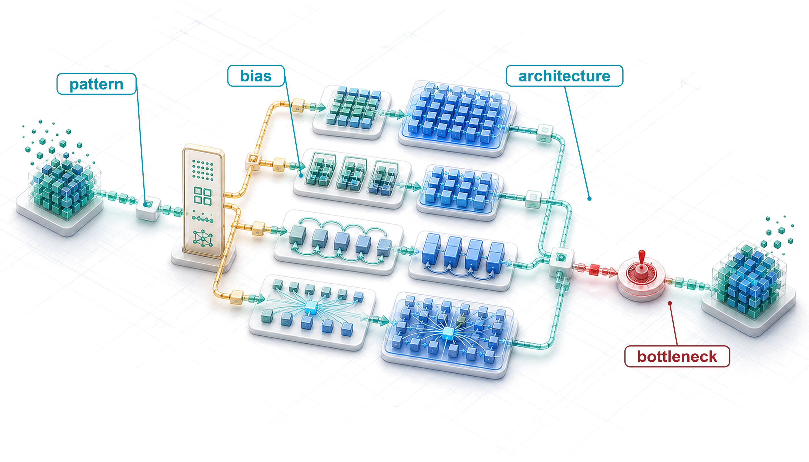
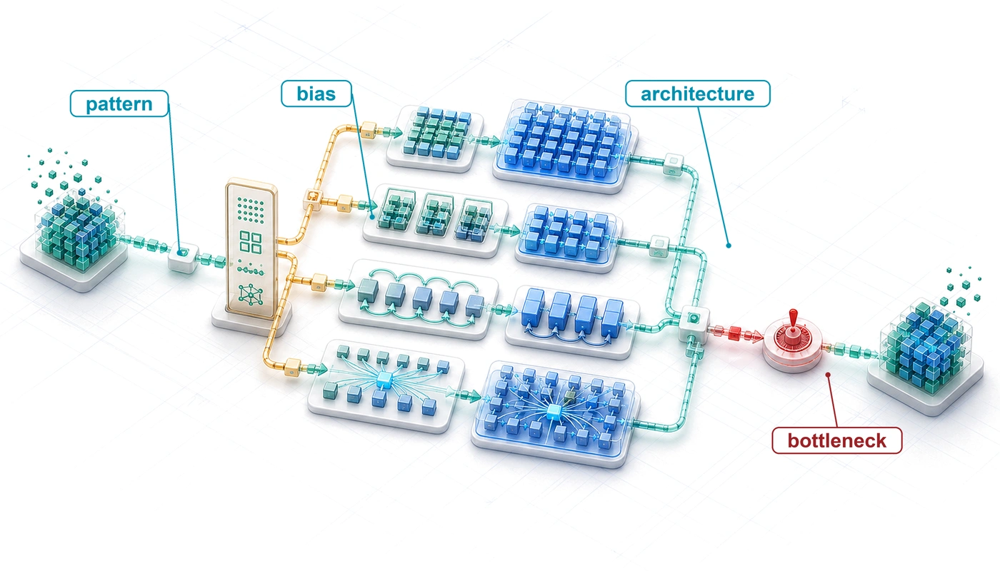
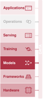
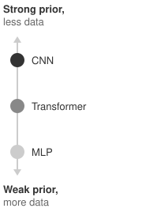
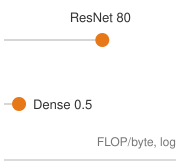
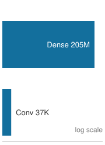
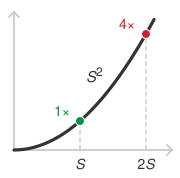
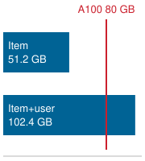
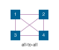
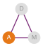

# Network Architectures {#sec-network-architectures}

::: {layout-narrow}
::: {.column-margin}

\chapterminitoc

:::

::: {.content-visible when-format="pdf"}
\noindent
{fig-alt="Isometric architecture interchange where one representation stream branches into dense, spatial, sequence, and attention-like paths before rejoining."}
:::

::: {.content-visible unless-format="pdf"}
{fig-alt="Isometric architecture interchange where one representation stream branches into dense, spatial, sequence, and attention-like paths before rejoining."}
:::

:::

## Purpose {.unnumbered .unlisted}

::: {.content-visible when-format="pdf"}
\begin{marginfigure}
\mlsysstack{40}{25}{90}{35}{15}{0}{10}{10}
\end{marginfigure}
:::

::: {.content-visible unless-format="pdf"}
::: {.column-margin}
{width="100%" fig-alt="Machine Learning Systems Architecture Stack"}

*Architecture stack focus for this chapter.*
:::
:::

_Why is choosing a neural network architecture an infrastructure commitment as well as a modeling decision?_

Selecting a neural network architecture is both a modeling decision and a contract with physics. The commitment begins with the structure in the data. An architecture that matches that structure can learn with fewer parameters and examples, while a poor match spends additional data and machine time compensating for the wrong computational pattern. Convolution, attention, recurrence, and embedding lookup do not merely encode different assumptions about data; they create different patterns of computation, state, and data movement. Those patterns determine whether work parallelizes cleanly, whether intermediate state fits in memory, and whether training and serving remain affordable at the required scale. Attention compares every element of a sequence with every other, so doubling the input length roughly quadruples that work, while the cost of a convolution grows in proportion to its input. Two architectures can deliver similar predictive quality yet impose different memory footprints and latency profiles while exposing different opportunities for later efficiency techniques. Benchmark accuracy alone therefore cannot reveal which design remains viable. Architectural commitments also propagate beyond the model. Data pipelines adopt particular input structures, training infrastructure is provisioned around the model's compute profile, serving systems are tuned to its request path, and monitoring inherits its failure modes. Once those dependencies accumulate, replacing the architecture can mean rebuilding much of the surrounding system, a cost that grows with every month the design stays in service. An architecture decision is sound only when its predictive gains remain compatible with the full deployment context. In D·A·M terms, architecture is algorithm-machine co-design at its root, with the mathematical graph determining the work the machine must perform and the machine budget limiting which graphs remain practical.

::: {.content-visible when-format="pdf"}

\newpage

:::

::: {.callout-learning-objectives}

- Explain how an architecture's inductive bias matches the structure of images, sequences, and tabular data
- Distinguish the computational patterns of MLPs, CNNs, RNNs, transformers, and DLRM-style recommenders
- Explain why skip connections and normalization make deep networks trainable and what each costs the machine
- Calculate the weights, multiply-accumulates, and memory of dense, convolutional, recurrent, attention, and embedding layers
- Analyze which iron-law term binds a workload, including transformer prefill and decode, from its arithmetic intensity
- Apply the architecture selection framework to a deployment's data, memory, latency, and power budgets
- Critique architecture-selection fallacies about operation counts, context length, and training-versus-serving bottlenecks

:::

## Architectural Principles {#sec-network-architectures-architectural-principles-engineering-tradeoffs-362e}

Three requests reach the same accelerator: a camera frame for an image classifier, a prompt for a language model, and a click for a recommender. The silicon is identical, yet the first request keeps the arithmetic units busy, the second leaves them waiting on memory bandwidth, and the third cannot begin until the system decides where its multi-gigabyte embedding tables can live. What differs is the network architecture, the way each model arranges the same arithmetic around the structure of its data, and this chapter explains how each family of architectures sets the demands its requests place on the machine.

@Sec-neural-computation built the operations that every network shares (matrix multiplication, activation functions, and gradient computation) and assembled them into a dense multilayer perceptron (MLP) that pays for a weight between every pixel and every hidden unit, including relationships an image rarely needs. Architectures remove that waste by arranging the same operations into computational graphs\index{Architecture!computational graph} shaped like the data. Under the silicon contract (principle \ref{pri-silicon-contract}), that shape is also an implicit agreement with hardware, trading computational patterns for efficiency on particular problem classes.

Every neural network architecture decides how computation should be organized to match the inherent structure in the data. Images have spatial locality, language has sequential dependencies, and tabular records often lack a fixed spatial or sequential organization. The architecture encodes assumptions about these patterns directly into the computational graph, and those assumptions influence parameter count, hardware utilization, and deployment feasibility. Architecture selection is therefore a systems engineering problem\index{Architecture!systems engineering} that directly affects the iron law terms: the number of operations $\Operations$ and the volume of data movement $\DataVolume$. The structural assumptions that each architecture encodes are known as **inductive biases**\index{Inductive bias!unifying concept},[^fn-inductive-bias-architecture] and each architecture in this chapter is defined by its choice of bias.

[^fn-inductive-bias-architecture]: **Inductive bias**\index{Inductive bias!etymology}\index{Inductive bias!systems consequence}: From Latin *inducere*, "to lead into." Encoding a structural assumption "leads" the model toward a smaller solution space, and every architecture discussed here (multilayer perceptron (MLP), convolutional neural network (CNN), recurrent neural network (RNN), and transformer) is defined by its choice of bias. A CNN's locality bias cuts parameters by orders of magnitude vs. an equivalent MLP, directly shrinking the iron law's $\Operations$ and $\DataVolume$ terms, while global attention trades quadratic score computation for long-range connectivity.

```{python}
#| echo: false
from mlsysim import *
from mlsysim.core.units import *

# ┌─────────────────────────────────────────────────────────────────────────────
# │ INDUCTIVE BIAS LOCALITY PARAMETER REDUCTION
# ├─────────────────────────────────────────────────────────────────────────────
# │ Context: Inductive bias definition quantitative significance.
# │
# │ Goal: Keep the CNN-vs.-MLP locality ratio computed at its first use.
# │ How: Compare an ImageNet-sized dense input connection with a 3x3 RGB filter.
# │
# └─────────────────────────────────────────────────────────────────────────────
from mlsysim.fmt import fmt_int, fmt, fmt_qty_int, check, fmt_memory, fmt_bandwidth, fmt_flop_rate, fmt_power

class InductiveBiasLocalityCalc:
    """ImageNet-sized locality-bias parameter reduction for one feature detector."""

    # ┌── 1. LOAD (Constants) ──────────────────────────────────────────────
    img_dim = 224
    img_channels = 3
    kernel = 3

    # ┌── 2. EXECUTE (The Compute) ────────────────────────────────────────
    dense_input_weights = img_dim * img_dim * img_channels
    local_filter_weights = kernel * kernel * img_channels
    spatial_locality_reduction = dense_input_weights / local_filter_weights

    # ┌── 3. GUARD (Invariants) ──────────────────────────────────────────
    check(spatial_locality_reduction > 5_000, f"Expected ImageNet locality reduction above 5,000x, got {spatial_locality_reduction:.1f}x.")

    # ┌── 4. OUTPUT (Formatting) ─────────────────────────────────────────────
    spatial_locality_reduction_mult_str = fmt_multiple(round(spatial_locality_reduction), precision=0, commas=True)
```

```{=latex}
\vspace*{-1ex}
```
::: {#dfn-nn-architectures-inductive-bias .callout-definition title="Inductive bias"}

***Inductive bias***\index{Inductive bias!definition} is a structural constraint built into a model architecture that restricts the hypothesis space, enabling generalization from finite data by encoding domain-specific assumptions (such as spatial locality or sequential ordering) directly into the computational graph.

1.  **Significance**: Inductive bias can reduce the dataset size $(\DatasetSize)$ required for generalization. A detector that looks for a small pattern, such as an edge, can either give every pixel of the image its own weight or apply one small set of weights at every position. For a $224{\times}224$ RGB image, a shared $3{\times}3$ filter uses roughly `{python} InductiveBiasLocalityCalc.spatial_locality_reduction_mult_str` fewer parameters than one dense feature detector, reducing parameter storage and often the data required to avoid overfitting.
2.  **Distinction**: Unlike regularization (which penalizes hypothesis complexity at training time via L1/L2 terms), inductive bias restricts the hypothesis space at architecture design time, before any training begins.
3.  **Common pitfall**: A frequent misconception is that stronger inductive bias is always better. A strong locality bias (CNN) excels on spatial data but represents long-range dependencies in language less directly than global attention.

:::

::: {.column-margin}
{width="100%" fig-alt="Vertical ordinal axis with arrowheads at both ends, labeled Strong prior, less data at the top and Weak prior, more data at the bottom. Three dots sit on the axis from dark to light: CNN near the top, Transformer in the middle, MLP near the bottom."}

*A stronger prior substitutes engineered structure for data and compute.*
:::

A convolutional neural network (CNN) encodes an inductive bias of spatial locality: nearby pixels matter more than distant ones. A transformer lets each element attend to any other, enabling long-range relationships at quadratic score-computation cost. These biases help architectures learn efficiently by restricting the space of functions they represent. Without an appropriate bias, a model may require substantially more data and compute to learn the same structure. That exchange is the bitter lesson seen from inside a single architecture. Built-in structure does part of the learning in advance, while the transformer's weak priors assume that data and compute will keep growing, an assumption that has held at scale. @Sec-network-architectures-architecture-selection-framework-a442 returns to this ordering when choosing among families.

::: {.column-margin .margin-pointer}
↩ The bitter lesson, that general methods which scale with computation outpace hand-built structure, is established in @sec-introduction-bitter-lesson-79c7.
:::

Machine learning systems face a core engineering trade-off: **representational power vs. computational efficiency**\index{Architecture!representational power vs. efficiency}. Under the iron law of ML systems (principle \ref{pri-iron-law}), architectural choice is the primary determinant of the operation-count term $\Operations$. Attention enables global relationships at a higher operation count, while a CNN exploits spatial locality to reduce operations to linear scaling in the number of spatial positions. Architecture selection means matching the bias to the data while staying inside an operation budget.

Choosing an architectural backbone sets the primary memory layout and compute pattern for downstream hardware. @Tbl-architecture-families contrasts the five major neural network families across the data structure each targets, its core innovation, and the system bottleneck it exposes in representative regimes.

| **Architecture** | **Data Type**                 | **Core Innovation**            | **System Bottleneck**                                         |
|:-----------------|:------------------------------|:-------------------------------|:--------------------------------------------------------------|
| **MLPs**         | Tabular/Unstructured          | Dense connectivity             | Bandwidth with streamed weights at small batch                |
| **CNNs**         | Spatial (images)              | Local filters + weight sharing | Compute throughput with sufficient reuse                      |
| **RNNs**         | Sequential (time series)      | Recurrent state                | Sequential dependencies                                       |
| **Transformers** | Relational (language)         | Dynamic attention              | Quadratic score compute; optional $\SequenceLength^2$ storage |
| **DLRM**         | Categorical (recommendations) | Embedding tables               | Capacity when tables exceed device memory                     |

: **Neural Architecture Families**: Each family targets a data structure and exposes characteristic resource demands. The bottleneck column names representative regimes: streamed dense weights stress bandwidth, convolutional reuse raises arithmetic intensity, recurrence creates serial dependencies, dense attention computes quadratic score interactions, and large embedding tables stress capacity. Batch size, precision, kernel implementation, and the target machine determine which demand binds in a deployment. {#tbl-architecture-families}

The five lighthouse models introduced with the iron law return here with their architectures exposed: ResNet-50 for compute throughput, GPT-2 for memory bandwidth, DLRM for memory capacity, MobileNetV2 for compute within a mobile power envelope, and keyword spotting (KWS) for an always-on power envelope. Earlier chapters used them as named workloads and mapped them onto workload archetypes (@sec-ml-systems-workload-archetypes-fd10), such as the compute-bound and bandwidth-bound archetypes; this chapter opens each one up inside the family that builds it, to show which architectural choice puts it in its archetype. MobileNetV2 sits on the empirical Pareto frontier\index{Pareto frontier} plotted in @fig-efficiency-frontier, the set of models that no other plotted model beats on both accuracy and compute at once, while ResNet-50 sits well below it. The frontier bounds ImageNet[^fn-imagenet-scale-nn] top-1 accuracy against logarithmic compute cost, measured in GMACs (billions of multiply-accumulate operations) per image. The other three lighthouses sit off this plot because they were chosen for the bottlenecks they isolate rather than for image-classification accuracy.

```{python}
#| echo: false
#| label: lighthouse-table-specs

# ┌─────────────────────────────────────────────────────────────────────────────
# │ LIGHTHOUSE TABLE SPECS
# ├─────────────────────────────────────────────────────────────────────────────
# │ Context: @tbl-lighthouse-comparison comparing five canonical workloads
# │
# │ Goal: Establish quantitative reference points for the five canonical workloads.
# │ Show: The diverse bottleneck profiles (Compute vs Memory) of lighthouse models.
# │ How: Retrieve model specs from Models and mlsysim constants.
# │
# └─────────────────────────────────────────────────────────────────────────────

from mlsysim import Hardware, Models
from mlsysim.fmt import fmt_int, fmt, check, fmt_flops, fmt_memory, fmt_params, fmt_ratio
from mlsysim.physics import model_memory

# ┌── LEGO ───────────────────────────────────────────────
class LighthouseSpecs:
    """
    Namespace for Lighthouse Model Comparison Table.
    Aggregates specs for ResNet, GPT-2, DLRM, MobileNet, and KWS.
    """

    # ┌── 1. LOAD (Constants) ───────────────────────────────────────────────
    m_resnet = Models.Vision.ResNet50
    m_gpt2 = Models.Language.GPT2
    m_dlrm = Models.Recommendation.DLRM
    m_mobilenet = Models.Vision.MobileNetV2
    m_kws = Models.Tiny.DS_CNN

    hw_a100 = Hardware.Cloud.A100

    # ┌── 2. EXECUTE (The Compute) ─────────────────────────────────────────
    # Step 1: ResNet-50
    resnet_params = m_resnet.parameters.to(Mparam).magnitude
    resnet_flops = m_resnet.inference_flops.to(GFLOPs).magnitude
    resnet_mem = m_resnet.size_in_bytes(BYTES_FP32)

    # Step 2: GPT-2 XL
    gpt2_params = m_gpt2.parameters.to(Bparam).magnitude
    gpt2_flops_token = m_gpt2.inference_flops.to(GFLOPs).magnitude
    gpt2_mem = m_gpt2.size_in_bytes(BYTES_FP32)

    # Step 3: DLRM
    dlrm_entries_b = m_dlrm.embedding_entries.to(count).magnitude / BILLION
    dlrm_mem = m_dlrm.model_size

    # Step 4: MobileNetV2
    mobilenet_params = m_mobilenet.parameters.to(Mparam).magnitude
    mobilenet_flops = m_mobilenet.inference_flops
    mobilenet_mem = m_mobilenet.size_in_bytes(BYTES_FP32)

    # Step 5: KWS (DS-CNN)
    kws_params_k = m_kws.parameters.to(Kparam).magnitude
    kws_flops = m_kws.inference_flops
    kws_mem = m_kws.size_in_bytes(BYTES_FP32)

    # Step 6: Ratios
    mobilenet_size_ratio = m_resnet.parameters.to(param).magnitude / m_mobilenet.parameters.to(param).magnitude
    mobilenet_flops_ratio = (m_resnet.inference_flops / m_mobilenet.inference_flops).to("").magnitude

    # Step 7: Reference Hardware
    a100_mem = hw_a100.memory.capacity

    # ┌── 3. GUARD (Invariants) ───────────────────────────────────────────
    # Ensure numbers match the book's narrative
    check(abs(resnet_flops - 8.2) <= 0.1, f"ResNet FLOPs {resnet_flops} != 8.2")
    check(abs(gpt2_params - 1.5) <= 0.1, f"GPT-2 Params {gpt2_params} != 1.5 billion")
    check(abs(mobilenet_params - 3.5) <= 0.1, f"MobileNet Params {mobilenet_params} != 3.5M")

    # ┌── 4. OUTPUT (Formatting) ──────────────────────────────────────────────
    resnet_params_m_str = fmt_params(m_resnet.parameters, scale="M", precision=1, commas=False)
    resnet_gflop_str = fmt_flops(m_resnet.inference_flops, unit=GFLOPs, precision=1)
    resnet_fp32_mb_str = fmt_memory(resnet_mem, unit=MB, precision=1, commas=True)

    gpt2_params_b_str = fmt_params(m_gpt2.parameters, scale="B", precision=1, commas=False)
    gpt2_fp32_gb_str = fmt_memory(gpt2_mem, unit=GB, precision=0, commas=True)
    gpt2_gflop_per_token_str = fmt_flops(m_gpt2.inference_flops, unit=GFLOPs, precision=0, per="token")

    # GPT-3 context
    gpt3_fp16_gb_str = fmt_memory(Models.Language.GPT3.size_in_bytes(BYTES_FP16), unit=GB, precision=0)

    dlrm_entries_b_str = fmt_params(m_dlrm.embedding_entries, scale="B", precision=0, commas=False)
    dlrm_model_size_gb_str = fmt_memory(dlrm_mem, unit=GB, precision=0, commas=True)

    mobilenet_params_m_str = fmt_params(m_mobilenet.parameters, scale="M", precision=1, commas=False)
    mobilenet_mflop_str = fmt_flops(mobilenet_flops, unit=MFLOPs, precision=0)
    mobilenet_fp32_mb_str = fmt_memory(mobilenet_mem, unit=MB, commas=True)
    mobilenet_size_ratio_mult_str = fmt_ratio(mobilenet_size_ratio, precision=1)
    mobilenet_flops_ratio_mult_str = fmt_ratio(mobilenet_flops_ratio, precision=1)

    kws_params_k_str = fmt_params(m_kws.parameters, scale="K", precision=0, commas=False)
    kws_mflop_str = fmt_flops(kws_flops, unit=MFLOPs, precision=0)
    kws_fp32_kb_str = fmt_memory(kws_mem, unit=KB, precision=0, commas=True)
```

::: {.column-margin .margin-pointer}
↩ The five lighthouse models, and the bottleneck each one isolates, are established in @sec-introduction-lighthouse-models-9b1c.
:::

::: {#fig-efficiency-frontier fig-env="figure" fig-pos="htb" fig-cap="**The Efficiency Frontier**: ImageNet top-1 accuracy plotted against computational cost in GMACs per image. Representative points are compiled from published model reports for AlexNet, VGG, ResNet, Inception, MobileNetV2, EfficientNet, ViT, Swin Transformer, and ConvNeXt [@krizhevsky2012imagenet; @simonyan2014very; @he2016; @szegedy2015; @sandler2018; @tan2019efficientnet; @dosovitskiy2021image; @liu2021swin; @liu2022convnet]. The dashed Pareto frontier is an illustrative trade-off curve rather than a benchmark rerun; exact accuracy and reported compute values vary by model variant, training recipe, implementation, and operation-counting convention (multiply-accumulates vs. floating-point operations). The legend distinguishes six families: legacy CNNs (gray), dense CNNs (blue), efficient Mobile architectures (green), EfficientNet-class models (violet), modern CNNs (orange), and Transformers (red). The frontier is led by the efficient and modern-CNN families; the Transformers trade substantial compute for flexible long-range modeling without dominating it, and ViT-B/16 sits below the frontier. AlexNet is the single-model result, and ViT-B/16 is plotted at the 384-pixel resolution at which its accuracy was measured." fig-alt="Scatter plot of ImageNet top-1 accuracy against compute cost on a logarithmic horizontal axis. Ten labeled model points use six colors for architecture families, and a gray dashed line connects MobileNetV2, EfficientNet-B0, ConvNeXt-T, and EfficientNet-B7."}

```{python}
#| echo: false
# ┌─────────────────────────────────────────────────────────────────────────────
# │ EFFICIENCY FRONTIER (FIGURE)
# ├─────────────────────────────────────────────────────────────────────────────
# │ Context: @fig-efficiency-frontier—model evolution and Pareto frontier
# │
# │ Goal: Plot ImageNet accuracy vs GMACs; show Dense CNN, Mobile, Transformer
# │       families; dashed Pareto frontier.
# │ Show: Scatter by family; model labels; log-scale x-axis.
# │ How: MODELS_DATA; pandas groupby; book_style.setup_plot().
# │
# └─────────────────────────────────────────────────────────────────────────────
# ┌── 1. CANVAS ────────────────────────────────────────────────────────────────
# │ Plot ImageNet accuracy vs GMACs; show Dense CNN, Mobile, Transformer
import pandas as pd
from binder.tools.figures import style as book_style

fig, ax, COLORS, plt = book_style.setup_plot(figsize=(10, 4.5))

# =============================================================================
# DATA
# =============================================================================

# ┌── 2. ARRAYS ────────────────────────────────────────────────────────────────
MODELS_DATA = [
    # Single-model top-1 (40.7% error, Krizhevsky et al. Table 1); 63.3% was a 7-model ensemble.
    {'Model': 'AlexNet', 'Year': 2012, 'GMACs': 0.7, 'Accuracy': 59.3, 'Family': 'Legacy'},
    {'Model': 'VGG-16', 'Year': 2014, 'GMACs': 15.5, 'Accuracy': 71.5, 'Family': 'Legacy'},
    {'Model': 'ResNet-50', 'Year': 2015, 'GMACs': 4.1, 'Accuracy': 76.0, 'Family': 'Dense CNN'},
    {'Model': 'Inception-v3', 'Year': 2015, 'GMACs': 5.7, 'Accuracy': 78.8, 'Family': 'Dense CNN'},
    {'Model': 'MobileNetV2', 'Year': 2018, 'GMACs': 0.3, 'Accuracy': 72.0, 'Family': 'Mobile'},
    {'Model': 'EfficientNet-B0', 'Year': 2019, 'GMACs': 0.39, 'Accuracy': 77.1, 'Family': 'Efficient'},
    {'Model': 'EfficientNet-B7', 'Year': 2019, 'GMACs': 37.0, 'Accuracy': 84.3, 'Family': 'Efficient'},
    # ImageNet-1k pre-training, 77.9% at the 384 px fine-tuning resolution (Dosovitskiy et al. Table 5),
    # so cost is the 384 px forward pass (55.5 GMACs), not the 224 px 17.6 GMACs.
    {'Model': 'ViT-B/16', 'Year': 2020, 'GMACs': 55.5, 'Accuracy': 77.9, 'Family': 'Transformer'},
    {'Model': 'Swin-T', 'Year': 2021, 'GMACs': 4.5, 'Accuracy': 81.3, 'Family': 'Transformer'},
    {'Model': 'ConvNeXt-T', 'Year': 2022, 'GMACs': 4.5, 'Accuracy': 82.1, 'Family': 'Modern CNN'},
]

# =============================================================================
# PLOT: The Efficiency Frontier
# =============================================================================
df = pd.DataFrame(MODELS_DATA)

color_map = {
    'Legacy': COLORS['grid'],
    'Dense CNN': COLORS['BlueLine'],
    'Mobile': COLORS['GreenLine'],
    'Efficient': COLORS['VioletLine'],
    'Transformer': COLORS['RedLine'],
    'Modern CNN': COLORS['OrangeLine'],
}

# Individual label settings
label_styles = {
    'AlexNet': {
        'xytext': (8, 2),
        'ha': 'left',
        'va': 'top',
    },
    'VGG-16': {
        'xytext': (8, 2),
        'ha': 'left',
        'va': 'top',
    },
    'ResNet-50': {
        'xytext': (0, -12),
        'ha': 'center',
        'va': 'center',
    },
    'Inception-v3': {
        'xytext': (0, -12),
        'ha': 'center',
        'va': 'center',
    },
    'MobileNetV2': {
        'xytext': (8, 2),
        'ha': 'left',
        'va': 'top',
    },
    'EfficientNet-B0': {
        'xytext': (8, -3),
        'ha': 'left',
        'va': 'top',
    },
    'EfficientNet-B7': {
        'xytext': (19, -14),
        'ha': 'right',
        'va': 'center',
    },
    'ViT-B/16': {
        'xytext': (0, -12),
        'ha': 'center',
        'va': 'center',
    },
    'Swin-T': {
        'xytext': (0, -12),
        'ha': 'center',
        'va': 'center',
    },
    'ConvNeXt-T': {
        'xytext': (0, 12),
        'ha': 'center',
        'va': 'center',
    },
}

default_label_style = {
    'xytext': (5, 5),
    'ha': 'left',
    'va': 'bottom',
    'fontsize': 8,
    'bbox': dict(facecolor='white', alpha=0.8, edgecolor='none', pad=0.5),
}

# ┌── 3. RENDER ────────────────────────────────────────────────────────────────
for family, group in df.groupby('Family'):
    ax.scatter(
        group['GMACs'],
        group['Accuracy'],
        label=family,
        c=color_map.get(family, COLORS['primary']),
        s=120,
        alpha=0.9,
        edgecolors='white',
        linewidth=1.2,
        zorder=3,
    )

for _, row in df.iterrows():
    model = row['Model']

    style = default_label_style.copy()
    style.update(label_styles.get(model, {}))

    ax.annotate(
        model,
        (row['GMACs'], row['Accuracy']),
        xytext=style['xytext'],
        textcoords='offset points',
        ha=style['ha'],
        va=style['va'],
        fontsize=style.get('fontsize', 8),
        bbox=style.get('bbox', None),
    )

pareto_models = ['MobileNetV2', 'EfficientNet-B0', 'ConvNeXt-T', 'EfficientNet-B7']
pareto_points = df[df['Model'].isin(pareto_models)].sort_values('GMACs')

ax.plot(pareto_points['GMACs'], pareto_points['Accuracy'], '--', color=COLORS['grid'], linewidth=1.5, zorder=1)

# ┌── 4. DECORATE ──────────────────────────────────────────────────────────────
ax.set_xscale('log')
ax.set_xlabel('Compute Cost (GMACs per Image)')
ax.set_ylabel('ImageNet Top-1 Accuracy (%)')
ax.legend(
    loc='lower right', title='Family', fontsize=8, frameon=True, facecolor='white', framealpha=0.95, edgecolor='gray', fancybox=True, borderpad=0.6
)
plt.show()
plt.close()
```

:::

Across the frontier plotted in @fig-efficiency-frontier, successive architecture families occupy distinct computational cost regimes, from dense CNNs that prioritized accuracy regardless of operation count, through compact mobile networks engineered to minimize GMACs, to vision transformers (such as Swin-T and ViT-B/16) that trade compute for long-range spatial mixing. The plotted models are historical milestones rather than case studies; only ResNet-50 and MobileNetV2 receive detailed architectural breakdowns in this chapter. Architectural choices made at design time dictate where a system lands along this frontier.

Each family section that follows reads its architecture through the same four questions: the data pattern it targets, the computation it performs, how that computation maps onto hardware, and the bottleneck it exposes. The sequence begins with the family that assumes the least about its data, the dense multilayer perceptron.

## MLPs: Dense Pattern Processing {#sec-network-architectures-multilayer-perceptrons-dense-pattern-processing-bc11}

The MNIST digit classifier of @sec-neural-computation is the purest example of dense processing: each of its 784 pixel inputs connects to every hidden unit, and each hidden unit to every unit in the next layer. The same all-to-all pattern suits tabular inputs, such as the sender reputation, link count, and keyword features a spam filter scores, where no feature has a fixed neighbor. **MLPs**\index{MLP}[^fn-perceptron-rosenblatt-etymology] represent the fully connected architecture of that classifier, now examined through the four-part systems lens.

[^fn-perceptron-rosenblatt-etymology]: **Perceptron**\index{Perceptron!etymology}: Formed from "perception" and the device suffix "-tron" (as in *cyclotron* and *klystron*), coined by Frank Rosenblatt\index{Rosenblatt, Frank} [@rosenblatt1957perceptron] for the atomic unit of neural computation: a weighted sum followed by a nonlinear activation, extending the earlier McCulloch-Pitts neuron\index{McCulloch-Pitts neuron}. MLPs are composed entirely of these units arranged in fully-connected layers, so the efficiency of this single operation, a multiply-accumulate, determines system throughput. Modern accelerators execute over $10^{14}$ of these operations per second, making the perceptron the computational primitive\index{Perceptron!computational primitive} that the entire ML hardware ecosystem is optimized around.

MLPs embody an inductive bias: *they impose no specific spatial or temporal connectivity pattern, allowing any input to relate to any output*. This architectural choice provides flexibility across input relationships, making MLPs versatile but potentially costly compared to alternatives that exploit matching structure. Their representational capacity was established theoretically by the universal approximation theorem (UAT)[^fn-uat-exponential-width] [@cybenko1989; @hornik1989], introduced in @sec-neural-computation. This theorem states that a sufficiently large MLP with nonlinear activation functions can approximate any continuous function on a compact domain, given suitable weights and biases. The *multilayer perceptron* combines theoretical universality with dense connectivity.

[^fn-uat-exponential-width]: **Universal approximation theorem (UAT)**\index{Universal approximation theorem}: This theorem establishes representational capacity for continuous functions on a compact domain, given suitable nonlinear activations. The systems-level catch\index{Universal approximation theorem!systems consequence} is that the existence guarantee supplies neither an efficient training procedure nor a practical width for a particular task. For a generic smooth target with no further structure, the width needed to reach a fixed accuracy can grow exponentially with input dimension (the curse of dimensionality), which is why the guarantee alone says little about a $256{\times}256$ image; useful structure in the target is what keeps practical networks small.

```{python}
#| echo: false
#| label: mlp-definition-costs

# ┌─────────────────────────────────────────────────────────────────────────────
# │ MLP DEFINITION COSTS
# ├─────────────────────────────────────────────────────────────────────────────
# │ Context: MLP definition callout quantitative significance
# │
# │ Goal: Derive dense-layer and same-channel convolution parameter counts.
# │ Show: quadratic dense scaling and channel-mixing cost for 3x3 convolution.
# │ How: Direct parameter and FP16 weight-byte calculation.
# │
# └─────────────────────────────────────────────────────────────────────────────

from mlsysim.fmt import fmt_int, fmt, fmt_count, check

# ┌── LEGO ───────────────────────────────────────────────
class MLPDefinitionCosts:
    """Quantitative anchor for dense layer scaling in the MLP definition."""

    # ┌── 1. LOAD (Constants) ──────────────────────────────────────────────
    layer_width = 1024

    # ┌── 2. EXECUTE (The Compute) ────────────────────────────────────────
    dense_params = layer_width * layer_width
    dense_fp16_memory = dense_params * BYTES_FP16

    # ┌── 3. GUARD (Invariants) ──────────────────────────────────────────
    check(dense_params == 1_048_576, f"1024x1024 dense layer should have 1,048,576 weights, got {dense_params}.")

    # ┌── 4. OUTPUT (Formatting) ─────────────────────────────────────────────
    layer_width_str = fmt(layer_width, precision=0, commas=True)
    dense_params_str = fmt_count(dense_params, label="parameter")
    dense_fp16_mb_str = fmt_memory(dense_fp16_memory, unit=MB, precision=1, commas=False)
```

::: {#dfn-nn-architectures-multilayer-perceptrons .callout-definition title="Multilayer perceptrons"}

***Multilayer perceptrons***\index{MLP!definition} are feed-forward neural network architectures that apply fully connected layers in sequence, where every neuron in one layer connects to every neuron in the next, without imposing a specific spatial or temporal connectivity pattern.

1.  **Significance**: The lack of structural prior gives dense layers quadratic parameter scaling in layer width: a single layer mapping `{python} MLPDefinitionCosts.layer_width_str` inputs to `{python} MLPDefinitionCosts.layer_width_str` outputs requires `{python} MLPDefinitionCosts.dense_params_str` and about `{python} MLPDefinitionCosts.dense_fp16_mb_str` of weight memory in FP16. Every input gets its own weight to every output, which makes MLPs inefficient for high-dimensional structured inputs like images.
2.  **Distinction**: Unlike convolutional neural networks, which exploit spatial locality to reduce parameter count, MLPs treat all input elements symmetrically, making them the architecture of choice for tabular data where no spatial or sequential structure is present.
3.  **Common pitfall**: A frequent misconception is that MLPs are too simple to matter for complex tasks. Dense layers carry much of the arithmetic inside the most complex models: every transformer block contains a position-wise feed-forward MLP, and recommendation models such as DLRM run dense MLP towers on their features. The other families add structure around dense layers (weight sharing, recurrence, attention) rather than replacing them.

:::

```{python}
#| echo: false
#| label: mlp-dimensionality-examples

# ┌─────────────────────────────────────────────────────────────────────────────
# │ MLP DIMENSIONALITY EXAMPLES
# ├─────────────────────────────────────────────────────────────────────────────
# │ Context: Learnability gap section illustrating sample complexity
# │
# │ Goal: Demonstrate the scalability limits of dense connections on image data.
# │ Show: How input dimension explodes from 784 (MNIST) to 65K (256 × 256).
# │ How: Calculate flattened vector sizes for standard image resolutions.
# │
# └─────────────────────────────────────────────────────────────────────────────

from mlsysim.fmt import fmt_int, fmt, fmt_count, check

# ┌── LEGO ───────────────────────────────────────────────
class MLPDim:
    """
    Namespace for MLP Dimensionality Examples.
    Scenario: Input vector size for flattened images.
    """

    # ┌── 1. LOAD (Constants) ───────────────────────────────────────────────
    mnist_w = Datasets.MNIST.image_width
    mnist_h = Datasets.MNIST.image_height

    std_w = 256
    std_h = 256

    # ┌── 2. EXECUTE (The Compute) ─────────────────────────────────────────
    mnist_dim = mnist_w * mnist_h
    std_dim = std_w * std_h

    # ┌── 3. GUARD (Invariants) ───────────────────────────────────────────
    check(mnist_dim == 784, f"MNIST input dimension mismatch: {mnist_dim}")
    check(std_dim == 65_536, f"256x256 image dimension mismatch: {std_dim}")

    # ┌── 4. OUTPUT (Formatting) ──────────────────────────────────────────────
    mlp_28_dim_str = fmt(mnist_dim, precision=0, commas=True)
    mlp_256_dim_str = fmt(std_dim, precision=0, commas=True)

# Note: Use MLPDim.mlp_28_dim_str directly.
```

### Representation vs. learnability {#sec-network-architectures-learnability-gap-universal-approximation-enough-0624}

The UAT guarantees mathematical existence, yet a fundamental gap separates what an architecture can represent from what gradient descent can learn in practice.

*Representation capacity*\index{Representation capacity} refers to the functions an architecture can express given unlimited resources; the UAT guarantees MLPs have universal representation capacity. The *manifold hypothesis*,[^fn-manifold-hypothesis-dimensionality] which suggests that high-dimensional data occupies a much simpler structure, explains why such capacity can be put to use. *Learnability*\index{Learnability} refers to whether gradient descent can find good weights given finite training samples and computational budgets. A function may be representable yet practically unlearnable.

[^fn-manifold-hypothesis-dimensionality]: **Manifold hypothesis**\index{Manifold hypothesis}: The assumption that high-dimensional data lies near a low-dimensional surface embedded within the full space; a $256{\times}256$ image lives in a `{python} MLPDim.mlp_256_dim_str`-dimensional space, but "valid cat images" may occupy a much smaller structured region. Learned representations can expose that structure. The systems consequence is a potential reduction in the data and computation needed for learning; useful structure can also take other forms, such as a target depending on only a few input features. \index{Manifold hypothesis!learnability}

This distinction resolves the apparent paradox of universal approximation and architectural progress. Specialized architectures such as CNNs and their deep ResNet descendants improve learnability by embedding inductive biases that match data structure, even when doing so restricts representational capacity.

Two factors create the *learnability gap*\index{Learnability gap}:

1. **Sample complexity**\index{Sample complexity}\index{Architecture!parameter efficiency}: The UAT bounds neither the training examples nor the width needed, and some function classes require widths that grow rapidly with input dimension. For $28{\times}28$ images, an MLP receives `{python} MLPDim.mlp_28_dim_str` pixel values without built-in local connectivity or spatial weight sharing. It can learn spatial correlations, as the digit classifier of @sec-neural-computation shows, but must learn relationships that a CNN encodes structurally. When those priors match the task, a CNN can reach a target accuracy with fewer examples and represent the function more compactly. The sample requirement depends on the target function, data distribution, and learning procedure.
2. **Optimization difficulty**\index{Optimization difficulty}: Even when optimal weights exist, gradient descent may not find them. MLP loss surfaces exhibit complex topology without the regularizing effect of architectural constraints. Specialized architectures reduce the search space, introducing symmetries that gradient descent exploits. The classic MNIST\index{MNIST} handwritten digit benchmark illustrates this gap between representation and learnability concretely.

```{python}
#| echo: false
#| label: mnist-param-counts

# ┌─────────────────────────────────────────────────────────────────────────────
# │ MNIST PARAMETER COMPARISON
# ├─────────────────────────────────────────────────────────────────────────────
# │ Context: Callout "MNIST: Representation vs Learnability"
# │
# │ Goal: Contrast parameter efficiency between dense and convolutional layers.
# │ Scope: chapter-anchor — MNIST comparison callout and later CNN callback share exports.
# │ Show: Per feature detector, a shared 3x3 filter needs ~87x fewer weights than
# │       a dense unit; whole-network counts depend on width choices instead.
# │ How: Compare first layers at equal feature count (32), and report the
# │      whole-network weights of the 784-128-64-10 MLP and a small CNN.
# │
# └─────────────────────────────────────────────────────────────────────────────

from mlsysim.fmt import fmt_int, fmt, fmt_math, fmt_count

# ┌── LEGO ───────────────────────────────────────────────
class MLPvsCNN:
    """
    Namespace for MNIST Parameter Comparison.
    Scenario: A dense vs. a convolutional first layer at equal feature count,
    plus whole-network weight counts for the neural-computation MLP and a small CNN.
    """

    # ┌── 1. LOAD (Constants) ───────────────────────────────────────────────
    mnist_train_examples = int(Datasets.MNIST.training_examples.to(count).magnitude)
    img_w = Datasets.MNIST.image_width
    img_h = Datasets.MNIST.image_height
    mlp_in = img_w * img_h
    mlp_out = Datasets.MNIST.num_classes
    # The 784-128-64-10 network used throughout @sec-neural-computation.
    mlp_h1, mlp_h2 = 128, 64

    # CNN: Conv(32) -> Pool -> Conv(64) -> Pool -> FC(128) -> 10
    c1_in_ch = 1  # MNIST grayscale input channel
    c1_k, c1_out = 3, 32
    c2_k, c2_out = 3, 64
    fc1_spatial = 7  # feature-map side after two 2x2 pools (28 -> 14 -> 7)
    fc1_in, fc1_out = c2_out * fc1_spatial * fc1_spatial, 128

    # ┌── 2. EXECUTE (The Compute) ─────────────────────────────────────────
    # Step 1: First layer at equal feature count (c1_out features)
    dense_first_w = mlp_in * c1_out  # one weight per pixel per feature
    conv_first_w = c1_k * c1_k * c1_in_ch * c1_out  # one 3x3 filter per feature
    ratio = dense_first_w / conv_first_w
    conv_positions = img_w * img_h  # same-padded filter positions

    # Step 2: Whole-network weights (biases omitted)
    mlp_p = (mlp_in * mlp_h1) + (mlp_h1 * mlp_h2) + (mlp_h2 * mlp_out)
    cnn_head_p = (fc1_in * fc1_out) + (fc1_out * mlp_out)
    cnn_p = (c1_k * c1_k * c1_in_ch * c1_out) + (c2_k * c2_k * c1_out * c2_out) + cnn_head_p
    cnn_head_share = cnn_head_p / cnn_p

    # ┌── 3. GUARD (Invariants) ───────────────────────────────────────────
    check(ratio >= 10, f"Dense first layer ({dense_first_w}) is not significantly larger than conv ({conv_first_w}). Ratio: {ratio:.1f}x")
    check(mlp_p < cnn_p, f"Expected the 784-128-64-10 MLP ({mlp_p}) to have fewer weights than the CNN ({cnn_p}).")
    check(cnn_head_share > 0.9, f"Expected the CNN's dense head to hold >90% of its weights, got {cnn_head_share:.2f}.")

    # ┌── 4. OUTPUT (Formatting) ──────────────────────────────────────────────
    # Count and multiplier formatters own compact suffixes and glyphs.
    dense_first_str = fmt_count(dense_first_w)
    conv_first_str = fmt_count(conv_first_w)
    conv_positions_str = fmt_count(conv_positions)
    first_features_str = fmt_count(c1_out)
    mlp_params_str = fmt_count(mlp_p)
    cnn_params_str = fmt_count(cnn_p)
    cnn_head_pct_str = fmt_percent(round(cnn_head_share * 100) / 100, precision=0, commas=False, style='prose')
    param_ratio_mult_str = fmt_multiple(round(ratio), precision=0, commas=False)
```

::: {#exmp-nn-architectures-mnist-representation-vs-learnability .callout-example title="MNIST: Representation vs. learnability"}

**Scenario**: Classifying $28{\times}28$ MNIST digits with a fully connected MLP vs. a CNN.

**Diagnosis**: Whole-network parameter counts depend mostly on width choices. The 784-128-64-10 MLP has `{python} MLPvsCNN.mlp_params_str` weights, fewer than the `{python} MLPvsCNN.cnn_params_str` of a small two-convolution CNN, whose dense classifier head holds `{python} MLPvsCNN.cnn_head_pct_str` of them. The locality saving appears per feature detector. A dense unit learns one weight for every pixel, so `{python} MLPvsCNN.first_features_str` features cost `{python} MLPvsCNN.dense_first_str` weights; a convolutional layer learns one $3{\times}3$ filter per feature, `{python} MLPvsCNN.conv_first_str` weights in total, and reuses each filter at all `{python} MLPvsCNN.conv_positions_str` positions. At equal feature count, the convolutional layer needs `{python} MLPvsCNN.param_ratio_mult_str` fewer weights.

**Systems lesson**: Inductive bias buys parameter efficiency per feature and reuse per weight. Fewer weights per detector reduce the data needed to learn spatial structure, and each weight fetched from memory feeds hundreds of multiply-accumulates, which raises arithmetic intensity.

:::

The learnability gap motivates the core design principle of this chapter: embed inductive biases that match data structure. Each architecture sacrifices theoretical generality for practical learnability. The No Free Lunch theorem[^fn-nfl-theorem-optimization]\index{No free lunch theorem} [@wolpert1997] formalizes this trade-off: the bias that helps one task may hurt another. A bias that ignores where a pattern appears in an image aids image classification\index{Translation invariance} but impairs tasks where absolute position matters, such as locating an object. Choosing an architecture means choosing a bias that fits the data\index{Architecture!selection as bias matching}.

[^fn-nfl-theorem-optimization]: **No free lunch theorem**\index{No free lunch theorem!architecture selection}: Wolpert and Macready's 1997 result proved that no optimization algorithm outperforms random search across all possible problems: averaged over every conceivable function, all algorithms are equivalent. The ML systems consequence is that an inductive bias (locality, equivariance, attention) can improve performance on problems matching that bias while hurting performance when its assumptions do not hold, making architecture selection an engineering commitment to a problem class.

Appropriate inductive biases reduce parameter counts (enabling edge deployment), accelerate convergence (reducing training costs), and produce structured computation patterns that map efficiently to specialized hardware. The MNIST comparison above earned its per-detector saving by matching architecture to data structure, not by shrinking the network. Understanding where dense connectivity remains necessary requires identifying the data patterns that lack structural shortcuts.

### Pattern processing needs {#sec-network-architectures-pattern-processing-needs-3c2a}

Dense pattern processing targets problem domains where input features lack geometric coordinates or sequential ordering. In tabular datasets, such as customer records or multi-factor risk models, any input feature may interact with any other. Because the data representation carries no grid or sequence structure, the network cannot restrict computation to local spatial windows or sequential steps. Every output neuron must be free to combine every input feature, leaving optimization to determine connection weights.

When treating an image dataset like MNIST with a dense architecture, the system flattens the $28{\times}28$ image into an unstructured 784-element vector. Discarding the two-dimensional spatial prior forces the network to treat all pixel pairs symmetrically. While this enables the layer to relate any pixel to any class, it requires the model to discover spatial adjacency entirely through optimization. That choice leads directly to the matrix operations defining the MLP.

### Algorithmic structure {#sec-network-architectures-algorithmic-structure-99f2}

All-to-all feature interaction requires complete connectivity between adjacent layer representations. In an MLP, this manifests as a sequence of fully connected layers\index{Fully-connected layer} where every neuron connects to every neuron in the preceding layer. Dense connectivity\index{Dense connectivity} translates directly into matrix multiplication, the formulation that makes dense layers executable on parallel hardware. The fully connected graph on the left of @fig-mlp becomes the matrix-vector product on its right: each hidden neuron's activation is the dot product of the input with one entire column of the weight matrix.

::: {.column-margin .margin-pointer}
↩ The matrix multiplication formulation of a dense layer's forward pass is established in @sec-neural-computation-matrix-multiplication-formulation-417c.
:::

::: {#fig-mlp fig-env="figure" fig-pos="htb" fig-cap="**Multilayer Perceptron Architecture**: A three-layer network in which every neuron connects to all neurons in adjacent layers. The highlighted neuron receives weighted contributions from all inputs, illustrating the dense $\mathcal{O}(\LayerInputWidth \times \LayerOutputWidth)$ connectivity pattern implemented through matrix multiplications. For MNIST classification, a 784-dimensional input ($\LayerInputWidth = 784$) connects to 128 hidden neurons ($\LayerOutputWidth = 128$) through a $784{\times}128$ weight matrix, requiring 100,352 multiply-accumulate operations per sample. Adapted from @reagen2017." fig-alt="Three-layer neural network with four input nodes, five hidden nodes, and two output nodes. Lines connect every node to all nodes in adjacent layers. One highlighted node shows weighted connections from all inputs. On the right, the same network is drawn as a 4-element input vector times a 4-by-5 weight matrix with one highlighted column, giving a 5-element hidden vector with one highlighted cell, then times a 5-by-2 matrix, giving a 2-element output."}

```{.tikz}
 \begin{tikzpicture}[line join=round,font=\sffamily]
\tikzset{%
Line/.style={line width=0.35pt,black!60}
}

\tikzset{
  box/.pic={
    \pgfkeys{/box/.cd, #1}
\foreach \x in {1,...,\columns}{
    \foreach \y in {1,...,\rows}{
        %
        \node[draw=black, fill=\ffill, minimum width=\cellsize,
                    minimum height=\cellheight, line width=\linewidth] (cell-\x-\y\br) at (\x*\cellsize,-\y*\cellheight) {};
    }
}
 } }

\pgfkeys{
  /box/.cd,
  cellsize/.store in=\cellsize,
  linewidth/.store in=\linewidth,
  cellheight/.store in=\cellheight,
  columns/.store in=\columns,
  br/.store in=\br,
  ffill/.store in=\ffill,
  rows/.store in=\rows,
  columns=1,
  rows=3,
  br=A,
  ffill=GreenL!22,
  cellsize=8mm,
  cellheight=8mm,
  linewidth=0.75pt
}
\def\radius{4mm}
\pic at (0,-12mm) {box={columns=4,rows=1,br=A}};
\pic at (4.4,0) {box={columns=5,rows=4,br=B,}};
\pic at (9.6,-12mm) {box={columns=5,rows=1,br=C}};
\pic at (14.6,4mm) {box={columns=2,rows=5,br=D}};
\pic at (17.4,-12mm) {box={columns=2,rows=1,br=E}};
%
\foreach \x in {1,...,4}{
\node[fill=green!80!black!80,minimum size=\cellsize,draw, line width=0.75pt]at(cell-2-\x B){};
}
\node[fill=green!80!black!80,minimum size=\cellsize,draw, line width=0.75pt]at(cell-2-1C){};

\begin{scope}[scale=1, every node/.append style={transform shape},
local bounding box=D1,shift={($(cell-1-1A)+(-4.5,-3.0)$)}]
\foreach \x in {1,...,5}{
\coordinate (2ball-\x) at (0,\x);
\shade[shading=ball,ball color=red!50!yellow] (0,\x) circle (\radius);
}
\shade[shading=ball,ball color=green!50!green] (0,4) circle (\radius);

\foreach \x/\i in {2.5/1,3.5/2}{
\coordinate (3ball-\i) at (2,\x);
\shade[shading=ball,ball color=red!50!yellow] (2,\x) circle (\radius)coordinate(3C\i);
}

\foreach \x/\i in  {1.5/1,2.5/2,3.5/3,4.5/4}{
\coordinate (1ball-\i) at (-2,\x);
\shade[shading=ball,ball color=red!50!yellow] (-2,\x) circle (\radius)coordinate(1C\i);
}
% Connect 1. and 2. column
\foreach \x in {1,2,3,4}{
  \foreach \y in {1,2,3,5}{
    \edef\from{1ball-\x}
    \edef\to{2ball-\y}
\path let
    \p1 = (\from),
    \p2 = (\to),
    \n1 = {atan2(\y2-\y1,\x2-\x1)}
  in
    coordinate (from) at ($ (\from) + (\n1:\radius) $)
    coordinate (to) at ($ (\to) + (\n1+180:\radius) $);
  \draw[Line] (from) -- (to);
  }
}
%red line
\foreach \x in {1,2,3,4}{
  \foreach \y in {4}{
    \edef\from{1ball-\x}
    \edef\to{2ball-\y}
\path let
    \p1 = (\from),
    \p2 = (\to),
    \n1 = {atan2(\y2-\y1,\x2-\x1)}
  in
    coordinate (from) at ($ (\from) + (\n1:\radius) $)
    coordinate (to) at ($ (\to) + (\n1+180:\radius) $);
  \draw[Line,red] (from) -- (to);
  }
}
% Connect 2. and 3. column
\foreach \x in {1,2,3,4,5}{
  \foreach \y in {1,2}{
    \edef\from{2ball-\x}
    \edef\to{3ball-\y}
\path let
    \p1 = (\from),
    \p2 = (\to),
    \n1 = {atan2(\y2-\y1,\x2-\x1)}
  in
    coordinate (from) at ($ (\from) + (\n1:\radius) $)
    coordinate (to) at ($ (\to) + (\n1+180:\radius) $);
  \draw[Line] (from) -- node[inner sep=0pt](L\x){}(to);
  }
}
%%
\draw[latex-](L5)--++(30:1)node[above]{Weighted Edge};
\draw[latex-](2ball-4)--++(180:2.5)node[left](NE){Neuron};
\draw[thick,latex-](cell-2-2B.center)--++(90:1.52)node[above]{Weighted Edge};
\draw[thick,latex-](cell-2-1C.center)--++(90:1.52)node[above]{Neuron};
%
\node[font=\huge]at($(cell-4-1A.east)!0.5!(cell-1-2B.south west)$){$\times$};
\node[font=\huge]at($(cell-5-1C.east)!0.5!(cell-1-3D.west)$){$\times$};
%
\node[single arrow, draw=red, fill=red,
      minimum width = 10pt, single arrow head extend=3pt,
      minimum height=7mm]at($(cell-5-2B.south east)!0.5!(cell-1-1C.west)$){};
\node[single arrow, draw=red, fill=red,
      minimum width = 10pt, single arrow head extend=3pt,
      minimum height=7mm]at($(cell-2-3D.east)!0.5!(cell-1-1E.west)$){};
\end{scope}

\path(NE.west)--++(270:4.0)coordinate(IL1)-|coordinate(HL1)($(1ball-1)!0.4!(2ball-1)$);
\path(NE)--++(270:4.0)-|coordinate(OL1)($(2ball-1)!0.55!(3ball-1)$);
\path(NE)--++(270:4.0)-|coordinate(OL2)($(3ball-1)!0.5!(cell-1-1A.east)$);
\path(NE)--++(270:4.0)-|coordinate(IL2)($(3ball-1)!0.6!(cell-1-1A.east)$);

\path[blue, line width=2pt](IL2)-|coordinate(HL2)($(cell-4-1A.east)!0.7!(cell-1-2B.south west)$);
\path[blue, line width=2pt](IL2)-|coordinate(OL3)($(cell-5-1C.east)!0.5!(cell-1-3D.west)$);
\path[blue, line width=2pt](IL2)-|coordinate(OL4)(cell-2-1E.south east);

\draw[red,line width=2pt](IL1)--node[below,text=black]{Input Layer}(HL1);
\draw[cyan,line width=2pt](HL1)--node[below,text=black]{Hidden Layer}(OL1);
\draw[brown,line width=2pt](OL1)--node[below,text=black]{Output Layer}(OL2);
%
\draw[red,line width=2pt](IL2)--node[below,text=black]{Input Layer}(HL2);
\draw[cyan,line width=2pt](HL2)--node[below,text=black]{Hidden Layer}(OL3);
\draw[brown,line width=2pt](OL3)--node[below,text=black]{Output Layer}(OL4);
\end{tikzpicture}
```

:::

@Eq-dense-layer expresses the dense layer's affine transformation followed by its activation.
$$
\HiddenActivation^{(\LayerIndex)} = \ActivationFunction\big(\HiddenActivation^{(\LayerIndex-1)}\WeightMatrix^{(\LayerIndex)} + \BiasVector^{(\LayerIndex)}\big)
$$ {#eq-dense-layer}

$\HiddenActivation^{(\LayerIndex)}$ represents the layer $\LayerIndex$ output, $\HiddenActivation^{(\LayerIndex-1)}$ represents the input from the previous layer, $\WeightMatrix^{(\LayerIndex)}$ denotes the weight matrix for layer $\LayerIndex$, $\BiasVector^{(\LayerIndex)}$ denotes the bias vector, and $\ActivationFunction(\cdot)$ denotes the activation function. This layer-wise transformation, while conceptually simple, creates computational patterns whose efficiency depends critically on how the runtime organizes these operations for different problem structures.

The dimensions of these operations reveal the computational scale of dense pattern processing. The input vector $\HiddenActivation^{(0)} \in \mathbb{R}^{\LayerInputWidth}$ (treated as a row vector in this formulation) represents all potential input features. Weight matrices $\WeightMatrix^{(\LayerIndex)} \in \mathbb{R}^{\LayerInputWidth \times \LayerOutputWidth}$ capture all possible input-output relationships. The output vector $\HiddenActivation^{(\LayerIndex)} \in \mathbb{R}^{\LayerOutputWidth}$ produces transformed representations. A four-pixel example turns this bookkeeping into arithmetic.

::: {#exmp-nn-architectures-concrete-computation-example .callout-example title="Concrete computation example"}

Consider a simplified 4-pixel image processed by a 3-neuron hidden layer:

**Input**: $\HiddenActivation^{(0)} = [0.8, 0.2, 0.9, 0.1]$ (4 pixel intensities)

```{=latex}
\begingroup
\renewcommand{\arraystretch}{1.05}
```

**Weight matrix**:
$$
\WeightMatrix^{(1)} = \begin{bmatrix} 0.5 & 0.1 & -0.2 \\ -0.3 & 0.8 & 0.4 \\ 0.2 & -0.4 & 0.6 \\ 0.7 & 0.3 & -0.1 \end{bmatrix}\quad (4{\times}3 \text{ matrix})
$$

**Computation**:
\begin{gather*}
\mathbf{z}^{(1)T} = (\mathbf{h}^{(0)}\mathbf{W}^{(1)})^T = \begin{bmatrix} 0.5{\times}0.8 + (-0.3)\times 0.2 + 0.2{\times}0.9 + 0.7{\times}0.1 \\ 0.1{\times}0.8 + 0.8{\times}0.2 + (-0.4)\times 0.9 + 0.3{\times}0.1 \\ (-0.2)\times 0.8 + 0.4{\times}0.2 + 0.6{\times}0.9 + (-0.1)\times 0.1 \end{bmatrix}
= \begin{bmatrix} 0.59 \\ -0.09 \\ 0.45 \end{bmatrix}
\end{gather*}
**After ReLU**: $\HiddenActivation^{(1)} = [0.59, 0, 0.45]$ (negative values zeroed)

```{=latex}
\endgroup
```

**Systems insight**: Each hidden neuron combines all input pixels with different weights, demonstrating unrestricted feature interaction. Dense layers buy generality by paying the maximum connectivity cost.

:::

```{python}
#| echo: false
#| label: mnist-mlp-computation

# ┌─────────────────────────────────────────────────────────────────────────────
# │ MNIST MLP COMPUTATION COSTS
# ├─────────────────────────────────────────────────────────────────────────────
# │ Context: @lst-mlp_layer_matrix and prose about MLP memory access patterns
# │
# │ Goal: Quantify the compute and memory cost of a single neuron.
# │ Show: That basic MLP operations are bandwidth-heavy relative to compute.
# │ How: Calculate MACs and memory accesses for a standard dense layer.
# │
# └─────────────────────────────────────────────────────────────────────────────

from mlsysim.fmt import fmt_int, fmt, fmt_count, check, fmt_arithmetic_intensity

# ┌── LEGO ───────────────────────────────────────────────
class MLPLayerStats:
    """
    Namespace for MNIST MLP Computation Costs.
    Scenario: First dense layer of the 784-128-64-10 network (784 -> 128).
    """

    # ┌── 1. LOAD (Constants) ───────────────────────────────────────────────
    input_dim = Datasets.MNIST.image_width * Datasets.MNIST.image_height  # 784
    hidden_dim = 128  # first hidden layer of the Neural Computation running network

    # ┌── 2. EXECUTE (The Compute) ─────────────────────────────────────────
    # MACs = Input * Output
    macs = input_dim * hidden_dim

    # Memory Accesses per Neuron = Input (read) + Weight (read)
    # Note: Output write is negligible compared to reads
    mem_acc_per_neuron = input_dim + input_dim  # 2 * input_dim
    dense_batch1_intensity = (2 * macs) / (4 * macs)  # FP32, batch size 1
    weight_mem = macs * BYTES_FP32  # one FP32 weight per MAC

    # ┌── 3. GUARD (Invariants) ───────────────────────────────────────────
    check(macs == 100_352, f"MLP single dense layer MAC mismatch: {macs}")
    check(dense_batch1_intensity == 0.5, f"Batch-1 intensity mismatch: {dense_batch1_intensity}")

    # ┌── 4. OUTPUT (Formatting) ──────────────────────────────────────────────
    mnist_mlp_macs_str = fmt_count(macs, precision=0, commas=True, label="MAC")
    mnist_mlp_params_str = fmt_count(macs, precision=0, commas=True, label="parameter")
    hidden_dim_str = fmt(hidden_dim, precision=0, commas=False)
    mnist_neuron_mem_acc_str = fmt(mem_acc_per_neuron, precision=0, commas=True)
    dense_batch1_intensity_str = fmt_arithmetic_intensity(dense_batch1_intensity * flop / byte, unit=flop / byte, precision=1, commas=False)
    weight_kb_str = fmt_memory(weight_mem, unit=KB, precision=1, commas=False)

# Note: Use MLPLayerStats.mnist_mlp_macs_str directly.
```

The MNIST example makes this scale concrete. The 784-dimensional input connects to every one of the `{python} MLPLayerStats.hidden_dim_str` neurons in the first hidden layer of the 784-128-64-10 network from @sec-neural-computation, a $784{\times}128$ weight matrix of `{python} MLPLayerStats.mnist_mlp_params_str`, where each weight represents a learnable relationship between an input pixel and a hidden feature. This layer is the reference MNIST layer for the computational analysis in the rest of this chapter.

The matrix form specifies every input-output interaction, but it leaves the execution schedule open. Evaluating one sample at a time streams weights with little reuse; grouping samples lets several outputs share each fetched weight. The loop structure makes these alternatives visible.

### Computational mapping {#sec-network-architectures-computational-mapping-cf30}

The layer equation fixes what a dense layer computes, not the order in which a processor computes it. At the framework level the whole layer is a single matrix call (@lst-mlp_layer_matrix).

::: {#lst-mlp_layer_matrix lst-cap="**MLP Layer in Matrix Form**: Framework-level matrix operations hide $\mathcal{O}(\BatchSize \times \LayerInputWidth \times \LayerOutputWidth)$ multiply-accumulate complexity behind a single function call, enabling hardware-optimized BLAS libraries to use dense matrix hardware efficiently."}

```{.python}
def mlp_layer_matrix(X, W, b):
    """MLP forward pass using framework-level matrix operations."""
    # X: input matrix (batch_size by num_inputs)
    # W: weight matrix (num_inputs by num_outputs)
    # b: bias vector (num_outputs)

    # Single GEMM call: frameworks dispatch to optimized BLAS/cuBLAS
    # For MNIST: 784 * 128 = 100,352 MACs per sample
    H = activation(matmul(X, W) + b)
    return H
```

:::

The function `mlp_layer_matrix` mirrors @eq-dense-layer directly, using high-level matrix primitives to express the forward transformation while delegating tile scheduling and execution to framework backends. Beneath this software interface, dense matrix multiplication lowers to a canonical three-deep loop nest that determines memory access locality, parallelization boundaries, and register allocation.

The implementation in @lst-mlp_layer_compute exposes this hardware execution pattern directly. Computing layer outputs requires accumulating weighted contributions across all inputs for each sample in the batch. The outermost loop iterates across batch samples, the middle loop iterates over output neurons, and the innermost loop executes repeated multiply-accumulate (MAC) operations[^fn-mac-energy-cost] pairing each input feature with its corresponding parameter.

[^fn-mac-energy-cost]: **MAC (multiply-accumulate)**\index{MAC!definition}: The atomic operation of neural networks: multiply two values and add to a running sum. In Horowitz's 45 nm reference, an FP32 multiply plus add costs about 4.6 pJ, while a 32-bit off-chip DRAM access costs about 640 pJ [@horowitz2014]. These technology-specific values illustrate why data movement can dominate arithmetic energy; they are not universal constants for current hardware. \index{MAC!energy cost}

::: {#lst-mlp_layer_compute lst-cap="**Dense Layer Computation**: Nested loops reveal $\mathcal{O}(\BatchSize \times \LayerOutputWidth \times \LayerInputWidth)$ complexity where each output neuron requires num_inputs multiply-accumulate operations, so the reference MNIST input layer requires 100,352 MACs per sample."}

```{.python}
def mlp_layer_compute(X, W, b):
    """Explicit loop structure exposing MLP computational patterns."""
    # Loop 1: Process each sample independently (parallelizable)
    for batch in range(batch_size):
        # Loop 2: Compute each output neuron
        for out in range(num_outputs):
            Z[batch, out] = b[out]  # Initialize with bias

            # Loop 3: Accumulate weighted inputs (innermost loop)
            # This is the MAC operation: result += input * weight
            for in_ in range(num_inputs):
                Z[batch, out] += X[batch, in_] * W[in_, out]
            # Total per output: num_inputs MACs +
            # num_inputs memory reads

    H = activation(Z)  # Element-wise nonlinearity
    return H
```

:::

In the reference MNIST layer, computing `{python} MLPLayerStats.hidden_dim_str` hidden neurons requires `{python} MLPLayerStats.mnist_mlp_macs_str` in total; each individual output neuron requires 784 multiply-accumulate operations and `{python} MLPLayerStats.mnist_neuron_mem_acc_str` logical operand reads (784 for inputs, 784 for weights). Registers and caches can serve repeated reads, so this count is not a DRAM-traffic estimate. Production implementations call optimized matrix libraries such as Basic Linear Algebra Subprograms (BLAS),[^fn-blas-matrix-libraries] but the same nested-loop pattern still determines the system design problem. The hardware architectures that accelerate these matrix operations, including GPU Tensor Cores[^fn-tensor-cores-alignment] and specialized AI accelerators, are covered in @sec-hardware-acceleration-matrix-operations-hardware-acceleration-514a.

::: {.column-margin .margin-pointer}
↪ Dedicated matrix units that process a whole matrix tile per instruction, the mechanism behind Tensor Cores, are developed in @sec-hardware-acceleration-matrix-operations-hardware-acceleration-514a.
:::

[^fn-blas-matrix-libraries]: **BLAS (basic linear algebra subprograms)**\index{BLAS!neural networks}\index{BLAS!utilization}: This standard API for matrix operations enables the use of highly optimized libraries (for example, cuBLAS) to accelerate the 784 multiply-accumulates per neuron. The $784{\times}128$ matrix in the MNIST example may use the hardware less efficiently than larger, well-aligned transformer matrices because utilization depends on matrix shape, batching, datatype, library, and accelerator.

[^fn-tensor-cores-alignment]: **Tensor Cores**\index{Tensor Core!mixed precision}: Specialized units in NVIDIA GPUs that accelerate the thousands of multiply-accumulate operations described by fusing them into single, highly parallelized matrix instructions. Tensor Cores are most efficient when matrix dimensions meet datatype- and architecture-specific alignment multiples; modern cuBLAS/cuDNN can still use Tensor Cores for many nonaligned cases, often with lower efficiency or internal padding. The architectural lesson is vendor-independent: specialized matrix units reward dense, aligned general matrix multiplication (GEMM) workloads and penalize small, irregular shapes that cannot keep the units full. \index{Tensor Core!dimension constraints}

### System implications {#sec-network-architectures-system-implications-0550}

Dense pattern processing concentrates hardware pressure across three dimensions: memory capacity for parameter storage, compute throughput on matrix engines, and memory bandwidth for weight movement.

```{python}
#| echo: false
#| label: large-mlp-memory

# ┌─────────────────────────────────────────────────────────────────────────────
# │ LARGE MLP MEMORY SCALING
# ├─────────────────────────────────────────────────────────────────────────────
# │ Context: Memory Requirements paragraph showing M by N parameter scaling
# │
# │ Goal: Demonstrate the prohibitive memory scaling of large dense layers.
# │ Show: That a single 2048x2048 layer consumes 16 MB, limiting depth.
# │ How: Calculate parameter count and FP32 size for a wide MLP layer.
# │
# └─────────────────────────────────────────────────────────────────────────────

from mlsysim.fmt import fmt_int, fmt, fmt_count, check
from mlsysim.physics import model_memory

# ┌── LEGO ───────────────────────────────────────────────
class LargeMLP:
    """
    Namespace for Large MLP Memory Scaling.
    Scenario: The quadratic cost of dense layers (2048 -> 2048).
    """

    # ┌── 1. LOAD (Constants) ───────────────────────────────────────────────
    width = 2048

    # ┌── 2. EXECUTE (The Compute) ─────────────────────────────────────────
    params = width * width
    mem = params * BYTES_FP32

    # ┌── 3. GUARD (Invariants) ───────────────────────────────────────────
    check(params >= MILLION, f"{width}x{width} layer should be large (>1M params).")

    # ┌── 4. OUTPUT (Formatting) ──────────────────────────────────────────────
    dim_str = fmt(width, precision=0, commas=False)
    params_str = fmt_count(params, label="parameter", commas=True)
    mem_mb_str = fmt_memory(mem, unit=MB, precision=1, commas=False)

# Note: Use LargeMLP.dim_str directly.
```

All three constraints originate from all-to-all connectivity. Memory footprint is dominated by parameter storage. While the reference MNIST layer $(784{\times}128)$ requires only `{python} MLPLayerStats.mnist_mlp_params_str`, $\mathcal{O}(\LayerInputWidth \times \LayerOutputWidth)$ scaling becomes prohibitive for wide hidden states. A layer connecting `{python} LargeMLP.dim_str` inputs to `{python} LargeMLP.dim_str` outputs requires `{python} LargeMLP.params_str` (`{python} LargeMLP.mem_mb_str` at FP32). Single-sample inference provides one use per weight within that layer evaluation. When weights exceed cache capacity and stream from DRAM for each request, this limited reuse makes bandwidth a likely constraint.

The core computation is a dense matrix-vector product (GEMV), or a matrix-matrix product (GEMM) when batched. This computation is regular and parallelizable, but the arithmetic intensity (FLOP/byte) is low for small batches. A larger batch size\index{Batch size} amortizes weight-loading cost over more computations. Modern processors optimize dense layers with single instruction, multiple data (SIMD) units such as AVX-512 on CPUs or with dense matrix engines such as Tensor Cores on GPUs and systolic arrays\index{Systolic array!CNN data reuse}[^fn-systolic-array-architecture] on Tensor Processing Units (TPUs) [@jouppi2017], amortizing control overhead over large blocks of parallel arithmetic.

The streamed-weight model makes this data-movement cost explicit. To compute `{python} MLPLayerStats.hidden_dim_str` hidden values from 784 inputs, the system reads $784{\times}128$ weights. Applying the arithmetic intensity of @sec-ml-systems-system-balance-hardware-96ab to this layer yields roughly `{python} MLPLayerStats.dense_batch1_intensity_str` for batch-one FP32 execution. Under a weight-only model that counts one FP32 read per weight and omits input, output, bias, and cache traffic, @eq-dense-intensity gives this ratio, where $\LayerInputWidth$ and $\LayerOutputWidth$ are the input and output widths. The memory tier serving those reads determines the relevant bandwidth.
$$
\ArithmeticIntensity\approx \frac{2 \cdot \LayerInputWidth \cdot \LayerOutputWidth \text{ FLOPs}}{4 \cdot \LayerInputWidth \cdot \LayerOutputWidth \text{ bytes}} = 0.5 \text{ FLOP/byte}
$$ {#eq-dense-intensity}

If these weights stream from off-chip memory, a machine with an off-chip ridge point in the hundreds of FLOP/byte cannot supply them fast enough to reach peak arithmetic throughput. The small MNIST layer may instead remain cached across requests; its traffic must then be compared with the bandwidth of that cache, and dispatch overhead may matter more than off-chip bandwidth. Batching can raise intensity by amortizing weight traffic, but the crossover depends on matrix shape, precision, implementation, and hardware. Specifically, increasing batch size to $\BatchSize$ scales arithmetic to $2 \cdot \BatchSize \cdot \LayerInputWidth \cdot \LayerOutputWidth$ FLOPs while loading the weight matrix once ($4 \cdot \LayerInputWidth \cdot \LayerOutputWidth$ bytes), driving weight-bound arithmetic intensity up to $\ArithmeticIntensity \approx 0.5 \BatchSize \text{ FLOP/byte}$ until input and activation traffic begin to dominate. This is why fully connected layers can become inference bottlenecks despite performing fewer total FLOPs than convolutional layers.

```{python}
#| echo: false
#| label: dense-layer-energy
# ┌─────────────────────────────────────────────────────────────────────────────
# │ DENSE-LAYER ENERGY AT BATCH ONE
# ├─────────────────────────────────────────────────────────────────────────────
# │ Context: Energy reading in the MLP system implications; reused for the
# │          batch-one recurrent step.
# │
# │ Goal: Compare weight-movement energy with arithmetic energy at batch one.
# │ Show: DRAM energy for one FP32 weight read vs. one FP32 multiply-accumulate.
# │ How: (4 bytes x DRAM pJ/byte) / (multiply + add pJ), Hardware.Tech constants.
# └─────────────────────────────────────────────────────────────────────────────
from mlsysim.fmt import fmt_magnitude, fmt_multiple, check

# ┌── LEGO ───────────────────────────────────────────────
class DenseLayerEnergy:
    """Energy of streaming dense-layer weights vs. computing with them."""

    # ┌── 1. LOAD (Constants) ──────────────────────────────────────────────
    e_dram_byte = Hardware.Tech.Memory.DRAM.energy_per_byte
    e_mul = Hardware.Tech.Op.FlopFp32.energy
    e_add = Hardware.Tech.Op.AddFp32.energy

    # ┌── 2. EXECUTE (The Compute) ────────────────────────────────────────
    e_mac = ((e_mul + e_add) * flop).to(pJ)                  # one multiply + one add
    e_weight_read = (BYTES_FP32 * e_dram_byte).to(pJ)        # one FP32 weight from DRAM per MAC at batch one
    move_vs_arith = (e_weight_read / e_mac).to("").magnitude

    # ┌── 3. GUARD (Invariants) ───────────────────────────────────────────
    check(move_vs_arith > 10, f"Weight streaming should dominate energy at batch one, got {move_vs_arith:.1f}x")

    # ┌── 4. OUTPUT (Formatting) ──────────────────────────────────────────
    e_dram_pj_value_str = fmt_magnitude(e_dram_byte, unit=pJ / byte, precision=0, commas=False)
    e_mac_pj_value_str = fmt_magnitude(e_mac, unit=pJ, precision=1, commas=False)
    move_vs_arith_mult_str = fmt_multiple(round(move_vs_arith), precision=0, commas=False)
```

The same intensity sets the energy per inference. With the energy constants introduced alongside the iron law [@horowitz2014], about `{python} DenseLayerEnergy.e_dram_pj_value_str` pJ per byte read from DRAM and `{python} DenseLayerEnergy.e_mac_pj_value_str` pJ per FP32 multiply-accumulate, a batch-one dense layer that streams its weights spends about `{python} DenseLayerEnergy.move_vs_arith_mult_str` more energy moving each weight than computing with it. Batching divides that ratio by the batch size until activation traffic takes over, so the knob that raises throughput also cuts energy per inference.

::: {.column-margin}
```{=latex}
\vspace*{-30mm}
```
{width="100%" fig-alt="Two orange lollipops on a log FLOP-per-byte axis: ResNet 80 reaches far to the right, Dense 0.5 sits near the left edge."}

*A batch-one dense layer sits far below convolution's weight reuse.*
:::

Because dense connectivity offers little weight reuse within a single-example forward pass, applying MLPs to high-dimensional structured signals forces an undesirable trade-off between parameter explosion and memory starvation. When data possesses inherent physical organization (spatial coordinates in images, sequential order in time series), specialized architectures replace isotropic connectivity with structural priors that simultaneously raise accuracy and computational efficiency. The most established of these spatial architectures is the convolutional neural network.

## CNNs: Spatial Pattern Processing {#sec-network-architectures-cnns-spatial-pattern-processing-5b8d}

The MLP's assumption that every input may interact directly with every output proves particularly costly for spatially structured data like images. Connecting every pixel of a high-resolution input to every hidden unit creates an unmanageable parameter footprint that exhausts accelerator memory and collapses arithmetic intensity into a memory-bandwidth-bound crawl. The earlier MNIST comparison showed the remedy at small scale: a shared filter needs `{python} MLPvsCNN.param_ratio_mult_str` fewer weights per feature detector than a dense unit that treats every pixel independently.

CNNs\index{CNN}[^fn-convolution-etymology-locality] build that remedy into the network itself [@fukushima1980neocognitron; @lecun1998; @krizhevsky2012imagenet]. Rather than materializing an all-to-all connectivity matrix, a CNN restricts each output activation to a local spatial patch and slides identical filter weights across the entire input aperture.

::: {.column-margin}
{width="100%" fig-alt="Two horizontal log-scale parameter-count bars labeled Dense 205M and Conv 37K, with the dense bar much longer."}

*Weight sharing spares convolution the fully-connected parameter explosion.*
:::

[^fn-convolution-etymology-locality]: **Convolution**\index{Convolution!etymology}: From Latin *convolvere* ("to roll together"), describing a filter that slides across an input, combining local elements at each position. This "rolling together" enforces a locality constraint that is the source of the operation's efficiency: a single $5{\times}5$ kernel reuses its 25 weights at every spatial position instead of learning a separate weight for every pixel. \index{Convolution!data reuse}

This spatial inductive bias translates into two structural constraints on the computation graph. Parameter sharing applies the same small filter weights across every spatial position, reducing parameter storage from millions of distinct weights to a compact kernel that fits within on-chip caches. Local connectivity limits each neuron's receptive field to a spatially adjacent neighborhood, eliminating computation on distant, uncorrelated pixels. Together, these constraints define the convolutional family.

:::: {#dfn-nn-architectures-convolutional-neural-networks .callout-definition title="Convolutional neural networks"}

***Convolutional neural networks (CNNs)***\index{CNN!definition} are architectures that exploit translation equivariance and spatial locality to share learned filters across all spatial positions, decoupling parameter count from input resolution.

1.  **Significance**: Weight sharing\index{Weight sharing} produces dramatic parameter reduction. A $3{\times}3$ convolutional layer with 64 input and 64 output channels requires $3 \times 3 \times 64 \times 64 \approx 37{,}000$ parameters regardless of whether the input image is $224{\times}224$ or $1024{\times}1024$. A fully connected layer mapping a $224{\times}224{\times}64$ input to 64 scalar outputs would require $224^2 \times 64 \times 64 \approx 205$ million parameters, a roughly 5,575$\times$ difference. These output shapes differ: convolution reuses its 64 detectors across a spatial feature map, while the dense layer produces 64 scalars. Weight sharing keeps the filter budget constant as resolution grows, although feature-map storage still grows with image area.
2.  **Distinction**: Unlike MLPs, which connect every input element to every output element (global connectivity), CNNs restrict each output to a local spatial neighborhood, encoding the assumption that nearby pixels are more relevant than distant ones. This restriction eliminates entire hypothesis classes at architecture design time rather than penalizing them during training.
3.  **Common pitfall**: A frequent misconception is that CNNs are vision-only models. The convolution operation applies to any data with a grid-like topology\index{Symmetry-aware architecture}: 1D convolutions process audio waveforms and time series, 2D convolutions process images and spectrograms, and 3D convolutions process video and volumetric data.

::::

The trade-off is explicit: CNNs sacrifice the theoretical generality of MLPs for practical efficiency gains when data exhibits known structure. Where MLPs treat each input element independently, CNNs exploit spatial relationships to achieve both computational savings and improved accuracy on vision tasks.

### Pattern processing needs {#sec-network-architectures-pattern-processing-needs-30b4}

Spatial pattern processing addresses workloads where correlation between data points decays rapidly with geometric distance. In a natural image, a pixel's covariance with adjacent pixels is high, enabling the detection of localized primitives such as edges, textures, and contours. Stacking these operations allows local primitives to compose hierarchically into higher-level representations: edges compose into contours, contours into surface patches, and patches into coherent objects. From stage to stage the spatial grid shrinks while the number of channels grows, so each later feature summarizes a wider patch of the image, until the features flatten into one vector for a dense classifier (@fig-cnn-spatial-processing).

::: {#fig-cnn-spatial-processing fig-env="figure" fig-pos="htb" fig-cap="**Spatial Feature Extraction**: A zebra image passes through repeated convolution, ReLU, and pooling stages that form progressively deeper feature maps, followed by flattening, fully connected layers, and a softmax classification over Horse, Zebra, and Dog."  fig-alt="Diagram of a zebra image passing through three convolution-and-ReLU stages with pooling, stacked feature maps, a flatten layer, fully connected layers, and a softmax output labeled Horse, Zebra, and Dog."}

```{.tikz}
\begin{tikzpicture}[line join=round,font=\sffamily]
\tikzset{
 Line/.style={line width=0.5pt,black!50,text=black},
 LineD/.style={line width=0.5pt,black!50,text=black,dashed},
}

\tikzset{
channel/.pic={
\pgfkeys{/channel/.cd, #1}
\begin{scope}[yscale=\scalefac,xscale=\scalefac,every node/.append style={scale=\scalefac}]
\node[rectangle,draw=\channelcolor,line width=1pt,fill=\channelcolor!10,
minimum width=46,minimum height=56](\picname){};
\end{scope}
        }
}

\pgfkeys{
  /channel/.cd,
  channelcolor/.store in=\channelcolor,
  scalefac/.store in=\scalefac,
  picname/.store in=\picname,
  channelcolor=BrownLine,
  scalefac=1,
  picname=C
}
%circles sty
\tikzset{
circles/.pic={
\pgfkeys{/channel/.cd, #1}
\node[circle,draw=\channelcolor,line width=1pt,fill=\channelcolor!10,
minimum size=6mm](\picname){};
        }
}
%Zebra sty
\tikzset{
zebra/.pic={
\pgfkeys{/zebra/.cd, #1}
\definecolor{cfefefe}{RGB}{254,254,254}
\definecolor{c373435}{RGB}{55,52,53}
\begin{scope}[yscale=\globalscale,xscale=\globalscale,every node/.append style={scale=\globalscale}]
\path[fill=c373435,shift={(9.6358, -1.7033)}] (0.0, 31.4325).. controls (0.0427, 31.4009) and (0.0852, 31.369) .. (0.1273, 31.3366).. controls (0.1423, 31.3254) and (0.1573, 31.3141) .. (0.1728, 31.3026).. controls (0.2651, 31.2301) and (0.3393, 31.1462) .. (0.4151, 31.0574).. controls (0.4863, 30.9754) and (0.5596, 30.8955) .. (0.6333, 30.8157).. controls (0.6467, 30.8012) and (0.66, 30.7868) .. (0.6737, 30.7719).. controls (0.7542, 30.6847) and (0.8368, 30.6) .. (0.9211, 30.5164).. controls (0.9461, 30.4904) and (0.9461, 30.4904) .. (0.9717, 30.4639).. controls (0.9867, 30.4485) and (1.0016, 30.433) .. (1.017, 30.4172).. controls (1.0321, 30.4015) and (1.0471, 30.3858) .. (1.0627, 30.3696).. controls (1.1076, 30.325) and (1.1076, 30.325) .. (1.1857, 30.3047).. controls (1.1773, 30.338) and (1.169, 30.3713) .. (1.1604, 30.4056).. controls (1.0895, 30.6895) and (1.0185, 30.9733) .. (0.9475, 31.2572).. controls (0.9423, 31.2765) and (0.9371, 31.2958) .. (0.9317, 31.3157).. controls (0.9141, 31.3941) and (0.9166, 31.4684) .. (0.9211, 31.5483).. controls (0.9924, 31.6196) and (1.0315, 31.6099) .. (1.1311, 31.6111).. controls (1.5189, 31.6038) and (1.7672, 31.4046) .. (2.0276, 31.1361).. controls (2.5302, 30.5776) and (2.7987, 29.8516) .. (2.9904, 29.1373).. controls (3.0848, 28.7935) and (3.1926, 28.4518) .. (3.3106, 28.1153).. controls (3.3197, 28.0891) and (3.3197, 28.0891) .. (3.329, 28.0624).. controls (3.3457, 28.0158) and (3.3637, 27.9696) .. (3.3817, 27.9235).. controls (3.3965, 27.8817) and (3.3965, 27.8817) .. (3.4117, 27.839).. controls (3.4831, 27.7316) and (3.5705, 27.7011) .. (3.6876, 27.6539).. controls (3.7178, 27.6408) and (3.7178, 27.6408) .. (3.7487, 27.6275).. controls (3.8966, 27.5649) and (4.0474, 27.5172) .. (4.2019, 27.4737).. controls (4.1102, 27.846) and (4.0172, 28.2179) .. (3.9175, 28.5882).. controls (3.91, 28.6159) and (3.9026, 28.6436) .. (3.8949, 28.6721).. controls (3.8319, 28.9046) and (3.7693, 29.1311) .. (3.6727, 29.3522).. controls (3.6329, 29.4621) and (3.596, 29.5729) .. (3.5588, 29.6837).. controls (3.5098, 29.8269) and (3.4523, 29.9591) .. (3.3817, 30.093).. controls (3.333, 30.0443) and (3.3518, 29.9759) .. (3.3516, 29.911).. controls (3.3516, 29.8892) and (3.3517, 29.8673) .. (3.3517, 29.8448).. controls (3.3517, 29.8224) and (3.3517, 29.7999) .. (3.3517, 29.7768).. controls (3.3516, 29.7292) and (3.3517, 29.6815) .. (3.3518, 29.6339).. controls (3.3519, 29.5614) and (3.3518, 29.489) .. (3.3516, 29.4165).. controls (3.3516, 29.3702) and (3.3517, 29.3239) .. (3.3517, 29.2776).. controls (3.3517, 29.2453) and (3.3517, 29.2453) .. (3.3516, 29.2123).. controls (3.3521, 29.0889) and (3.362, 28.9717) .. (3.3817, 28.8495).. controls (3.3833, 28.806) and (3.384, 28.7624) .. (3.3834, 28.7189).. controls (3.3831, 28.6984) and (3.3829, 28.678) .. (3.3826, 28.657).. controls (3.3822, 28.6344) and (3.3822, 28.6344) .. (3.3817, 28.6114).. controls (3.2533, 28.7619) and (3.185, 28.9226) .. (3.1237, 29.1091).. controls (3.117, 29.1295) and (3.1103, 29.1498) .. (3.1034, 29.1708).. controls (2.925, 29.7222) and (2.7421, 30.3033) .. (2.7202, 30.8868).. controls (2.7192, 30.9105) and (2.7181, 30.9341) .. (2.717, 30.9585).. controls (2.7124, 31.1535) and (2.7119, 31.3674) .. (2.815, 31.5382).. controls (2.8862, 31.6082) and (2.9232, 31.6166) .. (3.0215, 31.6176).. controls (3.0495, 31.6169) and (3.0495, 31.6169) .. (3.078, 31.6162).. controls (3.1079, 31.6162) and (3.1079, 31.6162) .. (3.1383, 31.6162).. controls (3.2039, 31.6162) and (3.2694, 31.6151) .. (3.335, 31.6141).. controls (3.3805, 31.6138) and (3.426, 31.6137) .. (3.4716, 31.6135).. controls (3.5913, 31.613) and (3.711, 31.6117) .. (3.8307, 31.6103).. controls (3.9529, 31.6089) and (4.0751, 31.6083) .. (4.1973, 31.6076).. controls (4.4369, 31.6062) and (4.6766, 31.604) .. (4.9163, 31.6012).. controls (4.9378, 31.4702) and (4.943, 31.4044) .. (4.8898, 31.2837).. controls (4.8421, 31.0837) and (4.8146, 30.8783) .. (4.784, 30.6751).. controls (4.7798, 30.6479) and (4.7757, 30.6206) .. (4.7714, 30.5925).. controls (4.6406, 29.6875) and (4.6362, 28.7165) .. (4.8105, 27.8176).. controls (4.8151, 27.7934) and (4.8198, 27.7691) .. (4.8246, 27.7441).. controls (4.8499, 27.6171) and (4.8772, 27.4915) .. (4.9163, 27.3678).. controls (4.9244, 27.3406) and (4.9326, 27.3133) .. (4.941, 27.2852).. controls (5.0799, 27.0918) and (5.3945, 27.0356) .. (5.6125, 26.9643).. controls (5.6401, 26.9551) and (5.6678, 26.9458) .. (5.6962, 26.9362).. controls (5.8245, 26.8938) and (5.9465, 26.8586) .. (6.0805, 26.8387).. controls (6.0841, 27.0916) and (6.0745, 27.3411) .. (6.0578, 27.5934).. controls (6.0091, 28.3459) and (6.0394, 29.0783) .. (6.1069, 29.8285).. controls (6.1097, 29.8596) and (6.1125, 29.8908) .. (6.1154, 29.9229).. controls (6.1213, 29.9885) and (6.1273, 30.054) .. (6.1334, 30.1195).. controls (5.5664, 29.5624) and (5.3134, 28.8614) .. (5.2083, 28.0876).. controls (5.1945, 27.9896) and (5.1837, 27.9277) .. (5.128, 27.8441).. controls (5.0486, 27.8705) and (5.0486, 27.8705) .. (5.0205, 27.9238).. controls (4.7982, 28.558) and (4.7702, 29.2746) .. (4.8898, 29.9343).. controls (4.8957, 29.9715) and (4.9015, 30.0087) .. (4.9073, 30.0459).. controls (4.9939, 30.59) and (5.1647, 31.1603) .. (5.5777, 31.5483).. controls (5.6618, 31.5998) and (5.7256, 31.6079) .. (5.8235, 31.608).. controls (5.8514, 31.6082) and (5.8793, 31.6084) .. (5.908, 31.6085).. controls (5.953, 31.6084) and (5.953, 31.6084) .. (5.9988, 31.6082).. controls (6.0297, 31.6083) and (6.0605, 31.6083) .. (6.0923, 31.6084).. controls (6.1575, 31.6084) and (6.2226, 31.6083) .. (6.2878, 31.6081).. controls (6.3878, 31.6078) and (6.4879, 31.6081) .. (6.5879, 31.6084).. controls (6.6512, 31.6084) and (6.7144, 31.6083) .. (6.7777, 31.6082).. controls (6.8077, 31.6083) and (6.8378, 31.6084) .. (6.8688, 31.6085).. controls (6.8965, 31.6084) and (6.9242, 31.6082) .. (6.9528, 31.608).. controls (6.9773, 31.608) and (7.0018, 31.6079) .. (7.027, 31.6079).. controls (7.0859, 31.6012) and (7.0859, 31.6012) .. (7.1388, 31.5483).. controls (7.1293, 31.4369) and (7.0978, 31.344) .. (7.0535, 31.2421).. controls (7.0416, 31.2143) and (7.0296, 31.1865) .. (7.0172, 31.1578).. controls (7.0044, 31.1284) and (6.9916, 31.099) .. (6.9784, 31.0687).. controls (6.9519, 31.0068) and (6.9254, 30.9449) .. (6.8989, 30.883).. controls (6.8858, 30.8523) and (6.8726, 30.8217) .. (6.8591, 30.7901).. controls (6.657, 30.3214) and (6.657, 30.3214) .. (6.5302, 29.8285).. controls (6.6047, 29.8946) and (6.6473, 29.9684) .. (6.6956, 30.055).. controls (6.8695, 30.358) and (6.8695, 30.358) .. (6.98, 30.4899).. controls (6.9975, 30.4899) and (7.015, 30.4899) .. (7.033, 30.4899).. controls (7.0396, 30.5053) and (7.0462, 30.5206) .. (7.053, 30.5364).. controls (7.1877, 30.7796) and (7.478, 30.912) .. (7.7299, 30.9954).. controls (8.1759, 31.1044) and (8.8968, 31.0899) .. (9.3084, 30.8603).. controls (9.3067, 30.8137) and (9.3067, 30.8137) .. (9.2819, 30.7545).. controls (9.2203, 30.7164) and (9.1617, 30.6847) .. (9.0967, 30.6536).. controls (8.9312, 30.5703) and (8.7884, 30.478) .. (8.6469, 30.3576).. controls (8.625, 30.3412) and (8.6031, 30.3247) .. (8.5805, 30.3077).. controls (8.3838, 30.1407) and (8.3003, 29.9209) .. (8.2765, 29.6697).. controls (8.3561, 29.6457) and (8.398, 29.6394) .. (8.4772, 29.668).. controls (8.5016, 29.6811) and (8.5259, 29.6942) .. (8.551, 29.7077).. controls (8.5789, 29.7225) and (8.6069, 29.7372) .. (8.6356, 29.7524).. controls (8.6813, 29.7774) and (8.7269, 29.8023) .. (8.7724, 29.8274).. controls (9.4666, 30.2093) and (10.2314, 30.4734) .. (11.0329, 30.3266).. controls (11.097, 30.2975) and (11.1092, 30.263) .. (11.134, 30.1989).. controls (11.049, 30.1023) and (10.9533, 30.0499) .. (10.8396, 29.9938).. controls (10.5212, 29.8296) and (10.2005, 29.5968) .. (10.0657, 29.2515).. controls (10.0287, 29.1214) and (10.0299, 29.0228) .. (10.0889, 28.8975).. controls (10.2892, 28.6722) and (10.5797, 28.5947) .. (10.8694, 28.5585).. controls (10.9985, 28.5519) and (11.1272, 28.5506) .. (11.2564, 28.5504).. controls (11.3207, 28.5503) and (11.385, 28.5498) .. (11.4493, 28.5493).. controls (11.6319, 28.5479) and (11.8146, 28.547) .. (11.9972, 28.5464).. controls (12.9803, 28.5425) and (12.9803, 28.5425) .. (13.4094, 28.4526).. controls (13.452, 28.4443) and (13.4946, 28.436) .. (13.5371, 28.4277).. controls (13.9198, 28.3531) and (14.3389, 28.2446) .. (14.653, 28.0028).. controls (14.6878, 27.9443) and (14.6878, 27.9443) .. (14.7059, 27.897).. controls (14.6377, 27.8114) and (14.5751, 27.8014) .. (14.4694, 27.7829).. controls (13.8545, 27.6612) and (13.2491, 27.4341) .. (12.748, 27.0503).. controls (12.7392, 27.0329) and (12.7305, 27.0154) .. (12.7215, 26.9974).. controls (12.8098, 27.0097) and (12.8978, 27.0223) .. (12.9856, 27.038).. controls (13.6213, 27.1426) and (14.2736, 27.0902) .. (14.8911, 26.918).. controls (14.9199, 26.9102) and (14.9487, 26.9023) .. (14.9783, 26.8942).. controls (15.4527, 26.7567) and (16.2756, 26.4887) .. (16.5406, 26.0373).. controls (16.5463, 26.0223) and (16.5521, 26.0074) .. (16.558, 25.992).. controls (16.5315, 25.9655) and (16.5315, 25.9655) .. (16.4637, 25.9646).. controls (16.4337, 25.9656) and (16.4037, 25.9666) .. (16.3727, 25.9676).. controls (15.7533, 25.9821) and (15.1624, 25.9354) .. (14.6, 25.648).. controls (14.5826, 25.6306) and (14.5651, 25.6131) .. (14.5471, 25.5951).. controls (14.6676, 25.61) and (14.788, 25.6255) .. (14.9083, 25.6415).. controls (15.9588, 25.7788) and (16.89, 25.6242) .. (17.7543, 24.9708).. controls (18.3652, 24.4899) and (18.3652, 24.4899) .. (18.4303, 24.2506).. controls (18.4323, 24.2315) and (18.4344, 24.2125) .. (18.4365, 24.1928).. controls (18.3358, 24.1661) and (18.2779, 24.1685) .. (18.1802, 24.2028).. controls (17.8648, 24.2951) and (17.5116, 24.298) .. (17.193, 24.2193).. controls (17.1842, 24.2106) and (17.1755, 24.2018) .. (17.1665, 24.1928).. controls (17.1819, 24.1897) and (17.1973, 24.1865) .. (17.2132, 24.1832).. controls (17.5439, 24.1141) and (17.8621, 24.0379) .. (18.1719, 23.9018).. controls (18.189, 23.8943) and (18.2061, 23.8869) .. (18.2237, 23.8792).. controls (18.4411, 23.7823) and (18.6401, 23.6661) .. (18.835, 23.5297).. controls (18.8624, 23.5106) and (18.8624, 23.5106) .. (18.8904, 23.4911).. controls (19.0158, 23.4005) and (19.1233, 23.299) .. (19.2302, 23.1874).. controls (19.2521, 23.1661) and (19.2739, 23.1449) .. (19.2964, 23.1229).. controls (19.3182, 23.1006) and (19.34, 23.0782) .. (19.3625, 23.0551).. controls (19.3791, 23.0381) and (19.3957, 23.0212) .. (19.4128, 23.0037).. controls (19.43, 22.9852) and (19.4473, 22.9667) .. (19.4651, 22.9476).. controls (19.4814, 22.9304) and (19.4977, 22.9132) .. (19.5145, 22.8955).. controls (19.5477, 22.8435) and (19.5477, 22.8435) .. (19.5366, 22.7873).. controls (19.529, 22.7627) and (19.529, 22.7627) .. (19.5213, 22.7376).. controls (19.4998, 22.737) and (19.4783, 22.7363) .. (19.4562, 22.7356).. controls (19.3583, 22.7325) and (19.2604, 22.7293) .. (19.1624, 22.7261).. controls (19.1287, 22.725) and (19.0949, 22.724) .. (19.0601, 22.7229).. controls (19.0272, 22.7218) and (18.9944, 22.7207) .. (18.9606, 22.7195).. controls (18.9305, 22.7186) and (18.9005, 22.7176) .. (18.8695, 22.7166).. controls (18.7077, 22.7178) and (18.7077, 22.7178) .. (18.5688, 22.6583).. controls (18.5966, 22.6555) and (18.5966, 22.6555) .. (18.6249, 22.6526).. controls (18.7104, 22.6439) and (18.7959, 22.6345) .. (18.8813, 22.6252).. controls (18.925, 22.6208) and (18.925, 22.6208) .. (18.9695, 22.6164).. controls (19.4656, 22.5608) and (19.4656, 22.5608) .. (19.6007, 22.3937).. controls (19.6309, 22.3029) and (19.6325, 22.2297) .. (19.6337, 22.134).. controls (19.6344, 22.1022) and (19.6351, 22.0704) .. (19.6358, 22.0376).. controls (19.6223, 21.8917) and (19.5745, 21.8028) .. (19.4643, 21.7085).. controls (19.4312, 21.6825) and (19.3978, 21.6568) .. (19.3642, 21.6313).. controls (19.3465, 21.6176) and (19.3288, 21.6039) .. (19.3106, 21.5897).. controls (19.2576, 21.5487) and (19.2043, 21.5081) .. (19.1509, 21.4676).. controls (19.136, 21.4563) and (19.1212, 21.445) .. (19.106, 21.4333).. controls (18.9705, 21.3299) and (18.8332, 21.2293) .. (18.6945, 21.1303).. controls (18.496, 20.9865) and (18.3078, 20.83) .. (18.119, 20.6739).. controls (18.1021, 20.6599) and (18.0852, 20.646) .. (18.0677, 20.6317).. controls (18.0202, 20.5924) and (17.9728, 20.553) .. (17.9255, 20.5135).. controls (17.9044, 20.496) and (17.9044, 20.496) .. (17.8828, 20.4781).. controls (17.8105, 20.4172) and (17.7432, 20.3595) .. (17.6957, 20.277).. controls (17.7044, 20.2508) and (17.7131, 20.2246) .. (17.7221, 20.1976).. controls (17.7396, 20.1976) and (17.757, 20.1976) .. (17.775, 20.1976).. controls (17.775, 20.1802) and (17.775, 20.1627) .. (17.775, 20.1447).. controls (17.8451, 20.1072) and (17.9095, 20.0834) .. (17.9867, 20.0653).. controls (18.0264, 20.1127) and (18.0661, 20.1601) .. (18.1058, 20.2076).. controls (18.118, 20.2221) and (18.1301, 20.2366) .. (18.1427, 20.2516).. controls (18.213, 20.3358) and (18.2808, 20.4212) .. (18.3472, 20.5085).. controls (18.5772, 20.7975) and (18.854, 21.0633) .. (19.1509, 21.2824).. controls (19.1881, 21.3119) and (19.1881, 21.3119) .. (19.226, 21.342).. controls (19.2641, 21.3714) and (19.2641, 21.3714) .. (19.303, 21.4015).. controls (19.3258, 21.4192) and (19.3486, 21.437) .. (19.372, 21.4552).. controls (19.4544, 21.501) and (19.5078, 21.5017) .. (19.6007, 21.4941).. controls (19.6325, 21.4305) and (19.6319, 21.3878) .. (19.6339, 21.3168).. controls (19.6347, 21.2909) and (19.6354, 21.265) .. (19.6362, 21.2383).. controls (19.6388, 21.1187) and (19.6408, 20.9991) .. (19.6422, 20.8796).. controls (19.6432, 20.8168) and (19.6446, 20.7541) .. (19.6465, 20.6914).. controls (19.6656, 20.0634) and (19.6656, 20.0634) .. (19.4491, 19.811).. controls (19.4293, 19.7902) and (19.4094, 19.7693) .. (19.389, 19.7478).. controls (19.3653, 19.7155) and (19.3422, 19.6827) .. (19.3202, 19.6492).. controls (19.2937, 19.6113) and (19.2937, 19.6113) .. (19.2666, 19.5726).. controls (19.228, 19.5164) and (19.1894, 19.4601) .. (19.1509, 19.4039).. controls (19.1226, 19.3635) and (19.1226, 19.3635) .. (19.0938, 19.3222).. controls (19.0766, 19.2968) and (19.0594, 19.2713) .. (19.0417, 19.2451).. controls (19.0264, 19.2228) and (19.011, 19.2004) .. (18.9952, 19.1773).. controls (18.9582, 19.0967) and (18.9622, 19.0634) .. (18.9921, 18.9805).. controls (19.0305, 18.921) and (19.0305, 18.921) .. (19.0798, 18.8681).. controls (19.0955, 18.85) and (19.1112, 18.8318) .. (19.1274, 18.8131).. controls (19.1805, 18.7661) and (19.2139, 18.7528) .. (19.2832, 18.7424).. controls (19.3076, 18.7711) and (19.3076, 18.7711) .. (19.3325, 18.8003).. controls (19.3538, 18.8249) and (19.3752, 18.8494) .. (19.3973, 18.8747).. controls (19.4184, 18.8993) and (19.4396, 18.9238) .. (19.4614, 18.9491).. controls (19.5213, 19.007) and (19.5213, 19.007) .. (19.6007, 19.007).. controls (19.6378, 18.9328) and (19.6305, 18.8713) .. (19.6305, 18.7883).. controls (19.6307, 18.736) and (19.6307, 18.736) .. (19.6308, 18.6826).. controls (19.6308, 18.6443) and (19.6307, 18.606) .. (19.6306, 18.5677).. controls (19.6307, 18.5284) and (19.6307, 18.4892) .. (19.6307, 18.45).. controls (19.6308, 18.3676) and (19.6307, 18.2853) .. (19.6306, 18.2029).. controls (19.6304, 18.0977) and (19.6305, 17.9925) .. (19.6307, 17.8872).. controls (19.6308, 17.8061) and (19.6307, 17.725) .. (19.6307, 17.6439).. controls (19.6306, 17.6052) and (19.6307, 17.5664) .. (19.6307, 17.5276).. controls (19.6308, 17.4732) and (19.6307, 17.4187) .. (19.6305, 17.3643).. controls (19.6305, 17.3179) and (19.6305, 17.3179) .. (19.6305, 17.2706).. controls (19.627, 17.1776) and (19.6154, 17.088) .. (19.6007, 16.9962).. controls (19.5303, 17.0666) and (19.5157, 17.133) .. (19.4849, 17.2277).. controls (19.4791, 17.2454) and (19.4732, 17.2632) .. (19.4672, 17.2815).. controls (19.4297, 17.3966) and (19.3978, 17.5123) .. (19.3675, 17.6295).. controls (19.3066, 17.8478) and (19.2048, 18.0411) .. (19.098, 18.2397).. controls (19.0856, 18.2632) and (19.0732, 18.2868) .. (19.0604, 18.311).. controls (19.0301, 18.3675) and (18.9985, 18.4228) .. (18.9657, 18.4778).. controls (18.9551, 18.4957) and (18.9444, 18.5136) .. (18.9335, 18.532).. controls (18.6836, 18.9289) and (18.3109, 19.3624) .. (17.8809, 19.5626).. controls (17.9371, 19.4456) and (17.9969, 19.3328) .. (18.0632, 19.221).. controls (18.1598, 19.0572) and (18.2375, 18.8954) .. (18.3021, 18.7158).. controls (18.3269, 18.6471) and (18.3544, 18.5811) .. (18.3836, 18.5142).. controls (18.594, 17.9877) and (18.6766, 17.3934) .. (18.6809, 16.8296).. controls (18.6812, 16.8015) and (18.6814, 16.7735) .. (18.6817, 16.7446).. controls (18.6861, 16.1405) and (18.6833, 15.5539) .. (18.5688, 14.9589).. controls (18.5641, 14.933) and (18.5594, 14.9071) .. (18.5546, 14.8804).. controls (18.312, 13.5511) and (17.7228, 12.2625) .. (17.112, 11.0654).. controls (17.0696, 10.9821) and (17.028, 10.8985) .. (16.9863, 10.8148).. controls (16.9687, 10.7798) and (16.9512, 10.7447) .. (16.9336, 10.7096).. controls (16.9198, 10.6819) and (16.9198, 10.6819) .. (16.9057, 10.6537).. controls (16.8049, 10.4521) and (16.8049, 10.4521) .. (16.7677, 10.3778).. controls (16.7424, 10.3272) and (16.7172, 10.2767) .. (16.692, 10.2262).. controls (16.6383, 10.1186) and (16.5845, 10.0112) .. (16.5299, 9.9041).. controls (16.403, 9.6545) and (16.2853, 9.401) .. (16.169, 9.1462).. controls (16.11, 9.0171) and (16.0503, 8.8888) .. (15.9861, 8.7622).. controls (15.9243, 8.6399) and (15.8696, 8.5155) .. (15.8171, 8.3889).. controls (15.808, 8.3672) and (15.7989, 8.3454) .. (15.7895, 8.323).. controls (15.7266, 8.1717) and (15.6667, 8.0195) .. (15.609, 7.8662).. controls (15.5805, 7.7925) and (15.5495, 7.7205) .. (15.5178, 7.6481).. controls (15.4066, 7.3841) and (15.3225, 7.1088) .. (15.235, 6.8362).. controls (15.2262, 6.8087) and (15.2173, 6.7812) .. (15.2082, 6.7529).. controls (15.1416, 6.5418) and (15.0872, 6.329) .. (15.0366, 6.1135).. controls (15.0206, 6.0463) and (15.0046, 5.979) .. (14.9885, 5.9118).. controls (14.9771, 5.8637) and (14.9771, 5.8637) .. (14.9655, 5.8147).. controls (14.9245, 5.6433) and (14.8815, 5.4724) .. (14.8382, 5.3016).. controls (14.7936, 5.2822) and (14.7936, 5.2822) .. (14.7323, 5.2751).. controls (14.5388, 5.3943) and (14.3763, 5.5748) .. (14.2182, 5.7363).. controls (14.1598, 5.7948) and (14.1004, 5.8497) .. (14.0378, 5.9035).. controls (13.8399, 6.0736) and (13.6247, 6.2612) .. (13.5318, 6.5104).. controls (13.5217, 6.7793) and (13.7699, 7.0647) .. (13.9224, 7.2708).. controls (13.9938, 7.3675) and (14.0608, 7.4668) .. (14.1271, 7.5671).. controls (14.1381, 7.5837) and (14.1491, 7.6004) .. (14.1605, 7.6176).. controls (14.1822, 7.6503) and (14.2038, 7.6831) .. (14.2254, 7.7158).. controls (14.2711, 7.785) and (14.3174, 7.8538) .. (14.3636, 7.9226).. controls (15.2934, 9.3182) and (16.0576, 10.8348) .. (16.6109, 12.4189).. controls (16.6192, 12.4428) and (16.6276, 12.4666) .. (16.6362, 12.4912).. controls (17.4248, 14.7647) and (17.6521, 17.2033) .. (16.8755, 19.5097).. controls (16.869, 19.5294) and (16.8625, 19.5491) .. (16.8558, 19.5695).. controls (16.7013, 20.0339) and (16.488, 20.5234) .. (16.1875, 20.912).. controls (16.168, 20.9373) and (16.1484, 20.9627) .. (16.1282, 20.9888).. controls (15.9192, 21.265) and (15.9192, 21.265) .. (15.6319, 21.4412).. controls (15.6468, 21.4041) and (15.6468, 21.4041) .. (15.662, 21.3662).. controls (15.7408, 21.1657) and (15.809, 20.9651) .. (15.8634, 20.7566).. controls (15.8687, 20.7365) and (15.8739, 20.7164) .. (15.8793, 20.6957).. controls (16.1803, 19.5085) and (16.0444, 18.2323) .. (15.6848, 17.0755).. controls (15.6753, 17.0446) and (15.6657, 17.0136) .. (15.6559, 16.9817).. controls (15.5556, 16.6696) and (15.4186, 16.3755) .. (15.2715, 16.0833).. controls (15.2447, 16.0298) and (15.218, 15.9763) .. (15.1914, 15.9227).. controls (15.1742, 15.8884) and (15.157, 15.854) .. (15.1397, 15.8196).. controls (15.1244, 15.7889) and (15.109, 15.7582) .. (15.0932, 15.7266).. controls (15.0565, 15.6591) and (15.0187, 15.6006) .. (14.9705, 15.541).. controls (14.9792, 15.5322) and (14.9879, 15.5235) .. (14.9969, 15.5145).. controls (15.1472, 15.6272) and (15.2543, 15.7622) .. (15.3673, 15.9114).. controls (15.384, 15.9332) and (15.384, 15.9332) .. (15.401, 15.9555).. controls (15.8734, 16.5771) and (16.2425, 17.246) .. (16.4521, 18.0016).. controls (16.487, 18.0016) and (16.522, 18.0016) .. (16.558, 18.0016).. controls (16.619, 17.8518) and (16.6486, 17.7071) .. (16.6661, 17.5467).. controls (16.6683, 17.5259) and (16.6706, 17.5051) .. (16.6729, 17.4837).. controls (16.6961, 17.2545) and (16.6984, 17.0263) .. (16.6969, 16.7961).. controls (16.6968, 16.7742) and (16.6967, 16.7524) .. (16.6966, 16.7299).. controls (16.6924, 15.8716) and (16.5706, 15.0423) .. (16.3827, 14.2065).. controls (16.3775, 14.1836) and (16.3724, 14.1608) .. (16.3671, 14.1372).. controls (16.3523, 14.0715) and (16.3373, 14.0059) .. (16.3221, 13.9403).. controls (16.3177, 13.9211) and (16.3133, 13.9019) .. (16.3088, 13.8821).. controls (16.2808, 13.7626) and (16.2458, 13.6471) .. (16.2056, 13.5312).. controls (16.183, 13.4636) and (16.1649, 13.395) .. (16.147, 13.3261).. controls (15.9196, 12.4547) and (15.5711, 11.5897) .. (15.1292, 10.8049).. controls (15.1016, 10.7542) and (15.074, 10.7035) .. (15.0465, 10.6528).. controls (15.0343, 10.6307) and (15.0222, 10.6087) .. (15.0096, 10.5859).. controls (14.971, 10.5149) and (14.9336, 10.4432) .. (14.8963, 10.3714).. controls (14.783, 10.155) and (14.6566, 9.9495) .. (14.5207, 9.7466).. controls (14.5064, 9.7251) and (14.4921, 9.7035) .. (14.4773, 9.6813).. controls (14.2623, 9.3581) and (14.0383, 9.0454) .. (13.7961, 8.742).. controls (13.7549, 8.6902) and (13.7143, 8.6381) .. (13.6739, 8.5857).. controls (13.5476, 8.4224) and (13.4184, 8.2644) .. (13.2785, 8.1124).. controls (13.2278, 8.0572) and (13.1787, 8.001) .. (13.1299, 7.9441).. controls (12.758, 7.5189) and (12.758, 7.5189) .. (12.5611, 7.4827).. controls (12.3663, 7.5201) and (12.2599, 7.6712) .. (12.1394, 7.8151).. controls (12.1151, 7.8429) and (12.0908, 7.8706) .. (12.0663, 7.8982).. controls (11.3884, 8.6698) and (11.3884, 8.6698) .. (11.3721, 8.9793).. controls (11.4753, 9.0749) and (11.5697, 9.1088) .. (11.7045, 9.1364).. controls (12.1134, 9.2307) and (12.5127, 9.4189) .. (12.8163, 9.7144).. controls (12.8538, 9.7466) and (12.8538, 9.7466) .. (12.9067, 9.7466).. controls (12.9067, 9.7641) and (12.9067, 9.7815) .. (12.9067, 9.7995).. controls (12.9463, 9.8375) and (12.9463, 9.8375) .. (12.9977, 9.8789).. controls (13.0695, 9.9356) and (13.0695, 9.9356) .. (13.1184, 10.0112).. controls (13.1358, 10.0112) and (13.1533, 10.0112) .. (13.1713, 10.0112).. controls (13.1781, 10.0263) and (13.1849, 10.0414) .. (13.1919, 10.057).. controls (13.2275, 10.1232) and (13.2696, 10.1739) .. (13.3185, 10.2311).. controls (13.6357, 10.6229) and (13.8602, 11.0969) .. (14.0253, 11.5706).. controls (14.0446, 11.6257) and (14.0647, 11.6805) .. (14.0848, 11.7353).. controls (14.2021, 12.0621) and (14.2715, 12.3956) .. (14.3355, 12.7364).. controls (14.3414, 12.767) and (14.3414, 12.767) .. (14.3475, 12.7983).. controls (14.3996, 13.0664) and (14.4301, 13.3362) .. (14.4578, 13.6079).. controls (14.4611, 13.6396) and (14.4643, 13.6714) .. (14.4677, 13.7042).. controls (14.5104, 14.1443) and (14.5243, 14.5836) .. (14.5251, 15.0256).. controls (14.5253, 15.1093) and (14.5257, 15.193) .. (14.5262, 15.2766).. controls (14.5276, 15.5142) and (14.5289, 15.7518) .. (14.5293, 15.9894).. controls (14.5312, 16.9445) and (14.5771, 17.8761) .. (14.7574, 18.8154).. controls (14.8501, 19.3279) and (14.8392, 19.8694) .. (14.7588, 20.3828).. controls (14.7539, 20.4166) and (14.7491, 20.4503) .. (14.7441, 20.4851).. controls (14.5999, 21.3705) and (14.1325, 22.4098) .. (13.4265, 22.9919).. controls (13.3874, 23.0249) and (13.3508, 23.0609) .. (13.3146, 23.0972).. controls (12.9804, 23.4303) and (12.3476, 23.9381) .. (11.8748, 24.0076).. controls (11.9082, 23.8985) and (11.9488, 23.8047) .. (12.0065, 23.7064).. controls (12.022, 23.6796) and (12.0374, 23.6528) .. (12.0534, 23.6252).. controls (12.078, 23.5829) and (12.078, 23.5829) .. (12.103, 23.5396).. controls (12.2523, 23.2779) and (12.3828, 23.0161) .. (12.4906, 22.7347).. controls (12.5069, 22.6924) and (12.524, 22.6505) .. (12.5414, 22.6086).. controls (12.6398, 22.3615) and (12.6916, 22.0973) .. (12.748, 21.838).. controls (12.752, 21.8196) and (12.7561, 21.8011) .. (12.7603, 21.7821).. controls (12.9403, 20.941) and (12.9155, 20.0801) .. (12.9091, 19.2256).. controls (12.9072, 18.9709) and (12.9057, 18.7163) .. (12.9048, 18.4617).. controls (12.9043, 18.374) and (12.9036, 18.2863) .. (12.9027, 18.1986).. controls (12.8972, 17.6886) and (12.8972, 17.6886) .. (12.9879, 17.1889).. controls (13.0125, 17.102) and (13.0125, 17.102) .. (13.0125, 16.9962).. controls (13.0475, 16.9962) and (13.0824, 16.9962) .. (13.1184, 16.9962).. controls (13.1536, 17.2298) and (13.1794, 17.4636) .. (13.1994, 17.699).. controls (13.2025, 17.7347) and (13.2025, 17.7347) .. (13.2057, 17.7712).. controls (13.2444, 18.2421) and (13.2551, 18.7135) .. (13.2541, 19.1858).. controls (13.254, 19.2698) and (13.2541, 19.3538) .. (13.2543, 19.4377).. controls (13.2545, 19.934) and (13.244, 20.4301) .. (13.1878, 20.9236).. controls (13.1844, 20.9547) and (13.181, 20.9858) .. (13.1775, 21.0178).. controls (13.1543, 21.2212) and (13.1237, 21.4211) .. (13.08, 21.6211).. controls (13.0643, 21.7125) and (13.063, 21.7984) .. (13.0655, 21.891).. controls (13.0829, 21.8997) and (13.1004, 21.9084) .. (13.1184, 21.9174).. controls (13.5506, 21.5223) and (13.6926, 20.8788) .. (13.8063, 20.3299).. controls (13.811, 20.3084) and (13.8156, 20.2868) .. (13.8205, 20.2647).. controls (13.8692, 20.0237) and (13.8848, 19.7793) .. (13.9022, 19.5345).. controls (13.9039, 19.5103) and (13.9056, 19.486) .. (13.9074, 19.461).. controls (13.9625, 18.6631) and (13.947, 17.872) .. (13.9022, 17.0739).. controls (13.9005, 17.0441) and (13.8989, 17.0144) .. (13.8972, 16.9837).. controls (13.8795, 16.6751) and (13.8577, 16.3682) .. (13.8186, 16.0615).. controls (13.8075, 15.9735) and (13.7979, 15.8856) .. (13.7893, 15.7974).. controls (13.6662, 14.5487) and (13.4971, 13.2669) .. (13.0919, 12.0749).. controls (13.0813, 12.0435) and (13.0813, 12.0435) .. (13.0705, 12.0115).. controls (12.9151, 11.5616) and (12.6834, 11.137) .. (12.404, 10.752).. controls (12.3885, 10.7306) and (12.373, 10.7092) .. (12.357, 10.6871).. controls (12.1261, 10.3845) and (11.8488, 10.1145) .. (11.5309, 9.9053).. controls (11.5076, 9.8891) and (11.4843, 9.8729) .. (11.4603, 9.8561).. controls (11.2695, 9.7273) and (11.026, 9.5714) .. (10.7867, 9.5812).. controls (10.6418, 9.6126) and (10.5075, 9.7085) .. (10.3932, 9.7995).. controls (10.3932, 9.817) and (10.3932, 9.8344) .. (10.3932, 9.8524).. controls (10.3773, 9.859) and (10.3615, 9.8655) .. (10.3452, 9.8723).. controls (10.279, 9.9101) and (10.2482, 9.9469) .. (10.208, 10.0112).. controls (10.208, 10.0286) and (10.208, 10.0461) .. (10.208, 10.0641).. controls (10.1861, 10.0719) and (10.1861, 10.0719) .. (10.1638, 10.0798).. controls (10.0761, 10.1327) and (10.0225, 10.2086) .. (9.9616, 10.289).. controls (9.9488, 10.3055) and (9.9361, 10.3221) .. (9.9229, 10.3391).. controls (9.5795, 10.7872) and (9.5795, 10.7872) .. (9.5614, 10.9091).. controls (9.573, 10.9901) and (9.573, 10.9901) .. (9.629, 11.042).. controls (9.7097, 11.0991) and (9.792, 11.1464) .. (9.8789, 11.1935).. controls (10.1487, 11.3443) and (10.383, 11.5155) .. (10.5784, 11.7574).. controls (10.5992, 11.7794) and (10.5992, 11.7794) .. (10.6204, 11.8019).. controls (12.0703, 13.3371) and (11.8172, 16.1605) .. (11.7631, 18.1193).. controls (11.7306, 19.143) and (11.6123, 20.1657) .. (11.4104, 21.1698).. controls (11.3995, 21.2249) and (11.3891, 21.28) .. (11.3789, 21.3352).. controls (11.334, 21.5739) and (11.2725, 21.8054) .. (11.2052, 22.0384).. controls (11.1864, 22.1044) and (11.1684, 22.1706) .. (11.1505, 22.2369).. controls (10.8857, 23.2092) and (10.4531, 24.4364) .. (9.573, 25.013).. controls (9.5538, 25.0277) and (9.5346, 25.0423) .. (9.5148, 25.0574).. controls (9.347, 25.1823) and (9.1651, 25.2291) .. (8.9644, 25.2776).. controls (8.973, 25.2546) and (8.9817, 25.2315) .. (8.9906, 25.2078).. controls (9.2774, 24.426) and (9.301, 23.6084) .. (9.349, 22.7854).. controls (9.3608, 22.5842) and (9.374, 22.3831) .. (9.3877, 22.182).. controls (9.4139, 22.182) and (9.4401, 22.182) .. (9.4671, 22.182).. controls (9.5077, 22.4007) and (9.5319, 22.6165) .. (9.5456, 22.8384).. controls (9.5498, 22.9019) and (9.5541, 22.9654) .. (9.5584, 23.0288).. controls (9.565, 23.1276) and (9.5714, 23.2265) .. (9.5776, 23.3253).. controls (9.5837, 23.4215) and (9.5902, 23.5177) .. (9.5968, 23.614).. controls (9.5986, 23.6435) and (9.6003, 23.6731) .. (9.6021, 23.7036).. controls (9.604, 23.7311) and (9.606, 23.7587) .. (9.608, 23.7871).. controls (9.6103, 23.8233) and (9.6103, 23.8233) .. (9.6127, 23.8602).. controls (9.6282, 23.9401) and (9.6601, 23.9935) .. (9.7052, 24.0605).. controls (9.8303, 24.0117) and (9.8573, 23.933) .. (9.912, 23.8163).. controls (9.9593, 23.706) and (9.9986, 23.5947) .. (10.0343, 23.4801).. controls (10.0422, 23.455) and (10.0501, 23.4299) .. (10.0582, 23.404).. controls (10.133, 23.1584) and (10.1879, 22.9096) .. (10.2414, 22.6587).. controls (10.2928, 22.4188) and (10.3482, 22.1798) .. (10.4039, 21.9409).. controls (10.4207, 21.8685) and (10.4375, 21.7961) .. (10.4543, 21.7237).. controls (10.5448, 21.3337) and (10.6415, 20.9454) .. (10.7413, 20.5576).. controls (10.9615, 19.7013) and (11.1548, 18.858) .. (11.2328, 17.9751).. controls (11.2373, 17.9248) and (11.2421, 17.8745) .. (11.2473, 17.8243).. controls (11.368, 16.5998) and (11.254, 15.2749) .. (10.843, 14.1122).. controls (10.831, 14.0766) and (10.819, 14.0409) .. (10.807, 14.0052).. controls (10.6689, 13.6055) and (10.4713, 13.2266) .. (10.208, 12.8951).. controls (10.1928, 12.875) and (10.1777, 12.8548) .. (10.1621, 12.834).. controls (9.8871, 12.4702) and (9.5624, 12.1352) .. (9.1761, 11.8897).. controls (9.1593, 11.8783) and (9.1425, 11.8669) .. (9.1251, 11.8551).. controls (9.0165, 11.7855) and (8.9335, 11.7622) .. (8.8057, 11.7839).. controls (8.7101, 11.8837) and (8.6557, 11.9979) .. (8.5973, 12.1212).. controls (8.4292, 12.4648) and (8.2264, 12.7564) .. (7.9061, 12.9745).. controls (7.9061, 12.992) and (7.9061, 13.0094) .. (7.9061, 13.0274).. controls (7.8837, 13.0345) and (7.8613, 13.0416) .. (7.8383, 13.0489).. controls (7.7473, 13.0803) and (7.7473, 13.0803) .. (7.658, 13.1233).. controls (7.5512, 13.1639) and (7.462, 13.1892) .. (7.3505, 13.1597).. controls (7.1796, 13.0483) and (7.0743, 12.8909) .. (6.9701, 12.7198).. controls (6.5545, 12.0599) and (5.9521, 11.3477) .. (5.2073, 11.043).. controls (5.1313, 11.0381) and (5.1313, 11.0381) .. (5.075, 11.043).. controls (5.075, 11.1542) and (5.0786, 11.1669) .. (5.1428, 11.2481).. controls (5.1644, 11.2756) and (5.1644, 11.2756) .. (5.1864, 11.3036).. controls (5.2483, 11.378) and (5.3128, 11.4497) .. (5.3789, 11.5204).. controls (5.5, 11.6768) and (5.4932, 11.8599) .. (5.4719, 12.0485).. controls (5.3115, 13.0164) and (4.9245, 13.9905) .. (4.4665, 14.853).. controls (4.4486, 14.8872) and (4.4486, 14.8872) .. (4.4304, 14.9221).. controls (4.1572, 15.4961) and (4.1572, 15.4961) .. (3.6992, 15.9114).. controls (3.387, 15.9444) and (3.1476, 15.7759) .. (2.911, 15.5883).. controls (2.7833, 15.4779) and (2.6817, 15.3795) .. (2.6144, 15.2235).. controls (2.6144, 15.1885) and (2.6144, 15.1536) .. (2.6144, 15.1176).. controls (2.6324, 15.1174) and (2.6504, 15.1171) .. (2.6689, 15.1169).. controls (2.7516, 15.1154) and (2.8343, 15.1132) .. (2.917, 15.111).. controls (2.9595, 15.1105) and (2.9595, 15.1105) .. (3.0028, 15.1099).. controls (3.2432, 15.1025) and (3.4426, 15.047) .. (3.6228, 14.8819).. controls (3.7848, 14.7024) and (3.9243, 14.4948) .. (4.0362, 14.2808).. controls (4.0619, 14.2325) and (4.0892, 14.185) .. (4.1171, 14.1379).. controls (4.2634, 13.8908) and (4.3817, 13.636) .. (4.493, 13.3714).. controls (4.5041, 13.3449) and (4.5041, 13.3449) .. (4.5155, 13.3179).. controls (4.6964, 12.8855) and (4.8202, 12.4533) .. (4.9163, 11.9955).. controls (4.921, 11.9741) and (4.9258, 11.9527) .. (4.9307, 11.9307).. controls (4.9866, 11.618) and (5.0054, 11.2188) .. (4.8306, 10.9434).. controls (4.8152, 10.9239) and (4.7998, 10.9044) .. (4.784, 10.8843).. controls (4.77, 10.8664) and (4.756, 10.8486) .. (4.7415, 10.8301).. controls (4.5119, 10.5749) and (4.1668, 10.4382) .. (3.8314, 10.4049).. controls (3.7786, 10.408) and (3.7786, 10.408) .. (3.7257, 10.461).. controls (3.7387, 10.6101) and (3.7889, 10.7543) .. (3.8317, 10.8972).. controls (3.9315, 11.2433) and (3.9771, 11.5769) .. (3.9741, 11.9364).. controls (3.9737, 11.9973) and (3.9741, 12.0581) .. (3.9746, 12.119).. controls (3.9754, 12.6218) and (3.8642, 13.0858) .. (3.5873, 13.5105).. controls (3.5405, 13.583) and (3.5405, 13.583) .. (3.5106, 13.6441).. controls (3.4792, 13.7052) and (3.4435, 13.7126) .. (3.3817, 13.7418).. controls (3.3588, 13.7614) and (3.3359, 13.7811) .. (3.3123, 13.8013).. controls (2.8958, 14.1523) and (2.3405, 14.2901) .. (1.8207, 14.4033).. controls (1.7981, 14.4082) and (1.7754, 14.4132) .. (1.7521, 14.4183).. controls (0.9633, 14.584) and (0.1071, 14.5452) .. (-0.6664, 14.3239).. controls (-0.6886, 14.3177) and (-0.7108, 14.3116) .. (-0.7337, 14.3053).. controls (-1.1842, 14.1794) and (-1.6642, 14.0154) .. (-1.9893, 13.6624).. controls (-2.0128, 13.6379) and (-2.0363, 13.6133) .. (-2.0604, 13.588).. controls (-2.1466, 13.4693) and (-2.2132, 13.3428) .. (-2.2804, 13.2126).. controls (-2.2958, 13.1834) and (-2.2958, 13.1834) .. (-2.3115, 13.1536).. controls (-2.477, 12.8322) and (-2.6215, 12.4975) .. (-2.7574, 12.1626).. controls (-2.7813, 12.1055) and (-2.8076, 12.0505) .. (-2.836, 11.9955).. controls (-2.8709, 12.0043) and (-2.9059, 12.013) .. (-2.9418, 12.022).. controls (-2.9775, 12.8634) and (-2.631, 13.7777) .. (-2.0852, 14.4082).. controls (-1.8862, 14.6233) and (-1.6677, 14.7743) .. (-1.4073, 14.906).. controls (-1.372, 14.925) and (-1.372, 14.925) .. (-1.3359, 14.9445).. controls (-0.8845, 15.1828) and (-0.392, 15.3129) .. (0.1009, 15.4351).. controls (0.1223, 15.4405) and (0.1436, 15.4458) .. (0.1657, 15.4513).. controls (0.3828, 15.5045) and (0.6001, 15.5414) .. (0.8219, 15.5693).. controls (1.4813, 15.6529) and (2.0199, 15.7795) .. (2.535, 16.2289).. controls (2.5525, 16.2289) and (2.57, 16.2289) .. (2.588, 16.2289).. controls (2.5949, 16.2447) and (2.6019, 16.2605) .. (2.6091, 16.2767).. controls (2.6421, 16.3369) and (2.6744, 16.3703) .. (2.7252, 16.4157).. controls (3.1178, 16.7994) and (3.3179, 17.411) .. (3.4151, 17.9405).. controls (3.4215, 17.9607) and (3.428, 17.9808) .. (3.4346, 18.0016).. controls (3.514, 18.028) and (3.514, 18.028) .. (3.5934, 18.0016).. controls (3.6418, 17.9349) and (3.6418, 17.9349) .. (3.6942, 17.8478).. controls (3.7036, 17.8323) and (3.7129, 17.8168) .. (3.7225, 17.8009).. controls (3.7957, 17.6775) and (3.8601, 17.5507) .. (3.9227, 17.4217).. controls (3.9674, 17.3329) and (4.0163, 17.2474) .. (4.0663, 17.1615).. controls (4.1729, 16.9781) and (4.2676, 16.7897) .. (4.361, 16.5993).. controls (4.3861, 16.5484) and (4.4116, 16.4976) .. (4.4372, 16.4469).. controls (4.5415, 16.2405) and (4.642, 16.0326) .. (4.741, 15.8237).. controls (4.8426, 15.6096) and (4.9482, 15.3982) .. (5.0612, 15.1898).. controls (5.2174, 14.8998) and (5.347, 14.596) .. (5.4785, 14.2941).. controls (5.4859, 14.2773) and (5.4932, 14.2604) .. (5.5008, 14.2431).. controls (5.667, 13.8605) and (5.8184, 13.4717) .. (5.9496, 13.0756).. controls (5.9731, 13.0055) and (6.0003, 12.9393) .. (6.0308, 12.872).. controls (6.0402, 12.8513) and (6.0495, 12.8306) .. (6.0592, 12.8093).. controls (6.0662, 12.794) and (6.0732, 12.7787) .. (6.0805, 12.7628).. controls (6.1066, 12.7628) and (6.1328, 12.7628) .. (6.1598, 12.7628).. controls (6.1812, 13.1024) and (6.1217, 13.3906) .. (6.0275, 13.7153).. controls (6.021, 13.7383) and (6.0145, 13.7613) .. (6.0078, 13.7849).. controls (5.9303, 14.0581) and (5.8448, 14.3257) .. (5.7365, 14.5885).. controls (5.7259, 14.6147) and (5.7154, 14.6409) .. (5.7045, 14.6678).. controls (5.624, 14.8647) and (5.5356, 15.0574) .. (5.4455, 15.2499).. controls (5.4238, 15.297) and (5.4238, 15.297) .. (5.4016, 15.345).. controls (5.2971, 15.5715) and (5.1874, 15.795) .. (5.075, 16.0176).. controls (5.0496, 16.0682) and (5.0244, 16.1188) .. (4.9993, 16.1696).. controls (4.8082, 16.5554) and (4.614, 16.9407) .. (4.3987, 17.3137).. controls (4.2464, 17.579) and (4.119, 17.8566) .. (3.9902, 18.1339).. controls (3.98, 18.1557) and (3.9698, 18.1775) .. (3.9593, 18.1999).. controls (3.6552, 18.8506) and (3.4255, 19.5787) .. (3.668, 20.2931).. controls (3.6859, 20.3411) and (3.7057, 20.3885) .. (3.7257, 20.4358).. controls (3.7411, 20.4724) and (3.7411, 20.4724) .. (3.7568, 20.5099).. controls (3.8512, 20.7025) and (3.9877, 20.8722) .. (4.1172, 21.0423).. controls (4.3772, 21.3856) and (4.5281, 21.6628) .. (4.493, 22.1026).. controls (4.4116, 22.6537) and (3.8744, 23.0351) .. (3.4611, 23.3462).. controls (3.4352, 23.3657) and (3.4093, 23.3853) .. (3.3826, 23.4055).. controls (3.3583, 23.4236) and (3.334, 23.4416) .. (3.3089, 23.4603).. controls (3.2878, 23.476) and (3.2667, 23.4917) .. (3.2449, 23.5079).. controls (3.1643, 23.5617) and (3.0812, 23.6075) .. (2.9963, 23.6539).. controls (2.8852, 23.7164) and (2.7783, 23.7857) .. (2.6706, 23.8538).. controls (2.4505, 23.9917) and (2.2265, 24.1166) .. (1.9956, 24.2353).. controls (1.8741, 24.2979) and (1.7547, 24.364) .. (1.6355, 24.431).. controls (1.4487, 24.5356) and (1.2603, 24.6366) .. (1.0705, 24.7355).. controls (0.9318, 24.8078) and (0.7951, 24.8826) .. (0.6599, 24.9612).. controls (0.5978, 24.9938) and (0.5978, 24.9938) .. (0.4977, 24.9866).. controls (0.5006, 24.9232) and (0.5006, 24.9232) .. (0.5242, 24.8543).. controls (0.583, 24.8047) and (0.583, 24.8047) .. (0.6596, 24.7657).. controls (0.7022, 24.7419) and (0.7022, 24.7419) .. (0.7457, 24.7177).. controls (0.7763, 24.7011) and (0.8069, 24.6845) .. (0.8384, 24.6674).. controls (0.9015, 24.6324) and (0.9644, 24.597) .. (1.0273, 24.5616).. controls (1.0431, 24.5528) and (1.0588, 24.544) .. (1.075, 24.535).. controls (1.2171, 24.4554) and (1.3558, 24.3711) .. (1.4932, 24.2838).. controls (1.5127, 24.2715) and (1.5323, 24.2593) .. (1.5523, 24.2466).. controls (2.2859, 23.7792) and (2.8712, 23.152) .. (3.0832, 22.2899).. controls (3.1596, 21.9101) and (3.1046, 21.5413) .. (2.8966, 21.2149).. controls (2.6089, 20.7916) and (2.6089, 20.7916) .. (2.3631, 20.7301).. controls (2.3303, 20.7285) and (2.3303, 20.7285) .. (2.2969, 20.7268).. controls (2.3076, 20.8599) and (2.3343, 20.971) .. (2.3779, 21.0972).. controls (2.5684, 21.7482) and (2.3756, 22.4246) .. (2.0692, 23.003).. controls (1.9709, 23.1738) and (1.8544, 23.3389) .. (1.7148, 23.4785).. controls (1.6799, 23.4785) and (1.645, 23.4785) .. (1.609, 23.4785).. controls (1.5802, 23.2305) and (1.7161, 23.0008) .. (1.819, 22.7823).. controls (2.0574, 22.2723) and (2.2002, 21.7672) .. (2.0588, 21.203).. controls (1.9832, 20.9967) and (1.882, 20.8148) .. (1.6884, 20.7003).. controls (1.6225, 20.6799) and (1.5729, 20.6753) .. (1.5032, 20.6739).. controls (1.5013, 20.7927) and (1.5019, 20.9069) .. (1.5161, 21.0249).. controls (1.6052, 21.7946) and (1.4133, 22.5538) .. (1.0272, 23.22).. controls (0.9883, 23.2881) and (0.9525, 23.3577) .. (0.9161, 23.4272).. controls (0.848, 23.5506) and (0.772, 23.6604) .. (0.683, 23.7695).. controls (0.6725, 23.7825) and (0.6621, 23.7956) .. (0.6514, 23.809).. controls (0.5014, 23.9964) and (0.3542, 24.1626) .. (0.1538, 24.2987).. controls (0.1625, 24.255) and (0.1713, 24.2114) .. (0.1802, 24.1664).. controls (0.1977, 24.1664) and (0.2152, 24.1664) .. (0.2332, 24.1664).. controls (0.2757, 24.1155) and (0.3142, 24.065) .. (0.3522, 24.0109).. controls (0.3638, 23.9945) and (0.3755, 23.978) .. (0.3874, 23.9611).. controls (0.9778, 23.1065) and (1.2797, 22.0024) .. (1.1063, 20.9649).. controls (1.0176, 20.5769) and (1.0176, 20.5769) .. (0.9211, 20.5151).. controls (0.852, 20.5183) and (0.8227, 20.5348) .. (0.7718, 20.5814).. controls (0.622, 20.773) and (0.5205, 20.9836) .. (0.4184, 21.203).. controls (0.4063, 21.2286) and (0.4063, 21.2286) .. (0.394, 21.2546).. controls (0.1535, 21.7661) and (0.0085, 22.3104) .. (-0.1341, 22.8554).. controls (-0.2313, 23.2733) and (-0.2313, 23.2733) .. (-0.4018, 23.6637).. controls (-0.428, 23.6724) and (-0.4542, 23.6811) .. (-0.4812, 23.6901).. controls (-0.4952, 23.2432) and (-0.4668, 22.8308) .. (-0.3754, 22.3937).. controls (-0.3641, 22.3373) and (-0.3529, 22.2809) .. (-0.3417, 22.2245).. controls (-0.3248, 22.1392) and (-0.3078, 22.0539) .. (-0.2904, 21.9688).. controls (-0.2616, 21.8274) and (-0.2345, 21.686) .. (-0.211, 21.5436).. controls (-0.1426, 21.1301) and (-0.0084, 20.7433) .. (0.2332, 20.3977).. controls (0.2892, 20.3091) and (0.3106, 20.2369) .. (0.3033, 20.1316).. controls (0.2685, 19.998) and (0.1891, 19.8892) .. (0.1119, 19.7763).. controls (0.0689, 19.7132) and (0.0266, 19.6496) .. (-0.0156, 19.586).. controls (-0.2664, 19.2084) and (-0.2664, 19.2084) .. (-0.3508, 19.0868).. controls (-0.5871, 18.7374) and (-0.7502, 18.3324) .. (-0.9031, 17.9408).. controls (-1.08, 17.489) and (-1.2788, 17.0487) .. (-1.512, 16.6232).. controls (-1.5354, 16.5803) and (-1.5583, 16.5372) .. (-1.5811, 16.494).. controls (-1.7771, 16.1239) and (-2.0025, 15.7699) .. (-2.2539, 15.4351).. controls (-2.2822, 15.3973) and (-2.2822, 15.3973) .. (-2.3111, 15.3588).. controls (-2.3352, 15.3311) and (-2.3352, 15.3311) .. (-2.3598, 15.3028).. controls (-2.3772, 15.3028) and (-2.3947, 15.3028) .. (-2.4127, 15.3028).. controls (-2.3957, 15.4369) and (-2.337, 15.5483) .. (-2.2787, 15.6683).. controls (-2.2681, 15.6904) and (-2.2575, 15.7126) .. (-2.2466, 15.7354).. controls (-2.1776, 15.8785) and (-2.107, 16.0208) .. (-2.0356, 16.1627).. controls (-1.856, 16.5202) and (-1.7147, 16.8852) .. (-1.578, 17.2607).. controls (-1.5594, 17.3116) and (-1.5408, 17.3626) .. (-1.5222, 17.4135).. controls (-1.5095, 17.4485) and (-1.4967, 17.4835) .. (-1.484, 17.5184).. controls (-1.4076, 17.728) and (-1.3286, 17.936) .. (-1.2435, 18.1421).. controls (-0.7034, 19.4641) and (-0.7431, 20.6485) .. (-1.1691, 21.9968).. controls (-1.1928, 22.0523) and (-1.2187, 22.103) .. (-1.2485, 22.1555).. controls (-1.2841, 22.0844) and (-1.2811, 22.0257) .. (-1.2844, 21.946).. controls (-1.2865, 21.8965) and (-1.2865, 21.8965) .. (-1.2887, 21.846).. controls (-1.2894, 21.8283) and (-1.2901, 21.8105) .. (-1.2908, 21.7922).. controls (-1.2931, 21.7362) and (-1.2955, 21.6801) .. (-1.2979, 21.624).. controls (-1.3039, 21.4842) and (-1.3097, 21.3444) .. (-1.3154, 21.2046).. controls (-1.3673, 19.946) and (-1.3673, 19.946) .. (-1.4569, 19.4006).. controls (-1.4636, 19.358) and (-1.4636, 19.358) .. (-1.4705, 19.3146).. controls (-1.5318, 18.936) and (-1.5964, 18.5568) .. (-1.6983, 18.1868).. controls (-1.703, 18.169) and (-1.7077, 18.1512) .. (-1.7125, 18.1329).. controls (-1.8791, 17.5008) and (-2.1099, 16.8853) .. (-2.3598, 16.2818).. controls (-2.3763, 16.2415) and (-2.3928, 16.2012) .. (-2.4093, 16.1609).. controls (-2.4463, 16.0705) and (-2.4835, 15.9801) .. (-2.5209, 15.8899).. controls (-2.5381, 15.8484) and (-2.5553, 15.8069) .. (-2.5724, 15.7654).. controls (-2.6657, 15.5396) and (-2.7634, 15.3157) .. (-2.8613, 15.0919).. controls (-2.9114, 14.9775) and (-2.9612, 14.8631) .. (-3.0111, 14.7487).. controls (-3.031, 14.7031) and (-3.0508, 14.6575) .. (-3.0707, 14.6119).. controls (-3.0802, 14.5901) and (-3.0897, 14.5683) .. (-3.0995, 14.5458).. controls (-3.1251, 14.4871) and (-3.1507, 14.4284) .. (-3.1764, 14.3697).. controls (-3.3187, 14.0437) and (-3.4582, 13.7188) .. (-3.5724, 13.3817).. controls (-3.6782, 13.0745) and (-3.6782, 13.0745) .. (-3.7885, 13.001).. controls (-3.8147, 13.001) and (-3.8409, 13.001) .. (-3.8679, 13.001).. controls (-3.8344, 13.3762) and (-3.7514, 13.7302) .. (-3.6298, 14.0858).. controls (-3.6236, 14.1037) and (-3.6175, 14.1215) .. (-3.6112, 14.14).. controls (-3.4904, 14.4916) and (-3.3616, 14.8408) .. (-3.2285, 15.188).. controls (-3.084, 15.5663) and (-2.9545, 15.9475) .. (-2.836, 16.3347).. controls (-2.828, 16.3606) and (-2.82, 16.3865) .. (-2.8118, 16.4132).. controls (-2.7148, 16.7303) and (-2.6286, 17.0494) .. (-2.5499, 17.3715).. controls (-2.5384, 17.4184) and (-2.5384, 17.4184) .. (-2.5267, 17.4662).. controls (-2.4846, 17.6422) and (-2.4511, 17.8173) .. (-2.4252, 17.9963).. controls (-2.4128, 18.0798) and (-2.3988, 18.1629) .. (-2.3841, 18.2461).. controls (-2.3792, 18.2743) and (-2.3742, 18.3025) .. (-2.3691, 18.3315).. controls (-2.3612, 18.3761) and (-2.3612, 18.3761) .. (-2.3531, 18.4216).. controls (-2.3064, 18.688) and (-2.2638, 18.9548) .. (-2.2238, 19.2223).. controls (-2.0194, 20.5908) and (-2.0194, 20.5908) .. (-1.8323, 21.2141).. controls (-1.8041, 21.3091) and (-1.7792, 21.4043) .. (-1.7562, 21.5007).. controls (-1.75, 21.5265) and (-1.7438, 21.5523) .. (-1.7375, 21.5788).. controls (-1.7239, 21.6577) and (-1.7225, 21.7317) .. (-1.7248, 21.8116).. controls (-2.0479, 21.3494) and (-2.1314, 20.7162) .. (-2.2275, 20.1712).. controls (-2.3443, 19.513) and (-2.4733, 18.8565) .. (-2.6616, 18.2144).. controls (-2.684, 18.1369) and (-2.7054, 18.0591) .. (-2.7267, 17.9812).. controls (-3.094, 16.6455) and (-3.5442, 15.3318) .. (-4.1077, 14.0659).. controls (-4.1281, 14.0196) and (-4.1281, 14.0196) .. (-4.149, 13.9724).. controls (-4.2194, 13.8141) and (-4.292, 13.658) .. (-4.3706, 13.5037).. controls (-4.4666, 13.3044) and (-4.5535, 13.1034) .. (-4.6312, 12.8964).. controls (-4.658, 12.8255) and (-4.6859, 12.7553) .. (-4.7145, 12.6851).. controls (-4.8855, 12.2862) and (-4.8855, 12.2862) .. (-4.9527, 11.8633).. controls (-4.8372, 11.9275) and (-4.7399, 12.0061) .. (-4.6385, 12.0898).. controls (-3.9488, 12.6488) and (-3.9488, 12.6488) .. (-3.6215, 12.6735).. controls (-3.4931, 12.6518) and (-3.4536, 12.6195) .. (-3.3652, 12.5247).. controls (-3.2999, 12.4013) and (-3.2943, 12.2687) .. (-3.2809, 12.1321).. controls (-3.2783, 12.1067) and (-3.2756, 12.0814) .. (-3.2728, 12.0552).. controls (-3.2615, 11.9472) and (-3.2505, 11.8392) .. (-3.2396, 11.7312).. controls (-3.2061, 11.2741) and (-3.2061, 11.2741) .. (-3.1006, 10.8314).. controls (-3.0744, 10.8226) and (-3.0482, 10.8139) .. (-3.0212, 10.8049).. controls (-2.954, 10.8718) and (-2.8873, 10.9389) .. (-2.8216, 11.0073).. controls (-2.4422, 11.3985) and (-2.041, 11.6219) .. (-1.4902, 11.6312).. controls (-1.2272, 11.6119) and (-0.986, 11.5226) .. (-0.7391, 11.4355).. controls (-0.5363, 11.3656) and (-0.356, 11.3306) .. (-0.1406, 11.3291).. controls (-0.1038, 11.3286) and (-0.1038, 11.3286) .. (-0.0664, 11.328).. controls (0.1343, 11.3419) and (0.3158, 11.3948) .. (0.5045, 11.4616).. controls (0.5342, 11.4721) and (0.5342, 11.4721) .. (0.5646, 11.4828).. controls (0.6473, 11.5121) and (0.7299, 11.5414) .. (0.8122, 11.5718).. controls (1.1388, 11.6917) and (1.4976, 11.7949) .. (1.8355, 11.6532).. controls (2.1299, 11.4763) and (2.2675, 11.1929) .. (2.3529, 10.8739).. controls (2.4952, 10.2927) and (2.4547, 9.7198) .. (2.1646, 9.191).. controls (2.0469, 9.0048) and (1.8973, 8.8628) .. (1.7148, 8.7412).. controls (1.6437, 8.7511) and (1.6437, 8.7511) .. (1.5825, 8.7676).. controls (1.5883, 8.7967) and (1.594, 8.8258) .. (1.5999, 8.8558).. controls (1.6877, 9.3155) and (1.6826, 9.6779) .. (1.4569, 10.0972).. controls (1.3655, 10.2088) and (1.2685, 10.2862) .. (1.1243, 10.3141).. controls (0.9052, 10.3243) and (0.7115, 10.2375) .. (0.5104, 10.1608).. controls (0.327, 10.0924) and (0.1646, 10.0421) .. (-0.0314, 10.0376).. controls (-0.0636, 10.0361) and (-0.0636, 10.0361) .. (-0.0965, 10.0345).. controls (-0.4536, 10.0249) and (-0.7964, 10.0929) .. (-1.1418, 10.1745).. controls (-1.5242, 10.2639) and (-2.0073, 10.3712) .. (-2.3862, 10.2228).. controls (-2.454, 10.1778) and (-2.5152, 10.1299) .. (-2.5764, 10.0763).. controls (-2.6243, 10.0376) and (-2.6243, 10.0376) .. (-2.6773, 10.0376).. controls (-2.6849, 10.0174) and (-2.6925, 9.9972) .. (-2.7004, 9.9764).. controls (-2.7302, 9.9053) and (-2.7302, 9.9053) .. (-2.7831, 9.826).. controls (-2.8061, 9.6387) and (-2.7537, 9.5063) .. (-2.6508, 9.3497).. controls (-2.5202, 9.2026) and (-2.3449, 9.1342) .. (-2.1564, 9.0951).. controls (-2.112, 9.0855) and (-2.112, 9.0855) .. (-2.0667, 9.0758).. controls (-1.7821, 9.0288) and (-1.4985, 9.0273) .. (-1.2108, 9.0273).. controls (-1.1393, 9.0273) and (-1.0679, 9.0268) .. (-0.9964, 9.0263).. controls (-0.9503, 9.0262) and (-0.9042, 9.0261) .. (-0.858, 9.0261).. controls (-0.837, 9.0259) and (-0.816, 9.0257) .. (-0.7944, 9.0255).. controls (-0.4017, 9.0271) and (-0.0799, 9.1949) .. (0.2442, 9.4024).. controls (0.4749, 9.5488) and (0.6685, 9.649) .. (0.9475, 9.6143).. controls (1.1315, 9.5693) and (1.2432, 9.4488) .. (1.3395, 9.2918).. controls (1.453, 9.0514) and (1.4302, 8.7396) .. (1.356, 8.4898).. controls (1.2655, 8.2604) and (1.1102, 8.0243) .. (0.8946, 7.8945).. controls (0.8684, 7.9032) and (0.8422, 7.912) .. (0.8152, 7.921).. controls (0.8178, 7.9402) and (0.8203, 7.9594) .. (0.8229, 7.9793).. controls (0.8519, 8.2427) and (0.8522, 8.5058) .. (0.6923, 8.7294).. controls (0.6558, 8.7724) and (0.6558, 8.7724) .. (0.592, 8.8024).. controls (0.4894, 8.7898) and (0.4306, 8.7375) .. (0.3655, 8.6618).. controls (0.2845, 8.5402) and (0.2427, 8.4398) .. (0.2596, 8.2914).. controls (0.3083, 8.2207) and (0.3638, 8.1624) .. (0.4224, 8.0998).. controls (0.4848, 8.0067) and (0.5054, 7.9255) .. (0.4977, 7.8151).. controls (0.474, 7.7327) and (0.4384, 7.6586) .. (0.4002, 7.582).. controls (0.3804, 7.5396) and (0.3606, 7.4972) .. (0.3409, 7.4548).. controls (0.3313, 7.4347) and (0.3218, 7.4145) .. (0.3119, 7.3938).. controls (0.0997, 6.9432) and (0.09, 6.4757) .. (0.1061, 5.9872).. controls (0.1156, 5.6175) and (0.0274, 5.3356) .. (-0.1902, 5.037).. controls (-0.2015, 5.0205) and (-0.2127, 5.0041) .. (-0.2244, 4.9871).. controls (-0.4335, 4.7111) and (-0.7845, 4.5449) .. (-1.0898, 4.402).. controls (-1.3093, 4.2962) and (-1.5192, 4.1847) .. (-1.7238, 4.0527).. controls (-2.2356, 3.7497) and (-2.9711, 3.8431) .. (-3.5257, 3.9764).. controls (-3.7812, 4.0492) and (-3.9355, 4.1302) .. (-4.0895, 4.3491).. controls (-4.2852, 4.6193) and (-4.5275, 4.6561) .. (-4.8375, 4.7206).. controls (-5.1966, 4.7971) and (-5.4718, 4.9519) .. (-5.6935, 5.2487).. controls (-5.7782, 5.3816) and (-5.8244, 5.5037) .. (-5.8638, 5.6555).. controls (-5.9574, 5.9868) and (-6.0756, 6.1502) .. (-6.355, 6.3599).. controls (-6.5644, 6.519) and (-6.6929, 6.7326) .. (-6.8357, 6.9494).. controls (-6.9206, 7.0779) and (-7.0102, 7.2019) .. (-7.104, 7.324).. controls (-7.2016, 7.4719) and (-7.2428, 7.6075) .. (-7.2413, 7.7837).. controls (-7.2413, 7.8127) and (-7.2413, 7.8127) .. (-7.2413, 7.8422).. controls (-7.2367, 8.0148) and (-7.1942, 8.1679) .. (-7.1432, 8.3317).. controls (-7.0812, 8.5366) and (-7.0763, 8.7276) .. (-7.1108, 8.939).. controls (-7.155, 9.2981) and (-6.9501, 9.5809) .. (-6.7657, 9.8687).. controls (-6.549, 10.2078) and (-6.3522, 10.5526) .. (-6.2132, 10.9313).. controls (-6.2051, 10.9532) and (-6.1971, 10.975) .. (-6.1888, 10.9975).. controls (-6.1127, 11.2077) and (-6.0494, 11.4209) .. (-5.9868, 11.6354).. controls (-5.8001, 12.2716) and (-5.543, 12.8597) .. (-5.2437, 13.4508).. controls (-5.2346, 13.4688) and (-5.2254, 13.4869) .. (-5.216, 13.5055).. controls (-5.1974, 13.5422) and (-5.1788, 13.579) .. (-5.1602, 13.6158).. controls (-4.8918, 14.1458) and (-4.6348, 14.679) .. (-4.397, 15.2235).. controls (-4.3765, 15.2702) and (-4.3765, 15.2702) .. (-4.3556, 15.318).. controls (-4.0102, 16.0012) and (-4.0102, 16.0012) .. (-3.9338, 16.7371).. controls (-3.9496, 16.8237) and (-3.952, 16.9064) .. (-3.9538, 16.9944).. controls (-3.9546, 17.0308) and (-3.9554, 17.0671) .. (-3.9563, 17.1035).. controls (-3.9567, 17.1224) and (-3.9571, 17.1413) .. (-3.9575, 17.1608).. controls (-3.9755, 17.961) and (-4.0422, 18.7662) .. (-4.2978, 19.5296).. controls (-4.4066, 19.8813) and (-4.3228, 20.1471) .. (-4.1556, 20.4648).. controls (-4.0549, 20.6509) and (-3.9482, 20.8267) .. (-3.815, 20.9914).. controls (-3.7847, 21.0308) and (-3.7545, 21.0701) .. (-3.7244, 21.1096).. controls (-3.5528, 21.3342) and (-3.3793, 21.5576) .. (-3.2015, 21.7773).. controls (-3.15, 21.8407) and (-3.15, 21.8407) .. (-3.0973, 21.924).. controls (-3.0477, 21.9968) and (-3.0477, 21.9968) .. (-2.9948, 22.0233).. controls (-3.0062, 22.0683) and (-3.0062, 22.0683) .. (-3.0179, 22.1142).. controls (-3.0328, 22.2419) and (-2.9897, 22.3009) .. (-2.9151, 22.4011).. controls (-2.8636, 22.4715) and (-2.8181, 22.5435) .. (-2.7727, 22.6179).. controls (-2.5177, 23.0363) and (-2.2333, 23.4236) .. (-1.9009, 23.7838).. controls (-1.8837, 23.8025) and (-1.8665, 23.8213) .. (-1.8488, 23.8406).. controls (-1.8341, 23.856) and (-1.8195, 23.8714) .. (-1.8044, 23.8872).. controls (-1.7956, 23.9008) and (-1.7868, 23.9143) .. (-1.7777, 23.9283).. controls (-1.7971, 24.0156) and (-1.7971, 24.0156) .. (-1.8859, 24.0554).. controls (-1.9222, 24.0733) and (-1.9586, 24.0908) .. (-1.9951, 24.1082).. controls (-2.0145, 24.1177) and (-2.0339, 24.1272) .. (-2.0538, 24.137).. controls (-2.116, 24.1674) and (-2.1783, 24.1975) .. (-2.2407, 24.2276).. controls (-2.74, 24.4691) and (-2.74, 24.4691) .. (-2.9418, 24.6162).. controls (-2.9665, 24.6326) and (-2.9912, 24.649) .. (-3.0167, 24.6659).. controls (-3.3022, 24.8643) and (-3.5378, 25.0991) .. (-3.7294, 25.3891).. controls (-3.7498, 25.42) and (-3.7498, 25.42) .. (-3.7706, 25.4514).. controls (-3.9203, 25.6817) and (-4.0444, 25.9236) .. (-4.1672, 26.1689).. controls (-4.1896, 26.2131) and (-4.2121, 26.2573) .. (-4.2346, 26.3015).. controls (-4.4193, 26.6652) and (-4.6009, 27.0273) .. (-4.7327, 27.4141).. controls (-4.7429, 27.4438) and (-4.753, 27.4734) .. (-4.7634, 27.504).. controls (-4.9212, 27.9766) and (-4.9883, 28.4609) .. (-5.044, 28.9547).. controls (-5.064, 29.1186) and (-5.0976, 29.2677) .. (-5.1528, 29.4233).. controls (-5.2311, 29.6465) and (-5.2902, 29.8672) .. (-5.1908, 30.093).. controls (-5.1012, 30.2057) and (-5.0103, 30.2614) .. (-4.8733, 30.3047).. controls (-4.6102, 30.2993) and (-4.4086, 30.0462) .. (-4.2312, 29.877).. controls (-4.0441, 29.7018) and (-3.8382, 29.5586) .. (-3.6275, 29.4137).. controls (-3.5648, 29.3704) and (-3.5031, 29.3257) .. (-3.4412, 29.2811).. controls (-3.3331, 29.2056) and (-3.2216, 29.1362) .. (-3.1089, 29.0678).. controls (-3.0925, 29.0578) and (-3.0761, 29.0478) .. (-3.0593, 29.0375).. controls (-2.9526, 28.9738) and (-2.8453, 28.9227) .. (-2.7302, 28.876).. controls (-2.7302, 28.8585) and (-2.7302, 28.841) .. (-2.7302, 28.823).. controls (-2.2728, 28.6608) and (-2.2728, 28.6608) .. (-1.801, 28.716).. controls (-1.7385, 28.7507) and (-1.7274, 28.7857) .. (-1.6983, 28.8495).. controls (-1.7422, 28.8501) and (-1.7422, 28.8501) .. (-1.7869, 28.8507).. controls (-1.8953, 28.8522) and (-2.0038, 28.8543) .. (-2.1122, 28.8564).. controls (-2.1591, 28.8573) and (-2.2061, 28.8581) .. (-2.253, 28.8587).. controls (-2.3205, 28.8596) and (-2.3879, 28.8609) .. (-2.4554, 28.8624).. controls (-2.4764, 28.8626) and (-2.4974, 28.8628) .. (-2.519, 28.8629).. controls (-2.664, 28.8668) and (-2.664, 28.8668) .. (-2.7306, 28.9127).. controls (-2.7566, 28.9553) and (-2.7566, 28.9553) .. (-2.7599, 29.0165).. controls (-2.6995, 29.161) and (-2.5684, 29.2402) .. (-2.4309, 29.3059).. controls (-2.1305, 29.4279) and (-1.8295, 29.4202) .. (-1.5131, 29.3787).. controls (-1.517, 29.5068) and (-1.5816, 29.564) .. (-1.6683, 29.6483).. controls (-1.7638, 29.7293) and (-1.871, 29.7862) .. (-1.9811, 29.845).. controls (-2.2579, 29.9935) and (-2.2579, 29.9935) .. (-2.3333, 30.1195).. controls (-2.3316, 30.2038) and (-2.3316, 30.2038) .. (-2.3068, 30.2783).. controls (-2.1763, 30.3653) and (-2.0361, 30.3446) .. (-1.8835, 30.3312).. controls (-1.6756, 30.286) and (-1.481, 30.2045) .. (-1.2872, 30.1183).. controls (-1.2213, 30.0883) and (-1.2213, 30.0883) .. (-1.1427, 30.093).. controls (-1.128, 30.3741) and (-1.2641, 30.6273) .. (-1.4465, 30.8348).. controls (-1.5119, 30.9196) and (-1.5401, 30.9915) .. (-1.5379, 31.0985).. controls (-1.4969, 31.2297) and (-1.403, 31.3018) .. (-1.2855, 31.3666).. controls (-1.2502, 31.3845) and (-1.2147, 31.4021) .. (-1.179, 31.4193).. controls (-1.1603, 31.4284) and (-1.1416, 31.4376) .. (-1.1222, 31.447).. controls (-0.7376, 31.6298) and (-0.365, 31.6826) .. (0.0, 31.4325) -- cycle;

  \path[fill=cfefefe,shift={(14.314, -6.2706)}] (0.0, 31.4325).. controls (0.6926, 31.2194) and (1.1354, 30.7245) .. (1.4767, 30.1014).. controls (1.6588, 29.7498) and (1.7967, 29.3789) .. (1.905, 28.9983).. controls (1.9117, 28.9765) and (1.9184, 28.9546) .. (1.9253, 28.9321).. controls (2.048, 28.515) and (2.1013, 28.0823) .. (2.1564, 27.6523).. controls (2.2904, 26.5402) and (2.2904, 26.5402) .. (2.7951, 25.5599).. controls (3.4215, 24.7135) and (3.7723, 23.5423) .. (3.7932, 22.4932).. controls (3.7814, 22.4242) and (3.7576, 22.4008) .. (3.7042, 22.3573).. controls (3.6005, 22.4526) and (3.5284, 22.5497) .. (3.4627, 22.6748).. controls (3.4477, 22.7032) and (3.4477, 22.7032) .. (3.4324, 22.7322).. controls (3.3124, 22.9688) and (3.2245, 23.2184) .. (3.1325, 23.4668).. controls (2.9845, 23.8661) and (2.8168, 24.2552) .. (2.6202, 24.633).. controls (2.5912, 24.689) and (2.5627, 24.7452) .. (2.5342, 24.8015).. controls (2.4202, 25.0245) and (2.2979, 25.2286) .. (2.1431, 25.4265).. controls (2.1267, 25.4491) and (2.1103, 25.4718) .. (2.0934, 25.4952).. controls (2.0776, 25.5167) and (2.0618, 25.5382) .. (2.0456, 25.5604).. controls (2.0318, 25.5793) and (2.0181, 25.5981) .. (2.0039, 25.6176).. controls (1.9493, 25.6734) and (1.8992, 25.6933) .. (1.8256, 25.7175).. controls (1.9111, 25.2781) and (2.0126, 24.8422) .. (2.1332, 24.4111).. controls (2.1405, 24.3849) and (2.1478, 24.3587) .. (2.1554, 24.3317).. controls (2.2305, 24.0681) and (2.3162, 23.8083) .. (2.416, 23.5529).. controls (2.4239, 23.5325) and (2.4318, 23.5121) .. (2.44, 23.4911).. controls (2.4961, 23.3494) and (2.5578, 23.2118) .. (2.6237, 23.0743).. controls (2.7475, 22.8135) and (2.8542, 22.5451) .. (2.9633, 22.2779).. controls (2.9724, 22.2561) and (2.9814, 22.2343) .. (2.9907, 22.2118).. controls (3.1575, 21.8074) and (3.2811, 21.3937) .. (3.3685, 20.9649).. controls (3.3727, 20.9443) and (3.3769, 20.9236) .. (3.3813, 20.9024).. controls (3.5189, 20.1872) and (3.5242, 19.294) .. (3.1315, 18.6522).. controls (2.9376, 18.3711) and (2.9376, 18.3711) .. (2.831, 18.3356).. controls (2.8136, 18.3444) and (2.7961, 18.3531) .. (2.7781, 18.3621).. controls (2.7784, 18.3852) and (2.7787, 18.4083) .. (2.779, 18.4321).. controls (2.7885, 19.3512) and (2.7434, 20.2459) .. (2.5135, 21.1402).. controls (2.5073, 21.1648) and (2.5011, 21.1893) .. (2.4947, 21.2146).. controls (2.4741, 21.2957) and (2.4534, 21.3767) .. (2.4325, 21.4577).. controls (2.426, 21.483) and (2.4195, 21.5083) .. (2.4128, 21.5344).. controls (2.3782, 21.6671) and (2.3401, 21.7975) .. (2.2957, 21.9273).. controls (2.2742, 21.9906) and (2.2538, 22.0542) .. (2.2337, 22.1179).. controls (2.2265, 22.1406) and (2.2194, 22.1632) .. (2.212, 22.1865).. controls (2.2045, 22.2101) and (2.1971, 22.2337) .. (2.1894, 22.2581).. controls (2.134, 22.4336) and (2.0772, 22.6084) .. (2.0178, 22.7827).. controls (1.941, 23.0082) and (1.8725, 23.2339) .. (1.815, 23.4652).. controls (1.8101, 23.4846) and (1.8053, 23.504) .. (1.8003, 23.5239).. controls (1.7962, 23.5408) and (1.7921, 23.5576) .. (1.7879, 23.5749).. controls (1.7729, 23.6299) and (1.7729, 23.6299) .. (1.7467, 23.691).. controls (1.7192, 23.7612) and (1.7012, 23.829) .. (1.6845, 23.9025).. controls (1.6782, 23.9302) and (1.6719, 23.9578) .. (1.6654, 23.9863).. controls (1.6588, 24.0157) and (1.6522, 24.0451) .. (1.6454, 24.0754).. controls (1.635, 24.1212) and (1.635, 24.1212) .. (1.6244, 24.1678).. controls (1.6101, 24.2306) and (1.5959, 24.2934) .. (1.5817, 24.3562).. controls (1.5626, 24.4406) and (1.5434, 24.5249) .. (1.524, 24.6092).. controls (1.5183, 24.6342) and (1.5126, 24.6592) .. (1.5067, 24.6849).. controls (1.4956, 24.7338) and (1.4844, 24.7827) .. (1.4731, 24.8316).. controls (1.4443, 24.9579) and (1.4182, 25.0842) .. (1.394, 25.2115).. controls (1.2585, 25.84) and (0.9836, 26.6325) .. (0.4498, 27.0404).. controls (0.377, 27.0676) and (0.377, 27.0676) .. (0.3175, 27.0669).. controls (0.333, 26.845) and (0.432, 26.6454) .. (0.5156, 26.4418).. controls (0.6343, 26.1459) and (0.7029, 25.8439) .. (0.7673, 25.5323).. controls (0.7747, 25.4976) and (0.782, 25.463) .. (0.7894, 25.4283).. controls (0.8292, 25.236) and (0.863, 25.0429) .. (0.8963, 24.8493).. controls (1.0626, 23.8876) and (1.279, 22.9649) .. (1.6669, 22.0663).. controls (1.6745, 22.0485) and (1.6821, 22.0308) .. (1.6899, 22.0125).. controls (1.8005, 21.7545) and (1.9179, 21.5) .. (2.0373, 21.246).. controls (2.1352, 21.0377) and (2.2221, 20.827) .. (2.3019, 20.611).. controls (2.3107, 20.5879) and (2.3196, 20.5648) .. (2.3287, 20.541).. controls (2.3687, 20.4317) and (2.3955, 20.3554) .. (2.3548, 20.2406).. controls (2.3373, 20.2406) and (2.3199, 20.2406) .. (2.3019, 20.2406).. controls (2.2613, 20.2915) and (2.2252, 20.3419) .. (2.1894, 20.3961).. controls (2.178, 20.4133) and (2.1666, 20.4305) .. (2.1548, 20.4483).. controls (1.99, 20.7035) and (1.8516, 20.9743) .. (1.7103, 21.2429).. controls (1.6718, 21.3161) and (1.6329, 21.3891) .. (1.5937, 21.4619).. controls (1.2546, 22.0951) and (0.9523, 22.7497) .. (0.7123, 23.4269).. controls (0.6855, 23.5018) and (0.6579, 23.5764) .. (0.6301, 23.651).. controls (0.3557, 24.3932) and (0.0985, 25.1509) .. (0.2055, 25.9527).. controls (0.2489, 26.3477) and (0.2447, 26.815) .. (0.0, 27.1463).. controls (-0.0594, 27.2158) and (-0.1205, 27.2832) .. (-0.1827, 27.3502).. controls (-0.344, 27.5267) and (-0.344, 27.5267) .. (-0.344, 27.6754).. controls (-0.2136, 27.6846) and (-0.1373, 27.6597) .. (-0.0232, 27.5977).. controls (0.1468, 27.5062) and (0.2828, 27.4676) .. (0.4763, 27.4902).. controls (0.6696, 27.5689) and (0.7718, 27.7019) .. (0.8576, 27.8896).. controls (0.9764, 28.1869) and (1.0158, 28.4451) .. (1.0153, 28.7652).. controls (1.0153, 28.7826) and (1.0153, 28.8) .. (1.0153, 28.8179).. controls (1.0133, 29.4559) and (0.8545, 30.0395) .. (0.5821, 30.6123).. controls (0.5693, 30.6393) and (0.5565, 30.6664) .. (0.5433, 30.6943).. controls (0.4379, 30.9019) and (0.2933, 31.0653) .. (0.1251, 31.2251).. controls (0.0794, 31.2737) and (0.0794, 31.2737) .. (0.0794, 31.3267).. controls (0.0619, 31.3267) and (0.0444, 31.3267) .. (0.0265, 31.3267).. controls (0.0177, 31.3616) and (0.009, 31.3965) .. (0.0, 31.4325) -- cycle;
 \path[fill=c373435,shift={(29.21, -17.9123)}] (0.0, 31.4325).. controls (0.0087, 31.4325) and (0.0175, 31.4325) .. (0.0265, 31.4325).. controls (0.0527, 31.256) and (0.058, 31.0827) .. (0.0597, 30.9045).. controls (0.0601, 30.8733) and (0.0605, 30.8422) .. (0.0609, 30.8101).. controls (0.0642, 30.5231) and (0.0661, 30.236) .. (0.0674, 29.9489).. controls (0.0685, 29.7376) and (0.0703, 29.5262) .. (0.0731, 29.3149).. controls (0.0751, 29.1654) and (0.0761, 29.0159) .. (0.0764, 28.8663).. controls (0.0766, 28.7775) and (0.0774, 28.6887) .. (0.0789, 28.5999).. controls (0.086, 28.1667) and (0.0487, 27.8301) .. (-0.1547, 27.444).. controls (-0.2057, 27.3444) and (-0.2483, 27.2413) .. (-0.2918, 27.1383).. controls (-0.3089, 27.0988) and (-0.326, 27.0592) .. (-0.3432, 27.0198).. controls (-0.5233, 26.6047) and (-0.7021, 26.1893) .. (-0.8731, 25.7704).. controls (-0.8855, 25.7401) and (-0.8979, 25.7099) .. (-0.9107, 25.6787).. controls (-1.1705, 25.0427) and (-1.4208, 24.4033) .. (-1.5982, 23.7387).. controls (-1.6124, 23.686) and (-1.6273, 23.6335) .. (-1.6424, 23.5811).. controls (-1.8171, 22.9616) and (-1.9333, 22.311) .. (-1.9552, 21.6671).. controls (-1.9572, 21.6099) and (-1.9595, 21.5528) .. (-1.9618, 21.4956).. controls (-1.9876, 20.8733) and (-1.9801, 20.2545) .. (-1.9579, 19.6321).. controls (-2.0554, 19.578) and (-2.0554, 19.578) .. (-2.1305, 19.5888).. controls (-2.5077, 19.7143) and (-2.8375, 19.9278) .. (-3.0361, 20.2803).. controls (-3.6018, 21.5498) and (-2.9972, 23.5734) .. (-2.5854, 24.8135).. controls (-2.5667, 24.87) and (-2.5486, 24.9266) .. (-2.5306, 24.9833).. controls (-2.3429, 25.5673) and (-2.1064, 26.1343) .. (-1.8626, 26.6967).. controls (-1.8406, 26.7476) and (-1.8186, 26.7985) .. (-1.7966, 26.8494).. controls (-1.7161, 27.0356) and (-1.6334, 27.2206) .. (-1.5479, 27.4046).. controls (-1.0782, 28.4161) and (-0.6244, 29.4377) .. (-0.2836, 30.5009).. controls (-0.2707, 30.5405) and (-0.2575, 30.58) .. (-0.2439, 30.6194).. controls (-0.1914, 30.7721) and (-0.1538, 30.925) .. (-0.1201, 31.0828).. controls (-0.0923, 31.2071) and (-0.0534, 31.3168) .. (0.0, 31.4325) -- cycle;
 \path[fill=cfefefe,shift={(10.9538, -3.5454)}] (0.0, 31.4325).. controls (0.0144, 31.4215) and (0.0288, 31.4104) .. (0.0436, 31.3991).. controls (0.2828, 31.215) and (0.5137, 31.0226) .. (0.7408, 30.824).. controls (0.7633, 30.8045) and (0.7858, 30.785) .. (0.8089, 30.7649).. controls (1.1096, 30.5001) and (1.3978, 30.2174) .. (1.6404, 29.8979).. controls (1.6588, 29.8737) and (1.6773, 29.8496) .. (1.6962, 29.8246).. controls (2.2546, 29.0741) and (2.6347, 28.0396) .. (2.54, 27.0933).. controls (2.4992, 26.8752) and (2.3766, 26.7407) .. (2.196, 26.6171).. controls (2.027, 26.5405) and (1.8015, 26.533) .. (1.6226, 26.5845).. controls (1.4945, 26.6522) and (1.4295, 26.7868) .. (1.3774, 26.9179).. controls (1.2846, 27.2293) and (1.2512, 27.5631) .. (1.2187, 27.8854).. controls (1.0812, 29.2095) and (0.5342, 30.5144) .. (-0.5027, 31.3796).. controls (-0.8348, 31.6464) and (-1.2876, 32.0048) .. (-1.7297, 32.0262).. controls (-1.8284, 32.0142) and (-1.8804, 31.9963) .. (-1.9579, 31.9352).. controls (-2.0161, 31.8189) and (-1.9907, 31.6914) .. (-1.9543, 31.5724).. controls (-1.9408, 31.5404) and (-1.9272, 31.5085) .. (-1.9133, 31.4755).. controls (-1.9061, 31.4582) and (-1.8989, 31.441) .. (-1.8915, 31.4232).. controls (-1.8503, 31.3259) and (-1.8052, 31.2317) .. (-1.7562, 31.1382).. controls (-1.5804, 30.7951) and (-1.5381, 30.4247) .. (-1.527, 30.045).. controls (-1.5132, 29.5833) and (-1.4051, 29.2063) .. (-1.2171, 28.7867).. controls (-1.2089, 28.7682) and (-1.2007, 28.7498) .. (-1.1923, 28.7308).. controls (-0.923, 28.1282) and (-0.5943, 27.5209) .. (-0.1058, 27.0669).. controls (-0.0896, 27.0517) and (-0.0733, 27.0365) .. (-0.0565, 27.0209).. controls (0.3391, 26.6633) and (0.7449, 26.4731) .. (1.2668, 26.3938).. controls (1.4534, 26.3643) and (1.6085, 26.2822) .. (1.7738, 26.1945).. controls (1.867, 26.1455) and (1.9613, 26.0986) .. (2.0555, 26.0515).. controls (2.0736, 26.0424) and (2.0916, 26.0332) .. (2.1103, 26.0238).. controls (2.3077, 25.9245) and (2.5116, 25.8844) .. (2.7305, 25.9454).. controls (2.8558, 26.0093) and (2.9533, 26.1226) .. (3.0163, 26.2467).. controls (3.0647, 26.4118) and (3.0772, 26.5717) .. (3.0783, 26.743).. controls (3.0788, 26.7789) and (3.0788, 26.7789) .. (3.0794, 26.8156).. controls (3.0807, 26.8917) and (3.0816, 26.9677) .. (3.0824, 27.0437).. controls (3.0924, 27.9435) and (3.0924, 27.9435) .. (3.2279, 28.1781).. controls (3.2759, 28.2095) and (3.2759, 28.2095) .. (3.3338, 28.2046).. controls (3.4574, 28.1154) and (3.5312, 28.0255) .. (3.6, 27.8887).. controls (3.6089, 27.8713) and (3.6179, 27.8539) .. (3.6271, 27.836).. controls (3.7797, 27.5325) and (3.8678, 27.2114) .. (3.9423, 26.8817).. controls (3.9483, 26.8552) and (3.9544, 26.8287) .. (3.9606, 26.8014).. controls (4.048, 26.3766) and (3.9884, 25.941) .. (3.7835, 25.5587).. controls (3.7661, 25.5587) and (3.7486, 25.5587) .. (3.7306, 25.5587).. controls (3.7216, 25.5358) and (3.7216, 25.5358) .. (3.7124, 25.5124).. controls (3.6432, 25.3937) and (3.5316, 25.3257) .. (3.4027, 25.2822).. controls (2.838, 25.1636) and (2.2172, 25.4642) .. (1.7512, 25.7603).. controls (1.6384, 25.8316) and (1.5198, 25.8926) .. (1.4023, 25.9556).. controls (1.369, 25.9738) and (1.3357, 25.992) .. (1.3025, 26.0102).. controls (1.0993, 26.1204) and (0.8945, 26.2215) .. (0.683, 26.3145).. controls (-0.3525, 26.7725) and (-1.0957, 27.6557) .. (-1.5048, 28.7073).. controls (-1.5238, 28.7601) and (-1.5426, 28.813) .. (-1.561, 28.866).. controls (-1.5685, 28.8853) and (-1.576, 28.9045) .. (-1.5838, 28.9243).. controls (-1.6964, 29.2253) and (-1.7217, 29.5521) .. (-1.7446, 29.8698).. controls (-1.7837, 30.3842) and (-1.9075, 30.7726) .. (-2.1646, 31.2175).. controls (-2.2867, 31.4353) and (-2.343, 31.6857) .. (-2.3283, 31.9352).. controls (-2.2823, 32.098) and (-2.202, 32.2152) .. (-2.0622, 32.3099).. controls (-1.3873, 32.6018) and (-0.4928, 31.8124) .. (0.0, 31.4325) -- cycle;
 \path[fill=c373435,shift={(12.4883, -19.8967)}] (0.0, 31.4325).. controls (0.4026, 31.1094) and (0.6644, 30.6769) .. (0.7408, 30.1625).. controls (0.7498, 30.0169) and (0.7512, 29.8717) .. (0.7508, 29.7259).. controls (0.7507, 29.7058) and (0.7507, 29.6857) .. (0.7507, 29.665).. controls (0.7496, 29.3686) and (0.7381, 29.0941) .. (0.635, 28.8131).. controls (0.6285, 28.7952) and (0.6219, 28.7773) .. (0.6152, 28.7589).. controls (0.4533, 28.3267) and (0.1921, 27.9635) .. (-0.2099, 27.7256).. controls (-0.228, 27.7178) and (-0.246, 27.71) .. (-0.2646, 27.7019).. controls (-0.282, 27.7106) and (-0.2995, 27.7193) .. (-0.3175, 27.7283).. controls (-0.2983, 27.8981) and (-0.2476, 28.0461) .. (-0.1893, 28.2069).. controls (-0.0168, 28.7424) and (-0.0881, 29.495) .. (-0.3175, 30.0038).. controls (-0.4297, 30.2161) and (-0.6137, 30.3212) .. (-0.8311, 30.4069).. controls (-0.9821, 30.4513) and (-1.1388, 30.4588) .. (-1.2952, 30.4668).. controls (-1.3246, 30.4684) and (-1.3246, 30.4684) .. (-1.3546, 30.47).. controls (-1.4168, 30.4734) and (-1.479, 30.4767) .. (-1.5412, 30.48).. controls (-1.603, 30.4833) and (-1.6648, 30.4866) .. (-1.7266, 30.49).. controls (-1.7649, 30.4921) and (-1.8032, 30.4941) .. (-1.8414, 30.4961).. controls (-1.9447, 30.5017) and (-2.0473, 30.5099) .. (-2.1502, 30.5201).. controls (-2.4025, 30.5435) and (-2.656, 30.5409) .. (-2.9092, 30.5422).. controls (-2.9733, 30.5426) and (-3.0374, 30.5433) .. (-3.1014, 30.5444).. controls (-3.8667, 30.5564) and (-4.6118, 30.4475) .. (-5.2388, 29.9773).. controls (-5.2562, 29.9773) and (-5.2737, 29.9773) .. (-5.2917, 29.9773).. controls (-5.2917, 29.9598) and (-5.2917, 29.9424) .. (-5.2917, 29.9244).. controls (-5.371, 29.8715) and (-5.371, 29.8715) .. (-5.4289, 29.8814).. controls (-5.4447, 29.8868) and (-5.4606, 29.8923) .. (-5.4769, 29.8979).. controls (-5.4602, 30.0261) and (-5.4238, 30.1416) .. (-5.3777, 30.2617).. controls (-5.3669, 30.2898) and (-5.3669, 30.2898) .. (-5.356, 30.3184).. controls (-5.201, 30.7175) and (-4.991, 31.0269) .. (-4.6567, 31.3002).. controls (-4.632, 31.3206) and (-4.632, 31.3206) .. (-4.6069, 31.3414).. controls (-4.431, 31.468) and (-4.202, 31.5112) .. (-3.9952, 31.5648).. controls (-3.9474, 31.5779) and (-3.9474, 31.5779) .. (-3.8985, 31.5913).. controls (-3.7751, 31.622) and (-3.6518, 31.6346) .. (-3.5253, 31.6462).. controls (-3.4743, 31.6513) and (-3.4234, 31.6563) .. (-3.3724, 31.6614).. controls (-3.3326, 31.6652) and (-3.3326, 31.6652) .. (-3.292, 31.6692).. controls (-2.8183, 31.7156) and (-2.3492, 31.773) .. (-1.881, 31.859).. controls (-1.2033, 31.981) and (-0.5571, 31.8465) .. (0.0, 31.4325) -- cycle;
  \path[fill=cfefefe,shift={(15.9544, -6.7998)}] (0.0, 31.4325).. controls (0.429, 31.3142) and (0.7885, 31.027) .. (1.1248, 30.7464).. controls (1.1629, 30.7148) and (1.2014, 30.6835) .. (1.2408, 30.6534).. controls (2.1409, 29.9493) and (2.3426, 28.434) .. (2.5268, 27.3877).. controls (2.6413, 26.7449) and (2.8449, 26.151) .. (3.1244, 25.5627).. controls (3.4398, 24.8877) and (3.6943, 24.18) .. (3.81, 23.4421).. controls (3.8128, 23.4248) and (3.8156, 23.4076) .. (3.8185, 23.3898).. controls (4.0276, 22.0377) and (3.8589, 20.4072) .. (3.0661, 19.2691).. controls (3.0496, 19.2492) and (3.0332, 19.2293) .. (3.0163, 19.2088).. controls (2.9988, 19.2088) and (2.9813, 19.2088) .. (2.9633, 19.2088).. controls (2.957, 19.1934) and (2.9507, 19.1781) .. (2.9442, 19.1622).. controls (2.8254, 18.9536) and (2.5218, 18.7829) .. (2.2971, 18.7151).. controls (1.9091, 18.6115) and (1.9091, 18.6115) .. (1.7727, 18.6531).. controls (1.7849, 18.7789) and (1.8346, 18.8337) .. (1.9215, 18.9227).. controls (2.046, 19.0539) and (2.1489, 19.1907) .. (2.249, 19.341).. controls (2.2782, 19.3819) and (2.2782, 19.3819) .. (2.308, 19.4235).. controls (3.0328, 20.4481) and (3.4785, 21.9244) .. (3.2841, 23.1808).. controls (3.2794, 23.205) and (3.2746, 23.2291) .. (3.2697, 23.254).. controls (3.2548, 23.3337) and (3.2445, 23.413) .. (3.2343, 23.4934).. controls (3.2034, 23.6953) and (3.1395, 23.8811) .. (3.0692, 24.0721).. controls (3.0562, 24.1081) and (3.0432, 24.1441) .. (3.0302, 24.1801).. controls (2.93, 24.4557) and (2.8195, 24.7264) .. (2.7046, 24.9961).. controls (2.6259, 25.1812) and (2.5519, 25.3682) .. (2.4871, 25.5587).. controls (2.4747, 25.5944) and (2.4747, 25.5944) .. (2.462, 25.6308).. controls (2.3883, 25.8541) and (2.3477, 26.076) .. (2.313, 26.3077).. controls (2.2967, 26.416) and (2.2794, 26.5241) .. (2.2623, 26.6323).. controls (2.2589, 26.6537) and (2.2555, 26.6752) .. (2.252, 26.6973).. controls (2.0968, 27.6775) and (1.8539, 28.8107) .. (1.1377, 29.554).. controls (1.1115, 29.5627) and (1.0853, 29.5714) .. (1.0583, 29.5804).. controls (1.0764, 29.3979) and (1.1168, 29.2242) .. (1.1609, 29.0463).. controls (1.1753, 28.9867) and (1.1898, 28.9272) .. (1.2043, 28.8676).. controls (1.2254, 28.7814) and (1.2466, 28.6952) .. (1.2679, 28.609).. controls (1.3747, 28.1671) and (1.4492, 27.7339) .. (1.4288, 27.2785).. controls (1.3938, 27.2785) and (1.3589, 27.2785) .. (1.3229, 27.2785).. controls (1.3068, 27.3254) and (1.2909, 27.3722) .. (1.275, 27.4191).. controls (1.2661, 27.4452) and (1.2572, 27.4713) .. (1.248, 27.4982).. controls (1.1735, 27.7339) and (1.1214, 27.9673) .. (1.0815, 28.2112).. controls (0.8997, 29.2652) and (0.6696, 30.3867) .. (0.0468, 31.2789).. controls (0.0, 31.3531) and (0.0, 31.3531) .. (0.0, 31.4325) -- cycle;
  \path[fill=c373435,shift={(10.9266, -12.7988)}] (0.0, 31.4325).. controls (0.0521, 31.4326) and (0.0521, 31.4326) .. (0.1053, 31.4327).. controls (0.1232, 31.4326) and (0.1411, 31.4325) .. (0.1596, 31.4324).. controls (0.2133, 31.4321) and (0.267, 31.4324) .. (0.3207, 31.4327).. controls (0.4878, 31.4329) and (0.6498, 31.4259) .. (0.8152, 31.3988).. controls (1.0495, 31.3616) and (1.2823, 31.3668) .. (1.5188, 31.3692).. controls (1.5642, 31.3695) and (1.6097, 31.3698) .. (1.6552, 31.37).. controls (1.7652, 31.3705) and (1.8751, 31.3715) .. (1.9851, 31.3726).. controls (2.0008, 31.3103) and (2.0008, 31.3103) .. (2.0116, 31.2403).. controls (1.9714, 31.1778) and (1.9714, 31.1778) .. (1.9107, 31.1146).. controls (1.8888, 31.0912) and (1.8668, 31.0678) .. (1.8442, 31.0437).. controls (1.7734, 30.9757) and (1.7734, 30.9757) .. (1.7051, 30.9242).. controls (1.477, 30.7511) and (1.428, 30.5349) .. (1.345, 30.2726).. controls (1.22, 29.8972) and (0.9916, 29.5812) .. (0.6408, 29.3905).. controls (0.6217, 29.381) and (0.6025, 29.3715) .. (0.5828, 29.3617).. controls (0.5664, 29.3526) and (0.5499, 29.3435) .. (0.533, 29.3341).. controls (0.2352, 29.1994) and (-0.1775, 29.3308) .. (-0.4661, 29.4302).. controls (-0.715, 29.5151) and (-1.012, 29.5384) .. (-1.2614, 29.4446).. controls (-1.3627, 29.3946) and (-1.455, 29.3317) .. (-1.5476, 29.2672).. controls (-1.6132, 29.2294) and (-1.6132, 29.2294) .. (-1.7191, 29.2294).. controls (-1.7274, 29.3752) and (-1.7024, 29.4883) .. (-1.6463, 29.6213).. controls (-1.6383, 29.6406) and (-1.6303, 29.6598) .. (-1.6221, 29.6796).. controls (-1.5003, 29.957) and (-1.3216, 30.2056) .. (-1.1362, 30.4438).. controls (-1.0321, 30.5815) and (-0.9569, 30.7342) .. (-0.8786, 30.8875).. controls (-0.7386, 31.1518) and (-0.5698, 31.3078) .. (-0.285, 31.3999).. controls (-0.1855, 31.4252) and (-0.1023, 31.4323) .. (0.0, 31.4325) -- cycle;
  \path[fill=c373435,shift={(29.21, -24.0771)}] (0.0, 31.4325).. controls (0.0686, 31.3299) and (0.0603, 31.222) .. (0.0596, 31.1034).. controls (0.0597, 31.0806) and (0.0598, 31.0579) .. (0.0599, 31.0344).. controls (0.0601, 30.9581) and (0.0599, 30.8818) .. (0.0598, 30.8054).. controls (0.0598, 30.7508) and (0.0599, 30.6961) .. (0.06, 30.6414).. controls (0.0603, 30.4929) and (0.0602, 30.3443) .. (0.06, 30.1957).. controls (0.0599, 30.0404) and (0.06, 29.8852) .. (0.0601, 29.7299).. controls (0.0602, 29.4692) and (0.0601, 29.2084) .. (0.0598, 28.9477).. controls (0.0595, 28.6459) and (0.0596, 28.3441) .. (0.0599, 28.0423).. controls (0.0602, 27.7835) and (0.0602, 27.5247) .. (0.06, 27.2659).. controls (0.06, 27.1112) and (0.06, 26.9565) .. (0.0601, 26.8018).. controls (0.0603, 26.6564) and (0.0602, 26.511) .. (0.0599, 26.3657).. controls (0.0598, 26.3122) and (0.0598, 26.2587) .. (0.0599, 26.2052).. controls (0.0601, 26.1325) and (0.0599, 26.0597) .. (0.0596, 25.987).. controls (0.0598, 25.9656) and (0.0599, 25.9442) .. (0.06, 25.9222).. controls (0.059, 25.7765) and (0.059, 25.7765) .. (0.0, 25.7175).. controls (-0.1048, 25.7047) and (-0.2104, 25.7077) .. (-0.3158, 25.7076).. controls (-0.3452, 25.7069) and (-0.3746, 25.7063) .. (-0.4049, 25.7056).. controls (-0.433, 25.7055) and (-0.4612, 25.7054) .. (-0.4902, 25.7053).. controls (-0.529, 25.705) and (-0.529, 25.705) .. (-0.5685, 25.7046).. controls (-0.635, 25.7175) and (-0.635, 25.7175) .. (-0.6819, 25.7631).. controls (-0.7168, 25.8278) and (-0.7319, 25.8798) .. (-0.7443, 25.9521).. controls (-0.7487, 25.9774) and (-0.7531, 26.0027) .. (-0.7577, 26.0288).. controls (-0.7619, 26.0559) and (-0.7662, 26.0831) .. (-0.7706, 26.1111).. controls (-0.7751, 26.1394) and (-0.7797, 26.1678) .. (-0.7844, 26.197).. controls (-0.827, 26.478) and (-0.843, 26.7564) .. (-0.8467, 27.0404).. controls (-0.8471, 27.0679) and (-0.8475, 27.0954) .. (-0.8479, 27.1238).. controls (-0.8504, 27.3253) and (-0.8494, 27.5268) .. (-0.8467, 27.7283).. controls (-0.8465, 27.7517) and (-0.8463, 27.7751) .. (-0.8461, 27.7992).. controls (-0.8389, 28.4222) and (-0.7178, 29.0532) .. (-0.5821, 29.6598).. controls (-0.5763, 29.6856) and (-0.5706, 29.7114) .. (-0.5646, 29.738).. controls (-0.4862, 30.0849) and (-0.3977, 30.426) .. (-0.2847, 30.7633).. controls (-0.2634, 30.8274) and (-0.2432, 30.8917) .. (-0.223, 30.9561).. controls (-0.2093, 30.9992) and (-0.1956, 31.0422) .. (-0.1819, 31.0852).. controls (-0.1758, 31.1049) and (-0.1698, 31.1246) .. (-0.1635, 31.1449).. controls (-0.1261, 31.2598) and (-0.083, 31.3416) .. (0.0, 31.4325) -- cycle;
  \path[fill=c373435,shift={(12.6471, -13.7319)}] (0.0, 31.4325).. controls (0.0546, 31.4127) and (0.0546, 31.4127) .. (0.1058, 31.3796).. controls (0.2165, 31.0475) and (0.1603, 30.5457) .. (0.0529, 30.2154).. controls (0.0439, 30.1869) and (0.0349, 30.1585) .. (0.0256, 30.1291).. controls (-0.1444, 29.6437) and (-0.4649, 29.2748) .. (-0.8731, 28.9719).. controls (-0.9134, 28.9419) and (-0.9134, 28.9419) .. (-0.9546, 28.9114).. controls (-1.4719, 28.542) and (-2.222, 28.0825) .. (-2.884, 28.1252).. controls (-2.9415, 28.166) and (-2.9585, 28.195) .. (-2.9898, 28.2575).. controls (-2.9975, 28.6287) and (-2.853, 28.9115) .. (-2.6458, 29.21).. controls (-2.632, 29.2302) and (-2.6181, 29.2504) .. (-2.6039, 29.2712).. controls (-2.5915, 29.2859) and (-2.5792, 29.3007) .. (-2.5665, 29.3158).. controls (-2.549, 29.3158) and (-2.5315, 29.3158) .. (-2.5135, 29.3158).. controls (-2.5004, 29.3551) and (-2.5004, 29.3551) .. (-2.4871, 29.3952).. controls (-2.3591, 29.5232) and (-2.2095, 29.5762) .. (-2.031, 29.5843).. controls (-1.9679, 29.5839) and (-1.9049, 29.5831) .. (-1.8419, 29.582).. controls (-1.3902, 29.5746) and (-1.0436, 29.6944) .. (-0.7096, 30.0044).. controls (-0.377, 30.3525) and (-0.2264, 30.8219) .. (-0.0965, 31.2747).. controls (-0.0834, 31.319) and (-0.0684, 31.3626) .. (-0.0529, 31.406).. controls (-0.0355, 31.4148) and (-0.018, 31.4235) .. (0.0, 31.4325) -- cycle;
  \path[fill=cfefefe,shift={(13.8377, -12.5413)}] (0.0, 31.4325).. controls (0.048, 31.4184) and (0.048, 31.4184) .. (0.1058, 31.3796).. controls (0.1374, 31.3128) and (0.1618, 31.2514) .. (0.1845, 31.1817).. controls (0.1946, 31.1517) and (0.1946, 31.1517) .. (0.205, 31.1211).. controls (0.2713, 30.9195) and (0.3207, 30.7145) .. (0.3677, 30.5077).. controls (0.4525, 30.1369) and (0.5459, 29.7753) .. (0.6879, 29.4217).. controls (0.6959, 29.4012) and (0.7039, 29.3807) .. (0.7122, 29.3597).. controls (0.8815, 28.9283) and (1.0892, 28.5186) .. (1.3452, 28.1322).. controls (1.4385, 27.991) and (1.5262, 27.8465) .. (1.614, 27.7019).. controls (1.6291, 27.6776) and (1.6443, 27.6534) .. (1.66, 27.6284).. controls (1.937, 27.1742) and (2.1191, 26.6647) .. (2.3019, 26.1673).. controls (2.3134, 26.136) and (2.3249, 26.1047) .. (2.3368, 26.0724).. controls (2.5472, 25.4948) and (2.7599, 24.8971) .. (2.7533, 24.2755).. controls (2.7532, 24.2538) and (2.7531, 24.232) .. (2.753, 24.2096).. controls (2.7527, 24.1566) and (2.7522, 24.1036) .. (2.7517, 24.0506).. controls (2.7167, 24.0506) and (2.6818, 24.0506) .. (2.6458, 24.0506).. controls (2.64, 24.0686) and (2.6341, 24.0866) .. (2.6281, 24.1051).. controls (2.6011, 24.1879) and (2.5738, 24.2706) .. (2.5466, 24.3532).. controls (2.5374, 24.3815) and (2.5282, 24.4098) .. (2.5187, 24.439).. controls (2.4422, 24.6708) and (2.3522, 24.8853) .. (2.2341, 25.099).. controls (2.0868, 25.3702) and (1.9574, 25.6502) .. (1.8256, 25.9292).. controls (1.7909, 26.0025) and (1.7561, 26.0758) .. (1.7213, 26.1491).. controls (1.7005, 26.1931) and (1.6797, 26.237) .. (1.6589, 26.2809).. controls (1.6037, 26.3974) and (1.5469, 26.5128) .. (1.4884, 26.6276).. controls (1.3545, 26.8913) and (1.2363, 27.1608) .. (1.1195, 27.4323).. controls (1.0809, 27.5218) and (1.0422, 27.6113) .. (1.0035, 27.7007).. controls (0.9943, 27.722) and (0.9851, 27.7432) .. (0.9757, 27.7651).. controls (0.9269, 27.8778) and (0.8773, 27.99) .. (0.8261, 28.1015).. controls (0.7685, 28.2271) and (0.7157, 28.354) .. (0.6648, 28.4824).. controls (0.6557, 28.5051) and (0.6467, 28.5278) .. (0.6374, 28.5512).. controls (0.4091, 29.1292) and (0.1921, 29.7148) .. (0.0529, 30.3212).. controls (0.0485, 30.3378) and (0.044, 30.3543) .. (0.0395, 30.3714).. controls (-0.0228, 30.6039) and (-0.0307, 30.8321) .. (-0.0298, 31.072).. controls (-0.0299, 31.098) and (-0.03, 31.1241) .. (-0.0301, 31.1509).. controls (-0.03, 31.1758) and (-0.03, 31.2007) .. (-0.03, 31.2264).. controls (-0.0299, 31.2489) and (-0.0299, 31.2713) .. (-0.0299, 31.2945).. controls (-0.0265, 31.3531) and (-0.0265, 31.3531) .. (0.0, 31.4325) -- cycle;
  \path[fill=cfefefe,shift={(17.1715, -4.2863)}] (0.0, 31.4325).. controls (0.0262, 31.4238) and (0.0524, 31.415) .. (0.0794, 31.406).. controls (0.0715, 31.3891) and (0.0637, 31.3722) .. (0.0556, 31.3548).. controls (-0.0946, 30.9371) and (-0.0802, 30.48) .. (0.0265, 30.0567).. controls (0.0701, 30.0479) and (0.1138, 30.0392) .. (0.1588, 30.0302).. controls (0.1745, 30.0533) and (0.1902, 30.0763) .. (0.2064, 30.1001).. controls (0.3605, 30.3228) and (0.5261, 30.5235) .. (0.7144, 30.7181).. controls (0.7351, 30.74) and (0.7559, 30.7618) .. (0.7773, 30.7843).. controls (1.0405, 31.0553) and (1.0405, 31.0553) .. (1.1906, 31.1415).. controls (1.2168, 31.1327) and (1.243, 31.124) .. (1.27, 31.115).. controls (1.2255, 30.9772) and (1.1777, 30.8415) .. (1.1245, 30.7068).. controls (1.0131, 30.4238) and (0.9147, 30.1368) .. (0.8186, 29.8483).. controls (0.8083, 29.8175) and (0.8083, 29.8175) .. (0.7978, 29.786).. controls (0.704, 29.5043) and (0.6133, 29.2218) .. (0.5353, 28.9351).. controls (0.5093, 28.8444) and (0.4882, 28.7754) .. (0.4294, 28.7009).. controls (0.3358, 28.6691) and (0.282, 28.7054) .. (0.1935, 28.7453).. controls (0.1579, 28.7608) and (0.1223, 28.7761) .. (0.0867, 28.7914).. controls (0.0589, 28.8035) and (0.0589, 28.8035) .. (0.0306, 28.8158).. controls (-0.0631, 28.8549) and (-0.1587, 28.8876) .. (-0.2547, 28.9206).. controls (-0.3947, 28.9694) and (-0.5343, 29.0189) .. (-0.673, 29.0711).. controls (-0.7003, 29.0813) and (-0.7275, 29.0916) .. (-0.7556, 29.1021).. controls (-0.8202, 29.1306) and (-0.8202, 29.1306) .. (-0.8731, 29.1835).. controls (-0.8987, 29.7631) and (-0.643, 30.3818) .. (-0.382, 30.8851).. controls (-0.3705, 30.9074) and (-0.359, 30.9296) .. (-0.3472, 30.9526).. controls (-0.2528, 31.128) and (-0.1412, 31.2913) .. (0.0, 31.4325) -- cycle;
  \path[fill=cfefefe,shift={(23.3098, -6.7469)}] (0.0, 31.4325).. controls (-0.0586, 31.3426) and (-0.1127, 31.3028) .. (-0.2084, 31.2556).. controls (-0.6653, 31.0156) and (-1.1252, 30.6658) .. (-1.3091, 30.1657).. controls (-1.3271, 30.1021) and (-1.3271, 30.1021) .. (-1.3229, 30.0038).. controls (-1.045, 30.0514) and (-0.7838, 30.132) .. (-0.5242, 30.2419).. controls (-0.3037, 30.3347) and (-0.0753, 30.3815) .. (0.1588, 30.4271).. controls (0.1675, 30.4009) and (0.1762, 30.3747) .. (0.1852, 30.3477).. controls (0.0897, 30.2508) and (-0.0086, 30.1582) .. (-0.1091, 30.0666).. controls (-0.3839, 29.8139) and (-0.6385, 29.5538) .. (-0.8656, 29.2564).. controls (-0.9633, 29.1328) and (-0.9633, 29.1328) .. (-1.0425, 29.1218).. controls (-1.121, 29.1319) and (-1.1598, 29.153) .. (-1.2254, 29.1968).. controls (-1.5728, 29.4148) and (-1.9567, 29.5779) .. (-2.3259, 29.7559).. controls (-2.5126, 29.8459) and (-2.6989, 29.9367) .. (-2.884, 30.0302).. controls (-2.6167, 30.3973) and (-2.0189, 30.6001) .. (-1.6175, 30.7869).. controls (-1.4662, 30.8578) and (-1.3182, 30.9338) .. (-1.1708, 31.0125).. controls (-0.3239, 31.4626) and (-0.3239, 31.4626) .. (0.0, 31.4325) -- cycle;
  \path[fill=cfefefe,shift={(7.911, -10.6363)}] (0.0, 31.4325).. controls (0.0087, 31.4063) and (0.0175, 31.3801) .. (0.0265, 31.3531).. controls (0.0036, 31.311) and (0.0036, 31.311) .. (-0.0347, 31.2605).. controls (-0.2967, 30.883) and (-0.4675, 30.4651) .. (-0.6085, 30.0302).. controls (-0.6179, 30.0017) and (-0.6273, 29.9732) .. (-0.637, 29.9438).. controls (-0.8721, 29.2188) and (-1.0316, 28.4725) .. (-1.2024, 27.7303).. controls (-1.4478, 26.6642) and (-1.7264, 25.62) .. (-2.0867, 24.5866).. controls (-2.1118, 24.5144) and (-2.1367, 24.4422) .. (-2.1615, 24.3699).. controls (-2.2375, 24.1496) and (-2.321, 23.933) .. (-2.4086, 23.717).. controls (-2.4652, 23.5771) and (-2.5194, 23.4365) .. (-2.5714, 23.2949).. controls (-2.623, 23.1548) and (-2.6807, 23.0193) .. (-2.7441, 22.8842).. controls (-2.7944, 22.7701) and (-2.8366, 22.6532) .. (-2.8797, 22.5363).. controls (-2.921, 22.4247) and (-2.9656, 22.3161) .. (-3.0149, 22.2079).. controls (-3.1824, 21.8325) and (-3.3137, 21.4417) .. (-3.43, 21.0477).. controls (-3.4369, 21.0246) and (-3.4438, 21.0015) .. (-3.451, 20.9777).. controls (-3.464, 20.9338) and (-3.4768, 20.8897) .. (-3.4891, 20.8456).. controls (-3.5328, 20.6993) and (-3.5328, 20.6993) .. (-3.603, 20.6502).. controls (-3.6269, 20.6439) and (-3.6269, 20.6439) .. (-3.6513, 20.6375).. controls (-3.7504, 20.7367) and (-3.7356, 20.8546) .. (-3.7372, 20.9897).. controls (-3.737, 21.463) and (-3.5634, 21.8439) .. (-3.3685, 22.2663).. controls (-3.3478, 22.3112) and (-3.3478, 22.3112) .. (-3.3267, 22.3569).. controls (-3.2142, 22.5985) and (-3.0926, 22.8341) .. (-2.9666, 23.0688).. controls (-2.6168, 23.725) and (-2.3368, 24.4053) .. (-2.1084, 25.1123).. controls (-2.0999, 25.1384) and (-2.0999, 25.1384) .. (-2.0913, 25.1651).. controls (-1.9954, 25.463) and (-1.9116, 25.7618) .. (-1.8405, 26.0664).. controls (-1.7928, 26.2686) and (-1.7439, 26.4703) .. (-1.6931, 26.6718).. controls (-1.6891, 26.6877) and (-1.6851, 26.7036) .. (-1.681, 26.72).. controls (-1.6702, 26.7629) and (-1.6592, 26.8057) .. (-1.6482, 26.8485).. controls (-1.603, 27.0263) and (-1.5632, 27.2043) .. (-1.528, 27.3844).. controls (-1.5225, 27.412) and (-1.517, 27.4396) .. (-1.5113, 27.468).. controls (-1.4809, 27.6213) and (-1.4513, 27.7748) .. (-1.4225, 27.9284).. controls (-1.3399, 28.3681) and (-1.2568, 28.8043) .. (-1.128, 29.2334).. controls (-1.113, 29.2835) and (-1.0986, 29.3338) .. (-1.0844, 29.3841).. controls (-0.9, 30.0176) and (-0.5922, 30.9115) .. (-0.0794, 31.3531).. controls (-0.0619, 31.3531) and (-0.0445, 31.3531) .. (-0.0265, 31.3531).. controls (-0.0177, 31.3793) and (-0.009, 31.4055) .. (0.0, 31.4325) -- cycle;
  \path[fill=cfefefe,shift={(27.5696, -10.0542)}] (0.0, 31.4325).. controls (-0.102, 31.3532) and (-0.2026, 31.2884) .. (-0.3225, 31.239).. controls (-0.7359, 31.0648) and (-1.076, 30.771) .. (-1.3229, 30.4006).. controls (-1.3229, 30.3744) and (-1.3229, 30.3482) .. (-1.3229, 30.3212).. controls (-1.2307, 30.2905) and (-1.2003, 30.3007) .. (-1.1083, 30.326).. controls (-1.0818, 30.3331) and (-1.0553, 30.3403) .. (-1.028, 30.3476).. controls (-1.0004, 30.3553) and (-0.9727, 30.363) .. (-0.9442, 30.3709).. controls (-0.8898, 30.3857) and (-0.8353, 30.4006) .. (-0.7808, 30.4153).. controls (-0.7446, 30.4253) and (-0.7446, 30.4253) .. (-0.7076, 30.4355).. controls (-0.5179, 30.4826) and (-0.335, 30.4857) .. (-0.1406, 30.4866).. controls (-0.1104, 30.4872) and (-0.0802, 30.4877) .. (-0.0491, 30.4883).. controls (-0.0203, 30.4884) and (0.0086, 30.4885) .. (0.0383, 30.4887).. controls (0.0778, 30.4891) and (0.0778, 30.4891) .. (0.118, 30.4894).. controls (0.1948, 30.4787) and (0.2177, 30.4608) .. (0.2646, 30.4006).. controls (0.2031, 30.3319) and (0.1419, 30.2953) .. (0.0592, 30.2552).. controls (0.0342, 30.2428) and (0.0091, 30.2303) .. (-0.0167, 30.2175).. controls (-0.0567, 30.1977) and (-0.0567, 30.1977) .. (-0.0976, 30.1774).. controls (-0.4562, 29.9949) and (-0.7683, 29.7766) .. (-1.0528, 29.4916).. controls (-1.1257, 29.4374) and (-1.18, 29.4273) .. (-1.27, 29.4217).. controls (-1.3328, 29.4564) and (-1.3328, 29.4564) .. (-1.3758, 29.501).. controls (-1.3758, 29.5185) and (-1.3758, 29.536) .. (-1.3758, 29.554).. controls (-1.3905, 29.5604) and (-1.4051, 29.5669) .. (-1.4202, 29.5735).. controls (-1.4945, 29.6139) and (-1.5541, 29.6633) .. (-1.6189, 29.7177).. controls (-1.7062, 29.7901) and (-1.7935, 29.8619) .. (-1.8835, 29.931).. controls (-1.9605, 29.9903) and (-2.0363, 30.0509) .. (-2.1114, 30.1126).. controls (-2.382, 30.3361) and (-2.382, 30.3361) .. (-2.6723, 30.5329).. controls (-2.6625, 30.5983) and (-2.6538, 30.6312) .. (-2.6051, 30.6773).. controls (-1.9999, 31.0706) and (-1.26, 31.2621) .. (-0.5556, 31.3796).. controls (-0.5278, 31.3845) and (-0.4999, 31.3894) .. (-0.4712, 31.3945).. controls (-0.4294, 31.4017) and (-0.4294, 31.4017) .. (-0.3867, 31.4091).. controls (-0.3616, 31.4135) and (-0.3365, 31.4179) .. (-0.3106, 31.4225).. controls (-0.2059, 31.437) and (-0.1054, 31.436) .. (0.0, 31.4325) -- cycle;
  \path[fill=cfefefe,shift={(21.0079, -5.6621)}] (0.0, 31.4325).. controls (-0.1125, 31.347) and (-0.2258, 31.2636) .. (-0.3416, 31.1827).. controls (-0.6559, 30.962) and (-0.9326, 30.7363) .. (-1.1642, 30.4271).. controls (-1.187, 30.4) and (-1.187, 30.4) .. (-1.2103, 30.3724).. controls (-1.2532, 30.3166) and (-1.2532, 30.3166) .. (-1.2435, 30.2154).. controls (-1.2297, 30.2247) and (-1.2159, 30.234) .. (-1.2017, 30.2436).. controls (-0.9221, 30.4312) and (-0.6384, 30.608) .. (-0.344, 30.771).. controls (-0.3208, 30.7839) and (-0.2976, 30.7968) .. (-0.2737, 30.8101).. controls (-0.0767, 30.9144) and (0.1454, 31.0092) .. (0.3704, 31.0092).. controls (0.331, 30.8962) and (0.2501, 30.8539) .. (0.1521, 30.7958).. controls (-0.316, 30.5054) and (-0.7254, 30.1291) .. (-1.0848, 29.7127).. controls (-1.1464, 29.6444) and (-1.2082, 29.5763) .. (-1.2702, 29.5084).. controls (-1.3148, 29.4574) and (-1.3534, 29.4058) .. (-1.3924, 29.3506).. controls (-1.4131, 29.3304) and (-1.4338, 29.3102) .. (-1.4552, 29.2894).. controls (-1.5913, 29.2964) and (-1.6932, 29.3347) .. (-1.814, 29.3952).. controls (-2.0563, 29.5135) and (-2.306, 29.6125) .. (-2.5559, 29.7133).. controls (-2.6393, 29.7473) and (-2.722, 29.7827) .. (-2.8046, 29.8185).. controls (-2.7904, 29.9841) and (-2.6761, 30.0594) .. (-2.558, 30.162).. controls (-2.0741, 30.5656) and (-0.6512, 31.6346) .. (0.0, 31.4325) -- cycle;
  \path[fill=c373435,shift={(9.4652, -15.3015)}] (0.0, 31.4325).. controls (0.0296, 31.4236) and (0.0296, 31.4236) .. (0.0598, 31.4146).. controls (0.0674, 31.2325) and (0.0441, 31.0827) .. (-0.008, 30.9086).. controls (-0.0151, 30.8844) and (-0.0221, 30.8602) .. (-0.0295, 30.8352).. controls (-0.0947, 30.6204) and (-0.1806, 30.4228) .. (-0.2841, 30.224).. controls (-0.2972, 30.1977) and (-0.3102, 30.1714) .. (-0.3237, 30.1443).. controls (-0.413, 29.9709) and (-0.5187, 29.8094) .. (-0.6545, 29.6684).. controls (-0.672, 29.6684) and (-0.6895, 29.6684) .. (-0.7075, 29.6684).. controls (-0.7075, 29.6509) and (-0.7075, 29.6334) .. (-0.7075, 29.6155).. controls (-0.7398, 29.5819) and (-0.7398, 29.5819) .. (-0.7885, 29.541).. controls (-0.8076, 29.5247) and (-0.8267, 29.5084) .. (-0.8465, 29.4916).. controls (-0.8704, 29.4714) and (-0.8944, 29.4511) .. (-0.9191, 29.4302).. controls (-1.1438, 29.2385) and (-1.364, 29.0467) .. (-1.5678, 28.8325).. controls (-1.5976, 28.8016) and (-1.6287, 28.7718) .. (-1.66, 28.7423).. controls (-1.6774, 28.7423) and (-1.6949, 28.7423) .. (-1.7129, 28.7423).. controls (-1.72, 28.7264) and (-1.7271, 28.7105) .. (-1.7345, 28.6941).. controls (-1.7661, 28.636) and (-1.7945, 28.6056) .. (-1.8435, 28.5621).. controls (-2.2981, 28.1198) and (-2.557, 27.5144) .. (-2.7303, 26.915).. controls (-2.754, 26.8338) and (-2.7766, 26.7764) .. (-2.8241, 26.705).. controls (-2.8503, 26.7138) and (-2.8765, 26.7225) .. (-2.9035, 26.7315).. controls (-2.9187, 27.4924) and (-2.584, 28.1034) .. (-2.1011, 28.6634).. controls (-2.0876, 28.6791) and (-2.0741, 28.6948) .. (-2.0601, 28.7109).. controls (-2.0465, 28.7266) and (-2.0329, 28.7424) .. (-2.0189, 28.7586).. controls (-1.8953, 28.9025) and (-1.7797, 29.0516) .. (-1.6655, 29.203).. controls (-1.6339, 29.2445) and (-1.6017, 29.2854) .. (-1.5694, 29.3263).. controls (-1.2883, 29.6834) and (-1.0482, 30.0644) .. (-0.8205, 30.4572).. controls (-0.2361, 31.4605) and (-0.2361, 31.4605) .. (0.0, 31.4325) -- cycle;
  \path[fill=cfefefe,shift={(24.5004, -8.89)}] (0.0, 31.4325).. controls (-0.0108, 31.3431) and (-0.0308, 31.2934) .. (-0.0794, 31.2159).. controls (-0.1473, 31.1031) and (-0.1656, 30.9812) .. (-0.1588, 30.8504).. controls (-0.115, 30.7664) and (-0.115, 30.7664) .. (-0.0431, 30.7526).. controls (0.1238, 30.7386) and (0.291, 30.7457) .. (0.4583, 30.7503).. controls (0.4858, 30.7506) and (0.5133, 30.751) .. (0.5417, 30.7514).. controls (0.579, 30.7523) and (0.579, 30.7523) .. (0.6171, 30.7532).. controls (0.7012, 30.743) and (0.751, 30.7128) .. (0.8202, 30.6652).. controls (0.7381, 30.574) and (0.6538, 30.5224) .. (0.5457, 30.4651).. controls (0.4034, 30.3871) and (0.2742, 30.2999) .. (0.1472, 30.1989).. controls (0.1316, 30.1865) and (0.116, 30.1741) .. (0.0999, 30.1613).. controls (0.0196, 30.0965) and (-0.0563, 30.0288) .. (-0.1306, 29.9574).. controls (-0.2117, 29.8979) and (-0.2117, 29.8979) .. (-0.2998, 29.8999).. controls (-0.4123, 29.9283) and (-0.4634, 29.9677) .. (-0.549, 30.0451).. controls (-0.5767, 30.0695) and (-0.6045, 30.0937) .. (-0.6323, 30.118).. controls (-0.6461, 30.13) and (-0.6599, 30.1421) .. (-0.674, 30.1546).. controls (-0.7788, 30.2439) and (-0.8932, 30.3212) .. (-1.0054, 30.4006).. controls (-1.054, 30.4352) and (-1.1026, 30.4698) .. (-1.1512, 30.5044).. controls (-1.1832, 30.5272) and (-1.2152, 30.5499) .. (-1.2473, 30.5726).. controls (-1.3366, 30.636) and (-1.4233, 30.7018) .. (-1.5081, 30.771).. controls (-1.5045, 30.8176) and (-1.5045, 30.8176) .. (-1.4817, 30.8769).. controls (-1.415, 30.9279) and (-1.415, 30.9279) .. (-1.3279, 30.9794).. controls (-1.3125, 30.9885) and (-1.2971, 30.9977) .. (-1.2812, 31.0071).. controls (-1.1313, 31.0947) and (-0.9777, 31.1741) .. (-0.8202, 31.2473).. controls (-0.7998, 31.257) and (-0.7793, 31.2668) .. (-0.7583, 31.2769).. controls (-0.612, 31.3414) and (-0.4613, 31.3788) .. (-0.3059, 31.4143).. controls (-0.2744, 31.4216) and (-0.2744, 31.4216) .. (-0.2422, 31.4291).. controls (-0.0892, 31.4622) and (-0.0892, 31.4622) .. (0.0, 31.4325) -- cycle;
  \path[fill=c373435,shift={(12.7265, -9.7631)}] (0.0, 31.4325).. controls (0.303, 31.386) and (0.5704, 31.1017) .. (0.7491, 30.8686).. controls (0.9847, 30.5233) and (1.0565, 30.1612) .. (0.9799, 29.7508).. controls (0.8993, 29.3884) and (0.7212, 29.0409) .. (0.4283, 28.8065).. controls (0.1149, 28.6345) and (0.1149, 28.6345) .. (-0.0529, 28.6808).. controls (-0.0711, 28.7266) and (-0.0711, 28.7266) .. (-0.0794, 28.7867).. controls (-0.048, 28.8409) and (-0.048, 28.8409) .. (0.0, 28.9008).. controls (0.3172, 29.3315) and (0.4299, 29.8269) .. (0.3627, 30.3558).. controls (0.3071, 30.6919) and (0.1692, 30.9964) .. (0.0132, 31.2969).. controls (0.0001, 31.3242) and (-0.013, 31.3515) .. (-0.0265, 31.3796).. controls (-0.0177, 31.397) and (-0.009, 31.4145) .. (0.0, 31.4325) -- cycle;
  \end{scope}
          }
}

\pgfkeys{
  /zebra/.cd,
  globalscale/.store in=\globalscale,
  zebracolor/.store in=\zebracolor,
  zebracolor=BrownLine,
  globalscale=1,
}

\node[rectangle,draw=BrownLine,line width=1pt,fill=BrownLine!10,
minimum width=35mm,minimum height=30mm](ZEB){};
%
\begin{scope}[local bounding box=ZEBRA,shift={($(ZEB)+(-1.3,-1.45)$)}]
\pic {zebra={globalscale=0.09}};
\node[rectangle,draw=red,minimum width=8mm,minimum height=6mm,line width=1.5pt](REC1)
at($(ZEB.80)!0.47!(ZEB.280)$){};
\draw[Line,-latex](REC1.south)--++(270:2)node[below](KE){Kernel};
\end{scope}
%
\begin{scope}[local bounding box=CHANEL1,shift={($(ZEB)+(3.3,0.2)$)}]
\foreach \i in {1,2,3} {
\pic at ({\i*0.1}, {-0.1*\i}) {channel={scalefac=1.5,picname=\i-CH1}};
}
\end{scope}
%
\begin{scope}[local bounding box=CHANEL2,shift={($(CHANEL1)+(2.6,0.2)$)}]
\foreach \i in {1,2,3,4,5} {
\pic at ({\i*0.1}, {-0.1*\i}) {channel={scalefac=1.15,picname=\i-CH2}};
}
\end{scope}
%
\begin{scope}[local bounding box=CHANEL3,shift={($(CHANEL2)+(2.2,0.4)$)}]
\foreach \i in {1,...,8} {
\pic at ({\i*0.1}, {-0.1*\i}) {channel={scalefac=1.0,picname=\i-CH3}};
}
\end{scope}
\begin{scope}[local bounding box=CHANEL4,shift={($(CHANEL3)+(1.6,2.0)$)}]
\foreach \i in {1,...,10} {
\pic at ({\i*0.3}, {-0.3*\i}) {channel={scalefac=0.75,picname=\i-CH4}};
}
\end{scope}
\begin{scope}[local bounding box=CHANEL5,shift={($(CHANEL4)+(2.8,3.5)$)}]
\foreach \i in {1,...,11} {
\pic at ({\i*0}, {-0.6*\i}) {channel={scalefac=0.3,picname=\i-CH5}};
}
\end{scope}
%%%%
%11 neurons
\begin{scope}[local bounding box=CIRCLES,shift={($(CHANEL4)+(4.3,0)$)}]
\foreach \i in {1,...,11} {
  \pgfmathsetmacro{\y}{(6-\i)*0.8}
  \pic at (0,\y) {circles={channelcolor=VioletLine,picname=1CI\i,}};
}
%2row -7 neurons
\foreach \j in {1,...,7} {
  \pgfmathsetmacro{\y}{(4-\j)*0.8 + 0}
  \pic at (2.2,\y) {circles={channelcolor=VioletLine,picname=2CI\j}};
}
%3row -7 neurons
\foreach \j in {1,...,5} {
  \pgfmathsetmacro{\y}{(3-\j)*0.8 + 0}
  \pic at (4.0,\y) {circles={channelcolor=VioletLine,picname=3CI\j}};
}
%4row -7 neurons
\foreach \j in {1,...,3} {
  \pgfmathsetmacro{\y}{(2-\j)*0.8 + 0}
  \pic at (5.5,\y) {circles={channelcolor=VioletLine,picname=4CI\j}};
}
%
\foreach \i in {1,...,11}{
\draw[Line](\i-CH5)--(1CI\i);
}
\foreach \i in {1,...,11}{
  \foreach \j in {1,...,7}{
\draw[Line](1CI\i)--(2CI\j);
}}
\foreach \i in {1,...,7}{
  \foreach \j in {1,...,5}{
\draw[Line](2CI\i)--(3CI\j);
}}

\foreach \i in {1,...,5}{
  \foreach \j in {1,...,3}{
\draw[Line](3CI\i)--(4CI\j);
}}
\end{scope}
\node[rectangle,draw=GreenLine,line width=1pt,fill=GreenL,
minimum width=46,minimum height=80](OU)at($(CIRCLES.east)+(1.1,0)$){};
\draw[LineD](4CI1)--node[above]{0.2}($(OU.north east)!0.25!(OU.south east)$)coordinate(HO);
\draw[LineD](4CI2)--node[above]{0.7}($(OU.north east)!0.5!(OU.south east)$)coordinate(ZE);
\draw[LineD](4CI3)--node[above]{0.1}($(OU.north east)!0.75!(OU.south east)$)coordinate(DO);
\draw[thick](HO)--++(0:0.2)node[right](HORSE){Horse};
\draw[thick](ZE)--++(0:0.2)node[right]{Zebra};
\draw[thick](DO)--++(0:0.2)node[right]{Dog};
\node[above=6pt of OU]{Output};
\node[below=6pt of OU,align=center]{SoftMax Activation\\ Function};
%\draw[](ZEB.80)--(ZEB.280);
%%%
\node[rectangle,draw=red,minimum width=5mm,minimum height=6mm,line width=1.5pt](REC2)
at($(3-CH1.80)!0.27!(3-CH1.280)$){};
\node[rectangle,draw=red,minimum width=5mm,minimum height=6mm,line width=1.5pt](REC3)
at($(5-CH2.70)!0.7!(5-CH2.290)$){};
\node[rectangle,draw=red,minimum width=5mm,minimum height=6mm,line width=1.5pt](REC4)
at($(8-CH3.70)!0.3!(8-CH3.290)$){};
\draw[LineD](REC1.north east)--($(3-CH1.100)!0.7!(3-CH1.260)$);
\draw[LineD](REC1.south east)--($(3-CH1.100)!0.7!(3-CH1.260)$);
\draw[LineD](REC2.north east)--($(5-CH2.100)!0.3!(5-CH2.260)$);
\draw[LineD](REC2.south east)--($(5-CH2.100)!0.3!(5-CH2.260)$);
\draw[LineD](REC3.north east)--($(8-CH3.100)!0.3!(8-CH3.260)$);
\draw[LineD](REC3.south east)--($(8-CH3.100)!0.3!(8-CH3.260)$);
\draw[LineD](REC4.north east)--($(10-CH4.100)!0.3!(10-CH4.260)$);
\draw[LineD](REC4.south east)--($(10-CH4.100)!0.3!(10-CH4.260)$);
\draw[LineD](1-CH4.north west)--(1-CH5.north west);
\draw[LineD](1-CH4.north east)--(1-CH5.north west);
\draw[LineD](10-CH4.south west)--(11-CH5.south west);
\draw[LineD](10-CH4.south east)--(11-CH5.south west);
%Text
\node[below=6pt of 3-CH1,align=center]{Convolution\\ + \\ ReLU};
\node[below=10pt of 5-CH2,align=center]{Convolution\\ + \\ ReLU};
\node[below=10pt of 8-CH3,align=center]{Convolution\\ + \\ ReLU};
\node[below=4pt of 11-CH5,align=center]{Flatten\\ Layer};
\path[red](3-CH1.south west)--++(270:2.3)coordinate(FM1)-|coordinate(FM2)(10-CH4.south east);
\path[red](ZEB.south west)--++(270:3.8)coordinate(FE1)-|coordinate(FE2)(11-CH5.south west);
\path[red](ZEB.south west)--++(270:3.8)-|coordinate(CL1)(11-CH5.south east);
\path[red](ZEB.south west)--++(270:3.8)-|coordinate(CL2)(4CI1.east);
\path[red](ZEB.south west)--++(270:3.8)-|coordinate(PD1)(OU.south west);
\path[red](ZEB.south west)--++(270:3.8)-|coordinate(PD2)(HORSE.east);
\path[red](1CI11.south)--++(270:0.1)coordinate(FCL1)-|coordinate(FCL2)(4CI3.south);
%
\draw[latex-latex,line width=0.75pt](FM1)--node[above]{Feature Maps}(FM2);
\draw[BlueLine,decoration={brace,amplitude=9pt,mirror},decorate,line width=0.75pt]([yshift=0mm]FE1)--([yshift=0mm]FE2)
 node [midway,below=4mm,black] {Feature Extraction};
\draw[BlueLine,decoration={brace,amplitude=9pt,mirror},decorate,line width=0.75pt]([yshift=0mm]CL1)--([yshift=0mm]CL2)
 node [midway,below=4mm,black] {Classification};
\draw[BlueLine,decoration={brace,amplitude=9pt,mirror},decorate,line width=0.75pt]([yshift=0mm]PD1)--([yshift=0mm]PD2)
 node [midway,below=4mm,black] {Probabilistic Distribution};
 \draw[VioletLine,decoration={brace,amplitude=9pt,mirror},decorate,line width=0.75pt]([yshift=0mm]FCL1)--([yshift=0mm]FCL2)
 node [midway,below=3mm,black] {Fully Connected Layer};
 %text above
\path[red](ZEB.north)--++(90:0.7)coordinate(IN)-|coordinate(PO1)(1-CH1.north east);
\path[red](ZEB.north)--++(90:0.7)-|coordinate(PO2)(1-CH2.north east);
\path[red](ZEB.north)--++(90:0.7)-|coordinate(PO3)(1-CH3.north east);
\node at(IN){Input};
\node at(PO1){Pooling};
\node at(PO2){Pooling};
\node at(PO3){Pooling};
\end{tikzpicture}
```

:::

This hierarchical composition appears across multiple physical domains: localized pixel neighborhoods forming contours in computer vision, local time-frequency clusters identifying phonemes in speech spectrograms, and contiguous voxel blocks isolating tissue boundaries in volumetric tomography. The architecture works because images compose from local parts, whether or not it resembles biological vision.

In image processing, recognizing an object requires two distinct computational guarantees. First, the architecture must capture local geometric primitives over bounded receptive fields. Second, because an object retains its semantic identity regardless of where it appears in the frame, the network must identify those primitives across arbitrary coordinate translations. Convolutional networks satisfy both requirements by combining localized kernels with parameter sharing, enforcing translation equivariance at intermediate stages while pooling enables downstream invariance [@lecun1989; @krizhevsky2012imagenet].[^fn-translation-equivariance-shift] These architectural constraints, introduced by LeCun\index{LeCun, Yann}[^fn-lecun-lenet-architecture] [@lecun1989], replace unconstrained dense matrix multiplications with structured spatial stencils.

[^fn-imagenet-scale-nn]: **ImageNet**\index{ImageNet!scale}: The image-classification benchmark on which convolutional networks first proved themselves at scale. AlexNet's\index{AlexNet!ImageNet revolution} 2012 victory in the ImageNet Large Scale Visual Recognition Challenge posted 15.3 percent top-5 error against 26.2 percent for the second-place entry, on the 1000-class challenge with roughly 1.3 million training images [@krizhevsky2012imagenet]; the original ImageNet release contained 3.2 million images across 5,247 synsets [@deng2009]. Subsequent architectures improved accuracy through changes in architecture, optimization, data, and compute budgets, illustrating the interaction between inductive bias and infrastructure cost. \index{ImageNet!systems consequence}

[^fn-lecun-lenet-architecture]: **Yann LeCun and LeNet**\index{LeCun, Yann!LeNet}: LeCun's architecture directly addressed the intractable scaling of applying dense networks to images by enforcing the principles of local connectivity and parameter sharing. These constraints reduced the parameter count for an image-like input layer by over 95 percent, enabling LeNet-5 to achieve production-grade accuracy on commercial tasks like check reading with only ~60,000 total parameters. \index{LeCun, Yann!commercial deployment}

[^fn-translation-equivariance-shift]: **Translation equivariance**\index{Translation equivariance}\index{Translation equivariance!systems trade-off}: An inherent property of the convolution operation where shifting the input guarantees a corresponding spatial shift in the resulting feature map. This is distinct from *invariance*, which pooling or later aggregation can approximate by discarding precise positional data. For example, $2{\times}2$ pooling with stride 2 reduces the number of spatial elements by 75 percent.

### Algorithmic structure {#sec-network-architectures-algorithmic-structure-deb9}

A convolutional layer's weights form a four-dimensional tensor, and the reason is easiest to see by building one output feature in two stages, spatial filtering followed by channel accumulation. Consider a single RGB image with three input channels ($\InputChannelCount= 3$). A single output feature (such as an edge detector) requires its own dedicated $\KernelSize{\times}\KernelSize$ spatial filter for the Red channel, another for Green, and a third for Blue:

1.  **Spatial filtering**: Each 2D filter slice slides across its corresponding color channel, computing multiply-accumulate dot products over local spatial windows as in a classic image filter.
2.  **Channel accumulation**: At each spatial coordinate $(\SpatialRowIndex, \SpatialColumnIndex)$, the dot-product outputs of all three input channels sum into a single scalar value.

This two-step process produces exactly one 2D output feature map\index{Feature map}. If the layer demands $\OutputChannelCount= 64$ distinct features, the system repeats this procedure 64 times using 64 independent filter volumes. Thus, the weight tensor naturally requires four physical dimensions: $\WeightMatrix\in \mathbb{R}^{\KernelSize\times \KernelSize\times \InputChannelCount\times \OutputChannelCount}$ (Kernel Height $\times$ Kernel Width $\times$ Input Channels $\times$ Output Channels).

In formal terms, @eq-convolution evaluates this forward pass by computing local, channel-wise dot products across every spatial coordinate:
$$
\ConvolutionActivation^{(\ell)}_{i,j,k} = \LayerNonlinearity\left(\sum_{\KernelRowOffset}\sum_{n}\sum_{\InputChannelIndex} \KernelWeight^{(\ell)}_{\KernelRowOffset,n,\InputChannelIndex,k}\ConvolutionActivation^{(\ell-1)}_{i+\KernelRowOffset,j+n,\InputChannelIndex} + \NeuronBias^{(\ell)}_k\right)
$$ {#eq-convolution}

Here, $\ConvolutionActivation^{(\ell)}_{i,j,k}$ denotes the activation at spatial position $(\SpatialRowIndex,\SpatialColumnIndex)$ in output channel $\OutputChannelIndex$ of layer $\ell$. The triple summation iterates across the filter dimensions: spatial offsets $(\KernelRowOffset,\KernelColumnOffset)$ span the local kernel window (defining the layer's local receptive field),[^fn-receptive-field-growth] while $\InputChannelIndex$ ranges over all input channels. The entries $\KernelWeight^{(\ell)}_{\KernelRowOffset,n,\InputChannelIndex,k}$ of the weight tensor store the kernel weights connecting channel $\InputChannelIndex$ to channel $\OutputChannelIndex$, and $\NeuronBias^{(\ell)}_k$ is the per-channel bias. Because the kernel weights $\WeightMatrix^{(\LayerIndex)}$ do not depend on the spatial coordinates $(\SpatialRowIndex,\SpatialColumnIndex)$, the same filter parameters are reused at every coordinate.

[^fn-receptive-field-growth]: **Receptive field**\index{Receptive field}: The input region influencing a particular output neuron. With $3{\times}3$ filters, receptive fields grow by 2 pixels per layer, so a neuron at layer 3 "sees" a $7{\times}7$ region. This growth rate constrains architecture depth: detecting objects spanning 100+ pixels in a $224{\times}224$ image requires either deep stacks of small filters (more layers, more memory for activations) or larger kernels (more parameters per layer), a fundamental depth-vs.-width trade-off in CNN design. \index{Receptive field!depth trade-off}

Convolutional layers typically use small spatial kernels ($3{\times}3$ or $5{\times}5$) to maintain compact parameter footprints while stacking layers to widen the effective receptive field. Each output activation depends on one small window of the input. In @fig-cnn, a $3{\times}3$ receptive field in a $7{\times}7$ input produces one value of the $5{\times}5$ output map, and sliding the same filter to every position fills in the rest. The interactive CNN Explainer tool [@wang2021] visualizes how these stacked sliding windows extract per-channel activation patterns across layers.

::: {#fig-cnn fig-env="figure" fig-pos="htb" fig-cap="**Convolution Operation**: A $3{\times}3$ orange receptive field in a dashed $7{\times}7$ input maps to one cell of the violet $5{\times}5$ valid-convolution output. Applying a $3{\times}3$ filter to that receptive field requires 9 multiply-accumulate operations per input channel for each output value. Sharing the filter across positions encodes translation equivariance: the same edge detector works at any image location." fig-alt="A dashed 7-by-7 input grid contains one orange 3-by-3 receptive field. Blue lines connect that receptive field to one highlighted cell in a separate violet 5-by-5 output grid, as produced by valid stride-1 convolution."}

```{.tikz}
\scalebox{0.7}{%
\begin{tikzpicture}[x={(-1,-0.4)}, y={(0.8,0.8)}, line join=round,font=\sffamily]
\makeatletter
\newif\ifboxdashed
\boxdashedfalse % default: not dashed

\tikzset{
  box/.pic={
    \pgfkeys{/box/.cd,#1}
    \coordinate (origin) at (0,0);
    % intersection points
    \foreach \x in {0,...,\columns}{
      \foreach \y in {0,...,\rows}{
        \coordinate (pt-\x-\y\br) at ($ (origin) + \x*\cellsize*(1,0) + \y*\cellheight*(0,1) $);
      }
    }
    % Drawing cells
    \foreach \x in {0,...,\numexpr\columns-1}{
      \foreach \y in {0,...,\numexpr\rows-1}{
        \draw[fill=\ffill, line width=\linewidth, \ifboxdashed dashed\fi]
          (pt-\x-\y\br) --
          (pt-\the\numexpr\x+1\relax-\y\br) --
          (pt-\the\numexpr\x+1\relax-\the\numexpr\y+1\relax\br) --
          (pt-\x-\the\numexpr\y+1\relax\br) -- cycle;
      }
    }
  }
}

\pgfkeys{
  /box/.cd,
  cellsize/.store in=\cellsize,
  linewidth/.store in=\linewidth,
  cellheight/.store in=\cellheight,
  columns/.store in=\columns,
  rows/.store in=\rows,
  br/.store in=\br,
  ffill/.store in=\ffill,
  dashed/.code={\boxdashedtrue},
  columns=1,
  rows=3,
  br=A,
  ffill=red,
  cellsize=0.5pt,
  cellheight=0.5pt,
  linewidth=0.5pt
}
\makeatother

\pic at (0,0.66) {box={columns=5,rows=5,br=A,ffill=violet!20,cellsize=0.3pt,cellheight=0.3pt,linewidth=0.5pt}};
\pic at (0.3,0.96) {box={columns=1,rows=1,br=B,ffill=violet!50,cellsize=0.3pt,cellheight=0.3pt,linewidth=0.5pt}};

\pic at (1,-4) {box={columns=7,rows=7,br=C,ffill=none,linewidth=0.5pt,dashed}};
\pic at (2,-3) {box={columns=3,rows=3,br=E,ffill=orange,linewidth=0.35pt}};
 \draw[blue](pt-0-0B)--(pt-0-0E);
\draw[blue](pt-0-1B)--(pt-0-3E);
\draw[blue](pt-1-1B)--(pt-3-3E);
\draw[blue](pt-1-0B)--(pt-3-0E);
\pic at (0,0.66) {box={columns=5,rows=5,br=A,ffill=violet!20,cellsize=0.3pt,cellheight=0.3pt,linewidth=0.35pt}};
\pic at (0.3,0.96) {box={columns=1,rows=1,br=B,ffill=violet!70,cellsize=0.3pt,cellheight=0.3pt,linewidth=0.35pt}};
\end{tikzpicture}}
```

:::

Applying a CNN to $28{\times}28$ MNIST images demonstrates the difference in state representation. Rather than flattening the image into a 784-element vector that destroys spatial adjacency, each convolutional layer applies a bank of filters\index{Convolution!kernel} (for example, 32 filters of size $3{\times}3$) directly to the 2D grid. The *stride*\index{Convolution!stride} is how many positions the filter moves between evaluations, and *padding*\index{Convolution!padding} adds a border of zeros so that a filter centered on an edge pixel still has a full window. With unit stride and padding to preserve border dimensions, the layer outputs a $28{\times}28{\times}32$ activation tensor preserving the spatial grid. Each coordinate holds 32 distinct feature measurements extracted from its immediate neighborhood. Between groups of convolutional layers, a *pooling*\index{Pooling!downsampling} layer summarizes each small window, typically $2{\times}2$, by its maximum or average, shrinking the grid by a factor of four in area while keeping the channels, so later layers see a coarser map that covers more of the image at a quarter of the activation memory.

Preserving spatial topology changes how execution units access memory. Instead of loading an unshared weight matrix once per sample as in an MLP, a convolutional layer streams input feature maps through hardware registers while keeping compact filter weights pinned in fast on-chip SRAM or register files. This arithmetic pattern drives the memory-hierarchy optimizations of AI accelerators, where loop tiling (splitting the loops into blocks whose data fits on chip, developed under data movement below) and parallel channel reduction relieve high-bandwidth memory (HBM) traffic.

Weight sharing is what guarantees this reuse. Because the same filter applies at every coordinate, the computational schedule and memory access geometry are identical across spatial positions. The same sharing gives the layer a mathematical property, translation equivariance: translating the input produces an identical spatial translation in the output feature map.

Equivariance and invariance govern how an architecture responds to spatial transformations. An operator $\LayerFunction$ is *equivariant* to a transformation $\SpatialTransformation$ if transforming the input transforms the output by the same operator (@eq-equivariance):
$$
\LayerFunction(\SpatialTransformation(\LayerInputVector)) = \SpatialTransformation(\LayerFunction(\LayerInputVector))
$$ {#eq-equivariance}

For a stride-1 convolutional layer without boundary padding effects, translating the input by vector $\TranslationVector= (\TranslationComponent_1, \TranslationComponent_2)$ shifts the resulting feature maps by exactly $\TranslationVector$. Spatial coordinate information propagates deterministically through the layer. By contrast, an operator is *invariant* to $\SpatialTransformation$ if transforming the input leaves the output unchanged (@eq-invariance):
$$
\LayerFunction(\SpatialTransformation(\LayerInputVector)) = \LayerFunction(\LayerInputVector)
$$ {#eq-invariance}

A global average pooling layer\index{Pooling!global average} over an entire feature map exhibits translation invariance: shifting the input alters the spatial locations of activations, but averaging across all spatial positions collapses coordinates into a scalar that is identical regardless of where the features appeared.

This mathematical distinction dictates where equivariance must be maintained and where invariance should be introduced across the network hierarchy. Tasks such as object detection and semantic segmentation require equivariance through the final layer: bounding-box coordinates and per-pixel masks must track object coordinates precisely. Classification tasks, by contrast, require equivariance in intermediate feature extractors to preserve relative spatial relations ("eyes above nose"), while the final layers introduce translation invariance via pooling to collapse spatial coordinates into a class probability vector.

Re-indexing the convolution sum under a shift confirms that stride-1 convolution is translation equivariant up to boundary conditions. An equivariant\index{Equivariance!translation} convolutional layer preserves coordinate information, whereas an invariant pooling layer discards spatial coordinates entirely. Example \ref{exmp-nn-architectures-equivariance-feature-detection} verifies this tracking through explicit matrix operations.

::: {#exmp-nn-architectures-equivariance-feature-detection .callout-example title="Equivariance: Feature detection"}

```{=latex}
\begingroup
\renewcommand{\arraystretch}{1.2}
```
**Setup**: Consider a $7{\times}7$ image with a vertical edge at column 3:
$$
\LayerInputVector= \begin{bmatrix}
0 & 0 & 1 & 0 & 0 & 0 & 0 \\
0 & 0 & 1 & 0 & 0 & 0 & 0 \\
0 & 0 & 1 & 0 & 0 & 0 & 0 \\
0 & 0 & 1 & 0 & 0 & 0 & 0 \\
0 & 0 & 1 & 0 & 0 & 0 & 0 \\
0 & 0 & 1 & 0 & 0 & 0 & 0 \\
0 & 0 & 1 & 0 & 0 & 0 & 0
\end{bmatrix}
$$

Vertical edge detector filter:
$$
\WeightMatrix= \begin{bmatrix}
-1 & 0 & 1 \\
-1 & 0 & 1 \\
-1 & 0 & 1
\end{bmatrix}
$$

**Convolving original image**:

```{=latex}
\renewcommand{\arraystretch}{1.15}
```

Output feature map shows positive activation where the filter transitions from dark to bright (left side of edge) and negative activation where it transitions from bright to dark (right side):
$$
\LayerFunction(\LayerInputVector) = \begin{bmatrix}
3 & 0 & -3 & 0 & 0 \\
3 & 0 & -3 & 0 & 0 \\
3 & 0 & -3 & 0 & 0 \\
3 & 0 & -3 & 0 & 0 \\
3 & 0 & -3 & 0 & 0
\end{bmatrix}
$$

**Shifted input** (edge moved to column 5):
$$
\SpatialTransformation_2 \LayerInputVector= \begin{bmatrix}
0 & 0 & 0 & 0 & 1 & 0 & 0 \\
0 & 0 & 0 & 0 & 1 & 0 & 0 \\
0 & 0 & 0 & 0 & 1 & 0 & 0 \\
0 & 0 & 0 & 0 & 1 & 0 & 0 \\
0 & 0 & 0 & 0 & 1 & 0 & 0 \\
0 & 0 & 0 & 0 & 1 & 0 & 0 \\
0 & 0 & 0 & 0 & 1 & 0 & 0
\end{bmatrix}
$$

**Convolving shifted image**:
$$
\LayerFunction(\SpatialTransformation_2 \LayerInputVector) = \begin{bmatrix}
0 & 0 & 3 & 0 & -3 \\
0 & 0 & 3 & 0 & -3 \\
0 & 0 & 3 & 0 & -3 \\
0 & 0 & 3 & 0 & -3 \\
0 & 0 & 3 & 0 & -3
\end{bmatrix} = \SpatialTransformation_2(\LayerFunction(\LayerInputVector))
$$

**Systems insight**: The feature activation shifts by the same amount as the input, demonstrating equivariance. The network knows the edge is at column 5 in the shifted image, not just that an edge exists somewhere.

```{=latex}
\endgroup
```

:::

```{python}
#| echo: false
#| label: cnn-parameter-sharing

# ┌─────────────────────────────────────────────────────────────────────────────
# │ CNN PARAMETER SHARING COMPARISON
# ├─────────────────────────────────────────────────────────────────────────────
# │ Context: Parameter sharing prose and equivariance section
# │
# │ Goal: Quantify the massive efficiency gain of weight sharing.
# │ Show: The 5,000× parameter reduction of 3 × 3 convolution vs. dense connections.
# │ How: Compare weights per neuron for ImageNet-sized inputs.
# │
# └─────────────────────────────────────────────────────────────────────────────

from mlsysim.fmt import fmt_int, fmt, fmt_count, check

# ┌── LEGO ───────────────────────────────────────────────
class CNNSharing:
    """
    Namespace for CNN Parameter Sharing Comparison.
    Scenario: MLP vs CNN params for 224 × 224 × 3 input.
    """

    # ┌── 1. LOAD (Constants) ───────────────────────────────────────────────
    # ImageNet input dimensions
    img_dim = 224
    img_channels = 3  # RGB

    # CNN: 3x3 filter
    cnn_k = 3

    # ┌── 2. EXECUTE (The Compute) ─────────────────────────────────────────
    # MLP: fully connected to all pixels
    mlp_img_params = img_dim * img_dim * img_channels

    # CNN: 3x3 filter across all input channels
    cnn_filter_params = cnn_k * cnn_k * img_channels

    # Parameter reduction
    reduction = mlp_img_params / cnn_filter_params

    # ┌── 3. GUARD (Invariants) ───────────────────────────────────────────
    check(round(reduction) == 5575, f"Parameter reduction mismatch: {reduction}")
    check(reduction > 5000, f"Narrative claim: ~5000x parameter reduction, got {reduction:.1f}")

    # ┌── 4. OUTPUT (Formatting) ──────────────────────────────────────────────
    mlp_input_pixels_str = fmt_count(mlp_img_params, label="input pixel")
    cnn_filter_params_str = fmt_count(cnn_filter_params, label="parameter", commas=False)
```

Parameter efficiency is the most immediate systems consequence of the weight sharing that produces translation equivariance, because sharing decouples parameter capacity from the input resolution. For example, processing a $224{\times}224$ RGB image with an MLP requires each hidden neuron to connect to all `{python} CNNSharing.mlp_input_pixels_str`. A CNN with a $3{\times}3$ filter requires only `{python} CNNSharing.cnn_filter_params_str` per filter, reused across all $224{\times}224$ spatial positions. A compact parameter footprint lets the weights stay resident in accelerator SRAM or L2 cache rather than streaming from external DRAM on every use.

The computational regularity enforced by weight sharing directly benefits hardware execution. Because the identical sliding window operation executes across every spatial coordinate, the compute pattern maps cleanly onto SIMD vector units and systolic arrays. Modern GPUs and TPUs exploit this uniform structure: execution pipelines issue identical instructions across spatial tiles without control-flow divergence. Overlapping receptive fields mean that neighboring output coordinates share input activations, creating opportunities for shared-memory caching and algorithmic data restructuring (such as the im2col transformation) that saturate hardware execution units.

Equivariance also increases sample efficiency, reducing training pipeline overhead. When a network updates a filter to recognize a feature at one coordinate, parameter sharing ensures that the feature is recognized across all spatial coordinates simultaneously. The model does not require separate training examples to learn the same feature at different pixel offsets, functioning as structural data augmentation. This sample efficiency reduces the total training iterations, dataset storage, and host-to-device I/O bandwidth required to reach target accuracy.

Convolution's translation equivariance is one instance of a general principle: data symmetries can be embedded as equivariances in the architecture. Group-equivariant CNNs\index{Group-equivariant CNN} [@cohen2016group] extend the construction to rotations and reflections for satellite and medical imagery, where orientation does not determine meaning. For systems engineering, stronger symmetry constraints often produce smaller models, but specialized equivariances may require custom operations, such as rotation convolutions, that need either hardware support or efficient software implementations.

These structural properties instantiate the spatial inductive bias introduced in @sec-network-architectures-architectural-principles-engineering-tradeoffs-362e: by restricting connectivity to local neighborhoods and sharing parameters across all coordinates, CNNs enforce the prior that visual primitives are localized and shift-equivariant. Reusing identical kernel weights across the entire feature map reduces parameter storage by orders of magnitude relative to dense layers, restricting the hypothesis space to functions that preserve geometric structure.

This layered structure naturally implements hierarchical representation learning [@bengio2013; @zeiler2014visualizing]. Early layers detect low-level features\index{Feature extraction!hierarchical} (edges and color gradients) across small receptive fields, while successive layers compose these primitives into intermediate textures, object parts, and semantic categories. Stacking convolutional layers expands the effective receptive field: with fixed $\KernelSize{\times}\KernelSize$ kernels and unit stride, receptive-field side length grows by $\KernelSize-1$ pixels per layer, while receptive-field area scales quadratically until it spans the entire input dimension. How efficiently accelerators execute this expanding hierarchy depends on how sliding-window stencils map onto parallel execution pipelines.

### Computational mapping {#sec-network-architectures-computational-mapping-824c}

A framework expresses a whole convolutional layer as one call (@lst-conv_layer_spatial). Behind that call, the underlying runtime must schedule memory traffic across cache hierarchies and lower sliding-window stencils onto matrix execution hardware.

::: {#lst-conv_layer_spatial lst-cap="**Convolutional Layer Abstraction**: Framework-level convolution operations hide the complexity of sliding window computations, typically dispatching to cuDNN or MKL which internally handle im2col transformations or direct convolution algorithms."}

```{.python}
def conv_layer_spatial(input, kernel, bias):
    """Framework-level convolution.

    Single call dispatches to optimized kernel (often via im2col + GEMM).
    """
    # Convolution applies shared weights across all positions
    # For a 3x3 kernel on 28x28 input (padded): 9 MACs per position x 784 positions
    output = convolution(input, kernel) + bias
    return activation(output)
```

:::

To expose the mechanics that the framework abstraction conceals, @lst-conv_layer_compute details the canonical seven-deep loop nest required to evaluate a direct 2D convolution. These loops partition into three structural tiers: batch iteration across samples, spatial traversal over feature map coordinates $(\FeatureMapRowCoordinate, \FeatureMapColumnCoordinate)$, and channel accumulation over input and output dimensions $(\InputChannelCount, \OutputChannelCount)$ coupled with kernel offsets $(\KernelVerticalLoopOffset, \KernelHorizontalLoopOffset)$. Traversing spatial coordinates and output channels defines the grid of independent output activations. The listing uses unit stride and no padding, with channels stored contiguously at each spatial position (NHWC: batch, height, width, channels). Each output window stays within the input, so the output height and width are the corresponding input dimensions minus the kernel dimensions plus one.

::: {#lst-conv_layer_compute lst-cap="**Logical Convolution Computation**: Seven nested loops expose $\mathcal{O}(\BatchSize \times \FeatureMapHeight \times \FeatureMapWidth \times \OutputChannelCount \times \KernelSize \times \KernelSize \times \InputChannelCount)$ complexity. The spatial dimensions here count output positions. The scalar order exposes overlapping input reads; tiled implementations exploit this reuse directly or through matrix multiplication."}

```{.python}
def conv_layer_compute(input, kernel, bias):
    # NHWC input; kernel axes: height, width, input, output channels.
    # Unit stride, no padding; activation follows the convolution.
    batch_size, in_h, in_w, in_channels = input.shape
    kernel_h, kernel_w, _, out_channels = kernel.shape
    out_h, out_w = in_h - kernel_h + 1, in_w - kernel_w + 1
    output = zeros((batch_size, out_h, out_w, out_channels))
    for image in range(batch_size):
        for y in range(out_h):
            for x in range(out_w):
                for out in range(out_channels):
                    result = bias[out]
                    for ky in range(kernel_h):
                        for kx in range(kernel_w):
                            for ch in range(in_channels):
                                result += (input[image, y + ky, x + kx, ch]
                                           * kernel[ky, kx, ch, out])
                    output[image, y, x, out] = result
    return activation(output)
```

:::

The inner three loops execute the kernel dot product at each spatial site. For a $3{\times}3$ filter, each output activation accumulates contributions from a local input patch across all input channels. Advancing `x` by one makes the next output read a patch overlapping the previous one, while changing `out` reuses the same patch with a different filter. These repeated accesses offer reuse, but the scalar schedule does not explicitly keep tiles in fast memory or distribute work across execution lanes. Their actual cost depends on which reads the cache serves and how the implementation maps iterations to hardware.

To expose these patches to optimized matrix engines, convolution implementations can use the **im2col**\index{im2col!definition} (image-to-column) transformation.[^fn-im2col-lowering-transformation] By unfolding each receptive-field patch into a contiguous row of an input matrix and stacking filter weights into columns (@fig-im2col-diagram lays this out for two input channels), im2col recasts the entire convolution as a dense general matrix multiply (GEMM) that runs on mature, vendor-tuned libraries. To see how the lowering rearranges data in memory, consider a miniature single-channel image ($\InputChannelCount= 1$) of size $3 \times 3$ convolved with a $2 \times 2$ filter ($\KernelSize= 2$) with valid padding:
$$
\LayerInputMatrix= \begin{bmatrix} 1 & 2 & 3 \\ 4 & 5 & 6 \\ 7 & 8 & 9 \end{bmatrix}, \qquad \WeightMatrix= \begin{bmatrix} \FilterWeight_1 & \FilterWeight_2 \\ \FilterWeight_3 & \FilterWeight_4 \end{bmatrix}
$$
The window visits four overlapping $2 \times 2$ receptive fields. To evaluate all four in one matrix multiplication, `im2col` flattens each patch into a row vector of length $\KernelSize^2 = 4$ and stacks the rows into an unfolded matrix $\UnfoldedPatchMatrix$:
$$
\UnfoldedPatchMatrix= \begin{bmatrix} 1 & 2 & 4 & 5 \\ 2 & 3 & 5 & 6 \\ 4 & 5 & 7 & 8 \\ 5 & 6 & 8 & 9 \end{bmatrix}
$$
Flattening the filter weights into a column vector $\FlattenedFilterWeights= [\FilterWeight_1, \FilterWeight_2, \FilterWeight_3, \FilterWeight_4]^T$, the entire convolution collapses into a single standard matrix product: $\UnfoldedConvolutionOutput= \UnfoldedPatchMatrix\FlattenedFilterWeights$.

For batched multi-channel inputs, the unfolded matrix has shape $[(\BatchSize \cdot \OutputFeatureMapHeight \cdot \OutputFeatureMapWidth) \times (\KernelSize^2 \cdot \InputChannelCount)]$ and the filters reshape to $[(\KernelSize^2 \cdot \InputChannelCount) \times \OutputChannelCount]$. In $\UnfoldedPatchMatrix$, input element `5` appears in all four rows, and the miniature input expands from nine elements to sixteen, a storage ratio of $16/9$. For large stride-1 inputs, fully materialized unfolding approaches the kernel area as its expansion factor; the smaller ratio here reflects the borders of a valid convolution. Materializing the buffer trades this additional storage and traffic for access to wide matrix engines optimized for GEMM throughput. Implicit GEMM, described next, avoids allocating the duplicated buffer.

[^fn-im2col-lowering-transformation]: **im2col (image to column)**\index{im2col!memory trade-off}: Rather than being a new learning algorithm, im2col-style lowering is an implementation technique used by CNN frameworks and libraries such as Caffe and cuDNN [@chellapilla2006high; @jia2014; @chetlur2014cudnn]: it converts convolutions into standard GEMM calls by unfolding overlapping patches into matrix columns. The trade-off is memory: in a simple fully materialized stride-1 $\KernelSize{\times}\KernelSize$ transform, interior input elements can appear in up to $\KernelSize^2$ columns (9 times for $3{\times}3$ filters), though borders, stride, padding, tiling, and direct-convolution algorithms reduce the realized expansion. This memory-for-simplicity exchange explains why mobile frameworks (TFLite, NNAPI) prefer direct convolution, while data center GPUs with abundant HBM may use GEMM-oriented lowering when it improves throughput. \index{im2col!data center vs. mobile}

::: {#fig-im2col-diagram fig-env="figure" fig-pos="htb" fig-cap="**im2col Transformation**: Lowering converts convolution to GEMM by unfolding image patches into a dense matrix. The two $3{\times}3$ input feature maps produce four sliding-window positions, represented here as rows of a $4{\times}8$ matrix; the two $2{\times}2$ filter kernels stack into an $8{\times}1$ column. Their product, not drawn, yields the four output positions. Lowering can exploit optimized matrix kernels but expands memory by an amount that depends on kernel size, stride, padding, and implementation, so its performance benefit is workload dependent." fig-alt="Two 3-by-3 input feature maps and two 2-by-2 filters feed a matrix multiplication. Four unfolded input patches form the rows of a 4-by-8 matrix, and the stacked filter values form an 8-by-1 column. A multiplication sign joins the matrix and the column."}

```{.tikz}
\begin{tikzpicture}[line join=round,font=\sffamily\small]
\tikzset{
Line/.style={line width=1.0pt,VioletLine,text=black},
  mymatrix/.style={
    matrix of nodes,
    nodes={
      draw,
      fill=orange!40,
      minimum size=8mm,
      text centered,
      execute at begin node=\strut, % za vertikalno poravnanje
      text depth=0.25ex,
      text height=1.25ex,
    },
    column sep=-\pgflinewidth,
    row sep=-\pgflinewidth,
    nodes in empty cells
  }
}
%MA1
\begin{scope}[local bounding box=MA1,shift={(0,0)}]
    \matrix[mymatrix,
  column 1/.style={nodes={fill=cyan!30}},
  column 2/.style={nodes={fill=cyan!30}},
  column 3/.style={nodes={fill=cyan!30}},
  column 4/.style={nodes={fill=cyan!30}},](M1){%
1&  2 &4&5&10&11&13&14 \\
2& 3  &5&6&11&12&14&15 \\
4& 5  &7&8&13&14&16&17 \\
5& 6  &8&9&14&15&17&18 \\
      };
\node[draw=red,inner sep=-2pt,rounded corners=8pt,
yshift=0mm,fill=none,fit=(M1-1-1)(M1-1-4),line width=1.5pt](F1){};
\node[draw=red,inner sep=-2pt,rounded corners=8pt,
yshift=0mm,fill=none,fit=(M1-2-5)(M1-2-8),line width=1.5pt](F3){};
\node[above=3pt of M1]{Transformed GEMM};
\end{scope}
%MA2
\begin{scope}[local bounding box=MA2,shift={($(MA1.north west)+(-3,-1)$)}]
    \matrix[mymatrix,
 nodes={fill=green!40}](M2){%
1& 2 \\
3& 4 \\
      };
\node[draw=red,inner sep=-2pt,rounded corners=8pt,
yshift=0mm,fill=none,fit=(M2-1-1)(M2-2-2),line width=1.5pt](F5){};
\end{scope}
%MA3
\begin{scope}[local bounding box=MA3,shift={($(MA1.south west)+(-3,0.5)$)}]
    \matrix[mymatrix,
 nodes={
      fill=yellow!30}](M3){%
5& 6 \\
7& 8 \\
      };
\node[below=3pt of M3]{Filter Kernels};
\end{scope}
%MA4
\begin{scope}[local bounding box=MA4,shift={($(M2-2-1.north west)+(-2.75,0.5)$)}]
    \matrix[mymatrix,
 nodes={
      fill=cyan!30}](M4){%
1& 2&3 \\
4& 5&6 \\
7& 8&9 \\
      };
\node[draw=red,inner sep=-2pt,rounded corners=8pt,
yshift=0mm,fill=none,fit=(M4-1-1)(M4-2-2),line width=1.5pt](F2){};
\node[below=3pt of M4]{Input feature maps};
\end{scope}
%MA5
\begin{scope}[local bounding box=MA4,shift={($(M3-2-1.north west)+(-2.75,-0.5)$)}]
    \matrix[mymatrix,
 nodes={ fill=orange!40}](M5){%
10& 11&12 \\
13& 14&15 \\
16& 17&18 \\
      };
\node[draw=red,inner sep=-2pt,rounded corners=8pt,
yshift=0mm,fill=none,fit=(M5-1-2)(M5-2-3),line width=1.5pt](F4){};
\end{scope}
%MA6
\begin{scope}[local bounding box=MA6,shift={($(MA1.east)+(1.98,0)$)}]
    \matrix[mymatrix,
 nodes={fill=green!40},
row 5/.style={nodes={fill=yellow!30}},
row 6/.style={nodes={fill=yellow!30}},
row 7/.style={nodes={fill=yellow!30}},
row 8/.style={nodes={fill=yellow!30}}](M6){%
1\\ 2 \\ 3\\ 4 \\ 5\\ 6\\7\\8\\
      };
\node[draw=red,inner sep=-2pt,rounded corners=8pt,
yshift=0mm,fill=none,fit=(M6-1-1)(M6-4-1),line width=1.5pt](F6){};
\end{scope}
%%
\draw[Line,-latex](F5)--++(0,2.5)-|(F6);
\draw[Line,-latex](F2)--++(0,1.2)-|(F1);
\draw[Line,-latex](F4)--++(0,-2.0)-|(F3);
\node[font=\huge] at($(M1.east)!0.5!(M6.west)$){$\times$};
\coordinate(SR)at($(M2-2-2.south east)!0.65!(M3-1-2.north east)$);
\node[single arrow, draw=black,thick, fill=VioletL,
      minimum width = 20pt, single arrow head extend=3pt,
      minimum height=11mm]at($(SR)!0.5!(M1.west)$) {};
\end{tikzpicture}
```

:::

Implicit GEMM techniques run the same matrix multiplication without building the unfolded matrix. They compute each patch element's address on the fly, inside the processor's registers, so the duplicated buffer is never materialized. With $3{\times}3$ filters and 32 output channels, each output coordinate requires only 9 MAC operations per input channel, whereas each output neuron of the reference MLP layer requires 784. The window overlap creates reuse that the memory system must be scheduled to exploit.

### System implications {#sec-network-architectures-system-implications-6b63}

Execution mechanics such as sliding windows and im2col lowering dictate how hardware evaluates convolutions, but the true engineering cost emerges across memory footprint, compute throughput, and data movement. These resource demands depend directly on layer depth, activation liveness, and whether feature maps remain cached in SRAM or spill to external HBM.

```{python}
#| echo: false
#| label: cnn-system-implications

# ┌─────────────────────────────────────────────────────────────────────────────
# │ CNN SYSTEM IMPLICATIONS
# ├─────────────────────────────────────────────────────────────────────────────
# │ Context: Memory Requirements, Computation Needs, and Data Movement
# │          subsections of §System Implications for CNNs
# │
# │ Goal: Derive weight counts, activation counts, and spatial positions
# │       from architecture parameters so prose values stay consistent.
# │ Show: 576 weights (3×3×1×64), 3.2M activations (224×224×64), 50,176 positions.
# │ How:  Direct multiplication of kernel, channel, and spatial dimensions.
# │
# └─────────────────────────────────────────────────────────────────────────────

from mlsysim.fmt import fmt_int, fmt, fmt_count, fmt_memory, check

# ┌── LEGO ───────────────────────────────────────────────
class CNNSysImpl:
    """
    Namespace for CNN System Implications calculations.
    Scenario: ImageNet (224×224) with 3×3 filters and 64 output channels.
    """

    # ┌── 1. LOAD (Constants) ───────────────────────────────────────────────
    IMAGE_DIM_RESNET = Datasets.ImageNet.image_width
    img_dim = IMAGE_DIM_RESNET  # 224
    kernel_size = 3
    c_out = 64  # output channels
    c_in_single = 1  # single input channel (for weight illustration)
    c_in = 64  # input channels of the full layer

    # ┌── 2. EXECUTE (The Compute) ─────────────────────────────────────────
    # Step 1: Weight parameters for single input channel: K × K × C_in × C_out
    weights_single_ch = kernel_size * kernel_size * c_in_single * c_out  # 576

    # Step 2: Spatial positions in the output feature map
    spatial_positions = img_dim * img_dim  # 50,176

    # Step 3: Activation values: H × W × C_out
    activations = img_dim * img_dim * c_out  # 3,211,264

    # Step 4: Layer MACs: H x W x K x K x C_in x C_out
    layer_macs = spatial_positions * kernel_size * kernel_size * c_in * c_out
    layer_gmac = layer_macs / BILLION

    # Step 5: Bytes for the full layer's weights and one sample's output activations
    weights_full = kernel_size * kernel_size * c_in * c_out  # 36,864
    weights_full_memory = weights_full * BYTES_FP32
    activation_memory = activations * BYTES_FP32

    # ┌── 3. GUARD (Invariants) ──────────────────────────────────────────
    check(weights_single_ch == 576, f"Expected 576 weight params, got {weights_single_ch}")
    check(spatial_positions == 50_176, f"Expected 50,176 spatial positions, got {spatial_positions}")
    check(activations == 3_211_264, f"Expected 3,211,264 activations, got {activations}")
    check(layer_macs == spatial_positions * weights_single_ch * c_in, "Layer MACs must equal positions x per-channel weights x input channels.")

    # ┌── 4. OUTPUT (Formatting) ─────────────────────────────────────────────
    weights_single_ch_str = fmt(weights_single_ch, precision=0, commas=True)
    layer_gmac_str = fmt(layer_gmac, precision=2, commas=False)
    weights_full_str = fmt_count(weights_full, precision=0, commas=True)
    weights_full_kb_str = fmt_memory(weights_full_memory, unit=KB, precision=1, commas=False)
    activations_fp32_mb_str = fmt_memory(activation_memory, unit=MB, precision=1, commas=False)
    spatial_positions_str = fmt_count(spatial_positions, precision=0, commas=True)
    activations_str = fmt_count(activations, scale="M", precision=1)  # "3.2M"
```

#### Memory requirements {#sec-network-architectures-memory-requirements-a1a1}

Memory consumption in convolutional layers divides into two distinct state components: static filter parameters and transient feature maps (activations). Weight sharing ensures that parameter storage remains compact: for an ImageNet input, a convolutional layer with 64 filters of size $3{\times}3$ applied to a single input channel requires only `{python} CNNSysImpl.weights_single_ch_str` parameters. Even across 64 input channels, storing `{python} CNNSysImpl.weights_full_str` weights requires `{python} CNNSysImpl.weights_full_kb_str` in FP32, fitting comfortably within on-chip L2 or L1 cache. In contrast, intermediate feature maps scale with input resolution and channel depth: a $224{\times}224$ feature map with 64 channels materializes `{python} CNNSysImpl.activations_str` activation values (about `{python} CNNSysImpl.activations_fp32_mb_str` in FP32 per sample in the batch). During training, these activations must remain live in memory for backward-pass gradient evaluation, making activation memory, not weight capacity, the binding memory constraint for deep CNNs on accelerators.

Accelerators exploit this footprint disparity through hierarchical caching. CPUs retain compact filter weights in L2/L3 caches while streaming activation tensors. GPUs stage filter weights and input tiles in on-chip scratchpad SRAM (shared memory) and register files, reusing loaded weights across thousands of spatial coordinates and eliminating redundant round-trips to off-chip HBM.

::: {.column-margin .margin-pointer}
↪ The memory hierarchy of register files, on-chip SRAM, and HBM that these caching patterns exploit is developed in @sec-hardware-acceleration-memory-hierarchy-1839.
:::

#### Compute requirements {#sec-network-architectures-computation-needs-85cd}

Evaluating a convolutional layer requires repeatedly evaluating local dot products across spatial positions. For an ImageNet input with $3{\times}3$ filters and 64 output channels, computing a single spatial position requires `{python} CNNSysImpl.weights_single_ch_str` multiply-accumulate operations per input channel. Summed over 64 input channels and repeated at all `{python} CNNSysImpl.spatial_positions_str` spatial positions, one such layer performs about `{python} CNNSysImpl.layer_gmac_str` billion multiply-accumulates. The general count follows the same steps: a layer with $\FeatureMapHeight{\times}\FeatureMapWidth$ output positions performs $\FeatureMapHeight \FeatureMapWidth \KernelSize^2 \InputChannelCount \OutputChannelCount$ multiply-accumulates, one $\KernelSize^2 \InputChannelCount$ dot product for every output position and every filter. Although each spatial stencil touches fewer parameters than a dense layer, spatial repetition multiplies the total floating-point operation count.

This computational regularity provides rich opportunities for hardware parallelization. Because each spatial coordinate is independent, processors parallelize work along multiple axes simultaneously: across the batch dimension, across spatial coordinates $(\FeatureMapColumnCoordinate, \FeatureMapRowCoordinate)$, and across output channels. CPUs execute vectorized SIMD instructions[^fn-simd-vector-instructions] to evaluate multiple spatial outputs per clock cycle, while GPUs dispatch thread warps across thousands of concurrent execution lanes.

[^fn-simd-vector-instructions]: **SIMD (single instruction, multiple data)**\index{SIMD!CNN inference}: CPU instructions that apply the same operation to multiple data elements simultaneously; AVX-512 can process 16 single-precision values per vector instruction; realized speedup over scalar code also depends on instruction throughput, vectorization, and memory access. For CNN inference on edge CPUs without GPU access, SIMD utilization can affect whether a model meets real-time latency targets. Frameworks like TFLite and Open Neural Network Exchange (ONNX) Runtime use vectorized convolution kernels to exploit this parallelism. \index{SIMD!edge deployment}

#### Data movement {#sec-network-architectures-data-movement-36f6}

Data movement in a convolutional layer exhibits an arithmetic intensity profile fundamentally different from that of an MLP. In a fully connected layer at batch size one, each loaded weight is used exactly once, yielding an arithmetic intensity bounded below 1 FLOP/byte. In a 2D convolution, each $3{\times}3$ filter weight is reused across all `{python} CNNSysImpl.spatial_positions_str` positions of the $224{\times}224$ feature map. This weight reuse increases operational intensity, shifting computation from the memory-bandwidth-bound regime toward the compute-bound ceiling.

The systems challenge shifts from loading weights to staging activations. Because adjacent spatial receptive fields overlap, a naive memory access pattern would re-fetch each input pixel from memory up to $\KernelSize^2 = 9$ times. Runtimes avoid this redundant memory traffic by tiling computation into 2D spatial blocks sized to fit inside accelerator SRAM. Once an input tile is loaded into shared memory, all overlapping filter dot products for that tile execute in place, amortizing the DRAM/HBM transfer and maximizing the `{python} CNNSysImpl.spatial_positions_str` reuses of each filter weight. Reuse also moves the energy. Each filter weight fetched from off-chip memory feeds tens of thousands of multiply-accumulates, so once filters and input tiles stay on chip, a convolutional layer spends its energy on arithmetic and on-chip SRAM rather than on DRAM reads, the reverse of the batch-one dense layer.

::: {.column-margin .margin-pointer}
↪ The hardware ridge point ($\RooflineRidgePoint$), which decides whether spatial filter reuse saturates the arithmetic units or starves on memory bandwidth, is developed in @sec-hardware-acceleration-hardware-balance.
:::

::: {#chk-nn-architectures-spatial-inductive-bias .callout-checkpoint title="Spatial inductive bias"}

CNNs succeed because they match the structure of image data. Verify you understand how:

- [ ] **Parameter sharing**: how does using the same filter across the image reduce parameter count by orders of magnitude compared to MLPs?
- [ ] **Translation equivariance**: why does shifting the input image result in a corresponding shift in the feature map?
- [ ] **Compute-bound convolution**: how does filter reuse raise arithmetic intensity, and how would comparing that intensity with the target machine's roofline balance establish whether the layer is compute bound?

:::

```{python}
#| echo: false
#| label: cnn-lighthouse-profile-recap

# ┌─────────────────────────────────────────────────────────────────────────────
# │ CNN LIGHTHOUSE PROFILE RECAP
# ├─────────────────────────────────────────────────────────────────────────────
# │ Context: Local ResNet-50 and MobileNetV2 lighthouse profile callouts
# │
# │ Goal: Recompute the CNN lighthouse quantities used in the adjacent tables.
# │ Scope: chapter-anchor — lighthouse callouts and chapter takeaway share these exports.
# │ Show: ResNet-50 compute scale and MobileNetV2's smaller parameter/FLOP budget.
# │ How: Retrieve local model specs from mlsysim and derive ratios.
# │
# └─────────────────────────────────────────────────────────────────────────────

from mlsysim import Models
from mlsysim.fmt import fmt_int, fmt, fmt_flops, fmt_params, check, fmt_percent

# ┌── LEGO ───────────────────────────────────────────────
class CNNLighthouseProfile:
    """Local quantitative recap for ResNet-50 and MobileNetV2 profile tables."""

    # ┌── 1. LOAD (Constants) ──────────────────────────────────────────────
    resnet = Models.Vision.ResNet50
    mobilenet = Models.Vision.MobileNetV2

    # ┌── 2. EXECUTE (The Compute) ────────────────────────────────────────
    resnet_params_m = resnet.parameters.to(Mparam).magnitude
    resnet_gflops = resnet.inference_flops.to(GFLOPs)
    resnet_fp32 = resnet.size_in_bytes(BYTES_FP32)
    mobilenet_params_m = mobilenet.parameters.to(Mparam).magnitude
    mobilenet_flops = mobilenet.inference_flops
    mobilenet_fp32 = mobilenet.size_in_bytes(BYTES_FP32)
    mobilenet_size_ratio = resnet.parameters.to(param).magnitude / mobilenet.parameters.to(param).magnitude
    mobilenet_flops_ratio = (resnet.inference_flops / mobilenet.inference_flops).to("").magnitude
    resnet_3x3_macs_g = 1.850
    resnet_total_macs_g = 3.858
    resnet_3x3_share_pct = resnet_3x3_macs_g / resnet_total_macs_g * 100

    # ┌── 3. GUARD (Invariants) ──────────────────────────────────────────
    check(abs(resnet_gflops - 8.2 * GFLOPs) <= 0.1 * GFLOPs, f"Expected ResNet-50 around 8.2 GFLOPs, got {resnet_gflops.to(GFLOPs).magnitude:.1f}.")
    check(
        10 <= mobilenet_flops_ratio <= 20, f"Expected MobileNetV2 to use roughly an order of magnitude fewer FLOPs, got {mobilenet_flops_ratio:.1f}x."
    )
    check(45 <= resnet_3x3_share_pct <= 50, f"Expected 3x3 convolutions to be about half of ResNet-50 MACs, got {resnet_3x3_share_pct:.1f}%.")

    # ┌── 4. OUTPUT (Formatting) ─────────────────────────────────────────────
    resnet_params_m_str = fmt_params(resnet.parameters, scale="M", precision=1, commas=False)
    resnet_gflop_str = fmt_flops(resnet_gflops, unit=GFLOPs, precision=1)
    resnet_fp32_mb_str = fmt_memory(resnet_fp32, unit=MB, precision=1, commas=True)
    mobilenet_params_m_str = fmt_params(mobilenet.parameters, scale="M", precision=1, commas=False)
    mobilenet_mflop_str = fmt_flops(mobilenet_flops, unit=MFLOPs, precision=0)
    mobilenet_fp32_mb_str = fmt_memory(mobilenet_fp32, unit=MB, commas=True)
    mobilenet_size_ratio_mult_str = fmt_multiple(mobilenet_size_ratio, precision=1, commas=True)
    mobilenet_flops_ratio_mult_str = fmt_multiple(mobilenet_flops_ratio, precision=1, commas=True)
    resnet_3x3_share_pct_str = fmt_percent(round(resnet_3x3_share_pct) / 100, precision=0, commas=False, style='symbol')
```

These memory, compute, and data-movement patterns converge in one model that serves as the chapter's reference point for compute-bound vision workloads: the ResNet-50 architecture.

ResNet-50 [@he2016]\index{ResNet-50} anchors the compute-intensive vision lighthouse. The Residual Network (ResNet) addressed the degradation problem in deep plain networks: adding layers could increase training error despite sufficient capacity. By introducing skip connections\index{Skip connection!gradient flow}, shortcut paths that add a block's input directly to its output and so give gradients a route around each block (developed in @sec-network-architectures-making-depth-trainable), it enabled networks of 50, 100, or even 1000 layers. The ResNet architecture won the ImageNet 2015 competition (with 152-layer models), and ResNet-50 has become a widely used backbone and benchmark workload for computer vision.

::: {#lhs-nn-architectures-resnet-50-vision-lighthouse .callout-lighthouse title="ResNet-50 (vision lighthouse)"}

**Why it matters**: ResNet-50 is a reference point for regular, convolution-heavy vision workloads. Its architecture consists almost entirely of dense convolutional layers, making it highly regular and efficient on GPUs. Under batched execution with good data reuse, ResNet-50 performance is typically limited by floating-point throughput (FLOP/s), making it a useful lighthouse for explaining data parallelism, quantization, and batching strategies. @Tbl-nn-architectures-resnet50-profile summarizes the quantitative properties and their system consequences:

```{=latex}
\begingroup
\renewcommand{\arraystretch}{1.2}
```

| **Property**    | **Value**                                                           | **System Implication**                                                                                                                     |
|:----------------|:--------------------------------------------------------------------|:-------------------------------------------------------------------------------------------------------------------------------------------|
| **Parameters**  | `{python} CNNLighthouseProfile.resnet_params_m_str`                 | `{python} CNNLighthouseProfile.resnet_fp32_mb_str` model size at FP32; fits comfortably in GPU memory.                                     |
| **FLOPs/Image** | `{python} CNNLighthouseProfile.resnet_gflop_str` $(224{\times}224)$ | $3{\times}3$ convolutions are the largest single kernel class at roughly `{python} CNNLighthouseProfile.resnet_3x3_share_pct_str` of MACs. |
| **Constraint**  | Compute-heavy when batched                                          | Limited by peak FLOP/s when weight and activation reuse are high; small-batch inference can move toward the memory-bound regime.           |
| **Bottleneck**  | FP Throughput                                                       | Benefits maximally from specialized Matrix Units (Tensor Cores).                                                                           |
| **Profile**     | High effective arithmetic intensity under reuse                     | Arithmetic intensity depends on batch size, convolution algorithm, and materialized memory traffic.                                        |

: **ResNet-50 Systems Profile**: Quantitative properties of the vision lighthouse and their system consequences. Under batched convolutional reuse, ResNet-50 has high effective arithmetic intensity and is typically compute-bound, so peak FP throughput on Tensor Cores often sets the ceiling before memory bandwidth does. {#tbl-nn-architectures-resnet50-profile tbl-colwidths="[14,22,64]"}

```{=latex}
\endgroup
\vspace*{-2ex}
```
:::

### Depthwise separable convolutions {#sec-network-architectures-efficient-architectures-keyword-spotting-0625}

ResNet-50's compute-bound profile assumes abundant hardware resources, yet most inference runs on devices with power budgets three orders of magnitude smaller than a data center accelerator. Standard convolutions scale as $\mathcal{O}(\SpatialPositionCount\times \KernelSize^2 \times \InputChannelCount\times \OutputChannelCount)$, a compute volume that exceeds the strict energy budgets of always-on edge devices. To bridge this gap, efficient architectures like **depthwise separable CNNs (DS-CNN)**\index{Depthwise separable convolution}\index{Convolution!depthwise separable} decompose the standard convolution into two distinct operations. This factorization, introduced by Sifre in the context of feature extraction [@sifre2014rigid] and popularized by MobileNet [@howard2017mobilenets], decouples spatial filtering from cross-channel combination. The depthwise convolution\index{Convolution!depthwise} applies filters to each input channel independently ($\KernelSize\times \KernelSize\times \InputChannelCount$ parameters), while the pointwise convolution\index{Convolution!pointwise} uses a $1{\times}1$ convolution to project channels to the output dimension ($1 \times 1 \times \InputChannelCount\times \OutputChannelCount$ parameters). Per output position, a standard layer performs $\KernelSize^2 \InputChannelCount \OutputChannelCount$ multiply-accumulates, while the factorized pair performs $\KernelSize^2 \InputChannelCount+ \InputChannelCount \OutputChannelCount$. Dividing the two shows that the decomposition reduces parameter count and FLOPs to a fraction of roughly $\frac{1}{\OutputChannelCount} + \frac{1}{\KernelSize^2}$ of standard convolution (a reduction factor approaching $\KernelSize^2$, or about 8--9$\times$ for $3{\times}3$ filters with large $\OutputChannelCount$), making real-time execution feasible on resource-constrained microcontrollers.

MobileNet [@howard2017mobilenets]\index{MobileNet}\index{Depthwise separable convolution!MobileNet} made this factorization the basis of a model family, challenging the trend toward ever-larger networks by designing for the battery and latency budgets of smartphones and embedded devices. MobileNetV2\index{MobileNetV2!latency-constrained deployment} anchors the chapter's edge-efficiency lighthouse, reaching competitive accuracy at a fraction of ResNet-50's arithmetic, and its small compute footprint made it a natural target for compression and lower-precision deployment, which stores and computes with fewer bits per value.

::: {.column-margin .margin-pointer}
↪ Compression and lower-precision deployment techniques for compact models such as MobileNet are developed in @sec-model-compression.
:::

::: {#lhs-nn-architectures-mobilenet-efficiency-lighthouse .callout-lighthouse title="MobileNetV2 (efficiency lighthouse)"}

**Why it matters**: MobileNetV2 represents edge workloads that must meet a latency budget within a power envelope. Its depthwise separable convolutions trade channel-mixing capacity for fewer operations, making it a useful baseline for mobile apps, embedded vision, and neural architecture search (NAS), automated search over model designs. @Tbl-nn-architectures-mobilenet-profile summarizes the efficiency lighthouse's quantitative properties:

```{=latex}
\begingroup
\renewcommand{\arraystretch}{1.3}
```

| **Property**    | **Value**                                              | **System Implication**                                                                                                                               |
|:----------------|:-------------------------------------------------------|:-----------------------------------------------------------------------------------------------------------------------------------------------------|
| **Parameters**  | `{python} CNNLighthouseProfile.mobilenet_params_m_str` | `{python} CNNLighthouseProfile.mobilenet_fp32_mb_str` at FP32; `{python} CNNLighthouseProfile.mobilenet_size_ratio_mult_str` smaller than ResNet-50. |
| **FLOPs/Image** | `{python} CNNLighthouseProfile.mobilenet_mflop_str`    | `{python} CNNLighthouseProfile.mobilenet_flops_ratio_mult_str` fewer than ResNet-50 for similar accuracy.                                            |
| **Constraint**  | Latency Target                                         | Single-image inference speed is the priority.                                                                                                        |
| **Bottleneck**  | Overhead/Memory Access                                 | Operator dispatch and memory access can dominate actual compute.                                                                                     |
| **Profile**     | Low Arithmetic Intensity                               | Memory access and control logic matter more than peak FLOP/s.                                                                                        |

: **MobileNetV2 Systems Profile**: Quantitative properties of the efficiency lighthouse and their system consequences. Roughly an order of magnitude smaller than ResNet-50 in both parameters and FLOPs, MobileNetV2's operation shapes and arithmetic intensity make single-image latency sensitive to operator-dispatch overhead and memory access on mobile CPUs. {#tbl-nn-architectures-mobilenet-profile tbl-colwidths="[14,25,61]"}

```{=latex}
\endgroup
```
:::

The ResNet-50 and MobileNetV2 profiles expose a critical systems trade-off: a model with `{python} CNNLighthouseProfile.mobilenet_flops_ratio_mult_str` fewer FLOPs does not automatically run `{python} CNNLighthouseProfile.mobilenet_flops_ratio_mult_str` faster. Whether operational reduction translates into wall-clock speedup depends on arithmetic intensity, operator dispatch overhead, and the hardware's roofline balance. On data center GPUs engineered for high arithmetic intensity, MobileNetV2 often achieves only a modest speedup because its fragmented depthwise operations underutilize Tensor Cores.

Architectural efficiency techniques like depthwise separable convolutions and pruning (removing redundant weights or channels) alter this hardware mapping balance\index{Convolution!hardware optimization}. Perspective \ref{psp-nn-architectures-flops-speed} addresses the central fallacy linking FLOP counts directly to execution latency.

::: {#psp-nn-architectures-flops-speed .callout-perspective title="Misconception: FLOPs equal speed"}

**Fallacy**: "MobileNetV2 has `{python} CNNLighthouseProfile.mobilenet_flops_ratio_mult_str` fewer FLOPs than ResNet-50, so it must run `{python} CNNLighthouseProfile.mobilenet_flops_ratio_mult_str` faster."

**Resolution**: On high-end GPUs at small batch, MobileNetV2 gains far less than its FLOP advantage suggests, and in some framework configurations runs no faster than ResNet-50. MobileNetV2's depthwise separable convolutions have low arithmetic intensity: they move more data relative to computation. GPUs optimized for dense matrix operations may use their compute units poorly on these kernels. FLOPs measure *work*; throughput depends on how well that work *maps to hardware*.

:::

Keyword spotting (KWS) [@warden2018speech]\index{Keyword spotting} pushes the same factorization to the microcontroller end of the spectrum and anchors the always-on TinyML lighthouse. A continuous audio stream is first converted by a short-time Fourier transform into a 2D time-frequency spectrogram (or Mel-frequency cepstral coefficients), so 2D convolutional filters can slide across time and frequency bins to detect acoustic phoneme signatures. Models that listen for "Hey Siri" or "Ok Google" run on always-on microcontrollers with kilobyte-scale memory and milliwatt power budgets [@warden2020tinyml; @banbury2021micronets; @banbury2021mlperftiny], so their designers count every byte and cycle.

::: {#lhs-nn-architectures-kws-tinyml-lighthouse .callout-lighthouse title="KWS (TinyML lighthouse)"}

**Why it matters**: Keyword spotting models (like DS-CNN) represent the power-constrained end of the spectrum. Used in always-on applications like smart doorbells that wake a larger vision pipeline only after an audio trigger, these models must run on microcontrollers with milliwatt power budgets.

At `{python} LighthouseSpecs.kws_params_k_str` parameters, a DS-CNN keyword spotter's `{python} LighthouseSpecs.kws_fp32_kb_str` of FP32 weights already exceeds the few hundred kilobytes of memory a typical microcontroller can devote to a model, so the model fits only after 8-bit quantization cuts it fourfold. KWS is therefore the lighthouse for extreme quantization (INT8/INT4) and specialized architectural primitives (depthwise separable convolutions) that trade theoretical representational power for maximum efficiency per watt.

:::

From ResNet-50's compute-heavy standard convolutions through MobileNet's depthwise separable variants to KWS's micro-power deployment, CNNs demonstrate how architectural constraints transform data structure into hardware efficiency. Local connectivity and weight sharing reduce parameter storage and expose reuse. Depth is what lets those stacks compose edges into objects, and ResNet-50's fifty layers depend on two building blocks that make depth trainable at all.

## Skip Connections and Normalization {#sec-network-architectures-making-depth-trainable}

Convolution made deep vision networks affordable; two building blocks made them trainable. Skip connections keep gradients alive through dozens of layers, and normalization keeps the activations those layers produce within a stable range. Both arrived with deep CNNs, both carry their own memory and bandwidth costs, and both reappear in the deep families that follow, most visibly the transformer.

### Skip connections and gradient flow {#sec-network-architectures-evolution-dense-spatial-processing-2761}

As networks grew deeper, repeated matrix multiplications and activation derivatives drove gradient signals either toward numerical underflow or toward floating-point overflow. Skip connections\index{Skip connection!cross-architecture portability} resolve this optimization barrier with additive identity shortcuts that bypass the layer transformations.

The depth problem\index{Network depth!training difficulty} follows from the chain rule, whose layer-by-layer Jacobian form appears in @sec-neural-computation-error-signal-propagation-9eeb. For a deep network with layers $\LayerFunction_1, \LayerFunction_2, \ldots, \FinalLayerFunction$, the gradient of the loss $\LossFunction$ with respect to the weights in layer 1 is:
$$
\frac{\partial \LossFunction}{\partial \WeightMatrix^{(1)}} = \frac{\partial \LossFunction}{\partial \ActivationVector^{(\LayerCount)}} \cdot \frac{\partial \ActivationVector^{(\LayerCount)}}{\partial \PreactivationVector^{(\LayerCount)}} \cdot \frac{\partial \PreactivationVector^{(\LayerCount)}}{\partial \ActivationVector^{(\LayerCount-1)}} \cdot \ldots \cdot \frac{\partial \PreactivationVector^{(2)}}{\partial \ActivationVector^{(1)}} \cdot \frac{\partial \ActivationVector^{(1)}}{\partial \PreactivationVector^{(1)}} \cdot \frac{\partial \PreactivationVector^{(1)}}{\partial \WeightMatrix^{(1)}}
$$
where $\PreactivationVector^{(\LayerIndex)}$ represents the preactivation and $\ActivationVector^{(\LayerIndex)} = \SigmoidFunction(\PreactivationVector^{(\LayerIndex)})$ the postactivation output of layer $\LayerIndex$. Each layer contributes both a weight transformation and an activation derivative $\SigmoidFunction'(\PreactivationVector^{(\LayerIndex)})$. With sigmoid activations, whose derivative peaks at 0.25 (@sec-neural-computation-sigmoid-a98f), the activation-derivative factors alone contribute at most $(0.25)^{\LayerCount}$ along a path. The full gradient also depends on the intervening weight matrices; when their transformations do not offset this attenuation, early layers receive negligible updates. Exploding gradients\index{Exploding gradient problem} are the destabilizing counterpart. If each layer Jacobian expands a shared direction by about 1.5, that component grows exponentially, producing overflow, NaN (not-a-number) values, and training divergence rather than a silent stall.

ReLU\index{ReLU} removes the activation's share of this decay, since its derivative is one on active paths (@sec-neural-computation-relu-7184), and that change made networks of 10–20 layers trainable. It does not remove the problem. Inactive units pass zero gradient, and a poorly initialized weight or a large update can leave a unit permanently dead\index{Dead neuron}\index{ReLU!dead neuron}; more fundamentally, ReLU does nothing to regulate the singular values of the weight matrices, which continue to attenuate or amplify gradients across depth. The original ResNet study showed the consequence on CIFAR-10: a 56-layer plain network had higher training and test error than a 20-layer plain network throughout training [@he2016]. Because the deeper network was worse on the *training* set, the failure was an optimization barrier, not overfitting.

A residual block\index{Residual learning} gives the gradient a direct path back through its input\index{Gradient!flow in residual networks}. @Eq-residual adds the identity path $\LayerInputVector$ to the residual mapping $\ResidualFunction(\LayerInputVector)$:
$$
\ResidualBlockOutput= \ResidualFunction(\LayerInputVector) + \LayerInputVector$$ {#eq-residual}
where $\ResidualFunction(\LayerInputVector)$ represents the residual function (typically two convolutional layers with batch normalization and ReLU) and $\LayerInputVector$ is the identity skip connection. The original post-activation ResNet block (@fig-example-skip-connection) routes an identity shortcut around two weight layers and the ReLU between them, adds it back at a junction, and then applies the final activation.

::: {#fig-example-skip-connection fig-env="figure" fig-pos="htb" fig-cap="**Residual Connection Block (Original Post-Activation Form)**: The original ResNet block [@he2016] implements $\ResidualBlockOutput = \text{ReLU}(\ResidualFunction(\LayerInputVector) + \LayerInputVector)$, where an identity shortcut bypasses the weight layers before a final ReLU activation. In later pre-activation variants [@he2016identity] and modern transformer blocks, the nonlinearity moves inside $\ResidualFunction(\LayerInputVector)$, making the addition a completely clean identity shortcut $\ResidualBlockOutput = \ResidualFunction(\LayerInputVector) + \LayerInputVector$ that matches the unobstructed gradient flow in @eq-residual." fig-alt="Two blue weight layer blocks with ReLU between them. An input vector enters left, passes through the weight layers, then adds with an identity shortcut that bypasses both layers. Brown plus circle combines paths. Output shows the residual sum with final ReLU."}

```{.tikz}
\begin{tikzpicture}[line join=round,font=\small\sffamily]
\tikzset{%
  Line/.style={line width=1.0pt,black!50,text=black},
  Box/.style={align=center,
    inner xsep=2pt,
    node distance=2,
    draw=BlueLine,
    line width=0.75pt,
    fill=BlueL,
    text width=24mm,
    minimum width=24mm, minimum height=10mm
  },
  op/.style={circle, draw=GreenLine, minimum size=9mm,fill=GreenL,line width=0.75pt},
  >={Latex[length=2mm]},line/.style={-latex, thick},
do path picture/.style={%
    path picture={%
      \pgfpointdiff{\pgfpointanchor{path picture bounding box}{south west}}%
        {\pgfpointanchor{path picture bounding box}{north east}}%
      \pgfgetlastxy\x\y%
      \tikzset{x=\x/2,y=\y/2}%
      #1
    }
  },
plus/.style={do path picture={
    \draw [black,line cap=round, line width=1pt] (-3/5,0) -- (3/5,0) (0,-3/5) -- (0,3/5);
  }}
}
%
\node[Box] (in) {Weight Layer};
\node[Box, right=5 of in] (hidden) {Weight Layer};
\node[op] (relu1) at ($(in)!0.5!(hidden)$) {ReLU};
\node[circle,draw,minimum size=7mm,node distance=1.65,right=of hidden,plus,
draw=BrownLine,fill=BrownL,line width=0.75pt] (add) {};
\node[op, below=0.7 of add] (relu2) {ReLU};
%
\draw[Line,-latex] (in) -- (relu1);
\draw[Line,-latex] (relu1) -- (hidden);
\draw[Line,-latex] (hidden) -- node[above]{$\mathcal{F}(\mathbf{x})$} (add);
\draw[Line,-latex] (add) -- node[right]{$\mathcal{F}(\mathbf{x}) + \mathbf{x}$} (relu2);
\draw[Line,-latex] (relu2) -- ++(1.7,0);
%  Feedback (identity)
\draw[Line,latex-] (in.west) --coordinate(SR) ++(-1.5,0) node[left] {$\mathbf{x}$};
\draw[Line,-latex] (SR) --++(0,0.9)  -| node[pos=0.25,above]{$\mathbf{x}$ identity}(add);
%
\end{tikzpicture}
```

:::

During backpropagation, the gradient flows through this addition, and applying the chain rule gives:
$$
\frac{\partial \LossFunction}{\partial \LayerInputVector} =
\frac{\partial \LossFunction}{\partial \ResidualBlockOutput} \cdot
\left(\frac{\partial \ResidualFunction(\LayerInputVector)}{\partial \LayerInputVector} + \IdentityMatrix\right)
= \frac{\partial \LossFunction}{\partial \ResidualBlockOutput} \cdot
\ResidualFunction'(\LayerInputVector) +
\frac{\partial \LossFunction}{\partial \ResidualBlockOutput}
$$

Here $\IdentityMatrix$ is the identity matrix, and the gradient decomposes into two additive terms. Even if the residual term $\frac{\partial \LossFunction}{\partial \ResidualBlockOutput}\ResidualFunction'(\LayerInputVector)$ attenuates, the identity term passes $\frac{\partial \LossFunction}{\partial \ResidualBlockOutput}$ directly to the earlier layer. While the residual branch can partially interfere with the identity signal, keeping $\|\ResidualFunction'(\LayerInputVector)\|$ small keeps the block Jacobian close to identity and bounds its condition number. Through $\LayerCount$ residual blocks, the gradient becomes:
$$
\frac{\partial \LossFunction}{\partial \LayerInputVector^{(0)}} =
\frac{\partial \LossFunction}{\partial \LayerInputVector^{(\LayerCount)}} \cdot
\prod_{\LayerIndex=1}^{\LayerCount}
\left(\ResidualFunction'_\LayerIndex(\LayerInputVector^{(\LayerIndex-1)}) + \IdentityMatrix\right)
$$

Each factor $(\ResidualFunction'_\ell + \IdentityMatrix)$ contains the identity term, keeping the factor near identity when the residual-branch Jacobian is small. A plain network instead multiplies arbitrary layer Jacobians, and if their average gain is even slightly below one the product vanishes exponentially ($0.9^{50} \approx 0.005$). ResNets multiply near-identity factors. The deviations can still compound, and the additive path does not guarantee exact unit gain across arbitrary depth, but this structure improves conditioning enough to make networks with 100+ layers trainable. The CIFAR-10 experiments confirm it: a 56-layer residual network reached about 7.0 percent test error against 8.8 percent for its 20-layer residual counterpart, reversing the degradation seen in plain networks [@he2016]. There is no single depth at which skip connections suddenly become mandatory; trainability also depends on initialization, normalization, optimizer dynamics, and block architecture [@he2016identity].

```{python}
#| echo: false
#| label: residual-add-intensity

# ┌─────────────────────────────────────────────────────────────────────────────
# │ RESIDUAL ADDITION INTENSITY
# ├─────────────────────────────────────────────────────────────────────────────
# │ Context: Hardware cost of skip connections.
# │
# │ Goal: One FP32 addition reads two operands and writes one result.
# └─────────────────────────────────────────────────────────────────────────────
from mlsysim.fmt import fmt_arithmetic_intensity, fmt_memory, check

# ┌── LEGO ───────────────────────────────────────────────
class ResidualAddIntensity:
    """Arithmetic intensity of an unfused elementwise residual addition."""

    # ┌── 1. LOAD (Constants) ──────────────────────────────────────────────
    operands_moved = 3                       # two reads and one write per addition

    # ┌── 2. EXECUTE (The Compute) ────────────────────────────────────────
    bytes_per_add = (operands_moved * BYTES_FP32).to(byte)
    intensity = (1 * flop) / bytes_per_add

    # ┌── 3. GUARD (Invariants) ───────────────────────────────────────────
    check(intensity < 0.1 * flop / byte, "An unfused residual add should sit far below 1 FLOP/byte.")

    # ┌── 4. OUTPUT (Formatting) ──────────────────────────────────────────
    intensity_str = fmt_arithmetic_intensity(intensity, unit=flop / byte, precision=2, commas=False)
    bytes_per_add_str = fmt_memory(bytes_per_add, unit=byte, precision=0, commas=False)
```

The shortcuts carry a concrete hardware cost that every deep network pays. Evaluating $\ResidualBlockOutput= \ResidualFunction(\LayerInputVector) + \LayerInputVector$ requires the input tensor $\LayerInputVector$ to remain resident in memory throughout the execution of every operation in the branch $\ResidualFunction(\LayerInputVector)$. This extended liveness window increases peak activation memory in accelerator HBM during the forward pass and preserves $\LayerInputVector$ for backpropagation unless activation checkpointing is used (@sec-model-training-activation-checkpointing-2ee1). The elementwise addition is also memory-bandwidth bound. It performs one addition per two loaded operands and one stored result, about `{python} ResidualAddIntensity.intensity_str` in FP32 (one FLOP per `{python} ResidualAddIntensity.bytes_per_add_str`), so un-fused residual merges become memory stalls.

Residual connections stabilize the backward gradient path, but they do not constrain the forward scale of intermediate activations. Unbounded variance across depth can still destabilize layer inputs, which calls for a complementary block: normalization.

### Normalization and activation stability {#sec-network-architectures-normalization-layers-mathematical-foundations-0fb7}

Skip connections protect the backward pass, and normalization steadies the forward pass by stabilizing the distribution of intermediate activations. Batch normalization in CNNs[^fn-batch-normalization-ioffe] [@ioffe2015batch], layer normalization for sequence models, and RMSNorm[^fn-rmsnorm-layer-efficiency] for large language models illustrate different choices of reduction axes and statistics.

[^fn-rmsnorm-layer-efficiency]: **RMSNorm (root mean square normalization)**\index{RMSNorm}\index{Normalization!RMSNorm}: Introduced by @zhang2019root at NeurIPS, RMSNorm simplifies LayerNorm by normalizing with the root mean square alone, dropping the mean-centering step. Across the paper's tested models and implementations, RMSNorm reduced overall running time by 7--64 percent relative to LayerNorm. LLaMA-family and Mixtral-style transformer reports use RMSNorm [@touvron2023llama; @touvron2023llama2; @jiang2024mixtral], illustrating why a simpler normalization kernel matters at large language model scale. \index{RMSNorm!efficiency}\index{RMSNorm!LLM adoption}

[^fn-batch-normalization-ioffe]: **Batch normalization (BatchNorm)**\index{Batch normalization!training speedup}\index{Batch normalization!training-serving skew}: The original normalization layer [@ioffe2015batch], which re-scales activations using per-mini-batch statistics. In one ImageNet experiment, it reached the target accuracy with 14$\times$ fewer training steps. Its batch-size dependency and training-serving skew (switching from batch statistics to running averages at inference) are systems limitations that motivated alternatives: LayerNorm removed batch dependency for transformers, and RMSNorm removed mean centering.

Batch normalization\index{Batch normalization}\index{Normalization!batch} standardizes activations using statistics computed across the mini-batch for each feature or channel during training. For fully connected activations, the reduction axis is the batch dimension. For convolutional activations, implementations compute per-channel statistics over both the batch and spatial positions ($\BatchSize \times \FeatureMapHeight\times \FeatureMapWidth$). For a mini-batch $\MiniBatchSet= \{\MiniBatchActivation_1, \ldots, \FinalMiniBatchActivation\}$ of activations at a particular layer, the transformation proceeds in two stages.

First, compute the batch statistics:
$$
\BatchNormMean= \frac{1}{\BatchSize}\sum_{i=1}^{\BatchSize} \MiniBatchActivation_i \qquad \BatchNormStandardDeviation^2 = \frac{1}{\BatchSize}\sum_{i=1}^{\BatchSize} (\MiniBatchActivation_i - \BatchNormMean)^2
$$

Then, over the batch, normalize and apply learnable scale and shift. The normalization step in @eq-batchnorm-normalize centers and scales activations, while @eq-batchnorm-transform lets the network learn a useful output scale and offset:
$$
\NormalizedActivation_i = \frac{\MiniBatchActivation_i - \BatchNormMean}{\sqrt{\BatchNormStandardDeviation^2 + \NumericalStabilityConstant}}
$$ {#eq-batchnorm-normalize}
$$
\BatchNormOutput_i = \NormalizationScale\NormalizedActivation_i + \NormalizationShift$$ {#eq-batchnorm-transform}

The parameters $\NormalizationScale$ (scale) and $\NormalizationShift$ (shift) are learned during training, while $\NumericalStabilityConstant$ (typically $10^{-5}$) prevents division by zero. The affine transform restores learned scale and shift flexibility, but fixed $\NormalizationScale$ and $\NormalizationShift$ cannot exactly invert varying statistics for every batch. Normalization permits larger learning rates by preventing intermediate activations from exploding into saturating non-linear regimes, accelerating convergence relative to unnormalized networks.

While batch normalization enabled training of much deeper CNNs, it needs batch-wide statistics, which constrains distributed and sequence workloads. When a mini-batch is split across several accelerators, computing true mini-batch statistics requires an all-reduce, a collective that sums every accelerator's partial statistics and returns the total to all of them, adding communication latency to every normalized layer. If instead computed locally on small per-accelerator batches, noisy empirical statistics destabilize optimization. Furthermore, batch normalization cannot handle variable-length sequences or text generation, which produces one token at a time, without complex padding masks and training-serving skew. Layer normalization\index{Layer normalization}\index{Normalization!layer} resolves these limitations by normalizing across the feature dimension rather than across the batch [@ba2016layer].

::: {.column-margin .margin-pointer}
↪ The AllReduce collective and its communication cost are developed in @sec-model-training-data-parallelism-ad1c.
:::

For an input vector $\LayerInputVector\in \mathbb{R}^{\HiddenDimension}$ with $\HiddenDimension$ features:
$$
\LayerNormMean= \frac{1}{\HiddenDimension}\sum_{i=1}^{\HiddenDimension} \LayerInputComponent_i \qquad \LayerNormStandardDeviation^2 = \frac{1}{\HiddenDimension}\sum_{i=1}^{\HiddenDimension} (\LayerInputComponent_i - \LayerNormMean)^2
$$

@Eq-layernorm defines the complete layer normalization operation, where $\odot$ denotes element-wise multiplication:
$$
\text{LayerNorm}(\LayerInputVector) = \frac{\LayerInputVector- \LayerNormMean}{\sqrt{\LayerNormStandardDeviation^2 + \NumericalStabilityConstant}} \odot \NormalizationScaleVector+ \NormalizationShiftVector$$ {#eq-layernorm}

Because each token or sample is normalized independently, the computation stays within an accelerator's on-chip SRAM and registers, with no cross-sample or cross-device communication. That independence makes layer normalization the standard choice for transformers, where sequences vary in length and text generation evaluates a single token at a time. @Tbl-normalization-comparison contrasts the three variants along the machine and operational dimensions that decide between them.

| **Characteristic**        | **BatchNorm**                          | **LayerNorm**            | **RMSNorm**                   |
|:--------------------------|:---------------------------------------|:-------------------------|:------------------------------|
| **Normalization Axis**    | Batch and, for CNNs, spatial positions | Feature dimension        | Feature dimension             |
| **Batch Size Dependency** | High (noisy for small batches)         | None                     | None                          |
| **Typical Use Case**      | CNNs, vision models                    | Transformers, RNNs       | LLaMA, efficient transformers |
| **Computation Cost**      | Higher (mean + variance)               | Higher (mean + variance) | Lower (RMS only)              |
| **Training/Inference**    | Different (running stats)              | Identical                | Identical                     |

: **Normalization Variant Comparison**: Different normalization techniques trade off between computational efficiency, batch size sensitivity, and architectural compatibility. RMSNorm [@zhang2019root], used in LLaMA-family and other efficient transformer architectures [@touvron2023llama; @touvron2023llama2], omits mean centering: $\text{RMSNorm}(\LayerInputVector) = \LayerInputVector/ \sqrt{\frac{1}{\HiddenDimension}\sum_i \LayerInputComponent_i^2 + \NumericalStabilityConstant} \odot \NormalizationScaleVector$. {#tbl-normalization-comparison tbl-colwidths="[23,34,24,19]"}

The computational profile of normalization is defined by its arithmetic intensity. Because normalization applies elementwise operations to large activation tensors, execution is memory-bandwidth bound rather than compute bound. A straightforward LayerNorm kernel makes two reductions across the hidden dimension $\HiddenDimension$, one for the mean $\LayerNormMean$ and one for the variance $\LayerNormStandardDeviation^2$, although Welford's algorithm can compute both in a single pass. RMSNorm drops the mean-centering reduction, leaving a single sum of squares, which simplifies the kernel and eases fusion with neighboring operations; its authors report 7--64 percent lower running time across the models they tested.

::: {.column-margin .margin-pointer}
↪ Kernel fusion on the accelerator, which collapses memory-bound normalization and activation chains into single device kernels, is developed in @sec-hardware-acceleration-kernel-fusion-7faf.
:::

The table's last row is an operational cost. BatchNorm keeps nonlearned running mean and variance buffers and switches from mini-batch statistics in training to those running statistics at inference, so a mismatch between the buffers and deployment data is a frequent source of training-serving skew. LayerNorm and RMSNorm compute identically in both modes and carry no running state. With skip connections and normalization in place, depth stops being an optimization barrier.

::: {#chk-nn-architectures-making-depth-trainable .callout-checkpoint title="Making depth trainable"}

- [ ] **Gradient path**: can you explain why the identity term in a residual block keeps gradients from vanishing across many layers?
- [ ] **Liveness cost**: why does a skip connection raise peak activation memory, and why is an unfused residual addition memory-bandwidth bound?
- [ ] **Normalization choice**: why does layer normalization suit sequence models and token-by-token generation better than batch normalization?

:::

Depth extends how far a network's view reaches across its input, but a convolutional stack still sees only its receptive field, whether that field spans pixels or the time bins of a spectrogram. A streaming system that must carry information across variable time spans within a fixed state budget motivates a different trade-off: updating a compact recurrent state as each observation arrives.

## RNNs: Sequential Pattern Processing {#sec-network-architectures-rnns-sequential-pattern-processing-f804}

Convolutional networks exploit *spatial* structure, where physical proximity governs statistical correlation. Many real-world signals exhibit *temporal* structure, where sequential order and historical context determine meaning. Recurrent networks process these signals by maintaining persistent state across time steps.

:::: {#dfn-nn-architectures-recurrent-neural-networks .callout-definition title="Recurrent neural networks"}

***Recurrent neural networks (RNNs)***\index{RNN!definition} are sequence-processing architectures that maintain a hidden state $\RecurrentHiddenState_t = \LayerFunction(\RecurrentHiddenState_{t-1}, \LayerInputVector_t)$ updated at each time step, encoding the assumption that the current output depends on all prior inputs through this fixed-size state vector.

1.  **Significance**: The fixed-size state provides $\mathcal{O}(1)$ inference state memory regardless of sequence length (processing a 10,000-token sequence requires the same state memory as a 10-token sequence), but the sequential update rule forces all $\SequenceLength$ recurrent transitions to execute in order. Separate per-step kernels (compiled accelerator routines, a different sense of the word from a convolution kernel) add launch overhead $(\Latency)$; fusion can reduce those launches while preserving the serial dependency chain.
2.  **Distinction**: Unlike MLPs, which require a fixed-dimensional input vector, or CNNs, which restrict context to a fixed spatial window, RNNs compress an unbounded history into a fixed-size bottleneck state, so they accept sequences of any length without widening the input layer. Gradient signals pass back through the recurrent steps, where repeated Jacobian products can attenuate or amplify them (derived below).
3.  **Common pitfall**: A frequent misconception is that RNNs are obsolete. For streaming inference on resource-constrained hardware, such as keyword spotting on a microcontroller, a model that must keep every past input to see the whole stream needs memory that grows with stream length, which can be prohibitive. An RNN's $\mathcal{O}(1)$ state size makes it a candidate when a fixed state budget is required.
::::

::: {.column-margin}
```{=latex}
%\vspace*{-30mm}
```

{width="100%" fig-alt="Flat blue line labeled state memory and rising slate line labeled latency, both starting from one origin, over a sequence length axis."}

*RNNs hold state memory fixed, but latency grows with sequence length.*
:::

Feedforward architectures and standard CNNs treat inputs independently or constrain context to a fixed spatial receptive field. In sequential domains, however, dependencies span variable and often unbounded temporal distances. Expanding a convolutional receptive field to cover long sequences requires either stacking dozens of layers or applying dilated kernels, both of which scale parameter count and intermediate activation storage regardless of whether the intervening tokens contain relevant information.

Recurrent architectures, from simple recurrent networks to gated variants such as long short-term memory (LSTM) networks [@elman1990; @hochreiter1997], address this constraint by introducing a temporal inductive bias: execution order encodes causal direction, and history compresses into a recurring state. Instead of processing each input vector in isolation, the network carries an internal state vector across successive time steps. This inductive bias establishes an explicit engineering trade-off: it provides variable-length temporal context within a fixed memory budget, but it introduces loop-carried data dependencies that serialize execution on parallel accelerator hardware.

### Pattern processing needs {#sec-network-architectures-pattern-processing-needs-241d}

In sequential pattern processing, the interpretation of an incoming token depends on the preceding sequence. For example, polysemous words such as "bank" cannot be disambiguated in isolation: "river bank" specifies a geological shoreline, whereas "investment bank" specifies a financial institution. The word's identity alone is insufficient; its semantic role is resolved by preceding context. Acoustic waveforms and telemetry time series exhibit identical properties: individual samples are ambiguous without historical context spanning multiple frequencies and timescales.

Data with this structure imposes three concrete requirements on the underlying model:

1.  **Variable-length ingestion**: Sequences arrive with non-uniform lengths $\SequenceLength$, precluding fixed-dimension weight tensors that require static input shapes.
2.  **Contextual persistence**: The model must retain informative historical signals over arbitrary time lags without requiring explicit windowing.
3.  **Continuous state update**: Internal representations must update dynamically as each new token arrives, integrating new evidence while discarding obsolete or noisy history.

A fixed-input MLP requires windowing, padding, or truncation to process variable-length sequences. CNNs see a bounded window per layer; covering long histories requires stacking layers (receptive field grows linearly with depth) or dilated kernels (exponentially), at a cost in activation storage. Recurrence addresses the streaming requirements above by making a persistent, fixed-size state part of its dataflow.

### Algorithmic structure {#sec-network-architectures-algorithmic-structure-9dea}

To meet the requirements of @sec-network-architectures-pattern-processing-needs-241d, recurrent neural networks introduce directed cycles in their computational graph. Rather than mapping inputs directly to outputs through feedforward layers, an RNN maintains a persistent vector, the **hidden state**\index{Hidden state!definition}, that updates iteratively at each time step. The hidden state is a running summary of the past.

The fundamental state transition in @eq-rnn computes the current hidden state $\RecurrentHiddenState_t$ by combining the incoming token vector $\LayerInputVector_t$ with the preceding state $\RecurrentHiddenState_{t-1}$:
$$
\RecurrentHiddenState_t = \LayerNonlinearity(\RecurrentStateWeights\RecurrentHiddenState_{t-1} + \RecurrentInputWeights\LayerInputVector_t + \RecurrentHiddenBias)
$$ {#eq-rnn}
where $\RecurrentHiddenState_t$ denotes the hidden state at time $\TimeStepIndex$, $\LayerInputVector_t$ denotes the input at time $\TimeStepIndex$, $\RecurrentStateWeights$ contains the recurrent weights, $\RecurrentInputWeights$ contains the input weights, $\RecurrentHiddenBias$ is the hidden-state bias vector, and $\LayerNonlinearity$ is the activation function. The equation uses column vectors; the later listings use row-major batched tensors, so their weight multiplications appear on the right. Unrolled across time (@fig-rnn, right), the loop becomes a chain of transitions $\RecurrentHiddenState_{t-1} \to \RecurrentHiddenState_t \to \RecurrentHiddenState_{t+1}$ in which every link reuses the same recurrent weight matrix $\RecurrentStateWeights$, so no step can begin until the one before it has finished.

::: {#fig-rnn fig-env="figure" fig-pos="htb" fig-cap="**Recurrent Neural Network Unfolding**: The compact recurrent loop (left) unfolds into one copy of the cell per time step (right). Three weight matrices are shared across all steps: $\RecurrentInputWeights$ (input-to-hidden), $\RecurrentStateWeights$ (hidden-to-hidden), and $\RecurrentOutputWeights$ (hidden-to-output). These matrices are reused at every step, so the parameter count is independent of sequence length. For a 128-dimensional hidden state and a 100-dimensional input, each time step requires 16,384 MACs for recurrent connections plus 12,800 for input projection." fig-alt="Left: single green hidden node with a hidden-to-hidden self-loop. Right: unfolded across three time steps showing purple inputs, green hidden states, and orange outputs. Arrows show shared input-to-hidden, hidden-to-hidden, and hidden-to-output weights across all steps."}

```{.tikz}
\begin{tikzpicture}[line join=round,font=\large\sffamily]
\tikzset{%
Line/.style={line width=0.95pt,black!60,text=black}
}
\def\radius{7mm}
\def\di{1.4}
\foreach \x/\i/\f in {0/1/$\mathbf{h}$,5/2/$\mathbf{h}_{t-1}$,9/3/$\mathbf{h}_t$,13/4/$\mathbf{h}_{t+1}$}{
\coordinate (2ball-\i) at  (\di*\x,0);
\fill[fill=mygreen!50] (\di*\x,0) circle (\radius)node[]{\f};
}

\def\radiuss{6.0mm}
\def\du{3.1}
\foreach \x/\i/\f in {0/1/$\mathbf{y}$,5/2/$\mathbf{y}_{t-1}$,9/3/$\mathbf{y}_t$,13/4/$\mathbf{y}_{t+1}$}{
\coordinate (1ball-\i) at  (\di*\x,\du);
\fill[fill=myorange!50] (\di*\x,\du) circle (\radiuss)node[]{\f};
}

\foreach \x/\i/\f in {0/1/$\mathbf{x}$,5/2/$\mathbf{x}_{t-1}$,9/3/$\mathbf{x}_t$,13/4/$\mathbf{x}_{t+1}$}{
\coordinate (3ball-\i) at  (\di*\x,-0.9*\du);
\fill[fill=mypurple!50] (\di*\x,-0.9*\du) circle (\radiuss)node[]{\f};
}

\foreach \x/\f in {1/$\mathbf{W}_{\text{hx}}$,2/$\mathbf{W}_{\text{hx}}$,3/$\mathbf{W}_{\text{hx}}$,4/$\mathbf{W}_{\text{hx}}$}{
    \edef\from{3ball-\x}
    \edef\to{2ball-\x}
\path let
    \p1 = (\from),
    \p2 = (\to),
    \n1 = {atan2(\y2-\y1,\x2-\x1)}
  in
    coordinate (from) at ($ (\from) + (\n1:\radiuss) $)
    coordinate (to) at ($ (\to) + (\n1+180:\radius) $);
  \draw[Line,-{Latex[length=3.0mm]}] (from) --node[fill=white,pos=0.42]{\f} (to);
 }

\foreach \x/\f in {1/$\mathbf{W}_{\text{yh}}$,2/$\mathbf{W}_{\text{yh}}$,3/$\mathbf{W}_{\text{yh}}$,4/$\mathbf{W}_{\text{yh}}$}{
    \edef\from{2ball-\x}
    \edef\to{1ball-\x}
\path let
    \p1 = (\from),
    \p2 = (\to),
    \n1 = {atan2(\y2-\y1,\x2-\x1)}
  in
    coordinate (from) at ($ (\from) + (\n1:\radius) $)
    coordinate (to) at ($ (\to) + (\n1+180:\radiuss) $);
  \draw[Line,-{Latex[length=3.0mm]}] (from) --node[fill=white,pos=0.5]{\f} (to);
 }

\foreach \x/\f in {2/$\mathbf{W}_{\text{hh}}$,3/$\mathbf{W}_{\text{hh}}$}{
\pgfmathtruncatemacro{\newX}{\x + 1} %
    \edef\from{2ball-\x}
    \edef\to{2ball-\newX}
\path let
    \p1 = (\from),
    \p2 = (\to),
    \n1 = {atan2(\y2-\y1,\x2-\x1)}
  in
    coordinate (from) at ($ (\from) + (\n1:\radius) $)
    coordinate (to) at ($ (\to) + (\n1+180:\radius) $);
  \draw[Line,-{Latex[length=3.0mm]}] (from) --node[fill=white]{\f} (to);
 }

\draw[Line,-{Latex[length=3.0mm]},shorten <=6.96mm] (2ball-4)--node[fill=white,pos=0.6,inner sep=0.5pt]{$\mathbf{W}_{\text{hh}}$}++(0:2.25);
\draw[Line,-{Latex[length=3.0mm]},shorten <=6.96mm,shorten >=6.96mm] (2ball-1)--++(0:1.2)coordinate(A)--++(90:1)--
node[fill=white,pos=0.50,inner sep=1pt]{$\mathbf{W}_{\text{hh}}$}++(180:2.5)|-(2ball-1);

\node[single arrow, draw=none, fill=cyan!50, anchor=west,
      minimum width = 20pt, single arrow head extend=3pt,
      minimum height=7mm](AR)at($(A)+(0.1,0)$){\small unfold};
\draw[Line,-{Latex[length=3.0mm]},shorten >=6.96mm] (AR)--node[fill=white,pos=0.3,inner sep=0.5pt]{$\mathbf{W}_{\text{hh}}$}(2ball-2);
\end{tikzpicture}
```

:::

Unfolding the recurrent loop across $\SequenceLength$ steps reveals the algorithmic properties of recurrence. Parameter count remains independent of sequence length $\SequenceLength$ because the weight matrices $\RecurrentStateWeights$ and $\RecurrentInputWeights$ are shared across all time steps. However, sharing weights across time establishes a loop-carried dependency: step $\TimeStepIndex$ cannot evaluate $\RecurrentHiddenState_t$ until step $\TimeStepIndex-1$ finishes producing $\RecurrentHiddenState_{t-1}$. This dependency forms a critical path of length $\mathcal{O}(\SequenceLength)$ serial operations that prevents hardware accelerators from parallelizing across the sequence dimension.

This sequential structure produces fundamentally different memory characteristics between inference and training. During streaming inference, an RNN evaluates one step at a time, discarding prior raw inputs and retaining only the current hidden state. State memory overhead remains strictly $\mathcal{O}(\HiddenDimension)$ in the hidden dimension $\HiddenDimension$, regardless of whether the sequence spans 10 or 10,000 steps. In contrast, training via backpropagation through time (BPTT)\index{Backpropagation!through time (BPTT)} [@werbos1990backpropagation] unrolls the graph across the entire sequence of length $\SequenceLength$. Computing gradients via the chain rule requires evaluating the Jacobian product across all intermediate transitions:
$$
\frac{\partial \LossFunction}{\partial \RecurrentHiddenState_0} = \frac{\partial \LossFunction}{\partial \FinalRecurrentHiddenState} \prod_{t=1}^{\SequenceLength} \frac{\partial \RecurrentHiddenState_t}{\partial \RecurrentHiddenState_{t-1}}
$$
Ordinary BPTT retains the intermediate activations $\RecurrentHiddenState_1, \RecurrentHiddenState_2, \dots, \FinalRecurrentHiddenState$ for these Jacobian products. This retained-state scheme converts an $\mathcal{O}(\HiddenDimension)$ runtime state into an $\mathcal{O}(\SequenceLength \cdot \HiddenDimension)$ training footprint; recomputing saved intermediates trades additional work for memory. Repeated Jacobians combine activation derivatives with $\RecurrentStateWeights$, and their products can attenuate or amplify gradients over long horizons, limiting the effective context window of simple RNNs. Gated variants such as the LSTM answer this with learned gates, elementwise valves that decide at each step how much of the stored state to keep, overwrite, or expose; a kept state passes to the next step without being multiplied by $\RecurrentStateWeights$, which gives gradients a path that does not shrink at every step. The next subsection shows how a gate works and what it costs.

### Gated recurrence {#sec-network-architectures-evolution-sequence-processing-d809}

A gate\index{Gating mechanism} is an elementwise valve. It applies a sigmoid to a learned projection of the current input and the previous state, producing values between zero and one that multiply the quantity the gate controls, so a value near one passes that quantity through and a value near zero blocks it. LSTMs[^fn-lstm-gating-mechanism] [@hochreiter1997] keep a separate cell state beside the hidden state and use three such **gates**\index{Gating mechanism!definition}\index{Gating mechanism!sequence models} (input, forget, and output) together with a candidate update; because the forget gate can carry the cell state forward almost unchanged, gradients cross many steps without being multiplied by $\RecurrentStateWeights$ each time. GRUs[^fn-gru-gated-recurrence] [@cho2014] merge the same idea into two gates. For the machine, an LSTM step computes four affine transformations of the input and previous state instead of one, so it holds four times the recurrent weights, performs four times the multiply-accumulates per step, and carries twice the state (hidden and cell). Runtimes fuse the four projections into one matrix multiply four times as wide, which raises its arithmetic intensity without shortening the serial chain of steps.

[^fn-lstm-gating-mechanism]: **LSTM (long short-term memory)**\index{LSTM!gating mechanism}: Invented by Hochreiter\index{Hochreiter, Sepp} and Schmidhuber\index{Schmidhuber, Jürgen} in 1997, LSTMs introduced a "Constant Error Carousel," a gated cell state that protects error signals from exponential decay during backpropagation through time. The systems cost of this solution: a standard LSTM computes input, forget, and output gates plus a candidate cell update, giving roughly four affine transformations per time step vs. one in a vanilla RNN. Transformers replaced LSTMs in many large-scale language workloads not because attention costs less arithmetic, since it costs more, but because it parallelizes across sequence positions where a recurrence cannot. \index{LSTM!compute overhead}

[^fn-gru-gated-recurrence]: **GRU (gated recurrent unit)**\index{GRU!efficiency}: @cho2014 describes a gated hidden unit for encoder-decoder translation that uses reset and update gates to control how the hidden state is updated. Relative to an LSTM's input, forget, and output gates plus candidate cell update, this gives a simpler gated recurrence. The broader systems lesson: architectural simplification can reduce state and matrix operations when it preserves task performance, a principle that recurs in efficiency-oriented designs from MobileNet to distilled transformers. \index{GRU!parameter efficiency}

### Computational mapping {#sec-network-architectures-computational-mapping-701d}

In hardware, a recurrent step is two matrix products followed by an elementwise update. Convolution reuses each weight across a grid of positions available all at once (@sec-network-architectures-data-movement-36f6); a recurrent step reuses its weights only across time, and each step must wait for the state the previous step produces.

```{python}
#| echo: false
#| label: rnn-computation-costs

# ┌─────────────────────────────────────────────────────────────────────────────
# │ RNN COMPUTATION COSTS
# ├─────────────────────────────────────────────────────────────────────────────
# │ Context: @lst-rnn_layer_step caption showing per-step MAC counts
# │
# │ Goal: Decompose the computational cost of a recurrent step.
# │ Show: Why sequential dependencies and matrix-vector ops limit RNN throughput.
# │ How: Calculate MACs for input-to-hidden and hidden-to-hidden projections.
# │
# └─────────────────────────────────────────────────────────────────────────────

from mlsysim.fmt import fmt_int, fmt, fmt_count, check

# ┌── LEGO ───────────────────────────────────────────────
class RNNCompute:
    """
    Namespace for RNN Computation Costs.
    Scenario: Per-step MACs for a standard RNN layer (100 input, 128 hidden).
    """

    # ┌── 1. LOAD (Constants) ───────────────────────────────────────────────
    input_dim = 100
    hidden_dim = 128

    # ┌── 2. EXECUTE (The Compute) ─────────────────────────────────────────
    # Step 1: Recurrent: h_prev x W_hh (H x H)
    macs_recurrent = hidden_dim * hidden_dim

    # Step 2: Input: x_t x W_hx (I x H)
    macs_input = input_dim * hidden_dim

    macs_total = macs_recurrent + macs_input

    # ┌── 3. GUARD (Invariants) ───────────────────────────────────────────
    check(macs_recurrent > macs_input, f"Recurrent cost ({macs_recurrent}) should dominate Input cost ({macs_input}) for large hidden states.")

    # ┌── 4. OUTPUT (Formatting) ──────────────────────────────────────────────
    recurrent_str = fmt(macs_recurrent, precision=0, commas=True)
    input_str = fmt(macs_input, precision=0, commas=True)
    total_str = fmt(macs_total, precision=0, commas=True)
```

@Lst-rnn_layer_step demonstrates the single-time-step mechanism using framework-level matrix operations: combine the previous hidden state with the current input, add the bias, and apply the activation to produce the next hidden state. The code is intentionally local to one step because the systems cost is not the step itself, but the dependency chain that prevents parallel execution across time.

::: {#lst-rnn_layer_step lst-cap="**RNN Layer Abstraction**: Framework-level implementation combining two matrix multiplications, $\RecurrentHiddenState_{t-1}\RecurrentStateWeights$ and $\LayerInputVector_t\RecurrentInputWeights$, per time step. For 128-dimensional hidden state and 100-dimensional input, each step requires `{python} RNNCompute.recurrent_str` + `{python} RNNCompute.input_str` = `{python} RNNCompute.total_str` MACs, but sequential dependencies prevent parallelization across time."}

```{.python}
def rnn_layer_step(x_t, h_prev, W_hh, W_hx, b):
    # x_t: input at time t (batch_size × input_dim)
    # h_prev: previous hidden state (batch_size × hidden_dim)
    # W_hh: recurrent weights (hidden_dim × hidden_dim)
    # W_hx: input weights (input_dim × hidden_dim)
    h_t = activation(matmul(h_prev, W_hh) + matmul(x_t, W_hx) + b)
    return h_t
```

:::

At the framework level, `rnn_layer_step` hides the underlying loop structure and memory traffic behind high-level matrix multiplications (`matmul`). In hardware, evaluating this step requires moving weights and activations through the memory hierarchy. To see where execution serializes and where parallelism remains, @lst-rnn_layer_compute expands the matrix operations into explicit loop nests down to scalar multiply-accumulate operations.

::: {#lst-rnn_layer_compute lst-cap="**RNN Layer Computation**: Nested loops expose the sequential dependency structure. Loop 1 enables batch parallelism, but Loops 2-3 must complete before Loop 4's activation; because each time step depends on the previous step's output, the resulting $\mathcal{O}(\SequenceLength)$ sequential depth prevents GPU parallelization across the time dimension."}

```{.python}
def rnn_layer_compute(x_t, h_prev, W_hh, W_hx, b):
    # Initialize next hidden state
    h_t = np.zeros_like(h_prev)

    # Loop 1: Process each sequence in the batch
    for batch in range(batch_size):
        # Loop 2: Compute recurrent contribution (h_prev × W_hh)
        for i in range(hidden_dim):
            for j in range(hidden_dim):
                h_t[batch, i] += h_prev[batch, j] * W_hh[j, i]

        # Loop 3: Compute input contribution (x_t × W_hx)
        for i in range(hidden_dim):
            for j in range(input_dim):
                h_t[batch, i] += x_t[batch, j] * W_hx[j, i]

        # Loop 4: Add bias and apply activation
        for i in range(hidden_dim):
            h_t[batch, i] = activation(h_t[batch, i] + b[i])

    return h_t
```

:::

The loop structure exposes the concurrency boundaries of recurrent execution. Loop 1 demonstrates that batch instances are completely independent: sequences within a batch parallelize across accelerator cores without cross-talk. Within each batch instance, Loops 2 and 3 execute the recurrent transformation ($\RecurrentHiddenState_{t-1}\RecurrentStateWeights$) and input projection ($\LayerInputVector_t\RecurrentInputWeights$). Both reductions must accumulate fully before Loop 4 can apply the elementwise bias addition and activation function to produce $\RecurrentHiddenState_t$.

For an input dimension of 100 and a hidden state dimension of 128, each step executes two matrix multiplications: a $100{\times}128$ input projection and a $128{\times}128$ recurrent transformation. When batch size is large ($\BatchSize\gg 1$), these operations execute as general matrix-matrix multiplications (GEMM), achieving high arithmetic intensity as weights loaded from memory are reused across all $\BatchSize$ samples. When batch size is small ($\BatchSize=1$, typical of real-time streaming inference), the operations collapse into matrix-vector multiplications (GEMV). In GEMV, every weight parameter must be fetched from memory to perform a single multiply-accumulate, dropping arithmetic intensity to $\approx 1$ FLOP/byte in FP16 (0.5 in FP32) and starving accelerator compute units.

### System implications {#sec-network-architectures-system-implications-18c3}

The hard physical constraint that recurrent architectures impose is sequential dependency. In the update $\RecurrentHiddenState_t = \tanh(\RecurrentStateWeights\RecurrentHiddenState_{t-1} + \RecurrentInputWeights\LayerInputVector_t)$, the recurrent transformation at time step $\TimeStepIndex$ needs the state produced by step $\TimeStepIndex-1$. An input sequence of length $\SequenceLength= 1{,}000$ therefore requires $1{,}000$ ordered state updates, even when a fused kernel executes several or all updates within one launch. Hardware can parallelize across batch instances and within each matrix operation; input projections can also be computed across time when the inputs are available. Faster arithmetic or memory shortens individual steps, while the recurrent dependency chain remains.

```{python}
#| echo: false
#| label: recurrent-state-size

# ┌─────────────────────────────────────────────────────────────────────────────
# │ RECURRENT STATE SIZE
# ├─────────────────────────────────────────────────────────────────────────────
# │ Context: RNN system implications, inference memory.
# │
# │ Goal: Bytes held by a 512-dimensional FP32 hidden state.
# └─────────────────────────────────────────────────────────────────────────────
from mlsysim.fmt import fmt_int, fmt_memory, check

# ┌── LEGO ───────────────────────────────────────────────
class RecurrentStateSize:
    """Fixed inference state of a recurrent network."""

    # ┌── 1. LOAD (Constants) ──────────────────────────────────────────────
    hidden_dim = 512                         # illustrative hidden-state width

    # ┌── 2. EXECUTE (The Compute) ────────────────────────────────────────
    state_memory = (hidden_dim * BYTES_FP32).to(KiB)

    # ┌── 3. GUARD (Invariants) ───────────────────────────────────────────
    check(state_memory < 1 * MiB, "A single recurrent state should be kilobytes.")

    # ┌── 4. OUTPUT (Formatting) ──────────────────────────────────────────
    hidden_dim_str = fmt_int(hidden_dim)
    state_kib_str = fmt_memory(state_memory, unit=KiB, precision=0, commas=False)
```

During inference, recurrent networks achieve exceptional memory efficiency. Because the recurrent state compresses history into a fixed-size vector $\RecurrentHiddenState_t$, inference state memory scales as $\mathcal{O}(\HiddenDimension)$ (for example, `{python} RecurrentStateSize.state_kib_str` for a `{python} RecurrentStateSize.hidden_dim_str`-dimensional FP32 state), remaining completely flat whether sequence length $\SequenceLength$ is 10 or 10,000 tokens. This constant memory footprint contrasts sharply with attention mechanisms (@sec-network-architectures-attention-mechanisms-dynamic-pattern-processing-22df), whose stored context grows with every token generated, an $\mathcal{O}(\SequenceLength\cdot \HiddenDimension)$ store that the transformer section sizes. For streaming deployments on memory-constrained edge hardware, such as microcontrollers, an RNN's $\mathcal{O}(1)$ runtime state avoids the growing context store that limits attention-based models.

Recurrent execution exhibits distinct memory-hierarchy behaviors: high temporal locality for parameters, but poor operational intensity under standard framework dispatch. Weight matrices $\RecurrentStateWeights$ and $\RecurrentInputWeights$ are reused at every time step, residing comfortably in SRAM or L2 cache if the model fits on-chip. However, naively launching separate kernels for input projection, recurrent projection, bias addition, and activation at each time step incurs severe kernel-launch overhead and forces intermediate tensors back and forth across HBM. To mitigate this memory-bandwidth bottleneck, production recurrent runtimes fuse the projections, bias addition, and activation into a single monolithic kernel that maintains $\RecurrentHiddenState_t$ within GPU registers and shared memory throughout the sequence execution. At batch one, each recurrent step is the dense layer's matrix-vector product again, with the same energy profile. Unless the recurrent weights stay on chip from step to step, every step pays DRAM energy for every weight, about `{python} DenseLayerEnergy.move_vs_arith_mult_str` the energy of its arithmetic, which is a second reason streaming runtimes keep those weights resident.

::: {.column-margin .margin-pointer}
↪ Kernel fusion, which keeps intermediate tensors on-chip instead of round-tripping them through device memory, is developed in @sec-ml-frameworks-execution-strategy-matters-memory-wall-1ce8.
:::

::: {#chk-nn-architectures-recurrent-state .callout-checkpoint title="Recurrent state and the serial chain"}

Recurrence trades parallelism for a fixed memory budget. Check your understanding:

- [ ] **Serial chain**: why can a faster accelerator not remove the 1,000 ordered updates of a 1,000-step sequence, and which parts of the work can still run in parallel?
- [ ] **Fixed state**: why does an RNN's inference memory stay flat as a stream grows, while training through time stores state for every step?
- [ ] **Gates**: what does an LSTM step cost the machine compared with a plain recurrent step, and what does fusing its four projections change?

:::

This architectural tension between fixed-capacity state and serialized execution defined sequence processing before transformers. While recurrent networks maintain constant memory overhead regardless of sequence length, the sequential dependency\index{RNN!sequential dependency bottleneck} prevents hardware from parallelizing across time steps, the fixed-capacity state becomes an information bottleneck in which early inputs fade over long spans, and gradients through long chains of recurrent steps vanish or explode (the vanishing gradient problem\index{Vanishing gradient problem}) [@bengio1994learning]. State-space models such as Mamba [@gu2023mamba] later revived recurrence for exactly its systems strength, a fixed-size state at decode time where an attention model's stored context grows, while training with a parallel scan instead of a step-by-step loop. Overcoming the serial chain and the fading state in general, however, required an architecture capable of establishing direct, content-addressable links across arbitrary sequence positions without intervening recurrent steps: the attention mechanism (@sec-network-architectures-attention-mechanisms-dynamic-pattern-processing-22df).

## Attention: Dynamic Processing {#sec-network-architectures-attention-mechanisms-dynamic-pattern-processing-22df}

Recurrent networks serialize execution along the sequence dimension and compress all historical context into a fixed-capacity hidden state vector (@sec-network-architectures-system-implications-18c3). In a sentence such as "The cat, which was sitting by the window overlooking the garden, was sleeping," the subject "cat" and predicate "sleeping" are separated by ten intervening words, yet they form the core syntactic and semantic relationship. An RNN must process all intervening tokens sequentially, risking information loss across intermediate recurrent transitions while preventing hardware from parallelizing across time steps. This constraint motivates an alternative computational pattern: an operation that directly computes relevance between any two positions regardless of distance.

Attention mechanisms[^fn-bahdanau-dynamic-attention] address this limitation [@bahdanau2015neural] by introducing dynamic connectivity patterns that adapt to input content. The setting was sequence-to-sequence translation, built as an encoder-decoder\index{Encoder-decoder!definition} pair. An encoder network reads the input sentence into one representation per input position, and a decoder network generates the output sentence one token at a time, carrying its own recurrent decoder state. Recurrent versions of that pair passed only the encoder's final state to the decoder. Rather than forcing all context through that single fixed-capacity vector, encoder-decoder attention computes similarity scores between the decoder state at each output step and all encoder positions, routing information dynamically across the sequence. A single decoder step compares one query with every encoder position. In full-sequence self-attention, each position queries all positions in the same sequence, so the number of score interactions grows quadratically with sequence length.

[^fn-bahdanau-dynamic-attention]: **Bahdanau attention**\index{Attention mechanism!Bahdanau}: This approach broke the "fixed-length vector" bottleneck of prior sequence-to-sequence models by allowing a decoder to dynamically query all input elements at each output step, creating the adaptive connectivity described. This replaced the structural constraint of a fixed-capacity channel with a learned, content-based weighting system. The core trade-off was accepting a linear, $\mathcal{O}(\SequenceLength)$ memory cost to store all input states in exchange for overcoming the information loss inherent in a single vector\index{Attention mechanism!information bottleneck}.

```{python}
#| echo: false
#| label: attention-definition-costs

# ┌─────────────────────────────────────────────────────────────────────────────
# │ ATTENTION DEFINITION COSTS
# ├─────────────────────────────────────────────────────────────────────────────
# │ Context: Attention definition quantitative significance
# │
# │ Goal: Anchor the per-head memory cost of a 4096-token attention matrix.
# │ Show: quadratic score storage in FP16.
# │ How: Calculate S x S x bytes_per_score.
# │
# └─────────────────────────────────────────────────────────────────────────────

from mlsysim.fmt import fmt_int, fmt, check

# ┌── LEGO ───────────────────────────────────────────────
class AttentionDefinitionCosts:
    """Per-head attention-score memory for the definition callout."""

    # ┌── 1. LOAD (Constants) ──────────────────────────────────────────────
    seq_len = 4096

    # ┌── 2. EXECUTE (The Compute) ────────────────────────────────────────
    score_count = seq_len * seq_len
    score_memory = score_count * BYTES_FP16

    # ┌── 3. GUARD (Invariants) ──────────────────────────────────────────
    check(
        33 * MB <= score_memory <= 34 * MB, f"4096^2 FP16 attention scores should be about 34 MB per head, got {score_memory.to(MB).magnitude:.1f}."
    )

    # ┌── 4. OUTPUT (Formatting) ─────────────────────────────────────────────
    seq_len_str = fmt(seq_len, precision=0, commas=True)
    score_count_str = fmt_count(score_count, scale="M", precision=1, commas=False)
    score_mb_str = fmt_memory(score_memory, unit=MB, precision=1, commas=False)
```

::: {#dfn-nn-architectures-attention-mechanisms .callout-definition title="Attention mechanisms"}

***Attention mechanisms***\index{Attention mechanism!definition} are neural network operations that compute a weighted sum of value vectors, where the weights are derived from learned similarity scores between a query vector and a set of key vectors, enabling dynamic, content-dependent information routing between any two positions in a sequence.

1.  **Significance**: Attention connects any two tokens in $\mathcal{O}(1)$ depth but computes $\SequenceLength^2$ score interactions. If those scores are materialized, a `{python} AttentionDefinitionCosts.seq_len_str`-token sequence with 16-bit scores consumes `{python} AttentionDefinitionCosts.score_mb_str` per layer per head (about `{python} AttentionDefinitionCosts.score_count_str` scores at 2 bytes each), directly increasing the iron law's $\DataVolume$ term.
2.  **Distinction**: Unlike RNNs, which compress all prior context into a single fixed-size state vector, attention mechanisms retain every token's representation and compare tokens directly. When a model generates text one token at a time, it keeps the key and value vectors of earlier tokens rather than recomputing them, and that **key-value (KV) cache**\index{KV cache!definition} grows as $\mathcal{O}(\SequenceLength \HiddenDimension)$; the transformer section explains generation and sizes the cache.
3.  **Common pitfall**: A frequent misconception is that attention is a general-purpose weighting scheme that can be applied freely. Quadratic score computation is a hard scaling constraint: doubling the context quadruples score interactions. Naive implementations also quadruple score storage; tiled exact algorithms such as FlashAttention avoid the full matrix, while sparse variants reduce the scores computed [@child2019generating].

:::

The ability of attention to connect any position to any other made the recurrent structure unnecessary for many sequence tasks. The transformer[^fn-transformer-parallel-attention] [@vaswani2017] removed recurrence entirely, trading the RNN's $\mathcal{O}(\SequenceLength)$ sequential path for constant path length between positions within one attention layer and thereby enabling parallelization across sequence positions on high-throughput accelerators.

[^fn-transformer-parallel-attention]: **Transformer**\index{Transformer!etymology}\index{Transformer!architectural shift}: The founding paper, "Attention Is All You Need," made the explicit systems claim that a parallel attention mechanism could fully replace sequential recurrent processing. This architectural trade eliminates an RNN's $\mathcal{O}(\SequenceLength)$ path length constraint on parallelism but introduces $\mathcal{O}(\SequenceLength^2)$ dense score computation, a quadratic cost that continues to shape context-window engineering.

Attention functions as a computational primitive rather than an independent architecture family. The transformer (@sec-network-architectures-transformers-attentiononly-architecture-1b56), the family built around it, inherits its core systems properties directly from attention: content-dependent routing, parallel sequence execution, and quadratic score scaling. Evaluating those properties begins with the dynamic pattern-processing problem that attention addresses.

### Pattern processing needs {#sec-network-architectures-pattern-processing-needs-4b64}

Dynamic pattern processing addresses scenarios where relationships between elements are not fixed by architecture but instead emerge from content. Pronouns show the challenge. In "the trophy did not fit in the suitcase because it was too big," the word "it" must connect to "trophy," but change "big" to "small" and "it" now connects to "suitcase." The same positions, at the same distances, need different links depending on what the words say. Unlike RNNs that process information sequentially or CNNs that use fixed spatial stencils, dynamic sequence processing requires an operation that evaluates relationships based on token identity. Attention meets this need by letting each word draw directly on the words that matter to it, however far apart they sit (@fig-transformer-attention-visualized).

::: {#fig-transformer-attention-visualized fig-env="figure" fig-pos="htb" fig-cap="**Illustrative Attention Pattern**: A schematic attention pattern for the pronoun \"they.\" Line thickness represents hypothetical attention-weight magnitude, with stronger links to \"student,\" \"finish,\" and \"homework.\" One attention layer connects all positions directly and can compute their dense interactions in parallel." fig-alt="Illustrative self-attention schematic for the sentence 'The student did not finish all the homework because they were tired.' Tokens are listed vertically in two columns. Cyan lines connect the highlighted pronoun they on the right to all tokens on the left, with thicker example lines to student, finish, and homework."}

```{.tikz}
\scalebox{0.9}{%
\begin{tikzpicture}[line join=round,font=\small\sffamily]
\tikzset{
  token/.style={rectangle, text width=24mm,minimum width=25mm, minimum height=6mm, draw=none, fill=cyan!50},
  highlight/.style={fill=violet!30},
  attention/.style={draw=cyan, line width=1.5pt, -{Latex[length=6pt]}},
}
% Left
\foreach \i/\clr/\txt in {
  1/cyan!50/The\_, 2/cyan!50/student\_, 3/cyan!30/did\_, 4/cyan!35/not\_,
  5/cyan!50/finish\_, 6/cyan!20/all\_, 7/cyan!20/the\_, 8/cyan!40/homework\_,
  9/cyan!10/because\_, 10/cyan!30/they\_, 11/cyan!30/were\_, 12/cyan!20/tired\_
} {
  \node[token,fill=\clr,align=right] (T\i l) at (0,-\i*0.62) {\txt};
}
% Right
\foreach \i/\txt in {
  1/The\_, 2/student\_, 3/did\_, 4/not\_,
  5/finish\_, 6/all\_, 7/the\_, 8/homework\_, 9/because\_,
  10/they\_, 11/were\_, 12/tired\_
} {
  \node[token,fill=white,align=left] (T\i r) at ($(T\i l) + (6.5cm, 0)$) {\txt};
}

% Highlight "they" on the right side
\path (T10l) ++(65mm, 0) node[token, highlight] (T10r) {they\_};

% Attention with "they"
\draw[attention] (T10r.west) -- (T2l.east); % student
\draw[attention,line width=0.5pt, opacity=0.75] (T10r.west) -- (T1l.east); % The
\draw[attention] (T10r.west) -- (T5l.east); % finish
\draw[attention, opacity=0.75] (T10r.west) -- (T8l.east); % homework
\foreach \i in {3,4,6,7,9,10,11,12}{
\draw[attention,line width=0.25] (T10r.west) -- (T\i l.east);
}
% Title
\node[above=14pt of current bounding box.north,align=center] (TS){The student did not finish all the homework because they were tired.};
\end{tikzpicture}}
```

:::

The bipartite connection lines in @fig-transformer-attention-visualized illustrate how the pronoun "they" could receive information from "student" and "finish." The hypothetical weights demonstrate a direct routing path, not a measured coreference result. Pairwise connections can be evaluated in parallel, allowing a single layer to connect these positions without propagating intermediate state across intervening tokens.

Input-dependent processing extends well beyond language. In protein structure prediction, amino-acid interactions depend on chemical properties and spatial arrangement, not only chain position; in document analysis, connections between sections depend on semantic content rather than proximity. Graph convolutional networks (GCNs) [@kipf2016semi] share attention's input-dependent routing but gather features along the sparse edges of each input graph, producing irregular memory access that can bind execution on memory bandwidth and cache misses rather than compute throughput.

Input dependence does not imply all-to-all connectivity. Dense attention scores every pair of sequence elements, whereas a GCN restricts aggregation to edges in the observed graph. The common systems challenge is that the computation or memory-access pattern responds to the input rather than following a fixed stencil. Even when tensor dimensions stay fixed, content-dependent scores determine which information is emphasized. Attention provides one mechanism for learning such relationships, and dense self-attention forms the foundation of the transformer architecture.

### Algorithmic structure {#sec-network-architectures-algorithmic-structure-8468}

Meeting the dynamic routing requirements of @sec-network-architectures-pattern-processing-needs-4b64 requires a formal operator that maps variable-length sequences to content-dependent affinity weights [@bahdanau2015neural]. The transformer architecture implements this mapping via the scaled dot-product attention operator introduced by @vaswani2017:
$$
\text{Attention}(\AttentionQueryMatrix, \AttentionKeyMatrix, \AttentionValuesMatrix) = \text{softmax}
\left(\frac{\AttentionQueryMatrix\AttentionKeyMatrix^T}{\sqrt{\AttentionHeadDimension}}\right)\AttentionValuesMatrix$$

For this self-attention case, the inputs $\AttentionQueryMatrix$ (queries), $\AttentionKeyMatrix$ (keys), and $\AttentionValuesMatrix$ (values)[^fn-attention-qkv-projections] are learned linear projections of the token representations ($\AttentionQueryMatrix= \LayerInputMatrix\QueryProjectionMatrix$, $\AttentionKeyMatrix= \LayerInputMatrix\KeyProjectionMatrix$, $\AttentionValuesMatrix= \LayerInputMatrix\AttentionValuesProjectionMatrix$). Attention uses three separate projection matrices rather than computing dot-product affinities directly between raw tokens ($\LayerInputMatrix\LayerInputMatrix^T$) for two architectural reasons:

1.  **Asymmetric relationships**: Direct token dot products $\LayerInputVector_i \cdot \LayerInputVector_j$ are strictly commutative ($\LayerInputVector_i \cdot \LayerInputVector_j = \LayerInputVector_j \cdot \LayerInputVector_i$). However, linguistic and contextual relationships are asymmetric. In "the chef cooked the meal," the verb "cooked" seeks its direct object ("meal"), while "meal" plays a receptive role, so the two directions of the pair need different scores. Decoupling into query (what information a token seeks) and key (what features a token advertises) allows $\CookedTokenQueryVector\cdot \MealTokenKeyVector$ to be high while $\MealTokenQueryVector\cdot \CookedTokenKeyVector$ remains low.
2.  **Decoupling routing from content**: The dot products $\AttentionQueryMatrix\AttentionKeyMatrix^T$ determine *where* to look (routing coefficients), while the value projection $\AttentionValuesMatrix$ determines *what* information to retrieve. Without a separate value projection, a token acting as a strong structural signpost (such as a preposition or punctuation mark) would force its entire raw embedding into downstream layers. Projecting through $\AttentionValuesProjectionMatrix$ allows the network to strip away irrelevant lexical identity and extract only task-relevant features.

For an input sequence of length $\SequenceLength$ projected to a dimension $\AttentionHeadDimension$ (here the full width $\HiddenDimension$; the transformer's multi-head attention later splits that width across several parallel attention computations called heads), the dot product $\AttentionQueryMatrix\AttentionKeyMatrix^T$ computes all $\SequenceLength^2$ pairwise token similarities. Scaling by $1/\sqrt{\AttentionHeadDimension}$ prevents dot products from growing large in magnitude at high dimensions, which would push softmax into regions with vanishingly small gradients. The softmax operator[^fn-softmax-normalization-reduction] normalizes each row of the score matrix into a probability distribution over key positions. Finally, multiplying these normalized weights by $\AttentionValuesMatrix$ produces output vectors formed as weighted combinations of the value representations.

[^fn-softmax-normalization-reduction]: **Softmax**\index{Softmax function!systems}: Named as a "soft" (differentiable) version of argmax, with mathematical roots in Boltzmann's statistical mechanics, softmax normalizes each query row over all $\SequenceLength$ scores and therefore requires a reduction over each row. Online softmax lets that reduction run over tiles with running statistics, which is why it need not force quadratic storage (@sec-network-architectures-memory-requirements-72c3). \index{Softmax function!quadratic bottleneck}

[^fn-attention-qkv-projections]: **Query-key-value (QKV)**\index{Attention mechanism!query-key-value}\index{Query-key-value}: The terminology is borrowed from information retrieval, explaining why the equation uses three distinct learned projections to calculate pairwise scores. Creating these projections requires three independent weight matrices, costing $3 \times \HiddenDimension^2$ parameters per layer. Storing the key and value projections of earlier tokens is what produces the key-value (KV) cache\index{QKV!KV cache} of autoregressive serving (@sec-network-architectures-inference-memory-bandwidth-wall-98d1).

::: {.column-margin .margin-pointer}
↪ The dot product as a similarity measure is collected for reference in @sec-appdx-algorithm-foundations-dot-product-similarity-7957.
:::

@Fig-attention traces this dataflow for a sequence of length $\SequenceLength= 6$: cyan query rows match against red key columns to populate the $6{\times}6$ similarity matrix, whose rows subsequently weight the green value vectors to produce the contextualized output vectors on the right. Each row of the resulting $\SequenceLength{\times}\SequenceLength$ matrix determines how strongly an individual token attends to every token in the sequence. In a trained model, the largest affinity values reflect strong contextual dependencies, while near-zero entries suppress irrelevant positions.

::: {#fig-attention fig-env="figure" fig-pos="htb" fig-cap="**Query-Key-Value Attention Mechanism**: For a 6-token sequence, queries (cyan) match against keys (red) to produce a $6{\times}6$ attention matrix with $\mathcal{O}(\SequenceLength^2)$ entries. The six tokens are the pieces a tokenizer cuts from \"Data visualization empowers users to,\" which is why \"empowers\" appears as \"em\" and \"powers.\" Cell color runs from blue to red across the grid as an illustrative gradient rather than as computed weights. Each output position aggregates information from all values (green) weighted by its own row of that matrix. The matrix structure reveals both the computational pattern (thirty-six similarity computations) and the naive memory bottleneck (storing $\SequenceLength^2$ attention weights). Adapted from Transformer Explainer [@cho2025]." fig-alt="6-by-6 attention matrix with an illustrative gradient coloring from blue to red across the grid. Cyan query vectors enter from left, red key vectors from top, green value vectors from below. Output vectors exit right, showing weighted aggregation pattern."}

```{.tikz}
\scalebox{0.8}{%
\begin{tikzpicture}[line join=round,font=\sffamily\small]
\tikzset{%
   Line/.style={line width=1.1pt,BrownLine,text=black},
   LineB/.style={line width=1.1pt,cyan!99!red,text=black},
   LineR/.style={line width=1.1pt,red!99!black,text=black,rounded corners=7pt},
   LineBD/.style={line width=2pt,cyan!99!red,text=black,shorten <=126},
   LineBDE/.style={line width=2pt,BrownLine,text=black},
   LineBDD/.style={line width=2pt,GreenD,text=black,shorten <=126},
   LineBDG/.style={line width=2pt,red!99!black,text=black,shorten <=126}
}
  %
  \def\rows{6}
  \def\cols{6}
  \def\r{0.2}
  \def\xgap{0.07}
  \def\ygap{0.07}

\begin{scope}[local bounding box=CEN,shift={($(0,0)+(0,0)$)}]
  %Coordinates of the upper right corner (gradient of the gradient)
  \pgfmathsetmacro\dx{(\cols - 1)*(2*\r + \xgap)}
  \pgfmathsetmacro\dy{(\rows - 1)*(2*\r + \ygap)}
  \pgfmathsetmacro\dmax{max(sqrt(pow(\dx,2) + pow(\dy,2)), 0.0001)}

  \foreach \i [count=\c] in {0,...,\numexpr\rows-1} {
    \foreach \j  in {0,...,\numexpr\cols-1} {
\pgfmathtruncatemacro{\newX}{\j + 1} %
      % Circle position
      \pgfmathsetmacro\x{\j*(2*\r + \xgap)}
      \pgfmathsetmacro\y{-\i*(2*\r + \ygap)}

      % Distance to upper right corner
      \pgfmathsetmacro\ux{\dx - \x}
      \pgfmathsetmacro\uy{-\dy - \y}
      \pgfmathsetmacro\d{sqrt(pow(\ux,2) + pow(\uy,2))}
      \pgfmathsetmacro\norm{0.9 - min(\d/\dmax,1)} % Gradient intensity

      % Interpolation from blue (0,0,1) to light red (1,0.6,0.6)
      \pgfmathsetmacro\R{(1 - \norm)*0.2 + \norm*1.0}
      \pgfmathsetmacro\G{(1 - \norm)*0.42 + \norm*0.2}
      \pgfmathsetmacro\B{(1 - \norm)*1.0 + \norm*0.2}

      \definecolor{cellcol}{rgb}{\R,\G,\B}
      \fill[cellcol] (\x,-\y) circle(\r)coordinate(C\c\newX);
    }
  }
\end{scope}

\begin{scope}[on background layer]
  \foreach \i in{1,2,3,4,5,6}{
\draw[Line](C1\i)--(C6\i);
}

 \foreach \i in{1,...,6}{
\draw[Line](C\i 1)--(C\i 6);
}
\end{scope}
\begin{scope}[local bounding box=QUE,on background layer,shift={(0,0)}]
\node[below=2mm of CEN]{Attention};
  \foreach \i/\tt in{1/to,2/users,3/powers,4/em,5/visualization,6/Data}{
    \draw[LineB]  (C\i 1)--++(-5,0) node[left]{\tt};
    \draw[LineBD] (C\i 1)coordinate(QW\i)--++(-5,0);
}
\end{scope}
\node[above left=0mm and 23mm of QW6,cyan!90!black]{Query};

\coordinate(1D)at($(QW1)+(0,-1.0)$);
\coordinate(2D)at($(1D)+(0,-0.4)$);
\coordinate(3D)at($(1D)+(0,-0.8)$);
\coordinate(4D)at($(1D)+(0,-1.2)$);
\coordinate(5D)at($(1D)+(0,-1.6)$);
\coordinate(6D)at($(1D)+(0,-2.0)$);

 \foreach \i/\tt in{6/to,5/users,4/powers,3/em,2/visualization,1/Data}{
    \path (\i D) ++(-5,0) node[left]{\tt};
    \draw[LineBDD]  (\i D)coordinate(QD\i)--++(-5,0);
}
\node[above left=1mm and 23mm of QD1,GreenD]{Value};

\coordinate(1G)at($(QW6)+(0,1.0)$);
\coordinate(2G)at($(1G)+(0,0.4)$);
\coordinate(3G)at($(1G)+(0,0.8)$);
\coordinate(4G)at($(1G)+(0,1.2)$);
\coordinate(5G)at($(1G)+(0,1.6)$);
\coordinate(6G)at($(1G)+(0,2.0)$);
 \foreach \i/\tt in{1/to,2/users,3/powers,4/em,5/visualization,6/Data}{
    \path (\i G) ++(-5,0) node[left]{\tt};
    \draw[LineBDG]  (\i G)coordinate(QG\i)--++(-5,0)coordinate(GO\i);
}
\node[above left=0mm and 23mm of QG6,red!99!black]{Key};

\begin{scope}[on background layer,fill opacity=0.5]
 \foreach \i in{1,2,3,4,5,6}{
\draw[LineR](GO\i)-|(C6\i);
}
\end{scope}

\begin{scope}[fill opacity=0.4]
\fill[fill=blue!10](C66)++(0.25,0)to[out=350,in=180]++(355:5.0)coordinate(O1)
--++(270:1.65)coordinate(O2)to[out=185,in=10]($(C16)+(0.25,0)$)--cycle;
\fill[fill=green!20](O1)to[out=225,in=0](QD1)--++(180:4.3)--++(270:2.1)to[out=0,in=220](O2)--cycle;
 \end{scope}

\foreach \i[count=\x] in{0.01,0.2,0.4,0.6,0.8,0.99}{
\draw[LineBDE]($(O1)!\i!(O2)$)--coordinate(X\x)++(0.5,0);
}
\node[above=1mm of X1]{Out};

\end{tikzpicture}}
```

:::

While attention weights vary dynamically with the input tokens, generating the query, key, and value vectors requires static linear projections against learned parameter matrices. In accelerator implementations, these three operations are fused into a single batched matrix multiplication to maximize Tensor Core saturation and reduce kernel launch overhead. Packing the three weight matrices side by side turns three projections into one (@fig-attention-weightcalc): the $6{\times}768$ token embedding matrix (one learned 768-value vector per token) multiplies a $768{\times}2304$ weight matrix whose three 768-column blocks hold the query, key, and value weights, and adding the bias yields a $6{\times}2304$ output that contains all three projections, computed in a single kernel pass.

```{python}
#| echo: false
#| label: qkv-projection-costs

# ┌─────────────────────────────────────────────────────────────────────────────
# │ QKV PROJECTION COSTS
# ├─────────────────────────────────────────────────────────────────────────────
# │ Context: @fig-attention-weightcalc caption
# │
# │ Goal: Derive MAC count for the combined QKV projection.
# │ Show: 6 * 768 * 2304 = 10.6 million MACs.
# │ How: Matrix multiplication dimensions from the figure.
# │
# └─────────────────────────────────────────────────────────────────────────────

from mlsysim.fmt import fmt_int, fmt, fmt_count, check

# ┌── LEGO ───────────────────────────────────────────────
class QKVProjectionCosts:
    """MAC count for a 6-token GPT-2-style combined QKV projection."""

    # ┌── 1. LOAD (Constants) ──────────────────────────────────────────────
    tokens = 6
    d_model = 768
    qkv_dim = 2304

    # ┌── 2. EXECUTE (The Compute) ────────────────────────────────────────
    qkv_macs = tokens * d_model * qkv_dim
    qkv_macs_m = qkv_macs / MILLION

    # ┌── 3. GUARD (Invariants) ──────────────────────────────────────────
    check(qkv_macs == 10_616_832, f"QKV projection MAC count should be 10,616,832, got {qkv_macs}.")

    # ┌── 4. OUTPUT (Formatting) ─────────────────────────────────────────────
    qkv_macs_str = fmt_count(qkv_macs, scale="million", scale_style="word", precision=1, commas=False, label="MAC")
```

::: {#fig-attention-weightcalc fig-env="figure" fig-pos="htb" fig-cap="**QKV Projection Computation**: The embedding matrix ($6{\times}768$) multiplies with QKV weight matrices ($768{\times}2304$) plus bias to produce combined projections ($6{\times}2304$). The 2304 output columns hold the query, key, and value projections side by side, 768 each, colored as in @fig-attention; only the first token's output row is drawn. This single batched matrix multiplication, requiring $6{\times}768{\times}2304$ = `{python} QKVProjectionCosts.qkv_macs_str`, replaces three separate projection operations for efficiency. Adapted from Transformer Explainer [@cho2025]." fig-alt="Diagram of a 6-by-768 embedding matrix multiplied by a 768-by-2304 QKV weight matrix, with a 2304-element bias added to produce a 6-by-2304 output. Token labels are Data, visualization, em, powers, users, and to; the weight matrix and the first output row are split into cyan query, red key, and green value thirds, and the bias is gray."}

```{.tikz}
\begin{tikzpicture}[line join=round,font=\small\sffamily]
\tikzset{
  pics/key/.style = {
    code = {
      % Triangle (arrow)
      \fill[#1] (0,0) -- (1,0.75) -- (0,1.5) -- cycle;

      % Vertical line on the right
      \draw[line width=3pt, #1] (1,0.1) -- (1,1.4);
    }
  },
  pics/key/.default = black % Default color
}

 \begin{scope}[local bounding box=QKV]
 \def\rows{15}
  \def\cols{25}
  \def\lastrows{7}  % number of rows in last column
  \def\size{0.1}

  \foreach \j in {0,...,\cols} {
    % Last column - number of rows
    \pgfmathsetmacro\maxrows{
      (\j == \cols) ? \lastrows : \rows
    }

    \foreach \i in {0,...,\rows} {
      \ifnum\i>\maxrows
        \relax %
      \else
        % Random blend: 30-60
        \pgfmathsetmacro\blend{rnd*60 + 30}
        %
        \ifnum\j<9
          \fill[cyan!\blend!white] (\j*\size, -\i*\size) rectangle ++(\size, -\size);
        \else\ifnum\j<18
          \fill[red!\blend!white] (\j*\size, -\i*\size) rectangle ++(\size, -\size);
        \else
          \fill[green!60!black!\blend!white] (\j*\size, -\i*\size) rectangle ++(\size, -\size);
        \fi\fi
      \fi
    }
  }
 \coordinate (1topLeft) at (0, 0);
\pgfmathsetmacro\ycoord{-\rows*\size - \size}
\pgfmathsetmacro\xcoord{\cols*\size + \size}
\coordinate (1bottomLeft) at (0,{\ycoord});
\coordinate (1topRight) at ({\xcoord},0);
\coordinate (1bottomRight) at (\xcoord,\ycoord);
\end{scope}

\begin{scope}[local bounding box=LEFT,shift={($(0,0)+(-2.5,0)$)}]
  \def\numrects{5}
  \def\w{0.1}
  \def\h{0.4}
  \def\bluefrac{0.6}
  \foreach \i in {0,...,\numexpr\numrects-1} {
    \pgfmathsetmacro\blend{rnd*80 + 10}
    \pgfmathsetmacro\cutoff{\bluefrac * \numrects}
      \fill[black!\blend!white] (\i*\w, 0) rectangle ++(\w, \h);
  }
\coordinate (0bottomLeft) at (0, 0);
\coordinate (0topLeft) at (0,\h);
\coordinate (0topRight) at ({\numrects*\w},{\h});
\coordinate (0bottomRight) at ({\numrects*\w},0);
%%
\def\vi{7pt}
\node[align=right,anchor=east,left= 1pt of $(0bottomLeft)!0.5!(0topLeft)$](0DA){Data};
\node[align=right,below=\vi of 0DA.south east,anchor=east](0VI){visualization};
\node[align=right,below=\vi of 0VI.south east,anchor=east](0EM){em};
\node[align=right,below=\vi of 0EM.south east,anchor=east](0PO){powers};
\node[align=right,below=\vi of 0PO.south east,anchor=east](0US){users};
\node[align=right,below=\vi of 0US.south east,anchor=east](0TO){to};
\end{scope}

\begin{scope}[local bounding box=BIAS,shift={($(QKV)+(2.75,2.5)$)}]
  \def\numrects{27}
  \def\w{0.3}
  \def\h{0.1}

  \def\bluefrac{0.6}
    \foreach \i in {0,...,\numexpr\numrects-1} {
     % colors (4% do 60%)
    \pgfmathsetmacro\blend{rnd*60 + 4}
\fill[black!\blend!white] (0, -\i*\h) rectangle ++(\w, -\h);
  }
\coordinate (2topLeft) at (0, 0);
\coordinate (2bottomRight) at ({\w}, {-\numrects*\h});
\coordinate (2bottomLeft) at ({0}, {-\numrects*\h});
\coordinate (2topRight) at ({\w}, 0);
\end{scope}

\begin{scope}[local bounding box=RIGHT,shift={($(0,0)+(7.5,0)$)}]
  \def\numrects{17}
  \def\w{0.1}
  \def\h{0.4}
  \def\bluefrac{0.6}
  \foreach \i in {0,...,\numexpr\numrects-1} {
    \pgfmathsetmacro\blend{rnd*90 + 10}
    \ifnum\i<6
      \fill[cyan!\blend!white] (\i*\w, 0) rectangle ++(\w, \h);
    \else\ifnum\i<12
      \fill[red!\blend!white] (\i*\w, 0) rectangle ++(\w, \h);
    \else
      \fill[green!60!black!\blend!white] (\i*\w, 0) rectangle ++(\w, \h);
    \fi\fi
  }
\coordinate (3bottomLeft) at (0, 0);
\coordinate (3topLeft) at (0,\h);
\coordinate (3topRight) at ({\numrects*\w},{\h});
\coordinate (3bottomRight) at ({\numrects*\w},0);
%%
\def\vi{7pt}
\node[align=right,anchor=east,left= 1pt of $(3bottomLeft)!0.5!(3topLeft)$](DA){Data};
\node[align=right,below=\vi of DA.south east,anchor=east](VI){visualization};
\node[align=right,below=\vi of VI.south east,anchor=east](EM){em};
\node[align=right,below=\vi of EM.south east,anchor=east](PO){powers};
\node[align=right,below=\vi of PO.south east,anchor=east](US){users};
\node[align=right,below=\vi of US.south east,anchor=east](TO){to};
\end{scope}
%%%%%
\node[align=center,above= 4pt of $(2topLeft)!0.5!(2topRight)$](2BI){Bias};
\node[above=5mm of 3topRight](Q1){QKV};
\node[font=\scriptsize\sffamily,text=cyan!70!black,above=1pt] at ($(3topLeft)+(0.3,0)$) {Q};
\node[font=\scriptsize\sffamily,text=red!80!black,above=1pt] at ($(3topLeft)+(0.9,0)$) {K};
\node[font=\scriptsize\sffamily,text=green!50!black,above=1pt] at ($(3topLeft)+(1.45,0)$) {V};
\path[red](Q1)-|coordinate(T1)($(1topLeft)!0.5!(1topRight)$);;
\node[]at(T1){QKV weights};
\path[red](Q1)-|coordinate(T0)(0topRight);
\node[]at(T0){Embedding};
%%
\node[below=25mm of 3bottomRight](Q2){matrix(6,2304)};
\path[red](Q2)-|coordinate(TT1)($(1bottomLeft)!0.5!(1bottomRight)$);
\node[]at(TT1){matrix(768,2304)};
\path[red](Q2)-|coordinate(TT2)(0bottomRight);
\node[]at(TT2){matrix(6,768)};
\path[red](Q2)-|coordinate(TT3)(2bottomRight);
\node[]at(TT3){vector(2304)};

\node[left= 20pt of $(1bottomLeft)!0.5!(1topLeft)$](PLUS){\LARGE $\times$};
\node[right= 20pt of $(1bottomRight)!0.5!(1topRight)$](PLUS){\LARGE +};
\node[right= 20pt of PLUS](JED){\LARGE=};
%%
\scoped[on background layer]
\node[outer sep=0pt,draw=BackLine,inner xsep=3mm,inner ysep=23,yshift=-7mm,
           fill=BackColor!20,fit=(0VI)(2BI)(Q2),line width=1pt](BB1){};
\node[above=5pt of  BB1.south,anchor=south]{$\displaystyle\sum\limits_{m=1}^{768}E_{im}\cdot W_{mj}+b_j=\text{QKV}_{ij}$};
%
\draw[outer sep=0pt,line width=1pt,draw=BackLine,fill=BackColor!45](BB1.north west)rectangle($(BB1.north east)+(0,1)$);
\coordinate (B) at ($(BB1.north west)+(0,1)$);
\coordinate (C) at ($(BB1.north east)+(0,1)$);
\node[right=5pt of $(BB1.north west)!0.5!(B)$]{\textbf{QKV Calculation}};

\end{tikzpicture}
```

:::

### Computational mapping {#sec-network-architectures-computational-mapping-13cd}

Lowering the attention operator $\text{Attention}(\AttentionQueryMatrix, \AttentionKeyMatrix, \AttentionValuesMatrix) = \text{softmax}(\AttentionQueryMatrix\AttentionKeyMatrix^T/\sqrt{\AttentionHeadDimension})\AttentionValuesMatrix$ to physical execution exposes the system cost of data-dependent connectivity. Evaluating pairwise alignments requires two distinct matrix multiplications per attention head: the score GEMM ($\AttentionQueryMatrix\AttentionKeyMatrix^T$) and the context GEMM ($\AttentionWeightMatrix\AttentionValuesMatrix$, where $\AttentionWeightMatrix= \text{softmax}(\AttentionQueryMatrix\AttentionKeyMatrix^T/\sqrt{\AttentionHeadDimension})$). For an input of sequence length $\SequenceLength$ and head dimension $\AttentionHeadDimension$, each phase executes $\SequenceLength^2 \AttentionHeadDimension$ multiply-accumulate operations, yielding $\mathcal{O}(\SequenceLength^2 \AttentionHeadDimension)$ computational complexity per head.

```{python}
#| echo: false
#| label: attention-computation-costs

# ┌─────────────────────────────────────────────────────────────────────────────
# │ ATTENTION COMPUTATION COSTS
# ├─────────────────────────────────────────────────────────────────────────────
# │ Context: @lst-attention_layer_compute caption showing quadratic-by-width complexity
# │
# │ Goal: Demonstrate the quadratic compute cost of self-attention.
# │ Show: Why long sequences become computationally prohibitive.
# │ How: Calculate MACs for QK^T and AV operations at length 512.
# │
# └─────────────────────────────────────────────────────────────────────────────

from mlsysim.fmt import fmt_int, fmt, check

class AttentionComputeCosts:
    """Demonstrate quadratic compute cost of self-attention at sequence length 512."""

    # ┌── 1. LOAD (Constants) ──────────────────────────────────────────────
    seq_len = 512  # sequence length
    head_dim = 64  # dimension per head

    # ┌── 2. EXECUTE (The Compute) ────────────────────────────────────────
    score_macs = seq_len * seq_len * head_dim

    # ┌── 3. GUARD (Invariants) ──────────────────────────────────────────
    check(score_macs > MILLION, "Attention MACs should exceed 1M for seq_len=512.")

    # ┌── 4. OUTPUT (Formatting) ─────────────────────────────────────────────
    attn_score_macs_m_str = fmt_count(score_macs, scale="M", precision=1, commas=False, label="MAC")  # e.g. "16.8M MACs"
```

@Lst-attention_layer_compute contrasts the high-level matrix formulation with an explicit loop implementation that exposes this quadratic scaling. The matrix version lowers to optimized GEMM routines on accelerator Tensor Cores, whereas the loop version reveals the underlying physical execution structure: batch iterations, quadratic query-key inner products, row-wise softmax reductions, and the final value accumulation pass across all sequence positions.

::: {#lst-attention_layer_compute lst-cap="**Attention Computation**: Two implementations showing the same $\mathcal{O}(\SequenceLength^2\times \AttentionHeadDimension)$ complexity. The matrix form (top) uses optimized GEMM, while the nested loops (bottom) expose the quadratic pairwise comparisons: for sequence length 512 and head dimension 64, computing attention scores requires $512{\times}512{\times}64$ = `{python} AttentionComputeCosts.attn_score_macs_m_str` per attention head, plus another `{python} AttentionComputeCosts.attn_score_macs_m_str` for value aggregation."}

```{.python}
def attention_layer_matrix(Q, K, V):
    # Q, K, V: (batch_size × seq_len × d_head)
    # Compute attention scores
    scores = matmul(Q, K.transpose(-2, -1)) / sqrt(d_head)
    weights = softmax(scores)  # Normalize scores
    output = matmul(weights, V)  # Combine values
    return output

def attention_layer_compute(Q, K, V):
    # Initialize outputs
    scores = np.zeros((batch_size, seq_len, seq_len))
    outputs = np.zeros_like(V)

    # Loop 1: Process each sequence in batch
    for b in range(batch_size):
        # Loop 2: Compute attention for each query position
        for i in range(seq_len):
            # Loop 3: Compare with each key position
            for j in range(seq_len):
                # Compute attention score
                for d in range(d_head):
                    scores[b, i, j] += Q[b, i, d] * K[b, j, d]
                scores[b, i, j] /= sqrt(d_head)

        # Apply softmax to scores
        for i in range(seq_len):
            scores[b, i] = softmax(scores[b, i])

        # Loop 4: Combine values using attention weights
        for i in range(seq_len):
            for j in range(seq_len):
                for d in range(d_head):
                    outputs[b, i, d] += scores[b, i, j] * V[b, j, d]

    return outputs
```

:::

### System implications {#sec-network-architectures-system-implications-05a3}

Attention mechanisms exhibit distinctive system-level patterns that break from fixed-stencil and recurrent architectures. In iron law terms, attention eliminates the latency-bound serial path of RNNs at the cost of pairwise score arithmetic and large intermediate data movement. Some of these costs are inherent to dense attention; others come from the implementation.

#### Memory requirements {#sec-network-architectures-memory-requirements-72c3}

Attention mechanisms require storage for query-key-value projections and intermediate feature representations. A naive implementation also materializes an $\SequenceLength{\times}\SequenceLength$ attention-weight matrix for every sequence and head, creating a quadratic memory bottleneck alongside the $\SequenceLength{\times}\HiddenDimension$ inputs and outputs. For long sequences, these transient scores can dominate accelerator memory even though the learned projection matrices remain fixed in size. Tiled exact-attention kernels such as FlashAttention stream score blocks through faster memory and avoid retaining the complete matrix in HBM, while still computing $\SequenceLength^2$ dense interactions (@sec-model-training-flash-attention-ioaware-attention-optimization-3da0 develops the I/O-aware tiling in full, and @sec-appdx-algorithm-flash-attention collects the online softmax recurrence for reference). This distinction separates an unavoidable quadratic compute cost for dense attention from optional quadratic score storage. Without kernel tiling, materializing intermediate score matrices quickly exhausts accelerator high-bandwidth memory at production sequence lengths.

::: {.column-margin}
{width="100%" fig-alt="A rising parabola labeled S squared; a green dot at sequence length S marks 1×, and a red dot at 2S marks 4×, with dashed drop lines to the axis."}

*Doubling context quadruples score interactions and naive score storage.*
:::

```{python}
#| echo: false
#| label: attention-quadratic-bottleneck

# ┌─────────────────────────────────────────────────────────────────────────────
# │ ATTENTION QUADRATIC BOTTLENECK
# ├─────────────────────────────────────────────────────────────────────────────
# │ Context: Callout "The Quadratic Bottleneck" showing naive score-memory scaling
# │
# │ Goal: Illustrate the naive score-storage wall for long-context transformers.
# │ Show: A materialized 100K-token attention matrix consumes 240 GB per layer.
# │ How: Calculate the size of the S×S attention matrix in FP16.
# │
# └─────────────────────────────────────────────────────────────────────────────

from mlsysim.fmt import fmt_int, fmt, check, fmt_sci

# ┌── LEGO ───────────────────────────────────────────────
class AttentionMemory:
    """
    Namespace for Quadratic Attention Memory Calculation.
    Scenario: Naively materialized score memory at a 100K context window.
    """

    # ┌── 1. LOAD (Constants) ───────────────────────────────────────────────
    seq_len = 100_000
    bytes_per_element = BYTES_FP16.to(byte).magnitude
    num_layers = 32
    num_heads = 12

    # ┌── 2. EXECUTE (The Compute) ─────────────────────────────────────────
    # Step 1: S^2 * heads
    elements = seq_len * seq_len * num_heads

    # Step 2: Memory
    single_layer_memory = elements * BYTES_FP16
    # Step 3: Use decimal GB for standard model size quotes.
    total_memory = single_layer_memory * num_layers

    # ┌── 3. GUARD (Invariants) ───────────────────────────────────────────
    check(total_memory >= 100 * GB, f"Materialized score memory ({total_memory.to(GB).magnitude:.1f} GB) is too small for a 'bottleneck'.")

    # ┌── 4. OUTPUT (Formatting) ──────────────────────────────────────────────
    seq_len_str = fmt(seq_len, precision=0)
    elements_str = fmt_sci(elements, precision=1)
    bytes_per_element_value_str = fmt(bytes_per_element, precision=0, commas=False)
    num_layers_str = fmt(num_layers, precision=0, commas=False)
    num_heads_str = fmt(num_heads, precision=0, commas=False)
    single_layer_gb_str = fmt_memory(single_layer_memory, unit=GB, precision=0, commas=False)
    total_gb_str = fmt_memory(total_memory, unit=GB, precision=0, commas=True)
```

::: {#nbk-nn-architectures-quadratic-bottleneck .callout-notebook title="The quadratic bottleneck"}

**Problem**: How much memory does a materialized attention matrix\index{Attention mechanism!quadratic bottleneck} require at sequence length $\SequenceLength =$ `{python} AttentionMemory.seq_len_str` (context window)?

**Math**:

1.  **Matrix size**: The attention score matrix $(\AttentionQueryMatrix\AttentionKeyMatrix^T)$ has dimensions $\SequenceLength{\times}\SequenceLength$ per head, across $\AttentionHeadCount$ heads (`{python} AttentionMemory.num_heads_str` heads in this example).
2.  **Elements**: `{python} AttentionMemory.seq_len_str` $\times$ `{python} AttentionMemory.seq_len_str` $\times$ `{python} AttentionMemory.num_heads_str` heads = `{python} AttentionMemory.elements_str` elements.
3.  **Memory**: At FP16 (`{python} AttentionMemory.bytes_per_element_value_str` bytes/element): `{python} AttentionMemory.elements_str` $\times$ `{python} AttentionMemory.bytes_per_element_value_str` bytes = `{python} AttentionMemory.single_layer_gb_str`.
4.  **Retained layers**: `{python} AttentionMemory.single_layer_gb_str` per layer $\times$ `{python} AttentionMemory.num_layers_str` retained layers = `{python} AttentionMemory.total_gb_str`.

```{=latex}
\vspace*{-1ex}
```
**Systems insight**: A materialized attention matrix consumes `{python} AttentionMemory.single_layer_gb_str` per layer. Naive training that retains all `{python} AttentionMemory.num_layers_str` layers' scores for backward would require `{python} AttentionMemory.total_gb_str`, far exceeding any single GPU's capacity. This memory wall motivates two broad implementation strategies: avoid materializing the full matrix by tiling the computation, or reduce the number of scores computed in the first place.

:::

#### Computation and data movement {#sec-network-architectures-computation-needs-7a5d}

Attention computation splits into two primary GEMM phases interleaved by a row-wise reduction: generating pairwise query-key scores and computing weighted sums over values. Query-key inner products require $\BatchSize \times \AttentionHeadCount \times \SequenceLength^2 \times \AttentionHeadDimension$ MAC operations, mirrored symmetrically by the value-aggregation stage. The intervening softmax requires row-wise maximum finding, exponentiation, and summation. Unlike static weight convolutions where filter weights are reused across fixed grid positions, attention computes transient, input-dependent affinity matrices that must be refreshed for every token configuration.

Data movement in attention creates memory access patterns distinct from fixed-stencil operations. Evaluating attention requires projecting and streaming query, key, and value tensors, then routing value vectors according to dynamically evaluated scores. In naive implementations, staging the intermediate $\SequenceLength \times \SequenceLength$ score matrix in global HBM/DRAM turns score materialization into the dominant bandwidth bottleneck. While static convolutions benefit from deterministic cache lines and RNNs reuse weights across time, naive attention generates massive, short-lived activation footprints that challenge standard on-chip cache capacities.

```{python}
#| echo: false
#| label: transformer-complexity-anchor
# ┌─────────────────────────────────────────────────────────────────────────────
# │ TRANSFORMER QUADRATIC SCALING ANCHOR
# ├─────────────────────────────────────────────────────────────────────────────
# │ Context: "The Quadratic Wall" perspective callout on BERT context limits.
# │
# │ Goal: Anchor naive score-memory growth when context length increases.
# │ Show: 4×, 16×, and 64× memory ratios for doubled/mid/long context lengths.
# │ How: Compute (S/S_base)² for representative sequence lengths.
# │
# └─────────────────────────────────────────────────────────────────────────────

from mlsysim.fmt import fmt, fmt_multiple, check

# ┌── LEGO ───────────────────────────────────────────────
class TransformerComplexityAnchor:
    """
    Namespace for Transformer quadratic scaling anchor.
    """

    # ┌── 1. LOAD (Constants) ───────────────────────────────────────────────
    base_seq_len = 512
    doubled_seq_len = 1024
    mid_seq_len = 2048
    long_seq_len = 4096

    # ┌── 2. EXECUTE (The Compute) ─────────────────────────────────────────
    scaling_ratio = (doubled_seq_len / base_seq_len) ** 2
    mid_context_ratio = (mid_seq_len / base_seq_len) ** 2
    long_context_ratio = (long_seq_len / base_seq_len) ** 2

    # ┌── 3. GUARD (Invariants) ───────────────────────────────────────────
    check(scaling_ratio == 4.0, f"Doubling context should cost 4x materialized score memory, got {scaling_ratio}.")
    check(mid_context_ratio == 16.0, f"2048 vs 512 context should cost 16x materialized score memory, got {mid_context_ratio}.")
    check(long_context_ratio == 64.0, f"4096 vs 512 context should cost 64x materialized score memory, got {long_context_ratio}.")

    # ┌── 4. OUTPUT (Formatting) ──────────────────────────────────────────────
    base_seq_len_str = fmt(base_seq_len, precision=0, commas=True)
    long_seq_len_str = fmt(long_seq_len, precision=0, commas=True)
    long_context_ratio_mult_str = fmt_multiple(long_context_ratio, precision=0, commas=False)
```

::: {#chk-nn-architectures-quadratic-scaling-intuition .callout-checkpoint title="Quadratic scaling intuition"}

Long-context scaling is shaped by the cost of attention. Verify your intuition:

- [ ] **Quadratic growth**: can you explain why doubling sequence length quadruples dense score interactions and a materialized score matrix?
- [ ] **Tiling boundary**: can you explain why long-context dense attention remains more expensive even when tiling removes full-matrix storage?
```{=latex}
\vspace*{-1ex}
```
:::

Attention replaces the serialized hidden-state bottleneck of recurrent models with dynamic, constant-depth routing, but shifts the system burden to score arithmetic and memory bandwidth traffic. Built into a full architecture without recurrence, this primitive enables end-to-end parallel sequence processing on modern accelerators. The transformer architecture (@sec-network-architectures-transformers-attentiononly-architecture-1b56) builds directly on this foundation, establishing the dominant architectural paradigm for modern large-scale machine learning systems.

## Transformers: Parallel Sequence Processing {#sec-network-architectures-transformers-attentiononly-architecture-1b56}

Attention provides the computational primitive of dynamic, content-dependent routing between positions, yet it was originally layered on top of recurrent architectures, inheriting their sequential bottleneck. The transformer architecture\index{Transformer!recurrence removed} removes recurrence and makes attention the operation that mixes information between positions in every layer. This enables parallel computation across sequence positions during full-sequence processing while retaining dynamic connectivity. This architectural shift introduces distinct physical costs: quadratic attention-score cost over long inputs, a store of per-token state that grows while the model generates text, and memory-bandwidth pressure when it generates one token at a time.

::: {#dfn-nn-architectures-transformers .callout-definition title="Transformers"}

***Transformers***\index{Transformer!definition} are neural network architectures that combine self-attention, feed-forward layers, residual connections, normalization, and positional information without recurrence, enabling parallel processing across sequence positions during training and prompt processing.

1.  **Significance**: Parallelism is the systems payoff. An RNN processing an $\SequenceLength$-token sequence executes $\SequenceLength$ sequentially dependent steps. A transformer processes all positions of a sequence concurrently, mapping token interactions to large matrix multiplications (GEMMs) that maximize accelerator compute utilization. Dense self-attention retains the pairwise score cost (@sec-network-architectures-memory-requirements-72c3).
2.  **Distinction**: Unlike attention used inside a recurrent backbone, which inherits the host architecture's $\mathcal{O}(\SequenceLength)$ sequential path, transformers use attention as the primary mixing operation between positions, alternating it with position-wise feed-forward networks.
3.  **Common pitfall**: A frequent misconception is that transformers have "infinite context." Two distinct memory footprints matter: the $\mathcal{O}(\SequenceLength^2)$ attention-score activation matrix\index{Attention matrix} when it is materialized over a long input, and the $\mathcal{O}(\SequenceLength)$ key-value (KV) cache that accumulates while the model generates text. At long sequence lengths, the KV cache footprint can rival or exceed the static model weights, turning KV cache management and memory-bandwidth efficiency into dominant engineering constraints.

:::

### Pattern processing needs {#sec-network-architectures-pattern-processing-needs-9daf}

The recurrent sequence-to-sequence hybrids that first carried attention [@sutskever2014sequence; @bahdanau2015neural] fixed the information bottleneck of @sec-network-architectures-system-implications-18c3 but not its serialization. Step $\TimeStepIndex$ still waited on step $\TimeStepIndex-1$, so a 1,000-token input still paid 1,000 ordered state updates no matter how many execution units the accelerator offered. Removing that chain requires replacing sequential state propagation with all-to-all interactions among positions, giving up the RNN's bounded per-step memory in exchange for parallel accelerator execution.

The transformer architecture [@vaswani2017] establishes self-attention as the primary mixing primitive across positions, paired with positional encodings to inject sequence order. This architectural choice trades the spatial parameter efficiency of CNNs and the bounded $\mathcal{O}(1)$ step state of RNNs for unconstrained sequence parallelism during training and prompt processing.

### Algorithmic structure {#sec-network-architectures-algorithmic-structure-60ef}

The architectural shift in transformers centers on self-attention layers. Unlike encoder-decoder attention where queries originate from the target sequence and keys/values from the source, self-attention\index{Self-attention}\index{Attention mechanism!self-attention} derives queries, keys, and values from the identical input sequence $\LayerInputMatrix$. Making all three projections self-referential allows the model to resolve intra-sequence dependencies across arbitrary token distances without intermediate recurrent steps. @Eq-self-attention formalizes this transformation:
$$
\text{SelfAttention}(\LayerInputMatrix) = \text{softmax}
\left(\frac{\LayerInputMatrix\QueryProjectionMatrix(\LayerInputMatrix\KeyProjectionMatrix)^T}{\sqrt{\AttentionHeadDimension}}\right)\LayerInputMatrix\AttentionValuesProjectionMatrix
$$ {#eq-self-attention}

Here, $\LayerInputMatrix$ is the input sequence, and $\QueryProjectionMatrix$, $\KeyProjectionMatrix$, and $\AttentionValuesProjectionMatrix$ are learned weight matrices for queries, keys, and values respectively. This formulation highlights how self-attention derives all its components from the same input, creating a dynamic, content-dependent processing pattern. Without positional information or an attention mask, matrix multiplication and row-wise softmax operate symmetrically across the token dimension, making self-attention permutation-equivariant: shuffling the rows of $\LayerInputMatrix$ merely shuffles the output rows identically, treating the sequence as an unordered set. Positional encodings, whether added as sinusoidal vectors or applied via rotary position embeddings [@su2024], inject sequence order and relative distance.

Transformers extend single-head self-attention by executing multiple attention operations in parallel through multi-head attention\index{Multi-head attention}\index{Attention mechanism!multi-head}. Instead of computing a single set of attention weights over $\HiddenDimension$ dimensions, the architecture projects queries, keys, and values into $\AttentionHeadCount$ distinct lower-dimensional subspaces of dimension $\AttentionHeadDimension = \HiddenDimension/ \AttentionHeadCount$. Each head\index{Attention head!specialization} can learn a different pattern. Their outputs are concatenated and projected through an output matrix $\AttentionOutputProjectionMatrix$, as formalized in @eq-multihead-attention:
$$
\text{MultiHead}(\QuerySourceMatrix, \KeySourceMatrix, \AttentionValuesSourceMatrix) = \text{Concat}(\text{head}_1, \ldots, \text{head}_{\AttentionHeadCount})\AttentionOutputProjectionMatrix
$$ {#eq-multihead-attention}
where each attention head is computed as follows. In this multi-head notation, $\QuerySourceMatrix$, $\KeySourceMatrix$, and $\AttentionValuesSourceMatrix$ denote the source representations before the head-specific projections; for self-attention, all three are $\LayerInputMatrix$. The head matrices apply the projections once:
$$
\text{head}_i = \text{Attention}(\QuerySourceMatrix\HeadQueryProjectionMatrix, \KeySourceMatrix\HeadKeyProjectionMatrix, \AttentionValuesSourceMatrix\HeadValuesProjectionMatrix)
$$

The $\sqrt{\AttentionHeadDimension}$ scaling introduced with the attention operator follows from a variance argument. Assuming query and key components are independent random variables with zero mean and unit variance, their inner product $\QueryVector_i \cdot \KeyVector_j = \sum_{\HeadComponentIndex=1}^{\AttentionHeadDimension} \QueryComponent \KeyComponent$ has zero mean and variance $\AttentionHeadDimension$, so dividing by $\sqrt{\AttentionHeadDimension}$ restores unit variance and keeps softmax out of its saturated, near-zero-gradient region at large head dimensions.[^fn-attention-variance-scaling]

[^fn-attention-variance-scaling]: **Attention scaling $(\sqrt{\AttentionHeadDimension})$**\index{Attention mechanism!scaled dot-product}\index{Scaling!attention, numerical stability}: This normalization directly counteracts the linear growth in variance $(\AttentionHeadDimension)$ of the query-key dot product, preventing the softmax function from saturating where gradients would otherwise vanish. The systems consequence is most acute in mixed-precision training: when activations grow large, unscaled dot products can produce logits that overflow the 16-bit float range, destabilizing or halting learning entirely.

Conceptually, attention implements a differentiable content-addressable memory\index{Attention mechanism!content-addressable memory}. Whereas conventional memory architectures retrieve stored values at explicit addresses, self-attention uses the query vector $\QueryVector_i$ to score similarity against all candidate keys $\AttentionKeyMatrix\in \mathbb{R}^{\SequenceLength\times \AttentionHeadDimension}$. The resulting softmax distribution generates a continuous interpolation over the value vectors $\AttentionValuesMatrix\in \mathbb{R}^{\SequenceLength\times \AttentionHeadDimension}$, functioning as a differentiable lookup operation.

Although individual attention heads often specialize in distinct syntactic or semantic patterns [@clark2019], adapting the effective connectivity graph to each input sequence, empirical analyses reveal substantial head redundancy and acute numerical sensitivity in reduced-precision formats. These hardware-relevant behaviors motivate structural pruning, low-rank factorization, sparse attention patterns, and specialized quantization strategies.

To transform these dynamic projections into deep representations, the transformer architecture embeds self-attention within a standardized block topology. Each block (@fig-transformer) wraps multi-head attention and position-wise feed-forward sublayers with residual connections\index{Residual connection!Transformer} and layer normalization\index{Layer normalization!Transformer}. Sinusoidal positional encodings combine with token embeddings at the base of both towers, feeding repeated multi-head attention and feed-forward stages before terminating in linear and softmax output heads. Because all positions can be processed in parallel rather than sequentially, the architecture trades recurrent state for large matrix operations that map well to accelerator training. A decoder-only model such as GPT-2 keeps only the right-hand tower of this figure, without the attention that reads an encoder's output: tokens enter as embedding vectors, pass through the stack of blocks, and leave as a probability distribution over the vocabulary for the next token. The residual paths and normalization layers in this stack are shared building blocks rather than transformer inventions; @sec-network-architectures-evolution-dense-spatial-processing-2761 and @sec-network-architectures-normalization-layers-mathematical-foundations-0fb7 explain why they make deep stacks trainable and what each costs the machine.

::: {#fig-transformer fig-env="figure" fig-pos="htb" fig-cap="**Transformer Architecture (Encoder-Decoder)**: The encoder (left, repeated $\LayerCount$ times) consists of multi-head attention followed by feed-forward layers, each with residual connections (arrows bypassing blocks) and layer normalization. The decoder (right) adds masked attention to prevent attending to future tokens during training and autoregressive generation. Positional encodings (sine waves) inject sequence order information absent from the permutation-equivariant attention operation. This design enables training parallelism across all positions while the decoder maintains autoregressive causality during inference. Adapted from @vaswani2017." fig-alt="Encoder-decoder architecture. Encoder: multi-head attention, add-norm, feed-forward, add-norm, repeated N_L times. Decoder adds masked attention. Positional encoding sine waves at inputs. Skip connections bypass sublayers. Linear and softmax at top."}

```{.tikz}
\scalebox{0.8}{%
\begin{tikzpicture}[font=\small\sffamily]
\tikzset{%
  do path picture/.style={%
    path picture={%
      \pgfpointdiff{\pgfpointanchor{path picture bounding box}{south west}}%
        {\pgfpointanchor{path picture bounding box}{north east}}%
      \pgfgetlastxy\x\y%
      \tikzset{x=\x/2,y=\y/2}%
      #1
    }
  },
  sin wave/.style={do path picture={
    \draw [line cap=round,line width=1.5pt] (-3/4,0)
      sin (-3/8,1/2) cos (0,0) sin (3/8,-1/2) cos (3/4,0);
  }},
  cross/.style={do path picture={
    \draw [line cap=round,line width=1.75pt] (-1,-1) -- (1,1) (-1,1) -- (1,-1);
  }},
  plus/.style={do path picture={
    \draw [line cap=round,line width=1.5pt] (-3/4,0) -- (3/4,0) (0,-3/4) -- (0,3/4);
  }}
}

\tikzset{%
  Box/.style={align=flush center,
    inner xsep=2pt,
    node distance=0.9,
    draw=RedLine,%GreenLine,
    line width=0.75pt,
    fill=magenta!05,
    minimum width=32mm, minimum height=10mm},
  Box2/.style={Box, draw=GreenD, fill=GreenL!25},
  Box3/.style={Box, draw=mybrown, fill=mybrown!06, minimum height=5.5mm, node distance=0.25},
  Box4/.style={Box, draw=myblue, fill=cyan!05},
  Box5/.style={Box, draw=myorange, fill=myorange!06, minimum height=6mm},
  Circ/.style={draw,circle,inner sep=1pt,thick,minimum size=7mm, fill=mygreen!10,
  font=\huge\sffamily\bfseries},
  Circ2/.style={draw=black ,circle,minimum size=10mm, fill=mygreen!10,thick},
  Txt/.style={align=center,font=\sffamily\footnotesize,text=black},
  Txt2/.style={font=\sffamily\fontsize{9pt}{9}\selectfont,text=black!60,align=left,},
  ALine/.style={draw=black!40,line width=0.6pt,{{Triangle[width=1.0*4pt,length=7pt]}-},shorten <=0pt,shorten >=0pt},
  LineA/.style={draw=black!40,line width=0.6pt,{-{Triangle[width=1.0*4pt,length=7pt]}},shorten <=0pt,shorten >=0pt},
  Line/.style={draw=black!40,line width=0.6pt,shorten <=0pt,shorten >=0pt},
}

%};%
\node[Box](LB1){Input\\ Embedding};
\node[above=0.55 of LB1,Circ, plus](LC1){};
\node[left=of LC1,Circ2,sin wave](LC2){};
\node[Box2,above=1.4 of LC1](LB2){Multi-Head\\ Attention};
\node[Box3,above=of LB2](LB3){Add \& Norm};
\node[Box4,above=of LB3](LB4){Feed \\ Forward};
\node[Box3,above=of LB4](LB5){Add \& Norm};
%
\node[left=1pt of LC2,Txt]{Positional\\ Encoding};
%arrows
\draw[ALine](LB1.south)--++(0,-7mm)node[below=-3pt]{Inputs};
\draw[LineA](LB1)--(LC1);
\draw[LineA](LC1)--coordinate[pos=0.4](LSR1)(LB2);
\draw[LineA](LC1)--++(0,11mm)-|(LB2.330);
\draw[LineA](LC1)--++(0,11mm)-|(LB2.210);
%
\draw[Line](LB2)--(LB3);
\draw[LineA](LB3)--coordinate[pos=0.4](LSR2)(LB4);
\draw[Line](LB4)--(LB5);
%
\draw[LineA](LSR1)--++(-25mm,0)coordinate(LC01)|-(LB3);
\draw[LineA](LSR2)--++(-25mm,0)coordinate(LC02)|-(LB5);
%
\draw[Line](LC1)--(LC2);
%%
\begin{scope}[on background layer]
\node[draw=BackLine,fill=BackColor!06,inner xsep=3mm,fit=(LC01)(LC02)(LB5)](BB1){};
\node[left=1pt of BB1.west]{$N_L\times$};
\end{scope}
%%%%%%%%%%%%%%
%right
%%%%%%%%%%%%%%
\node[Box,right=3.1 of LB1](RB1){Output\\ Embedding};
\node[above=0.55 of RB1,Circ, plus](RC1){};
\node[right=of RC1,Circ2,sin wave](RC2){};
\node[Box2,above=1.4 of RC1](RB2){Masked Multi-Head\\ Attention};
\node[Box3,above=of RB2](RB3){Add \& Norm};
\node[Box2,above=of RB3](RB4){Multi-Head\\ Attention};
\node[Box3,above=of RB4](RB5){Add \& Norm};
%
\node[Box4,above=of RB5](RB6){Feed \\ Forward};
\node[Box3,above=of RB6](RB7){Add \& Norm};
%
\node[Box5,above=0.5 of RB7](RB8){Linear};
\node[Box5,above=0.5 of RB8](RB9){Softmax};
%
\node[right=1pt of RC2,Txt]{Positional\\ Encoding};
%arrows
\draw[ALine](RB1.south)--++(0,-7mm)node[below=-3pt]{Outputs (shifted right)};
\draw[LineA](RB1)--(RC1);
\draw[LineA](RC1)--coordinate[pos=0.4](RSR1)(RB2);
\draw[LineA](RC1)--++(0,11mm)-|(RB2.330);
\draw[LineA](RC1)--++(0,11mm)-|(RB2.210);
%
\draw[Line](RB2)--(RB3);
\draw[LineA](RB3)--coordinate[pos=0.32](RSR2)(RB4);
\draw[Line](RB4)--(RB5);
%%
\draw[LineA](RB5)--coordinate[pos=0.4](RSR3)(RB6);
%
\draw[LineA](RSR1)--++(25mm,0)coordinate(RCO1)|-(RB3);
\draw[LineA](RSR2)--++(25mm,0)coordinate(RCO2)|-(RB5);
\draw[LineA](RSR3)--++(25mm,0)coordinate(RCO2)|-(RB7);

\draw[Line](RB6)--(RB7);
\draw[Line](RC1)--(RC2);
%
\draw[LineA](RB7)--(RB8);
\draw[LineA](RB8)--(RB9);
%
\begin{scope}[on background layer]
\node[draw=BackLine,fill=BackColor!06,inner xsep=3mm,fit=(RCO1)(RCO2)(RB7)](BB2){};
\node[right=1pt of BB2.east]{$N_L\times$};
\end{scope}
%%
\draw[LineA,line width=0.85pt,black](LB5)--++(0,15mm)--++(28.5mm,0)--++(0,-37mm)coordinate(PT1)
-|(RB4.330);
\draw[LineA,line width=0.85pt,black](PT1)-|(RB4.210);
%
\draw[LineA](RB9.north)--++(0,5mm)node[above=-3pt]{Output Probabilities};
\end{tikzpicture}}
```

:::

Language models built from this block are usually *autoregressive*\index{Autoregressive generation!definition}: they produce text one token at a time and feed each new token back as input for the next. Given the prompt "The cat sat on," a model predicts "the," appends it, predicts "mat" from the longer context, and continues until it emits an end token. A *causal mask*\index{Causal mask} keeps that process honest. It sets the attention scores for later positions ($\TimeStepIndex' > \TimeStepIndex$) to negative infinity before the softmax, so each position attends only to itself and earlier tokens, exactly the information that will exist when the model generates.

The same mask is what lets training run in parallel. During next-token training the whole target sequence is already known, so shifting it right by one position pairs every input token with its successor (@fig-transformer), and the mask guarantees that position $\TimeStepIndex$ cannot see later tokens. An accelerator therefore evaluates every position at once with dense matrix multiplications instead of stepping through a serial time loop as an RNN must.

Generation splits into two phases with different machine profiles, drawn in @fig-prefill-decode. *Prefill*\index{Prefill} processes the whole prompt in one pass: every prompt token is known, so the model evaluates them in parallel, as in training, and stores each token's keys and values. *Decode*\index{Decode} then produces the remaining tokens one per step. Each step feeds a single token through the model, so its projections shrink from matrix-matrix to matrix-vector products, and its attention reads the stored keys and values of every earlier token instead of recomputing them. That store is the key-value (KV) cache, and @sec-network-architectures-inference-memory-bandwidth-wall-98d1 shows why decode, not prefill, usually sets a language model's serving cost.

::: {#fig-prefill-decode fig-env="figure" fig-pos="htb" fig-cap="**Prefill and Decode**: Prefill (left) runs the whole prompt through the model in one pass of matrix-matrix products, reusing every weight across all prompt tokens, and writes each prompt token's keys and values to the KV cache. Decode (right) then generates one token per step: each output becomes the next input, each step runs matrix-vector products that re-read every weight, and each step reads the whole cache and appends one entry. The first phase is usually compute-bound; the second is usually bandwidth-bound at small batch." fig-alt="Left panel labeled Prefill: four blue prompt tokens, The, cat, sat, on, feed one wide box labeled one pass over all prompt tokens (matrix-matrix products), which writes four orange KV cache cells. An arrow leads to the right panel labeled Decode: three narrow boxes labeled one token (matrix-vector), each taking a green token (the, mat, today) and producing the next (mat, today, end), with dashed arrows showing each output becoming the next input; each box reads the cache and adds one orange cell. Captions beneath read: weights reused across every prompt token, usually compute-bound; and every weight and the whole cache re-read for each new token, usually bandwidth-bound at small batch."}

```{.tikz}
\scalebox{0.82}{
\begin{tikzpicture}[font=\sffamily\small, >=latex]
\tikzset{
  Prompt/.style={draw=BlueLine, fill=BlueL, line width=0.75pt, minimum width=10mm, minimum height=6mm},
  Gen/.style={draw=GreenLine, fill=GreenL, line width=0.75pt, minimum width=10mm, minimum height=6mm},
  Pass/.style={draw=GrayLine, fill=white, line width=0.9pt, align=center, font=\sffamily\footnotesize},
  KV/.style={draw=OrangeLine, fill=OrangeL, line width=0.6pt, minimum width=6mm, minimum height=5mm},
  Lab/.style={font=\sffamily\footnotesize, align=center},
}
% ---- prefill: four prompt tokens in one pass ----
\foreach \i/\w in {0/The,1/cat,2/sat,3/on}{
  \node[Prompt] (p\i) at (\i*1.15, 2.6) {\w};
}
\node[Pass, minimum width=45mm, minimum height=10mm] (prefill) at (1.725, 1.25) {one pass over all prompt tokens\\(matrix--matrix products)};
\foreach \i in {0,...,3}{ \draw[->, BlueLine] (p\i.south) -- (p\i.south |- prefill.north); }

\node[Lab, font=\sffamily\bfseries\small] at (1.725, 4.45) {Prefill};
% ---- decode: one token per step ----
\node[Lab, font=\sffamily\bfseries\small] at (9.4, 4.45) {Decode};
\foreach \k/\w/\o in {0/the/mat,1/mat/today,2/today/[end]}{
  \pgfmathsetmacro{\x}{7.0 + \k*2.4}
  \node[Gen] (in\k) at (\x, 2.6) {\w};
  \node[Pass, minimum width=14mm, minimum height=10mm] (st\k) at (\x, 1.25) {one token\\(matrix--\\vector)};
  \draw[->, GreenLine] (in\k.south) -- (st\k.north);
  \node[Gen] (out\k) at (\x+1.2, 2.6) {\o};
  \draw[->, line width=0.9pt] (st\k.north east) -- (out\k.south west);
}
\draw[->, GreenLine, dashed] (out0.north) to[out=60, in=120] (in1.north);
\draw[->, GreenLine, dashed] (out1.north) to[out=60, in=120] (in2.north);
\node[Lab, GreenLine] at (9.4, 3.95) {each output becomes the next input};
\draw[->, line width=0.9pt] (prefill.east) to[out=0, in=180] (in0.west);
% ---- KV cache row ----
\node[Lab, anchor=east, OrangeLine] at (-0.7, -0.25) {KV cache};
\foreach \i in {0,...,3}{ \node[KV] (c\i) at (\i*0.7, -0.25) {}; }
\node[Lab] at (1.05, -0.85) {written once by prefill};
\foreach \k in {0,1,2}{
  \pgfmathsetmacro{\x}{7.0 + \k*2.4}
  \draw[->, OrangeLine] (st\k.south) -- ++(0,-0.55) node[below, Lab, OrangeLine] {reads all, adds one};
}
\node[KV] at (3.4, -0.25) {}; \node[KV] at (4.1, -0.25) {}; \node[KV] at (4.8, -0.25) {};
\node[Lab] at (4.1, -0.85) {+1 per decode step};
% ---- regime labels ----
\node[Lab, text width=52mm] at (1.725, -1.75) {weights reused across every prompt token:\\usually compute-bound};
\node[Lab, text width=70mm] at (9.4, -1.75) {every weight and the whole cache re-read for each new token:\\usually bandwidth-bound at small batch};
\end{tikzpicture}}
```

:::

### Computational mapping {#sec-network-architectures-computational-mapping-aea3}

In code, self-attention is three projections of the same input followed by the attention operator, and multi-head attention runs several smaller copies side by side before a final projection (@lst-self_attention_layer).

::: {#lst-self_attention_layer lst-cap="**Self-Attention and Multi-Head Attention**: Self-attention (top) derives $\AttentionQueryMatrix$, $\AttentionKeyMatrix$, and $\AttentionValuesMatrix$ from the same input $\LayerInputMatrix$ through three projections, then computes attention as before. Multi-head attention (bottom) runs $\AttentionHeadCount$ parallel attention heads with dimension $\AttentionHeadDimension = \HiddenDimension/\AttentionHeadCount$, then concatenates and projects. For GPT-2 (768-dim, 12 heads), each head operates on 64 dimensions, partitioning the projected feature dimension across heads while enabling diverse relationship patterns."}

```{.python}
def self_attention_layer(X, W_Q, W_K, W_V, d_head):
    # X: input tensor (batch_size × seq_len × d_model)
    # W_Q, W_K, W_V: weight matrices (d_model × d_head)

    Q = matmul(X, W_Q)
    K = matmul(X, W_K)
    V = matmul(X, W_V)

    scores = matmul(Q, K.transpose(-2, -1)) / sqrt(d_head)
    attention_weights = softmax(scores, dim=-1)
    output = matmul(attention_weights, V)

    return output

def multi_head_attention(X, W_Q, W_K, W_V, W_O, num_heads, d_head):
    outputs = []
    for i in range(num_heads):
        head_output = self_attention_layer(
            X, W_Q[i], W_K[i], W_V[i], d_head
        )
        outputs.append(head_output)

    concat_output = concat(outputs, axis=-1)
    final_output = matmul(concat_output, W_O)

    return final_output
```

:::

The attention listing accounts for information mixing across positions, but a complete block also transforms features within each position. An ordinary position-wise feed-forward network applies a dense projection from hidden width $\HiddenDimension$ to an intermediate layer output width $\LayerOutputWidth$, a nonlinear activation, and a second dense projection back to $\HiddenDimension$. For a sequence of length $\SequenceLength$, its tensor shapes follow $\SequenceLength{\times}\HiddenDimension \to \SequenceLength{\times}\LayerOutputWidth \to \SequenceLength{\times}\HiddenDimension$. The same two weight matrices apply independently at every position, so the MLP accounting gives $2\SequenceLength\HiddenDimension\LayerOutputWidth$ MACs and an intermediate tensor with $\SequenceLength\LayerOutputWidth$ elements.

For one full-sequence block at batch one, with one standard multi-head self-attention sublayer and that two-layer feed-forward network, the query, key, value, and output projections together require $4\SequenceLength\HiddenDimension^2$ MACs. The two attention products add $2\SequenceLength^2\HiddenDimension$ MACs across all heads, whose widths sum to $\HiddenDimension$. Adding the feed-forward cost completes the block's matrix-product account; these counts omit biases, softmax, normalization, nonlinear activations, and residual additions, and assume dense evaluation of all position pairs. At fixed widths, projections and the feed-forward network grow linearly with sequence length, while the pairwise products grow quadratically. Which part dominates therefore depends on both the sequence length and the chosen widths, even before memory traffic is measured.

During autoregressive inference, generating output tokens step-by-step reintroduces sequential serialization. At batch one, projection matrix multiplications become matrix-vector operations with less weight reuse, making off-chip bandwidth a likely limit when weights exceed cache capacity, as quantified in @sec-network-architectures-system-implications-77ac via the GPT-2 XL lighthouse.

### System implications {#sec-network-architectures-system-implications-77ac}

The quadratic bottleneck analyzed in @sec-network-architectures-system-implications-05a3 manifests differently across execution regimes. Because full-sequence training and prompt prefill operate on known token sequences under causal masking, accelerators evaluate all positions concurrently using dense matrix multiplications. Autoregressive decoding, by contrast, must generate each token before predicting the next. That loss of token concurrency reduces weight reuse and can shift the primary performance limit from arithmetic throughput to memory bandwidth and state retrieval; sequence length, batch size, and memory hierarchy limits determine whether that transition occurs.

#### Training and prefill {#sec-network-architectures-training-quadratic-compute-wall-de9d}

During training and prompt prefill, all token positions are processed in parallel, allowing accelerator Tensor Cores to achieve high floating-point utilization, but dense attention's score computation grows as $\mathcal{O}(\SequenceLength^2)$ with sequence length $\SequenceLength$. At 32k tokens, a materialized score matrix would occupy gigabytes per layer across multiple heads, and writing it to HBM and reading it back for softmax would make the layer bandwidth bound. I/O-aware tiling such as FlashAttention [@dao2022] fuses the dot-product, softmax, and value-weighting steps into on-chip SRAM tiles (@sec-network-architectures-memory-requirements-72c3), which removes that round-trip and leaves quadratic compute as the wall that remains.

```{python}
#| echo: false
#| label: attention-dense-crossover
# ┌─────────────────────────────────────────────────────────────────────────────
# │ ATTENTION VS. DENSE-PRODUCT CROSSOVER
# ├─────────────────────────────────────────────────────────────────────────────
# │ Context: Training wall in @sec-network-architectures-training-quadratic-compute-wall-de9d.
# │
# │ Goal: Find the sequence length at which attention products pass the block's
# │       projection and feed-forward products.
# │ Show: 12*S*d^2 (projections + FFN at 4d) = 2*S^2*d  =>  S = 6d; GPT-2 XL width.
# │ How: Model width from the registry.
# └─────────────────────────────────────────────────────────────────────────────
from mlsysim.fmt import fmt, check

# ┌── LEGO ───────────────────────────────────────────────
class AttentionCrossover:
    """Sequence length where dense attention overtakes the block's dense products."""

    # ┌── 1. LOAD (Constants) ──────────────────────────────────────────────
    width = Models.Language.GPT2.hidden_dim
    ffn_multiple = 4          # feed-forward width = 4 x model width

    # ┌── 2. EXECUTE (The Compute) ────────────────────────────────────────
    dense_coeff = 4 + 2 * ffn_multiple      # projections (4) + FFN (2 x 4) => 12
    crossover = dense_coeff * width / 2     # 12*S*d^2 = 2*S^2*d  =>  S = 6d

    # ┌── 3. GUARD (Invariants) ───────────────────────────────────────────
    check(crossover == 6 * width, "Crossover should be six times the model width.")

    # ┌── 4. OUTPUT (Formatting) ──────────────────────────────────────────
    crossover_str = fmt(crossover, precision=0, commas=True)
```

That wall arrives later than its name suggests. By the block account of @sec-network-architectures-computational-mapping-aea3, with a feed-forward width four times the model width, a block's projections and feed-forward network cost $12\SequenceLength\HiddenDimension^2$ multiply-accumulates against $2\SequenceLength^2\HiddenDimension$ for the attention products, so attention's arithmetic dominates only once the sequence passes about six times the model width, near `{python} AttentionCrossover.crossover_str` tokens for GPT-2 XL. Shorter training sequences are bound by the ordinary dense matrix multiplies, and the quadratic wall is a long-context phenomenon.

Expanding sequence length $\SequenceLength$ challenges accelerator memory hierarchies because full-sequence self-attention cost grows with context length. Product context windows grew from 2K tokens to beyond 128K and into the 1M-token range within a few years [@openai2023devday; @anthropic2023claude21; @google2024gemini15], and the decoding discussion below sizes what that growth demands of memory. Longer context windows shift complexity from external retrieval and document chunking pipelines into accelerator memory capacity and bandwidth budgets. Exact tiling changes how much attention state is stored; sparse attention instead reduces the interactions computed (@sec-network-architectures-memory-requirements-72c3).

::: {#exmp-nn-architectures-quadratic-wall .callout-example title="The quadratic wall"}

**Scenario**: BERT was pretrained with 512 learned position embeddings, so its deployments enforced a hard 512-token input limit [@devlin2019].

**Diagnosis**: Inputs beyond the pretrained positions are undefined for the model, however much memory is available. The limit itself was chosen partly because attention cost grows quadratically with sequence length. Extending from `{python} TransformerComplexityAnchor.base_seq_len_str` to `{python} TransformerComplexityAnchor.long_seq_len_str` tokens would multiply materialized score memory by `{python} TransformerComplexityAnchor.long_context_ratio_mult_str`.

**Systems lesson**: Super-linear scaling turns algorithmic complexity into a hardware constraint that becomes fixed in the model itself once pretraining chooses it. No serving-time memory fix extends BERT past 512 positions, so its longer inputs must be truncated or split into windows. A model meant for long inputs must be pretrained with longer positions, and tiled or sparse attention is what keeps that training and its serving within the HBM activation budget.

:::

#### Autoregressive decoding {#sec-network-architectures-inference-memory-bandwidth-wall-98d1}

Autoregressive decoding generates one token at a time and often becomes memory-bandwidth bound at batch one ($\BatchSize = 1$) or small batch sizes when weights exceed on-chip memory. During prompt prefill or training, weight reuse across many token positions produces dense GEMMs with much higher arithmetic intensity. A large request batch ($\BatchSize \gg 1$) supplies many such positions, but prefill can obtain this reuse even for a single request with a long prompt.

During single-token generation ($\BatchSize = 1$), however, each projection layer collapses into a matrix-vector multiplication (GEMV). In the streamed-weight regime, the processor reads each projection weight from DRAM to multiply it by a single new token vector. This is the batch-one regime that @eq-dense-intensity already derived for the MNIST layer at 0.5 FLOP/byte in FP32. Halving the weight width to 2 bytes in FP16, while still executing one multiply-accumulate operation ($1\text{ MAC} = 2\text{ FLOPs}$) per weight read, doubles that weight-only arithmetic intensity to exactly:
$$\GemvArithmeticIntensity= \frac{2\text{ FLOPs}}{2\text{ bytes}} = 1.0\text{ FLOP/byte}$$

::: {.column-margin .margin-pointer}
↩ The 1.0 FLOP/byte intensity of batch-one GEMV in 16-bit precision, and 0.5 FLOP/byte in FP32, is established in @sec-neural-computation-performance-enhancement-techniques-692f.
:::

```{python}
#| echo: false
#| label: decode-weight-stream

# ┌─────────────────────────────────────────────────────────────────────────────
# │ DECODE WEIGHT STREAM
# ├─────────────────────────────────────────────────────────────────────────────
# │ Context: Per-token decode steps list.
# │
# │ Goal: FP16 weight bytes a 70B decoder streams for every generated token.
# └─────────────────────────────────────────────────────────────────────────────
from mlsysim.fmt import fmt_memory, fmt_params, check

# ┌── LEGO ───────────────────────────────────────────────
class DecodeWeightStream:
    """Weight traffic per decoded token for a 70B-parameter model."""

    # ┌── 1. LOAD (Constants) ──────────────────────────────────────────────
    model = Models.Language.Llama2_70B

    # ┌── 2. EXECUTE (The Compute) ────────────────────────────────────────
    weight_bytes = model.size_in_bytes(BYTES_FP16)

    # ┌── 3. GUARD (Invariants) ───────────────────────────────────────────
    check(weight_bytes > 100 * GB, "A 70B model in FP16 should stream over 100 GB per token.")

    # ┌── 4. OUTPUT (Formatting) ──────────────────────────────────────────
    params_b_str = fmt_params(model.parameters, scale="B", precision=0, commas=False)
    weight_gb_str = fmt_memory(weight_bytes, unit=GB, precision=0, commas=False)
```

Because modern accelerators require tens to hundreds of FLOPs per byte to reach peak compute throughput, running at $1.0\text{ FLOP/byte}$ leaves compute cores idling for the vast majority of execution time, waiting for weights to arrive across the memory bus. To generate each token, the system performs three operations:

1.  **Read model weights**: Stream every parameter from off-chip memory to registers (for example, a `{python} DecodeWeightStream.params_b_str`-parameter model streams `{python} DecodeWeightStream.weight_gb_str` of FP16 weights per token; GPT-2 XL makes the cost of that first step concrete).
2.  **Perform matrix-vector operations**: Compute projections with arithmetic intensity capped at $1.0\text{ FLOP/byte}$.
3.  **Read and update the KV cache**: Append new key and value vectors while streaming historical keys and values from memory.

```{python}
#| echo: false
#| label: kv-cache-sizing

# ┌─────────────────────────────────────────────────────────────────────────────
# │ KV CACHE SIZING
# ├─────────────────────────────────────────────────────────────────────────────
# │ Context: Transformer inference KV-cache footnote and serving pitfall
# │
# │ Goal: Derive per-request and concurrent KV-cache memory for FP16 serving.
# │ Show: 32 layers * 2 * 32 heads * 2048 tokens * 128 head dim * 2 bytes.
# │ How: Direct byte calculation using BYTES_FP16.
# │
# └─────────────────────────────────────────────────────────────────────────────

from mlsysim.fmt import fmt_int, fmt, check

# ┌── LEGO ───────────────────────────────────────────────
class KVCacheSizing:
    """FP16 KV-cache memory for a 32-layer, 32-head transformer serving request."""

    # ┌── 1. LOAD (Constants) ──────────────────────────────────────────────
    layers = 32
    kv_tensors = 2
    heads = 32
    seq_len = 2048
    head_dim = 128
    bytes_per_elem = BYTES_FP16.to(byte).magnitude

    # ┌── 2. EXECUTE (The Compute) ────────────────────────────────────────
    from mlsysim.physics import calc_kv_cache_size

    per_request_memory = calc_kv_cache_size(
        n_layers=layers, n_heads=heads, head_dim=head_dim, seq_len=seq_len, batch_size=1, bytes_per_elem=BYTES_FP16
    )
    concurrent_2_memory = per_request_memory * 2
    concurrent_4_memory = per_request_memory * 4
    concurrent_8_memory = per_request_memory * 8

    # ┌── 3. GUARD (Invariants) ──────────────────────────────────────────
    check(
        abs(per_request_memory.to(GB).magnitude - 1.07) < 0.01,
        f"Per-request KV cache should be about 1.07 GB, got {per_request_memory.to(GB).magnitude:.2f}.",
    )

    # ┌── 4. OUTPUT (Formatting) ─────────────────────────────────────────────
    layers_str = fmt(layers, precision=0, commas=False)
    kv_tensors_str = fmt(kv_tensors, precision=0, commas=False)
    bytes_per_elem_str = fmt(bytes_per_elem, precision=0, commas=False)
    heads_str = fmt(heads, precision=0, commas=False)
    seq_len_str = fmt(seq_len, precision=0, commas=True)
    head_dim_str = fmt(head_dim, precision=0, commas=False)
    per_request_gb_str = fmt_memory(per_request_memory, unit=GB, precision=2, commas=False)
    concurrent_2_gb_str = fmt_memory(concurrent_2_memory, unit=GB, precision=2, commas=False)
    concurrent_4_gb_str = fmt_memory(concurrent_4_memory, unit=GB, precision=2, commas=False)
    concurrent_8_gb_str = fmt_memory(concurrent_8_memory, unit=GB, precision=1, commas=False)
```

The KV cache\index{KV cache!linear growth}[^fn-kv-cache-depth] defined with the attention mechanism grows linearly with sequence length ($\mathcal{O}(\LayerCount \times 2 \times \AttentionHeadCount \times \SequenceLength\times \AttentionHeadDimension)$ per request, distinct from the $\mathcal{O}(\SequenceLength^2)$ attention score matrix during training), storing the key and value vectors for all previous tokens to avoid recomputing them [@pope2023efficiently; @kwon2023]. Keys and values from past tokens are retained because the newly generated token's query ($\QueryVector_{t}$) must attend across all historical context ($\KeyVector_1 \dots \KeyVector_{t-1}$ and $\AttentionValuesVector_1 \dots \AttentionValuesVector_{t-1}$) to compute its next representation. Prior queries ($\QueryVector_1 \dots \QueryVector_{t-1}$) are safely discarded because past tokens never attend forward to future tokens, while caching past keys and values avoids re-running the entire model forward pass over the full prompt at every generated token. For long contexts, this cache can become massive (for example, 100+ GB), and each decoding step reads prior keys and values. The resulting bandwidth pressure depends on context length, batching, attention architecture, cache layout, and hardware.

::: {.column-margin .margin-pointer}
↪ Budgeting KV cache memory across concurrent requests on a serving node is developed in @sec-model-serving-memory-kv-cache-d1ea.
:::

```{python}
#| echo: false
#| label: context-memory-crossings

# ┌─────────────────────────────────────────────────────────────────────────────
# │ CONTEXT-MEMORY CROSSINGS
# ├─────────────────────────────────────────────────────────────────────────────
# │ Context: @fig-context-memory and the paragraph that introduces it.
# │
# │ Goal: Context length where one request's KV cache passes the weights, and
# │       where one layer's materialized scores fill one accelerator.
# │ Show: KV = 2 x layers x width x 2 B per token; scores = heads x S^2 x 2 B.
# │ How: GPT-2 XL shape and H100 capacity from the registry.
# └─────────────────────────────────────────────────────────────────────────────
from mlsysim.fmt import fmt_count, check

# ┌── LEGO ───────────────────────────────────────────────
class ContextMemoryCrossings:
    """Where the linear KV cache and the quadratic score matrix cross fixed budgets."""

    # ┌── 1. LOAD (Constants) ──────────────────────────────────────────────
    gpt2 = Models.Language.GPT2
    device_memory = Hardware.Cloud.H100.memory.capacity

    # ┌── 2. EXECUTE (The Compute) ────────────────────────────────────────
    weights = gpt2.size_in_bytes(BYTES_FP16)
    kv_per_token = 2 * gpt2.layers * gpt2.hidden_dim * BYTES_FP16      # keys + values, all layers
    score_per_pair = gpt2.heads * BYTES_FP16                            # one layer, all heads
    kv_crossing = (weights / kv_per_token).to("").magnitude
    score_crossing = ((device_memory / score_per_pair).to("").magnitude) ** 0.5

    # ┌── 3. GUARD (Invariants) ───────────────────────────────────────────
    check(5_000 < kv_crossing < 20_000, f"KV cache should pass the weights near ten thousand tokens, got {kv_crossing:.0f}")
    check(score_crossing > 2 * kv_crossing, "Score memory should fill the device well after the KV crossing.")

    # ┌── 4. OUTPUT (Formatting) ──────────────────────────────────────────
    kv_crossing_tokens_str = fmt_count(round(kv_crossing, -3), precision=0, commas=True, label="token")
    score_crossing_tokens_str = fmt_count(round(score_crossing, -3), precision=0, commas=True, label="token")
```

For one model shape, the three memory regimes diverge sharply as context grows (@fig-context-memory). The weights do not grow with context at all, the KV cache grows linearly with every token a request keeps, and materialized attention scores grow with the square of the context. The cache overtakes the weights near `{python} ContextMemoryCrossings.kv_crossing_tokens_str`, and one layer's scores alone would fill an accelerator near `{python} ContextMemoryCrossings.score_crossing_tokens_str`, which is why serving systems size the cache per request and training kernels never materialize the scores.

::: {#fig-context-memory fig-env="figure" fig-pos="htb" fig-cap="**Three Memory Regimes of a Long Context**: Memory against context length for a model with GPT-2 XL's shape (48 layers, width 1,600, 25 heads) in FP16, evaluated past its trained context to expose the scaling. The weights are fixed, the KV cache that serving keeps for one request grows linearly, and a single layer's materialized attention scores grow quadratically. The cache overtakes the weights near `{python} ContextMemoryCrossings.kv_crossing_tokens_str`, and one layer's scores alone would fill one accelerator's device memory near `{python} ContextMemoryCrossings.score_crossing_tokens_str`, which is why tiled attention avoids materializing them." fig-alt="Log-log plot of memory in gigabytes against context length from 512 to 128K tokens. A flat blue line marks FP16 weights near 3 GB. An orange line for one request's KV cache rises linearly and crosses the weights near 10K tokens. A dashed red line for one layer's materialized scores rises quadratically and crosses a dotted line for one accelerator's device memory near 41K tokens."}

```{python}
#| echo: false
#| label: context-memory-plot
# ┌─────────────────────────────────────────────────────────────────────────────
# │ THREE MEMORY REGIMES OF A LONG CONTEXT (FIGURE)
# ├─────────────────────────────────────────────────────────────────────────────
# │ Context: @fig-context-memory
# │
# │ Goal: Show fixed weights, linear KV cache, and quadratic score memory
# │       against context length for one model shape.
# │ Show: GPT-2 XL shape in FP16; crossings with weights and device memory.
# │ How: KV = 2*L*S*d*2B; scores = H*S^2*2B (one layer); registry shapes.
# └─────────────────────────────────────────────────────────────────────────────
import numpy as np
from binder.tools.figures import style as book_style

book_style.set_book_style()
COLORS = book_style.COLORS
plt = book_style.plt
fig, ax = plt.subplots(figsize=(10, 4.2))

# ┌── 1. LOAD: GPT-2 XL shape, FP16 storage, one accelerator's memory ──────────
gpt2 = Models.Language.GPT2
n_layers, width, n_heads = gpt2.layers, gpt2.hidden_dim, gpt2.heads
bytes_fp16 = BYTES_FP16.to(byte).magnitude
weights_gb = gpt2.size_in_bytes(BYTES_FP16).to(GB).magnitude
hbm_gb = Hardware.Cloud.H100.memory.capacity.to(GB).magnitude

# ┌── 2. EXECUTE: memory against context length ──────────────────────────────────
ctx = np.logspace(np.log10(512), np.log10(131072), 200)
kv_gb = 2 * n_layers * ctx * width * bytes_fp16 / 1e9          # keys + values, all layers, one request
scores_gb = n_heads * ctx**2 * bytes_fp16 / 1e9                 # one layer's materialized score matrix
cross_kv = weights_gb * 1e9 / (2 * n_layers * width * bytes_fp16)
cross_scores = np.sqrt(hbm_gb * 1e9 / (n_heads * bytes_fp16))

# ┌── 3. RENDER ──────────────────────────────────────────────────────────────────
ax.plot(ctx, np.full_like(ctx, weights_gb), color=COLORS["BlueLine"], lw=2.2, label="Weights (FP16), fixed")
ax.plot(ctx, kv_gb, color=COLORS["OrangeLine"], lw=2.2, label="KV cache for one request (FP16), linear")
ax.plot(ctx, scores_gb, color=COLORS["RedLine"], lw=2.2, ls="--", label="One layer's materialized scores (FP16), quadratic")
ax.axhline(hbm_gb, color=COLORS["crimson"], lw=1.2, ls=":")
ax.text(ctx[0] * 1.05, hbm_gb * 1.15, "One accelerator's device memory", color=COLORS["crimson"], fontsize=9)
ax.plot(cross_kv, weights_gb, "o", color=COLORS["OrangeLine"], ms=7, zorder=4)
ax.annotate(f"KV cache passes the weights\nnear {cross_kv / 1000:.0f}K tokens", xy=(cross_kv, weights_gb),
            xytext=(cross_kv * 1.6, weights_gb / 6), fontsize=9, color=COLORS["primary"],
            arrowprops=dict(arrowstyle="->", color=COLORS["primary"]))
ax.plot(cross_scores, hbm_gb, "o", color=COLORS["RedLine"], ms=7, zorder=4)
ax.annotate(f"Scores alone fill the device\nnear {cross_scores / 1000:.0f}K tokens", xy=(cross_scores, hbm_gb),
            xytext=(cross_scores / 9, hbm_gb * 2.2), fontsize=9, color=COLORS["primary"],
            arrowprops=dict(arrowstyle="->", color=COLORS["primary"]))
ax.set_xscale("log", base=2); ax.set_yscale("log")
ticks = [512, 2048, 8192, 32768, 131072]
ax.set_xticks(ticks); ax.set_xticklabels(["512", "2K", "8K", "32K", "128K"])
ax.set_xlabel("Context length (tokens)")
ax.set_ylabel("Memory (GB, log scale)")
ax.set_xlim(ctx[0], ctx[-1])
ax.legend(loc="lower right", frameon=False)
fig.tight_layout()
plt.show()
plt.close()
```

:::

[^fn-kv-cache-depth]: **KV cache memory scaling**\index{KV cache!memory scaling}: For a 7-billion-parameter transformer in FP16, model weights consume ~14 GB; a single request's cache requires `{python} KVCacheSizing.layers_str` layers $\times$ `{python} KVCacheSizing.kv_tensors_str` (K,V) $\times$ `{python} KVCacheSizing.heads_str` heads $\times$ `{python} KVCacheSizing.seq_len_str` positions $\times$ `{python} KVCacheSizing.head_dim_str` dimensions $\times$ `{python} KVCacheSizing.bytes_per_elem_str` bytes, or about `{python} KVCacheSizing.per_request_gb_str`. At 8 concurrent users, the cache is ~`{python} KVCacheSizing.concurrent_8_gb_str`, a substantial addition to the weights. Because the cache grows linearly with context and concurrency, scaling throughput forces choices such as grouped-query attention [@ainslie2023], shorter contexts, or KV paging and offloading [@kwon2023]. Paging and offloading preserve model outputs, whereas grouped-query attention changes the architecture and shorter contexts truncate historical context.

```{python}
#| echo: false
#| label: gpt2-bandwidth-lighthouse-recap

# ┌─────────────────────────────────────────────────────────────────────────────
# │ GPT-2 BANDWIDTH LIGHTHOUSE RECAP
# ├─────────────────────────────────────────────────────────────────────────────
# │ Context: Local GPT-2 XL bandwidth lighthouse profile
# │
# │ Goal: Recompute the per-token weight traffic and arithmetic intensity.
# │ Show: Autoregressive GPT-2 inference is memory-bandwidth bound.
# │ How: Use mlsysim GPT-2 specs and FP32/FP16 weight bytes.
# │
# └─────────────────────────────────────────────────────────────────────────────

from mlsysim import Models
from mlsysim.fmt import fmt_int, fmt, fmt_count, fmt_memory, fmt_params, fmt_flops, check, fmt_arithmetic_intensity

# ┌── LEGO ───────────────────────────────────────────────
class GPT2BandwidthProfile:
    """Local quantitative recap for GPT-2 autoregressive inference."""

    # ┌── 1. LOAD (Constants) ──────────────────────────────────────────────
    gpt2 = Models.Language.GPT2

    # ┌── 2. EXECUTE (The Compute) ────────────────────────────────────────
    gpt2_params_b = gpt2.parameters.to(Bparam).magnitude
    gpt2_flops_per_token = gpt2.inference_flops
    gpt2_fp32 = gpt2.size_in_bytes(BYTES_FP32)
    fp32_weight_bytes = gpt2_fp32.to(byte).magnitude
    fp16_weight_bytes = gpt2.size_in_bytes(BYTES_FP16).to(byte).magnitude
    flops_per_token = gpt2.inference_flops.to(flop).magnitude
    intensity_fp32 = flops_per_token / fp32_weight_bytes
    intensity_fp16 = flops_per_token / fp16_weight_bytes

    # ┌── 3. GUARD (Invariants) ──────────────────────────────────────────
    check(0.4 <= intensity_fp32 <= 0.6, f"Expected about 0.5 FLOP/byte with FP32 weights, got {intensity_fp32:.2f}.")
    check(0.8 <= intensity_fp16 <= 1.2, f"Expected about 1 FLOP/byte with FP16 weights, got {intensity_fp16:.2f}.")

    # ┌── 4. OUTPUT (Formatting) ─────────────────────────────────────────────
    gpt2_params_b_str = fmt_params(gpt2.parameters, scale="B", precision=1, commas=False)
    gpt2_fp32_gb_str = fmt_memory(gpt2_fp32, unit=GB, precision=0, commas=True)
    gpt2_gflop_per_token_str = fmt_flops(gpt2_flops_per_token, unit=GFLOPs, precision=0, per="token")
    intensity_fp32_str = fmt_arithmetic_intensity(intensity_fp32 * flop / byte, unit=flop / byte, precision=1, commas=False)
    intensity_fp16_str = fmt_arithmetic_intensity(round(intensity_fp16) * flop / byte, unit=flop / byte, precision=0, commas=False)
```

```{python}
#| echo: false
#| label: gpt2-modern-context
# ┌─────────────────────────────────────────────────────────────────────────────
# │ GPT-2 AGAINST CURRENT DECODERS
# ├─────────────────────────────────────────────────────────────────────────────
# │ Context: GPT-2 lighthouse paragraph in the decoding-wall subsection.
# │
# │ Goal: Per-token KV bytes for GPT-2 XL and its per-step weight-read time.
# │ Show: 2 x layers x width x 2 B per token; FP16 weights / accelerator bandwidth.
# │ How: Registry shapes and bandwidth.
# └─────────────────────────────────────────────────────────────────────────────
from mlsysim.fmt import fmt_memory, fmt_time, check

# ┌── LEGO ───────────────────────────────────────────────
class GPT2ModernContext:
    """Where GPT-2 XL sits relative to current decoder-only serving."""

    # ┌── 1. LOAD (Constants) ──────────────────────────────────────────────
    gpt2 = Models.Language.GPT2
    bw = Hardware.Cloud.H100.memory.bandwidth

    # ┌── 2. EXECUTE (The Compute) ────────────────────────────────────────
    kv_per_token = (2 * gpt2.layers * gpt2.hidden_dim * BYTES_FP16).to(KB)   # keys + values, every layer
    weight_read = (gpt2.size_in_bytes(BYTES_FP16) / bw).to(millisecond)

    # ┌── 3. GUARD (Invariants) ───────────────────────────────────────────
    check(0.5 * millisecond < weight_read < 2 * millisecond, f"Expected about a millisecond per weight read, got {weight_read}")

    # ┌── 4. OUTPUT (Formatting) ──────────────────────────────────────────
    kv_kb_per_token_str = fmt_memory(kv_per_token, unit=KB, precision=1, commas=False)
    weight_read_ms_str = fmt_time(weight_read, unit="millisecond", precision=1, commas=False)
```

GPT-2 [@radford2019language]\index{GPT-2} anchors the chapter's bandwidth-bound language lighthouse. It is a decoder-only transformer, the same design as today's large language models\index{LLM} such as Llama, yet small enough that every weight and every byte of its decoding traffic can be counted by hand. Unlike BERT, an encoder-style transformer that reads its whole context in both directions, GPT-2 generates text one token at a time\index{Autoregressive generation}, so batch-one decoding reads every weight for every token it produces. Two differences from current decoders matter for the machine. GPT-2 gives every attention head its own keys and values, so it stores `{python} GPT2ModernContext.kv_kb_per_token_str` of KV cache per token in FP16, while newer models share keys and values across groups of heads [@ainslie2023] and store several times less per parameter. Batching also amortizes weights across requests but not caches, because each sequence keeps its own, which is why serving at scale binds on KV bytes as well as weight bytes. At GPT-2 XL's size, one decoding step reads its weights in about `{python} GPT2ModernContext.weight_read_ms_str` on a data-center accelerator, a few times shorter than the time to launch the step's many small kernels (@sec-ml-frameworks), so bandwidth dominates cleanly only as models grow toward tens of billions of parameters.

```{python}
#| echo: false
#| label: autoregressive-inference-cost

# ┌─────────────────────────────────────────────────────────────────────────────
# │ AUTOREGRESSIVE INFERENCE COST
# ├─────────────────────────────────────────────────────────────────────────────
# │ Context: GPT-2 biography footnote on per-token bandwidth pressure
# │
# │ Goal: Derive FP16 weight traffic and arithmetic intensity for one token.
# │ Show: Why autoregressive generation is bandwidth-bound.
# │ How: Use mlsysim GPT-2 model specs and FP16 weight bytes.
# │
# └─────────────────────────────────────────────────────────────────────────────

from mlsysim import Models
from mlsysim.fmt import fmt_int, fmt, fmt_count, fmt_params, check, fmt_arithmetic_intensity

# ┌── LEGO ───────────────────────────────────────────────
class AutoregressiveInferenceCost:
    """Bandwidth cost for GPT-2-style single-token autoregressive decoding."""

    # ┌── 1. LOAD (Constants) ──────────────────────────────────────────────
    model = Models.Language.GPT2

    # ┌── 2. EXECUTE (The Compute) ────────────────────────────────────────
    fp16_weight = model.size_in_bytes(BYTES_FP16)
    flops_per_token = model.inference_flops.to(flop).magnitude
    fp16_weight_bytes = fp16_weight.to(byte).magnitude
    intensity_fp16 = flops_per_token / fp16_weight_bytes

    # ┌── 3. GUARD (Invariants) ──────────────────────────────────────────
    check(0.8 <= intensity_fp16 <= 1.2, f"Expected about 1 FLOP/byte for FP16 autoregressive GPT-2, got {intensity_fp16:.2f}.")

    # ┌── 4. OUTPUT (Formatting) ─────────────────────────────────────────────
    fp16_weight_gb_str = fmt_memory(fp16_weight, unit=GB, precision=0, commas=False)
    intensity_fp16_str = fmt_arithmetic_intensity(intensity_fp16 * flop / byte, unit=flop / byte, precision=0, commas=False)
```

::: {#lhs-nn-architectures-gpt-2-xl-bandwidth-lighthouse .callout-lighthouse title="GPT-2 XL (bandwidth lighthouse)"}

**Why it matters**: GPT-2 XL exemplifies **memory-bandwidth-bound**\index{Memory bandwidth!bound workload} batch-one decoding. In the weight-only model used here, each decoding step reads `{python} GPT2BandwidthProfile.gpt2_fp32_gb_str` of FP32 weights and performs matrix-vector operations. The resulting arithmetic intensity is about `{python} GPT2BandwidthProfile.intensity_fp32_str` with FP32 weights or `{python} GPT2BandwidthProfile.intensity_fp16_str` with FP16 weights. Batching can amortize this weight traffic, while KV-cache and activation traffic add to it. @Tbl-nn-architectures-gpt2-profile summarizes the bandwidth lighthouse's quantitative properties:

```{=latex}
\begingroup
\renewcommand{\arraystretch}{1.3}
```

| **Property**   | **Value**                                                | **System Implication**                                               |
|:---------------|:---------------------------------------------------------|:---------------------------------------------------------------------|
| **Parameters** | `{python} GPT2BandwidthProfile.gpt2_params_b_str`        | Weight loading dominates inference latency.                          |
| **Model Size** | `{python} GPT2BandwidthProfile.gpt2_fp32_gb_str` (FP32)  | Fits on one GPU but saturates HBM bandwidth.                         |
| **Compute**    | `{python} GPT2BandwidthProfile.gpt2_gflop_per_token_str` | Low per-token compute; bottleneck is data movement, not math.        |
| **Constraint** | Memory Bandwidth                                         | Weight-bound batch-one tokens/s depends strongly on HBM bandwidth.   |
| **Profile**    | Bandwidth-Bound (small-batch decoding)                   | Larger batches can amortize weight traffic and shift the bottleneck. |

: **GPT-2 XL Systems Profile**: Weight-only estimates for batch-one autoregressive decoding. Under these assumptions, each step reads the model weights at roughly 0.5--1 FLOP/byte, so HBM bandwidth strongly constrains generation throughput. {#tbl-nn-architectures-gpt2-profile tbl-colwidths="[12,30,58]"}

```{=latex}
\endgroup
\vspace*{-2ex}
```
:::

Across training and inference, transformers expose different opportunities for reuse: full-sequence processing parallelizes across token positions, dense attention adds pairwise score cost, and small-batch autoregressive decoding stresses memory bandwidth when weights stream from off-chip memory.

::: {#chk-nn-architectures-prefill-decode .callout-checkpoint title="Prefill and decode"}

- [ ] **Two regimes**: why does the same transformer bind on arithmetic during prefill but on memory bandwidth during batch-one decoding?
- [ ] **KV cache**: what does serving keep for every earlier token, why can it discard earlier queries, and how does the cache grow with context length and concurrency?
- [ ] **Long context**: in the memory-against-context figure, which of the three curves sets the limit first, and what does tiled attention change?

:::

Yet dense, spatial, and sequence models do not cover the full spectrum of production workloads. Large-scale recommendation systems depart from standard arithmetic-dominated pipelines by coupling sparse embedding lookups (where memory capacity and irregular access distributions govern throughput) with downstream dense interaction layers. This hybrid matters at production scale: Meta reported that recommendation models accounted for most of its AI inference cycles [@gupta2020architectural], even though such workloads receive less academic attention than language or vision models. @Sec-network-architectures-sparse-architectures-recommendation-systems-5d19 examines recommendation as the chapter's final paradigm.

## Sparse Architectures: Recommendation Systems {#sec-network-architectures-sparse-architectures-recommendation-systems-5d19}

When a user opens a streaming service or e-commerce platform, the system must select a handful of recommendations from a catalog of millions within an end-to-end budget of tens of milliseconds. The engineering challenge requires mapping both users and items to dense vectors in a shared embedding space, then evaluating interaction probabilities at scale.

```{python}
#| echo: false
#| label: dlrm-embedding-size

# ┌─────────────────────────────────────────────────────────────────────────────
# │ DLRM EMBEDDING TABLE SIZE
# ├─────────────────────────────────────────────────────────────────────────────
# │ Context: DLRM architecture description, sparse features section
# │
# │ Goal: Demonstrate the memory capacity challenge of recommendation systems.
# │ Show: That a single user embedding table can exceed 500 GB.
# │ How: Calculate table size for 1 billion users with 128-dim vectors.
# │
# └─────────────────────────────────────────────────────────────────────────────

from mlsysim import Hardware
from mlsysim.fmt import fmt_int, fmt, fmt_memory, fmt_memory_capacity, check

# ┌── LEGO ───────────────────────────────────────────────
class DLRMEmbedding:
    """
    Namespace for DLRM Embedding Table calculation.
    Scenario: 1 billion users x 128 dim x FP32 = Capacity Wall.
    """

    # ┌── 1. LOAD (Constants) ───────────────────────────────────────────────
    num_users = 1_000_000_000
    embed_dim = 128
    bytes_per_param = BYTES_FP32
    a100_capacity = Hardware.Cloud.A100.memory.capacity

    # ┌── 2. EXECUTE (The Compute) ─────────────────────────────────────────
    table_memory = num_users * embed_dim * bytes_per_param
    row_memory = (embed_dim * bytes_per_param).to(byte)

    # ┌── 3. GUARD (Invariants) ───────────────────────────────────────────
    check(
        table_memory >= a100_capacity,
        f"DLRM table ({table_memory.to(GB).magnitude:.1f} GB) fits on an A100. It must be larger to illustrate the capacity wall.",
    )

    # ┌── 4. OUTPUT (Formatting) ──────────────────────────────────────────────
    embed_table_gb_str = fmt_memory(table_memory, unit=GB, precision=0, commas=False)
    embed_dim_str = fmt_int(embed_dim)
    row_bytes_str = fmt_memory(row_memory, unit=byte, precision=0, commas=False)
    a100_mem_gb_str = fmt_memory_capacity(a100_capacity, unit=GiB, precision=0, commas=False)

# Note: Use DLRMEmbedding.embed_table_gb_str directly.
```

Large-table recommendation models expose a regime governed first by memory capacity. An accelerator engineered for dense matrix multiplication, such as an 80 GB data-center accelerator providing hundreds of teraflops of arithmetic throughput alongside `{python} DLRMEmbedding.a100_mem_gb_str` of HBM, cannot hold terabytes of embeddings locally. The sparse stage gathers rows from these tables, placing different demands on the machine than the batched convolution and streamed-weight decoding regimes examined above.

### Pattern processing needs {#sec-network-architectures-pattern-processing-needs-3c57}

The core challenge in recommendation systems is handling high-cardinality categorical features\index{Categorical feature}. A model must process user IDs across billions of accounts and item IDs across millions of products. Raw IDs carry no inherent geometry. User 1042 is not "near" user 1043 in any meaningful metric space, and a neural network cannot infer semantic relationships from integer values alone. A single request also carries many such IDs at once (the items a user recently viewed, the categories they follow), so one prediction can require dozens of lookups.

Embeddings solve the representation problem by mapping each discrete ID to a dense vector called an **embedding**\index{Embedding!definition}[^fn-embedding-table-lookups] [@mikolov2013efficient]. The vectors are ordinary learned parameters: each row of an embedding table is a weight vector that gradient descent updates whenever its ID appears in a training example, so users and items with similar behavior end up near one another, and the dot product of a user vector with an item vector becomes a learned score for how well they match. The system cost is that every lookup becomes an irregular read into a table spanning tens or hundreds of gigabytes. Recommendation models therefore encounter a capacity wall and a memory-bandwidth bottleneck before the first dense feedforward layer executes.

[^fn-embedding-table-lookups]: **Embedding**\index{Embedding!etymology}: Deriving from the mathematical embedding of one space into another, neural embeddings map discrete tokens (such as user IDs or vocabulary words) into continuous vector spaces where geometric proximity captures semantic similarity. Word2vec popularized neural word embeddings in 2013. For systems, embedding tables create a distinctive memory access pattern: each lookup is an irregular read into a potentially terabyte-scale table, producing a sparse, bandwidth-bound workload that makes DLRM fundamentally different from compute-bound architectures like ResNet.\index{Embedding!memory access pattern}

### Algorithmic structure {#sec-network-architectures-algorithmic-structure-732e}

The DLRM\index{DLRM} architecture [@naumov2019deep] standardizes this workflow as a four-stage pipeline partitioned across dense and sparse regimes. Continuous features such as user age or time of day first flow through a bottom MLP, a compute-intensive but memory-light stage dominated by dense matrix multiplications. In parallel, categorical IDs index into dedicated embedding tables\index{Embedding!table}, which is where the memory capacity wall appears.

For example, an embedding table for one billion users with 128-dimensional vectors requires $10^9 \times 128 \times 4$ bytes $\approx$ `{python} DLRMEmbedding.embed_table_gb_str` of memory. This stage is memory-intensive but compute-light because each lookup is a memory copy with zero arithmetic reuse. The interaction layer\index{DLRM!interaction layer} then combines the dense activations from the bottom MLP with the gathered sparse embedding vectors through pairwise dot products that capture user-item correlations. Finally, a top MLP processes the concatenated interaction representations through feedforward layers to predict a target probability such as click-through rate. Each of the four stages stresses a different part of the machine (@fig-dlrm-pipeline), and @sec-network-architectures-computational-mapping-b346 quantifies the capacity-bound profile that results.

::: {#fig-dlrm-pipeline fig-env="figure" fig-pos="htb" fig-cap="**DLRM Pipeline**: Dense features pass through a bottom MLP of small weight matrices, while each categorical ID selects one row of a large embedding table. The gathers are random reads with almost no arithmetic, and the tables can exceed one device's memory. An interaction stage takes pairwise dot products among the dense output and the gathered vectors, and a top MLP turns the result into a click probability." fig-alt="Two paths feed an interaction box. Left: dense features go up into a blue bottom MLP. Right: categorical IDs enter three tall orange embedding tables; one highlighted row from each is copied into a small vector. Labels note random reads with almost no arithmetic and tables of gigabytes to terabytes that may span devices. The interaction output feeds a top MLP that produces a click probability."}

```{.tikz}
\scalebox{0.82}{
\begin{tikzpicture}[font=\sffamily\small, >=latex]
\tikzset{
  Dense/.style={draw=BlueLine, fill=BlueL, line width=0.75pt, align=center, minimum width=26mm, minimum height=10mm},
  Inp/.style={draw=GrayLine, fill=white, line width=0.6pt, align=center, font=\sffamily\footnotesize, minimum height=7mm},
  Tab/.style={draw=OrangeLine, fill=OrangeL!50, line width=0.75pt, minimum width=9mm, minimum height=26mm},
  Row/.style={draw=OrangeLine, fill=OrangeLine, minimum width=9mm, minimum height=2mm, inner sep=0pt},
  Vec/.style={draw=OrangeLine, fill=OrangeL, line width=0.6pt, minimum width=9mm, minimum height=4mm},
  Lab/.style={font=\sffamily\footnotesize, align=center},
}
% ---- dense path ----
\node[Inp, minimum width=26mm] (din) at (0, 0) {dense features\\(age, time of day)};
\node[Dense] (bot) at (0, 2.0) {bottom MLP};
\draw[->, BlueLine, line width=0.8pt] (din) -- (bot);
\node[Lab, BlueLine, text width=30mm] at (0, -1.25) {dense GEMMs:\\small weights, compute};
% ---- sparse path ----
\node[Inp, minimum width=50mm] (ids) at (5.6, -0.9) {categorical IDs (user, item, recent views)};
\foreach \k/\r in {0/0.55,1/-0.35,2/0.15}{
  \pgfmathsetmacro{\x}{4.0 + \k*1.6}
  \node[Tab] (t\k) at (\x, 1.6) {};
  \node[Row] (r\k) at (\x, 1.6+\r) {};
  \draw[->, OrangeLine, line width=0.7pt] (ids.north -| t\k.south) -- (t\k.south);
  \node[Vec] (v\k) at (\x, 3.6) {};
  \draw[->, OrangeLine, line width=0.7pt] (r\k.east) to[out=20, in=-90] (v\k.south east);
}
\node[Lab, OrangeLine, anchor=west, text width=34mm] at (8.2, 3.6) {gather one row per ID:\\random reads,\\almost no arithmetic};
\node[Lab, OrangeLine, anchor=west, text width=30mm] at (8.2, 1.6) {embedding tables:\\gigabytes to terabytes,\\may span devices};
% ---- interaction + top ----
\node[Dense, draw=VioletLine, fill=VioletL!40, minimum width=86mm] (inter) at (3.6, 5.6) {interaction\\(pairwise dot products)};
\draw[->, BlueLine, line width=0.8pt] (bot.north) -- (bot.north |- inter.south);
\foreach \k in {0,1,2}{ \draw[->, OrangeLine, line width=0.7pt] (v\k.north) -- (v\k.north |- inter.south); }
\node[Dense] (top) at (3.6, 7.3) {top MLP};
\draw[->, line width=0.8pt] (inter) -- (top);
\node[Lab] (out) at (3.6, 8.45) {click probability};
\draw[->, line width=0.8pt] (top) -- (out);
\end{tikzpicture}}
```

:::

### Computational mapping and system implications {#sec-network-architectures-computational-mapping-b346}

DLRM's computational mapping splits into two regimes that stress different hardware subsystems. The dense MLPs execute standard GEMM operations, identical to the MLP computational mapping discussed in @sec-network-architectures-computational-mapping-cf30 and handled efficiently by Tensor Cores. The sparse embedding lookups, however, are qualitatively different. They are index-based memory gathers that copy parameter data with zero arithmetic reuse. An isolated lookup is bound by memory access latency; but when a batch executes hundreds of lookups across features and samples, aggregate throughput becomes memory-bandwidth bound as concurrent requests saturate the memory bus. This operational throughput limit is distinct from the capacity constraint: total table size dictates whether parameters fit in accelerator memory or must spill across PCIe to host DRAM, whereas available bandwidth governs how fast gathered rows arrive. Within each selected row, an embedding vector is contiguous (for instance, `{python} DLRMEmbedding.embed_dim_str` FP32 elements spanning `{python} DLRMEmbedding.row_bytes_str`), allowing the downstream pooling loop to consume every transferred byte. Across rows, however, data-dependent categorical IDs lack predictable spatial locality, defeating hardware prefetchers between row accesses. Access popularity remains heavily skewed: a small set of hot rows (popular items, frequent users) exhibits strong temporal locality in on-chip caches, while the long tail of rarely touched rows misses to main memory. @Lst-embedding_bag_compute writes this sparse stage as a loop nest parallel to those of the other families.

::: {#lst-embedding_bag_compute lst-cap="**Embedding-Bag Gather**: Four nested loops expose DLRM's sparse stage. Loops 1 and 2 parallelize across samples and features, but Loop 3 takes its addresses from the input IDs, so hardware cannot predict them, and Loop 4 performs one addition per 4-byte FP32 value loaded. Batching raises that intensity only when samples share hot rows."}

```{.python}
def embedding_bag_compute(sparse_ids, tables):
    # Loop 1: Process each sample in the batch (parallelizable)
    for b in range(batch_size):
        # Loop 2: Each categorical feature has its own table
        for f in range(num_features):
            pooled[b, f, :] = 0
            # Loop 3: Multi-hot feature, one gather per active ID
            for idx in sparse_ids[b][f]:  # data-dependent address
                row = tables[f][idx]  # irregular read, little reuse
                # Loop 4: Pool (sum) the gathered rows
                for d in range(embed_dim):
                    pooled[b, f, d] += row[d]
    return pooled  # feeds the interaction layer
```

:::

```{python}
#| echo: false
#| label: dlrm-lighthouse-profile-recap

# ┌─────────────────────────────────────────────────────────────────────────────
# │ DLRM LIGHTHOUSE PROFILE RECAP
# ├─────────────────────────────────────────────────────────────────────────────
# │ Context: Local DLRM recommendation lighthouse profile
# │
# │ Goal: Recompute capacity-focused quantities used in the adjacent DLRM prose.
# │ Show: DLRM is a memory-capacity workload, unlike ResNet/GPT-3 scale examples.
# │ How: Use local model specs and FP16/FP32 memory estimates.
# │
# └─────────────────────────────────────────────────────────────────────────────

from mlsysim import Models
from mlsysim.fmt import fmt_int, fmt, check, fmt_memory, fmt_params

# ┌── LEGO ───────────────────────────────────────────────
class DLRMLighthouseProfile:
    """Local quantitative recap for the DLRM capacity lighthouse."""

    # ┌── 1. LOAD (Constants) ──────────────────────────────────────────────
    dlrm = Models.Recommendation.DLRM
    resnet = Models.Vision.ResNet50
    gpt3 = Models.Language.GPT3

    # ┌── 2. EXECUTE (The Compute) ────────────────────────────────────────
    dlrm_model_size = dlrm.model_size
    resnet_fp32 = resnet.size_in_bytes(BYTES_FP32)
    gpt3_fp16 = gpt3.size_in_bytes(BYTES_FP16)
    bytes_fp32 = int(BYTES_FP32.to(byte).magnitude)

    # ┌── 3. GUARD (Invariants) ──────────────────────────────────────────
    check(dlrm_model_size > resnet_fp32, "DLRM profile should be larger than ResNet-50 weight memory.")
    check(gpt3_fp16 > 100 * GB, f"Expected GPT-3 FP16 weights to be larger than 100 GB, got {gpt3_fp16.to(GB).magnitude:.0f}.")

    # ┌── 4. OUTPUT (Formatting) ─────────────────────────────────────────────
    bytes_fp32_value_str = fmt(bytes_fp32, precision=0, commas=False)
    dlrm_entries_b_str = fmt_params(dlrm.embedding_entries, scale="B", precision=0, commas=False)
    dlrm_model_size_gb_str = fmt_memory(dlrm_model_size, unit=GB, precision=0, commas=True)
    resnet_fp32_mb_str = fmt_memory(resnet_fp32, unit=MB, precision=1, commas=True)
    gpt3_fp16_gb_str = fmt_memory(gpt3_fp16, unit=GB, precision=0, commas=True)
```

DLRM [@naumov2019deep]\index{DLRM}, which Meta open-sourced as a reference for exactly this workload, anchors the chapter's recommendation lighthouse and its benchmark for memory capacity and sparse access in the data center.

::: {.column-margin .margin-pointer}
↪ The share of DLRM serving latency spent on embedding lookups is developed in @sec-model-serving-latency-distribution-analysis-b0f8.
:::

::: {#lhs-nn-architectures-dlrm-recommendation-lighthouse .callout-lighthouse title="DLRM (recommendation lighthouse)"}

**Why it matters**: DLRM exemplifies **memory-capacity-bound**\index{Memory!capacity-bound workload} workloads. Its massive embedding tables often exceed the memory of a single accelerator or server, so the system must decide where those tables live before it can optimize arithmetic throughput. The interaction layer then gathers selected embedding vectors and combines them with dense features, making capacity and irregular data movement the dominant constraints. This capacity-first decision differs from the batched convolution and streamed-weight decoding regimes examined here, requiring different hardware and deployment choices. @Tbl-nn-architectures-dlrm-profile summarizes the recommendation lighthouse's quantitative properties.

```{=latex}
\begingroup
\renewcommand{\arraystretch}{1.4}
```

| **Property**             | **Value**                                                      | **System Implication**                                                                                       |
|:-------------------------|:---------------------------------------------------------------|:-------------------------------------------------------------------------------------------------------------|
| **Embedding Parameters** | `{python} DLRMLighthouseProfile.dlrm_entries_b_str`            | Parameters $\times$ `{python} DLRMLighthouseProfile.bytes_fp32_value_str` bytes; dominates total model size. |
| **Model Size**           | `{python} DLRMLighthouseProfile.dlrm_model_size_gb_str` (FP32) | May exceed one device's fast memory.                                                                         |
| **Constraint**           | Memory Capacity                                                | Model size $> \text{Single GPU Memory}$.                                                                     |
| **Bottleneck**           | Irregular Data Movement                                        | Gather operations dominate sparse feature processing.                                                        |
| **Profile**              | Mixed (Sparse/Dense)                                           | Combines memory-heavy lookups with compute-heavy MLPs.                                                       |

: **DLRM Systems Profile**: Quantitative properties of the recommendation lighthouse and their system consequences. Embedding tables holding billions of values push the model past single-device memory, creating a capacity-bound regime that decides which bandwidth the iron law's data term must pay. {#tbl-nn-architectures-dlrm-profile tbl-colwidths="[18,24,58]"}

```{=latex}
\endgroup
\vspace*{-2ex}
```
:::

Once embedding tables exceed one device, capacity, not arithmetic, becomes the primary systems constraint. While a ResNet-50 (`{python} DLRMLighthouseProfile.resnet_fp32_mb_str`) fits on a single accelerator and a dense language model like GPT-3 [@brown2020language] (`{python} DLRMLighthouseProfile.gpt3_fp16_gb_str`) fits within a single multi-GPU node, production recommendation models reach terabytes of embedding parameters. In iron law terms, capacity acts as a feasibility constraint that comes before either execution term. It decides where the tables live, and therefore which bandwidth the data term $\DataVolume/\Bandwidth$ must use: HBM when the tables fit, host DRAM over PCIe or a peer accelerator over NVLink when they do not.

The architecture therefore breaks the single-device assumption that holds for smaller dense models. Systems designers resolve this capacity wall through three distinct architectural strategies:

*   **Shrink the tables**: Compression, hashing, or pruning reduces capacity pressure, though these techniques risk information loss on long-tail users and items.
*   **Move the tables**: Embeddings can reside in host DRAM or external key-value stores, though remote lookups incur high data-movement latencies over PCIe or Ethernet.
*   **Partition the tables**: Tables can be sharded across multiple accelerators so that no single device stores the full model, though lookups then require cross-device communication.

Architecturally, DLRM turns recommendation into a capacity-management challenge before it becomes a compute-optimization task. Training-time model partitioning and hardware-accelerated interconnects address these distributed layouts, but the baseline sizing challenge begins with a single table.

```{python}
#| echo: false
#| label: capacity-wall-calc

# ┌─────────────────────────────────────────────────────────────────────────────
# │ THE CAPACITY WALL CALCULATION
# ├─────────────────────────────────────────────────────────────────────────────
# │ Context: DLRM System Implications -- embedding table memory
# │
# │ Goal: Illustrate the "Capacity Wall" for large-scale recommendation.
# │ Show: That one embedding table can consume about 60% of A100 memory.
# │ How: Compare table size to GPU capacity in GB to motivate capacity planning.
# │
# └─────────────────────────────────────────────────────────────────────────────

from mlsysim import Hardware
from mlsysim.fmt import fmt_int, fmt, check, fmt_memory_capacity

# ┌── LEGO ───────────────────────────────────────────────
class CapacityWall:
    """
    Namespace for Capacity Wall Calculation.
    Scenario: 100M items x 128 dim embedding.
    """

    # ┌── 1. LOAD (Constants) ───────────────────────────────────────────────
    num_items = 100_000_000
    embed_dim = 128
    bytes_per_param = BYTES_FP32
    # nameplate magnitude in decimal GB: the prose shows the reader
    # `table size / capacity = share`, so both operands must be decimal
    a100_capacity = Hardware.Cloud.A100.memory.capacity.to(GiB).magnitude * GB

    # ┌── 2. EXECUTE (The Compute) ─────────────────────────────────────────
    table_memory = num_items * embed_dim * bytes_per_param
    utilization_pct = (table_memory / a100_capacity).to("").magnitude * 100

    # ┌── 3. GUARD (Invariants) ───────────────────────────────────────────
    check(50 <= utilization_pct <= 70, f"Capacity-wall example should consume roughly 60% of an 80 GB A100, got {utilization_pct:.1f}%.")

    # ┌── 4. OUTPUT (Formatting) ──────────────────────────────────────────────
    cw_num_items_str = fmt_count(num_items, scale="M", commas=False)
    cw_embed_dim_str = fmt(embed_dim, precision=0, commas=False)
    cw_bytes_per_param_str = fmt_int(bytes_per_param.to(byte).magnitude)
    cw_table_gb_str = fmt_memory(table_memory, unit=GB, precision=1, commas=False)
    cw_utilization_pct_str = fmt_percent(round(utilization_pct) / 100, precision=0, commas=False, style='prose')
    a100_mem_gb_str = fmt_memory_capacity(a100_capacity, unit=GB, precision=0, commas=False)

# Note: Use CapacityWall.cw_num_items_str directly.
```

::: {.column-margin}
{width="100%" fig-alt="Two memory bars against a red 80 GB A100 capacity line: the 51.2 GB item table fits, the 102.4 GB item-plus-user pair crosses it."}

*One embedding table fits an 80 GB A100; a second breaches the capacity wall.*
:::

::: {#nbk-nn-architectures-capacity-wall .callout-notebook title="The capacity wall"}

**Problem**: Consider a recommendation system for a store with `{python} CapacityWall.cw_num_items_str` items using an embedding size of `{python} CapacityWall.cw_embed_dim_str`. How much memory does the item table alone require?

**Math**:

1.  **Table entries**: `{python} CapacityWall.cw_num_items_str` items.
2.  **Vector size**: `{python} CapacityWall.cw_embed_dim_str` elements.
3.  **Precision**: FP32 (`{python} CapacityWall.cw_bytes_per_param_str` bytes per element).
4.  **Table size**: `{python} CapacityWall.cw_num_items_str` items $\times$ `{python} CapacityWall.cw_embed_dim_str` $\times$ `{python} CapacityWall.cw_bytes_per_param_str` bytes ≈ `{python} CapacityWall.cw_table_gb_str`.
5.  **Capacity share**: `{python} CapacityWall.cw_table_gb_str` $\div$ `{python} CapacityWall.a100_mem_gb_str` = `{python} CapacityWall.cw_utilization_pct_str` of device capacity.
6.  **Two-table check**: Two tables at `{python} CapacityWall.cw_utilization_pct_str` each exceed 100 percent of device capacity.

**Systems insight**: A single embedding table for one feature (items) already consumes `{python} CapacityWall.cw_utilization_pct_str` of an `{python} CapacityWall.a100_mem_gb_str` A100 GPU. Adding a user table of the same size means the embedding tables no longer fit on a single `{python} CapacityWall.a100_mem_gb_str` accelerator, motivating table compression, off-device memory, or partitioning across devices. DLRM is capacity bound: the primary systems question is not how many FLOP/s the accelerator can deliver, but where the embedding state can physically reside.

:::

Once the tables no longer fit on one device, sparse lookups cross memory and interconnect boundaries. A request may need rows owned by several accelerators, forcing the device executing the downstream MLP to wait while the system gathers them across PCIe or NVLink. Within a multi-accelerator server, gathering rows distributed across multiple GPUs turns memory routing into an interconnect bandwidth bottleneck, because every accelerator may need rows held by every other, an all-to-all exchange. The architectural consequence is that a recommendation model's memory layout directly determines its cross-accelerator data-transfer traffic, creating coordination overhead for both training and serving.

::: {.column-margin}
{width="100%" fig-alt="Four accelerators connected by all-to-all exchange links, showing that sparse feature lookups may depend on data stored on other accelerators."}

*Sharded tables can turn lookups into all-to-all accelerator traffic.*
:::

::: {.column-margin .margin-pointer}
↪ Partitioning a model that exceeds one device's memory across accelerators, and the communication that partition boundaries add, is developed in @sec-model-training-model-parallelism-c97e.
:::

::: {#chk-nn-architectures-dlrm-sparse-scatter .callout-checkpoint title="DLRM and capacity-bound lookups"}

Recommendation systems stress a different part of the machine than CNNs or transformers.

- [ ] **Capacity-bound**: Can you explain why embedding tables push DLRM into a memory capacity regime where "FLOPs" is not the binding constraint?
- [ ] **Sparse access**: Can you explain why embedding lookups defeat prefetching, and why popularity skew still lets a cache capture the hot rows?
- [ ] **Placement logic**: If a single embedding table does not fit in fast device memory, can you describe which state must move, shrink, or be partitioned?
- [ ] **Data-movement bottleneck**: Can you explain why sparse embedding lookups can dominate even when the dense MLP has modest FLOP cost?

:::

With DLRM, the roster of five families is complete, and each has been analyzed on its own terms: the pattern it targets, the computation it performs, the mapping it induces, and the bottleneck it exposes. A deployment rarely gets to examine one family in isolation. The same accelerator that serves a vision model today may serve a language model or a recommender tomorrow, and the architecture decides which of its resources gives out first.

## Choosing an Architecture {#sec-network-architectures-architecture-selection-framework-a442}

The three requests that opened this chapter can now be costed in numbers. A single ResNet-50 frame performs about `{python} LighthouseSpecs.resnet_gflop_str` of arithmetic against `{python} LighthouseSpecs.resnet_fp32_mb_str` of FP32 weights, and each convolutional filter is reused across its feature map, creating opportunities to keep arithmetic units busy. A single GPT-2 token at batch size one performs about `{python} LighthouseSpecs.gpt2_gflop_per_token_str` against `{python} AutoregressiveInferenceCost.fp16_weight_gb_str` of FP16 weights. Streaming those weights once gives a weight-only arithmetic intensity of roughly `{python} AutoregressiveInferenceCost.intensity_fp16_str`, making bandwidth a likely limit. A DLRM request gathers a handful of embedding rows from tables totaling `{python} LighthouseSpecs.dlrm_model_size_gb_str`, more than the accelerator's `{python} CapacityWall.a100_mem_gb_str` of memory, so before any question of speed arises the system must decide where those tables live.

The silicon is identical in all three cases, but the demands differ. Convolutional reuse favors arithmetic throughput, streamed token projections stress bandwidth, and oversized embedding tables impose a capacity constraint that decides which bandwidth their lookups pay. The iron law (@sec-introduction-iron-law-ml-systems-c32a) then predicts which term binds, given the execution conditions and machine balance.

Each of those costs comes from a counting rule derived in its family's section. @Tbl-nn-architectures-cost-formulas collects the rules in exact form, so that a new model can be estimated on paper in the same order: count the weights, count the multiply-accumulates, count the bytes that must move or stay resident, then compare those counts with the machine.

| **Building block**                  | **Weights**                                                     | **Multiply-accumulates per example**                                                                                 | **Bytes that move or stay resident**                                                         |
|:------------------------------------|:----------------------------------------------------------------|:---------------------------------------------------------------------------------------------------------------------|:---------------------------------------------------------------------------------------------|
| **Dense layer**                     | $\LayerInputWidth \LayerOutputWidth$                            | $\LayerInputWidth \LayerOutputWidth$                                                                                 | Every weight read once per batch, so weight-only intensity grows with batch size             |
| **Convolution layer**               | $\KernelSize^2 \InputChannelCount \OutputChannelCount$          | $\FeatureMapHeight \FeatureMapWidth \KernelSize^2 \InputChannelCount \OutputChannelCount$                            | Output activations, $\FeatureMapHeight \FeatureMapWidth \OutputChannelCount$ values per example |
| **Depthwise separable convolution** | $\KernelSize^2 \InputChannelCount + \InputChannelCount \OutputChannelCount$ | $\FeatureMapHeight \FeatureMapWidth (\KernelSize^2 \InputChannelCount + \InputChannelCount \OutputChannelCount)$ | Same activations as a standard layer for far fewer operations                                |
| **Recurrent step**                  | $\HiddenDimension^2 + \HiddenDimension \LayerInputWidth$        | $\HiddenDimension^2 + \HiddenDimension \LayerInputWidth$ per step, $\SequenceLength$ steps in order (four times for an LSTM) | State of $\HiddenDimension$ values at inference; $\SequenceLength \HiddenDimension$ kept for training |
| **Transformer block**               | $4\HiddenDimension^2 + 2\HiddenDimension \FeedForwardWidth$     | $4\SequenceLength\HiddenDimension^2 + 2\SequenceLength^2\HiddenDimension + 2\SequenceLength\HiddenDimension\FeedForwardWidth$ for $\SequenceLength$ tokens | $\SequenceLength^2$ scores per head if materialized                                          |
| **Decoding one token**              | All of the model's weights                                      | About one per weight                                                                                                 | Every weight read per step, plus a KV cache of $2\LayerCount\HiddenDimension$ values per token |
| **Embedding lookup**                | Rows $\times$ vector width                                      | Almost none (rows are copied)                                                                                        | Whole table resident: rows $\times$ width $\times$ bytes per value                           |

: **Cost Formulas by Building Block**: Counting rules for inference, one per building block, in the notation of the family sections. A FLOP count is twice the multiply-accumulate count; arithmetic intensity divides FLOPs by bytes moved; and a step can finish no faster than the larger of its FLOPs divided by the peak rate and its bytes divided by the bandwidth. For GPT-2 XL, the KV-cache rule gives `{python} GPT2ModernContext.kv_kb_per_token_str` per token in FP16, the figure quoted in the transformer section. {#tbl-nn-architectures-cost-formulas tbl-colwidths="[18,22,32,28]"}

### Arithmetic intensity across workloads {#sec-network-architectures-understanding-arithmetic-intensity-ade5}

Each family section measured reuse in its own terms: filters reused across a feature map, weights streamed once per decoded token, rows gathered from a table. Arithmetic intensity\index{Arithmetic intensity!FLOP/byte ratio}, the FLOP/byte ratio set against a machine's balance, puts them on one scale and shows whether each workload is likely to be compute or memory bound.

::: {.column-margin .margin-pointer}
↩ Arithmetic intensity and the system balance it is compared against are established in @sec-ml-systems-system-balance-hardware-96ab.
:::

```{python}
#| echo: false
#| label: workload-signatures-calc
# ┌─────────────────────────────────────────────────────────────────────────────
# │ WORKLOAD SIGNATURES: ARITHMETIC INTENSITY
# ├─────────────────────────────────────────────────────────────────────────────
# │ Context: "Workload Signatures" section
# │
# │ Goal: Quantify the Arithmetic Intensity (I) for Lighthouse Models.
# │ Show: Why Transformers are memory-bound (I < 1) vs CNNs (I > 20).
# │ How: Calculate FLOP/byte ratio from mlsysim model specs using FP32 sizes.
# │
# └─────────────────────────────────────────────────────────────────────────────
from mlsysim import Models
from mlsysim.fmt import fmt_int, check, fmt_arithmetic_intensity

# ┌── LEGO ───────────────────────────────────────────────
class WorkloadSignatures:
    """
    Namespace for Workload Signature calculation.
    Scenario: Comparing Arithmetic Intensity across architectures (FP32).
    """

    # ┌── 1. LOAD (Constants) ───────────────────────────────────────────────
    # Values from the mlsysim model registry, using FP32 weight bytes.
    resnet = Models.Vision.ResNet50
    gpt2 = Models.Language.GPT2
    mobilenet = Models.Vision.MobileNetV2

    resnet_flops = resnet.inference_flops.to(flop).magnitude
    resnet_bytes = resnet.size_in_bytes(BYTES_FP32).to(byte).magnitude
    gpt2_flops_token = gpt2.inference_flops.to(flop).magnitude
    gpt2_bytes = gpt2.size_in_bytes(BYTES_FP32).to(byte).magnitude
    mobilenet_flops = mobilenet.inference_flops.to(flop).magnitude
    mobilenet_bytes = mobilenet.size_in_bytes(BYTES_FP32).to(byte).magnitude

    # ┌── 2. EXECUTE (The Compute) ─────────────────────────────────────────
    resnet_i = resnet_flops / resnet_bytes
    gpt2_i = gpt2_flops_token / gpt2_bytes
    mobilenet_i = mobilenet_flops / mobilenet_bytes
    resnet_to_gpt2_ratio = resnet_i / gpt2_i

    # ┌── 3. GUARD (Invariants) ───────────────────────────────────────────
    check(resnet_i > gpt2_i * 50, f"ResNet intensity ({resnet_i:.1f}) should be >> GPT-2 ({gpt2_i:.1f}).")
    check(150 <= resnet_to_gpt2_ratio <= 170, f"Expected roughly 160x ResNet/GPT-2 intensity gap, got {resnet_to_gpt2_ratio:.1f}x.")

    # ┌── 4. OUTPUT (Formatting) ──────────────────────────────────────────────
    resnet_intensity_str = fmt_arithmetic_intensity(resnet_i * flop / byte, unit=flop / byte, commas=False)
    gpt2_intensity_str = fmt_arithmetic_intensity(gpt2_i * flop / byte, unit=flop / byte, precision=2, commas=False)
    mobilenet_intensity_str = fmt_arithmetic_intensity(mobilenet_i * flop / byte, unit=flop / byte, commas=False)
    resnet_to_gpt2_ratio_mult_str = fmt_multiple(round(resnet_to_gpt2_ratio), precision=0, commas=False)
```

These bottlenecks reflect the underlying math, but the calculation here is a weight-only proxy rather than a complete measurement of main-memory traffic. It divides floating-point work by FP32 model-weight bytes, omitting activation, intermediate, and KV-cache traffic. Batching can amortize weight traffic across examples or tokens, while additional state movement can lower realized intensity. @Sec-appdx-algorithm-foundations-computational-complexity-cheat-sheet-0c6c gives the per-operation FLOP and parameter formulas used in the proxy. @Tbl-workload-signatures compares the three lighthouse scenarios and exposes a roughly `{python} WorkloadSignatures.resnet_to_gpt2_ratio_mult_str` gap under these assumptions.

| **Model Family**     | **Lighthouse** |         **Intensity** $(\ArithmeticIntensity)$         | **Hardware Affinity**      |
|:---------------------|:--------------:|:------------------------------------------------------:|:---------------------------|
| **Dense CNN**        |   ResNet-50    |  ~`{python} WorkloadSignatures.resnet_intensity_str`   | Compute-Rich (GPUs/TPUs)   |
| **Efficient Vision** |  MobileNetV2   | ~`{python} WorkloadSignatures.mobilenet_intensity_str` | Balanced (Mobile NPUs)     |
| **Transformer**      |  GPT-2 (Inf)   |   ~`{python} WorkloadSignatures.gpt2_intensity_str`    | Bandwidth-rich accelerator |

: **Lighthouse Workload Signatures**: Weight-only FP32 intensity proxies for three model scenarios. The affinity column names the hardware class each pressure suits in common regimes rather than a fixed assignment; realized bottlenecks depend on execution regime and hardware balance. {#tbl-workload-signatures tbl-colwidths="[20,20,20,40]"}

This table provides one systems input to architecture selection. Task requirements determine which model families are viable, while batch size, precision, sequence length, implementation, cache behavior, and target hardware determine whether the proxy predicts the deployed bottleneck. MobileNet often suits constrained vision deployments, and batch-one transformer decoding often places heavy pressure on memory bandwidth, but both choices require measurement in the intended regime.

The intensity proxy highlights compute and bandwidth limits for the three feedforward and sequential workloads, but deployment constraints extend beyond the FLOP-to-byte ratio. @Tbl-lighthouse-comparison broadens this comparison across all five canonical workloads, detailing parameter footprint, inference cost, and governing hardware constraints: compute throughput, memory bandwidth, memory capacity, latency, and power. For compute- and bandwidth-bound workloads, the iron law directly maps the primary bottleneck to operations ($\Operations$) or data movement ($\DataVolume$). For capacity-, latency-, and power-constrained workloads, physical boundaries dictate where and within what budget those operations must execute, determining which optimization strategies prove effective.

| **Model**        | **Domain**  |                     **Params**                    |                    **FLOPs/Inf**                    |                     **Memory**                    | **Bottleneck** | **Role in Textbook**                   |
|:-----------------|:------------|:-------------------------------------------------:|:---------------------------------------------------:|:-------------------------------------------------:|:---------------|:---------------------------------------|
| **ResNet-50**    | Vision      |   `{python} LighthouseSpecs.resnet_params_m_str`  |     `{python} LighthouseSpecs.resnet_gflop_str`     |   `{python} LighthouseSpecs.resnet_fp32_mb_str`   | Compute        | Dense vision throughput                |
| **GPT-2 XL**     | Language    |    `{python} LighthouseSpecs.gpt2_params_b_str`   | `{python} LighthouseSpecs.gpt2_gflop_per_token_str` |    `{python} LighthouseSpecs.gpt2_fp32_gb_str`    | Mem. Bandwidth | Token-by-token serving                 |
| **DLRM**         | Recommender |   `{python} LighthouseSpecs.dlrm_entries_b_str`   |                         Low                         | `{python} LighthouseSpecs.dlrm_model_size_gb_str` | Mem. Capacity  | Embedding tables and capacity planning |
| **MobileNetV2**  | Edge Vision | `{python} LighthouseSpecs.mobilenet_params_m_str` |    `{python} LighthouseSpecs.mobilenet_mflop_str`   |  `{python} LighthouseSpecs.mobilenet_fp32_mb_str` | Compute        | Depthwise convolutions and efficiency  |
| **KWS (DS-CNN)** | Audio       |    `{python} LighthouseSpecs.kws_params_k_str`    |       `{python} LighthouseSpecs.kws_mflop_str`      |     `{python} LighthouseSpecs.kws_fp32_kb_str`    | Power          | Always-on power budget                 |

: **Lighthouse Model Comparison**: Quantitative characteristics and analytical roles of the five canonical workloads. Memory is FP32 weight storage, and FLOPs are per inference except for GPT-2 XL, which is quoted per generated token; the DLRM row reports embedding-table entries rather than dense parameters. The bottleneck column indicates the primary system constraint each model reveals: compute-bound models like ResNet stress arithmetic throughput, while bandwidth-bound models like GPT-2 stress memory transfer rates. {#tbl-lighthouse-comparison tbl-colwidths="[17,14,8,15,9,11,26]"}

Architecture selection is ultimately an engineering trade-off between math $(\Operations)$ and memory movement $(\DataVolume)$\index{Architecture!compute vs. memory trade-off}. The mechanisms behind the signatures in @tbl-workload-signatures explain why each lighthouse sits where it does on the intensity spectrum. ResNet-50\index{ResNet-50!arithmetic intensity} earns its high intensity because convolutional layers reuse each weight many times across the spatial dimensions of an image (individual deeper ResNet layers reach 100--200+ FLOP/byte). Arithmetic throughput becomes the limit when effective intensity exceeds the target machine's compute-to-bandwidth balance. GPT-2\index{GPT-2!arithmetic intensity} sits at the opposite extreme during batch-one decoding with streamed weights: each projection loads weights for one token's matrix-vector product, making bandwidth a likely limit. MobileNet lands between the two at the whole-model level, with individual depthwise layers falling lower once activation traffic is included: depthwise separable convolutions reduce total $\Operations$ but move more data relative to that work, which fits mobile hardware well yet often "starves" high-end GPUs optimized for dense math.

::: {#chk-nn-architectures-arithmetic-intensity-architecture .callout-checkpoint title="Arithmetic intensity and architecture"}

Match the architectural choice to its systems implication:

- [ ] **One accelerator, three requests**: can you say which iron-law term binds a batched ResNet-50 frame, a batch-one GPT-2 token, and a DLRM lookup, and name one change that would move each?
- [ ] **Batching**: why does batching move the dense-layer and decode workloads toward the machine's balance point while leaving the embedding gather's bottleneck in place?

:::

Comparing this spectrum with the target machine's balance helps determine whether faster arithmetic or faster memory would improve performance. The roofline model\index{Roofline model!architecture comparison} [@williams2009] introduced with system balance plots achievable throughput against arithmetic intensity to show where a workload turns from memory bound to compute bound. This chapter needs only the comparison already introduced with system balance, a workload's intensity set against the machine's ratio of peak compute to memory bandwidth. For readers who want the full construction, @sec-appdx-machine-foundations-concrete-example-a100-analysis-5b30 computes the ridge point of an H100 and shows how the same operation falls on either side of it.

::: {.column-margin .margin-pointer}
↪ The roofline model's analytical treatment, from the memory-bound slope to the ridge point, is developed in @sec-hardware-acceleration-roofline-model-42ff.
:::

Intensity is one column of a fuller profile. Persistent state, per-request state, the axis along which the work parallelizes, and the iron-law term that binds complete the comparison.

### Workload profiles {#sec-network-architectures-machine-demand-profile}

@Tbl-nn-architectures-machine-demands collects that fuller profile. Each row is a family in a representative execution regime; the transformer takes two rows because prefill and decode reuse the same weights differently (@sec-network-architectures-inference-memory-bandwidth-wall-98d1). The compute-bound rows assume sufficient reuse to exceed the machine's balance, the bandwidth-bound rows assume streamed operands, and the capacity-bound row assumes oversized tables. The columns follow a request through the machine: persistent state, per-request state, arithmetic intensity, parallel axes, and the likely limiting term under those assumptions.

| **Family**                | **Parameters**                                                                                           | **Activations**                                                                                                                    | **Intensity**                                               | **Parallel Axis**                                    | **Binding Term**                                                                     | **Lighthouse**                 |
|:--------------------------|:---------------------------------------------------------------------------------------------------------|:-----------------------------------------------------------------------------------------------------------------------------------|:------------------------------------------------------------|:-----------------------------------------------------|:-------------------------------------------------------------------------------------|:-------------------------------|
| **MLP**                   | $\mathcal{O}(\LayerInputWidth \LayerOutputWidth)$ per layer                                              | $\mathcal{O}(\BatchSize\, \LayerOutputWidth)$                                                                                      | Low at batch one (GEMV); high when batched (GEMM)           | Batch                                                | $\DataVolume/\Bandwidth$ at small batch                                              | None (DLRM's dense MLPs)       |
| **CNN**                   | $\mathcal{O}(\KernelSize^2 \InputChannelCount \OutputChannelCount)$ per layer, independent of image size | $\mathcal{O}(\BatchSize\, \FeatureMapHeight \FeatureMapWidth \OutputChannelCount)$                                                 | High (filters reused across positions); lower for depthwise | Batch and spatial positions                          | $\Operations/(\PeakRate\,\EfficiencyHw)$                                             | ResNet-50; MobileNetV2 and KWS |
| **RNN**                   | $\mathcal{O}(\HiddenDimension^2 + \HiddenDimension \LayerInputWidth)$, shared across steps               | $\mathcal{O}(\BatchSize\, \HiddenDimension)$ state; $\mathcal{O}(\BatchSize \SequenceLength \HiddenDimension)$ in training         | Low at batch one; higher with batching                      | Batch and within-step work; recurrent time is serial | Serial step cost; dispatch adds $\Latency$ unless fused                              | None                           |
| **Transformer (prefill)** | $\mathcal{O}(\HiddenDimension^2 + \HiddenDimension \FeedForwardWidth)$ per block                         | $\mathcal{O}(\BatchSize \SequenceLength \HiddenDimension)$; $\mathcal{O}(\BatchSize \SequenceLength^2)$ if scores are materialized | High (GEMM over all $\SequenceLength$ tokens)               | Batch and sequence positions                         | $\Operations/(\PeakRate\,\EfficiencyHw)$, with an $\SequenceLength^2$ attention term | GPT-2 (prompt)                 |
| **Transformer (decode)**  | Same weights, reread for every token                                                                     | KV cache, $\mathcal{O}(\BatchSize \SequenceLength \HiddenDimension)$ per layer                                                     | Low (GEMV per token at small batch)                         | Batch only; tokens are serial                        | $\DataVolume/\Bandwidth$ (weights and KV cache)                                      | GPT-2 (generation)             |
| **DLRM**                  | Embedding tables, one row per category, dominate; dense MLPs are small                                   | Pooled embedding vectors per feature                                                                                               | Very low (gathers with little arithmetic)                   | Batch; tables sharded across devices                 | Capacity first, then $\DataVolume/\Bandwidth$                                        | DLRM                           |

: **Architecture Workload Profiles**: State, per-request activations, intensity regime, parallel axis, and binding iron-law term for each family in its common execution regime. Symbols follow the family sections: $\BatchSize$ is batch size, $\SequenceLength$ sequence length, $\HiddenDimension$ the hidden dimension, $\LayerInputWidth$ and $\LayerOutputWidth$ a layer's input and output widths, $\FeedForwardWidth$ the feed-forward width, $\KernelSize$ kernel size, $\InputChannelCount$ and $\OutputChannelCount$ input and output channels, and $\FeatureMapHeight\times \FeatureMapWidth$ the feature-map size. Intensity regimes are qualitative; @tbl-workload-signatures gives weight-only proxies for the lighthouses. The $\mathcal{O}(\BatchSize \SequenceLength^2)$ prefill term assumes materialized attention scores (@sec-network-architectures-memory-requirements-72c3). {#tbl-nn-architectures-machine-demands tbl-colwidths="[12,17,17,16,13,15,10]"}

```{python}
#| echo: false
#| label: lighthouse-memory

# ┌─────────────────────────────────────────────────────────────────────────────
# │ LIGHTHOUSE MEMORY
# ├─────────────────────────────────────────────────────────────────────────────
# │ Context: @tbl-nn-architectures-lighthouse-memory in the workload profiles.
# │
# │ Goal: Concrete bytes for each lighthouse: weights at FP32 and INT8, the
# │       parameter state training adds, and whether that state fits one device.
# │ Show: Training state = weights + gradients + two Adam moments = 16 B/param.
# │ How: Registry parameter counts and model sizes; H100 capacity.
# └─────────────────────────────────────────────────────────────────────────────
from mlsysim.fmt import fmt_memory, fmt_text, check

# ┌── LEGO ───────────────────────────────────────────────
class LighthouseMemory:
    """Weights, training parameter state, and single-device fit for the lighthouses."""

    # ┌── 1. LOAD (Constants) ──────────────────────────────────────────────
    resnet = Models.Vision.ResNet50
    gpt2 = Models.Language.GPT2
    dlrm = Models.Recommendation.DLRM
    mobilenet = Models.Vision.MobileNetV2
    kws = Models.Tiny.DS_CNN
    device = Hardware.Cloud.H100.memory.capacity
    training_copies = 4      # FP32 weights, gradients, and Adam's two moments

    # ┌── 2. EXECUTE (The Compute) ────────────────────────────────────────
    resnet_fp32 = resnet.size_in_bytes(BYTES_FP32)
    resnet_int8 = (resnet_fp32 * BYTES_INT8 / BYTES_FP32).to(byte)
    resnet_train = (resnet_fp32 * training_copies).to(byte)
    gpt2_fp32 = gpt2.size_in_bytes(BYTES_FP32)
    gpt2_int8 = (gpt2_fp32 * BYTES_INT8 / BYTES_FP32).to(byte)
    gpt2_train = (gpt2_fp32 * training_copies).to(byte)
    dlrm_fp32 = dlrm.model_size.to(byte)
    dlrm_int8 = (dlrm_fp32 * BYTES_INT8 / BYTES_FP32).to(byte)
    dlrm_train = (dlrm_fp32 * training_copies).to(byte)
    mobilenet_fp32 = mobilenet.size_in_bytes(BYTES_FP32)
    mobilenet_int8 = (mobilenet_fp32 * BYTES_INT8 / BYTES_FP32).to(byte)
    mobilenet_train = (mobilenet_fp32 * training_copies).to(byte)
    kws_fp32 = kws.size_in_bytes(BYTES_FP32)
    kws_int8 = (kws_fp32 * BYTES_INT8 / BYTES_FP32).to(byte)
    kws_train = (kws_fp32 * training_copies).to(byte)
    kv_per_token = (2 * gpt2.layers * gpt2.hidden_dim * BYTES_FP16).to(KB)

    # ┌── 3. GUARD (Invariants) ───────────────────────────────────────────
    check(gpt2_train <= device and dlrm_train > device, "GPT-2 XL training state should fit one accelerator; DLRM's should not.")
    check(resnet_train < 1 * GB, "ResNet-50 training state should be under a gigabyte.")

    # ┌── 4. OUTPUT (Formatting) ──────────────────────────────────────────
    resnet_fp32_str = fmt_memory(resnet_fp32, commas=False)
    resnet_int8_str = fmt_memory(resnet_int8, commas=False)
    resnet_train_str = fmt_memory(resnet_train, commas=False)
    resnet_fits_str = fmt_text("Yes" if resnet_train <= device else "No")
    gpt2_fp32_str = fmt_memory(gpt2_fp32, commas=False)
    gpt2_int8_str = fmt_memory(gpt2_int8, commas=False)
    gpt2_train_str = fmt_memory(gpt2_train, commas=False)
    gpt2_fits_str = fmt_text("Yes" if gpt2_train <= device else "No")
    dlrm_fp32_str = fmt_memory(dlrm_fp32, commas=False)
    dlrm_int8_str = fmt_memory(dlrm_int8, commas=False)
    dlrm_train_str = fmt_memory(dlrm_train, commas=False)
    dlrm_fits_str = fmt_text("Yes" if dlrm_train <= device else "No")
    mobilenet_fp32_str = fmt_memory(mobilenet_fp32, commas=False)
    mobilenet_int8_str = fmt_memory(mobilenet_int8, commas=False)
    mobilenet_train_str = fmt_memory(mobilenet_train, commas=False)
    mobilenet_fits_str = fmt_text("Yes" if mobilenet_train <= device else "No")
    kws_fp32_str = fmt_memory(kws_fp32, commas=False)
    kws_int8_str = fmt_memory(kws_int8, commas=False)
    kws_train_str = fmt_memory(kws_train, commas=False)
    kws_fits_str = fmt_text("Yes" if kws_train <= device else "No")
    kv_per_token_str = fmt_memory(kv_per_token, unit=KB, precision=1, commas=False)
```

@Tbl-nn-architectures-machine-demands states memory as growth rates; for the lighthouses the bytes are concrete (@tbl-nn-architectures-lighthouse-memory). Deployment usually stores weights in a narrow format, so INT8 cuts every row by four. Training moves the other way: each FP32 weight also carries a gradient and two optimizer moments, so the parameter state alone is four times the FP32 weights before any activation is saved (@sec-model-training-optimization-algorithm-system-implications-f9f2 itemizes this 16 bytes per parameter), and a model that serves from one accelerator may not train on it.

| **Model**        |                  **FP32 Weights**                 |                  **INT8 Weights**                 |      **Training State (16 Bytes per Parameter)**    | **Fits One Accelerator for Training** | **Grows per Request With**                                                |
|:-----------------|:-------------------------------------------------:|:-------------------------------------------------:|:---------------------------------------------------:|:-------------------------------------:|:--------------------------------------------------------------------------|
| **ResNet-50**    |    `{python} LighthouseMemory.resnet_fp32_str`    |    `{python} LighthouseMemory.resnet_int8_str`    |     `{python} LighthouseMemory.resnet_train_str`    | `{python} LighthouseMemory.resnet_fits_str` | Feature maps for each image in the batch                    |
| **GPT-2 XL**     |     `{python} LighthouseMemory.gpt2_fp32_str`     |     `{python} LighthouseMemory.gpt2_int8_str`     |      `{python} LighthouseMemory.gpt2_train_str`     | `{python} LighthouseMemory.gpt2_fits_str` | KV cache, `{python} LighthouseMemory.kv_per_token_str` per token in FP16 |
| **DLRM**         |     `{python} LighthouseMemory.dlrm_fp32_str`     |     `{python} LighthouseMemory.dlrm_int8_str`     |      `{python} LighthouseMemory.dlrm_train_str`     | `{python} LighthouseMemory.dlrm_fits_str` | Gathered embedding rows for each lookup                       |
| **MobileNetV2**  |   `{python} LighthouseMemory.mobilenet_fp32_str`  |   `{python} LighthouseMemory.mobilenet_int8_str`  |   `{python} LighthouseMemory.mobilenet_train_str`   | `{python} LighthouseMemory.mobilenet_fits_str` | Feature maps for each image                         |
| **KWS (DS-CNN)** |      `{python} LighthouseMemory.kws_fp32_str`     |      `{python} LighthouseMemory.kws_int8_str`     |      `{python} LighthouseMemory.kws_train_str`      | `{python} LighthouseMemory.kws_fits_str` | Feature maps for each audio window                               |

: **Lighthouse Memory**: Bytes for each lighthouse's parameters at serving and training precision. Training state counts FP32 weights, gradients, and the two Adam moments, and excludes saved activations, which add to it with batch size; the fit column compares that state with one 80 GB accelerator. The last column names the per-request state that sits on top of the weights. {#tbl-nn-architectures-lighthouse-memory tbl-colwidths="[14,13,13,16,14,30]"}

The parameter and activation columns of @tbl-nn-architectures-machine-demands decide how data reaches the arithmetic units, and the pattern of access matters as much as the volume. Three patterns cover the table. Sequential access\index{Memory access!sequential}, the streaming of contiguous weight rows in an MLP layer or a transformer projection, lets DRAM deliver long bursts and lets hardware prefetchers run ahead, so it approaches the interface's peak bandwidth. Strided access\index{Memory access!strided}, which a convolution produces when its window steps across a layout that does not keep the window contiguous, fetches whole cache lines to use a fraction of each; im2col lowering (@sec-network-architectures-computational-mapping-824c) moves that gather into a separate copy pass so the matrix multiply itself reads sequentially, at the price of up to $\KernelSize^2$-fold duplication (because overlapping sliding windows copy the same input pixels into multiple rows). Random access\index{Memory access!random} characterizes the DLRM row. Sparse IDs index arbitrary rows across multi-gigabyte tables; while each selected embedding vector is contiguous and fully consumed by pooling, row selection lacks predictable spatial locality between rows, which defeats hardware prefetchers and leaves sparse lookups exposed to memory latency unless many concurrent requests are in flight. Achieved bandwidth depends on vector width, alignment, and request concurrency, which is why caching popular rows is critical to reduce off-chip traffic. Attention is not random access despite its content-dependent weights, because its queries, keys, and values sit in contiguous tensors that tiled kernels stream through on-chip SRAM.

Whether an access incurs DRAM traffic at all depends on the working set\index{Working set size}, the data the execution units need at once. Small layers, such as the $784{\times}128$ reference layer at `{python} MLPLayerStats.weight_kb_str` in FP32, fit in on-chip SRAM. Production-width layers of tens of megabytes do not, which is why unbatched MLP inference and transformer decode stream their weights from off-chip memory on every request. Accelerators answer both ends of the table with memory hierarchy rather than arithmetic. HBM\index{HBM!streaming weights} stacks DRAM dies beside the processor to supply the streaming rows at more than an order of magnitude above standard DDR channels, and multi-megabyte on-chip SRAM, often an explicitly managed scratchpad\index{Scratchpad memory!explicit control}, lets compilers stage tiles so that reuse happens on chip. The intensity column measures how much a family can profit from that staging, and it doubles as an energy column.

```{python}
#| echo: false
#| label: energy-consumption-analysis

# ┌─────────────────────────────────────────────────────────────────────────────
# │ ENERGY CONSUMPTION ANALYSIS
# ├─────────────────────────────────────────────────────────────────────────────
# │ Context: Energy perspective callout in the workload-profile subsection
# │
# │ Goal: Contrast the energy cost of compute vs. data movement.
# │ Show: That DRAM access consumes over 100× more energy than an FP32 multiply.
# │ How: Compare picojoules per FLOP vs. a 32-bit DRAM read.
# │
# └─────────────────────────────────────────────────────────────────────────────

from mlsysim.fmt import fmt_int, fmt, check, fmt_energy, fmt_energy_per_flop, fmt_multiple

class EnergyConsumptionAnalysis:
    """Contrast energy cost of compute vs. data movement using Horowitz-style anchors."""

    # ┌── 1. LOAD (Constants) ──────────────────────────────────────────────
    ENERGY_FLOP_FP32_PJ = Hardware.Tech.Op.FlopFp32.energy
    ENERGY_DRAM_ACCESS_PJ = Hardware.Tech.Memory.DRAM.energy_per_access
    multiply_pj = ENERGY_FLOP_FP32_PJ.to(pJ / flop).magnitude  # pJ per FP32 multiply
    dram_pj = ENERGY_DRAM_ACCESS_PJ.to(pJ).magnitude  # pJ per 32-bit access

    # ┌── 2. EXECUTE (The Compute) ────────────────────────────────────────
    dram_to_flop_ratio = dram_pj / multiply_pj

    # ┌── 3. GUARD (Invariants) ──────────────────────────────────────────
    check(dram_to_flop_ratio > 100, "DRAM access should cost over 100x a reference FP32 FLOP.")

    # ┌── 4. OUTPUT (Formatting) ─────────────────────────────────────────────
    energy_multiply_pj_str = fmt_energy_per_flop(ENERGY_FLOP_FP32_PJ, precision=1, commas=False)
    energy_dram_pj_str = fmt_energy(ENERGY_DRAM_ACCESS_PJ, unit=pJ, precision=0, commas=False)
    energy_ratio_mult_str = fmt_multiple(round(dram_to_flop_ratio), precision=0, commas=True)
```

::: {.column-margin}
{width="100%" fig-alt="Two horizontal log-scale energy bars labeled DRAM 640 pJ and FP32 multiply 3.7 pJ, with the DRAM bar much longer."}

*Moving a 32-bit value from DRAM costs far more energy than one FP32 multiply.*
:::

::: {#psp-nn-architectures-energy-cost-data-movement .callout-perspective title="The energy cost of data movement"}

A core systems principle: *moving data costs more than computing on it*. In the reference model of @horowitz2014, an FP32 multiply costs about `{python} EnergyConsumptionAnalysis.energy_multiply_pj_str`, while fetching one 32-bit operand from off-chip DRAM costs `{python} EnergyConsumptionAnalysis.energy_dram_pj_str`, a gap of `{python} EnergyConsumptionAnalysis.energy_ratio_mult_str` against the multiply alone and `{python} DenseLayerEnergy.move_vs_arith_mult_str` against the full multiply-accumulate that a dense layer performs, the basis used for the MLP and RNN above. Low-intensity rows are therefore energy-dominated by DRAM traffic. An unbatched MLP or a decode step loads each weight once per request and spends most of its energy moving it. A CNN amortizes each filter load over $\FeatureMapHeight\times \FeatureMapWidth$ applications, so the locality that makes it compute bound also makes it energy efficient, unless a fully materialized im2col buffer inflates temporary traffic by up to $\KernelSize^2$. An RNN keeps its compact state in SRAM but idles execution units across serial steps, which raises energy per token. Tiled attention keeps score blocks on chip, so its energy tracks matrix multiplication rather than DRAM round-trips.

Later optimizations exploit this principle directly. Quantization reduces the bits moved per value and pruning removes unnecessary movement (both developed in @sec-model-compression), while tiling keeps working sets in faster, lower-energy memory (@sec-hardware-acceleration-hardware-balance).

:::

The parallel-axis column determines how data must move among processing elements once the work is spread out. Four data movement patterns (broadcast, scatter, gather, and reduction; @fig-collective-comm) govern how tensors travel among processing elements, whether those are units on one chip or several accelerators in one server. Batch parallelism in MLPs, CNNs, and prefill broadcasts\index{Data movement!broadcast} stationary weight tiles to many units, each working on a different example or position, and compilers tile loops\index{Matrix tiling} to reuse each broadcast value as often as possible. Spatial and model partitioning scatter\index{Data movement!scatter} a tensor across tiles or devices; mixture-of-experts models, which route each token to a few of many feedforward subnetworks, make the scatter input-dependent, so a popular expert can overload one accelerator while others idle. DLRM gathers\index{Data movement!gather} embedding rows from wherever the sharded tables live, and each attention query gathers keys and values from every position in its sequence. Reductions\index{Data movement!reduction} combine values through sums or maxima (softmax denominators, normalization statistics, and the summing of gradients across accelerators that each trained on a different slice of the batch), and tree-structured reduction hardware finishes a reduction over $\ReductionInputCount$ values in $\mathcal{O}(\log \ReductionInputCount)$ stages rather than $\mathcal{O}(\ReductionInputCount)$. The rows with a serial axis, RNNs and decode, are the rows these collectives cannot rescue, because no amount of broadcast or reduction bandwidth shortens a dependency chain.

::: {#fig-collective-comm fig-env="figure" fig-pos="htb" fig-cap="**Data Movement Primitives**: Four fundamental patterns govern information flow in neural network computation. Broadcast (top-left) replicates a single value to all destinations, used when sharing weights across batch elements. Scatter (top-right) distributes distinct elements to different destinations, enabling work partitioning. Gather (bottom-left) collects distributed values to a single location, as in attention pooling. Reduction (bottom-right) combines multiple values through aggregation (sum, max), appearing in gradient synchronization and attention scoring. Because moving data costs more than computing on it, these patterns are primary optimization targets." fig-alt="Four diagrams with nodes and arrows. Broadcast: one red square to four nodes. Scatter: four colored squares to four nodes. Gather: four nodes with colored squares to one. Reduction: four nodes labeled 1, 3, 5, and 7 combine into one node labeled 16."}
```{.tikz}
\begin{tikzpicture}[line join=round,font=\sffamily,scale=0.8, every node/.append style={transform shape}]
\definecolor{Ballcol}{RGB}{172,245,164}
\colorlet{Ballcol}{gray!20}%brown!60!black!20}%magenta!20!magenta!20}%orange!30}%blue!30!cyan!80}
\tikzset{%
LineA/.style={line width=0.75pt,black,-latex},
ALine/.style={line width=0.75pt,black,latex-}
}

\tikzset{
  box/.pic={
    \pgfkeys{/box/.cd, #1}
\foreach \x in {1,...,\columns}{
    \foreach \y in {1,...,\rows}{
        %
        \node[draw=none, fill=\ffill, minimum width=\cellsize, inner sep=0pt,
                    minimum height=\cellheight, line width=\llinewidth] (cell-\x-\y\br) at (\x*\cellsize,-\y*\cellheight) {};
      }
     }
   }
 }

\pgfkeys{
  /box/.cd,
  cellsize/.store in=\cellsize,
  llinewidth/.store in=\llinewidth,
  cellheight/.store in=\cellheight,
  columns/.store in=\columns,
  br/.store in=\br,
  ffill/.store in=\ffill,
  rows/.store in=\rows,
  columns=1,
  rows=3,
  br=A,
  ffill=red,
  cellsize=2mm,
  cellheight=5mm,
  llinewidth=0pt
}
\def\radius{6mm}

\begin{scope}[scale=1, every node/.append style={transform shape},
local bounding box=B1,shift={($(0,0)+(0,0)$)}]
\foreach \x in {1,2,3,4}{
\pgfmathsetmacro{\xcord}{1.6*\x}
\coordinate (1B-\x) at (\xcord,0);
\filldraw[fill=Ballcol] (\xcord,0) circle (\radius);
\pic[shift={(-0.20,0.5)}] at (1B-\x) {box={columns=1,rows=1,br=A,ffill=red}};
}
\pgfmathsetmacro{\xcenter}{(1.6*1 + 1.6*4)/2} %
\coordinate (1CB) at (\xcenter,-2.5);
\filldraw[fill=Ballcol]  (1CB) circle (\radius);
\pic[shift={({-0.20,0.5})}] at (1CB) {box={columns=1,rows=1,br=A,ffill=red}};

\foreach \x in {1}{
  \foreach \y in {1,2,3,4}{
    \edef\from{\x CB}
    \edef\to{1B-\y}
\path let
    \p1 = (\from),
    \p2 = (\to),
    \n1 = {atan2(\y2-\y1,\x2-\x1)}
  in
    coordinate (from) at ($ (\from) + (\n1:\radius) $)
    coordinate (to) at ($ (\to) + (\n1+180:\radius) $);
  \draw[LineA] (from) -- node[inner sep=0pt](L\x){}(to);
  }
}
\node[below=7mm of 1CB]{Broadcast};
\end{scope}

\begin{scope}[scale=1, every node/.append style={transform shape},
local bounding box=B2,shift={($(0,0)+(11,0)$)}]

\foreach \x/\col in {1/red,2/yellow,3/green,4/myblue}{
\pgfmathsetmacro{\xcord}{1.6*\x}
\coordinate (2B-\x) at (\xcord,0);
\filldraw[fill=Ballcol]  (\xcord,0) circle (\radius);
\pic[shift={(-0.20,0.5)}] at (2B-\x) {box={columns=1,rows=1,br=A,ffill=\col}};
}
\pgfmathsetmacro{\xcenter}{(1.6*1 + 1.6*4)/2} % Sredina između prve i četvrte lopte
\coordinate (2CB) at (\xcenter,-2.5);
\filldraw[fill=Ballcol]  (2CB) circle (\radius);

\foreach \x/\col in {1/red,2/yellow,3/green,4/myblue}{
\pgfmathsetmacro{\xcord}{0.2*\x}
\pic[shift={({-0.70,0.5})}] at ($(2CB)+(\xcord,0)$) {box={columns=1,rows=1,br=A,ffill=\col}};
}

\foreach \x in {2}{
  \foreach \y in {1,2,3,4}{
    \edef\from{\x CB}
    \edef\to{2B-\y}
\path let
    \p1 = (\from),
    \p2 = (\to),
    \n1 = {atan2(\y2-\y1,\x2-\x1)}
  in
    coordinate (from) at ($ (\from) + (\n1:\radius) $)
    coordinate (to) at ($ (\to) + (\n1+180:\radius) $);
  \draw[LineA] (from) -- node[inner sep=0pt](L\x){}(to);
  }
}
\node[below=7mm of 2CB]{Scatter};
\end{scope}
%%%%%
\begin{scope}[scale=1, every node/.append style={transform shape},
local bounding box=B3,shift={($(0,0)+(0,-4.75)$)}]

\foreach \x/\col in {1/red,2/yellow,3/green,4/myblue}{
\pgfmathsetmacro{\xcord}{1.6*\x}
\coordinate (3B-\x) at (\xcord,0);
\filldraw[fill=Ballcol]  (\xcord,0) circle (\radius);
\pic[shift={(-0.20,0.5)}] at (3B-\x) {box={columns=1,rows=1,br=A,ffill=\col}};
}
\pgfmathsetmacro{\xcenter}{(1.6*1 + 1.6*4)/2} % Sredina između prve i četvrte lopte
\coordinate (3CB) at (\xcenter,-2.5);
\filldraw[fill=Ballcol]  (3CB) circle (\radius);

\foreach \x/\col in {1/myred,2/yellow,3/green,4/myblue}{
\pgfmathsetmacro{\xcord}{0.2*\x}
\pic[shift={({-0.70,0.5})}] at ($(3CB)+(\xcord,0)$) {box={columns=1,rows=1,br=A,ffill=\col}};
}

\foreach \x in {3}{
  \foreach \y in {1,2,3,4}{
    \edef\from{\x CB}
    \edef\to{3B-\y}
\path let
    \p1 = (\from),
    \p2 = (\to),
    \n1 = {atan2(\y2-\y1,\x2-\x1)}
  in
    coordinate (from) at ($ (\from) + (\n1:\radius) $)
    coordinate (to) at ($ (\to) + (\n1+180:\radius) $);
  \draw[ALine] (from) -- node[inner sep=0pt](L\x){}(to);
  }
}
\node[below=7mm of 3CB]{Gather};
\end{scope}
%%%%%%%
\begin{scope}[scale=1, every node/.append style={transform shape},
local bounding box=B4,shift={($(0,0)+(11,-4.75)$)}]

\foreach \x/\col in {1/1,2/3,3/5,4/7}{
\pgfmathsetmacro{\xcord}{1.6*\x}
\coordinate (4B-\x) at (\xcord,0);
\filldraw[fill=Ballcol]  (\xcord,0) circle (\radius);
%\pic[shift={(-0.20,0.5)}] at (4B-\x) {box={columns=1,rows=1,br=A,ffill=\col}};
\node[]at(4B-\x){\large\col};
}
\pgfmathsetmacro{\xcenter}{(1.6*1 + 1.6*4)/2}
\coordinate (4CB) at (\xcenter,-2.5);
\filldraw[fill=Ballcol]  (4CB) circle (\radius);
\node[]at(4CB){\large 16};

\foreach \x in {4}{
  \foreach \y in {1,2,3,4}{
    \edef\from{\x CB}
    \edef\to{4B-\y}
\path let
    \p1 = (\from),
    \p2 = (\to),
    \n1 = {atan2(\y2-\y1,\x2-\x1)}
  in
    coordinate (from) at ($ (\from) + (\n1:\radius) $)
    coordinate (to) at ($ (\to) + (\n1+180:\radius) $);
  \draw[ALine] (from) -- node[inner sep=0pt](L\x){}(to);
  }
}
\node[below=7mm of 4CB]{Reduction};
\end{scope}
\end{tikzpicture}
```

:::

The last column applies the iron law under each row's execution assumptions. When effective intensity exceeds the machine's balance and parallel work is sufficient (batched CNNs, prefill), the compute term $\Operations/(\PeakRate\,\EfficiencyHw)$ binds. Below that balance (streamed small-batch MLPs, decode), the data term $\DataVolume/\Bandwidth$ binds, favoring fewer transferred bytes, more reuse, or higher bandwidth. RNNs add a serial chain of state updates: faster arithmetic, memory, and reduced launch overhead $(\Latency)$ can shorten each step without removing the dependency. DLRM adds a constraint that sits in front of the equation. Capacity decides where the tables live and thus which bandwidth the data term pays. ResNet-50, GPT-2, and DLRM isolate these representative regimes. MobileNetV2 and KWS share the CNN row, with depthwise layers pulling their intensity down; they stand for latency and power, deployment budgets that bound the whole execution rather than one term. No lighthouse occupies the RNN row, whose serial chain the recurrent family section analyzes directly.

### Shared building blocks {#sec-network-architectures-core-computational-primitives-b853}

The rows of @tbl-nn-architectures-machine-demands differ, but the operators inside them repeat. Each block was taught with the family that first needed it: dense projections with MLPs, skip connections and normalization with ResNet-50 (@sec-network-architectures-evolution-dense-spatial-processing-2761 and @sec-network-architectures-normalization-layers-mathematical-foundations-0fb7), and gating with recurrent networks (@sec-network-architectures-evolution-sequence-processing-d809). @Tbl-dl-evolution connects each building block\index{Architecture!building blocks} to a representative context and to other architectures that use it. Each block brings its hardware cost with it, so an optimization for residual additions or normalization kernels can transfer across families.

```{=latex}
\begingroup
%\renewcommand{\arraystretch}{1.25}
```

| **Building Block**    | **Example Context** | **Problem Solved**               | **Now Used In**                                                                                  |
|:----------------------|:--------------------|:---------------------------------|:-------------------------------------------------------------------------------------------------|
| **GEMM**              | MLPs                | Universal function approximation | All architectures (feedforward layers)                                                           |
| **Parameter Sharing** | CNNs                | Spatial efficiency               | Transformers (shared projections), RNNs (weight reuse across time)                               |
| **Skip Connections**  | ResNets (CNNs)      | Gradient flow at depth           | Transformers, DenseNets, U-Nets, many modern deep networks                                       |
| **Normalization**     | CNNs (BatchNorm)    | Activation stability             | LayerNorm (Transformers), RMSNorm (root-mean-square normalization), GroupNorm (grouped channels) |
| **Gating**            | LSTMs (RNNs)        | Selective signal routing         | Transformers (mixture-of-experts routing), GRUs, highway networks                                |

: **Cross-Architecture Building Blocks**: Engineering primitives illustrated by one architecture family and reused across many designs. The example contexts identify familiar applications rather than historical firsts. Each building block solves a recurring problem (gradient flow, activation stability, signal routing), though not every architecture uses every primitive. {#tbl-dl-evolution tbl-colwidths="[15,18,32,35]"}

```{=latex}
\endgroup
```

#### Dense projections {#sec-network-architectures-evolution-perceptron-multilayer-networks-d06e}

General matrix multiplication is the one primitive every row of the profile shares. It is the feedforward layer inside every transformer block, the $1{\times}1$ pointwise convolution in MobileNets, the input and recurrent projections inside every RNN cell, and the bottom and top MLPs of DLRM. Convolution reaches the same path through the im2col patch unfolding of @fig-im2col-diagram, and dedicated matrix engines, such as GPU Tensor Cores and the systolic arrays of TPUs, exist because this one primitive dominates the operation count of nearly every workload. Its hardware cost depends on shape rather than on the family that invokes it. Grouping independent samples or tokens into a matrix converts a matrix-vector product into a matrix-matrix product with greater reuse. The higher intensity can cross the target machine's balance point, which is why batch size changes the modeled regime of three rows of the table.

[^fn-systolic-array-architecture]: **Systolic array**\index{Systolic array!etymology}\index{Systolic array!TPU}: Named for the heart's rhythmic contraction [@kung1982], the array's lockstep "pulse" of data through a grid of multiply-accumulate processors directly implements the data reuse that matrix multiplication and convolution require. By passing input values between neighboring processors, an expensive round-trip to off-chip DRAM is avoided for every single multiplication. This is critical for efficiency, as a single off-chip memory access can cost over 100$\times$ more energy than a floating-point multiply-accumulate, and still more relative to low-precision arithmetic.

Dense connectivity supplies a common cost baseline, but each family changes a different part of the workload. Convolution shares filters across spatial positions; attention combines dense projections with pairwise interactions; and embedding lookup replaces an arithmetic transformation with an indexed read. Their parameter storage, operation counts, and transferred bytes must therefore be compared separately, as in @tbl-nn-architectures-machine-demands. Dense projections remain inside all these architectures, so improvements to their execution can transfer between families.

#### Gating, routing, and the transformer block {#sec-network-architectures-routing-transformer-block}

Gating generalizes beyond recurrence as the basic mechanism for data-dependent routing. Highway Networks [@srivastava2015highway] used gates to interpolate between a transformation and an identity bypass, a gated precursor of the residual shortcut. Encoder-decoder\index{Encoder-decoder!attention as routing} attention\index{Architecture!encoder-decoder} [@bahdanau2015neural] computes a dynamic routing distribution over input representations, and in transformers the softmax attention weights act as data-dependent routing coefficients that decide how features aggregate across tokens. Mixture-of-experts architectures extend the idea to dispatch each token to a subset of feedforward experts [@jacobs1991adaptive; @shazeer2017outrageously], which separates the weights a token reads, and so its FLOPs and bytes, from the model's total capacity. The hardware cost of gating is irregularity. Dense attention keeps static tensor shapes even though its weights vary per token, but sparse attention, expert routing, and dynamic graph execution\index{Dynamic computation} introduce data-dependent control flow and runtime tensor sizes that defeat static memory allocation and balanced work dispatch.

::: {.column-margin .margin-pointer}
↪ The irregular memory access that unstructured sparsity, embedding lookups, and dynamic routing impose on hardware is developed in @sec-hardware-acceleration-irregular-memory-access-c6ec.
:::

A transformer block is where all four building blocks meet. In the encoder tower of @fig-transformer, residual paths bypass each multi-head attention and feed-forward sub-layer to preserve gradient flow through deep stacks, dense GEMM projections carry the attention and feedforward transformations, LayerNorm or RMSNorm stabilizes activations around each sub-layer, and softmax attention weights gate information across positions. What the transformer changed was the dependency structure. Replacing recurrence with all-to-all attention cut the sequential depth for tokens to interact from $\mathcal{O}(\SequenceLength)$ steps to $\mathcal{O}(1)$, which let the other three blocks run at full width on parallel hardware. Vision Transformers[^fn-vision-transformer-patching] carry the same block set to images [@dosovitskiy2021image].

[^fn-vision-transformer-patching]: **Vision transformers (ViTs)**\index{Vision transformer}: Google's 2020 ViT paper split $224{\times}224$ images into $16{\times}16$ patches (196 "tokens") and applied standard transformer attention. ViTs replace CNN's local convolutions with $\mathcal{O}(\SequenceLength^2)$ global attention over patch tokens. In the original study, large-scale pretraining improved ViT's competitiveness, illustrating how data and compute can compensate for weaker spatial inductive bias [@dosovitskiy2021image]. \index{Vision transformer!compute trade-off}

This portability separates optimizations that transfer from those that do not. GEMM tiling and mixed-precision arithmetic help every row of @tbl-nn-architectures-machine-demands, residual memory management helps every deep network, and normalization kernel fusion helps CNNs and transformers alike. Attention-specific kernels remain tied to attention's memory pattern, but even they are built from the same GEMM and memory-access primitives. The profile and the building blocks describe what each family costs; choosing among families for a particular deployment requires turning those costs into a procedure.

### Architecture selection framework {#sec-network-architectures-decision-framework-a889}

A wildlife monitoring sensor must classify camera-trap images within a watt-scale solar power budget, while an industrial recommendation service must retrieve terabyte-scale embeddings within a tail-latency budget of tens of milliseconds. Each constraint eliminates architectures that look competitive on unconstrained benchmarks, and a structural mismatch at this stage cannot be rescued later by compiler optimization or kernel tuning. Engineering teams nonetheless often default to architectures by popularity, deploying over-parameterized transformers where a lightweight CNN would suffice or selecting models that violate the inference latency budget. In D·A·M terms, architecture selection chooses the algorithm ($\text{A}$) that bridges the structure of the data ($\text{D}$) to the budgets of the machine ($\text{M}$): memory capacity, memory bandwidth, compute throughput, and thermal envelope.

::: {.column-margin}
{width="100%" fig-alt="D·A·M locator triangle with three nodes connected by violet edges: D (Data) at top and M (Machine) at lower right shown gray, A (Algorithm) at lower left filled solid orange. The Algorithm node is highlighted."}

*Architecture selection turns on the algorithm axis, bridging data to machine.*
:::

Selection begins with data-to-architecture mapping\index{Architecture!data-to-architecture mapping}, matching the symmetries of the input to an operator family. The useful strength of an inductive bias\index{Inductive bias!hierarchy} depends on the task (@sec-network-architectures-architectural-principles-engineering-tradeoffs-362e). CNNs impose local connectivity, weight sharing, and translation equivariance, reducing parameter volume and exposing reuse for grid-like data. RNNs impose temporal recurrence, bounding inference state across sequence lengths at the price of serialization. Transformers use content-based attention, gaining flexible interactions while paying for dense quadratic score computation. MLPs impose no specific spatial or temporal connectivity pattern, leaving those relationships to be learned. Ordered by the strength of their assumptions, the families therefore run from CNNs through RNNs and transformers to MLPs; the margin figure beside the inductive-bias definition draws the same ordering for CNNs, transformers, and MLPs. The stronger the prior, the fewer samples and the less computation a matching task needs, and the more a mismatched task loses, because a strong prior can exclude useful solutions as easily as it excludes useless ones. Model selection must test both predictive fit and the resulting machine costs, and the history of the Netflix Prize shows what happens when only the first test is run.

::: {#ws-nn-architectures-netflix-prize-2009 .callout-war-story title="The ensemble Netflix did not ship (2009)"}

**Context**: Netflix awarded its \$1M Grand Prize in 2009 for a 10 percent improvement in recommendation accuracy [@johnston2012netflixprize].

**Mechanism**: Bringing the winning improvement into production required substantial engineering effort just as Netflix's business was shifting from mailed DVDs to streaming. That shift also produced richer viewing signals and changed what personalization needed to optimize.

**Impact**: The additional accuracy did not justify the production effort, so Netflix did not deploy the Grand Prize code.

**Fix**: Netflix retained two algorithms from the earlier Progress Prize and redirected its recommendation work toward streaming-era personalization.

**Systems lesson**: An offline metric gain is only valuable when its integration cost and objective still match the production system.

:::

@Fig-dnn-fm-framework formalizes this selection pipeline as a multi-stage triage tree: candidate architectures route first by input data structure (text, sequences, spatial grids, or tabular features) and then pass through sequential screening gates for memory capacity, compute budget, inference latency, accuracy targets, and hardware deployment readiness. High-cardinality recommendation workloads sit outside this dense flowchart and route to the sparse embedding family (@sec-network-architectures-sparse-architectures-recommendation-systems-5d19) before applying the same memory, compute, speed, accuracy, and deployment checks. If any constraint fails, the decision loop routes execution back to scale the model down, increase its capacity when accuracy falls short, or substitute an alternative architecture family.

::: {#fig-dnn-fm-framework fig-env="figure" fig-pos="htb" fig-cap="**Architecture Selection Decision Framework**: A systematic flowchart for choosing dense neural network architectures based on data characteristics and deployment constraints. The process begins by identifying the data type (text, sequences, images, or tabular features) to select initial candidates (transformers, RNNs, CNNs, or MLPs), then iteratively evaluates memory budget, computational cost, inference speed, accuracy targets, and hardware compatibility. High-cardinality recommendation workloads are handled separately by the sparse-embedding family, DLRM (@sec-network-architectures-sparse-architectures-recommendation-systems-5d19), then re-enter the same constraint checks." fig-alt="Flowchart from Define Problem, branching by data type to Transformers, RNNs, CNNs, MLPs. Diamonds check memory, compute, speed, accuracy, deployment. Each No loops back via Scale Down or Increase Capacity; each Yes passes to the next check, and the final Yes reaches Architecture Selected."}

```{.tikz}
\scalebox{1}{%
\begin{tikzpicture}[font=\small\sffamily]
\tikzset{%
Line/.style={line width=1.0pt,black!50,text=black},
LineA/.style={BrownLine!80, line width=1.0pt,{-{Triangle[width=0.7*6pt,length=1.40*6pt]}},text=black},
  Box/.style={inner xsep=2pt,
    node distance=7mm,
    draw=GreenLine, line width=0.75pt,
    fill=GreenL,
    text width=35mm,align=flush center,
    minimum width=35mm, minimum height=10mm
  },
    Box1/.style={Box, draw=RedLine, fill=RedL, node distance=30mm},
    Box2/.style={Box, draw=BlueLine, fill=BlueL!50, node distance=10mm,
    },
    RedT/.style={blue!55!black,font=\footnotesize\sffamily},
 decision/.style = {align=flush center,text width=42mm,minimum width=40mm,diamond, aspect=2.2, node distance=6mm,
                             inner xsep=-3pt,  inner ysep=-2.95ex,fill=VioletL2, draw=VioletLine},
}
\node[Box2](B1){Transformers: Attention mechanisms};
\node[Box2,right=of B1](B2){RNNs: Temporal dependencies};
\node[Box2,right=of B2](B3){CNNs: Local feature detection};
\node[Box2,right=of B3](B4){MLPs: Dense connectivity};
%start
\node[decision,node distance=15mm,above=of $(B2.north east)!0.5!(B3.north west)$](D1){What type\\ of data?};
\node[Box,above=of D1](B0){Start:\\ Define Problem};
%below
\node[Box,node distance=10mm,below=of $(B2.south east)!0.5!(B3.south west)$](D2){Check\\ Constraints};
\node[decision,below=of D2](D3){Memory\\ budget?};
\node[decision,below=of D3](D4){Computational\\ budget?};
\node[decision,below=of D4](D5){Inference\\ speed?};
\node[decision,below=of D5](D6){Accuracy\\ target?};
\node[decision,below=of D6](D7){Deployment \\ready?};
%End
\node[Box,below=of D7](AS){Architecture\\ Selected};
\node[Box1,right=of D7](SD){Scale down model or change architecture};
\node[Box1,left=2.5 of D6](IM){Increase model capacity or change architecture};
%arrows
\draw[LineA](B0)--(D1);
\draw[LineA](D1.south)--++(0,-3mm)-|node[right,align=left,pos=0.77]{Text, complex\\ relations}(B1);
\draw[LineA](D1.south)--++(0,-3mm)-|node[right,align=left,pos=0.75]{Time series,\\ sequences}(B2);
\draw[LineA](D1.south)--++(0,-3mm)-|node[right,align=left,pos=0.75]{Images, spatial\\ patterns}(B3);
\draw[LineA](D1.south)--++(0,-3mm)-|node[right,align=left,pos=0.75]{Tabular, features\\ unrelated}(B4);
\foreach \a in{1,2,3,4}{
\draw[LineA](B\a.south)--++(0,-4mm)-|(D2);
}
\draw[LineA](D2)--(D3);
\draw[LineA](D3)--node[right]{Yes}node[left,RedT]{Sufficient}(D4);
\draw[LineA](D4)--node[right]{Yes}node[left,RedT]{Acceptable}(D5);
\draw[LineA](D5)--node[right]{Yes}node[left,RedT]{Fast enough}(D6);
\draw[LineA](D6)--node[right]{Yes}node[left,RedT]{Met}(D7);
\draw[LineA](D7)--node[right]{Yes}node[left,RedT]{Hardware suitable}(AS);
%
\draw[LineA](D7)--node[above,pos=0,anchor=south west]{No}node[below,RedT,pos=0,anchor=north west]{Hardware issues}(SD);
\draw[LineA](D3)-|node[above,pos=0,anchor=south west]{No}node[below,RedT,pos=0,anchor=north west]{Insufficient}(SD);
\draw[LineA](D4)-|node[above,pos=0,anchor=south west]{No}node[below,RedT,pos=0,anchor=north west]{Too slow}(SD);
\draw[LineA](D5)-|node[above,pos=0,anchor=south west]{No}node[below,RedT,pos=0,anchor=north west]{Too slow}(SD);
%
\draw[LineA](D6)--node[above,pos=0,anchor=south east]{No}node[below,RedT,pos=0,anchor=north east]{Not met}(IM);
%
\draw[LineA](SD.east)--++(14mm,0)|-node[above,RedT,pos=0.8,anchor=south east]{Insufficient}(D1);
\draw[LineA](IM.west)--++(-10mm,0)|-(D1);
\end{tikzpicture}}
```

:::

The framework executes in three ordered phases, with model compression as the systematic way to scale a candidate down when it fails a budget:

1.  **Data symmetry identification ($\text{D}$)**: Identify structural symmetries and invariances in the input data. Spatial locality routes candidates to CNNs; temporal sequence structure to RNNs; unconstrained cross-token dependency to transformers; tabular features without spatial geometry to MLPs; and high-cardinality categorical IDs to sparse embedding tables.
2.  **Progressive physical constraint filtering ($\text{A} \times \text{M}$)**: Filter candidate models against hardware budgets: static parameter storage in flash/DRAM, peak dynamic activation footprint in SRAM/HBM, arithmetic intensity against the hardware roofline, and tail latency deadlines. A violation requires scaling down model width or depth, applying quantization and compression, or switching to a lower-overhead architecture family.
3.  **Empirical capacity and deployment validation**: Verify that candidate capacity meets target accuracy on representative evaluation distributions. If predictive accuracy falls short, scale model capacity and re-evaluate physical hardware constraints. If target accelerator hardware cannot sustain the required arithmetic throughput or memory bandwidth, select an alternative architecture rather than relying on marginal hyperparameter adjustments.

Kernel-level choices refine this decision. Im2col or direct convolution, fused normalization, and IO-aware tiled attention (@sec-model-training-flash-attention-ioaware-attention-optimization-3da0) change realized traffic and utilization, and can shift which iron-law term binds; @sec-ml-frameworks and @sec-hardware-acceleration develop them. Architectural dependencies still matter. Batching independent recurrent sequences or fusing their operations reduces per-step cost, while the ordered state transitions remain. Candidate selection and kernel measurements therefore inform each other.

### Architecture selection in practice {#sec-network-architectures-putting-together-architecture-selection-practice-052f}

Every selection must first pass a feasibility check: whether the target hardware can sustain the required frame rate at all. A server-class vision pipeline on a mid-range GPU shows the throughput ceiling\index{Throughput ceiling} calculation in its simplest form. The wildlife monitoring deployment that follows applies the same checks under a watt-scale budget where GPUs are ruled out, which is where data structure, model capacity, and hardware budgets interact.

```{python}
#| echo: false
#| label: throughput-ceiling-calc

# ┌─────────────────────────────────────────────────────────────────────────────
# │ THE THROUGHPUT CEILING CALCULATION
# ├─────────────────────────────────────────────────────────────────────────────
# │ Context: Architecture Selection in Practice -- real-time vision constraints
# │
# │ Goal: Evaluate feasibility of real-time vision on standard GPUs.
# │ Show: That ResNet-50 at 30 FPS consumes negligible compute, leaving headroom.
# │ How: Compare required throughput to mid-range GPU capabilities.
# │
# └─────────────────────────────────────────────────────────────────────────────

from mlsysim.fmt import fmt, fmt_flop_rate, fmt_flops, fmt_multiple, fmt_fps, fmt_percent_range, check

class ThroughputCeilingCalc:
    """Evaluate real-time vision feasibility: ResNet-50 at 30 FPS leaves ample headroom."""

    # ┌── 1. LOAD (Constants) ──────────────────────────────────────────────
    fps = 30  # target frame rate
    midrange_gpu_throughput = 10 * (TFLOP / second)  # reference mid-range GPU
    objdet_gflops = 100  # object detection model
    util_low, util_high = 0.50, 0.60  # planning utilization range

    # ┌── 2. EXECUTE (The Compute) ────────────────────────────────────────
    resnet_flops = Models.Vision.ResNet50.inference_flops.to(GFLOPs)
    objdet_flops = objdet_gflops * GFLOPs
    sustained_throughput = fps * resnet_flops / second
    effective_throughput_low = midrange_gpu_throughput * util_low
    effective_throughput_high = midrange_gpu_throughput * util_high
    headroom = (effective_throughput_low / sustained_throughput).to("").magnitude

    objdet_sustained_throughput = fps * objdet_flops / second
    objdet_headroom = (effective_throughput_low / objdet_sustained_throughput).to("").magnitude

    # ┌── 3. GUARD (Invariants) ──────────────────────────────────────────
    check(headroom > 1, "ResNet-50 at 30 FPS must leave compute headroom on a mid-range GPU.")

    # ┌── 4. OUTPUT (Formatting) ─────────────────────────────────────────────
    tc_fps_str = fmt_fps(fps)
    tc_util_range_str = fmt_percent_range(util_low, util_high, precision=0)
    tc_resnet_gflop_str = fmt_flops(resnet_flops, unit=GFLOPs, precision=1, commas=False)  # e.g. "8.2 GFLOP"
    tc_sustained_gflop_per_s_str = fmt_flop_rate(round(sustained_throughput), unit=GFLOPs / second, precision=0, commas=False)  # e.g. "246"
    tc_gpu_tflop_per_s_str = fmt_flop_rate(midrange_gpu_throughput, unit=TFLOP / second, precision=0, commas=False)
    tc_effective_low_tflop_per_s_str = fmt_flop_rate(effective_throughput_low, unit=TFLOP / second, precision=0, commas=False)
    tc_effective_high_tflop_per_s_str = fmt_flop_rate(effective_throughput_high, unit=TFLOP / second, precision=0, commas=False)
    tc_headroom_factor_mult_str = fmt_multiple(headroom, precision=1, commas=False)  # e.g. "20"
    tc_objdet_gflop_str = fmt_flops(objdet_flops, unit=GFLOPs, precision=0, commas=False)  # e.g. "100"
    tc_objdet_sustained_tflop_per_s_str = fmt_flop_rate(round(objdet_sustained_throughput), unit=TFLOP / second, precision=0, commas=False)
    tc_objdet_headroom_factor_mult_str = fmt_multiple(objdet_headroom, precision=1, commas=False)  # e.g. "2"
```

::: {#nbk-nn-architectures-throughput-ceiling .callout-notebook title="The throughput ceiling"}

**Problem**: A real-time application must process `{python} ThroughputCeilingCalc.tc_fps_str` of video with ResNet-50. What sustained compute throughput is required?

**Math**:

1.  **Model cost**: ResNet-50 requires ~`{python} ThroughputCeilingCalc.tc_resnet_gflop_str` per $224{\times}224$ image.
2.  **Frame rate**: `{python} ThroughputCeilingCalc.tc_fps_str` required.
3.  **Sustained throughput**: `{python} ThroughputCeilingCalc.tc_fps_str` $\times$ `{python} ThroughputCeilingCalc.tc_resnet_gflop_str` = `{python} ThroughputCeilingCalc.tc_sustained_gflop_per_s_str`.
4.  **Effective throughput**: `{python} ThroughputCeilingCalc.tc_gpu_tflop_per_s_str` peak $\times$ `{python} ThroughputCeilingCalc.tc_util_range_str` utilization = `{python} ThroughputCeilingCalc.tc_effective_low_tflop_per_s_str`--`{python} ThroughputCeilingCalc.tc_effective_high_tflop_per_s_str`.
5.  **ResNet-50 headroom**: `{python} ThroughputCeilingCalc.tc_effective_low_tflop_per_s_str` $\div$ `{python} ThroughputCeilingCalc.tc_sustained_gflop_per_s_str` = `{python} ThroughputCeilingCalc.tc_headroom_factor_mult_str`.
6.  **Detection-model check**: `{python} ThroughputCeilingCalc.tc_fps_str` $\times$ `{python} ThroughputCeilingCalc.tc_objdet_gflop_str` = `{python} ThroughputCeilingCalc.tc_objdet_sustained_tflop_per_s_str`, leaving `{python} ThroughputCeilingCalc.tc_objdet_headroom_factor_mult_str` headroom at the lower effective-throughput estimate.

**Systems insight**: A mid-range GPU delivering `{python} ThroughputCeilingCalc.tc_gpu_tflop_per_s_str` theoretical peak achieves `{python} ThroughputCeilingCalc.tc_util_range_str` utilization in this planning scenario, yielding `{python} ThroughputCeilingCalc.tc_effective_low_tflop_per_s_str`--`{python} ThroughputCeilingCalc.tc_effective_high_tflop_per_s_str` effective. For ResNet-50 at `{python} ThroughputCeilingCalc.tc_fps_str`, the system has `{python} ThroughputCeilingCalc.tc_headroom_factor_mult_str` headroom. Switching to an object detection model at `{python} ThroughputCeilingCalc.tc_objdet_gflop_str` per frame, however, requires `{python} ThroughputCeilingCalc.tc_objdet_sustained_tflop_per_s_str` sustained, leaving only `{python} ThroughputCeilingCalc.tc_objdet_headroom_factor_mult_str` headroom. Batch size constraints or multi-stream processing quickly push the system toward the compute ceiling. The headroom assumes the GPU stays busy; a single 30 FPS stream runs at batch one, where kernel launches and small matrices usually hold utilization well below this planning figure.

:::

The throughput ceiling converts an abstract compute requirement into a concrete hardware utilization percentage. A real-world deployment adds physical constraints the ceiling alone does not capture.

#### Worked example: Real-time wildlife monitoring {#sec-network-architectures-worked-wildlife-monitoring}

```{python}
#| echo: false
#| label: wildlife-model-sizing

# ┌─────────────────────────────────────────────────────────────────────────────
# │ WILDLIFE MONITORING MODEL SIZING
# ├─────────────────────────────────────────────────────────────────────────────
# │ Context: Real-time wildlife monitoring case study, candidate evaluation
# │
# │ Goal: Select a vision model for constrained edge deployment.
# │ Show: MobileNetV2 is a candidate; live tensors and workspace remain unknown.
# │ How: Compare local candidate specs, runtime memory, compute, and energy.
# │
# └─────────────────────────────────────────────────────────────────────────────

from mlsysim import Models, TOPS, GOPS
from mlsysim.fmt import (
    fmt_int,
    fmt,
    check,
    fmt_energy,
    fmt_flops,
    fmt_math,
    fmt_memory,
    fmt_magnitude,
    fmt_ops_rate,
    fmt_params,
    fmt_power,
    fmt_rate,
    fmt_time,
)

# ┌── LEGO ───────────────────────────────────────────────
class WildlifeModelSizing:
    """Candidate sizing for the edge wildlife monitoring case study."""

    # ┌── 1. LOAD (Constants) ──────────────────────────────────────────────
    resnet = Models.Vision.ResNet50
    mnv1 = Models.Vision.MobileNetV1
    mnv2 = Models.Vision.MobileNetV2_Alpha0_75
    kws = Models.Tiny.DS_CNN
    width_mult = 0.75                   # MobileNetV2 width multiplier of the candidate above
    # Largest MobileNetV2 activation: the 6x expansion of 16 channels at 112x112
    # inside the second bottleneck block (Sandler et al. 2018, Table 2),
    # scaled by the 0.75 width multiplier; INT8 activations in deployment.
    act_dim = 112
    activation_channels = 72
    # scenario assumptions for the camera-trap deployment
    inference_power = 200 * milliwatt   # active draw during one inference
    inferences_per_day = 100            # trigger-based capture rate
    edge_ram = 512 * MB                 # SoC system memory
    os_buffers = 50 * MB                # OS and runtime reservation
    model_budget = 100 * MB             # RAM reserved for weights
    edge_int8_rate = 2 * GOPS           # planning figure for sustained Cortex-A53 NEON INT8 throughput
    target_latency = 500 * millisecond
    accuracy_target = 0.90
    species_count = 50

    # ┌── 2. EXECUTE (The Compute) ────────────────────────────────────────
    resnet_fp32 = resnet.size_in_bytes(BYTES_FP32)
    resnet_int8 = resnet.size_in_bytes(BYTES_INT8)
    resnet_latency = (resnet.inference_flops / edge_int8_rate).to(second)
    mnv1_fp32 = mnv1.size_in_bytes(BYTES_FP32)
    mnv1_int8 = mnv1.size_in_bytes(BYTES_INT8)
    mnv2_fp32 = mnv2.size_in_bytes(BYTES_FP32)
    mnv2_int8 = mnv2.size_in_bytes(BYTES_INT8)
    single_feature_map_memory = (act_dim * act_dim * activation_channels * BYTES_INT8).to(byte)
    memory_screen_subtotal = mnv2_int8 + single_feature_map_memory + os_buffers
    compute_latency = (mnv2.inference_flops / edge_int8_rate).to(millisecond)
    energy_per_inf = (inference_power * compute_latency).to(mJ)
    energy_per_day = (inferences_per_day * energy_per_inf).to(J)

    # ┌── 3. GUARD (Invariants) ──────────────────────────────────────────
    check(compute_latency < target_latency, "MobileNetV2 estimated latency must meet the 500 ms target.")
    check(resnet_latency > target_latency, "ResNet-50 should miss the latency target on this SoC.")
    check(mnv2_int8 < model_budget, "MobileNetV2 INT8 weights must fit the weight budget.")
    check(memory_screen_subtotal < edge_ram, "Single-tensor memory screen must fit in RAM.")

    # ┌── 4. OUTPUT (Formatting) ─────────────────────────────────────────────
    resnet_params_str = fmt_params(resnet.parameters, scale="M", precision=1, commas=False)
    resnet_gflop_str = fmt_flops(resnet.inference_flops, unit=GFLOPs, precision=1, commas=False)
    resnet_fp32_mb_str = fmt_memory(resnet_fp32, unit=MB, precision=1, commas=False)
    resnet_int8_mb_str = fmt_memory(resnet_int8, unit=MB, precision=1, commas=False)
    resnet_latency_s_str = fmt_time(resnet_latency, unit="second", precision=1, commas=False, style="word")
    mnv1_params_str = fmt_params(mnv1.parameters, scale="M", precision=1, commas=False)
    mnv1_mflop_str = fmt_flops(mnv1.inference_flops, unit=MFLOPs, precision=0, commas=False)
    mnv1_fp32_mb_str = fmt_memory(mnv1_fp32, unit=MB, precision=1, commas=False)
    mnv1_int8_mb_str = fmt_memory(mnv1_int8, unit=MB, precision=1, commas=False)
    mnv2_params_str = fmt_params(mnv2.parameters, scale="M", precision=1, commas=False)
    mnv2_mflop_str = fmt_flops(mnv2.inference_flops, unit=MFLOPs, precision=0, commas=False)
    mnv2_mflop_value_str = fmt_magnitude(mnv2.inference_flops, unit=MFLOPs, precision=0, commas=False)
    mnv2_fp32_mb_str = fmt_memory(mnv2_fp32, unit=MB, precision=1, commas=False)
    mnv2_int8_mb_str = fmt_memory(mnv2_int8, unit=MB, precision=1, commas=False)
    kws_example_params_str = fmt_params(kws.parameters, scale="K", precision=0, commas=False)
    kws_example_mflop_str = fmt_flops(kws.inference_flops, unit=MFLOPs, precision=0, commas=False)
    single_feature_map_mb_str = fmt_memory(single_feature_map_memory, unit=MB, precision=1, commas=False)
    os_buffers_mb_str = fmt_memory(os_buffers, unit=MB, precision=0, commas=False)
    memory_screen_subtotal_mb_str = fmt_memory(memory_screen_subtotal, unit=MB, precision=1, commas=False)
    edge_ram_mb_str = fmt_memory(edge_ram, unit=MB, precision=0, commas=False)
    edge_int8_tops_value_str = fmt_magnitude(edge_int8_rate, unit=TOPS, precision=3, commas=False)
    edge_int8_gops_str = fmt_ops_rate(edge_int8_rate, unit=GOPS, precision=0, commas=False)
    target_latency_ms_str = fmt_time(target_latency, unit="millisecond", precision=0, commas=False)
    compute_latency_ms_str = fmt_time(compute_latency, unit="millisecond", precision=0, commas=False)
    inference_power_mw_str = fmt_power(inference_power, unit=milliwatt, precision=0, commas=False)
    inferences_per_day_str = fmt_rate(inferences_per_day, "inferences/day", precision=0, commas=False)
    energy_mj_str = fmt_energy(energy_per_inf, unit=mJ, precision=1, commas=False)
    energy_j_str = fmt_energy(energy_per_day, unit=J, precision=1, commas=False)
    compute_check_math = fmt_math(
        f"\\frac{{{mnv2_mflop_value_str} \\times 10^6 \\text{{ INT8 ops}}}}{{{edge_int8_tops_value_str} \\times 10^{{12}} \\text{{ INT8 ops/s}}}} = "
        f"{compute_latency_ms_str} \\text{{ latency}} \\ll {target_latency_ms_str} \\text{{ target}}~\\checkmark"
    )
    accuracy_target_pct_str = fmt_percent(accuracy_target, precision=0, commas=False, style='prose')
    species_count_str = fmt(species_count, precision=0, commas=False)
    model_budget_mb_str = fmt_memory(model_budget, unit=MB, precision=0, commas=False)
    width_mult_str = fmt_multiple(width_mult, precision=2, commas=False)
```

The design task is an embedded ML system that classifies wildlife species from camera trap images in an isolated national park. The deployment must execute inference entirely on-device with zero network connectivity, operate on solar-recharged battery power for six months, and achieve `{python} WildlifeModelSizing.accuracy_target_pct_str` accuracy across `{python} WildlifeModelSizing.species_count_str` target animal species. The walk-through applies the three-phase framework in five steps. Data characterization is the symmetry phase; deployment constraint profiling, candidate architecture evaluation, and hardware budget checks carry out the constraint-filtering phase; and operational risk assessment sets up the validation phase that only target-device measurement can complete.

The first step characterizes the data. The input consists of camera trap image frames ($1920{\times}1080$ raw sensor resolution, downsampled to $224{\times}224$ for inference). Three properties favor a CNN candidate: spatial locality (fur textures or ear shapes occupy bounded neighborhoods), label invariance to translation (moving an animal within the frame should preserve its species label), and hierarchical composition (edges combine into textures, anatomical parts, and organisms). Convolution provides equivariant intermediate features that follow the animal's location; pooling can then support an invariant classification. Local weight sharing supplies a compact feature detector for these images.

The second step, constraint profiling, translates the deployment environment into hard hardware boundaries. @Tbl-nn-architectures-wildlife-constraints catalogs these physical constraints alongside the architectural requirements each imposes:

```{=latex}
\begingroup
\renewcommand{\arraystretch}{1.35}
```

| **Constraint**   | **Requirement**                | **Implication**                                          |
|:-----------------|:-------------------------------|:---------------------------------------------------------|
| **Connectivity** | None (offline)                 | All inference must run on-device                         |
| **Power**        | ~2 W average (solar + battery) | Rules out GPUs; needs a low-power SoC or edge NPU        |
| **Latency**      | <500 ms per detection          | Allows batch size 1, no real-time streaming              |
| **Memory**       | 512 MB RAM, 2 GB storage       | Model, activations, and runtime buffers must fit locally |
| **Accuracy**     | 90%+ on 50 species             | Requires sufficient model capacity                       |

: **Wildlife Monitoring Constraints**: Five deployment constraints and their implications for the camera-trap scenario. No connectivity rules out cloud-only inference, while the power, latency, memory, and accuracy requirements must be validated on the target device. {#tbl-nn-architectures-wildlife-constraints tbl-colwidths="[16,33,51]"}

```{=latex}
\endgroup
```

With physical constraints established, the third step evaluates candidate architectures against reference model baselines. The planning scenario reserves `{python} WildlifeModelSizing.model_budget_mb_str` of the available RAM for model weights, leaving the rest for activations, system software, and runtime buffers:

- **ResNet-50** (`{python} WildlifeModelSizing.resnet_params_str` parameters, `{python} WildlifeModelSizing.resnet_gflop_str`): A costly starting point for the 2 W envelope. Its weights fit once quantized (`{python} WildlifeModelSizing.resnet_int8_mb_str` in INT8 against `{python} WildlifeModelSizing.resnet_fp32_mb_str` in FP32), but its arithmetic does not: at the platform's `{python} WildlifeModelSizing.edge_int8_gops_str` of sustained INT8 throughput assumed below, one frame takes about `{python} WildlifeModelSizing.resnet_latency_s_str` against a `{python} WildlifeModelSizing.target_latency_ms_str` target.
- **MobileNetV1** (`{python} WildlifeModelSizing.mnv1_params_str` parameters, `{python} WildlifeModelSizing.mnv1_mflop_str`): A viable footprint and operation count. Its low arithmetic intensity, which can leave a data center GPU's matrix units idle, costs far less on a batch-one edge CPU whose much smaller compute peak is easier to keep busy. Storing weights in INT8 reduces model footprint to `{python} WildlifeModelSizing.mnv1_int8_mb_str` (`{python} WildlifeModelSizing.mnv1_fp32_mb_str` in FP32), and factorized depthwise separable convolutions drastically cut arithmetic operations.
- **KWS DS-CNN** (`{python} WildlifeModelSizing.kws_example_params_str` parameters, `{python} WildlifeModelSizing.kws_example_mflop_str`): An unmatched baseline. This model targets audio keyword spotting, so its reported size and task results do not establish accuracy on visual species classification. An adapted compact vision model would require training and evaluation on the camera-trap task.

While MobileNetV1 demonstrates the viability of depthwise separable convolutions, MobileNetV2 offers inverted residual blocks with linear bottlenecks as another compact candidate. Sizing the model with width multiplier `{python} WildlifeModelSizing.width_mult_str` yields ~`{python} WildlifeModelSizing.mnv2_params_str` parameters (`{python} WildlifeModelSizing.mnv2_fp32_mb_str` FP32, `{python} WildlifeModelSizing.mnv2_int8_mb_str` with INT8 weights) and costs ~`{python} WildlifeModelSizing.mnv2_mflop_str` at $224{\times}224$ input resolution. Its weight footprint fits the allocation; task evaluation must establish whether its capacity meets the accuracy target for the 50 species.

The fourth step, hardware sizing, checks the candidate against physical platform budgets. INT8 weights occupy `{python} WildlifeModelSizing.mnv2_int8_mb_str`, the network's largest activation tensor, a $112{\times}112{\times}72$ expansion inside its second bottleneck block, occupies `{python} WildlifeModelSizing.single_feature_map_mb_str` in INT8, and the scenario reserves `{python} WildlifeModelSizing.os_buffers_mb_str` for OS and runtime buffers. Their `{python} WildlifeModelSizing.memory_screen_subtotal_mb_str` subtotal is only a single-tensor screen. Peak memory must instead include the weights, the maximum sum of simultaneously live tensor bytes, kernel workspace, and OS and runtime buffers. Inputs and outputs can coexist, and a residual path retains its input while the branch executes. The scenario has not yet established that live-tensor peak or the required workspace, so the small subtotal supports candidacy without confirming a fit in `{python} WildlifeModelSizing.edge_ram_mb_str` of RAM.

For the candidate system-on-chip (SoC), an ARM Cortex-A53 at 1.2 GHz with NEON SIMD, this planning calculation assumes sustained throughput of ~`{python} WildlifeModelSizing.edge_int8_gops_str` INT8:
`{python} WildlifeModelSizing.compute_check_math`

Active power represents the final physical gate. At an estimated active inference draw of ~`{python} WildlifeModelSizing.inference_power_mw_str` over `{python} WildlifeModelSizing.compute_latency_ms_str`, each classification consumes `{python} WildlifeModelSizing.energy_mj_str`. For a trigger-based rate of `{python} WildlifeModelSizing.inferences_per_day_str`, model execution consumes `{python} WildlifeModelSizing.energy_j_str`/day. Full-system energy must also include image capture, sleep current, storage, and peripherals. Battery capacity, conversion losses, trigger frequency, and seasonal solar yield determine whether that daily budget supports six months of operation.

The fifth step assesses operational risks in the field. @Tbl-nn-architectures-wildlife-risks pairs the primary accuracy, thermal, and coverage failure modes with corresponding systems engineering mitigations:

```{=latex}
\begingroup
\renewcommand{\arraystretch}{1.3}
```

| **Risk**                             | **Mitigation**                                                                        |
|:-------------------------------------|:--------------------------------------------------------------------------------------|
| **90% accuracy not achieved**        | Train on augmented dataset; consider EfficientNet-Lite if MobileNet insufficient      |
| **Thermal throttling in enclosure**  | Add passive heatsink; reduce inference frequency in high-temperature conditions       |
| **New species added postdeployment** | Expand or retrain the output head; install the update during a physical service visit |

: **Wildlife Camera Deployment Risks**: Top accuracy, thermal, and species-coverage risks for the MobileNetV2 deployment, paired with the engineering mitigation chosen for each. {#tbl-nn-architectures-wildlife-risks}

```{=latex}
\endgroup
```

The sizing exercise selects MobileNetV2 (`{python} WildlifeModelSizing.width_mult_str` width multiplier) quantized to INT8 as a candidate for an ARM Cortex-A53 SoC with `{python} WildlifeModelSizing.edge_ram_mb_str` RAM. Under the assumed sustained throughput, the arithmetic estimate is approximately `{python} WildlifeModelSizing.compute_latency_ms_str` per frame. Qualification now requires target-device measurements of end-to-end latency, peak memory, thermal behavior, and full-system energy, together with classification accuracy on representative camera distributions and seasonal battery tests.

Production architecture selection frequently encounters counterintuitive trade-offs: models with fewer FLOPs can stall on bandwidth-limited hardware, expressive architectures can degrade on datasets lacking matched structure, and lab prototypes can fail against deployment memory hierarchies.

## Fallacies and Pitfalls {#sec-network-architectures-fallacies-pitfalls-96b4}

Architecture choice is a systems decision, not a leaderboard selection. The common mistakes in architecture selection arise when teams treat architecture families as interchangeable accuracy tools while ignoring inductive bias, memory traffic, hardware mapping, and deployment state.

::: {.fallacy-pitfall}

**Fallacy**: *More complex architectures always perform better than simpler ones.*

Engineers often assume that transformers outperform simpler architectures on all tasks. In production, the better choice is the simplest model that matches the data's structure and the machine's budget. Vision transformers matched CNN accuracy on ImageNet only after pretraining on far larger datasets [@dosovitskiy2021image], or later with heavy augmentation and distillation; without that data or that training machinery, the CNN's locality bias wins at lower cost. The bitter lesson favors weak priors only once data and compute are large enough to pay for them, and a deployment that cannot supply that data and compute gets the cost of the weak prior without its benefit. Accuracy, training cost, and inference latency still require measurement for the specific implementation and task.

:::

```{python}
#| echo: false
#| label: transformer-complexity-pitfall-recap

# ┌─────────────────────────────────────────────────────────────────────────────
# │ TRANSFORMER COMPLEXITY PITFALL RECAP
# ├─────────────────────────────────────────────────────────────────────────────
# │ Context: Pitfall about selecting architectures without computational analysis
# │
# │ Goal: Recompute the local quadratic attention-memory scaling example.
# │ Show: 2048-token attention scores need 16x the memory of 512-token scores.
# │ How: Square the sequence-length ratio.
# │
# └─────────────────────────────────────────────────────────────────────────────

from mlsysim.fmt import fmt_int, fmt, check

# ┌── LEGO ───────────────────────────────────────────────
class TransformerComplexityPitfall:
    """Local recap of quadratic attention-memory scaling for pitfalls prose."""

    # ┌── 1. LOAD (Constants) ──────────────────────────────────────────────
    base_seq_len = 512
    mid_seq_len = 2048

    # ┌── 2. EXECUTE (The Compute) ────────────────────────────────────────
    mid_context_ratio = (mid_seq_len / base_seq_len) ** 2

    # ┌── 3. GUARD (Invariants) ──────────────────────────────────────────
    check(mid_context_ratio == 16.0, f"Expected 2048 vs 512 attention memory to scale by 16x, got {mid_context_ratio:.0f}x.")

    # ┌── 4. OUTPUT (Formatting) ─────────────────────────────────────────────
    base_seq_len_str = fmt(base_seq_len, precision=0, commas=True)
    mid_seq_len_str = fmt(mid_seq_len, precision=0, commas=True)
    mid_context_ratio_mult_str = fmt_multiple(round(mid_context_ratio), precision=0, commas=False)
```

::: {.fallacy-pitfall}

**Pitfall**: *Selecting architectures based solely on accuracy metrics without analyzing computational requirements.*

Practitioners choose architectures from papers reporting top-line accuracy, ignoring computational implications. RNNs expose a sequential critical path that limits parallelism, while transformers compute dense attention scores whose storage grows quadratically in naive implementations. Sequence length `{python} TransformerComplexityPitfall.mid_seq_len_str` therefore requires `{python} TransformerComplexityPitfall.mid_context_ratio_mult_str` more materialized score memory than length `{python} TransformerComplexityPitfall.base_seq_len_str`. Systems that ignore these characteristics can miss latency targets, exceed memory budgets, and deliver much lower hardware utilization than expected.

:::

::: {.fallacy-pitfall}

**Fallacy**: *An architecture has one dominant bottleneck across training and inference.*

The same computation graph can occupy different systems regimes. Transformer training and prefill process many positions together and may bind on dense attention compute; small-batch autoregressive decoding repeatedly streams weights and KV-cache state and may bind on memory bandwidth. Batching, sequence length, precision, and cache layout can shift that boundary. A benchmark from one regime therefore cannot establish another's bottleneck; measure each against the iron law.

:::

::: {.fallacy-pitfall}

**Pitfall**: *Combining architectural patterns without analyzing interaction effects at the system level.*

Engineers add attention to CNNs or convolutions to transformers expecting additive benefits. Each pattern creates distinct memory access characteristics: CNNs exploit spatial locality through sliding windows, while dense attention introduces all-to-all score computation. Combining them can increase intermediate traffic and disrupt locality, so the hybrid's throughput cannot be inferred by adding the components' benefits. Adding recurrent connections to transformers likewise reintroduces sequential dependencies. Successful hybrids require profiling memory access and cache behavior before combining patterns.

:::

```{python}
#| echo: false
#| label: a100-cluster-memory

# ┌─────────────────────────────────────────────────────────────────────────────
# │ A100 CLUSTER MEMORY
# ├─────────────────────────────────────────────────────────────────────────────
# │ Context: Pitfall about training vs deployment hardware mismatch
# │
# │ Goal: Contrast datacenter and edge memory capacities.
# │ Show: The memory gap between an 8-GPU A100 node and a Jetson Orin NX edge device.
# │ How: Multiply Hardware.Cloud.A100.memory.capacity by 8; compare to
# │      Hardware.Edge.JetsonOrinNX.memory.capacity from the registry.
# │
# └─────────────────────────────────────────────────────────────────────────────

from mlsysim import Hardware
from mlsysim.fmt import fmt_memory_capacity, fmt_memory, fmt_multiple, MarkdownStr, check
from mlsysim.core.units import GB

class A100ClusterMemory:
    """Contrast datacenter and edge memory: 8-GPU A100 node vs Jetson Orin NX."""

    # ┌── 1. LOAD (Registry) ───────────────────────────────────────────────
    a100 = Hardware.Cloud.A100
    edge_device = Hardware.Edge.JetsonOrinNX
    n_gpus = 8

    # ┌── 2. EXECUTE (The Compute) ────────────────────────────────────────
    a100_8x_mem = a100.memory.capacity * n_gpus
    edge_mem = edge_device.memory.capacity
    a100_8x_nominal_gb = a100_8x_mem.to(GB).magnitude
    # Read both sides in the same base; the branded label is still "GB".
    edge_nominal_gb = round(edge_mem.to(GB).magnitude)
    memory_reduction = a100_8x_nominal_gb / edge_nominal_gb

    # ┌── 3. GUARD (Invariants) ───────────────────────────────────────────
    check(
        memory_reduction >= 40,
        f"8x A100 node memory should exceed Jetson Orin NX by at least 40x, got {memory_reduction:.1f}x.",
    )

    # ┌── 4. OUTPUT (Formatting) ─────────────────────────────────────────────
    a100_8x_mem_gb_str = fmt_memory_capacity(a100_8x_mem, unit=GiB, precision=0, commas=False)
    edge_device_name_str = MarkdownStr(edge_device.name)
    edge_mem_gb_str = fmt_memory_capacity(edge_mem, unit=GiB, precision=0, commas=False)
    memory_reduction_mult_str = fmt_multiple(round(memory_reduction), precision=0, commas=False)
```

::: {.fallacy-pitfall}

**Fallacy**: *Architecture wins on training hardware transfer directly to deployment hardware.*

Teams design for high-end GPU clusters, then discover deployment failures on target hardware. An architecture exploiting 8$\times$ A100 GPUs (`{python} A100ClusterMemory.a100_8x_mem_gb_str` total memory) cannot deploy unchanged to a representative edge node such as the `{python} A100ClusterMemory.edge_device_name_str` (`{python} A100ClusterMemory.edge_mem_gb_str` system memory). As @sec-network-architectures-decision-framework-a889 emphasizes, architecture selection must analyze the full system stack because storage, latency, and power budgets vary by deployment target.

:::

```{python}
#| echo: false
#| label: kv-cache-serving-pitfall-recap

# ┌─────────────────────────────────────────────────────────────────────────────
# │ KV CACHE SERVING PITFALL RECAP
# ├─────────────────────────────────────────────────────────────────────────────
# │ Context: Pitfall about estimating transformer serving memory from weights only
# │
# │ Goal: Recompute per-request and small-concurrency KV-cache memory locally.
# │ Show: KV cache adds material serving memory at modest concurrency.
# │ How: Multiply layers, K/V tensors, heads, sequence length, head dim, FP16 bytes.
# │
# └─────────────────────────────────────────────────────────────────────────────

from mlsysim import Hardware
from mlsysim.fmt import fmt_int, fmt, fmt_memory_capacity, fmt_qty_int, check
from mlsysim.core.units import GB, BYTES_FP16, byte

# ┌── LEGO ───────────────────────────────────────────────
class KVCacheServingPitfall:
    """Local recap of KV-cache serving memory for final pitfalls prose."""

    # ┌── 1. LOAD (Constants) ──────────────────────────────────────────────
    device_memory = Hardware.Cloud.A100.memory.capacity
    layers = 32
    kv_tensors = 2
    heads = 32
    seq_len = 2048
    head_dim = 128
    bytes_per_elem = BYTES_FP16.to(byte).magnitude

    # ┌── 2. EXECUTE (The Compute) ────────────────────────────────────────
    from mlsysim.physics import calc_kv_cache_size

    per_request_memory = calc_kv_cache_size(
        n_layers=layers, n_heads=heads, head_dim=head_dim, seq_len=seq_len, batch_size=1, bytes_per_elem=BYTES_FP16
    )
    concurrent_2_memory = per_request_memory * 2
    concurrent_4_memory = per_request_memory * 4

    # ┌── 3. GUARD (Invariants) ──────────────────────────────────────────
    check(
        abs(per_request_memory.to(GB).magnitude - 1.07) < 0.01,
        f"Expected per-request KV cache to be about 1.07 GB, got {per_request_memory.to(GB).magnitude:.2f}.",
    )

    # ┌── 4. OUTPUT (Formatting) ─────────────────────────────────────────────
    layers_str = fmt(layers, precision=0, commas=False)
    heads_str = fmt(heads, precision=0, commas=False)
    seq_len_str = fmt(seq_len, precision=0, commas=True)
    head_dim_str = fmt(head_dim, precision=0, commas=False)
    per_request_gb_str = fmt_qty_int(per_request_memory, GB, commas=False)
    concurrent_2_gb_str = fmt_qty_int(concurrent_2_memory, GB, commas=False)
    concurrent_4_gb_str = fmt_qty_int(concurrent_4_memory, GB, commas=False)
    device_memory_gb_str = fmt_memory_capacity(device_memory, unit=GiB, precision=0, commas=False)
```

::: {.fallacy-pitfall}

**Pitfall**: *Ignoring KV cache growth when estimating transformer serving costs.*

Teams budget transformer deployment based on model weight memory alone, overlooking the key-value (KV) cache used during autoregressive generation [@pope2023efficiently; @kwon2023]. The cache grows linearly with concurrent sequences, layers, heads, and sequence length, so at long contexts or high concurrency it can become a binding serving constraint. The KV-cache footnote in @sec-network-architectures-inference-memory-bandwidth-wall-98d1 works through the chapter's `{python} KVCacheServingPitfall.layers_str`-layer, `{python} KVCacheServingPitfall.heads_str`-head example. With `{python} KVCacheServingPitfall.head_dim_str`-dimensional heads, `{python} KVCacheServingPitfall.seq_len_str`-token sequences, and FP16 storage, each concurrent request holds $\approx$ `{python} KVCacheServingPitfall.per_request_gb_str` of KV cache. At 2--4 users, the cache alone consumes `{python} KVCacheServingPitfall.concurrent_2_gb_str`--`{python} KVCacheServingPitfall.concurrent_4_gb_str` before allocator, activation, and workspace overhead. Those values do not exhaust an `{python} KVCacheServingPitfall.device_memory_gb_str` device, but they consume part of the post-weight headroom and grow linearly with context and concurrency. Capacity planning must therefore budget weights, cache, and runtime buffers together, then reduce concurrency, context, or cache footprint, or add memory capacity, when the combined total approaches device memory.

:::

## Summary {#sec-network-architectures-summary-e642}

*Architecture is infrastructure.* Choosing among MLPs, CNNs, RNNs, transformers, and recommendation models (DLRM) shapes the physical terms in the serialized form of the iron law of ML systems ($\Time= \DataVolume/\Bandwidth + \Operations / (\PeakRate \cdot \EfficiencyHw) + \Latency$). Examining each architecture through the four-part lens (pattern processing needs, algorithmic structure, computational mapping, and system implications) connects mathematical inductive bias to work, state, and dependencies. Execution conditions and the target machine then determine which term binds hardware performance.

The durable tool is arithmetic intensity read against the machine's balance. Reuse raises $\ArithmeticIntensity = \Operations/\DataVolume$ and pushes a workload toward the compute term, as ResNet-50 does when batched; streamed weights lower it and expose the data term, as GPT-2 decoding does at small batch. Two families escape that single axis. A recurrent dependency chain sets a floor of $\SequenceLength$ ordered updates that neither term removes, and an oversized embedding table imposes a capacity decision that fixes which bandwidth the data term pays before any arithmetic begins. Low FLOP counts, as MobileNetV2 and KWS show, help only when the resulting operation shapes still keep the hardware's functional units busy.

::: {.callout-takeaways title="Architecture is infrastructure"}

* **Inductive bias is the unifying concept**: Every architecture encodes structural assumptions, such as locality for CNNs, sequence for RNNs, and global context for transformers. These biases trade generality for sample efficiency and determine which problems an architecture can solve efficiently.
* **Intensity against balance names the bottleneck**: A workload's arithmetic intensity, set against the machine's balance, predicts whether compute or bandwidth binds. One transformer sits on both sides: prefill reuses every weight across the prompt, while batch-one decode re-reads every weight and a growing KV cache for each token.
* **Quadratic costs are permanent constraints**: Dense transformer attention computes $\mathcal{O}(\SequenceLength^2)$ score interactions. Naive implementations also use quadratic score storage; tiled exact attention removes that storage cost but not the dense computation.
* **Lighthouse models isolate distinct bottlenecks**: ResNet-50 (compute), GPT-2 (bandwidth), DLRM (capacity), MobileNetV2 (compute-bound in its efficient regime, under an edge latency budget), KWS (power-bound). Each isolates one regime, and together they diagnose which physical constraint dominates a given system.
* **Depth benefits from architectural support**: Skip connections and normalization improve optimization in deep networks rather than acting as universal prerequisites beyond a fixed depth. These building blocks, illustrated here through CNNs, transfer to many deep architectures, including transformers.
* **FLOPs do not equal speed**: MobileNetV2 uses `{python} CNNLighthouseProfile.mobilenet_flops_ratio_mult_str` fewer FLOPs than ResNet-50 but can gain far less than that on data center GPUs when its operation shapes and arithmetic intensity use the available compute units poorly. Architecture-hardware alignment, not operation count alone, determines throughput.
* **Architecture selection is deployment selection**: Choosing a transformer over a CNN determines memory requirements, latency floors, hardware utilization, and infrastructure costs. The architecture is the system constraint.

:::

Architecture selection signs the silicon contract (principle \ref{pri-silicon-contract}) with hardware. A CNN commits to spatial locality and weight reuse; dense attention commits to $\mathcal{O}(\SequenceLength^2)$ score computation; and an RNN commits to serial time-step dependencies. These topological choices constrain operations $\Operations$, opportunities for reducing transferred data $\DataVolume$, and dependency order. Realized memory footprint, bandwidth demand, and parallel efficiency also depend on the implementation. Pipelining consecutive stages across execution units overlaps work without removing the serial time-step path. Systems engineers can therefore anticipate likely bottleneck shifts before implementation by matching model inductive bias and data geometry to silicon physics.

::: {.callout-chapter-connection title="From blueprints to construction"}

Raw computational primitives (@sec-neural-computation) became concrete architectures in this chapter. Each architecture fixes *what* work must be performed, yet nothing in an architecture says when its operations run, how their gradients are computed, or which device executes them. A machine learning framework answers those three questions, acting as a compiler that lowers the architectural graph to the silicon. @Sec-ml-frameworks examines how PyTorch, TensorFlow, and JAX solve these execution, differentiation, and hardware-abstraction problems, turning architectural graphs into computational graphs, autograd records, and optimized device kernels.

:::

<!-- This is here to make sure that quizzes are inserted properly before a part begins. -->

::: { .quiz-end }
:::
