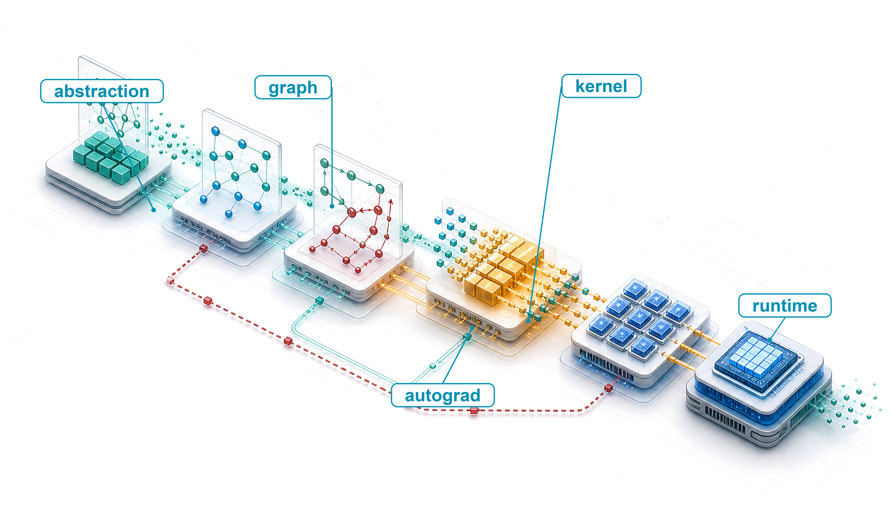
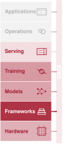
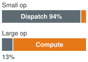
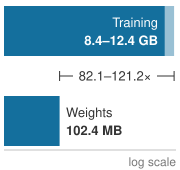
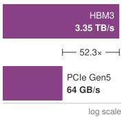
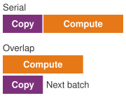
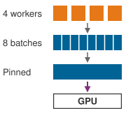
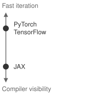

# ML Frameworks {#sec-ml-frameworks}

::: {layout-narrow}
::: {.column-margin}

\chapterminitoc

:::

::: {.content-visible when-format="pdf"}
\noindent
{fig-alt="Layered blueprint showing high-level model intent lowering through graph capture, autograd, fusion, and kernel dispatch into executable work."}
:::

::: {.content-visible unless-format="pdf"}
{fig-alt="Layered blueprint showing high-level model intent lowering through graph capture, autograd, fusion, and kernel dispatch into executable work."}
:::

:::

```{=latex}
\vspace*{-1ex}
```

## Purpose {.unnumbered .unlisted}

::: {.content-visible when-format="pdf"}
\begin{marginfigure}
\mlsysstack{35}{90}{40}{45}{15}{0}{0}{10}
\end{marginfigure}
:::

::: {.content-visible unless-format="pdf"}
::: {.column-margin}
{width="100%" fig-alt="Machine Learning Systems Architecture Stack"}

*Architecture stack focus for this chapter.*
:::
:::

_Why does the framework silently constrain every decision that comes after it?_

Model equations do not execute themselves. A framework translates an architecture into work that hardware can run, and that translation is not neutral. It decides when operations execute, what intermediate state training retains, how memory is allocated, and which deployment targets can use the resulting artifact. These choices shape more than speed. They also determine what can be debugged directly, what the compiler can optimize, and whether the same model survives the path from a research environment to a production runtime. The same model expressed through two execution paths can differ in speed or memory use by several times, a gap that no amount of model tuning recovers when the framework hides the structure a compiler needs. The abstractions that make experimentation convenient therefore create long-lived commitments. Once a project accumulates checkpoints, modules, data loaders, serving formats, and team expertise around a framework, changing it becomes a system migration rather than a library substitution, measured in engineer-months rather than afternoons. A framework well suited to rapid exploration can expose too little structure for efficient deployment, while a constrained execution path can sacrifice the flexibility needed during discovery. Because these choices meet in one software layer, a local convenience can become a downstream performance or portability constraint. The engineering question is not which framework is universally best, but which trade-offs the workload, team, and target machine can afford to make fixed. Understanding frameworks is therefore about reasoning through those system choices rather than learning transient API syntax, which changes with each release while the underlying trade-offs persist. In D·A·M terms, the framework mediates algorithm-machine co-design by turning algorithmic intent and data representation into executable work under machine constraints.

::: {.callout-learning-objectives}

- Explain how frameworks mediate algorithm-machine co-design through execution, differentiation, and hardware abstraction
- Compare eager, graph, and just-in-time compiled execution using dispatch overhead, kernel fusion, compilation cost, and deployment constraints
- Analyze how reverse-mode differentiation computes every gradient in one backward pass and which forward state it must save or recompute
- Estimate host-to-device transfer time and explain how tensor layout, data type, and device placement determine which kernel runs and whether transfers overlap computation
- Implement module abstraction patterns for parameter discovery, mode behavior, serialization, and hooks
- Calculate training-step FLOPs, memory traffic, and dispatch overhead to identify whether a step is bound by dispatch, memory traffic, or arithmetic
- Select a development framework and deployment path based on model, hardware, team, and deployment requirements

:::

## Three Framework Problems {#sec-ml-frameworks-three-problems-every-framework-must-solve-317d}

A few lines of Python can express one decoding step of a language model: embed the newest token, pass it through every transformer block, and project the result onto the vocabulary. The accelerator never sees those lines. It sees a stream of kernels,[^fn-kernel-gpu-dispatch] the compiled routines it executes one launch at a time, together with memory allocations and copies, and the machine learning framework is the software that turns the first into the second. @Sec-network-architectures fixed *what* work each architecture performs. It left open *when* each operation runs, *how* its gradients are computed, and *which* kernel on which device executes it.

[^fn-kernel-gpu-dispatch]: **Kernel (GPU)**\index{Operator kernel!GPU definition}: In GPU programming, a kernel is the function dispatched to execute in parallel across thousands of threads. Each kernel launch costs about 5 $\MicroUnitPrefix$s of CPU-side overhead for parameter assembly and GPU signaling, and an eager framework's Python dispatch adds about 10 $\MicroUnitPrefix$s more before the launch, the split this chapter's overhead model uses. Small, unfused operations therefore spend more time on launch overhead $(\Latency)$ than on useful arithmetic. Reducing kernel count through fusion is a direct attack on the overhead term of the iron law.

```{python}
#| echo: false
#| label: gpt2-decode-dispatch
# ┌─────────────────────────────────────────────────────────────────────────────
# │ GPT-2 XL DECODE STEP: WEIGHT READ VS. KERNEL LAUNCHES
# ├─────────────────────────────────────────────────────────────────────────────
# │ Context: Opening paragraph of
# │          @sec-ml-frameworks-three-problems-every-framework-must-solve-317d.
# │
# │ Goal:    Show that an eager batch-one decoding step of GPT-2 XL spends
# │          longer launching kernels than reading its weights.
# │ Show:    FP16 weight bytes, weight-read time, kernel count, launch time,
# │          host time, and their ratios to the weight read.
# │ How:     Registry model shape, data-center accelerator HBM bandwidth, and
# │          the runtime overheads used throughout this chapter.
# └─────────────────────────────────────────────────────────────────────────────
from mlsysim import Models, Hardware, Ops, BYTES_FP16, GB, TB, second, millisecond, microsecond
from mlsysim.fmt import check, fmt_bandwidth, fmt_count, fmt_memory, fmt_multiple, fmt_time

# ┌── LEGO ───────────────────────────────────────────────
class GPT2DecodeDispatch:
    """GPT-2 XL batch-one decoding step: weight streaming vs. eager kernel launches."""

    # ┌── 1. LOAD (Constants) ──────────────────────────────────────────────
    gpt2 = Models.Language.GPT2
    hbm_bw = Hardware.Cloud.H100.memory.bandwidth
    kernel_launch = Ops.RuntimeOverheads.KernelLaunch
    python_dispatch = Ops.RuntimeOverheads.PythonDispatch
    # scenario assumption: one eager kernel each for two layer norms, the fused
    # QKV projection, attention scores, softmax, weighted sum, output projection,
    # two feed-forward matmuls, the activation, and two residual adds
    kernels_per_block = 12

    # ┌── 2. EXECUTE (The Compute) ────────────────────────────────────────
    weights = gpt2.size_in_bytes(BYTES_FP16)
    weight_read = (weights / hbm_bw).to(millisecond)
    n_kernels = kernels_per_block * gpt2.layers
    launch_time = (n_kernels * kernel_launch).to(millisecond)
    host_time = (n_kernels * (kernel_launch + python_dispatch)).to(millisecond)
    launch_ratio = (launch_time / weight_read).to("").magnitude
    host_ratio = (host_time / weight_read).to("").magnitude

    # ┌── 3. GUARD (Invariants) ───────────────────────────────────────────
    check(0.8 < weight_read.to(millisecond).magnitude < 1.0, f"Prose (and the ch6 lighthouse) say about 0.9 ms per weight read, got {weight_read}.")
    check(n_kernels == 576, f"Expected 576 kernels per decoding step, got {n_kernels}.")
    check(2.5 < launch_ratio < 3.5, f"Prose says launching alone takes about 3x the weight read, got {launch_ratio:.2f}x.")
    check(9 < host_ratio < 11, f"Prose says host time is about 10x the weight read, got {host_ratio:.2f}x.")

    # ┌── 4. OUTPUT (Formatting) ─────────────────────────────────────────────
    weights_gb_str = fmt_memory(weights, unit=GB, precision=0, commas=False)
    hbm_bw_tb_per_s_str = fmt_bandwidth(hbm_bw, unit=TB / second, precision=2, commas=False)
    weight_read_ms_str = fmt_time(weight_read, unit="millisecond", precision=1, commas=False)
    layers_str = fmt_count(gpt2.layers, precision=0, commas=False)
    kernels_per_block_str = fmt_count(kernels_per_block, precision=0, commas=False)
    n_kernels_str = fmt_count(n_kernels, precision=0, commas=False)
    launch_us_str = fmt_time(kernel_launch, microsecond, precision=0, commas=False)
    python_us_str = fmt_time(python_dispatch, microsecond, precision=0, commas=False)
    launch_ms_str = fmt_time(launch_time, unit="millisecond", precision=1, commas=False)
    host_ms_str = fmt_time(host_time, unit="millisecond", precision=1, commas=False)
    launch_mult_str = fmt_multiple(round(launch_ratio), precision=0, commas=False)
    host_mult_str = fmt_multiple(round(host_ratio), precision=0, commas=False)
```

GPT-2 XL, the book's bandwidth-bound lighthouse, shows what those open questions cost. One batch-one decoding step reads `{python} GPT2DecodeDispatch.weights_gb_str` of FP16 weights, which takes about `{python} GPT2DecodeDispatch.weight_read_ms_str` at the `{python} GPT2DecodeDispatch.hbm_bw_tb_per_s_str` memory bandwidth of an H100, the book's reference accelerator. Executed one operation at a time, the same step issues about `{python} GPT2DecodeDispatch.kernels_per_block_str` kernels in each of its `{python} GPT2DecodeDispatch.layers_str` transformer blocks, `{python} GPT2DecodeDispatch.n_kernels_str` launches in all. At `{python} GPT2DecodeDispatch.launch_us_str` of driver overhead per launch, launching alone takes `{python} GPT2DecodeDispatch.launch_ms_str`, about `{python} GPT2DecodeDispatch.launch_mult_str` the weight read. An eager Python framework adds `{python} GPT2DecodeDispatch.python_us_str` of dispatch to every operation, which raises the host's time to issue the step to `{python} GPT2DecodeDispatch.host_ms_str`, about `{python} GPT2DecodeDispatch.host_mult_str` the time the accelerator needs to read its weights. The accelerator spends most of the step waiting for its next instruction. Whether the step costs one millisecond or ten depends on what the framework does with those few lines of Python: run each operation as it is called, or capture the sequence, fuse it into fewer kernels, and launch it as a unit.

Every ML framework\index{ML framework!execution problem}\index{ML framework!differentiation problem}\index{ML framework!hardware abstraction problem}, regardless of API or design philosophy, must solve three core problems. The first is the *execution problem*: deciding when and how computation runs. A framework can execute operations immediately as written (eager execution\index{Eager execution!definition}[^fn-eager-execution-tradeoff]) or first construct a computational graph\index{Computational graph!graph execution}[^fn-computational-graph-frameworks]\index{Deferred execution!graph construction} (a record of operations and their data dependencies, developed in @sec-ml-frameworks-computational-graph-00f7) to optimize before launching device kernels (graph execution). The decoding step above is an execution problem, and this choice sets the trade-off between interactive debugging and whole-program compiler optimization.

With an execution strategy in place, the framework must solve the *differentiation problem*: computing gradients automatically. Because gradient-based training requires derivatives of a scalar loss with respect to millions or billions of parameters, manual calculus is impossible at scale. Frameworks implement automatic differentiation\index{Automatic differentiation!framework role} by registering derivative rules across supported operator compositions, chaining vector-Jacobian products while managing numerical precision and the memory overhead of intermediate activations retained for backward passes.

::: {.column-margin .margin-pointer}
↩ Reverse-mode automatic differentiation and computational graph traversal for gradient computation are established in @sec-neural-computation-gradient-computation-backpropagation-dacf.
:::

The third problem is *hardware abstraction*: targeting diverse hardware from a single interface. The same model definition should be expressible across CPUs, GPUs, Tensor Processing Units (TPUs), and mobile accelerators, even though each target presents distinct memory hierarchies, instruction sets, and interconnect bandwidths. For every operation the framework must choose which kernel runs on which device, with which memory layout and precision. Within the GPU domain, framework ecosystems increasingly expose custom-kernel languages such as Triton [@tillet2019], allowing developers to write high-performance, block-level kernels without hand-crafting low-level CUDA (NVIDIA's GPU programming platform [@nickolls2008]) or device assembly.

[^fn-computational-graph-frameworks]: **Computational graph**\index{Computational graph!framework optimization}: Optimizing before executing is the design choice that separates graph execution from eager execution. Capturing the program as a data structure lets a framework fuse compatible operations into fewer GPU kernels before execution, reducing launch overhead and intermediate memory traffic. The engineering cost of this visibility is that the executed program differs from the source code, making debugging harder, a trade-off every graph-based framework must justify against the performance gain.

[^fn-eager-execution-tradeoff]: **Eager execution**\index{Eager execution!optimization trade-off}: This mode executes each operation immediately, which enables direct debugging with standard tools but sacrifices the global view needed for graph-level optimizations. Without capturing a larger region of computation, an eager runtime cannot fuse across that region or preplan its memory, leaving workload-dependent optimization opportunities for compilers such as `torch.compile`.

These three problems are tightly coupled: the execution model dictates when differentiation data structures are recorded, while the hardware abstraction layer determines which graph transformations can be lowered to the target. In the terms of the iron law of ML systems (principle \ref{pri-iron-law}), the model architecture fixes the operation count $\Operations$, and the framework shapes the remaining terms. Execution strategy bears most directly on the fixed overhead $\Latency$, differentiation on the bytes moved $\DataVolume$ (and on $\Operations$, since the backward pass adds work), and abstraction on the hardware efficiency $\EfficiencyHw$. These are emphases rather than exclusive assignments, since fusion, for example, cuts both launches and traffic, and the chapter uses this one mapping throughout. The framework\index{ML framework!compiler analogy} plays the role for a model that a compiler plays for a C program. The correspondence is literal: modern frameworks include optimizing compilers, such as Accelerated Linear Algebra (XLA) [@GoogleXLA] and TorchInductor [@ansel2024], that lower a captured graph to machine code for the target accelerator. The formal definition below makes that role precise and separates frameworks from numerical libraries such as NumPy.

::: {#dfn-frameworks-machine-learning-frameworks .callout-definition title="Machine learning frameworks"}

***Machine learning frameworks***\index{ML framework!definition} are software systems that translate high-level mathematical model definitions into hardware-optimized execution plans by managing the computational graph, automatic differentiation, kernel dispatch, and memory allocation across the hardware hierarchy.

1.  **Significance**: Frameworks shape every iron law term that the model itself does not fix: the bytes moved $(\DataVolume)$, the hardware efficiency achieved $(\EfficiencyHw)$, and the fixed overhead paid $(\Latency)$. Compiler-backed kernel fusion, for example, can eliminate writes and subsequent reads of intermediate values between compatible operations. Fusing a matrix multiplication, bias add, and rectified linear unit (ReLU) changes how the same mathematics reaches hardware without changing the model.
2.  **Distinction**: Unlike a numerical library such as NumPy, which normally evaluates each operation as it is called, an ML framework can capture or defer execution to analyze a larger computational graph and apply cross-operation optimizations: kernel fusion, memory layout transformations, and parallel scheduling. Those optimizations require visibility beyond separately dispatched operations.
3.  **Common pitfall**: A frequent misconception is that frameworks are interchangeable API wrappers. Framework choice determines which compiler paths are available. PyTorch can recover graph-level optimization from eager code through `torch.compile()`, while TensorFlow and JAX commonly rely on XLA-backed compilation paths that lower operations to target hardware. Moving from eager execution to a compiler path can change throughput materially, but the gain depends on model structure, shapes, operator support, and hardware.

:::

An ML framework translates logical intent into physical execution under the constraints of the iron law. It decides how to partition computation across memory hierarchies, when to trade numerical precision for throughput, and how to schedule operations so that whichever term dominates (data movement $\DataVolume$, arithmetic computation, or launch latency $\Latency$) is minimized. The framework is where the governing physics developed throughout this book becomes executable code.

This chapter follows a model's graph downward, one level at a time (@tbl-frameworks-chapter-spine): the decoding step above carries the execution level, and a two-layer MNIST training step, traced at the end, gathers every level. The execution section takes the graph to kernels and decides when each operation runs. The differentiation section builds the backward graph that training adds and accounts for the values it must keep. The abstraction section reaches the bottom of the descent, where tensors occupy device memory and kernels operate on them. Modules then assemble those pieces back into a model, and the anatomy of one training step traces a single step through every level. The chapter closes with the major frameworks and how to choose among them.

| **Section**                                         | **Level of the graph**                                  | **Question it answers**                                   | **Iron law term most affected**              |
|:----------------------------------------------------|:--------------------------------------------------------|:----------------------------------------------------------|:---------------------------------------------|
| **Evolution of Framework Abstractions**             | Libraries, autodiff, compilers                          | How the levels of the stack came to exist                 | (context)                                    |
| **Execution: From Graphs to Kernels**               | Graph to kernels                                        | When each operation runs, and how many launches it costs  | Fixed overhead $\Latency$                    |
| **Differentiation: Automatic Gradient Computation** | Forward graph to backward graph                         | How gradients are computed, and which values must be kept | Bytes moved $\DataVolume$, and $\Operations$ |
| **Abstraction: Tensors, Devices, and Operations**   | Tensors in device memory                                | Where each value lives and which kernel runs on it        | Hardware efficiency $\EfficiencyHw$          |
| **Modules: From Operations to Models**              | Operations to a model                                   | How parameters and training state are organized           | (organization)                               |
| **Anatomy of a Training Step**                      | Execution, differentiation, and abstraction in one step | Where one step's time and bytes go                        | All terms                                    |
| **Major Frameworks** and **Choosing a Framework**   | Complete systems                                        | Which framework fits a given constraint                   | All terms                                    |

: **Chapter Map**: Each section of the chapter lowers the model's computational graph one level closer to the hardware and names the iron law term that level most affects. {#tbl-frameworks-chapter-spine}

Automating this machinery (recording operation graphs, allocating gradient buffers, traversing dependencies in reverse, and dispatching hardware kernels) did not happen all at once. Execution, differentiation, and abstraction emerged sequentially as responses to scaling bottlenecks in earlier numerical tools, a four-decade progression from hand-tuned assembly routines to compiled graph runtimes.

## Evolution of Framework Abstractions {#sec-ml-frameworks-frameworks-evolved-ac68}

In 1979, writing a matrix multiplication in Fortran that used the hardware efficiently required deep knowledge of cache lines, register scheduling, and vector units. By the late 2010s, a single line of Python (`torch.matmul(A, W)`) could dispatch to a tuned implementation without the programmer knowing the details of the hardware. Four decades of abstraction\index{ML framework!historical evolution} closed that gap, each layer removing a bottleneck that made the previous generation impractical at scale. Each layer automated a job the layer below left to the programmer.\index{Ladder of abstraction} History built the layers from the bottom up, starting with tuned kernels and ending with graph compilers; the rest of this chapter walks them from the top down, starting from the graph a model defines.

The first layer established reusable hardware primitives. The Basic Linear Algebra Subprograms (BLAS)\index{BLAS!historical foundation}[^fn-blas-routine-acceleration] standardized low-level linear-algebra operations [@lawson1979], and LAPACK\index{LAPACK!framework foundation} [@anderson1999lapack] built factorizations and eigensolvers on top of them. Naive nested loops saturate memory bandwidth long before the arithmetic units reach peak throughput. BLAS let numerical software delegate these operations to vendor libraries tuned for each processor's cache sizes, vector widths, and register files. Its Level 3 extension added the matrix-matrix routines, such as matrix multiplication (`C = A @ B`),[^fn-gemm-hardware-utilization] that dominate ML workloads [@dongarra1990level3]. The second layer, NumPy\index{NumPy!framework foundation}[^fn-numpy-array-abstraction] [@harris2020], wrapped those libraries in Python: the interpreter manages control flow and array metadata (shape, strides, and data type), while compiled code runs the inner loops over contiguous buffers. That division of labor, high-level intent in an interpreted language and inner loops in native code, became the template for every framework that followed.

The third layer automated gradient computation. NumPy users still derived and coded backpropagation by hand, an error-prone process that does not scale to deep networks. Deep learning frameworks\index{Deep learning framework!automatic differentiation} such as Theano,[^fn-theano-framework-origin] TensorFlow [@abadi2016tensorflow], and PyTorch [@paszke2019pytorch] made automatic differentiation a runtime primitive: by recording the forward computation as a graph, they construct the backward computation automatically. That automation let the bitter lesson operate at the pace of research. Once a new architecture no longer needed a hand-derived backward pass, general methods that scale with computation could be tried as quickly as their forward functions could be written.

::: {.column-margin .margin-pointer}
↩ The bitter lesson, that general methods which exploit growing computation outlast hand-engineered approaches, is established in @sec-introduction-bitter-lesson-79c7.
:::

[^fn-blas-routine-acceleration]: **BLAS (basic linear algebra subprograms)**\index{BLAS!performance foundation}: The 1979 API specification at the bottom layer of the stack; it fixed a set of Fortran-callable vector operations and separated the public routine names from the machine-specific implementation beneath them. Every framework above it inherits the same division: call a standard linear-algebra routine from any language and let a tuned vendor library target the processor. On NVIDIA GPUs, the tuned path for general matrix multiply (GEMM), a Level 3 routine added in 1990, is cuBLAS [@nvidia_cublas].

[^fn-gemm-hardware-utilization]: **GEMM**\index{GEMM!hardware utilization}: The matrix-matrix primitive behind `C = A @ B`. Hardware vendors hand-tune GEMM for their specific chips because dense layers, attention projections, and convolution lowering all rely on matrix multiplication, making this one routine a performance floor for many frameworks above it in the stack. Its high arithmetic intensity makes GEMM the operation most able to approach peak compute throughput, while small or misaligned shapes often fall back to much lower utilization.

[^fn-numpy-array-abstraction]: **NumPy (numerical Python)**\index{NumPy!framework lineage}: In 2005, Travis Oliphant unified two competing Python array libraries (Numeric and Numarray) into a single BLAS-backed package. Its pattern of writing logic in Python and executing loops in compiled code became the design template for ML frameworks: PyTorch tensors and TensorFlow arrays extend the same $\TensorAxisCount$-dimensional array abstraction to GPUs.

[^fn-theano-framework-origin]: **Theano**\index{Theano!computational graph origin}: Developed at the Montreal Institute for Learning Algorithms (MILA) under Yoshua Bengio starting in 2007, Theano was an early and influential Python framework that compiled symbolic mathematical expressions into optimized CPU and GPU code via computational graphs [@bergstra2010; @al2016theano]. It demonstrated that a Python-defined computation graph could be compiled for GPU execution without requiring the researcher to write CUDA code. Mila ended active development of Theano in 2017 [@milaTheanoDevelopment].

Across that history (@fig-mlfm-timeline), the milestones run from BLAS and LAPACK routines through NumPy vectorization to symbolic graph capture in Theano and TensorFlow, dynamic graphs in PyTorch, and functional transformations in JAX. Each generation preserved the vendor-tuned kernel layer beneath it while raising the level of abstraction at which engineers express and differentiate models.

::: {#fig-mlfm-timeline fig-env="figure" fig-pos="htb" fig-cap="**Computational Library Evolution**: Numerical computing milestones from 1979 to 2018 show each era automating what the layer below exposed, from BLAS and LAPACK hardware routines to NumPy vectorized syntax and graph-based automatic differentiation in modern frameworks, trading low-level transparency for developer velocity." fig-alt="Horizontal timeline from 1979 to 2018 marking key milestones: 1979 BLAS introduced, 1992 LAPACK extends BLAS, 2006 NumPy becomes Python's numerical backbone, 2007 Theano introduces computational graphs, 2015 TensorFlow, 2016 PyTorch, 2018 JAX."}

```{.tikz}
\begin{tikzpicture}[node distance=1mm,outer sep=0pt,font=\small\sffamily]
\tikzset{%
    Line/.style={line width=1.0pt,black!50
},
  Box/.style={inner xsep=1pt,
    draw=none,
    fill=#1,
    anchor=west,
    text width=27mm,align=flush center,
    minimum width=28mm, minimum height=13mm
  },
  Box/.default=red
}
\definecolor{col1}{RGB}{128, 179, 255}
\definecolor{col2}{RGB}{255, 255, 128}
\definecolor{col3}{RGB}{204, 255, 204}
\definecolor{col4}{RGB}{230, 179, 255}
\definecolor{col5}{RGB}{255, 153, 204}
\definecolor{col6}{RGB}{245, 82, 102}
\definecolor{col7}{RGB}{255, 102, 102}

\node[Box={col1}](B1){1979};
\node[Box={col2!},right=of B1](B2){1992};
\node[Box={col3},right=of B2](B3){2006};
\node[Box={col4},right=of B3](B4){2007};
\node[Box={col5},right=of B4](B5){2015};
\node[Box={col6},right=of B5](B6){2016};
\node[Box={col7},right=of B6](B7){2018};
%%
\foreach \x in{1,2,...,7}
\draw[dashed,thick,-latex](B\x)--++(270:4.1);

\path[red]([yshift=-7mm]B1.south west)coordinate(P)-|coordinate(K)(B7.south east);

\draw[line width=2pt,-latex](P)--(K)--++(0:3mm);

\def\vi{1.4}
\node[Box={col1!50},below=\vi of B1](BB1){BLAS introduced};
\node[Box={col2!50},below=\vi of B2](BB2){LAPACK extends BLAS};
\node[Box={col3!50},below=\vi of B3](BB3){NumPy becomes Python's numerical backbone};
\node[Box={col4!50},below=\vi of B4](BB4){Theano introduces computational graphs};
\node[Box={col5!50},below=\vi of B5](BB5){TensorFlow popularizes static graphs};
\node[Box={col6!50},below=\vi of B6](BB6){PyTorch popularizes dynamic graphs};
\node[Box={col7!50},below=\vi of B7](BB7){JAX introduces functional paradigms};
\end{tikzpicture}
```

:::

Each generation hid details that consumed engineering effort in the previous one, and each introduced new trade-offs. BLAS hid assembly-level optimization but fixed the interface. NumPy hid memory management but left differentiation manual. Modern frameworks hide gradient computation but force a choice among execution models. Every layer also hides assumptions about the data it passes along: each operation expects its inputs to have a particular shape, data type, device, and, for physical quantities, unit. When nothing checks those expectations at the boundary, correct components can compose into a wrong system.

::: {#ws-frameworks-mars-climate-orbiter-units .callout-war-story title="The interface that forgot its units (1999)"}

**Context**: NASA's Mars Climate Orbiter depended on ground software, spacecraft software, navigation teams, and contractor interfaces all agreeing on the physical meaning of exchanged values [@nasa1999marsclimateorbiter].

**Mechanism**: Ground software supplied by Lockheed Martin computed thruster impulse in English units (pound-force seconds), while JPL navigation software consumed the values assuming SI units (newton-seconds), a 4.45$\times$ implicit unit mismatch.

**Impact**: On September 23, 1999, the spacecraft was lost after passing behind Mars (occultation). Its corrected 57 km periapsis, rather than the planned 226 km, was judged too low for survival.

**Response**: The board recommended unit-consistency checks, specification audits of transferred data, and stronger end-to-end verification of ground software.

**Systems lesson**: Two pieces of correct code can compose into a wrong system when the meaning of the values they exchange is implicit. ML frameworks meet the same failure whenever tensor memory layouts (such as channels-first NCHW [$\text{Batch} \times \text{Channels} \times \text{Height} \times \text{Width}$] vs. channels-last NHWC [$\text{Batch} \times \text{Height} \times \text{Width} \times \text{Channels}$]), quantization scale factors, or physical feature units differ across pipeline stages. The outputs look plausible but quietly corrupt downstream inference. Frameworks guard against the tensor cases by checking, at every operation, that its inputs have the expected shape, data type, and device.

:::

A framework can run those checks as each operation executes, when the failing line and its intermediate values are directly visible, or before execution, when a captured graph can be validated and optimized as a whole. When checks and optimizations happen is the execution problem. It is the first framework design choice because runtime dispatch and graph capture determine both the debugging experience and what optimizations automatic differentiation and hardware mapping can later exploit.

## Execution: From Graphs to Kernels {#sec-ml-frameworks-execution-problem-e1e1}

Consider two engineers writing the same neural network. The first debugs interactively, printing tensor shapes after each operation, inspecting intermediate values, and stepping through code with `pdb`. The second waits through a compilation step, then watches a model built from many small operations run faster while losing that direct, line-by-line view of intermediate state. Both are correct; they have made different choices about the **execution problem**\index{Execution problem!definition}, the question of whether operations should execute immediately as written or be recorded for later execution. It sets debugging workflow, deployment options, and peak hardware utilization. The GPT-2 XL decoding step that opened this chapter is the case in point: issued one operation at a time, it keeps the accelerator waiting on the host for most of the step.

### Computational graphs {#sec-ml-frameworks-computational-graph-00f7}

If a runtime sees only one Python operation at a time and forgets it as soon as the kernel returns, it cannot know which intermediate tensors later gradient rules will need or which adjacent operations could share registers on the accelerator. To plan across operations, a framework represents the program the same way @sec-network-architectures represented model architectures, as a computational graph\index{Computational graph!definition (DAG)}: a directed acyclic graph (DAG) where nodes represent operations and edges represent data dependencies. The rest of this chapter follows that graph down toward the hardware. It is the same structure that backpropagation traverses in reverse, here serving as the framework's internal model of the computation for scheduling and optimization as well.

A graph decouples the mathematical operations from the order in which hardware evaluates them. In the minimal case (@fig-comp-graph), directed edges route input variables $\FunctionInputVariable$ and $\FunctionSecondInputVariable$ into the central transformation operator $\IllustrativeFunction(\FunctionInputVariable, \FunctionSecondInputVariable)$, which emits the output variable $\FunctionOutputVariable$.

::: {#fig-comp-graph fig-env="figure" fig-pos="htb" fig-cap="**Simple Computational Graph**: Representing $\FunctionOutputVariable = \IllustrativeFunction(\FunctionInputVariable, \FunctionSecondInputVariable)$ as a directed acyclic graph decouples mathematical dependencies from physical execution order, providing the structural blueprint frameworks require to track gradients and schedule operations across devices." fig-alt="Simple directed graph with nodes x and y flowing into function f(x,y) which outputs z."}

```{.tikz}
\begin{tikzpicture}[font=\sffamily\small]
%
\tikzset{%
    Line/.style={line width=1.0pt,black!50,rounded corners
},
  Box/.style={align=flush center,
   shape=circle,
    inner xsep=1pt,
    node distance=1.4,
    draw=BlueLine,
    line width=0.75pt,
    fill=BlueL,
    minimum width=8mm,
  },
}
\node[Box,fill=GreenFill,draw=GreenLine,minimum width=15mm, ](B1){$f(x,y)$};
\node[Box,right=of B1,fill=GreenFill,draw=GreenLine](B2){$z$};
\node[Box,above left=-0.10 and 2 of B1,fill=GreenFill,draw=GreenLine](B3){$x$};
\node[Box,below left=-0.10 and 2 of B1,fill=GreenFill,draw=GreenLine](B4){$y$};
\draw[-latex,Line](B1)--(B2);
\draw[-latex,Line](B3)to[bend left=25](B1);
\draw[-latex,Line](B4)to[bend right=25](B1);
\end{tikzpicture}
```

:::

Real machine learning models require much more complex graph structures. @Fig-mlfm-comp-graph partitions this system interaction into two coupled domains: the left container isolates a six-node neural network DAG with explicit dataflow edges, while the right container houses the runtime components (memory management and device placement) that interface with it.

::: {#fig-mlfm-comp-graph fig-env="figure" fig-pos="htb" fig-cap="**Computation Graph with System Interactions**: A neural network DAG (left) interfaces with framework runtime components (right). By maintaining an explicit graph representation independent of execution, the framework can analyze tensor lifetimes for memory reuse and assign operations to target accelerators before issuing arithmetic." fig-alt="Left side shows computational graph with six operation nodes connected by data flow edges. Right side shows system components box with memory management and device placement nodes that interact with the computational graph."}

```{.tikz}
\scalebox{0.9}{%
\begin{tikzpicture}[font=\sffamily\small]

\tikzset{
  Box/.style={ inner xsep=2pt,
    node distance=1.4,
    draw=none,
    line width=0.5pt,,
    fill=none,
    minimum width=27mm, minimum height=15mm
  },
    LineA/.style={violet!40,line width=5pt,{-{Triangle[width=1.0*11pt,length=1.0*8pt]}},shorten <=1pt,shorten >=1pt},
    graphpanel/.style={
        draw=olive!60!black,
        fill=olive!02,
        line width=0.9pt,
        rounded corners=4pt,
        inner sep=14pt,yshift=9pt
    },
    syspanel/.style={
        draw=orange!70!black,
        fill=orange!03,
        line width=0.9pt,
        rounded corners=4pt,
        inner sep=10pt
    },
    opnode/.style={
        circle,node distance=6mm,
        draw=BlueLine,,
        fill=cyan!15,
        minimum size=5mm,
        line width=0.9pt
    },
    compbox/.style={
        draw=orange!80!black,
        fill=orange!12,
        rounded corners=2pt,
        minimum width=2.7cm,
        minimum height=0.9cm,
        align=center,
        line width=0.8pt
    },
    flow/.style={
        -{Latex[length=2.2mm]},
        draw=BrownLine!75,
        line width=0.9pt
    },
}
%CPU style
\tikzset{
pics/cpu/.style = {
        code = {
        \pgfkeys{/channel/.cd, #1}
\begin{scope}[local bounding box = CPU,shift={($(0,0)+(0,0)$)},scale=\scalefac,every node/.append style={transform shape}]
\node[fill=\filllcolor,minimum width=66, minimum height=66,
            rounded corners=2,outer sep=2pt] (C1) {};
\node[fill=white,minimum width=54, minimum height=54] (C2) {};
\node[fill=\filllcolor!50,minimum width=44, minimum height=44] (C3) {\Large\bfseries GPU};

\foreach \x/\y in {0.11/1,0.26/2,0.41/3,0.56/4,0.71/5,0.85/6}{
\node[fill=\filllcolor,minimum width=4, minimum height=15,
           inner sep=0pt,anchor=south](GO\y)at($(C1.north west)!\x!(C1.north east)$){};
}
\foreach \x/\y in {0.11/1,0.26/2,0.41/3,0.56/4,0.71/5,0.85/6}{
\node[fill=\filllcolor,minimum width=4, minimum height=15,
           inner sep=0pt,anchor=north](DO\y)at($(C1.south west)!\x!(C1.south east)$){};
}
\foreach \x/\y in {0.11/1,0.26/2,0.41/3,0.56/4,0.71/5,0.85/6}{
\node[fill=\filllcolor,minimum width=15, minimum height=4,
           inner sep=0pt,anchor=east](LE\y)at($(C1.north west)!\x!(C1.south west)$){};
}
\foreach \x/\y in {0.11/1,0.26/2,0.41/3,0.56/4,0.71/5,0.85/6}{
\node[fill=\filllcolor,minimum width=15, minimum height=4,
           inner sep=0pt,anchor=west](DE\y)at($(C1.north east)!\x!(C1.south east)$){};
}
\end{scope}
    }
  }
}
\tikzset{
pics/dram/.style = {
        code = {
        \pgfkeys{/channel/.cd, #1}
\begin{scope}[shift={($(0,0)+(0,0)$)},scale=\scalefac,every node/.append style={transform shape}]
\node[draw=\drawcolor,fill=\filllcolor!70,line width=1.5*\Linewidth,inner sep=0pt,outer sep=0pt,
minimum width=56mm,minimum height=14mm](DRAM\picname)at(0,0){};
\node[draw=\drawcolor,fill=\filllcolor!30,line width=1.5*\Linewidth,inner sep=0pt,outer sep=0pt,anchor=north,
minimum width=52mm,minimum height=6mm](MDRAM\picname)at(DRAM\picname.south){};
%
\pgfmathsetmacro{\spacing}{56/(6+1)}
\foreach \i in {1,...,6} {
  \pgfmathsetmacro{\x}{\i * \spacing}
  \node[draw=\drawcolor,fill=\filllcolor!20,line width=\Linewidth, inner sep=0pt, outer sep=0pt,
        minimum width=6mm, minimum height=8mm]
        at ([xshift=\x mm]DRAM\picname.west) {};
}
%
\foreach \i in {1,...,19} {
  \pgfmathsetmacro{\x}{\i*(52/20)}
  \draw[draw=\drawcolor, line width=3*\Linewidth]
    ([xshift=\x mm,yshift=1pt]MDRAM\picname.south west) -- ++(0,2mm);
}
\end{scope}
    }
  }
}
\pgfkeys{
  /channel/.cd,
   Depth/.store in=\Depth,
  Height/.store in=\Height,
  Width/.store in=\Width,
  filllcirclecolor/.store in=\filllcirclecolor,
  filllcolor/.store in=\filllcolor,
  drawcolor/.store in=\drawcolor,
  drawcircle/.store in=\drawcircle,
  scalefac/.store in=\scalefac,
  Linewidth/.store in=\Linewidth,
  picname/.store in=\picname,
  filllcolor=BrownLine,
  filllcirclecolor=cyan!40,
  drawcolor=black,
  drawcircle=violet,
  scalefac=1,
  Linewidth=0.5pt,
  Depth=1.3,
  Height=0.8,
  Width=1.1,
  picname=C
}

    % graph nodes
    \node[opnode] (a)  {};
    \node[opnode,below left=of a] (b) {};
    \node[opnode,below right =of a] (c) {};
    \node[opnode,below=of b] (d)  {};
    \node[opnode,below =of c] (e) {};
    \node[opnode,below right=of d] (f) {};
    % edges
    \draw[flow] (a) -- (b);
    \draw[flow] (a) -- (c);
    \draw[flow] (b) -- (d);
    \draw[flow] (c) -- (e);
    \draw[flow] (d) -- (f);
    \draw[flow] (e) -- (f);
    % optional cross-edge
    \draw[flow] (b) -- (e);

    \node[opnode,minimum size=3mm,below left= 0.33 and 1.65of f] (l) {};
    \node[right=0pt of l,font=\sffamily\footnotesize](O){Operations};
    \draw[flow]($(O.east)+(1mm,0)$)--++(0:7mm)coordinate(A);
    \node[right=0pt of A,font=\sffamily\footnotesize](AA){Data flow};
    \scoped[on background layer]
    \node[graphpanel,fit=(a)(l)(O)(AA),inner xsep=6pt](FF){};
    \node[below=1pt of FF.north,font=\sffamily\bfseries\footnotesize]{Computational Graph};
%
   \node[right=29mm of FF.27,Box](MM){};
   \node[below=-6pt of MM](T1){Memory Management};
   \pic[shift={(0,0.1)}] at  (MM){dram={scalefac=0.43,picname=1,
   drawcolor=black,filllcolor=OrangeLine!50!,Linewidth=0.5pt}};
   \node[right=29mm of FF.338,Box](DP){};
      \node[below=1pt of DP](T2){Device Placement};
   \pic[shift={(0,0)}] at (DP) {cpu={scalefac=0.45,picname=1,
   drawcolor=RedLine,filllcolor=BlueLine!80!,Linewidth=0.5pt}};

   \scoped[on background layer]
   \node[fit=(MM)(T1)(T2),syspanel,yshift=1.0mm,inner xsep=6pt](DD){};
   \node[below=1pt of DD.north,font=\sffamily\bfseries\footnotesize]{System Components};

\draw[LineA](FF)--
node[above,pos=0.45,text=black!70,font=\sffamily\footnotesize]{Interacts with}
(DD);
\end{tikzpicture}}
```

:::

This graph representation is more than a visualization; it is the data structure that enables both efficient execution and automatic differentiation. The timing of its construction forces a systems trade-off across debugging, optimization, deployment, and flexibility. Interactive debugging demands immediate execution so developers can inspect intermediate values and step through logic with standard tools. Global optimization requires observing large operator sequences at once to fuse kernels and plan memory reuse. Standalone deployment favors graphs that run without the host interpreter, while dynamic architectures require control flow that branches on computed tensor values. No single execution model serves all four demands at once.

### The memory wall and kernel fusion {#sec-ml-frameworks-execution-strategy-matters-memory-wall-1ce8}

When an unoptimized runtime evaluates a sequence of three element-wise operations such as $\text{LayerNorm} \to \text{Dropout} \to \text{ReLU}$, it dispatches three separate GPU kernels. The first reads inputs from off-chip high-bandwidth memory (HBM) and writes intermediate results back to HBM, the second reads those results and writes back again, and the third reads them a final time. Shuttling intermediate tensors across the external memory bus three times dwarfs the arithmetic time and leaves compute units idle.

This bottleneck stems from the memory wall\index{Memory wall!execution strategy impact}\index{Memory wall!framework execution}, the widening gap between compute growth and memory-bandwidth growth that @eq-memory-wall quantifies. An accelerator performs arithmetic far faster than it fetches operands from off-chip memory. Most individual operation types in a neural network (activations, normalizations, and other element-wise operations) are therefore memory bound\index{Memory-bound!operation classification}, limited by data movement. The large matrix multiplications that dominate total arithmetic can be compute bound\index{Compute-bound!operation classification}, limited by arithmetic throughput. @Sec-hardware-acceleration-roofline-model-42ff formalizes the boundary between the two regimes. On-chip storage (registers and SRAM scratchpads) runs at tens of terabytes per second but holds only tens of megabytes, whereas off-chip HBM or GDDR holds tens to a few hundred GB behind external buses with hundreds of cycles of latency.

::: {.column-margin .margin-pointer}
↩ The memory wall and the growth-rate ratio behind it are established in @sec-ml-systems-deployment-spectrum-71be.
:::

Kernel fusion\index{Kernel fusion!definition}\index{Kernel fusion!optimizing memory-bound ops} (also called operator fusion) fixes memory-bound chains by combining them into a single kernel that avoids intermediate HBM traffic. Instead of three round-trips to HBM, a fused kernel loads inputs from HBM once, evaluates normalization, dropout, and ReLU entirely within on-chip registers and SRAM, and writes only the final output tensor back to HBM, cutting memory traffic by roughly 3$\times$. In general, for $\TensorElementCount$ elements of $\ElementStorageSize$ bytes each, fusing a chain of $\ChainedOperationCount$ elementwise operations into one kernel reduces idealized read-and-write traffic from $2\ChainedOperationCount \TensorElementCount\ElementStorageSize$ to $2\TensorElementCount\ElementStorageSize$ bytes, a derivation worked in @sec-appdx-algorithm-foundations-operator-fusion-5d73. Fusion also removes all but one of the chain's kernel launches. Attention kernels[^fn-flashattention-fusion-fw] use the same principle at larger scale. Instead of materializing the full attention matrix in HBM, a fused implementation can keep tiles close to the compute units, cut HBM accesses by up to 9$\times$, and produce workload-specific speedups from 15 percent to 3$\times$ [@dao2022].

::: {.column-margin .margin-pointer}
↪ The on-chip limits that decide which intermediates a fused kernel can keep on a specific accelerator are developed in @sec-hardware-acceleration-kernel-fusion-7faf.
:::

[^fn-flashattention-fusion-fw]: **Fused attention kernel**\index{Attention mechanism!fused kernel}: A fused attention kernel combines the $\AttentionQueryMatrix\AttentionKeyMatrix^T$ product, softmax, and value-weighted output into a tiled implementation that keeps intermediate values in on-chip memory rather than materializing the full attention matrix in HBM. FlashAttention\index{FlashAttention!framework fusion example}, introduced in @sec-network-architectures-memory-requirements-72c3, is the canonical named example. The framework lesson is broader than the specific algorithm: fusion can shift an operation's position on the roofline model from bandwidth-limited toward throughput-limited execution by reducing round-trips through external memory.

Framework compilers can fuse only operations that are visible to them simultaneously. When an eager runtime dispatches operations individually\index{Eager execution!optimization limitations}, each kernel launch executes in isolation, concealing cross-operation fusion and buffer-reuse opportunities. Capturing a broader region of computation into a deferred graph\index{Graph execution!optimization advantages} removes that isolation: the compiler can examine an entire sequence of dependencies, establish intermediate tensor lifetimes, and fuse compatible operations before dispatching work to the accelerator.

The computational graph enables global optimization, but it leaves a design choice unresolved: *when* the runtime constructs the graph. Consider an elementary expression such as `y = x * 2`. Evaluating the multiplication immediately yields a concrete tensor in `y`. This imperative flow is intuitive and directly debuggable, but the runtime sees only one operation at a time. Deferring execution records the operation symbolically into a dependency graph executed only upon request. That staging separates intent from evaluation, giving the compiler the end-to-end visibility required for kernel fusion and memory planning. Modern frameworks resolve this tension between *flexibility* and *optimization potential* with three execution strategies: eager execution with dynamic graphs, static computation graphs, and hybrid approaches that combine just-in-time (JIT) compilation with eager development.

### Eager execution with dynamic graphs {#sec-ml-frameworks-eager-execution-dynamic-graphs-29c2}

When a tensor shape mismatches or an activation turns to `NaN` mid-layer, a deferred graph fails far from the Python line that created the operation, hiding the intermediate values that caused the fault. Eager execution\index{Eager execution!define-by-run model}, also called define-by-run, avoids that disconnect by evaluating each operation as soon as the program calls it and building the computation graph dynamically\index{Dynamic graph!eager execution} at runtime.

::: {#exmp-frameworks-eager-vs-graph-execution-code-comparison .callout-example title="Eager vs. graph execution code comparison"}

**PyTorch (eager execution)**:
```{.python}
import torch

x = torch.tensor([1.0, 2.0])
y = x * 2
print(f"Intermediate value: {y}")  # Works immediately
z = y.sum()
```

**TensorFlow 1.x (static graph)**:

```{.python}
import tensorflow as tf

x = tf.placeholder(tf.float32)
y = x * 2
# print(y) -> Prints Tensor("mul:0"...), not value!
z = tf.reduce_sum(y)

with tf.Session() as sess:
    result = sess.run(z, feed_dict={x: [1.0, 2.0]})
```

**Systems insight**: Eager execution exposes intermediate values as ordinary runtime state, which makes debugging direct. Static graphs stage computation before execution, which enables whole-graph optimization but changes the debugging model.

:::

In this define-by-run model, when host code evaluates `y = x * 2`, the runtime dispatches the multiplication kernel to the device command queue and returns a tensor handle for subsequent operations. Device execution can continue asynchronously; dependent operations must wait for the result, and reading its value on the host can require synchronization.

Immediate evaluation gives eager code the flexibility of ordinary programming: developers can print intermediate values, use conditionals based on computed results, and debug with standard tools. The framework records operations as they happen, constructing a dynamic graph\index{Dynamic graph!definition}\index{Dynamic graph!runtime construction} that reflects the actual execution path taken.

For gradient computation, the framework records a history of operations in what is called an autograd tape\index{Autograd tape!definition}\index{Autograd tape!dynamic graph construction},[^fn-autograd-tape-memory] a transient data structure built during execution. Each tensor operation creates a node that records: the operation performed, references to input tensors, and how to compute gradients. These nodes form a DAG that records the actual path taken during forward-pass execution rather than a graph fixed in advance. @Lst-autograd-tape-example shows how PyTorch records operations as they execute in its default eager mode.

[^fn-autograd-tape-memory]: **Autograd tape**\index{Autograd tape!memory cost}: The tape's own nodes are small; its memory cost comes from the tensors they reference. That footprint grows with model depth and sequence length as saved activations accumulate until backpropagation releases them, which is why deep models retain only selected activations and recompute the rest (activation checkpointing) to avoid out-of-memory failures.

::: {#lst-autograd-tape-example lst-cap="**Autograd Tape Construction**: Each operation executes immediately while recording a backward node to the autograd tape for later gradient computation."}

```{.python}
import torch

x = torch.tensor([1.0], requires_grad=True)
y = x * 2  # Executes immediately; records MulBackward node
z = y + 1  # Executes immediately; records AddBackward node
# The autograd tape exists NOW, built during execution
```

:::

After these two operations, the framework has constructed an autograd tape with two nodes: one for the multiplication and one for the addition. The tape records that `z` depends on `y`, and `y` depends on `x`.

Calling `z.backward()` traverses this tape in reverse topological order, applying the chain rule at each node:

1. Compute $\frac{\partial \FunctionOutputVariable}{\partial \FunctionOutputVariable} = 1$ (seed gradient)
2. Call `AddBackward0.backward()` $\rightarrow \frac{\partial \FunctionOutputVariable}{\partial \TapeIntermediateResult} = 1$
3. Call `MulBackward0.backward()` $\rightarrow \frac{\partial \FunctionOutputVariable}{\partial \FunctionInputVariable} = 2$
4. Accumulate gradient in `x.grad`

After `backward()` completes, autograd normally releases the saved state needed by its backward rules. Other live references can still retain tensor storage and graph nodes. The next forward pass builds a new graph. Values needed for gradients are saved during the forward pass and remain available until backward consumes them, so their memory cost spans both phases rather than appearing only during backward.

::: {#exmp-frameworks-in-place-autograd-failure .callout-example title="In-place operations can break gradients"}

**Scenario**: An engineer applies an in-place mutation (`x += 1`) within a custom PyTorch activation function to reduce memory allocations.

**Diagnosis**: In-place operations overwrite tensor memory containing forward-pass activations required by the autograd tape for backward-pass gradient computation, triggering a runtime version-counter error [@pytorchAutogradDocs]. PyTorch enforces this safety invariant by maintaining an integer version counter on each tensor that increments on every in-place write. If a saved tensor's version at backward execution differs from its version recorded during the forward pass, autograd throws an error, because the activation required by the derivative rule was modified in place.

**Systems lesson**: Framework automatic differentiation depends on immutable forward-pass activation records. In-place writes to a saved tensor invalidate the autograd record, so PyTorch stops with an error rather than compute a wrong gradient.

:::

In eager execution frameworks, operations evaluate imperatively as host code encounters them. The define-by-run cycle is therefore a loop of one operation at a time (@fig-mlfm-dynamic-graph-flow). Python defines an operation, the runtime enqueues its device work, and control returns to Python for the next call while the device may execute asynchronously. When the runtime decides what to launch, it sees the current operation rather than a whole region of future calls.

::: {#fig-mlfm-dynamic-graph-flow fig-env="figure" fig-pos="htb" fig-cap="**Dynamic Graph Execution Flow**: In eager execution, each operation is issued as the program encounters it. Accelerator work may execute asynchronously after dispatch. This define-by-run model enables natural debugging and data-dependent control flow while limiting optimization across Python calls." fig-alt="Left-to-right flowchart with Start, Define Operation under Python Dispatch, Execute Operation under GPU Kernel, a More operations? decision, and End. A Yes branch loops back to Define Operation; a No branch continues to End."}

```{.tikz}
\begin{tikzpicture}[line join=round,font=\sffamily\small]
\tikzset{%
  Line/.style={line width=0.75pt,black!50,text=black},
  Box/.style={align=flush center,
    inner xsep=2pt,
    node distance=0.75,
    draw=BlueLine,
    line width=0.75pt,
    fill=BlueL!30,
    %text width=35mm,
    minimum width=35mm, minimum height=11mm
  },
 decision/.style = {Box,diamond,text width=35mm,aspect=1.95, inner xsep=7pt,inner ysep=-2ex, fill=VioletL2!70,
 draw=VioletLine},
  startstop/.style = {Box,minimum width=25mm,  rounded corners=10pt, fill=red!10, draw=RedLine},
  LineA/.style={black!50,line width=1.5pt,{-{Triangle[width=1.0*5pt,length=1.0*5pt]}},shorten <=0pt,shorten >=0pt},
}

\tikzset{
pics/repeat/.style = {
        code = {
        \pgfkeys{/channel/.cd, #1}
\begin{scope}[shift={($(0,0)+(0,0)$)},scale=\scalefac,every node/.append style={transform shape}]
\def\w{4cm}
\def\h{15mm}
\def\r{6mm} % radius
\def\gap{4mm} % break lengths
\draw[\filllcirclecolor, -{Latex[length=10pt,width=15pt]},line width=\Linewidth]
  (\w,\h-\r) -- (\w,\r)
  arc[start angle=0, end angle=-90, radius=\r]
  -- (\gap,0);
%
  \draw[\filllcolor, -{Latex[length=10pt,width=15pt]},line width=\Linewidth]
  (0,\r) -- (0,\h-\r)
  arc[start angle=180, end angle=90, radius=\r]
  -- ({\w-\gap},\h);
\end{scope}
    }
  }
}
\tikzset{
pics/interpreter/.style = {
        code = {
        \pgfkeys{/channel/.cd, #1}
\def\ra{}
\begin{scope}[shift={($(0,0)+(0,0)$)},scale=\scalefac,every node/.append style={transform shape}]
\node[red,font=\Large\bfseries]at(-0.75,0.6){\textless\,/\,\textgreater};
\draw[line cap=round,line join=round,yellow,line width=\Linewidth](-1.15,-0.1)--(-0.95,-0.1);
\draw[line cap=round,line join=round,red,line width=\Linewidth](-0.7,-0.1)--(0.1,-0.1);

\draw[line cap=round,line join=round,yellow,line width=\Linewidth](-1.15,-0.5)--(0,-0.5);

\draw[line cap=round,line join=round,yellow,line width=\Linewidth](-1.15,-0.9)--(-0.75,-0.9);
\draw[line cap=round,line join=round,red,line width=\Linewidth](-0.45,-0.9)--(0.45,-0.9);
\draw[line cap=round,line join=round,cyan,line width=\Linewidth](0.75,-0.9)--(1.1,-0.9);

\draw[line cap=round,line join=round,yellow,line width=\Linewidth](-1.15,-1.3)--(-1,-1.3);
\draw[line cap=round,line join=round,red,line width=\Linewidth](-0.65,-1.3)--(-0.10,-1.3);
\draw[line cap=round,line join=round,cyan,line width=\Linewidth](0.2,-1.3)--(1.1,-1.3);
\end{scope}
    }
  }
}
%CPU
\tikzset{%
 pics/cpu/.style = {
        code = {
        \pgfkeys{/channel/.cd, #1}
\begin{scope}[local bounding box=FUNNEL,scale=\scalefac, every node/.append style={transform shape}]
\node[fill=\filllcolor,minimum width=66, minimum height=66,
            rounded corners=2,outer sep=2pt] (C1) {};
\node[fill=white,minimum width=54, minimum height=54] (C2) {};
\node[fill=\filllcolor!40,minimum width=44, minimum height=44] (C3) {\Large\bfseries GPU};

\foreach \x/\y in {0.11/1,0.26/2,0.41/3,0.56/4,0.71/5,0.85/6}{
\node[fill=\filllcolor,minimum width=3, minimum height=15,
           inner sep=0pt,anchor=south](GO\y)at($(C1.north west)!\x!(C1.north east)$){};
}
\foreach \x/\y in {0.11/1,0.26/2,0.41/3,0.56/4,0.71/5,0.85/6}{
\node[fill=\filllcolor,minimum width=3, minimum height=15,
           inner sep=0pt,anchor=north](DO\y)at($(C1.south west)!\x!(C1.south east)$){};
}
\foreach \x/\y in {0.11/1,0.26/2,0.41/3,0.56/4,0.71/5,0.85/6}{
\node[fill=\filllcolor,minimum width=15, minimum height=3,
           inner sep=0pt,anchor=east](LE\y)at($(C1.north west)!\x!(C1.south west)$){};
}
\foreach \x/\y in {0.11/1,0.26/2,0.41/3,0.56/4,0.71/5,0.85/6}{
\node[fill=\filllcolor,minimum width=15, minimum height=3,
           inner sep=0pt,anchor=west](DE\y)at($(C1.north east)!\x!(C1.south east)$){};
}
 \end{scope}
     }
  }
}
%start
\tikzset{%
 pics/start/.style = {
        code = {
        \pgfkeys{/channel/.cd, #1}
\begin{scope}[local bounding box=START,scale=\scalefac, every node/.append style={transform shape}]
\node[fill=\filllcolor,minimum width=6mm, minimum height=6mm,
            outer sep=2pt] (C1) {};
\node[isosceles triangle,isosceles triangle apex angle=45,xshift=-2.5pt,
    inner sep=1pt, fill=white,minimum size =3.5mm] (T1)at (C1){};
 \end{scope}
     }
  }
}
%check
\tikzset{pics/.cd,
checkmark/.style={code={
        \pgfkeys{/channel/.cd, #1}
\pgfgettransformentries{\tmpxx}{\tmp}{\tmp}{\tmp}{\tmp}{\tmp}
\draw[line width=\tmpxx*1pt,draw=none,fill=\filllcirclecolor,line join=bevel] (0,.35) -- (.25,0) to[bend left=5] (0.8,.6) to[bend
right=5] (.25,.18) -- cycle;}}}
\tikzset{%
 pics/checkI/.style = {
        code = {
        \pgfkeys{/channel/.cd, #1}
\begin{scope}[local bounding box=CHECK,scale=\scalefac, every node/.append style={transform shape}]
\node[fill=\filllcolor,minimum width=6mm, minimum height=6mm,
            outer sep=2pt] (C1) {};
\pic[shift={(-0.27,-0.19)},scale=0.7]{checkmark};
 \end{scope}
     }
  }
}
\pgfkeys{
  /channel/.cd,
   Depth/.store in=\Depth,
  Height/.store in=\Height,
  Width/.store in=\Width,
  filllcirclecolor/.store in=\filllcirclecolor,
  filllcolor/.store in=\filllcolor,
  drawcolor/.store in=\drawcolor,
  drawcircle/.store in=\drawcircle,
  scalefac/.store in=\scalefac,
  Linewidth/.store in=\Linewidth,
  picname/.store in=\picname,
  filllcolor=BrownLine,
  filllcirclecolor=violet!20,
  drawcolor=red,
  drawcircle=violet,
  scalefac=1,
  Linewidth=0.5pt,
  Depth=1.3,
  Height=0.8,
  Width=1.1,
  picname=C
}

\node[startstop](B1){};
\coordinate(GO1)at($(B1.north west)!0.33!(B1.north east)$);
\coordinate(T1)at($(GO1)!0.5!(B1.south east)$);
\node[align=center]at(T1){Start};
\begin{scope}
\coordinate(I1)at($(GO1)!0.5!(B1.south west)$);
\clip (B1.south west) rectangle (GO1);
%\fill[RedLine!30,rounded corners=10pt] (B1.south west) rectangle (B1.north east);
\end{scope}
\draw[dashed,RedLine,  line width=0.75pt,](GO1)--(GO1|-B1.south west);
\node[startstop,fill=none]{};
\pic[shift={(0,0)}] at  (I1){start={scalefac=1,picname=1,filllcolor=GreenLine, Linewidth=0.7pt}};
%Define
\node[Box,right=of B1](B2){};
\node[above=1pt of B2,text=black!70]{Python Dispatch};
\coordinate(GO2)at($(B2.north west)!0.3!(B2.north east)$);
%\fill[fill=BlueL!90](B2.south west)rectangle(GO2);
\coordinate(T2)at($(GO2)!0.5!(B2.south east)$);
\coordinate(I2)at($(GO2)!0.5!(B2.south west)$);
\node[align=center]at(T2){Define\\Operation};
\draw[dashed,BlueLine,  line width=0.75pt,](GO2)--(GO2|-B2.south west);
\node[Box,right=of B1,fill=none]{};
\pic[shift={(0.05,0.11)}] at  (I2){interpreter={scalefac=0.35,picname=1,
filllcolor=cyan!30!, Linewidth=1.5pt,filllcirclecolor=orange}};
 %Execute
\node[Box,right=of B2](B3){};
\node[above=1pt of B3,text=black!70]{GPU Kernel};
\coordinate(GO3)at($(B3.north west)!0.3!(B3.north east)$);
%\fill[fill=BlueL!90](B3.south west)rectangle(GO3);
\coordinate(T3)at($(GO3)!0.5!(B3.south east)$);
\coordinate(I3)at($(GO3)!0.5!(B3.south west)$);
\node[align=center]at(T3){Execute\\Operation};
\draw[dashed,BlueLine,  line width=0.75pt,](GO3)--(GO3|-B3.south west);
\node[Box,right=of B2,fill=none](B3){};
\pic[shift={(0,0)}] at  (I3){cpu={scalefac=0.23,picname=1,filllcolor=BrownLine, Linewidth=0.7pt}};
%More operations
\node[decision,right=of B3](B4){More\\operations?};
\path[red](B4.west)|-coordinate(SR4)(B4.south);
\pic[shift={(-0.30,-0.14)}] at  (SR4){repeat={scalefac=0.3,picname=1,filllcolor=RedLine,
Linewidth=4pt,filllcirclecolor=GreenLine}};
%End
\node[startstop,right=of B4](B5){};
\coordinate(GO5)at($(B5.north west)!0.33!(B5.north east)$);
\coordinate(T5)at($(GO5)!0.5!(B5.south east)$);
\coordinate(I5)at($(GO5)!0.5!(B5.south west)$);
\node[align=center]at(T5){End};
\begin{scope}
\clip (B5.south west) rectangle (GO5);
%\fill[RedLine!30,rounded corners=10pt] (B5.south west) rectangle (B5.north east);
\end{scope}
\draw[dashed,RedLine,  line width=0.75pt,](GO5)--(GO5|-B5.south west);
\node[startstop,right=of B4,fill=none](B5){};
\pic[shift={(0,0)}] at  (I5){checkI={scalefac=1,picname=1,filllcolor=GreenLine, filllcirclecolor=white,Linewidth=0.7pt}};
%arrows
\foreach \i in {1,2,3,4}{
\pgfmathtruncatemacro{\x}{\i + 1}
\draw[LineA](B\i)--coordinate[pos=0.3](SR\i)(B\x);
}
\node[above=0pt of SR4]{No};
\draw[LineA](B4.south)--node[right,pos=0.5]{Yes}++(270:0.55)-|(B2);
\end{tikzpicture}
```

:::

The dynamic autograd tape expresses data-dependent behavior directly in the host language. Conditionals and loops can depend on tensor values computed during execution, enabling algorithms such as beam search, dynamic-length recurrent models, or adaptive compute paths that adjust their execution based on intermediate activations. Static graphs can also represent data-dependent control flow and dynamic dimensions through graph operations, but eager execution makes these patterns natural to write and debug in Python. Because operations are issued immediately, developers can print tensors, inspect values, and use standard debuggers (`pdb`, breakpoints) to diagnose errors much as they would in another Python program.

This flexibility imposes latency costs that map directly to the iron law. Each training step constructs an autograd tape dynamically, adding host-side Python dispatch latency and tape allocation to $\Latency$. Because every operation traverses the framework dispatcher before a device kernel launches, host overhead quickly dominates when individual kernels execute in single-digit microseconds. Eager execution also lacks a whole-graph view, preventing the framework from fusing element-wise chains\index{Kernel fusion!static graph optimization} into single GPU launches (which would cut $\DataVolume$) or pre-allocating a static memory arena for intermediate activations (which would cut allocation overhead in $\Latency$). The autograd tape must retain every tensor requested by registered backward rules, holding memory until backpropagation consumes it. Together, these costs impose a throughput ceiling on fine-grained workloads where dispatch latency overshadows device arithmetic.

### Dispatch overhead in eager execution {#sec-ml-frameworks-dispatch-tax}

```{python}
#| echo: false
#| label: dispatch-overhead-calc
# ┌─────────────────────────────────────────────────────────────────────────────
# │ DISPATCH OVERHEAD: SMALL VS. LARGE OPERATIONS
# ├─────────────────────────────────────────────────────────────────────────────
# │ Context: @sec-ml-frameworks-dispatch-tax, paragraphs immediately below.
# │
# │ Goal: Quantify the overhead of Python dispatch vs. GPU execution.
# │ Show: Why small operations are overhead-bound (>90% dispatch share) while large ones are not (<20%).
# │ How: Compare a fixed per-op host cost (Python dispatch plus kernel launch) to varying kernel durations.
# │
# └─────────────────────────────────────────────────────────────────────────────
from mlsysim import Ops, microsecond
from mlsysim.fmt import check, fmt_percent, fmt_time

class DispatchOverhead:
    """Fixed per-operation host cost vs. small and large kernel durations."""

    # ┌── 1. LOAD (Constants) ───────────────────────────────────────────────
    per_op_overhead = Ops.RuntimeOverheads.PythonDispatch + Ops.RuntimeOverheads.KernelLaunch
    small_kernel = 1 * microsecond  # scenario assumption: ReLU on a small vector
    large_kernel = 100 * microsecond  # scenario assumption: large matrix multiply
    # ┌── 2. EXECUTE (The Compute) ─────────────────────────────────────────
    small_share = (per_op_overhead / (per_op_overhead + small_kernel)).to("").magnitude
    large_share = (per_op_overhead / (per_op_overhead + large_kernel)).to("").magnitude
    # ┌── 3. GUARD (Invariants) ───────────────────────────────────────────
    # The margin SVG (frameworks_dispatch_tax_divergence.svg) and its fig-alt hard-code 94/13 percent.
    check(round(small_share * 100) == 94, f"Margin SVG says 94 percent, got {small_share:.3f}.")
    check(round(large_share * 100) == 13, f"Margin SVG says 13 percent, got {large_share:.3f}.")
    # ┌── 4. OUTPUT (Formatting) ──────────────────────────────────────────────
    per_op_overhead_us_str = fmt_time(per_op_overhead, microsecond, precision=0, commas=False)
    small_kernel_us_str = fmt_time(small_kernel, microsecond, precision=0, commas=False)
    large_kernel_us_str = fmt_time(large_kernel, microsecond, precision=0, commas=False)
    small_tax_pct_str = fmt_percent(round(small_share * 100) / 100, precision=0, commas=False, style="prose")
    large_tax_pct_str = fmt_percent(round(large_share * 100) / 100, precision=0, commas=False, style="prose")
```

Eager execution is slow on small operations because the host-side interpreter is slower than the device-side silicon. The **dispatch overhead ratio**\index{Dispatch overhead!definition}, host software time $\HostSoftwareTime$ divided by device hardware time $\DeviceHardwareTime$, quantifies this mismatch in an additive model without host-device overlap. When the ratio exceeds 1, host dispatch takes more than half of each step. The dispatch overhead law of @sec-ml-frameworks-dispatch-overhead-law-9e0a later expresses the same ratio through operation count and per-operation cost. Asynchronous execution can hide part of that host cost.

::: {.column-margin}
```{=latex}
\vspace*{-15mm}
```
{width="100%" fig-alt="Two stacked bars, each normalized to its own step time. For a small operation, a gray dispatch segment labeled 94 percent fills nearly the whole bar beside a sliver of orange compute; for a large operation, an orange compute segment fills most of the bar and the gray dispatch segment is labeled 13 percent."}

*Fixed dispatch dominates small ops and fades behind large ones.*
:::

In the illustrative eager-execution model used here, every operation pays a fixed cost of approximately `{python} DispatchOverhead.per_op_overhead_us_str` for Python-side dispatch and driver launch combined, the same per-operation cost as the decoding step that opened the chapter. Actual overhead varies by framework, backend, and hardware, but its relative weight still depends on operation size. For a small operation such as a ReLU on a small vector, the kernel might execute in only `{python} DispatchOverhead.small_kernel_us_str`. Dispatch then takes `{python} DispatchOverhead.small_tax_pct_str` of the modeled step time, the dispatch overhead ratio sits far above 1, and the GPU spends most of its time waiting for the next command. For a large operation such as a large matrix multiply, the kernel executes for `{python} DispatchOverhead.large_kernel_us_str`, dispatch drops to `{python} DispatchOverhead.large_tax_pct_str` of the modeled step time, and the dispatch overhead ratio falls well below 1. The operation is device-work dominated; distinguishing compute from memory limits still requires comparing its work and traffic.

Dispatch overhead explains why models with many small layers run significantly slower than their raw FLOP count predicts. @Sec-appdx-dam-taxonomy-bottleneck-diagnostic-3fc9 places this symptom in the bottleneck taxonomy, classifying a dispatch-dominated workload as overhead-bound rather than compute-bound and showing which optimizations actually move it. Frameworks can move from *kernel-by-kernel dispatch* to *graph-level execution*, reducing repeated interpreter work and exposing operations that can be fused. A captured graph can still launch multiple kernels; fusion and runtime replay determine how much launch overhead remains. The hybrid JIT and compilation strategies in @sec-ml-frameworks-hybrid-approaches-jit-compilation-8954 exist to address this overhead.

::: {.column-margin .margin-pointer}
↩ The MNIST epoch estimate, in which this fixed per-operation cost decides training time on a CPU and an accelerator alike, is established in @sec-neural-computation-iterative-learning-process-10b9.
:::

### Static computation graphs {#sec-ml-frameworks-static-computation-graphs-e100}

The overhead costs of eager execution motivate the opposite design: capturing the entire computation before executing any of it. Because an eager runtime sees only one operation at a time, it cannot fuse a chain of small kernels or plan buffer reuse across a whole layer before launching work on the accelerator. Static graph execution\index{Static graph!define-then-run model} solves this visibility problem by defining the complete computational graph\index{Computational graph!static} as a symbolic representation first and executing it in a separate phase. This "define-then-run" execution model means the graph exists before any computation occurs, enabling ahead-of-time analysis, transformation, and global optimization that separate eager calls cannot support unless a compiler captures them.

Static graphs implement a clear separation between graph construction and execution. TensorFlow 1.x, which exemplified this approach, makes the two phases explicit in code (@lst-tf-static-graph). It deliberately runs the same `x * 2` then `+ 1` computation shown under eager execution in @lst-autograd-tape-example, holding the arithmetic fixed so that the only thing that changes is *when* it executes. Symbolic definition creates placeholders and operations without computation, while explicit execution triggers actual arithmetic.

::: {#lst-tf-static-graph lst-cap="**Static Graph Two-Phase Execution**: Graph construction (symbolic definition) is separated from execution (actual computation), enabling ahead-of-time optimization."}

```{.python}
# Phase 1: Graph Construction (symbolic, no computation)
import tensorflow.compat.v1 as tf

tf.disable_v2_behavior()

# Define graph symbolically
x = tf.placeholder(tf.float32, shape=[1])  # Just a placeholder
y = x * 2  # Not executed, just recorded
z = y + 1  # Still no execution
# At this point, nothing has been computed

# Phase 2: Graph Execution (actual computation)
with tf.Session() as sess:
    result = sess.run(z, feed_dict={x: [1.0]})
    # Now computation happens: result = [3.0]
```

:::

In the definition phase, the program declares operations and variables and builds the symbolic DAG without allocating any tensor memory. Only in the execution phase do data load, concrete buffers materialize on the accelerator, and the captured graph run (@fig-mlfm-static-graph).

::: {#fig-mlfm-static-graph fig-env="figure" fig-pos="htb" fig-cap="**Static Graph Execution Lifecycle**: Separating symbolic graph definition (left) from concrete execution (right) provides global visibility over the computation, allowing compilers to apply ahead-of-time optimizations (such as kernel fusion, buffer reuse, and layout transforms) before any tensors are materialized." fig-alt="Flow diagram showing two phases. Definition phase: Define operations, declare variables, build graph. Execution phase: Load data, run graph, get results. Arrows connect boxes left to right."}

```{.tikz}
\begin{tikzpicture}[line join=round,font=\sffamily\small]
\tikzset{%
  Box/.style={align=flush center,
    inner xsep=2pt,
    node distance=0.65,
    draw=BlueLine,
    line width=0.75pt,
    fill=BlueL!30,
    %text width=35mm,
    minimum width=27mm, minimum height=14mm
  },
  Box2/.style={Box, draw=BrownLine, fill=BrownL!30,
  },
  LineA/.style={black!40,line width=6.5pt,{-{Triangle[width=1.0*12pt,length=1.0*5pt]}},shorten <=0pt,shorten >=0pt},
}

\tikzset{
pics/interpreter/.style = {
        code = {
        \pgfkeys{/channel/.cd, #1}
\def\ra{}
\begin{scope}[shift={($(0,0)+(0,0)$)},scale=\scalefac,every node/.append style={transform shape}]
\node[red,font=\Large\bfseries]at(-0.75,0.6){\textless\,/\,\textgreater};
\draw[line cap=round,line join=round,violet,line width=\Linewidth](-1.15,-0.1)--(-0.95,-0.1);
\draw[line cap=round,line join=round,red,line width=\Linewidth](-0.7,-0.1)--(0.1,-0.1);

\draw[line cap=round,line join=round,violet,line width=\Linewidth](-1.15,-0.5)--(0,-0.5);

\draw[line cap=round,line join=round,violet,line width=\Linewidth](-1.15,-0.9)--(-0.75,-0.9);
\draw[line cap=round,line join=round,red,line width=\Linewidth](-0.45,-0.9)--(0.45,-0.9);
\draw[line cap=round,line join=round,cyan,line width=\Linewidth](0.75,-0.9)--(1.1,-0.9);

\draw[line cap=round,line join=round,violet,line width=\Linewidth](-1.15,-1.3)--(-1,-1.3);
\draw[line cap=round,line join=round,red,line width=\Linewidth](-0.65,-1.3)--(-0.10,-1.3);
\draw[line cap=round,line join=round,cyan,line width=\Linewidth](0.2,-1.3)--(1.1,-1.3);
\end{scope}
    }
  }
}
%CPU
\tikzset{%
 pics/cpu/.style = {
        code = {
        \pgfkeys{/channel/.cd, #1}
\begin{scope}[local bounding box=FUNNEL,scale=\scalefac, every node/.append style={transform shape}]
\node[fill=\filllcolor,minimum width=66, minimum height=66,
            rounded corners=2,outer sep=2pt] (C1) {};
\node[fill=white,minimum width=54, minimum height=54] (C2) {};
\node[fill=\filllcolor!40,minimum width=44, minimum height=44] (C3) {\Large\bfseries GPU};

\foreach \x/\y in {0.11/1,0.26/2,0.41/3,0.56/4,0.71/5,0.85/6}{
\node[fill=\filllcolor,minimum width=3, minimum height=15,
           inner sep=0pt,anchor=south](GO\y)at($(C1.north west)!\x!(C1.north east)$){};
}
\foreach \x/\y in {0.11/1,0.26/2,0.41/3,0.56/4,0.71/5,0.85/6}{
\node[fill=\filllcolor,minimum width=3, minimum height=15,
           inner sep=0pt,anchor=north](DO\y)at($(C1.south west)!\x!(C1.south east)$){};
}
\foreach \x/\y in {0.11/1,0.26/2,0.41/3,0.56/4,0.71/5,0.85/6}{
\node[fill=\filllcolor,minimum width=15, minimum height=3,
           inner sep=0pt,anchor=east](LE\y)at($(C1.north west)!\x!(C1.south west)$){};
}
\foreach \x/\y in {0.11/1,0.26/2,0.41/3,0.56/4,0.71/5,0.85/6}{
\node[fill=\filllcolor,minimum width=15, minimum height=3,
           inner sep=0pt,anchor=west](DE\y)at($(C1.north east)!\x!(C1.south east)$){};
}
 \end{scope}
     }
  }
}
%graph style
\tikzset{
pics/graph3D/.style = {
        code = {
        \pgfkeys{/channel/.cd, #1}
\begin{scope}[local bounding box=GRAPH,scale=1, every node/.append style={transform shape}]
\def\dx{\Width}
\def\dy{\Height}
\def\dz{\Depth}
% koordinata donjeg levog ugla (početak bara)
\def\x{0}
\def\y{0.15}
\def\z{0}
% boje
\draw[draw=\filllcirclecolor,line width=1pt](-0.2,0)--(1.3,0);
\draw[draw=\filllcirclecolor,line width=1pt](-0.2,0)--(-0.2,1.2);
\filldraw[fill=\filllcolor!10, draw=\drawcolor] (\x,\y+\dy,\z) -- (\x,\y+\dy,\z+\dz) -- (\x+\dx,\y+\dy,\z+\dz) -- (\x+\dx,\y+\dy,\z) -- cycle; % gornja strana
\filldraw[fill=\filllcolor!50, draw=\drawcolor] (\x+\dx,\y,\z) -- (\x+\dx,\y,\z+\dz) -- (\x+\dx,\y+\dy,\z+\dz) -- (\x+\dx,\y+\dy,\z) -- cycle; % desna strana
\filldraw[fill=\filllcolor!60, draw=\drawcolor] (\x,\y,\z+\dz) -- (\x+\dx,\y,\z+\dz) -- (\x+\dx,\y+\dy,\z+\dz) -- (\x,\y+\dy,\z+\dz) -- cycle; % prednja strana
\end{scope}
    }
  }
}
\tikzset{mycylinder/.style={cylinder, shape border rotate=90, aspect=1.3, draw, fill=white,
minimum width=25mm,minimum height=11mm,line width=\Linewidth,node distance=-0.15},
pics/data/.style = {
        code = {
        \pgfkeys{/channel/.cd, #1}
\begin{scope}[local bounding box=STREAMING,scale=\scalefac, every node/.append style={transform shape}]
\node[mycylinder,fill=\filllcolor!50] (A) {};
\node[mycylinder, above=of A,fill=\filllcolor!30] (B) {};
\node[mycylinder, above=of B,fill=\filllcolor!10] (C) {};
\fill[\filllcolor!50!black]($(C.west)!0.12!(C.east)$)circle(3pt);
\fill[\filllcolor!50!black]($(B.west)!0.12!(B.east)$)circle(3pt);
\fill[\filllcolor!50!black]($(A.west)!0.12!(A.east)$)circle(3pt);
 \end{scope}
     }
  }
}
\tikzset{pics/brain/.style = {
        code = {
        \pgfkeys{/channel/.cd, #1}
\begin{scope}[local bounding box=BRAIN,scale=\scalefac, every node/.append style={transform shape}]
\fill[fill=\filllcolor!50](0.1,-0.5)to[out=0,in=180](0.33,-0.5)
to[out=0,in=270](0.45,-0.38)to(0.45,-0.18)
to[out=40,in=240](0.57,-0.13)to[out=110,in=310](0.52,-0.05)
to[out=130,in=290](0.44,0.15)to[out=90,in=340,distance=8](0.08,0.69)
to[out=160,in=80](-0.42,-0.15)to (-0.48,-0.7)to(0.07,-0.7)to(0.1,-0.5)
(-0.10,-0.42)to[out=310,in=180](0.1,-0.5);
\draw[draw=\drawcolor,line width=\Linewidth](0.1,-0.5)to[out=0,in=180](0.33,-0.5)
to[out=0,in=270](0.45,-0.38)to(0.45,-0.18)
to[out=40,in=240](0.57,-0.13)to[out=110,in=310](0.52,-0.05)
to[out=130,in=290](0.44,0.15)to[out=90,in=340,distance=8](0.08,0.69)
(-0.42,-0.15)to (-0.48,-0.7)
(0.07,-0.7)to(0.1,-0.5)
(-0.10,-0.42)to[out=310,in=180](0.1,-0.5);
\draw[fill=\filllcolor,line width=\Linewidth](-0.3,-0.10)to(0.08,0.60)
to[out=60,in=50,distance=3](-0.1,0.69)to[out=160,in=80](-0.26,0.59)to[out=170,in=90](-0.46,0.42)
to[out=170,in=110](-0.54,0.25)to[out=210,in=150](-0.54,0.04)
to[out=240,in=130](-0.52,-0.1)to[out=300,in=240]cycle;
\draw[fill=\filllcolor,line width=\Linewidth]
(-0.04,0.64)to[out=120,in=0](-0.1,0.69)(-0.19,0.52)to[out=120,in=330](-0.26,0.59)
(-0.4,0.33)to[out=150,in=280](-0.46,0.42)
%
(-0.44,-0.03)to[bend left=30](-0.34,-0.04)
(-0.33,0.08)to[bend left=40](-0.37,0.2) (-0.37,0.12)to[bend left=40](-0.45,0.14)
(-0.26,0.2)to[bend left=30](-0.24,0.13)
(-0.16,0.32)to[bend right=30](-0.27,0.3)to[bend right=30](-0.29,0.38)
(-0.13,0.49)to[bend left=30](-0.04,0.51);

\draw[rounded corners=0.8pt,\drawcircle,-{Circle[fill=\filllcirclecolor,length=2.5pt]}](-0.23,0.03)--(-0.15,-0.03)--(-0.19,-0.18)--(-0.04,-0.28);
\draw[rounded corners=0.8pt,\drawcircle,-{Circle[fill=\filllcirclecolor,length=2.5pt]}](-0.17,0.13)--(-0.04,0.05)--(-0.06,-0.06)--(0.14,-0.11);
\draw[rounded corners=0.8pt,\drawcircle,-{Circle[fill=\filllcirclecolor,length=2.5pt]}](-0.12,0.23)--(0.31,0.0);
\draw[rounded corners=0.8pt,\drawcircle,-{Circle[fill=\filllcirclecolor,length=2.5pt]}](-0.07,0.32)--(0.06,0.26)--(0.16,0.33)--(0.34,0.2);
\draw[rounded corners=0.8pt,\drawcircle,-{Circle[fill=\filllcirclecolor,length=2.5pt]}](-0.01,0.43)--(0.06,0.39)--(0.18,0.51)--(0.31,0.4);
\end{scope}
     }
  }
}
\tikzset{pics/brainMEM/.style = {
        code = {
        \pgfkeys{/channel/.cd, #1}
\begin{scope}[local bounding box=BRAIN,scale=\scalefac, every node/.append style={transform shape}]
\fill[fill=\filllcolor!50](0.1,-0.5)to[out=0,in=180](0.33,-0.5)%
to[out=0,in=270](0.45,-0.38)to(0.45,-0.18)
to[out=40,in=240](0.57,-0.13)to[out=110,in=310](0.52,-0.05)
to[out=130,in=290](0.44,0.15)to[out=90,in=340,distance=8](0.08,0.69)
to[out=160,in=80](-0.42,-0.15)to (-0.48,-0.7)to(0.07,-0.7)to(0.1,-0.5)
(-0.10,-0.42)to[out=310,in=180](0.1,-0.5);
\draw[draw=\drawcolor,line width=\Linewidth](0.1,-0.5)to[out=0,in=180](0.33,-0.5)
to[out=0,in=270](0.45,-0.38)to(0.45,-0.18)
to[out=40,in=240](0.57,-0.13)to[out=110,in=310](0.52,-0.05)
to[out=130,in=290](0.44,0.15)to[out=90,in=340,distance=8](0.08,0.69)
(-0.42,-0.15)to (-0.48,-0.7)
(0.07,-0.7)to(0.1,-0.5)
(-0.10,-0.42)to[out=310,in=180](0.1,-0.5);
%
\node[draw=\drawcolor,fill=\filllcirclecolor,line width=\Linewidth,rounded corners=3pt,minimum size=8mm](MR)at(-0.350,0.31){};
\node[draw=\drawcolor,fill=white,line width=1.5*\Linewidth,circle,inner sep=1pt,minimum size=2mm]
at($(MR.south)+(0,0.25)$){};
\node[fill=\filllcolor!50!blue!50,draw=\drawcolor,line width=\Linewidth,rectangle,anchor=north,
minimum width=5mm](MMR)at(MR.north){};
\draw[draw=\drawcolor,line width=\Linewidth](MMR.120)--(MMR.240);
\node[fill=black,minimum size=0.9mm,inner sep=1pt]at($(MMR.west)!0.75!(MMR.east)$){};
\end{scope}
     }
  }
}
\pgfkeys{
  /channel/.cd,
   Depth/.store in=\Depth,
  Height/.store in=\Height,
  Width/.store in=\Width,
  filllcirclecolor/.store in=\filllcirclecolor,
  filllcolor/.store in=\filllcolor,
  drawcolor/.store in=\drawcolor,
  drawcircle/.store in=\drawcircle,
  scalefac/.store in=\scalefac,
  Linewidth/.store in=\Linewidth,
  picname/.store in=\picname,
  filllcolor=BrownLine,
  filllcirclecolor=violet!20,
  drawcolor=red,
  drawcircle=violet,
  scalefac=1,
  Linewidth=0.5pt,
  Depth=0.2,
  Height=0.5,
  Width=0.25,
  picname=C
}

\node[Box,minimum width=30mm,](B1){};
\coordinate(GO1)at($(B1.north west)!0.38!(B1.north east)$);
\coordinate(T1)at($(GO1)!0.5!(B1.south east)$);
\coordinate(I1)at($(B1.west)!0.21!(B1.east)$);
\node[align=center,minimum width=30mm,]at(T1){Define\\ Operations};
%\draw[dashed,RedLine,  line width=0.75pt,](GO1)--(GO1|-B1.south west);
\node[Box,fill=none,minimum width=30mm,]{};
\pic[shift={(0.05,0.11)}] at  (I1){interpreter={scalefac=0.38,picname=1,
filllcolor=cyan!30!, Linewidth=1.5pt,filllcirclecolor=orange}};
%Declare Variables
\node[Box,right=of B1](B2){};
\coordinate(GO2)at($(B2.north west)!0.4!(B2.north east)$);
%\fill[fill=BlueL!90](B2.south west)rectangle(GO2);
\coordinate(T2)at($(GO2)!0.5!(B2.south east)$);
\coordinate(I2)at($(B2.west)!0.24!(B2.east)$);
\node[align=center]at(T2){Declare\\ Variables};
%\draw[dashed,BlueLine,  line width=0.75pt,](GO2)--(GO2|-B2.south west);
\node[Box,right=of B1,fill=none]{};
\pic[shift={(0,0)}] at  (I2){brainMEM={scalefac=0.68,drawcolor=black,
filllcirclecolor=green!70!black!30,picname=1,filllcolor=orange!30!, Linewidth=0.75pt}};
 %Build Graph
\node[Box,right=of B2](B3){};
\coordinate(GO3)at($(B3.north west)!0.4!(B3.north east)$);
%\fill[fill=BlueL!90](B3.south west)rectangle(GO3);
\coordinate(T3)at($(GO3)!0.5!(B3.south east)$);
\coordinate(I3)at($(B3.west)!0.22!(B3.east)$);
\node[align=center]at(T3){Build\\ Graph};
%\draw[dashed,BlueLine,  line width=0.75pt,](GO3)--(GO3|-B3.south west);
\node[Box,right=of B2,fill=none](B3){};
\pic[shift={(0,0)}] at  (I3){brain={scalefac=0.65,picname=1,drawcolor=black,filllcolor=orange!30!, Linewidth=0.65pt}};
%Load Data
\node[Box2,right=1.25 of B3](B4){};
\coordinate(GO4)at($(B4.north west)!0.34!(B4.north east)$);
%\fill[fill=BlueL!90](B3.south west)rectangle(GO3);
\coordinate(T4)at($(GO4)!0.5!(B4.south east)$);
\coordinate(I4)at($(B4.west)!0.22!(B4.east)$);
\node[align=center]at(T4){Load\\ Data};
%\draw[dashed,BlueLine,  line width=0.75pt,](GO4)--(GO4|-B4.south west);
\node[Box2,right=1.25 of B3,fill=none](B4){};
\pic[shift={(0,-0.33)}] at  (I4){data={scalefac=0.3,picname=1,filllcolor=red, Linewidth=0.6pt}};
%Run Graph
\node[Box2,right=of B4](B5){};
\coordinate(GO5)at($(B5.north west)!0.34!(B5.north east)$);
\coordinate(T5)at($(GO5)!0.5!(B5.south east)$);
\coordinate(I5)at($(B5.west)!0.24!(B5.east)$);
\node[align=center]at(T5){Run\\ Graph};
%\draw[dashed,RedLine,  line width=0.75pt,](GO5)--(GO5|-B5.south west);
\node[Box2,right=of B4,fill=none](B5){};
\pic[shift={(0,0)}] at  (I5){cpu={scalefac=0.3,picname=1,filllcolor=VioletLine, Linewidth=0.7pt}};
%Get Results
\node[Box2,right=of B5,minimum width=28mm](B6){};
\coordinate(GO6)at($(B6.north west)!0.4!(B6.north east)$);
\coordinate(T6)at($(GO6)!0.5!(B6.south east)$);
\coordinate(I6)at($(B6.west)!0.22!(B6.east)$);
\node[align=center,minimum width=28mm]at(T6){Get\\ Results};
%\draw[dashed,RedLine,  line width=0.75pt,](GO6)--(GO6|-B6.south west);
\node[Box2,right=of B5,fill=none,minimum width=28mm](B6){};
\begin{scope}[shift={($(I6)+(-0.25,-0.4)$)},scale=0.7, every node/.append style={transform shape}]
\pic[shift={(0,0)}] at  (0,0){graph3D={filllcirclecolor=black!60,scalefac=0.5,picname=1,drawcolor=black,filllcolor=red,Height=0.5,Linewidth=1.25pt}};
\pic[shift={(0.33,0)}] at  (0,0){graph3D={filllcirclecolor=none,scalefac=0.5,picname=2,drawcolor=black,filllcolor=blue,Height=1,Linewidth=1.25pt}};
\pic[shift={(0.66,0)}] at  (0,0){graph3D={filllcirclecolor=none,scalefac=0.5,picname=3,drawcolor=black,filllcolor=green,Height=0.25,Linewidth=1.25pt}};
\pic[shift={(0.99,0)}] at  (0,0){graph3D={filllcirclecolor=none,scalefac=0.5,picname=4,drawcolor=black,filllcolor=orange,Height=0.75,Linewidth=1.25pt}};
\end{scope}

%arrows
\foreach \i in {1,2,3,4,5}{
\pgfmathtruncatemacro{\x}{\i + 1}
\draw[LineA](B\i)--coordinate[pos=0.3](SR\i)(B\x);
}
\begin{scope}[on background layer]
\node[draw=orange,fit=(B1)(B3),inner xsep=3mm,inner ysep=7mm,yshift=3mm,
fill=orange!05](F1){};
\node[font=\sffamily\bfseries\small,below=1pt of F1.north]{Definition Phase};
\node[draw=GreenLine,fit=(B4)(B6),inner xsep=3mm,inner ysep=7mm,yshift=3mm,
fill=green!03](F2){};
\node[font=\sffamily\bfseries\small,below=1pt of F2.north]{Execution Phase};
\end{scope}
\end{tikzpicture}

```

:::

The key difference from eager execution is that during construction, `x`, `y`, and `z` are not tensors containing values but rather symbolic nodes in a graph. Operators such as `*` and `+` append transformation nodes to the graph definition without issuing arithmetic. Calling `print(y)` makes this distinction visible: it prints symbolic tensor metadata rather than numerical values. Only when the host invokes `sess.run()` does the runtime analyze, optimize, and execute the captured graph on device buffers.

Because the framework has the complete graph before execution, it can perform ahead-of-time optimization\index{Ahead-of-time optimization} unavailable across uncaptured eager calls. The kernel fusion\index{Kernel fusion!static graph optimization} opportunity introduced in @sec-ml-frameworks-execution-strategy-matters-memory-wall-1ce8 becomes actionable here. Because the framework sees `y = x * 2` and `z = y + 1` together in the graph, it can fuse them into `z = x * 2 + 1`, eliminating the intermediate `y` and halving idealized memory traffic. When tensor shapes and lifetimes are known, the compiler can plan memory before execution and reuse buffers whose lifetimes do not overlap; dynamic dimensions may require bounds or runtime allocation. Tensor layouts can also be transformed globally (for example, NCHW to NHWC) to match hardware preferences, though physical layout conversions may still require copies. Dead-code elimination (DCE)[^fn-dce-graph-optimization]\index{Dead code elimination} removes operations whose results are unused, and constant folding\index{Constant folding} precomputes operations on constant values when their inputs are known. These optimizations map directly to iron law terms: kernel fusion can reduce $\DataVolume$ by avoiding intermediate memory writes, constant folding reduces repeated work, planned allocation can reduce runtime overhead, and dead code elimination removes work and associated data movement when unused computations are present. Compilers such as **XLA**\index{XLA!definition}\index{XLA!graph compilation}[^fn-xla-graph-compiler] [@GoogleXLA] extend this approach, compiling captured subgraphs into fused machine code specialized for target hardware.

[^fn-dce-graph-optimization]: **Dead code elimination (DCE)**\index{Dead code elimination!graph optimization}: Removes graph nodes whose results do not affect observable outputs or side effects. In ML graphs, dead code arises from unused branches or post-transform artifacts; side-effect analysis ensures safe removal to prevent execution of dead operations and reduce kernel launch overhead.

[^fn-xla-graph-compiler]: **XLA (accelerated linear algebra)**\index{XLA!compilation speedup}: XLA fuses subgraphs, specializes layouts, and lowers high-level operations into backend-specific code, so its fusion attacks both launch overhead $(\Latency)$ and intermediate memory writes $(\DataVolume)$. Its speedup is therefore not a fixed multiplier. Large GEMM-heavy regions may already be compute bound, while chains of small elementwise operations benefit more because fusion removes repeated trips through external memory, so gains depend on graph structure, backend support, and input-shape stability.

Static graphs\index{Static graph!optimization benefits} can therefore approach high utilization when shapes, operators, and layouts match efficient backend paths. The cost of this performance is reduced flexibility. Standard Python control flow (`if`, `for`) cannot depend on computed tensor values in static graphs. TensorFlow provides graph-level control flow primitives (`tf.cond` and `tf.while_loop`) that support data-dependent conditions, but these require special syntax that diverges from standard Python, making code harder to write and reason about. Debugging is difficult because stack traces point to graph construction code, not execution code. Error messages often reference symbolic node names rather than the actual operations that failed.

### Graph capture and JIT compilation {#sec-ml-frameworks-hybrid-approaches-jit-compilation-8954}

Staying in eager mode leaves small-operation workloads bound by host dispatch and unfused HBM traffic, while rewriting a research model into a static graph gives up interactive Python debugging and standard control flow. **JIT compilation**\index{JIT compilation!fidelity vs. generality} bridges that gap by letting developers write and debug ordinary eager code while capturing regions of the program at runtime for graph-level optimization. The core trade-off in graph capture is *fidelity vs. generality*. Tracing captures the execution path taken during a sample run, producing high fidelity to that path but missing branches not taken. Source-level compilation (scripting) analyzes supported program structure, preserving supported control flow but requiring a restricted language subset. Both approaches produce an intermediate representation (IR)[^fn-ir-intermediate-representation] that enables graph optimizations such as kernel fusion, constant folding, dead code elimination, and buffer reuse.

[^fn-ir-intermediate-representation]: **Intermediate representation (IR)**\index{Intermediate representation!compiler pattern}: The "intermediate" captures this format's architectural role: a language-independent layer that decouples the frontend (Python capture) from the backend (hardware code generation), exactly as LLVM IR decouples C/Rust/Swift frontends from x86/ARM backends. ML frameworks adopted this compiler pattern because it reduces the $\mathcal{O}(\CompilerFrontendCount\times \CompilerBackendCount)$ cost of supporting $\CompilerFrontendCount$ frontends and $\CompilerBackendCount$ backends to $\mathcal{O}(\CompilerFrontendCount+ \CompilerBackendCount)$: a single graph capture mechanism (PyTorch's TorchDynamo, or TensorFlow's bridge into XLA) can target multiple hardware backends without rewriting the capture logic.

The eager-vs.-compiled trade-off has a direct iron law consequence. JIT compilation amortizes the $\Latency$ (dispatch overhead) across the compiled region. Longer compiled regions mean more overhead amortized per operation, which explains why graph breaks\index{Graph break!causes and detection} are performance-critical: each break forces a return to eager dispatch, resetting the amortization.

Graph-capture JIT systems follow the same architectural pattern across frameworks. The first execution observes tensor operations, records a graph region guarded by assumptions about shapes, dtypes, layouts, and control flow, lowers that region into an intermediate representation, applies fusion and layout optimizations, and caches executable code for later calls that satisfy the same guards. The compiled artifact is valid only while those assumptions hold, so a failed guard forces the runtime to recompile or fall back to eager execution. When eager fallback is enabled, unsupported Python code forms a graph boundary where execution returns to the eager runtime; a configuration requiring full-graph capture can instead report an error. PyTorch 2.0's `torch.compile` [@ansel2024] is a concrete instance of this pattern, but the systems idea is broader than the API: compilation pays only when captured regions are long enough and stable enough to amortize capture, lowering, code generation, and cache-management costs.

```{python}
#| echo: false
# ┌─────────────────────────────────────────────────────────────────────────────
# │ OPERATOR SURFACE (LEGO)
# ├─────────────────────────────────────────────────────────────────────────────
# │ Context: Operator-surface paragraph after the graph-capture pattern and
# │          @fig-operator-surface.
# │
# │ Goal: Contrast eager operator surfaces with compiler-facing operator sets.
# │ Show: PyTorch ATen ~1,064 → ~2,658 schemas; TensorFlow ~594 → ~1,563 ops;
# │       Core ATen IR ~192, XLA HLO ~123, ONNX ~203, JAX lax ~135; eager-to-core
# │       gap ~13-14×.
# │ How: Literature.Series operator-count snapshots mined from each project.
# │
# └─────────────────────────────────────────────────────────────────────────────
from mlsysim import Literature
from mlsysim.fmt import check, fmt_int, fmt_multiple_range, fmt_text

# ┌── LEGO ───────────────────────────────────────────────
class OperatorSurface:
    """Eager operator surfaces versus compiler-facing operator sets."""

    # ┌── 1. LOAD (Constants) ───────────────────────────────────────────────
    pytorch = Literature.Series.PyTorchOperatorSchemas.entries
    tensorflow = Literature.Series.TensorFlowOperators.entries
    xla = Literature.Series.XLAHLOOpcodes.entries
    onnx = Literature.Series.ONNXOpsetOperators.entries
    jax = Literature.Series.JAXLaxPrimitives.entries

    # ┌── 2. EXECUTE (The Compute) ─────────────────────────────────────────
    pt_first, pt_latest = pytorch[0], pytorch[-1]
    tf_first, tf_latest = tensorflow[0], tensorflow[-1]
    core_latest = [r for r in pytorch if r["core_aten"]][-1]["core_aten"]
    xla_latest = xla[-1]["opcodes"]
    onnx_latest = onnx[-1]["operators"]
    jax_latest = jax[-1]["primitives"]
    pt_ratio = pt_latest["aten_schemas"] / core_latest
    tf_ratio = tf_latest["ops"] / xla_latest

    # ┌── 3. GUARD (Invariants) ───────────────────────────────────────────
    check(
        pt_latest["aten_schemas"] > 2 * pt_first["aten_schemas"] and tf_latest["ops"] > 2 * tf_first["ops"], "Both eager surfaces more than doubled."
    )
    check(max(core_latest, xla_latest, onnx_latest, jax_latest) < 250, "Every compiler-facing set stays near 100-200 operators.")
    check(10 <= min(pt_ratio, tf_ratio) and max(pt_ratio, tf_ratio) <= 20, f"Expected ~13-14x gaps, got {tf_ratio:.1f} and {pt_ratio:.1f}.")

    # ┌── 4. OUTPUT (Formatting) ──────────────────────────────────────────────
    pt_first_str = fmt_int(pt_first["aten_schemas"])
    pt_latest_str = fmt_int(pt_latest["aten_schemas"])
    tf_first_str = fmt_int(tf_first["ops"])
    tf_latest_str = fmt_int(tf_latest["ops"])
    pt_first_release_str = fmt_text(pt_first["release"].lstrip("v").rsplit(".0", 1)[0])
    pt_latest_release_str = fmt_text(pt_latest["release"].lstrip("v").rsplit(".0", 1)[0])
    tf_first_release_str = fmt_text(tf_first["release"].lstrip("v").rsplit(".0", 1)[0])
    tf_latest_release_str = fmt_text(tf_latest["release"].lstrip("v").rsplit(".0", 1)[0])
    pt_first_year_str = fmt_int(int(pt_first["date"][:4]), commas=False)
    pt_latest_year_str = fmt_int(int(pt_latest["date"][:4]), commas=False)
    tf_first_year_str = fmt_int(int(tf_first["date"][:4]), commas=False)
    tf_latest_year_str = fmt_int(int(tf_latest["date"][:4]), commas=False)
    core_aten_str = fmt_int(core_latest)
    xla_str = fmt_int(xla_latest)
    onnx_ops_str = fmt_int(onnx_latest)
    jax_prims_str = fmt_int(jax_latest)
    gap_range_mult_str = fmt_multiple_range(round(min(pt_ratio, tf_ratio)), round(max(pt_ratio, tf_ratio)), precision=0)
```

Lowering into an intermediate representation is far easier when the target vocabulary is small, and the eager frameworks a compiler starts from are not small. @Fig-operator-surface counts the operators that each framework defines at successive releases. PyTorch's native-function table grew from `{python} OperatorSurface.pt_first_str` schemas, overloads included, at version `{python} OperatorSurface.pt_first_release_str` in `{python} OperatorSurface.pt_first_year_str` to `{python} OperatorSurface.pt_latest_str` by version `{python} OperatorSurface.pt_latest_release_str` in `{python} OperatorSurface.pt_latest_year_str` [@pytorch2025nativefunctions]. TensorFlow's operator registry grew from `{python} OperatorSurface.tf_first_str` at version `{python} OperatorSurface.tf_first_release_str` in `{python} OperatorSurface.tf_first_year_str` to `{python} OperatorSurface.tf_latest_str` by version `{python} OperatorSurface.tf_latest_release_str` in `{python} OperatorSurface.tf_latest_year_str` [@tensorflow2025opsregistry]. Every one of those entries is something a backend must implement, or that the framework must first functionalize and decompose.

Compiler-facing representations work from far smaller sets, which grew by tens of operators while the eager surfaces grew by thousands. The Core ATen IR, the operator set that PyTorch's compiler and export paths lower to, holds `{python} OperatorSurface.core_aten_str` operators [@pytorch2025nativefunctions]. The XLA compiler that TensorFlow and JAX both target defines `{python} OperatorSurface.xla_str` high-level optimizer (HLO) operations [@openxla2025hloopcodes]. The Open Neural Network Exchange (ONNX) standard, which carries models between frameworks and runtimes, defines `{python} OperatorSurface.onnx_ops_str` [@onnx2026operators]. JAX starts on the compiler's side of this divide. Its user-facing operations reduce to about `{python} OperatorSurface.jax_prims_str` `lax` primitives [@jax2025laxprimitives], a set the size of the compiler cores, so a JAX program reaches XLA with little decomposition left to do. The `{python} OperatorSurface.gap_range_mult_str` gap between an eager surface and its compiler core (for TensorFlow, on its XLA path) is the work that decomposition performs. A new accelerator backend that implements a small core set can run models written against the full eager surface, which is why operator coverage, not peak throughput, often decides whether a model runs on a new device at all.

::: {#fig-operator-surface fig-env="figure" fig-pos="htb" fig-cap="**Eager Operator Surfaces versus Compiler Cores**: Operators defined by the eager frameworks (PyTorch native-function schemas with overloads, and TensorFlow's registered operators) against the compiler-facing sets they lower to (PyTorch's Core ATen IR, XLA's HLO operations, the ONNX standard, and JAX's `lax` primitives) at each release, on a logarithmic axis. The eager surfaces grew past 1,500 and 2,600 entries while every compiler-facing set stayed between about 80 and 200. Counts mined from each project's repository at its release tags [@pytorch2025nativefunctions; @tensorflow2025opsregistry; @openxla2025hloopcodes; @onnx2026operators; @jax2025laxprimitives]." fig-alt="Line chart on a logarithmic axis of operator counts against release date from 2017 to 2026. Two upper lines rise: PyTorch ATen schemas from about 1,064 in late 2018 to 2,658 in 2025, and TensorFlow operators from 594 in early 2017 to 1,563 in 2025. Four lower lines stay between about 80 and 200: XLA HLO operations from 84 to 123, ONNX operators from 95 to 203, Core ATen IR from 129 to 192, and JAX lax primitives from 111 to 135."}

```{python}
#| echo: false
# ┌─────────────────────────────────────────────────────────────────────────────
# │ OPERATOR SURFACE (FIGURE)
# ├─────────────────────────────────────────────────────────────────────────────
# │ Context: @fig-operator-surface.
# │
# │ Goal: Plot eager operator surfaces against compiler-facing operator sets.
# │ Show: PyTorch and TensorFlow surfaces; Core ATen, XLA HLO, ONNX, JAX lax.
# │ How: OperatorSurface (above); book_style.setup_plot().
# │
# └─────────────────────────────────────────────────────────────────────────────
import datetime as dt
from binder.tools.figures import style as book_style

fig, ax, COLORS, plt = book_style.setup_plot(figsize=(6.2, 4.5))

def _yr(s):
    d = dt.date.fromisoformat(s)
    return d.year + (d.timetuple().tm_yday - 1) / 365.25

_O = OperatorSurface
_core = [r for r in _O.pytorch if r["core_aten"]]
_series = [
    (_O.pytorch, "aten_schemas", "PyTorch ATen schemas (incl. overloads)", COLORS["RedLine"], "o", "-"),
    (_O.tensorflow, "ops", "TensorFlow operators", COLORS["OrangeLine"], "D", "-"),
    (_core, "core_aten", "PyTorch Core ATen IR", COLORS["RedLine"], "s", "--"),
    (_O.xla, "opcodes", "XLA HLO operations (TensorFlow, JAX)", COLORS["OrangeLine"], "v", "--"),
    (_O.onnx, "operators", "ONNX standard operators", COLORS["BlueLine"], "^", "--"),
    (_O.jax, "primitives", "JAX lax primitives", COLORS["GreenLine"], "P", "--"),
]
for _rows, _key, _label, _color, _marker, _ls in _series:
    ax.plot([_yr(r["date"]) for r in _rows], [r[_key] for r in _rows], _ls, marker=_marker, ms=4, color=_color, label=_label)
for _rows, _key, _dy in ((_O.pytorch, "aten_schemas", 0), (_O.tensorflow, "ops", 0)):
    ax.annotate(
        f"{int(_rows[-1][_key]):,}", (_yr(_rows[-1]["date"]), _rows[-1][_key]), xytext=(6, _dy), textcoords="offset points", va="center", fontsize=9
    )
ax.set_xlabel("Release date")
ax.set_ylabel("Operators (log scale)")
ax.set_xlim(2016.8, 2027.2)
ax.set_yscale("log")
ax.set_ylim(60, 6000)
ax.legend(loc="lower center", bbox_to_anchor=(0.5, 1.01), fontsize=9, frameon=True, framealpha=0.95, ncol=2)
plt.show()
plt.close()
```

:::

The two capture modes of PyTorch's TorchScript\index{TorchScript!tracing and scripting}, now deprecated in favor of capture and export paths such as `torch.export` [@pytorchTorchScriptDocs; @pytorchExportDocs], make the fidelity-generality trade-off concrete. Tracing\index{JIT compilation!tracing} executed a function with example inputs and recorded the tensor operations observed on that path. Scripting\index{JIT compilation!scripting} instead compiled a restricted, type-annotated subset of Python source, preserving supported branches in the graph at the cost of rejecting unsupported Python objects, library calls, and metaprogramming. Both produced an IR with static types in static single-assignment (SSA)\index{Static single assignment!compiler IR} form, where each variable is assigned exactly once, so fusion, constant folding, and dead code elimination could run without the Python interpreter.

The main limitation of tracing is that a trace records operations from an observed path rather than preserving arbitrary Python control flow. A data-dependent branch can therefore freeze into whichever side the example input took (@lst-tracing-silent-failure).

::: {#lst-tracing-silent-failure lst-cap="**Tracing a Data-Dependent Branch**: Tracing records the path taken by the example input. PyTorch commonly emits a `TracerWarning` when a tensor value is converted to a Python condition because the resulting trace may not generalize."}

```{.python}
import torch


def conditional_forward(x):
    if x.sum() > 0:  # Data-dependent condition
        return x * 2
    else:
        return x * 3


traced = torch.jit.trace(conditional_forward, torch.tensor([1.0]))
# Tracing captures ONLY the x.sum() > 0 branch
# If input later has sum <= 0, traced version
# still executes x * 2 branch
```

:::

In this example, converting the tensor condition to a Python Boolean commonly produces a `TracerWarning`; the resulting trace can still follow the captured branch for later inputs that require the other branch. Trace warnings should therefore be treated as correctness failures when data-dependent Python control flow is present. The same hazard survives in modern graph-capture systems, which is why they guard each captured region with explicit assumptions about shapes and control flow.

Compilation therefore attacks the dispatch overhead of @sec-ml-frameworks-dispatch-tax directly, and fusion adds a second saving in memory traffic. Notebook \ref{nbk-frameworks-physics-software-overhead} quantifies both for a two-operation activation block.

```{python}
#| echo: false
#| label: fusion-speedup-calc

# ┌─────────────────────────────────────────────────────────────────────────────
# │ FUSION SPEEDUP CALCULATION
# ├─────────────────────────────────────────────────────────────────────────────
# │ Context: Callout "The Physics of Software Overhead" comparing eager vs compiled
# │
# │ Goal: Quantify the latency and bandwidth benefits of kernel fusion.
# │ Show: A 2× speedup from eliminating redundant kernel launches and memory traffic.
# │ How: Model dispatch and memory overhead for eager vs. fused Add+ReLU.
# │
# └─────────────────────────────────────────────────────────────────────────────

from mlsysim.fmt import check, fmt_multiple, fmt_time
from mlsysim import Ops
from mlsysim.core.units import microsecond, GiB

# ┌── LEGO ───────────────────────────────────────────────
class FusionSpeedup:
    """
    Namespace for Kernel Fusion Speedup calculation.
    Scenario: Comparing Eager (2 launches) vs Fused (1 launch) overheads.
    """

    # ┌── 1. LOAD (Constants) ───────────────────────────────────────────────
    python_dispatch = Ops.RuntimeOverheads.PythonDispatch
    kernel_launch = Ops.RuntimeOverheads.KernelLaunch

    eager_ops = 2
    fused_ops = 1

    eager_mem_factor = 4  # 2R + 2W
    fused_mem_factor = 2  # 1R + 1W (intermediate fused)

    # ┌── 2. EXECUTE (The Compute) ─────────────────────────────────────────
    launch_overhead = python_dispatch + kernel_launch

    eager_total_overhead = eager_ops * launch_overhead
    fused_total_overhead = fused_ops * launch_overhead

    speedup = (eager_total_overhead / fused_total_overhead).to("").magnitude
    bw_efficiency = eager_mem_factor / fused_mem_factor

    # ┌── 3. GUARD (Invariants) ───────────────────────────────────────────
    check(speedup >= 1.5, f"Fusion speedup ({speedup:.1f}x) is too small to justify compilation complexity.")

    # ┌── 4. OUTPUT (Formatting) ──────────────────────────────────────────────
    python_dispatch_us_str = fmt_time(python_dispatch, microsecond, precision=0, commas=False)
    kernel_launch_only_us_str = fmt_time(kernel_launch, microsecond, precision=0, commas=False)
    kernel_launch_us_str = fmt_time(launch_overhead, microsecond, precision=0, commas=False)

    eager_overhead_str = fmt_time(eager_total_overhead, microsecond, precision=0, commas=False)
    compiled_overhead_str = fmt_time(fused_total_overhead, microsecond, precision=0, commas=False)

    overhead_speedup_mult_str = fmt_multiple(round(speedup), precision=0, commas=False)
    bw_efficiency_mult_str = fmt_multiple(round(bw_efficiency), precision=0, commas=False)

# Note: Use FusionSpeedup.python_dispatch_us_str directly.
```

::: {#nbk-frameworks-physics-software-overhead .callout-notebook title="The physics of software overhead"}

**Iron law connection**:
For small operations, the latency term $(\Latency)$ in the iron law is dominated by software overhead: dispatching instructions from Python to the GPU. Each operation pays a Python dispatch cost of ~`{python} FusionSpeedup.python_dispatch_us_str` plus a kernel launch cost of ~`{python} FusionSpeedup.kernel_launch_only_us_str`, which together set the per-operation overhead applied in the two scenarios below. Python dispatch covers the framework call; driver launch covers submission to the device. A compiled region invoked from Python still pays an entry cost, whereas replay of a captured launch sequence removes repeated per-operation Python work and has its own submission cost.

**Scenario one: Eager mode (the tiny-op trap)**
Consider a simple activation block, `y = relu(x + bias)`, in which the input and output each contain $\TensorElementCount$ elements of $\ElementStorageSize$ bytes each. Assume a scalar or broadcast bias remains in fast memory, so the traffic model counts the full input, intermediate, and output tensors.

*   **Operations**: Two (Add, ReLU).
*   Execution:
    1.  Launch `Add` Kernel: `{python} FusionSpeedup.kernel_launch_us_str` overhead.
    2.  Read/Write Memory: $2\TensorElementCount\ElementStorageSize$ bytes.
    3.  Launch `ReLU` Kernel: `{python} FusionSpeedup.kernel_launch_us_str` overhead.
    4.  Read/Write Memory: $2\TensorElementCount\ElementStorageSize$ bytes.
*   **Total overhead**: `{python} FusionSpeedup.eager_overhead_str`.
*   **Total memory traffic**: $4\TensorElementCount\ElementStorageSize$ bytes.

**Scenario two: Compiled mode (fusion)**
The compiler fuses this into one kernel: `FusedAddRelu`. This scenario retains one ordinary Python entry and one driver launch, applying the same combined cost as eager mode to isolate the effect of reducing two calls to one. It does not model captured-graph replay.

*   Execution:
    1.  Launch `Fused` Kernel: `{python} FusionSpeedup.compiled_overhead_str` overhead.
    2.  Read/Write Memory: $2\TensorElementCount\ElementStorageSize$ bytes (the intermediate result stays on chip).
*   **Total overhead**: `{python} FusionSpeedup.compiled_overhead_str` (`{python} FusionSpeedup.overhead_speedup_mult_str` less launch overhead).
*   **Total memory traffic**: $2\TensorElementCount\ElementStorageSize$ bytes (`{python} FusionSpeedup.bw_efficiency_mult_str` bandwidth efficiency).

**Systems insight**:
Fusion saves on both terms at once: half the launches and, by the fused-chain traffic rule of @sec-ml-frameworks-execution-strategy-matters-memory-wall-1ce8 with $\ChainedOperationCount = 2$, half the idealized traffic.

:::

```{python}
#| echo: false
#| label: python-tax-timeline

# ┌─────────────────────────────────────────────────────────────────────────────
# │ PYTHON DISPATCH TIMELINE
# ├─────────────────────────────────────────────────────────────────────────────
# │ Context: @fig-python-tax and its lead-in paragraph
# │
# │ Goal: Keep the eager vs. compiled timeline numbers in one place.
# │ Show: Five 1 us kernels idle the device over 90 percent of the eager sequence.
# │ How: Registry Python-dispatch and launch costs with scenario kernel times.
# │
# └─────────────────────────────────────────────────────────────────────────────
from mlsysim import Ops, microsecond
from mlsysim.fmt import check, fmt_count, fmt_percent, fmt_time

class PythonTaxTimeline:
    """Five-op eager vs. compiled timeline for @fig-python-tax and its lead-in paragraph."""

    # ┌── 1. LOAD (Constants) ───────────────────────────────────────────────
    python_dispatch = Ops.RuntimeOverheads.PythonDispatch
    kernel_launch = Ops.RuntimeOverheads.KernelLaunch
    n_ops = 5  # scenario assumption
    kernel_time = 1 * microsecond  # scenario assumption: one small kernel
    fused_efficiency = 0.8  # scenario assumption: fused kernel avoids 20 percent of memory time
    # ┌── 2. EXECUTE (The Compute) ─────────────────────────────────────────
    eager_compute = n_ops * kernel_time
    fused_compute = eager_compute * fused_efficiency
    eager_idle_share = (python_dispatch / (python_dispatch + kernel_time)).to("").magnitude
    # ┌── 3. GUARD (Invariants) ───────────────────────────────────────────
    check(eager_idle_share > 0.90, f"Prose says idle over 90 percent, got {eager_idle_share:.3f}.")
    check(abs(fused_compute.to(microsecond).magnitude - 4) < 1e-9, "Prose says 4 us fused vs 5 us unfused.")
    # ┌── 4. OUTPUT (Formatting) ──────────────────────────────────────────────
    n_ops_str = fmt_count(n_ops, precision=0, commas=False)  # 5
    kernel_us_str = fmt_time(kernel_time, microsecond, precision=0, commas=False)  # 1 μs
    eager_compute_us_str = fmt_time(eager_compute, microsecond, precision=0, commas=False)  # 5 μs
    fused_compute_us_str = fmt_time(fused_compute, microsecond, precision=0, commas=False)  # 4 μs
    eager_idle_pct_str = fmt_percent(round(eager_idle_share * 100) / 100, precision=0, commas=False, style="prose")  # 91 percent
```

Scaling this arithmetic to a sequence of `{python} PythonTaxTimeline.n_ops_str` small operations exposes the idle gaps on the accelerator timeline (@fig-python-tax). In eager execution, each `{python} PythonTaxTimeline.kernel_us_str` kernel waits on `{python} FusionSpeedup.python_dispatch_us_str` of Python dispatch, leaving the accelerator idle for about `{python} PythonTaxTimeline.eager_idle_pct_str` of the sequence. The figure isolates the Python share, and the per-kernel launch cost would widen each gap further. Compiling the sequence resolves both constraints. The framework submits the work in a single launch of `{python} FusionSpeedup.kernel_launch_only_us_str`, which eliminates all intermediate host dispatch gaps. Operator fusion keeps intermediate activations in registers or cache, so the entire sequence completes in `{python} PythonTaxTimeline.fused_compute_us_str` instead of the uncompiled `{python} PythonTaxTimeline.eager_compute_us_str`.

::: {#fig-python-tax fig-env="figure" fig-pos="htb" fig-cap="**Python Dispatch Overhead**: Execution timelines illustrate how host dispatch latency ($\Latency$) starves the accelerator during fine-grained operations. Eager execution incurs per-operation host overhead for each kernel, whereas compilation and fusion collapse the sequence into a single launch (drawn in the overhead color as one direct device submission), eliminating intermediate dispatch gaps and intermediate global memory round-trips." fig-alt="Gantt chart of execution timeline. Eager mode shows alternating red Python dispatch and blue GPU kernel blocks. Compiled mode shows one red dispatch block followed by one fused blue compute block."}

```{python}
#| echo: false
# ┌─────────────────────────────────────────────────────────────────────────────
# │ FIG-PYTHON-TAX (PYTHON DISPATCH OVERHEAD)
# ├─────────────────────────────────────────────────────────────────────────────
# │ Context: @fig-python-tax illustrating the Python dispatch overhead
# │
# │ Goal: Visualize the dispatch overhead of eager execution.
# │ Show: How Python dispatch overhead creates idle gaps between GPU kernels.
# │ How: Plot a Gantt chart comparing alternating dispatch/compute vs. fused kernels.
# │
# └─────────────────────────────────────────────────────────────────────────────
# ┌── 1. CANVAS ────────────────────────────────────────────────────────────────
# │ Visualize the dispatch overhead of eager execution.
from binder.tools.figures import style as book_style

fig, ax, COLORS, plt = book_style.setup_plot(figsize=(6.2, 3.6))

# =============================================================================
# PLOT: Python Dispatch Overhead
# =============================================================================

# ┌── 2. ARRAYS ────────────────────────────────────────────────────────────────
t_dispatch = PythonTaxTimeline.python_dispatch.to('microsecond').magnitude
t_compute = PythonTaxTimeline.kernel_time.to('microsecond').magnitude
n_ops = PythonTaxTimeline.n_ops

# Eager execution: alternating dispatch and compute
y_eager = 0.45
bar_height = 0.18

# ┌── 3. RENDER ────────────────────────────────────────────────────────────────
for i in range(n_ops):
    start = i * (t_dispatch + t_compute)
    ax.barh(y_eager, t_dispatch, left=start, height=bar_height, color=COLORS['RedLine'], alpha=0.6, label='Python Overhead' if i == 0 else "")
    ax.barh(y_eager, t_compute, left=start + t_dispatch, height=bar_height, color=COLORS['BlueLine'], alpha=0.8, label='GPU Kernel' if i == 0 else "")

# Compiled execution: one dispatch, one fused kernel
y_compiled = 0
t_fused_compute = PythonTaxTimeline.fused_compute.to('microsecond').magnitude
t_compiled_dispatch = PythonTaxTimeline.kernel_launch.to('microsecond').magnitude
ax.barh(y_compiled, t_compiled_dispatch, left=0, height=bar_height, color=COLORS['RedLine'], alpha=0.6)
ax.barh(y_compiled, t_fused_compute, left=t_compiled_dispatch, height=bar_height, color=COLORS['BlueLine'], alpha=0.8)

# ┌── 4. DECORATE ──────────────────────────────────────────────────────────────
ax.set_yticks([y_compiled, y_eager])
ax.set_yticklabels(['Compiled/Fused', 'Eager Execution'], fontsize=9)
ax.set_xlabel('Execution Time (microseconds)', fontsize=9)

ax.legend(loc='lower right', fontsize=9, frameon=True, facecolor='white', framealpha=0.95, edgecolor='gray', fancybox=True, borderpad=0.6)
ax.text(
    30,
    (y_eager + y_compiled) / 2,
    "Gap = Python dispatch",
    color=COLORS['RedLine'],
    ha='center',
    va='center',
    fontsize=9,
    fontweight='bold',
    bbox=dict(facecolor='white', alpha=0.8, edgecolor='none', pad=0.5),
)
plt.show()
plt.close()
```

:::

Graph-capture compilers such as `torch.compile`[^fn-torch-compile-hybrid] automate this fusion over captured regions without requiring engineers to write custom CUDA kernels.[^fn-cuda-dispatch-overhead] However, compilation cannot span arbitrary Python code: graph breaks mark the boundary where compilation ceases to apply. Data-dependent Python control flow, unsupported library calls, I/O, custom Python objects, and highly variable shapes can shorten compiled regions. With eager fallback enabled, a break separates compiled subgraphs with standard Python execution, reintroducing interpreter dispatch and limiting fusion across the boundary. Tensor handles can pass between these regions while their storage remains on the device; host reads of device values can additionally require synchronization. This is why graph-break analysis belongs in performance engineering: the relevant metric is not whether compilation is enabled, but how much of the hot path remains inside long, stable compiled regions.

[^fn-torch-compile-hybrid]: **`torch.compile`**\index{torch.compile!hybrid execution}: PyTorch's capture front end analyzes Python bytecode as each frame runs, rather than recording tensor operations alone. That vantage lets it keep capturing across Python control flow it can resolve from guarded values and insert a graph break where it cannot, which is why graph breaks rather than tracing errors are its characteristic failure mode.

[^fn-cuda-dispatch-overhead]: **CUDA (compute unified device architecture)**\index{CUDA!dispatch overhead}: NVIDIA's parallel computing platform, released in 2007, serving as the foundational layer between high-level Python operations and GPU silicon; when PyTorch executes `torch.matmul(A, W)`, the call traverses the framework's dispatcher, selects a cuBLAS kernel, and launches it on the GPU. Each launch adds the `{python} FusionSpeedup.kernel_launch_only_us_str` kernel-launch share of the per-operation overhead on top of the framework's Python dispatch. For small operations, this dispatch overhead $(\Latency)$ can exceed useful compute time. Fusing compatible groups of operations then reduces launch count as well as intermediate memory traffic; capturing the graph alone does not imply a single kernel.

Backends occupy different points on the flexibility-performance spectrum. A **JIT**\index{Just-in-time compilation} compiler traces model execution at runtime to generate optimized kernels dynamically, incurring initial warmup latency during the first pass. An **ahead-of-time (AOT)**\index{Ahead-of-time compilation} compiler instead compiles captured computation before deployment, shifting compilation out of the hot path and enabling a standalone runtime when the export target supports one. A general JIT backend optimizes ordinary training and serving workloads with moderate compilation cost. A specialized inference backend can apply deeper fusion, precision lowering, and autotuning when the deployment target is fixed. An ahead-of-time mobile or embedded runtime removes even more flexibility to gain footprint and predictability. The same rule governs all of them: the narrower the target and the more stable the graph, the more optimization the compiler can safely perform.

Compilation shortens the list of kernels; a second mechanism removes the per-launch cost of whatever list remains. CUDA Graphs\index{CUDA Graphs!launch replay} record a fixed sequence of kernel launches, with their arguments and memory addresses, once, and then replay the whole sequence with a single submission from the host [@nvidia2026cudaGraphs]. Replay requires static shapes and fixed buffer addresses, which is why serving systems capture one graph per batch size. For the GPT-2 XL decoding step that opened the chapter, replay turns `{python} GPT2DecodeDispatch.n_kernels_str` separate launches into one submission, so the host's launch rate no longer sets the step time. What remains is the weight read of about `{python} GPT2DecodeDispatch.weight_read_ms_str` plus the device-side cost of running those kernels back to back, which fusion attacks. Every later decode floor in this book assumes this kind of capture.

The resulting workflow is a systems decision. Rapid prototyping favors eager execution because architecture changes and guard failures make recompilation cost visible. Long training runs and high-volume inference amortize compilation cost over many executions, provided the model has stable shapes and limited graph breaks. Debugging usually starts in eager mode because errors map directly to source code and standard debuggers such as `pdb` work mid-execution; compilation is reintroduced after the model behavior is correct and the performance bottleneck is measurable.

::: {.column-margin .margin-pointer}
↩ The cost that slow experiment cycles impose on how many candidate models a team can test is established in @sec-ml-workflow-quantifying-ml-lifecycle-bd69.
:::

Set side by side across six dimensions (@tbl-framework-execution-models), the three execution models differ most in when the graph is built and how much of it a compiler can see. Each row highlights how a design choice at graph construction time propagates into control flow, debugging, and runtime throughput.

| **Aspect**               | **Eager + Autograd Tape** **(PyTorch default)** | **Static graph**\index{Static graph!execution model comparison} **(TensorFlow&nbsp;1.x)** | **JIT Compilation** **(torch.compile)** |
|:-------------------------|:------------------------------------------------|:------------------------------------------------------------------------------------------|:----------------------------------------|
| **Execution Model**      | Immediate                                       | Deferred                                                                                  | Hybrid                                  |
| **Graph Construction**   | During forward pass                             | Before execution                                                                          | First execution (cached)                |
| **Optimization**         | Per-operation kernels                           | Ahead-of-time                                                                             | JIT compilation                         |
| **Dynamic Control Flow** | Python control flow                             | Graph control flow                                                                        | Captured regions or breaks              |
| **Debugging**            | Easy (standard Python)                          | Difficult (symbolic)                                                                      | Moderate (mixed)                        |
| **Performance**          | Baseline                                        | High (optimized)                                                                          | High (compiled regions)                 |

: **Execution Model Trade-Offs**: Each execution model occupies a distinct position in the flexibility-optimization trade-off space. Eager execution maximizes debugging flexibility but limits cross-operation optimization; static graphs maximize optimization but require control flow to be represented in the graph; hybrid JIT compilation compiles captured regions while falling back to eager execution for unsupported patterns. {#tbl-framework-execution-models tbl-colwidths="[25,25,25,25]"}

The same divide extends to memory planning, hardware specialization, research velocity, and integration with existing code (@tbl-mlfm-graphs). Where static capture invests upfront in planned buffer lifetimes and target-specific code generation, dynamic execution prioritizes rapid iteration and seamless composition with ordinary host code.

```{=latex}
\begingroup
\renewcommand{\arraystretch}{1.25}
```

| **Aspect**                       | **Static Graphs**                                    | **Dynamic Graphs**                            |
|:---------------------------------|:-----------------------------------------------------|:----------------------------------------------|
| **Memory Management**            | Precise allocation planning, optimized memory usage  | Flexible but potentially less efficient       |
| **Hardware Utilization**         | Can generate highly optimized hardware-specific code | May sacrifice hardware-specific optimizations |
| **Research Velocity**            | Slower iteration due to define-then-run requirement  | Faster prototyping and model experimentation  |
| **Integration with Legacy Code** | More separation between definition and execution     | Natural integration with imperative code      |

: **Additional Graph Trade-Offs**: Static graphs buy planned memory and hardware-specific code at the price of a define-then-run loop, while dynamic graphs buy iteration speed and natural integration with imperative code, complementing @tbl-framework-execution-models. These trade-offs reappear when selecting frameworks in @sec-ml-frameworks-selecting-framework-2949. {#tbl-mlfm-graphs tbl-colwidths="[20,41,39]"}

```{=latex}
\endgroup
```

These trade-offs are not binary choices. Modern frameworks offer a spectrum of execution options, which raises the quantitative question of where on this spectrum a given project should operate.

### Compilation and dispatch costs {#sec-ml-frameworks-compilation-continuum-principle-c106}

Two quantitative principles make the choice of execution model measurable. The compilation continuum principle\index{Compilation continuum!principle} asks when compilation gains justify development cost by comparing production executions with development iterations. The dispatch overhead law writes the dispatch overhead ratio in terms of operation count and per-operation cost, giving a threshold that says when a whole workload is overhead-bound.

#### The compilation continuum principle {#sec-ml-frameworks-compilation-continuum-principle-7122}

@Eq-execution-continuum orders the execution models from maximum flexibility to maximum optimization in four positions, and each labeled arrow names the mechanism that carries a project one step rightward toward hardware:
$$
\text{Eager} \xrightarrow{\text{capture}} \text{Graph JIT} \xrightarrow{\text{export}} \text{AOT Runtime} \xrightarrow{\text{specialize}} \text{Hardware}
$$ {#eq-execution-continuum}
Each step rightward sacrifices flexibility for performance. The practical question is *where* a given project should be placed on this continuum. The optimal compilation strategy depends on production executions, development recompilations, and their respective time costs, combined in @eq-compilation-benefit:

$$
\text{Compilation Benefit} = \frac{\ProductionExecutionCount\cdot (\EagerExecutionTime- \CompiledExecutionTime)}{\CompilationTime+ \DevelopmentIterationCount\cdot \CompilationTime}
$$ {#eq-compilation-benefit}

where:

- $\ProductionExecutionCount$ = number of production executions (dimensionless count: inference requests, training steps)
- $\DevelopmentIterationCount$ = number of development iterations requiring recompilation (dimensionless count)
- $\EagerExecutionTime$ = time per execution in eager mode (seconds)
- $\CompiledExecutionTime$ = time per execution in compiled mode (seconds)
- $\CompilationTime$ = time per compilation or recompilation (seconds; assumed constant)

This model assumes that the compiled artifact remains valid between development changes and that the initial compilation and each recompilation have the same cost; under these assumptions, the decision rule is to compile when $\text{Compilation Benefit} > 1$. The ratio is dimensionless.

```{python}
#| echo: false
#| label: compilation-benchmark-calc
# ┌─────────────────────────────────────────────────────────────────────────────
# │ COMPILATION BENCHMARK CALCULATION
# ├─────────────────────────────────────────────────────────────────────────────
# │ Context: @tbl-training-benchmark caption and the compile-vs-eager prose
# │          discussion of breakeven that follows (@eq-compile-breakeven).
# │
# │ Goal:    Quantify torch.compile and TensorRT speedups over eager mode
# │          across four representative models and compute ResNet-50 breakeven.
# │ Scope: chapter-anchor — the compilation pitfall reuses this scenario.
# │ Show:    Speedup ranges (min--max) and the ResNet-50 breakeven image count.
# │ How:     Tabulate per-model throughputs, derive ratios, and solve the
# │          breakeven equation for ResNet-50 at a reference compile cost.
# │
# └─────────────────────────────────────────────────────────────────────────────
from mlsysim.fmt import (
    check,
    fmt_count,
    fmt_multiple,
    fmt_multiple_range,
    fmt_percent,
    fmt_rate,
    fmt_time,
)

class CompilationBenchmark:
    # ┌── 1. LOAD (Constants) ──────────────────────────────────────────────
    throughput = {
        "ResNet-50": {"eager": 1450, "compile": 2150, "tensorrt": 3800, "compile_min_s": 15, "compile_max_s": 30},
        "BERT-Base": {"eager": 380, "compile": 520, "tensorrt": 890, "compile_min_s": 30, "compile_max_s": 60},
        "ViT-B/16": {"eager": 620, "compile": 950, "tensorrt": 1650, "compile_min_s": 25, "compile_max_s": 45},
        "GPT-2 (124M)": {"eager": 180, "compile": 260, "tensorrt": 420, "compile_min_s": 45, "compile_max_s": 90},
    }
    resnet = throughput["ResNet-50"]
    compile_time_ref_s = 30

    # ┌── 2. EXECUTE (The Compute) ────────────────────────────────────────
    torch_compile_speedups = [row["compile"] / row["eager"] for row in throughput.values()]
    tensorrt_speedups = [row["tensorrt"] / row["eager"] for row in throughput.values()]

    resnet_compile_speedup_pct = (resnet["compile"] / resnet["eager"] - 1) * 100
    resnet_tensorrt_speedup = resnet["tensorrt"] / resnet["eager"]
    resnet_breakeven_images = compile_time_ref_s / ((1 / resnet["eager"]) - (1 / resnet["compile"]))
    resnet_breakeven_images_rounded = round(resnet_breakeven_images, -3)
    prototype_compiles_per_hour = 10  # scenario assumption
    prototype_lost_min = compile_time_ref_s * prototype_compiles_per_hour / 60

    # ┌── 3. GUARD (Invariants) ───────────────────────────────────────────
    check(130_000 <= resnet_breakeven_images <= 140_000, f"ResNet-50 breakeven drifted to {resnet_breakeven_images:,.0f} images.")
    check(45 <= resnet_compile_speedup_pct <= 50, f"ResNet-50 compile speedup drifted to {resnet_compile_speedup_pct:.1f}%.")
    check(min(torch_compile_speedups) > 1.3, "torch.compile examples should all improve over eager mode.")

    # ┌── 4. OUTPUT (Formatting) ──────────────────────────────────────────
    resnet_eager_img_per_s_str = fmt_rate(resnet["eager"], 'img/s', precision=0, commas=True)
    resnet_compile_img_per_s_str = fmt_rate(resnet["compile"], 'img/s', precision=0, commas=True)

    torch_compile_speedup_range_mult_str = fmt_multiple_range(min(torch_compile_speedups), max(torch_compile_speedups), precision=1, commas=False)
    tensorrt_speedup_range_mult_str = fmt_multiple_range(min(tensorrt_speedups), max(tensorrt_speedups), precision=1, commas=False)

    resnet_compile_speedup_pct_str = fmt_percent(resnet_compile_speedup_pct / 100, precision=1, commas=False, style='prose')
    resnet_tensorrt_speedup_mult_str = fmt_multiple(resnet_tensorrt_speedup, precision=1, commas=False)
    compile_time_ref_s_str = fmt_time(compile_time_ref_s, 'second', precision=0, commas=False)
    prototype_compiles_per_hour_str = fmt_count(prototype_compiles_per_hour, precision=0, commas=False)
    prototype_lost_min_str = fmt_time(prototype_lost_min, 'minute', precision=0, commas=False)
    resnet_breakeven_images_str = fmt_count(resnet_breakeven_images_rounded, commas=True, label="image")
```

@Tbl-training-benchmark applies that decision rule to hypothetical throughputs and compilation times across execution modes and model architectures:

```{=latex}
\begingroup
\renewcommand{\arraystretch}{1.25}
```

| **Model**        | **Eager** **(examples/sec)** | **torch.compile** **(examples/sec)** | **TensorRT** **(examples/sec)** | **JIT Setup** **(seconds)** |
|:-----------------|:----------------------------:|:------------------------------------:|:-------------------------------:|:---------------------------:|
| **ResNet-50**    |            1,450             |                2,150                 |              3,800              |            15--30           |
| **BERT-Base**    |             380              |                 520                  |               890               |            30--60           |
| **ViT-B/16**     |             620              |                 950                  |              1,650              |            25--45           |
| **GPT-2 (124M)** |             180              |                 260                  |               420               |            45--90           |

: **Illustrative Inference Throughput**: The values are hypothetical inference throughputs on a data-center accelerator at batch size 32, assuming matching input shapes, precision, and numerical requirements across each row; they are assumptions, not benchmark measurements. Within this scenario, the table implies torch.compile speedups of `{python} CompilationBenchmark.torch_compile_speedup_range_mult_str` over eager mode and TensorRT (NVIDIA's ahead-of-time inference compiler, @sec-model-serving-inference-runtime-selection-5eef) speedups of `{python} CompilationBenchmark.tensorrt_speedup_range_mult_str`. The setup column applies to torch.compile; TensorRT build costs require a separate measurement. {#tbl-training-benchmark tbl-colwidths="[20,20,20,20,20]"}

```{=latex}
\endgroup
```

Three cases illustrate how reuse changes the compilation decision. In research prototyping ($\DevelopmentIterationCount\gg \ProductionExecutionCount$), teams should stay eager. If the architecture changes every few minutes, compilation overhead can dominate. Under the scenario's `{python} CompilationBenchmark.compile_time_ref_s_str` compilation assumption, `{python} CompilationBenchmark.prototype_compiles_per_hour_str` compilations per hour consume `{python} CompilationBenchmark.prototype_lost_min_str`.

For repeated execution ($\ProductionExecutionCount\gg \DevelopmentIterationCount$), compilation can pay off because its one-time cost is amortized across many calls. In the hypothetical ResNet-50 inference scenario in @tbl-training-benchmark, torch.compile provides `{python} CompilationBenchmark.resnet_compile_speedup_pct_str` higher throughput (`{python} CompilationBenchmark.resnet_compile_img_per_s_str` vs. `{python} CompilationBenchmark.resnet_eager_img_per_s_str`). Using the scenario's `{python} CompilationBenchmark.compile_time_ref_s_str` compile cost, this pays off after the breakeven point in @eq-compile-breakeven:

$$
\CompilationBreakevenCount= \frac{\CompilationTime}{\EagerExecutionTime- \CompiledExecutionTime}
$$ {#eq-compile-breakeven}

Evaluating @eq-compile-breakeven with the hypothetical ResNet-50 values gives approximately `{python} CompilationBenchmark.resnet_breakeven_images_str`. The same amortization principle applies to long training runs, using training throughput and compilation costs measured for that workload.

Long-lived production inference ($\DevelopmentIterationCount\approx 0$, $\ProductionExecutionCount\rightarrow \infty$) extends this reuse further, providing more opportunity to amortize compilation. Aggressive autotuning can be worthwhile even when setup takes much longer, provided the model converts correctly, meets numerical requirements, and improves measured performance over the deployment lifetime.

```{python}
#| echo: false
#| label: compilation-continuum-model

# ┌─────────────────────────────────────────────────────────────────────────────
# │ COMPILATION CONTINUUM COST MODEL
# ├─────────────────────────────────────────────────────────────────────────────
# │ Context: @fig-compilation-continuum and its lead-in paragraph
# │
# │ Goal: Share one illustrative cost model between the figure and the prose.
# │ Show: Crossovers near 2e6 (eager-JIT) and 6.7e6 (JIT-AOT) executions.
# │ How: Linear total-cost lines; crossovers where costs are equal.
# │
# └─────────────────────────────────────────────────────────────────────────────
from mlsysim.fmt import check, fmt_math, sci_latex

class CompilationContinuumModel:
    """Illustrative cost model (arbitrary units) shared by @fig-compilation-continuum and its prose."""

    # ┌── 1. LOAD (Constants) ───────────────────────────────────────────────
    eager_compile, eager_per_exec = 0.0, 10e-6  # scenario assumption, arbitrary units
    jit_compile, jit_per_exec = 10.0, 5e-6
    aot_compile, aot_per_exec = 30.0, 2e-6
    # ┌── 2. EXECUTE (The Compute) ─────────────────────────────────────────
    eager_jit_cross = (jit_compile - eager_compile) / (eager_per_exec - jit_per_exec)  # 2.0e6
    jit_aot_cross = (aot_compile - jit_compile) / (jit_per_exec - aot_per_exec)  # 6.67e6
    # ┌── 3. GUARD (Invariants) ───────────────────────────────────────────
    check(eager_jit_cross < jit_aot_cross, "Regions must order eager < JIT < AOT.")
    check(abs(eager_jit_cross - 2e6) < 1 and abs(jit_aot_cross - 6.667e6) < 1e3, "Prose cites ~2e6 and ~6.7e6.")
    # ┌── 4. OUTPUT (Formatting) ──────────────────────────────────────────────
    eager_jit_cross_math = fmt_math(sci_latex(eager_jit_cross, precision=0))  # $2 \times 10^{6}$
    jit_aot_cross_math = fmt_math(sci_latex(jit_aot_cross, precision=1))  # $6.7 \times 10^{6}$
```

The cases form a continuum of increasing reuse (@fig-compilation-continuum). Each strategy's total time starts at its one-time compilation cost and grows at its per-execution cost. Eager therefore wins at low execution counts, JIT wins once its compilation is amortized, and AOT wins only at the largest counts, where its higher upfront cost is fully repaid. The figure's crossovers (near `{python} CompilationContinuumModel.eager_jit_cross_math` and `{python} CompilationContinuumModel.jit_aot_cross_math` executions) come from an illustrative cost model in arbitrary units, not from the ResNet-50 scenario, whose eager-to-compiled breakeven sits near `{python} CompilationBenchmark.resnet_breakeven_images_str`. What carries over is the order of the regions, not their positions.

::: {#fig-compilation-continuum fig-env="figure" fig-pos="htb" fig-cap="**The Compilation Continuum**: An illustrative cost model shows how one-time compilation cost and per-execution cost create eager, JIT, and AOT crossover regions as production executions increase. The crossover locations depend on the assumed compilation costs and per-execution rates." fig-alt="Line graph with production executions on a logarithmic x-axis and total time in arbitrary units on the y-axis. Blue eager, orange JIT, and green AOT lines start at different offsets, stay nearly flat, then curve upward, with eager rising most steeply and AOT least. Dotted vertical lines mark the eager–JIT and JIT–AOT crossovers; labels identify the region where each strategy has the lowest total time."}

```{python}
#| echo: false
# ┌─────────────────────────────────────────────────────────────────────────────
# │ FIG-COMPILATION-CONTINUUM
# ├─────────────────────────────────────────────────────────────────────────────
# │ Context: @fig-compilation-continuum showing cost trade-offs across
# │          execution strategies (eager, JIT, AOT)
# │
# │ Goal: Visualize the total cost of ownership for different compilation strategies.
# │ Show: The crossover points where JIT and AOT beat eager execution.
# │ How: Plot total time (compile + execute) vs. production volume on a log scale.
# │
# └─────────────────────────────────────────────────────────────────────────────
# ┌── 1. CANVAS ────────────────────────────────────────────────────────────────
# │ Visualize the total cost of ownership for different compilation strategies.
import numpy as np
from binder.tools.figures import style as book_style

fig, ax, COLORS, plt = book_style.setup_plot(figsize=(6.2, 4))
# =============================================================================
# PLOT: The Compilation Continuum
# =============================================================================

# ┌── 2. ARRAYS ────────────────────────────────────────────────────────────────
x = np.logspace(2, 7, 200)  # 100 to 10,000,000 executions

# Cost models: compile_cost + per_exec_cost * x
M = CompilationContinuumModel
y_eager = M.eager_compile + M.eager_per_exec * x
y_jit = M.jit_compile + M.jit_per_exec * x
y_aot = M.aot_compile + M.aot_per_exec * x

# ┌── 3. RENDER ────────────────────────────────────────────────────────────────
ax.plot(x, y_eager, color=COLORS['BlueLine'], linewidth=2.5, label=r'Eager (no compile cost, high per-exec cost)')
ax.plot(x, y_jit, color=COLORS['OrangeLine'], linewidth=2.5, label=r'JIT (low compile cost, medium per-exec cost)')
ax.plot(x, y_aot, color=COLORS['GreenLine'], linewidth=2.5, label=r'AOT (high compile cost, low per-exec cost)')

# ┌── 4. DECORATE ──────────────────────────────────────────────────────────────
eager_jit_cross = M.eager_jit_cross
jit_aot_cross = M.jit_aot_cross

ax.axvline(eager_jit_cross, color=COLORS['OrangeLine'], linestyle=':', linewidth=1.2)
ax.axvline(jit_aot_cross, color=COLORS['GreenLine'], linestyle=':', linewidth=1.2)
ax.text(
    2e5,
    8,
    "Eager wins",
    color=COLORS['BlueLine'],
    ha='center',
    va='center',
    fontweight='normal',
    fontsize=9,
    bbox=dict(facecolor='white', alpha=0.8, edgecolor='none', pad=0.25),
)
ax.text(
    3.6e6,
    14,
    "JIT wins",
    color=COLORS['OrangeLine'],
    rotation=90,
    ha='center',
    va='center',
    fontweight='normal',
    fontsize=9,
    bbox=dict(facecolor='white', alpha=0.8, edgecolor='none', pad=0.25),
)
ax.text(
    8e6,
    22,
    "AOT wins",
    color=COLORS['GreenLine'],
    rotation=90,
    ha='center',
    va='center',
    fontweight='normal',
    fontsize=9,
    bbox=dict(facecolor='white', alpha=0.8, edgecolor='none', pad=0.25),
)

ax.set_xscale('log')
ax.set_xlabel(r'Production Executions ($N_{\text{prod}}$)')
ax.set_ylabel('Total Time (arbitrary units)')
ax.set_xlim(100, 1e7)
ax.set_ylim(0, 100)
ax.legend(loc='upper left', fontsize=9, frameon=True, facecolor='white', framealpha=0.95, edgecolor='gray', fancybox=True, borderpad=0.6)
plt.show()
plt.close()
```

:::

These throughput differences are not uniform across workloads, so the execution strategy must align with the operational regime of each workload archetype. The appropriate strategy depends on the computational phase, the target backend, and the dominant iron law term. In batched prefill, transformers have high arithmetic intensity that benefits from dense matrix compilation; in small-batch autoregressive decoding, however, the workload shifts into a bandwidth-bound regime where memory transfers dominate. @Tbl-framework-archetype-strategy maps each recurring archetype to a candidate execution strategy based on these primary physical constraints.

::: {.column-margin .margin-pointer}
↩ The workload archetypes and the iron law term that dominates each are established in @sec-ml-systems-workload-archetypes-fd10.
:::

| **Archetype**                 | **Dominant Iron Law Term**                                               | **Candidate Framework Strategy**                | **Rationale**                                                                                                                                                                       |
|:------------------------------|:-------------------------------------------------------------------------|:------------------------------------------------|:------------------------------------------------------------------------------------------------------------------------------------------------------------------------------------|
| **ResNet-50 (compute-bound)** | $\frac{\Operations}{\PeakRate \cdot \EfficiencyHw}$ (Compute)            | Compiled dense kernels                          | Regular dense kernels benefit from layout selection, precision lowering, and backend specialization; fusion helps most in surrounding memory- or launch-bound regions               |
| **GPT-2 (bandwidth-bound)**   | $\frac{\DataVolume}{\Bandwidth}$ (Memory Bandwidth)                      | Fused attention + graph compilation             | Fused attention eliminates intermediate activation round-trips, while compilation removes kernel launch overhead; streaming parameter and KV-cache traffic remain bandwidth-limited |
| **DLRM (capacity-bound)**     | Capacity first, then $\frac{\DataVolume}{\Bandwidth}+\Latency$ (gathers) | Specialized lookup kernels and measured capture | Irregular gathers limit some optimizations; measure compilation benefits in dense regions and surrounding dispatch                                                                  |
| **DS-CNN (power-bound)**      | Energy and memory capacity (feasibility gates)                           | Static-arena microcontroller runtime            | Fixed memory and a small native runtime must fit the target before latency can be optimized                                                                                         |

: **Framework Execution Strategy by Workload**: Each workload archetype pairs with a candidate execution strategy aligned to its dominant iron law term. Fusion cannot lift the bandwidth-bound row's weight-streaming limit; only larger batches or lower precision move it. For the power-bound row, memory capacity is a feasibility gate that must be met before any iron law term matters. For the capacity-bound row, the bandwidth and latency are those of irregular embedding gathers and the network exchange that follows them, not the streaming peak. {#tbl-framework-archetype-strategy tbl-colwidths="[17,28,22,33]"}

The rows differ in what a compiler can reach. Dense convolution exposes most of its work to fusion and layout selection, while embedding gathers and a microcontroller's fixed memory sit largely outside the graph a compiler optimizes.

::: {#lhs-frameworks-framework-strategy-by-archetype .callout-lighthouse title="Framework strategy by archetype"}

The four recurring archetypes in @tbl-framework-archetype-strategy trace one principle across the framework: compilation benefits scale with how much of the workload is optimizable.

**Systems insight**: In the illustrative scenario, compute-bound workloads such as the ResNet-50 row in @tbl-training-benchmark benefit because their dense kernels expose substantial surface for layout selection, precision lowering, and fusion. Bandwidth-bound workloads such as small-batch GPT-2 generation require distinguishing intermediate activation traffic from parameter streaming. Fusing attention kernels eliminates round-trips for transient activation tensors and removes dispatch latency, but memory bandwidth continues to bind on streaming model weights and key-value caches unless batching increases arithmetic intensity. Capacity-bound workloads such as DLRM can gain less when irregular embedding lookups leave limited compiler scope.

:::

#### The dispatch overhead law {#sec-ml-frameworks-dispatch-overhead-law-9e0a}

A second principle, the dispatch overhead law\index{Dispatch overhead!law}, emerges from @eq-dispatch-overhead, which identifies the regime in which framework overhead, rather than compute or memory, dominates execution time. Let $\DispatchedOperationCount$ be the number of operations (count), $\OperationDispatchOverhead$ the per-operation dispatch overhead (seconds), and $\IronLawComputeTime$ and $\IronLawMemoryTime$ the total compute and memory times (seconds). The ratio uses the additive, no-overlap approximation $\DeviceHardwareTime\approx \IronLawComputeTime + \IronLawMemoryTime$; when execution overlaps those costs, measured hardware time should replace their sum. Framework overhead dominates when operations are small relative to dispatch cost:

$$
\text{Overhead Ratio} = \frac{\DispatchedOperationCount\cdot \OperationDispatchOverhead}{\IronLawComputeTime + \IronLawMemoryTime}
$$ {#eq-dispatch-overhead}

When Overhead Ratio $> 1$, the model is overhead-bound. This is the dispatch overhead ratio $\HostSoftwareTime/\DeviceHardwareTime$ of @sec-ml-frameworks-dispatch-tax, written with $\HostSoftwareTime= \DispatchedOperationCount\cdot \OperationDispatchOverhead$ so that operation count and per-operation cost appear explicitly. The fraction of step time spent in dispatch is $\text{Overhead Ratio}/(1+\text{Overhead Ratio})$, so a ratio above 1 means dispatch takes more than half of the step. Compilation can provide its largest gains for overhead-bound workloads because fusion reduces the number of dispatches. The training-step trace in @sec-ml-frameworks-putting-together-anatomy-training-step-c7f1 works this effect through end to end, previewed by the numbers that follow.

```{python}
#| echo: false
#| label: dispatch-overhead-ratio

# ┌─────────────────────────────────────────────────────────────────────────────
# │ DISPATCH OVERHEAD AT TWO SCALES
# ├─────────────────────────────────────────────────────────────────────────────
# │ Context: Notebook \ref{nbk-frameworks-dispatch-tax} and the execution checkpoint.
# │
# │ Goal: Demonstrate why compilation benefits small models disproportionately.
# │ Show: That small MLPs are overhead-bound, while GPT-3 is <0.05% overhead.
# │ How: Calculate the software-to-hardware execution time ratio for both cases.
# │
# └─────────────────────────────────────────────────────────────────────────────
from mlsysim import Ops
from mlsysim.core.units import microsecond
from mlsysim.fmt import check, fmt_count, fmt_math, fmt_multiple, fmt_percent, fmt_ratio, fmt_time

# ┌── LEGO ───────────────────────────────────────────────
class DispatchOverheadScales:
    """
    Namespace for the dispatch overhead comparison.
    Scenario: Comparing overhead impact on Small Ops vs Large Ops.
    """

    # ┌── 1. LOAD (Constants) ───────────────────────────────────────────────
    # Scenario 1: Small MLP (Overhead Bound)
    small_ops_count = 6
    # The per-op overhead this chapter already taught the reader is Python
    # dispatch plus kernel launch. A local 5.0 literal here contradicted that
    # and the registry, understating the overhead threefold.
    small_dispatch_us = (Ops.RuntimeOverheads.PythonDispatch + Ops.RuntimeOverheads.KernelLaunch).to(microsecond).magnitude
    small_hw_us = 2.6

    # Scenario 2: GPT-3 layer (device bound)
    large_hw_us = 100_000.0  # 100 ms
    large_dispatch_us = GPT2DecodeDispatch.kernels_per_block * small_dispatch_us  # one transformer block's eager kernels

    # ┌── 2. EXECUTE (The Compute) ─────────────────────────────────────────
    # Step 1: Small Model
    small_sw_total = small_ops_count * small_dispatch_us
    small_total_time = small_sw_total + small_hw_us
    small_overhead_ratio = small_sw_total / small_hw_us
    small_overhead_pct = (small_sw_total / small_total_time) * 100
    small_speedup_limit = small_total_time / small_hw_us

    # Step 2: Large Model
    large_overhead_ratio = large_dispatch_us / large_hw_us

    # ┌── 3. GUARD (Invariants) ───────────────────────────────────────────
    check(small_overhead_ratio >= 1.0, f"Small model ratio ({small_overhead_ratio:.1f}) implies it is NOT overhead bound.")
    check(large_overhead_ratio <= 0.01, f"Large model overhead ({large_overhead_ratio:.4f}) is too high.")

    # ┌── 4. OUTPUT (Formatting) ──────────────────────────────────────────────
    dispatch_n_ops_str = fmt_count(small_ops_count, precision=0, commas=False, label="op")
    dispatch_us_per_op_str = fmt_time(small_dispatch_us, 'microsecond', precision=0, commas=False, per="op")
    dispatch_hw_time_us_str = fmt_time(small_hw_us, 'microsecond', precision=1, commas=False)

    dispatch_sw_time_us_str = fmt_time(small_sw_total, 'microsecond', precision=0, commas=False)
    dispatch_ratio_small_str = fmt_ratio(small_overhead_ratio, precision=1, commas=False)
    dispatch_overhead_pct_str = fmt_percent(round(small_overhead_pct) / 100, precision=0, commas=False, style='prose')
    dispatch_compilation_speedup_mult_str = fmt_multiple(small_speedup_limit, precision=1, commas=False)

    gpt3_hw_time_us_str = fmt_time(large_hw_us, 'microsecond', precision=0)
    gpt3_hw_time_ms_str = fmt_time(round(large_hw_us / 1000), 'millisecond', precision=0, commas=False)
    gpt3_sw_time_us_str = fmt_time(large_dispatch_us, 'microsecond', precision=0, commas=False)
    dispatch_ratio_large_str = fmt_ratio(large_overhead_ratio, precision=4, commas=False)
    t_sw_math = fmt_math(f"\\HostSoftwareTime \\approx {large_dispatch_us:.0f} \\, \\MicroUnitPrefix\\text{{s}}")
```

Applying @eq-dispatch-overhead means comparing the software overhead $\HostSoftwareTime= \DispatchedOperationCount\cdot \OperationDispatchOverhead$ with the hardware execution time $\DeviceHardwareTime$ (both in seconds). The regime depends on the size of individual operations rather than on the model's parameter count. Notebook \ref{nbk-frameworks-dispatch-tax} contrasts a small multilayer perceptron with a large transformer layer to quantify when host overhead or device arithmetic bounds the system.

::: {#nbk-frameworks-dispatch-tax .callout-notebook title="Dispatch overhead at two scales"}

**Problem**: Determine the threshold where host-side Python interpreter dispatch overhead bounds end-to-end execution time relative to accelerator hardware execution.

**Scenario one: Small multilayer perceptron (overhead bound)**

*   **Compute**: `{python} DispatchOverheadScales.dispatch_n_ops_str` across small matrix/element-wise operations.
*   **Hardware time**: $\DeviceHardwareTime\approx$ `{python} DispatchOverheadScales.dispatch_hw_time_us_str` (mostly memory latency).
*   **Software overhead**: $\HostSoftwareTime\approx$ `{python} DispatchOverheadScales.dispatch_n_ops_str` $\times$ `{python} DispatchOverheadScales.dispatch_us_per_op_str` = `{python} DispatchOverheadScales.dispatch_sw_time_us_str`.
*   **Ratio**: `{python} DispatchOverheadScales.dispatch_sw_time_us_str`/`{python} DispatchOverheadScales.dispatch_hw_time_us_str` ≈ `{python} DispatchOverheadScales.dispatch_ratio_small_str`.
*   **Small-model outcome**: The system spends `{python} DispatchOverheadScales.dispatch_overhead_pct_str` of time in host-side dispatch and kernel-launch overhead. Eliminating all modeled dispatch overhead would give an upper-bound speedup of `{python} DispatchOverheadScales.dispatch_compilation_speedup_mult_str`.

**Scenario two: GPT-3 layer (device bound)**

*   **Compute**: Huge matrix multiplications.
*   **Assumptions**: Both times below are illustrative round values for one GPT-3-scale layer over a large batch, not derived from a specific accelerator. The conclusion does not hinge on them, because at the chapter's `{python} DispatchOverheadScales.dispatch_us_per_op_str` the ratio would reach 1 only if the layer issued thousands of separately dispatched kernels.
*   **Hardware time**: $\DeviceHardwareTime\approx$ `{python} DispatchOverheadScales.gpt3_hw_time_ms_str` = `{python} DispatchOverheadScales.gpt3_hw_time_us_str`.
*   **Software overhead**: `{python} DispatchOverheadScales.t_sw_math`, one transformer block's `{python} GPT2DecodeDispatch.kernels_per_block_str` eager kernels at `{python} DispatchOverheadScales.dispatch_us_per_op_str`.
*   **Ratio**: `{python} DispatchOverheadScales.gpt3_sw_time_us_str`/`{python} DispatchOverheadScales.gpt3_hw_time_us_str` ≈ `{python} DispatchOverheadScales.dispatch_ratio_large_str`.
*   **Large-model outcome**: Modeled Python overhead is negligible. Compilation may still improve fusion, layout, or backend specialization; dispatch elimination contributes little.

**Systems insight**: Dispatch overhead is regime-dependent. Compilation can reduce host-side overhead for small-operation workloads by fusing operations into fewer launches, while large models benefit mainly from fused kernels and memory movement reductions.

:::

### Static runtimes for microcontrollers {#sec-ml-frameworks-tinyml-micro-runtimes-2a1b}

The compilation continuum ends at the far edge\index{Edge deployment!TinyML frameworks}, where the binding cost on a microcontroller is not each dispatch but the runtime itself, whose memory and latency footprint exceeds the device. While cloud frameworks such as PyTorch and TensorFlow 2.x prioritize flexibility through eager execution, TinyML\index{TinyML!micro-runtimes}[^fn-tinyml-aot-extreme] systems operating on microcontrollers (MCUs) with kilobytes of memory cannot afford the overhead of a Python interpreter or a fully dynamic runtime.

[^fn-tinyml-aot-extreme]: **TinyML**\index{TinyML!memory planning}: Systems designed for MCUs cannot afford a Python interpreter. Micro-runtimes instead use small C/C++ runtimes, fixed memory planning, and model-specific operators. TensorFlow Lite Micro remains interpreter-based: the application supplies a tensor arena whose buffers are planned and reused without heap allocation after setup. Predictable memory is mandatory because exceeding a 256 KB device budget can prevent initialization or inference.

```{python}
#| echo: false
#| label: kws-tiny-target

# ┌─────────────────────────────────────────────────────────────────────────────
# │ KWS MICROCONTROLLER TARGET
# ├─────────────────────────────────────────────────────────────────────────────
# │ Context: KWS lighthouse callout in the microcontroller section
# │
# │ Goal: Load the named Cortex-M4F part from the registry.
# │ Show: 256 KB SRAM and 1 MB flash on the nRF52840.
# │ How: Registry lookup.
# │
# └─────────────────────────────────────────────────────────────────────────────
from mlsysim import Hardware, KiB, MiB
from mlsysim.fmt import MarkdownStr, check, fmt_memory_capacity

class KwsTinyTarget:
    """Cortex-M4 MCU target for the KWS lighthouse (registry: Nordic nRF52840)."""

    mcu = Hardware.Tiny.nRF52840
    check(
        mcu.memory.sram_capacity.to(KiB).magnitude == 256 and mcu.memory.flash_capacity.to(MiB).magnitude == 1, "Callout says 256 KB RAM, 1 MB flash."
    )
    mcu_name_str = MarkdownStr(mcu.name)  # registry name: "Nordic nRF52840 (Cortex-M4F)"
    sram_kb_str = fmt_memory_capacity(mcu.memory.sram_capacity, unit=KiB, precision=0, commas=False)  # 256 KB
    flash_mb_str = fmt_memory_capacity(mcu.memory.flash_capacity, unit=MiB, precision=0, commas=False)  # 1 MB
```

::: {#lhs-frameworks-lighthouse-example-smart-doorbell-tinyml .callout-lighthouse title="Lighthouse example: KWS on TinyML"}

**Scenario**: Deploying the keyword spotting (KWS) lighthouse, a DS-CNN and the book's power-bound workload, to an `{python} KwsTinyTarget.mcu_name_str` microcontroller with `{python} KwsTinyTarget.sram_kb_str` RAM and `{python} KwsTinyTarget.flash_mb_str` Flash. This is a smaller target than the ESP32-S3 of the earlier smart-doorbell scenario, chosen to show the runtime at its tightest.

**Constraint**: A full PyTorch and Python runtime exceeds the device's memory budget by orders of magnitude.

**Framework solution**:
Micro-frameworks such as **TensorFlow Lite Micro (TFLM)**\index{TensorFlow Lite Micro!fixed memory arena} [@david2021tensorflow] solve this through a tiny interpreter-based runtime with a fixed memory discipline:

1.  **Fixed memory arena**: The application supplies a contiguous tensor arena, and the framework plans and reuses buffers from that arena rather than relying on dynamic allocation during inference.
2.  **Kernel selection**: Only the specific kernels used by the model (for example, Conv2D, DepthwiseConv) need to be linked or registered with the runtime.
3.  **Compact interpreter execution**: The MCU runs a small C/C++ interpreter over a flat model representation, with the model and arena bound at initialization rather than assembled dynamically at runtime.

**Binding constraint**: The power budget makes keyword spotting a power-bound workload, but the first gate the framework must pass is memory capacity, not bandwidth or dispatch overhead, which is why @tbl-framework-archetype-strategy treats it as a feasibility gate. The framework's primary job is to ensure the model's intermediate activations (the "working set") fit within the MCU's tiny SRAM.

:::

These micro-runtimes sacrifice dynamic flexibility to reduce footprint and make memory predictable. With compact models, low-power hardware, and duty cycling, that discipline enables milliwatt-scale inference with mostly on-chip data movement. Across the full spectrum from dynamic eager execution to static graph compilation and specialized micro-runtimes, developers must therefore match the execution strategy to the binding constraint of the target.

::: {#chk-frameworks-execution-models .callout-checkpoint title="Execution models"}

The choice of execution mode determines both developer velocity and model performance.

**Debuggability vs. speed**

- [ ] **Eager mode (Python-first)**: why does executing ops one-by-one make debugging easy but optimization hard?
- [ ] **Graph mode (compiler-first)**: why does building a static graph enable kernel fusion?

**Modern compromise**

- [ ] **JIT compilation**: how does `torch.compile` bridge the gap?
- [ ] **Dispatch-overhead estimate**: if `{python} DispatchOverheadScales.dispatch_n_ops_str` each incur the chapter's `{python} DispatchOverheadScales.dispatch_us_per_op_str` dispatch overhead while hardware work takes `{python} DispatchOverheadScales.dispatch_hw_time_us_str`, which term dominates?

:::

The execution problem determines when computation happens and what optimizations are possible. Neural network training, however, requires a capability that no amount of clever scheduling can provide: the ability to compute gradients automatically.

## Differentiation: Automatic Gradient Computation {#sec-ml-frameworks-differentiation-problem-8b8a}

Training requires determining how an incremental change in each of millions of parameters alters the scalar loss. Doing this manually for even a simple three-layer network requires deriving and implementing dozens of partial derivatives; for a modern transformer with billions of parameters, manual differentiation is intractable. A framework that executes efficiently but cannot differentiate can run inference but cannot learn.

The **differentiation problem**\index{Differentiation problem!definition} is the task of computing gradients[^fn-gradient-descent-memory] automatically. Training requires the derivative of a scalar loss $\LossFunction$ with respect to every parameter. When executing the forward pass, the runtime records an execution tape and saves intermediate activation buffers for subsequent derivative evaluations. Backpropagation already showed why reverse-mode automatic differentiation (AD)\index{Automatic differentiation!definition}[^fn-autodiff-reverse-mode] suits this shape of problem, since one reverse traversal from a single scalar loss yields every parameter gradient, a claim the forward-versus-reverse comparison below makes precise. Major ML frameworks therefore use reverse-mode AD for ordinary scalar-loss training [@baydin2018].

[^fn-gradient-descent-memory]: **Gradients**\index{Gradient!memory footprint}: A gradient holds one value for every parameter it differentiates, so each weight tensor acquires a gradient tensor of the same shape. Computing gradients automatically therefore doubles the parameter-sized state before any optimizer runs, which is why training-memory accounts, such as the one in @sec-neural-computation-memory-training-vs-inference, list gradients as a full copy of the weights.

[^fn-autodiff-reverse-mode]: **Reverse-mode AD**\index{Automatic differentiation!reverse mode}: Reverse mode's single backward pass has a concrete memory cost, because the operation-dependent values that derivative rules read must be retained until the backward traversal reaches them. Activation checkpointing changes this saved set by omitting selected values and recomputing them during the backward pass.

The systems engineering of differentiation extends the backpropagation algorithm. It addresses how frameworks represent computation graphs, manage memory for intermediate values, and orchestrate the backward pass efficiently across accelerators. The framework mechanizes the chain rule as large-scale systems bookkeeping: tracking operator dependencies, staging activation buffers, and dispatching backward kernels. The function in @lst-auto_diff_intro reduces the core idea to three elementary operations.

::: {.column-margin .margin-pointer}
↪ The optimization algorithms that consume these gradients are developed in @sec-model-training-optimization-algorithms-c6a9.
:::

```{=latex}
\vspace*{-1.5ex}
```
::: {#lst-auto_diff_intro lst-cap="**Automatic Differentiation**: The function $\IllustrativeFunction(\FunctionInputVariable) = \FunctionInputVariable^2 \sin(\FunctionInputVariable)$ breaks into a square, a sine, and a product, each with a known local derivative."}

```{.python}
def f(x):
    a = x * x  # Square
    b = sin(x)  # Sine
    c = a * b  # Product
    return c
```

:::

Frameworks decompose this function into elementary operations, each with a known local derivative, and then combine these local derivatives via the chain rule to compute gradients through supported compositions. The systems challenge is executing this transformation under physical hardware constraints: the framework must represent the computation graph, make necessary forward values available, and schedule backward kernels without exhausting accelerator HBM. Production runtimes address these challenges through structured graph recording, caching allocators, and reverse-mode traversal.

### Forward and reverse mode {#sec-ml-frameworks-forward-reverse-mode-differentiation-f70a}

Computing the gradient of a scalar loss across millions of model weights one weight at a time would require millions of separate passes through the network, whereas sweeping backward from the single scalar loss recovers every weight gradient in one reverse pass. Automatic differentiation\index{Automatic differentiation!forward vs. reverse mode} operates in these two traversal directions: forward mode, whose cost scales with the number of inputs, and reverse mode, whose cost scales with the number of outputs. Because deep learning objectives reduce a large parameter set to a single scalar loss, this asymmetry dictates both the memory footprint and the execution schedule of the underlying framework.

#### Forward mode {#sec-ml-frameworks-forward-mode-c3ff}

Forward mode automatic differentiation\index{Automatic differentiation!forward mode} computes directional derivatives alongside the forward calculation itself. For each intermediate variable $\TraceIntermediateVariable_i$, the runtime evaluates both the value $\TraceIntermediateVariable_i$ and its directional derivative (tangent) $\TraceIntermediateTangent_i = \sum_j \frac{\partial \TraceIntermediateVariable_i}{\partial \FunctionInputVariable_j} \FunctionInputTangent_j$. Because tangents flow forward alongside the values, forward mode requires no execution tape and never retains forward activations for a later backward pass.

To see the mechanism concretely, consider computing both the value and derivative of $\IllustrativeFunction(\FunctionInputVariable) = \FunctionInputVariable^2 \sin(\FunctionInputVariable)$. @Lst-forward_mode_ad shows how forward mode evaluates local derivative rules alongside each elementary operation, applying the chain and product rules at every step:

::: {#lst-forward_mode_ad lst-cap="**Forward Mode AD**: Forward mode propagates derivatives forward through the computation graph, computing one directional derivative per seeded forward pass."}

```{.python}
def f(x):  # Computing both value and derivative
    # Step 1: x -> x²
    a = x * x  # Value: x²
    da = 2 * x  # Derivative: 2x

    # Step 2: x -> sin(x)
    b = sin(x)  # Value: sin(x)
    db = cos(x)  # Derivative: cos(x)

    # Step 3: Combine using product rule
    result = a * b  # Value: x² * sin(x)
    dresult = a * db + b * da  # Derivative: x²*cos(x) + sin(x)*2x

    return result, dresult
```

:::

Forward mode mechanizes this paired tracking through dual numbers\index{Automatic differentiation!forward-mode dual numbers}\index{Dual number!forward mode AD}, values of the form $\TraceIntermediateVariable+ \TraceIntermediateTangent\DualNumberInfinitesimal$ where $\DualNumberInfinitesimal^2 = 0$, so each operator updates the value and its tangent together without retaining a graph. Seeding $\FunctionInputTangent= 1.0$ carries the derivative through the trace (@lst-forward_mode_dual).

::: {#lst-forward_mode_dual lst-cap="**Dual-Number Trace**: Evaluating the forward-mode function of @lst-forward_mode_ad at $\FunctionInputVariable = 2.0$ keeps a value and its derivative on every line, so one pass yields both $\IllustrativeFunction(2.0)\approx 3.637$ and $\IllustrativeFunction'(2.0)\approx 1.973$."}

```{.python}
x, dx = 2.0, 1.0  # seed: track the derivative with respect to x

a = x * x  # value:      4.0
da = 2 * x  # derivative: 4.0
b = sin(x)  # value:      0.9093
db = cos(x)  # derivative: -0.4161
c = a * b  # value:      3.637
dc = a * db + b * da  # derivative: 1.973
```

:::

A single forward pass with a seeded tangent vector $\TangentSeedVector$ evaluates a Jacobian-vector product (JVP), $\FunctionJacobian\TangentSeedVector$, where $\FunctionJacobian\in \mathbb{R}^{\FunctionOutputDimension\times \Parameters}$ is the Jacobian matrix. When an objective maps $\Parameters$ parameter inputs to a single scalar loss ($\FunctionOutputDimension= 1$), recovering the full gradient $\nabla_{\ModelParameters}\LossFunction \in \mathbb{R}^{\Parameters}$ requires setting $\TangentSeedVector$ to each of the $\Parameters$ standard basis vectors in turn. Recovering gradients with forward mode therefore requires $\Parameters$ distinct forward evaluations (or propagating $\Parameters$-wide tangent bundles), scaling compute and memory traffic as $\mathcal{O}(\Parameters)$ with parameter count. For networks with millions or billions of parameters, this scaling makes forward-mode gradient calculation intractable, although forward JVPs remain effective when input dimensions are small or when evaluating directional derivatives and Hessian-vector products.

#### Reverse mode {#sec-ml-frameworks-reverse-mode-d328}

```{python}
#| echo: false
#| label: jacobian-memory

# ┌─────────────────────────────────────────────────────────────────────────────
# │ FULL JACOBIAN MEMORY
# ├─────────────────────────────────────────────────────────────────────────────
# │ Context: Reverse-mode paragraph on vector-Jacobian products
# │
# │ Goal: Show what materializing a full Jacobian would cost.
# │ Show: A 100,000-wide layer has a 40 GB FP32 Jacobian.
# │ How: Square the width and multiply by FP32 bytes.
# │
# └─────────────────────────────────────────────────────────────────────────────
from mlsysim import BYTES_FP32, GB
from mlsysim.fmt import check, fmt_count, fmt_memory

class JacobianMemory:
    """Full Jacobian size for a 100,000-wide layer in FP32, which VJPs never materialize."""

    width = 100_000  # scenario assumption: input and output width
    elements = width * width
    jacobian_bytes = elements * BYTES_FP32
    check(elements == 10**10, "Prose says 10^10 elements.")
    check(abs(jacobian_bytes.to(GB).magnitude - 40) < 1e-9, "Prose says 40 GB in FP32.")
    width_str = fmt_count(width, precision=0, commas=True)  # 100,000
    jacobian_gb_str = fmt_memory(jacobian_bytes, unit=GB, precision=0, commas=False)  # 40 GB
```

An intermediate layer that maps an input vector $\FunctionInputVector\in \mathbb{R}^\FunctionInputDimension$ to an output $\FunctionOutputVector\in \mathbb{R}^\FunctionOutputDimension$ of width $\FunctionInputDimension= \FunctionOutputDimension= 100{,}000$ has a full Jacobian $\FunctionJacobian\in \mathbb{R}^{\FunctionOutputDimension\times \FunctionInputDimension}$ of $10^{10}$ elements, which would require `{python} JacobianMemory.jacobian_gb_str` of memory in FP32 to store one layer's derivatives. Reverse-mode automatic differentiation\index{Automatic differentiation!reverse mode}\index{Automatic differentiation!reverse-mode backpropagation} avoids materializing this matrix and matches the many-parameters-to-one-loss shape of neural network training\index{Backpropagation!computational asymmetry}. Instead of propagating tangents forward from inputs, reverse mode propagates adjoints $\TraceIntermediateAdjoint_i = \partial \LossFunction / \partial \TraceIntermediateVariable_i$ backward from the single scalar loss $\LossFunction$ to all parameters.

While forward mode computes Jacobian-vector products ($\FunctionJacobian\TangentSeedVector$), reverse mode evaluates vector-Jacobian products (VJPs), $\UpstreamGradientVector^T \FunctionJacobian= \sum_{j=1}^\FunctionOutputDimension \UpstreamGradientElement_j \, \partial \FunctionOutputElement_j / \partial \FunctionInputVector$, where $\UpstreamGradientElement_j = \partial \LossFunction / \partial \FunctionOutputElement_j$ is one element of the upstream gradient vector $\UpstreamGradientVector= \frac{\partial \LossFunction}{\partial \FunctionOutputVector} \in \mathbb{R}^{\FunctionOutputDimension}$. Because training optimizes a single scalar loss $\LossFunction$, the backward pass only ever needs to multiply this upstream gradient vector by each local operation's derivative rule, never the `{python} JacobianMemory.jacobian_gb_str` full Jacobian matrix.

To see how VJPs sidestep the full matrix, consider a simple element-wise operation such as $\FunctionOutputVector= \text{ReLU}(\FunctionInputVector)$ with an input vector $\FunctionInputVector= [-1.0, 2.0, 3.0]$ and an upstream gradient $\UpstreamGradientVector= [0.5, 0.5, 0.5]$ flowing backward from the loss. Because the derivative of ReLU is $1$ when $\FunctionInputVariable> 0$ and $0$ otherwise, the local gradient vector is $\frac{\partial \FunctionOutputVector}{\partial \FunctionInputVector} = [0, 1, 1]$. Instead of building a $3{\times}3$ diagonal matrix and executing a matrix multiplication, the VJP computes the element-wise product $\UpstreamGradientVector\odot \frac{\partial \FunctionOutputVector}{\partial \FunctionInputVector} = [0.0, 0.5, 0.5]$ directly. It streams vectors without ever materializing the full $\FunctionOutputDimension\times \FunctionInputDimension$ matrix in memory. Seeding the reverse sweep with $\LossAdjointSeed = 1$ yields the complete parameter gradient vector $\nabla_{\ModelParameters}\LossFunction$ in a single backward pass, regardless of whether the model contains ten parameters or ten billion.

Reverse mode operates on the same three-operation function $\IllustrativeFunction(\FunctionInputVariable) = \FunctionInputVariable^2\sin(\FunctionInputVariable)$ from @lst-auto_diff_intro, where $\FunctionInputVariable$ reaches the output through two distinct computational paths: the square and the sine. @Algo-reverse-mode-ad-trace defines the reverse-mode traversal algorithm over a directed acyclic graph before tracing this concrete evaluation.

```{python}
#| echo: false
# ┌── LEGO ───────────────────────────────────────────────
# │ Goal: GPT-3 parameter count for reverse-mode scaling prose below.
from mlsysim import Models, Bparam
from mlsysim.fmt import fmt_params, check

class GPT3ReverseModeParams:
    """GPT-3 parameter count for reverse-mode AD scaling."""

    # ┌── 1. LOAD (Constants) ──────────────────────────────────────────────
    model = Models.Language.GPT3

    # ┌── 2. EXECUTE (The Compute) ────────────────────────────────────────
    params_b = model.parameters.to(Bparam).magnitude

    # ┌── 3. GUARD (Invariants) ───────────────────────────────────────────
    check(round(params_b) == 175, f"GPT-3 parameter count mismatch: {params_b}")

    # ┌── 4. OUTPUT (Formatting) ─────────────────────────────────────────────
    gpt3_params_b_str = fmt_params(model.parameters, scale="B", precision=0, commas=False)
```

```pseudocode
#| label: algo-reverse-mode-ad-trace
#| pdf-line-number: true
#| pdf-right-comment: false
#| html-comment-delimiter: "▷"

\begin{algorithm}
\caption{Reverse-mode automatic differentiation}
\begin{algorithmic}
\Require directed acyclic graph with scalar output $y$; nodes $v_1,\dots,v_n$ in topological order; a local derivative rule for each node
\Ensure adjoints $\bar{v}_i = \partial y / \partial v_i$ for the requested input or parameter nodes
\For{$i = 1$ to $n$}
    \State compute $v_i$, record dependencies, and save values requested by its derivative rule \Comment{forward pass}
\EndFor
\State $\bar{v}_i \gets 0$ for all $i$; $\bar{y} \gets 1$
\For{$i = n$ down to $1$}
    \For{each parent $u$ of $v_i$}
        \State $\bar{u} \gets \bar{u} + \bar{v}_i \, \partial v_i / \partial u$ \Comment{accumulate via the chain rule}
    \EndFor
    \State release stored values once every rule that needs them has run
\EndFor
\State \Return the adjoints for the requested nodes
\end{algorithmic}
\end{algorithm}
```

The algorithmic structure of @algo-reverse-mode-ad-trace reveals its systems cost. The forward pass records operator dependencies and buffers intermediate values required by backward derivative rules until the reverse sweep consumes them. Reverse mode trades activation storage and graph bookkeeping for a single backward pass, whose cost is a small constant multiple of the forward pass regardless of parameter count [@baur1983complexity; @griewank2008evaluating].

For the concrete function in @lst-auto_diff_intro evaluated at $\FunctionInputVariable=2.0$, the forward pass records $\WorkedTraceSquare=\FunctionInputVariable^2=4.0$, $\WorkedTraceSine=\sin(\FunctionInputVariable)\approx0.9093$, and $\WorkedTraceProduct=\WorkedTraceSquare \WorkedTraceSine\approx3.637$. Seeding $\WorkedTraceProductAdjoint=1.0$, the product rule yields adjoints $\WorkedTraceSquareAdjoint=0.9093$ and $\WorkedTraceSineAdjoint=4.0$. The square branch contributes $0.9093\cdot4.0\approx3.6372$ to $\FunctionInputAdjoint$, while the sine branch contributes $4.0\cos(2.0)\approx-1.6646$. Accumulating both paths gives the exact derivative $\partial \WorkedTraceProduct/\partial \FunctionInputVariable= \FunctionInputAdjoint\approx 1.973$.

This single backward traversal computes $\partial \WorkedTraceProduct/\partial \FunctionInputVariable$ regardless of how many fan-out paths connect $\FunctionInputVariable$ to $\WorkedTraceProduct$. In a deep neural network, every weight tensor influences the scalar loss through thousands of divergent paths across successive layers; reverse mode aggregates all incoming adjoints in one reverse sweep. That one sweep, rather than one pass per parameter, is what keeps training a `{python} GPT3ReverseModeParams.gpt3_params_b_str`-parameter model such as GPT-3 computationally tractable.

Executing this traversal in hardware exposes a physical constraint: evaluating local derivatives during the backward pass requires the operating point established during forward execution. The framework must therefore determine which forward tensors to persist in device memory, when to allocate them, and when to free them. The recorded graph answers the "when to free" question, because each saved tensor can be released as soon as the last backward rule that reads it has run. The peak itself is bounded separately, by splitting a large batch into micro-batches whose saved activations are freed before the next one starts while their gradients sum into the same buffers (gradient accumulation).[^fn-gradient-accumulation-batch]

[^fn-gradient-accumulation-batch]: **Gradient accumulation**\index{Gradient accumulation!memory trade-off}: The framework processes a large logical batch as smaller micro-batches, freeing each micro-batch's saved activations after backward while accumulating parameter-sized gradients. Processing 4,096 samples in 64-sample micro-batches can reduce the batch-dependent activation peak by up to 64$\times$ when activation memory scales linearly with batch size; weights, gradients, optimizer state, and other fixed costs do not shrink. The trade-off is more sequential work before each optimizer update.

A two-layer network makes these requirements concrete (@lst-reverse_simple_nn). Tracing both passes explicitly shows which forward activations must survive until the reverse sweep consumes them.

::: {#lst-reverse_simple_nn lst-cap="**Reverse Mode in a Neural Network**: The forward pass computes and stores intermediate values; the backward pass walks the computation in reverse to produce gradients for every parameter."}

```{.python}
def simple_network(x, w1, w2):
    hidden = x * w1  # First layer
    activated = max(0, hidden)  # ReLU activation
    output = activated * w2  # Second layer
    return output


# --- Forward pass stores intermediates ---
x, w1, w2 = 1.0, 2.0, 3.0
hidden = x * w1
activated = max(0, hidden)
output = activated * w2

# --- Backward pass consumes them ---
d_output = 1.0  # Seed gradient
d_w2 = activated  # = 2.0
d_activated = w2  # = 3.0
d_hidden = d_activated * (1 if hidden > 0 else 0)  # ReLU gate: 3.0
d_w1 = x * d_hidden  # = 3.0
d_x = w1 * d_hidden  # = 6.0
```

:::

Three implementation requirements emerge from this example. First, the framework must track dependencies between operations to determine the correct reverse traversal order. Second, the information needed by each backward rule must be available, either saved during the forward pass or regenerated. The chain rule evaluates local derivatives at the forward operating point. For example, evaluating $\frac{\partial}{\partial \NeuronPreactivation}\text{ReLU}(\NeuronPreactivation) = \IndicatorFunction(\NeuronPreactivation> 0)$ requires the sign of the pre-activation $\NeuronPreactivation$, which can be recovered from a saved value or mask. Computing a dense layer's weight gradient $\frac{\partial \LossFunction}{\partial \WeightMatrix} = \LayerInputMatrix^T \frac{\partial \LossFunction}{\partial \PreactivationMatrix}$, where $\PreactivationMatrix$ is the layer's pre-activation output, requires the forward input activation tensor $\LayerInputMatrix$. Third, every differentiated operation needs both a forward implementation and a corresponding backward rule. These requirements define the engineering surface of automatic differentiation, where retaining forward values can consume much of the training memory budget.

```{python}
#| echo: false
#| label: gpt3-memory-footprint

# ┌─────────────────────────────────────────────────────────────────────────────
# │ GPT-3 MEMORY FOOTPRINT
# ├─────────────────────────────────────────────────────────────────────────────
# │ Context: @sec-ml-frameworks-memory-management-strategies-b008—opening
# │          paragraph establishing memory as the binding training constraint
# │
# │ Goal: Quantify GPT-3 FP16 weight memory (350 GB) to show that a 175-billion-param
# │       model far exceeds any single GPU's capacity.
# │ Show: "175 billion parameters → 350 GB"—inline in opening prose paragraph.
# │ How: model_memory() formula; m_as(Bparam) for param count extraction.
# │
# └─────────────────────────────────────────────────────────────────────────────
from mlsysim.physics import model_memory
from mlsysim import Models, Bparam, BYTES_FP16, GB
from mlsysim.fmt import fmt, check, fmt_params, fmt_memory

# ┌── LEGO ───────────────────────────────────────────────
class GPT3MemoryFootprint:
    """GPT-3 FP16 weight memory to show single-GPU capacity is exceeded."""

    # ┌── 1. LOAD (Constants) ──────────────────────────────────────────────
    params_b = Models.Language.GPT3.parameters.to(Bparam).magnitude  # 175 billion

    # ┌── 2. EXECUTE (The Compute) ────────────────────────────────────────
    fp16_gb = model_memory(Models.Language.GPT3.parameters, BYTES_FP16, GB)  # 350 GB
    fp16 = fp16_gb * GB

    # ┌── 3. GUARD (Invariants) ───────────────────────────────────────────
    check(round(fp16_gb) == 350, f"GPT-3 FP16 memory mismatch: {fp16_gb}")

    # ┌── 4. OUTPUT (Formatting) ─────────────────────────────────────────────
    gpt3_params_b_str = fmt_params(Models.Language.GPT3.parameters, scale="B", precision=0, commas=False)
    gpt3_fp16_gb_str = fmt_memory(fp16, unit=GB, precision=0, commas=False)  # e.g. "350 GB"
```

### Activation memory {#sec-ml-frameworks-memory-management-strategies-b008}

A `{python} GPT3MemoryFootprint.gpt3_params_b_str`-parameter model in FP16 requires `{python} GPT3MemoryFootprint.gpt3_fp16_gb_str` for weights alone, exceeding the physical memory of any single accelerator. Reverse-mode AD compounds this memory pressure by retaining operation-dependent forward activations for backward derivative rules. Saved activations weigh just as heavily on models whose weights fit easily. In a batch-64 ResNet-50 (worked below in @sec-ml-frameworks-principle-2-memorycompute-tradeoff-19f2), saved activations exceed the FP32 weights by roughly two orders of magnitude, on top of weights, gradients, and optimizer states. Memory capacity, rather than raw floating-point throughput, frequently establishes the feasibility boundary of training.

This saved-activation footprint accumulates across successive layers, because each forward layer adds tensors that must persist until the backward sweep unwinds to that layer (@lst-reverse_memory). For a batch of $\BatchSize$ sequences of length $\SequenceLength$ passing through $\LayerCount$ layers of width $\HiddenDimension$, each saving $\LayerSavedTensorCount$ tensors of $\ElementStorageSize$ bytes per element, the saved state is approximately
$$ \ActivationMemory \approx \BatchSize \times \LayerCount \times \SequenceLength \times \HiddenDimension \times \LayerSavedTensorCount\times \ElementStorageSize $$
This total grows linearly in both batch size and network depth. Consequently, the batch size that fits on an accelerator during training is far smaller than the batch size that fits during inference, where intermediate activations can be discarded as soon as the next layer consumes them.

::: {#lst-reverse_memory lst-cap="**Activation Persistence Across Layers**: The marked intermediates represent values retained for backward; peak saved-activation memory depends on their number and sizes."}

```{.python}
def deep_network(x, w1, w2, w3):
    # Forward pass - must store intermediates
    hidden1 = x * w1
    activated1 = max(0, hidden1)  # Store for backward
    hidden2 = activated1 * w2
    activated2 = max(0, hidden2)  # Store for backward
    output = activated2 * w3
    return output
```

:::

This is a capacity limit rather than the bandwidth gap of the memory wall, and frameworks relieve it through two primary architectural strategies. The first is activation checkpointing\index{Activation checkpointing!definition}\index{Activation checkpointing!memory-compute trade-off} (or gradient checkpointing), a reverse-mode technique [@griewank2000revolve] that deep learning frameworks adopted to train deep networks in sublinear memory [@chen2016training]. Rather than buffering every intermediate activation, the runtime stores only selected segment boundary tensors and recomputes dropped intermediates on demand during the backward pass. In @lst-checkpoint-recompute, the backward pass re-executes each forward segment to regenerate its activations rather than loading them from global memory.

::: {.column-margin .margin-pointer}
↪ Activation checkpointing schedules and their recomputation cost are developed in @sec-model-training-optimal-checkpoint-placement-strategy-4a0d.
:::

::: {#lst-checkpoint-recompute lst-cap="**Activation Checkpointing**: The forward pass stores only segment boundaries; the backward pass re-runs each segment to regenerate the dropped activations, trading recomputation for memory."}

```{.python}
# Standard backward: every forward activation stays resident
h1 = layer1(x)  # kept for backward
h2 = layer2(h1)  # kept for backward
out = layer3(h2)  # kept for backward

# Checkpointed: keep only the boundary h1 and drop h2. The
# backward pass re-runs the wrapped segment to regenerate
# h2 on demand instead of holding it in memory.
h1 = layer1(x)  # boundary: kept
out = checkpoint(
    lambda a: layer3(layer2(a)), h1
)  # h2 recomputed in backward
```

:::

The second strategy is the kernel fusion\index{Kernel fusion!eliminating intermediate allocations} that the memory wall motivated in @sec-ml-frameworks-execution-strategy-matters-memory-wall-1ce8, applied here to the body of a layer. Its capacity benefit is narrower than its traffic benefit. Temporaries that pass only between the fused operators are never allocated in HBM, so they add nothing to peak memory, while any value a backward rule reads must still be stored.[^fn-operation-fusion-bandwidth] Rather than executing matrix multiplication, bias addition, and activation functions as separate kernels that serialize intermediate tensors to accelerator global memory (HBM), compilers fuse compatible operators into a single kernel that passes intermediate values through registers or on-chip shared memory.

[^fn-operation-fusion-bandwidth]: **Fusion and saved state**\index{Kernel fusion!backward-pass interaction}: Fusion removes the forward round-trip of an intermediate through HBM, but it does not remove the backward pass's need for that value. If a derivative rule reads a fused intermediate, such as the pre-activation whose sign forms the ReLU mask, the fused kernel must still write that value (or a compact mask) to memory, or the backward pass must recompute it. Fusion and checkpointing therefore interact, because the compiler decides which intermediates to materialize from what the backward graph will read.

The backward pass itself relies on specialized hardware-optimized kernels. Rather than synthesizing backward passes from naive elementary operations, frameworks invoke tuned backward kernels (such as cuDNN primitives) that optimize memory access strides and register usage on accelerator hardware [@chetlur2014cudnn]. Combining checkpointing, kernel fusion, and specialized backward kernels enables large architectures to train within physical accelerator memory limits without incurring out-of-memory faults.

### Autograd internals {#sec-ml-frameworks-framework-implementation-automatic-differentiation-1407}

Checkpointing, fusion, and specialized kernels address the physical bottlenecks of automatic differentiation, but production frameworks hide these mechanisms beneath a training loop of four calls. These calls clear the gradients, run the forward pass, call backward on the loss, and step the optimizer. Behind those calls, the runtime builds and traverses a dynamic computation graph, allocates and frees intermediate buffers, schedules backward kernels on device streams, and applies a numerical-precision policy.

#### Recording the backward graph {#sec-ml-frameworks-pytorch-autograd-internals-4fa0}

If a forward operation discards its inputs and leaves no record of what function produced its output, calling `loss.backward()` has no path back to the model weights and no saved activations to plug into the chain rule. To make reverse traversal possible without ahead-of-time graph compilation, the autograd system\index{Autograd!engine, internals}\index{PyTorch!autograd system} dynamically constructs a directed acyclic graph of `Node` (or `Function`) objects\index{Autograd!reverse-linked graph}\index{Gradient function node!computation graph} during the forward pass. Each node stores an operator's backward differentiation rule and holds references to the tensors needed to evaluate its vector-Jacobian products. Because edges point backward from outputs toward inputs, the engine can walk the graph in reverse topological order as soon as it receives the initial gradient from the scalar loss. The memory that those node references keep alive is examined in @sec-ml-frameworks-principle-2-memorycompute-tradeoff-19f2.

When gradient recording is enabled and an operation has inputs requiring gradients, its output carries a `grad_fn` referencing the backward `Function`. Each `Function` links to antecedent nodes through its `next_functions` list, forming a chain from the scalar loss back to leaf parameter tensors. @Lst-grad-fn-chain inspects this pointer chain for a simple composite computation:

::: {#lst-grad-fn-chain lst-cap="**Reverse-Linked Graph Structure**: Recorded outputs link through `grad_fn` to backward functions, forming a reverse chain from output to leaf parameters. One backward traversal computes the scalar loss gradient; its work grows with the graph."}

```{.python}
import torch

x = torch.tensor([2.0], requires_grad=True)
y = x * 3
z = y.pow(2)


# Traverse the reverse-linked graph
print(z.grad_fn)  # PowBackward0
print(z.grad_fn.next_functions)  # -> MulBackward0
print(
    z.grad_fn.next_functions[0][0].next_functions
)  # -> AccumulateGrad (leaf)
```

:::

The inspection exposes the traversal path: `PowBackward0` (from `z = y.pow(2)`) links to `MulBackward0` (from `y = x * 3`), which terminates at `AccumulateGrad` on the leaf parameter tensor `x`. Leaf tensors are graph sinks where accumulated gradients write directly into the `.grad` buffer rather than propagating further. The tuple format `(Function, index)` tracks the specific output index for multi-output operations.

This reverse-linked graph imposes a lifetime constraint: the topology and the forward information required by each backward rule must remain available until that rule executes. Host-side graph metadata (pointers and node descriptors) is distinct from the device tensor buffers it references. Retaining those buffers can consume gigabytes of accelerator capacity as model depth and batch size grow; recomputation or offloading changes where and how the required values are made available.

Production training also needs control over gradient propagation beyond a standard backward sweep, in three forms. Selective gradient computation\index{Selective gradient computation} freezes layers during transfer learning via `requires_grad=False` or `.detach()`. Gradient inspection and modification\index{Gradient inspection} supports clipping, debugging, or logging intermediate adjoints via runtime hooks. Custom differentiation rules\index{Custom differentiation rule} cover non-standard operations such as specialized CUDA kernels or novel activation functions. These extension points operate via callbacks invoked during graph construction and reverse traversal, preserving the core engine's execution path. In PyTorch, these capabilities map to five runtime mechanisms, each with its own memory or correctness hazard (@tbl-autograd-control).

| **Mechanism**                                                           | **What it controls**                                                                                          | **Cost or hazard**                                                                                             |
|:------------------------------------------------------------------------|:--------------------------------------------------------------------------------------------------------------|:---------------------------------------------------------------------------------------------------------------|
| **`retain_graph=True`**\index{Graph retention!multiple backward passes} | Keeps saved graph state available for another backward traversal                                              | Retains memory that would otherwise be released; the amount depends on the graph and saved values              |
| **Gradient accumulation**                                               | Successive backward passes sum into `.grad` until `zero_grad()` resets them, enabling large effective batches | Forgetting the reset silently mixes gradients across optimization steps                                        |
| **Custom `autograd.Function`**                                          | User-defined forward and backward rules for operations outside the built-in library                           | Makes the implementer decide what to save and how to differentiate                                             |
| **Gradient hooks**\index{Gradient hook!inspection and modification}     | Inspecting or modifying gradients mid-traversal (clipping, logging, debugging)                                | Runs arbitrary Python per registered tensor on every backward pass                                             |
| **`.detach()`**\index{Gradient flow!tensor detachment}                  | Cuts gradient flow at a chosen boundary (frozen layers, inference outputs)                                    | The legacy `.data` attribute bypasses autograd and silently corrupts gradients; clone before in-place mutation |

: **Autograd Control Mechanisms**: Each extension point that the autograd engine exposes during graph traversal trades a specific control for a memory or correctness cost. {#tbl-autograd-control tbl-colwidths="[20,42,38]"}

Custom autograd functions\index{Custom autograd function!backward implementation} move two decisions from the engine to the programmer, what to save and how to differentiate. The implementation explicitly defines which forward tensors to preserve in `ctx.save_for_backward()` and evaluates the corresponding vector-Jacobian products in `backward()`. @Lst-custom-autograd-function demonstrates this interface for a custom multiply-add operation:

::: {#lst-custom-autograd-function lst-cap="**Custom Autograd Function**: A custom multiply-add defines its own forward and backward rules and names the tensors that backward needs through `ctx.save_for_backward()`."}

```{.python}
import torch


class MultiplyAdd(torch.autograd.Function):
    @staticmethod
    def forward(ctx, x, y, z):
        # Save tensors needed for backward
        ctx.save_for_backward(x, y)
        return x * y + z

    @staticmethod
    def backward(ctx, grad_output):
        # Retrieve saved tensors
        x, y = ctx.saved_tensors

        # Compute gradients using chain rule
        grad_x = grad_output * y  # dL/dx = dL/dout * dout/dx
        grad_y = grad_output * x  # dL/dy = dL/dout * dout/dy
        grad_z = grad_output  # dL/dz = dL/dout * 1

        return grad_x, grad_y, grad_z


# Usage
x = torch.tensor([2.0], requires_grad=True)
y = torch.tensor([3.0], requires_grad=True)
z = torch.tensor([1.0], requires_grad=True)

output = MultiplyAdd.apply(x, y, z)
output.backward()

print(
    x.grad, y.grad, z.grad
)  # tensor([3.]), tensor([2.]), tensor([1.])
```

:::

#### Saved tensors and the memory-compute trade-off {#sec-ml-frameworks-principle-2-memorycompute-tradeoff-19f2}

In a retained-activation implementation, saved device tensors remain live until their backward consumers finish. These retained activations represent a primary driver of training memory overhead, compounding the footprint of weights, gradients, and optimizer states. Because different operations require different forward information (a matrix multiplication weight gradient requires input activations, while elementwise ReLU needs only the pre-activation sign), the exact memory profile depends on operator semantics and how the implementation stores that information.

```{python}
#| echo: false
#| label: resnet50-memory-breakdown

# ┌─────────────────────────────────────────────────────────────────────────────
# │ RESNET-50 MEMORY BREAKDOWN
# ├─────────────────────────────────────────────────────────────────────────────
# │ Context: @sec-ml-frameworks-principle-2-memorycompute-tradeoff-19f2,
# │          ResNet-50 paragraph and margin figure below.
# │
# │ Goal: Compare an illustrative ResNet-50 training peak with FP32 weight storage
# │       without treating weight bytes as complete inference memory.
# │ Show: "~102 MB FP32 weights vs. 8.4–12.4 GB illustrative training peak", inline.
# │ How: model.size_in_bytes() helpers; m_as(MB/Mparam) for unit extraction.
# │
# └─────────────────────────────────────────────────────────────────────────────
from mlsysim import Models, BYTES_ADAM_STATE, BYTES_FP32, GB, MB, MILLION, Mparam
from mlsysim.fmt import fmt_count, fmt_multiple_range, check, fmt_memory

# ┌── LEGO ───────────────────────────────────────────────
class ResNetMemory:
    """
    Namespace for ResNet-50 Memory Breakdown.
    Scenario: Comparing an illustrative training peak with FP32 weight storage.
    """

    # ┌── 1. LOAD (Constants) ───────────────────────────────────────────────
    model = Models.Vision.ResNet50
    activations_min = 8 * GB  # scenario assumption: saved-activation low end
    activations_max = 12 * GB  # scenario assumption: saved-activation high end

    # ┌── 2. EXECUTE (The Compute) ─────────────────────────────────────────
    params_m = model.parameters.to(Mparam).magnitude

    fp32 = model.size_in_bytes(BYTES_FP32)
    adam = model.size_in_bytes(BYTES_ADAM_STATE)

    # The prose presents the training peak as the sum of its four components, so
    # derive it here. A hardcoded 10-15 GB did not follow from 8-12 GB of
    # activations plus weights, gradients, and Adam state.
    training_min = activations_min + fp32 + fp32 + adam
    training_max = activations_max + fp32 + fp32 + adam

    # Decimal GB → MB is ×1000 (book-prose §1: decimal units in prose).
    training_ratio_min = (training_min / fp32).to_base_units().magnitude
    training_ratio_max = (training_max / fp32).to_base_units().magnitude

    # ┌── 3. GUARD (Invariants) ───────────────────────────────────────────
    check(
        training_min > activations_min and training_max > activations_max,
        "The training peak must exceed saved activations alone.",
    )
    # vol1_frameworks_margin_001.svg and its fig-alt hard-code these values.
    check(8.3 < training_min.to(GB).magnitude < 8.5 and 12.3 < training_max.to(GB).magnitude < 12.5, "Margin SVG says 8.4-12.4 GB.")
    check(82.0 < training_ratio_min < 82.2 and 121.1 < training_ratio_max < 121.3, "Margin SVG says 82.1-121.2x.")

    # ┌── 4. OUTPUT (Formatting) ──────────────────────────────────────────────
    resnet_params_m_str = fmt_count(params_m * MILLION, scale='M', precision=1, commas=False)
    resnet_fp32_mb_str = fmt_memory(fp32, unit=MB, precision=1, commas=False)
    resnet_adam_mb_str = fmt_memory(adam, unit=MB, precision=1, commas=False)

    resnet_act_min_gb_str = fmt_memory(activations_min, unit=GB, precision=0, commas=False)
    resnet_act_max_gb_str = fmt_memory(activations_max, unit=GB, precision=0, commas=False)
    resnet_training_min_gb_str = fmt_memory(training_min, unit=GB, precision=1, commas=False)
    resnet_training_max_gb_str = fmt_memory(training_max, unit=GB, precision=1, commas=False)
    resnet_training_ratio_range_mult_str = fmt_multiple_range(training_ratio_min, training_ratio_max, precision=1, commas=False)
```

::: {.column-margin}
{width="100%" fig-alt="Two-bar log-scale ladder: an illustrative ResNet-50 training memory sum of about 8.4 to 12.4 GB far above 102.4 MB of FP32 weights, with a bracket marking a gap of 82.1 to 121.2 times."}

*The training memory sum dwarfs FP32 weight storage alone.*
:::

Consider an illustrative ResNet-50\index{ResNet-50!training memory footprint} training scenario with `{python} ResNetMemory.resnet_params_m_str` parameters (~`{python} ResNetMemory.resnet_fp32_mb_str` of FP32 weights), batch size 64, and $224{\times}224$ images. With `{python} ResNetMemory.resnet_act_min_gb_str`--`{python} ResNetMemory.resnet_act_max_gb_str` of saved activations, gradients add ~`{python} ResNetMemory.resnet_fp32_mb_str`, and two Adaptive Moment Estimation (Adam) FP32 moment buffers add ~`{python} ResNetMemory.resnet_adam_mb_str`. Summing those four components gives an `{python} ResNetMemory.resnet_training_min_gb_str`--`{python} ResNetMemory.resnet_training_max_gb_str` training scenario, roughly `{python} ResNetMemory.resnet_training_ratio_range_mult_str` the FP32 weight storage alone. This is a capacity-planning sum; actual peak memory depends on which components are live together. Inference requires no optimizer states, gradients, or saved backward buffers, but still has live activations and runtime workspace.

Parameter count alone therefore does not tell an engineer whether training fits. Total training memory obeys the four-component formulation ($\TotalMemoryFootprint = \WeightMemory + \GradientMemory + \OptimizerStateMemory + \ActivationMemory$) plus allocator overhead, as stated in @sec-appdx-algorithm-foundations-true-cost-training-memory-e54e.

Frameworks provide three graph-level controls to manage this trade-off. Activation checkpointing\index{Activation checkpointing!recomputation strategy}, whose mechanism @lst-checkpoint-recompute showed, alters what the graph retains: the engine stores selected segment boundaries and regenerates intermediate activations during the backward pass. In iron law terms, checkpointing increases the arithmetic operation count ($\Operations$) to reduce peak activation storage; its effect on transfer volume ($\DataVolume$) depends on the recomputation path. Tensor detachment sets a gradient boundary: calling `.detach()` makes subsequent operations treat that tensor as independent of its prior computation. It does not retroactively free all previously saved state, and cutting a path changes which gradients are computed. Transfer learning shows the payoff. When a frozen feature extractor runs with gradient recording disabled and its output enters the trainable head as a constant, autograd saves none of the extractor's activations, so only the head pays the activation-storage cost. Mixed-precision training provides a third lever: representing eligible activations and weights in 16-bit formats halves their bytes relative to FP32, reducing tensor volume ($\DataVolume$) and enabling higher arithmetic throughput on supported Tensor Cores ($\PeakRate$).

::: {.column-margin .margin-pointer}
↪ The decision of when these single-machine levers stop being enough and training must scale beyond one machine is developed in @sec-model-training-scale-physical-ceiling-e06c.
:::

The recorded graph fixes which backward kernels the device must execute (the $\Operations$ term), and the saved-tensor policy fixes how many bytes stay resident and move through the memory hierarchy (the $\DataVolume$ term). Mixed precision acts on the second directly, because it shrinks every saved value and every operand a kernel reads.

#### Mixed-precision training support {#sec-ml-frameworks-mixedprecision-training-support-d31d}

Mixed precision\index{Mixed-precision training!FP16 vs. FP32 trade-offs} [@micikevicius2017mixed] improves two iron law terms at once. Tensor Cores\index{Tensor Core!mixed-precision acceleration} run 16-bit matrix multiplications faster than FP32 units, raising $\PeakRate$, and eligible 16-bit activations halve the bytes stored and moved, reducing $\DataVolume$.

Automatic mixed-precision APIs implement this as a dispatch policy rather than a change to model code. Inside an `autocast`\index{autocast!mixed-precision context} region, the dispatcher consults a per-operator precision list before selecting a kernel. Compute-intensive operations such as convolutions and linear projections run in FP16 or BF16, while numerically sensitive operations such as softmax, reductions, and loss calculations run in FP32. The second framework component, `GradScaler`, compensates for FP16's narrow exponent range (5 bits, with normal values bounded below by $\approx 6.10 \times 10^{-5}$). It multiplies the scalar loss by a loss-scale factor $\LossScaleFactor$ before backward traversal so that small gradients remain representable\index{Loss Scaling!gradient underflow prevention}, divides the parameter gradients by $\LossScaleFactor$ before the optimizer update, and skips any step whose gradients overflow. BF16 keeps FP32's 8-bit exponent, so BF16 recipes usually run under `autocast` with the scaler disabled. The framework therefore supplies the dispatch and scaling machinery. The choice among FP16, BF16, TF32 (an Ampere-class matrix-multiply format pairing FP32's exponent with FP16's mantissa), and FP8, and the way the loss scale adapts during training, are policy decisions that @sec-model-training-mixedprecision-training-9218 develops. The scaling mechanism itself appears in @sec-model-training-loss-scaling-f9f5. @Lst-autocast-usage shows the two framework components working together in the FP16 path.

::: {#lst-autocast-usage lst-cap="**Mixed-Precision API**: Modern frameworks provide automatic mixed-precision support through context managers that handle precision selection and numerical stability."}

```{.python}
import torch
from torch.amp import autocast, GradScaler

model = MyModel().cuda()
optimizer = torch.optim.Adam(model.parameters())
scaler = GradScaler("cuda")

for inputs, targets in dataloader:
    inputs, targets = inputs.cuda(), targets.cuda()
    optimizer.zero_grad()

    # Framework automatically selects precision per operation
    with autocast(device_type="cuda", dtype=torch.float16):
        outputs = model(inputs)
        loss = criterion(outputs, targets)

    # GradScaler handles gradient scaling for numerical stability
    scaler.scale(loss).backward()
    scaler.step(optimizer)
    scaler.update()
```

:::

Operation precision and weight storage are separate choices, so mixed precision also changes how many copies of each parameter training keeps. Under autocast the parameters stay in FP32 and are cast to 16 bits per operation, while recipes that store 16-bit working weights also keep an FP32 master copy for the update. Either way, the optimizer's FP32 moment buffers sit on top of gradients and saved activations. The per-parameter accounting, and the gap it opens between a model's weight file and its training footprint, is worked in @sec-neural-computation-memory-training-vs-inference. Budgeting and reducing optimizer memory is developed in @sec-model-training-optimizer-memory-training-loop-4383. The training checkpoints that write this state to storage, so a run can resume after a failure, appear in @sec-model-training-training-state-checkpoints-5b3e.

#### Tensor lifetimes and the caching allocator {#sec-ml-frameworks-memory-management-gradient-computation-bb77}

Checkpointing and fusion (@sec-ml-frameworks-memory-management-strategies-b008) decide which values exist during a training step. The runtime still has to decide when each value's memory is reclaimed and how fresh memory is obtained. Where tensors live and how they move between host and device are the subject of @sec-ml-frameworks-device-memory-management-9404; the question here is narrower, namely when a value saved for the backward pass can be freed. In the retained-activation scheme of @lst-reverse_memory, forward layers add saved tensors that remain live until backward traversal consumes them. This saved-activation footprint peaks at the onset of backpropagation and recedes as intermediate buffers are released. Total training memory can peak later as gradients and temporary workspaces become live. Modern runtimes reclaim saved tensors once their backward consumers and other references no longer need them.

Allocation itself is also slow. Invoking device memory allocation and release (`cudaMalloc` and `cudaFree`) incurs substantial driver overhead, and `cudaFree` can block the host until all previously queued device work completes, draining accelerator command queues [@paszke2019pytorch]. To eliminate this latency, modern frameworks intercept allocations with **caching allocators**\index{Memory management!caching allocators} that maintain pools of pre-reserved device memory blocks across training iterations. Suballocating from these pools amortizes device allocation costs and avoids the synchronizations that these calls can force, though varying tensor lifetimes can still induce memory fragmentation.

The snapshots in @fig-allocator-live-cached-blocks distinguish tensor lifetime from allocator reservation. They assume a fixed pool with no additional segment growth, compaction, or virtual-address remapping, so the free-block geometry determines whether a request fits.

::: {#fig-allocator-live-cached-blocks fig-env="figure" fig-pos="htb" fig-cap="**Live and Cached Allocator Blocks**: Equal widths represent equal amounts of a fixed virtual-address pool. Releasing a tensor makes its block reusable without reducing the reserved pool. After splitting a cached block and releasing another tensor, the remaining free regions cannot satisfy the larger contiguous request. The example permits no pool growth, compaction, or remapping." fig-alt="Three equal-width pool snapshots show tensors A, B, and C; then a hatched cached block in place of B; then cached regions separated by live tensors D and C. A dashed request spans more units than either free region."}

```{.tikz}
\begin{tikzpicture}[font=\footnotesize\sffamily,
 live/.style={draw=BlueLine,fill=BlueL,line width=0.75pt},
 cached/.style={draw=BlueLine,fill=white,pattern=north east lines,pattern color=BlueLine!45,line width=0.75pt}]
\node[anchor=west,font=\small\sffamily\bfseries] at (0,0.7) {(a) All blocks live};
\node[anchor=east,text=GrayLine] at (12,0.7) {Increasing virtual address $\longrightarrow$};
\draw[live] (0,-0.35) rectangle (4,0.35);
\draw[live] (4,-0.35) rectangle (8,0.35);
\draw[live] (8,-0.35) rectangle (12,0.35);
\node at (2,0) {Tensor A};\node at (6,0) {Tensor B};\node at (10,0) {Tensor C};
\node[anchor=west] at (0,-0.85) {Reserved: 12 units\qquad Live: 12\qquad Reusable: 0};
\node[anchor=west,font=\small\sffamily\bfseries] at (0,-1.65) {(b) Release B; retain its storage in the pool};
\draw[live] (0,-2.7) rectangle (4,-2);
\draw[cached] (4,-2.7) rectangle (8,-2);
\draw[live] (8,-2.7) rectangle (12,-2);
\node at (2,-2.35) {Tensor A};\node[fill=white,inner sep=2pt] at (6,-2.35) {Cached: 4 units};\node at (10,-2.35) {Tensor C};
\node[anchor=west] at (0,-3.2) {Reserved: 12 units\qquad Live: 8\qquad Reusable: 4};
\node[anchor=west,font=\small\sffamily\bfseries] at (0,-4) {(c) Reuse part of B for D; release A};
\draw[cached] (0,-5.05) rectangle (4,-4.35);
\draw[live] (4,-5.05) rectangle (6,-4.35);
\draw[cached] (6,-5.05) rectangle (8,-4.35);
\draw[live] (8,-5.05) rectangle (12,-4.35);
\node[fill=white,inner sep=2pt] at (2,-4.7) {Cached: 4 units};
\node at (5,-4.7) {D: 2};
\node[fill=white,inner sep=2pt] at (7,-4.7) {Free: 2};
\node at (10,-4.7) {Tensor C};
\node[anchor=west] at (0,-5.55) {Reserved: 12 units\qquad Live: 6\qquad Reusable: 6\qquad Largest free block: 4};
\draw[RedLine,dashed,line width=0.85pt] (0,-6.85) rectangle (6,-6.15);
\node[text=RedLine] at (3,-6.5) {Request: 6 contiguous units};
\node[anchor=west,align=left,text=RedLine,text width=51mm] at (6.6,-6.5) {Cannot fit in either free block\\under this fixed-pool policy};
\draw[live] (0,-7.7) rectangle (0.45,-7.35);
\node[anchor=west] at (0.6,-7.525) {Live tensor storage};
\draw[cached] (5.2,-7.7) rectangle (5.65,-7.35);
\node[anchor=west] at (5.8,-7.525) {Cached and reusable};
\end{tikzpicture}
```

:::

The failed request needs one contiguous virtual-address range, not physically contiguous DRAM. A real allocator may obtain another segment or use a different reuse policy, so this snapshot explains a possible failure under the stated policy rather than predicting every out-of-memory error. Device usage also includes allocations outside this pool.

::: {#psp-frameworks-caching-allocator-utilization .callout-perspective title="Caching allocator and utilization"}

Caching allocators primarily reduce allocation overhead and improve block reuse. Two considerations remain:

1.  Allocation latency: Reusing a cached block avoids repeated device-allocation calls, whose cost and synchronization behavior depend on the allocator and runtime.
2.  Fragmentation: Size classes and block splitting improve reuse but can leave free capacity in blocks that do not satisfy a request. Because each tensor requires a contiguous address range, external fragmentation occurs when variable tensor lifetimes leave small, non-contiguous free blocks in the pool. A large allocation can trigger an out-of-memory (OOM) error even when the total aggregate free memory across all blocks exceeds the requested size.

An out-of-memory error can reflect live allocations, allocator-reserved blocks, fragmentation, or another process. `nvidia-smi` reports device-level usage and is not sufficient by itself to diagnose the framework allocator; allocator-specific memory statistics are needed.

:::

### Tape-based and transform-based differentiation {#sec-ml-frameworks-different-frameworks-implement-ad-2f8e}

A training iteration can run more slowly in production than in an isolated profile because the full step coordinates the allocator, the device manager, the scheduler, the data pipeline, and the optimizer, work that an operator microbenchmark does not measure. How heavy that coordination is depends on how the AD system records computation in the first place. A framework that builds a dynamic trace at runtime pays per-operation bookkeeping on every forward pass, and its caching allocator must accommodate allocation patterns that can vary with execution. A framework that captures a stable computation, by contrast, may pre-plan buffers and reuse storage across the forward and backward graphs because it can reason about lifetimes before execution. The gain depends on capture coverage, tensor lifetimes, shapes, and backend support.

The execution models of @sec-ml-frameworks-execution-problem-e1e1 dictate these designs. PyTorch\index{PyTorch!autograd implementation} [@paszke2019pytorch] builds its tape during forward execution, which grants unconstrained Python control flow and direct debugging but retains tape metadata and saved tensors until backward traversal completes. Early TensorFlow\index{TensorFlow!symbolic differentiation} [@abadi2016tensorflow] differentiated symbolically during graph construction, producing a fixed backward graph amenable to whole-graph dead-code elimination and memory reuse before execution. TensorFlow 2.x executes eagerly by default and compiles differentiation graphs through `tf.function` when throughput requires it [@tensorflowFunctionGuide]. JAX\index{JAX!transform-based AD}[^fn-jax-functional-transforms] [@frostig2018compiling] treats differentiation as a transformation that turns one function into its derivative function, which composes with vectorization (`jax.vmap()`) and compilation (`jax.jit()`) at the cost of requiring pure functions.

[^fn-jax-functional-transforms]: **JAX**\index{JAX!composable transformations}: JAX exposes `grad`, `jit`, and `vmap` as transformations on functions; they can be composed when one transformation's outputs match what the next expects as inputs, but order matters: vectorizing gradients is not generally the same operation as differentiating a vector-valued result. Compilation can produce fused regions, library calls, and multiple kernels rather than one universal kernel. Transformed functions should be pure; Python side effects may occur during tracing but are not represented in the compiled program, while supported callbacks express intentional runtime effects.

These implementation differences determine how much debugging visibility, compiler optimization, and deployment portability a team can expect from each framework. Each design also resolves a tension common to all of them. Backward rules need forward information, while device memory limits how much of it can be kept, so every framework must choose which activations to save, which operations to fuse, and how much recomputation to accept. Those choices decide which models can train on a given accelerator.

::: {#chk-frameworks-systems-cost-gradients .callout-checkpoint title="The systems cost of gradients"}

Training is inherently more expensive than inference because of automatic differentiation.

**Computational reality**

- [ ] **Reverse mode AD**: why is it efficient for a scalar loss with many parameters?
- [ ] **Saved activations**: can you explain how saved-value memory depends on graph depth, tensor shapes, and checkpointing?

**Optimization mechanics**

- [ ] **Activation checkpointing**: how does recomputing activations save memory?

:::

The execution and differentiation problems together enable the training loop: the execution model determines when computation happens, while automatic differentiation computes the gradients that drive learning. Both problems, however, assume that the same code can run across diverse hardware, and that assumption cannot be taken for granted. A model trained on an NVIDIA H100 must serve inference on a mobile phone's ARM CPU, a Google TPU, or a microcontroller with kilobytes of memory. The same `torch.matmul` call must dispatch to cuBLAS on one device and a hand-tuned ARM NEON kernel on another. This hardware diversity creates the third problem.

## Abstraction: Tensors, Devices, and Operations {#sec-ml-frameworks-abstraction-problem-37a5}

The preceding sections end at the level where values occupy memory and kernels run on a particular device. Modern machine learning applications demand portability across dissimilar execution targets. A model trained on data-center GPUs with tens of gigabytes of high-bandwidth memory each must deploy on an Apple neural engine, an edge TPU, or an ARM microcontroller with 256 kilobytes of SRAM. The **abstraction problem**\index{Abstraction problem!definition} requires frameworks to hide this underlying hardware diversity\index{Hardware abstraction!framework design} behind a uniform programming interface without sacrificing the specialized instruction sets, memory layouts, and compute pipelines of each target. GPUs expose abundant throughput-oriented parallelism but have different memory and execution semantics from CPUs. TPUs favor regular tensor programs and compiler-visible shapes. A microcontroller has kilobytes where a server has gigabytes. Frameworks must therefore balance unified developer ergonomics against target-specific performance tuning.

The problem decomposes into two interacting dimensions\index{Hardware abstraction!two dimensions (data, execution)}. The first is *data representation*: how frameworks encode tensors, parameters, and computational state in forms that work across hardware. The second is *execution mapping*: how high-level operations translate into hardware-specific implementations. These dimensions are not independent concerns. The way data is represented (memory layout, precision, device placement) directly affects *what* execution strategies are possible. A tensor stored in row-major format on a GPU requires different kernels than one in column-major format on a CPU. A model quantized to INT8 enables entirely different execution paths than FP32.

Solving the abstraction problem requires tensor representations that encode both mathematical semantics and hardware constraints, intermediate representations that enable hardware-specific compilation, and runtime systems that manage data movement across the memory hierarchy. To make this concrete, trace what must happen when a programmer writes `model(input)`. The framework must resolve four decisions in rapid succession. The rest of this section takes them in order: data representation (tensor shape, memory layout, numeric precision), device placement and movement (the bandwidth hierarchy connecting host memory, accelerator memory, and other accelerators), input delivery (data pipelines that keep the accelerator fed), and kernel execution (dispatch, scheduling, and resource management). Organizing thousands of tensors back into one model follows in @sec-ml-frameworks-nnmodule-abstraction-2622.

### Tensors {#sec-ml-frameworks-data-structures-tensor-abstractions-9cbf}

```{python}
#| echo: false
#| label: resnet50-params-intro

# ┌─────────────────────────────────────────────────────────────────────────────
# │ RESNET-50 PARAMETERS FOR ABSTRACTION SECTION
# ├─────────────────────────────────────────────────────────────────────────────
# │ Context: Introducing tensor abstractions with concrete model scale
# │
# │ Goal: Motivate the need for sophisticated framework data structures.
# │ Show: That 25.6M parameters must be managed without manual pointers.
# │ How: Retrieve ResNet-50 parameter count from mlsysim.core.units.
# │
# └─────────────────────────────────────────────────────────────────────────────
from mlsysim import Models, Mparam
from mlsysim.fmt import fmt, check, fmt_params

# ┌── LEGO ───────────────────────────────────────────────
class ResNetAbstraction:
    """
    Namespace for ResNet-50 parameter scale in abstraction section.
    """

    # ┌── 1. LOAD (Constants) ──────────────────────────────────────────────
    params = Models.Vision.ResNet50.parameters

    # ┌── 2. EXECUTE (The Compute) ────────────────────────────────────────
    params_m = params.to(Mparam).magnitude

    # ┌── 3. GUARD (Invariants) ──────────────────────────────────────────
    check(params_m > 20, f"ResNet-50 parameter count too low: {params_m:.1f}M")

    # ┌── 4. OUTPUT (Formatting) ──────────────────────────────────────────────
    resnet_params_m_str = fmt_params(params, scale="M", precision=1, commas=False)
```

A ResNet-50 forward pass touches `{python} ResNetAbstraction.resnet_params_m_str` parameters, produces intermediate activations at every layer, and must coordinate memory across CPU and GPU address spaces. Frameworks organize all of this data so that a single `model(input)` call executes millions of operations without the programmer managing a single pointer. Computational graphs specify the *logical* flow of those operations, while data structures determine how they access and manipulate data in *physical* memory. This distinction can change throughput by an order of magnitude, depending on whether data is contiguous in cache, pinned for direct memory access (DMA) transfer, or scattered across pages. To sustain terabytes per second of memory bandwidth across architectures from 1D sequences to 5D video while hiding device management behind a uniform API, frameworks build on a single data container: the tensor.

#### What a tensor carries {#sec-ml-frameworks-tensors-1cb7}

Every framework represents data with a single abstraction, the tensor\index{Tensor!n-dimensional arrays}\index{Tensor!etymology}, an n-dimensional array that pairs numerical values with the information needed to interpret and place them. Alongside the raw data pointer, the tensor header tracks shape, stride, element type, target device, and differentiation state so that operators can dispatch the right kernel without copying the underlying buffer.

```{python}
#| echo: false
#| label: tensor-footprint-calc

# ┌─────────────────────────────────────────────────────────────────────────────
# │ TENSOR FOOTPRINT CALCULATION
# ├─────────────────────────────────────────────────────────────────────────────
# │ Context: Tensor definition callout
# │
# │ Goal: Make the 1024 × 1024 FP32 tensor footprint explicit in binary and
# │       decimal units.
# │ Show: 1024 × 1024 × 4 bytes ≈ 4.2 MB.
# │ How: Multiply shape by BYTES_FP32 and format in MB.
# │
# └─────────────────────────────────────────────────────────────────────────────
from mlsysim import BYTES_FP32, MB, byte
from mlsysim.fmt import fmt, check, fmt_count, fmt_memory

# ┌── LEGO ───────────────────────────────────────────────
class TensorFootprint:
    """Memory footprint for a contiguous 1024 × 1024 FP32 tensor."""

    # ┌── 1. LOAD (Constants) ──────────────────────────────────────────────
    rows = 1024
    cols = 1024
    dtype_bytes = BYTES_FP32

    # ┌── 2. EXECUTE (The Compute) ────────────────────────────────────────
    footprint = rows * cols * dtype_bytes

    # ┌── 3. GUARD (Invariants) ──────────────────────────────────────────
    check(4.1 < footprint.to(MB).magnitude < 4.2, f"Expected about 4.2 MB, got {footprint.to(MB).magnitude}.")

    # ┌── 4. OUTPUT (Formatting) ─────────────────────────────────────────────
    tensor_1024_fp32_bytes_str = fmt_count(footprint.to(byte).magnitude, precision=0, commas=True)
    tensor_1024_fp32_mb_str = fmt_memory(footprint, unit=MB, precision=1, commas=False)
```

Every computation in a neural network operates on tensors.[^fn-tensor-hardware-contract] Training batches, activation maps, parameter gradients, and optimizer states are all tensors. This unified representation lets frameworks optimize a single data structure for hardware rather than managing separate containers for each role.

[^fn-tensor-hardware-contract]: **Tensor**\index{Tensor!metadata and storage}: In mathematics, tensors obey coordinate-transformation laws; ML frameworks use the term more broadly for multidimensional arrays carrying shape, dtype, strides, device placement, and often automatic-differentiation metadata. A transpose commonly creates a strided view, while reshape may return either a view or a copy depending on the layout. These storage semantics make layout relevant to kernel selection and data movement.

::: {#dfn-frameworks-tensor .callout-definition title="Tensor"}

***Tensors***\index{Tensor!definition} are $\TensorAxisCount$-dimensional arrays with shape, data type, stride, and device metadata. Framework runtimes use this information to select compatible operations and hardware kernels.

1.  **Significance**: A contiguous FP32 tensor of shape $[1024, 1024]$ occupies $1024{\times}1024{\times}4$ = `{python} TensorFootprint.tensor_1024_fp32_bytes_str` bytes (about `{python} TensorFootprint.tensor_1024_fp32_mb_str`). A noncontiguous view may be accepted directly by a strided kernel or may require materialization when an operation demands a supported contiguous layout.
2.  **Distinction**: NumPy arrays also carry shape, dtype, and stride metadata. Framework tensors additionally integrate device placement, automatic differentiation, and accelerator dispatch.
3.  **Common pitfall**: Tensor operations may return a new allocation, a view sharing existing storage, or an in-place update, depending on the operation and API variant. Memory accounting must distinguish these cases.

:::

Because weights, gradients, master copies, optimizer moments, and saved activations are all tensors, they draw on the same device allocator and differ only in shape, dtype, device, and lifetime. That uniformity lets one caching allocator and one placement mechanism serve every role. It is also why a parameter count underestimates memory, since each weight tensor brings several companion tensors with it, as the training-versus-inference accounting of @sec-neural-computation-memory-training-vs-inference showed.

#### Rank, layout, and data type {#sec-ml-frameworks-tensor-structure-dimensions-4a14}

Physical computer memory is a 1D array of linear byte addresses, whereas model inputs are 2D matrices, 3D RGB images, or 4D image batches. Tensors bridge this mismatch by pairing linear storage with coordinate axes whose count is the tensor's rank. @Fig-tensor-data-structure-a traces this rank expansion from left to right, progressing from a Rank 0 scalar cell and Rank 1 column vector ($1, 3, 5, \dots, 3$) to a Rank 2 matrix grid and Rank 3 isometric volume tensor.

::: {#fig-tensor-data-structure-a fig-env="figure" fig-pos="htb" fig-cap="**Tensor Rank Hierarchy**: Ascending tensor ranks (0 to 3) generalize multi-dimensional indexing from scalars to volume tensors. Each additional rank adds an organizational axis that the framework must linearize into physical memory addresses via strides." fig-alt="Four shapes showing tensor ranks left to right: single box labeled Rank 0, vertical column of numbers labeled Rank 1, 2D grid of numbers labeled Rank 2, and 3D cube labeled Rank 3."}

```{.tikz}
\scalebox{0.9}{%
\begin{tikzpicture}[font=\small\sffamily]
\begin{scope}
\pgfmathsetmacro{\cubex}{2.5}
\pgfmathsetmacro{\cubey}{2.5}
\pgfmathsetmacro{\cubez}{2.5}
\draw[BrownLine,fill=BrownL!40] (0,0,0) -- ++(-\cubex,0,0) -- ++(0,-\cubey,0) -- ++(\cubex,0,0) -- cycle;
\draw[BrownLine,fill=BrownL] (0,0,0) -- ++(0,0,-\cubez)coordinate(G) -- ++(0,-\cubey,0) -- ++(0,0,\cubez) -- cycle;
\draw[BrownLine,fill=BrownL!70] (0,0,0) -- ++(-\cubex,0,0) -- ++(0,0,-\cubez) -- ++(\cubex,0,0) -- cycle;
\path[red] (-\cubex,-\cubey,0)coordinate(A) -- (0,-\cubey,0)coordinate(B);
\node[below=0.3of $(A)!0.5!(B)$]{Rank 3};
\end{scope}

\begin{scope}[shift={(-5.5,-0.77)}]
\node[draw=BrownLine,fill=BrownL!40,rectangle,%anchor=north west,
minimum width=98,minimum height=98](R){};
\node[right=2pt of $(R.north west)!0.1!(R.south west)$]{1 \ldots ~2};
\node[right=2pt of $(R.north west)!0.24!(R.south west)$]{3 \ldots  ~5};
\node[right=2pt of $(R.north west)!0.39!(R.south west)$]{5 \ldots ~3};
\node[right=2pt of $(R.north west)!0.58!(R.south west)$]{$\vdots$ \phantom{\ldots~} $\vdots$};
\node[right=2pt of $(R.north west)!0.9!(R.south west)$]{3 \ldots ~3};
\node[below=0.3of $(R.south west)!0.5!(R.south east)$]{Rank 2};
\end{scope}

\begin{scope}[shift={(-8.75,-0.77)}]
\node[draw=BrownLine,fill=BrownL!40,rectangle,%anchor=north west,
minimum width=18,minimum height=98](R){};
\node[right=2pt of $(R.north west)!0.1!(R.south west)$]{1};
\node[right=2pt of $(R.north west)!0.24!(R.south west)$]{3};
\node[right=2pt of $(R.north west)!0.39!(R.south west)$]{5};
\node[right=2pt of $(R.north west)!0.58!(R.south west)$]{$\vdots$};
\node[right=2pt of $(R.north west)!0.9!(R.south west)$]{3};
\node[below=0.3of $(R.south west)!0.5!(R.south east)$](R1){Rank 1};
\end{scope}

\begin{scope}[shift={(-10.5,-0.77)}]
\node[draw=BrownLine,fill=BrownL!40,rectangle,%anchor=north west,
minimum width=18,minimum height=18](3R){0};
\end{scope}
\path[red](R1)-|coordinate(P)(3R);
\node[]at(P){Rank 0};
\end{tikzpicture}}
```

:::

In vision applications, raw pixel arrays map directly onto multi-dimensional tensor layouts. For a $3{\times}3$ pixel patch (@fig-tensor-data-structure-b), planar grids for height (3 pixels vertically) and width (3 pixels horizontally) stack along depth into three color channels (red, green, and blue), forming a rank-3 coordinate space.

::: {#fig-tensor-data-structure-b fig-env="figure" fig-pos="htb" fig-cap="**Image as an RGB Tensor**: Decomposing a 2D color image into stacked height, width, and channel dimensions forms a rank-3 tensor. In ML systems, the ordering of these dimensions (such as channel-first vs. channel-last) determines memory access locality and cache efficiency during convolution operations." fig-alt="Three stacked grids in red, green, and blue representing RGB channels. Dimension labels show width three pixels, height three pixels, and three color channels, forming a rank-3 tensor for image data."}

```{.tikz}
\scalebox{0.75}{%
\begin{tikzpicture}[font=\sffamily\Large]
%
\tikzset{
    Line/.style={line width=1.0pt,black!70,font=\sffamily\footnotesize
},
  Box/.style={align=flush center,
    inner xsep=4pt,
    node distance=0,
    draw=white,
    line width=0.75pt,
    fill=red!80,
    minimum width=10mm,
    minimum height=10mm
  },
}
\node[Box](B1){\textbf{6}};
\node[Box,right=of B1](B2){\textbf{2}};
\node[Box,right=of B2](B3){\textbf{5}};
\node[Box,below=of B1](B4){\textbf{32}};
\node[Box,right=of B4](B5){\textbf{15}};
\node[Box,right=of B5](B6){\textbf{4}};
\node[Box,below=of B4](B7){\textbf{1}};
\node[Box,right=of B7](B8){\textbf{8}};
\node[Box,right=of B8](B9){\textbf{3}};
%%
\node[Box,fill= GreenLine!80, draw= white,above=of B2](2B1){\textbf{8}};
\node[Box,fill= GreenLine!80, draw= white,right=of 2B1](2B2){\textbf{7}};
\node[Box,fill= GreenLine!80, draw= white,right=of 2B2](2B3){\textbf{5}};
\node[Box,fill= GreenLine!80, draw= white,below=of 2B3](2B4){\textbf{1}};
\node[Box,fill= GreenLine!80, draw= white,below=of 2B4](2B5){\textbf{2}};
%%
\node[Box,fill= BlueLine!80, draw= white,above=of 2B2](3B1){\textbf{2}};
\node[Box,fill= BlueLine!80, draw= white,right=of 3B1](3B2){\textbf{1}};
\node[Box,fill= BlueLine!80, draw= white,right=of 3B2](3B3){\textbf{9}};
\node[Box,fill= BlueLine!80, draw= white,below=of 3B3](3B4){\textbf{4}};
\node[Box,fill= BlueLine!80, draw= white,below=of 3B4](3B5){\textbf{3}};
%
\draw[dashed,Line,latex-latex]([yshift=-3mm]B7.south west)--
            node[below=1mm]{Width: 3 Pixels}([yshift=-3mm]B9.south east);
\draw[dashed,Line,latex-latex]([xshift=-4mm]B7.south west)--
            node[left]{Height: 3 Pixels}([xshift=-4mm]B1.north west);
\draw[dashed,Line,latex-latex,shorten <=2mm]([xshift=-4mm]B1.north west)--
            node[left=3mm,pos=0.6]{3 Color Channels}([xshift=-4mm]3B1.north west);
\end{tikzpicture}}
```

:::

Framework tensors carry more than raw numbers. Each tensor stores **tensor metadata**\index{Tensor!metadata}, runtime information used to validate operations and select fast execution paths: a *shape* tuple (for example, `[64, 3, 224, 224]` for a batch of images), a *dtype* (framework literals such as `float32`, `float16`, or `int8`), and a *device* tag (CPU, cuda:0). A matrix multiplication, for instance, checks shape compatibility at dispatch time and uses the dtype to route to the correct hardware kernel, whether a standard FP32 GEMM or a Tensor Core FP16 path.

Memory layout\index{Memory layout!stride patterns} implementation introduces distinct challenges in tensor design. While tensors provide an abstraction of multi-dimensional data, physical computer memory remains linear. Stride patterns\index{Tensor!stride patterns}\index{Memory layout!row-major vs. column-major} address this disparity by creating mappings between multi-dimensional tensor indices and linear memory addresses. Strides therefore fix the memory access pattern of every tensor operation and, with it, much of the operation's performance. @Fig-tensor-memory-layout contrasts how a $2{\times}3$ logical matrix maps into contiguous physical memory. Row-major ordering (top right, pink) packs elements sequentially along rows ($[1.0, 2.0, 3.0, 4.0, 5.0, 6.0]$) using strides $[3, 1]$, whereas column-major ordering (bottom right, green) serializes along columns ($[1, 4, 2, 5, 3, 6]$) using strides $[1, 2]$. In both schemes, the framework computes element offsets via $\MatrixRowIndex\times \text{stride}[0] + \MatrixColumnIndex\times \text{stride}[1]$.

::: {#fig-tensor-memory-layout data-explore="tensor-memory-layout" data-explore-key="vol1:fig-tensor-memory-layout" fig-env="figure" fig-pos="htb" fig-cap="**Tensor Memory Layout**: A $2{\times}3$ tensor can be stored in linear memory using either row-major (C-style) or column-major (Fortran-style) ordering. Strides count elements skipped in each dimension, so i $\times$ stride[0] + j $\times$ stride[1] gives an element offset. Multiplying by the element size gives the byte offset from the storage origin. The choice of layout affects which traversals access neighboring elements efficiently." fig-alt="Left: 2×3 tensor grid with values 1–6. Right: two linear arrays showing row-major layout (1,2,3,4,5,6) and column-major layout (1,4,2,5,3,6). Below: stride calculations for row-major [3,1] and column-major [1,2]."}

```{.tikz}
\begin{tikzpicture}[font=\footnotesize\sffamily]
% Define colors
\definecolor{col1}{RGB}{135, 206, 250}
\definecolor{col2}{RGB}{255, 182, 193}
\definecolor{col3}{RGB}{152, 251, 152}
% 2x3 tensor visualization (LEFT SIDE)
\foreach \row in {0,1} {
  \foreach \col in {0,1,2} {
    \pgfmathsetmacro{\val}{\row * 3 + \col + 1}
    \node[draw, minimum width=15mm, minimum height=10mm,
          fill=col1!50](B\row\col) at (\col*1.7, 1-\row*1.2) {\val};
  }
}
\node[above=2pt of B01]{\textbf{2D Tensor ($2{\times}3$)}};
\path[red](B02.north east)--++(3.5,0)coordinate(CR);
\path[red](B12.340)--++(3.5,0)coordinate(ZE);
% Row-major memory layout (RIGHT SIDE)
\foreach \i in {0,1,2,3,4,5} {
  \pgfmathsetmacro{\val}{\i + 1}
  \node[draw, minimum width=11mm, minimum height=8mm,
        anchor=north west,fill=col2!50](CB\i) at ($(CR)+(\i*1.1, 0)$) {\val};
  \node[below=0pt of CB\i, font=\tiny\sffamily]  {[\i]};
}
\node[above=2pt of CB2.north east]{\textbf{Row-Major Layout}};
% Column-major memory layout (RIGHT SIDE)
\foreach \i in {0,1,2,3,4,5} {
  \pgfmathtruncatemacro{\val}{mod(\i,2)*3 + int(\i/2) + 1}
  \node[draw, minimum width=11mm, minimum height=8mm,
         anchor=north west,fill=col3!50](ZE\i) at ($(ZE)+(\i*1.1, 0)$) {\val};
  \node[below=0pt of ZE\i, font=\tiny\sffamily] {[\i]};
}
\node[above=2pt of ZE2.north east]{\textbf{Column-Major Layout}};
% Strides explanation (BOTTOM)
\node[anchor=north west,align=left,inner sep=0pt,font=\fontsize{9pt}{12}\selectfont\sffamily]
at ($(B10.south west)+(0,-0.3)$) {%
\textbf{Stride Calculation:}\\
Row-major strides: [3, 1]\\
Column-major strides: [1, 2]\\
Element [i,j] offset = i$\times$ stride[0] + j$\times$ stride[1]
};
\end{tikzpicture}
```

:::

Stride choices become performance choices. Row-major layout (used by NumPy, PyTorch) stores elements row by row, making row-wise operations more cache-friendly. Column-major layout (used by some BLAS libraries) stores elements column by column, optimizing column-wise access patterns. The stride values encode this layout information: in row-major layout for a $2{\times}3$ tensor, moving to the next row requires skipping three elements (stride[0] = 3), while moving to the next column requires skipping one element (stride[1] = 1).

These memory layout details have direct performance implications, but no ordering is universally superior. Efficient access depends on which dimension an operation traverses, the kernel's supported layouts, vectorization, and the target memory hierarchy. A mismatched layout may require strided access or a conversion, while a kernel designed for that layout can access it efficiently. PyTorch's `.transpose()` creates a view by changing stride metadata while sharing storage. A later reshape can reuse that storage only when the strides permit the requested view. Calling `.contiguous()` copies elements into a new buffer when the requested contiguous layout is not already present.

The dtype\index{Tensor!data types (dtypes)} is the tensor-level lever that trades numerical range against data movement. The standard choice in machine learning has been FP32 precision, exposed in frameworks through dtype literals such as `float32`, offering a balance of precision and efficiency. Modern frameworks extend this with specialized numeric types: integers for indexing and embedding lookups, reduced-precision floating point such as FP16 for memory-efficient training and deployment, and narrow integers such as INT8 for high-throughput inference on specialized hardware. The choice of numeric type affects both model behavior and computational efficiency. Neural network training typically requires FP32 precision for accumulations to maintain stable gradient computations. Inference tasks can often use lower precision\index{Quantization!inference precision} (framework dtype literals such as `int8` or even `int4`, corresponding to INT8 and INT4), which reduces memory usage and increases processing speed. The autocast policy of @sec-ml-frameworks-mixedprecision-training-support-d31d combines these benefits per operation, running most computations at 16-bit precision while keeping accumulations and numerically sensitive operations in FP32. When operations mix tensors of different types, explicit casting rules must preserve numerical correctness without hiding the memory traffic and precision loss that each conversion introduces.

Tensors answer the data-representation problem by encoding shape, layout, and precision into a single abstraction. A perfectly shaped tensor on the wrong device, however, or one that must cross the PCIe-to-HBM bandwidth gap to reach the GPU, can erase every layout optimization. The next problem is placement: where data lives and how it moves.

### Devices and memory {#sec-ml-frameworks-device-memory-management-9404}

```{python}
#| echo: false
#| label: device-bandwidth-hierarchy

# ┌─────────────────────────────────────────────────────────────────────────────
# │ DEVICE BANDWIDTH HIERARCHY
# ├─────────────────────────────────────────────────────────────────────────────
# │ Context: Device and Memory Management section introducing bandwidth costs
# │
# │ Goal: Quantify the bandwidth hierarchy across system interconnects.
# │ Show: The ~52× gap between the H100's PCIe Gen5 host link and HBM3.
# │ How: Compare transfer rates for standard interfaces and on-chip memory.
# │
# └─────────────────────────────────────────────────────────────────────────────

from mlsysim import BYTES_FP32, GB, Hardware, MB, TB, microsecond, millisecond, second
from mlsysim.fmt import MarkdownStr, check, fmt_bandwidth, fmt_memory, fmt_multiple, fmt_time

class DeviceBandwidthHierarchy:
    """H100 host link, NVLink, and HBM bandwidths for the device-placement section."""

    # ┌── 1. LOAD (Constants) ───────────────────────────────────────────────
    h100 = Hardware.Cloud.H100
    pcie = h100.interconnect.bandwidth  # PCIe Gen5 x16, per direction
    nvlink = h100.nvlink.bandwidth  # NVLink 4.0, bidirectional total
    hbm_bw = h100.memory.bandwidth  # HBM3
    tensor_rows = 1000  # scenario assumption: activation tensor shape
    tensor_cols = 1000
    transfer_bytes_1gb = 1 * GB  # scenario assumption: bulk transfer

    # ┌── 2. EXECUTE (The Compute) ─────────────────────────────────────────
    tensor_bytes = tensor_rows * tensor_cols * BYTES_FP32
    nvlink_per_direction = nvlink / 2
    pcie_tensor = (tensor_bytes / pcie).to(microsecond)
    nvlink_tensor = (tensor_bytes / nvlink_per_direction).to(microsecond)
    hbm_tensor = (tensor_bytes / hbm_bw).to(microsecond)
    pcie_1gb = (transfer_bytes_1gb / pcie).to(millisecond)
    pcie_to_hbm_gap = (hbm_bw / pcie).to("").magnitude
    nvlink_to_pcie_bidir = (nvlink / (2 * pcie)).to("").magnitude

    # ┌── 3. GUARD (Invariants) ───────────────────────────────────────────
    check(50 <= pcie_to_hbm_gap <= 55, f"Prose and margin SVG say ~52x HBM-to-PCIe gap, got {pcie_to_hbm_gap:.1f}x.")
    check(6.5 <= nvlink_to_pcie_bidir <= 7.5, f"Footnote says ~7x NVLink over PCIe, got {nvlink_to_pcie_bidir:.1f}x.")
    check(abs(tensor_bytes.to(MB).magnitude - 4.0) < 1e-9, "Prose says a 1000x1000 FP32 tensor is 4 MB.")
    check(pcie_tensor > nvlink_tensor > hbm_tensor, "Table must order PCIe > NVLink > HBM transfer time.")

    # ┌── 4. OUTPUT (Formatting) ──────────────────────────────────────────────
    pcie_name_str = MarkdownStr(h100.interconnect.name)  # "PCIe Gen5 x16"
    nvlink_name_str = MarkdownStr(h100.nvlink.name)  # "NVLink 4.0"
    pcie_gb_per_s_str = fmt_bandwidth(pcie, unit=GB / second, precision=0, commas=False)  # 64 GB/s
    pcie_bidir_gb_per_s_str = fmt_bandwidth(2 * pcie, unit=GB / second, precision=0, commas=False)  # 128 GB/s
    nvlink_gb_per_s_str = fmt_bandwidth(nvlink, unit=GB / second, precision=0, commas=False)  # 900 GB/s
    nvlink_per_direction_gb_per_s_str = fmt_bandwidth(nvlink_per_direction, unit=GB / second, precision=0, commas=False)  # 450 GB/s
    hbm_gb_per_s_str = fmt_bandwidth(hbm_bw, unit=GB / second, precision=0, commas=True)  # 3,350 GB/s
    hbm_tb_per_s_str = fmt_bandwidth(hbm_bw, unit=TB / second, precision=2, commas=False)  # 3.35 TB/s
    tensor_mb_str = fmt_memory(tensor_bytes, unit=MB, precision=0, commas=False)  # 4 MB
    pcie_tensor_us_str = fmt_time(pcie_tensor, microsecond, precision=1, commas=False)  # 62.5 μs
    nvlink_tensor_us_str = fmt_time(nvlink_tensor, microsecond, precision=1, commas=False)  # 8.9 μs
    hbm_tensor_us_str = fmt_time(hbm_tensor, microsecond, precision=1, commas=False)  # 1.2 μs
    pcie_1gb_ms_str = fmt_time(pcie_1gb, millisecond, precision=1, commas=False)  # 15.6 ms
    pcie_to_hbm_gap_mult_str = fmt_multiple(pcie_to_hbm_gap, precision=1, commas=False)  # 52.3×
    nvlink_to_pcie_mult_str = fmt_multiple(nvlink_to_pcie_bidir, precision=1, commas=False)  # 7.0×
```

On an H100, the `{python} DeviceBandwidthHierarchy.pcie_name_str` host link delivers `{python} DeviceBandwidthHierarchy.pcie_gb_per_s_str` between CPU and GPU while on-package HBM3 provides `{python} DeviceBandwidthHierarchy.hbm_tb_per_s_str` inside the GPU, a `{python} DeviceBandwidthHierarchy.pcie_to_hbm_gap_mult_str` bandwidth gap that lets a single misplaced tensor copy erase the entire speedup of GPU acceleration. Where tensor data physically resides\index{Memory management!device placement}, and how it moves between host and accelerator memory\index{Device management!CPU-GPU transfers}, therefore determines whether computation runs at HBM speed or stalls on the host interconnect.

#### Frameworks as the operating system interface {#sec-ml-frameworks-os-interface}

While the high-level API focuses on math, the framework backend plays the role that an operating system plays for a single machine. It schedules compute and moves data, building on the CUDA runtime's\index{CUDA!runtime, OS layer} primitives for launching kernels and managing device memory.

::: {.column-margin .margin-pointer}
↩ The single-node stack, in which the operating system moves data between host memory and accelerator memory, is established in @sec-ml-systems-architectural-anchor.
:::

On the data-movement side, the framework coordinates with this runtime to implement **DMA**\index{DMA!PCIe data movement interface} over the PCIe\index{PCIe!host-device interconnect} bus. The bandwidth gap between the host (CPU) and device (GPU) is the first bottleneck a data-loading pipeline meets, and @sec-appdx-machine-foundations-bandwidth-vs-latency-5320 models this transfer, separating the two constraints, $\Time= \Latency + \DataVolume/\Bandwidth$, that determine whether a given data-loading strategy is limited by per-transfer latency or by sustained bandwidth. Frameworks mitigate this through pinned memory\index{Pinned memory!definition} (page-locked host memory), which enables DMA transfers without pageable-memory staging. This host-device interface is what makes high-throughput training loops possible on a single machine.

::: {.column-margin}
{width="100%" fig-alt="Two-bar log-scale ladder: on-device HBM3 at 3.35 TB/s far above the host PCIe Gen5 link at 64 GB/s, with a bracket marking a 52.3 times gap."}

*On the H100, on-device HBM3 outruns the host PCIe link by `{python} DeviceBandwidthHierarchy.pcie_to_hbm_gap_mult_str`.*
:::

Because cross-device operations cross that `{python} DeviceBandwidthHierarchy.pcie_to_hbm_gap_mult_str` gap, the framework tracks where every tensor lives and requires that operations combine only tensors on the same device. When data must move, the framework must decide whether to block execution or overlap the transfer with other work. These decisions, invisible to most users, can move a training loop from transfer-bound execution toward substantially higher hardware utilization.

Three principles govern device and memory management: respect the bandwidth hierarchy, overlap unavoidable transfers with computation, and synchronize only where correctness requires it. The bandwidth hierarchy comes first, because the cost of moving data between devices varies by orders of magnitude with the interconnect.[^fn-nvlink-bandwidth-hierarchy] For a $1000{\times}1000$ float32 tensor (`{python} DeviceBandwidthHierarchy.tensor_mb_str`), roughly the size of an activation tensor in a moderately sized model, the transfer times in @tbl-device-transfer-overhead separate the on-device path from every host link by more than an order of magnitude.

[^fn-nvlink-bandwidth-hierarchy]: **NVLink**\index{NVLink!bandwidth hierarchy}: NVIDIA's high-bandwidth GPU-to-GPU interconnect, providing `{python} DeviceBandwidthHierarchy.nvlink_gb_per_s_str` bidirectional bandwidth (`{python} DeviceBandwidthHierarchy.nvlink_name_str` on the H100) compared to `{python} DeviceBandwidthHierarchy.pcie_bidir_gb_per_s_str` for its `{python} DeviceBandwidthHierarchy.pcie_name_str` host link. This `{python} DeviceBandwidthHierarchy.nvlink_to_pcie_mult_str` bandwidth advantage determines whether tensor parallelism, splitting one large tensor computation across multiple GPUs, is practical for a given model size: GPUs connected only by PCIe can make the $\DataVolume/\Bandwidth$ communication term dominate total training time, erasing the benefit of additional compute.

| **Interconnect**                                        |                                                                        **Bandwidth**                                                                        |                    **Transfer Time**                     | **Path**       |
|:--------------------------------------------------------|:-----------------------------------------------------------------------------------------------------------------------------------------------------------:|:--------------------------------------------------------:|:---------------|
| **`{python} DeviceBandwidthHierarchy.pcie_name_str`**   |                                                    `{python} DeviceBandwidthHierarchy.pcie_gb_per_s_str`                                                    |  `{python} DeviceBandwidthHierarchy.pcie_tensor_us_str`  | Host to device |
| **`{python} DeviceBandwidthHierarchy.nvlink_name_str`** | `{python} DeviceBandwidthHierarchy.nvlink_per_direction_gb_per_s_str` per direction (`{python} DeviceBandwidthHierarchy.nvlink_gb_per_s_str` bidirectional) | `{python} DeviceBandwidthHierarchy.nvlink_tensor_us_str` | GPU to GPU     |
| **HBM3**                                                |                                                     `{python} DeviceBandwidthHierarchy.hbm_gb_per_s_str`                                                    |  `{python} DeviceBandwidthHierarchy.hbm_tensor_us_str`   | On device      |

: **Device Transfer Overhead**: A `{python} DeviceBandwidthHierarchy.tensor_mb_str` tensor takes far longer to cross a host link than to move within device memory. PCIe bandwidth shown is unidirectional (typical for GPU transfers), with full-duplex operation providing 2$\times$ total bandwidth; the NVLink row lists both its per-direction and bidirectional rates. These transfer costs can dominate lightweight operations, making device placement critical. {#tbl-device-transfer-overhead tbl-colwidths="[25,25,20,30]"}

These numbers connect directly to the iron law of ML systems. Every cross-device transfer contributes to $(\DataVolume/\Bandwidth)$ at a fraction of on-device bandwidth. Dividing 1 GB by the stated `{python} DeviceBandwidthHierarchy.pcie_name_str` peak gives `{python} DeviceBandwidthHierarchy.pcie_1gb_ms_str`, a bandwidth-only lower bound that omits protocol, launch, synchronization, topology, and contention overhead. Transfers can dominate lightweight or small-batch workloads, so deployed latency must be measured rather than inferred from peak bandwidth alone.

Device placement discipline protects the bandwidth hierarchy from accidental PCIe traffic. Every tensor carries a device attribute, and frameworks enforce a strict invariant: operations can only combine tensors on the same device, raising a `RuntimeError` when `cuda:0` and `cuda:1` tensors mix so that cross-device transfers remain explicit. Calling `.to()` on a tensor returns the original tensor when its data type and device already match the request (unless `copy=True` forces a copy) and otherwise returns a converted copy; in contrast, `nn.Module.to()` modifies registered parameters and buffers in place and returns the module.

The performance discipline follows directly from this bandwidth gap. Allocate tensors on the target device from the start rather than creating them on the host and transferring them. Reuse GPU memory across iterations rather than reallocating it. Colocate inputs, labels, and model parameters on the same device to eliminate implicit transfers. At `{python} DeviceBandwidthHierarchy.pcie_gb_per_s_str`, violating any of these principles inserts PCIe transfers into the critical path that can dominate a training iteration that otherwise runs at `{python} DeviceBandwidthHierarchy.hbm_tb_per_s_str` on-device.

When transfers are unavoidable, the next optimization is to hide their latency\index{Asynchronous execution!hiding transfer latency} by executing them concurrently with computation\index{CUDA!stream overlap}. GPUs contain separate hardware units for computation (streaming multiprocessors) and data transfer (copy engines), and the framework exposes them through the CUDA stream\index{CUDA!stream definition}, an execution queue whose operations run in order within the stream but concurrently with other streams. When copies and computation share one stream, they execute serially. Placing the next batch's transfer on one stream while the current batch computes on another can make the steady-state batch interval approach $\max(\IronLawComputeTime, \BatchTransferTime)$, the larger stage time rather than their sum. Each batch still requires its own transfer to finish before its consumer runs. With sufficient independent work and hardware resources, stream-based overlap can hide much of the $\DataVolume/\Bandwidth$ penalty when computation is the longer stage (see @lst-overlap-compute-transfer).

::: {.column-margin}
{width="100%" fig-alt="Two aligned rows: the serial row places Copy then a longer Compute stage end to end; the overlap row is only as long as the Compute stage, with the next batch's Copy running in a sub-row beneath it."}

*Overlap pays the longer stage, not the sum.*
:::

The `non_blocking=True` flag requests a copy that is asynchronous with respect to the host, but real overlap also requires pinned memory\index{Pinned memory!DMA transfer}. Ordinary host memory is pageable: the operating system may relocate or swap its pages at any time, and a DMA engine, which copies across PCIe without involving CPU cores, cannot handle a page fault. A copy from pageable memory therefore first stages the data synchronously into a temporary pinned buffer. Tensors placed in pinned (page-locked) host memory skip that staging, so their transfers can overlap accelerator computation. In @lst-overlap-compute-transfer the two streams are separate; a complete pipeline must also hand each transferred batch to its consumer only after the copy completes, using the synchronization mechanisms that follow.

::: {#lst-overlap-compute-transfer lst-cap="**Overlapping Computation and Transfer**: Separate streams can overlap eligible copies and computation when dependencies are synchronized correctly. Pinned host memory generally enables host-to-device copies to overlap with other device work."}

```{.python}
compute_stream = torch.cuda.Stream()
transfer_stream = torch.cuda.Stream()

# Transfer next batch while computing
# current batch
with torch.cuda.stream(transfer_stream):
    next_batch = next_batch_cpu.to("cuda", non_blocking=True)

with torch.cuda.stream(compute_stream):
    output = model(current_batch)
    loss = criterion(output, labels)

# Pinned host memory can enable transfer overlap
x_pinned = torch.randn(1000, 1000).pin_memory()
x_gpu = x_pinned.to("cuda", non_blocking=True)  # Asynchronous

# A pageable source may require staging and
# should not be assumed to overlap
y_regular = torch.randn(1000, 1000)
y_gpu = y_regular.to("cuda", non_blocking=True)
```

:::

Concurrent execution introduces ordering constraints: when one stream's output becomes another stream's input, the system must enforce a happens-before relationship without unnecessarily serializing independent work. Two synchronization mechanisms\index{Synchronization!device vs. stream} exist, and their performance consequences differ sharply. Full device synchronization (`torch.cuda.synchronize()`) blocks all streams and the CPU until every queued operation completes, creating a global serialization point that eliminates overlap. CUDA events\index{Synchronization event!inter-stream}\index{Synchronization event!fine-grained} provide the alternative: fine-grained synchronization that blocks only the dependent stream, allowing other streams and the CPU to continue execution (see @lst-cuda-events).

::: {#lst-cuda-events lst-cap="**CUDA Events for Synchronization**: Events enable fine-grained producer-consumer patterns between streams without blocking the entire device."}

```{.python}
# Create streams and event
stream1 = torch.cuda.Stream()
stream2 = torch.cuda.Stream()
event = torch.cuda.Event()

# Stream 1: producer
with torch.cuda.stream(stream1):
    result1 = expensive_computation(data1)
    event.record()  # Mark completion point

# Stream 2: consumer (waits only for stream1's event)
with torch.cuda.stream(stream2):
    event.wait()  # Block stream2 until event is recorded
    result2 = dependent_computation(result1)  # Safe to use result1
```

:::

Full synchronization after every operation converts a concurrent pipeline into a sequential one, negating the hardware parallelism that streams expose, whereas event-based synchronization enforces only the dependencies that correctness requires. That difference creates a common operational trap: debug code left with `torch.cuda.synchronize()` in the hot path turns an overlapped pipeline into a serialized one. A timeline profiler shows the resulting gaps between kernels, while the kernel profilers and hardware counters that explain why an individual kernel underperforms belong to the profiling method of @sec-model-training-identifying-bottlenecks-f57f.

#### Placement across accelerators {#sec-ml-frameworks-placement-across-accelerators-5c2e}

The same placement machinery extends to the one to eight accelerators of a single machine. Each device can hold a complete replica of the model and process a different slice of the batch, which requires summing every replica's gradients after the backward pass (an AllReduce\index{AllReduce!collective communication}). Alternatively, the devices can hold different groups of layers and pass activations between them. Frameworks express these arrangements through named device groups, such as `ProcessGroup`\index{ProcessGroup!distributed execution} in PyTorch or `Mesh` in JAX, and preserve the model's semantics while the hardware path underneath changes. NVLink delivers `{python} DeviceBandwidthHierarchy.nvlink_gb_per_s_str` of bidirectional bandwidth per H100 inside one node (@tbl-device-transfer-overhead), while devices joined only by PCIe pay the slower path for every exchange. Parameter state multiplies with each arrangement, because every weight brings a gradient, optimizer moments, and often a second copy at another precision, and each replica or partition must own its share. Which arrangement to choose, and what its communication costs, is developed in @sec-model-training-scaling-training-systems-adfd.

::: {.column-margin .margin-pointer}
↪ The AllReduce collective and its communication cost are developed in @sec-model-training-data-parallelism-ad1c.
:::

At the framework level, the central requirement is placement expressiveness on one machine with one to eight accelerators. The first arrangement is data parallelism; the second is pipeline parallelism. A third arrangement, tensor parallelism, splits individual tensor operations across devices. These are alternative placement choices, not a requirement to combine every strategy. The framework must express device ownership, transfers, and synchronization while preserving the model's semantics.

### Data loading {#sec-ml-frameworks-domainspecific-data-organizations-48d9}

```{python}
#| echo: false
#| label: dataloader-throughput-calc
# ┌─────────────────────────────────────────────────────────────────────────────
# │ DATALOADER THROUGHPUT CALCULATIONS
# ├─────────────────────────────────────────────────────────────────────────────
# │ Context: Domain-Specific Data Organizations section on sustaining GPU throughput
# │
# │ Goal: Quantify the data ingestion requirements for high-speed training.
# │ Show: That sustaining 1000 images/s requires 150 MB/s continuous throughput.
# │ How: Calculate bandwidth from image resolution, batch size, and rate.
# │
# └─────────────────────────────────────────────────────────────────────────────

from mlsysim import BYTES_FP32, Hardware, MB, byte, millisecond, second
from mlsysim.fmt import MarkdownStr, check, fmt_bandwidth, fmt_count, fmt_memory, fmt_time

class DataloaderThroughput:
    """Input-pipeline rate and one batch's host-to-device copy on the H100 host link."""

    # ┌── 1. LOAD (Constants) ───────────────────────────────────────────────
    host_link = Hardware.Cloud.H100.interconnect
    img_per_sec = 1000 / second  # scenario assumption: accelerator consumption rate
    img_res = 224  # scenario assumption
    img_channels = 3
    batch_size = 64  # scenario assumption, matches lst-dataloader-throughput

    # ┌── 2. EXECUTE (The Compute) ─────────────────────────────────────────
    raw_image_bytes = img_res * img_res * img_channels * byte  # uint8
    dataloader = (img_per_sec * raw_image_bytes).to(MB / second)
    batch_bytes = batch_size * img_res * img_res * img_channels * BYTES_FP32
    batch_transfer = (batch_bytes / host_link.bandwidth).to(millisecond)

    # ┌── 3. GUARD (Invariants) ───────────────────────────────────────────
    check(150 < dataloader.to(MB / second).magnitude < 151, f"Prose says ~150.5 MB/s, got {dataloader}.")
    check(0.55 < batch_transfer.to(millisecond).magnitude < 0.65, f"Prose says ~0.6 ms per batch, got {batch_transfer}.")

    # ┌── 4. OUTPUT (Formatting) ──────────────────────────────────────────────
    img_per_sec_str = fmt_count(img_per_sec.to(1 / second).magnitude, precision=0, commas=True)
    img_res_str = fmt_count(img_res, precision=0, commas=False)
    batch_size_str = fmt_count(batch_size, precision=0, commas=False)
    host_link_name_str = MarkdownStr(host_link.name)
    dataloader_mb_per_s_str = fmt_bandwidth(dataloader, unit=MB / second, precision=1, commas=False)
    batch_mb_str = fmt_memory(batch_bytes, unit=MB, precision=1, commas=False)
    batch_transfer_ms_str = fmt_time(batch_transfer, millisecond, precision=1, commas=False)
```

Streams and events hide transfers behind computation, but scheduling cannot help if input data arrives too slowly in the first place. The data pipeline\index{Data pipeline!throughput optimization} must sustain the accelerator's consumption rate. An accelerator processing `{python} DataloaderThroughput.img_per_sec_str` images per second at `{python} DataloaderThroughput.img_res_str` by `{python} DataloaderThroughput.img_res_str` resolution needs about `{python} DataloaderThroughput.dataloader_mb_per_s_str` of sustained raw uint8 image throughput. Any shortfall idles the accelerator and lowers the effective utilization term in the iron law. The framework's contribution to this feeding problem is an abstraction that separates what a sample is from how samples reach the device. A *Dataset* defines access to individual samples, and a *DataLoader*\index{DataLoader!throughput optimization} [@paszke2019pytorch] turns that definition into a pipeline built from parallel worker processes, prefetching, and pinned staging memory.

::: {.column-margin .margin-pointer}
↩ The feeding problem, in which data delivery must keep pace with accelerator consumption, is established in @sec-data-engineering-feeding-problem.
:::

Worker processes come first. With `num_workers > 0`, the DataLoader spawns CPU processes that load and preprocess samples independently, distributes sample indices to them through a shared queue, and assembles their completed samples into batches in the main process. Multiple workers overlap I/O wait with decoding and augmentation when one process is too slow to feed the accelerator; once the pipeline meets demand, extra workers add overhead rather than throughput.

::: {.column-margin}
{width="100%" fig-alt="Vertical pipeline: four worker boxes feed a host-memory queue of eight batch slots, which drains into a solid pinned host buffer and then crosses to the GPU."}

*Four workers fill eight prefetched batches, which drain through pinned memory to the GPU.*
:::

Prefetching\index{Prefetching!data loader pipeline} sets pipeline depth. The `prefetch_factor` parameter controls how many batches each worker prepares in advance, so four workers with `prefetch_factor=2` keep up to eight batches in flight, at a cost in host memory proportional to the queued data. Prefetching raises the chance that input work overlaps accelerator computation but cannot prevent stalls when storage, decoding, or contention makes production slower than consumption.

Pinned memory completes the path to the device. The `pin_memory=True` option places batches in the page-locked host memory of @sec-ml-frameworks-device-memory-management-9404, so their host-to-device copies skip pageable-memory staging and can overlap device work. For a batch of `{python} DataloaderThroughput.batch_size_str` FP32 images at $224{\times}224{\times}3$ (`{python} DataloaderThroughput.batch_mb_str`), dividing by the H100's `{python} DataloaderThroughput.host_link_name_str` peak gives `{python} DataloaderThroughput.batch_transfer_ms_str`; this is a bandwidth-only lower bound, not a measured pinned-transfer latency. The realized benefit over pageable memory depends on the platform, batch size, pipeline, and overlap. Pinned pages also reduce pageable system memory.

The DataLoader configuration in @lst-dataloader-throughput is useful only when each parameter is tied to a bottleneck: `num_workers` sets loading parallelism, `prefetch_factor` sets pipeline depth, and `pin_memory` enables DMA transfers. Each worker also holds its own copy of the Dataset object and its own Python state, so the worker count trades throughput against host memory. Changes one worker makes to that state do not reach the others or the main process unless the state lives in explicitly shared or memory-mapped storage. PyTorch seeds each worker's own generator separately, but augmentation code that draws from NumPy or Python's `random` module still needs a `worker_init_fn` such as `seed_worker`.

::: {#lst-dataloader-throughput lst-cap="**DataLoader Throughput Configuration**: Four workers with a prefetch depth of two keep up to eight batches in flight through pinned memory, and a per-worker seed function makes NumPy and Python augmentation reproducible."}

```{.python}
import random

import numpy as np
import torch
from torch.utils.data import DataLoader


def seed_worker(worker_id):
    worker_seed = torch.initial_seed() % 2**32
    np.random.seed(worker_seed)
    random.seed(worker_seed)


loader = DataLoader(
    dataset,
    batch_size=64,
    shuffle=True,
    num_workers=4,  # Parallel worker processes (mechanism 1)
    prefetch_factor=2,  # Batches prepared ahead per worker (mechanism 2)
    pin_memory=True,  # Page-locked memory for DMA (mechanism 3)
    worker_init_fn=seed_worker,  # Reproducible augmentation per worker
)

# Pipeline effect: while GPU processes batch N,
# 4 workers load batches N+1..N+8 into pinned memory,
# ready for DMA transfer when the GPU finishes.
```

:::

::: {.column-margin .margin-pointer}
↪ Sizing worker count and prefetch depth against measured throughput and memory is developed in @sec-model-training-pipeline-practical-considerations-4ba0.
:::

The Dataset interface decides how samples can be scheduled. A *map-style*\index{Dataset!map-style} dataset implements `__len__` and `__getitem__`, so a sampler can shuffle by index, which suits data that fits in memory or supports efficient random access on disk. An *iterable-style*\index{Dataset!iterable-style} dataset implements `__iter__` and yields samples sequentially from a stream where random access is impractical, so any shuffling must be buffered inside the iterator. Batch collation\index{Collation!batch assembly} through the `collate_fn` parameter then combines samples into a batch. The default stacks tensors along a new batch dimension, which requires identical shapes; variable-length data such as text needs custom collation that pads, sorts by length, or builds attention masks, and those choices change both memory use and throughput.

With input delivered at the rate the accelerator consumes it, the remaining abstraction problem is execution, the translation of each operation into work that runs on the target hardware.

### Core operations {#sec-ml-frameworks-core-operations-914f}

Calling `y = torch.matmul(x, w)` without selecting a kernel matched to `x` and `w`'s device, data type, stride layout, and tile dimensions either fails at runtime or leaves Tensor Cores idle while a generic loop crawls through memory. Bridging that single Python call to thousands of parallel accelerator threads traverses three coordinated functional tiers\index{Operator kernel!dispatch hierarchy}. From left to right in @fig-mlfm-core-ops, system-level operations (scheduling, memory management, and resource optimization) organize graph execution. Basic numerical operations (GEMM, BLAS, and element-wise kernels) execute algebraic routines. Hardware operations (compute kernel management, memory abstraction, and execution control) bind the workload directly to device streams and physical silicon. The discussion that follows traces this hierarchy from the hardware kernel primitives upward to system orchestration.

::: {#fig-mlfm-core-ops fig-env="figure" fig-pos="htb" fig-cap="**Core Operations Stack**: Three functional tiers bridge high-level Python code to physical execution. Hardware operations manage low-level kernel dispatch and memory transfers, basic numerical operations execute dense GEMM and element-wise routines, and system-level operations coordinate graph scheduling and memory lifetimes across accelerators." fig-alt="Three grouped boxes connected left to right by arrows. System level: Scheduling, memory management, resource optimization. Numerical: GEMM, BLAS, element-wise operations. Hardware: Kernel management, memory abstraction, execution control."}

```{.tikz}
\begin{tikzpicture}[font=\sffamily\small]
%
\tikzset{Line/.style={line width=1.0pt,black!50
},
  Box/.style={align=flush center,
    inner xsep=2pt,
    node distance=0.15,
    draw=BlueLine,
    line width=0.75pt,
    fill=BlueL,
    text width=38mm,
    minimum width=30mm,
    minimum height=8.0mm
  },
  Box2/.style={Box,
    draw=OrangeLine,
    fill=OrangeL,
    text width=46mm,
    minimum width=30mm,
  },
}
\begin{scope}[local bounding box=box1]
\node[Box,](B1){Scheduling};
\node[Box,below=of B1](B2){Memory Management};
\node[Box,below=of B2](B3){Resource Optimization};
%
\scoped[on background layer]
\node[draw=BackLine,inner xsep=4mm,inner ysep=5mm,yshift=3mm,
           fill=BackColor,fit=(B1)(B2)(B3),line width=0.75pt](BB1){};
\node[below=2pt of  BB1.north,anchor=north]{System-Level Operations};
\end{scope}

\begin{scope}[local bounding box=box2,shift={(5.3,0)}]
\node[Box,fill=BrownL,draw=BrownLine,](B1){GEMM Operations};
\node[Box,fill=BrownL,draw=BrownLine,below=of B1](B2){BLAS Operations};
\node[Box,fill=BrownL,draw=BrownLine,below=of B2](B3){Element-wise Operations};
%
\scoped[on background layer]
\node[draw=BackLine,inner xsep=4mm,inner ysep=5mm,yshift=3mm,
           fill=BackColor,fit=(B1)(B2)(B3),line width=0.75pt](BB2){};
\node[below=2pt of  BB2.north,anchor=north]{Basic Numerical Operations};
\end{scope}

\begin{scope}[local bounding box=box3,shift={(11,0)}]
\node[Box2,fill=OrangeL,draw=OrangeLine,](B1){Compute Kernel Management};
\node[Box2,fill=OrangeL,draw=OrangeLine,below=of B1](B2){Memory Abstraction};
\node[Box2,fill=OrangeL,draw=OrangeLine,below=of B2](B3){Execution Control};
%
\scoped[on background layer]
\node[draw=BackLine,inner xsep=4mm,inner ysep=5mm,yshift=3mm,
           fill=BackColor,fit=(B1)(B2)(B3),line width=0.75pt](BB3){};
\node[below=2pt of  BB3.north,anchor=north]{Hardware Operations};
\end{scope}

\foreach \x/\y in{1/2,2/3}
\draw[-latex,Line](box\x)--(box\y);
\end{tikzpicture}
```

:::

#### Hardware abstraction operations {#sec-ml-frameworks-hardware-abstraction-operations-1204}

The hardware abstraction layer isolates framework code from platform-specific details. It solves three concrete problems: selecting the right compute kernel, moving data through the memory hierarchy, and coordinating execution across processing units.

```{python}
#| echo: false
#| label: kernel-dispatch-anchor
# ┌─────────────────────────────────────────────────────────────────────────────
# │ KERNEL DISPATCH H100 ANCHOR
# ├─────────────────────────────────────────────────────────────────────────────
# │ Context: Compute kernel management paragraph immediately below.
# │
# │ Goal: Keep the H100 FP16 Tensor Core peak local to the dispatch example.
# │ Show: H100 dense FP16 Tensor Core throughput in TFLOP/s.
# │ How: Read the hardware constant and format it for prose.
# │
# └─────────────────────────────────────────────────────────────────────────────

from mlsysim import Hardware, TFLOP, second
from mlsysim.fmt import check, fmt_flop_rate

class KernelDispatchAnchor:
    """H100 dense FP16 Tensor Core peak used in the kernel-dispatch example."""

    # ┌── 1. LOAD (Constants) ───────────────────────────────────────────────
    h100_fp16 = Hardware.Cloud.H100.compute.precision_flops["fp16_dense"]

    # ┌── 2. EXECUTE (The Compute) ─────────────────────────────────────────
    # Direct hardware-constant lookup.

    # ┌── 3. GUARD (Invariants) ───────────────────────────────────────────
    check(abs(h100_fp16.to(TFLOP / second).magnitude - 989) < 1, f"Prose cites the 989 TFLOP/s dense FP16 peak, got {h100_fp16}.")

    # ┌── 4. OUTPUT (Formatting) ─────────────────────────────────────────────
    h100_fp16_tflop_per_s_str = fmt_flop_rate(h100_fp16, unit=TFLOP / second, precision=0, commas=False)
```

The kernel manager dispatches\index{Kernel dispatch!hardware selection} each supported operation to an implementation for the current backend. For matrix multiplication, this may be a CPU BLAS backend such as Intel oneMKL or OpenBLAS [@intelOneMKL; @openblasDocs], cuBLAS\index{cuBLAS!kernel selection} on NVIDIA GPUs [@nvidia_cublas], or accelerator-specific tensor instructions. Selection depends on dimensions, dtype, layout, backend, and library heuristics. A $4096{\times}4096$ FP16 GEMM on an H100\index{H100!Tensor Core throughput} may use a Tensor Core path whose published dense peak is `{python} KernelDispatchAnchor.h100_fp16_tflop_per_s_str` [@choquette2023; @nvidia2022h100]. If the backend has no implementation for an operator, execution may fall back, be partitioned, or fail, depending on the framework and runtime.

The memory abstraction layer moves tensors among pageable or pinned host memory, device memory, and unified memory, and transforms data layouts to match hardware preferences. In physical silicon, tensors do not exist as multi-dimensional matrices; they are stored as one-dimensional arrays of linear byte addresses. Layout formats dictate how dimensions map to that 1D sequence: *channels-first* NCHW\index{Memory layout!NCHW vs. NHWC} places all spatial pixels of one channel contiguously before storing the next channel, whereas *channels-last* NHWC groups all channel values for a single spatial coordinate consecutively. Accelerator matrix units often prefer NHWC because loading all channels for a pixel aligns with a single, contiguous 128-byte memory transaction (a coalesced access). A framework may therefore execute kernels in NHWC for peak hardware utilization while preserving NCHW for user-facing APIs. Alignment requirements vary from 4 bytes on CPUs to 128 bytes on high-bandwidth accelerators; misaligned or strided accesses split requests across multiple memory transactions and can cut effective bandwidth substantially. The runtime also preserves dependency ordering when multiple execution units access the same tensor, preventing races during concurrent operations.

The execution controller coordinates work across multiple processing units and memory spaces. On a modern GPU, graph runtimes or explicit stream use can overlap independent kernels when dependency analysis proves they are ready and the kernels leave enough resources unused to run concurrently. Eager default-stream execution often serializes this work instead. The controller inserts synchronization barriers where data dependencies require them, tracks event completions to trigger dependent operations, and routes hardware errors (ECC failures, timeout watchdogs) to the framework's error handling path.

```{python}
#| echo: false
#| label: resnet50-gflops
# ┌─────────────────────────────────────────────────────────────────────────────
# │ RESNET-50 GFLOPs FOR GEMM DISCUSSION
# ├─────────────────────────────────────────────────────────────────────────────
# │ Context: Basic Numerical Operations section discussing GEMM dominance
# │
# │ Goal: Demonstrate the computational dominance of GEMM in vision models.
# │ Show: That ResNet-50 performs 8.2 GFLOPs per forward pass when a MAC
# │       counts as two FLOPs.
# │ How: Retrieve ResNet-50 GFLOPs from mlsysim.core.units.
# │
# └─────────────────────────────────────────────────────────────────────────────
from mlsysim import GFLOPs, Models
from mlsysim.fmt import fmt_flops, check

# ┌── LEGO ───────────────────────────────────────────────
class ResNetGFLOPS:
    """
    Namespace for ResNet GFLOPs.
    Scenario: Compute intensity check.
    """

    # ┌── 1. LOAD (Constants) ───────────────────────────────────────────────
    flops = Models.Vision.ResNet50.inference_flops

    # ┌── 2. EXECUTE (The Compute) ─────────────────────────────────────────
    gflops = flops.to(GFLOPs).magnitude

    # ┌── 3. GUARD (Invariants) ───────────────────────────────────────────
    check(round(gflops, 1) == 8.2, f"ResNet-50 GFLOPs mismatch: {gflops}")

    # ┌── 4. OUTPUT (Formatting) ──────────────────────────────────────────────
    resnet_gflop_str = fmt_flops(flops, unit=GFLOPs, precision=1, commas=False)
```

#### Basic numerical operations {#sec-ml-frameworks-basic-numerical-operations-5516}

With hardware abstraction managing the platform-specific details, frameworks build a layer of mathematical operations on top. GEMM\index{GEMM!matrix multiplication}\index{Tensor!operations, GEMM} dominates ML computation. The operation $\GemmOutputMatrix= \GemmProductScale\ActivationMatrix\WeightMatrix+ \GemmAccumulatorScale\GemmOutputMatrix$ accounts for the vast majority of arithmetic in neural networks: a single ResNet-50 forward pass performs approximately `{python} ResNetGFLOPS.resnet_gflop_str`, nearly all of which reduce to GEMM. @Sec-appdx-algorithm-foundations-general-matrix-multiply-gemm-b55d derives how GEMM arithmetic intensity\index{GEMM!arithmetic intensity} scales with matrix dimension, predicting whether a given layer is compute bound or memory bound before any profiler runs. Frameworks optimize GEMM through cache-aware tiling\index{Tiling!framework GEMM} (splitting matrices into blocks that fit in L1/L2 cache), loop unrolling for instruction-level parallelism, and shape-specific kernels. Fully connected layers use standard dense GEMM, while convolutional layers use im2col transformations that reshape input patches into matrix columns, converting convolution into GEMM.

::: {.column-margin .margin-pointer}
↪ Tiling on an accelerator, where on-chip storage and the compute array fix the tile size and a dimension one element past a tile boundary can halve utilization, is developed in @sec-hardware-acceleration-tiling-principle.
:::

Beyond GEMM, frameworks implement BLAS operations\index{BLAS!vector and matrix operations} (AXPY for vector addition, GEMV for matrix-vector products) and element-wise operations\index{Element-wise operation!memory bandwidth} (activation functions, normalization). Element-wise operations are individually cheap but collectively expensive, because each one reads and writes its full tensor; they are the fusion targets of @sec-ml-frameworks-execution-strategy-matters-memory-wall-1ce8.

```{python}
#| echo: false
#| label: precision-bytes

# ┌─────────────────────────────────────────────────────────────────────────────
# │ BYTES PER PARAMETER BY PRECISION
# ├─────────────────────────────────────────────────────────────────────────────
# │ Context: Core operations paragraph on numerical precision
# │
# │ Goal: Tie the FP32-to-INT8 memory cut to registry byte widths.
# │ Show: 4 bytes vs 1 byte, a 4x reduction.
# │ How: Registry byte widths.
# │
# └─────────────────────────────────────────────────────────────────────────────
from mlsysim import BYTES_FP32, BYTES_INT8, byte
from mlsysim.fmt import check, fmt_count, fmt_multiple

class PrecisionBytes:
    """Bytes per parameter in FP32 vs. INT8 and the resulting memory reduction."""

    reduction = (BYTES_FP32 / BYTES_INT8).to("").magnitude
    check(reduction == 4, "Prose says INT8 cuts memory 4x.")
    fp32_bytes_str = fmt_count(BYTES_FP32.to(byte).magnitude, precision=0, commas=False, label="byte")  # verified: "4 bytes"
    int8_bytes_str = fmt_count(BYTES_INT8.to(byte).magnitude, precision=0, commas=False, label="byte")  # verified: "1 byte"
    reduction_mult_str = fmt_multiple(reduction, precision=0, commas=False)  # 4×
```

Training in FP32 uses `{python} PrecisionBytes.fp32_bytes_str` per parameter; quantizing to INT8 reduces this to `{python} PrecisionBytes.int8_bytes_str`, cutting memory by `{python} PrecisionBytes.reduction_mult_str` and enabling 2--4$\times$ throughput improvements on hardware with INT8 acceleration. Training typically keeps numerically sensitive accumulations in higher precision, while inference can often run many operations in FP16 or INT8 with little quality loss. Frameworks maintain separate kernel implementations for each precision format and handle workflows where different layers operate at different bit widths within a single forward pass.

#### System-level operations {#sec-ml-frameworks-systemlevel-operations-6a1c}

Hardware abstraction and numerical operations provide the building blocks; system-level operations orchestrate them. The scheduler orders operations by their graph dependencies and overlaps independent work through the streams and events of @sec-ml-frameworks-device-memory-management-9404. The memory manager reuses freed blocks through the caching allocator of @sec-ml-frameworks-memory-management-gradient-computation-bb77 and, when a model exceeds device memory, executes the activation-checkpointing policy of @sec-ml-frameworks-memory-management-strategies-b008. The resource optimizer ties these decisions to the kernel selection described earlier. Its failures are the ones those mechanisms predict, since a poor schedule leaves resources idle and fragmentation or excessive live state can cause an out-of-memory error even when aggregate device capacity appears sufficient.

::: {#chk-frameworks-hardware-abstraction .callout-checkpoint title="Hardware abstraction"}

The abstraction problem is the bridge between *portable code* and *efficient execution*.

- [ ] **Two dimensions**: can you distinguish data representation (layout, dtype, placement) from execution mapping (kernel selection, scheduling), and explain how they constrain each other?
- [ ] **Kernel dispatch**: can you explain why the same high-level operation (for example, GEMM) needs multiple implementations (CPU vector path vs. GPU Tensor Core path) and how shapes/dtypes affect the choice?
- [ ] **Memory abstraction**: can you explain why frameworks use caching allocators and layout transforms (NCHW$\leftrightarrow$NHWC) rather than calling device allocators on every tensor?
- [ ] **Execution control**: can you describe what the runtime is doing when it overlaps independent work (streams) and inserts synchronization only where dependencies require&nbsp;it?

:::

```{python}
#| echo: false
# ┌── LEGO ───────────────────────────────────────────────
# │ Goal: ResNet-50 parameter count for nn.Module introduction prose below.
from mlsysim import Models, Mparam
from mlsysim.fmt import fmt, check, fmt_params

class ResNetModuleParams:
    """ResNet-50 parameter count for nn.Module abstraction introduction."""

    # ┌── 1. LOAD (Constants) ──────────────────────────────────────────────
    resnet50 = Models.Vision.ResNet50

    # ┌── 2. EXECUTE (The Compute) ────────────────────────────────────────
    resnet_params_m = resnet50.parameters.to(Mparam).magnitude

    # ┌── 3. GUARD (Invariants) ──────────────────────────────────────────
    check(25 <= resnet_params_m <= 26, "ResNet-50 parameter count should be about 25.6M.")

    # ┌── 4. OUTPUT (Formatting) ─────────────────────────────────────────────
    resnet_params_m_str = fmt_params(resnet50.parameters, scale="M", precision=1, commas=False)
```

Tensors, streams, and kernel dispatch complete the descent to the hardware, but they operate at the granularity of individual buffers and operations. Model development needs the opposite direction, composing thousands of low-level operations, together with the parameters that automatic differentiation tracks, into reusable, nestable building blocks called *modules*.

## Modules: From Operations to Models {#sec-ml-frameworks-nnmodule-abstraction-2622}

A network such as ResNet-50\index{ResNet-50!module hierarchy}, containing `{python} ResNetModuleParams.resnet_params_m_str` parameters across fifty layers, requires extensive coordination: registering weights with optimizers, tracking device placement, toggling training and evaluation modes, and serializing checkpoints. Managing this manually would drown model development in error-prone tensor plumbing. The organizational layer of the framework resolves this through hierarchical composition\index{Module abstraction!hierarchical composition}.

Every major framework implements this through a module abstraction that binds parameter tensors, forward computation, and lifecycle hooks into a unified interface. PyTorch's `nn.Module`\index{Module abstraction!PyTorch nn.Module}[^fn-nn-module-composition] provides an instructive case study because its design patterns recur across frameworks. Keras uses similar layer abstractions [@chollet2018keras], JAX's Flax employs analogous module structures, and TensorFlow's functional API shares conceptual parallels. Three enduring design principles recur regardless of syntax or programming paradigm.

[^fn-nn-module-composition]: **nn.Module**\index{nn.Module!parameter management}: The pattern recurs across frameworks because the organizational problem is universal. `nn.Module` automatically registers any assigned submodule or parameter into a hierarchical tree, enabling a single `.to('cuda')` call to recursively place millions of parameters onto a GPU. Keras layers, JAX Flax modules, and TensorFlow's `tf.Module` all implement the same tree-walking pattern. Without it, managing model state would require manual bookkeeping that scales linearly with architectural depth, a cost that grows prohibitive for models with hundreds of layers.

### Automatic parameter discovery {#sec-ml-frameworks-nn-module-parameter-discovery-4a91}

A modern neural network may contain millions of trainable parameters spread across dozens of layers. Without automation, a programmer would need to enumerate every parameter tensor and pass it to the optimizer manually, an error-prone process that scales poorly with model complexity. Frameworks solve this through **automatic parameter discovery**\index{nn.Module!parameter discovery}: the system walks the module tree, collecting every parameter tensor so the optimizer can update them in a single call.

This is a tree traversal problem at its core. PyTorch's `Module.__setattr__` registers an assigned `nn.Parameter` or child `nn.Module`\index{Parameter!registration, automatic tracking} in the module's internal mappings. A call to `.parameters()` recursively traverses registered submodules and yields registered parameters. Other frameworks expose analogous parameter trees or collections, though their mechanisms differ.

Automatic parameter discovery gives the optimizer a complete parameter set or parameter groups, enabling grouped or fused multi-tensor update kernels when the framework and backend support them. The immediate win is correctness and composability: newly attached submodules participate in device moves, serialization, and optimizer construction without a separate manual registry. It also lets optimized update paths operate over parameter collections without per-parameter user code. @Lst-parameter_registration demonstrates the core mechanism: attribute assignment triggers registration, and `.parameters()` returns all discovered tensors.

The distinction between *parameters* and *buffers* illustrates a subtlety of discovery. Registered parameters appear in `.parameters()` whether trainable or frozen; `requires_grad` separately controls whether autograd accumulates a gradient for them. Registered buffers\index{nn.Module!registered buffer} move with the module and can appear in its state dictionary but are excluded from `.parameters()` and ordinary optimizer discovery. Batch-normalization running statistics are a common buffer use case.

::: {#lst-parameter_registration lst-cap="**Parameter Registration**: Automatic parameter tracking through attribute assignment enables optimizer access to all trainable weights without manual enumeration."}

```{.python}
import torch
import torch.nn as nn


class CustomLayer(nn.Module):
    def __init__(self, input_size, output_size):
        super().__init__()
        self.weight = nn.Parameter(
            torch.randn(output_size, input_size)
        )
        self.bias = nn.Parameter(torch.randn(output_size))
        self.register_buffer("running_mean", torch.zeros(output_size))

    def forward(self, x):
        return torch.matmul(x, self.weight.t()) + self.bias


layer = CustomLayer(10, 20)
# Framework discovers both parameters automatically:
for name, param in layer.named_parameters():
    print(f"{name}: shape {param.shape}")
```

:::

The other major frameworks draw the same line between trainable parameters and nontrainable state through different accessors (@tbl-frameworks-parameter-discovery-apis). Regardless of syntax, each API separates tensors that the optimizer should update from persistent buffers that merely ride along in checkpoints and device transfers.

| **Framework**                                       | **Parameter Access**                                         | **Nontrainable State**                                     |
|:----------------------------------------------------|:-------------------------------------------------------------|:-----------------------------------------------------------|
| PyTorch                                             | `model.parameters()`                                         | `register_buffer()`                                        |
| **Keras**                                           | `layer.trainable_weights`                                    | `layer.non_trainable_weights`                              |
| **JAX/Flax**\index{Flax!JAX neural network library} | `variables["params"]` after `variables = model.init(key, x)` | Separate variable collections (for example, `batch_stats`) |
| TensorFlow                                          | `module.trainable_variables`                                 | `module.non_trainable_variables`                           |

: **Parameter Discovery APIs Across Frameworks**: Each framework exposes a different surface for distinguishing trainable parameters from nontrainable buffers, but all four solve the same underlying problem of letting optimizers find weights to update while preserving state (running statistics, frozen tensors) across forward passes. The shared pattern is structured access to parameters and persistent state. Accessor semantics differ: PyTorch also yields frozen registered parameters, so trainability remains a separate property. {#tbl-frameworks-parameter-discovery-apis tbl-colwidths="[23,39,38]"}

### Mode-dependent behavior {#sec-ml-frameworks-nn-module-mode-dependent-behavior}

Training and inference require different computational behavior\index{nn.Module!train vs. eval modes} from the same model graph. During training, dropout layers\index{Dropout!training vs. inference} randomly zero elements with probability $\DropoutProbability= \Pr(\text{drop})$ to regularize the network, while during inference those same layers must perform identity mapping to produce deterministic outputs. Batch normalization\index{Batch normalization!mode-dependent behavior} uses per-batch statistics during training but switches to accumulated running statistics during inference. If these behavioral changes are left to the programmer, forgetting a single mode switch produces silently incorrect predictions in production.

Frameworks solve this with a *state flag* that propagates through the module hierarchy. A single call to `.eval()` on the root module recursively sets `self.training = False` on every descendant, and each layer queries this flag to select its behavior. This is an instance of a broader systems principle: the same computation graph must produce different execution behavior depending on context. Compilers face the same challenge when the same source code must produce debug builds (with bounds checking and symbol tables) vs. release builds (with aggressive optimization). The flag-propagation pattern ensures correctness by centralizing the mode decision at the root rather than requiring per-layer coordination.

Evaluation mode and gradient recording are separate controls. Calling `.eval()` changes mode-dependent layer behavior but leaves autograd recording enabled. For inference that needs no gradients, `torch.no_grad()` disables that recording, avoiding the associated saved backward state while `.eval()` selects the appropriate layer behavior.

This principle extends to parameter freezing\index{Parameter freezing!transfer learning} for transfer learning. Setting `requires_grad=False` prevents autograd from accumulating gradients in those parameters and removes their gradient storage. It does not necessarily remove the layer's backward computation because gradients may still need to pass through its operations to reach trainable inputs or earlier parameters. Savings therefore depend on where the frozen region lies and which tensors require gradients.

### Hierarchical composition and serialization {#sec-ml-frameworks-nn-module-hierarchical-composition-6c13}

Complex models compose from reusable submodules\index{nn.Module!hierarchical composition}, creating a tree structure. A ResNet is not implemented as a monolithic block of operations but as a hierarchy: the root module contains a sequence of residual blocks, each block contains convolution layers and normalization layers, and each layer contains parameter tensors. This hierarchical composition must support two operations, made concrete in @lst-nested_modules: recursive parameter collection for training and **state serialization**\index{Model serialization!state dictionary pattern} for checkpointing and deployment.

::: {#lst-nested_modules lst-cap="**Nested Module Composition**: Hierarchical module composition enables recursive parameter collection and a flat state mapping across the module tree."}

```{.python}
import torch
import torch.nn as nn


class ResidualBlock(nn.Module):
    def __init__(self, channels):
        super().__init__()
        self.conv1 = nn.Conv2d(channels, channels, 3, padding=1)
        self.bn1 = nn.BatchNorm2d(channels)
        self.conv2 = nn.Conv2d(channels, channels, 3, padding=1)
        self.bn2 = nn.BatchNorm2d(channels)

    def forward(self, x):
        residual = x
        x = torch.relu(self.bn1(self.conv1(x)))
        x = self.bn2(self.conv2(x))
        return torch.relu(x + residual)


class ResNet(nn.Module):
    def __init__(self, num_blocks, channels=64):
        super().__init__()
        self.conv_in = nn.Conv2d(3, channels, 7, padding=3)
        self.blocks = nn.ModuleList(
            [ResidualBlock(channels) for _ in range(num_blocks)]
        )
        self.fc = nn.Linear(channels, 10)

    def forward(self, x):
        x = self.conv_in(x)
        for block in self.blocks:
            x = block(x)
        x = x.mean(dim=[2, 3])  # Global average pooling
        return self.fc(x)


model = ResNet(num_blocks=4)
total = sum(p.numel() for p in model.parameters())
print(f"Total parameters: {total}")
# state_dict() flattens the tree: 'blocks.0.conv1.weight', etc.
print(list(model.state_dict().keys())[:4])
```

:::

Hierarchical composition mirrors the hardware memory hierarchy in a systems-relevant way: each submodule's parameters can be loaded independently, enabling placement across devices. When a model is too large for a single GPU, the framework can assign different subtrees of the module hierarchy to different devices, with the tree structure providing natural partition boundaries.

```{python}
#| echo: false
# ┌── LEGO ───────────────────────────────────────────────
# │ Goal: 7-billion-parameter FP16 checkpoint size for state_dict prose below.
from mlsysim.physics import model_memory
from mlsysim import Models, BYTES_FP16, GB
from mlsysim.fmt import check, fmt_memory

class Module7bCheckpointSize:
    """7-billion-parameter FP16 checkpoint size for state_dict serialization prose."""

    # ┌── 1. LOAD (Constants) ──────────────────────────────────────────────
    model_7b_params = Models.Language.Llama2_7B.parameters

    # ┌── 2. EXECUTE (The Compute) ────────────────────────────────────────
    model_7b_fp16 = model_7b_params * BYTES_FP16

    # ┌── 3. GUARD (Invariants) ──────────────────────────────────────────
    check(round(model_7b_fp16.to(GB).magnitude) == 14, "7-billion-parameter FP16 checkpoint should be about 14 GB.")

    # ┌── 4. OUTPUT (Formatting) ─────────────────────────────────────────────
    model_7b_fp16_gb_str = fmt_memory(model_7b_fp16, unit=GB, precision=0, commas=False)
```

The `state_dict()` method produces an ordered mapping whose dotted keys (for example, `blocks.0.conv1.weight`) encode locations in the module hierarchy. A checkpoint for 7 billion FP16 parameters contains approximately `{python} Module7bCheckpointSize.model_7b_fp16_gb_str` of weight payload before metadata or additional state, but the file format and storage path determine how those bytes are serialized. Resuming training needs more than the model's state: optimizers expose their moment buffers and step counts through their own `state_dict()`, and a training checkpoint saves both so that the run continues with the same optimizer state. `load_state_dict()` copies matching parameter and buffer values into an already-constructed module and reports missing or unexpected keys according to its strictness setting; it does not reconstruct the module hierarchy. Cross-framework exchange requires a compatible graph and operator representation in addition to weights.

The hierarchical structure also enables module-level traversal for systematic operations. Methods such as `.named_modules()` iterate the entire tree, supporting bulk transformations such as replacing all BatchNorm layers with GroupNorm or applying Xavier initialization to every Linear layer. These traversal operations depend on the same tree structure that enables parameter discovery, illustrating how a single design decision propagates benefits across multiple use cases.

None of these three principles is specific to PyTorch. Keras layers, Flax modules, and functional approaches address the same problems of parameter management, state tracking, and composition, and differ in how they prioritize among competing solutions rather than in which problems they solve. Two practical patterns show how the principles become system controls: selective parameter freezing reduces unnecessary gradient work for transfer learning (@lst-parameter_freezing), and module hooks provide noninvasive inspection (@lst-module_hooks).

::: {#lst-parameter_freezing lst-cap="**Parameter Freezing**: Setting `requires_grad=False` on a pretrained backbone keeps it fixed while a newly attached head trains, and the optimizer receives only the trainable parameters."}

```{.python}
import torch
import torch.nn as nn
from torchvision.models import ResNet18_Weights, resnet18

# Freeze all parameters in a pretrained
# model
pretrained_model = resnet18(weights=ResNet18_Weights.DEFAULT)

for param in pretrained_model.parameters():
    param.requires_grad = False

# Replace final layer with trainable parameters
pretrained_model.fc = nn.Linear(512, 10)  # New layer is trainable

# Only fc.parameters() will receive
# gradients during training
optimizer = torch.optim.Adam(
    filter(lambda p: p.requires_grad, pretrained_model.parameters()),
    lr=0.001,
)
```

:::

Module hooks\index{Module hook!forward and backward} are the inspection counterpart to parameter freezing. They intercept intermediate computations without modifying model code, enabling gradient flow diagnosis and activation monitoring (@lst-module_hooks).

::: {#lst-module_hooks lst-cap="**Module Hooks**: Forward hooks capture activations and backward hooks capture gradients during training without modifying the model's code."}

```{.python}
import torch
import torch.nn as nn

model = nn.Sequential(nn.Linear(10, 20), nn.ReLU(), nn.Linear(20, 5))


# Forward hook to inspect activations
def forward_hook(module, input, output):
    print(
        f"Layer: {module.__class__.__name__}, "
        f"Output shape: {output.shape}, "
        f"mean={output.mean():.3f}, "
        f"std={output.std():.3f}"
    )


# Backward hook to inspect gradients
def backward_hook(module, grad_input, grad_output):
    print(f"Gradient norm: {grad_output[0].norm():.3f}")


# Register hooks on specific layer
handle_fwd = model[0].register_forward_hook(forward_hook)
handle_bwd = model[0].register_full_backward_hook(backward_hook)

# Execute forward and backward pass
x = torch.randn(32, 10)
y = model(x)
loss = y.sum()
loss.backward()

# Remove hooks when done
handle_fwd.remove()
handle_bwd.remove()
```

:::

Parameter discovery, freezing, and hooks are how the module abstraction turns thousands of tensors, each with its own shape, dtype, device, and lifetime, into one object that an optimizer can update, a serializer can save, and a profiler can inspect. With execution, differentiation, and abstraction each examined on its own, the remaining step is to watch them operate together: a single training step exercises every mechanism of this chapter at once.

## Anatomy of a Training Step {#sec-ml-frameworks-putting-together-anatomy-training-step-c7f1}

In every iteration of a training loop, millions of floating-point operations, dynamic memory allocations, and hardware kernel launches must complete within a step that lasts anywhere from microseconds to seconds. For the small network below, as the analysis shows, host dispatch takes most of that time. Execution, differentiation, and hardware abstraction operate simultaneously during model training\index{Training!step, anatomy}. In @lst-training-step-anatomy, a minimal two-layer multilayer perceptron illustrates this convergence across eight executable statements. Tracing each statement through the runtime stack connects the quantitative principles developed in @sec-ml-frameworks-compilation-continuum-principle-c106 to physical execution.

```{python}
#| echo: false
#| label: training-step-dims
# ┌─────────────────────────────────────────────────────────────────────────────
# │ TRAINING STEP DIMENSIONS
# ├─────────────────────────────────────────────────────────────────────────────
# │ Context: Phase 1 prose references matrix dimensions inline
# │
# │ Goal: Define model dimensions for the training step example.
# │ Show: The matrix sizes for a 2-layer MLP (784 -> 128 -> 10).
# │ How: Set constants for input batch, hidden layers, and output classes.
# │
# └─────────────────────────────────────────────────────────────────────────────
from mlsysim import Datasets
from mlsysim.fmt import check, fmt_count

class TrainingStepDims:
    """Single source of the 784 -> 128 -> 10 MLP shapes and batch used by the anatomy section."""

    # ┌── 1. LOAD (Constants) ──────────────────────────────────────────────
    mnist = Datasets.MNIST
    batch = 32  # scenario assumption, matches lst-training-step-anatomy
    hidden_units = 128  # scenario assumption: two-layer version of ch5's 784-128-64-10 network
    # ┌── 2. EXECUTE (The Compute) ────────────────────────────────────────
    input_features = mnist.image_width * mnist.image_height * mnist.image_channels
    output_classes = mnist.num_classes
    # ┌── 3. GUARD (Invariants) ──────────────────────────────────────────
    check(input_features == 784 and output_classes == 10, "Listing hard-codes 784 inputs and 10 classes.")
    # ┌── 4. OUTPUT (Formatting) ──────────────────────────────────────────────
    train_batch_str = fmt_count(batch, precision=0, commas=False)
    train_input_str = fmt_count(input_features, precision=0, commas=False)
    train_hidden_str = fmt_count(hidden_units, precision=0, commas=False)
    train_output_str = fmt_count(output_classes, precision=0, commas=False)
```

The network is a two-layer version of the MNIST digit classifier from @sec-neural-computation, with `{python} TrainingStepDims.train_input_str` inputs, `{python} TrainingStepDims.train_hidden_str` hidden units, and `{python} TrainingStepDims.train_output_str` outputs, trained at batch size `{python} TrainingStepDims.train_batch_str`. The example assumes trainable CUDA tensors `W1` and `W2` with shapes `(784, 128)` and `(128, 10)`, matching bias vectors `b1` and `b2`, and an optimizer already constructed over these parameters. The listing shows one iteration after that setup.

::: {#lst-training-step-anatomy lst-cap="**Training Step Anatomy**: One minimal training iteration of a two-layer MLP exercises tensor allocation, kernel dispatch, autograd recording, gradient computation, and parameter updates."}

```{.python}
# Single training step for a 2-layer MLP
x = torch.randn(32, 784, device="cuda")  # Input batch
y = torch.randint(0, 10, (32,), device="cuda")  # Labels

# Forward pass
optimizer.zero_grad()
h = torch.relu(x @ W1 + b1)  # Hidden layer
logits = h @ W2 + b2  # Output layer
loss = F.cross_entropy(logits, y)

# Backward pass
loss.backward()

# Parameter update
optimizer.step()
```

:::

### Forward pass {#sec-ml-frameworks-anatomy-forward-pass-7a1c}

During the forward pass\index{Forward pass!kernel dispatch}, executing `h = torch.relu(x @ W1 + b1)` triggers an eager execution sequence:

1. Python dispatch\index{Python dispatch!overhead}: The Python interpreter invokes `torch.matmul`, which routes through PyTorch's C++ dispatcher to select the CUDA backend, incurring the Python-dispatch share of the per-operation overhead (about `{python} FusionSpeedup.python_dispatch_us_str` in this chapter's model) before issuing work to the device.
2. Kernel selection\index{Kernel dispatch!BLAS kernel selection}: cuBLAS selects a GEMM kernel configured for dimensions `{python} TrainingStepDims.train_batch_str` $\times$ `{python} TrainingStepDims.train_input_str` $\times$ `{python} TrainingStepDims.train_hidden_str`, partitioning the computation into thread blocks sized to fit the streaming multiprocessor shared memory and L2 cache tiles.
3. Kernel launch: The host thread enqueues the launch descriptor into the GPU command stream, consuming driver launch latency while asynchronous execution allows host execution to proceed without blocking on completion.
4. GPU execution: The streaming multiprocessors stream `W1` from HBM[^fn-hbm-capacity-constraint] through L2 cache into registers and the FP32 arithmetic units (Tensor Cores engage only when TF32 or a 16-bit data type is enabled), evaluate the matrix product, and write the output activations back to HBM.
5. Autograd recording: Concurrently on the host, PyTorch's autograd engine instantiates an `MmBackward` node on the dynamic tape, saving references to the device tensors needed for the requested gradients. Here the weight gradient requires `x`; no input gradient is requested.

```{python}
#| echo: false
#| label: hbm-capacity-footnote-anchor
# ┌─────────────────────────────────────────────────────────────────────────────
# │ HBM CAPACITY FOOTNOTE ANCHOR
# ├─────────────────────────────────────────────────────────────────────────────
# │ Context: HBM capacity footnote immediately below.
# │
# │ Goal: Keep the H100 HBM capacity and bandwidth local to the training-step narrative.
# │ Show: H100 HBM capacity and bandwidth as hardware-memory prose anchors.
# │ How: Read the H100 memory constants and format them for prose.
# │
# └─────────────────────────────────────────────────────────────────────────────

from mlsysim import GiB, Hardware, TB, second
from mlsysim.fmt import check, fmt_bandwidth, fmt_memory_capacity

class HbmCapacityFootnote:
    """H100 HBM3 capacity and bandwidth for the training-step HBM footnote."""

    # ┌── 1. LOAD (Constants) ───────────────────────────────────────────────
    h100_mem = Hardware.Cloud.H100.memory.capacity
    h100_bw = Hardware.Cloud.H100.memory.bandwidth

    # ┌── 2. EXECUTE (The Compute) ─────────────────────────────────────────
    # Direct hardware-constant lookup.

    # ┌── 3. GUARD (Invariants) ───────────────────────────────────────────
    check(h100_mem.to(GiB).magnitude == 80, f"Footnote says 80 GB on the H100, got {h100_mem}.")
    check(3.3 < h100_bw.to(TB / second).magnitude < 3.4, f"Footnote says 3.35 TB/s, got {h100_bw}.")

    # ┌── 4. OUTPUT (Formatting) ─────────────────────────────────────────────
    h100_mem_gb_str = fmt_memory_capacity(h100_mem, unit=GiB, precision=0, commas=False)
    h100_bw_tb_per_s_str = fmt_bandwidth(h100_bw, unit=TB / second, precision=2, commas=False)
```

[^fn-hbm-capacity-constraint]: **HBM (high bandwidth memory)**\index{HBM!capacity constraint}: Provides `{python} HbmCapacityFootnote.h100_bw_tb_per_s_str` on the H100, making it the memory tier that most directly feeds accelerator arithmetic; HBM bandwidth determines whether operations are memory bound or compute bound, and its `{python} HbmCapacityFootnote.h100_mem_gb_str` capacity\index{H100!HBM capacity} sets the hard ceiling on total live training state. Weights, activations, gradients, optimizer state, and temporary workspace must fit during execution. When they do not, the framework must resort to offloading, selective recomputation, or placement across devices, each adding complexity to what the programmer perceives as a single `loss.backward()` call.

The subsequent bias addition (`+ b1`) and activation (`torch.relu`) follow an identical eager path, with each operation dispatching a separate kernel, executing round-trips to HBM, and appending a node to the tape. By the time the forward pass reaches the loss function, the autograd graph holds a complete chain of backward functions and saved activation pointers ready for reverse traversal.

### Backward pass {#sec-ml-frameworks-anatomy-backward-pass-3e9d}

Calling `loss.backward()`\index{Backward pass!triggering gradient computation} executes reverse-mode automatic differentiation in four stages:

1. Tape traversal\index{Autograd tape!reverse traversal}: The autograd engine traverses the recorded computational graph in reverse topological order, starting from the scalar loss node.
2. Gradient computation: The engine executes the backward kernel registered to each node. Traversing backward, `CrossEntropyBackward` evaluates $\frac{\partial \LossFunction}{\partial \text{logits}}$ using the combined softmax-cross-entropy derivative. The `MmBackward` node for $\WeightMatrix_2$ computes $\frac{\partial \LossFunction}{\partial \WeightMatrix_2} = \HiddenActivationMatrix^T \cdot \frac{\partial \LossFunction}{\partial \text{logits}}$ and $\frac{\partial \LossFunction}{\partial \HiddenActivationMatrix}$, where $\HiddenActivationMatrix$ is the batch of hidden activations (`h`). The `ReluBackward` node evaluates the activation mask, zeroing gradients where forward activations satisfy $\HiddenActivationMatrix \leq 0$. The `MmBackward` node for $\WeightMatrix_1$ computes $\frac{\partial \LossFunction}{\partial \WeightMatrix_1} = \LayerInputMatrix^T \cdot \frac{\partial \LossFunction}{\partial \PreactivationMatrix_1}$, where $\PreactivationMatrix_1 = \LayerInputMatrix\WeightMatrix_1 + \BiasVector_1$ is the pre-activation. Because the input batch $\LayerInputMatrix$ (`x`) does not set `requires_grad=True`, traversal terminates without evaluating $\frac{\partial \LossFunction}{\partial \LayerInputMatrix}$.
3. Gradient accumulation: Computed parameter gradients accumulate in-place into the `.grad` fields of leaf tensors ($\WeightMatrix_1$, $\BiasVector_1$, $\WeightMatrix_2$, $\BiasVector_2$).
4. Saved-state release: As each backward node completes, the framework releases the saved tensor references that it no longer needs. Storage becomes reusable only when no other live reference retains it; in this listing, Python variables such as `h` can keep tensors alive after backward. The caching allocator can reuse released regions for subsequent operations without returning them immediately to the device.

After backward fills the parameter `.grad` buffers, `optimizer.step()` reads those gradients, updates the parameters, and advances any optimizer state. Backward itself computes gradients without applying that update, and the optimizer state the update reads is part of training memory, not of the backward pass.

### Memory traffic {#sec-ml-frameworks-anatomy-memory-traffic-c42b}

The operation counts below follow the products required by the backward traversal above. The count excludes input generation, bias additions and reductions, optimizer updates, and allocator bookkeeping. Within that boundary, each matrix multiplication reads two operands and writes one result. Counting these buffers and the corresponding arithmetic connects the graph to an execution-time estimate; loss and activation kernels receive the simpler operation-equivalent models stated below.

```{python}
#| echo: false
#| label: training-step-calc

# ┌─────────────────────────────────────────────────────────────────────────────
# │ TRAINING STEP FLOPs AND MEMORY ANALYSIS
# ├─────────────────────────────────────────────────────────────────────────────
# │ Context: Training Step Anatomy table showing FLOPs and memory per operation
# │
# │ Goal: Quantify work and traffic for the selected forward and backward operators.
# │ Show: Forward and backward GEMM work follows the requested gradients.
# │ How: Count operand reads and result writes in FP32; model pointwise work.
# │ Scope: The following runtime calculation reuses these operator counts.
# │
# └─────────────────────────────────────────────────────────────────────────────
from mlsysim import KB, KFLOPs, MB, MFLOPs, byte, flop
from mlsysim.fmt import check, fmt_arithmetic_intensity, fmt_flops, fmt_math, fmt_memory, fmt_multiple

# ┌── LEGO ───────────────────────────────────────────────
class TrainingStepCalc:
    """FLOPs and memory analysis for each operation in a two-layer MLP training step."""

    # ┌── 1. LOAD (Constants) ──────────────────────────────────────────────
    _batch = TrainingStepDims.batch
    _input = TrainingStepDims.input_features
    _hidden = TrainingStepDims.hidden_units
    _output = TrainingStepDims.output_classes

    # ┌── 2. EXECUTE (The Compute) ────────────────────────────────────────
    # Step 1: MatMul 1: [32, 784] @ [784, 128]
    mm1_flops = 2 * _batch * _input * _hidden * flop  # ~6.4M FLOPs
    mm1_mem = (_batch * _input + _input * _hidden + _batch * _hidden) * 4 * byte  # FP32

    # Step 2: ReLU: [32, 128]
    relu_flops = _batch * _hidden * flop  # 4,096 FLOPs
    relu_mem = (_batch * _hidden) * 2 * 4 * byte  # read + write

    # Step 3: MatMul 2: [32, 128] @ [128, 10]
    mm2_flops = 2 * _batch * _hidden * _output * flop  # ~82K FLOPs
    mm2_mem = (_batch * _hidden + _hidden * _output + _batch * _output) * 4 * byte

    # Step 4: Cross Entropy: [32, 10]
    # Simplified operation-equivalent estimate: one exp, accumulation, and normalization per logit.
    ce_flops = _batch * _output * 3 * flop
    ce_mem = (_batch * _output) * 2 * 4 * byte

    # Step 5: Backward GEMMs: dW2 = h.T @ dlogits; dh = dlogits @ W2.T;
    # dW1 = x.T @ dz1. No dx product: raw inputs do not require gradients.
    dw2_flops = 2 * _hidden * _batch * _output * flop
    dw2_mem = (_batch * _hidden + _batch * _output + _hidden * _output) * 4 * byte
    dh_flops = 2 * _batch * _output * _hidden * flop
    dh_mem = (_batch * _output + _hidden * _output + _batch * _hidden) * 4 * byte
    dw1_flops = 2 * _input * _batch * _hidden * flop
    dw1_mem = (_batch * _input + _batch * _hidden + _input * _hidden) * 4 * byte

    # Step 6: Nonlinear backward kernels. ReLU reads h and dh and writes dz1.
    # Combined mean cross-entropy backward is modeled as subtract-and-scale
    # per logit, reading saved probabilities and int64 labels and writing dlogits.
    relu_bwd_flops = _batch * _hidden * flop
    relu_bwd_mem = 3 * _batch * _hidden * 4 * byte
    ce_bwd_flops = 2 * _batch * _output * flop
    ce_bwd_mem = (2 * _batch * _output * 4 + _batch * 8) * byte
    pointwise_bwd_flops = relu_bwd_flops + ce_bwd_flops
    pointwise_bwd_mem = relu_bwd_mem + ce_bwd_mem

    forward_flops = mm1_flops + relu_flops + mm2_flops + ce_flops
    forward_mem = mm1_mem + relu_mem + mm2_mem + ce_mem
    bwd_flops = dw2_flops + dh_flops + dw1_flops + pointwise_bwd_flops
    bwd_mem = dw2_mem + dh_mem + dw1_mem + pointwise_bwd_mem
    dense_forward_flops = mm1_flops + mm2_flops
    dense_training_flops = dense_forward_flops + dw2_flops + dh_flops + dw1_flops
    dense_training_ratio = (dense_training_flops / dense_forward_flops).to('').magnitude

    # ┌── 3. GUARD (Invariants) ──────────────────────────────────────────
    check(
        (mm1_flops / mm1_mem).to(flop / byte).magnitude > (relu_flops / relu_mem).to(flop / byte).magnitude,
        "MatMul must have higher arithmetic intensity than ReLU.",
    )
    check(dw1_flops == mm1_flops and dw2_flops == dh_flops == mm2_flops, "Backward GEMMs must match the requested weight and hidden gradients.")
    check(dense_training_flops == 3 * dense_forward_flops - mm1_flops, "Omit the first input-gradient GEMM from the three-product rule.")
    check(2.012 < dense_training_ratio < 2.013, f"Expected about 2.013x dense work, got {dense_training_ratio}.")

    # ┌── 4. OUTPUT (Formatting) ─────────────────────────────────────────────
    train_mm1_dims_math = fmt_math(f"2 \\times {_batch} \\times {_input} \\times {_hidden}")
    train_relu_dims_math = fmt_math(f"{_batch}{{\\times}}{_hidden}")
    train_mm2_dims_math = fmt_math(f"2 \\times {_batch} \\times {_hidden} \\times {_output}")
    train_mm1_mflop_str = fmt_flops(mm1_flops, unit=MFLOPs, precision=2, commas=False)
    train_mm1_mem_mb_str = fmt_memory(mm1_mem, unit=MB, precision=2, commas=False)
    train_mm1_ai_str = fmt_arithmetic_intensity((mm1_flops / mm1_mem), unit=flop / byte, commas=False)

    train_relu_kflop_str = fmt_flops(relu_flops, unit=KFLOPs, commas=False)
    train_relu_mem_kb_str = fmt_memory(relu_mem, unit=KB, precision=1, commas=False)
    train_relu_ai_str = fmt_arithmetic_intensity((relu_flops / relu_mem), unit=flop / byte, precision=3, commas=False)

    train_mm2_kflop_str = fmt_flops(mm2_flops, unit=KFLOPs, commas=False)
    train_mm2_mem_kb_str = fmt_memory(mm2_mem, unit=KB, precision=1, commas=False)
    train_mm2_ai_str = fmt_arithmetic_intensity((mm2_flops / mm2_mem), unit=flop / byte, commas=False)

    train_ce_kflop_str = fmt_flops(ce_flops, unit=KFLOPs, commas=False)
    train_ce_mem_kb_str = fmt_memory(ce_mem, unit=KB, precision=1, commas=False)
    train_ce_ai_str = fmt_arithmetic_intensity((ce_flops / ce_mem), unit=flop / byte, precision=3, commas=False)

    train_dw1_mflop_str = fmt_flops(dw1_flops, unit=MFLOPs, precision=2, commas=False)
    train_dw1_mem_mb_str = fmt_memory(dw1_mem, unit=MB, precision=2, commas=False)
    train_dw1_ai_str = fmt_arithmetic_intensity(dw1_flops / dw1_mem, unit=flop / byte, commas=False)
    train_dw2_kflop_str = fmt_flops(dw2_flops, unit=KFLOPs, precision=1, commas=False)
    train_dw2_mem_kb_str = fmt_memory(dw2_mem, unit=KB, precision=1, commas=False)
    train_dw2_ai_str = fmt_arithmetic_intensity(dw2_flops / dw2_mem, unit=flop / byte, commas=False)
    train_pointwise_bwd_kflop_str = fmt_flops(pointwise_bwd_flops, unit=KFLOPs, precision=1, commas=False)
    train_pointwise_bwd_mem_kb_str = fmt_memory(pointwise_bwd_mem, unit=KB, precision=1, commas=False)
    train_pointwise_bwd_ai_str = fmt_arithmetic_intensity(pointwise_bwd_flops / pointwise_bwd_mem, unit=flop / byte, precision=3, commas=False)
    train_dense_ratio_mult_str = fmt_multiple(dense_training_ratio, precision=3, commas=False)
```

The traffic model assumes FP32 values occupying 4 bytes each. For `x @ W1`, it counts one read of the input matrix with shape `(32, 784)`, one read of the weight matrix with shape `(784, 128)`, and one write of the result with shape `(32, 128)`. Multiplying each shape's dimensions, summing the three element counts, and multiplying by the element width gives the table's `{python} TrainingStepCalc.train_mm1_mem_mb_str`. The second matrix multiplication uses the same operand rule with its own shapes.

ReLU instead reads and writes each element of its `(32, 128)` tensor once, so its modeled traffic is twice that tensor's element count times 4 bytes, yielding `{python} TrainingStepCalc.train_relu_mem_kb_str`. These counts describe the modeled operator-buffer boundary. They assume full operand reuse within each matrix multiplication and exclude extra layout copies, workspace, and repeated tile loads; cached operands can also reduce actual HBM reads. Saving a reference for backward does not itself copy a tensor. A physical layout conversion, when required, adds its own read and write traffic to these counts.

The backward products use the same read/read/write rule. The weight gradient `h.T @ dlogits` multiplies `(128, 32)` by `(32, 10)`; the hidden gradient `dlogits @ W2.T` multiplies `(32, 10)` by `(10, 128)`; and `x.T @ dz1` multiplies `(784, 32)` by `(32, 128)`. The first two each cost as much arithmetic as the second forward GEMM, while the third matches the first forward GEMM. No `(32, 128)` by `(128, 784)` product is needed because the raw input requests no gradient. The total dense matrix work is therefore `{python} TrainingStepCalc.train_dense_ratio_mult_str` the forward dense work. This applies the input-gradient exception derived in @sec-neural-computation-derivative-calculation-process-edaa to this two-layer network.

The forward cross-entropy model assigns one operation-equivalent each to exponentiation, accumulation, and normalization per logit, and counts the logit read and saved-score write. For the nonlinear backward work, the ReLU model reads the saved activation and upstream gradient and writes a masked gradient. The simplified combined cross-entropy model reads saved probabilities and integer labels, then subtracts the target and scales by the batch mean to write the logit gradient. Actual loss implementations may split these operations across kernels. The resulting estimates, collected in @tbl-training-step-roofline, make the arithmetic-intensity comparison reproducible without substituting for a measured memory-traffic profile.

| **Component**                       |                                           **Modeled Work**                                          |                     **Memory Traffic**                     |                **Arithmetic Intensity**                |
|:------------------------------------|:---------------------------------------------------------------------------------------------------:|:----------------------------------------------------------:|:------------------------------------------------------:|
| **MatMul (x @ W1)**                 |  `{python} TrainingStepCalc.train_mm1_dims_math` = `{python} TrainingStepCalc.train_mm1_mflop_str`  |      `{python} TrainingStepCalc.train_mm1_mem_mb_str`      |      `{python} TrainingStepCalc.train_mm1_ai_str`      |
| **ReLU**                            | `{python} TrainingStepCalc.train_relu_dims_math` = `{python} TrainingStepCalc.train_relu_kflop_str` |     `{python} TrainingStepCalc.train_relu_mem_kb_str`      |     `{python} TrainingStepCalc.train_relu_ai_str`      |
| **MatMul (h @ W2)**                 |  `{python} TrainingStepCalc.train_mm2_dims_math` = `{python} TrainingStepCalc.train_mm2_kflop_str`  |      `{python} TrainingStepCalc.train_mm2_mem_kb_str`      |      `{python} TrainingStepCalc.train_mm2_ai_str`      |
| **Cross-entropy (simplified)**      |                           ~`{python} TrainingStepCalc.train_ce_kflop_str`                           |      `{python} TrainingStepCalc.train_ce_mem_kb_str`       |      `{python} TrainingStepCalc.train_ce_ai_str`       |
| **Backward `dW2`**                  |                           `{python} TrainingStepCalc.train_dw2_kflop_str`                           |      `{python} TrainingStepCalc.train_dw2_mem_kb_str`      |      `{python} TrainingStepCalc.train_dw2_ai_str`      |
| **Backward `dh`**                   |                           `{python} TrainingStepCalc.train_dw2_kflop_str`                           |      `{python} TrainingStepCalc.train_dw2_mem_kb_str`      |      `{python} TrainingStepCalc.train_dw2_ai_str`      |
| **Backward `dW1`**                  |                           `{python} TrainingStepCalc.train_dw1_mflop_str`                           |      `{python} TrainingStepCalc.train_dw1_mem_mb_str`      |      `{python} TrainingStepCalc.train_dw1_ai_str`      |
| **Backward nonlinear (simplified)** |                      `{python} TrainingStepCalc.train_pointwise_bwd_kflop_str`                      | `{python} TrainingStepCalc.train_pointwise_bwd_mem_kb_str` | `{python} TrainingStepCalc.train_pointwise_bwd_ai_str` |

: **Per-Operation Roofline Analysis**: Analytical work and buffer-traffic estimates separate the two-layer MLP's matrix multiplications from its low-intensity elementwise and loss operations. Each GEMM counts two operand reads and one result write; backward includes only the requested gradients. Cross-entropy and pointwise derivative work use the simplified models stated in the text. These are operator-level estimates rather than measured device instruction or HBM-transaction counts. {#tbl-training-step-roofline tbl-colwidths="[27,33,18,22]"}

The arithmetic-intensity column helps predict each layer's regime when compared with the target machine's compute-to-bandwidth ratio. Matrix multiplications reuse operands far more than element-wise operations, but their shapes still determine whether they reach the compute roofline. Conversely, the forward ReLU and cross-entropy estimates perform negligible compute per byte transferred (`{python} TrainingStepCalc.train_relu_ai_str` and `{python} TrainingStepCalc.train_ce_ai_str`), making them sensitive to memory bandwidth and, at small sizes, launch latency. In un-fused eager execution, each element-wise operation incurs a separate kernel dispatch and writes intermediate tensors to global-memory buffers between kernels; actual HBM traffic depends on caching.

```{python}
#| echo: false
#| label: mnist-training-step-calc

# ┌─────────────────────────────────────────────────────────────────────────────
# │ MNIST TRAINING STEP ROOFLINE ANALYSIS
# ├─────────────────────────────────────────────────────────────────────────────
# │ Context: Showing that small model training is overhead-bound, not compute-bound
# │
# │ Goal: Compare the selected operator counts with illustrative host costs.
# │ Show: Dispatch can exceed ideal device-time bounds for this small step.
# │ How: Reuse TrainingStepCalc; distinguish Python calls from driver launches.
# │
# └─────────────────────────────────────────────────────────────────────────────
from mlsysim import BYTES_FP32, Hardware, MB, MFLOPs, Ops, TB, TFLOP, byte, flop, microsecond, second
from mlsysim.fmt import fmt, check, fmt_count, fmt_flops, fmt_time, fmt_bandwidth, fmt_flop_rate, fmt_memory, fmt_multiple

class MnistTrainingStepCalc:
    """MNIST overhead-bound analysis: dispatch dominates compute and memory on the H100."""

    # ┌── 1. LOAD (Constants) ──────────────────────────────────────────────
    forward_ops = 4  # GEMM1, ReLU, GEMM2, combined loss in this selected operator set
    backward_ops = 5  # three GEMMs, ReLU derivative, combined loss derivative
    python_dispatch = Ops.RuntimeOverheads.PythonDispatch
    driver_launch = Ops.RuntimeOverheads.KernelLaunch
    peak_flops = Hardware.Cloud.H100.compute.precision_flops["fp32"]
    mem_bw = Hardware.Cloud.H100.memory.bandwidth
    # ┌── 2. EXECUTE (The Compute) ────────────────────────────────────────
    # One Python entry per selected forward operator, plus one backward() entry.
    # Backward's internal kernels are launched by the autograd engine, not Python.
    python_entries = forward_ops + 1
    driver_launches = forward_ops + backward_ops
    total_flops = TrainingStepCalc.forward_flops + TrainingStepCalc.bwd_flops
    mem_traffic = TrainingStepCalc.forward_mem + TrainingStepCalc.bwd_mem
    t_compute = (total_flops / peak_flops).to(microsecond)
    t_memory = (mem_traffic / mem_bw).to(microsecond)
    t_python = python_entries * python_dispatch
    t_launch = driver_launches * driver_launch
    t_overhead = t_python + t_launch
    # Excluded optimizer step: FP32 Adam reads p, g, m, v and writes p, m, v (7 x 4 bytes per parameter).
    n_params = (
        TrainingStepDims.input_features * TrainingStepDims.hidden_units
        + TrainingStepDims.hidden_units
        + TrainingStepDims.hidden_units * TrainingStepDims.output_classes
        + TrainingStepDims.output_classes
    )
    adam_step_bytes = n_params * 7 * BYTES_FP32
    ridge_fp32 = (peak_flops / mem_bw).to(flop / byte).magnitude
    relu_below_ridge = ridge_fp32 / (TrainingStepCalc.relu_flops / TrainingStepCalc.relu_mem).to(flop / byte).magnitude
    # ┌── 3. GUARD (Invariants) ──────────────────────────────────────────
    check(python_entries == 5 and driver_launches == 9, "Selected operator set must have five Python entries and nine modeled launches.")
    check(t_overhead > 10 * max(t_compute, t_memory), "Illustrative host costs should exceed ideal device-time bounds.")
    check(n_params == 101_770, f"784-128-10 MLP should have 101,770 parameters, got {n_params}.")
    check(adam_step_bytes > mem_traffic, "The prose says the Adam step moves more bytes than the modeled step.")

    # ┌── 4. OUTPUT (Formatting) ─────────────────────────────────────────────
    mnist_t_compute_us_str = fmt_time(t_compute, microsecond, precision=1, commas=False)
    mnist_t_memory_us_str = fmt_time(t_memory, microsecond, precision=1, commas=False)
    mnist_t_overhead_us_str = fmt_time(t_overhead, microsecond, precision=0, commas=False)
    mnist_total_mflop_str = fmt_flops(total_flops, unit=MFLOPs, precision=1, commas=False)
    mnist_mem_traffic_mb_str = fmt_memory(mem_traffic, unit=MB, precision=1, commas=False)
    h100_fp32_ridge_str = fmt(ridge_fp32, precision=0, commas=False)
    relu_below_ridge_mult_str = fmt_multiple(relu_below_ridge, precision=0, commas=False)
    mnist_n_params_str = fmt_count(n_params, precision=0, commas=True)
    mnist_adam_step_mb_str = fmt_memory(adam_step_bytes, unit=MB, precision=2, commas=False)
    mnist_forward_ops_str = fmt_count(forward_ops, precision=0, commas=False)
    mnist_backward_ops_str = fmt_count(backward_ops, precision=0, commas=False)
    mnist_python_entries_str = fmt_count(python_entries, precision=0, commas=False)
    mnist_driver_launches_str = fmt_count(driver_launches, precision=0, commas=False)
    mnist_python_cost_str = fmt_time(python_dispatch, microsecond, precision=0, commas=False)
    mnist_launch_cost_str = fmt_time(driver_launch, microsecond, precision=0, commas=False)
    h100_peak_tflop_per_s_str = fmt_flop_rate(peak_flops, unit=TFLOP / second, precision=0, commas=False)
    h100_mem_bw_tb_per_s_str = fmt_bandwidth(mem_bw, unit=TB / second, precision=2, commas=False)
```

The analytical model yields ~`{python} MnistTrainingStepCalc.mnist_total_mflop_str` of arithmetic work and ~`{python} MnistTrainingStepCalc.mnist_mem_traffic_mb_str` of memory traffic for the operations included in the table. Dividing these quantities by peak H100 hardware rates determines the idealized lower bounds:

- $\IronLawComputeTime \approx$ `{python} MnistTrainingStepCalc.mnist_total_mflop_str`/`{python} MnistTrainingStepCalc.h100_peak_tflop_per_s_str` FP32 ≈ `{python} MnistTrainingStepCalc.mnist_t_compute_us_str`
- $\IronLawMemoryTime \approx$ `{python} MnistTrainingStepCalc.mnist_mem_traffic_mb_str`/`{python} MnistTrainingStepCalc.h100_mem_bw_tb_per_s_str` ≈ `{python} MnistTrainingStepCalc.mnist_t_memory_us_str`
- Under a one-kernel-per-modeled-operator assumption, the `{python} MnistTrainingStepCalc.mnist_forward_ops_str` selected forward operators and `{python} MnistTrainingStepCalc.mnist_backward_ops_str` backward operators require `{python} MnistTrainingStepCalc.mnist_driver_launches_str` driver launches. Python enters each forward operation and calls `backward()` once, giving `{python} MnistTrainingStepCalc.mnist_python_entries_str` entries. The illustrative host cost is therefore `{python} MnistTrainingStepCalc.mnist_python_entries_str` × `{python} MnistTrainingStepCalc.mnist_python_cost_str` plus `{python} MnistTrainingStepCalc.mnist_driver_launches_str` × `{python} MnistTrainingStepCalc.mnist_launch_cost_str`, or `{python} MnistTrainingStepCalc.mnist_t_overhead_us_str`.
- The excluded optimizer step is not small. An FP32 Adam update reads each parameter, its gradient, and two moments and writes three of them, 28 bytes per parameter, so the `{python} MnistTrainingStepCalc.mnist_n_params_str` parameters of this network move about `{python} MnistTrainingStepCalc.mnist_adam_step_mb_str`, more than the whole modeled forward and backward traffic. Counting its launches and the omitted Python calls only raises the host cost above this lower bound.

This dispatch model excludes autograd traversal overhead, allocation, and the operations omitted from the table. The backward engine launches its internal kernels without a separate Python call for each one; a profile must establish the actual launch count, particularly for loss kernels. Host costs are added without overlap here. In this model, $\HostSoftwareTime$ exceeds the ideal lower bounds $\IronLawComputeTime$ and $\IronLawMemoryTime$ by more than an order of magnitude, so the overhead ratio of @eq-dispatch-overhead sits far above 1 and the step is overhead-bound\index{Overhead-bound!small model training} under these assumptions. This is the small multilayer perceptron (MLP) regime of notebook \ref{nbk-frameworks-dispatch-tax}, now reached from a real training loop. Profiling has a specific job here, which is to confirm that measured kernel times, achieved bandwidth, and host-device overlap match the model before acting on it. When dispatch dominates, three mechanisms attack the launch overhead from different angles. Kernel fusion via `torch.compile` merges consecutive memory-bound operations into a single kernel, which avoids intermediate round-trips to HBM and collapses launch boundaries. Batch size scaling grows the arithmetic payload linearly while keeping dispatch overhead constant, which amortizes fixed launch latency across more compute work. Graph capture removes repeated Python work in captured regions and allows CUDA Graph replay to submit a captured launch sequence with less host overhead, without requiring the entire step to become one fused kernel.

### Dispatch to hardware {#sec-ml-frameworks-anatomy-dispatch-hardware-5f60}

The tensor operations in this training step map to heterogeneous hardware architectures through backend abstraction layers, as @tbl-framework-backends summarizes. The displayed script uses CUDA; another target requires matching device placement and a supported backend execution path. Each backend maps common tensor semantics to silicon-specific primitives, so a single `loss.backward()` invocation routes to different execution pipelines depending on device placement. Because differences in floating-point summation order, reduction trees, and non-deterministic atomic operations introduce numerical variation across backends, equivalence must be validated against explicit numerical tolerances rather than bitwise identity.

| **Hardware**                                        | **Backend library**                                    | **Execution mechanism**                           |
|:----------------------------------------------------|:-------------------------------------------------------|:--------------------------------------------------|
| **CUDA GPU**\index{GPU backend!CUDA implementation} | cuBLAS [@nvidia_cublas; @choquette2021]                | GEMM kernels and CUDA streams for async execution |
| **CPU**\index{CPU backend!optimized BLAS libraries} | Intel oneMKL or OpenBLAS [@intelOneMKL; @openblasDocs] | Thread-level parallelism around optimized kernels |
| **TPU**\index{TPU!XLA compilation}                  | XLA [@GoogleXLA]                                       | Compilation to TPU-specific HLO operations        |
| **Apple Silicon**                                   | Metal Performance Shaders                              | MPS backend                                       |

: **Hardware Backends Behind a Single Code Path**: Each backend implements the same tensor operations through a different library and execution mechanism, so identical Python maps onto distinct silicon. {#tbl-framework-backends tbl-colwidths="[15,44,41]"}

Implementation decisions such as device placement, batch size, and compilation mode cascade through execution, differentiation, and abstraction layers simultaneously. Treating the framework as an opaque mathematical interpreter rather than a hardware-aware scheduler hides these interactions until they surface as an idle accelerator or an out-of-memory failure.

::: {#psp-frameworks-three-problems-action .callout-perspective title="The three problems in action"}

In D·A·M terms, the single training step exposes how the framework balances algorithm and machine:

- Execution: Eager mode preserves imperative line-by-line debugging at the cost of per-kernel launch and dispatch latency.
- Differentiation: Reverse-mode automatic differentiation retains intermediate forward activations in HBM to compute exact vector-Jacobian products in reverse topological order.
- Abstraction: Unified tensor APIs decouple model code from heterogeneous silicon, dispatching identical operations to cuBLAS, oneMKL, or XLA-compiled HLO programs.

Resolving the friction among these dimensions requires matching operator granularity to hardware rooflines: fusing operations to eliminate memory round-trips, scaling batches to amortize launch latency, and structuring tensors to saturate accelerator execution pipelines.

:::

The step's costs reduce to a handful of counting rules derived earlier in the chapter and collected in the chapter summary. These rules let a training or inference step be estimated on paper before it is profiled. Count dispatched operations and compare their overhead with device time. Count the passes an unfused elementwise chain makes over memory. Check whether a compiled artifact will run often enough to repay its compilation. Size the activations that backward must keep. Time every host-to-device copy. Applied to the two-layer MLP, the dispatch rule gives the overhead-bound verdict reached above. The elementwise-traffic rule explains why fusing its bias and ReLU kernels removes a round trip. The saved-activation rule bounds what activation checkpointing could save. Every one of these costs exists whichever framework runs the step; frameworks differ in which of them they make easy to see and to reduce. TensorFlow, PyTorch, and JAX each answer the three framework problems in a different way.

## Major Frameworks: TensorFlow, PyTorch, and JAX {#sec-ml-frameworks-major-framework-platform-analysis-fe96}

A team that prototypes quickly but cannot deploy the resulting model, or deploys reliably but cannot debug training failures, has run into a framework design trade-off rather than a missing API call. Each major framework\index{ML framework!platform comparison} solves all three core problems but emphasizes a different path through them. TensorFlow couples eager development to graph capture and a broad deployment ecosystem. PyTorch begins with eager execution and adds capture, compilation, and export paths. JAX organizes differentiation, vectorization, and compilation as composable function transformations. These are architectural emphases, not exclusive capabilities, and their value depends on the workload and deployment target.

### TensorFlow {#sec-ml-frameworks-tensorflow-ecosystem-063c}

TensorFlow's architecture\index{TensorFlow!graph-first architecture} spans eager development and graph-based optimization across hardware from cloud TPUs to microcontrollers. TensorFlow 2 executes eagerly by default. Performance-sensitive functions can be captured with `tf.function`\index{tf.function!graph compilation}, and deployment formats route captured computation to server, mobile, and browser runtimes. This dual path preserves the production graph capabilities inherited from TensorFlow 1.x without requiring every TensorFlow 2 program to build a complete graph before it runs.

Within a captured `tf.function`, TensorFlow can apply graph optimizations such as constant folding, kernel fusion, and layout planning. The SavedModel serialization format is the boundary that separates training from deployment (@fig-tensorflow-architecture). Training workflows on the left, including `tf.data` preprocessing, the Keras modeling API, and distribution strategies across CPUs, GPUs, and TPUs, serialize into one SavedModel artifact. From this central interface, graph definitions pass through supported serving or target-specific conversion paths into deployment runtimes on the right (TensorFlow Serving\index{TensorFlow Serving!production deployment}, TensorFlow Lite, TensorFlow.js\index{TensorFlow.js!browser deployment}, and native language bindings\index{SavedModel!TensorFlow export format}) without retaining Python runtime dependencies.

::: {#fig-tensorflow-architecture fig-env="figure" fig-pos="htb" fig-cap="**TensorFlow Training-to-Deployment Pipeline**: The SavedModel format provides a boundary between training and deployment by capturing graph structure, weights, and signatures. The right-hand paths include direct serving and target-specific conversion for Lite and JavaScript runtimes. Supported operators and conversion determine whether each path can run without Python in production." fig-alt="Two-column diagram. Training: data preprocessing, tf.keras, TensorFlow Hub, Premade Estimators, Distribution Strategy across CPU/GPU/TPU. Deployment via SavedModel to TensorFlow Serving, Lite, JS, and language bindings."}

```{.tikz}
\begin{tikzpicture}[font=\sffamily\small]
%
\tikzset{Line/.style={line width=1.0pt,black!50
},
  Box/.style={align=flush center,
    inner xsep=4pt,
    node distance=0.6,
    draw=BlueLine,
    line width=0.75pt,
    fill=BlueL,,
    minimum height=10mm
  },
}

\node[Box,text width=70mm,fill= BrownL,
            draw= BrownLine](B1){\textbf{Read \& Preprocess Data}\\ tf.data, feature columns};
\node[Box,fill= BrownL,draw= BrownLine,below=of B1.south west,minimum width=20mm,
             anchor=north west](B2){\textbf{tf.keras}};
\node[Box,fill= BrownL,draw= BrownLine,below=of B1.south east,,minimum width=20mm,
             anchor=north east](B3){\textbf{Premade}\\\textbf{Estimators}};
\node[Box,fill= BrownL,draw= BrownLine,
              minimum width=20mm](B4)at($(B2.east)!0.5!(B3.west)$){\textbf{TensorFlow}\\\textbf{Hub}};
%
\node[Box,text width=70mm,fill= BrownL,below=of B4,
            draw= BrownLine](B5){\textbf{Distribution Strategy}};
\node[Box,fill= BrownL,draw= BrownLine,below=of B5.south west,minimum width=18mm,
             anchor=north west](B6){\textbf{CPU}};
\node[Box,fill= BrownL,draw= BrownLine,below=of B5.south east,minimum width=18mm,
             anchor=north east](B7){\textbf{TPU}};
\node[Box,fill= BrownL,draw= BrownLine,minimum width=18mm](B8)at($(B6.east)!0.5!(B7.west)$){\textbf{GPU}};
%
\node[Box,fill= BlueL,draw= BlueLine,right=1.0 of $(B1.east)!0.5!(B7.east)$](B9){\textbf{SavedModel}};
%
\def\di{4.35}
\node[Box,text width=50mm,fill= RedL,right=\di of B1,
            draw= RedLine](L1){\textbf{TensorFlow Serving}\\ Cloud, on-prem};
\node[Box,text width=50mm,fill= RedL,right=\di of B3,
            draw= RedLine](L2){\textbf{TensorFlow Lite}\\ Android, iOS, Raspberry Pi};
\node[Box,text width=50mm,fill= RedL,right=\di of B5,
            draw= RedLine](L3){\textbf{TensorFlow.js}\\ Browser and Node Server};
\node[Box,text width=50mm,fill= RedL,right=\di of B7,
            draw= RedLine](L4){\textbf{Other Language Bindings}\\ C, Java, Go, C\#, Rust, R,\ldots};
%
\node[above=2mm of B1]{\textbf{TRAINING}};
\node[above=2mm of L1]{\textbf{DEPLOYMENT}};
%
\draw[latex-,Line](B2)--(B1.south-|B2);
\draw[latex-,Line](B3)--(B1.south-|B3);
\draw[-latex,Line](B4)--(B2);
\draw[-latex,Line](B4)--(B3);
\draw[-latex,Line](B2)--(B5.north-|B2);
\draw[-latex,Line](B3)--(B5.north-|B3);
\draw[latex-,Line](B6)--(B5.south-|B6);
\draw[latex-,Line](B7)--(B5.south-|B7);
\draw[latex-,Line](B8)--(B5.south-|B8);
\draw[Line](B6)--++(270:0.8)-|(B7);
\draw[-latex,Line](B8)-++(270:1.1)-|(B9);
\foreach \x in {1,2,3,4}
\draw[-latex,Line](B9.east)--(L\x.west);
\end{tikzpicture}
```

:::

TensorFlow's answer to the execution problem is therefore two-sided: eager by default for development, with `tf.function` as the graph-conversion path for performance-sensitive code [@tensorflowFunctionGuide]. Its strength is the compiled path from a captured graph to many deployment runtimes.

### PyTorch {#sec-ml-frameworks-pytorch-85cd}

Where TensorFlow's design centers the path from captured graph to deployment runtime, PyTorch\index{PyTorch!research-first design} centers *developer experience*. PyTorch was built from the start on dynamic graphs\index{PyTorch!eager execution default} (or "Define-by-Run"). Instead of building a graph before execution, PyTorch builds the computational graph as the code runs, because researchers need immediate feedback when experimenting with novel architectures and a define-then-run cycle slows that loop. Python loops, conditionals, and debuggers work directly inside a model's forward pass, with no special syntax and no separate compilation step, which matters most while architectures and training objectives are still changing.

PyTorch's answer to the differentiation problem is tape-based autograd (@sec-ml-frameworks-pytorch-autograd-internals-4fa0): flexible and debuggable, but harder to optimize globally because the tape is rebuilt each iteration. Its answer to the abstraction problem is more pragmatic than comprehensive: strong GPU support through cuBLAS and cuDNN, with deployment paths including `torch.export`, edge-targeted ExecuTorch, ONNX, and specialized runtimes.

The trade-off is therefore a more fragmented deployment path. Because the graph is dynamic, the framework cannot easily perform global optimizations before execution. A model that works perfectly in development may hit performance walls in production when dispatch overhead dominates small operations. To bridge this research-to-production gap, PyTorch added graph-capture and compilation paths (`torch.compile` and export workflows) that capture a dynamic model and turn it into an optimized representation for deployment. This evolution shows how an eager framework can move toward the production end of the compilation continuum while preserving the interactive experience that motivated the design.

### JAX {#sec-ml-frameworks-jax-functional-transformation-engine-242e}

PyTorch's eager execution and TensorFlow's graph compilation represent two points on a spectrum, yet both share an imperative programming\index{Imperative programming!framework heritage} heritage where computation proceeds as a sequence of stateful operations. JAX takes a different user-facing approach, built on functional programming principles\index{JAX!pure functions requirement} and composable program transformations\index{JAX!functional transformations}\index{JAX!composable program transformations} rather than object-level tapes or user-authored graph APIs [@bradbury2018jax]. Developed at Google, JAX is especially useful for work requiring custom differentiation, advanced optimization research, and large-scale distributed training.

JAX's architecture treats differentiation, vectorization, and compilation as transformations on functions. The `jax.grad`\index{jax.grad!composable transformation} function returns a function that computes gradients, which can then be transformed again when the interfaces are compatible. For example, `vmap(grad(f))` can compute per-example gradients and `jit(vmap(grad(f)))` can compile that batched computation. Transformation order is semantically meaningful rather than arbitrary.

The programming model shifts from tracking state through objects to transforming pure functions. Where PyTorch and TensorFlow expose autograd through dynamic tapes or graph-compilation paths, JAX asks users to write pure Python functions, and automatic differentiation, vectorization, and JIT compilation all become *program transformations* that compose (@lst-jax-transformations).

::: {#lst-jax-transformations lst-cap="**JAX Function Transformations**: Wrapping an ordinary loss function in `grad`, then `vmap`, then `jit` yields per-example gradients compiled through XLA."}

```{.python}
import jax
import jax.numpy as jnp


def loss_fn(params, x, y):
    pred = jnp.dot(x, params["w"]) + params["b"]
    return jnp.mean((pred - y) ** 2)


# Transform: compute gradients
grad_fn = jax.grad(loss_fn)

# Transform: vectorize over batch dimension
batched_grad = jax.vmap(grad_fn, in_axes=(None, 0, 0))

# Transform: compile to XLA
fast_batched_grad = jax.jit(batched_grad)

# Compose all three: fast, batched gradient computation
```

:::

This functional approach requires **pure functions**\index{Pure function!JAX} (no side effects) and **immutable data**\index{Immutable data!JAX} (arrays cannot be modified in place). These constraints are stricter than PyTorch's mutable object model, and they are what make the transformations safe. Because function outputs depend only on inputs, the compiler can reorder, fuse, and parallelize operations without changing results, and one transformation can be applied to the output of another.

Each transformation does one job. `jax.grad`\index{JAX!gradient transformation} returns a gradient function; `jax.vmap`\index{JAX!automatic vectorization}\index{Vectorization!automatic batching} can vectorize a compatible function over mapped axes; and `jax.jit`\index{JAX!JIT compilation} can trace and compile a stable transformed function for a particular argument signature. Unlike an iterative Python loop that issues individual operations sequentially with repeated dispatch overhead, `jax.vmap` pushes the batch dimension directly into the underlying primitives, allowing compatible per-sample matrix-vector operations to become batched matrix-matrix multiplications (GEMM). The compiled program can contain multiple kernels and library calls. Across devices, JAX shards arrays over a device `Mesh` and compiles with `jax.jit`, or maps explicitly with `jax.shard_map`\index{JAX!device-parallel mapping} (the successor to the older `jax.pmap`); gradient aggregation is expressed with collectives such as `lax.psum` or `lax.pmean`. These transformations compose according to their types and semantics, and different orders can compute different quantities.

The same minimalist core delegates neural network abstractions to companion libraries (Flax and Equinox) and optimization to Optax. This separation reflects the functional philosophy: the core provides transformations, while libraries build conventional abstractions on top. The trade-off is that production readiness depends on both the transformation model and the maturity of the surrounding libraries, export paths, and operational tooling for the target environment.

The functional constraints pay off where gradient computation is itself the object of study. Custom differentiation, including higher-order gradients and custom vector-Jacobian product (VJP) and Jacobian-vector product (JVP) rules, composes cleanly because pure functions make differentiation rules predictable, which serves optimization research and scientific computing with AD. Compilation-heavy accelerator workloads gain utilization from XLA\index{JAX!XLA compilation} when the program fits the functional style. In exchange, JAX demands more upfront investment than PyTorch, with explicit state management, a learning curve for the functional paradigm, and compiled code that is harder to debug than eager execution. It fits teams whose requirements match these strengths rather than serving as a default.

### Design trade-offs compared {#sec-ml-frameworks-quantitative-platform-performance-analysis-816d}

The preceding sections described each framework's design philosophy in qualitative terms: graph-first vs. eager-first, stateful vs. functional. The useful comparison is not which framework is fastest in the abstract, because that answer changes with model shape, batch size, hardware backend, and compiler configuration. The useful comparison is what each design lets the system see and optimize. @Tbl-mlfm-comparison therefore maps TensorFlow, PyTorch, and JAX back to the three framework problems: execution visibility, differentiation model, and hardware abstraction path.

| **Aspect**                    | TensorFlow                               | PyTorch                                      | JAX                                  |
|:------------------------------|:-----------------------------------------|:---------------------------------------------|:-------------------------------------|
| **Graph Type**                | Static roots, dynamic front end in 2.x   | Dynamic                                      | Functional transformations           |
| **Programming Model**         | Imperative front end, graph capture path | Imperative                                   | Functional                           |
| **Core Data Structure**       | Tensor with framework-managed state      | Tensor with framework-managed state          | Immutable array                      |
| **Execution Mode**            | Eager by default, graph for optimization | Eager by default                             | Trace and just-in-time compilation   |
| **Automatic Differentiation** | Reverse mode over captured computation   | Reverse mode over an eager tape              | Forward and reverse transformations  |
| **Hardware Abstraction**      | Broad deployment runtimes and XLA paths  | Native GPU path plus export/compile runtimes | XLA-centered accelerator compilation |
| **Optimization Risk**         | Graph capture and operator coverage      | Graph breaks after eager development         | Purity, shape stability, and tracing |

: **Framework Design Trade-Offs**: Each column reflects a distinct answer to the three core problems. TensorFlow makes deployment and graph capture central, PyTorch makes eager execution and debugging central, and JAX makes functional transformation and compiler visibility central. The table is a diagnostic map, not a benchmark ranking. {#tbl-mlfm-comparison tbl-colwidths="[28,24,24,24]"}

The comparison therefore tells an engineer which constraint to profile first. In PyTorch, check whether eager dispatch or graph breaks dominate. In TensorFlow, check whether the captured graph covers the operators and deployment target. In JAX, check whether shapes and purity let XLA compile the program actually executed. A framework-level comparison or leaderboard can orient a decision, but it cannot replace profiling the specific workload on the target hardware.

The same simple network exposes how each design philosophy shapes the code. @Lst-framework-hello-world implements one neural network, a single linear layer mapping ten inputs to one output, across all three frameworks.

::: {#lst-framework-hello-world lst-cap="**Hello World in Three Frameworks**: One single-layer network is written three ways, in PyTorch (object-oriented), TensorFlow/Keras (declarative), and JAX (functional)."}

```{.python}
# PyTorch - Dynamic, Pythonic
import torch.nn as nn


class SimpleNet(nn.Module):
    def __init__(self):
        super().__init__()
        self.fc = nn.Linear(10, 1)

    def forward(self, x):
        return self.fc(x)


# TensorFlow/Keras - High-level API
import tensorflow as tf

model = tf.keras.Sequential(
    [tf.keras.layers.Dense(1, input_shape=(10,))]
)

# JAX - Functional approach
import jax.numpy as jnp
from jax import random


def simple_net(params, x):
    return jnp.dot(x, params["w"]) + params["b"]


key = random.PRNGKey(0)
key_w, key_b = random.split(key)
params = {
    "w": random.normal(key_w, (10, 1)),
    "b": random.normal(key_b, (1,)),
}
```

:::

These three implementations solve the same mathematical problem, yet each reveals where its framework keeps state and when its computation graph comes into existence. PyTorch binds state and computation together through class inheritance (`nn.Module`) and evaluates eagerly, building the graph as Python runs. Standard debuggers and control flow therefore work naturally, at the cost of hiding the full computation from an optimizer unless a graph-capture pass is invoked. TensorFlow and Keras also execute eagerly by default in TensorFlow 2, whereas structured models can be captured with `tf.function` and exported to supported deployment runtimes whenever operator coverage and target conversion allow. By contrast, JAX treats the model as a pure function[^fn-pure-function-jax] over immutable arrays with no internal object state. It turns `grad`, `vmap` (automatic vectorization), and `jit` (just-in-time compilation[^fn-jit-compilation-tradeoff]) into composable transformations on stateless functions, in exchange for explicit parameter passing.

[^fn-jit-compilation-tradeoff]: **Just-in-time (JIT) compilation**\index{JIT compilation!shape specialization}: Traces a function for an argument signature and lowers it to backend-specific executable code; the first call pays tracing and compilation costs; compatible later calls can reuse the cached executable. New shapes, dtypes, devices, or static arguments may trigger another compilation. Both compilation time and cached-call overhead depend on the program, backend, and hardware.

[^fn-pure-function-jax]: **Pure function**\index{Pure function!JIT requirement}: Returns outputs determined by its inputs without relying on untracked side effects; JAX transformations are designed for pure functions. Ordinary Python effects may run during tracing but are not represented in the compiled computation, and impure code can fail or behave unexpectedly. Runtime printing or external effects require supported mechanisms such as `jax.debug.print` or callbacks; random draws require explicitly managed keys.

No framework maximizes all three goals simultaneously, and the ten-line program makes the trade visible in source code rather than buried in compiler internals: where state lives, when the graph exists, and what the compiler is allowed to see. Each design trades what the compiler can see against how quickly a person can iterate. Graph capture and ahead-of-time compilation can reduce runtime overhead and intermediate data movement. Eager evaluation shortens the human iteration loop, outside the iron-law runtime equation, at the cost of compiler visibility until a graph-capture path is used. Functional purity gives XLA more freedom to transform a stable traced program. Each philosophy also shapes code syntax, team workflows, debugging practices, and deployment pipelines, so migration costs grow with project-specific integrations and assumptions.

::: {.column-margin}
{width="100%" fig-alt="A vertical two-headed axis running from fast iteration at the top to compiler visibility at the bottom; PyTorch and TensorFlow share one dot near the top, and JAX sits near the bottom."}

*Eager defaults favor iteration; JAX's traced functions favor the compiler.*
:::

## Choosing a Framework {#sec-ml-frameworks-selecting-framework-2949}

Those differences in where state lives and what the compiler sees become concrete obligations once a team commits to one framework for a project that must ship to a particular device. Framework selection\index{Framework selection!trade-off analysis}\index{Framework selection!constrained optimization} decides which framework a team develops in, given the model it must express, the team that must maintain it, and the targets it must eventually run on. Development framework and deployment runtime need not be the same system: a model can be developed in PyTorch or TensorFlow and exported to a compact runtime for the device. The choice of that inference runtime is a serving decision, developed in @sec-model-serving-inference-runtime-selection-5eef. The development framework still has to reach it, so the deployment target acts as a filter on which frameworks are viable.

Suppose a team deploys a fixed-shape vision model to a CPU-only embedded Linux device, with a 20 ms p99 (99th-percentile, @sec-benchmarking-latency-tail-latency-5cde) inference-latency target under a specified load and a 256 MB model-and-runtime memory budget. Assume target-device trials with matching inputs, batch size, precision, and numerical tolerances establish two viable paths. PyTorch development with ONNX Runtime has 18 ms p99 latency and 140 MB peak memory use, while TensorFlow development with TensorFlow Lite has 15 ms p99 latency and 90 MB peak memory use. A path that depends on a GPU-only runtime fails the hardware filter even if its latency elsewhere is lower. These are hypothetical project measurements, not general performance rankings. The selection must now distinguish a feasible path from a worthwhile migration.

The embedded project has already fixed the deployment target, but it leaves two choices open: which development environment the team can maintain and which compatible export path meets its budget. Eager development and compiled deployment can coexist along either path, so the team need not trade away its debugging workflow to obtain a compact inference runtime.

::: {#psp-frameworks-framework-selection-constraints .callout-perspective title="Framework selection constraints"}

Rather than seeking the "best" framework, effective selection first eliminates candidates that cannot satisfy hard constraints: deployment target, required operations, compiler path, and team expertise. Only then should soft preferences such as performance, development speed, and ecosystem rank the survivors.

:::

### Framework selection criteria {#sec-ml-frameworks-model-requirements-2e01}

The two hypothetical measurements establish latency and memory feasibility only for the tested model and inputs. A defensible choice also checks operator semantics, software dependencies, and hardware coverage. The three TensorFlow variants in @tbl-tf-comparison make those filters visible within one ecosystem; the same questions apply to the PyTorch-to-ONNX path.

|                                    | TensorFlow                                | **TensorFlow Lite**                        | **TensorFlow Lite for Microcontrollers**     |
|:-----------------------------------|:------------------------------------------|:-------------------------------------------|:---------------------------------------------|
| **Training**                       | Yes                                       | Limited                                    | No                                           |
| **Inference**                      | Yes                                       | Yes                                        | Yes                                          |
| **Operator Coverage**              | Broad                                     | Inference-focused                          | Model-selected subset                        |
| **Native Lower-Precision Tooling** | Yes                                       | Yes                                        | Yes                                          |
| **Needs an OS**                    | Yes                                       | Yes                                        | No                                           |
| **Model Access**                   | Filesystem or service                     | Platform-specific storage mapping          | Platform-specific compiled or mapped storage |
| **Accelerator Support**            | Yes                                       | Delegates                                  | Optimized kernels and integrations           |
| **Base Binary Size**               | Build- and package-dependent              | Build- and delegate-dependent              | Model- and operator-selection-dependent      |
| **Base Memory Footprint**          | Model-, runtime-, and allocator-dependent | Model-, delegate-, and allocator-dependent | Fixed arena plus runtime state               |
| **Optimized Architectures**        | x86, TPUs, GPUs                           | Arm Cortex-A, x86                          | Arm Cortex-M, DSPs, MCUs                     |

: **TensorFlow Variants Across Deployment Tiers**: The rows group what each variant can express (first four), what it requires of the platform (middle three), and what hardware and footprint it targets (last three). Training capability disappears across the tiers while inference and lower-precision tooling survive, which leaves operator coverage as the discriminating capability: broad in TensorFlow, inference-focused in TensorFlow Lite, and reduced to the operators one model selects in TensorFlow Lite Micro. Binary size and memory footprint depend on the build, selected operators, delegates, model, and runtime configuration rather than on the variant alone. {#tbl-tf-comparison tbl-colwidths="[24,24,24,28]"}

#### Model requirements {#sec-ml-frameworks-model-requirements-ca8b}

For the fixed-shape vision model, the first filter is successful conversion of every required operation with acceptable numerical results. Training support is needed in the development framework but not in the deployed runtime. TensorFlow\index{TensorFlow!full framework}, TensorFlow Lite\index{TensorFlow Lite!mobile deployment}, and TensorFlow Lite Micro\index{TensorFlow Lite Micro!microcontroller deployment} expose different operator and training capabilities. A missing inference operator, by contrast, can invalidate the deployment path even when the rest of the graph fits, which is why operator coverage is the discriminating row among the capabilities in @tbl-tf-comparison.

::: {#psp-frameworks-dynamic-vs-static-computational-graphs .callout-perspective title="Dynamic vs. static computational graphs"}

The static-vs.-dynamic graph distinction (examined in @sec-ml-frameworks-execution-problem-e1e1) has direct implications for model requirements analysis. Static graphs require control flow and dynamic behavior to be represented in forms understood by the graph runtime, which enables ahead-of-time optimization for deployment. Eager execution follows ordinary Python control flow directly, while graph-capture paths such as `torch.compile` and `tf.function` recover optimization opportunities when they can represent the executed program.

:::

#### Software dependencies {#sec-ml-frameworks-software-dependencies-5245}

Embedded Linux supplies operating-system services, so an OS dependency does not eliminate either candidate in this project. A bare-metal microcontroller would impose a different filter. The platform rows of @tbl-tf-comparison separate that requirement from model access and accelerator integration; availability of a runtime on one tier does not imply availability on another.

The CPU-only project needs a supported CPU implementation of every required operator; it cannot count on a mobile NPU delegate or a server GPU backend. TensorFlow Lite Micro instead links a selected operator set into a small C/C++ application and can read a model FlatBuffer compiled into flash. That design removes the need for a POSIX filesystem or heap allocation during inference, but those savings do not by themselves justify selecting a microcontroller runtime for a Linux device.

#### Hardware constraints {#sec-ml-frameworks-hardware-constraints-e449}

A runtime that supports the operating system still has to fit alongside the model, working buffers, and application. The hardware rows of @tbl-tf-comparison separate supported processor families from footprint, which depends on the actual build. The project must compare peak memory for the deployed configuration, not the size of its weight file or an empty runtime package.

The supplied trials already include model-and-runtime peak memory, so both candidates pass the project's capacity filter. That conclusion must be revisited when input shapes, selected operators, delegates, or runtime versions change. On a fixed-arena target, the analogous check is whether the planned tensor and scratch buffers fit with the rest of the application.

#### Production-ready evaluation factors {#sec-ml-frameworks-productionready-evaluation-factors-e088}

Satisfying model requirements, software dependencies, and hardware constraints establishes technical feasibility; production viability also depends on what the development framework's toolchain supports. If the deployment uses reduced precision, the framework must support the chosen path. The options are post-training quantization (PTQ), which converts an already-trained model using a small representative calibration dataset to set value ranges, or quantization-aware training (QAT), which simulates low-precision arithmetic during training to recover accuracy before deployment. Toolchain stability matters as much: whether saved models remain loadable across framework and runtime updates, and whether the framework exposes the profiling hooks needed to confirm that the deployed model still meets its latency target.

::: {.column-margin .margin-pointer}
↪ Post-training quantization, its calibration, and quantization-aware training are developed in @sec-model-compression-precision-reduction-strategies-db83.
:::

### Development support and long-term viability assessment {#sec-ml-frameworks-development-support-longterm-viability-assessment-d1d7}

Once both paths pass the technical filters, the remaining decision concerns the team's ability to maintain them. The project already has PyTorch models and an ONNX export pipeline. Adopting another development stack would add conversion validation, new debugging practices, and another set of runtime dependencies even though both candidates meet the deployment limits.

Custom C++ or CUDA operators, specialized serialization, and vendor compiler passes increase the cost of later migration. Preserving an exit path means isolating framework-specific ingestion and operator code and testing the intended export format throughout development. These commitments belong in the selection decision because the shortest inference time does not account for the work needed to keep the model deployable.

Both surviving paths meet the stated runtime limits. The team already maintains PyTorch models and an ONNX export pipeline, so it selects PyTorch with ONNX Runtime. The measured path satisfies deployment requirements without introducing a second development stack. The faster TensorFlow Lite path remains viable, but its unused latency and memory advantage does not by itself justify migration. The decision depends on retaining that headroom as the model changes. Before committing, the team must check export coverage and numerical tolerances across representative inputs and repeat the latency check under expected contention; a later operator change or tighter latency target can invalidate the choice. The choice follows the project's constraints and maintenance costs; a different team or deployment envelope can favor the other viable path.

The worked selection turned on constraints that no benchmark table records: export coverage, numerical tolerance, the team's existing pipeline, and the cost of a second stack. Engineers who reason from benchmark headlines or general-purpose programming habits fall into predictable traps.

## Fallacies and Pitfalls {#sec-ml-frameworks-fallacies-pitfalls-61ef}

Framework selection involves subtle trade-offs where intuitions from conventional software engineering fail. The memory wall, kernel fusion constraints, and deployment target diversity create pitfalls that waste engineering effort and cause production systems to miss latency targets.

::: {.fallacy-pitfall}

**Fallacy**: *All frameworks provide equivalent performance for the same model architecture.*

Engineers assume that a model performs the same in every framework because the mathematics is the same. The GPT-2 XL decoding step that opened this chapter refutes this. The identical step spends about `{python} GPT2DecodeDispatch.host_ms_str` on the host when an eager framework issues its `{python} GPT2DecodeDispatch.n_kernels_str` kernels one at a time, against a weight read of about `{python} GPT2DecodeDispatch.weight_read_ms_str` once the launches are captured and replayed. In the hypothetical ResNet-50 scenario of @tbl-training-benchmark, compilation raises throughput by `{python} CompilationBenchmark.resnet_compile_speedup_pct_str` and a specialized inference engine by `{python} CompilationBenchmark.resnet_tensorrt_speedup_mult_str` over eager mode. Fusion depth, graph capture, and backend libraries differ between frameworks, so organizations that assume equivalence can miss latency targets and face late framework migrations.

:::

::: {.fallacy-pitfall}

**Pitfall**: *Choosing frameworks based on popularity rather than project requirements.*

Engineers assume the most popular framework works for any project. In reality, deployment constraints dominate. A mobile runtime such as ExecuTorch or TensorFlow Lite and a microcontroller runtime such as TensorFlow Lite Micro make different assumptions about memory allocation, operator coverage, and hardware delegates. The former targets phones with GB-scale memory, while the latter often targets devices with hundreds of KB of RAM, commonly below 256 KB for small TinyML deployments. Teams that prototype edge applications without checking the final runtime can face memory bloat that exceeds device capacity or a late framework migration after development completes. Check the deployment runtime (@sec-model-serving-inference-runtime-selection-5eef) before selecting a training framework.

:::

::: {.fallacy-pitfall}

**Fallacy**: *Framework abstractions eliminate the need for systems knowledge.*

Engineers assume high-level APIs handle all optimization automatically. The training step of @sec-ml-frameworks-putting-together-anatomy-training-step-c7f1 shows otherwise. Its ReLU has an arithmetic intensity of `{python} TrainingStepCalc.train_relu_ai_str`, about `{python} MnistTrainingStepCalc.relu_below_ridge_mult_str` below the H100's FP32 ridge of roughly `{python} MnistTrainingStepCalc.h100_fp32_ridge_str` FLOP/byte, and the whole step spends about `{python} MnistTrainingStepCalc.mnist_t_overhead_us_str` in host dispatch against well under a microsecond of ideal device time. No API call reveals either fact. Engineers must identify the limiting resource before choosing fusion, batching, layout, or precision optimizations.

:::

::: {.fallacy-pitfall}

**Pitfall**: *Ignoring vendor lock-in from framework-specific formats.*

Engineers assume framework migration is straightforward since models are "just math." Converting TensorFlow SavedModel to PyTorch can require rewriting custom operations, validating numerical equivalence across large test suites, and retraining when operations lack exact equivalents. The ONNX interchange format (@sec-model-serving-inference-runtime-selection-5eef) improves portability, but custom operators, dynamic shapes, and backend-specific optimizations can still require manual work. Organizations that ignore this during initial framework selection face costly migrations when deployment requirements change or better frameworks emerge.

:::

```{python}
#| echo: false
#| label: batch-activation-scaling

# ┌─────────────────────────────────────────────────────────────────────────────
# │ BATCH SIZE VS. SAVED ACTIVATIONS
# ├─────────────────────────────────────────────────────────────────────────────
# │ Context: Pitfall "Increasing batch size without modeling activation memory"
# │
# │ Goal: Show that saved activations, not weights, cap the batch on one device.
# │ Show: ResNet-50's batch-64 activation range scaled to batch 256 and 512,
# │       against the capacity of one H100.
# │ How: Scale the ResNetMemory scenario linearly in batch size.
# │
# └─────────────────────────────────────────────────────────────────────────────
from mlsysim import GB, GiB, Hardware
from mlsysim.fmt import check, fmt_count, fmt_memory, fmt_memory_capacity

class BatchActivationScaling:
    """ResNet-50 saved activations at larger batches against one H100's HBM."""

    # ┌── 1. LOAD (Constants) ──────────────────────────────────────────────
    base_batch = 64  # the ResNetMemory scenario's batch size
    act_min = ResNetMemory.activations_min
    act_max = ResNetMemory.activations_max
    h100_mem = Hardware.Cloud.H100.memory.capacity
    batch_mid = 256  # scenario assumption
    batch_big = 512  # scenario assumption

    # ┌── 2. EXECUTE (The Compute) ────────────────────────────────────────
    mid_min = act_min * batch_mid / base_batch
    mid_max = act_max * batch_mid / base_batch
    big_min = act_min * batch_big / base_batch
    big_max = act_max * batch_big / base_batch

    # ┌── 3. GUARD (Invariants) ──────────────────────────────────────────
    check(mid_max < h100_mem, "Batch 256 should still fit one H100 in this scenario.")
    check(big_max > h100_mem, "Batch 512 should exceed one H100's memory at the high end.")

    # ┌── 4. OUTPUT (Formatting) ─────────────────────────────────────────────
    batch_mid_str = fmt_count(batch_mid, precision=0, commas=False)
    batch_big_str = fmt_count(batch_big, precision=0, commas=False)
    mid_min_gb_str = fmt_memory(mid_min, unit=GB, precision=0, commas=False)
    mid_max_gb_str = fmt_memory(mid_max, unit=GB, precision=0, commas=False)
    big_min_gb_str = fmt_memory(big_min, unit=GB, precision=0, commas=False)
    big_max_gb_str = fmt_memory(big_max, unit=GB, precision=0, commas=False)
    h100_mem_gb_str = fmt_memory_capacity(h100_mem, unit=GiB, precision=0, commas=False)
```

::: {.fallacy-pitfall}

**Pitfall**: *Increasing batch size without modeling activation memory.*

Engineers assume that if memory is available, larger batches always improve throughput. Larger mini-batches amortize fixed dispatch overhead, but they also scale the activation memory that must stay live until the backward pass consumes it. In the illustrative ResNet-50 scenario of @sec-ml-frameworks-principle-2-memorycompute-tradeoff-19f2, batch 64 already holds `{python} ResNetMemory.resnet_act_min_gb_str`--`{python} ResNetMemory.resnet_act_max_gb_str` of saved activations. Batch `{python} BatchActivationScaling.batch_mid_str` holds `{python} BatchActivationScaling.mid_min_gb_str`--`{python} BatchActivationScaling.mid_max_gb_str`, and batch `{python} BatchActivationScaling.batch_big_str` holds `{python} BatchActivationScaling.big_min_gb_str`--`{python} BatchActivationScaling.big_max_gb_str`, which on an `{python} BatchActivationScaling.h100_mem_gb_str` H100 forces activation checkpointing. Recomputation then adds roughly one extra forward pass per step, which can cost more throughput than the larger batch gained, and materialized attention scores make the effect sharper for transformers because they grow with the square of sequence length. Teams that blindly maximize batch size can achieve lower throughput than smaller batches that avoid recomputation.

:::

::: {.column-margin .margin-pointer}
↪ How activation memory grows linearly with batch size and caps the batch that fits in accelerator memory is developed in @sec-model-training-minibatch-processing-4eb0.
:::

```{python}
#| echo: false
#| label: compilation-overhead-calc

# ┌─────────────────────────────────────────────────────────────────────────────
# │ COMPILATION OVERHEAD BREAK-EVEN ANALYSIS
# ├─────────────────────────────────────────────────────────────────────────────
# │ Context: Pitfall about treating compilation overhead as negligible
# │
# │ Goal: Demonstrate that compilation costs can outweigh execution benefits.
# │ Show: That frequent recompilation makes eager mode over 40× faster than compiled.
# │ How: Reuse the local ResNet-50 throughput table values, then model total
# │      time = (compile_time * recompiles) + (exec_time * samples).
# │
# └─────────────────────────────────────────────────────────────────────────────
from mlsysim.fmt import fmt, check, fmt_multiple, fmt_percent, fmt_rate, fmt_time

class CompilationOverheadCalc:
    """Break-even analysis showing frequent recompilation negates compiled-mode throughput gains."""

    # ┌── 1. LOAD (Constants) ──────────────────────────────────────────────
    n_images = 10_000  # small experiment
    # ResNet-50 numbers come from the earlier CompilationBenchmark cell (single source of truth).
    eager_throughput = CompilationBenchmark.resnet["eager"]  # images/sec (ResNet-50 eager)
    compiled_throughput = CompilationBenchmark.resnet["compile"]  # images/sec (ResNet-50 compiled)
    compile_min_s = CompilationBenchmark.resnet["compile_min_s"]
    compile_max_s = CompilationBenchmark.resnet["compile_max_s"]
    n_recompilations = 10  # code changes
    compilation_time_s = compile_max_s  # seconds per compile
    # ┌── 2. EXECUTE (The Compute) ────────────────────────────────────────
    resnet_compile_speedup_pct = (compiled_throughput / eager_throughput - 1) * 100
    eager_total = n_images / eager_throughput  # ~6.9 s
    compiled_total = n_images / compiled_throughput + n_recompilations * compilation_time_s  # ~304.7 s
    compiled_slowdown = compiled_total / eager_total
    # ┌── 3. GUARD (Invariants) ──────────────────────────────────────────
    check(45 <= resnet_compile_speedup_pct <= 50, f"ResNet-50 compile speedup drifted to {resnet_compile_speedup_pct:.1f}%.")
    check(compiled_slowdown > 40, f"Expected frequent recompilation to be >40x slower, got {compiled_slowdown:.1f}x.")
    # ┌── 4. OUTPUT (Formatting) ─────────────────────────────────────────────
    compile_min_s_str = fmt_time(compile_min_s, 'second', precision=0, commas=False)
    compile_max_s_str = fmt_time(compile_max_s, 'second', precision=0, commas=False)
    n_images_str = fmt(n_images, precision=0)  # e.g. "10,000"
    n_recompilations_str = fmt(n_recompilations, precision=0, commas=False)  # e.g. "10"
    eager_total_s_str = fmt_time(eager_total, 'second', precision=1, commas=False)  # e.g. "6.9 s"
    compiled_total_s_str = fmt_time(compiled_total, 'second', precision=1, commas=False)  # e.g. "304.7 s"
    compiled_slowdown_mult_str = fmt_multiple(compiled_slowdown, precision=1, commas=False)
```

::: {.fallacy-pitfall}

**Fallacy**: *Compilation overhead is negligible.*

Engineers assume compilation overhead is a one-time cost that pays off quickly. The hypothetical values in @tbl-training-benchmark assign ResNet-50 higher compiled throughput and a compile window of `{python} CompilationOverheadCalc.compile_min_s_str` to `{python} CompilationOverheadCalc.compile_max_s_str` per graph change. Under those assumptions, timed with the table's inference throughputs (a training loop would add backward work but pay the same recompilation cost), a `{python} CompilationOverheadCalc.n_images_str`-image experiment with `{python} CompilationOverheadCalc.n_recompilations_str` code changes completes in `{python} CompilationOverheadCalc.eager_total_s_str` in eager mode and `{python} CompilationOverheadCalc.compiled_total_s_str` in compiled mode, including recompilation overhead. The compiled workflow is therefore about `{python} CompilationOverheadCalc.compiled_slowdown_mult_str` slower in this illustrative rapid-prototyping scenario. Teams that enable compilation during rapid prototyping can waste time waiting for recompilations that negate throughput gains.

:::

::: {.fallacy-pitfall}

**Pitfall**: *Using one execution policy for exploration and production.*

The right framework mode depends on the loop. During exploration, eager execution and small tests shorten feedback by avoiding repeated graph captures and recompilations. During production serving or long training runs, compilation can amortize setup across many requests or samples. The deciding factors are workload duration and stability: compilation pays when graph structure and shapes recur, whereas changing control flow or input shapes can invalidate cached artifacts and restart the amortization. In the hypothetical ResNet-50 scenario, one `{python} CompilationBenchmark.compile_time_ref_s_str` compilation pays for itself only after about `{python} CompilationBenchmark.resnet_breakeven_images_str`. A prototyping loop that recompiles every few minutes never reaches that point, while a serving system passes it within minutes of steady traffic. One policy for both phases either slows research iteration or leaves production throughput unused.

:::

## Summary {#sec-ml-frameworks-summary-07f0}

Machine learning frameworks solve three core systems challenges that make deep learning tractable on modern hardware. The first is execution: deciding when and how operations run. Frameworks balance the trade-off between eager evaluation for interactive debugging and graph execution for whole-program compilation, while modern hybrid approaches such as `torch.compile` capture graphs dynamically without sacrificing the Python control loop. The second is differentiation: computing gradients automatically. Frameworks implement reverse-mode automatic differentiation that applies the chain rule across compositions of operations, constructing an autograd tape or backward graph of vector-Jacobian products while making the required forward values available through retention or recomputation. This primitive makes training large models feasible through a single `loss.backward()` call. The third is abstraction: targeting heterogeneous hardware from a unified interface. Frameworks provide multi-dimensional tensor abstractions, intermediate representations, and runtime dispatch systems that bridge high-level model definitions to optimized device kernels across CPUs, GPUs, TPUs, and custom accelerators.

These challenges are linked through the iron law of ML systems (@sec-introduction-iron-law-ml-systems-c32a): execution strategy affects dispatch latency $(\Latency)$, differentiation adds arithmetic and memory traffic $(\DataVolume)$, and abstraction influences hardware utilization efficiency $(\EfficiencyHw)$. These are diagnostic emphases, not exclusive assignments, since fusion changes both launches and traffic while differentiation changes both work and live storage. Workloads with little reuse are frequently memory-bandwidth bound ($\DataVolume/\Bandwidth$). Frameworks mitigate this memory wall through kernel fusion, which merges compatible element-wise operations to keep intermediates in registers or on-chip SRAM instead of round-tripping through global memory. The separate capacity limit yields to selective recomputation, which trades additional floating-point operations $(\Operations)$ for lower peak activation memory.

The counting rules developed across the chapter fit on one page (@tbl-framework-cost-formulas). Together they let an engineer estimate, before profiling, whether a step is bound by dispatch, by memory traffic, or by arithmetic.

| **Cost**                         | **Formula**                                                                                                                                                      | **Where derived**                                              |
|:---------------------------------|:-----------------------------------------------------------------------------------------------------------------------------------------------------------------|:---------------------------------------------------------------|
| **Dispatch overhead ratio**      | $\frac{\DispatchedOperationCount\cdot \OperationDispatchOverhead}{\IronLawComputeTime + \IronLawMemoryTime}$; overhead-bound above 1                             | @eq-dispatch-overhead                                          |
| **Elementwise chain traffic**    | $2\ChainedOperationCount\TensorElementCount\ElementStorageSize$ bytes unfused; $2\TensorElementCount\ElementStorageSize$ bytes fused                             | @sec-ml-frameworks-execution-strategy-matters-memory-wall-1ce8 |
| **Compilation breakeven**        | $\CompilationBreakevenCount= \frac{\CompilationTime}{\EagerExecutionTime- \CompiledExecutionTime}$ executions                                                    | @eq-compile-breakeven                                          |
| **Saved activation bytes**       | $\ActivationMemory \approx \BatchSize \times \LayerCount \times \SequenceLength \times \HiddenDimension \times \LayerSavedTensorCount\times \ElementStorageSize$ | @sec-ml-frameworks-memory-management-strategies-b008           |
| **Host-to-device transfer time** | $\Time= \Latency + \DataVolume/\Bandwidth$                                                                                                                       | @sec-ml-frameworks-device-memory-management-9404               |

: **Key Equations**: Each counting rule appears in the notation of the section that derives it, so that a step can be estimated before it is profiled. The elementwise rule assumes each of $\ChainedOperationCount$ unfused operations reads and writes all $\TensorElementCount$ elements of $\ElementStorageSize$ bytes once; the activation rule is written for a transformer layer stack, and an MLP drops the sequence length. {#tbl-framework-cost-formulas tbl-colwidths="[24,52,24]"}

::: {.callout-takeaways title="The layer between math and hardware"}

* **Every framework solves three problems**: Execution dictates runtime dispatch, differentiation computes gradients, and abstraction targets heterogeneous hardware. TensorFlow, PyTorch, and JAX give different answers on each axis, from graph capture to eager tapes to functional transformations, and those answers fix what a team can debug, compile, and deploy long after the API syntax has changed.
* **The memory wall drives optimization**: Accelerator compute capacity has outpaced memory bandwidth, making off-chip data movement a recurring bottleneck. Kernel fusion and lower-precision formats can reduce the memory traffic term ($\DataVolume/\Bandwidth$), while selective recomputation primarily reduces peak activation storage by adding work.
* **Compilation must amortize setup cost**: The compilation continuum principle in @eq-compilation-benefit quantifies when runtime speedup offsets compilation overhead. While dynamic workloads favor eager execution, repeatedly executed graphs benefit from JIT or ahead-of-time compilation, where the dispatch overhead law (@eq-dispatch-overhead) demonstrates that small operations gain disproportionately when host launch overhead ($\Latency$) is reduced.
* **Gradients cost memory as well as arithmetic**: Reverse-mode differentiation keeps the forward values that backward rules read, so saved activations grow with batch size and depth and often dominate training memory; activation checkpointing trades recomputation for that storage.
* **Where a tensor lives sets what it costs**: A host-to-device copy runs at a small fraction of on-device bandwidth, so placement, pinned memory, and stream overlap decide whether transfers hide behind computation, while layout and data type decide which kernel runs.
* **Module abstractions automate state management**: Automatic parameter registration, mode flags that propagate from the root, hierarchical serialization, and hooks let one object be updated, saved, switched between training and evaluation, and inspected without per-tensor bookkeeping.
* **A step can be estimated before it is profiled**: The chapter's cost formulas (dispatch overhead ratio, fused traffic, compilation breakeven, saved activations, transfer time) show that a small MLP training step is overhead-bound on a data-center accelerator before any profiler runs.
* **Deployment targets filter the development framework**: A framework is viable only if it can export every required operator to a runtime that fits the target device; among the viable paths, team expertise and migration cost decide.

:::

A framework presents itself as an ergonomic programming interface, yet its true role is translating mathematical graphs into physical hardware operations. That translation determines the work, traffic, and overhead paid under the iron law of ML systems (principle \ref{pri-iron-law}). Eager execution prioritizes developer iteration at the cost of host dispatch latency ($\Latency$), while graph compilation trades upfront optimization time to reduce avoidable global memory traffic ($\DataVolume/\Bandwidth$) through fused kernels. Automatic differentiation adds backward work and traffic ($\DataVolume$), with checkpointing trading retained activation storage against recomputed arithmetic ($\Operations$). What appears to be an API convenience therefore decides, for as long as a project uses it, how much avoidable work and data movement the implementation performs within physical limits that no framework can remove.

::: {.callout-chapter-connection title="From one training step to a training run"}

Frameworks translate architectures into executable kernels, and their computational graphs, autograd tapes, and dispatch pipelines are what let engineers see and control each step of training. This chapter traced a single training step through that machinery. A training run repeats that step many thousands or millions of times. Every budget decision the machinery exposes is still unmade, including which activations to checkpoint when memory runs short, how large a batch the hardware allows, and at what point a single device stops being enough. @Sec-model-training makes those decisions. It opens with why training costs orders of magnitude more than inference, then budgets memory, time, and cost for real training runs and shows how far one machine can go before scaling out.

:::

::: { .quiz-end }
:::
