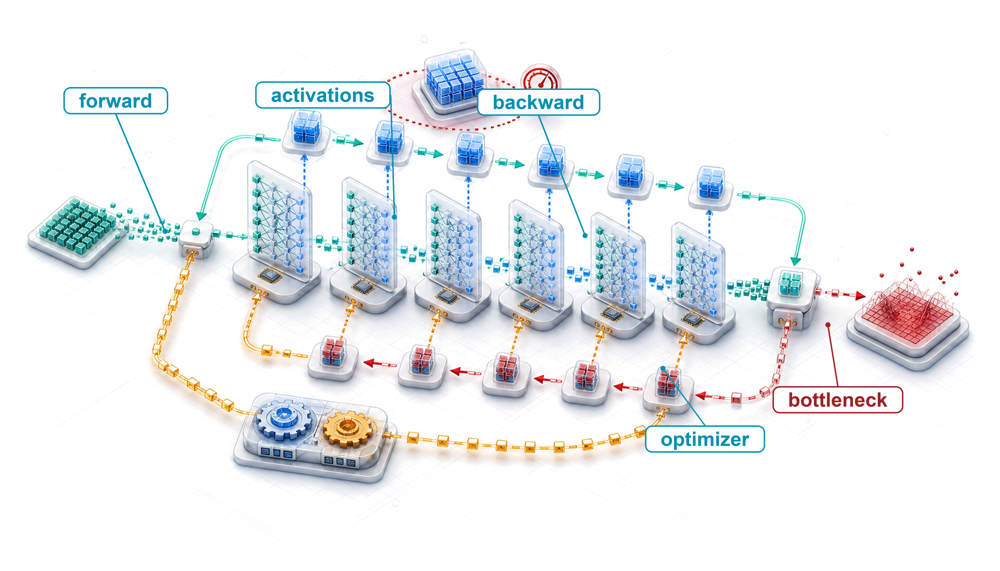
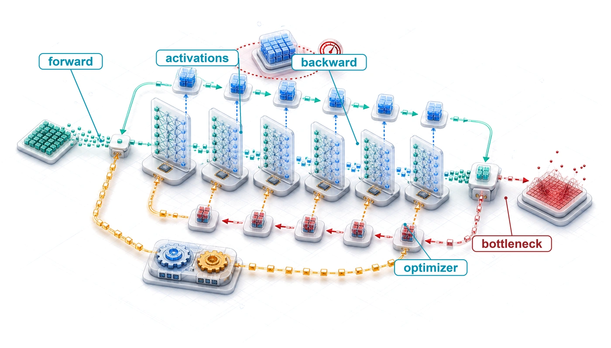
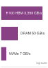

# Model Training {#sec-model-training}

::: {layout-narrow}
::: {.column-margin}

\chapterminitoc

:::

::: {.content-visible when-format="pdf"}
\noindent
{fig-alt="Isometric training cutaway showing a forward pass storing activations, a loss signal, returning gradients, and weight updates."}
:::

::: {.content-visible unless-format="pdf"}
{fig-alt="Isometric training cutaway showing a forward pass storing activations, a loss signal, returning gradients, and weight updates."}
:::

:::

## Purpose {.unnumbered .unlisted}

::: {.content-visible when-format="pdf"}
\begin{marginfigure}
\mlsysstack{50}{25}{45}{90}{12}{10}{0}{20}
\end{marginfigure}
:::

::: {.content-visible unless-format="pdf"}
::: {.column-margin}
{width="100%" fig-alt="Machine Learning Systems Architecture Stack"}

*Architecture stack focus for this chapter.*
:::
:::

_Why can training a model cost orders of magnitude more than one inference?_

Inference computes a forward pass as data flows through the network and a prediction emerges. Training adds a backward pass and an optimizer step, retains intermediate state, and repeats that work across many examples and optimization steps. Optimizers may also maintain momentum and variance estimates whose storage exceeds the model weights, so memory rather than arithmetic often decides what fits on a device. The ratio depends on the model, workload, training duration, and inference volume, but one training run commonly costs orders of magnitude more than one inference. A lab that trains in three days can explore many more designs than one that takes a month. Over a year, that difference is more than a hundred iterations against about a dozen, and each result informs the next design while the slower lab waits weeks for every answer. A faster step is not faster training if it delays convergence, so throughput matters only relative to time to target quality. Across repeated experiments, even modest changes in convergence or utilization compound into substantial schedule and cost differences. The central systems challenge is to keep accelerators supplied with data and useful arithmetic without exhausting memory or losing time to synchronization. Which intervention helps depends on the binding compute, memory, data, or communication constraint, so profiling must precede scaling or optimization. Batch size, numerical precision, checkpointing, data loading, and parallelism must therefore be treated as coupled decisions rather than independent tuning knobs. For the systems engineer, training is where hardware and parallelism determine whether a run fits within memory, schedule, and budget, and whether the repeated optimization loop accelerates or stalls. In D·A·M terms, each precision and parallelism decision trades the mathematics of optimization against the physics of execution.

::: {.content-visible when-format="pdf"}

\newpage

:::

::: {.callout-learning-objectives}

- Explain training cost asymmetry using forward, backward, optimizer-state, data, and iteration costs
- Calculate FLOPs, run time, energy, activation memory, optimizer state, and dollar cost for full training and fine-tuning
- Compare SGD, Adam, and AdamW by convergence behavior, memory overhead, and compute cost
- Design single-machine training pipelines with prefetching, overlap, batching, and checkpointed training state
- Diagnose compute-, memory-, and data-bound training bottlenecks with profiling evidence and model FLOPs utilization
- Apply mixed precision, FlashAttention, gradient accumulation, and activation checkpointing to fit accelerator memory and throughput limits
- Evaluate single-machine multi-accelerator configurations using memory, duration, communication, energy, and cost constraints, and recognize when a workload exceeds the node boundary
```{=latex}
\vspace*{-1ex}
```
:::

## From One Step to a Training Run {#sec-model-training-training-systems-fundamentals-05d2}

```{python}
#| echo: false
from mlsysim import *
from mlsysim.core.units import *

# ┌─────────────────────────────────────────────────────────────────────────────
# │ TRAINING SYSTEMS FUNDAMENTALS
# ├─────────────────────────────────────────────────────────────────────────────
# │ Context: §Training Systems Fundamentals, §Iron Law, §3AM Gradient Explosion
# │
# │ Goal: Provide cost, scale, FLOP, and model-spec constants for the opening
# │       sections of the chapter (Fundamentals through Iron Law).
# │ Show: Training cost asymmetry, GPT-2/3 specs, failure scenario numbers.
# │ How:  Retrieve model specs from Digital Twins; format costs and FLOPs.
# │
# └─────────────────────────────────────────────────────────────────────────────
from mlsysim import Hardware, Models, ReferenceStats
from mlsysim.fmt import (
    fmt_int,
    fmt,
    fmt_count,
    fmt_sci,
    fmt_sci_flops,
    fmt_math,
    check,
    fmt_bandwidth,
    fmt_flop_rate,
    fmt_memory,
    fmt_params,
    fmt_usd,
)

class TrainingScenarios:
    # ┌── 1. LOAD (Constants) ──────────────────────────────────────────────
    # 2026-06-07: all GPT-2/GPT-4 anchors now come from MLSysIM (registry-first
    # rule) — these were chapter-local literals before.
    gpt2_model = Models.Language.GPT2
    gpt2_cost_2019 = ReferenceStats.TrainingCostAnchors.Gpt2Cost2019
    gpt4_cost_est = ReferenceStats.TrainingCostAnchors.Gpt4CostEstimate
    gpt2_fwd_flops = gpt2_model.inference_flops
    gpt2_total_flops = gpt2_model.training_ops
    adam_example_model = Models.Language.Llama2_7B
    adam_example_params = adam_example_model.parameters

    # ┌── 2. EXECUTE (The Compute) ────────────────────────────────────────
    adam_inference = adam_example_model.size_in_bytes(BYTES_FP16)
    adam_grad = adam_example_model.size_in_bytes(BYTES_FP16)
    adam_master = adam_example_model.size_in_bytes(BYTES_FP32)
    adam_moments = adam_example_model.size_in_bytes(BYTES_ADAM_STATE)
    adam_training_state = adam_inference + adam_grad + adam_master + adam_moments
    adam_training_memory_multiplier = (adam_training_state / adam_inference).to("").magnitude

    # ┌── 3. GUARD (Invariants) ───────────────────────────────────────────
    check(adam_training_memory_multiplier == 8, "Mixed-precision Adam training state should be 8x FP16 inference weights")
    # Prose says "over a hundred billion such passes" at ~3x the forward cost
    # each; keep the stated total budget consistent with that narrative
    # (2026-06-07: budget was 1e19, contradicting both the pass count and the
    # \$50K 2019 cost anchor by ~100x).
    implied_passes = gpt2_total_flops / (gpt2_fwd_flops * 3)
    check(1e11 <= implied_passes < 1e12, f"FLOP budget implies {implied_passes:.1e} passes; prose claims over a hundred billion")

    # ┌── 4. OUTPUT (Formatting) ──────────────────────────────────────────
    gpt2_training_cost_2019_str = fmt_usd(gpt2_cost_2019, precision=0, commas=True)
    gpt4_training_cost_est_str = fmt_usd(gpt4_cost_est, scale="M", precision=0, commas=False)
    gpt2_fwd_flops_str = fmt_sci(gpt2_fwd_flops)
    gpt2_total_flops_str = fmt_sci_flops(gpt2_total_flops)
    gpt2_implied_passes_billion_str = fmt_int(implied_passes / BILLION, commas=False)
    adam_training_memory_mult_str = fmt_multiple(adam_training_memory_multiplier, precision=0, commas=False)

    # Hardware spec used in the pipeline-stages narrative
    nvlink_h100_gb_per_s_str = fmt_bandwidth(Hardware.Cloud.H100.nvlink.bandwidth, unit=GB / second, precision=0, commas=False)
```

```{python}
#| echo: false
#| label: step-to-run-scale-calc
# ┌─────────────────────────────────────────────────────────────────────────────
# │ FROM ONE STEP TO A TRAINING RUN
# ├─────────────────────────────────────────────────────────────────────────────
# │ Context: Opening paragraph of
# │          @sec-model-training-training-systems-fundamentals-05d2.
# │
# │ Goal:    Scale the frameworks chapter's two-layer MNIST training step to one
# │          GPT-2 XL step, in FLOPs and in resident training-state bytes.
# │ Show:    MLP parameter count, step FLOPs, and training-state bytes; GPT-2 XL
# │          step FLOPs and static training state; the two ratios.
# │ How:     6 FLOPs per parameter per example (forward 2, backward 4) and the
# │          16-byte-per-parameter mixed-precision Adam state derived in
# │          @sec-model-training-optimization-algorithms-c6a9.
# └─────────────────────────────────────────────────────────────────────────────
from mlsysim import Models, BYTES_ADAM_STATE, BYTES_FP16, BYTES_FP32
from mlsysim.core.units import param, flop, byte, MB, GB, TFLOPs, MFLOPs
from mlsysim.fmt import check, fmt_count, fmt_flops, fmt_memory, fmt_multiple

# ┌── LEGO ───────────────────────────────────────────────
class StepToRunScale:
    """One training step: two-layer MNIST classifier versus GPT-2 XL."""

    # ┌── 1. LOAD (Constants) ──────────────────────────────────────────────
    gpt2 = Models.Language.GPT2
    # Frameworks-chapter anatomy network: 784 -> 128 -> 10 with biases, batch 32
    mlp_params = (784 * 128 + 128 + 128 * 10 + 10) * param
    mlp_batch = 32
    gpt2_batch = 32  # sequences per step (the chapter's GPT-2 configuration)
    gpt2_seq_len = 1024  # tokens per sequence
    flops_per_param_example = 6  # forward 2 + backward 4 FLOPs per parameter

    # ┌── 2. EXECUTE (The Compute) ────────────────────────────────────────
    state_bytes_per_param = (2 * BYTES_FP16 + BYTES_FP32 + BYTES_ADAM_STATE) / param
    mlp_step = (flops_per_param_example * mlp_params.to(param).magnitude * mlp_batch) * flop
    mlp_state = (mlp_params * state_bytes_per_param).to(byte)
    gpt2_tokens = gpt2_batch * gpt2_seq_len
    gpt2_step = (flops_per_param_example * gpt2.parameters.to(param).magnitude * gpt2_tokens) * flop
    gpt2_state = (gpt2.parameters * state_bytes_per_param).to(byte)
    flop_ratio = (gpt2_step / mlp_step).to("").magnitude
    state_ratio = (gpt2_state / mlp_state).to("").magnitude

    # ┌── 3. GUARD (Invariants) ───────────────────────────────────────────
    check(mlp_params.to(param).magnitude == 101_770, "Anatomy MLP should have 101,770 parameters.")
    check(1.0e7 < flop_ratio < 2.0e7, f"Prose says the GPT-2 XL step is about 15 million times the MLP step, got {flop_ratio:.2e}.")
    check(1.0e4 < state_ratio < 2.0e4, f"Prose says roughly ten thousand times the training state, got {state_ratio:.0f}.")
    check(abs(gpt2_state.to(GB).magnitude - 24) < 0.5, f"GPT-2 XL static state should be about 24 GB, got {gpt2_state.to(GB)}.")

    # ┌── 4. OUTPUT (Formatting) ──────────────────────────────────────────
    mlp_params_str = fmt_count(mlp_params.to(param).magnitude, commas=True)
    mlp_step_mflop_str = fmt_flops(mlp_step, unit=MFLOPs, precision=1, commas=False)
    mlp_state_mb_str = fmt_memory(mlp_state, unit=MB, precision=1, commas=False)
    gpt2_batch_str = fmt_count(gpt2_batch, commas=False)
    gpt2_seq_len_str = fmt_count(gpt2_seq_len, commas=True)
    gpt2_step_tflop_str = fmt_flops(round(gpt2_step.to(TFLOPs).magnitude) * TFLOPs, unit=TFLOPs, precision=0, commas=False)
    gpt2_state_gb_str = fmt_memory(gpt2_state, unit=GB, precision=0, commas=False)
    flop_ratio_m_str = fmt_count(round(flop_ratio, -6), scale="million", precision=0, commas=False)
```

A training run is one training step repeated millions of times, so every byte a step holds and every millisecond it spends is multiplied by the length of the run. Each step reads a batch of examples, computes a forward pass and a loss, propagates gradients backward, and updates every parameter, and the run repeats that sequence until the model reaches its quality target. The anatomy of a training step in @sec-ml-frameworks-putting-together-anatomy-training-step-c7f1 traced one such step for a two-layer MNIST classifier, a smaller sibling of the three-layer network of @sec-neural-computation: `{python} StepToRunScale.mlp_params_str` parameters, about `{python} StepToRunScale.mlp_step_mflop_str` per batch of 32 images by the dense-training rule (somewhat less in that chapter's exact trace, which skips the gradient of the raw input), and `{python} StepToRunScale.mlp_state_mb_str` of weights, gradients, and optimizer state. One step of GPT-2 XL over `{python} StepToRunScale.gpt2_batch_str` sequences of `{python} StepToRunScale.gpt2_seq_len_str` tokens costs about `{python} StepToRunScale.gpt2_step_tflop_str`, roughly `{python} StepToRunScale.flop_ratio_m_str` times the classifier's arithmetic, and its weights, gradients, and optimizer state occupy `{python} StepToRunScale.gpt2_state_gb_str` before a single activation is stored. The framework mechanisms that made the small step possible leave every decision about the large run open: which intermediate activations to keep when high-bandwidth memory (HBM) runs out, how large a batch the memory permits, how to keep the accelerator supplied with data, and when one accelerator stops being enough. Running a model once and training it from scratch sit at opposite ends of the operational spectrum, and the size of that gap defines the discipline of training systems.

In 2019, training a GPT-2-scale model required approximately `{python} TrainingScenarios.gpt2_training_cost_2019_str` in compute resources, whereas pretraining a frontier architecture such as GPT-4 reached an estimated `{python} TrainingScenarios.gpt4_training_cost_est_str`.[^fn-training-cost-scaling] Although neither figure represents an audited financial disclosure, the more than three-order-of-magnitude gulf between them highlights the economic reality of deep learning. This **training cost asymmetry**\index{Training cost asymmetry!definition}\index{Training!cost asymmetry}\index{Training!inference vs. training} reflects the fundamental divergence between evaluating an existing artifact for a single query and repeatedly executing the forward-backward-update loop over an entire corpus.

[^fn-training-cost-scaling]: [offset=8mm] **Training cost scaling**\index{Training cost!scaling trajectory}: The roughly 2,000$\times$ ratio between this chapter's two cost anchors illustrates how parameter counts, training-token budgets, hardware generations, and accelerator fleets can compound; it is not a controlled comparison of disclosed training bills. OpenAI's GPT-2 report documents the model and training setup but does not disclose training cost [@radford2019language]. Exact GPT-4 training details were also not disclosed, so the GPT-4-class figure is explicitly an industry estimate supported by public reporting and independent infrastructure analysis [@knight2023giantmodels; @semianalysisGPT4].

For GPT-2, a single forward token evaluation consumes roughly `{python} TrainingScenarios.gpt2_fwd_flops_str` floating-point operations, derived from standard transformer architectural accounting [@radford2019language]. Pretraining the full model across its WebText corpus required a cumulative budget of `{python} TrainingScenarios.gpt2_total_flops_str`, equivalent to approximately `{python} TrainingScenarios.gpt2_implied_passes_billion_str` billion token evaluations when forward and backward passes are evaluated together.

```{=latex}
\vspace*{-1ex}
```
::: {#dfn-training-training-systems .callout-definition title="Training systems"}

***Machine learning training systems***\index{Training systems!definition}\index{Training!systems} are software-hardware systems that execute the iterative optimization loop (forward pass, loss computation, backward pass, and parameter update) to minimize a loss function over a training dataset.

1.  Significance: Training holds far more state per parameter than inference. In the common mixed-precision recipe with the Adaptive Moment Estimation (Adam) optimizer, gradients and optimizer state raise the per-parameter footprint to `{python} TrainingScenarios.adam_training_memory_mult_str` the FP16 weights an inference server stores, before any activation is counted (@sec-model-training-optimization-algorithm-system-implications-f9f2 derives the multiplier). This multiplier is a major reason a model that serves on one accelerator needs several for training.
2.  Distinction: Unlike inference systems, which execute a single forward pass and discard intermediate activations, standard backpropagation stores the tensors needed by the backward pass, creating a footprint that grows with model depth and batch size.
3.  Common pitfall: A frequent misconception is that training failures are compute problems. A common failure is an out-of-memory (OOM) error, a memory-management problem: tensors saved for backpropagation accumulate during the forward pass and can exhaust memory before the first gradient is computed.

:::

```{python}
#| echo: false
from mlsysim import Models

# ┌── LEGO ───────────────────────────────────────────────
# │ Goal: GPT-2 weight, Adam, and layer counts for memory-pressure prose.
from mlsysim.fmt import fmt_count, fmt_memory, fmt_params

class TrainingMemoryPressure:
    gpt2 = Models.Language.GPT2
    gpt2_params = gpt2.parameters
    gpt2_layers = gpt2.layers
    gpt2_params_fp32 = gpt2.size_in_bytes(BYTES_FP32)
    gpt2_adam = gpt2.size_in_bytes(BYTES_ADAM_STATE)

    # ┌── 4. OUTPUT (Formatting) ─────────────────────────────────────────────
    gpt2_params_b_str = fmt_params(gpt2_params)
    gpt2_params_gb_fp32_str = fmt_memory(gpt2_params_fp32, unit=GB, precision=0, commas=False)
    gpt2_adam_gb_str = fmt_memory(gpt2_adam, unit=GB, precision=0, commas=False)
```

Three characteristics distinguish training workloads from general-purpose computing:

- **Computational intensity**\index{Training!computational intensity}: The `{python} TrainingScenarios.gpt2_total_flops_str` budget spread over days of wall-clock time demands sustained PFLOP/s-scale throughput from hardware whose realized large-model throughput is often far below theoretical peak [@narayanan2021; @chowdhery2022palm].
- **Memory pressure**\index{Training!memory pressure}: Storing `{python} TrainingMemoryPressure.gpt2_params_b_str` weights requires `{python} TrainingMemoryPressure.gpt2_params_gb_fp32_str` in FP32; the Adam optimizer adds two state tensors per parameter\index{Optimizer state!memory overhead}, consuming another `{python} TrainingMemoryPressure.gpt2_adam_gb_str`. Activation memory adds a workload-dependent footprint governed by architecture, sequence length, batch size, precision, and checkpointing, and the combined state can exceed a single accelerator's capacity.
- **Data dependencies**: Each gradient update depends on the result of the previous one, creating sequential bottlenecks that limit how much parallelism the system can exploit.

Each constraint demands a targeted systems intervention. Computational intensity pushes the system toward higher arithmetic utilization and lower-precision numeric formats. Memory pressure calls for gradient checkpointing,[^fn-activation-checkpointing-tradeoff] a rematerialization strategy that trades redundant arithmetic for reduced activation storage, and mixed-precision training\index{Mixed-precision training!definition},[^fn-mixed-precision-training] which halves the storage required for activations by casting them to 16-bit formats while selectively retaining FP32 master weights and optimizer moments for numerical stability. Data dependencies motivate pipeline architectures that overlap I/O and communication with computation, ensuring that execution units never stall waiting for tensors. The analysis here establishes the execution baseline on single-machine and single-node multi-GPU topologies; scaling across distributed network boundaries introduces multi-node communication fabrics and fault-tolerance protocols treated in advanced distributed systems texts.

::: {.column-margin .margin-pointer}
↩ The feeding problem, in which data delivery must keep pace with accelerator consumption, is established in @sec-data-engineering-feeding-problem.
:::

[^fn-activation-checkpointing-tradeoff]: **Gradient checkpointing (activation checkpointing)**\index{Activation checkpointing!memory-compute trade-off}: Backpropagation retains the forward values required by each backward rule. Checkpointing saves selected values and recomputes others during backward, trading additional work for lower activation memory. The $\sqrt{\LayerCount}$ checkpoint placement and its associated recomputation cost describe the classical schedule analyzed by @chen2016training rather than every checkpointing implementation. @Sec-model-training-optimal-checkpoint-placement-strategy-4a0d works through that schedule for GPT-2's layer count.

[^fn-mixed-precision-training]: **Mixed-precision training**\index{Mixed-precision training!trade-off}: Uses lower precision for selected computation and storage while retaining higher precision where accumulation or numerical range requires it. A common FP16 recipe maintains FP32 master weights\index{FP32 master weights!mixed-precision training} and uses loss scaling to reduce gradient underflow [@micikevicius2017mixed]. BF16 ("Brain Floating Point," from Google Brain [@google_bfloat16]) matches FP32's 8-bit exponent range and therefore usually avoids dynamic loss scaling, though the exact state and accumulation precision depend on the optimizer and implementation.

```{python}
#| echo: false
#| label: gpt2-lighthouse-hardware-calc
from mlsysim.fmt import fmt_sci_flops, fmt_memory, fmt_params

# ┌─────────────────────────────────────────────────────────────────────────────
# │ GPT-2 LIGHTHOUSE SPECS AND DLRM SCALE
# ├─────────────────────────────────────────────────────────────────────────────
# │ Context: §Running Example: Training GPT-2, §GPT-2 Attention Layer
# │          Computation (notebook), §Activation Memory Requirements,
# │          §Gradient Accumulation walkthrough.
# │
# │ Goal: Provide GPT-2 weight/dataset sizes and DLRM scale
# │       specs for the lighthouse table and GPT-2 FLOP notebook.
# │ Show: GPT-2 lighthouse table specs; DLRM parameter range.
# │ How:  Registry model entries.
# │
# └─────────────────────────────────────────────────────────────────────────────

# ── GPT-2 Lighthouse Sizes + DLRM Scale ──────────────────────────────────
class GPT2LighthouseSpecs:
    # ┌── 1. LOAD ──────────────────────────────────────────────────────────────
    gpt2_model = Models.Language.GPT2
    gpt2_params = gpt2_model.parameters
    gpt2_total_flops = gpt2_model.training_ops
    gpt2_weights_fp16 = gpt2_model.size_in_bytes(BYTES_FP16)
    gpt2_weights_fp32 = gpt2_model.size_in_bytes(BYTES_FP32)
    gpt2_dataset_size = gpt2_model.training_dataset_size
    dlrm_model = Models.Recommendation.DLRM
    dlrm_params_min = dlrm_model.parameter_range_min
    dlrm_params_max = dlrm_model.parameter_range_max

    # ┌── 4. OUTPUT ────────────────────────────────────────────────────────────
    gpt2_params_b_str = fmt_params(gpt2_params)
    gpt2_total_flops_str = fmt_sci_flops(gpt2_total_flops)
    gpt2_weights_fp16_gb_str = fmt_memory(gpt2_weights_fp16, unit=GB, precision=0, commas=False)
    gpt2_weights_fp32_gb_str = fmt_memory(gpt2_weights_fp32, unit=GB, precision=0, commas=False)
    gpt2_dataset_size_gb_str = fmt_memory(gpt2_dataset_size, unit=GB, precision=0, commas=False)
    dlrm_params_min_b_str = fmt_params(dlrm_params_min, precision=0)
    dlrm_params_max_t_str = fmt_params(dlrm_params_max, precision=0)
```

### Running cases: GPT-2 XL and ResNet-50 {#sec-model-training-running-example-training-gpt2-19cd}

GPT-2\index{GPT-2!training lighthouse} is the book's bandwidth-bound lighthouse. Generating one token at a time reads every weight for little arithmetic, so in inference its home regime is the bandwidth-bound one. Training changes that profile. A batch of long sequences reuses each weight across thousands of token positions, so the same model now presses on arithmetic throughput and, through activations and optimizer state, on memory capacity. The chapter uses it to test each training cost and optimization.

::: {.column-margin .margin-pointer}
↩ GPT-2's home regime in inference, bandwidth-bound because each generated token rereads every weight, is established in @sec-ml-systems-workload-archetypes-fd10.
:::

::: {#lhs-training-lighthouse-example-training-gpt-2 .callout-lighthouse title="Lighthouse example: Training GPT-2"}

**Context**:
GPT-2 (1.5 billion parameters) serves as the primary case study because it is large enough to expose meaningful compute, activation, and optimizer-state constraints while remaining easier to analyze than frontier-scale models. Whether it requires distributed training depends on precision, optimizer state, activation memory, hardware capacity, and the target training time. @Tbl-training-gpt2-lighthouse-specs maps each model property to the systems constraint it creates:

```{=latex}
\begingroup
\renewcommand{\arraystretch}{1.3}
```

| **Property**     |                         **Specification**                         | **Systems Implication**                                                                                                                                        |
|:-----------------|:-----------------------------------------------------------------:|:---------------------------------------------------------------------------------------------------------------------------------------------------------------|
| **Parameters**   |       `{python} GPT2LighthouseSpecs.gpt2_params_b_str` (XL)       | Requires ~`{python} GPT2LighthouseSpecs.gpt2_weights_fp16_gb_str` (FP16) or ~`{python} GPT2LighthouseSpecs.gpt2_weights_fp32_gb_str` (FP32) for weights alone. |
| **Architecture** |                        48 Layers, 1600 Dim                        | Deep pipeline creates heavy activation memory pressure.                                                                                                        |
| **Dataset**      | WebText (`{python} GPT2LighthouseSpecs.gpt2_dataset_size_gb_str`) | Preprocessing, shuffling, and delivery must sustain the selected training configuration.                                                                       |
| **Compute**      |       ~ `{python} GPT2LighthouseSpecs.gpt2_total_flops_str`       | Training duration depends on achieved throughput and accelerator count.                                                                                        |

: **GPT-2 (1.5 Billion Parameters) Lighthouse Model Specifications**: Parameter count, architecture depth, dataset size, and total training compute mapped to their systems implications. Each row pairs a model property with the engineering constraint it creates: memory footprint for weights, activation pressure from pipeline depth, I/O throughput requirements, and parallelization demand. {#tbl-training-gpt2-lighthouse-specs tbl-colwidths="[20,26,54]"}

```{=latex}
\endgroup
```

**Mechanism**:
In dense transformer models, the arithmetic work per token is directly proportional to parameter count $\Parameters$. In the forward pass, each parameter participates in one multiply-accumulate operation ($1\text{ MAC} = 2\text{ FLOPs}$), consuming $2\Parameters\text{ FLOPs/token}$. Backpropagation computes two matrix products per parameter: one to propagate gradients backward with respect to activations ($2\Parameters\text{ FLOPs}$), and another to calculate weight gradients for the optimizer ($2\Parameters\text{ FLOPs}$). The backward pass therefore requires twice the compute of the forward pass ($4\Parameters\text{ FLOPs/token}$), yielding a total work factor of $2\Parameters + 4\Parameters = 6\Parameters\text{ FLOPs/token}$. Across a dataset of $\DatasetSize$ tokens, total training work is $\Operations \approx 6 \cdot \Parameters \cdot \DatasetSize$, or `{python} GPT2LighthouseSpecs.gpt2_total_flops_str`.

Training GPT-2 couples this operation count with the four-term training-memory budget of @eq-training-memory, $\TotalMemoryFootprint =\WeightMemory + \GradientMemory + \OptimizerStateMemory + \ActivationMemory$. Balancing execution time $\TrainingTime= \frac{\Operations}{\PeakRate \times \EfficiencyHw}$ requires orchestrating data ingestion, activation memory, and compute throughput within accelerator HBM capacity.

:::

```{python}
#| echo: false
#| label: reference-machine-calc
# ┌─────────────────────────────────────────────────────────────────────────────
# │ REFERENCE MACHINE AND THE RESNET-50 CASE
# ├─────────────────────────────────────────────────────────────────────────────
# │ Context: Running-cases subsection of
# │          @sec-model-training-training-systems-fundamentals-05d2.
# │
# │ Goal:    Name the chapter's one reference accelerator and the per-image
# │          training cost of the ResNet-50 input-pipeline case.
# │ Show:    H100 HBM capacity and bandwidth, dense 16-bit peak; ResNet-50
# │          forward and training FLOPs per image.
# │ How:     Registry hardware and model entries; training = 3x forward.
# └─────────────────────────────────────────────────────────────────────────────
from mlsysim import Hardware, Models
from mlsysim.core.units import GiB, TB, TFLOP, GFLOPs, param, second
from mlsysim.fmt import check, fmt_bandwidth, fmt_count, fmt_flop_rate, fmt_flops, fmt_memory_capacity

# ┌── LEGO ───────────────────────────────────────────────
class ReferenceMachine:
    """The chapter's reference accelerator and the ResNet-50 per-image cost."""

    # ┌── 1. LOAD (Constants) ──────────────────────────────────────────────
    h100 = Hardware.Cloud.H100
    resnet = Models.Vision.ResNet50
    train_to_forward = 3  # forward + backward (about twice the forward)

    # ┌── 2. EXECUTE (The Compute) ────────────────────────────────────────
    resnet_train_flops = resnet.inference_flops * train_to_forward

    # ┌── 3. GUARD (Invariants) ───────────────────────────────────────────
    check(h100.memory.capacity.to(GiB).magnitude == 80, "Reference machine should have 80 GiB of HBM.")
    check(abs(h100.compute.peak_flops.to(TFLOP / second).magnitude - 989) < 1, "Reference dense 16-bit peak should be 989 TFLOP/s.")
    check(20 < resnet_train_flops.to(GFLOPs).magnitude < 30, "ResNet-50 training cost should be about 25 GFLOPs per image.")

    # ┌── 4. OUTPUT (Formatting) ──────────────────────────────────────────
    h100_mem_str = fmt_memory_capacity(h100.memory.capacity, unit=GiB, precision=0, commas=False)
    h100_bw_str = fmt_bandwidth(h100.memory.bandwidth, unit=TB / second, precision=2, commas=False)
    h100_peak_str = fmt_flop_rate(h100.compute.peak_flops, unit=TFLOP / second, precision=0, commas=False)
    resnet_fwd_gflop_str = fmt_flops(resnet.inference_flops, unit=GFLOPs, precision=1, commas=False)
    resnet_train_gflop_str = fmt_flops(resnet_train_flops, unit=GFLOPs, precision=1, commas=False)
    resnet_params_m_str = fmt_count(resnet.parameters.to(param).magnitude, scale="million", precision=1, commas=False)
```

ResNet-50\index{ResNet-50!input-pipeline case}, the book's compute-bound lighthouse, carries the chapter's input pipeline. Its home regime is compute-bound because a convolution reuses each weight at every spatial position, so one $224{\times}224$ image costs about `{python} ReferenceMachine.resnet_fwd_gflop_str` in the forward pass and about `{python} ReferenceMachine.resnet_train_gflop_str` once the backward pass is added, for only `{python} ReferenceMachine.resnet_params_m_str` parameters. Training it on a current data-center accelerator moves the binding term upstream. Each image must be read, decoded, and augmented on the host before the accelerator sees it, and the data pipeline (@sec-model-training-data-pipeline-8e71) shows the accelerator consuming images faster than the host processors can prepare them. The two cases therefore cross regimes in opposite directions. GPT-2 leaves its bandwidth-bound home for arithmetic and memory capacity, while ResNet-50 leaves its compute-bound home for an input-bound one.

Every number in the chapter uses one reference machine, an NVIDIA H100 with `{python} ReferenceMachine.h100_mem_str` of HBM delivering `{python} ReferenceMachine.h100_bw_str` and a dense 16-bit arithmetic peak of `{python} ReferenceMachine.h100_peak_str`. The H100 is a point-in-time instance of the data-center accelerator class whose design @sec-hardware-acceleration develops; its successors change the constants, not the reasoning.

The chapter follows GPT-2 XL's run from estimate to execution (@tbl-training-chapter-spine). The first half converts the run's operation count into time and energy, accounts for the arithmetic and bytes of one step, and assembles the pipeline that executes it, including the checkpoints that let a long run survive failure. The second half diagnoses a measured step, removes its binding term one technique at a time until GPT-2 XL trains on a single accelerator, and closes with when and how to add accelerators.

| **Section**                                  | **Question it answers**                                         | **Law term or constraint it moves**                                                          | **Running case**                      |
|:---------------------------------------------|:----------------------------------------------------------------|:---------------------------------------------------------------------------------------------|:--------------------------------------|
| **Training-Time Law**                        | How long, and how much energy, a run takes                      | All terms of $\TrainingTime = \Operations/(\PeakRate \times \EfficiencyHw)$                  | GPT-2 XL run on one H100              |
| **Computation and Memory Costs of Training** | What one step costs in FLOPs and in bytes                       | $\Operations$ per step; the memory constraint                                                | GPT-2 XL step; Llama 3 8B fine-tuning |
| **Pipeline Architecture**                    | How data, compute, updates, and saved state flow through a step | $\EfficiencyHw$ lost between stages                                                          | ResNet-50 input feed; GPT-2 XL step   |
| **Identifying Bottlenecks**                  | Which stage limits a measured step                              | $\EfficiencyHw$, diagnosed                                                                   | GPT-2 XL profile                      |
| **Pipeline Optimizations**                   | Which technique removes the binding term                        | $\PeakRate$ (precision), $\EfficiencyHw$ (overlap, IO), memory (accumulation, checkpointing) | GPT-2 XL on one H100                  |
| **Scaling Training Systems**                 | When to add accelerators, and what synchronization costs        | $\PeakRate \times \EfficiencyHw$ across devices, less communication                          | GPT-2 XL on an eight-H100 node        |

: **Chapter Map**: Each section answers one question about the training run and names the term of the training-time law, or the memory constraint, that its techniques move. Memory does not appear in the law; it decides whether a configuration runs at all. {#tbl-training-chapter-spine tbl-colwidths="[24,28,30,18]"}

Every later estimate in the chapter starts from how long the run takes, and the training-time law fixes that first.

## Training-Time Law {#sec-model-training-iron-law-training-performance-a53f}

GPT-2 XL's run needs about `{python} GPT2LighthouseSpecs.gpt2_total_flops_str`. Converting that operation count into days on an accelerator, and every loss of time into a factor engineering can recover, requires a decomposition of training time into its physical constituents in which wasted time appears as a lower utilization factor.

The iron law of ML systems (principle \ref{pri-iron-law}) supplies that decomposition once it is specialized to training.\index{Training!training-time law}\index{Training-time law!utilization gap} The training-time form of the iron law, which this chapter shortens to the training-time law, keeps the compute term as the organizing equation so that every optimization technique maps to one of its factors.

::: {#dfn-training-iron-law-training-performance .callout-definition title="The training-time law"}

***The training-time law***\index{Training-time law!definition} expresses training time through the workload's operation count and its effective achieved throughput:
$$\TrainingTime= \frac{\Operations}{\PeakRate \times \EfficiencyHw}$$ {#eq-training-iron-law}

Here $\Operations$ counts useful model forward-and-backward FLOPs, excluding rematerialization. Additional execution work is reflected in effective throughput. The factor $\EfficiencyHw$ is an effective end-to-end utilization factor, the achieved model-operation rate divided by the relevant hardware peak. Data stalls, communication, synchronization, launch overhead, and inefficient kernels all reduce this factor. Prefetching and overlap can hide part of those costs but do not guarantee their removal.

1.  Significance: In the D·A·M taxonomy, these terms map to distinct optimization levers: $\Operations$ is governed by Data (training token count) and Algorithm (model architecture or compression methods such as pruning and distillation), $\PeakRate$ is governed by the Machine (hardware execution units at the chosen numerical precision), and $\EfficiencyHw$ is the effective systems utilization factor and primary engineering target (@narayanan2021 measured 44 to 52 percent of theoretical peak throughput across GPT models trained on A100 clusters). @Sec-model-compression defines the compression techniques; here they serve only to show where such methods enter the accounting.
2.  Distinction: The general iron law exposes data movement, computation, and latency separately. This training form folds every source of lost throughput into $\EfficiencyHw$, making it useful for estimating run time but insufficient for diagnosing which underlying term is responsible.
3.  Common pitfall: A frequent misconception is that $\EfficiencyHw$ is fixed by hardware. It is a pipeline property, so diagnosing which factor dominates requires profiling rather than reading hardware specs.

:::

@Eq-training-iron-law reveals three levers for improvement: reduce total operations through algorithmic innovation, increase peak throughput through hardware selection and precision formats, or improve utilization through pipeline orchestration. Memory does not appear in the law at all. It acts as a feasibility constraint, because a configuration whose state does not fit runs at no speed. The chapter map (@tbl-training-chapter-spine) shows which section works on which factor, and @tbl-optimization places each optimization technique against the factor it moves, with its memory effect listed separately.

The training-time law focuses on execution efficiency, how fast the hardware processes a given workload. It does not predict how data quality, dataset size, or curriculum design determines the total operations $\Operations$ needed to reach a target accuracy; that workload must be supplied or estimated separately. A cleaner dataset or a better data mix can reduce the number of epochs required, shrinking $\Operations$ without touching hardware at all. Holding the workload fixed, the question is how to execute it as fast as possible.

::: {.column-margin .margin-pointer}
↪ Data selection, which shrinks total operations ($\Operations$) by keeping the examples that return the most learning per unit of compute, is developed in @sec-data-selection-data-selection-fundamentals-e839.
:::

Actual training throughput remains below the arithmetic peak whenever kernels, data delivery, or communication leave resources idle. Scaling to multiple accelerators introduces additional communication overhead, a trade-off quantified in @sec-model-training-scaling-training-systems-adfd.

```{python}
#| echo: false
#| label: gpt2-run-time-energy-calc
# ┌─────────────────────────────────────────────────────────────────────────────
# │ GPT-2 XL RUN: SECONDS AND JOULES ON ONE H100
# ├─────────────────────────────────────────────────────────────────────────────
# │ Context: @sec-model-training-iron-law-training-performance-a53f (seconds and
# │          joules paragraph); reused by the data pipeline example, the
# │          checkpoint subsection, the walkthrough, and the scaling section.
# │
# │ Goal:    Turn the lighthouse's registry training FLOPs into wall-clock time,
# │          step time, and accelerator energy on the reference machine.
# │ Show:    Run time in days, step time, steps, run energy, energy per step.
# │ How:     T = O / (R_peak x eta); E = P_device x T at the H100's TDP.
# └─────────────────────────────────────────────────────────────────────────────
from mlsysim import Hardware, Models, Literature
from mlsysim.core.units import flop, param, second, day, kWh, joule
from mlsysim.fmt import check, fmt_count, fmt_energy, fmt_percent, fmt_power, fmt_time

# ┌── LEGO ───────────────────────────────────────────────
class GPT2RunTimeEnergy:
    """GPT-2 XL training run on one H100: time and accelerator energy."""

    # ┌── 1. LOAD (Constants) ──────────────────────────────────────────────
    gpt2 = Models.Language.GPT2
    h100 = Hardware.Cloud.H100
    eta = Literature.Training.MfuHigh  # high end of measured large-model utilization
    tokens_per_step = 32 * 1024  # 32 sequences of 1,024 tokens
    flops_per_param_token = 6

    # ┌── 2. EXECUTE (The Compute) ────────────────────────────────────────
    run_flops = gpt2.training_ops
    run_time = (run_flops / (h100.compute.peak_flops * eta)).to(second)
    step_flops = (flops_per_param_token * gpt2.parameters.to(param).magnitude * tokens_per_step) * flop
    step_time = (step_flops / (h100.compute.peak_flops * eta)).to(second)
    steps = (run_flops / step_flops).to("").magnitude
    run_energy = (h100.tdp * run_time).to(kWh)
    step_energy = (h100.tdp * step_time).to(joule)

    # ┌── 3. GUARD (Invariants) ───────────────────────────────────────────
    check(34 < run_time.to(day).magnitude < 36, f"Prose says about 35 days on one H100, got {run_time.to(day):.1f}.")
    check(0.55 < step_time.to(second).magnitude < 0.65, f"Prose says about 0.6 s per step, got {step_time:.3f}.")
    check(550 < run_energy.to(kWh).magnitude < 620, f"Prose says about 590 kWh, got {run_energy:.0f}.")

    # ┌── 4. OUTPUT (Formatting) ──────────────────────────────────────────
    eta_pct_str = fmt_percent(eta, precision=0, commas=False, style="prose")
    run_days_str = fmt_time(round(run_time.to(day).magnitude), "day", precision=0, commas=False, style="word")
    step_time_s_str = fmt_time(step_time, second, precision=2, commas=False)
    steps_m_str = fmt_count(steps, scale="million", precision=1, commas=False)
    tdp_w_str = fmt_power(h100.tdp, precision=0, commas=False)
    run_energy_kwh_str = fmt_energy(round(run_energy.to(kWh).magnitude) * kWh, unit=kWh, precision=0, commas=False)
    step_energy_j_str = fmt_energy(round(step_energy.to(joule).magnitude) * joule, unit=joule, precision=0, commas=False)
```

For GPT-2 XL on the reference H100, the law becomes a schedule. At the accelerator's `{python} ReferenceMachine.h100_peak_str` dense 16-bit peak and a utilization $\EfficiencyHw$ of `{python} GPT2RunTimeEnergy.eta_pct_str`, the high end of what large training runs sustain [@narayanan2021], the run takes about `{python} GPT2RunTimeEnergy.run_days_str` on one accelerator, about `{python} GPT2RunTimeEnergy.steps_m_str` steps of `{python} GPT2RunTimeEnergy.step_time_s_str` each over 32 sequences of 1,024 tokens. Time converts directly into energy. Energy is power integrated over time, $\TotalEnergy = \DevicePower \times \TrainingTime$ at constant power, so at the H100's `{python} GPT2RunTimeEnergy.tdp_w_str` thermal design power the run draws about `{python} GPT2RunTimeEnergy.run_energy_kwh_str` at the accelerator alone, about `{python} GPT2RunTimeEnergy.step_energy_j_str` per step. Every technique that shortens the run at constant power removes energy in the same proportion, which is why the utilization factor matters to an energy budget as much as to a schedule.

::: {.column-margin .margin-pointer}
↩ The iron law's first estimate of a training run, the same operation-count-to-days conversion applied to a GPT-3-class model on an accelerator cluster, is established in @sec-introduction-iron-law-ml-systems-c32a.
:::

```{python}
#| echo: false
#| label: utility-bill-calc
# ┌─────────────────────────────────────────────────────────────────────────────
# │ LLAMA 2 70B RUN: CLUSTER TIME AND RENTAL COST
# ├─────────────────────────────────────────────────────────────────────────────
# │ Context: One-sentence frontier-scale contrast in
# │          @sec-model-training-iron-law-training-performance-a53f.
# │
# │ Goal:    Apply the training-time law to a frontier-scale run on a cluster.
# │ Show:    Cluster days, rental cost, and the purchase-to-rental breakeven.
# │ How:     6PD FLOPs over (H100 peak x utilization x accelerator count);
# │          rental and purchase prices from the infrastructure registry.
# └─────────────────────────────────────────────────────────────────────────────
from mlsysim import Hardware, Models, Literature, Systems, Infrastructure
from mlsysim.core.units import param, count, flop, second, hour, USD, SEC_PER_DAY, HOURS_PER_DAY
from mlsysim.fmt import check, fmt, fmt_count, fmt_time, fmt_tokens, fmt_usd

# ┌── LEGO ───────────────────────────────────────────────
class LlamaTraining:
    """Llama 2 70B training run on a 1,024-accelerator H100 cluster."""

    # ┌── 1. LOAD (Constants) ───────────────────────────────────────────────
    model = Models.Language.Llama2_70B
    params = model.parameters.to(param).magnitude
    tokens = model.training_tokens.to(count).magnitude
    scaling_factor = Literature.Chinchilla.ComputeConstant
    peak_flops = Hardware.Cloud.H100.compute.peak_flops
    utilization = Literature.Training.MfuHigh
    num_gpus = Systems.Clusters.Training_1K.total_accelerators
    rental_rate = Infrastructure.Pricing.Cloud.GpuTrainingPerHour.rate.to(USD / hour).magnitude
    purchase_price = Infrastructure.Pricing.Capital.H100GpuPurchaseUsd.rate.to(USD).magnitude

    # ┌── 2. EXECUTE (The Compute) ─────────────────────────────────────────
    effective_flops = peak_flops * utilization
    total_flops = scaling_factor * params * tokens
    time_seconds = total_flops / effective_flops.to(flop / second).magnitude
    cluster_days = time_seconds / (num_gpus * SEC_PER_DAY)
    rental_cost = num_gpus * HOURS_PER_DAY * cluster_days * rental_rate
    purchase_cost = num_gpus * purchase_price
    breakeven_runs = purchase_cost / rental_cost

    # ┌── 3. GUARD (Invariants) ───────────────────────────────────────────
    check(rental_cost < purchase_cost, f"Renting (${rental_cost:,.0f}) should cost less than buying (${purchase_cost:,.0f}) for one run.")
    check(breakeven_runs >= 3, f"Breakeven ({breakeven_runs:.1f}) too low for the rent-versus-buy contrast.")

    # ┌── 4. OUTPUT (Formatting) ──────────────────────────────────────────────
    ub_params_b_str = fmt_count(params, scale="B", precision=0, commas=False)
    ub_tokens_t_str = fmt_tokens(model.training_tokens, scale="T", precision=0, commas=False)
    ub_num_gpus_str = fmt_count(num_gpus, commas=True)
    ub_cluster_days_str = fmt_time(cluster_days, "day", precision=1, commas=False, style="word")
    ub_rental_usd_str = fmt_usd(rental_cost, precision=2, commas=False, scale="M")
    ub_breakeven_str = fmt(breakeven_runs, precision=1, commas=False)
```

The same conversion scales to runs far larger than GPT-2. A `{python} LlamaTraining.ub_params_b_str`-parameter Llama 2 model trained on `{python} LlamaTraining.ub_tokens_t_str` tokens across a `{python} LlamaTraining.ub_num_gpus_str`-accelerator H100 cluster at the same utilization takes about `{python} LlamaTraining.ub_cluster_days_str` and `{python} LlamaTraining.ub_rental_usd_str` of rented accelerator time, while buying that cluster costs as much as about `{python} LlamaTraining.ub_breakeven_str` such runs before networking, facilities, power, and staff are counted (@sec-responsible-engineering-total-cost-ownership-35c1 develops the full cost model).

Not every training workload is bound by arithmetic: DLRM\index{DLRM!embedding bottleneck}, the book's capacity-bound lighthouse, holds `{python} GPT2LighthouseSpecs.dlrm_params_min_b_str` to `{python} GPT2LighthouseSpecs.dlrm_params_max_t_str` parameters, mostly in embedding tables\index{Embedding table!capacity bottleneck}, so its first training problem is fitting those tables in memory at all, whereas dense models such as GPT-2 meet arithmetic and activation-memory limits first.

::: {#chk-training-physics-training .callout-checkpoint title="The physics of training"}

Training speed is governed by the utilization of hardware peaks.

**Utilization gap**

- [ ] **Peak vs. real**: why does sustained end-to-end utilization remain below the arithmetic peak?
- [ ] **Utilization losses**: which sources of lost time does the definition of $\EfficiencyHw$ fold in, and which of them can overlap hide rather than remove?
- [ ] **Order of magnitude**: a frontier run needs on the order of $10^{23}$ FLOPs at a utilization $\EfficiencyHw$ well below 1. Estimate which lever shortens wall-clock time more, doubling $\PeakRate$ or doubling $\EfficiencyHw$, and why, in practice, the two levers differ in cost and reachability even though the training-time law treats them symmetrically.

:::

Each milestone in the history of deep learning moved the binding constraint from one factor of this law to another. Backpropagation, popularized for multilayer networks in 1986 [@rumelhart1986], made the operation count $\Operations$ of a deep network computable at all. AlexNet's five-to-six-day ImageNet run on two GPUs in 2012 [@krizhevsky2012imagenet] showed that this arithmetic mapped onto the far higher $\PeakRate$ of graphics hardware. Transformers\index{Transformer!training evolution} from 2017 onward [@vaswani2017] concentrated the work into large dense matrix multiplications with large activation footprints. GPT-3's\index{GPT-3!training compute} roughly $3.14 \times 10^{23}$ FLOPs in 2020 [@brown2020language] made utilization $(\EfficiencyHw)$ the difference between an affordable run and an unaffordable one, and IO-aware kernels such as FlashAttention later raised $\EfficiencyHw$ by attacking attention's memory traffic.

The history follows the bitter lesson. Backpropagation supplied a general recipe, and each later step let that recipe absorb more computation, more parameters, and more data. If capability tracks the computation a general method can absorb, then every point of $\EfficiencyHw$ lost to stalls, and every gigabyte of memory that forces a smaller model or batch, is capability forgone at a fixed budget. The first obligation of a training system is therefore to convert its compute budget into useful operations as completely as the hardware allows.

::: {.column-margin .margin-pointer}
↩ The bitter lesson, that general methods which absorb more computation outperform encoded human expertise, is established in @sec-introduction-bitter-lesson-79c7.
:::

The law takes a run's operation count and its achieved rate as given, and both come from the costs of individual operations. Every bottleneck traces back to specific mathematical operations: compute-intensive matrix multiplications governed by peak throughput [@goto2008], low-intensity normalization layers governed by memory bandwidth, and optimizer state tensors that inflate the static memory footprint. Modern accelerators have compute-to-bandwidth ratios (roofline ridge points) that far exceed the arithmetic intensity of many neural network layers, leaving memory-bound kernels starved for operands [@patterson2017hardware]. Software frameworks expose these physical boundaries as configurable switches, such as mixed-precision autocasting contexts or activation checkpointing flags, and each switch must be set against the machine's measured limits rather than tuned blindly. Optimizing a training system therefore begins with what each operation costs in FLOPs and bytes.

## Computation and Memory Costs of Training {#sec-model-training-mathematical-foundations-d894}

Linear algebra expresses a layer's matrix multiplication compactly as $\PreactivationMatrix= \ActivationMatrix\WeightMatrix$. In hardware, executing this operation efficiently requires navigating the accelerator's physical memory hierarchy:

- **Global device memory (HBM or GDDR)**: Located off-chip, offering large storage capacity (typically 16 to 96 GB) to hold weights, optimizer states, and large activation tensors, but communicating across an external memory bus bounded by $\approx 1.5\text{--}3.5\text{ TB/s}$ of bandwidth.
- **On-chip SRAM (registers and shared memory)**: Located directly on the processor die adjacent to the arithmetic execution units. It delivers ultra-high aggregate bandwidth ($\approx 15\text{--}20\text{ TB/s}$), but has strictly limited capacity (typically 30 to 50 MB across the entire chip).

In a model such as GPT-2, the tensors participating in training far exceed the capacity of on-chip SRAM, requiring matrix tiles to be continuously staged from off-chip HBM into on-chip memory for computation. Dense matrix multiplications exhibit high arithmetic intensity, amortizing the cost of moving bytes over many operations and enabling specialized execution units such as Tensor Cores to achieve high compute utilization. In contrast, surrounding elementwise operations (activations, normalizations, and residual additions) exhibit low arithmetic intensity and remain bounded by memory bandwidth, creating opportunities for kernel fusion to eliminate redundant round-trips to HBM. @Sec-neural-computation established *what* neural network operations compute and *why* they enable learning; the systems question is *what* they cost\index{Training!mathematical foundations}\index{Training!computational cost} in FLOPs, memory, and bandwidth when those operations execute at scale.

Four dimensions structure this cost analysis:

- FLOP counts of the matrix operations that dominate dense neural-network training.
- Optimizer state, the fixed bytes per parameter that every update reads and writes.
- Activation memory, the batch-dependent bytes that backpropagation must keep.
- Arithmetic intensity, which classifies each operation as compute-bound or memory-bound against the hardware's ridge point.

Together, these dimensions provide the vocabulary for analyzing the computational intensity, memory pressure, and data dependencies introduced in @sec-model-training-training-systems-fundamentals-05d2.

### Forward and backward computation {#sec-model-training-neural-network-computation-5660}

Neural network training consists of repeated matrix operations and nonlinear transformations. These operations are conceptually simple but create the system-level challenges that dominate modern training infrastructure. The introduction of backpropagation\index{Backpropagation!historical introduction}[^fn-backpropagation-rumelhart-provenance] by @rumelhart1986 and the development of efficient matrix computation libraries such as Basic Linear Algebra Subprograms (BLAS)\index{BLAS!matrix computation foundation}[^fn-blas-gemm-acceleration] [@dongarra1988] laid the groundwork for modern training architectures.

[^fn-backpropagation-rumelhart-provenance]: **Backpropagation provenance**\index{Backpropagation!provenance}: The algorithm was independently derived by @linnainmaa1970representation for automatic differentiation of computer programs and by @werbos1974beyond in a Harvard PhD thesis on economic modeling, over a decade before @rumelhart1986 popularized it for neural networks. This delay between derivation and broad adoption recurs in ML systems history: attention mechanisms predated transformers by decades, but the 2017 Transformer showed that attention-heavy models could train efficiently on contemporary GPU systems; later Tensor Processing Unit (TPU) and GPU clusters enabled much larger deployments. A framework's backward pass traverses the computational graph in reverse topological order and applies the chain rule; independent subgraphs may expose parallel work during that traversal.

[^fn-blas-gemm-acceleration]: **BLAS (basic linear algebra subprograms)**\index{BLAS!training compute hierarchy}: The original BLAS specification standardized reusable Fortran-callable vector operations [@lawson1979]; later BLAS extensions added matrix-vector and matrix-matrix routines, giving the familiar Level 1, Level 2, and Level 3 hierarchy [@dongarra1988]. Training is dominated by Level 3 operations precisely because their high arithmetic intensity, $\mathcal{O}(\SquareGemmDimension)$ FLOP/byte, can sustain high compute utilization. Frameworks commonly dispatch dense matrix multiplication to optimized libraries such as cuBLAS and oneDNN or to compiler-generated kernels.

#### Mathematical operations in neural networks {#sec-model-training-mathematical-operations-neural-networks-ddac}

Forward propagation\index{Forward propagation!layer computation}, in its simplest case, involves two operations: matrix multiplication and activation function application. Matrix multiplication implements the linear transformation at each layer. At layer $\ell$, the computation can be written in row-vector form, with one example per row:
$$
\ActivationMatrix^{(\ell)} = \ActivationFunction\left(\ActivationMatrix^{(\ell-1)}\WeightMatrix^{(\ell)} + \BiasVector^{(\ell)}\right)
$$
where:

* $\ActivationMatrix^{(\ell-1)}$ represents the activations from the previous layer (or the input layer for the first layer), with each row being a sample in the batch,
* $\WeightMatrix^{(\ell)} \in \mathbb{R}^{\LayerWidth_{\ell-1} \times \LayerWidth_\ell}$ is the weight matrix at layer $\ell$, which contains the parameters learned by the network,
* $\BiasVector^{(\ell)}$ is the bias vector for layer $\ell$,
* $\ActivationFunction(\cdot)$ is the activation function applied elementwise (for example, ReLU, sigmoid) to introduce nonlinearity.

#### Matrix operations {#sec-model-training-matrix-operations-1f21}

@Sec-neural-computation-matrix-multiplication-formulation-417c established that forward propagation reduces to chains of matrix multiplications. Every architecture also shares a small set of building blocks, from dense projections and residual paths to normalization, each with its own cost to the machine. Training amplifies these patterns: each operation executes not once but billions of times, and each forward pass is paired with a backward pass that costs roughly twice the forward pass, tripling the work per step. Understanding which matrix operations dominate, and how their shapes change between forward and backward passes, reveals *why* specific system designs and optimizations emerged for training.

::: {.column-margin .margin-pointer}
↩ The building blocks every architecture shares, and what each costs the machine, are established in @sec-network-architectures-core-computational-primitives-b853.
:::

The predominance of matrix multiplication\index{Matrix multiplication!training operations} has shaped both linear algebra software and accelerator architecture. Early implementations relied on general-purpose CPU libraries, but modern training scale requires tiled, accelerator-native libraries such as cuBLAS\index{cuBLAS!hardware-accelerated linear algebra} [@nvidia_cublas] and oneDNN that partition operands to fit cache hierarchies and feed systolic arrays.

This dense computational workload motivates blocked algorithms that parallelize across thousands of execution cores while aligning with the memory access patterns of forward and backward passes. Because backpropagation requires simultaneous access to weight matrices, incoming gradients, and stored activations, hardware architects have prioritized high memory bandwidth alongside raw arithmetic throughput. Evaluating one layer of the GPT-2 lighthouse model illustrates the scale and distribution of these operations.

```{python}
#| echo: false
#| label: gpt2-flop-calc

# ┌─────────────────────────────────────────────────────────────────────────────
# │ GPT-2 FLOP CALCULATION
# ├─────────────────────────────────────────────────────────────────────────────
# │ Context: GPT-2 Attention Layer Computation callout—FLOP breakdown for
# │          QKV projections, attention scores, FFN, and total training compute
# │
# │ Goal: Decompose transformer computation into individual matrix operations.
# │ Show: That FFN FLOPs dominate Attention FLOPs at standard sequence lengths.
# │ How: Calculate FLOPs for projections, attention scores, and FFN blocks.
# │
# └─────────────────────────────────────────────────────────────────────────────
import math
from mlsysim import Hardware, Models, Literature
from mlsysim.core.units import millisecond
from mlsysim.fmt import fmt_int, fmt, fmt_count, fmt_ratio, check, fmt_time, fmt_flops, fmt_flop_rate

# ┌── LEGO ───────────────────────────────────────────────
class GPT2Compute:
    """
    Namespace for GPT-2 Compute Breakdown.
    Scenario: Training GPT-2 XL (1.5B) for 50k steps.
    """

    # ┌── 1. LOAD (Constants) ───────────────────────────────────────────────
    # Architecture (GPT-2 XL)
    model = Models.Language.GPT2
    hidden_dim = Models.Language.GPT2.hidden_dim
    layers = Models.Language.GPT2.layers
    heads = Models.Language.GPT2.heads  # GPT-2 XL
    head_dim = hidden_dim // heads

    # Training Config
    batch = 32
    seq_len = 1024
    steps = 50_000

    # Hardware (reference H100) and an illustrative step-time target
    h100_peak_flops = Hardware.Cloud.H100.compute.peak_flops
    target_step = 0.2 * second  # scenario assumption: desired step time

    # Formula structure constants
    mac_factor = 2
    n_projections = 3
    ffn_coeff = 2 * 2 * 4  # 2 MAC × 2 linear layers × 4 expansion

    # ┌── 2. EXECUTE (The Compute) ─────────────────────────────────────────
    # A. Attention Layer
    # Step 1: QKV: 3 * (Batch * Seq * Hidden * Hidden)
    macs_qkv = 3 * (batch * seq_len * hidden_dim * hidden_dim)
    flops_qkv = 2 * macs_qkv

    # Step 2: Attention matmuls (QK^T and Attn×V): Batch * Heads * Seq * Seq * HeadDim each
    macs_score = batch * heads * seq_len * seq_len * head_dim
    flops_score = 2 * macs_score
    flops_attn_pair = 2 * flops_score
    attn_qk_billion_value = round(flops_score / BILLION, 1)

    # Step 3: Output projection (Attn output → hidden)
    macs_out_proj = batch * seq_len * hidden_dim * hidden_dim
    flops_out_proj = 2 * macs_out_proj

    # Step 4: FFN (Hidden -> 4*Hidden -> Hidden)
    macs_ffn = 2 * (batch * seq_len * hidden_dim * (4 * hidden_dim))
    flops_ffn = 2 * macs_ffn

    # Step 5: Total per Layer (Forward)
    flops_layer_fwd = flops_qkv + flops_attn_pair + flops_out_proj + flops_ffn

    # Step 6: Total Step (Forward + Backward)
    flops_step_fwd = flops_layer_fwd * layers
    flops_step_total = flops_step_fwd * 3

    # Step 7: Total Training
    flops_training_total = flops_step_total * steps
    # The 6PD rule counts only parameter products; the gap is attention's S^2 terms
    six_pd_step = 6 * model.parameters.magnitude * batch * seq_len
    attn_step = flops_attn_pair * layers * 3
    flops_layer_fwd_qty = flops_layer_fwd * flop
    flops_step_total_qty = flops_step_total * flop
    flops_training_total_qty = flops_training_total * flop

    # Step 8: Time
    h100_time = (flops_step_total_qty / h100_peak_flops).to(second)
    ideal_accels = (h100_time / target_step).to("").magnitude
    practical_lo = math.ceil(ideal_accels / Literature.Training.MfuHigh)
    practical_hi = math.ceil(ideal_accels / Literature.Training.MfuLow)

    # ┌── 3. GUARD (Invariants) ───────────────────────────────────────────
    check(flops_training_total >= QUADRILLION, f"Training FLOPs ({flops_training_total:.1e}) too low.")
    check(1 < ideal_accels < 2, f"Prose says ideal arithmetic needs about two accelerators, got {ideal_accels:.2f}.")

    # ┌── 4. OUTPUT (Formatting) ──────────────────────────────────────────────
    qkv_billion_str = fmt_int(flops_qkv / BILLION, commas=False)
    # The callout prints QK^T and Attn x V as equal halves of a pair total, so the
    # pair is derived from the *displayed* single value. Rounding each independently
    # at integer precision printed 107 + 107 = 215.
    attn_qk_billion_str = fmt(attn_qk_billion_value, precision=1, commas=False)
    attn_pair_billion_str = fmt(2 * attn_qk_billion_value, precision=1, commas=False)
    out_proj_billion_str = fmt_int(flops_out_proj / BILLION, commas=False)

    total_layer_gflop_str = fmt_flops(round(flops_layer_fwd / 1e9) * 1e9 * flop, unit=GFLOPs, precision=0, commas=True)
    ffn_billion_str = fmt_int(flops_ffn / BILLION, commas=True)
    six_pd_tflop_str = fmt_flops(round(six_pd_step / 1e12) * 1e12 * flop, unit=TFLOPs, precision=0, commas=False)
    attn_step_tflop_str = fmt_flops(round(attn_step / 1e12) * 1e12 * flop, unit=TFLOPs, precision=0, commas=False)

    per_step_tflop_str = fmt_flops(flops_step_total_qty, unit=TFLOPs, precision=1, commas=False)
    total_pflop_str = fmt_flops(round(flops_training_total / 1e15) * 1e15 * flop, unit=PFLOPs, precision=0, commas=True)
    h100_time_s_str = fmt_time(h100_time, second, precision=2, commas=False)
    target_step_ms_str = fmt_time(target_step, millisecond, precision=0, commas=False)
    practical_lo_str = fmt(practical_lo, precision=0, commas=False)
    practical_hi_str = fmt(practical_hi, precision=0, commas=False)

    # Context exports
    batch_str = fmt(batch, precision=0, commas=False)
    seq_len_str = fmt(seq_len, precision=0, commas=False)
    hidden_str = fmt(hidden_dim, precision=0, commas=False)
    head_dim_str = fmt(head_dim, precision=0, commas=False)
    n_layers_gpt2_str = fmt(layers, precision=0, commas=False)
    training_steps_str = fmt_count(steps, label="step")
    mac_factor_str = fmt_ratio(mac_factor, precision=0, commas=False)
    n_projections_str = fmt(n_projections, precision=0, commas=False)
    ffn_coeff_str = fmt(ffn_coeff, precision=0, commas=False)
```

::: {#nbk-training-gpt-2-attention-layer-computation .callout-notebook title="GPT-2 attention layer computation"}

Each GPT-2 layer performs attention computations that exemplify dense matrix multiplication demands. For one GPT-2 transformer layer (all heads combined) with batch size $\BatchSize$ = `{python} GPT2Compute.batch_str`, sequence length $\SequenceLength$ = `{python} GPT2Compute.seq_len_str`, and hidden dimension $\HiddenDimension$ = `{python} GPT2Compute.hidden_str`:

**Query, Key, Value Projections** (the three linear transformations that create attention inputs, 3 separate matrix multiplications):
\begin{gather*}
O_{\text{QKV}} = `{python} GPT2Compute.mac_factor_str` \times `{python} GPT2Compute.n_projections_str` \times (B \times S \times d \times d)
\\
= `{python} GPT2Compute.mac_factor_str` \times `{python} GPT2Compute.n_projections_str` \times (`{python} GPT2Compute.batch_str` \times `{python} GPT2Compute.seq_len_str` \times `{python} GPT2Compute.hidden_str` \times `{python} GPT2Compute.hidden_str`) \approx `{python} GPT2Compute.qkv_billion_str` \text{ billion FLOPs}
\end{gather*}
**Attention matmuls** ($\AttentionQueryMatrix\AttentionKeyMatrix^T$ and the product of the attention probabilities with $\AttentionValuesMatrix$):
\begin{gather*}
O_{\text{QK}} = `{python} GPT2Compute.mac_factor_str` \times B \times \NumberOfAttentionHeads \times S \times S \times \AttentionHeadDimension
= `{python} GPT2Compute.attn_qk_billion_str` \text{ billion FLOPs}
\\
O_{\text{AV}} = O_{\text{QK}};\quad
\text{pair total} \approx `{python} GPT2Compute.attn_pair_billion_str` \text{ billion FLOPs}
\end{gather*}
**Output projection** (attention output $\rightarrow$ hidden):
$$
\OutputProjectionOperations= `{python} GPT2Compute.mac_factor_str` \times \BatchSize\times \SequenceLength\times \HiddenDimension\times \HiddenDimension\approx `{python} GPT2Compute.out_proj_billion_str` \text{ billion FLOPs}
$$
**Feed-Forward Network** (Two linear transformations with expansion factor 4):
$$
\FeedForwardOperations\approx `{python} GPT2Compute.ffn_coeff_str` \times \BatchSize\times \SequenceLength\times \HiddenDimension^2
$$
**Computation Scale**

- Per-layer forward total (QKV `{python} GPT2Compute.qkv_billion_str` + attention `{python} GPT2Compute.attn_pair_billion_str` + output proj `{python} GPT2Compute.out_proj_billion_str` + FFN `{python} GPT2Compute.ffn_billion_str` billion): ~`{python} GPT2Compute.total_layer_gflop_str`
- With `{python} GPT2Compute.n_layers_gpt2_str` layers in GPT-2: ~`{python} GPT2Compute.per_step_tflop_str` per training step, forward and backward. This exceeds the `{python} GPT2Compute.six_pd_tflop_str` of the six-FLOPs-per-parameter rule used elsewhere in the chapter mostly because it adds the attention score and weighted-sum products, about `{python} GPT2Compute.attn_step_tflop_str` per step, which grow with the square of sequence length and which that rule leaves out; the rule's parameter count also includes embedding weights that this per-layer tally omits
- Across this illustrative `{python} GPT2Compute.training_steps_str` scenario: ~`{python} GPT2Compute.total_pflop_str`

```{python}
#| echo: false
#| label: training-hardware-h100
# ┌─────────────────────────────────────────────────────────────────────────────
# │ H100 HARDWARE SPECS FOR GPT-2 COMPUTE NOTEBOOK
# ├─────────────────────────────────────────────────────────────────────────────
# │ Context: GPT-2 Attention Layer Computation notebook — Systems insight line.
# │
# │ Goal: Provide H100 peak throughput for the training-step time estimate.
# │ Show: FP16/FP32 TFLOP/s in the Systems insight paragraph.
# │ How:  H100 specs from the hardware registry.
# │
# └─────────────────────────────────────────────────────────────────────────────
from mlsysim.fmt import fmt_bandwidth, fmt_flop_rate, fmt_memory, fmt_memory_capacity

class TrainingHardware:
    h100 = Hardware.Cloud.H100
    h100_fp16_tflop_per_s_str = fmt_flop_rate(h100.compute.peak_flops, unit=TFLOP / second, precision=0, commas=False)
    h100_fp32_tflop_per_s_str = fmt_flop_rate(h100.compute.precision_flops["fp32"], unit=TFLOP / second, precision=0, commas=False)
```

**Systems insight**: The reference H100\index{H100} (`{python} TrainingHardware.h100_fp16_tflop_per_s_str` dense peak with Tensor Cores, `{python} TrainingHardware.h100_fp32_tflop_per_s_str` without) would require `{python} GPT2Compute.h100_time_s_str` for the modeled attention-plus-FFN training step at 100 percent utilization. If the target is a step of about `{python} GPT2Compute.target_step_ms_str`, ideal arithmetic alone needs about two accelerators, and at the 30 to 50 percent utilization large runs sustain the requirement grows to `{python} GPT2Compute.practical_lo_str` to `{python} GPT2Compute.practical_hi_str` before communication and pipeline overhead are counted.

:::

These FLOP counts are not academic bookkeeping. They are the compute term of the iron law made concrete, and they explain why training cost scales as a predictable function of model architecture and sequence length rather than as an unpredictable emergent property.

#### Matrix-vector and batched operations {#sec-model-training-matrixvector-operations-dbd8}

Not all neural network layers execute as dense matrix-matrix multiplications. Normalization layers, bias additions, and autoregressive recurrent updates execute matrix-vector operations, which use each loaded weight once and leave a massively parallel accelerator waiting on memory. Batching\index{Batching!hardware utilization} turns those matrix-vector products (GEMV) into general matrix multiplications (GEMM) that reuse each loaded weight across $\BatchSize$ examples, the same conversion that raised the running dense network's arithmetic intensity at batch 32 in @sec-neural-computation-implementation-optimization-considerations-f2ca. For training, the trade-off is an immediate expansion of working memory: every additional sample in the batch scales the intermediate activation volume that must reside in device memory during backpropagation. Hardware design directly mirrors this progression. Google's first TPU\index{TPU!matrix unit design} integrated dedicated two-dimensional systolic matrix units that required batched execution to achieve efficiency [@jouppi2017], while large-scale models such as GPT-3 use distributed clusters specifically to execute the massive GEMM patterns exposed by large global batches [@brown2020language].

Matrix multiplication's dominance also explains the shape of training hardware. Its independent output elements map onto thousands of parallel arithmetic lanes, dedicated matrix units such as Tensor Cores run lower-precision matrix products several times faster than scalar arithmetic, and blocked computation keeps reused operands in on-chip memories rather than refetching them from HBM. Mixed-precision training (@sec-model-training-mixedprecision-training-9218) exploits the second property, and the realized gain of any of them still depends on the nonmatrix work, memory traffic, and input and communication costs around the matrix products.

::: {.column-margin .margin-pointer}
↪ Why accelerators devote their silicon to dense matrix units, and how those units are fed, is developed in @sec-hardware-acceleration-compute-units-execution-models-f406.
:::

Matrix multiplications dominate training compute, but neural networks require more than linear transformations. Between each layer's matrix operations, activation functions introduce the nonlinearity that enables networks to learn complex patterns. These functions appear computationally trivial compared to matrix multiplication, yet their implementation characteristics affect training efficiency in ways that matter at scale.

#### Activation functions {#sec-model-training-activation-functions-faa7}

Activation functions\index{Activation function!training efficiency} such as sigmoid, tanh, ReLU\index{ReLU!hardware efficiency}, and softmax supply the nonlinearity that keeps a stack of layers from collapsing into one linear map; @sec-neural-computation-nonlinear-activation-functions-38bc established what each computes, with its shape and output range. The critical question for ML systems engineers is not *what* these functions do mathematically, but *how* their execution cost behaves in hardware. Per-element arithmetic complexity varies across activations: piecewise linear functions like ReLU require only a single comparison and selection instruction (`fmax`), whereas sigmoid, tanh, and the exact Gaussian Error Linear Unit (GELU)\index{GELU} require transcendental functions, typically implemented via multi-cycle polynomial approximations in Special Function Units (SFUs).

These per-element differences are real, but in end-to-end accelerator execution they rarely dictate throughput. For a bandwidth-bound activation kernel, the cost that matters is set by bytes, not instructions. Simple elementwise activations can perform only 1 to 4 FLOPs per element while moving 8 bytes (an FP32 read and write), roughly $0.125\text{--}0.5\text{ FLOP/byte}$, so their low arithmetic intensity can make standalone kernels memory-bandwidth limited when launch overhead does not dominate. In modern compiled frameworks, the realized latency of an activation is largely determined by whether the compiler can fuse it directly into the epilogue of the preceding matrix multiplication, avoiding a separate intermediate write and read between kernels.

Modern accelerators can implement these functions through native instructions, polynomial approximations, lookup methods, or fused kernels. ReLU may produce zeros that a later system can exploit, but the sparsity fraction depends on the activation distribution and trained model. Softmax\index{Softmax!global normalization}[^fn-softmax-cross-entropy] adds a reduction and normalization across the selected axis. Those dependencies require coordination, though optimized implementations remain highly parallel.

[^fn-softmax-cross-entropy]: **Softmax**\index{Softmax!memory access pattern}: Computing a numerically stable softmax requires a maximum reduction, exponentiation, a sum reduction, and normalization across the selected axis. Parallel kernels implement these stages with coordinated reductions. FlashAttention restructures the larger attention computation so softmax statistics can be maintained while tiles remain near the compute units.

@Tbl-compare-activations summarizes how these behaviors translate into system constraints.

| **Function** | **Key Advantages**                                             | **Key Disadvantages**                                                | **System Implications**                                                            |
|:-------------|:---------------------------------------------------------------|:---------------------------------------------------------------------|:-----------------------------------------------------------------------------------|
| **Sigmoid**  | Smooth; bounded output in $(0, 1)$.                            | Gradients saturate at large magnitudes; output is not zero-centered. | Uses exponential or approximation kernels whose cost depends on the target.        |
| **Tanh**     | Smooth; zero-centered output in $(-1, 1)$.                     | Gradients saturate at large magnitudes.                              | Uses special-function or approximation kernels similar in structure to sigmoid.    |
| **ReLU**     | Simple threshold operation; nonsaturating for positive inputs. | Can produce persistently inactive units.                             | Often inexpensive and fusible; exploitable sparsity depends on downstream support. |
| **Softmax**  | Produces a normalized distribution over an axis.               | Requires reductions and cross-element coordination.                  | Parallel implementations coordinate maximum, sum, and normalization stages.        |

: **Activation Function Systems Comparison**: Activation functions differ in mathematical behavior, kernel cost, fusion opportunities, and memory access patterns. {#tbl-compare-activations tbl-colwidths="[10,28,23,39]"}

ReLU remains common because it is simple and efficient, while softmax is essential when a model must normalize scores into probabilities. GPT-2 illustrates a different choice through GELU, the Gaussian Error Linear Unit.

```{python}
#| echo: false
#| label: gpt2-gelu-bridge
# ┌─────────────────────────────────────────────────────────────────────────────
# │ GPT-2 GELU ACTIVATION—BRIDGE
# ├─────────────────────────────────────────────────────────────────────────────
# │ Context: GELU Activation Function callout
# │ Goal:    Bridge class-level values to module-level exports
```

::: {#psp-training-gpt-2-gelu-activation-function .callout-perspective title="The GELU activation choice"}

Beyond the foundational activation functions (Sigmoid, Tanh, ReLU), modern architectures increasingly adopt smoother alternatives. GPT-2 uses a GELU activation [@radford2019language], the Gaussian Error Linear Unit introduced by @hendrycks2016gaussian and often implemented with the common tanh-based approximation from that formulation. Its exact definition is:
$$
\text{GELU}(\ActivationInput) = \ActivationInput\cdot \StandardNormalCumulativeDistribution(\ActivationInput) = \ActivationInput\cdot \frac{1}{2}\left[1 + \text{erf}\left(\frac{\ActivationInput}{\sqrt{2}}\right)\right]
$$
where $\StandardNormalCumulativeDistribution(\ActivationInput)$ is the cumulative distribution function of the standard normal distribution.

GELU applies a smooth, input-dependent scaling rather than ReLU's hard threshold. It is deterministic despite its formulation in terms of a Gaussian cumulative distribution. Whether it improves model quality relative to another activation is an empirical property of the architecture and training recipe, not a universal guarantee.

Exact GELU uses `erf`, while common implementations use a tanh-based approximation such as @lst-gelu-approx. The approximation changes arithmetic cost and introduces a small numerical difference from the exact function. Its end-to-end cost depends mainly on whether the compiler fuses the activation into the preceding matrix multiplication, which removes the memory round-trip that dominates a standalone activation kernel.

:::

::: {#lst-gelu-approx lst-cap="**GELU Approximation**: Fast approximation avoids expensive erf() computation while preserving activation properties."}

```{.python}
# Fast GELU approximation used in production systems
# Avoids expensive erf() computation while
# preserving activation properties
gelu_approx = (
    0.5 * x * (1 + tanh(sqrt(2 / pi) * (x + 0.044715 * x**3)))
)
```

:::

::: {#psp-training-memory-bandwidth-bottlenecks .callout-perspective title="Memory bandwidth bottlenecks"}

Activation functions reveal a critical systems principle: not all operations are compute bound. While sufficiently large matrix multiplications can saturate accelerator compute units through operand reuse, standalone low-intensity activation functions often become memory bandwidth bound\index{Memory bandwidth!activation function bottleneck} for three reasons:

- Elementwise operations perform few calculations per memory access; ReLU performs one operation per load.
- Simple operations complete faster than memory transfer time, limiting parallelism benefits.
- Accelerator compute capability has grown faster than external-memory bandwidth, increasing pressure to reuse data near the compute units.

This is why scalar operation counts alone do not predict activation-kernel latency. The forward pass must account for fusion and activation storage as well as function-evaluation cost when determining whether memory bandwidth limits throughput.

:::

Forward-pass matrix multiplications dominate floating-point operations, while activation functions stress memory bandwidth. Transforming these forward activations into model convergence requires propagating error gradients backward through the graph to update parameter tensors. That optimization step introduces state storage, update scheduling, and numerical stability constraints that govern training efficiency.

::: {.column-margin .margin-pointer}
↩ The memory wall that bounds elementwise activation kernels, and kernel fusion as the framework's response to it, are established in @sec-ml-frameworks-execution-strategy-matters-memory-wall-1ce8.
:::

### Optimizers and their memory {#sec-model-training-optimization-algorithms-c6a9}

Optimization algorithms translate error gradients into parameter updates. Every optimizer step also imposes physical constraints on accelerator execution: persistent state tensors that consume High Bandwidth Memory (HBM), memory-bandwidth-bound elementwise updates, and synchronization barriers. In the D·A·M taxonomy, the choice of optimization algorithm couples the mathematical trajectory (Algorithm) directly to the working-set footprint and memory traffic (Machine).

#### Gradient-based optimization methods {#sec-model-training-gradientbased-optimization-methods-9798}

Gradient descent is the fundamental optimization algorithm: it iteratively adjusts parameters in the direction of steepest descent. That conceptual formulation assumes modest networks on single devices. At hardware scale, gradient descent and its variants collide with physical bottlenecks: memory capacity limits how many activations and optimizer states remain resident, while memory bandwidth limits how rapidly parameters update.

::: {.column-margin .margin-pointer}
↩ Gradient descent and its parameter-update rule are established in @sec-neural-computation-parameter-update-algorithms-b592.
:::

##### Gradient descent {#sec-model-training-gradient-descent-4034}

In a training system, each iteration of gradient descent\index{Gradient descent!parameter optimization}\index{Gradient descent!training foundation}\index{Gradient descent!etymology}\index{Gradient descent!full-batch computation} becomes a chain of four dependent operations, none of which can start before its predecessor finishes:

1. Compute forward pass activations
2. Calculate loss value
3. Compute gradients through backpropagation
4. Update parameters using the gradient values

The computational demands of gradient descent scale with both model size and dataset size. Computing gradients requires storing intermediate activations during the forward pass for backpropagation. These activations consume memory proportional to the depth of the network and the number of examples being processed.

Traditional gradient descent processes the entire dataset before each parameter update. For a training set with one million examples, the system must compute an aggregate gradient over all examples before taking one step. Write $\DatasetSize$ for the dataset size, counted here in examples rather than in the tokens of the lighthouse's $6\Parameters\DatasetSize$ budget. The examples cannot all be resident at once, so the system streams them through the accelerator in groups of $\MicrobatchSize$ examples per forward/backward pass. With $\PerExampleForwardBackwardTime$ the amortized forward/backward time per example at that group size and $\ActivationMemory$ the peak activation memory, @eq-gd-memory and @eq-gd-time separate what bounds memory from what bounds step time:
$$ \ActivationMemory \propto \MicrobatchSize$$ {#eq-gd-memory}
$$ \TrainingStepTime\propto \DatasetSize \times \PerExampleForwardBackwardTime$$ {#eq-gd-time}

Full-batch training therefore does not require storing every example's activations simultaneously; peak memory is governed by the examples held in memory at once. The systems problem is still severe: processing $\DatasetSize=1{,}000{,}000$ examples before each update creates million-example iteration times where parameters remain frozen, reducing the rate at which the model can learn from data.

Hardware-friendly variants relax the need for an exact full-dataset gradient on every update. Stochastic gradient descent (SGD)\index{Stochastic gradient descent!gradient estimation}\index{Stochastic gradient descent!etymology}\index{Stochastic gradient descent!Robbins and Monro}[^fn-sgd-robbins-monro] estimates gradients from sampled examples or mini-batches rather than the entire dataset. This changes update frequency and gradient variance while allowing each update to operate on a bounded working set.

[^fn-sgd-robbins-monro]: **Stochastic gradient descent\index{Gradient descent!gradient noise}**\index{Stochastic gradient descent!memory-utilization trade-off}: "Stochastic" from Greek *stochastikos* ("able to guess"); rather than waiting for an exact full-dataset gradient, SGD updates from sampled examples or mini-batches. Full-batch and stochastic methods can both stream data through bounded micro-batches, so their peak activation memory is determined by the resident micro-batch rather than by dataset size alone. Their central difference is how many sampled gradients contribute to each parameter update.

Evaluating single examples ($\BatchSize=1$) can reduce accelerator efficiency when each example supplies only one row to a dense layer, returning its operations to the bandwidth-limited matrix-vector regime of @sec-model-training-matrixvector-operations-dbd8, although sequence and spatial dimensions can still supply multiple rows even at batch size one. Single-example updates also require reading parameter tensors from device memory, applying gradients, and writing updated weights back after every sample, saturating memory bandwidth without amortizing parameter access across multiple inputs.

##### Mini-batch processing {#sec-model-training-minibatch-processing-4eb0}

Mini-batch gradient descent\index{Mini-batch processing!accelerator efficiency} sits between full-batch and single-example updates. It computes gradients over small batches of examples, small enough to fit in memory and large enough to keep the accelerator busy [@dean2012large]. The batch size $\BatchSize$ becomes a key system parameter, influencing both computational efficiency and memory requirements.

::: {#dfn-training-batch-processing .callout-definition title="Batch processing"}

***Batch processing***\index{Batch processing!definition} aggregates multiple training examples into tensor operations that amortize fixed per-step overhead across $\BatchSize$ examples and can expose more parallel work. Increasing $\BatchSize$ may improve occupancy and arithmetic intensity, but it does not guarantee that every operation becomes compute bound.

1.  Significance: Throughput often increases with batch size until the target hardware is sufficiently occupied, while the number and quality of updates needed for convergence follow a separate workload-dependent curve. Goyal et al. demonstrated a ResNet-50 ImageNet recipe at $\BatchSize=8{,}192$ using linear learning-rate scaling and warmup [@goyal2017accurate]. That result is a configuration-specific demonstration rather than a universal critical batch size\index{Critical batch size!throughput-convergence limit}.
2.  Distinction: A mini-batch update averages gradients over $\BatchSize$ examples. Under independent, similarly distributed samples, the standard deviation of this mean decreases approximately as $1/\sqrt{\BatchSize}$. The update processes more data than a single-example update, so its net data movement and time depend on reuse, implementation, and how batch size changes the number of updates required.
3.  Common pitfall: A frequent misconception is that linear learning-rate scaling ($\ScaledLearningRate = \BaseLearningRate \times \ScaledBatchSize/\BaseBatchSize$, where $\LearningRate$ is the optimizer's learning rate, not the utilization factor $\EfficiencyHw$ of the training-time law) works at any batch size. It is a training recipe that commonly requires warmup and empirical validation, and its useful range depends on the model, data, optimizer, and target accuracy.

:::

The choice of batch size $\BatchSize$ directly governs accelerator memory allocation. The partial decomposition in @eq-batch-memory-decomposition separates fixed parameter and gradient storage from the batch-dependent activation working set; optimizer states, any master weights, and runtime workspaces must also enter the full budget:
$$
\text{Memory Required} = \WeightMemory + \GradientMemory + \ActivationMemory, \qquad \ActivationMemory \propto \BatchSize
$$ {#eq-batch-memory-decomposition}

Because the activation term scales with $\BatchSize$ while parameter and gradient memory stay fixed, doubling the batch doubles the activation working set, and a model that fits comfortably at a small batch can exhaust the 80 GB of HBM on the reference H100 once the batch grows. @Sec-model-training-memory-management-c1ec works through an illustrative ResNet-50 budget.

Sharing each loaded weight across the batch lets a larger batch move dense feedforward and attention projections toward the compute-bound regime; shape and the hardware ridge point determine whether compute throughput becomes limiting. Learning-rate scaling and warmup can preserve convergence over a validated range of batch sizes [@goyal2017accurate].

::: {.column-margin .margin-pointer}
⇄ **Contrast:** Training packs large batches to amortize weight transfers and saturate arithmetic units, whereas online serving inverts the priority to per-request latency under stochastic arrivals, as analyzed in @sec-model-serving-serving-paradigm-9634.
:::

When the batch size necessary to saturate execution units or ensure stable convergence exceeds physical memory capacity, systems decouple the physical micro-batch size ($\MicrobatchSize$) from the algorithmic batch size by accumulating gradients over several micro-batches before invoking the optimizer, which keeps peak activation storage to that of one micro-batch. @Sec-model-training-gradient-accumulation-checkpointing-0c47 develops this gradient accumulation and the conditions under which it reproduces the large-batch gradient.

#### Adaptive and momentum-based optimizers {#sec-model-training-adaptive-momentumbased-optimizers-f079}

Basic SGD applies a uniform scalar learning rate to every parameter tensor, which can stall training when loss curvature differs by orders of magnitude across dimensions. Momentum\index{Optimizer!momentum-based methods}\index{Optimizer!adaptive learning rate} smooths updates using directional gradient history, RMSprop adapts individual step sizes using squared-gradient magnitudes, and Adam combines first-moment tracking with adaptive second-moment scaling [@kingma2014adam]. While these algorithmic enhancements can reduce the total optimization steps required to converge, they do so by introducing persistent auxiliary state that directly increases accelerator memory pressure and memory-bus traffic.

##### Momentum-based methods {#sec-model-training-momentumbased-methods-504c}

Momentum methods\index{Momentum!optimization physics}\index{Momentum!memory overhead}[^fn-momentum-polyak-acceleration] [@polyak1964] address SGD's oscillation problem by accumulating a velocity vector across iterations, damping high-frequency oscillations along steep ravines. In hardware, this smoothing requires allocating and maintaining a persistent velocity tensor matching the exact shape and precision of the model parameters. Parameters and this auxiliary state together occupy $2\times$ the parameter footprint before gradients and activations are counted.

[^fn-momentum-polyak-acceleration]: **Momentum**\index{Momentum!memory overhead}: Borrowed from physics, where momentum (mass $\times$ velocity) describes an object's tendency to continue moving. The metaphor explains the design because accumulated velocity smooths noisy gradients and can reduce the iterations needed for convergence. The systems cost is one additional velocity value per parameter, while Adam maintains two moment values per parameter.

##### Adaptive learning rate methods {#sec-model-training-adaptive-learning-rate-methods-1328}

While momentum smooths gradient direction, it does not address the different scales of gradients across parameters. RMSprop\index{RMSprop!adaptive step sizes}[^fn-rmsprop-hinton-optimizer] solves this by maintaining a moving average of squared gradients for each parameter, automatically reducing step sizes for parameters with historically large gradients. Adapting step sizes per parameter requires maintaining a running average of squared gradients $\RmspropSquaredGradientAverage_t$, imposing a $2\times$ static memory overhead equivalent to momentum. Furthermore, computing this running average introduces elementwise square and square-root kernels during each parameter update.

[^fn-rmsprop-hinton-optimizer]: **RMSprop**\index{RMSprop!origin and Adam inheritance}: Proposed by Geoffrey Hinton in Lecture 6e of his 2012 Coursera course and never published in a peer-reviewed paper, making it perhaps the most influential optimizer disseminated via a slide deck. RMSprop divides the learning rate by a running average of recent gradient magnitudes, adapting step sizes per parameter. This per-parameter adaptation is what Adam inherits as its second moment $\AdamSecondMoment_t$, directly contributing to Adam's 3$\times$ memory overhead described in @sec-model-training-optimization-algorithm-system-implications-f9f2.

##### Adam optimization {#sec-model-training-adam-optimization-5c42}

Adam\index{Adam optimizer!convergence properties}\index{Adam optimizer!Kingma and Ba}[^fn-adam-optimizer-memory] combines the benefits of both momentum and RMSprop: momentum's gradient smoothing addresses noisy updates, while RMSprop's adaptive scaling handles parameter-specific step sizes. This combination maintains two moving averages for each parameter. Here $\AdamFirstMoment_t$ and $\AdamSecondMoment_t$ are the first- and second-moment buffers, $\AdamMomentDecayRate_1$ and $\AdamMomentDecayRate_2$ are their decay factors, $\LearningRate$ is the learning rate, and $\NumericalStabilityConstant$ is the numerical-stability constant in the denominator:
\begin{gather*}
m_t = \beta_1 m_{t-1} + (1-\beta_1)\nabla \LossFunction(\ModelParameters_t)
\\[0.5ex]
v_t = \beta_2 v_{t-1} + (1-\beta_2)\big(\nabla \LossFunction(\ModelParameters_t)\big)^2
\\[0.5ex]
\hat{m}_t = \frac{m_t}{1-\beta_1^t}, \qquad \hat{v}_t = \frac{v_t}{1-\beta_2^t}
\\[0.5ex]
\ModelParameters_{t+1} = \ModelParameters_t - \LearningRate \frac{\hat{m}_t}{\sqrt{\hat{v}_t} + \NumericalStabilityConstant}
\end{gather*}

```{python}
#| echo: false
#| label: adam-memory-calc

# ┌─────────────────────────────────────────────────────────────────────────────
# │ ADAM MEMORY CALCULATION
# ├─────────────────────────────────────────────────────────────────────────────
# │ Context: Adam optimization section—memory overhead discussion
# │
# │ Goal: Quantify the memory overhead of second-order optimization.
# │ Show: That Adam's state vectors (m_t, v_t) triple the parameter memory footprint.
# │ How: Calculate total bytes for weight, momentum, and variance vectors.
# │
# └─────────────────────────────────────────────────────────────────────────────
from mlsysim.physics import memory_from_params
from mlsysim.fmt import fmt_memory, check

# ┌── LEGO ───────────────────────────────────────────────
class AdamMemory:
    """
    Namespace for Adam Memory Overhead Calculation.
    Scenario: Memory cost for a generic 100M parameter model.
    """

    # ┌── 1. LOAD (Constants) ───────────────────────────────────────────────
    params = 100 * Mparam  # scenario assumption
    vectors = 2  # m_t, v_t

    # ┌── 2. EXECUTE (The Compute) ─────────────────────────────────────────
    # Overhead = params * 2 vectors * 4 bytes
    overhead = memory_from_params(params, vectors * BYTES_FP32 / param)

    # ┌── 3. GUARD (Invariants) ───────────────────────────────────────────
    check(round(overhead.to(MB).magnitude) == 800, f"Adam overhead mismatch: {overhead}")

    # ┌── 4. OUTPUT (Formatting) ──────────────────────────────────────────────
    adam_overhead_mb_str = fmt_memory(overhead, unit=MB, precision=0, commas=False)

# Note: Use AdamMemory.adam_overhead_mb_str directly.
```

Maintaining both moment buffers triples the parameter-plus-optimizer-state footprint: the training system must allocate two persistent state tensors ($\AdamFirstMoment_t$ and $\AdamSecondMoment_t$) alongside the parameter tensors. For a 100M-parameter model, those auxiliary vectors alone add `{python} AdamMemory.adam_overhead_mb_str` beyond weight storage.

```{python}
#| echo: false
#| label: optimizer-scenarios-calc
# ┌── LEGO ───────────────────────────────────────────────
# │ Goal: SGD iteration ranges and Adam memory for a 7B-parameter model.
from mlsysim.physics import memory_from_params
from mlsysim.fmt import fmt, check, fmt_count_range, fmt_memory, fmt_params

class OptimizerScenarios:
    sgd_iters_min = 50_000
    sgd_iters_max = 500_000
    adam_7b_params = 7 * Bparam

    adam_7b_weights = memory_from_params(adam_7b_params, BYTES_FP16 / param)
    adam_7b_gradients = adam_7b_weights
    adam_7b_master_weights = memory_from_params(adam_7b_params, BYTES_FP32 / param)
    adam_7b_moments = memory_from_params(adam_7b_params, BYTES_ADAM_STATE / param)
    adam_7b_state = adam_7b_weights + adam_7b_gradients + adam_7b_master_weights + adam_7b_moments

    adam_7b_state_value = adam_7b_state.to(GB).magnitude
    check(adam_7b_state_value == 112, f"7-billion-parameter mixed-precision Adam state should be 112 GB, got {adam_7b_state_value}")

    # ┌── 4. OUTPUT (Formatting) ──────────────────────────────────────────
    adam_7b_params_str = fmt_params(adam_7b_params, precision=0)
    adam_7b_state_gb_str = fmt_memory(adam_7b_state, unit=GB, precision=0, commas=False)
```

[^fn-adam-optimizer-memory]: **Adam (adaptive moment estimation)**\index{Adam optimizer!memory overhead}: The two moving averages are the first moment (momentum) and second moment (uncentered variance) of the gradients, stored for every model parameter. For a `{python} OptimizerScenarios.adam_7b_params_str` model, Adam's FP32 moment tensors alone consume 56 GB; the full standard mixed-precision training state before activations is `{python} OptimizerScenarios.adam_7b_state_gb_str` once FP16 weights, FP16 gradients, FP32 master weights, and Adam moments are counted together.

#### Optimization algorithm system implications {#sec-model-training-optimization-algorithm-system-implications-f9f2}

Auxiliary state memory increases progressively from SGD (zero auxiliary state) through Momentum and RMSprop (one state vector per parameter) to Adam (two state vectors per parameter), as quantified in @tbl-optimizer-properties. These memory footprints establish a fundamental trade-off against convergence rates:[^fn-convergence-rate-bounds] while Adam often achieves target loss in fewer optimization steps, its static memory footprint restricts the batch size that fits in accelerator HBM and increases memory-bus traffic on every update. At GPT-2 scale, this overhead becomes a first-order memory constraint.

[^fn-convergence-rate-bounds]: **Convergence**\index{Convergence!time-memory trade-off}: A run reaches its stopping criterion when the selected training or validation metric no longer improves enough to justify additional work. The required steps depend on the model, data, optimizer, schedule, batch size, and target quality. Fewer steps can reduce wall-clock time and cost, but adaptive optimizers add state whose memory and traffic must be included in the system budget.

```{=latex}
\begingroup
\renewcommand{\arraystretch}{1.25}
```

| **Property**                    |         **SGD**          |     **Momentum**     |         **RMSprop**         |                 **Adam**                |
|:--------------------------------|:------------------------:|:--------------------:|:---------------------------:|:---------------------------------------:|
| **Memory Overhead**             |           None           |    Velocity terms    |      Squared gradients      |   Both velocity and squared gradients   |
| **Parameter + optimizer state** |        1$\times$         |      2$\times$       |          2$\times$          |                3$\times$                |
| **Dense State Access**          | Parameters and gradients |    Adds velocity     | Adds squared-gradient state |   Adds first- and second-moment state   |
| **Update Work**                 |  Lowest auxiliary work   | Adds momentum update |    Adds adaptive scaling    | Adds moment updates and bias correction |
| **Hardware Efficiency**         |          Varies          |        Varies        |            Varies           |                  Varies                 |
| **Convergence Behavior**        |          Varies          |        Varies        |            Varies           |                  Varies                 |

: **Optimizer Memory Footprint**: Different optimization algorithms impose varying auxiliary-state costs due to the storage of intermediate values like velocities and squared gradients. The multiplier row counts parameters plus optimizer auxiliary state and excludes gradients and activations; full training memory must add those terms explicitly. These trade-offs govern resource-constrained deployments and large-scale model training. {#tbl-optimizer-properties tbl-colwidths="[26,10,13,17,34]"}

```{=latex}
\endgroup
```

Three multipliers for Adam's memory appear in this chapter, and they differ only in what they count and what they divide by. The table's 3$\times$ counts FP32 weights plus two FP32 moments against the FP32 weights alone, 12 bytes per parameter against 4. Adding FP32 gradients gives the 16 bytes per parameter of plain FP32 Adam. The standard mixed-precision recipe also lands at 16 bytes (2 for FP16 weights, 2 for FP16 gradients, 4 for FP32 master weights, 8 for the moments), and it is that same 16 bytes, measured against the 2 bytes of FP16 inference weights, that the definition of training systems reports as `{python} TrainingScenarios.adam_training_memory_mult_str`.

The costs quantified in @tbl-optimizer-properties create a design tension. Adam's two moment buffers may improve optimization for a given workload, but their memory can reduce the model size or batch size that fits on an accelerator. AdamW\index{AdamW!decoupled weight decay}[^fn-adamw-decoupled-decay] [@loshchilov2019adamw] decouples weight decay from Adam's adaptive gradient update without adding another per-parameter state tensor.

[^fn-adamw-decoupled-decay]: **AdamW (Adam with decoupled weight decay)**\index{AdamW!decoupled weight decay}: Standard $\ell_2$ regularization enters the gradient and is therefore rescaled by Adam's adaptive update. AdamW applies weight decay as a separate parameter update, restoring the intended distinction between adaptive gradient scaling and decay [@loshchilov2019adamw]. It uses the same moment-buffer structure as Adam, though its effect on model quality remains workload dependent.

```{python}
#| echo: false
#| label: gpt2-optimizer-memory-calc

# ┌─────────────────────────────────────────────────────────────────────────────
# │ GPT-2 OPTIMIZER MEMORY CALCULATION
# ├─────────────────────────────────────────────────────────────────────────────
# │ Context: GPT-2 Optimizer Memory Requirements callout—FP32 vs AMP memory
# │
# │ Goal: Quantify the dominance of optimizer state in the memory budget.
# │ Show: That mixed-precision Adam requires more memory than pure FP32 SGD.
# │ How: Compare weight, gradient, and state bytes for GPT-2.
# │
# └─────────────────────────────────────────────────────────────────────────────
from mlsysim import Hardware, Models
from mlsysim.fmt import check, fmt, fmt_memory, fmt_memory_capacity, fmt_params

# ┌── LEGO ───────────────────────────────────────────────
class GPT2Optimizer:
    """
    Namespace for GPT-2 Optimizer Memory.
    Scenario: FP32 vs Mixed Precision (AMP) baselines.
    """

    # ┌── 1. LOAD (Constants) ───────────────────────────────────────────────
    model = Models.Language.GPT2
    h100_mem = Hardware.Cloud.H100.memory.capacity

    # ┌── 2. EXECUTE (The Compute) ─────────────────────────────────────────
    model_params = model.parameters

    # Per-parameter byte widths (FP32 master copy; Adam keeps two FP32 states)
    bytes_fp32 = int(BYTES_FP32.to(byte).magnitude)
    adam_bytes = int((2 * BYTES_FP32).to(byte).magnitude)

    # FP32 Baseline
    param_fp32 = model.size_in_bytes(BYTES_FP32)
    grad_fp32 = model.size_in_bytes(BYTES_FP32)
    adam_m_fp32 = model.size_in_bytes(BYTES_FP32)
    adam_v_fp32 = model.size_in_bytes(BYTES_FP32)
    total_static_fp32 = param_fp32 + grad_fp32 + adam_m_fp32 + adam_v_fp32

    # AMP (FP16)
    param_fp16 = model.size_in_bytes(BYTES_FP16)
    grad_fp16 = model.size_in_bytes(BYTES_FP16)
    master_fp32 = model.size_in_bytes(BYTES_FP32)
    # Optimizer remains FP32
    total_static_amp = param_fp16 + grad_fp16 + master_fp32 + adam_m_fp32 + adam_v_fp32

    # ┌── 3. GUARD (Invariants) ───────────────────────────────────────────
    check(round(total_static_fp32.to(GB).magnitude) == 24, f"Total static FP32 memory mismatch: {total_static_fp32}")
    check(round(total_static_amp.to(GB).magnitude) == 24, f"Total static AMP memory mismatch: {total_static_amp}")
    check(round(param_fp32.to(GB).magnitude) == 6, f"FP32 param memory mismatch: {param_fp32}")

    # ┌── 4. OUTPUT (Formatting) ──────────────────────────────────────────────
    model_params_b_str = fmt_params(model_params)
    bytes_fp32_value_str = fmt(bytes_fp32, precision=0, commas=False)
    adam_bytes_value_str = fmt(adam_bytes, precision=0, commas=False)
    param_fp32_gb_str = fmt_memory(param_fp32, unit=GB, precision=0, commas=False)
    grad_fp32_gb_str = fmt_memory(grad_fp32, unit=GB, precision=0, commas=False)
    adam_state_gb_str = fmt_memory(adam_m_fp32 + adam_v_fp32, unit=GB, precision=0, commas=False)
    total_static_fp32_gb_str = fmt_memory(total_static_fp32, unit=GB, precision=0, commas=False)
    total_static_amp_gb_str = fmt_memory(total_static_amp, unit=GB, precision=0, commas=False)
    h100_mem_capacity_gb_str = fmt_memory_capacity(h100_mem, unit=GiB, precision=0, commas=False)
    h100_share_pct_str = fmt_percent(round((total_static_fp32 / h100_mem).to("").magnitude, 2), precision=0, commas=False, style="prose")

# Note: Use GPT2Optimizer.param_fp32_gb_str directly.
```

::: {#nbk-gpt2-optimizer .callout-notebook title="GPT-2 optimizer memory requirements"}

A representative GPT-2 XL training configuration uses the Adam optimizer\index{Adam optimizer!memory overhead} with five hyperparameters:

- $\AdamMomentDecayRate_1 = 0.9$ (momentum decay)
- $\AdamMomentDecayRate_2 = 0.999$ (second moment decay)
- Learning rate: Warmed up from 0 to 2.5e-4 over first 500 steps, then cosine decay
- Weight decay: 0.01
- Gradient clipping: Global norm clipping at 1.0

**Math**:

For GPT-2's `{python} GPT2Optimizer.model_params_b_str` parameters in FP32 (`{python} GPT2Optimizer.bytes_fp32_value_str` bytes each), the memory breaks down across four components:

- Parameters: `{python} GPT2Optimizer.model_params_b_str` $\times$ `{python} GPT2Optimizer.bytes_fp32_value_str` bytes = `{python} GPT2Optimizer.param_fp32_gb_str`
- Gradients: `{python} GPT2Optimizer.model_params_b_str` $\times$ `{python} GPT2Optimizer.bytes_fp32_value_str` bytes = `{python} GPT2Optimizer.grad_fp32_gb_str`
- Adam State ($\AdamFirstMoment_t$, $\AdamSecondMoment_t$): `{python} GPT2Optimizer.model_params_b_str` $\times$ `{python} GPT2Optimizer.adam_bytes_value_str` bytes = `{python} GPT2Optimizer.adam_state_gb_str`
- Total static memory: `{python} GPT2Optimizer.total_static_fp32_gb_str`

This static training state alone, `{python} GPT2Optimizer.total_static_fp32_gb_str` for GPT-2, takes about `{python} GPT2Optimizer.h100_share_pct_str` of an H100's `{python} GPT2Optimizer.h100_mem_capacity_gb_str` before any activation is stored, and how much room the activations need depends on batch size and sequence length. The activation notebook below adds the batch-dependent term at batch 32, and the pipeline optimizations then remove it piece by piece until the walkthrough (@sec-model-training-putting-together-gpt2-optimization-walkthrough-def7) fits the step on one accelerator.

**System Decisions Driven by Optimizer**

1. Mixed precision training (FP16) reduces operation precision but requires keeping FP32 master weights, so the static footprint stays at ~`{python} GPT2Optimizer.total_static_amp_gb_str`, the same 16 bytes per parameter as FP32 Adam.
2. Gradient accumulation (@sec-model-training-gradient-accumulation-checkpointing-0c47) builds an effective batch of $\BatchSize=512$ from micro-batches that fit in memory.

**Systems insight**: This illustrative configuration shows how Adam's moment buffers constrain capacity. Any convergence benefit relative to SGD or momentum must be measured under a matched model, data, schedule, batch size, and stopping criterion.

:::

#### The optimizer step {#sec-model-training-framework-optimizer-interface-82ff}

Optimizer memory, once quantified, fixes what each update must read and write. In the training loop, `optimizer.zero_grad()` and `optimizer.step()` bracket each update. Gradients accumulate\index{Gradient accumulation!framework behavior} across `backward()` calls until they are cleared, and `step()` consumes them and mutates the optimizer's persistent state (@sec-ml-frameworks-putting-together-anatomy-training-step-c7f1 traces both calls through the framework). The accumulation behavior later becomes useful for building large effective batches, but only when the loop manages that boundary deliberately. For Adam optimization\index{Adam optimization|see{Adam optimizer}}, `step()` performs momentum estimation, squared-gradient tracking, bias correction, and the parameter update, and @algo-adam-update makes that hidden state explicit so the memory cost remains visible rather than disappearing behind an API call.

::: {.column-margin}
{width="100%" fig-alt="A simplified stacked memory bar split into four equal segments: parameters P, gradients G, and Adam's two moment buffers m and v, a 1 to 1 to 2 ratio. Activations, workspace, and any master-weight copy are excluded."}

*Parameters (P) and gradients (G) take one share each, and Adam's moment buffers m and v add two more in this simplified static-state view.*
:::

```pseudocode
#| label: algo-adam-update
#| pdf-line-number: true
#| pdf-right-comment: false
#| html-comment-delimiter: "▷"
\begin{algorithm}
\caption{Adam parameter update (one optimizer step)}
\begin{algorithmic}
\Require gradient $\Gradient_t = \nabla\LossFunction(\ModelParameters_t)$; step $t$; rate $\LearningRate$; decays $\beta_1,\beta_2$; constant $\NumericalStabilityConstant$
\Ensure updated parameter $\theta_{t+1}$; moment buffers $m_t, v_t$ carried to the next step
\State $m_t \gets \beta_1 m_{t-1} + (1-\beta_1)\, \Gradient_t$ \Comment{first moment (momentum)}
\State $v_t \gets \beta_2 v_{t-1} + (1-\beta_2)\, \Gradient_t^2$ \Comment{uncentered second moment}
\State $\hat{m}_t \gets m_t / (1-\beta_1^{t})$; $\hat{v}_t \gets v_t / (1-\beta_2^{t})$ \Comment{bias correction}
\State $\ModelParameters_{t+1} \gets \ModelParameters_t - \LearningRate\, \hat{m}_t / (\sqrt{\hat{v}_t} + \NumericalStabilityConstant)$ \Comment{parameter update}
\end{algorithmic}
\end{algorithm}
```

Steps 1 and 2 keep two persistent moment buffers per parameter, so parameters plus optimizer state reach roughly 3$\times$ the parameter memory before gradients, activations, and FP32 master weights are counted. Beyond capacity, the optimizer step imposes a severe memory-bandwidth bottleneck. The update consists of elementwise operations with an arithmetic intensity below $1\text{ FLOP/byte}$. In FP32, updating each parameter requires reading four tensors ($\LossGradient_t, \ModelParameters_t, \AdamFirstMoment_{t-1}, \AdamSecondMoment_{t-1}$) and writing three ($\AdamFirstMoment_t, \AdamSecondMoment_t, \ModelParameters_{t+1}$), streaming 28 bytes across the memory bus for roughly a dozen arithmetic operations. Because matrix execution units (such as Tensor Cores) sit idle during this memory-bound phase, high-performance training systems use fused optimizer kernels to combine moment updates, bias correction, and weight writes into a single kernel launch per parameter group, minimizing round-trips through device memory.

#### Reducing optimizer memory {#sec-model-training-optimizer-memory-training-loop-4383}

The same optimizer tensors occupy capacity between updates. Reducing their footprint can therefore make a larger micro-batch feasible even if the optimizer is not the longest phase of the step.

```{python}
#| echo: false
#| label: optimizer-state-recap
# ┌─────────────────────────────────────────────────────────────────────────────
# │ OPTIMIZER STATE RECAP
# ├─────────────────────────────────────────────────────────────────────────────
# │ Context: Optimizer memory in the training loop.
# │
# │ Goal: Keep the GPT-2 Adam-state memory figure local to optimizer-loop prose.
# │ Show: GPT-2 parameter count and FP32 Adam moment memory.
# │ How: Read the GPT-2 model twin and compute two FP32 moment tensors.
# │
# └─────────────────────────────────────────────────────────────────────────────
from mlsysim import Models
from mlsysim.physics import model_memory
from mlsysim.fmt import check, fmt_memory, fmt_params

class OptimizerStateRecap:
    # ┌── 1. LOAD (Constants) ──────────────────────────────────────────────
    model = Models.Language.GPT2

    # ┌── 2. EXECUTE (The Compute) ────────────────────────────────────────
    model_params = model.parameters
    adam_state = 2 * model.size_in_bytes(BYTES_FP32)

    # ┌── 3. GUARD (Invariants) ───────────────────────────────────────────
    adam_state_value = adam_state.to(GB).magnitude
    check(10 <= adam_state_value <= 13, f"GPT-2 Adam state should be about 12 GB, got {adam_state_value:.1f}")

    # ┌── 4. OUTPUT (Formatting) ──────────────────────────────────────────
    model_params_b_str = fmt_params(model_params)
    adam_state_gb_str = fmt_memory(adam_state, unit=GB, precision=0, commas=False)
```

At billion-parameter scale, optimizer state becomes a first-order, batch-independent term in the memory budget. As quantified in the GPT-2 worked example (@sec-model-training-optimization-algorithm-system-implications-f9f2), a `{python} OptimizerStateRecap.model_params_b_str` model requires `{python} OptimizerStateRecap.adam_state_gb_str` for Adam optimizer state alone in FP32, in addition to parameters and gradients, before accounting for activations. This challenge has motivated memory-efficient optimizer variants: Adafactor factorizes second-moment state [@shazeer2018adafactor], 8-bit optimizers quantize optimizer statistics [@dettmers2022eightbit], and GaLore computes updates in a low-rank space [@zhao2024galorememoryefficientllmtraining].

To attribute a memory saving to the optimizer, hold the model, batch size, precision, and activation policy fixed and compare the complete memory budget. Low-rank projection buffers and other temporary state belong in that budget. A smaller optimizer-state term does not guarantee that the full training recipe fits, nor that it reaches the same validation quality in less time.

#### Learning rate scheduling integration {#sec-model-training-learning-rate-scheduling-integration-451b}

The framework's learning rate scheduling\index{Learning rate scheduling!definition}\index{Learning rate!scheduling}\index{Learning rate!warmup}\index{Learning rate!cosine decay} hook changes the optimizer's trajectory without adding per-parameter state. It adjusts the learning rate $\LearningRate$ during training, letting the system shape convergence behavior while leaving the underlying optimizer equations intact.

Schedules such as cosine annealing\index{Cosine annealing!learning rate schedule} [@loshchilov2017sgdr], exponential decay, or step-wise reductions implement that trajectory by changing the step size over time. A scheduler tracks lightweight scalar state (current step, epoch, warmup phase) that must be serialized into checkpoints alongside optimizer states to resume the schedule (@sec-model-training-training-state-checkpoints-5b3e). Reproducing the training trajectory also requires the relevant random-number and data-position state and compatible execution settings. This separation lets the systems engineer combine base optimization algorithms (SGD, Adam) with scheduling strategies (cosine annealing, linear warmup) without modifying the underlying tensor update rules.

#### Time to target quality {#sec-model-training-time-to-quality}

A faster update is valuable only if the recipe reaches the required validation quality sooner. Optimizer state and numerical precision affect the price of each update, while the optimizer and schedule affect how many updates the run needs. Both quantities enter a time-to-target decision.

```{python}
#| echo: false
#| label: training-time-to-quality-calc
from mlsysim.core.units import second, minute
from mlsysim.fmt import fmt, fmt_count, fmt_time, check

# ┌── LEGO ───────────────────────────────────────────────
# │ Goal: Compare complete training recipes at the same validation target.
# │ Show: A faster step can lose once steps to target and evaluation are counted.
class TrainingQualityComparison:
    # ┌── 1. LOAD (Explicit hypothetical scenario inputs) ───────────────────
    steps_a = 6000
    steps_b = 10000
    step_a = 2 * second
    step_b = 1.5 * second
    evaluation_a = 600 * second
    evaluation_b = 600 * second

    # ┌── 2. EXECUTE ────────────────────────────────────────────────────────
    training_a = steps_a * step_a
    training_b = steps_b * step_b
    target_a = training_a + evaluation_a
    target_b = training_b + evaluation_b
    break_even_steps_b = ((target_a - evaluation_b) / step_b).to("").magnitude

    # ┌── 3. GUARD ──────────────────────────────────────────────────────────
    check(step_b < step_a, "Recipe B must have the faster step.")
    check(target_b > target_a, "Extra steps must reverse the step-time ranking.")
    check(break_even_steps_b * step_b + evaluation_b == target_a, "Break-even budget must match total time.")

    # ┌── 4. OUTPUT ─────────────────────────────────────────────────────────
    steps_a_str = fmt_count(steps_a, commas=True)
    steps_b_str = fmt_count(steps_b, commas=True)
    step_a_str = fmt_time(step_a, second, precision=0, commas=False)
    step_b_str = fmt_time(step_b, second, precision=1, commas=False)
    training_a_str = fmt_time(training_a, minute, precision=0, commas=False)
    training_b_str = fmt_time(training_b, minute, precision=0, commas=False)
    evaluation_a_str = fmt_time(evaluation_a, minute, precision=0, commas=False)
    evaluation_b_str = fmt_time(evaluation_b, minute, precision=0, commas=False)
    target_a_str = fmt_time(target_a, minute, precision=0, commas=False)
    target_b_str = fmt_time(target_b, minute, precision=0, commas=False)
    break_even_steps_str = fmt_count(break_even_steps_b, commas=True)
```

Consider two precision-and-optimizer recipes for the same model, dataset, effective batch, machine, and validation target. Both fit in memory. @Tbl-training-time-to-quality supplies hypothetical observations for their first accepted checkpoint and calculates the total elapsed time from them.

| **Quantity**                            |                      **Recipe A**                     |                      **Recipe B**                     |
|:----------------------------------------|:-----------------------------------------------------:|:-----------------------------------------------------:|
| End-to-end update time                  |    `{python} TrainingQualityComparison.step_a_str`    |    `{python} TrainingQualityComparison.step_b_str`    |
| Updates to the same validation target   |    `{python} TrainingQualityComparison.steps_a_str`   |    `{python} TrainingQualityComparison.steps_b_str`   |
| Update time × update count              |  `{python} TrainingQualityComparison.training_a_str`  |  `{python} TrainingQualityComparison.training_b_str`  |
| Separate evaluation and checkpoint time | `{python} TrainingQualityComparison.evaluation_a_str` | `{python} TrainingQualityComparison.evaluation_b_str` |
| Total time to accepted checkpoint       |   `{python} TrainingQualityComparison.target_a_str`   |   `{python} TrainingQualityComparison.target_b_str`   |

: **Illustrative Time-to-Quality Comparison**: Step durations, target-reaching update counts, and evaluation/checkpoint overhead are supplied observations for a hypothetical workload, not benchmark results. Totals multiply updates by end-to-end step time and add overhead excluded from that step time. {#tbl-training-time-to-quality tbl-colwidths="[54,23,23]"}

Recipe A reaches the target sooner. At its shorter step duration, Recipe B would tie A's total time if it reached the target at `{python} TrainingQualityComparison.break_even_steps_str` updates under the stated overhead. Its assumed `{python} TrainingQualityComparison.steps_b_str` updates exceed that budget. On the same allocated machine, shorter total time also means fewer billed accelerator-hours.

A profile measures the cost of an update; validation measures how many updates the required quality takes. Comparing optimizers, precision, or batch schedules requires both measurements under a common acceptance criterion. A real experiment must also account for run-to-run variation and any change in evaluation frequency; an apparent crossing of the target is not evidence that a recipe reliably meets it.

Parameter update rules define trajectories given gradient vectors, but assume those gradients are already materialized. For billion-parameter networks, gradient evaluation constitutes the dominant computational and memory burden of the training loop. The mechanics of gradient generation, rather than the optimizer step itself, dictate training memory budgets and runtime.

### Backpropagation and activation memory {#sec-model-training-backpropagation-mechanics-0b64}

Backpropagation\index{Backpropagation!computational cost}\index{Backpropagation!memory requirements} evaluates parameter gradients by traversing the network's computational graph in reverse topological order\index{Automatic differentiation!computational graph}. In forward inference, an activation buffer can be released after its final consumer. Training extends some of these lifetimes: computing the gradient with respect to a linear layer's parameters requires its forward input. The backward computation must obtain the values required by each derivative, either from saved state or by recomputation. Retaining those values in HBM can make activation storage the binding memory constraint of large-scale training.

@Sec-neural-computation-gradient-computation-backpropagation-dacf establishes the mathematical foundation: the chain rule\index{Chain rule!backpropagation foundation} decomposes gradient evaluation into layer-by-layer vector-Jacobian products, pulling error signals backward from the scalar loss to input parameters. Here the question is what backpropagation costs in memory capacity and arithmetic throughput. The layer operations from @sec-model-training-mathematical-operations-neural-networks-ddac produce forward values needed by the backward pass. Computing $\frac{\partial \LossFunction}{\partial \WeightMatrix^{(\LayerIndex)}}$ requires the corresponding forward inputs, whose retention creates the training memory equation\index{Training!memory equation} that gradient checkpointing\index{Gradient checkpointing!memory reduction} later exploits.

The arithmetic side of that cost follows from the derivative equations of @sec-neural-computation-derivative-calculation-process-edaa. Backpropagation through a linear layer $\PreactivationMatrix= \ActivationMatrix\WeightMatrix$ evaluates two matrix products, the activation gradient $\nabla_{\ActivationMatrix}\LossFunction = (\nabla_{\PreactivationMatrix}\LossFunction)\WeightMatrix^T$ that carries the error signal upstream and the parameter gradient $\nabla_{\WeightMatrix}\LossFunction = \ActivationMatrix^T(\nabla_{\PreactivationMatrix}\LossFunction)$ that the optimizer consumes. Each permutes the forward matrix dimensions while keeping the forward product's leading FLOP count, so backward costs about twice forward and a complete step about three times the forward FLOPs. At the scale of a transformer, that same factor of three turns the $2\Parameters$ forward FLOPs per token into the $6\Parameters$ per token behind the lighthouse budget. The memory side of the cost has no such fixed ratio, because it depends on which forward values the backward rules must read.

```{python}
#| echo: false
#| label: gpt2-activation-memory-calc

# ┌─────────────────────────────────────────────────────────────────────────────
# │ GPT-2 ACTIVATION MEMORY CALCULATION
# ├─────────────────────────────────────────────────────────────────────────────
# │ Context: Backpropagation Mechanics section and Activation Memory
# │          Requirements callout—per-layer and total activation memory
# │
# │ Goal: Decompose the transformer training memory footprint.
# │ Show: That activations scale with batch size and eventually dwarf weights.
# │ How: Calculate memory for attention, FFN, and optimizer states.
# │
# └─────────────────────────────────────────────────────────────────────────────
from mlsysim import Hardware, Models
from mlsysim.fmt import fmt, check, fmt_count, fmt_memory, fmt_memory_capacity, fmt_percent
from mlsysim.physics import calc_activation_memory

# ┌── LEGO ───────────────────────────────────────────────
class GPT2ActivationMemory:
    """
    Namespace for Activation Memory breakdown.
    Scenario: Comparing Activations vs Parameters for GPT-2 XL training.
    """

    # ┌── 1. LOAD (Constants) ───────────────────────────────────────────────
    # Architecture
    model = Models.Language.GPT2
    hidden_dim = Models.Language.GPT2.hidden_dim
    layers = Models.Language.GPT2.layers
    heads = Models.Language.GPT2.heads
    head_dim = hidden_dim // heads

    # Config
    batch_size = 32
    seq_len = 1024
    bytes_per_val = BYTES_FP16.to(byte).magnitude

    # Derived
    ffn_dim = hidden_dim * 4

    # Hardware
    h100_mem = Hardware.Cloud.H100.memory.capacity

    # ┌── 2. EXECUTE (The Compute) ─────────────────────────────────────────
    # Use library formula for activations
    total_act = calc_activation_memory(
        n_layers=layers, seq_len=seq_len, batch_size=batch_size, hidden_dim=hidden_dim, n_heads=heads, precision_bytes=bytes_per_val, strategy="none"
    )

    # Individual parts for formatting (approximate for display)
    attn_act = batch_size * seq_len * hidden_dim * 4 * BYTES_FP16
    ffn_act = batch_size * seq_len * ffn_dim * BYTES_FP16
    # Attention-score buffers (Korthikanti et al. 2023): QK^T scores, softmax
    # output, and dropout mask together cost 5*a*S^2*B bytes per layer at FP16 —
    # the dominant term, and exactly what selective recomputation discards.
    attn_scores = (5 * heads * seq_len * seq_len * batch_size) * byte
    layernorm = 10.0 * MB
    per_layer = attn_act + ffn_act + attn_scores + layernorm

    # Step 5: C. Parameters & State
    params = model.size_in_bytes(BYTES_FP16)
    grad = params
    master = model.size_in_bytes(BYTES_FP32)
    opt = model.size_in_bytes(BYTES_ADAM_STATE)

    peak = total_act + params + grad + master + opt

    # Step 6: D. Optimizations
    ckpt_act = calc_activation_memory(
        n_layers=layers,
        seq_len=seq_len,
        batch_size=batch_size,
        hidden_dim=hidden_dim,
        n_heads=heads,
        precision_bytes=bytes_per_val,
        strategy="selective",
    )
    ckpt_reduction_pct = (1 - ckpt_act / total_act).to("").magnitude
    ckpt_peak = ckpt_act + params + grad + master + opt
    act_fp32 = total_act * 2

    # ┌── 3. GUARD (Invariants) ───────────────────────────────────────────
    total_act_value = total_act.to(GB).magnitude
    params_value = params.to(GB).magnitude
    check(total_act_value >= params_value, f"Activations ({total_act_value:.1f}G) should exceed Params ({params_value:.1f}G).")
    check(ckpt_peak > h100_mem, "Selective recomputation scenario should remain above raw H100 capacity before workspace")
    over_ratio = (peak / h100_mem).to("").magnitude
    check(3.4 < over_ratio < 3.8, f"Prose says the peak is about 3.6x the H100, got {over_ratio:.2f}.")

    # ┌── 4. OUTPUT (Formatting) ──────────────────────────────────────────────
    batch_size_str = fmt(batch_size, precision=0, commas=False)
    seq_len_str = fmt(seq_len, precision=0, commas=False)
    n_layers_str = fmt_count(layers, commas=False, label="layer")
    hidden_dim_str = fmt(hidden_dim, precision=0, commas=False)
    ffn_dim_str = fmt(ffn_dim, precision=0, commas=False)

    attn_act_mb_str = fmt_memory(attn_act, unit=MB, precision=1, commas=False)
    ffn_act_mb_str = fmt_memory(ffn_act, unit=MB, precision=1, commas=False)
    attn_scores_mb_str = fmt_memory(attn_scores, unit=MB, precision=1, commas=False)
    heads_str = fmt(heads, precision=0, commas=False)
    layernorm_mb_str = fmt_memory(layernorm, unit=MB, precision=0, commas=False)
    per_layer_mb_str = fmt_memory(per_layer, unit=MB, precision=1, commas=False)

    total_act_gb_str = fmt_memory(total_act, unit=GB, precision=1, commas=False)
    params_gb_str = fmt_memory(params, unit=GB, precision=0, commas=False)
    grad_gb_str = fmt_memory(grad, unit=GB, precision=0, commas=False)
    master_gb_str = fmt_memory(master, unit=GB, precision=0, commas=False)
    opt_gb_str = fmt_memory(opt, unit=GB, precision=0, commas=False)
    peak_gb_str = fmt_memory(peak, unit=GB, precision=1, commas=False)
    h100_mem_capacity_gb_str = fmt_memory_capacity(h100_mem, unit=GiB, precision=0, commas=False)
    over_ratio_mult_str = fmt_multiple(over_ratio, precision=1, commas=False)

    ckpt_reduction_str = fmt_percent(ckpt_reduction_pct, precision=1, commas=False, style="prose")
    ckpt_act_gb_str = fmt_memory(ckpt_act, unit=GB, commas=False)
    ckpt_peak_gb_str = fmt_memory(ckpt_peak, unit=GB, precision=1, commas=False)
    act_fp32_gb_str = fmt_memory(act_fp32, unit=GB, precision=1, commas=False)

# Note: Use GPT2ActivationMemory.total_act_gb_str directly.
```

The three-layer MNIST classifier (784 → 128 → 64 → 10) of @sec-neural-computation needed only kilobytes of activation storage. GPT-2 processing a single batch of `{python} GPT2ActivationMemory.batch_size_str` sequences of `{python} GPT2ActivationMemory.seq_len_str` tokens requires approximately `{python} GPT2ActivationMemory.total_act_gb_str` of saved activations. Adding parameters, gradients, master weights, and optimizer state raises the estimated training footprint to `{python} GPT2ActivationMemory.peak_gb_str`, about `{python} GPT2ActivationMemory.over_ratio_mult_str` the H100's `{python} GPT2ActivationMemory.h100_mem_capacity_gb_str` before temporary workspace is counted. @Sec-appdx-algorithm-foundations-true-cost-training-memory-e54e puts a number on each term of the full training memory equation ($\TotalMemoryFootprint = \WeightMemory + \GradientMemory + \OptimizerStateMemory + \ActivationMemory$) for GPT-2. Modern ML frameworks automate gradient evaluation through automatic differentiation, but managing the resulting memory footprint and arithmetic schedule remains an unavoidable systems engineering responsibility.

#### Activation memory requirements {#sec-model-training-activation-memory-requirements-f44c}

The four-term training-memory budget of @eq-training-memory partitions training state into four categories, and only the first grows with the batch:

* saved forward activations required by backward derivative rules,
* model parameters,
* parameter gradients, and
* optimizer state and any higher-precision master weights.

Consider a batch of training examples passing through a network. The forward pass computes and stores:
\begin{gather*}
\mathbf{Z}^{(\LayerIndex)} = \mathbf{A}^{(\LayerIndex-1)}\mathbf{W}^{(\LayerIndex)} + \mathbf{b}^{(\LayerIndex)}
\\
\mathbf{A}^{(\LayerIndex)} = f(\mathbf{Z}^{(\LayerIndex)})
\end{gather*}

To compute the parameter gradient $\nabla_{\WeightMatrix^{(\LayerIndex)}}\LossFunction = (\ActivationMatrix^{(\LayerIndex-1)})^T(\nabla_{\PreactivationMatrix^{(\LayerIndex)}}\LossFunction)$, the backward rule must read the layer's input activations $\ActivationMatrix^{(\LayerIndex-1)}$. To propagate the error signal upstream through the nonlinear activation function via $\nabla_{\PreactivationMatrix^{(\LayerIndex)}}\LossFunction = (\nabla_{\ActivationMatrix^{(\LayerIndex)}}\LossFunction) \odot \ActivationFunction'(\PreactivationMatrix^{(\LayerIndex)})$, the kernel requires either the pre-activation tensor $\PreactivationMatrix^{(\LayerIndex)}$ (as in GELU) or the post-activation output $\ActivationMatrix^{(\LayerIndex)}$ (when $\ActivationFunction'$ can be computed from the output, as in sigmoid, or via a 1-bit boolean mask in ReLU). Fused kernels and selective recomputation can compress this saved footprint. Nevertheless, because activations scale with batch size $\BatchSize$ and sequence length $\SequenceLength$, their storage demands grow with the data dimension, whereas parameter and optimizer memory remain fixed by the model architecture. The GPT-2 calculation in notebook \ref{nbk-training-gpt-2-activation-memory-breakdown} decomposes this memory pressure across attention blocks, feed-forward sublayers, and optimizer states.

```{python}
#| echo: false
#| label: gpt2-activation-memory-bridge
# ┌─────────────────────────────────────────────────────────────────────────────
# │ GPT-2 ACTIVATION MEMORY—BRIDGE
# ├─────────────────────────────────────────────────────────────────────────────
# │ Context: Activation Memory Breakdown callout
# │ Goal:    Bridge class-level values to module-level exports
```

```{python}
#| echo: false
#| label: gpt2-activation-reconcile-calc
# ┌── LEGO ───────────────────────────────────────────────
# │ Goal: Reconcile the per-layer line items with the library's total
# │       activation estimate in the GPT-2 activation-memory notebook.
from mlsysim.fmt import check, fmt_memory

class GPT2ActivationReconcile:
    # ┌── 1. LOAD (Constants) ──────────────────────────────────────────────
    per_layer = GPT2ActivationMemory.per_layer
    layers = GPT2ActivationMemory.layers
    total_act = GPT2ActivationMemory.total_act

    # ┌── 2. EXECUTE (The Compute) ────────────────────────────────────────
    line_items_total = per_layer * layers
    extra_buffers = total_act - line_items_total

    # ┌── 3. GUARD (Invariants) ───────────────────────────────────────────
    check(
        0.1 < (extra_buffers / total_act).to("").magnitude < 0.3,
        "Prose: the library total exceeds the line items by a modest share (about 45 of 287 GB).",
    )

    # ┌── 4. OUTPUT (Formatting) ──────────────────────────────────────────
    line_items_total_gb_str = fmt_memory(line_items_total, unit=GB, precision=1, commas=False)
    extra_buffers_gb_str = fmt_memory(extra_buffers, unit=GB, precision=1, commas=False)
```

::: {#nbk-training-gpt-2-activation-memory-breakdown .callout-notebook title="GPT-2 activation memory breakdown"}

For GPT-2 with batch size $\BatchSize$ = `{python} GPT2ActivationMemory.batch_size_str`, sequence length $\SequenceLength$ = `{python} GPT2ActivationMemory.seq_len_str`, hidden dimension $\HiddenDimension$ = `{python} GPT2ActivationMemory.hidden_dim_str`, and `{python} GPT2ActivationMemory.n_layers_str`:

**Math**:

- Attention activations: $\BatchSize \times \SequenceLength \times \HiddenDimension \times 4$ (Q, K, V, output) = `{python} GPT2ActivationMemory.batch_size_str` $\times$ `{python} GPT2ActivationMemory.seq_len_str` $\times$ `{python} GPT2ActivationMemory.hidden_dim_str` $\times$ $4 \times 2$ bytes (FP16) = `{python} GPT2ActivationMemory.attn_act_mb_str`
- FFN activations: $\BatchSize \times \SequenceLength \times (4\HiddenDimension)$ (intermediate expansion) = `{python} GPT2ActivationMemory.batch_size_str` $\times$ `{python} GPT2ActivationMemory.seq_len_str` $\times$ `{python} GPT2ActivationMemory.ffn_dim_str` $\times$ 2 bytes = `{python} GPT2ActivationMemory.ffn_act_mb_str`
- Attention scores: $5 \times \AttentionHeadCount \times \SequenceLength^2 \times \BatchSize$ bytes, because each element of a head's $\SequenceLength{\times}\SequenceLength$ attention matrix is saved three times for backward: 2 bytes for the FP16 softmax probabilities, 1 byte for the dropout mask, and 2 bytes for the probabilities after dropout. With `{python} GPT2ActivationMemory.heads_str` heads, this term reaches `{python} GPT2ActivationMemory.attn_scores_mb_str` per layer. It is the dominant term, quadratic in sequence length, and exactly what selective recomputation discards
- Layer norm states: Minimal (~`{python} GPT2ActivationMemory.layernorm_mb_str` per layer)
- Total per layer: ~`{python} GPT2ActivationMemory.per_layer_mb_str` (attention + FFN + attention scores + layer norm states)

**Result**:

- Line items across all layers: `{python} GPT2ActivationMemory.per_layer_mb_str` $\times$ `{python} GPT2ActivationMemory.n_layers_str` ≈ `{python} GPT2ActivationReconcile.line_items_total_gb_str`
- Total activation memory (library estimate): `{python} GPT2ActivationMemory.total_act_gb_str`, about `{python} GPT2ActivationReconcile.extra_buffers_gb_str` more than the line items because it also counts saved tensors the list omits, such as the inputs to each linear and normalization layer, the GELU output, and the dropout masks
- Parameters (FP16): `{python} GPT2ActivationMemory.params_gb_str`
- Gradients: `{python} GPT2ActivationMemory.grad_gb_str`
- Master weights (FP32): `{python} GPT2ActivationMemory.master_gb_str`
- Adam moment state (FP32): `{python} GPT2ActivationMemory.opt_gb_str`
- Peak memory during training: ~`{python} GPT2ActivationMemory.peak_gb_str`

This exceeds a single H100's `{python} GPT2ActivationMemory.h100_mem_capacity_gb_str` capacity.

**Solutions**:

1. Selective activation recomputation: Discard attention intermediates and recompute them during backward, reducing this modeled activation term by `{python} GPT2ActivationMemory.ckpt_reduction_str` to ~`{python} GPT2ActivationMemory.ckpt_act_gb_str`; the additional work depends on the implementation
2. Activation CPU offloading: Store some activations in CPU RAM, transfer during backward pass
3. Mixed precision: FP16 activations (already applied) vs. FP32 (would be `{python} GPT2ActivationMemory.act_fp32_gb_str`)
4. Reduced micro-batch size and gradient accumulation: Build a larger effective batch from multiple memory-feasible forward/backward passes

**Systems insight**: Even after selective recomputation, the modeled activations plus static state total about `{python} GPT2ActivationMemory.ckpt_peak_gb_str`, still above the H100's `{python} GPT2ActivationMemory.h100_mem_capacity_gb_str` before workspace and allocator overhead. Selective recomputation removes `{python} GPT2ActivationMemory.ckpt_reduction_str` of the activations, the same quadratic attention term that FlashAttention never stores; the segment schedule in notebook \ref{nbk-training-gpt-2-segment-checkpointing} goes further by retaining only segment inputs between passes, and the walkthrough composes these techniques until the batch-32 step fits.

:::

This breakdown illustrates the practical engineering decisions required when accelerator memory falls short. The same trade-off between stored activations, recomputation, and batch size drives the memory-computation analysis that follows.

#### Memory-computation trade-offs {#sec-model-training-memorycomputation-tradeoffs-411e}

Training systems must balance memory usage\index{Training!memory management} against computational efficiency\index{Memory-computation tradeoff!training systems}. Each forward pass generates values that backward rules may request. For a simplified network model with $\LayerCount$ layers, let $\LayerIntermediateStateMemory$ denote the bytes of saved intermediate state per example at layer $\LayerIndex$ and $\ActivationMemory^{(\ell)}$ the bytes of saved activation outputs per example. Under this per-example convention, their storage scales linearly with batch size and is approximated by @eq-activation-memory-per-batch:

$$ \ActivationMemory = \BatchSize \times \sum_{\LayerIndex=1}^{\LayerCount} \left(\LayerIntermediateStateMemory + \ActivationMemory^{(\LayerIndex)}\right) $$ {#eq-activation-memory-per-batch}

This memory requirement compounds with the weights, gradients, and optimizer memory discussed in @sec-model-training-optimization-algorithm-system-implications-f9f2. Together they form the same four-term budget that @eq-training-memory established and the lighthouse callout applied to GPT-2, labeled here once as @eq-total-training-memory so that later sections can point to it:
$$ \TotalMemoryFootprint = \WeightMemory + \GradientMemory + \OptimizerStateMemory + \ActivationMemory $$ {#eq-total-training-memory}

The runtime peak can exceed this sum because temporary workspaces, communication buffers, allocator behavior, and framework bookkeeping also occupy memory. To reduce the activation term, training systems can recompute intermediate values during backward rather than storing them. This increases computational work but can enable deeper networks or larger batches on memory-constrained hardware [@chen2016training]. Activation checkpointing, which keeps activations only at selected layers and rebuilds the rest during the backward pass, is developed in @sec-model-training-activation-checkpointing-2ee1, with its optimal spacing and its cost for GPT-2 in @sec-model-training-optimal-checkpoint-placement-strategy-4a0d.

Capacity is only one of two physical constraints imposed by memory; the other is bandwidth\index{Accelerator!memory bandwidth limitations}. Accelerators provide massive matrix compute throughput, but shuttling intermediate activation tensors between off-chip High Bandwidth Memory (HBM) and on-chip SRAM frequently saturates the memory bus [@jouppi2017]. Even when activations fit comfortably within HBM capacity, the time required to read and write them can dwarf the arithmetic execution time. To relieve this memory bus pressure, modern training engines fuse elementwise operations directly into preceding matrix multiplications and stage gradient computations through on-chip SRAM tiles rather than global memory. At the runtime level, framework caching allocators\index{ML framework!dynamic memory management} track tensor lifetimes across the computation graph, recycling memory blocks as soon as an activation's final backward consumer completes [@paszke2019pytorch].

#### Fine-tuning memory on one accelerator {#sec-model-training-finetuning-memory-one-accelerator-7c2e}

GPT-2 XL's static state leaves most of an H100 for activations. One size class up, the memory constraint changes the training recipe itself. Llama 3 8B\index{Llama 3 8B!fine-tuning memory} [@dubey2024llama], the larger member of the book's bandwidth-bound language-model family, is usually adapted to a new task rather than trained from scratch, and whether that adaptation fits on one accelerator depends on which parameters it trains.

Training scope changes which terms of the memory budget are populated. Let $\Parameters$ count all resident model parameters, including any added head or adapters. Inference retains their weights but has $\GradientMemory = \OptimizerStateMemory = 0$, because it neither computes parameter gradients nor updates weights. Full fine-tuning allocates gradients and optimizer state for all $\Parameters$ parameters, following the chosen precision recipe. Head-only adaptation keeps the frozen backbone resident but allocates gradients, master weights when used, and optimizer moments only for the trainable head. Adapters, small trainable modules inserted into a frozen network, similarly restrict these update buffers to the added parameters. Their weight-memory term still includes both the frozen base and the adapters; storing fewer trainable parameters does not remove the base weights.

Saved activation memory follows the backward path rather than the trainable parameter count. When a frozen feature extractor runs without gradient recording and supplies its output as a constant to a trainable head, the head retains that boundary input and its own required backward values; the backbone has no saved backward activations. Inference also avoids saved backward state, although live forward intermediates and workspaces still consume memory. Adapters distributed through the network create a different topology. Gradients must traverse intervening frozen operations to reach earlier adapters, so those operations may still require saved tensors or recomputation. Setting `requires_grad=False` on base weights suppresses their parameter gradients, but disabling recording across that path would also cut the gradients the adapters need.

::: {.column-margin .margin-pointer}
↩ Gradient-recording and detachment controls for frozen feature extractors are established in @sec-ml-frameworks-principle-2-memorycompute-tradeoff-19f2.
:::

The comparison therefore separates a residency decision from a differentiation decision. Subtracting $\WeightMemory + \GradientMemory + \OptimizerStateMemory$ from device capacity gives the space available for activations and runtime overhead. A head-only configuration may fit where full fine-tuning does not, provided it meets the task's quality target; an adapter configuration must still budget the activations on its backward path. If those activations exceed the remaining space, checkpointing or a smaller micro-batch may still be necessary despite the small optimizer state. For a fixed training scope, only activation memory scales approximately linearly with batch size (@eq-activation-memory-per-batch); model parameters and optimizer state remain fixed. The Llama 3 8B case puts numbers on both decisions.

```{python}
#| echo: false
#| label: vram-requirements-calc
# ┌─────────────────────────────────────────────────────────────────────────────
# │ LLAMA 3 8B FINE-TUNING MEMORY ON ONE H100
# ├─────────────────────────────────────────────────────────────────────────────
# │ Context: Fine-tuning notebook in
# │          @sec-model-training-finetuning-memory-one-accelerator-7c2e.
# │
# │ Goal:    Show that full-parameter fine-tuning of Llama 3 8B overflows one
# │          80 GiB H100 on static state alone, while low-rank adapters fit.
# │ Show:    Weight, gradient, master, and Adam bytes; activation estimate at
# │          batch 4, sequence 2,048; adapter count and totals; headroom.
# │ How:     16 bytes per trained parameter (mixed-precision Adam); frozen BF16
# │          base weights; rank-16 adapters on query and value projections;
# │          activations from the per-layer estimate without the quadratic
# │          attention term (FlashAttention-style attention).
# └─────────────────────────────────────────────────────────────────────────────
from mlsysim import Hardware, Models, BYTES_ADAM_STATE, BYTES_FP16, BYTES_FP32
from mlsysim.core.units import GB, GiB, param, byte
from mlsysim.physics import calc_activation_memory
from mlsysim.fmt import check, fmt, fmt_count, fmt_memory, fmt_memory_capacity, fmt_percent

# ┌── LEGO ───────────────────────────────────────────────
class LlamaFinetuneMemory:
    """Full fine-tuning versus low-rank adapters for Llama 3 8B on one H100."""

    # ┌── 1. LOAD (Constants) ───────────────────────────────────────────────
    model = Models.Language.Llama3_8B
    capacity = Hardware.Cloud.H100.memory.capacity
    batch = 4  # scenario assumption: sequences per step
    seq = 2048  # scenario assumption: tokens per sequence
    lora_rank = 16  # scenario assumption: adapter rank on query and value
    head_dim = model.hidden_dim // model.heads
    kv_dim = model.kv_heads * head_dim  # grouped-query attention value width

    # ┌── 2. EXECUTE (The Compute) ─────────────────────────────────────────
    weights = model.size_in_bytes(BYTES_FP16)
    gradients = weights
    master_weights = model.size_in_bytes(BYTES_FP32)
    optimizer = model.size_in_bytes(BYTES_ADAM_STATE)
    full_static = weights + gradients + master_weights + optimizer
    activations = calc_activation_memory(
        n_layers=model.layers,
        seq_len=seq,
        batch_size=batch,
        hidden_dim=model.hidden_dim,
        n_heads=model.heads,
        precision_bytes=2,
        strategy="selective",
    )
    full_total = full_static + activations
    # Adapter pair A (d x r) and B (r x d_out) on each query and value projection
    adapter_count = model.layers * lora_rank * ((model.hidden_dim + model.hidden_dim) + (model.hidden_dim + kv_dim))
    adapter_params = adapter_count * param
    adapter_state = adapter_params * (2 * BYTES_FP16 + BYTES_FP32 + BYTES_ADAM_STATE) / param
    adapter_fraction = adapter_count / model.parameters.to(param).magnitude
    lora_total = weights + adapter_state + activations
    headroom = capacity - lora_total

    # ┌── 3. GUARD (Invariants) ───────────────────────────────────────────
    check(
        abs(full_static.to(GB).magnitude - 128) < 1, f"Prose says full fine-tuning holds about 128 GB of static state, got {full_static.to(GB):.1f}."
    )
    check(full_static > capacity, "Full fine-tuning static state must overflow one H100.")
    check(lora_total < capacity, "Adapter fine-tuning must fit one H100.")
    check(adapter_fraction < 0.002, f"Adapters should be about 0.1 percent of the parameters, got {adapter_fraction:.4f}.")

    # ┌── 4. OUTPUT (Formatting) ──────────────────────────────────────────────
    params_b_str = fmt_count(model.parameters.to(param).magnitude, scale="B", precision=1, commas=False)
    capacity_str = fmt_memory_capacity(capacity, unit=GiB, precision=0, commas=False)
    capacity_gb_str = fmt_memory(round((capacity).to(GB).magnitude) * GB, unit=GB, precision=0, commas=False)
    weights_gb_str = fmt_memory(round((weights).to(GB).magnitude) * GB, unit=GB, precision=0, commas=False)
    gradients_gb_str = fmt_memory(round((gradients).to(GB).magnitude) * GB, unit=GB, precision=0, commas=False)
    master_gb_str = fmt_memory(round((master_weights).to(GB).magnitude) * GB, unit=GB, precision=0, commas=False)
    optimizer_gb_str = fmt_memory(round((optimizer).to(GB).magnitude) * GB, unit=GB, precision=0, commas=False)
    full_static_gb_str = fmt_memory(round((full_static).to(GB).magnitude) * GB, unit=GB, precision=0, commas=False)
    full_total_gb_str = fmt_memory(round((full_total).to(GB).magnitude) * GB, unit=GB, precision=0, commas=False)
    batch_str = fmt(batch, precision=0, commas=False)
    seq_str = fmt_count(seq, commas=True)
    activations_gb_str = fmt_memory(activations, unit=GB, precision=1, commas=False)
    lora_rank_str = fmt(lora_rank, precision=0, commas=False)
    adapter_m_str = fmt_count(adapter_count, scale="million", precision=1, commas=False)
    adapter_pct_str = fmt_percent(adapter_fraction, precision=2, commas=False, style="prose")
    adapter_state_gb_str = fmt_memory(adapter_state, unit=GB, precision=2, commas=False)
    lora_total_gb_str = fmt_memory(round((lora_total).to(GB).magnitude) * GB, unit=GB, precision=0, commas=False)
    headroom_gb_str = fmt_memory(round((headroom).to(GB).magnitude) * GB, unit=GB, precision=0, commas=False)
```

::: {#nbk-training-estimating-vram-requirements .callout-notebook title="Fine-tuning Llama 3 8B on one H100"}

**Problem**: Can a `{python} LlamaFinetuneMemory.params_b_str`-parameter Llama 3 model be fine-tuned on one H100 with `{python} LlamaFinetuneMemory.capacity_str` (about `{python} LlamaFinetuneMemory.capacity_gb_str`) of HBM, first with every parameter trained and then with low-rank adapters?

**Given**: The mixed-precision Adam recipe of @sec-model-training-optimization-algorithms-c6a9, a batch of `{python} LlamaFinetuneMemory.batch_str` sequences of `{python} LlamaFinetuneMemory.seq_str` tokens, and attention that never stores the quadratic score matrix.

**Math**:

1.  **Full fine-tuning, static state**: FP16 weights `{python} LlamaFinetuneMemory.weights_gb_str` + FP16 gradients `{python} LlamaFinetuneMemory.gradients_gb_str` + FP32 master weights `{python} LlamaFinetuneMemory.master_gb_str` + Adam moments `{python} LlamaFinetuneMemory.optimizer_gb_str` = `{python} LlamaFinetuneMemory.full_static_gb_str`, already beyond one accelerator before any activation is stored.
2.  **Activations**: The per-layer estimate of @sec-model-training-activation-memory-requirements-f44c, without the quadratic attention term, gives `{python} LlamaFinetuneMemory.activations_gb_str` at this batch, so full fine-tuning needs about `{python} LlamaFinetuneMemory.full_total_gb_str` in all.
3.  **Low-rank adapters**: Low-rank adaptation (LoRA)\index{LoRA!fine-tuning memory} [@hu2021lora] freezes the base weights and trains a pair of small matrices beside each adapted projection. Rank-`{python} LlamaFinetuneMemory.lora_rank_str` adapters on every query and value projection add `{python} LlamaFinetuneMemory.adapter_m_str` trainable parameters, `{python} LlamaFinetuneMemory.adapter_pct_str` of the model, whose gradients, master copies, and moments occupy `{python} LlamaFinetuneMemory.adapter_state_gb_str`.
4.  **Adapter total**: Frozen BF16 weights `{python} LlamaFinetuneMemory.weights_gb_str` + adapter state `{python} LlamaFinetuneMemory.adapter_state_gb_str` + activations `{python} LlamaFinetuneMemory.activations_gb_str` ≈ `{python} LlamaFinetuneMemory.lora_total_gb_str`, leaving about `{python} LlamaFinetuneMemory.headroom_gb_str` for workspaces and allocator overhead.

**Systems insight**: Full-parameter training of this model does not fit one accelerator; it requires partitioning its state across devices with fully sharded data parallelism (FSDP) or ZeRO, which @sec-model-training-data-parallelism-ad1c develops, or offloading state to host memory. Adapters change which terms of the memory budget are populated: the frozen weights stay resident, but gradients and optimizer state shrink to the adapters, and activations still follow the backward path through every frozen layer. Storing the frozen base weights in a 4-bit format shrinks the largest remaining term further [@dettmers2023qlora], a recipe distinct from the full-parameter mixed-precision training above.

:::

Forward propagation, gradient computation, and parameter updates define *what* training systems must compute. An operation's name alone, however, does not reveal *where* the system stalls. Matrix shape, kernel fusion, numerical precision, and the memory hierarchy determine whether arithmetic throughput or data movement binds execution. Arithmetic intensity provides the analytical tool to quantify that balance.

### Arithmetic intensity {#sec-model-training-arithmetic-intensity-training-bottlenecks-4446}

Arithmetic intensity\index{Arithmetic intensity!training operations}\index{Roofline model!training bottlenecks} captures this distinction as the ratio of computation to data movement, which reveals whether an operation is limited by compute throughput or memory bandwidth:
$$
\ArithmeticIntensity = \frac{\Operations}{\DataVolume}
$$

Within the roofline model, operations above the hardware ridge point have a compute-throughput ceiling, while those below it have a memory-bandwidth ceiling. Launch overhead, limited parallelism, and imperfect execution can keep measured performance below either ceiling. @Sec-hardware-acceleration-roofline-model-42ff develops the roofline model and the hardware ridge point, and @sec-appdx-machine-foundations-roofline-model-2529 works through the derivation.[^fn-ridge-point-precision]

[^fn-ridge-point-precision]: **Ridge point and precision**\index{Ridge point!precision dependence}: The roofline ridge point, the arithmetic intensity threshold sepa&shy;ra&shy;ting memory-bound from compute-bound ope&shy;ra&shy;tions, shifts with numerical precision. On the same accelerator, a lower-precision Tensor Core path can expose much more arithmetic throughput at roughly the same memory bandwidth, raising the ridge point substantially. Switching from TF32-style execution to BF16 mixed precision can therefore change which optimization technique yields returns, making precision selection inseparable from roofline analysis.

::: {.column-margin .margin-pointer}
↩ Arithmetic intensity, the ridge point, and the memory-bound and compute-bound regimes they separate are established informally in @sec-ml-systems-matching-workloads-hardware-bf91.
:::

@Tbl-training-arithmetic-intensity summarizes common tendencies rather than fixed measurements. Dense matrix multiplication can reuse operands enough to reach high arithmetic intensity, while standalone elementwise and reduction kernels often perform less work per byte moved. The target hardware's ridge point determines the resulting regime.

| **Operation**            | **Arithmetic-intensity tendency**                             | **Classification condition**                         |
|:-------------------------|:--------------------------------------------------------------|:-----------------------------------------------------|
| **Dense MatMul (large)** | High when shapes and tiling provide substantial operand reuse | Compute-bound only when intensity exceeds the ridge  |
| **Activation functions** | Usually low as standalone elementwise kernels                 | Often memory-sensitive unless fusion removes traffic |
| **LayerNorm/BatchNorm**  | Reduction and elementwise work with multiple tensor passes    | Depends on fusion, shape, and target ridge point     |
| **Attention softmax**    | Reduction and normalization over the attention axis           | Depends on materialization, tiling, and fusion       |

: **Training Operation Classification Conditions**: Operation families exhibit common arithmetic-intensity tendencies, but classification requires comparing the measured implementation with the target hardware's ridge point. Memory-sensitive kernels may benefit from reducing traffic or increasing fusion, while compute-bound kernels benefit from additional arithmetic throughput. {#tbl-training-arithmetic-intensity tbl-colwidths="[34,33,33]"}

Hardware efficiency during model training depends directly on kernel arithmetic intensity. @Fig-training-roofline bounds attainable throughput across training kernels on the H100's roofline, contrasting memory-bandwidth-bound operators (softmax, LayerNorm) along the sloped ceiling against compute-bound operators (dense MatMul) on the flat `{python} ReferenceMachine.h100_peak_str` peak.

::: {#fig-training-roofline fig-env="figure" fig-pos="htb" fig-cap="**Illustrative Training Roofline**: An H100 roofline with assumed operation coordinates illustrates how arithmetic intensity changes the attainable-performance ceiling. The points are not a profile of one GPT-2 execution. FlashAttention is shown moving right because it reduces HBM traffic; whether a real attention kernel crosses the ridge depends on shape, precision, hardware, and implementation." fig-alt="Log-log H100 roofline with assumed points for Softmax, LayerNorm, standard attention, MatMul, and FlashAttention; an arrow points from standard attention toward FlashAttention at higher arithmetic intensity."}

```{python}
#| echo: false
# ┌─────────────────────────────────────────────────────────────────────────────
# │ TRAINING ROOFLINE (FIGURE)
# ├─────────────────────────────────────────────────────────────────────────────
# │ Context: @fig-training-roofline—hardware utilization and ridge point
# │
# │ Goal: Map GPT-2 training ops (MatMul, LayerNorm, Softmax, Attention) onto
# │       roofline; show FlashAttention moving attention above ridge.
# │ Show: Log-log roofline; memory-bound vs compute-bound regions; op scatter.
# │ How: H100 peak specs; y = min(bw*x, peak_flops); book_style.setup_plot().
# │
# └─────────────────────────────────────────────────────────────────────────────
# ┌── 1. CANVAS ────────────────────────────────────────────────────────────────
# │ Map GPT-2 training ops (MatMul, LayerNorm, Softmax, Attention) onto
import numpy as np
from binder.tools.figures import style as book_style

fig, ax, COLORS, plt = book_style.setup_plot(figsize=(6.2, 3.6))
# —Plot: Training Roofline Model ---

# ┌── 2. ARRAYS ────────────────────────────────────────────────────────────────
peak_flops = Hardware.Cloud.H100.compute.peak_flops.to(TFLOPs / second).magnitude  # 989 TFLOP/s
peak_bw = Hardware.Cloud.H100.memory.bandwidth.to(TB / second).magnitude  # 3.35 TB/s
x_max = 2000
ridge = peak_flops / peak_bw

# Shade regions

# ┌── 3. RENDER ────────────────────────────────────────────────────────────────
ax.axvspan(1, ridge, color=COLORS['RedLine'], alpha=0.05, lw=0)
ax.axvspan(ridge, x_max, color=COLORS['GreenLine'], alpha=0.05, lw=0)

x = np.logspace(0, np.log10(x_max), 100)
y_mem = peak_bw * x
y_compute = np.full_like(x, peak_flops)
y = np.minimum(y_mem, y_compute)

ax.plot(x, y, color=COLORS['BlueLine'], linewidth=2.5, label='H100 Roofline')
ax.vlines(ridge, 1, peak_flops, colors=COLORS['BlueLine'], linestyles='--', alpha=0.6)

# ┌── 4. DECORATE ──────────────────────────────────────────────────────────────
ax.text(
    ridge * 0.9,
    2,
    f"Ridge: {ridge:.0f}",
    rotation=90,
    color=COLORS['BlueLine'],
    fontsize=9,
    ha='right',
    bbox=dict(facecolor='white', alpha=0.8, edgecolor='none', pad=0.5),
)
ax.text(
    40,
    1200,
    f"H100 Peak\n({peak_flops:.0f} TFLOP/s)",
    color=COLORS['BlueLine'],
    fontsize=9,
    fontweight='bold',
    ha='center',
    bbox=dict(facecolor='white', alpha=0.8, edgecolor='none', pad=0.5),
)

ops = [
    {'name': 'Softmax', 'x': 5, 'color': COLORS['RedLine'], 'offset': (22, -13)},
    {'name': 'LayerNorm', 'x': 10, 'color': COLORS['RedLine'], 'offset': (25, -14)},
    {'name': 'Std Attention', 'x': 50, 'color': COLORS['OrangeLine'], 'offset': (-35, 7)},
    {'name': 'MatMul', 'x': 500, 'color': COLORS['GreenLine'], 'offset': (-15, 9)},
    {'name': 'FlashAttn', 'x': 900, 'color': COLORS['GreenLine'], 'offset': (25, -12)},
]
for op in ops:
    op['y'] = min(peak_bw * op['x'], peak_flops)  # place each point on the roofline

for op in ops:
    ax.scatter(op['x'], op['y'], color=op['color'], s=100, zorder=3, edgecolors='white')
    ax.annotate(
        op['name'],
        (op['x'], op['y']),
        xytext=op['offset'],
        textcoords='offset points',
        ha='center',
        fontsize=9,
        fontweight='normal',
        color=op['color'],
        bbox=dict(facecolor='white', alpha=0.7, edgecolor='none', pad=1),
    )

ax.annotate(
    "",
    xy=(900, peak_flops * 0.95),
    xytext=(50, peak_bw * 50 * 0.95),
    arrowprops=dict(arrowstyle="->", color=COLORS['VioletLine'], shrinkA=7, shrinkB=5, lw=2.0),
)
ax.text(
    700,
    260,
    "FlashAttention",
    color=COLORS['VioletLine'],
    rotation=17,
    fontsize=9,
    fontweight='bold',
    ha='right',
    bbox=dict(facecolor='white', alpha=0.8, edgecolor='none', pad=0.5),
)
ax.text(
    3,
    3e1,
    "Memory-bound",
    color=COLORS['RedLine'],
    style='italic',
    fontsize=9,
    ha='center',
    fontweight='bold',
    bbox=dict(facecolor='white', alpha=0.8, edgecolor='none', pad=0.5),
)
ax.text(
    770,
    3e1,
    "Compute-bound",
    ha='center',
    color=COLORS['GreenLine'],
    style='italic',
    fontsize=9,
    fontweight='bold',
    bbox=dict(facecolor='white', alpha=0.8, edgecolor='none', pad=0.5),
)

ax.set_xscale('log')
ax.set_yscale('log')
ax.set_xlim(1, x_max)
ax.set_ylim(1, 3000)
ax.set_xlabel('Arithmetic Intensity (FLOP/byte)', fontsize=10)
ax.set_ylabel('Attainable TFLOP/s', fontsize=10)
plt.show()
plt.close()
```

:::

```{python}
#| echo: false
#| label: attn-intensity-calc
# ┌─────────────────────────────────────────────────────────────────────────────
# │ ATTENTION ARITHMETIC INTENSITY CALCULATION
# ├─────────────────────────────────────────────────────────────────────────────
# │ Context: Arithmetic Intensity section—attention layer intensity for
# │          roofline analysis (GPT-2 Small variant)
# │
# │ Goal: Derive the arithmetic intensity of the attention mechanism.
# │ Show: That GPT-2 Small attention falls below the H100 ridge point.
# │ How: Apply the H/8 formula using standard transformer dimensions.
# │
# │
# │ Note: The ridge-point values in the prose come from H100Ridge below.
# └─────────────────────────────────────────────────────────────────────────────
from mlsysim.fmt import check, fmt, fmt_arithmetic_intensity

# ┌── LEGO ───────────────────────────────────────────────
class AttentionIntensity:
    """
    Namespace for Attention Intensity.
    Scenario: Materialized attention-score intensity.
    """

    # ┌── 1. LOAD (Constants) ───────────────────────────────────────────────
    h_small = Models.Language.GPT2_Small.hidden_dim  # GPT-2 Small
    heads_small = Models.Language.GPT2_Small.heads
    head_dim = h_small // heads_small

    # ┌── 2. EXECUTE (The Compute) ─────────────────────────────────────────
    # Materialized score attention: QK^T costs 2*S*S*d_head FLOPs per head,
    # while writing and later reading the S*S FP16 score matrix costs 4 bytes.
    intensity = (head_dim / 2) * flop / byte

    # ┌── 3. GUARD (Invariants) ───────────────────────────────────────────
    check(round(intensity.magnitude) == 32, f"Attention intensity mismatch: {intensity}")

    # ┌── 4. OUTPUT (Formatting) ──────────────────────────────────────────────
    attn_intensity_str = fmt_arithmetic_intensity(intensity, commas=False)
    H_small_str = fmt(h_small, precision=0, commas=False)
    heads_small_str = fmt(heads_small, precision=0, commas=False)
    head_dim_str = fmt(head_dim, precision=0, commas=False)

# Note: Use AttentionIntensity.attn_intensity_str directly.
```

```{python}
#| echo: false
#| label: h100-ridge-calc
# ┌── LEGO ───────────────────────────────────────────────
# │ Goal: H100 roofline ridge point (peak FP16 rate / HBM bandwidth) for the
# │       roofline prose, matching the ridge drawn in @fig-training-roofline.
from mlsysim.fmt import check, fmt_arithmetic_intensity, fmt_bandwidth, fmt_flop_rate

class H100Ridge:
    # ┌── 1. LOAD (Constants) ──────────────────────────────────────────────
    h100 = Hardware.Cloud.H100
    peak = h100.compute.peak_flops
    bw = h100.memory.bandwidth

    # ┌── 2. EXECUTE (The Compute) ────────────────────────────────────────
    ridge = (peak / bw).to(flop / byte)

    # ┌── 3. GUARD (Invariants) ───────────────────────────────────────────
    check(280 < ridge.magnitude < 310, f"H100 ridge point should be about 295 FLOP/byte, got {ridge}")

    # ┌── 4. OUTPUT (Formatting) ──────────────────────────────────────────
    peak_tflop_per_s_str = fmt_flop_rate(peak, unit=TFLOP / second, precision=0, commas=False)
    bw_tb_per_s_str = fmt_bandwidth(bw, unit=TB / second, precision=2, commas=False)
    ridge_str = fmt_arithmetic_intensity(ridge, commas=False)
```

On the reference machine the ridge in @fig-training-roofline sits at `{python} H100Ridge.ridge_str`, the H100's `{python} H100Ridge.peak_tflop_per_s_str` peak divided by its `{python} H100Ridge.bw_tb_per_s_str` of HBM bandwidth. The operation points in this diagram are illustrative placements that show how to interpret the model, not measured GPT-2 coordinates.

Consider a GPT-2 attention layer\index{Arithmetic intensity!attention layer} that materializes the $\SequenceLength{\times}\SequenceLength$ attention-score matrix. For each head, the $\AttentionQueryMatrix\AttentionKeyMatrix^T$ product costs approximately $2\SequenceLength^2\AttentionHeadDimension$ FLOPs, while writing the FP16 score matrix and reading it back moves about $4\SequenceLength^2$ bytes. Counting only that score-matrix traffic gives the approximation $\AttentionHeadDimension/2$. For GPT-2 Small ($\HiddenDimension=$ `{python} AttentionIntensity.H_small_str` across `{python} AttentionIntensity.heads_small_str` heads, so $\AttentionHeadDimension=$ `{python} AttentionIntensity.head_dim_str`), this restricted accounting yields `{python} AttentionIntensity.attn_intensity_str`. The lighthouse GPT-2 XL gives the same answer, because its head dimension is also `{python} GPT2Compute.head_dim_str` and the ratio depends only on $\AttentionHeadDimension$. A complete kernel analysis must also count Q and K traffic, softmax work, additional reads and writes, cache reuse, and fusion. The $\mathcal{O}(\SequenceLength^2)$ materialized score traffic remains the term that FlashAttention targets.

At `{python} H100Ridge.ridge_str`, the H100's ridge sits far to the right of the `{python} AttentionIntensity.attn_intensity_str` materialized attention estimate, so low-intensity operations such as attention softmax remain memory bound even when large matrix multiplications on the same device are compute bound.

::: {#psp-training-peak-flops-vs-sustained-performance .callout-perspective title="Peak FLOP/s vs. sustained performance"}

Peak TFLOP/s is an arithmetic ceiling rather than a prediction of sustained application performance. For an implementation that is strictly bandwidth bound, raising only the arithmetic ceiling does not improve the roofline bound. Mixed-precision training\index{Mixed-precision training!FP16/BF16} can both enable faster arithmetic paths and reduce traffic for tensors actually stored and transferred at lower precision. The realized gain depends on kernel support, conversion overhead, numerical requirements, and which resource is binding. Roofline-guided optimization therefore measures the implementation before choosing fusion, precision changes, or additional compute.

:::

Batch size\index{Batch size!arithmetic intensity effect} also moves an operation along the intensity axis, because a larger batch spreads each weight load over more examples. Where the transition from memory-bound to compute-bound execution falls depends on the operation's shape, its precision, and the hardware.

This analysis guides optimization strategy selection. For memory-bound operations, reducing data movement through kernel fusion, reduced precision, or algorithmic improvements like FlashAttention provides the largest gains. For compute-bound operations, increasing throughput through Tensor Cores and parallel execution matters more. The distinction is practical: the first case asks how to move fewer bytes, while the second asks how to keep more arithmetic units busy.

The trajectory vector in @fig-training-roofline illustrates how FlashAttention[^fn-flashattention-tiling-sram] can shift transformer attention toward, and for favorable shapes across, the `{python} H100Ridge.ridge_str` ridge line onto the compute ceiling. By never materializing the full $\SequenceLength{\times}\SequenceLength$ attention matrix in HBM and instead processing tiles that fit in fast SRAM (tiling, the general technique developed in @sec-hardware-acceleration-tiling-principle), FlashAttention reduces auxiliary attention memory from $\mathcal{O}(\SequenceLength^2)$ to $\mathcal{O}(\SequenceLength)$ and sharply reduces HBM traffic. The original work reports up to 3$\times$ speedups on evaluated workloads [@dao2022], with gains depending on tensor shape, hardware, and baseline. The algorithm and the conditions under which it applies are examined in detail in @sec-model-training-flash-attention-ioaware-attention-optimization-3da0.

[^fn-flashattention-tiling-sram]: **FlashAttention**\index{FlashAttention!I/O-aware design}: The core mechanism processes attention in small tiles that fit within the accelerator's fast on-chip SRAM, avoiding writes of the full intermediate $\SequenceLength{\times}\SequenceLength$ matrix to slower HBM. The exact HBM IO bound depends on tile size and SRAM capacity, but the practical effect is a large reduction in memory traffic and auxiliary activation storage.

Arithmetic-intensity analysis is how the silicon contract (principle \ref{pri-silicon-contract}) is checked in training. The silicon contract names the resource a workload is built to exploit; the analysis determines which physical resource actually constrains a particular implementation. Dense matrix multiplication reaches the compute-bound regime when tensor shapes provide sufficient data reuse, while standalone normalization and elementwise activation kernels remain memory bandwidth bound.

Optimizing individual operations is necessary but insufficient. A perfectly tuned matrix multiplication achieves nothing if the accelerator sits idle waiting for the next batch of data. Isolated operation costs (dense matrix multiplication FLOPs, memory-bound activations, and optimizer state allocations) compound within the execution loop. Sustained throughput requires orchestrating these discrete operations into a balanced pipeline where upstream data delivery and downstream parameter updates prevent accelerator starvation.

## Pipeline Architecture {#sec-model-training-pipeline-architecture-81c9}

A training step is not a single operation but a sequence of dependent stages\index{Training pipeline!architecture}\index{Training pipeline!data flow}: data must be loaded before computation can begin, forward passes must complete before backward passes start, and gradients must be computed before parameters can update. The speed of the slowest stage determines the speed of the entire system. Without pipelining, these stages serialize, idling the accelerator while the host prepares data or transfers batches across the bus.

While model execution graphs govern arithmetic on the accelerator, sustained training requires feeding those kernels across physical machine boundaries. Host CPUs ingest raw records from storage and apply preprocessing in host DRAM, while accelerators execute matrix multiplications in HBM. Data must cross the interconnect, typically a PCIe link whose bandwidth is an order of magnitude lower than device memory bandwidth. When upstream data preparation or bus transfer exceeds the duration of the forward and backward passes, the accelerator compute engines starve, reducing the hardware utilization factor $\EfficiencyHw$ in the training-time law.

The training system divides into three subsystems. The data pipeline handles ingestion, transformation, and batching on the host\index{Data pipeline!ingestion and preprocessing}; the training loop coordinates forward passes, backward passes, and parameter updates on the accelerator; and the evaluation pipeline periodically assesses model quality on held-out data\index{Evaluation pipeline!validation metrics}. The three subsystems decouple across the training lifecycle (@fig-training-pipeline): processed batches flow into the core forward/backward training loop while metrics stream to an asynchronous evaluation pipeline. The interfaces between them form critical synchronization boundaries where I/O latency, interconnect transfers, or synchronous validation pauses can throttle accelerator utilization. The data pipeline supplies two of the three terms of the pipeline bottleneck model defined later (@eq-training-bottleneck), host preprocessing and host-to-accelerator transfer, the accelerator training loop supplies the third through matrix compute, and periodic evaluation claims shared execution time from that loop.

::: {#fig-training-pipeline fig-env="figure" fig-pos="htb" fig-cap="**Training System Overview**: The training lifecycle coordinates data preparation, core forward/backward computation, and validation evaluation. The interfaces between these three pipelines represent critical synchronization boundaries where I/O delays or evaluation pauses can throttle accelerator utilization." fig-alt="Block diagram with data pipeline, training loop, and evaluation pipeline boxes. Arrows connect the three stages and show feedback returning to training."}

```{.tikz}
\begin{tikzpicture}[line join=round,
    font=\small\sffamily,
    box/.style={
        draw=none,%BlueLine,
        fill=none,%BlueL,
        rounded corners=2pt,
        align=center,
        minimum height=1.4cm,
        minimum width=3.2cm,
        line width=0.75pt,
        font=\small\sffamily
    },
    arrow/.style={
        ->,
        color=GrayLine,
        line width=1.0pt,
        >=latex
    },
    label_text/.style={
        font=\footnotesize\sffamily,
        align=center,
        color=TextBlack
    },
    node distance=2.0cm,
satellite/.style = {circle, draw=none, semithick, fill=#1,
                    text width=26mm, inner sep=1pt, align=flush center,
                    minimum size=28mm,minimum height=12mm},
arr/.style = {-{Triangle[length=5mm,width=2mm]}, color=#1,
                    line width=1mm, shorten <=1mm, shorten >=1mm},
]

%graph style
\tikzset{
pics/graph/.style = {
        code = {
        \pgfkeys{/channel/.cd, #1}
\begin{scope}[local bounding box=GRAPH,scale=1, every node/.append style={transform shape}]
\def\dx{\Width}
\def\dy{\Height}
\def\dz{\Depth}
% koordinata donjeg levog ugla (početak bara)
\def\x{0}
\def\y{0.15}
\def\z{0}
% boje
\draw[draw=\filllcirclecolor,line width=1pt](-0.2,0)--(1.3,0);
\draw[draw=\filllcirclecolor,line width=1pt](-0.2,0)--(-0.2,1.2);
\filldraw[fill=\filllcolor!10, draw=\drawcolor] (\x,\y+\dy,\z) -- (\x,\y+\dy,\z+\dz) -- (\x+\dx,\y+\dy,\z+\dz) -- (\x+\dx,\y+\dy,\z) -- cycle; % gornja strana
\filldraw[fill=\filllcolor!50, draw=\drawcolor] (\x+\dx,\y,\z) -- (\x+\dx,\y,\z+\dz) -- (\x+\dx,\y+\dy,\z+\dz) -- (\x+\dx,\y+\dy,\z) -- cycle; % desna strana
\filldraw[fill=\filllcolor!60, draw=\drawcolor] (\x,\y,\z+\dz) -- (\x+\dx,\y,\z+\dz) -- (\x+\dx,\y+\dy,\z+\dz) -- (\x,\y+\dy,\z+\dz) -- cycle; % prednja strana
\end{scope}
    }
  }
}
%brain
\tikzset{pics/brain/.style = {
        code = {
        \pgfkeys{/channel/.cd, #1}
\begin{scope}[local bounding box=BRAIN,scale=\scalefac, every node/.append style={transform shape}]
\draw[fill=\filllcolor,line width=\Linewidth](-0.3,-0.10)to(0.08,0.60)
to[out=60,in=50,distance=3](-0.1,0.69)to[out=160,in=80](-0.26,0.59)to[out=170,in=90](-0.46,0.42)
to[out=170,in=110](-0.54,0.25)to[out=210,in=150](-0.54,0.04)
to[out=240,in=130](-0.52,-0.1)to[out=300,in=240]cycle;
\draw[fill=\filllcolor,line width=\Linewidth]
(-0.04,0.64)to[out=120,in=0](-0.1,0.69)(-0.19,0.52)to[out=120,in=330](-0.26,0.59)
(-0.4,0.33)to[out=150,in=280](-0.46,0.42)
%
(-0.44,-0.03)to[bend left=30](-0.34,-0.04)
(-0.33,0.08)to[bend left=40](-0.37,0.2) (-0.37,0.12)to[bend left=40](-0.45,0.14)
(-0.26,0.2)to[bend left=30](-0.24,0.13)
(-0.16,0.32)to[bend right=30](-0.27,0.3)to[bend right=30](-0.29,0.38)
(-0.13,0.49)to[bend left=30](-0.04,0.51);
\draw[rounded corners=0.8pt,\drawcircle,-{Circle[fill=\filllcolor,length=7.5pt]},line width=\Linewidth](-0.23,0.03)--(-0.15,-0.03)--(-0.19,-0.18)--(-0.04,-0.28);
\draw[rounded corners=0.8pt,\drawcircle,-{Circle[fill=\filllcolor,length=7.5pt]},line width=\Linewidth](-0.17,0.13)--(-0.04,0.05)--(-0.06,-0.06)--(0.14,-0.11);
\draw[rounded corners=0.8pt,\drawcircle,-{Circle[fill=\filllcolor,length=7.5pt]},line width=\Linewidth](-0.12,0.23)--(0.31,0.0);
\draw[rounded corners=0.8pt,\drawcircle,-{Circle[fill=\filllcolor,length=7.5pt]},line width=\Linewidth](-0.07,0.32)--(0.06,0.26)--(0.16,0.33)--(0.34,0.2);
\draw[rounded corners=0.8pt,\drawcircle,-{Circle[fill=\filllcolor,length=7.5pt]},line width=\Linewidth](-0.01,0.43)--(0.06,0.39)--(0.18,0.51)--(0.31,0.4);
\coordinate(PO)at(-0.1,0.2);
\node[circle,draw=white,line width=1pt,fill=\filllcirclecolor,minimum size=5mm,inner sep=0pt](LV)at(PO){};
\node[draw=none,rotate=40,rounded corners=3pt,rectangle,minimum width=1.2mm,inner sep=1pt,
fill=\filllcirclecolor,minimum height=6mm,anchor=north]at(PO){};
\node[circle,draw=none,fill=white,minimum size=3.0mm,inner sep=0pt](LM)at(PO){};
\node[font=\tiny\bfseries]at(LM){...};
\end{scope}
     }
  }
}
%data
\tikzset{mycylinder/.style={cylinder, shape border rotate=90, aspect=1.3, draw, fill=white,
minimum width=25mm,minimum height=11mm,line width=\Linewidth,node distance=-0.15},
pics/data/.style = {
        code = {
        \pgfkeys{/channel/.cd, #1}
\begin{scope}[local bounding box=STREAMING,scale=\scalefac, every node/.append style={transform shape}]
\node[mycylinder,fill=\filllcolor!50] (A) {};
\node[mycylinder, above=of A,fill=\filllcolor!30] (B) {};
\node[mycylinder, above=of B,fill=\filllcolor!10] (C) {};
 \end{scope}
     }
  }
}
%%%
\pgfkeys{
  /channel/.cd,
  Depth/.store in=\Depth,
  Height/.store in=\Height,
  Width/.store in=\Width,
  filllcirclecolor/.store in=\filllcirclecolor,
  filllcolor/.store in=\filllcolor,
  drawcolor/.store in=\drawcolor,
  drawcircle/.store in=\drawcircle,
  scalefac/.store in=\scalefac,
  Linewidth/.store in=\Linewidth,
  picname/.store in=\picname,
 tiecolor/.store in=\tiecolor,
  bodycolor/.store in=\bodycolor,
  stetcolor/.store in=\stetcolor,
  tiecolor=red,      % default tie color
  bodycolor=blue!30,  % default body color
  stetcolor=green,  % default stet color
  filllcolor=BrownLine,
  filllcirclecolor=violet!20,
  drawcolor=black,
  drawcircle=violet,
  scalefac=1,
  Linewidth=0.5pt,
  Depth=0.2,
  Height=0.5,
  Width=0.25,
  picname=C
}

%training Loop
\node (s1) [satellite=magenta!90!black!10] at (0,0) {};
\pic[shift={(0.2,-0.3)}] at  (s1){brain={scalefac=1.7,picname=1,
filllcolor=orange!30!, filllcirclecolor=cyan!55!black!60, Linewidth=1.5pt}};
\node[box, below=1pt of s1] (s1t) {Training Loop\\
\footnotesize\sffamily Forward Pass, Loss,\\Backward Pass};
%Data pipeline
\node (s2) [satellite=brown!90!black!15] at (-6.65,0) {};
\pic[shift={(0.05,-0.55)}] at  (s2){data={scalefac=0.5,picname=1,filllcolor=BlueLine,
Linewidth=1.0pt}};
\node[box, below=1pt of s2] (data) {Data Pipeline\\
\footnotesize\sffamily Ingestion, Preprocessing,\\Batching};
%Evaluation
\node (s3) [satellite=cyan!20] at (6.65,0) {};
%graph
\begin{scope}[local bounding box=GRAPH1,shift={($(s3)+(-0.55,-0.6)$)},scale=1.2, every node/.append style={transform shape}]
\pic[shift={(0,0)}] at  (0,0){graph={filllcirclecolor=black!60,scalefac=0.5,picname=1,drawcolor=black,filllcolor=red,Height=0.5,Linewidth=1.25pt}};
\pic[shift={(0.33,0)}] at  (0,0){graph={filllcirclecolor=none,scalefac=0.5,picname=2,drawcolor=black,filllcolor=red,Height=1,Linewidth=1.25pt}};
\pic[shift={(0.66,0)}] at  (0,0){graph={filllcirclecolor=none,scalefac=0.5,picname=3,drawcolor=black,filllcolor=red,Height=0.25,Linewidth=1.25pt}};
\pic[shift={(0.99,0)}] at  (0,0){graph={filllcirclecolor=none,scalefac=0.5,picname=4,drawcolor=black,filllcolor=red,Height=0.75,Linewidth=1.25pt}};
\end{scope}
\node[box, below=1pt of s3] (eval) {Evaluation Pipeline\\
\footnotesize\sffamily Validation and Metrics};

\draw[arr=cyan,shorten >=1pt] (s2) --coordinate[pos=0.45](AR1) (s1);
\draw[arr=cyan,shorten >=1pt] (s1.10) --coordinate[pos=0.45](AR2) (s3.170);
\draw[arr=green!70!black,shorten >=1pt] (s3.190) --coordinate[pos=0.45](AR3) (s1.350);
% Data -> Training (top arrow)
\node[label_text,above=5pt of AR1]{Processed Batches};
% Training -> Evaluation (top arrow, shifted up)
\node[label_text,above=5pt of AR2]{Evaluation Metrics};
% Evaluation -> Training (bottom arrow, feedback)
\node[label_text,below=5pt of AR3]{Feedback};
\end{tikzpicture}

```

:::

### Pipeline stages and accelerator bubbles {#sec-model-training-staged-pipeline}

A training step passes through four stages, a **staged system pipeline**\index{Training pipeline!staged system workflow} rather than a monolithic loop. If one stage is slower than the rest, the others wait:

1.  **Data Loading & Preprocessing** (CPU/Storage): Fetching raw bytes from Non-Volatile Memory Express (NVMe) storage, decoding samples, and executing transformations on CPU cores.
2.  **Host-to-Device Transfer** (PCIe): Moving the preprocessed batch across the PCIe bus into GPU memory via direct memory access (DMA).
3.  **Forward/Backward Pass** (Accelerator): Propagating activations forward and gradients backward through layer kernels on the GPU.
4.  **Parameter Synchronization** (Interconnect, present only when multiple accelerators train the model): Exchanging gradients between accelerators across the available interconnect fabric. NVLink provides up to `{python} TrainingScenarios.nvlink_h100_gb_per_s_str` in the H100 configuration examined later, while alternative architectures rely on PCIe switches or scale-out network fabrics.

Any throughput mismatch among these stages creates **accelerator bubbles**\index{Accelerator!bubbles, pipeline idleness}, idle windows during which compute units stall while waiting for upstream dependencies. These bubbles stem from imbalances within the per-step pipeline. A systems engineer eliminates them through asynchronous prefetching and pipeline overlapping, staging the next batch into high-bandwidth memory before the active step completes. The first three stages form the analytical basis for the pipeline execution model in @eq-training-bottleneck, where the slowest stage dictates end-to-end iteration throughput, and @sec-model-training-identifying-bottlenecks-f57f provides the profiling methods required to isolate that bottleneck.

Across the three decoupled subsystems of @fig-training-pipeline, each stage occupies a distinct hardware domain: host storage and CPU cores ingest and preprocess data, accelerator compute engines execute the model loop, and evaluation pipelines periodically preempt execution to calculate validation metrics. Any latency imbalance among them therefore becomes idle accelerator cycles. At the ingestion boundary, the data pipeline stages raw records from persistent storage into host memory, applies transformations such as augmentation and normalization [@lecun2012], and packs tensors into dense batches. These batches transfer over the host-accelerator interconnect (such as PCIe) into accelerator memory. At the validation boundary, the evaluation pipeline periodically runs held-out data through the model without computing gradients. Because validation occupies the same accelerator cores needed for training, its invocation frequency represents a direct trade-off between monitoring resolution and overall training throughput.

Within the accelerator, the training iteration forms a closed feedback loop governed by strict data and memory dependencies. @Fig-training-loop traces this cyclic sequence across three stages (predict, gradients, and update), showing how predictions, the loss, and parameter gradients feed the optimizer before returning updated weights to the next iteration.

::: {#fig-training-loop fig-env="figure" fig-pos="htb" fig-cap="**The Iterative Training Loop**: Each iteration sequences forward prediction, gradient computation by backpropagation, and an optimizer update. Updated parameters return to the next forward pass while the next batch remains a separate input. Data dependencies and memory residency set the step's minimum execution time and memory floor." fig-alt="Flow diagram with three labeled steps. Step 1 Predict: Training Batch to Forward Pass (Model) to Predicted Labels. Step 2 Gradients: Predicted Labels and Ground Truth feed Loss Function (Error Calculation), which flows to Backward Pass (Chain Rule) to Parameter Gradients. Step 3 Update: Parameter Gradients to Optimizer (Adam/SGD) to Update Parameters. A dashed arrow loops from Update Parameters back to Forward Pass (Model), labeled Next Iteration."}

```{.tikz}
\begin{tikzpicture}[
    box/.style 2 args={
        draw=#2,
        fill=#1,
        rounded corners=0pt,
        align=center,
        minimum height=10mm,
        minimum width=22mm,
        line width=0.75pt,
        font=\footnotesize\sffamily
    },
    box_lg/.style 2 args={
        box={#1}{#2},
        minimum width=22mm
    },
    box_blue/.style ={
        box={BlueL}{BlueLine},
        minimum width=25mm
    },
    arrow/.style={
        ->,
        color=GrayLine,
        line width=1.2pt,
        >=latex
    },
    dash_arrow/.style={
        arrow,
        dashed
    },
    node distance=1.4cm and 1.9cm
]

% Row 1: Predict
\node[box={GreenL}{GreenLine}] (batch) {Training\\Batch};
\node[box_blue, right=of batch] (forward) {Forward Pass\\(Model)};
\node[box={GreenL}{GreenLine}, right=of forward] (pred) {Predicted\\Labels};
% Row 2: Gradients
\node[box_lg={RedL}{RedLine}, below=8mm of pred] (loss) {Loss Function\\(Error Calculation)};
\node[box_blue, below=8mm of forward] (grads) {Backward Pass\\(Chain Rule)};
\node[box={GreenL}{GreenLine}, below=8mm of batch] (backward) {Parameter\\Gradients};
%labels
\node[box={GreenL}{GreenLine}, right=of loss] (truth) {Ground\\Truth};
\node[above=0.1cm of truth, font=\footnotesize\sffamily\itshape, color=gray] {Labels};
% Row 3: Update
\node[box_lg={OrangeL}{OrangeLine}, below=8mm of backward] (optim) {Optimizer\\(Adam/SGD)};
\node[box_blue, below=8mm of grads] (update) {Update\\Parameters};
% Connections
\draw[arrow] (batch) -- (forward);
\draw[arrow] (forward) -- (pred);
\draw[arrow] (pred) -- (loss);
\draw[dash_arrow] (truth) -- (loss);
\draw[arrow] (loss) -- (grads);
\draw[arrow] (grads) -- (backward);
\draw[arrow] (backward) -- (optim);
\draw[arrow] (optim) -- (update);
% Updated parameters feed the model, while each new batch remains a separate input.
\draw[dash_arrow] (update.east) -- ++(0.5,0) coordinate(a)
    -- (a |- optim.south) -- ++(0,-0.35) coordinate(b)
    node[right, font=\footnotesize\sffamily\itshape,
color=gray, pos=0] {Next Iteration}
    -- (b -| backward.west) -- ++(-0.8,0) coordinate(c)
    -- (c |- batch.south) -- ++(0,-0.10) coordinate(d)
    -- (d -| forward.south) -- (forward.south);
% Step labels
\node[above=1pt of forward, font=\small\sffamily\bfseries, color=TextBlack] {Step 1: Predict};
\node[above=1pt of grads, font=\small\sffamily\bfseries, color=TextBlack] {Step 2: Gradients};
\node[above=1pt of $(optim.north east)!0.5!(update.north west)$,
font=\small\sffamily\bfseries, color=TextBlack] {Step 3: Update};
\end{tikzpicture}
```

:::

While @sec-model-training-mathematical-foundations-d894 formalizes the numerical operators of this cycle, physical hardware execution is dictated by memory residency and data dependencies. During the forward pass, intermediate activation tensors must remain resident in accelerator HBM because the backward pass requires them to evaluate chain-rule derivatives. Once gradients are computed, the optimizer reads both the parameters and accumulated gradients to apply the update rule, producing new weights for the subsequent iteration. The memory capacity required to hold activations, weights, and optimizer states establishes the memory floor for the entire training step.

This execution loop repeats across batches and epochs\index{Epoch!training cycle} until the optimization converges. Maximizing accelerator arithmetic efficiency requires overlapping these pipeline stages across the system hierarchy. Host CPU threads prefetch and stage batch $\BatchIndex+1$ into page-locked (*pinned*) host memory while the accelerator executes batch $\BatchIndex$, so the DMA engine can stream it across PCIe asynchronously (@sec-ml-frameworks-device-memory-management-9404 explains why pinning is required). This concurrent staging hides storage latency and bus transfer time behind matrix-multiplication compute kernels. When this concurrency breaks down, because an I/O-bound data pipeline starves the device of input tensors or frequent evaluation stalls the update loop, the accelerator idles, degrading effective throughput.

### Data pipeline {#sec-model-training-data-pipeline-8e71}

Keeping an accelerator's arithmetic units saturated requires streaming training examples from persistent storage into device memory at or above the model's consumption rate. Data engineering posed this as the feeding problem (@sec-data-engineering-feeding-problem) and measured the throughput lost when a slow storage path cannot keep up; training is where that loss is paid on every step. ResNet-50 is the chapter's input-pipeline case, because its images are far heavier for the host to prepare than GPT-2's token IDs. The stage trace below starts with GPT-2 XL under a scenario assumption, on-the-fly single-core tokenization (production runs usually pre-tokenize), and the system implications then turn to ResNet-50. Upstream data engineering prepares and partitions datasets on storage media, while the runtime data pipeline executes concurrently with model computation on the host CPU.

The data pipeline bridges raw storage and accelerator execution across the machine boundary. @Fig-data-pipeline partitions this data movement across three physical zones: staging raw files from persistent storage into host memory, formatting and augmenting tensors across CPU worker threads, and streaming batched inputs over the interconnect to parallel GPU accelerators.

::: {#fig-data-pipeline fig-env="figure" fig-pos="htb" fig-cap="**CPU-to-GPU Data Flow**: Training data transitions through storage, CPU preprocessing, and GPU execution zones. Each stage represents a potential throughput gate; disk read bandwidth, transformation latency, and PCIe host-to-device transfers must collectively sustain the GPU consumption rate to keep accelerators at peak utilization." fig-alt="Block diagram showing data flow through three zones: Storage zone with raw data, CPU preprocessing zone with format, process, and batch stages, and GPU training zone with three GPU workers."}

```{.tikz}
\begin{tikzpicture}[font=\small\sffamily, >=stealth]
\tikzset{
Box/.style={align=center, inner xsep=2pt,draw=GreenLine, line width=1pt,fill=none,
minimum width=27mm, minimum height=25mm,node distance=1.0},
LineA/.style={violet!50,line width=4.0pt,{-{Triangle[width=1.5*6pt,length=2.0*5pt]}},shorten <=1pt,shorten >=1pt},
ALine/.style={black!50, line width=1.1pt,{{Triangle[width=0.9*6pt,length=1.2*6pt]}-}},
Larrow/.style={fill=violet!50, single arrow,  inner sep=2pt, single arrow head extend=3pt,
            single arrow head indent=0pt,minimum height=10mm, minimum width=3pt},
Text2/.style={font=\sffamily\bfseries\small,align=center}
}

%file_transfer
\tikzset{
pics/fileT/.style = {
        code = {
        \pgfkeys{/channel/.cd, #1}
\begin{scope}[shift={($(0,0)+(0,0)$)},scale=\scalefac,every node/.append style={transform shape}]
\draw[fill=\filllcirclecolor,draw=\drawcolor,line width=\Linewidth](-0.53,0.8)--(-0.22,0.5)--(-0.22,-0.54)
arc[start angle=360, end angle=270, radius=1mm]
--(-1.18,-0.65)arc[start angle=270, end angle=180, radius=1mm]--  (-1.28,0.7)
 arc[start angle=180, end angle=90, radius=1mm]--(-0.53,0.8);
 \draw[draw=\drawcolor,line width=\Linewidth](-0.53,0.8)|-(-0.22,0.5);
%right
\draw[fill=\filllcolor,line width=\Linewidth,draw=\drawcolor](0.72,0.8)--(1.03,0.5)--(1.03,-0.54)
arc[start angle=360, end angle=270, radius=1mm]
--(0.07,-0.65)arc[start angle=270, end angle=180, radius=1mm]--  (-0.03,0.7)
 arc[start angle=180, end angle=90, radius=1mm]--(0.72,0.8);
 \draw[draw=\drawcolor,line width=\Linewidth](0.72,0.8)|-(1.03,0.5);
 %
 \fill[\filllcirclecolor,](-0.450,0)--(0.220,0)--(0.220,0.13)--(0.6220,-0.1)--(0.220,-0.33)--(0.220,-0.2)--(-0.32,-0.2);
\draw[draw=\drawcolor,line width=\Linewidth](-0.450,0)--(0.220,0)--(0.220,0.13)--(0.6220,-0.1)--(0.220,-0.33)--(0.220,-0.2)--(-0.32,-0.2);
\fill[\filllcolor](0.220,0)--(-0.450,0)--(-0.450,-0.13)--(-0.880,0.1)--(-0.450,0.33)--(-0.450,0.19)--(0.1,0.19);
\draw[draw=\drawcolor,line width=\Linewidth](0.220,0)--(-0.450,0)--(-0.450,-0.13)--(-0.880,0.1)--(-0.450,0.33)--(-0.450,0.19)--(0.1,0.19);
%
\end{scope}
    }
  }
}
%dataP
\tikzset{mycylinder/.style={cylinder, shape border rotate=90, aspect=1.3, draw, fill=white,
minimum width=25mm,minimum height=11mm,line width=\Linewidth,node distance=-0.15},
pics/dataP/.style = {
        code = {
        \pgfkeys{/channel/.cd, #1}
\begin{scope}[local bounding box=DATA,scale=\scalefac, every node/.append style={transform shape}]
\node[mycylinder,fill=\filllcolor!50] (A) {};
\node[mycylinder, above=of A,fill=\filllcolor!50] (B) {};
\node[mycylinder, above=of B,fill=\filllcolor!10] (C) {};
\fill[\filllcolor!50!black]($(C.west)!0.12!(C.east)$)circle(3pt);
\fill[\filllcolor!50!black]($(B.west)!0.12!(B.east)$)circle(3pt);
\fill[\filllcolor!50!black]($(A.west)!0.12!(A.east)$)circle(3pt);
%
\draw[draw=\drawcolor,line width=2.5*\Linewidth](B.east)--++(17mm,0);
\node[draw=\drawcolor,line width=\Linewidth,minimum width=9mm,fill=white,minimum height=22mm](BD)at($(B.east)+(8mm,0)$){};
\node[draw=\drawcolor,line width=\Linewidth,minimum width=5mm,minimum height=8mm,fill=white](BDM)at($(BD.east)+(5mm,0)$){};
\node[circle,draw=orange,line width=\Linewidth,minimum size=5mm]at($(BD.north)!0.2!(BD.south)$){};
\node[rectangle,draw=blue,line width=\Linewidth,minimum size=5mm]at($(BD.north)!0.5!(BD.south)$){};
\node[circle,draw=green,line width=\Linewidth,minimum size=5mm]at($(BD.north)!0.8!(BD.south)$){};
\end{scope}
     }
  }
}
%gear
\tikzset{
  pics/gear/.style args={#1/#2/#3/#4/#5/#6/#7}{
   code={
           \pgfkeys{/channel/.cd, #7}
\begin{scope}[shift={($(0,0)+(0,0)$)},scale=\scalefac,every node/.append style={transform shape}]
    \pgfmathtruncatemacro{\N}{#1}%
    \def\rin{#2}\def\rout{#3}\def\aA{#4}\def\aOff{#5}\def\rcut{#6}%
    \path[draw=\drawcolor,fill=\filllcolor]
      (0:\rin)
      \foreach \i [evaluate=\i as \n using (\i-1)*360/\N] in {1,...,\N}{%
        arc (\n:\n+\aA:\rin)
        -- (\n+\aA+\aOff:\rout)
        arc (\n+\aA+\aOff:\n+360/\N-\aOff:\rout)
        -- (\n+360/\N:\rin)
      } -- cycle;
      \draw[draw=none,fill=white](0,0) circle[radius=\rcut];
\end{scope}
  }}
}
%square-block
\tikzset{
pics/squareB/.style = {
        code = {
        \pgfkeys{/channel/.cd, #1}
\begin{scope}[line join=round,local bounding box=SQUARE,scale=\scalefac,every node/.append style={transform shape}]
% Right Face
\draw[fill=\filllcolor!70,line width=\Linewidth]
(\Depth,0,0)coordinate(\picname-ZDD)--(\Depth,\Width,0)--(\Depth,\Width,\Height)--(\Depth,0,\Height)--cycle;
% Front Face
\draw[fill=\filllcolor!40,line width=\Linewidth]
(0,0,\Height)coordinate(\picname-DL)--(0,\Width,\Height)coordinate(\picname-GL)--
(\Depth,\Width,\Height)coordinate(\picname-GD)--(\Depth,0,\Height)coordinate(\picname-DD)--(0,0,\Height);
% Top Face
\draw[fill=\filllcolor!20,line width=\Linewidth]
(0,\Width,0)coordinate(\picname-ZGL)--(0,\Width,\Height)coordinate(\picname-ZGL)--
(\Depth,\Width,\Height)--(\Depth,\Width,0)coordinate(\picname-ZGD)--cycle;
\end{scope}
    }
  }
}
%stackedS
\tikzset{%
 pics/stackedS/.style = {
        code = {
        \pgfkeys{/channel/.cd, #1}
\begin{scope}[local bounding box=FUNNEL,scale=\scalefac, every node/.append style={transform shape}]
%plats

\draw[fill=\filllcolor,line width=\Linewidth,draw=\drawcolor](0,-0.2)--(-0.67,0.13)--(0,0.47)--(0.67,0.13)--cycle;
\draw[fill=\filllcirclecolor,line width=\Linewidth,draw=\drawcolor](0,0)--(-0.67,0.33)--(0,0.67)--(0.67,0.33)--cycle;
\draw[fill=\filllcolor,line width=\Linewidth,draw=\drawcolor](0,0.2)--(-0.67,0.53)--(0,0.87)--(0.67,0.53)--cycle;
\draw[fill=\filllcirclecolor,line width=\Linewidth,draw=\drawcolor](0,0.4)--(-0.67,0.73)--(0,1.07)--(0.67,0.73)--cycle;
\end{scope}
     }
  }
}
%CPU2
\tikzset{%
 pics/cpu2/.style = {
        code = {
        \pgfkeys{/channel/.cd, #1}
\begin{scope}[local bounding box=CHIP,scale=\scalefac, every node/.append style={transform shape}]
\node[fill=\filllcolor,minimum width=15mm, minimum height=15mm,inner sep=0pt,
            rounded corners=2,outer sep=2pt] (C1) {};
\node[fill=white,minimum width=11mm, minimum height=11mm,inner sep=0pt,] (C2) {};
\node[fill=\filllcolor!40,minimum width=7mm, minimum height=7mm,inner sep=0pt,] (C3) {};
\foreach \x in {0.2,0.5,0.8}{
\draw[line width=2*\Linewidth,draw=\drawcolor,
-{Circle[fill=white,length=4.5pt]}]($(C1.north west)!\x!(C1.north east)$)--++(0,5mm);
}
\foreach \x in {0.2,0.5,0.8}{
\draw[line width=2*\Linewidth,draw=\drawcolor,
-{Circle[fill=white,length=4.5pt]}]($(C1.south west)!\x!(C1.south east)$)--++(0,-5mm);
}
\foreach \x in {0.2,0.5,0.8}{
\draw[line width=2*\Linewidth,draw=\drawcolor,
-{Circle[fill=white,length=4.5pt]}]($(C1.north west)!\x!(C1.south west)$)--++(-5mm,0);
}
\foreach \x in {0.2,0.5,0.8}{
\draw[line width=2*\Linewidth,draw=\drawcolor,
-{Circle[fill=white,length=4.5pt]}]($(C1.north east)!\x!(C1.south east)$)--++(5mm,0);
}
 \end{scope}
     }
  }
}
\pgfkeys{
  /channel/.cd,
  Depth/.store in=\Depth,
  Height/.store in=\Height,
  Width/.store in=\Width,
  filllcirclecolor/.store in=\filllcirclecolor,
  filllcolor/.store in=\filllcolor,
  drawcolor/.store in=\drawcolor,
  drawcircle/.store in=\drawcircle,
  scalefac/.store in=\scalefac,
  Linewidth/.store in=\Linewidth,
  picname/.store in=\picname,
  filllcolor=BrownLine,
  filllcirclecolor=cyan,
  drawcolor=black,
  drawcircle=violet,
  scalefac=1,
  Linewidth=0.5pt,
  Depth=1.3,
  Height=0.8,
  Width=1.1,
  picname=C
}

%Raw Data  (Disk/S3)
\node[Box](B1){};
%\fill[fill=none](B1.north west) rectangle ($(B1.north east)!0.6!(B1.south east)$)coordinate(B1DE);
\fill[green!20](B1.south east) rectangle ($(B1.north west)!0.6!(B1.south west)$)coordinate(B1LE);
\node[Box,draw=mygreen](){};
\node[Text2](T1)at($(B1.south east)!0.5!(B1LE)$){Raw Data \\(Disk/S3)};
\coordinate(Q1)at($(B1.north east)!0.5!(B1LE)$);
\pic[shift={(-0.35,-0.45)}] at  (Q1){dataP={scalefac=0.4,filllcirclecolor=violet!20,filllcolor=BlueLine, Linewidth=0.7pt}};
%Format Conversion
\node[Box, right=of B1](B2){};
\fill[cyan!20](B2.south east) rectangle ($(B2.north west)!0.6!(B2.south west)$)coordinate(B2LE);
\node[Box, right=of B1,draw=myblue](B2){};
\node[Text2]at($(B2.south east)!0.5!(B2LE)$){Format\\ Conversion};
\coordinate(Q2)at($(B2.north east)!0.5!(B2LE)$);
\pic[shift={(0.11,0)}] at  (Q2){fileT={scalefac=0.8,picname=1,drawcolor=black,
filllcolor=magenta!40,Linewidth=0.7pt, filllcirclecolor=white}};
%Preprocessing\\ (Augment)
\node[Box, right=of B2](B3){};
\fill[cyan!20](B3.south east) rectangle ($(B3.north west)!0.6!(B3.south west)$)coordinate(B3LE);
\node[Box, right=of B2,draw=myblue](B3){};
\node[Text2]at($(B3.south east)!0.5!(B3LE)$){Preprocessing\\ (Augment)};
\coordinate(Q3)at($(B3.north east)!0.5!(B3LE)$);
\pic[shift={(0,0)}] at (Q3) {gear={14/1.4/1.7/8/4/0.7/scalefac=0.35,drawcolor=mybrown,filllcolor=mybrown}};
%Batching
\node[Box, right=of B3](B4){};
\fill[cyan!20](B4.south east) rectangle ($(B4.north west)!0.6!(B4.south west)$)coordinate(B4LE);
\node[Box, right=of B3,draw=myblue](B4){};
\node[Text2]at($(B4.south east)!0.5!(B4LE)$){Batching};
\coordinate(Q4)at($(B4.north east)!0.5!(B4LE)$);
%\pic[rotate=0,shift={(-0.55,-0.5)}] at  (Q4){squareB={scalefac=0.5,picname=1,filllcolor=myblue, Linewidth=0.5pt}};
%\pic[rotate=0,shift={(0.1,-0.5)}] at  (Q4){squareB={scalefac=0.5,filllcolor=myblue, Linewidth=0.5pt}};
%\pic[rotate=0,shift={(-0.23,0.05)}] at  (Q4){squareB={scalefac=0.5,filllcolor=myblue, Linewidth=0.5pt}};
\pic[shift={(0,-0.450)}] at  (Q4){stackedS={scalefac=1,picname=1,Linewidth=1.0pt,
 filllcolor=cyan!90!black!40!,drawcolor=black,filllcirclecolor=myorange}};
%GPU 1
\node[Box, right=1.65 of B4](B5){};
\fill[fill=white](B5.north west) rectangle ($(B5.north east)!0.6!(B5.south east)$);
\fill[black!15](B5.south east) rectangle ($(B5.north west)!0.6!(B5.south west)$)coordinate(B5LE);
\node[Box, right=1.65of B4,draw=black](B5){};
\node[Text2]at($(B5.south east)!0.5!(B5LE)$){GPU 1};
\coordinate(Q5)at($(B5.north east)!0.5!(B5LE)$);
\pic[shift={(0.,0)}] at  (Q5){cpu2={scalefac=0.5, drawcolor=BlueLine, filllcolor=BlueLine, Linewidth=0.5pt}};
%
\begin{scope}[on background layer]
\node[Box, below right=1.6 and 0.6 of B5.north west](B5B){};
\fill[black!15](B5B.south east) rectangle ($(B5B.north west)!0.6!(B5B.south west)$)coordinate(B5LEB);
\node[Text2]at($(B5B.south east)!0.5!(B5LEB)$){GPU 3};
\node[Box, below right=1.6 and 0.6 of B5.north west,draw=black]{};
%%
\node[Box, below right=0.8 and 0.3 of B5.north west](B5A){};
\fill[fill=white](B5A.north west) rectangle ($(B5A.north east)!0.6!(B5A.south east)$);
\fill[black!15](B5A.south east) rectangle ($(B5A.north west)!0.6!(B5A.south west)$)coordinate(B5LEA);
\node[Text2]at($(B5A.south east)!0.5!(B5LEA)$){GPU 2};
\node[Box, below right=0.8 and 0.3 of B5.north west,draw=black]{};
\end{scope}
%arrows
\foreach \i in {1,2,3,4}{
\pgfmathtruncatemacro{\x}{\i + 1} %
\draw[LineA](B\i)--coordinate[pos=0.47](SR\i)(B\x);
}
\node[above=2pt of SR4]{Data};
%
\node[draw=mygreen,thick,inner sep=2mm,dashed,fit=(B1)](BB1){};
\node[below=0pt of BB1,mygreen]{Storage Zone};
\node[draw=myblue,thick,inner sep=2mm,dashed,fit=(B2)(B4)](BB2){};
\node[below=0pt of BB2,myblue]{CPU Preprocessing Zone};
%
\node[draw=black,thick,inner sep=2mm,dashed,fit=(B5)(B5A)(B5B)](BB3){};
\node[below=0pt of BB3,black]{GPU Training Zone};
\end{tikzpicture}
```

:::

In the storage zone, raw records reside on local NVMe drives or networked storage systems. In the CPU preprocessing zone, host worker threads decode raw bytes, apply transformations such as tokenization or data augmentation, and collate individual records into dense mini-batch tensors. In the GPU training zone, accelerators transfer those tensors across the PCIe bus and execute forward and backward passes. Because these three zones form a strict pipeline, the slowest stage dictates end-to-end training throughput. In the pipeline model developed below, the storage and CPU zones together set the preprocessing term, the PCIe crossing sets the transfer term, and the GPU zone sets the compute term.

#### Core components {#sec-model-training-core-components-d28d}

Data pipeline throughput\index{Data pipeline!storage throughput} originates at the storage subsystem. Upstream layout decisions, such as sequential chunking in columnar or container formats (Parquet, TFRecord, Arrow), dictate the physical I/O patterns presented to the operating system.

::: {.column-margin .margin-pointer}
↩ How file format and storage layout set the data term of the iron law is established in @sec-data-engineering-ml-storage-requirements-performance-1b0d.
:::

Storage throughput is bounded by the slower of two hardware constraints, $\StorageThroughput= \min(\DiskBandwidth, \NetworkBandwidth)$, where $\DiskBandwidth$ is the physical disk bandwidth and $\NetworkBandwidth$ represents the network bandwidth for distributed storage systems. In practice, training workloads rarely achieve this theoretical maximum because data shuffling\index{Data shuffling!random access penalty} can turn large sequential reads into smaller, less efficient accesses. Effective storage throughput can be modeled as $\EffectiveStorageThroughput= \StorageThroughput\times \StorageAccessFactor$, where $\StorageAccessFactor$ depends on record size, file layout, caching, and storage hardware. When unbuffered random reads degrade $\StorageAccessFactor$, storage bandwidth drops by an order of magnitude, transforming an I/O system that appears sufficient on paper into a primary training bottleneck.

GPT-2's `{python} GPT2LighthouseSpecs.gpt2_dataset_size_gb_str` WebText corpus fits in the host memory of a single training server, and larger corpora change the data path qualitatively.

::: {#psp-training-10-gb-10-tb-scale-factor .callout-perspective title="The 10 GB to 10 TB scale factor"}

In a memory-resident regime, a corpus may fit in system RAM and avoid repeated storage reads after caching, though preprocessing and transfer costs remain. In a streaming regime, the corpus exceeds local memory and the system must orchestrate storage reads, preprocessing, caching, and delivery throughout training. The appropriate design may include multiple workers, prefetching, local caches, or distributed storage, depending on which stage limits throughput.

Scale therefore changes more than the amount of data.

:::

#### Preprocessing {#sec-model-training-preprocessing-523c}

Once retrieved from storage, raw bytes require CPU transformation into model-ready tensors. While static feature extraction can run offline, dynamic transformations such as on-the-fly tokenization and image augmentation execute during training. Under ideal independent-worker scaling, the CPU worker pool delivers transformation capacity according to @eq-preprocess-throughput:
$$\PreprocessingThroughput= \frac{\WorkerCount}{\WorkerTransformTime}$$ {#eq-preprocess-throughput}
where $\WorkerCount$ parallel processing threads each perform transformations requiring $\WorkerTransformTime$ seconds per batch. Training architectures employ multiple workers to ensure transformation keeps pace with accelerator consumption rates.

However, transforming records assumes that storage delivers raw bytes fast enough to keep worker queues filled. Under overlapped host staging, the achieved host preparation rate cannot exceed the slower of storage retrieval and CPU transformation. Dividing effective storage throughput $\EffectiveStorageThroughput$ by the raw bytes retrieved per batch yields the storage delivery rate in batches per second. When storage delivery lags behind worker demand, additional CPU threads sit idle waiting on disk I/O, capping host throughput regardless of $\WorkerCount$. The complete host preparation rate is therefore bounded by the lesser of the storage delivery rate and the worker transformation capacity $\WorkerCount / \WorkerTransformTime$.

Preprocessed data must then transfer across the host-accelerator interconnect before computation can begin. End-to-end training throughput is consequently constrained by the slowest of three sequential stages, as formalized in @eq-training-bottleneck. In this three-stage pipeline model, the host preparation rate $\PreprocessingThroughput$ captures the joint bound of storage delivery and CPU worker transformation, while the remaining terms capture host-to-device bus transfer and device execution:
$$\TrainingThroughput=\min\left(\PreprocessingThroughput, \frac{\HostTransferBandwidth}{\BatchDataVolume}, \frac{\SustainedComputeRate}{\BatchOperations}\right)$$ {#eq-training-bottleneck}
where $\HostTransferBandwidth$ is the host-to-accelerator transfer bandwidth, $\BatchDataVolume$ is the input bytes per batch transferred to the device, and $\BatchOperations$ is the forward-backward work per batch in FLOPs. Every term is therefore expressed in batches per second before the minimum is taken.

```{python}
#| echo: false
#| label: pipeline-throughput-hardware-recap
# ┌─────────────────────────────────────────────────────────────────────────────
# │ PIPELINE THROUGHPUT HARDWARE RECAP
# ├─────────────────────────────────────────────────────────────────────────────
# │ Context: Core Components min-of-three throughput discussion.
# │
# │ Goal: Keep the accelerator compute-capacity figure local to pipeline prose.
# │ Show: H100 dense FP16 Tensor Core peak throughput.
# │ How: Read the H100 hardware entry and format peak FLOP rate.
# │
# └─────────────────────────────────────────────────────────────────────────────
from mlsysim import Hardware
from mlsysim.fmt import check, fmt_bandwidth, fmt_flop_rate

class PipelineThroughputHardware:
    # ┌── 1. LOAD (Constants) ──────────────────────────────────────────────
    h100 = Hardware.Cloud.H100

    # ┌── 2. EXECUTE (The Compute) ────────────────────────────────────────
    h100_peak = h100.compute.peak_flops

    # ┌── 3. GUARD (Invariants) ───────────────────────────────────────────
    check(abs(h100_peak.to(TFLOPs / second).magnitude - 989) < 1, f"Expected 989 TFLOP/s H100 dense FP16 peak, got {h100_peak}")

    # ┌── 4. OUTPUT (Formatting) ──────────────────────────────────────────
    h100_fp16_tflop_per_s_str = fmt_flop_rate(h100_peak, unit=TFLOP / second, precision=0, commas=False)
```

```{python}
#| echo: false
#| label: gpt2-data-pipeline-calc

# ┌─────────────────────────────────────────────────────────────────────────────
# │ GPT-2 DATA PIPELINE CALCULATION
# ├─────────────────────────────────────────────────────────────────────────────
# │ Context: GPT-2 Language Model Data Pipeline callout—pipeline stage
# │          analysis for tokenization, transfer, and multi-worker optimization
# │
# │ Goal: Decompose the data loading pipeline into measurable stages.
# │ Show: That tokenization can become a CPU bottleneck for language models.
# │ How: Calculate latency for tokenization and PCIe transfer phases.
# │
# └─────────────────────────────────────────────────────────────────────────────
from mlsysim import Hardware, Models
from mlsysim.core.units import GB, KB, THOUSAND, byte, flop, millisecond, second
from mlsysim.fmt import fmt_int, fmt, fmt_time, fmt_count, fmt_rate, fmt_memory, fmt_bandwidth, fmt_math, fmt_percent, check

# ┌── LEGO ───────────────────────────────────────────────
class GPT2DataPipeline:
    """
    Namespace for Data Pipeline Bottleneck Analysis.
    Scenario: Tokenization vs PCIe Transfer speed.
    """

    # ┌── 1. LOAD (Constants) ───────────────────────────────────────────────
    batch_size = 32
    seq_len = 1024
    token_rate = 50_000  # scenario assumption: tokens/s/core
    workers = 8
    dataset = Models.Language.GPT2.training_dataset_size
    bpe_vocab = 50_257
    f_access = 0.1
    # Device service interval: one H100 step over the batch at the chapter's utilization
    effective_step_time = GPT2RunTimeEnergy.step_time.to(millisecond)

    pcie_bw = Hardware.Cloud.H100.interconnect.bandwidth
    # Same Gen4 device as the sequential figure quoted beside it (2026-06-07:
    # was Gen3, so 7 GB/s sequential sat next to a Gen3-derived 0.35 GB/s).
    random_access_bw = Hardware.Tech.Storage.NvmeGen4.bandwidth * f_access

    # ┌── 2. EXECUTE (The Compute) ─────────────────────────────────────────
    tokens_per_batch = batch_size * seq_len
    tokenization_ms = (tokens_per_batch / token_rate) * THOUSAND

    batch_bytes = tokens_per_batch * 8 * byte  # int64

    transfer_time = (batch_bytes / pcie_bw).to(second)

    parallel_token_ms = tokenization_ms / workers
    # Single-core host preparation: the stage trace's tokenization plus
    # PCIe transfer. Stated in the Systems insight, so derive it here.
    prep_ms = tokenization_ms + transfer_time.to(millisecond).magnitude
    throughput_samples = batch_size / effective_step_time.to(second).magnitude
    # Without prefetching the host and the accelerator run back to back,
    # so the step budget carries both terms.
    step_ms = effective_step_time.to(millisecond).magnitude
    serial_service_fraction = round(step_ms / (prep_ms + step_ms), 2)

    # ┌── 3. GUARD (Invariants) ────────────────────────────────────────
    check(
        0.3 < serial_service_fraction < 0.8,
        f"Serial service fraction drifted to {serial_service_fraction:.0%}; the callout's"
        " argument needs preparation to be a large but not total share of the step.",
    )

    check(prep_ms > step_ms, "Single-core preparation must exceed device service time.")
    check(
        parallel_token_ms + transfer_time.to(millisecond).magnitude < step_ms,
        "Parallel preparation and transfer must fit within the supplied device interval.",
    )

    # ┌── 4. OUTPUT (Formatting) ──────────────────────────────────────────────
    tokens_per_batch_str = fmt_count(tokens_per_batch, scale="K", precision=1, commas=False, label="token")
    batch_size_seq_str = fmt_count(batch_size, label="sequence", commas=False)
    seq_len_token_str = fmt_count(seq_len, label="token", commas=True)
    b_assign_math = fmt_math(f"\\BatchSize={batch_size}")
    s_assign_math = fmt_math(f"\\SequenceLength={seq_len}")
    token_rate_tokens_per_s_str = fmt_rate(token_rate, "tokens/s", scale="K", precision=0, commas=False)
    tokenization_ms_str = fmt_time(tokenization_ms, 'millisecond', precision=1, commas=False)
    batch_kb_str = fmt_memory(batch_bytes, unit=KB, precision=1, commas=False)
    pcie_gb_per_s_str = fmt_bandwidth(pcie_bw, unit=GB / second, precision=0, commas=False)
    transfer_ms_str = fmt_time(transfer_time, millisecond, precision=3, commas=False)
    n_cpu_workers_str = fmt(workers, precision=0, commas=False)
    parallel_tokenization_ms_str = fmt_time(parallel_token_ms, 'millisecond', precision=1, commas=False)
    dataset_gb_str = fmt_memory(dataset, unit=GB, precision=0, commas=False)
    bpe_vocab_str = fmt_int(bpe_vocab, commas=True)
    random_access_gb_per_s_str = fmt_bandwidth(random_access_bw, unit=GB / second, precision=2, commas=False)
    f_access_str = fmt(f_access, precision=1, commas=False)
    throughput_samples_str = fmt_int(throughput_samples, commas=False)
    accelerator_step_ms_str = fmt_time(round(effective_step_time.to(millisecond).magnitude), millisecond, precision=0, commas=False)
    prep_ms_str = fmt_time(prep_ms, 'millisecond', precision=1, commas=False)
    serial_service_fraction_pct_str = fmt_percent(serial_service_fraction, precision=0, commas=False, style='prose')

# Note: Use GPT2DataPipeline.tokenization_ms_str directly.
```

```{python}
#| echo: false
from mlsysim.core.units import GB, second

# ┌── LEGO ───────────────────────────────────────────────
# │ Goal: NVMe sequential read bandwidth for GPT-2 data pipeline callout.
from mlsysim.fmt import fmt_bandwidth

class StorageBandwidthNvme:
    nvme_bw = Hardware.Tech.Storage.NvmeGen4.bandwidth

    # ┌── 4. OUTPUT (Formatting) ──────────────────────────────────────────
    nvme_bw_gb_per_s_str = fmt_bandwidth(nvme_bw, unit=GB / second, precision=0, commas=False)
```

::: {#exmp-training-gpt-2-language-model-data-pipeline .callout-example title="GPT-2 language model data pipeline"}

**Scenario**: Quantifying storage access, CPU tokenization, and PCIe host-to-device transfers supplying one H100 training GPT-2 XL at batch 32. The device service interval is the step time the training-time law gives at the chapter's utilization, about `{python} GPT2DataPipeline.accelerator_step_ms_str` per batch; fitting that batch in memory requires the techniques of @sec-model-training-pipeline-optimizations-cd9d, but the input path does not depend on which ones are used.

**Stage trace**:

1. **Raw text storage**: The WebText corpus contributes about `{python} GPT2DataPipeline.dataset_gb_str` of raw text. Sequential reads from NVMe SSD storage reach `{python} StorageBandwidthNvme.nvme_bw_gb_per_s_str`. Under document sampling with access factor `{python} GPT2DataPipeline.f_access_str`, random-access storage bandwidth drops to `{python} GPT2DataPipeline.random_access_gb_per_s_str`, giving $\StorageReadTime= \DataVolume / \EffectiveStorageThroughput\approx 0.1\text{ ms}$.
2. **Tokenization**: A BPE tokenizer\index{Byte pair encoding!tokenization} (`{python} GPT2DataPipeline.bpe_vocab_str` vocabulary) converts text into token IDs. For batch size `{python} GPT2DataPipeline.b_assign_math` and sequence length `{python} GPT2DataPipeline.s_assign_math` (`{python} GPT2DataPipeline.tokens_per_batch_str` total), a single CPU core processing `{python} GPT2DataPipeline.token_rate_tokens_per_s_str` takes $\TokenizationTime\approx$ `{python} GPT2DataPipeline.tokenization_ms_str` per batch.
3. **Batching and padding**: Padding and packing generate an int64 tensor of shape `{python} GPT2DataPipeline.batch_size_seq_str` $\times$ `{python} GPT2DataPipeline.seq_len_token_str`, producing `{python} GPT2DataPipeline.batch_kb_str` per batch.
4. **PCIe transfer**: Transferring the tensor across the H100's PCIe Gen5 x16 link (`{python} GPT2DataPipeline.pcie_gb_per_s_str` bandwidth) takes $\BatchTransferTime=$ `{python} GPT2DataPipeline.transfer_ms_str`, making bus transfer negligible.

**Systems insight**: Single-core CPU preparation ($\HostPreparationTime \approx$ `{python} GPT2DataPipeline.prep_ms_str`) exceeds the accelerator service interval ($\AcceleratorBatchTime \approx$ `{python} GPT2DataPipeline.accelerator_step_ms_str`), so a serial pipeline pays both costs on every step and the device service stage occupies only about `{python} GPT2DataPipeline.serial_service_fraction_pct_str` of the serial step. Slower preparation increases the exposed input wait. Scaling to `{python} GPT2DataPipeline.n_cpu_workers_str` parallel worker processes reduces the ideal average interval between prepared batches to $\TokenizationTime / \WorkerCount \approx$ `{python} GPT2DataPipeline.parallel_tokenization_ms_str`, while prefetching overlaps $\HostPreparationTime$ with $\AcceleratorBatchTime$ to keep the device stage supplied throughout ideal steady-state execution, delivering `{python} GPT2DataPipeline.throughput_samples_str` sequences per second on one H100. The service interval is a modeled step time, not a measurement of hardware busy time. Keeping inputs available does not establish useful FLOP utilization, which requires a separate useful-work count and measured step time. Parallel workers need not shorten the latency of an individual batch, and contention or imperfect overlap can reduce the modeled throughput.

:::

```{=latex}
\vspace*{0.5ex}
```

This min-of-three relationship\index{Training bottleneck!min-of-three relationship} governs training pipeline design because system throughput equals bottleneck throughput. An accelerator with `{python} PipelineThroughputHardware.h100_fp16_tflop_per_s_str` of compute capacity delivers zero useful work while waiting for data. Conversely, a perfectly optimized data pipeline provides no benefit if the accelerator is already compute-saturated. Balanced pipeline design aligns preprocessing capacity, transfer bandwidth, and compute throughput so that no single stage dominates iteration time. Under that scenario, the GPT-2 workload shows CPU tokenization, rather than storage retrieval or bus transfer, forming the primary throughput barrier unless parallel workers and prefetching conceal host preparation latency.

Data pipeline throughput is not the only flow that can starve the accelerator. Multi-GPU training adds a second stream of traffic: the gradient synchronization required after every step. Once synchronization time exceeds compute time, communication becomes the limiting factor. @Sec-model-training-scaling-beyond-single-node-a671 quantifies that network wall at the point where training crosses the node boundary.

#### System implications {#sec-model-training-system-implications-2539}

Comparing supply with demand requires both in the same unit. Grouping the two host-side terms of @eq-training-bottleneck into a single pipeline rate $\InputPipelineRate$, in batches per second, and writing the accelerator's consumption rate as $\AcceleratorConsumptionRate= \SustainedComputeRate/\BatchOperations$, also in batches per second (where $\SustainedComputeRate$ stays in FLOP/s), leaves a coupled system whose throughput is $\min(\InputPipelineRate, \AcceleratorConsumptionRate)$. When $\InputPipelineRate< \AcceleratorConsumptionRate$, the accelerator sits idle waiting for data, and its busy-time fraction drops proportionally in this ideal supply model, as @eq-gpu-utilization shows. Busy time counts every moment the accelerator is executing, so it is an upper bound on, and distinct from, the model-FLOP utilization defined later in the chapter:
$$\text{Accelerator Utilization} = \min\left(1, \frac{\InputPipelineRate}{\AcceleratorConsumptionRate}\right) \times 100\%$$ {#eq-gpu-utilization}

```{python}
#| echo: false
#| label: resnet-feed-h100-calc
# ┌─────────────────────────────────────────────────────────────────────────────
# │ RESNET-50 INPUT FEED ON ONE H100
# ├─────────────────────────────────────────────────────────────────────────────
# │ Context: System implications in @sec-model-training-data-pipeline-8e71;
# │          the input-bound fallacy in
# │          @sec-model-training-fallacies-pitfalls-cf7d.
# │
# │ Goal:    Show ResNet-50 crossing from compute-bound to input-bound when the
# │          accelerator gets faster and the host does not.
# │ Show:    H100 arithmetic ceiling and sustained demand in images/s, workers
# │          needed, host cores per accelerator, supplied rate, busy fraction.
# │ How:     Demand = peak / training FLOPs per image x the sustained fraction
# │          implied by the registry's A100 ResNet-50 training rate (3,200 img/s);
# │          supply = host cores per accelerator x per-worker decode rate.
# └─────────────────────────────────────────────────────────────────────────────
import math
from mlsysim import Hardware, Models, Systems
from mlsysim.core.units import flop, second
from mlsysim.fmt import check, fmt, fmt_count, fmt_percent, fmt_rate, fmt_multiple

# ┌── LEGO ───────────────────────────────────────────────
class ResNetFeedH100:
    """ResNet-50 on one H100: accelerator demand versus host decode supply."""

    # ┌── 1. LOAD (Constants) ──────────────────────────────────────────────
    resnet = Models.Vision.ResNet50
    h100 = Hardware.Cloud.H100
    a100 = Hardware.Cloud.A100
    node = Systems.Nodes.DGX_H100
    a100_sustained_img_s = float(Literature.Benchmarks.ResNet50A100TrainThroughput)  # registry anchor shared with the data engineering chapter
    worker_img_s = 375  # scenario assumption: JPEG decode + augment per host worker

    # ┌── 2. EXECUTE (The Compute) ────────────────────────────────────────
    train_flops = (resnet.inference_flops * 3).to(flop).magnitude
    a100_ceiling = a100.compute.peak_flops.to(flop / second).magnitude / train_flops
    sustained_fraction = a100_sustained_img_s / a100_ceiling
    h100_ceiling = h100.compute.peak_flops.to(flop / second).magnitude / train_flops
    h100_demand = h100_ceiling * sustained_fraction
    workers_needed = math.ceil(h100_demand / worker_img_s)
    a100_workers_needed = math.ceil(a100_sustained_img_s / worker_img_s)
    cores_per_accel = node.host_cpu_cores // node.accelerators_per_node
    supply = cores_per_accel * worker_img_s
    busy_fraction = min(1.0, supply / h100_demand)
    demand_ratio = h100_demand / a100_sustained_img_s

    # ┌── 3. GUARD (Invariants) ───────────────────────────────────────────
    check(39_000 < h100_ceiling < 41_000, f"H100 ResNet-50 ceiling should be about 40,000 img/s, got {h100_ceiling:.0f}.")
    check(workers_needed > cores_per_accel, "The H100's demand must exceed what its share of host cores can decode.")
    check(a100_workers_needed <= cores_per_accel, "The same host must have fed an A100 with cores to spare.")
    check(0.5 < busy_fraction < 0.6, f"Prose says the accelerator is busy a little over half the time, got {busy_fraction:.2f}.")

    # ┌── 4. OUTPUT (Formatting) ──────────────────────────────────────────
    h100_ceiling_str = fmt_rate(round(h100_ceiling, -2), "images/s", precision=0, commas=True)
    sustained_pct_str = fmt_percent(round(sustained_fraction, 2), precision=0, commas=False, style="prose")
    h100_demand_str = fmt_rate(round(h100_demand, -2), "images/s", precision=0, commas=True)
    worker_rate_str = fmt_rate(worker_img_s, "images/s", precision=0, commas=False)
    workers_needed_str = fmt(workers_needed, precision=0, commas=False)
    a100_workers_str = fmt(a100_workers_needed, precision=0, commas=False)
    a100_rate_str = fmt_rate(a100_sustained_img_s, "images/s", precision=0, commas=True)
    cores_per_accel_str = fmt(cores_per_accel, precision=0, commas=False)
    host_cores_str = fmt(node.host_cpu_cores, precision=0, commas=False)
    supply_str = fmt_rate(supply, "images/s", precision=0, commas=True)
    busy_pct_str = fmt_percent(round(busy_fraction, 2), precision=0, commas=False, style="prose")
    demand_ratio_mult_str = fmt_multiple(round(demand_ratio), precision=0, commas=False)
```

ResNet-50 shows how quickly that drop arrives on current hardware. One training image costs about `{python} ReferenceMachine.resnet_train_gflop_str`, so the H100's dense 16-bit peak could consume about `{python} ResNetFeedH100.h100_ceiling_str`. A well-tuned training step sustains only part of that ceiling; at the `{python} ResNetFeedH100.sustained_pct_str` fraction implied by the `{python} ResNetFeedH100.a100_rate_str` that @sec-data-engineering-feeding-problem assumed for the previous-generation A100, the H100 consumes about `{python} ResNetFeedH100.h100_demand_str`. A host worker that decodes and augments `{python} ResNetFeedH100.worker_rate_str` would need `{python} ResNetFeedH100.workers_needed_str` workers per accelerator to keep up, but an eight-accelerator H100 server provides `{python} ResNetFeedH100.host_cores_str` host cores, `{python} ResNetFeedH100.cores_per_accel_str` per accelerator. Those workers supply about `{python} ResNetFeedH100.supply_str`, so by @eq-gpu-utilization the accelerator is busy only about `{python} ResNetFeedH100.busy_pct_str` of the time. The same host fed an A100 with `{python} ResNetFeedH100.a100_workers_str` workers and cores to spare. Upgrading the accelerator raised its appetite `{python} ResNetFeedH100.demand_ratio_mult_str` without changing the host, which moves ResNet-50 from its home compute-bound regime into an input-bound one. Faster arithmetic adds nothing until the input pipeline is rebalanced, with more host cores per accelerator, decoding on the accelerator, or cached decoded data, and @sec-model-training-data-prefetching-pipeline-overlapping-e984 takes up the overlap that hides what remains.

#### Data flows {#sec-model-training-data-flows-0b2e}

Training data traverses three memory tiers\index{Memory hierarchy!ML training tiers} on its way from disk to accelerator, and the bandwidth gap between these tiers, spanning roughly two orders of magnitude, is the central challenge of data pipeline design. For equal byte volumes at each tier, the effective transfer rate is bounded by $\min(\StorageBandwidth, \SystemMemoryBandwidth, \AcceleratorMemoryBandwidth)$, the same minimum as @eq-training-bottleneck applied to bandwidth tiers. When decoding, tokenization, or reuse changes the bytes handled per batch, each bandwidth must first be divided by its own per-batch byte volume so that the rates are comparable.

::: {.column-margin}
{width="100%" fig-alt="Three-rung bandwidth ladder for the training data path on a log scale: NVMe storage around 7 GB/s, system DRAM around 50 GB/s, and H100 HBM around 3,350 GB/s."}

*Bandwidth steps up the storage to DRAM to HBM hierarchy.*
:::

```{python}
#| echo: false
#| label: memory-hierarchy-bandwidth-recap
# ┌─────────────────────────────────────────────────────────────────────────────
# │ MEMORY HIERARCHY BANDWIDTH RECAP
# ├─────────────────────────────────────────────────────────────────────────────
# │ Context: Data Flows memory-tier hierarchy.
# │
# │ Goal: Keep every bandwidth figure in the hierarchy prose local and pinned
# │       to the registry tiers rather than hand-typed.
# │ Show: Local NVMe storage, system memory, and H100 HBM bandwidth in GB/s.
# │ How: Read the storage tech tiers and the H100 hardware entry.
# │
# └─────────────────────────────────────────────────────────────────────────────
from mlsysim import Hardware
from mlsysim.fmt import check, fmt_bandwidth

class MemoryHierarchyBandwidth:
    # ┌── 1. LOAD (Constants) ──────────────────────────────────────────────
    h100 = Hardware.Cloud.H100
    nvme = Hardware.Tech.Storage.NvmeGen4
    system_memory = Hardware.Tech.Storage.SystemMemory

    # ┌── 2. EXECUTE (The Compute) ────────────────────────────────────────
    h100_bw = h100.memory.bandwidth
    nvme_bw = nvme.bandwidth
    system_memory_bw = system_memory.bandwidth

    # ┌── 3. GUARD (Invariants) ───────────────────────────────────────────
    check(abs(h100_bw.to(GB / second).magnitude - 3350) < 1, "Prose quotes the H100 HBM bandwidth of 3,350 GB/s")
    check(
        nvme_bw.to(GB / second).magnitude < system_memory_bw.to(GB / second).magnitude < h100_bw.to(GB / second).magnitude,
        "Bandwidth must increase from storage to system memory to accelerator HBM",
    )

    # ┌── 4. OUTPUT (Formatting) ──────────────────────────────────────────
    h100_bw_gb_per_s_str = fmt_bandwidth(h100_bw, unit=GB / second, precision=0, commas=False)
    nvme_bw_gb_per_s_str = fmt_bandwidth(nvme_bw, unit=GB / second, precision=0, commas=False)
    system_memory_bw_gb_per_s_str = fmt_bandwidth(system_memory_bw, unit=GB / second, precision=0, commas=False)
```

Local NVMe storage provides `{python} MemoryHierarchyBandwidth.nvme_bw_gb_per_s_str`, system memory delivers `{python} MemoryHierarchyBandwidth.system_memory_bw_gb_per_s_str`, and the H100's HBM delivers `{python} MemoryHierarchyBandwidth.h100_bw_gb_per_s_str`. Each tier is roughly an order of magnitude or more faster than the one below it, which means data that flows freely within accelerator memory creates a severe bottleneck when it must be fetched from disk. Stated in time rather than rate, the pipeline model says that when stages overlap correctly (fetching the next batch from storage while preprocessing the current one and transferring the previous one to the accelerator), the steady-state input service interval, denoted here by iteration time, is governed by the *maximum* of the stage times, $\PipelineIterationTime= \max(\BatchFetchTime, \BatchProcessingTime, \BatchTransferTime)$, rather than their *sum*. This overlap is what prefetching seeks to achieve, with each tier operating concurrently on different batches. End-to-end training must also include accelerator compute and any exposed synchronization or evaluation time.

#### Practical architectures {#sec-model-training-practical-architectures-d54d}

```{python}
#| echo: false
from mlsysim.core.units import GB, second

# ┌── LEGO ───────────────────────────────────────────────
# │ Goal: NVMe theoretical and sustained bandwidth for practical-architectures prose.
from mlsysim.fmt import fmt_bandwidth

class StorageBandwidthPractical:
    nvme_bw = Hardware.Tech.Storage.NvmeGen4.bandwidth
    nvme_bw_sustained = nvme_bw * 0.5

    # ┌── 4. OUTPUT (Formatting) ─────────────────────────────────────────────
    nvme_bw_gb_per_s_str = fmt_bandwidth(nvme_bw, unit=GB / second, precision=0, commas=False)
    nvme_bw_sustained_gb_per_s_str = fmt_bandwidth(nvme_bw_sustained, unit=GB / second, precision=2, commas=False)
```

An NVMe\index{NVMe!storage bandwidth} device rated at `{python} StorageBandwidthPractical.nvme_bw_gb_per_s_str` would sustain `{python} StorageBandwidthPractical.nvme_bw_sustained_gb_per_s_str` if a workload achieved half of peak. Small random reads and shuffling can reduce throughput further; the penalty depends on access size, queue depth, file layout, and caching.

To keep accelerators fed despite this bandwidth reduction, pipeline architectures maintain multiple data buffers simultaneously: prefetch buffers loading future batches, processing buffers holding data under transformation, and transfer buffers staging data for accelerator consumption. The total host memory required scales with the per-batch memory footprint $\BatchBufferMemory$ according to @eq-buffer-memory:
$$\PipelineBufferMemory= (\PrefetchBufferCount+ \ProcessingBufferCount+ \TransferBufferCount) \times \BatchBufferMemory$$ {#eq-buffer-memory}

To avoid starving the accelerator, the average preprocessing service time per batch, across all workers, must not exceed the compute time per batch, $\PreprocessingServiceTime\leq \IronLawComputeTime$; this is the preprocessing term of @eq-training-bottleneck restated in time.

If preprocessing takes 40 ms per batch on one worker while the accelerator consumes one every 10 ms, ideal scaling requires at least four workers. Actual requirements depend on storage, CPU contention, and transformation cost; @sec-model-training-data-prefetching-pipeline-overlapping-e984 examines prefetching and parallel workers.

```{python}
#| echo: false
#| label: forward-pass-dimensions-calc
# ┌─────────────────────────────────────────────────────────────────────────────
# │ FORWARD PASS DIMENSIONS + WAVE QUANTIZATION
# ├─────────────────────────────────────────────────────────────────────────────
# │ Context: §Forward Pass (Compute Operations), §Wave Quantization
# │          (tbl-wave-quantization), §Backward Pass (bwd dims).
# │
# │ Goal: Provide layer dimensions, convolution parameters, wave quantization
# │       scenarios, and backward-pass dimension strings.
# │ Show: Matrix operation sizes; wave quantization efficiency table;
# │       backward-pass tensor shapes.
# │ How:  Hard-coded architectural dimensions; derived fmt_math strings.
# │
# └─────────────────────────────────────────────────────────────────────────────
from mlsysim.fmt import fmt, fmt_count, fmt_flops, fmt_math, check, MarkdownStr

class TrainingDimensions:
    # ┌── 1. LOAD (Constants) ──────────────────────────────────────────────
    layer_dim_h = 512
    layer_dim_w = 1024
    layer_batch = 64

    # Convolution parameters
    conv_batch = 64
    conv_h = 224
    conv_w = 224
    conv_c = 3
    conv_k = 7
    conv_filters = 64

    # Backward-pass dimension strings
    bwd_input_dims_str = MarkdownStr("64 × 224 × 224 × 3")
    bwd_grad_dims_str = MarkdownStr("64 × 112 × 112 × 64")
    bwd_kernel_dims_str = MarkdownStr("7 × 7 × 3 × 64")

    # Wave Quantization Scenarios
    wave_warp = 32
    wave_batch_32 = 32
    wave_batch_33 = 33
    wave_batch_64 = 64
    wave_batch_65 = 65

    # ┌── 2. EXECUTE (The Compute) ────────────────────────────────────────
    layer_macs_m = layer_dim_h * layer_dim_w * layer_batch / MILLION
    layer_flops_m = 2 * layer_macs_m
    conv_spatial = conv_h - conv_k + 1
    conv_ops_per_pos = conv_k * conv_k * conv_c

    wave_warps_32 = (wave_batch_32 + wave_warp - 1) // wave_warp
    wave_warps_33 = (wave_batch_33 + wave_warp - 1) // wave_warp
    wave_warps_64 = (wave_batch_64 + wave_warp - 1) // wave_warp
    wave_warps_65 = (wave_batch_65 + wave_warp - 1) // wave_warp
    wave_util_33 = wave_batch_33 / (wave_warps_33 * wave_warp) * 100
    wave_util_65 = wave_batch_65 / (wave_warps_65 * wave_warp) * 100
    wave_time_33 = wave_warps_33 / wave_warps_32
    wave_time_65 = wave_warps_65 / wave_warps_64

    # ┌── 3. GUARD (Invariants) ───────────────────────────────────────────
    check(conv_ops_per_pos == 147, f"7x7x3 conv MACs should be 147, got {conv_ops_per_pos}")
    check(wave_warps_33 == 2 and wave_warps_65 == 3, "Warp boundary examples should launch partially filled extra warps")

    # Formatted Outputs—layer + conv
    layer_dim_h_str = fmt(layer_dim_h, precision=0, commas=False)
    layer_dim_width_str = fmt(layer_dim_w, precision=0, commas=False)
    layer_batch_str = fmt(layer_batch, precision=0, commas=False)
    layer_macs_str = fmt_count(layer_macs_m * MILLION, scale="million", scale_style="word", precision=1, commas=False, label="MAC")
    layer_mflop_str = fmt_flops(layer_flops_m * MFLOPs, unit=MFLOPs, precision=1, commas=False)
    conv_batch_str = fmt(conv_batch, precision=0, commas=False)
    conv_h_str = fmt(conv_h, precision=0, commas=False)
    conv_width_str = fmt(conv_w, precision=0, commas=False)
    conv_c_str = fmt(conv_c, precision=0, commas=False)
    conv_k_str = fmt(conv_k, precision=0, commas=False)
    conv_ops_per_pos_str = fmt_count(
        conv_ops_per_pos,
        precision=0,
        commas=False,
        label="multiply-accumulate operation",
        plural_label="multiply-accumulate operations",
    )
    conv_filters_str = fmt(conv_filters, precision=0, commas=False)
    conv_spatial_str = fmt(conv_spatial, precision=0, commas=False)

    # Formatted Outputs—wave quantization
    wave_batch_32_str = fmt(wave_batch_32, precision=0, commas=False)
    wave_batch_33_str = fmt(wave_batch_33, precision=0, commas=False)
    wave_batch_64_str = fmt(wave_batch_64, precision=0, commas=False)
    wave_batch_65_str = fmt(wave_batch_65, precision=0, commas=False)
    wave_warps_32_value_str = fmt(wave_warps_32, precision=0, commas=False)
    wave_warps_33_value_str = fmt(wave_warps_33, precision=0, commas=False)
    wave_warps_64_value_str = fmt(wave_warps_64, precision=0, commas=False)
    wave_warps_65_value_str = fmt(wave_warps_65, precision=0, commas=False)
    wave_util_33_str = fmt_percent(wave_util_33 / 100, precision=1, commas=False, style='symbol')
    wave_util_65_str = fmt_percent(wave_util_65 / 100, precision=1, commas=False, style='symbol')
    wave_time_33_factor_mult_str = fmt_multiple(wave_time_33, precision=0, commas=False)
    wave_time_65_factor_mult_str = fmt_multiple(wave_time_65, precision=1, commas=False)

    # MD Math strings
    layer_dims_math = fmt_math(f"{layer_dim_h} \\times {layer_dim_w}")
    conv_input_dims_math = fmt_math(f"{conv_batch} \\times {conv_h} \\times {conv_w} \\times {conv_c}")
    conv_kernel_dims_math = fmt_math(f"{conv_k} \\times {conv_k}")
    conv_spatial_dims_math = fmt_math(f"{conv_spatial} \\times {conv_spatial}")
    buffer_dims_math = fmt_math(f"1024\\times 1024")
```

### Forward and backward pass {#sec-model-training-forward-pass-9695}

The operation counts in @sec-model-training-matrix-operations-1f21 become a scheduling problem\index{Forward pass!compute operations}\index{Forward pass!memory management} once a prepared batch reaches the forward pass: the runtime must launch kernels with enough parallel work, stage their operands, and keep the values required by backward execution.

#### Compute operations {#sec-model-training-compute-operations-83ee}

A dense layer's FLOP count\index{Matrix multiplication!dense operations} is already fixed by its input width, output width, and batch size. Its execution time also depends on how that work fills the accelerator. A layer with dimensions of `{python} TrainingDimensions.layer_dims_math` at batch `{python} TrainingDimensions.layer_batch_str` supplies `{python} TrainingDimensions.layer_macs_str`, or `{python} TrainingDimensions.layer_mflop_str`; the kernel must divide this work among execution units without leaving a long, mostly empty final wave.

Accelerators execute these parallel workloads by grouping execution threads into fixed-size units: warps\index{Warp!GPU execution unit}[^fn-warp-execution-model] of 32 threads on NVIDIA architectures, or wavefronts of 64 threads on AMD architectures. Hardware execution efficiency depends on aligning tensor dimensions and tile shapes with the thread-block geometry and the operand matrix dimensions required by specialized units like Tensor Cores.

[^fn-warp-execution-model]: **Warp**\index{Warp!etymology and hardware constraint}: From textile weaving, where a "warp" is the set of threads held taut on a loom while a shuttle weaves across them. NVIDIA adopted the term because GPU threads within a warp execute the same instruction in lockstep, analogous to parallel threads moving together on the loom. An NVIDIA warp contains 32 threads.

::: {#psp-training-wave-quantization-tail-effects .callout-perspective title="Wave quantization and tail effects"}

A common mistake in ML systems is ignoring the fixed execution granularity of GPU kernels. GPU execution is quantized into waves\index{Wave quantization!accelerator utilization}\index{Wave quantization!tail effects}\index{Batch size!hardware alignment} of work, but the relevant unit is the kernel's thread or tile mapping, not necessarily one sample per thread.

Warps make the granularity concrete. In the illustrative special case where one independent work item maps to one thread, 32 items fill one warp while 33 items require a second, mostly empty warp. Neural-network kernels usually map each sample to many threads, so batch size alone does not determine this utilization.

On a large GPU such as the NVIDIA H100 with 132 Streaming Multiprocessors (SMs), where each SM schedules groups of warps, the hardware processes thousands of threads in a single wave. If the total workload slightly exceeds a wave boundary (for example, 1.01 waves), the hardware must execute a second, nearly empty wave to completion before the next task begins.

@Tbl-training-wave-quantization quantifies that one-item-per-thread illustration. It is not a general batch-size performance model.

```{=latex}
\begingroup
\renewcommand{\arraystretch}{1.35}
```

| **Independent Work Items**                      |                    **Warps Needed**                   |              **Lane Utilization**              |                      **Relative Time**                      |
|:------------------------------------------------|:-----------------------------------------------------:|:----------------------------------------------:|:-----------------------------------------------------------:|
| `{python} TrainingDimensions.wave_batch_32_str` | `{python} TrainingDimensions.wave_warps_32_value_str` |                      100%                      |                          1$\times$                          |
| `{python} TrainingDimensions.wave_batch_33_str` | `{python} TrainingDimensions.wave_warps_33_value_str` | `{python} TrainingDimensions.wave_util_33_str` | ~`{python} TrainingDimensions.wave_time_33_factor_mult_str` |
| `{python} TrainingDimensions.wave_batch_64_str` | `{python} TrainingDimensions.wave_warps_64_value_str` |                      100%                      |                          1$\times$                          |
| `{python} TrainingDimensions.wave_batch_65_str` | `{python} TrainingDimensions.wave_warps_65_value_str` | `{python} TrainingDimensions.wave_util_65_str` | ~`{python} TrainingDimensions.wave_time_65_factor_mult_str` |

: **Illustrative Warp-Tail Arithmetic**: Under a one-work-item-per-thread mapping, counts just above a 32-thread boundary launch a partially filled warp, so 33 items use two warps while 64 fill the same two warps. Actual training kernels map tensors to threads and tiles in implementation-specific ways, often assigning many threads to each sample, so these values cannot be inferred from batch size alone. Profiling must identify the kernel's real mapping and wave boundaries. {#tbl-training-wave-quantization tbl-colwidths="[25,25,25,25]"}

```{=latex}
\endgroup
```

**Systems insight**: The table teaches the shape of the penalty, not its size for any real kernel. The actionable rule is to choose batch, sequence, and hidden dimensions that are multiples of the kernel's tile size and that divide into whole waves across the SMs, then benchmark the neighboring candidates. Profiling reveals partially filled warps or waves; batch size alone cannot.

:::

Beyond dense matrix multiplication, distinct neural architectures introduce specialized computational patterns. Convolutional networks\index{Convolution!computational cost}, for instance, slide spatial filters across multichannel input tensors. Consider an input tensor of dimensions `{python} TrainingDimensions.conv_input_dims_math` (batch size $\times$ height $\times$ width $\times$ channels) processed by `{python} TrainingDimensions.conv_kernel_dims_math` kernels. Each position requires `{python} TrainingDimensions.conv_ops_per_pos_str`, and with `{python} TrainingDimensions.conv_filters_str` filters operating across `{python} TrainingDimensions.conv_spatial_dims_math` spatial dimensions, the arithmetic work reaches hundreds of millions of multiply-accumulate operations per image. Accelerators execute these spatial convolutions by either lowering them into dense GEMMs through column unfolding (`im2col`) or applying Winograd minimal filtering, which reduces multiplications at the cost of extra additions and transform workspace.

The other operator families impose different scheduling constraints. Attention\index{Attention mechanism!similarity computation} alternates batched matrix products with row-wise reductions, while normalization requires statistics before normalized outputs can be produced. The arithmetic-intensity analysis in @sec-model-training-arithmetic-intensity-training-bottlenecks-4446 explains their traffic cost; the runtime must additionally respect these reduction dependencies and choose which intermediates can remain inside a fused kernel.

Optimized operator libraries such as cuDNN\index{cuDNN!optimized implementations} [@chetlur2014cudnn] implement multiple computational algorithms for each layer type, dynamically selecting among them based on tensor dimensions, scratchpad memory limits, and hardware capabilities. For example, cuDNN chooses between direct convolution, GEMM-based lowering, fast Fourier transform (FFT) convolution, and Winograd transforms by evaluating the trade-off between workspace memory overhead and arithmetic operations [@nvidia2023cudnn896]. These hardware utilization patterns reinforce the coupling between batch size and hardware efficiency established in @sec-model-training-gradientbased-optimization-methods-9798: larger batch sizes saturate accelerator compute units and amortize memory transfers, but increase intermediate activation storage.

#### Memory management {#sec-model-training-memory-management-c1ec}

Memory management\index{Memory management!activation retention}\index{GPU memory!training constraints} binds during the forward pass, when intermediate activations must be retained in high-bandwidth memory for gradient computation during backpropagation. How quickly that retained state grows depends on the architecture, as a convolutional network shows.

```{python}
#| echo: false
#| label: resnet-memory-scaling-calc

# ┌─────────────────────────────────────────────────────────────────────────────
# │ RESNET-50 MEMORY SCALING CALCULATION
# ├─────────────────────────────────────────────────────────────────────────────
# │ Context: Memory scaling discussion—batch size trade-offs and GPT-3
# │          parameter memory, activation checkpointing motivation
# │
# │ Goal: Demonstrate memory scaling with batch size and model parameters.
# │ Show: That doubling batch size can push memory usage into the "Danger Zone".
# │ How: Calculate memory footprint for ResNet-50 and GPT-3.
# │
# └─────────────────────────────────────────────────────────────────────────────
from mlsysim.fmt import fmt, check, fmt_count, fmt_memory, fmt_memory_capacity, fmt_params, fmt_percent

# ┌── LEGO ───────────────────────────────────────────────
class ResNetMemoryScaling:
    """
    Namespace for ResNet-50 Memory Scaling.
    Scenario: Impact of batch size on total memory footprint.
    """

    # ┌── 1. LOAD (Constants) ───────────────────────────────────────────────
    # ResNet-50 Conv1 output: 112 × 112 × 64
    first_conv_h, first_conv_w, first_conv_c = 112, 112, 64

    # Empirical values
    act_b32 = 8 * GB
    grad_b32 = 4 * GB

    # GPT-3
    gpt3 = Models.Language.GPT3
    gpt3_params = gpt3.parameters

    # Context constants
    resnet_input_dim = 224
    resnet_batch_32 = 32
    resnet_batch_64 = 64
    resnet_layers = 50
    bytes_fp32 = BYTES_FP32.to(byte).magnitude
    h100_capacity = Hardware.Cloud.H100.memory.capacity
    mid_layer_filters = 256
    bwd_filters = 64

    # ┌── 2. EXECUTE (The Compute) ─────────────────────────────────────────
    # Conv1 size
    first_conv = first_conv_h * first_conv_w * first_conv_c * BYTES_FP32
    param_mem = Models.Vision.ResNet50.size_in_bytes(BYTES_FP32)

    # Batch 32 (compare totals against nominal A100 capacity)
    total_mem_b32 = act_b32 + grad_b32 + param_mem

    # Batch 64 (Doubling acts/grads)
    act_b64 = act_b32 * 2
    grad_b64 = grad_b32 * 2
    total_mem_b64 = act_b64 + grad_b64 + param_mem

    # GPT-3 Params
    gpt3_fp32 = gpt3.size_in_bytes(BYTES_FP32)
    gpt3_fp16 = gpt3.size_in_bytes(BYTES_FP16)

    # ┌── 3. GUARD (Invariants) ───────────────────────────────────────────
    param_value = param_mem.to(GB).magnitude
    check(0.10 <= param_value <= 0.11, f"ResNet-50 FP32 parameters should be about 0.10 GB, got {param_value:.3f}")

    # ┌── 4. OUTPUT (Formatting) ──────────────────────────────────────────────

    total_mem_b32_gb_str = fmt_memory(total_mem_b32, unit=GB, precision=1, commas=False)

    act_gb_b64_str = fmt_memory(act_b64, unit=GB, precision=0, commas=False)
    grad_gb_b64_str = fmt_memory(grad_b64, unit=GB, precision=0, commas=False)
    total_mem_b64_gb_str = fmt_memory(total_mem_b64, unit=GB, precision=1, commas=False)

    gpt3_fp32_gb_str = fmt_memory(gpt3_fp32, unit=GB, precision=0, commas=False)
    gpt3_fp16_gb_str = fmt_memory(gpt3_fp16, unit=GB, precision=0, commas=False)
    gpt3_params_b_str = fmt_params(gpt3_params, precision=0)

    # Context Exports
    resnet_input_dim_str = fmt(resnet_input_dim, precision=0, commas=False)
    resnet_batch_32_str = fmt(resnet_batch_32, precision=0, commas=False)
    resnet_batch_64_str = fmt(resnet_batch_64, precision=0, commas=False)
    resnet_conv1_h_str = fmt(first_conv_h, precision=0, commas=False)
    resnet_conv1_width_str = fmt(first_conv_w, precision=0, commas=False)
    resnet_conv1_c_str = fmt(first_conv_c, precision=0, commas=False)
    resnet_conv1_mb_str = fmt_memory(first_conv, unit=MB, precision=1, commas=False)
    act_gb_b32_str = fmt_memory(act_b32, unit=GB, precision=0, commas=False)
    grad_gb_b32_str = fmt_memory(grad_b32, unit=GB, precision=0, commas=False)
    param_mb_str = fmt_memory(param_mem, unit=MB, precision=1, commas=False)
    bytes_fp32_value_str = fmt(bytes_fp32, precision=0, commas=False)
    h100_capacity_str = fmt_memory_capacity(h100_capacity, unit=GiB, precision=0, commas=False)

    # Backward pass context (from original text logic)
    mid_layer_filters_value_str = fmt(mid_layer_filters, precision=0, commas=False)
    bwd_filters_value_str = fmt(bwd_filters, precision=0, commas=False)

# Note: Use ResNetMemoryScaling.total_mem_b32_gb_str directly.
```

Consider ResNet-50\index{ResNet-50!activation memory} processing images at `{python} ResNetMemoryScaling.resnet_input_dim_str` $\times$ `{python} ResNetMemoryScaling.resnet_input_dim_str` resolution with a batch size of `{python} ResNetMemoryScaling.resnet_batch_32_str`. The initial convolutional layer produces activation maps of dimension `{python} ResNetMemoryScaling.resnet_conv1_h_str` $\times$ `{python} ResNetMemoryScaling.resnet_conv1_width_str` $\times$ `{python} ResNetMemoryScaling.resnet_conv1_c_str`; per image at single-precision (`{python} ResNetMemoryScaling.bytes_fp32_value_str` bytes), this requires approximately `{python} ResNetMemoryScaling.resnet_conv1_mb_str`. For an illustrative capacity budget, assume retained forward activations total `{python} ResNetMemoryScaling.act_gb_b32_str`, the backward pass adds another `{python} ResNetMemoryScaling.grad_gb_b32_str` of activation working set (a supplied scenario assumption, distinct from stored parameter gradients), and model parameters consume `{python} ResNetMemoryScaling.param_mb_str`. This `{python} ResNetMemoryScaling.total_mem_b32_gb_str` subtotal excludes parameter gradients, optimizer state, and additional runtime workspace; those terms must be added before deciding whether training fits.

Under the same linear-scaling assumption, doubling the batch size to `{python} ResNetMemoryScaling.resnet_batch_64_str` doubles activation storage: forward activations reach `{python} ResNetMemoryScaling.act_gb_b64_str` and the backward activation working set reaches `{python} ResNetMemoryScaling.grad_gb_b64_str`, raising this subtotal to `{python} ResNetMemoryScaling.total_mem_b64_gb_str`. In vision models with large spatial resolutions, activations dominate the memory footprint while parameter storage (`{python} ResNetMemoryScaling.param_mb_str`) is negligible. For large language models, the balance inverts: GPT-3 (`{python} ResNetMemoryScaling.gpt3_params_b_str` parameters) requires approximately `{python} ResNetMemoryScaling.gpt3_fp32_gb_str` just for parameters in FP32 (`{python} ResNetMemoryScaling.gpt3_fp16_gb_str` in FP16), exceeding single-accelerator capacity before allocating any activation memory or optimizer state.

Because accelerator memory (`{python} ResNetMemoryScaling.h100_capacity_str` on the reference H100) must hold activations, parameters, gradients, and optimizer states simultaneously, memory capacity rather than compute throughput frequently caps the feasible batch size. Two system-level techniques relieve this capacity bottleneck: activation checkpointing\index{Activation checkpointing!recomputation trade-off} discards intermediate activations during the forward pass and recomputes them during the backward pass, trading redundant arithmetic for reduced storage; and mixed-precision training halves storage per value for tensors represented in 16-bit formats instead of FP32. Master weights and optimizer state may remain in FP32, so the saving must be calculated for each term of the memory budget. Both techniques are analyzed in detail in @sec-model-training-pipeline-optimizations-cd9d.

During backpropagation (@sec-model-training-backpropagation-mechanics-0b64), the backward pass\index{Backward pass!gradient computation}\index{Backward pass!memory operations} traverses the network in reverse order, consuming retained forward activations to compute parameter and activation gradients at roughly twice the arithmetic cost of the forward pass. Memory requirements shift dynamically across layers. In ResNet-50, mid-network layers expand to `{python} ResNetMemoryScaling.mid_layer_filters_value_str` filters from the initial `{python} ResNetMemoryScaling.bwd_filters_value_str`, where reduced spatial map dimensions partly compensate for higher channel depth. Peak memory footprint reflects retained forward activations, active gradient buffers, temporary workspaces, and the runtime allocation schedule rather than the width of a single layer alone.

### Parameter updates {#sec-model-training-parameter-updates-optimizers-b1a4}

```{=latex}
\noindent
\begin{minipage}{1\linewidth}
```
Once backward execution populates the gradient buffers, the optimizer\index{Parameter update!optimizer step}\index{Training!weight update} consumes them and updates the persistent state defined in @algo-adam-update. The important pipeline boundary is the weight mutation: the next forward pass must observe the completed update. @Lst-param_update shows that boundary at the framework interface.

::: {#lst-param_update lst-cap="**Parameter Update**: Computes gradients and applies an optimizer step to model parameters. Repeating this cycle seeks to minimize the training objective, although improvement is not guaranteed on every step or epoch."}

```{.python}
loss.backward()  # Compute gradients
optimizer.step()  # Update parameters
```

:::

```{=latex}
\end{minipage}

```

The optimizer's memory traffic is exposed on this dependency path. The FP32 Adam update, which moves 28 bytes per parameter in @sec-model-training-framework-optimizer-interface-82ff, must finish before the next forward pass reads those weights. Fusing moment updates and weight writes can shorten this interval by reducing passes over HBM, even when the forward and backward matrix products already use the arithmetic units efficiently.

#### Batch size and parameter updates {#sec-model-training-batch-size-parameter-updates-4d0b}

Increasing batch size improves accelerator utilization by raising the arithmetic intensity of matrix multiplications and reducing synchronization frequency, but it also alters optimization dynamics. Scaling batch size without retuning the learning-rate schedule can degrade convergence, creating an optimization gap where hardware efficiency comes at the expense of model quality. @Fig-linear-scaling-failure isolates this dynamic across synthetic loss trajectories: holding the learning rate fixed while expanding from batch 32 to batch 256 leaves an acute optimization gap (dashed silver curve), whereas linearly scaling the learning rate brings convergence close to the baseline path (green curve).

::: {#fig-linear-scaling-failure fig-env="figure" fig-pos="htb" fig-cap="**Illustrative Linear-Scaling Scenario**: Synthetic training-loss curves (arbitrary units) compare a batch-32 baseline with batch 256 under a fixed or linearly scaled learning rate. The curves illustrate why increasing batch size may require retuning; they are not measured traces or a guarantee that linear scaling preserves convergence." fig-alt="Synthetic line chart of loss vs. epochs. A batch-32 baseline and a batch-256 run with a scaled learning rate converge faster than the illustrative batch-256 run with a fixed learning rate."}

```{python}
#| echo: false
# ┌─────────────────────────────────────────────────────────────────────────────
# │ LINEAR SCALING FAILURE (FIGURE)
# ├─────────────────────────────────────────────────────────────────────────────
# │ Context: @fig-linear-scaling-failure—batch size and learning rate scaling
# │
# │ Goal: Contrast baseline, large-batch-naive (slow convergence), and scaled learning rate
# │       curves; show the optimization gap and **linear scaling rule** correction.
# │ Show: Loss vs epochs; three curves; "Optimization Gap" annotation.
# │ How: Exponential decay curves; book_style.setup_plot().
# │
# └─────────────────────────────────────────────────────────────────────────────
# ┌── 1. CANVAS ────────────────────────────────────────────────────────────────
# │ Contrast baseline, large-batch-naive (slow convergence), and scaled learning rate
import numpy as np
from binder.tools.figures import style as book_style

fig, ax, COLORS, plt = book_style.setup_plot(figsize=(6.2, 3.75))

# —Plot: The **linear scaling failure** ---

# ┌── 2. ARRAYS ────────────────────────────────────────────────────────────────
epochs = np.arange(0, 1000)
loss_base = 2.0 * np.exp(-0.01 * epochs) + 0.2
loss_large_naive = 2.0 * np.exp(-0.00125 * epochs) + 0.2
loss_large_scaled = 2.0 * np.exp(-0.009 * epochs) + 0.25
gap_epoch = 800
gap_fixed = loss_large_naive[gap_epoch]
gap_scaled = loss_large_scaled[gap_epoch]

# ┌── 3. RENDER ────────────────────────────────────────────────────────────────
ax.plot(epochs, loss_base, '-', color=COLORS['BlueLine'], label='Batch 32')
ax.plot(epochs, loss_large_naive, '--', color=COLORS['grid'], label='Batch 256 (fixed learning rate)')
ax.plot(epochs, loss_large_scaled, '-', color=COLORS['GreenLine'], label='Batch 256 (scaled learning rate)')

# ┌── 4. DECORATE ──────────────────────────────────────────────────────────────
ax.annotate(
    "",
    xy=(gap_epoch, gap_scaled),
    xytext=(gap_epoch, gap_fixed),
    arrowprops=dict(arrowstyle="<->", color=COLORS['RedLine'], shrinkA=0, shrinkB=0),
)
ax.text(
    gap_epoch + 12,
    (gap_fixed + gap_scaled) / 2,
    "Optimization Gap",
    fontsize=9,
    va='center',
    bbox=dict(facecolor='white', alpha=0.8, edgecolor='none', pad=0.5),
)
ax.set_xlabel('Epochs', fontsize=10)
ax.set_ylabel('Loss (arb. units)', fontsize=10)
ax.legend(loc='upper right', fontsize=9, frameon=True, facecolor='white', framealpha=0.95, edgecolor='gray', fancybox=True, borderpad=0.6)
plt.show()
plt.close()
```

:::

For a fixed token budget, doubling the global batch size halves the number of parameter updates per epoch. To traverse a comparable distance in parameter space with fewer updates, the linear scaling rule\index{Linear scaling rule!large batch training} named in the batch-processing definition scales the learning rate proportionally with batch size ($\ScaledLearningRate = \BaseLearningRate \times \ScaledBatchSize/\BaseBatchSize$). Although effective across moderate batch ranges when combined with learning-rate warmup, linear scaling does not guarantee equivalent convergence or generalization. Beyond a critical batch size, gradient noise is largely eliminated, and further batch expansion yields diminishing returns per training sample while escalating memory pressure.

Beyond convergence dynamics, batch size dictates communication frequency in distributed systems. A larger global batch reduces the number of optimizer steps and gradient synchronizations per epoch. Because the communication payload of dense all-reduce synchronizations depends on parameter count rather than batch size, larger batches amortize interconnect latency over more compute FLOPs. In distributed settings, local micro-batch size and global batch size jointly determine the maximum degree of data parallelism. When memory capacity constrains the local micro-batch, gradient accumulation (@sec-model-training-gradient-accumulation-checkpointing-0c47) decouples the effective batch size from per-device activation memory, accumulating gradients across multiple forward-backward passes before triggering an optimizer step.

### Training state and checkpoints {#sec-model-training-training-state-checkpoints-5b3e}

A run that takes `{python} GPT2RunTimeEnergy.run_days_str` on one accelerator does not run uninterrupted. Hardware fails, jobs are preempted, and numerical instabilities corrupt weights, so a training system must save the run's state to storage at intervals and restore it exactly. That saved state is a different mechanism from the activation checkpointing of @sec-model-training-activation-checkpointing-2ee1, which recomputes values inside one step; a training checkpoint\index{Checkpointing!definition} is a file that carries the run across steps.

```{python}
#| echo: false
#| label: gpt2-checkpoint-payload-calc
# ┌─────────────────────────────────────────────────────────────────────────────
# │ GPT-2 XL TRAINING CHECKPOINT PAYLOAD
# ├─────────────────────────────────────────────────────────────────────────────
# │ Context: @sec-model-training-training-state-checkpoints-5b3e.
# │
# │ Goal:    Size a mixed-precision Adam checkpoint for the lighthouse and the
# │          time to write it to local storage.
# │ Show:    FP16 weights + FP32 master weights + Adam moments = payload, its
# │          multiple of the FP16 weights, and the NVMe write time.
# │ How:     Parameter count times BYTES_FP16, BYTES_FP32, and BYTES_ADAM_STATE;
# │          gradients are recomputed every step and are not saved; write time
# │          = payload / NVMe Gen4 sequential bandwidth.
# └─────────────────────────────────────────────────────────────────────────────
from mlsysim import Hardware, Models, BYTES_ADAM_STATE, BYTES_FP16, BYTES_FP32
from mlsysim.core.units import GB, second
from mlsysim.fmt import check, fmt_bandwidth, fmt_memory, fmt_multiple, fmt_time

# ┌── LEGO ───────────────────────────────────────────────
class GPT2CheckpointPayload:
    """Mixed-precision Adam checkpoint for GPT-2 XL and its write time."""

    # ┌── 1. LOAD (Constants) ───────────────────────────────────────────────
    model = Models.Language.GPT2
    nvme_bw = Hardware.Tech.Storage.NvmeGen4.bandwidth

    # ┌── 2. EXECUTE (The Compute) ─────────────────────────────────────────
    fp16 = model.size_in_bytes(BYTES_FP16)
    master = model.size_in_bytes(BYTES_FP32)
    adam = model.size_in_bytes(BYTES_ADAM_STATE)
    total = fp16 + master + adam
    ckpt_multiplier = (total / fp16).to("").magnitude
    write_time = (total / nvme_bw).to(second)

    # ┌── 3. GUARD (Invariants) ───────────────────────────────────────────
    check(ckpt_multiplier == 7, "Mixed-precision Adam checkpoint (no gradients) should be 7x the FP16 weights.")
    check(2 < write_time.to(second).magnitude < 4, f"Prose says about 3 s to write, got {write_time:.1f}.")

    # ┌── 4. OUTPUT (Formatting) ──────────────────────────────────────────────
    fp16_gb_str = fmt_memory(round((fp16).to(GB).magnitude) * GB, unit=GB, precision=0, commas=False)
    master_gb_str = fmt_memory(round((master).to(GB).magnitude) * GB, unit=GB, precision=0, commas=False)
    adam_gb_str = fmt_memory(round((adam).to(GB).magnitude) * GB, unit=GB, precision=0, commas=False)
    total_gb_str = fmt_memory(round((total).to(GB).magnitude) * GB, unit=GB, precision=0, commas=False)
    ckpt_mult_str = fmt_multiple(round(ckpt_multiplier), precision=0, commas=False)
    nvme_bw_str = fmt_bandwidth(nvme_bw, unit=GB / second, precision=0, commas=False)
    write_time_s_str = fmt_time(round((write_time).to(second).magnitude), second, precision=0, commas=False)
```

Resuming requires restoring model weights and optimizer state in lockstep: first-moment vectors, second-moment variance estimates, and step counters. In the mixed-precision Adam recipe of @sec-model-training-optimization-algorithm-system-implications-f9f2, a checkpoint holds the FP16 working weights (2 bytes per parameter), the FP32 master weights (4 bytes), and the two FP32 moments (8 bytes), 14 bytes per parameter. The FP16 gradients, which every step recomputes, are left out of the 16 bytes per parameter that training holds in device memory. For GPT-2 XL the checkpoint payload is therefore about `{python} GPT2CheckpointPayload.total_gb_str` (`{python} GPT2CheckpointPayload.fp16_gb_str` + `{python} GPT2CheckpointPayload.master_gb_str` + `{python} GPT2CheckpointPayload.adam_gb_str`), `{python} GPT2CheckpointPayload.ckpt_mult_str` the FP16 weights alone, and writing it to a local NVMe drive at `{python} GPT2CheckpointPayload.nvme_bw_str` takes about `{python} GPT2CheckpointPayload.write_time_s_str`. Checkpoint volume governs how long a save stalls the run and how long recovery takes, connecting fault tolerance to the iron law's $\DataVolume$ term.

At the framework level, optimizers expose internal state dictionaries via `state_dict()` for serialization. @Lst-state-dict-interface demonstrates accessing optimizer state dictionaries, and @lst-checkpoint-save-load shows saving and restoring model parameters and optimizer states. Reproducing the training trajectory also requires the relevant random-number state, data position, learning-rate scheduler, and gradient-scaler state.

::: {#lst-state-dict-interface lst-cap="**State Dictionary Interface**: Optimizers expose internal state through state_dict(), enabling serialization of momentum buffers and adaptive learning rate estimates for checkpointing."}

```{.python}
import torch
import torch.nn as nn
import torch.optim as optim

model = nn.Linear(10, 5)
optimizer = optim.Adam(model.parameters(), lr=0.001)

# After training steps, optimizer accumulates state
loss = model(torch.randn(3, 10)).sum()
loss.backward()
optimizer.step()

# Access state for checkpointing
state = optimizer.state_dict()
# Contains: {'state': {...}, 'param_groups': [{'lr': 0.001, ...}]}
```

:::

::: {#lst-checkpoint-save-load lst-cap="**Checkpoint Save and Load**: Save both model parameters and optimizer state to properly resume training with correct momentum and adaptive learning rate values."}

```{.python}
# Saving checkpoint
checkpoint = {
    "epoch": epoch,
    "model_state_dict": model.state_dict(),
    "optimizer_state_dict": optimizer.state_dict(),
}
torch.save(checkpoint, "checkpoint.pt")

# Resuming training
checkpoint = torch.load("checkpoint.pt")
model.load_state_dict(checkpoint["model_state_dict"])
optimizer.load_state_dict(checkpoint["optimizer_state_dict"])
```

:::

A checkpoint holds only persistent state. During a training step, the FP16 gradients rejoin that state in device memory and the saved activations from reverse-mode automatic differentiation sit on top of it, so device memory must hold more than the checkpoint file suggests. Notebook \ref{nbk-training-billion-parameter-memory} works through the full comparison for a billion-parameter model.

```{python}
#| echo: false
#| label: billion-param-training-memory-calc
# ┌─────────────────────────────────────────────────────────────────────────────
# │ TRAINING MEMORY BEYOND THE CHECKPOINT
# ├─────────────────────────────────────────────────────────────────────────────
# │ Context: Notebook "Training memory beyond the checkpoint" in
# │          @sec-model-training-training-state-checkpoints-5b3e (received from
# │          the frameworks chapter, where it was the billion-parameter
# │          training-memory notebook).
# │
# │ Goal:    Show the memory a training step holds beyond the model weights.
# │ Show:    That a 2 GB model needs about 16 GB of persistent state and about
# │          23 GB at the step's activation peak.
# │ How:     Sum FP16 gradients, FP32 master weights, Adam moments, and
# │          activations for a 1-billion-parameter model (16 B/param state).
# └─────────────────────────────────────────────────────────────────────────────
from mlsysim import BILLION, BYTES_ADAM_STATE, BYTES_FP16, BYTES_FP32, GB, param
from mlsysim.fmt import fmt, check, fmt_math, fmt_memory, fmt_multiple

# ┌── LEGO ───────────────────────────────────────────────
class BillionParamTrainingMemory:
    """
    Namespace for the billion-parameter training-memory notebook.
    Scenario: Memory beyond the weights for a 1-billion-parameter model.
    """

    # ┌── 1. LOAD (Constants) ───────────────────────────────────────────────
    params_count = 1 * BILLION * param
    batch_size = 32
    layers = 100
    seq_len = 1024
    width = 1024
    saved_tensors_per_layer = 1

    # ┌── 2. EXECUTE (The Compute) ─────────────────────────────────────────
    weights = params_count * BYTES_FP16
    grads = weights
    master = params_count * BYTES_FP32
    opt = params_count * BYTES_ADAM_STATE
    persistent = weights + grads + master + opt
    persistent_mult = (persistent / weights).to("").magnitude

    # Step 1: Activation approximation: Batch * Layers * Sequence * Width * saved tensors * FP16
    act_bytes = batch_size * layers * seq_len * width * saved_tensors_per_layer * BYTES_FP16

    total = persistent + act_bytes
    beyond_weights = total - weights

    # ┌── 3. GUARD (Invariants) ───────────────────────────────────────────
    check(20 < beyond_weights.to(GB).magnitude < 25, f"Prose says about 23 GB beyond the weights, got {beyond_weights.to(GB):.1f}.")
    check(persistent_mult == 8, "Mixed-precision Adam state should be 8x FP16 weights")

    # ┌── 4. OUTPUT (Formatting) ──────────────────────────────────────────────
    weights_gb_str = fmt_memory(round((weights).to(GB).magnitude) * GB, unit=GB, precision=0, commas=False)
    grads_gb_str = fmt_memory(round((grads).to(GB).magnitude) * GB, unit=GB, precision=0, commas=False)
    master_gb_str = fmt_memory(round((master).to(GB).magnitude) * GB, unit=GB, precision=0, commas=False)
    opt_gb_str = fmt_memory(round((opt).to(GB).magnitude) * GB, unit=GB, precision=0, commas=False)
    persistent_gb_str = fmt_memory(round((persistent).to(GB).magnitude) * GB, unit=GB, precision=0, commas=False)
    persistent_mult_str = fmt_multiple(round(persistent_mult), precision=0, commas=False)
    act_gb_str = fmt_memory(act_bytes, unit=GB, precision=1, commas=False)
    beyond_weights_gb_str = fmt_memory(beyond_weights, unit=GB, precision=1, commas=False)
    batch_str = fmt(batch_size, precision=0, commas=False)
    layers_str = fmt(layers, precision=0, commas=False)
    seq_len_str = fmt(seq_len, precision=0, commas=False)
    width_str = fmt(width, precision=0, commas=False)
    saved_tensors_str = fmt(saved_tensors_per_layer, precision=0, commas=False)

    act_gb_num_str = fmt(act_bytes.to(GB).magnitude, precision=1, commas=False)
    act_calc_math = fmt_math(
        f"{batch_str} \\times {layers_str} \\times {seq_len_str} \\times {width_str} \\times {saved_tensors_str} \\times 2 \\approx \\text{{\\textbf{{{act_gb_num_str}}}}}\\,\\text{{GB}}"
    )
```

::: {#nbk-training-billion-parameter-memory .callout-notebook title="Training memory beyond the checkpoint"}

The frameworks chapter's ResNet-50 breakdown (@sec-ml-frameworks-pytorch-autograd-internals-4fa0) already showed training memory several times the size of the stored weights. The following scenario extends the comparison to gradients, optimizer state, and saved activations at billion-parameter scale.

**Problem**: Calculate the memory that gradients, optimizer states, and forward activations add beyond raw model weights in this billion-parameter training scenario.

**Math**:

1.  Model weights (FP16): `{python} BillionParamTrainingMemory.weights_gb_str`.
2.  Gradients (FP16): `{python} BillionParamTrainingMemory.grads_gb_str` (same size as weights).
3.  Master weights (FP32): `{python} BillionParamTrainingMemory.master_gb_str`, the full-precision copy that mixed-precision training updates.
4.  Optimizer states (Adam): `{python} BillionParamTrainingMemory.opt_gb_str` (momentum and variance in FP32, 4$\times$ the FP16 weight memory).
5.  Activations: For a batch size of `{python} BillionParamTrainingMemory.batch_str` and a `{python} BillionParamTrainingMemory.layers_str`-layer network, reverse-mode automatic differentiation retains the operation-dependent values required by derivative rules; activation checkpointing can omit selected values and recompute them during the backward pass.
    $$ \ActivationMemory \approx \BatchSize \times \LayerCount \times \SequenceLength \times \HiddenDimension \times \LayerSavedTensorCount\times \ElementStorageSize $$
    For a `{python} BillionParamTrainingMemory.seq_len_str`-token sequence, `{python} BillionParamTrainingMemory.width_str`-wide hidden state, `{python} BillionParamTrainingMemory.saved_tensors_str` saved tensor per layer, and $\ElementStorageSize = 2$ bytes for FP16: `{python} BillionParamTrainingMemory.act_calc_math`. Materialized attention terms can add a separate $\BatchSize \times \AttentionHeadCount \times \SequenceLength^2$ component, which is why memory-efficient attention kernels matter.

**Systems insight**: A `{python} BillionParamTrainingMemory.weights_gb_str` model carries `{python} BillionParamTrainingMemory.persistent_gb_str` of steady-state training state once gradients and optimizer buffers have been allocated, `{python} BillionParamTrainingMemory.persistent_mult_str` its FP16 weights (16 bytes per parameter in the mixed-precision Adam recipe), while its checkpoint file holds 14 bytes per parameter. During a training step, batch-dependent activations add another `{python} BillionParamTrainingMemory.act_gb_str`, raising the peak to about `{python} BillionParamTrainingMemory.beyond_weights_gb_str` beyond the weights. During training, data movement includes saving and retrieving these activations.

:::

Checkpoint cadence decides how much work a failure discards. Because every update depends on the one before it, a single unmitigated numerical explosion does not cost one step; it can invalidate every step taken since the last good checkpoint, which at frontier scale means thousands of accelerator-hours.

::: {#ws-training-palm-loss-spikes .callout-war-story title="The PaLM loss spikes (2022)"}

**Context**: PaLM's 540-billion-parameter run used 6,144 TPU v4 chips across two 3,072-chip Pods connected through Google's data-center network and suffered severe training-instability spikes absent from smaller runs [@chowdhery2022palm].

**Failure mode**: The training loss spiked roughly 20 times despite gradient clipping. The spikes occurred at highly irregular intervals, sometimes late in training, never appeared in smaller models, and had no identified principled mitigation.

**Impact**: Each recovery discarded recent progress on an expensive 6,144-chip run, so reproducible checkpoints and repeatable data order were prerequisites for replay.

**Response**: Engineers restarted training from an uncorrupted checkpoint roughly 100 steps prior to each spike and skipped approximately 200--500 data batches around the failure window.

**Systems lesson**: Every step discarded in a recovery is paid for again in cluster time, so operational fault tolerance decides how much of the hardware's time turns into lasting progress. Automated loss-spike detection, checkpoint cadence, and batch skipping are core system mechanisms for keeping that lost fraction small.

:::

PaLM's recoveries kept 6,144 chips busy on steps that were later thrown away, so the cluster's time was spent without the run advancing. In the training-time law that discarded work appears as a lower utilization factor $\EfficiencyHw$, which makes checkpoint cadence a throughput decision as well as a reliability one. Frequent saves stall the run for the write time above, while sparse saves lengthen the replay after each failure.

Decomposing the training pipeline exposes the mechanics of data loading, forward and backward execution, parameter updates, and saved training state, while the computation and memory costs in @sec-model-training-mathematical-foundations-d894 quantify the FLOPs, memory footprint, and bandwidth each phase demands. Yet knowing how stages execute does not reveal where a specific training workload stalls. A pipeline is only as fast as its slowest stage. In an overlapped pipeline where data loading takes 120 ms and computation takes 100 ms, a 20 percent faster kernel saves nothing, because the step still takes 120 ms. Before applying optimization techniques, systems engineers must profile the execution timeline to determine whether compute, memory bandwidth, storage I/O, or network synchronization binds performance.

::: {#chk-training-memory-compute-trade-off .callout-checkpoint title="Costing a step and building its pipeline"}

The first half of the chapter costed one training step and assembled the pipeline that runs it. Check that each piece can be computed before moving on to diagnosis and optimization.

**Cost of a step**

- [ ] **Run time and energy**: Using the training-time law, estimate how many days one accelerator needs for a run of $10^{21}$ FLOPs at a given peak rate and utilization, and how much energy it draws at a given device power.
- [ ] **Static state**: Explain why the common mixed-precision Adam recipe holds 16 bytes per parameter, and why switching to 16-bit arithmetic does not shrink that number.
- [ ] **Memory estimate**: For GPT-2 XL in mixed precision at batch 32 and sequence length 1,024, estimate weights, gradients, master weights, optimizer state, and activations, identify the largest term, and decide whether the total fits on an 80 GB accelerator.
- [ ] **Fine-tuning scope**: Explain why full fine-tuning of an 8-billion-parameter model overflows one 80 GB accelerator while low-rank adapters fit, and which memory terms each choice populates.

**Pipeline**

- [ ] **Slowest stage**: Given host preparation, transfer, and compute rates in batches per second, identify the stage that sets training throughput and compute the accelerator's busy-time fraction.
- [ ] **Training state**: Explain why a training checkpoint file is smaller than the training state in device memory, and what else must be saved to resume a run exactly.

:::

## Identifying Bottlenecks {#sec-model-training-identifying-bottlenecks-f57f}

Knowing what each operation costs does not show which one slows the run\index{Training bottleneck!profiling}. Which constraint to attack first depends on which resource is actually saturated\index{Training bottleneck!compute-bound vs. memory-bound} during execution, and only measurement shows it.

The diagnostic methodology begins with a meaningful measure of training efficiency. Raw accelerator utilization percentages can be misleading because an accelerator may remain active while executing recomputation, padding, or other work outside the model-FLOP accounting. Model FLOPs utilization (MFU)\index{Model FLOPs utilization!origin}[^fn-mfu-hardware-utilization] supplies that comparison.

```{python}
#| echo: false
#| label: mfu-example-calc
from mlsysim.fmt import fmt, fmt_count, fmt_flop_rate, fmt_params, fmt_percent, fmt_ratio, fmt_time, check

class MFUExampleCalc:
    """MFU example for GPT-2 XL processing 32 sequences of 1,024 tokens per step on an H100."""

    # LOAD
    model = Models.Language.GPT2
    params = model.parameters.to(param).magnitude
    flops_per_param_token = Literature.Chinchilla.ComputeConstant
    tokens_per_step = 32 * 1024  # 32 sequences of 1,024 tokens
    step_time = GPT2DataPipeline.effective_step_time  # the step the training-time law gives at the chapter's utilization
    h100_flops = Hardware.Cloud.H100.compute.peak_flops

    # EXECUTE
    useful_flops = params * flops_per_param_token * tokens_per_step * flop
    available_flops = (h100_flops * step_time).to(flop)
    mfu = (useful_flops / available_flops).to("").magnitude
    lost_fraction = 1 - mfu

    # GUARD
    check(0.45 <= mfu <= 0.55, f"MFU example should recover the law's utilization of about 50 percent, got {mfu:.3f}")

    # OUTPUT
    params_b_str = fmt_params(model.parameters, precision=1)
    tokens_per_step_str = fmt_count(tokens_per_step, label="token")
    flops_per_param_token_value_str = fmt(flops_per_param_token, precision=0, commas=False)
    step_time_s_str = fmt_time(step_time.to(second), second, precision=2, commas=False)
    h100_tflop_per_s_str = fmt_flop_rate(h100_flops, unit=TFLOP / second, precision=0, commas=False)
    mfu_str = fmt_ratio(mfu, precision=2, commas=False)
    mfu_pct_str = fmt_percent(round(mfu, 2), precision=0, commas=False, style='prose')
    lost_pct_str = fmt_percent(round(lost_fraction, 2), precision=0, commas=False, style='prose')
```

[^fn-mfu-hardware-utilization]: **Model FLOPs utilization (MFU)**\index{Model FLOPs utilization!PaLM benchmark}: The PaLM paper [@chowdhery2022palm] defined MFU as observed throughput divided by the theoretical maximum throughput at peak FLOPs. Its 540-billion-parameter run reported 46.2 percent MFU on 6,144 TPU v4 chips. The remainder is not credited by the model-FLOP numerator, and MFU alone does not identify how much came from memory traffic, communication, pipeline bubbles, recomputation, or other work.

::: {#dfn-training-model-flops-utilization-mfu .callout-definition title="Model FLOPs utilization (MFU)"}

***Model FLOPs utilization (MFU)***\index{Model FLOPs utilization!definition} is the efficiency metric $\ModelFlopsUtilization = \ModelStepOperations/ (\PeakRate \cdot \TrainingStepTime)$, where $\ModelStepOperations$ is the useful per-step model FLOP count (forward plus backward, excluding rematerialization) and $\TrainingStepTime$ is the measured wall-clock time per training step, expressing what fraction of peak hardware throughput is doing useful model computation.

1.  Significance: MFU makes the effective-throughput term in the iron law concrete. For GPT-2 XL (`{python} MFUExampleCalc.params_b_str` parameters) processing `{python} MFUExampleCalc.tokens_per_step_str` per step on an H100 (`{python} MFUExampleCalc.h100_tflop_per_s_str` dense FP16/BF16 Tensor Core peak), a `{python} MFUExampleCalc.step_time_s_str` step gives model FLOPs divided by the available peak-rate FLOP budget of approximately `{python} MFUExampleCalc.mfu_str` (`{python} MFUExampleCalc.mfu_pct_str`). The remaining `{python} MFUExampleCalc.lost_pct_str` is not credited as model FLOPs and can reflect memory traffic, communication, bubbles, non-model operations, or idle time. Diagnosing that gap requires a profile rather than a universal threshold.
2.  Distinction: Hardware utilization reports whether device engines are active, whereas MFU credits the analytical model-FLOP estimate used in its numerator. It can therefore exclude recomputation and padding even when those operations keep the device busy. Comparisons across accelerators remain sensitive to the selected peak-throughput specification and FLOP-counting convention.
3.  Common pitfall: A frequent misconception is that 100 percent MFU is a realistic sustained target. Memory traffic, communication, and non-matrix work keep end-to-end runs below peak. Reported values depend on the model, precision, batch shape, hardware, and MFU definition, and can improve with FlashAttention and careful tuning.

:::

Three distinct metrics are commonly referred to as "utilization" in training systems, and each addresses a different operational question:

1. The hardware efficiency factor $\EfficiencyHw$ in the training-time law (@eq-training-iron-law) represents the end-to-end fraction of theoretical peak compute converted into useful model arithmetic across an entire run.
2. MFU measures this same ratio over an individual training step, serving as the direct empirical estimator for $\EfficiencyHw$.
3. In contrast, the accelerator busy-time fraction of @eq-gpu-utilization, the metric reported by standard operating-system and vendor monitoring utilities such as `nvidia-smi`, merely indicates whether execution cores are active, without distinguishing useful matrix products from memory-stall cycles, padding overhead, or rematerialization.

Consequently, busy-time utilization serves only as an upper bound on MFU. A data-starved pipeline exhibits a low busy-time fraction; a well-fed but memory-stalled workload exhibits near-100 percent busy-time utilization alongside low MFU.

Training bottlenecks can be investigated through three categories aligned with the D·A·M taxonomy\index{DAM Taxonomy@D·A·M Taxonomy!bottleneck classification} (Data, Algorithm, Machine). @Tbl-dam-training-bottlenecks connects each axis to a common training bottleneck, its observable symptoms, and relevant optimization techniques. The axis names where the remedy usually lives rather than what the bottleneck is. Compute-bound and memory-bound execution are both mismatches between an algorithm and a machine, as the ridge point showed, but a compute-bound kernel is most often relieved by asking for less or cheaper arithmetic (Algorithm), a memory-bound kernel by changing how the machine stages and moves bytes (Machine), and an input stall by repairing the data path (Data). These are diagnostic starting points, not exclusive mappings.

::: {.column-margin .margin-pointer}
↪ The full D·A·M diagnostic framework, with its troubleshooting matrix and scorecard, is collected for reference in @sec-appdx-dam-taxonomy.
:::

| **D·A·M Axis** | **Bottleneck** | **Symptoms**                                                                                                          | **Primary Solutions**                                                 |
|:---------------|:---------------|:----------------------------------------------------------------------------------------------------------------------|:----------------------------------------------------------------------|
| **Algorithm**  | Compute-bound  | High arithmetic-unit activity; additional bandwidth does not improve throughput; arithmetic throughput is limiting    | Reduced precision, more efficient algorithms, faster compute hardware |
| **Machine**    | Memory-bound   | High memory-bandwidth use relative to arithmetic throughput; kernels stall on data movement                           | Kernel fusion, memory-efficient attention, reduced precision formats  |
| **Data**       | Data-bound     | Periodic accelerator utilization drops to near-zero; CPU fully busy during gaps; pipeline cannot feed GPU fast enough | Prefetching, pipeline overlap, faster storage, DataLoader parallelism |

: **D·A·M Taxonomy Applied to Training Bottlenecks**: Each row associates a D·A·M axis with one common bottleneck and its characteristic symptoms. Profiling reveals the workload's limiting constraint and guides practitioners to an appropriate optimization technique. {#tbl-dam-training-bottlenecks tbl-colwidths="[12,16,40,32]"}

Among these three regimes, data-bound stalls are the most frequently misdiagnosed because they manifest on the accelerator as idle gaps rather than saturated execution units. When host-side ingestion, decoding, or preprocessing cannot sustain the throughput demanded by device memory buses, the accelerator starves.

::: {#exmp-training-gil-locked-gpu .callout-example title="The GIL-locked GPU"}

**Scenario**: An engineering team builds a PyTorch data-loading pipeline using standard Python `threading` for CPU-bound image preprocessing that holds the global interpreter lock (GIL).

**Diagnosis**: The GIL serializes these Python-level preprocessing threads, making host preparation time ($\HostPreparationTime\approx 250 \text{ ms}$) vastly exceed GPU execution time ($\AcceleratorBatchTime\approx 12 \text{ ms}$), reducing the accelerator busy-time fraction to about 4.6 percent in this serial preparation-and-compute model. Here the fraction measures time spent computing, not arithmetic efficiency relative to peak throughput.

**Systems lesson**: Python CPU work that holds the GIL can serialize threads and starve GPUs; native operations may release it. Process workers (`num_workers > 0`) avoid interpreter serialization, while the NVIDIA Data Loading Library (DALI) can move eligible work off the host.

:::

In the execution timeline captured by @fig-tf-bottleneck-trace, wide white intervals separate brief GPU stream activity bursts, marking periods where accelerator compute engines idle while CPU-side Python threads assemble the next batch.

::: {#fig-tf-bottleneck-trace fig-env="figure" fig-pos="htb" fig-cap="**Data-Bound Profiler Trace**: In this timeline trace, isolated GPU compute blocks are separated by prominent white intervals. These idle gaps mark periods where accelerator streams stall waiting for CPU-side batch preparation and host-to-device transfers, providing a characteristic signature of an input-bound pipeline." fig-alt="TensorFlow trace-view screenshot with multiple device-stream rows, repeated colored compute blocks, white intervals between the blocks, and host-side TensorFlow operation rows below."}


:::

Two classes of tools expose these signatures\index{Training profiler!bottleneck analysis}\index{Training profiler!timeline visualization}\index{GPU profiler!system-level analysis}\index{GPU profiler!kernel-level analysis}. Framework-level profilers record a timeline of operations, memory allocations, and input-pipeline stalls, which locates idle gaps and attributes them to host work. System- and kernel-level GPU profilers record kernel execution, memory transfers, synchronization points, and per-kernel counters such as achieved memory throughput and arithmetic-unit occupancy, which explains why a kernel that runs is slow. The method below uses the first class to find where time goes and the second to explain it.

::: {.column-margin .margin-pointer}
↪ How profilers and benchmark harnesses turn these measurements into reproducible results is developed in @sec-benchmarking-training-benchmarks-96da.
:::

A disciplined profiling workflow proceeds top-down from system timelines to kernel-level performance counters, mapping observable profiler traces to the D·A·M taxonomy in @tbl-dam-training-bottlenecks. First, timeline visualization locates idle intervals between kernel invocations. Correlating these gaps with batch preparation, transfers, host dispatch, and synchronization establishes what prevents the next kernel from running. When input starvation is confirmed, remedies include asynchronous prefetching, multi-process workers, or offloading preprocessing to the accelerator to overlap data movement with compute. Second, when kernels execute contiguously without host-induced gaps, memory throughput relative to peak bandwidth distinguishes memory-bound from compute-bound execution. If HBM traffic saturates while arithmetic units idle, the workload is memory-bound; kernel fusion and memory-efficient attention relieve this constraint by retaining intermediate tensors in on-chip SRAM rather than writing them back to global memory. Finally, if tensor cores operate near theoretical capacity and memory buses have spare bandwidth, the workload is compute-bound, where throughput gains require lower numerical precision, such as BF16 or FP8, to increase peak arithmetic throughput.

Applied to the chapter's two running cases, the method gives two different first moves. Before profiling anything, the FP32 GPT-2 XL step at batch 32 does not fit in an H100's memory, a capacity limit that the memory techniques below must address first. Once it fits, the timeline shows the input gaps. With single-core tokenization, host preparation takes about `{python} GPT2DataPipeline.prep_ms_str` per batch against a device step of about `{python} GPT2DataPipeline.accelerator_step_ms_str` (example \ref{exmp-training-gpt-2-language-model-data-pipeline}), so a serial pipeline keeps the device stage busy only about `{python} GPT2DataPipeline.serial_service_fraction_pct_str` of each step, a Data-axis diagnosis that no kernel optimization can fix. ResNet-50 on the H100 reaches the same axis by a different route: the host cores available per accelerator supply too few decoded images, leaving the accelerator busy only about `{python} ResNetFeedH100.busy_pct_str` of the time. A diagnosis names the binding resource; it does not remove it. These two profiles, read against the training-time law and the memory constraint, determine which intervention to apply first and which ones would change nothing.

## Pipeline Optimizations {#sec-model-training-pipeline-optimizations-cd9d}

Profiling traces identify which resource saturates during execution, while the D·A·M taxonomy isolates the governing physical constraint: data movement, arithmetic throughput, or memory capacity. Closing the gap between realized and theoretical throughput requires matching targeted systems interventions\index{Training optimization!technique selection} to each identified failure mode.

```{python}
#| echo: false
#| label: utilization-gap-calc
from mlsysim.fmt import fmt_flop_rate, fmt_percent, fmt_time

# ┌─────────────────────────────────────────────────────────────────────────────
# │ UTILIZATION GAP SCENARIO
# ├─────────────────────────────────────────────────────────────────────────────
# │ Context: §Systematic Optimization Framework (profiling split),
# │          §Data Prefetching (sequential vs overlapped pipeline times).
# │
# │ Goal: Provide utilization-gap figures and profiling/pipeline timing data.
# │ Show: GPU advertised vs real TFLOP/s; profiling time breakdown;
# │       sequential vs overlapped pipeline speedup.
# │ How:  Hard-coded scenario values.
# │
# └─────────────────────────────────────────────────────────────────────────────

class UtilizationGap:
    # ┌── 1. LOAD ──────────────────────────────────────────────────────────────
    gpu = Hardware.Cloud.H100
    gpu_advertised_flops = gpu.compute.peak_flops
    gpu_real_flops_min = gpu_advertised_flops * Literature.Training.MfuLow
    gpu_real_flops_max = gpu_advertised_flops * Literature.Training.MfuHigh

    # ┌── 4. OUTPUT ────────────────────────────────────────────────────────────
    mfu_low_str = fmt_percent(Literature.Training.MfuLow, precision=0, commas=False, style='prose')
    mfu_high_str = fmt_percent(Literature.Training.MfuHigh, precision=0, commas=False, style='prose')
    gpu_advertised_tflop_per_s_str = fmt_flop_rate(gpu_advertised_flops, unit=TFLOP / second, precision=0, commas=False)
    gpu_real_min_tflop_per_s_str = fmt_flop_rate(gpu_real_flops_min, unit=TFLOP / second, precision=None, commas=False)
    gpu_real_max_tflop_per_s_str = fmt_flop_rate(gpu_real_flops_max, unit=TFLOP / second, precision=None, commas=False)
```

```{python}
#| echo: false
#| label: calc-vol1-profiling-scenarios
from mlsysim.fmt import fmt_percent, fmt_time

# ┌─────────────────────────────────────────────────────────────────────────────
# │ PROFILING AND PIPELINE TIMING SCENARIOS
# ├─────────────────────────────────────────────────────────────────────────────
# │ Context: §Systematic Optimization Framework (profiling split),
# │          §Data Prefetching (sequential vs overlapped pipeline times).
# │
# │ Goal: Provide profiling time breakdown and pipeline speedup data.
# │ Show: Attention, data, compute profiling percentages; sequential vs opt time.
# │ How:  Scenario values derived from representative GPT-2 profile.
# │
# └─────────────────────────────────────────────────────────────────────────────

class ProfilingScenarios:
    # ┌── 1. LOAD ──────────────────────────────────────────────────────────────
    gpt2_attn_time_pct = 50
    gpt2_data_time_pct = 25
    gpt2_compute_time_pct = 25
    profile_data_pct = 40
    profile_compute_pct = 35
    profile_mem_pct = 25
    seq_pipeline_time = 105
    opt_pipeline_time = 55
    pipeline_speedup_pct = (1 - opt_pipeline_time / seq_pipeline_time) * 100

    # ┌── 4. OUTPUT ────────────────────────────────────────────────────────────
    gpt2_attn_time_pct_str = fmt_percent(round(gpt2_attn_time_pct) / 100, precision=0, commas=False, style='prose')
    gpt2_data_time_pct_str = fmt_percent(round(gpt2_data_time_pct) / 100, precision=0, commas=False, style='prose')
    gpt2_compute_time_pct_str = fmt_percent(round(gpt2_compute_time_pct) / 100, precision=0, commas=False, style='prose')
    profile_data_pct_str = fmt_percent(round(profile_data_pct) / 100, precision=0, commas=False, style='prose')
    profile_compute_pct_str = fmt_percent(round(profile_compute_pct) / 100, precision=0, commas=False, style='prose')
    profile_mem_pct_str = fmt_percent(round(profile_mem_pct) / 100, precision=0, commas=False, style='prose')
    seq_pipeline_time_min_str = fmt_time(seq_pipeline_time, 'minute', precision=0, commas=False)
    opt_pipeline_time_min_str = fmt_time(opt_pipeline_time, 'minute', precision=0, commas=False)
    pipeline_speedup_pct_str = fmt_percent(pipeline_speedup_pct / 100, precision=1, commas=False, style='prose')
```

Even well-designed pipeline architectures rarely reach hardware peak throughput without targeted optimization. To illustrate the scale of the gap, applying a model-FLOP utilization of `{python} UtilizationGap.mfu_low_str` to `{python} UtilizationGap.mfu_high_str` to the H100's peak of `{python} UtilizationGap.gpu_advertised_tflop_per_s_str` gives `{python} UtilizationGap.gpu_real_min_tflop_per_s_str`--`{python} UtilizationGap.gpu_real_max_tflop_per_s_str` of model-FLOP throughput. These are derived scenario values, not measurements reported for one workload. Published large-model systems report similar gaps between peak and realized throughput [@narayanan2021; @chowdhery2022palm]. Systems such as SuperNeurons show one version of this problem, in which memory-management bottlenecks prevent larger networks from training efficiently unless the runtime actively optimizes activation storage and transfer [@wang2019superneurons]. @Tbl-optimization extends the D·A·M bottleneck classification of @tbl-dam-training-bottlenecks by matching each bottleneck to the technique that removes it, the term of the training-time law that the technique moves, and its effect on memory, which decides feasibility rather than appearing in the law.

```{=latex}
\begingroup
\renewcommand{\arraystretch}{1.3}
```

| **Bottleneck the profile shows**             | **Technique**                    | **Law term moved**                             | **Memory effect**                           | **Developed in**                                                        |
|:---------------------------------------------|:---------------------------------|:-----------------------------------------------|:--------------------------------------------|:------------------------------------------------------------------------|
| **Accelerator idle while input is prepared** | Prefetching and overlap          | $\EfficiencyHw$ ↑                              | Prefetch buffers ↑ in host or device memory | @sec-model-training-data-prefetching-pipeline-overlapping-e984          |
| **Arithmetic rate at FP32**                  | Mixed precision (FP16/BF16)      | $\PeakRate$ ↑; bytes moved ↓                   | Activations ↓; static state unchanged       | @sec-model-training-mixedprecision-training-9218                        |
| **Attention's quadratic HBM traffic**        | FlashAttention (IO-aware tiling) | $\EfficiencyHw$ ↑; same model FLOPs            | Attention scores ↓ from quadratic to linear | @sec-model-training-flash-attention-ioaware-attention-optimization-3da0 |
| **Batch too large for memory**               | Gradient accumulation            | $\EfficiencyHw$ may ↓ at smaller micro-batches | Activations ↓ to one micro-batch            | @sec-model-training-gradient-accumulation-308f                          |
| **Activations exceed memory**                | Activation checkpointing         | $\EfficiencyHw$ ↓ (recomputation adds work)    | Activations ↓ to segment boundaries         | @sec-model-training-activation-checkpointing-2ee1                       |
| **Kernel launches and intermediate traffic** | Kernel fusion                    | $\EfficiencyHw$ ↑                              | Intermediates ↓                             | @sec-ml-frameworks-execution-strategy-matters-memory-wall-1ce8          |

: **Matching Optimizations to Bottlenecks**: Each technique removes one profiled bottleneck by moving one factor of the training-time law, @eq-training-iron-law, and changes memory, which decides whether a configuration runs at all. Kernel fusion is developed with the frameworks that apply it. {#tbl-optimization tbl-colwidths="[22,18,18,20,22]"}

```{=latex}
\endgroup
```

Because training throughput is governed by the system's binding constraint, applying an optimization to a nonbinding subsystem yields no end-to-end speedup. Accelerating tensor arithmetic with lower precision or FlashAttention cannot reduce step time if compute pipelines remain stalled waiting for batches from the host. Conversely, expanding prefetch buffers provides no benefit when execution is bound by HBM capacity or backward-pass recomputation. Profiling must therefore identify whether the workload is bound by input supply, memory capacity, memory bandwidth, or arithmetic throughput before an intervention is selected.

Although the governing constraint shifts with system scale (a 100 GB model faces capacity and interconnect limits that never bind a 1 GB model), identifying and mitigating each bottleneck follows consistent physical principles. Data movement latency emerges when host storage I/O and PCIe transfers cannot stage batches fast enough to keep accelerator compute units saturated. Computational throughput falls below peak hardware rates when operations execute in FP32 instead of using lower-precision Tensor Cores, or when non-fused kernels repeatedly transfer intermediate activations across the memory bus. Memory capacity constraints bind execution because accelerator HBM must simultaneously hold model parameters, optimizer states, gradients, and forward activations. Exhausting this memory caps both model depth and per-device batch size.

Because system resources are tightly coupled, relieving one constraint often exposes another. This is the conservation-of-complexity heuristic from the opening of Part I, which holds that complexity tends to move among Data, Algorithm, and Machine rather than disappear. For example, resolving host I/O stalls by aggressively prefetching batches consumes host memory; separately staged device queues also consume accelerator memory. Conversely, shrinking per-device batch sizes to fit within HBM limits lowers the arithmetic intensity of matrix multiplications, shifting execution from compute-bound matrix math into memory-bandwidth stalls. For GPT-2 XL, the profile above already ranks the first moves. If counters confirm that attention is bandwidth limited, IO-aware attention tiling (FlashAttention) targets that constraint; asynchronous prefetching hides data ingestion behind computation, and mixed precision accelerates eligible tensor operations while reducing storage for activations retained in the lower-precision format. The optimization challenge is to diagnose the governing bottleneck from execution profiles and apply targeted interventions without creating a more severe constraint elsewhere.

### Systematic optimization framework {#sec-model-training-systematic-optimization-framework-83b0}

Optimizing without telemetry risks shifting the critical path or spending effort on non-binding resources. The methodology therefore has three coupled stages: profiling to expose the binding constraint, selecting a mechanism engineered for that limit, and composing interventions so that their secondary resource demands do not collide.

The profiling phase uses instrumentation tools such as PyTorch Profiler\index{PyTorch!profiler}, TensorFlow Profiler\index{TensorFlow!profiler}, or NVIDIA Nsight Systems\index{NVIDIA Nsight Systems} to record timestamps and hardware counters across each iteration. Traces capture kernel execution times on accelerator execution units, DMA transfers across PCIe or NVLink buses, and host CPU thread scheduling. Quantifying elapsed time isolates which subsystem dictates the critical path. A trace whose data-loading intervals lie on the critical path and coincide with accelerator input waits supports a host-side data-starvation diagnosis, as in the GPT-2 XL profile above. Under these conditions, accelerating matrix multiply kernels yields negligible wall-clock improvement until the data delivery pipeline is resolved.

The selection phase maps the identified bottleneck to an architectural mechanism targeting that physical constraint. When profiling shows input-bound execution where the accelerator idles waiting for batches, asynchronous prefetching and double-buffering over PCIe overlap host data ingestion with device compute. When kernel runtimes are memory-bandwidth-bound, dominated by round-trips to HBM rather than arithmetic, kernel fusion and tiling algorithms such as FlashAttention stage intermediate activations in on-chip SRAM. When memory capacity bounds the model, activation checkpointing discards and recomputes activations during the backward pass, or gradient accumulation divides batches across multiple sequential sub-steps to limit peak allocation. Finally, when streaming multiprocessors saturate with dense matrix math, low-precision numeric formats (such as FP16 or BF16) exploit specialized tensor cores to multiply peak matrix throughput (several-fold over FP32 CUDA cores; @tbl-precision-comparison) while halving memory traffic.

The composition phase evaluates how multiple interventions interact across shared hardware resources. Asynchronous prefetching hides data movement latency behind computation, but maintaining double-buffered batch queues consumes pinned host memory and device HBM. In contrast, synergistic combinations compound performance gains: pairing 16-bit mixed precision with activation checkpointing curtails memory usage sufficiently to allow larger per-device batch sizes, restoring high arithmetic intensity to underutilized tensor cores. Successful composition therefore requires verifying that secondary resource overheads do not trigger a new binding constraint.

@Fig-optimization-flowchart formalizes this diagnostic playbook into a triage flowchart, using low accelerator activity and high memory allocation as signals for further investigation. Idle gaps require tracing input preparation, host work, and synchronization; capacity pressure motivates memory-saving techniques. When neither signal explains a missed target, kernel profiling distinguishes bandwidth, arithmetic, and launch limits.

::: {#fig-optimization-flowchart fig-env="figure" fig-pos="htb" fig-cap="**Training Optimization Decision Flowchart**: A heuristic path from profiling signals to candidate optimizations. Begin with accelerator activity and memory pressure, then investigate the limiting dependency or kernel resource before selecting an intervention. The 70 percent utilization and 90 percent memory thresholds are illustrative triage values rather than universal definitions of data-, memory-, or compute-bound execution." fig-alt="Heuristic flowchart starting from a profiled training run and using illustrative accelerator-utilization and memory-pressure thresholds to suggest candidate optimizations before re-profiling."}

```{.tikz}
\begin{tikzpicture}[font=\small\sffamily, line width=0.8pt]
% Color palette aligned with chapter diagrams
\definecolor{BlueLine}{HTML}{006395}
\definecolor{BlueL}{HTML}{D1E6F3}
\definecolor{GreenLine}{HTML}{008F45}
\definecolor{GreenL}{HTML}{D4EFDF}
\definecolor{RedLine}{HTML}{CC0000}
\definecolor{RedL}{HTML}{F5D6D6}
\definecolor{VioletLine}{HTML}{702082}
\definecolor{VioletL}{HTML}{D8C2DE}

\tikzset{
  Flow/.style={->, >=latex, draw=black!65, line width=0.85pt},
  StartStop/.style={
    draw=VioletLine, fill=VioletL2, rounded corners=12pt,
    minimum width=3.9cm, minimum height=0.9cm, align=center, font=\small\sffamily
  },
  Decision/.style={
    draw=BlueLine, fill=cyan!10, diamond, aspect=2.2,inner sep= -1ex,
    minimum width=4.3cm, minimum height=2cm, align=center, font=\small\sffamily
  },
  Bottleneck/.style={
    draw=GreenLine, fill=GreenL!50,
    minimum width=3.5cm, minimum height=1.1cm, align=center, font=\small\sffamily
  },
  Action/.style={
    draw=RedLine, fill=magenta!10,
    minimum width=3.5cm, minimum height=1.1cm, align=center, font=\small\sffamily
  },
  BranchLabel/.style={font=\scriptsize\sffamily, fill=white, inner sep=1.2pt}
}

% Nodes
\node[StartStop] (profile) at (0,0) {Profile Training Run};
\node[Decision,below =0.6 of profile] (util) {Accelerator\\ Util $<70\%$?};
% Data Branch (Left)
\node[Bottleneck, left=2.5 of util] (data) {Investigate\\Idle Gaps};
\node[Action,below = 0.7 of data ] (prefetch)  {Trace Input, Host,\\\& Synchronization};

% Memory Check (Center)
\node[Decision,below=1.6 of util] (memq)  {OOM Errors or\\Mem $>90\%$?};

% Memory Branch (Left-Center)
\node[Bottleneck,left =2.50 of memq] (memb)  {Capacity Pressure};
\node[Action,below =0.7 of memb] (memact)  {Mixed Precision, \\Checkpointing,\\Accumulation};
% Compute Branch (Right)
\node[Bottleneck,right= 2.50 of memq] (compb) {Profile\\Kernel Limits};
\node[Action,below =0.7 of compb] (compact) {Check Bandwidth,\\Arithmetic, Launches};
% End Node
\node[StartStop,below =2.0 of memq] (reprofile) {Re-profile \& Iterate};
% Main flow connections
\draw[Flow] (profile.south) -- (util.north);
\draw[Flow] (util) --node[above=1pt,pos=0.2, BranchLabel] {Yes}(data) ;
\draw[Flow] (util.south) -- (memq.north) node[pos=0.1, right=1pt,BranchLabel] {No};
\draw[Flow] (data.south) -- (prefetch.north);
\draw[Flow] (memq) -- node[above=1pt,pos=0.2, BranchLabel] {Yes}(memb);
\draw[Flow] (memq.east) --node[above=1pt,pos=0.2, BranchLabel] {No} (compb);
\draw[Flow] (memb.south) -- (memact.north);
\draw[Flow] (compb.south) -- (compact.north);
\draw[Flow] (memact.south)--++(0,-0.5)|-(reprofile);
\draw[Flow] (compact.south)--++(0,-0.5)|-(reprofile);
%
\draw[Flow] (prefetch.west)--++(-0.5,0)|-(reprofile);
\end{tikzpicture}

```

:::

Each fix moves the bottleneck, so optimization is iterative and governed by Amdahl's law: a speedup applied to one stage is capped by the share of step time that stage occupies, the bound that @eq-amdahl formalizes. Resolving input starvation through asynchronous prefetching, for instance, drives accelerator utilization upward until memory bandwidth or compute saturation limits step time. Each intervention requires re-profiling to identify the newly emerged critical path, continuing the cycle until accelerator execution units operate near peak theoretical throughput or application performance targets are achieved.

### Data prefetching and overlapping {#sec-model-training-data-prefetching-pipeline-overlapping-e984}

```{python}
#| echo: false
#| label: resnet-overlap-calc
# ┌─────────────────────────────────────────────────────────────────────────────
# │ RESNET-50 ON THE H100: SERIAL VERSUS OVERLAPPED INPUT
# ├─────────────────────────────────────────────────────────────────────────────
# │ Context: Opening of @sec-model-training-data-prefetching-pipeline-overlapping-e984.
# │ Goal:    Show what overlap buys the ResNet-50 input-bound case and what it cannot.
# │ How:     Per-image times from ResNetFeedH100; serial busy = compute / (compute + prep);
# │          overlapped busy = supply / demand (the data-pipeline figure).
# └─────────────────────────────────────────────────────────────────────────────
from mlsysim.fmt import check, fmt_percent

class ResNetOverlap:
    """Accelerator busy fraction for ResNet-50 on one H100, serial versus overlapped."""

    # ┌── 1. LOAD (Constants) ──────────────────────────────────────────────
    demand = ResNetFeedH100.h100_demand  # images/s the accelerator can consume
    supply = ResNetFeedH100.supply  # images/s the host workers prepare

    # ┌── 2. EXECUTE (The Compute) ────────────────────────────────────────
    t_compute = 1 / demand
    t_prep = 1 / supply
    serial_busy = t_compute / (t_compute + t_prep)
    overlap_busy = ResNetFeedH100.busy_fraction

    # ┌── 3. GUARD (Invariants) ───────────────────────────────────────────
    check(0.3 < serial_busy < overlap_busy < 0.6, "Prose: overlap raises busy time but stays well below full.")

    # ┌── 4. OUTPUT (Formatting) ──────────────────────────────────────────
    serial_pct_str = fmt_percent(round(serial_busy, 2), precision=0, commas=False, style="prose")
    overlap_pct_str = fmt_percent(round(overlap_busy, 2), precision=0, commas=False, style="prose")
```

Prefetching\index{Data prefetching!accelerator utilization}\index{Data prefetching!buffer management} and overlapping\index{Pipeline!overlapping, latency hiding} put the systematic framework to work on the bottleneck the data pipeline left open. ResNet-50's host workers prepare images more slowly than the H100 consumes them, so the accelerator is busy only about `{python} ResNetOverlap.overlap_pct_str` of the time (@sec-model-training-data-pipeline-8e71). That figure already assumes the host prepares the next batch while the accelerator computes the current one. Run serially, preparation and computation add, and the accelerator would be busy only about `{python} ResNetOverlap.serial_pct_str`. Overlap recovers the difference by hiding host work behind computation, but it cannot raise the supply rate itself, so closing the rest of the gap for ResNet-50 requires more host workers or decoding on the accelerator. The techniques below are most effective when profiling shows computational units idle while waiting for data.

Training machine learning models involves significant data movement between storage, memory, and computational units. The data pipeline consists of sequential transfers: from disk storage to CPU memory, CPU memory to GPU memory, and through the GPU processing units. In ML training, a "Read" operation is rarely a simple disk fetch: for image workloads it encompasses JPEG decoding, random crops, and color jitter applied on CPU cores before the tensor is ready to transfer; for language workloads it encompasses tokenization, subword encoding, and sequence padding. The Gantt schedule sequenced in @fig-fetching-naive isolates the serial bottleneck of unbuffered ingestion: the GPU Train row remains completely idle during file-open intervals (Open 1, Open 2) and read stages (Read 1, Read 2), stretching the two-epoch schedule out to 01:35 because compute steps cannot begin until host-side decoding and transfer finish.

```{python}
#| echo: false
#| label: pipeline-timing-recap
from mlsysim.fmt import fmt_time

# ┌─────────────────────────────────────────────────────────────────────────────
# │ PIPELINE TIMING RECAP (PREFETCHING FIGURES)
# ├─────────────────────────────────────────────────────────────────────────────
# │ Context: §Data Prefetching sequential vs. overlapped figure captions.
# │
# │ Goal: Keep pipeline timing strings local to prefetching figures.
# └─────────────────────────────────────────────────────────────────────────────

class PipelineTimingRecap:
    seq_pipeline_time = 95
    opt_pipeline_time = 65
    pipeline_speedup_pct = (1 - opt_pipeline_time / seq_pipeline_time) * 100

    seq_pipeline_time_min_str = fmt_time(seq_pipeline_time, 'minute', precision=0, commas=False)
    opt_pipeline_time_min_str = fmt_time(opt_pipeline_time, 'minute', precision=0, commas=False)
    pipeline_speedup_pct_str = fmt_percent(pipeline_speedup_pct / 100, precision=1, commas=False, style='prose')
```

Prefetching addresses these inefficiencies by loading data into memory before its scheduled computation time. During the processing of the current batch, framework data pipelines such as `tf.data` load and prepare subsequent batches, maintaining a consistent supply of ready data [@murray2021].

::: {#fig-fetching-naive fig-env="figure" fig-pos="htb" fig-cap="**Illustrative Sequential Data Fetching**: Under the assumed stage durations, file-open, read, and train operations execute serially while the GPU remains idle during file operations. The schedule spans approximately `{python} PipelineTimingRecap.seq_pipeline_time_min_str` and provides a schematic baseline for the overlap comparison." fig-alt="Illustrative Gantt chart with Open, Read, Train, and Epoch rows. Operations execute serially, ending at 95 minutes on a time axis labeled up to 01:35."}

```{.tikz}
\begin{tikzpicture}[
  font=\small\sffamily,
  line width=0.75pt,
  execute at begin picture={
    %
    \def\W{128mm}   % total width of the diagram (time axis)
    \def\Tmax{95}   % total duration (units on x-axis)
    \def\rowH{9mm}  % row height
    %
    \pgfmathsetlengthmacro{\Xunit}{\W/\Tmax}
    \tikzset{x=\Xunit, y=\rowH}
  }
]
\tikzset{%
  box/.style={rounded corners=0pt, draw, line width=.5pt},
  open/.style ={box, fill=cOpen,  draw=gray!80},
  read/.style ={box, fill=cRead,  draw=BlueLine},
  train/.style={box, fill=cTrain, draw=GreenLine},
  epoch/.style={box, fill=cEpoch, draw=OrangeLine},
  tick/.style={draw=gray!50, line width=.25pt},
  gridline/.style={draw=gray!25, line width=.2pt},
}
% ---------------------------
% SETTINGS
% ---------------------------
% Standard color definitions
\definecolor{BlueLine}{HTML}{006395}
\definecolor{BlueL}{HTML}{D1E6F3}
\definecolor{GreenLine}{HTML}{008F45}
\definecolor{GreenL}{HTML}{D4EFDF}
\definecolor{OrangeLine}{HTML}{CC5500}
\definecolor{OrangeL}{HTML}{FFE5CC}
% Colors
\colorlet{cOpen}{gray!20}
\colorlet{cRead}{cyan!15}
\colorlet{cTrain}{GreenL!80}
\colorlet{cEpoch}{orange!10}
% ---------------------------
% COORDINATES OF ROWS (from top to bottom)
% ---------------------------
% y = 3: Open, 2: Read, 1: Train, 0: Epoch
\def\yOpen{3}
\def\yRead{2}
\def\yTrain{1}
\def\yEpoch{0}

% ---------------------------
%  BACKGROUND GRID (vertical lines)
% ---------------------------
% Every 5 min a thin line, every 15 min a little darker
\foreach \t in {0,5,...,\Tmax} {
  \draw[gridline] (\t, -0.4) -- (\t, 4.2);
}
\foreach \t in {0,15,...,\Tmax} {
  \draw[tick] (\t, -0.4) -- (\t, 4.2);
}

% ---------------------------
%LEFT LINE MARKS
% ---------------------------
\node[anchor=east] at (0,\yOpen+0.5)  {$\,$Open};
\node[anchor=east] at (0,\yRead+0.5)  {$\,$Read};
\node[anchor=east] at (0,\yTrain+0.5) {$\,$Train};
\node[anchor=east] at (0,\yEpoch+0.5) {$\,$Epoch};

% ---------------------------
% LEVE OZNAKE REDOVA
% ---------------------------
% \bar{stil}{y}{start}{end}{tekst}
\renewcommand{\Bar}[5]{%
  \path (#3, #2+0.18) coordinate (A);
  \path (#4, #2+0.82) coordinate (B);
  \draw[#1] (A) rectangle (B);
  \node[font=\scriptsize\sffamily, anchor=center] at ($ (A)!0.5!(B) $) {#5};
}
% ---------------------------
% BARS
% ---------------------------
% Open
\Bar{open}{\yOpen}{0}{7.5}{Open 1}
\Bar{open}{\yOpen}{60}{67.5}{Open 2}
% Read
\Bar{read}{\yRead}{7.5}{20}{Read 1}
\Bar{read}{\yRead}{20}{30}{Read 2}
\Bar{read}{\yRead}{67.5}{80}{Read 3}
% Train
\Bar{train}{\yTrain}{30}{45}{Train 1}
\Bar{train}{\yTrain}{45}{60}{Train 2}
\Bar{train}{\yTrain}{80}{95}{Train 3}
% Epoch
\Bar{epoch}{\yEpoch}{0}{60}{Epoch 1}
\Bar{epoch}{\yEpoch}{60}{95}{Epoch 2}

% ---------------------------
% LOWER TIME AXIS (labels on 15 min)
% ---------------------------
\def\yAxis{-0.55}

\foreach \t/\lbl in {
  0/00:00,
  15/00:15,
  30/00:30,
  45/00:45,
  60/01:00,
  75/01:15,
  90/01:30,
  95/01:35
}{
  \node[font=\scriptsize\sffamily, anchor=north] at (\t,\yAxis+0.20) {\lbl};
}
\end{tikzpicture}
```

:::

Overlapping extends prefetching by coordinating multiple pipeline stages to execute concurrently. As the system processes the current batch on the accelerator, background host threads load and preprocess subsequent batches. Aligning the serial schedule of @fig-fetching-naive against the overlapped timeline in @fig-fetching-optimized demonstrates this latency hiding: concurrent staging of Open 2 and Read 3 behind active execution eliminates idle bubbles between training blocks (Train 1 through Train 3), compressing total wall-clock duration from approximately `{python} PipelineTimingRecap.seq_pipeline_time_min_str` down to `{python} PipelineTimingRecap.opt_pipeline_time_min_str` (a `{python} PipelineTimingRecap.pipeline_speedup_pct_str` reduction). Actual gains depend on stage balance and available concurrency.

::: {#fig-fetching-optimized fig-env="figure" fig-pos="htb" fig-cap="**Illustrative Overlapped Data Prefetching**: File-open and read work overlaps accelerator training while preserving the same individual stage durations as the serial schedule. The schematic schedule spans approximately `{python} PipelineTimingRecap.opt_pipeline_time_min_str`, compared with `{python} PipelineTimingRecap.seq_pipeline_time_min_str` for the serial schedule." fig-alt="Illustrative Gantt chart with Open, Read, Train, and Epoch rows. The same stage durations as the serial schedule overlap, and the schedule ends at 65 minutes."}

```{.tikz}
\begin{tikzpicture}[
  font=\small\sffamily,
  line width=0.75pt,
  execute at begin picture={
    %
    \def\W{140mm}   % total width of the diagram (time axis)
    \def\Tmax{65}   % total duration (units on x-axis)
    \def\rowH{9mm}  % row height
    %
    \pgfmathsetlengthmacro{\Xunit}{\W/\Tmax}
    \tikzset{x=\Xunit, y=\rowH}
  }
]
\tikzset{%
  box/.style={rounded corners=0pt, draw, line width=.5pt},
  open/.style ={box, fill=cOpen,  draw=gray!80},
  read/.style ={box, fill=cRead,  draw=BlueLine},
  train/.style={box, fill=cTrain, draw=GreenLine},
  epoch/.style={box, fill=cEpoch, draw=OrangeLine},
  tick/.style={draw=gray!50, line width=.25pt},
  gridline/.style={draw=gray!25, line width=.2pt},
}
% ---------------------------
% SETTINGS
% ---------------------------
% Standard color definitions
\definecolor{BlueLine}{HTML}{006395}
\definecolor{BlueL}{HTML}{D1E6F3}
\definecolor{GreenLine}{HTML}{008F45}
\definecolor{GreenL}{HTML}{D4EFDF}
\definecolor{OrangeLine}{HTML}{CC5500}
\definecolor{OrangeL}{HTML}{FFE5CC}
% Colors
\colorlet{cOpen}{gray!20}
\colorlet{cRead}{cyan!15}
\colorlet{cTrain}{GreenL!80}
\colorlet{cEpoch}{orange!10}
% ---------------------------
% COORDINATES OF ROWS (from top to bottom)
% ---------------------------
% y = 3: Open, 2: Read, 1: Train, 0: Epoch
\def\yOpen{3}
\def\yRead{2}
\def\yTrain{1}
\def\yEpoch{0}

% ---------------------------
%  BACKGROUND GRID (vertical lines)
% ---------------------------
% Every 5 min a thin line, every 15 min a little darker
\foreach \t in {0,5,...,\Tmax} {
  \draw[gridline] (\t, -0.4) -- (\t, 4.2);
}
\foreach \t in {0,15,...,\Tmax} {
  \draw[tick] (\t, -0.4) -- (\t, 4.2);
}
% ---------------------------
%LEFT LINE MARKS
% ---------------------------
\node[anchor=east] at (0,\yOpen+0.5)  {$\,$Open};
\node[anchor=east] at (0,\yRead+0.5)  {$\,$Read};
\node[anchor=east] at (0,\yTrain+0.5) {$\,$Train};
\node[anchor=east] at (0,\yEpoch+0.5) {$\,$Epoch};

% ---------------------------
% LEVE OZNAKE REDOVA
% ---------------------------
% \bar{stil}{y}{start}{end}{tekst}
\renewcommand{\Bar}[5]{%
  \path (#3, #2+0.18) coordinate (A);
  \path (#4, #2+0.82) coordinate (B);
  \draw[#1] (A) rectangle (B);
  \node[font=\scriptsize\sffamily, anchor=center] at ($ (A)!0.5!(B) $) {#5};
}
% ---------------------------
% BARS
% ---------------------------
% Open
\Bar{open}{\yOpen}{0}{7.5}{Open 1}
\Bar{open}{\yOpen}{30}{37.5}{Open 2}
% Read
\Bar{read}{\yRead}{7.5}{20}{Read 1}
\Bar{read}{\yRead}{20}{30}{Read 2}
\Bar{read}{\yRead}{37.5}{50}{Read 3}
% Train
\Bar{train}{\yTrain}{20}{35}{Train 1}
\Bar{train}{\yTrain}{35}{50}{Train 2}
\Bar{train}{\yTrain}{50}{65}{Train 3}

% Epoch
\Bar{epoch}{\yEpoch}{0}{65}{Epochs (Overlapped)}
% ---------------------------
% LOWER TIME AXIS (labels on 15 min)
% ---------------------------
\def\yAxis{-0.55}

\foreach \t/\lbl in {
  0/00:00,
  15/00:15,
  30/00:30,
  45/00:45,
  60/01:00,
  65/01:05
}{
  \node[font=\scriptsize\sffamily, anchor=north] at (\t,\yAxis+0.20) {\lbl};
}
\end{tikzpicture}
```

:::

#### Prefetching mechanics {#sec-model-training-prefetching-mechanics-2ba2}

```{python}
#| echo: false
#| label: prefetching-scenarios-calc
# ┌─────────────────────────────────────────────────────────────────────────────
# │ PREFETCHING SCENARIOS
# ├─────────────────────────────────────────────────────────────────────────────
# │ Context: §Prefetching Mechanics, §Practical Considerations.
# │
# │ Goal: Provide preprocessing timing and prefetch-buffer memory values.
# │ Show: DataLoader worker/prefetch settings and host-memory trade-off.
# │ How:  Derive buffer size from batch/image shape and precision byte width.
# │
# └─────────────────────────────────────────────────────────────────────────────
from mlsysim.fmt import fmt, fmt_math, check, MarkdownStr, fmt_time, fmt_memory

class PreprocessingScenarios:
    # ┌── 1. LOAD ──────────────────────────────────────────────────────────────
    crop_time_ms = 10
    jitter_time_ms = 15
    norm_time_ms = 5
    num_workers = 4
    prefetch_factor = 2
    buffer_batch_size = 256
    buffer_image_res = 1024
    buffer_channels = 3
    buffer_bytes_per_value = BYTES_FP32.to(byte).magnitude

    # ┌── 2. EXECUTE ───────────────────────────────────────────────────────────
    total_preprocess_ms = crop_time_ms + jitter_time_ms + norm_time_ms
    prefetch_buffer_batches = num_workers * prefetch_factor
    buffer_batch_mem = (buffer_batch_size * buffer_image_res**2 * buffer_channels * buffer_bytes_per_value) * byte
    buffer_total_mem = buffer_batch_mem * prefetch_buffer_batches

    # ┌── 3. GUARD ─────────────────────────────────────────────────────────────
    check(total_preprocess_ms == 30, f"Preprocessing time mismatch: {total_preprocess_ms} != 30 ms")
    check(prefetch_buffer_batches == 8, f"Expected 8 in-flight batches, got {prefetch_buffer_batches}")
    buffer_total_value = buffer_total_mem.to(GB).magnitude
    check(buffer_total_value > 20, f"Total prefetch memory ({buffer_total_value:.1f} GB) unexpectedly low.")

    # ┌── 4. OUTPUT ────────────────────────────────────────────────────────────
    num_workers_str = MarkdownStr("num_workers = 4")
    prefetch_factor_str = MarkdownStr("prefetch_factor = 2")
    prefetch_buffer_batches_str = fmt(prefetch_buffer_batches, precision=0, commas=False)
    crop_time_ms_str = fmt_time(crop_time_ms, 'millisecond', precision=0, commas=False)
    jitter_time_ms_str = fmt_time(jitter_time_ms, 'millisecond', precision=0, commas=False)
    norm_time_ms_str = fmt_time(norm_time_ms, 'millisecond', precision=0, commas=False)
    total_preprocess_ms_str = fmt_time(total_preprocess_ms, 'millisecond', precision=0, commas=False)
    buffer_batch_size_str = fmt(buffer_batch_size, precision=0, commas=False)
    buffer_image_res_str = fmt(buffer_image_res, precision=0, commas=False)
    buffer_dims_math = fmt_math(f"{buffer_image_res}\\times {buffer_image_res}")
    buffer_batch_mem_gb_str = fmt_memory(buffer_batch_mem, unit=GB, precision=1, commas=False)
    buffer_total_mem_gb_str = fmt_memory(buffer_total_mem, unit=GB, precision=1, commas=True)
```

The overlapped schedule requires enough host workers and buffering to make the next batch ready before the device requests it. Worker count controls preparation capacity; queue depth absorbs variation in preparation time. Neither changes the slowest-stage bound established by @eq-training-bottleneck.

Machine learning frameworks expose the control variables for this trade-off. @Lst-dataloader_usage demonstrates PyTorch's DataLoader configuration\index{DataLoader!configuration parameters}, where `{python} PreprocessingScenarios.num_workers_str` sets preprocessing parallelism and `{python} PreprocessingScenarios.prefetch_factor_str` maintains a buffer of `{python} PreprocessingScenarios.prefetch_buffer_batches_str` batches ready for accelerator consumption.

::: {#lst-dataloader_usage lst-cap="**DataLoader Prefetch Configuration**: Four workers with a prefetch factor of two maintain up to eight batches in the host-side prefetch window."}

```{.python}
loader = DataLoader(
    dataset, batch_size=32, num_workers=4, prefetch_factor=2
)
```

:::

The parameters `num_workers` and `prefetch_factor` are not generic performance toggles. They determine CPU parallelism and buffer depth, which means they shift pressure from accelerator idle time to host memory and CPU scheduling. The third knob, `pin_memory=True`, lets host-to-device copies overlap accelerator execution through DMA; its cost is page-locked host memory that the rest of the system can no longer page.

::: {.column-margin .margin-pointer}
↩ The DataLoader's three knobs, worker count, prefetch depth, and pinned memory for DMA transfers, are established in @sec-ml-frameworks-domainspecific-data-organizations-48d9.
:::

Buffer management is the main trade-off. A buffer that is too small causes the GPU to wait for data preparation, reintroducing the idle time prefetching was meant to remove. An overly large host-side buffer consumes memory that could otherwise support input processing and other host work. The right configuration coordinates CPU preparation, storage I/O, and GPU computation so each resource has work ready at the moment it can use it. These techniques yield the greatest benefit when storage access is slow, preprocessing is complex, or datasets are large.

#### Practical considerations {#sec-model-training-pipeline-practical-considerations-4ba0}

Prefetch buffers and overlap depth are tunable, so the same machinery adapts to whichever stage binds, whether slow storage, limited network bandwidth, or computational throughput. Prefetching and overlapping deliver the greatest gains when preprocessing lies on the critical path but can run concurrently with model computation. In an illustrative image pipeline, random cropping (`{python} PreprocessingScenarios.crop_time_ms_str`), color jittering (`{python} PreprocessingScenarios.jitter_time_ms_str`), and normalization (`{python} PreprocessingScenarios.norm_time_ms_str`) total `{python} PreprocessingScenarios.total_preprocess_ms_str` per batch. Overlap can hide up to the concurrent accelerator-computation time; any excess remains on the critical path. NLP workloads similarly benefit when tokenization and subword processing would otherwise block the training loop.

The primary trade-off is memory: prefetch buffers consume host memory, or device memory when a separate device-side queue is used, in proportion to buffer depth and batch size. With batch size `{python} PreprocessingScenarios.buffer_batch_size_str` high-resolution images (`{python} PreprocessingScenarios.buffer_dims_math` pixels), one buffered batch requires approximately `{python} PreprocessingScenarios.buffer_batch_mem_gb_str`. With `{python} PreprocessingScenarios.num_workers_str` and `{python} PreprocessingScenarios.prefetch_factor_str`, the `{python} PreprocessingScenarios.prefetch_buffer_batches_str`-batch prefetch window can hold about `{python} PreprocessingScenarios.buffer_total_mem_gb_str`. Tuning these parameters requires empirical testing because excessive workers contend for CPU, storage, and memory resources, while insufficient buffering reintroduces data stalls. Start with a modest worker count, increase it while measuring throughput and memory, and stop when additional workers no longer reduce accelerator idle time. When the input pipeline already exceeds compute demand, deeper prefetching adds complexity without improving throughput.

### Mixed-precision training {#sec-model-training-mixedprecision-training-9218}

While prefetching optimizes data movement, mixed-precision training\index{Mixed-precision training!memory savings} addresses both computational throughput limitations and memory capacity constraints. It uses a lower-precision format where appropriate while retaining higher precision for selected accumulations or updates. @Sec-appdx-machine-foundations-floatingpoint-format-comparison-1836 compares FP32, FP16\index{FP16!dynamic range limitation}, BF16, FP8, and INT8 precision-range trade-offs. A training recipe commonly combines FP32 with either FP16 or BF16; it does not ordinarily use FP16 and BF16 interchangeably in the same path. The resulting speed, memory, and accuracy effects depend on the workload and hardware [@micikevicius2017mixed; @google_bfloat16; @kalamkar2019].

```{python}
#| echo: false
#| label: mixed-precision-intro-calc
# ┌── LEGO ───────────────────────────────────────────────
# │ Goal: FP16/FP32 byte widths and 1B-parameter weight memory.
from mlsysim.physics import memory_from_params
from mlsysim.fmt import fmt, check, fmt_memory, fmt_multiple, fmt_percent

class MixedPrecisionIntro:
    model_params = 1 * Bparam
    bytes_fp16 = int(BYTES_FP16.to(byte).magnitude)
    bytes_fp32 = int(BYTES_FP32.to(byte).magnitude)
    model_1b_fp32 = memory_from_params(model_params, BYTES_FP32 / param)
    model_1b_fp16 = memory_from_params(model_params, BYTES_FP16 / param)

    model_1b_fp32_value = model_1b_fp32.to(GB).magnitude
    model_1b_fp16_value = model_1b_fp16.to(GB).magnitude
    check(model_1b_fp32_value == 4, f"1B FP32 parameters should be 4 GB, got {model_1b_fp32_value}")
    check(model_1b_fp16_value == 2, f"1B FP16 parameters should be 2 GB, got {model_1b_fp16_value}")

    # ┌── 4. OUTPUT (Formatting) ─────────────────────────────────────────────
    bytes_fp16_value_str = fmt(bytes_fp16, precision=0, commas=False)
    bytes_fp32_value_str = fmt(bytes_fp32, precision=0, commas=False)
    model_1b_fp32_gb_str = fmt_memory(model_1b_fp32, unit=GB, precision=0, commas=False)
    model_1b_fp16_gb_str = fmt_memory(model_1b_fp16, unit=GB, precision=0, commas=False)
```

A neural network's stored FP32 weights require `{python} MixedPrecisionIntro.bytes_fp32_value_str` bytes per parameter, while FP16 and BF16 weights use `{python} MixedPrecisionIntro.bytes_fp16_value_str` bytes. For a model with $10^9$ parameters, the working copy of the weights shrinks from `{python} MixedPrecisionIntro.model_1b_fp32_gb_str` to `{python} MixedPrecisionIntro.model_1b_fp16_gb_str`. That saving does not carry over to the static training state. The common FP16 recipe keeps FP32 master weights and FP32 Adam moments, so it spends 2 + 2 + 4 + 8 = 16 bytes per parameter on weights, gradients, master copy, and moments, exactly what FP32 Adam spends on its 4 + 4 + 8. Mixed precision's memory benefit therefore comes from the tensors that really are stored in 16 bits, above all the activations, together with the halved bytes moved for every 16-bit read, write, and gradient exchange.

```{python}
#| echo: false
# ┌─────────────────────────────────────────────────────────────────────────────
# │ PRECISION LADDER (LEGO)
# ├─────────────────────────────────────────────────────────────────────────────
# │ Context: Throughput paragraph in mixed-precision training and
# │          @fig-precision-ladder.
# │
# │ Goal: Show that accelerator throughput gains arrive through lower precision.
# │ Show: V100 → B200 FP32 ~4.8×, FP16/BF16 tensor 18×, lowest format (FP4)
# │       72× the V100 FP16 tensor rate; B200 FP16 ~30× its own FP32.
# │ How: precision_flops (dense) from the hardware registry; V100's FP16 tensor
# │      rate is its peak_flops.
# │
# └─────────────────────────────────────────────────────────────────────────────
from mlsysim import Hardware
from mlsysim.fmt import check, fmt_multiple

# ┌── LEGO ───────────────────────────────────────────────
class PrecisionLadder:
    """Peak dense throughput by number format across accelerator generations."""

    # ┌── 1. LOAD (Constants) ───────────────────────────────────────────────
    chips = ["V100", "A100", "H100", "B200"]
    formats = ["fp32", "tf32", "fp16_dense", "fp8", "fp4"]

    # ┌── 2. EXECUTE (The Compute) ─────────────────────────────────────────
    def _rate(chip, fmt):
        h = getattr(Hardware.Cloud, chip)
        pf = h.compute.precision_flops
        if fmt == "fp16_dense" and fmt not in pf:
            return h.compute.peak_flops.to("TFLOPs/s").magnitude
        return pf[fmt].to("TFLOPs/s").magnitude if fmt in pf else None

    rates = {}
    for _c in chips:
        rates[_c] = {}
        for _f in formats:
            rates[_c][_f] = _rate(_c, _f)
    fp32_growth = rates["B200"]["fp32"] / rates["V100"]["fp32"]
    fp16_growth = rates["B200"]["fp16_dense"] / rates["V100"]["fp16_dense"]
    lowest_growth = rates["B200"]["fp4"] / rates["V100"]["fp16_dense"]
    b200_fp16_over_fp32 = rates["B200"]["fp16_dense"] / rates["B200"]["fp32"]

    # ┌── 3. GUARD (Invariants) ───────────────────────────────────────────
    check(fp32_growth < fp16_growth < lowest_growth, "Growth must rise as precision falls.")
    check(20 <= b200_fp16_over_fp32 <= 40, f"Expected B200 FP16 ~30x its FP32, got {b200_fp16_over_fp32:.0f}.")

    # ┌── 4. OUTPUT (Formatting) ──────────────────────────────────────────────
    fp32_growth_mult_str = fmt_multiple(round(fp32_growth, 1), precision=1)
    fp16_growth_mult_str = fmt_multiple(round(fp16_growth), precision=0)
    lowest_growth_mult_str = fmt_multiple(round(lowest_growth), precision=0)
    b200_fp16_over_fp32_mult_str = fmt_multiple(round(b200_fp16_over_fp32), precision=0)
```

Mixed precision's throughput benefit is larger than its memory benefit. @Fig-precision-ladder plots peak dense throughput by number format across four generations of data center accelerators. From V100 to B200 the FP32 rate grew `{python} PrecisionLadder.fp32_growth_mult_str`, the FP16/BF16 tensor rate grew `{python} PrecisionLadder.fp16_growth_mult_str`, and the lowest supported format, 4-bit floating point (FP4) on B200, delivers `{python} PrecisionLadder.lowest_growth_mult_str` the V100's FP16 tensor rate. Hardware gains now arrive almost entirely through tensor units built for lower precision. On B200 the FP16/BF16 tensor path is `{python} PrecisionLadder.b200_fp16_over_fp32_mult_str` faster than FP32, so a training job that stays in FP32 leaves nearly all of the chip's arithmetic idle.

::: {#fig-precision-ladder fig-env="figure" fig-pos="htb" fig-cap="**Peak Throughput by Number Format**: Peak dense throughput of four generations of data center accelerators in each number format they support, on a logarithmic axis. Each step down among the tensor formats roughly doubles the peak rate on the same silicon, the first step from FP32 onto the tensor paths gains far more, and nearly all of the generational gain arrives in the 16-bit and lower formats rather than in FP32. Vendor peak specifications [@nvidia2020v100datasheet; @nvidia2021a10080gb; @nvidia2023h100; @nvidia2024blackwell]." fig-alt="Grouped bar chart on a logarithmic axis for four accelerator generations, V100, A100, H100, and B200, in release order. FP32 bars rise only from 15.7 to 75 TFLOP/s. TF32 bars run 156, 494, and 1,125. FP16/BF16 tensor bars run 125, 312, 989, and 2,250. FP8 bars are 1,979 on H100 and 4,500 on B200, and an FP4 bar on B200 reaches 9,000. Each bar is labeled with its value."}

```{python}
#| echo: false
# ┌─────────────────────────────────────────────────────────────────────────────
# │ PRECISION LADDER (FIGURE)
# ├─────────────────────────────────────────────────────────────────────────────
# │ Context: @fig-precision-ladder.
# │
# │ Goal: Plot peak dense throughput by number format and generation.
# │ Show: Grouped log-scale bars, V100 to B200.
# │ How: PrecisionLadder (above); book_style.setup_plot().
# │
# └─────────────────────────────────────────────────────────────────────────────
import numpy as np
from binder.tools.figures import style as book_style

fig, ax, COLORS, plt = book_style.setup_plot(figsize=(6.2, 4.4))
_labels = {
    "fp32": ("FP32 (no tensor cores)", COLORS["primary"]),
    "tf32": ("TF32 tensor", COLORS["BlueLine"]),
    "fp16_dense": ("FP16/BF16 tensor", COLORS["GreenLine"]),
    "fp8": ("FP8 tensor", COLORS["OrangeLine"]),
    "fp4": ("FP4 tensor", COLORS["RedLine"]),
}
_x = np.arange(len(PrecisionLadder.chips))
_w = 0.16
for _i, _f in enumerate(PrecisionLadder.formats):
    _vals = [PrecisionLadder.rates[c][_f] for c in PrecisionLadder.chips]
    _xs = [xi + (_i - 2) * _w for xi, v in zip(_x, _vals) if v]
    _vs = [v for v in _vals if v]
    _bars = ax.bar(_xs, _vs, width=_w, color=_labels[_f][1], label=_labels[_f][0], edgecolor="white", linewidth=0.5)
    for _b, _v in zip(_bars, _vs):
        ax.text(
            _b.get_x() + _b.get_width() / 2,
            _v * 1.12,
            f"{_v:.1f}" if _v < 100 and _v % 1 else f"{_v:,.0f}",
            ha="center",
            va="bottom",
            fontsize=9,
            rotation=90,
        )
ax.set_xticks(_x)
ax.set_xticklabels(
    [f"{getattr(Hardware.Cloud, c).name.replace('NVIDIA ', '')}\n({getattr(Hardware.Cloud, c).release_year})" for c in PrecisionLadder.chips]
)
ax.set_yscale("log")
ax.set_ylim(5, 4e4)
ax.set_ylabel("Peak dense throughput (TFLOP/s, log scale)")
ax.legend(loc="upper left", fontsize=9, frameon=True, framealpha=0.95, ncol=2)
plt.show()
plt.close()
```

:::

The numerical differences between these formats shape their use cases. @Tbl-precision-comparison shows that BF16's 8-bit exponent\index{BF16!exponent range preservation} gives it approximately the same normal exponent range as FP32, while FP16's 5-bit exponent gives a minimum positive normal value of about $6.1 \times 10^{-5}$ and a maximum finite value of $65{,}504$. FP16 subnormals extend toward $6 \times 10^{-8}$, although their treatment depends on the operation and hardware mode. FP32 provides about seven decimal digits of precision, FP16 about three, and BF16 about two to three. BF16 therefore trades mantissa precision for the exponent range that often simplifies deep-learning training.

```{python}
#| echo: false
from mlsysim import Hardware
from mlsysim.core.units import TFLOPs, second

# ┌── LEGO ───────────────────────────────────────────────
# │ Goal: A100 FP16:FP32 peak ratio for @tbl-precision-comparison.
from mlsysim.fmt import fmt, check

class MixedPrecisionHardwareTable:
    h100 = Hardware.Cloud.H100
    h100_fp16_speedup = h100.compute.peak_flops.to(TFLOPs / second).magnitude / h100.compute.precision_flops['fp32'].to(TFLOPs / second).magnitude

    check(14 <= h100_fp16_speedup <= 16, f"H100 FP16:FP32 peak ratio should be about 15x, got {h100_fp16_speedup:.1f}")

    # ┌── 4. OUTPUT (Formatting) ──────────────────────────────────────────
    h100_fp16_speedup_mult_str = fmt_multiple(round(h100_fp16_speedup), precision=0, commas=False)
```

| **Property**                   |  **FP32**  |                              **FP16**                             |                              **BF16**                             |
|:-------------------------------|:----------:|:-----------------------------------------------------------------:|:-----------------------------------------------------------------:|
| **Exponent bits**              |     8      |                                 5                                 |                                 8                                 |
| **Mantissa bits**              |     23     |                                 10                                |                                 7                                 |
| **Min normal value**           | $10^{-38}$ |                        $6.1 \times 10^{-5}$                       |                             $10^{-38}$                            |
| **H100 peak throughput ratio** | 1$\times$  | `{python} MixedPrecisionHardwareTable.h100_fp16_speedup_mult_str` | `{python} MixedPrecisionHardwareTable.h100_fp16_speedup_mult_str` |

: **Precision Format Comparison**: The choice between FP16 and BF16 depends on whether dynamic range (BF16's strength) or precision (FP16's advantage) matters more for the specific workload. Minimum normal values shown are the practical thresholds for training, as subnormal values may flush to zero on many GPUs. On the H100, dense FP16 and BF16 Tensor Cores reach `{python} MixedPrecisionHardwareTable.h100_fp16_speedup_mult_str` the FP32 CUDA-core peak. {#tbl-precision-comparison tbl-colwidths="[40,20,20,20]"}

The choice between formats depends on model characteristics and hardware support. BF16's wider exponent range reduces overflow and underflow concerns, while FP16 provides more mantissa bits but often requires loss scaling. Framework autocast policies and fused kernels choose higher-precision accumulation for numerically sensitive operations when needed; loss reduction, softmax, normalization, and optimizer updates are common candidates, but their exact execution dtype is implementation-dependent.

@Fig-mixed-precision traces this conventional FP16 execution cycle across six numbered stages: FP32 master weights are downcast to FP16 for the forward pass, loss scaling shifts small gradient values into representable range before backpropagation, and the resulting scaled gradients are unscaled and cast back to FP32 prior to the parameter update. Modern framework implementations may store or accumulate particular tensors differently, and BF16 recipes commonly omit loss scaling because of their wider exponent range.

::: {#fig-mixed-precision fig-env="figure" fig-pos="htb" fig-cap="**Conventional FP16 Mixed-Precision Training**: A schematic six-step recipe casts FP32 master weights for lower-precision computation, scales the loss, computes scaled gradients, then unscales them for an FP32 update. Framework implementations may vary, and BF16 usually does not require this loss-scaling path." fig-alt="Schematic FP16 mixed-precision cycle in which FP32 master weights feed lower-precision computation and scaled gradients are unscaled before an FP32 update."}

```{.tikz}
\begin{tikzpicture}[font=\footnotesize\sffamily, line width=0.75pt, node distance=1.2cm]
% Standard color definitions
\definecolor{BlueLine}{HTML}{006395}
\definecolor{BlueL}{HTML}{D1E6F3}
\definecolor{GreenLine}{HTML}{008F45}
\definecolor{GreenL}{HTML}{D4EFDF}
\definecolor{RedLine}{HTML}{CB202D}
\definecolor{RedL}{HTML}{F5D2D5}
\definecolor{OrangeLine}{HTML}{CC5500}
\definecolor{OrangeL}{HTML}{FFE5CC}

\tikzset{
  Box/.style={
    rectangle, draw=black!50, line width=0.75pt,
    text width=25mm, align=center,
    minimum height=10mm
  },
  FP32Box/.style={
    Box, draw=BlueLine, fill=cyan!10
  },
  FP16Box/.style={
    Box, draw=GreenLine, fill=GreenL!60
  },
  ScaledBox/.style={
    Box, draw=RedLine, fill=magenta!10
  },
  Line/.style={
    draw=black!40, line width=1.0pt, ->,>=latex
  },
  StepLabel/.style={
    fill=white, inner sep=2pt, font=\scriptsize\bfseries\sffamily
  }
}

% Nodes
\node[FP32Box] (grad32) {FP32\\ Gradients};
\node[FP32Box, right=2.5 of grad32] (master) {FP32 Master\\ Weights};
\node[FP16Box, below=0.85 of master] (weights16) {FP16\\ Weights};
\node[FP16Box, below=0.85 of weights16] (forward) {Forward Pass\\ (FP16 Loss)};
\node[ScaledBox, left=2.5 of forward] (scaled) {Scaled Loss\\ (FP32)};
\node[ScaledBox, above=0.85 of scaled] (grad16) {Scaled FP16\\ Gradients};

% Cycle Connections
\draw[Line] (master) -- node[StepLabel,pos=0.42] {1. Cast} (weights16);
\draw[Line] (weights16) -- node[StepLabel,pos=0.42] {2. Forward} (forward);
\draw[Line] (forward) -- node[StepLabel] {3. Scale} (scaled);
\draw[Line] (scaled) -- node[StepLabel,pos=0.42] {4. Backprop} (grad16);
\draw[Line] (grad16) -- node[StepLabel,pos=0.42] {5. Copy \& Unscale} (grad32);
\draw[Line, dashed] (grad32) -- node[StepLabel] {6. Update} (master);

\end{tikzpicture}
```

:::

Modern accelerator architectures pair dense matrix execution units with reduced-precision numerical formats to maximize arithmetic throughput. NVIDIA introduced Tensor Cores for FP16 operations in the Volta architecture [@nvidia_tensors_fp16_2017] and added native BF16 execution in Ampere [@NVIDIA2020], matching the native BF16 support Google developed for Tensor Processing Units [@google_bfloat16]. These specialized functional units execute low-precision matrix multiply-accumulate operations at four to sixteen times the rate of standard 32-bit floating-point ALUs.

Mixed-precision training turns those hardware capabilities into a split numerical policy. Eligible matrix multiplications and convolutions execute in FP16 or BF16 on tensor units, while reductions, accumulations, and parameter updates retain higher precision. The performance gain comes from both arithmetic throughput and data movement: lower-precision units pack more multiply-accumulates into each cycle and each unit of silicon area, while narrower tensors halve data transfer volumes across caches and high-bandwidth memory. Higher precision remains necessary where wide reductions, small parameter updates, or sensitive normalizations can accumulate rounding error. Framework autocast policies enforce this split dynamically, selecting lower-precision execution for compute-intensive matrix multiplications while preserving FP32 for numerically fragile operations.

#### Loss scaling {#sec-model-training-loss-scaling-f9f5}

FP16's 5-bit exponent limits its representable dynamic range,[^fn-fp16-dynamic-range] creating severe underflow hazards during backpropagation. When computing gradients across deep networks, successive chain-rule multiplications frequently produce gradient magnitudes smaller than FP16's minimum positive normal value ($2^{-14} \approx 6.1 \times 10^{-5}$). While IEEE 754 FP16 defines subnormal numbers down to $\approx 6 \times 10^{-8}$, hardware accelerators often flush subnormal inputs and outputs to zero to prevent pipeline stalls. When gradients underflow to zero, weight updates stall and training fails to converge.

[^fn-fp16-dynamic-range]: **FP16 (half-precision floating-point)**\index{FP16!dynamic range limitation}: Its reduced normal range stems from using 5 exponent bits, compared with 8 in FP32; the smallest positive normal value is about $6.1 \times 10^{-5}$, but subnormal values extend to about $6 \times 10^{-8}$. Underflow behavior depends on the operation and hardware mode. Loss scaling reduces the chance that small gradients are rounded or flushed to zero.

Loss scaling\index{Loss scaling!gradient underflow prevention}\index{Mixed-precision training!loss scaling} counters underflow by exploiting the linearity of differentiation: $\nabla_{\ModelParameters} (\LossScaleFactor \cdot \LossFunction) = \LossScaleFactor \cdot \nabla_{\ModelParameters} \LossFunction$. Multiplying the scalar loss $\LossFunction$ by a large scaling factor $\LossScaleFactor$ (such as $2^{10}$ or $2^{15}$) prior to backpropagation shifts the gradient distribution rightward into FP16's normal representable range. Once backpropagation completes, the accumulated gradients are divided by $\LossScaleFactor$ (unscaled) before applying the optimizer update.

Deep learning frameworks automate this process through dynamic loss scaling\index{Automatic mixed precision!framework support}\index{Mixed-precision training!FP16/BF16}; @sec-ml-frameworks-mixedprecision-training-support-d31d describes the `GradScaler` machinery that scales the loss, unscales the gradients, and skips any step whose gradients overflow. The training decision is how the scale factor adapts. Because gradient norms fluctuate during training, a static scale factor risks either underflow (if $\LossScaleFactor$ is too small) or numerical overflow past FP16's maximum finite value of $65{,}504$ (if $\LossScaleFactor$ is too large). A dynamic scaler therefore skips each overflowing step so that nonfinite gradients never reach the FP32 master weights, halves $\LossScaleFactor$ at each skip, and doubles $\LossScaleFactor$ after a configurable growth window without overflow (such as 2,000 consecutive steps). Together these adjustments keep gradients near the upper end of the dynamic range without saturating.

#### Mixed-precision benefits {#sec-model-training-mixedprecision-benefits-d57b}

```{python}
#| echo: false
#| label: mixed-precision-benefits-calc
# ┌── LEGO ───────────────────────────────────────────────
# │ Goal: 50% weight-memory savings for 1B-parameter transformer example.
from mlsysim.physics import memory_from_params
from mlsysim.fmt import check, fmt_memory, fmt_percent

class MixedPrecisionBenefits:
    model_params = 1 * Bparam
    model_1b_fp32 = memory_from_params(model_params, BYTES_FP32 / param)
    model_1b_fp16 = memory_from_params(model_params, BYTES_FP16 / param)
    mp_mem_savings = 1 - (model_1b_fp16 / model_1b_fp32).to("").magnitude

    model_1b_fp32_value = model_1b_fp32.to(GB).magnitude
    check(model_1b_fp32_value == 4, f"1B FP32 parameters should be 4 GB, got {model_1b_fp32_value}")

    # ┌── 4. OUTPUT (Formatting) ──────────────────────────────────────────
    mp_mem_savings_pct_str = fmt_percent(mp_mem_savings, precision=0, commas=False, style='prose')
    model_1b_fp32_gb_str = fmt_memory(model_1b_fp32, unit=GB, precision=0, commas=False)
    model_1b_fp16_gb_str = fmt_memory(model_1b_fp16, unit=GB, precision=0, commas=False)
```

Mixed-precision training delivers gains across three interacting system dimensions: memory footprint, arithmetic throughput, and communication volume. Halving operand width cuts the storage of every 16-bit tensor by `{python} MixedPrecisionBenefits.mp_mem_savings_pct_str`, so a one-billion-parameter model's working weights drop from `{python} MixedPrecisionBenefits.model_1b_fp32_gb_str` to `{python} MixedPrecisionBenefits.model_1b_fp16_gb_str`. As the 16-bytes-per-parameter accounting above showed, FP32 master weights and moments give that saving back in the static state, so the footprint that actually shrinks is the activations. Computationally, reduced precision routes dense matrix multiplication kernels to high-throughput Tensor Core pipelines (@sec-model-training-mixedprecision-hardware-support-d7c1). In distributed topologies, transferring 16-bit rather than 32-bit gradients halves collective AllReduce traffic across the interconnect. These effects compound: reclaimed activation memory permits larger micro-batches, Tensor Cores accelerate kernel execution, and narrower tensors reduce gradient exchange latency. The following case study evaluates these memory effects on GPT-2 XL at batch 32, the configuration the activation notebook left far over the H100's capacity.

```{python}
#| echo: false
#| label: mixed-precision-memory-calc
# ┌─────────────────────────────────────────────────────────────────────────────
# │ GPT-2 XL MIXED-PRECISION MEMORY AT BATCH 32 ON ONE H100
# ├─────────────────────────────────────────────────────────────────────────────
# │ Context: Notebook "GPT-2 mixed precision memory savings" in
# │          @sec-model-training-mixedprecision-training-9218.
# │
# │ Goal:    Separate what mixed precision shrinks (activations) from what it
# │          leaves unchanged (16-byte-per-parameter static state).
# │ Show:    FP32 and mixed-precision totals at batch 32, sequence 1,024, against
# │          the H100's capacity.
# │ How:     Registry GPT-2 XL shape; per-layer activation estimate with the
# │          quadratic attention term (no recomputation).
# └─────────────────────────────────────────────────────────────────────────────
from mlsysim import Hardware, Models, BYTES_ADAM_STATE, BYTES_FP16, BYTES_FP32
from mlsysim.core.units import GB, GiB, byte
from mlsysim.physics import calc_activation_memory
from mlsysim.fmt import check, fmt, fmt_memory, fmt_memory_capacity, fmt_multiple, fmt_params

# ┌── LEGO ───────────────────────────────────────────────
class MixedPrecisionMemory:
    """GPT-2 XL FP32 versus mixed-precision memory at batch 32 on one H100."""

    # ┌── 1. LOAD (Constants) ──────────────────────────────────────────────
    gpt2 = Models.Language.GPT2
    capacity = Hardware.Cloud.H100.memory.capacity
    batch_size = 32
    seq_len = 1024

    # ┌── 2. EXECUTE (The Compute) ────────────────────────────────────────
    act_fp16 = calc_activation_memory(
        n_layers=gpt2.layers,
        seq_len=seq_len,
        batch_size=batch_size,
        hidden_dim=gpt2.hidden_dim,
        n_heads=gpt2.heads,
        precision_bytes=BYTES_FP16.to(byte).magnitude,
        strategy="none",
    )
    act_fp32 = act_fp16 * 2
    p_fp32 = gpt2.size_in_bytes(BYTES_FP32)
    g_fp32 = p_fp32
    opt_fp32 = gpt2.size_in_bytes(BYTES_ADAM_STATE)
    total_fp32 = p_fp32 + g_fp32 + opt_fp32 + act_fp32
    p_fp16 = gpt2.size_in_bytes(BYTES_FP16)
    g_fp16 = p_fp16
    master_fp32 = p_fp32
    static_mp = p_fp16 + g_fp16 + master_fp32 + opt_fp32
    total_mp = static_mp + act_fp16
    mp_over_capacity = (total_mp / capacity).to("").magnitude

    # ┌── 3. GUARD (Invariants) ───────────────────────────────────────────
    check(total_mp < total_fp32, "Mixed precision must reduce the total.")
    check(abs((static_mp - (p_fp32 + g_fp32 + opt_fp32)).to(GB).magnitude) < 0.01, "Static state must be 16 bytes per parameter in both recipes.")
    check(3.4 < mp_over_capacity < 3.8, f"Prose says the mixed-precision total is about 3.6x the H100, got {mp_over_capacity:.2f}.")

    # ┌── 4. OUTPUT (Formatting) ──────────────────────────────────────────
    gpt2_b_str = fmt_params(gpt2.parameters)
    mp_batch_size_str = fmt(batch_size, precision=0, commas=False)
    seq_len_str = fmt(seq_len, precision=0, commas=True)
    fp32_act_gb_str = fmt_memory(round((act_fp32).to(GB).magnitude) * GB, unit=GB, precision=0, commas=False)
    fp16_act_gb_str = fmt_memory(round((act_fp16).to(GB).magnitude) * GB, unit=GB, precision=0, commas=False)
    fp32_p_gb_str = fmt_memory(round((p_fp32).to(GB).magnitude) * GB, unit=GB, precision=0, commas=False)
    fp32_g_gb_str = fmt_memory(round((g_fp32).to(GB).magnitude) * GB, unit=GB, precision=0, commas=False)
    fp32_pg_gb_str = fmt_memory(round((p_fp32 + g_fp32).to(GB).magnitude) * GB, unit=GB, precision=0, commas=False)
    fp32_opt_gb_str = fmt_memory(round((opt_fp32).to(GB).magnitude) * GB, unit=GB, precision=0, commas=False)
    fp32_t_gb_str = fmt_memory(round((total_fp32).to(GB).magnitude) * GB, unit=GB, precision=0, commas=False)
    fp16_p_gb_str = fmt_memory(round((p_fp16).to(GB).magnitude) * GB, unit=GB, precision=0, commas=False)
    fp16_g_gb_str = fmt_memory(round((g_fp16).to(GB).magnitude) * GB, unit=GB, precision=0, commas=False)
    master_gb_str = fmt_memory(round((master_fp32).to(GB).magnitude) * GB, unit=GB, precision=0, commas=False)
    mp_opt_gb_str = fmt_memory(round((opt_fp32).to(GB).magnitude) * GB, unit=GB, precision=0, commas=False)
    static_gb_str = fmt_memory(round((static_mp).to(GB).magnitude) * GB, unit=GB, precision=0, commas=False)
    fp16_t_gb_str = fmt_memory(round((total_mp).to(GB).magnitude) * GB, unit=GB, precision=0, commas=False)
    capacity_str = fmt_memory_capacity(capacity, unit=GiB, precision=0, commas=False)
    mp_over_capacity_mult_str = fmt_multiple(mp_over_capacity, precision=1, commas=False)
```

::: {#nbk-training-gpt-2-mixed-precision-memory .callout-notebook title="GPT-2 mixed precision memory savings"}

**Problem**: What does mixed precision save when GPT-2 XL (`{python} MixedPrecisionMemory.gpt2_b_str` parameters) trains at batch `{python} MixedPrecisionMemory.mp_batch_size_str` and sequence length `{python} MixedPrecisionMemory.seq_len_str` on one H100, and what does it leave unchanged?

**FP32 baseline**:

- Parameters and gradients (FP32): `{python} MixedPrecisionMemory.fp32_pg_gb_str` (`{python} MixedPrecisionMemory.fp32_p_gb_str` parameters + `{python} MixedPrecisionMemory.fp32_g_gb_str` gradients)
- Activations: ~`{python} MixedPrecisionMemory.fp32_act_gb_str`
- Optimizer states (Adam first and second moments in FP32): `{python} MixedPrecisionMemory.fp32_opt_gb_str`
- Total: ~`{python} MixedPrecisionMemory.fp32_t_gb_str`

**FP16 mixed precision**:

- Parameters (FP16): `{python} MixedPrecisionMemory.gpt2_b_str` parameters at 2 bytes each = `{python} MixedPrecisionMemory.fp16_p_gb_str`
- Activations (FP16): ~`{python} MixedPrecisionMemory.fp16_act_gb_str`
- Gradients (FP16): `{python} MixedPrecisionMemory.fp16_g_gb_str`
- FP32 master weights: `{python} MixedPrecisionMemory.master_gb_str` (for precise optimizer updates)
- Optimizer states (Adam first and second moments in FP32): `{python} MixedPrecisionMemory.mp_opt_gb_str`
- Total: ~`{python} MixedPrecisionMemory.fp16_t_gb_str`, about `{python} MixedPrecisionMemory.mp_over_capacity_mult_str` the H100's `{python} MixedPrecisionMemory.capacity_str`

**Systems insight**: Mixed precision halves the activations and leaves the static state unchanged at `{python} MixedPrecisionMemory.static_gb_str`. At batch 32 the remaining activations still dominate, and most of them are the quadratic attention-score matrices, which FlashAttention (@sec-model-training-flash-attention-ioaware-attention-optimization-3da0) removes next.

:::

Memory savings alone do not guarantee stable training. In the FP16 training recipe used here, maintaining FP32 master weights\index{FP32 master weights!optimizer stability} is necessary because parameter updates $\FiniteChange \ModelWeight= -\LearningRate \cdot \LossGradient$ (learning rate times gradient) are typically orders of magnitude smaller than the weight values $\ModelWeight$. In FP16, where the 10-bit mantissa provides roughly three decimal digits of precision, adding an update that is more than $2^{11} \approx 2048$ times smaller than the weight magnitude results in arithmetic swamping: the updated weight rounds back to its original value. This loss of an increment through rounding is distinct from the update value itself underflowing. Retaining master weights in FP32 preserves these incremental updates across thousands of optimizer steps, casting to 16 bits only when staging weights for the forward pass. Autocast policies\index{Selective FP32 computation!mixed precision} similarly isolate wide reductions, layer normalizations, and softmax layers in FP32 to prevent catastrophic cancellation.

Once numerical stability is established, reduced-precision arithmetic and reduced memory traffic can shorten execution when they reduce work on the critical path. Comparing complete training recipes does not isolate the contribution of precision alone; model quality, batch size, optimizer representation, and activation policy must be accounted for. The following scenario models these compound throughput, schedule, and infrastructure cost gains for a GPT-2 XL training run.

```{python}
#| echo: false
#| label: mixed-precision-speedup-calc
# ┌─────────────────────────────────────────────────────────────────────────────
# │ GPT-2 XL RUN BY PRECISION PATH ON ONE H100
# ├─────────────────────────────────────────────────────────────────────────────
# │ Context: Notebook "GPT-2 mixed precision throughput and cost" in
# │          @sec-model-training-mixedprecision-training-9218; the mixed-precision
# │          pitfall in @sec-model-training-fallacies-pitfalls-cf7d.
# │
# │ Goal:    Bound the run-time and cost effect of precision with the
# │          training-time law, holding utilization fixed.
# │ Show:    Days and rental cost on the FP32, TF32, and BF16 paths; peak ratios.
# │ How:     T = O / (R_peak(precision) x eta) with the registry H100 peak for
# │          each path; cost = T x registry training price per accelerator-hour.
# └─────────────────────────────────────────────────────────────────────────────
from mlsysim import Hardware, Models, Literature, Infrastructure
from mlsysim.core.units import second, day, hour, USD
from mlsysim.fmt import check, fmt_flop_rate, fmt_multiple, fmt_time, fmt_usd
from mlsysim.core.units import TFLOP

# ┌── LEGO ───────────────────────────────────────────────
class MixedPrecisionThroughputCost:
    """GPT-2 XL run time and rental cost on one H100 by precision path."""

    # ┌── 1. LOAD (Constants) ──────────────────────────────────────────────
    gpt2 = Models.Language.GPT2
    h100 = Hardware.Cloud.H100
    eta = Literature.Training.MfuHigh  # held fixed across paths: a bound, not a benchmark
    price = Infrastructure.Pricing.Cloud.GpuTrainingPerHour.rate
    rate_fp32 = h100.compute.precision_flops["fp32"]
    rate_tf32 = h100.compute.precision_flops["tf32"]
    rate_bf16 = h100.compute.peak_flops

    # ┌── 2. EXECUTE (The Compute) ────────────────────────────────────────
    t_fp32 = (gpt2.training_ops / (rate_fp32 * eta)).to(day)
    t_tf32 = (gpt2.training_ops / (rate_tf32 * eta)).to(day)
    t_bf16 = (gpt2.training_ops / (rate_bf16 * eta)).to(day)
    cost_fp32 = (t_fp32 * price).to(USD)
    cost_tf32 = (t_tf32 * price).to(USD)
    cost_bf16 = (t_bf16 * price).to(USD)
    bf16_over_tf32 = (rate_bf16 / rate_tf32).to("").magnitude
    bf16_over_fp32 = (rate_bf16 / rate_fp32).to("").magnitude

    # ┌── 3. GUARD (Invariants) ───────────────────────────────────────────
    check(1.9 < bf16_over_tf32 < 2.1, f"Prose says BF16 is about 2x the TF32 tensor path, got {bf16_over_tf32:.2f}.")
    check(14 < bf16_over_fp32 < 16, f"Prose says about 15x the FP32 scalar path, got {bf16_over_fp32:.1f}.")
    check(cost_bf16 < cost_tf32 < cost_fp32, "Cost must fall with the faster precision path.")

    # ┌── 4. OUTPUT (Formatting) ──────────────────────────────────────────
    rate_fp32_str = fmt_flop_rate(rate_fp32, unit=TFLOP / second, precision=0, commas=False)
    rate_tf32_str = fmt_flop_rate(rate_tf32, unit=TFLOP / second, precision=0, commas=False)
    rate_bf16_str = fmt_flop_rate(rate_bf16, unit=TFLOP / second, precision=0, commas=False)
    t_fp32_str = fmt_time(round((t_fp32).to(day).magnitude), "day", precision=0, commas=False, style="word")
    t_tf32_str = fmt_time(round((t_tf32).to(day).magnitude), "day", precision=0, commas=False, style="word")
    t_bf16_str = fmt_time(round((t_bf16).to(day).magnitude), "day", precision=0, commas=False, style="word")
    cost_fp32_str = fmt_usd(round((cost_fp32).to(USD).magnitude), precision=0, commas=True)
    cost_tf32_str = fmt_usd(round((cost_tf32).to(USD).magnitude), precision=0, commas=True)
    cost_bf16_str = fmt_usd(round((cost_bf16).to(USD).magnitude), precision=0, commas=True)
    price_str = fmt_usd(price.to(USD / hour).magnitude, precision=0, commas=False, per="hour")
    bf16_over_tf32_mult_str = fmt_multiple(round(bf16_over_tf32), precision=0, commas=False)
    bf16_over_fp32_mult_str = fmt_multiple(round(bf16_over_fp32), precision=0, commas=False)
```

::: {#nbk-training-gpt-2-mixed-precision-throughput-cost .callout-notebook title="GPT-2 mixed precision throughput and cost"}

**Problem**: Holding utilization fixed, how much faster and cheaper is GPT-2 XL's run on one H100 when its matrix products run in BF16 instead of in 32-bit formats?

**Peak rates by path**: FP32 on scalar units `{python} MixedPrecisionThroughputCost.rate_fp32_str`; TF32 on Tensor Cores `{python} MixedPrecisionThroughputCost.rate_tf32_str`; BF16 on Tensor Cores `{python} MixedPrecisionThroughputCost.rate_bf16_str`.

**Run time and cost** at `{python} GPT2RunTimeEnergy.eta_pct_str` utilization and `{python} MixedPrecisionThroughputCost.price_str` per accelerator:

- FP32: about `{python} MixedPrecisionThroughputCost.t_fp32_str`, `{python} MixedPrecisionThroughputCost.cost_fp32_str`
- TF32: about `{python} MixedPrecisionThroughputCost.t_tf32_str`, `{python} MixedPrecisionThroughputCost.cost_tf32_str`
- BF16: about `{python} MixedPrecisionThroughputCost.t_bf16_str`, `{python} MixedPrecisionThroughputCost.cost_bf16_str`

**Quality gate**: The comparison is valid only if a controlled validation run shows that the BF16 recipe meets the same acceptance criteria as the 32-bit baseline. The scenario does not assume a particular perplexity difference.

**Systems insight**: The peak ratios, `{python} MixedPrecisionThroughputCost.bf16_over_tf32_mult_str` over TF32 and `{python} MixedPrecisionThroughputCost.bf16_over_fp32_mult_str` over FP32, bound the gain rather than predict it. Holding utilization fixed assumes that every part of the step speeds up with the matrix units, but elementwise kernels, optimizer updates, and input waits do not run on Tensor Cores, so by Amdahl's law the measured speedup is smaller. A real decision requires measured throughput, billing, and quality validation for the target workload.

:::

Realizing these speedups requires empirical profiling rather than assuming automatic acceleration. For small models or memory-bound workloads not dominated by large matrix multiplications, data type casting and kernel launch overheads can offset the arithmetic throughput advantage. Furthermore, whether an accelerator supports native BF16 or requires FP16 loss scaling depends on the underlying microarchitecture.

```{python}
#| echo: false
from mlsysim import Hardware
from mlsysim.core.units import TFLOP, TFLOPs, PFLOP, PFLOPs, GB, TB, second

# ┌── LEGO ───────────────────────────────────────────────
# │ Goal: A100/H100 peak throughput and bandwidth for hardware-support prose.
from mlsysim.fmt import check, fmt_bandwidth, fmt_flop_rate, fmt_multiple

class MixedPrecisionHardwareDetail:
    h_h100 = Hardware.Cloud.H100

    h100_flops_fp32 = h_h100.compute.precision_flops["fp32"]
    h100_bw = h_h100.memory.bandwidth
    h100_flops_fp16 = h_h100.compute.peak_flops
    h100_flops_fp8 = h_h100.compute.precision_flops["fp8"]

    h100_fp16_speedup = (h_h100.compute.peak_flops / h100_flops_fp32).to("").magnitude
    h100_fp8_speedup_vs_fp16 = (h100_flops_fp8 / h100_flops_fp16).to("").magnitude
    # FP32 peak TFLOP/s × 4 bytes/FLOP → TB/s if every FLOP needs fresh data
    fp32_bw_demand = h100_flops_fp32 * BYTES_FP32 / flop

    check(14 <= h100_fp16_speedup <= 16, f"H100 FP16:FP32 peak ratio should be about 15x, got {h100_fp16_speedup:.1f}")
    check(1.9 <= h100_fp8_speedup_vs_fp16 <= 2.1, f"H100 FP8:FP16 peak ratio should be about 2x, got {h100_fp8_speedup_vs_fp16:.1f}")

    # ┌── 4. OUTPUT (Formatting) ──────────────────────────────────────────
    h100_fp32_tflop_per_s_str = fmt_flop_rate(h100_flops_fp32, unit=TFLOP / second, precision=0, commas=False)
    h100_fp16_tflop_per_s_str = fmt_flop_rate(h100_flops_fp16, unit=TFLOP / second, precision=0, commas=False)
    h100_bw_gb_per_s_str = fmt_bandwidth(h100_bw, unit=GB / second, precision=0, commas=True)
    h100_fp16_speedup_mult_str = fmt_multiple(round(h100_fp16_speedup), precision=0, commas=False)
    h100_fp8_tflop_per_s_str = fmt_flop_rate(h100_flops_fp8, unit=TFLOP / second, precision=0, commas=True)
    h100_fp16_pflop_per_s_str = fmt_flop_rate(h100_flops_fp16, unit=PFLOP / second, precision=2, commas=False)
    h100_fp8_pflop_per_s_str = fmt_flop_rate(h100_flops_fp8, unit=PFLOP / second, precision=2, commas=False)
    h100_fp8_speedup_vs_fp16_mult_str = fmt_multiple(round(h100_fp8_speedup_vs_fp16), precision=0, commas=False)
    fp32_bw_demand_tb_per_s_str = fmt_bandwidth(fp32_bw_demand, unit=TB / second, precision=0, commas=False)
```

#### Mixed-precision hardware support {#sec-model-training-mixedprecision-hardware-support-d7c1}

Specialized matrix execution units deliver the wall-clock speedup of mixed precision by spending fewer bits per operand.[^fn-tensor-core-training] Accelerators pair these low-precision multiply units with higher-precision accumulation registers to maintain numerical stability during dense matrix reductions.

[^fn-tensor-core-training]: **Tensor Core**\index{Tensor Core!training throughput}: A specialized matrix-multiply-accumulate unit that supports reduced-precision inputs and higher-precision accumulation. Supported tile shapes, alignment constraints, and peak-throughput ratios vary by architecture, dtype, sparsity mode, and library kernel.

The Volta-generation Tensor Cores\index{Tensor Core!mixed precision acceleration} introduced earlier in this section perform $4{\times}4$ matrix multiply-accumulate\index{Tensor Core!matrix multiply-accumulate} operations in a single clock cycle, a datapath that @sec-hardware-acceleration-tensor-cores-771f examines in detail. For FP16 inputs, a single Tensor Core executes:
$$
\TensorCoreOutputMatrix= \TensorCoreLeftInput\times \TensorCoreRightInput+ \TensorCoreAccumulatorMatrix$$
where $\TensorCoreLeftInput$ and $\TensorCoreRightInput$ are FP16 inputs and $\TensorCoreAccumulatorMatrix$ and $\TensorCoreOutputMatrix$ may use FP32 accumulation. Higher-precision accumulation reduces rounding error, although it does not eliminate numerical error or cancellation.

Hardware peak specifications define the theoretical ceiling on this acceleration. The reference H100\index{H100} exposes `{python} MixedPrecisionHardwareDetail.h100_fp32_tflop_per_s_str` of FP32 throughput on standard CUDA cores and `{python} MixedPrecisionHardwareDetail.h100_fp16_tflop_per_s_str` of dense FP16 or BF16 Tensor Core throughput, a `{python} MixedPrecisionHardwareDetail.h100_fp16_speedup_mult_str` peak ratio, and adds FP8 Tensor Cores at `{python} MixedPrecisionHardwareDetail.h100_fp8_tflop_per_s_str` without sparsity, about `{python} MixedPrecisionHardwareDetail.h100_fp8_speedup_vs_fp16_mult_str` its FP16/BF16 rate. These figures represent hardware ceilings rather than end-to-end training guarantees: matrix multiplications map directly to Tensor Cores, but data movement, non-Tensor-Core kernels, communication, loss scaling, and optimizer updates remain. While the batched matrix multiplication $\AttentionQueryMatrix\AttentionKeyMatrix^T$ in transformer self-attention ($2 \times \BatchSize\times \AttentionHeadCount \times \SequenceLength^2 \times \AttentionHeadDimension$ FLOPs) maps directly to these tensor units, Amdahl's law dictates that the remaining memory-bound elementwise operations, communication collectives, and optimizer updates bound the realized end-to-end speedup.

Brain Float 16 (BF16)\index{BF16!dynamic range preservation}\index{BF16!hardware support} maintains FP32's 8-bit exponent while reducing the mantissa to 7 bits. This design choice prioritizes dynamic range preservation over precision, which matters for gradient-based learning where values span many orders of magnitude. Google's TPUs natively support BF16, while NVIDIA's Ampere architecture (A100) and newer provide full hardware support.

The range advantage of BF16 appears exactly where loss scaling was needed for FP16. A gradient below FP16's smallest normal value of $6.1 \times 10^{-5}$, which some hardware flushes to zero\index{FP16!subnormal flushing}, is still an ordinary normal number in BF16, whose smallest normal value of about $10^{-38}$ matches FP32's exponent range. BF16 therefore usually avoids the loss scaling needed by FP16, although accumulation precision and rounding still matter.

NVIDIA's Hopper architecture (H100) adds FP8\index{FP8!hardware acceleration} Tensor Core paths for 8-bit floating-point values (`{python} MixedPrecisionHardwareDetail.h100_fp8_pflop_per_s_str` on H100 dense vs. `{python} MixedPrecisionHardwareDetail.h100_fp16_pflop_per_s_str` for FP16 dense, without sparsity); FP8's two bit layouts and the per-tensor scaling they require are developed in @sec-model-compression-numerical-format-comparison-8fa2. @Tbl-precision-decision-tree summarizes when each precision is appropriate:

| **Precision** | **When to Use**                                      |   **Hardware Requirement** |
|:--------------|:-----------------------------------------------------|---------------------------:|
| **FP8**       | Throughput-oriented training with validated scaling  |     Supported FP8 hardware |
| **BF16**      | Wide exponent range without FP16 loss scaling        | Supported BF16 accelerator |
| **FP16**      | Higher mantissa precision with managed loss scaling  | Supported FP16 accelerator |
| **FP32**      | Higher precision or unsupported lower-precision path |                        GPU |

: **Precision Selection Guide**: Format choice depends on hardware support, kernel coverage, numerical behavior, and validation results. FP8 requires an explicit scaling strategy; BF16 provides a wider exponent range than FP16; FP16 often uses loss scaling; and FP32 remains available for sensitive operations or unsupported lower-precision paths. {#tbl-precision-decision-tree}

Selecting among these formats requires balancing arithmetic throughput against implementation complexity and numerical stability.

In addition to accelerating compute-bound matrix operations, reduced precision relieves memory bandwidth bottlenecks by altering operational arithmetic intensity. On modern accelerators, large matrix multiplications reside in the compute-bound regime of the roofline model, whereas elementwise operations (such as bias additions, layer normalization, and residual connections) reside firmly in the memory-bound regime. The H100 illustrates the physical imbalance between arithmetic capability and memory bandwidth:

- HBM3 bandwidth: `{python} MixedPrecisionHardwareDetail.h100_bw_gb_per_s_str`
- FP32 throughput (`{python} MixedPrecisionHardwareDetail.h100_fp32_tflop_per_s_str`): worst-case demand is `{python} MixedPrecisionHardwareDetail.fp32_bw_demand_tb_per_s_str` if every FLOP needs new data
- Actual requirement (with data reuse): Much lower, but bandwidth-limited for operations with low arithmetic intensity

For memory-bound kernels, execution time is determined by bytes transferred across the memory bus rather than arithmetic clock cycles. Converting 32-bit operands to 16-bit FP16 or BF16 halves the byte volume transferred across the HBM bus, doubling the theoretical throughput of memory-bound operations even without engaging Tensor Cores. Realized bandwidth gains depend on cache hit rates, kernel fusion, and format conversion costs.

@Sec-ml-frameworks-mixedprecision-training-support-d31d describes how `autocast` and `GradScaler` implement the split between 16-bit and FP32 operations inside the framework. The policy decision that remains for the training recipe is which format to run, and @lst-mixed-precision makes it a single switch: the FP16 path enables gradient scaling, and the BF16 path disables it.

::: {#lst-mixed-precision lst-cap="**Mixed-Precision Training**: Autocast selects eligible lower-precision operations, while gradient scaling is enabled for the FP16 path and omitted for BF16."}

```{.python}
import torch

model = TransformerModel().cuda()
optimizer = torch.optim.Adam(model.parameters(), lr=1e-4)
amp_dtype = (
    torch.float16
)  # torch.bfloat16 usually does not need loss scaling
scaler = torch.amp.GradScaler(
    "cuda", enabled=(amp_dtype == torch.float16)
)

for inputs, targets in dataloader:
    optimizer.zero_grad()

    # Automatic precision selection per operation
    with torch.amp.autocast("cuda", dtype=amp_dtype):
        output = model(inputs)
        loss = criterion(output, targets)

    # Scale loss to prevent gradient underflow
    scaler.scale(loss).backward()

    # Unscale gradients before optimizer step
    scaler.step(optimizer)
    scaler.update()  # Adjust scaling factor dynamically
```

:::

Because hardware support for low-precision formats evolved across accelerator generations, the optimal mixed-precision recipe depends on the target architecture. @Tbl-hw-precision-strategy outlines the precision trade-offs across three generations of NVIDIA GPUs.

| **Architecture**  | **Recommended Precision**    | **Key Considerations**                                                                                               |
|:------------------|:-----------------------------|:---------------------------------------------------------------------------------------------------------------------|
| **V100 (Volta)**  | FP16 with loss scaling       | No native BF16 Tensor Core path; clipping depends on the training recipe                                             |
| **A100 (Ampere)** | BF16 or FP16                 | BF16 avoids FP16 loss scaling; TF32 can accelerate eligible FP32 matrix operations                                   |
| **H100 (Hopper)** | BF16, FP16, or validated FP8 | FP8 requires an FP8-aware recipe; `{python} MixedPrecisionHardwareDetail.h100_fp8_tflop_per_s_str` is a peak ceiling |

: **Precision Strategy by GPU Architecture**: V100 supports FP16 Tensor Core training, A100 adds native BF16, and H100 adds FP8 paths whose use requires recipe-specific validation. {#tbl-hw-precision-strategy tbl-colwidths="[13,28,59]"}

Throughput gains across these generations came from new tensor execution units built for narrower formats, and measured speedups also reflect software stacks, kernels, and batch dimensions that changed alongside the hardware. The peak-rate ratios in Notebook \ref{nbk-training-gpt-2-mixed-precision-throughput-cost} bound what a format switch can deliver on one H100. In practice, BF16 is the default where the hardware supports it, and FP16 with loss scaling is the fallback.

### FlashAttention: IO-aware attention optimization {#sec-model-training-flash-attention-ioaware-attention-optimization-3da0}

Mixed-precision training addresses two bottlenecks, compute throughput because Tensor Cores run faster on 16-bit operands, and memory capacity because each value uses fewer bytes. For transformer models, a third bottleneck often dominates, and the roofline analysis has already located it. Counting only its score-matrix traffic, materialized attention in GPT-2 Small reaches about `{python} AttentionIntensity.attn_intensity_str`, well left of the H100 ridge point in @fig-training-roofline, because its quadratic intermediate matrices are written to HBM during the forward pass and read back during backpropagation. Halving the bytes per value does not change that quadratic traffic, so even with reduced precision the compute units can sit idle while the processor waits for data.

```{python}
#| echo: false
#| label: gpt2-flash-attention-memory-calc
# ┌─────────────────────────────────────────────────────────────────────────────
# │ GPT-2 XL ATTENTION-SCORE MEMORY AT BATCH 32
# ├─────────────────────────────────────────────────────────────────────────────
# │ Context: Opening of
# │          @sec-model-training-flash-attention-ioaware-attention-optimization-3da0.
# │
# │ Goal:    Show how much of GPT-2 XL's batch-32 activation memory is the
# │          quadratic attention-score term that FlashAttention never stores,
# │          and that removing it still leaves the step above one H100.
# │ Show:    Score-term bytes and share; activations and total without it.
# │ How:     Per-layer estimate with (strategy none) and without (selective)
# │          the 5*a*S^2*B term; static state 16 B/param.
# └─────────────────────────────────────────────────────────────────────────────
from mlsysim import Hardware, Models, BYTES_ADAM_STATE, BYTES_FP16, BYTES_FP32
from mlsysim.core.units import GB, GiB
from mlsysim.physics import calc_activation_memory
from mlsysim.fmt import check, fmt_memory, fmt_memory_capacity, fmt_percent

# ┌── LEGO ───────────────────────────────────────────────
class GPT2FlashAttentionMemory:
    """GPT-2 XL activations with and without stored attention scores, batch 32."""

    # ┌── 1. LOAD (Constants) ──────────────────────────────────────────────
    gpt2 = Models.Language.GPT2
    capacity = Hardware.Cloud.H100.memory.capacity
    batch_size = 32
    seq_len = 1024

    # ┌── 2. EXECUTE (The Compute) ────────────────────────────────────────
    act_stored = calc_activation_memory(gpt2.layers, seq_len, batch_size, gpt2.hidden_dim, gpt2.heads, 2, "none")
    act_flash = calc_activation_memory(gpt2.layers, seq_len, batch_size, gpt2.hidden_dim, gpt2.heads, 2, "selective")
    score_term = act_stored - act_flash
    score_share = (score_term / act_stored).to("").magnitude
    static = gpt2.size_in_bytes(BYTES_FP16) * 2 + gpt2.size_in_bytes(BYTES_FP32) + gpt2.size_in_bytes(BYTES_ADAM_STATE)
    total_flash = static + act_flash
    excess = total_flash - capacity

    # ┌── 3. GUARD (Invariants) ───────────────────────────────────────────
    check(0.65 < score_share < 0.75, f"Prose says the score matrices are about 70 percent of activations, got {score_share:.2f}.")
    check(total_flash > capacity, "Batch 32 must still overflow one H100 with FlashAttention on.")

    # ┌── 4. OUTPUT (Formatting) ──────────────────────────────────────────
    score_term_gb_str = fmt_memory(round((score_term).to(GB).magnitude) * GB, unit=GB, precision=0, commas=False)
    act_stored_gb_str = fmt_memory(round((act_stored).to(GB).magnitude) * GB, unit=GB, precision=0, commas=False)
    score_share_pct_str = fmt_percent(round(score_share, 2), precision=0, commas=False, style="prose")
    act_flash_gb_str = fmt_memory(act_flash, unit=GB, precision=1, commas=False)
    total_flash_gb_str = fmt_memory(total_flash, unit=GB, precision=1, commas=False)
    capacity_gb_str = fmt_memory(capacity, unit=GB, precision=1, commas=False)
    excess_gb_str = fmt_memory(round((excess).to(GB).magnitude) * GB, unit=GB, precision=0, commas=False)
```

The same quadratic term dominates GPT-2 XL's memory. At batch 32 and 1,024 tokens, the stored score, probability, and dropout matrices account for about `{python} GPT2FlashAttentionMemory.score_term_gb_str` of the `{python} GPT2FlashAttentionMemory.act_stored_gb_str` of mixed-precision activations, about `{python} GPT2FlashAttentionMemory.score_share_pct_str`. An attention kernel that never stores them leaves `{python} GPT2FlashAttentionMemory.act_flash_gb_str` of activations; with the static state the step needs `{python} GPT2FlashAttentionMemory.total_flash_gb_str`, still about `{python} GPT2FlashAttentionMemory.excess_gb_str` more than the H100's 80 GB (`{python} GPT2FlashAttentionMemory.capacity_gb_str` in decimal units), so removing attention's traffic is necessary but not sufficient.

FlashAttention\index{FlashAttention!I/O-aware algorithm}\index{FlashAttention!memory bandwidth optimization}\index{Out-of-memory error!training constraint}[^fn-flashattention-dao-origin] [@dao2022] addresses this bandwidth bottleneck by optimizing how data flows between memory hierarchies. Processing attention in SRAM-sized tiles avoids materializing the full $\SequenceLength{\times}\SequenceLength$ matrix in HBM and reduces traffic without changing the mathematical output, which is how the roofline preview moved attention rightward toward, and for favorable shapes past, the ridge.

[^fn-flashattention-dao-origin]: **FlashAttention**\index{FlashAttention!origin and engineering insight}: Introduced by @dao2022, it preserves exact attention while reducing HBM traffic through SRAM-sized tiling; the key insight was to treat attention as an IO problem: avoid materializing the full $\SequenceLength{\times}\SequenceLength$ score matrix in HBM while retaining dense $\mathcal{O}(\SequenceLength^2)$ score computation.

#### The standard attention memory bottleneck {#sec-model-training-standard-attention-memory-bottleneck-6f39}

Standard self-attention\index{Attention!memory bottleneck}\index{Attention!quadratic complexity} computes relationships between all positions in a sequence. For an input sequence of length $\SequenceLength$, the mechanism computes an $\SequenceLength{\times}\SequenceLength$ attention matrix according to @eq-attention:

$$ \text{Attention}(\AttentionQueryMatrix, \AttentionKeyMatrix, \AttentionValuesMatrix) = \text{softmax}\left(\frac{\AttentionQueryMatrix\AttentionKeyMatrix^T}{\sqrt{\AttentionHeadDimension}}\right)\AttentionValuesMatrix$$ {#eq-attention}

Here, $\AttentionQueryMatrix$, $\AttentionKeyMatrix$, and $\AttentionValuesMatrix$ are the query, key, and value matrices for the sequence, and $\AttentionHeadDimension$ is the key-vector dimension used to scale the dot products before softmax. The $\AttentionQueryMatrix\AttentionKeyMatrix^T$ term is the source of the $\SequenceLength{\times}\SequenceLength$ score matrix, which is why attention becomes an I/O problem even when the arithmetic itself maps well to Tensor Cores.

```{python}
#| echo: false
#| label: attention-memory-calc

# ┌─────────────────────────────────────────────────────────────────────────────
# │ ATTENTION MEMORY CALCULATION
# ├─────────────────────────────────────────────────────────────────────────────
# │ Context: Standard Attention Memory Bottleneck section—memory cost of
# │          materializing the S×S attention matrix
# │
# │ Goal: Quantify the quadratic memory cost of standard attention.
# │ Show: That intermediate attention matrices can consume gigabytes of VRAM.
# │ How: Calculate total bytes for S×S scores across multiple attention heads.
# │
# └─────────────────────────────────────────────────────────────────────────────
from mlsysim.fmt import check, fmt, fmt_count, MarkdownStr, fmt_memory

# ┌── LEGO ───────────────────────────────────────────────
class AttentionMemoryCalc:
    """Quadratic memory cost of materializing the S×S attention matrix."""

    # ┌── 1. LOAD (Constants) ──────────────────────────────────────────────
    seq_len = 4096
    embed_dim = 64  # per head
    n_heads = 16

    # ┌── 2. EXECUTE (The Compute) ────────────────────────────────────────
    attn_matrix = seq_len**2 * BYTES_FP32
    total_attn = attn_matrix * n_heads

    # ┌── 3. GUARD (Invariants) ───────────────────────────────────────────
    check(round(attn_matrix.to(MB).magnitude, 1) == 67.1, f"Attention matrix MB mismatch: {attn_matrix}")
    check(round(total_attn.to(GB).magnitude, 1) == 1.1, f"Total attention GB mismatch: {total_attn}")

    # ┌── 4. OUTPUT (Formatting) ─────────────────────────────────────────────
    fa_seq_len_str = fmt(seq_len, precision=0)
    embed_dim_str = fmt(embed_dim, precision=0, commas=False)
    fa_n_heads_str = fmt_count(n_heads, commas=False, label="head")
    attn_matrix_mb_str = fmt_memory(attn_matrix, unit=MB, precision=1, commas=False)
    total_attn_gb_str = fmt_memory(total_attn, unit=GB, precision=1, commas=False)
    # Scalar byte width inside the formula; the prose supplies the word "bytes"
    # (2026-06-07: was the closed "4 B" string, rendering "4 B$ bytes").
    bytes_fp32_scalar_str = fmt(BYTES_FP32.to(byte).magnitude, precision=0, commas=False)
    attn_bytes_formula_str = fmt_math(f"{fa_seq_len_str.replace(',', '{,}')}^2 \\times {bytes_fp32_scalar_str}")
```

The memory bottleneck emerges from materializing the $\SequenceLength{\times}\SequenceLength$ intermediate matrices for scores and probabilities. For a sequence length of `{python} AttentionMemoryCalc.fa_seq_len_str` with head dimension $\AttentionHeadDimension =$ `{python} AttentionMemoryCalc.embed_dim_str` (typical for a single attention head), the attention score matrix alone requires `{python} AttentionMemoryCalc.attn_bytes_formula_str` bytes = `{python} AttentionMemoryCalc.attn_matrix_mb_str` in FP32. This section counts FP32 scores throughout, since autocast policies commonly keep softmax in FP32; at FP16 every figure halves, as in the roofline estimate, while the quadratic growth stays the same. With `{python} AttentionMemoryCalc.fa_n_heads_str`, this grows to `{python} AttentionMemoryCalc.total_attn_gb_str` just for intermediate attention matrices, not including the keys, queries, values, or output tensors.

GPU memory hierarchy creates the opportunity for I/O-aware attention. HBM\index{HBM!memory bandwidth} offers large off-chip capacity, while much smaller on-chip SRAM has substantially higher bandwidth and lower latency. Attention implementations that materialize the quadratic intermediates in HBM must write and later read them during backpropagation. Because that traffic grows with the square of sequence length, it takes a growing share of step time as sequences lengthen.

The backward pass requires the information represented by the attention probabilities, but an implementation may either save those intermediates or recompute them. For $\AttentionWeightMatrix = \text{softmax}(\AttentionScoreMatrix)$ and $\AttentionScoreMatrix = \AttentionQueryMatrix\AttentionKeyMatrix^T/\sqrt{\AttentionHeadDimension}$, one gradient expression is:
$$
\frac{\partial \LossFunction}{\partial \AttentionQueryMatrix} = \frac{1}{\sqrt{\AttentionHeadDimension}} \cdot \text{dsoftmax}\!\left(\frac{\partial \LossFunction}{\partial \AttentionWeightMatrix},\, \AttentionWeightMatrix\right) \cdot \AttentionKeyMatrix$$
where $\text{dsoftmax}$ denotes the softmax Jacobian-vector product. A conventional implementation may save the probability matrix for this computation; saving both probabilities and raw scores is not mathematically required. FlashAttention instead saves compact normalization statistics and recomputes tiled score and probability blocks during backward propagation, avoiding full quadratic intermediates in HBM.

#### IO-aware attention through tiling {#sec-model-training-ioaware-attention-tiling-f02f}

FlashAttention eliminates the need to materialize full $\SequenceLength{\times}\SequenceLength$ attention matrices in HBM by computing attention incrementally through tiling\index{FlashAttention!tiling strategy}\index{Tiling!attention computation}. Instead of computing the entire attention matrix at once, the algorithm partitions $\AttentionQueryMatrix$, $\AttentionKeyMatrix$, and $\AttentionValuesMatrix$ into tiles small enough to fit in fast SRAM, computes attention scores for these tiles, and incrementally accumulates results.

The key algorithmic insight relies on the structure of @eq-attention. Softmax normalizes each row of scores by a sum over the entire row, which seems to require the whole row before any output can be formed.

The online softmax\index{Online softmax!incremental computation} algorithm removes that requirement. Ordinary softmax, $\text{softmax}(\SoftmaxInputVector)_i = e^{\SoftmaxInputVector_i} / \sum_j e^{\SoftmaxInputVector_j}$, is computed stably by first subtracting the row maximum. The online form instead keeps two running statistics per row as blocks of scores arrive: the largest score seen so far, $\SoftmaxRunningMaximum$, and the sum of exponentials taken relative to that maximum, $\SoftmaxNormalizer$. When a new block raises the maximum from $\SoftmaxRunningMaximum$ to $\UpdatedSoftmaxRunningMaximum$, everything accumulated so far was exponentiated relative to the old maximum, and multiplying it by $e^{\SoftmaxRunningMaximum-\UpdatedSoftmaxRunningMaximum}$ re-expresses it relative to the new one. The same factor rescales the partially accumulated output. After the last block, dividing the output by $\SoftmaxNormalizer$ gives exactly the softmax-weighted result, as if the whole row had been seen at once.

@Algo-streaming-attention decomposes this computation by partitioning the queries and the keys/values into tiles small enough to fit in SRAM, then streaming over the key/value tiles while maintaining the running softmax statistics needed to assemble each output tile, without ever forming the full score matrix.

::: {.column-margin}
{width="100%" fig-alt="Two-rung memory ladder comparing a full 4096 by 4096 attention matrix at about 67 MB with a 128 by 128 SRAM tile at about 65.5 KB."}

*FlashAttention swaps the full attention matrix for small SRAM tiles.*
:::

No full $\SequenceLength{\times}\SequenceLength$ score or probability matrix is written to HBM. A $128{\times}128$ FP32 score tile, for example, occupies 65.5 KB compared with 67.1 MB for a $4096{\times}4096$ matrix. Other inputs, outputs, and running statistics remain, so the tile is not necessarily the largest tensor in the entire kernel.

```pseudocode
#| label: algo-streaming-attention
#| pdf-line-number: true
#| pdf-right-comment: false
#| html-comment-delimiter: "▷"
\begin{algorithm}
\caption{FlashAttention: tiled attention with online softmax}
\begin{algorithmic}
\Require queries $\AttentionQueryMatrix$, keys $\AttentionKeyMatrix$, values $\AttentionValuesMatrix$ for a length-$\SequenceLength$ sequence; tile size $b_{\text{tile}}$
\Ensure attention output $\AttentionHeadOutput$, without materializing the $\SequenceLength\times \SequenceLength$ score matrix
\For{each query tile $\AttentionQueryMatrix_i$}
    \State in SRAM: $\AttentionHeadOutput_i^{\text{acc}} \gets \mathbf{0}$, $\SoftmaxRunningMaximum_i \gets -\infty$, $\SoftmaxNormalizer_i \gets 0$
    \For{each key/value tile $(\AttentionKeyMatrix_j, \AttentionValuesMatrix_j)$}
        \State load $\AttentionQueryMatrix_i, \AttentionKeyMatrix_j, \AttentionValuesMatrix_j$ into SRAM; $\AttentionScoreMatrix_{ij} \gets \AttentionQueryMatrix_i \AttentionKeyMatrix_j^T / \sqrt{\AttentionHeadDimension}$
        \State $\UpdatedSoftmaxRunningMaximum_i \gets \max(\SoftmaxRunningMaximum_i,\operatorname{rowmax}(\AttentionScoreMatrix_{ij}))$ \Comment{new stable max}
        \State $\AttentionHeadOutput_i^{\text{acc}} \gets \AttentionHeadOutput_i^{\text{acc}}\odot e^{\SoftmaxRunningMaximum_i-\UpdatedSoftmaxRunningMaximum_i} + e^{\AttentionScoreMatrix_{ij}-\UpdatedSoftmaxRunningMaximum_i}\AttentionValuesMatrix_j$
        \State $\SoftmaxNormalizer_i \gets \SoftmaxNormalizer_i\odot e^{\SoftmaxRunningMaximum_i-\UpdatedSoftmaxRunningMaximum_i} + \operatorname{rowsum}(e^{\AttentionScoreMatrix_{ij}-\UpdatedSoftmaxRunningMaximum_i})$; $\SoftmaxRunningMaximum_i \gets \UpdatedSoftmaxRunningMaximum_i$
        \State discard $\AttentionScoreMatrix_{ij}$ \Comment{never written to HBM}
    \EndFor
    \State $\AttentionHeadOutput_i \gets \AttentionHeadOutput_i^{\text{acc}} / \SoftmaxNormalizer_i$; write $\AttentionHeadOutput_i$ to HBM
\EndFor
\end{algorithmic}
\end{algorithm}
```

#### Memory and IO complexity analysis {#sec-model-training-memory-io-complexity-analysis-5da5}

FlashAttention improves both activation memory and memory IO\index{FlashAttention!IO complexity reduction}, which are the limiting costs in bandwidth-bound attention. Standard attention requires $\mathcal{O}(\SequenceLength^2)$ memory to store score matrices $\AttentionScoreMatrix$ and attention-probability matrices $\AttentionWeightMatrix$ across all sequence positions. FlashAttention reduces the stored activation footprint to $\mathcal{O}(\SequenceLength)$ by keeping only input and output tensors $(\AttentionQueryMatrix, \AttentionKeyMatrix, \AttentionValuesMatrix, \AttentionHeadOutput)$ plus a small SRAM buffer for the current tile.

```{python}
#| echo: false
#| label: flash-attention-calc

# ┌─────────────────────────────────────────────────────────────────────────────
# │ FLASH ATTENTION CALCULATION
# ├─────────────────────────────────────────────────────────────────────────────
# │ Context: Memory and IO Complexity Analysis section—standard vs Flash
# │          Attention memory per head
# │
# │ Goal: Contrast memory requirements between standard and FlashAttention.
# │ Show: The order-of-magnitude reduction in peak memory achieved via tiling.
# │ How: Compare S×S matrix size to 3×S×d input tensor size.
# │
# └─────────────────────────────────────────────────────────────────────────────
from mlsysim.fmt import check, fmt_multiple, fmt_memory

# ┌── LEGO ───────────────────────────────────────────────
class FlashAttentionCalc:
    """Standard vs FlashAttention per-head memory comparison."""

    # ┌── 1. LOAD (Constants) ──────────────────────────────────────────────
    fa_n = 4096  # sequence length
    fa_d = 64  # head dimension

    # ┌── 2. EXECUTE (The Compute) ────────────────────────────────────────
    # Standard attention: n^2 attention matrix
    fa_standard = fa_n**2 * BYTES_FP32

    # FlashAttention: 3 input tensors (Q, K, V) each n x d
    fa_flash = 3 * fa_n * fa_d * BYTES_FP32

    # Reduction factor
    fa_reduction = (fa_standard / fa_flash).to("").magnitude

    # ┌── 3. GUARD (Invariants) ───────────────────────────────────────────
    check(round(fa_standard.to(MB).magnitude, 1) == 67.1, f"Standard attention memory mismatch: {fa_standard}")
    check(round(fa_flash.to(MB).magnitude, 1) == 3.1, f"FlashAttention memory mismatch: {fa_flash}")
    check(round(fa_reduction, 1) == 21.3, f"Reduction factor mismatch: {fa_reduction}")

    # ┌── 4. OUTPUT (Formatting) ─────────────────────────────────────────────
    fa_standard_mb_str = fmt_memory(fa_standard, unit=MB, precision=1, commas=False)
    fa_flash_mb_str = fmt_memory(fa_flash, unit=MB, precision=1, commas=False)
    fa_reduction_mult_str = fmt_multiple(fa_reduction, precision=1, commas=False)
```

```{python}
#| echo: false
#| label: flash-attention-total-calc
# ┌── LEGO ───────────────────────────────────────────────
# │ Goal: Per-head stored footprint of standard vs FlashAttention for the
# │       S = 4096, d_head = 64 FP32 example (inputs, output, and whatever
# │       each algorithm keeps for the backward pass).
from mlsysim.fmt import check, fmt_memory, fmt_multiple

class FlashAttentionTotal:
    # ┌── 1. LOAD (Constants) ──────────────────────────────────────────────
    s_len = FlashAttentionCalc.fa_n
    d_head = FlashAttentionCalc.fa_d
    n_io_tensors = 4  # Q, K, V inputs and the output Y, each S x d_head
    n_quadratic = 2  # standard attention keeps scores and probabilities (S x S)
    n_row_stats = 2  # FlashAttention keeps a running max and sum per row

    # ┌── 2. EXECUTE (The Compute) ────────────────────────────────────────
    io_bytes = n_io_tensors * s_len * d_head * BYTES_FP32
    standard_total = io_bytes + n_quadratic * s_len**2 * BYTES_FP32
    flash_total = io_bytes + n_row_stats * s_len * BYTES_FP32
    ratio = (standard_total / flash_total).to("").magnitude

    # ┌── 3. GUARD (Invariants) ───────────────────────────────────────────
    check(ratio > 10, f"Standard attention should store an order of magnitude more per head, got {ratio:.1f}x")

    # ┌── 4. OUTPUT (Formatting) ──────────────────────────────────────────
    standard_total_mb_str = fmt_memory(standard_total, unit=MB, precision=1, commas=False)
    flash_total_mb_str = fmt_memory(flash_total, unit=MB, precision=1, commas=False)
    ratio_mult_str = fmt_multiple(ratio, precision=1, commas=False)
```

For $\SequenceLength = 4096$, $\AttentionHeadDimension = 64$, one materialized FP32 score matrix occupies $4096^2 \times 4$ bytes = `{python} FlashAttentionCalc.fa_standard_mb_str` per head. The three FP32 input tensors occupy $(3 \times 4096{\times}64) \times 4$ bytes ≈ `{python} FlashAttentionCalc.fa_flash_mb_str` per head, a component-size ratio of `{python} FlashAttentionCalc.fa_reduction_mult_str` between one quadratic intermediate and the inputs. The comparison that decides memory is the whole per-head footprint each algorithm keeps for the backward pass. The conventional baseline assumed here stores the inputs, the output, and both the score and probability matrices, about `{python} FlashAttentionTotal.standard_total_mb_str`. FlashAttention stores the inputs, the output, and two numbers per row (the running maximum and sum), about `{python} FlashAttentionTotal.flash_total_mb_str`, roughly `{python} FlashAttentionTotal.ratio_mult_str` smaller, and the gap widens as $\SequenceLength$ grows because only the standard footprint is quadratic.

These stored-tensor totals exclude gradient buffers, temporary workspace, and the live SRAM tile, so they are not estimates of peak training memory. Implementations may also retain fewer quadratic intermediates than the conventional baseline assumed here.

The IO pattern changes for the same reason. Standard attention reads $\AttentionQueryMatrix$, $\AttentionKeyMatrix$, and $\AttentionValuesMatrix$ from HBM, writes score, probability, and output matrices during the forward pass, then rereads those stored matrices during the backward pass before writing the gradients $d\AttentionQueryMatrix$, $d\AttentionKeyMatrix$, and $d\AttentionValuesMatrix$ (shorthand for $\partial \LossFunction/\partial \AttentionQueryMatrix$ and its counterparts). The resulting HBM traffic includes the same $\mathcal{O}(\SequenceLength^2)$ term that made the activation footprint large. FlashAttention forms score and probability blocks in SRAM and never writes the full $\SequenceLength \times \SequenceLength$ tensors to HBM. In the backward pass, it recomputes the needed blocks rather than reading stored full matrices. The exact HBM IO complexity depends on tile size and available SRAM because key and value blocks are streamed repeatedly across query blocks, so the bound is not simply $\mathcal{O}(\SequenceLength \cdot \HiddenDimension)$.

For large sequence lengths, FlashAttention reduces HBM traffic by avoiding writes and rereads of the $\SequenceLength \times \SequenceLength$ score and probability matrices. With $\SequenceLength = 4096$ and $\AttentionHeadDimension = 64$, avoiding the stored attention matrices removes the quadratic component of the activation footprint, while the precise bandwidth reduction depends on hardware and kernel tiling.

Both approaches require $\mathcal{O}(\SequenceLength^2 \HiddenDimension)$ asymptotic FLOPs for dense attention. FlashAttention's backward pass recomputes tiled attention intermediates from saved inputs and normalization statistics rather than storing full score and probability matrices. The resulting reduction in HBM traffic can shift the kernel toward compute-bound execution and produce a net speedup, but the final bottleneck remains shape- and hardware-dependent.

#### Implementation and hardware utilization {#sec-model-training-implementation-hardware-utilization-20a8}

FlashAttention's performance gains materialize through careful exploitation of GPU memory hierarchy. Modern frameworks can dispatch eligible attention operations among fused and fallback implementations based on hardware, inputs, and layouts; profiling verifies which path ran and whether it helped. @Lst-flash-attention-comparison contrasts standard and optimized attention implementations.

::: {#lst-flash-attention-comparison lst-cap="**Attention Implementation Comparison**: Standard attention materializes the full $\SequenceLength{\times}\SequenceLength$ matrix in HBM, while FlashAttention uses PyTorch's optimized implementation or the dedicated flash-attn library."}

```{.python}
import torch
import torch.nn.functional as F


# Standard attention (materializes n-by-n matrix)
def standard_attention(q, k, v):
    # q, k, v: [batch, heads, seq_len, head_dim]
    scores = torch.matmul(q, k.transpose(-2, -1)) / (
        q.size(-1) ** 0.5
    )
    attn = F.softmax(scores, dim=-1)  # n-by-n matrix in HBM
    output = torch.matmul(attn, v)
    return output


# FlashAttention (no n-by-n materialization)
def flash_attention(q, k, v):
    # Can use FlashAttention when inputs and hardware are eligible
    output = F.scaled_dot_product_attention(q, k, v)
    return output


# Explicit FlashAttention 2 (flash-attn library)
from flash_attn import flash_attn_func


def flash_attn_2(q, k, v):
    # q, k, v: [batch, seq_len, heads, head_dim]
    # Different layout for optimized memory access
    output = flash_attn_func(q, k, v)
    return output
```

:::

#### Illustrative speed and memory pattern {#sec-model-training-benchmark-results-2c3f}

@dao2022 reports end-to-end GPT-style training speedups and separate attention-kernel benchmarks showing that IO-aware attention reduces memory traffic and improves runtime. The mechanism established above is the important comparison: standard attention stores quadratic attention matrices for backward, while FlashAttention recomputes their tiles and avoids that off-chip materialization. Runtime and memory savings depend on batch size, head count, sequence length, precision, and the kernel implementation. A capacity threshold requires the complete training memory budget, including the state outside attention.

Later versions refine the same idea. FlashAttention-2\index{FlashAttention!2, improved parallelism} [@dao2023flashattention2] reports a further 1.5--2$\times$ speedup through better parallelism, and FlashAttention-3\index{FlashAttention!3, FP8 tensor cores} [@shah2024flashattention3] adds asynchronous memory operations and FP8 support on Hopper GPUs.

#### When to use FlashAttention {#sec-model-training-use-flash-attention-375d}

For transformer training with long sequences, FlashAttention is usually the first attention implementation to test. It often becomes essential once sequence length pushes standard attention into an HBM-capacity or HBM-bandwidth bottleneck, especially around the multi-thousand-token regime where the $\SequenceLength{\times}\SequenceLength$ attention matrices dominate memory. A100- and H100-class GPUs with fast on-chip SRAM benefit most. The returns diminish for short sequences where tiling overhead is not worthwhile, on older GPU architectures without comparable SRAM bandwidth, and for nonattention architectures such as convolutional neural networks and multilayer perceptrons.

In practice, deep learning frameworks handle much of FlashAttention's integration, but the decision still depends on layout, precision, and memory budget. PyTorch's `scaled_dot_product_attention` can dispatch to FlashAttention when hardware, inputs, and backend constraints permit; hand-written attention must use an eligible primitive. Three practical checks determine whether FlashAttention is appropriate:

1. Ensure tensor layouts match library expectations (contiguous memory, correct dimension ordering)
2. Use FP16 or BF16 for maximum speedup (FlashAttention optimized for mixed precision)
3. Combine with gradient checkpointing when additional activation-memory savings are needed.

The integration is often a single-line change, swapping a manual attention call for `F.scaled_dot_product_attention`, as @lst-flash-attention-comparison shows. The engineering decision is still the same one established by the roofline analysis: use the optimized primitive when the bottleneck is HBM traffic, and let the library manage the tiling and SRAM scheduling needed to remove it.

#### Systems implications and broader principles {#sec-model-training-systems-implications-broader-principles-c4f0}

FlashAttention exemplifies a fundamental systems engineering principle: **IO-aware algorithm design**\index{I/O-aware design!algorithm optimization}\index{Memory bandwidth!bottleneck mitigation}. Many accelerators are compute-abundant relative to memory bandwidth. For a bandwidth-bound kernel, traffic can govern runtime even when FLOPs do not change.

This principle extends beyond attention. In IO-aware matrix multiplication, tiling algorithms\index{Tiling!algorithms, matrix computation} like those in CUTLASS minimize DRAM traffic by maximizing data reuse in fast caches. A naive $\SquareGemmDimension{\times}\SquareGemmDimension$ matrix multiply performs $\mathcal{O}(\SquareGemmDimension^3)$ FLOPs and, without reuse, $\mathcal{O}(\SquareGemmDimension^3)$ memory traffic; blocking keeps tiles in fast memory and moves traffic toward the $\mathcal{O}(\SquareGemmDimension^2)$ lower bound.

The same byte-movement principle reappears in communication-efficient distributed training, where gradient compression\index{Gradient compression!definition} trades extra computation (compression/decompression) for reduced network bandwidth consumption. Low-power edge devices with limited memory bandwidth benefit even more from IO-aware algorithms. Trading 10 percent more arithmetic to halve memory traffic approaches a 2$\times$ energy reduction in the limit where data movement accounts for the entire budget, and falls short of that bound whenever arithmetic carries a meaningful share, because halving one additive term of a sum cannot more than halve the sum. This section establishes the IO-aware heuristic; distributed and edge deployment settings reuse the same byte-movement logic.

Eliminating off-chip materialization of the $\mathcal{O}(\SequenceLength^2)$ attention matrices reclaims accelerator memory across three architectural trade-offs. First, it enables longer sequence contexts on fixed hardware, with the workable context boundary determined by the complete training recipe. Second, freeing activation memory allows larger micro-batch sizes that improve hardware arithmetic saturation, provided gradient dynamics remain stable. Third, the contracted activation footprint permits deeper transformer stacks within a given memory budget, although end-to-end multi-billion-parameter feasibility continues to depend on parameter sharding, optimizer states, and remaining layer activations.

FlashAttention performs the same arithmetic but moves fewer bytes. On bandwidth-bound kernels, counting bytes before FLOPs is the recurring first step in ML performance optimization.

FlashAttention addresses memory bandwidth bottlenecks during computation, but another class of memory constraints exists: the sheer capacity required to store activations and optimizer states simultaneously. When models or batch sizes exceed GPU memory capacity, two complementary techniques trade computation for memory.

### Gradient accumulation and checkpointing {#sec-model-training-gradient-accumulation-checkpointing-0c47}

FlashAttention left GPT-2 XL's batch-32 step about `{python} GPT2FlashAttentionMemory.excess_gb_str` over the H100's capacity, and the excess now consists of ordinary activations, the layer inputs, projections, and feed-forward intermediates that backpropagation must read. Two techniques remove it without adding hardware. Gradient accumulation\index{Gradient accumulation!memory efficiency}\index{Gradient accumulation!memory-compute trade-off} builds the batch from smaller micro-batches that each fit, and activation checkpointing keeps fewer activations and recomputes the rest during the backward pass. Both were named earlier, accumulation with mini-batch processing (@sec-model-training-minibatch-processing-4eb0) and recomputation with activation memory (@sec-model-training-memorycomputation-tradeoffs-411e). Using them correctly requires knowing when accumulated gradients equal the large-batch gradient, what each technique costs in time, how checkpoints are placed (the $\sqrt{\LayerCount}$ schedule), and which loss-normalization errors most often break accumulation.

#### Gradient accumulation and checkpointing mechanics {#sec-model-training-gradient-accumulation-checkpointing-mechanics-fb09}

Gradient accumulation changes how many examples contribute to one update; checkpointing changes which activations remain resident between the forward and backward passes.

##### Gradient accumulation {#sec-model-training-gradient-accumulation-308f}

To execute large batch training on memory-constrained accelerators, systems split an effective logical batch across smaller sequential micro-batches. Three consecutive micro-batches evaluate independent losses ($\LossFunction_1, \LossFunction_2, \LossFunction_3$) and gradients ($\MicrobatchGradient_1, \MicrobatchGradient_2, \MicrobatchGradient_3$, where $\MicrobatchGradient_j = \nabla_{\ModelParameters}\LossFunction_j$), accumulating into a single unified tensor ($\MicrobatchGradient_1 + \MicrobatchGradient_2 + \MicrobatchGradient_3$) before triggering the optimizer step (@fig-grad-accumulation).

::: {#fig-grad-accumulation fig-env="figure" fig-pos="htb" fig-cap="**Gradient Accumulation**: Three micro-batches each compute independent losses and gradients, which sum into a single combined gradient for one parameter update. This simulates training with a batch three times larger without requiring the memory to hold all samples simultaneously." fig-alt="Block diagram showing three batches computing individual losses and gradients. Arrows flow from batch 1, 2, 3 through losses to gradients boxes, then combine into a single summed gradient output."}

```{.tikz}
\begin{tikzpicture}[  font=\small\sffamily]
\tikzset{Line/.style={line width=1.0pt,black!50,text=black
},
  Box/.style={inner xsep=2pt,
    draw=VioletLine2,
    line width=0.75pt,
    node distance=0.9,
    fill=VioletL2,
    align=flush center,
    text width=19mm,
    minimum width=19mm,
    minimum height=7.5mm
  },
}
\node[Box,fill=RedL,draw=RedLine](B2){Batch 2};
\node[Box,right=of B2,fill=RedL,draw=RedLine](L2){$\mathcal{L}_2$};

\node[Box,node distance=2.8,right=of L2](D2){$\mathbf{g}_2$};
\node[Box,node distance=1.9,right=of D2,
           fill=OrangeL,draw=OrangeLine](Z){$\mathbf{g}_1+\mathbf{g}_2+\mathbf{g}_3$};
%
\node[Box,above=0.3 of B2,fill=GreenL,draw=GreenLine](B1){Batch 1};
\node[Box,above=0.3 of L2,fill=GreenL,draw=GreenLine](L1){$\mathcal{L}_1$};
\node[Box,below=0.3 of B2,fill=BlueL,draw=BlueLine](B3){Batch 3};
\node[Box,below=0.3 of L2,fill=BlueL,draw=BlueLine](L3){$\mathcal{L}_3$};
%
\node[Box,above=0.3 of D2](D1){$\mathbf{g}_1$};
\node[Box,below=0.3 of D2](D3){$\mathbf{g}_3$};
%

\scoped[on background layer]
\node[draw=BackLine,inner xsep=4mm,
line width=0.75pt,
inner ysep=4mm,
fill=BackColor,yshift=2mm,
fit=(B1)(L3)](BB1){};
\node[below=1pt of BB1.north,anchor=north]{Losses};
%
\scoped[on background layer]
\node[draw=BackLine,inner xsep=4mm,
line width=0.75pt,
inner ysep=4mm,
fill=BackColor,yshift=2mm,
fit=(D1)(D3)](BB2){};
\node[below=1pt of BB2.north,anchor=north]{Gradients};
%
\scoped[on background layer]
\node[dashed,draw=red,inner xsep=5mm,
line width=0.75pt,
inner ysep=5mm,
fill=white,yshift=1mm,xshift=-2mm,
fit=(Z)](BB3){};
\node[below right=1pt of BB3.north west,anchor=north west]{Sum};
%
\foreach \x in {1,2,3} {
\draw[-latex,Line] (B\x) -- (L\x);
\draw[-latex,Line] (L\x)--node[above]{$\nabla_{\theta}\mathcal{L}_\x$} (D\x);
}
\draw[-latex,Line] (D2)--(Z);
\draw[-latex,Line] (D1)-|(Z);
\draw[-latex,Line] (D3)-|(Z);
\end{tikzpicture}
```

:::

In PyTorch, gradient accumulation is usually implemented by dividing each micro-batch loss by the number of accumulation steps and calling `optimizer.step()` only after processing the entire effective batch. Under that averaging convention, no learning-rate adjustment is needed solely because of accumulation. The implementation follows five steps:

1. Perform the forward pass for a micro-batch.
2. Compute the gradients during the backward pass.
3. Accumulate the gradients into a buffer without updating the model parameters.
4. Repeat steps 1--3 for all micro-batches in the effective batch.
5. Update the model parameters using the accumulated gradients after all micro-batches are processed.

Gradient accumulation can reproduce the gradient of a larger batch under controlled assumptions. For an effective batch size $\BatchSize= \AccumulationStepCount\times \MicrobatchSize$ where $\AccumulationStepCount$ is the number of accumulation steps and $\MicrobatchSize$ is the micro-batch size, @eq-gradient-accumulation-equivalence confirms that the accumulated gradient equals the true batch gradient:
$$
\nabla \FullBatchLoss = \frac{1}{\BatchSize}\sum_{i=1}^{\BatchSize} \nabla \LossFunction_i = \frac{1}{\AccumulationStepCount}\sum_{j=1}^{\AccumulationStepCount}\left(\frac{1}{\MicrobatchSize}\sum_{i \in \MiniBatchSet_j} \nabla \LossFunction_i\right)
$$ {#eq-gradient-accumulation-equivalence}

This equivalence holds when each example's computation is identical and the loss is averaged consistently. The right-hand side shows that averaging $\AccumulationStepCount$ micro-batch gradients (each computed over $\MicrobatchSize$ examples) produces the same result as computing the gradient over all $\BatchSize= \AccumulationStepCount \MicrobatchSize$ examples at once. Stateful layers such as BatchNorm, stochastic operations such as dropout and data augmentation, finite-precision accumulation order, and step-indexed schedules can break exact equivalence, so large-batch accumulation still requires validation.

Gradient accumulation exchanges memory capacity for computation time. @Tbl-gradient-accumulation-tradeoffs separates the memory benefit from the compute and scheduling costs that remain.

```{=latex}
\begingroup
\renewcommand{\arraystretch}{1.3}
```

| **Dimension**   | **Effect**                                                                                                                                                         |
|:----------------|:-------------------------------------------------------------------------------------------------------------------------------------------------------------------|
| **Memory**      | $\mathcal{O}(\MicrobatchSize)$ instead of $\mathcal{O}(\BatchSize)$, yielding a $\AccumulationStepCount\times$ reduction in activation memory                      |
| **Computation** | Unchanged total FLOPs, as all $\BatchSize$ examples are still processed                                                                                            |
| **Time**        | $\AccumulationStepCount$ micro-batch forward and backward passes precede each optimizer step; smaller micro-batches can reduce utilization and add launch overhead |

: **Gradient Accumulation Trade-Offs**: Accumulation reduces resident activation memory and preserves total example-level arithmetic. Wall-clock cost depends on micro-batch efficiency, kernel-launch overhead, and whether distributed synchronization is deferred until the accumulated update. {#tbl-gradient-accumulation-tradeoffs tbl-colwidths="[20,80]"}

```{=latex}
\endgroup
```

Accumulation preserves the total example-level arithmetic but can change efficiency because smaller micro-batches use the accelerator differently and launch kernels more often. With distributed `no_sync()` accumulation, one gradient synchronization occurs after the $\AccumulationStepCount$ local micro-batches rather than after each one. The model in @eq-gradient-accumulation-overhead gives the per-update time:
$$
\AccumulatedUpdateTime= \sum_{j=1}^{\AccumulationStepCount} \MicrobatchPassTime+ \AccumulatedSyncTime+ \OptimizerStepTime$$ {#eq-gradient-accumulation-overhead}

Here $\MicrobatchPassTime$ is the measured forward/backward time for micro-batch $\MicrobatchIndex$, $\AccumulatedSyncTime$ is the synchronization time paid for the accumulated update, and $\OptimizerStepTime$ is the optimizer-step time. In distributed data-parallel training, standard framework wrappers automatically fire asynchronous gradient-synchronization hooks during every backward pass. When accumulating gradients across $\AccumulationStepCount$ micro-batches, leaving these hooks active would trigger redundant AllReduce operations on every micro-batch; wrapping the first $\AccumulationStepCount-1$ micro-batches in a `model.no_sync()` context suppresses this communication, synchronizing gradients only on the final $\AccumulationStepCount$-th step. That synchronization boundary may contain several bucketed AllReduce calls.

The wall-clock penalty relative to processing the effective batch at once is workload-dependent. It must be measured rather than inferred from the memory-reduction factor.

When gradient accumulation is combined with distributed data parallelism across multiple machines, additional considerations arise for gradient synchronization timing and effective batch size calculation across the cluster. Advanced distributed systems texts treat these patterns in depth.

##### Activation checkpointing {#sec-model-training-activation-checkpointing-2ee1}

Activation checkpointing\index{Activation checkpointing!memory-compute trade-off}\index{Activation checkpointing!optimal placement} reduces memory usage during the backward pass by discarding and selectively recomputing activations. In standard training, activations from the forward pass are stored in memory for use in gradient computations during backpropagation. However, these activations can consume gigabytes of memory, particularly in deep networks.

Activation memory can be reduced by trading additional FLOPs for reduced HBM occupancy during backpropagation. Only selected boundary tensors are retained in device memory; intermediate activations are dropped during the forward pass and recomputed on demand as the backward pass traverses in reverse (@fig-activation-checkpointing, where retained tensors are solid green, dropped ones dashed gray, and recomputed ones orange).

The schedule keeps activations at only a sparse set of checkpoint layers during the forward pass and recomputes the rest on demand during the backward pass (@algo-gradient-checkpointing).

```pseudocode
#| label: algo-gradient-checkpointing
#| pdf-line-number: true
#| pdf-right-comment: false
#| html-comment-delimiter: "▷"
\begin{algorithm}
\caption{Gradient checkpointing (activation recomputation)}
\begin{algorithmic}
\Require $\NumberOfLayers$-layer network; checkpoint set $\mathcal{C} \subseteq \{1,\dots,\NumberOfLayers\}$ (e.g., every $\sqrt{\NumberOfLayers}$ layers)
\Ensure parameter gradients, at reduced peak activation memory
\For{$\LayerIndex = 1$ to $\NumberOfLayers$}
    \State forward layer $\LayerIndex$; store its activation only if $\LayerIndex \in \mathcal{C}$ \Comment{drop the rest}
\EndFor
\For{$\LayerIndex = \NumberOfLayers$ down to $1$}
    \If{the activation of layer $\LayerIndex$ was dropped}
        \State recompute the forward segment from the nearest stored checkpoint through layer $\LayerIndex$
    \EndIf
    \State compute the layer's gradient; free the activation
\EndFor
\State \Return the accumulated gradients
\end{algorithmic}
\end{algorithm}
```

In this segment schedule, recomputed intermediate values remain available until their backward consumers finish; recomputing a segment afresh for each layer would add more work. For layers with comparable activation sizes and forward costs, spacing checkpoints uniformly every $\sqrt{\LayerCount}$ layers reduces peak activation memory from $\mathcal{O}(\LayerCount)$ to $\mathcal{O}(\sqrt{\LayerCount})$ at the cost of one additional forward pass of arithmetic per training step [@chen2016training]. This increases executed step computation from roughly $3\times$ to $4\times$ the forward-pass FLOPs, trading extra arithmetic operations for a substantially reduced activation footprint. The useful model FLOP count $\Operations$ is unchanged, so the additional work enters the training-time law through effective utilization $\EfficiencyHw$. Actual fit and wall-clock overhead still depend on the full memory budget and execution profile. @Sec-model-training-optimal-checkpoint-placement-strategy-4a0d derives why $\sqrt{\LayerCount}$ spacing minimizes this footprint and works out its cost for GPT-2's 48 layers.

::: {#fig-activation-checkpointing fig-env="figure" fig-pos="htb" fig-cap="**Activation Checkpointing**: Trading memory usage for recomputation during backpropagation enables training deeper neural networks. By storing only a subset of activations from the forward pass and recomputing others on demand, this technique reduces peak memory requirements at the cost of increased training time." fig-alt="Two-row diagram showing activation checkpointing. Top row: forward pass with checkpointed nodes (filled) and discarded nodes (dashed). Bottom row: backward pass recomputing discarded activations from checkpoints."}

```{.tikz}
\begin{tikzpicture}[line cap=round,line join=round,font=\small\sffamily]
% Standard color definitions
\definecolor{GreenLine}{HTML}{008F45}
\definecolor{GreenL}{HTML}{D4EFDF}
\definecolor{OrangeLine}{HTML}{CC5500}
\definecolor{OrangeL}{HTML}{FFE5CC}

\tikzset{
  Line/.style={line width=1.0pt, black!40, -latex},
  Node/.style={circle, draw=black!60, line width=0.75pt, minimum size=8mm},
  Checkpoint/.style={Node, fill=GreenL, draw=GreenLine},
  Discarded/.style={Node, dashed, fill=gray!10, draw=gray!40},
  Recomputed/.style={Node, fill=OrangeL, draw=OrangeLine},
  Label/.style={font=\footnotesize\bfseries\sffamily, anchor=east, xshift=-0.5cm}
}

% Forward Pass
\node[Label] at (0, 1.2) {Forward Pass};
\node[Checkpoint] (f1) at (1, 1.2) {};
\node[Discarded] (f2) at (3, 1.2) {};
\node[Discarded] (f3) at (5, 1.2) {};
\node[Checkpoint] (f4) at (7, 1.2) {};
\node[Discarded] (f5) at (9, 1.2) {};

\draw[Line] (f1) -- (f2);
\draw[Line] (f2) -- (f3);
\draw[Line] (f3) -- (f4);
\draw[Line] (f4) -- (f5);

% Backward Pass
\node[Label] at (0, 0) {Backward Pass};
\node[Checkpoint] (b1) at (1, 0) {};
\node[Recomputed] (b2) at (3, 0) {};
\node[Recomputed] (b3) at (5, 0) {};
\node[Checkpoint] (b4) at (7, 0) {};
\node[Recomputed] (b5) at (9, 0) {};

\draw[Line] (b5) -- (b4);
\draw[Line] (b4) -- (b3);
\draw[Line] (b3) -- (b2);
\draw[Line] (b2) -- (b1);

% Annotations
\node[below=0.2 of b1, font=\tiny\sffamily] {Stored};
\node[below=0.2 of b2, font=\tiny\sffamily] {Recomputed};
\node[below=0.2 of b4, font=\tiny\sffamily] {Stored};

\end{tikzpicture}
```

:::

The implementation keeps the capacity trade-off explicit. The system splits the model into segments, retains activations only at segment boundaries during the forward pass, and recomputes intermediate activations during the backward pass when needed.

Frameworks like PyTorch provide tools such as `torch.utils.checkpoint` to simplify this process, but the recompute cost remains. Checkpointing is most effective for deep architectures with dozens or hundreds of layers, such as transformers or large convolutional networks, where activation storage exceeds the GPU's capacity before arithmetic throughput is exhausted.

The synergy between gradient accumulation and checkpointing enables training of larger, more complex models. Gradient accumulation manages memory constraints related to batch size, while checkpointing optimizes memory usage for intermediate activations. Together, these techniques expand the range of models that can be trained on available hardware.

#### Optimal checkpoint placement strategy {#sec-model-training-optimal-checkpoint-placement-strategy-4a0d}

@Algo-gradient-checkpointing stated the $\sqrt{\LayerCount}$ schedule without justifying it. For a network with $\LayerCount$ layers of comparable activation size and recomputation cost, each storing $\ActivationMemory^{(\LayerIndex)}$ bytes of activations, @tbl-checkpoint-tradeoffs quantifies how the number and placement of checkpoints determines the memory-compute trade-off. Sub-linear checkpointing strategies can reduce memory consumption from $\mathcal{O}(\LayerCount)$ to $\mathcal{O}(\sqrt{\LayerCount})$ with additional forward arithmetic; the resulting wall-clock overhead depends on execution, while the reduced footprint can enable deeper models on existing hardware.

| **Strategy**                                        |                                                              **Memory Cost**                                                              | **Recompute Cost**                                     |
|:----------------------------------------------------|:-----------------------------------------------------------------------------------------------------------------------------------------:|:-------------------------------------------------------|
| **No checkpointing**                                |                                              $\LayerCount \times \ActivationMemory^{(\ell)}$                                              | 0 forward ops                                          |
| **One checkpoint ($\ActivationCheckpointCount=1$)** |                                $\ActivationMemory^{(\ell)} + \LayerCount \times \ActivationMemory^{(\ell)}$                               | $(\LayerCount-1)$ forward ops                          |
| **$\ActivationCheckpointCount$ checkpoints**        | $\ActivationCheckpointCount\times \ActivationMemory^{(\ell)} + (\LayerCount/\ActivationCheckpointCount)\times \ActivationMemory^{(\ell)}$ | $(\LayerCount-\ActivationCheckpointCount)$ forward ops |

: **Checkpointing Memory-Compute Trade-Offs**: Different checkpoint strategies trade memory savings against recomputation overhead. The optimal number of checkpoints balances these factors. {#tbl-checkpoint-tradeoffs}

The memory column counts two things, the stored checkpoints and the one segment that must be rematerialized at a time during backward, which holds $\LayerCount/\ActivationCheckpointCount$ layers of activations. The one-checkpoint row shows why both terms matter. With a single checkpoint the only segment spans the whole network, so backward rebuilds all $\LayerCount$ layers of activations at once and the peak is no lower than storing everything. Checkpoints pay off only when they are spread out so that each recomputed segment is short. The recompute column counts layer forwards. Every layer that is not itself a checkpoint is run forward once more, $(\LayerCount - \ActivationCheckpointCount)$ layer forwards in all, which is nearly one full forward pass when $\ActivationCheckpointCount$ is much smaller than $\LayerCount$.

Setting the derivative of total memory cost $(\ActivationCheckpointCount\times \ActivationMemory^{(\ell)} + (\LayerCount/\ActivationCheckpointCount) \times \ActivationMemory^{(\ell)})$ with respect to the checkpoint count $\ActivationCheckpointCount$ to zero yields the analytical optimum at $\ActivationCheckpointCount= \sqrt{\LayerCount}$. In the standard $\sqrt{\LayerCount}$ checkpointing scheme, this costs roughly one extra forward pass, about one-third more total step compute, in exchange for minimizing activation footprint under this analytical model. For GPT-2 with forty-eight transformer layers, the operational difference is substantial: uncheckpointed training requires $48 \times \ActivationMemory^{(\ell)}$ in full activation storage, whereas uniform checkpointing ($\sqrt{48} \approx 7$ checkpoints) requires $7 \times \ActivationMemory^{(\ell)} + (48/7) \times \ActivationMemory^{(\ell)} \approx 14 \times \ActivationMemory^{(\ell)}$, saving 71 percent activation memory for approximately 33 percent additional total step computation (by recomputing one forward pass over the uncheckpointed layers during backpropagation).

The GPT-2 notebook below uses eight equal segments of six layers. It applies the same boundary-plus-live-segment accounting with unequal storage costs: a segment input contains only the hidden tensor, whereas the reconstructed layer state also includes attention and feed-forward intermediates. The equal-state optimum above is therefore a useful baseline, not an optimality claim for that transformer schedule. Counting the two components separately produces the candidate memory budget without assuming a reduction factor.

```{python}
#| echo: false
#| label: gpt2-segment-checkpoint-calc
# ┌─────────────────────────────────────────────────────────────────────────────
# │ GPT-2 XL SEGMENT CHECKPOINTING AT BATCH 32 ON ONE H100
# ├─────────────────────────────────────────────────────────────────────────────
# │ Context: Notebook "GPT-2 segment checkpointing" in
# │          @sec-model-training-optimal-checkpoint-placement-strategy-4a0d;
# │          reused by the walkthrough, the summary table, the scaling recap,
# │          and the takeaways.
# │
# │ Goal:    Count retained segment inputs and one live reconstructed segment
# │          separately and show that the batch-32 step then fits one H100.
# │ Show:    Boundary bytes, live-segment bytes, activation allowance, total,
# │          headroom, and the reduction factor against FlashAttention alone.
# │ How:     8 equal segments of 6 layers; boundary = segments x B x S x d x 2
# │          bytes; live segment = per-layer FlashAttention activations x 6.
# └─────────────────────────────────────────────────────────────────────────────
from mlsysim import Hardware, Models, BYTES_ADAM_STATE, BYTES_FP16, BYTES_FP32
from mlsysim.core.units import GB, byte
from mlsysim.physics import calc_activation_memory
from mlsysim.fmt import check, fmt, fmt_memory, fmt_multiple

# ┌── LEGO ───────────────────────────────────────────────
class GPT2SegmentCheckpoint:
    """Segment checkpointing for GPT-2 XL at batch 32 with FlashAttention-style attention."""

    # ┌── 1. LOAD (Constants) ──────────────────────────────────────────────
    gpt2 = Models.Language.GPT2
    capacity = Hardware.Cloud.H100.memory.capacity
    batch_size = 32
    seq_len = 1024
    checkpoint_segments = 8

    # ┌── 2. EXECUTE (The Compute) ────────────────────────────────────────
    segment_layers = gpt2.layers // checkpoint_segments
    act_flash = calc_activation_memory(gpt2.layers, seq_len, batch_size, gpt2.hidden_dim, gpt2.heads, 2, "selective")
    # Keep all segment inputs while reconstructing one full segment. The live-state
    # estimate includes that segment's input again: conservative double counting.
    boundary_memory = checkpoint_segments * batch_size * seq_len * gpt2.hidden_dim * BYTES_FP16
    live_segment_memory = (act_flash / gpt2.layers) * segment_layers
    act_ckpt = boundary_memory + live_segment_memory
    checkpoint_factor = (act_flash / act_ckpt).to("").magnitude
    static = gpt2.size_in_bytes(BYTES_FP16) * 2 + gpt2.size_in_bytes(BYTES_FP32) + gpt2.size_in_bytes(BYTES_ADAM_STATE)
    total_ckpt = static + act_ckpt
    headroom = capacity - total_ckpt

    # ┌── 3. GUARD (Invariants) ───────────────────────────────────────────
    check(gpt2.layers % checkpoint_segments == 0, "Checkpoint segments must cover equal numbers of layers.")
    check(total_ckpt < capacity, "The segment schedule must fit the batch-32 step on one H100.")
    check(7 < checkpoint_factor < 8, f"Prose says about a sevenfold activation reduction, got {checkpoint_factor:.2f}.")

    # ┌── 4. OUTPUT (Formatting) ──────────────────────────────────────────
    checkpoint_segments_str = fmt(checkpoint_segments, precision=0, commas=False)
    segment_layers_str = fmt(segment_layers, precision=0, commas=False)
    model_layers_str = fmt(gpt2.layers, precision=0, commas=False)
    batch_str = fmt(batch_size, precision=0, commas=False)
    hidden_dimension_str = fmt(gpt2.hidden_dim, precision=0, commas=False)
    seq_len_str = fmt(seq_len, precision=0, commas=True)
    boundary_gb_str = fmt_memory(boundary_memory, unit=GB, precision=2, commas=False)
    live_segment_gb_str = fmt_memory(live_segment_memory, unit=GB, precision=1, commas=False)
    ckpt_act_gb_str = fmt_memory(act_ckpt, unit=GB, precision=1, commas=False)
    act_flash_gb_str = fmt_memory(act_flash, unit=GB, precision=1, commas=False)
    ckpt_total_gb_str = fmt_memory(total_ckpt, unit=GB, precision=1, commas=False)
    headroom_gb_str = fmt_memory(round((headroom).to(GB).magnitude) * GB, unit=GB, precision=0, commas=False)
    checkpoint_factor_mult_str = fmt_multiple(checkpoint_factor, precision=1, commas=False)
```

::: {#nbk-training-gpt-2-segment-checkpointing .callout-notebook title="GPT-2 segment checkpointing"}

**Problem**: With mixed precision and FlashAttention-style attention, can a segment schedule fit GPT-2 XL's batch-`{python} GPT2SegmentCheckpoint.batch_str` step on one H100, and what does it cost in arithmetic?

**Schedule**: Partition the `{python} GPT2SegmentCheckpoint.model_layers_str` transformer layers into `{python} GPT2SegmentCheckpoint.checkpoint_segments_str` contiguous segments of `{python} GPT2SegmentCheckpoint.segment_layers_str` layers. During forward execution, retain each segment's input and discard its internal backward state. During backward execution, reconstruct one segment, retain its internal state while differentiating that segment, then free it before reconstructing the preceding segment. Each layer therefore executes one additional forward pass; against a forward-plus-backward step costing about three forward passes, the extra arithmetic is about one-third. This is work accounting, not a wall-clock penalty.

**Math**: Each retained segment input has shape batch $\times$ sequence length $\times$ hidden width, `{python} GPT2SegmentCheckpoint.batch_str` $\times$ `{python} GPT2SegmentCheckpoint.seq_len_str` $\times$ `{python} GPT2SegmentCheckpoint.hidden_dimension_str` $\times$ 2 bytes. Keep all `{python} GPT2SegmentCheckpoint.checkpoint_segments_str` inputs resident while adding the complete saved-state estimate for the `{python} GPT2SegmentCheckpoint.segment_layers_str` layers of one reconstructed segment. This deliberately counts the active segment's input in both terms, making the estimate conservative rather than omitting a live boundary.

- Retained segment inputs: `{python} GPT2SegmentCheckpoint.boundary_gb_str`
- Live reconstructed segment: `{python} GPT2SegmentCheckpoint.live_segment_gb_str`
- Activation allowance: `{python} GPT2SegmentCheckpoint.ckpt_act_gb_str`, against `{python} GPT2SegmentCheckpoint.act_flash_gb_str` without checkpointing (`{python} GPT2SegmentCheckpoint.checkpoint_factor_mult_str` smaller)
- Static state plus activations: `{python} GPT2SegmentCheckpoint.ckpt_total_gb_str`, leaving about `{python} GPT2SegmentCheckpoint.headroom_gb_str` of the H100's capacity

**Systems insight**: Checkpointing admits the batch-32 step by replacing retained layer interiors with small boundary tensors and one live reconstructed segment. The remaining capacity must still hold output and loss buffers, temporary backward workspaces, and allocator overhead, which a runtime peak-memory measurement confirms. Gradient accumulation offers the alternative trade, keeping every activation of a smaller micro-batch and paying in update frequency instead of recomputation.

:::

Not all operations are equally expensive to recompute, which motivates selective checkpointing. @Tbl-selective-checkpoint-placement compares where activation memory is large enough to justify recomputation.

| **Layer type**          | **Memory cost**                                                         | **Recompute cost**                 | **Checkpointing strategy**                                           |
|:------------------------|:------------------------------------------------------------------------|:-----------------------------------|:---------------------------------------------------------------------|
| **Attention blocks**    | Shape-dependent; materialized attention can add quadratic intermediates | High and sequence-length-dependent | Checkpoint block boundaries when saved state justifies recomputation |
| **Feed-forward blocks** | Often dominated by expanded hidden activations                          | High and width-dependent           | Checkpoint when expanded activations dominate memory                 |
| **Normalization**       | Small standalone outputs                                                | Low                                | Usually handled within a larger checkpointed block                   |

: **Selective Checkpoint Placement**: Placement compares the state saved at a block boundary with the work required to reconstruct it. Attention and feed-forward costs depend on sequence length, width, kernel implementation, and whether memory-efficient attention is already in use. {#tbl-selective-checkpoint-placement tbl-colwidths="[18,34,18,30]"}

The practical rule is to spend recomputation on high-memory layers, not on operations whose activations are already cheap to retain.

#### Memory and computational benefits {#sec-model-training-memory-computational-benefits-9372}

Gradient accumulation produces an effective batch larger than the resident micro-batch without storing all of its activations simultaneously. A larger effective batch reduces sampling variance but does not guarantee faster convergence or better generalization.

Activation checkpointing significantly reduces the memory footprint of intermediate activations during the forward pass, allowing training of deeper models. By discarding and recomputing activations as needed, checkpointing frees up memory for larger models, additional layers, or higher resolution data. This trade-off is critical in architectures like transformers that require substantial memory for intermediate computations.

Both techniques reduce activation-memory requirements without adding hardware. For lighthouse \ref{lhs-training-lighthouse-example-training-gpt-2}, accumulation provides a way to reach a chosen effective batch size while keeping the resident micro-batch within one H100's memory.

```{python}
#| echo: false
#| label: grad-accum-calc
# ┌─────────────────────────────────────────────────────────────────────────────
# │ GRADIENT ACCUMULATION ON H100s
# ├─────────────────────────────────────────────────────────────────────────────
# │ Context: Notebook "GPT-2 gradient accumulation strategy" and
# │          @lst-gradient-accumulation-loop in
# │          @sec-model-training-gradient-accumulation-checkpointing-0c47.
# │
# │ Goal:    Compare a resident effective batch with an accumulated one at
# │          equal work, using the lighthouse's run time and registry pricing.
# │ Show:    Accelerator counts, accumulation steps, hourly burn, run hours,
# │          and equal-work cost.
# │ How:     Micro-batch 16 fits one H100 with FlashAttention-style attention;
# │          accelerator-hours = one-H100 run time; ideal scaling.
# └─────────────────────────────────────────────────────────────────────────────
from mlsysim import Hardware, Models, Infrastructure, BYTES_ADAM_STATE, BYTES_FP16, BYTES_FP32
from mlsysim.core.units import GB, GiB, USD, hour
from mlsysim.physics import calc_activation_memory
from mlsysim.fmt import check, fmt, fmt_count, fmt_memory, fmt_memory_capacity, fmt_multiple, fmt_percent, fmt_time, fmt_usd, MarkdownStr

# ┌── LEGO ───────────────────────────────────────────────
class GradientAccumulation:
    """Resident versus accumulated effective batch for GPT-2 XL on H100s."""

    # ┌── 1. PARAMETERS ────────────────────────────────────────────────────────
    gpt2 = Models.Language.GPT2
    h100_mem = Hardware.Cloud.H100.memory.capacity
    micro_batch = 16  # sequences per accelerator that fit with FlashAttention-style attention
    effective_batch = 512  # scenario assumption: target effective batch
    gpus_accum = 8  # one eight-accelerator server
    gpu_hourly_rate = Infrastructure.Pricing.Cloud.GpuTrainingPerHour.rate
    accel_hours = GPT2RunTimeEnergy.run_time.to(hour)  # one-H100 run time = total accelerator-hours

    # ┌── 2. CALCULATION ───────────────────────────────────────────────────────
    static = gpt2.size_in_bytes(BYTES_FP16) * 2 + gpt2.size_in_bytes(BYTES_FP32) + gpt2.size_in_bytes(BYTES_ADAM_STATE)
    micro_total = static + calc_activation_memory(gpt2.layers, 1024, micro_batch, gpt2.hidden_dim, gpt2.heads, 2, "selective")
    accum_steps = effective_batch // (gpus_accum * micro_batch)
    gpus_naive = effective_batch // micro_batch
    batch_per_gpu = micro_batch * accum_steps
    global_batch_accum = gpus_accum * batch_per_gpu
    naive_hourly = (gpu_hourly_rate * gpus_naive).to(USD / hour)
    accum_hourly = (gpu_hourly_rate * gpus_accum).to(USD / hour)
    hourly_burn_reduction = naive_hourly - accum_hourly
    hourly_burn_reduction_pct = (hourly_burn_reduction / naive_hourly).to("").magnitude
    naive_run_hours = accel_hours / gpus_naive
    accum_run_hours = accel_hours / gpus_accum
    ideal_time_ratio = gpus_naive / gpus_accum
    accum_total = (accum_hourly * accum_run_hours).to(USD)
    naive_total = (naive_hourly * naive_run_hours).to(USD)

    # ┌── 3. INVARIANTS ────────────────────────────────────────────────────────
    check(micro_total < h100_mem, "The micro-batch must fit one H100.")
    check(global_batch_accum == effective_batch, f"Global batch {global_batch_accum} != effective batch {effective_batch}")
    check(abs(hourly_burn_reduction_pct - 0.75) < 1e-9, f"Prose says hourly burn falls by 75 percent, got {hourly_burn_reduction_pct:.2f}.")
    check(abs((accum_total - naive_total).to(USD).magnitude) < 0.01, "Equal accelerator work should have equal idealized cost")

    # ┌── 4. OUTPUT (Formatting) ─────────────────────────────────────────────
    gpus_naive_str = fmt_count(gpus_naive, commas=False, label="accelerator")
    gpus_accum_str = fmt_count(gpus_accum, commas=False, label="accelerator")
    batch_per_gpu_str = fmt(batch_per_gpu, precision=0, commas=False)
    micro_batch_str = fmt(micro_batch, precision=0, commas=False)
    micro_total_gb_str = fmt_memory(round((micro_total).to(GB).magnitude) * GB, unit=GB, precision=0, commas=False)
    effective_batch_str = fmt(effective_batch, precision=0, commas=False)
    gpu_hourly_rate_str = fmt_usd(gpu_hourly_rate.to(USD / hour).magnitude, precision=0, commas=False, per="hour")
    naive_hourly_usd_str = fmt_usd(naive_hourly.to(USD / hour).magnitude, precision=0, per="hour")
    accum_hourly_usd_str = fmt_usd(accum_hourly.to(USD / hour).magnitude, precision=0, per="hour")
    hourly_burn_reduction_str = fmt_usd(hourly_burn_reduction.to(USD / hour).magnitude, precision=0, per="hour")
    hourly_burn_reduction_pct_str = fmt_percent(round(hourly_burn_reduction_pct, 2), precision=0, commas=False, style="prose")
    naive_run_hours_str = fmt_time(round((naive_run_hours).to(hour).magnitude), "hour", precision=0, commas=False, style="word")
    accum_run_hours_str = fmt_time(round((accum_run_hours).to(hour).magnitude), "hour", precision=0, commas=False, style="word")
    accum_total_usd_str = fmt_usd(round((accum_total).to(USD).magnitude), precision=0, commas=True)
    ideal_time_ratio_mult_str = fmt_multiple(round(ideal_time_ratio), precision=0, commas=False)
    accum_steps_count_str = fmt(accum_steps, precision=0, commas=False)
    h100_mem_capacity_str = fmt_memory_capacity(h100_mem, unit=GiB, precision=0, commas=False)
    local_grad_eqn_str = MarkdownStr(
        rf"\frac{{1}}{{{accum_steps}}}\sum_{{j=1}}^{{{accum_steps}}} "
        rf"\left[\frac{{1}}{{{micro_batch}}}\sum_{{i=1}}^{{{micro_batch}}} "
        rf"\nabla \mathcal{{L}}(x_{{ji}})\right]"
    )
    global_grad_eqn_str = MarkdownStr(
        rf"\frac{{1}}{{{gpus_accum}}}\sum_{{r=1}}^{{{gpus_accum}}} "
        rf"\nabla \mathcal{{L}}_{{\text{{local}}}}^{{(r)}}, \qquad "
        rf"B = {gpus_accum} \times {batch_per_gpu} = {effective_batch}"
    )
```

::: {#nbk-training-gpt-2-gradient-accumulation-strategy .callout-notebook title="GPT-2 gradient accumulation strategy"}

This GPT-2-scale scenario uses the lighthouse's one-accelerator run time and a registry rental price to show gradient accumulation; it does not reconstruct GPT-2's historical training bill.

**Memory Constraints**

- With FlashAttention-style attention and no checkpointing, a micro-batch of $\MicrobatchSize=$ `{python} GradientAccumulation.micro_batch_str` needs about `{python} GradientAccumulation.micro_total_gb_str`, within one H100's `{python} GradientAccumulation.h100_mem_capacity_str`.
- A resident effective batch of $\BatchSize=$ `{python} GradientAccumulation.effective_batch_str` would therefore require `{python} GradientAccumulation.effective_batch_str` ÷ `{python} GradientAccumulation.micro_batch_str` = `{python} GradientAccumulation.gpus_naive_str`.

**Accumulation Configuration**

- Use `{python} GradientAccumulation.gpus_accum_str` and accumulate `{python} GradientAccumulation.accum_steps_count_str` micro-batches of `{python} GradientAccumulation.micro_batch_str` sequences each.
- Each accelerator processes `{python} GradientAccumulation.micro_batch_str` $\times$ `{python} GradientAccumulation.accum_steps_count_str` = `{python} GradientAccumulation.batch_per_gpu_str` sequences per update, giving a global effective batch of `{python} GradientAccumulation.gpus_accum_str` $\times$ `{python} GradientAccumulation.batch_per_gpu_str` = `{python} GradientAccumulation.effective_batch_str`.

A distributed `no_sync()` context can defer AllReduce until the final micro-batch.

**Trade-off Analysis**

- Idealized wall-clock time: `{python} GradientAccumulation.ideal_time_ratio_mult_str` longer (`{python} GradientAccumulation.accum_run_hours_str` against `{python} GradientAccumulation.naive_run_hours_str`) because fewer accelerators perform the same arithmetic work
- Memory overhead: accumulation normally reuses parameter-gradient buffers, although bookkeeping and temporary storage remain
- Communication: both configurations synchronize once per `{python} GradientAccumulation.effective_batch_str`-sequence update, but participant count and topology differ
- Equal-work cost: `{python} GradientAccumulation.accum_total_usd_str` either way at `{python} GradientAccumulation.gpu_hourly_rate_str` per accelerator, before utilization and communication effects

**Why this works**: Under the equivalence conditions stated above, averaged per-example gradients are additive. Each accelerator first accumulates a local gradient over its `{python} GradientAccumulation.batch_per_gpu_str` examples:
$$
`{python} GradientAccumulation.local_grad_eqn_str`
$$

AllReduce then averages those local gradients across `{python} GradientAccumulation.gpus_accum_str`, producing the global effective batch:
$$
`{python} GradientAccumulation.global_grad_eqn_str`
$$

**Operational comparison**

Resident configuration:

- `{python} GradientAccumulation.gpus_naive_str` $\times$ `{python} GradientAccumulation.micro_batch_str` sequences = `{python} GradientAccumulation.effective_batch_str` resident sequences per update
- Gradient synchronization spans `{python} GradientAccumulation.gpus_naive_str`
- Hourly cost: `{python} GradientAccumulation.naive_hourly_usd_str`

Accumulated configuration:

- `{python} GradientAccumulation.gpus_accum_str` $\times$ (`{python} GradientAccumulation.micro_batch_str` sequences $\times$ `{python} GradientAccumulation.accum_steps_count_str` micro-batches) = `{python} GradientAccumulation.effective_batch_str` sequences per update
- Gradient synchronization occurs once per update across `{python} GradientAccumulation.gpus_accum_str`, all within one server
- Hourly cost: `{python} GradientAccumulation.accum_hourly_usd_str`
- Hourly reduction: `{python} GradientAccumulation.hourly_burn_reduction_str`, or `{python} GradientAccumulation.hourly_burn_reduction_pct_str`

**Quality gate**

- Match the examples and their order, loss normalization, optimizer state and step schedule, and stochastic-layer behavior.
- Compare held-out loss or perplexity and the optimization trajectory across repeated runs rather than assuming that the effective batch alone guarantees equivalent quality.
- Expect small round-off differences from the changed summation order; require convergence within a declared tolerance rather than bitwise identity. No perplexity result is assumed here.

**Systems insight**: Accumulation lowers accelerator count and hourly burn, but ideal scaling preserves accelerator-hours; actual cost depends on utilization and communication.

:::

@Lst-gradient-accumulation-loop places one AllReduce after `{python} GradientAccumulation.accum_steps_count_str` local micro-batches, making the synchronization boundary explicit.

::: {#lst-gradient-accumulation-loop lst-cap="**Gradient Accumulation Training Loop**: Four local micro-batches of 16 sequences accumulate before one synchronization boundary and optimizer update across eight accelerators; the abstract AllReduce may represent multiple gradient buckets."}

```{.python}
optimizer.zero_grad()
for step in range(4):  # Accumulation steps
    micro_batch = next(dataloader)  # 16 sequences
    loss = model(micro_batch) / 4  # Average effective-batch loss
    loss.backward()  # Accumulate gradients
# Now gradients represent 64 local sequences
all_reduce(gradients, op=SUM)  # Sum across 8 accelerators
gradients /= 8  # Convert the sum to the global mean
optimizer.step()  # Update with effective batch=512
```

:::

#### Practical considerations {#sec-model-training-gradient-accumulation-practical-considerations-a5a4}

Gradient accumulation is most valuable when optimal batch sizes exceed GPU memory capacity. Transformer language models often use effective batches of hundreds of thousands to millions of tokens; if memory only permits a smaller number of sequences per device, accumulation bridges the gap without requiring additional hardware. Activation checkpointing complements this by enabling deeper architectures and is commonly used in transformer-scale training,.

Both techniques introduce explicit trade-offs. Activation checkpointing recomputes discarded activations during backward propagation; with ordinary segment checkpointing, each discarded activation is typically reconstructed once, while recursive schedules may behave differently. Gradient accumulation reduces parameter-update frequency because each update follows $\AccumulationStepCount$ micro-batches. When each micro-batch loss is divided by $\AccumulationStepCount$, the accumulated gradient follows the effective-batch mean convention. If losses are summed instead, the gradients must be rescaled before the optimizer step or the learning-rate convention changed accordingly. Framework and codebase conventions differ, making normalization a common source of subtle bugs.

### GPT-2 optimization walkthrough {#sec-model-training-putting-together-gpt2-optimization-walkthrough-def7}

Training GPT-2 XL at batch 32 on a single H100 exposes the physical boundaries that govern large-model optimization. The tensor allocation first exceeds accelerator memory, and once it fits, a naive input pipeline starves the execution engines. Each step below fixes whatever blocks the next, memory feasibility first and execution evidence second, before any accelerator is added.

```{python}
#| echo: false
#| label: gpt2-walkthrough-calc
# ┌─────────────────────────────────────────────────────────────────────────────
# │ GPT-2 XL WALKTHROUGH ON ONE H100
# ├─────────────────────────────────────────────────────────────────────────────
# │ Context: Notebook "GPT-2 optimization on one H100" and
# │          @tbl-training-gpt2-final-profile in
# │          @sec-model-training-putting-together-gpt2-optimization-walkthrough-def7;
# │          the scaling recap and the chapter takeaways.
# │
# │ Goal:    Compose the chapter's techniques on the lighthouse until the
# │          batch-32 step fits one accelerator, then state the run's days,
# │          energy, cost, and carbon.
# │ Show:    Memory at each step; largest resident batch with FlashAttention;
# │          busy fraction before and after prefetching; tokens per second;
# │          run days and the checkpointing alternative; facility energy, cost,
# │          and carbon.
# │ How:     Per-layer activation estimate (with and without the quadratic
# │          attention term); 16 B/param static state; run time from
# │          GPT2RunTimeEnergy; busy fraction from GPT2DataPipeline; PUE,
# │          electricity price, and grid carbon intensity from the registry.
# └─────────────────────────────────────────────────────────────────────────────
import math
from mlsysim import Hardware, Models, Infrastructure, BYTES_ADAM_STATE, BYTES_FP16, BYTES_FP32
from mlsysim.core.units import GB, USD, kWh, kilogram, metric_ton, second, day
from mlsysim.physics import calc_activation_memory
from mlsysim.fmt import check, fmt, fmt_count, fmt_emissions, fmt_energy, fmt_memory, fmt_multiple, fmt_percent, fmt_rate, fmt_time, fmt_usd

# ┌── LEGO ───────────────────────────────────────────────
class GPT2WalkthroughCalc:
    """GPT-2 XL at batch 32 on one H100: memory steps, feed, and run totals."""

    # ┌── 1. LOAD (Constants) ──────────────────────────────────────────────
    gpt2 = Models.Language.GPT2
    capacity = Hardware.Cloud.H100.memory.capacity
    batch_size = 32
    micro_batch = 16  # accumulation micro-batch (two per update)
    seq_len = 1024
    grid = Infrastructure.Grids.US_Avg
    electricity_rate = Infrastructure.Pricing.Cloud.ElectricityPerKwh.rate
    recompute_overhead = 1 / 3  # one extra forward pass over a three-forward-pass step

    # ┌── 2. EXECUTE (The Compute) ────────────────────────────────────────
    p32 = gpt2.size_in_bytes(BYTES_FP32)
    p16 = gpt2.size_in_bytes(BYTES_FP16)
    static_fp32 = 2 * p32 + gpt2.size_in_bytes(BYTES_ADAM_STATE)
    static_amp = 2 * p16 + p32 + gpt2.size_in_bytes(BYTES_ADAM_STATE)
    act_none = calc_activation_memory(gpt2.layers, seq_len, batch_size, gpt2.hidden_dim, gpt2.heads, 2, "none")
    act_flash = calc_activation_memory(gpt2.layers, seq_len, batch_size, gpt2.hidden_dim, gpt2.heads, 2, "selective")
    act_flash_micro = calc_activation_memory(gpt2.layers, seq_len, micro_batch, gpt2.hidden_dim, gpt2.heads, 2, "selective")
    total_fp32 = static_fp32 + 2 * act_none
    total_amp = static_amp + act_none
    total_flash = static_amp + act_flash
    total_accum = static_amp + act_flash_micro
    total_ckpt = GPT2SegmentCheckpoint.total_ckpt
    per_sequence_flash = act_flash / batch_size
    max_resident_batch = math.floor(((capacity - static_amp) / per_sequence_flash).to("").magnitude)
    fp32_over = (total_fp32 / capacity).to("").magnitude
    memory_reduction = (total_fp32 / total_accum).to("").magnitude

    busy_before = GPT2DataPipeline.serial_service_fraction
    step_time = GPT2RunTimeEnergy.step_time
    tokens_per_s = (batch_size * seq_len) / step_time.to(second).magnitude
    run_time = GPT2RunTimeEnergy.run_time
    ckpt_run_time = run_time * (1 + recompute_overhead)
    accel_energy = GPT2RunTimeEnergy.run_energy
    facility_energy = (accel_energy * grid.pue).to(kWh)
    electricity_cost = (facility_energy * electricity_rate).to(USD)
    carbon = (facility_energy * grid.carbon_intensity_kg_kwh * kilogram / kWh).to(metric_ton)

    # ┌── 3. GUARD (Invariants) ───────────────────────────────────────────
    check(total_fp32 > total_amp > total_flash > capacity, "FP32, mixed precision, and FlashAttention must each still overflow one H100 at batch 32.")
    check(total_accum < capacity and total_ckpt < capacity, "Both the accumulation and checkpointing configurations must fit one H100.")
    check(20 <= max_resident_batch < 32, f"Prose says the resident limit falls between 16 and 32, got {max_resident_batch}.")
    check(6.5 < fp32_over < 7.5, f"Prose says the FP32 baseline is about 7x the H100, got {fp32_over:.1f}.")
    check(0.4 < busy_before < 0.55, f"Prose says the serial pipeline keeps the device busy about half the time, got {busy_before:.2f}.")

    # ┌── 4. OUTPUT (Formatting) ──────────────────────────────────────────
    capacity_gb_str = fmt_memory(capacity, unit=GB, precision=1, commas=False)
    static_gb_str = fmt_memory(round((static_amp).to(GB).magnitude) * GB, unit=GB, precision=0, commas=False)
    p32_gb_str = fmt_memory(round((p32).to(GB).magnitude) * GB, unit=GB, precision=0, commas=False)
    adam_gb_str = fmt_memory(round((gpt2.size_in_bytes(BYTES_ADAM_STATE)).to(GB).magnitude) * GB, unit=GB, precision=0, commas=False)
    act_fp32_gb_str = fmt_memory(round((2 * act_none).to(GB).magnitude) * GB, unit=GB, precision=0, commas=False)
    act_accum_gb_str = fmt_memory(act_flash_micro, unit=GB, precision=1, commas=False)
    total_fp32_gb_str = fmt_memory(round((total_fp32).to(GB).magnitude) * GB, unit=GB, precision=0, commas=False)
    total_amp_gb_str = fmt_memory(round((total_amp).to(GB).magnitude) * GB, unit=GB, precision=0, commas=False)
    total_flash_gb_str = fmt_memory(total_flash, unit=GB, precision=1, commas=False)
    total_accum_gb_str = fmt_memory(total_accum, unit=GB, precision=1, commas=False)
    total_ckpt_gb_str = fmt_memory(total_ckpt, unit=GB, precision=1, commas=False)
    fp32_over_mult_str = fmt_multiple(round(fp32_over), precision=0, commas=False)
    max_resident_batch_str = fmt(max_resident_batch, precision=0, commas=False)
    memory_reduction_mult_str = fmt_multiple(round(memory_reduction), precision=0, commas=False)
    recompute_overhead_pct_str = fmt_percent(round(recompute_overhead, 2), precision=0, commas=False, style="prose")
    busy_before_pct_str = fmt_percent(round(busy_before, 2), precision=0, commas=False, style="prose")
    tokens_per_s_str = fmt_rate(round(tokens_per_s, -3), "tokens/s", precision=0, commas=True)
    step_time_s_str = fmt_time(step_time, second, precision=2, commas=False)
    run_days_str = fmt_time(round((run_time).to(day).magnitude), "day", precision=0, commas=False, style="word")
    ckpt_run_days_str = fmt_time(round((ckpt_run_time).to(day).magnitude), "day", precision=0, commas=False, style="word")
    facility_energy_kwh_str = fmt_energy(round((facility_energy).to(kWh).magnitude) * kWh, unit=kWh, precision=0, commas=False)
    pue_str = fmt(grid.pue, precision=2, commas=False)
    electricity_cost_str = fmt_usd(electricity_cost, precision=0, commas=False)
    electricity_rate_str = fmt_usd(electricity_rate.to(USD / kWh).magnitude, precision=2, commas=False, per="kWh")
    carbon_t_str = fmt_emissions(carbon, unit=metric_ton, precision=2, commas=False)
```

::: {#nbk-training-gpt-2-optimization-v100 .callout-notebook title="GPT-2 optimization on one H100"}

**Step 1**: Establish the baseline memory footprint.

The trace starts with GPT-2 XL at batch 32 and sequence length 1,024, FP32 tensors throughout, standard attention, and a single-threaded synchronous data loader. Weights, gradients, and Adam moments take `{python} GPT2WalkthroughCalc.static_gb_str`, and FP32 activations take `{python} GPT2WalkthroughCalc.act_fp32_gb_str`, so the step needs `{python} GPT2WalkthroughCalc.total_fp32_gb_str`, about `{python} GPT2WalkthroughCalc.fp32_over_mult_str` the H100's 80 GB (`{python} GPT2WalkthroughCalc.capacity_gb_str` in decimal units). The run fails the machine constraint before throughput matters.

**Step 2**: Apply mixed precision.

The first intervention targets memory feasibility rather than speed. Mixed precision (notebook \ref{nbk-training-gpt-2-mixed-precision-memory}) halves the activations and leaves the static state unchanged, reducing the step to `{python} GPT2WalkthroughCalc.total_amp_gb_str`. The allocation still exceeds the accelerator.

**Step 3**: Replace standard attention with FlashAttention.

Never storing the quadratic score matrices removes most of the remaining activations and brings the step to `{python} GPT2WalkthroughCalc.total_flash_gb_str`, still above capacity. With this kernel, the largest batch that stays resident is about `{python} GPT2WalkthroughCalc.max_resident_batch_str` sequences, so the configuration overflows somewhere between batch 16 and batch 32.

**Step 4**: Fit the batch.

Two techniques close the gap. Accumulating two micro-batches of 16 keeps the same arithmetic per update and needs `{python} GPT2WalkthroughCalc.total_accum_gb_str`. Segment checkpointing (notebook \ref{nbk-training-gpt-2-segment-checkpointing}) keeps all 32 sequences resident in `{python} GPT2WalkthroughCalc.total_ckpt_gb_str` but adds about `{python} GPT2WalkthroughCalc.recompute_overhead_pct_str` more arithmetic per step. The walkthrough takes accumulation, because the batch it needs fits without recomputation; checkpointing is the choice when a larger resident micro-batch matters more than arithmetic. Runtime measurement must still verify that backward workspaces, output and loss buffers, and allocator overhead fit in the remaining capacity.

**Step 5**: Read the profile.

Fitting the model resolves capacity but does not guarantee efficient execution. With single-core tokenization, host preparation takes longer than the device's step (example \ref{exmp-training-gpt-2-language-model-data-pipeline}), so a serial pipeline keeps the accelerator busy only about `{python} GPT2WalkthroughCalc.busy_before_pct_str` of the time (@eq-gpu-utilization). The diagnostic focus shifts from machine memory capacity (M) to the data pipeline (D) in D·A·M terms: reducing accelerator memory further would not touch the dominant exposed delay.

**Step 6**: Apply prefetching and parallel preparation.

Eight worker processes, page-locked (pinned) host memory for asynchronous DMA transfers, and a prefetch queue overlap host preparation with accelerator computation, and the parallel preparation interval falls well inside the device's step. In the ideal overlapped model the accelerator is then busy for the whole step. A busy accelerator is not yet an efficient one; MFU measures how much of that busy time does useful model arithmetic, and re-profiling must establish whether memory bandwidth, arithmetic throughput, or another stage now limits execution.

**Result**: At the assumed `{python} GPT2RunTimeEnergy.eta_pct_str` utilization, one step takes `{python} GPT2WalkthroughCalc.step_time_s_str`, the accelerator processes about `{python} GPT2WalkthroughCalc.tokens_per_s_str`, and the run takes about `{python} GPT2WalkthroughCalc.run_days_str` on one accelerator (about `{python} GPT2WalkthroughCalc.ckpt_run_days_str` with segment checkpointing at the same executed rate). @Tbl-training-gpt2-final-profile collects the result.

```{=latex}
\begingroup
\renewcommand{\arraystretch}{1.3}
```

| **Metric**                |                  **FP32 baseline**                   |                     **Optimized**                      | **Technique applied**                                                 |
|:--------------------------|:----------------------------------------------------:|:------------------------------------------------------:|:----------------------------------------------------------------------|
| **Static training state** |     `{python} GPT2WalkthroughCalc.static_gb_str`     |      `{python} GPT2WalkthroughCalc.static_gb_str`      | Unchanged at 16 bytes per parameter                                   |
| **Activations per step**  |    `{python} GPT2WalkthroughCalc.act_fp32_gb_str`    |    `{python} GPT2WalkthroughCalc.act_accum_gb_str`     | FP16, FlashAttention, two micro-batches of 16                         |
| **Total memory**          | **`{python} GPT2WalkthroughCalc.total_fp32_gb_str`** | **`{python} GPT2WalkthroughCalc.total_accum_gb_str`**  | `{python} GPT2WalkthroughCalc.memory_reduction_mult_str` smaller      |
| **Fits one H100**         |                          No                          |                          Yes                           | Capacity `{python} GPT2WalkthroughCalc.capacity_gb_str`               |
| **Accelerator busy time** |                         N/A                          |                   Whole step (ideal)                   | Prefetching, eight workers                                            |
| **Throughput**            |                         N/A                          |    `{python} GPT2WalkthroughCalc.tokens_per_s_str`     | At the assumed utilization                                            |
| **Run time**              |                         N/A                          |      `{python} GPT2WalkthroughCalc.run_days_str`       | One accelerator                                                       |
| **Facility energy**       |                         N/A                          | `{python} GPT2WalkthroughCalc.facility_energy_kwh_str` | Accelerator power $\times$ PUE `{python} GPT2WalkthroughCalc.pue_str` |
| **Electricity cost**      |                         N/A                          |  `{python} GPT2WalkthroughCalc.electricity_cost_str`   | At `{python} GPT2WalkthroughCalc.electricity_rate_str`                |
| **Carbon**                |                         N/A                          |      `{python} GPT2WalkthroughCalc.carbon_t_str`       | Average grid intensity                                                |

: **GPT-2 XL on One H100**: Memory figures are calculated from the model shape; the busy-time result follows from the tokenization and step-time scenario; run time, energy, cost, and carbon follow from the assumed utilization, the accelerator's thermal design power, and registry values for facility overhead, electricity price, and grid carbon intensity. The FP32 baseline does not fit, so it has no run to measure. {#tbl-training-gpt2-final-profile tbl-colwidths="[24,20,22,34]"}

```{=latex}
\endgroup
```

**Systems insight**: The order of interventions follows a dependency, not a preference. Memory feasibility comes first because a configuration that does not fit produces no profile at all. Once it runs, the profile decides what comes next; in this scenario exposed input waits made the data pipeline the target ahead of any kernel tuning, because a faster kernel cannot shorten a step spent waiting for its input. After each intervention, re-profiling determines whether input delivery, memory bandwidth, arithmetic throughput, or another execution cost now limits progress.

:::

This walkthrough demonstrates why training optimization is a sequential diagnostic discipline rather than an arbitrary collection of techniques. Each intervention addresses a constraint established by the memory calculation or the profile. Mixed precision halves activation storage, FlashAttention removes the quadratic attention term, and accumulation brings the batch within capacity without extra arithmetic, a `{python} GPT2WalkthroughCalc.memory_reduction_mult_str` modeled memory reduction in all. Prefetching then addresses exposed input waits once execution begins. The result is a run of about `{python} GPT2WalkthroughCalc.run_days_str` on one accelerator.

::: {#chk-training-optimization-evidence .callout-checkpoint title="From a feasible configuration to a validated run"}

The walkthrough combines memory calculations with a modeled execution profile. Use the distinction to decide what an actual run must verify.

- [ ] **Evidence**: Which walkthrough values are calculated from tensor sizes, which follow from assumed utilization or tokenization rates, and which require measurement on the target system?
- [ ] **Capacity and throughput**: Why does fitting the tensor budget establish neither peak runtime memory nor efficient execution, and what must be measured next on hardware?
- [ ] **Quality gate**: Before accepting the composed optimizations, how does an engineer verify that the revised precision and effective batch preserve progress toward the same validation target?

:::

Single-accelerator optimizations address complementary constraints: mixed precision enables higher-throughput arithmetic, FlashAttention avoids materializing full attention matrices in HBM, accumulation and checkpointing bound activation memory, and asynchronous prefetching hides host input latency. Even fully optimized, however, a run of GPT-2 XL's size occupies one accelerator for about `{python} GPT2WalkthroughCalc.run_days_str`, and larger runs are bounded by the arithmetic throughput of an individual chip.

Scaling beyond single-device compute or memory capacity requires distributing computation across multiple accelerators. This architectural transition introduces inter-device communication overhead, collective synchronization barriers, and fault-tolerance constraints that become the primary determinants of scaling efficiency.

## Scaling Training Systems {#sec-model-training-scaling-training-systems-adfd}

```{python}
#| echo: false
#| label: gpt2-scaling-recap-calc
# ┌─────────────────────────────────────────────────────────────────────────────
# │ WHAT ONE ACCELERATOR CANNOT DO
# ├─────────────────────────────────────────────────────────────────────────────
# │ Context: Opening of @sec-model-training-scaling-training-systems-adfd.
# │
# │ Goal:    Restate the walkthrough's single-accelerator result and the two
# │          limits that motivate more accelerators: schedule and capacity.
# │ Show:    One-H100 run days, ideal eight-H100 days, a 70B model's FP16
# │          weights against one H100.
# │ How:     Run time from GPT2RunTimeEnergy divided by the node's accelerator
# │          count; Llama 2 70B FP16 weight bytes from the registry.
# └─────────────────────────────────────────────────────────────────────────────
from mlsysim import Hardware, Models, Systems, BYTES_FP16
from mlsysim.core.units import GB, day
from mlsysim.fmt import check, fmt, fmt_memory, fmt_time

# ┌── LEGO ───────────────────────────────────────────────
class GPT2SummaryScalingRecap:
    """Single-H100 schedule versus one eight-accelerator node, and a 70B model."""

    # ┌── 1. LOAD (Constants) ──────────────────────────────────────────────
    node = Systems.Nodes.DGX_H100
    capacity = Hardware.Cloud.H100.memory.capacity
    large_model = Models.Language.Llama2_70B

    # ┌── 2. EXECUTE (The Compute) ────────────────────────────────────────
    one_days = GPT2RunTimeEnergy.run_time.to(day)
    node_days = one_days / node.accelerators_per_node
    large_fp16 = large_model.size_in_bytes(BYTES_FP16)

    # ┌── 3. GUARD (Invariants) ───────────────────────────────────────────
    check(4 < node_days.magnitude < 5, f"Prose says about four and a half days on eight accelerators, got {node_days:.1f}.")
    check(large_fp16 > capacity, "The 70B model's FP16 weights must exceed one H100.")

    # ┌── 4. OUTPUT (Formatting) ──────────────────────────────────────────
    one_days_str = fmt_time(round((one_days).to(day).magnitude), "day", precision=0, commas=False, style="word")
    node_days_str = fmt_time(node_days, "day", precision=1, commas=False, style="word")
    node_count_str = fmt(node.accelerators_per_node, precision=0, commas=False)
    large_fp16_gb_str = fmt_memory(round((large_fp16).to(GB).magnitude) * GB, unit=GB, precision=0, commas=False)
```

The GPT-2 walkthrough fits the batch-32 step on one H100 and finishes the run in about `{python} GPT2SummaryScalingRecap.one_days_str`. One accelerator cannot finish sooner, and some models cannot fit at all. Spread across the `{python} GPT2SummaryScalingRecap.node_count_str` accelerators of one server with perfect scaling, the same run would take about `{python} GPT2SummaryScalingRecap.node_days_str`. A 70-billion-parameter model needs about `{python} GPT2SummaryScalingRecap.large_fp16_gb_str` for its FP16 weights alone and far more for full training state, which no single accelerator holds, motivating sharding, offload, or multiple devices.

::: {.column-margin}
{width="100%" fig-alt="Memory bars on a decimal-gigabyte scale: GPT-2 XL with two micro-batches of 16 (66.8 GB), the H100's capacity (85.9 GB), GPT-2 XL at batch 32 (109.6 GB), and 70B FP16 weights (140 GB); only the micro-batched step fits."}

*Two micro-batches of 16 fit one H100; batch 32 without checkpointing and a 70B model do not.*
:::

When a chosen workload still exceeds one device's memory or schedule, spreading it across devices provides aggregate memory and compute. Other responses include reducing the model, batch, sequence length, or training scope; offloading state; and parameter-efficient adaptation, which trains only a small set of added parameters on top of a frozen model. Scaling beyond one device\index{Training!scaling strategies} begins with multi-GPU configurations inside one machine and may extend across nodes. The major parallelism strategies make different communication trade-offs; a full treatment of distributed-training implementation lies beyond this chapter.

Not all workloads benefit equally from adding GPUs. Adding accelerators helps only until communication and synchronization consume the time saved. @Fig-communication-tax charts this scaling decay on a log-log speedup plot up to 256 GPUs, contrasting ideal linear scaling against compute-bound (ResNet), balanced (a large language model (LLM) over NVLink), and communication-bound regimes. The widening divergence between the ideal linear dashed reference and the plateauing modeled curves illustrates the communication overhead\index{Communication overhead!scaling efficiency} that accumulates as synchronization compounds. In this fixed-fraction model, even unlimited parallel compute leaves the non-scaling fraction of the original runtime, so the limiting speedup is its reciprocal, the Amdahl bound of @eq-amdahl.

::: {#fig-communication-tax fig-env="figure" fig-pos="htb" fig-cap="**Communication Overhead**: An Amdahl-style model compares ideal linear scaling against workloads with varying non-scaling communication and synchronization fractions. Real communication overhead scales dynamically with device count, network topology, message size, and overlap efficiency." fig-alt="Log-log plot of modeled speedup versus GPU count. Ideal linear scaling is compared with three curves that use progressively larger non-scaling communication fractions."}

```{python}
#| echo: false
# ┌─────────────────────────────────────────────────────────────────────────────
# │ COMMUNICATION TAX (FIGURE)
# ├─────────────────────────────────────────────────────────────────────────────
# │ Context: @fig-communication-tax—scaling efficiency vs communication
# │
# │ Goal: Plot effective throughput vs GPU count for compute-bound, balanced,
# │       and bandwidth-bound workloads; show communication tax shaded region.
# │ Show: Log-log axes; ideal linear vs three r-values; speedup = N/(1+(N-1)*r).
# │ How: N = [1..256]; fill_between for tax region; book_style.setup_plot().
# │
# └─────────────────────────────────────────────────────────────────────────────
# ┌── 1. CANVAS ────────────────────────────────────────────────────────────────
# │ Plot effective throughput vs GPU count for compute-bound, balanced,
import numpy as np
from binder.tools.figures import style as book_style
from mlsysim.physics import calc_strong_scaling_speedup

fig, ax, COLORS, plt = book_style.setup_plot(figsize=(6.2, 3.6))

# —Plot: The communication tax ---

# ┌── 2. ARRAYS ────────────────────────────────────────────────────────────────
N = np.array([1, 2, 4, 8, 16, 32, 64, 128, 256])

scenarios = [
    {'r': 0.0, 'name': 'Ideal Linear', 'color': COLORS['grid'], 'style': '--', 'marker': None},
    {'r': 0.05, 'name': 'Compute Bound (ResNet)', 'color': COLORS['BlueLine'], 'style': '-', 'marker': 'o'},
    {'r': 0.15, 'name': 'Balanced (LLM + NVLink)', 'color': COLORS['GreenLine'], 'style': '-', 'marker': 's'},
    {'r': 0.40, 'name': 'Bandwidth Bound (Slow Net)', 'color': COLORS['RedLine'], 'style': '-', 'marker': '^'},
]

# ┌── 3. RENDER ────────────────────────────────────────────────────────────────
for sc in scenarios:
    speedup = np.vectorize(calc_strong_scaling_speedup)(N, sc['r'])
    if sc['marker']:
        ax.plot(N, speedup, sc['style'], color=sc['color'], label=sc['name'], linewidth=2.0, marker=sc['marker'], markersize=6)
    else:
        ax.plot(N, speedup, sc['style'], color=sc['color'], label=sc['name'], linewidth=2)

ideal_speedup = N
worst_speedup = np.vectorize(calc_strong_scaling_speedup)(N, 0.40)
ax.fill_between(N, ideal_speedup, worst_speedup, color=COLORS['RedL'], alpha=0.15)

# ┌── 4. DECORATE ──────────────────────────────────────────────────────────────
ax.set_xscale('log', base=2)
ax.set_yscale('log', base=2)
ax.set_xticks(N)
ax.set_xticklabels(N)
ax.set_yticks(N)
ax.set_yticklabels(N)

ax.annotate(
    "Communication overhead",
    xy=(128, 128 / (1 + 127 * 0.40)),
    xytext=(16, 1.1),
    arrowprops=dict(facecolor=COLORS['RedLine'], arrowstyle='->', shrinkB=5, lw=1),
    color=COLORS['RedLine'],
    fontsize=9,
    fontweight='normal',
    bbox=dict(facecolor='white', alpha=0.9, edgecolor='none', pad=4),
)

ax.set_xlabel(r'Number of GPUs ($N_{\mathrm{GPU}}$)', fontsize=10)
ax.set_ylabel('Effective Speedup (x)', fontsize=10)
ax.legend(loc='upper left', fontsize=9, frameon=True, facecolor='white', framealpha=0.95, edgecolor='gray', fancybox=True, borderpad=0.6)
plt.show()
plt.close()
```

:::

The red curve's widening gap from the dashed ideal is that communication overhead made visible; shrinking that gap is what the distributed strategies in @sec-model-training-singlenode-multigpu-training-c87f exist to do.

### Historical context: The evolution of training infrastructure {#sec-model-training-evolution-training-infrastructure-f3a6}

Training platforms\index{Training!infrastructure evolution} inherit dense matrix multiplication kernels and tightly synchronized parallel execution from high-performance computing (HPC), and cluster orchestration and automated fault recovery for multi-day jobs from warehouse-scale computing\index{Warehouse-scale computing!training evolution}. @Fig-evolution-systems places this lineage on a timeline, from mainframes through HPC supercomputers and warehouse-scale clusters to GPU and TPU systems, and @tbl-computing-eras summarizes the workload each era contributed.

::: {#fig-evolution-systems fig-env="figure" fig-pos="htb" fig-cap="**Computing System Evolution**: Four overlapping eras place representative system milestones against time. The overlap matters: AI hypercomputing builds on, rather than replaces, the parallel numerical methods of HPC and the distributed coordination of warehouse-scale computing." fig-alt="Timeline spanning 1950s to 2020s showing evolution from mainframes through HPC and warehouse-scale computing to AI hypercomputing with GPUs and TPUs."}

```{.tikz}
\begin{tikzpicture}[font=\small\sf,node distance=0pt,xscale=2]
\tikzset{
  Box/.style={inner xsep=2pt, draw=black!80, line width=0.75pt,
    fill=black!10, anchor=south, rounded corners=2pt,
    font=\sf\footnotesize, align=center, minimum height=5mm},
}
\definecolor{col1}{RGB}{240,240,255}
\definecolor{col2}{RGB}{255, 255, 205}
\def\du{199mm}
\def\vi{15mm}
\node[fill=green!10,draw=none,minimum width=\du,
name path=G4,anchor=south west, minimum height=\vi](B1)at(-19.0mm,3mm){};
\node[right=2mm of B1.west,anchor=west,align=left]{AI Hypercomputing\\ Era};
\node[fill=col2,draw=none,minimum width=\du,
name path=G3,anchor=south west, minimum height=\vi](Z)at(B1.north west){};
\node[right=2mm of Z.west,anchor=west,align=left]{Warehouse Scale\\ Computing};
\node[fill=red!10,draw=none,minimum width=\du,
anchor=south west, minimum height=\vi](B2)at (Z.north west){};
\node[right=2mm of B2.west,anchor=west,align=left]{High-Performance\\ Computing};
\node[fill=col1,draw=none,minimum width=\du,
name path=G1,anchor=south west, minimum height=\vi](V)at(B2.north west){};
\node[right=2mm of V.west,anchor=west,align=left]{Mainframe};
\def\hi{6.75}
\draw[thick,name path=V1](0mm,0)node[below]{1950}--++(90:\hi);
\draw[thick,name path=V2](10mm,0)node[below]{1960}--++(90:\hi);
\draw[thick,name path=V3](20mm,0)node[below]{1970}--++(90:\hi);
\draw[thick,name path=V4](30mm,0)node[below]{1980}--++(90:\hi);
\draw[thick,name path=V5](40mm,0)node[below]{1990}--++(90:\hi);
\draw[thick,name path=V6](50mm,0)node[below]{2000}--++(90:\hi);
\draw[thick,name path=V7](60mm,0)node[below]{2010}--++(90:\hi);
\draw[thick,name path=V8](70mm,0)node[below]{2020}--++(90:\hi);
\def\fa{2}
\path [name intersections={of=V1 and G1,by={A,B}}];
\node[Box, minimum width=20mm, anchor=south west, xshift=-\fa*5mm]at([yshift=1pt]B){ENIAC};
\path [name intersections={of=V3 and G1,by={C,D}}];
\node[Box, minimum width=20mm, anchor=north west, xshift=-\fa*6mm]at([yshift=-1pt]C){IBM\\ System/360};
\node[Box, minimum width=40mm, anchor=north west, xshift=-\fa*6mm]at([yshift=-1pt]D){CDC 6600};
\path [name intersections={of=V4 and G3,by={E,F}}];
\node[Box, minimum width=30mm, anchor=south west, xshift=-\fa*4mm]at([yshift=1pt]E){Cray-1};
\path [name intersections={of=V6 and G3,by={G,H}}];
\node[Box, minimum width=20mm, anchor=north west, xshift=0mm]at([yshift=-1pt]G){Google Data\\ Centers};
\path [name intersections={of=V7 and G3,by={I,J}}];
\node[Box, minimum width=22mm, anchor=south west, xshift=-\fa*5mm]at([yshift=1pt]J){AWS};
\path [name intersections={of=V8 and G4,by={K,L}}];
\node[Box, minimum width=20mm, anchor=north west, xshift=-\fa*5mm]at([yshift=-1pt]K){NVIDIA GPU};
\node[Box, minimum width=20mm, anchor=south west, xshift=-\fa*5mm]at([yshift=1pt]L){Google TPUs};
\end{tikzpicture}
```

:::

| **Era**               | **Primary Workload**        | **Memory Patterns**           | **Processing Model**         |
|:----------------------|:----------------------------|:------------------------------|:-----------------------------|
| **Mainframe**         | Sequential batch processing | Simple memory hierarchy       | Single instruction stream    |
| **HPC**               | Scientific simulation       | Regular array access          | Synchronized parallel        |
| **Warehouse-scale**   | Internet services           | Sparse, irregular access      | Independent parallel tasks   |
| **AI Hypercomputing** | Neural network training     | Parameter-heavy, mixed access | Hybrid parallel, distributed |

: **Computing Era Characteristics**: Each computing era optimized for different workload patterns, and modern training systems inherit requirements from multiple predecessors. AI hypercomputing uniquely combines HPC's parallel numerical computation with warehouse-scale distributed processing, while adding specialized support for the gradient-based optimization and massive parameter state management central to neural network training. {#tbl-computing-eras}

The same inheritance appears inside one training system as pressure at three scales. At data scale, large corpora require high-throughput input pipelines to avoid accelerator starvation. At model scale, billion-parameter architectures force a choice between replicating weights across devices and partitioning the model. At infrastructure scale, coordinating multiple accelerators introduces synchronization overhead that can dominate training time. The stage interfaces formalized in @sec-ml-workflow-stage-interface-specification-ae3c govern what each scale may assume of the others.

### Single-node multi-GPU training {#sec-model-training-singlenode-multigpu-training-c87f}

Multi-GPU training\index{Training!multi-GPU configuration} within a single node introduces the core parallelism strategies. AlexNet[^fn-alexnet-two-gpu] [@krizhevsky2012imagenet] split its convolutional layers across two GTX 580 GPUs because the 3 GB device memory limit prevented single-chip execution, making cross-GPU connectivity an immediate architectural constraint. Confining multi-accelerator topologies to single-node interconnects (such as PCIe or NVLink) isolates these strategies before cross-rack network fabrics enter.

[^fn-alexnet-two-gpu]: **AlexNet (2012)**\index{AlexNet!multi-GPU origin}: The paper reports 60M parameters and a 3 GB single-GPU ceiling, but does not attribute the limit to one memory component. Its model-parallel design placed roughly half the kernels on each GPU and allowed communication only in selected layers, explicitly trading memory capacity against communication.

The two foundational strategies, data parallelism and model parallelism, represent fundamentally different partitioning choices: data parallelism replicates the model and partitions data, while model parallelism partitions model state or computation. This distinction determines memory requirements, communication patterns, and scaling behavior.

#### Data parallelism {#sec-model-training-data-parallelism-ad1c}

Data parallelism\index{Data parallelism!gradient synchronization}\index{Data parallelism!framework implementation} replicates the entire model on each GPU, with each processing different batches. After computing gradients locally, GPUs synchronize via gradient averaging\index{Data parallelism!gradient averaging}. Input batches split across parallel GPU workers for independent forward and backward passes, then converge into an AllReduce\index{AllReduce!definition} collective, which sums the gradients from every worker and returns the result to each of them, so every replica applies the identical parameter update (@fig-train-data-parallelism).

::: {#fig-train-data-parallelism fig-env="figure" fig-pos="htb" fig-cap="**Data Parallelism**: Each GPU holds a complete model copy, processes a different data shard, and synchronizes gradients. Throughput can approach linear scaling only while computation dominates synchronization, input, and imbalance costs." fig-alt="Diagram showing input data splitting into four batches, each assigned to a GPU for forward and backward computation, followed by gradient aggregation."}

```{.tikz}
\begin{tikzpicture}[font=\small\sffamily]
\tikzset{
 Box/.style={draw=none,minimum width=41mm, minimum height=20mm, node distance=20mm and -16mm},
 Arr/.style={-{Triangle[width=10pt,length=8pt]}, line width=5pt,cyan!40,shorten >=1pt, shorten <=2pt},
 Box2/.style={align=flush center, inner xsep=2pt,draw=none,
  font=\footnotesize\sffamily, line width=0.75pt, fill=OrangeL!30, text width=41mm,
    minimum width=36mm, minimum height=7mm},
  Box3/.style = {Box2,draw=none,fill=cyan!10},
  Box4/.style = {Box2,draw=none,fill=GreenFill!60},
  Box5/.style = {Box2,draw=none,fill=magenta!10},
  LineA/.style = {violet!60,{Circle[line width=1.0pt,fill=white,length=5.5pt]}-,line width=1.5pt,shorten <=-3pt},
  Arr/.style={-{Triangle[width=9pt,length=7pt]}, line width=3pt,black!40,shorten >=1pt, shorten <=2pt},
  Txt/.style = {font=\footnotesize\sffamily,black!80,align=center}
}

\tikzset{mycylinder/.style={cylinder, shape border rotate=90, aspect=1.3, draw, fill=white,
minimum width=25mm,minimum height=11mm,line width=\Linewidth,node distance=-0.15},
pics/dataP/.style = {
        code = {
        \pgfkeys{/channel/.cd, #1}
\begin{scope}[local bounding box=STREAMING,scale=\scalefac, every node/.append style={transform shape}]
\node[mycylinder,fill=\filllcolor!50] (A) {};
\node[mycylinder, above=of A,fill=\filllcolor!50] (B) {};
\node[mycylinder, above=of B,fill=\filllcolor!10] (C) {};
\fill[\filllcolor!50!black]($(C.west)!0.12!(C.east)$)circle(3pt);
\fill[\filllcolor!50!black]($(B.west)!0.12!(B.east)$)circle(3pt);
\fill[\filllcolor!50!black]($(A.west)!0.12!(A.east)$)circle(3pt);
%
\draw[draw=\drawcolor,line width=2.5*\Linewidth](B.east)--++(17mm,0);
\node[draw=\drawcolor,line width=\Linewidth,minimum width=9mm,fill=white,minimum height=22mm](BD)at($(B.east)+(8mm,0)$){};
\node[draw=\drawcolor,line width=\Linewidth,minimum width=5mm,minimum height=8mm,fill=white](BDM)at($(BD.east)+(5mm,0)$){};
\node[circle,draw=orange,line width=\Linewidth,minimum size=5mm]at($(BD.north)!0.2!(BD.south)$){};
\node[rectangle,draw=blue,line width=\Linewidth,minimum size=5mm]at($(BD.north)!0.5!(BD.south)$){};
\node[circle,draw=green,line width=\Linewidth,minimum size=5mm]at($(BD.north)!0.8!(BD.south)$){};
\end{scope}
     }
  }
}
%CPU3
\tikzset{%
 pics/cpu3/.style = {
        code = {
        \pgfkeys{/channel/.cd, #1}
\begin{scope}[local bounding box=CHIP,scale=\scalefac, every node/.append style={transform shape}]
\node[fill=\filllcolor,draw=\drawcolor,minimum width=8mm, minimum height=8mm,inner sep=0pt,
            rounded corners=1pt,line width=2*\Linewidth,outer sep=2pt] (C1) {};
\foreach \x in {0.2,0.5,0.8}{
\draw[line width=1.3*\Linewidth,draw=\drawcolor,
-{Circle[fill=white,length=4.5pt]}]($(C1.north west)!\x!(C1.south west)$)--++(-3mm,0);
}
\foreach \x in {0.2,0.5,0.8}{
\draw[line width=1.3*\Linewidth,draw=\drawcolor,
-{Circle[fill=white,length=4.5pt]}]($(C1.north east)!\x!(C1.south east)$)--++(3mm,0);
}
%dole
\foreach \x in {0.2,0.5,0.8}{
\draw[line width=1.3*\Linewidth,draw=\drawcolor,
-{Circle[fill=white,length=4.5pt]}]($(C1.south west)!\x!(C1.south east)$)--++(0,-3mm);
}
  \draw[draw=\drawcolor,,-{Triangle[width=3.5pt,length=4pt]}, shorten >=-1pt,line width=1.1*\Linewidth,]
  ($(C1.north)+(2mm,2.25mm)$)+(180:1.75mm) arc (180:490:1.75mm);
% \draw[draw=\drawcolor,-{Triangle[width=3.5pt,length=4pt]}, shorten >=-1pt,line width=1.1*\Linewidth,]
%($(C1.south)+(0mm,-2.5mm)$) +(90:1.75mm)arc (90:380:1.75mm);
 \end{scope}
     }
  }
}
%data folder with arrws
\tikzset{%
 pics/arrowD/.style = {
        code = {
        \pgfkeys{/channel/.cd, #1}
\begin{scope}[local bounding box=DATAFOLDER,scale=\scalefac, every node/.append style={transform shape},
LinE/.style={\filllcirclecolor,line width=3.0pt,
{{Triangle[width=1.5*5pt,length=2.0*5pt]}-},shorten <=3pt,shorten >=1pt}
]
\node[fill=\filllcolor,circle,inner sep=1pt,minimum size=7mm](C1R){};
\draw[LinE](C1R.south)--++(270:2);
\draw[LinE](C1R.north)--++(270:-2);
\draw[LinE](C1R.west)--++(0:-2);
\draw[LinE](C1R.east)--++(0:2);
 \end{scope}
     }
  }
}
\tikzset{%
 pics/stackedA/.style = {
        code = {
        \pgfkeys{/channel/.cd, #1}
\begin{scope}[local bounding box=FUNNEL,scale=\scalefac, every node/.append style={transform shape}]
%plats
\draw[fill=\filllcirclecolor,line width=\Linewidth,draw=\drawcolor](0,-0.4)--(-0.67,-0.07)--(0,0.27)--(0.67,-0.07)--cycle;
\draw[fill=\filllcolor,line width=\Linewidth,draw=\drawcolor](0,-0.2)--(-0.67,0.13)--(0,0.47)--(0.67,0.13)--cycle;
\draw[fill=\filllcirclecolor,line width=\Linewidth,draw=\drawcolor](0,0)--(-0.67,0.33)--(0,0.67)--(0.67,0.33)--cycle;
\draw[fill=\filllcolor,line width=\Linewidth,draw=\drawcolor](0,0.2)--(-0.67,0.53)--(0,0.87)--(0.67,0.53)--cycle;
\draw[fill=\filllcirclecolor,line width=\Linewidth,draw=\drawcolor](0,0.4)--(-0.67,0.73)--(0,1.07)--(0.67,0.73)--cycle;
\node[draw=none,circle,minimum size=20mm](SREDI)at(0,0.33){};
\def\Rad{10mm}
 \draw[draw=mygreen,-{Triangle[width=3.5pt,length=6pt]}, shorten >=-1pt,line width=1.25*\Linewidth,]
(SREDI)+(100:\Rad) arc (100:260:\Rad);
 \draw[draw=myorange,-{Triangle[width=3.5pt,length=6pt]}, shorten >=-1pt,line width=1.25*\Linewidth,]
(SREDI)+(280:\Rad)arc (280:440:\Rad);
\end{scope}
     }
  }
}
\pgfkeys{
  /channel/.cd,
   Depth/.store in=\Depth,
  Height/.store in=\Height,
  Width/.store in=\Width,
  filllcirclecolor/.store in=\filllcirclecolor,
  filllcolor/.store in=\filllcolor,
  drawcolor/.store in=\drawcolor,
  drawcircle/.store in=\drawcircle,
  scalefac/.store in=\scalefac,
  Linewidth/.store in=\Linewidth,
  picname/.store in=\picname,
  filllcolor=BrownLine,
  filllcirclecolor=violet!20,
  drawcolor=black,
  drawcircle=violet,
  scalefac=1,
  Linewidth=0.5pt,
  Depth=1.3,
  Height=0.8,
  Width=1.1,
  picname=C
}

%Input Data
\node[Box, fill=white](B1){};
\pic[shift={(-0.56,-0.6)}] at  (B1){dataP={scalefac=0.56,picname=1,filllcirclecolor=violet!20,filllcolor=BlueLine, Linewidth=0.7pt}};
\draw[mybrown,line width=1.5pt](B1.south west)--coordinate(1S1)(B1.south east);
\node[Box2,anchor=north,below= 0.2 of B1](T1){Input Data};
%%%%%%%%%%%%%%%%%%%%%
%second row
%%%%%%%%%%%%%%%%%%%%%
%Batch 2
\node[Box, fill=white,below left=1.7 and -1.7  of B1](2B2){};
\pic[shift={(0,0)}] at  (2B2){cpu3={scalefac=1.1,drawcolor=BlueLine, filllcolor=white, Linewidth=1pt}};
\draw[mybrown,line width=1.5pt](2B2.south west)--coordinate(2S2)(2B2.south east);
\node[Box3,anchor=north,below= 0.2 of 2B2](2T2){Batch 2\\ GPU 2
Forward \& Backward};
%Batch 3
\node[Box, fill=white,below right=1.7 and -1.7  of B1](2B3){};
\pic[shift={(0,0)}] at  (2B3){cpu3={scalefac=1.1,drawcolor=BlueLine, filllcolor=white, Linewidth=1pt}};
\draw[mybrown,line width=1.5pt](2B3.south west)--coordinate(2S3)(2B3.south east);
\node[Box3,anchor=north,below= 0.2 of 2B3](2T3){Batch 3\\ GPU 3
Forward \& Backward};
%Batch 4
\node[Box, fill=white, right=0.6 of 2B3](2B4){};
\pic[shift={(0,0)}] at  (2B4){cpu3={scalefac=1.1,drawcolor=BlueLine, filllcolor=white, Linewidth=1pt}};
\draw[mybrown,line width=1.5pt](2B4.south west)--coordinate(2S4)(2B4.south east);
\node[Box3,anchor=north,below= 0.2 of 2B4](2T4){Batch 4\\ GPU 4
Forward \& Backward};
%Batch 1
\node[Box, fill=white, left=0.6 of 2B2](2B1){};
\pic[shift={(0,0)}] at  (2B1){cpu3={scalefac=1.1,drawcolor=BlueLine, filllcolor=white, Linewidth=1pt}};
\draw[mybrown,line width=1.5pt](2B1.south west)--coordinate(2S1)(2B1.south east);
\node[Box3,anchor=north,below= 0.2 of 2B1](2T1){Batch 1\\ GPU 1
Forward \& Backward};
%%%%%%%%%%%%%%%%%%%%%
%third row
%%%%%%%%%%%%%%%%%%%%%
%Gradient Sync / All-Reduce
\node[Box, fill=white,below =5.7 of B1](3B1){};
\pic[shift={(0,0.1)},rotate=45] at  (3B1){arrowD={scalefac=0.45,picname=1,Linewidth=1.0pt,
 filllcolor=mygreen,drawcolor=BrownLine,filllcirclecolor=mypurple}};
\draw[mybrown,line width=1.5pt](3B1.south west)--coordinate(3S1)(3B1.south east);
\node[Box4,anchor=north,below= 0.2 of 3B1](3T1){Gradient Sync / AllReduce};
%%%%%%%%%%%%%%%%%%%%%
%fourth row
%%%%%%%%%%%%%%%%%%%%%
%Model Update
\node[Box, fill=white,below =1.6 of 3B1](4B1){};
\pic[shift={(0,-0.24)}] at  (4B1){stackedA={scalefac=0.9,Linewidth=1.0pt,
 filllcolor=cyan!90,drawcolor=none,filllcirclecolor=myred!35}};
\draw[mybrown,line width=1.5pt](4B1.south west)--coordinate(4S1)(4B1.south east);
\node[Box5,anchor=north,below= 0.2 of 4B1](4T1){Model Update};
%
%fitting
\begin{scope}[on background layer]
%\node[draw=brown,inner sep=3mm,dashed,line width=1pt,fit=(T1)(1S1)(B1)](F1){};
%\node[anchor=south east,font=\small\sffamily\bfseries]at(F1.north east){ML System Implementations};
%
\node[draw=myblue,inner sep=3mm,inner ysep=1mm,yshift=-0.25mm,
dashed,line width=1pt,fit=(2T1)(2T4)(2B3)](F2){};
%\node[anchor=south east,font=\small\sffamily\bfseries]at(F2.north east){Core System Principles};
%
%\node[draw=mygreen,inner sep=3mm,dashed,line width=1pt,fit=(3T1)(3B1)](F3){};
%\node[anchor=south east,font=\small\sffamily\bfseries]at(F3.north east){System Considerations};
%
\end{scope}
%arrows
\draw[Arr](T1)--(F2);
\draw[Arr](F2)--(3B1);
\draw[Arr](3T1)--(4B1);
\end{tikzpicture}
```

:::

When a model and its optimizer state fit comfortably within single-device memory, data parallelism serves as the primary scaling baseline because local forward and backward kernels run at native memory bandwidth without inter-device synchronization. Gradient aggregation is the principal recurring communication cost; some implementations also synchronize buffers or other state. Historically, frameworks supported multi-GPU execution within a single node using multithreaded wrappers like PyTorch's `DataParallel` (DP). However, this single-process design suffers from two severe architectural bottlenecks: the Python runtime remains throttled by the Global Interpreter Lock (GIL), and a primary coordinator (GPU 0) must sequentially scatter mini-batches and gather outputs over PCIe, saturating host-device interconnect bandwidth and creating severe compute and memory imbalances. Modern systems commonly use PyTorch's `DistributedDataParallel` (DDP); TensorFlow's `MirroredStrategy` also provides replicated training but has a different execution model. With an independent Python process per accelerator, DDP avoids cross-replica contention for one Python GIL; each process maintains its own model replica and local optimizer, relying on decentralized collective AllReduce operations that bucket gradients into contiguous buffers and overlap synchronization directly with backward-pass computation.

```{python}
#| echo: false
#| label: gpt2-node-allreduce-calc
# ┌─────────────────────────────────────────────────────────────────────────────
# │ GPT-2 XL DATA PARALLELISM IN ONE EIGHT-H100 SERVER
# ├─────────────────────────────────────────────────────────────────────────────
# │ Context: @sec-model-training-data-parallelism-ad1c (ring AllReduce and
# │          sharded state); the network-wall notebook reuses the ring factor.
# │
# │ Goal:    Derive the per-step gradient synchronization cost for the
# │          lighthouse inside one server, and the per-accelerator static state
# │          under each ZeRO stage.
# │ Show:    Gradient bytes, ring factor, bytes sent per accelerator, AllReduce
# │          time, its share of a step at two per-accelerator batches; ZeRO
# │          stage memory for GPT-2 XL and Llama 3 8B.
# │ How:     Ring AllReduce sends 2(N-1)/N of the gradient per rank; time =
# │          bytes / intra-node bandwidth (bandwidth term only); compute time
# │          from the training-time law at the chapter's utilization.
# └─────────────────────────────────────────────────────────────────────────────
from mlsysim import Hardware, Models, Systems, Literature, BYTES_FP16
from mlsysim.core.units import GB, byte, param, second, millisecond, flop
from mlsysim.physics import calc_ring_allreduce_data_factor
from mlsysim.fmt import check, fmt, fmt_bandwidth, fmt_memory, fmt_percent, fmt_ratio, fmt_time

# ┌── LEGO ───────────────────────────────────────────────
class GPT2NodeAllReduce:
    """Data-parallel GPT-2 XL across one eight-H100 server."""

    # ┌── 1. LOAD (Constants) ──────────────────────────────────────────────
    gpt2 = Models.Language.GPT2
    llama = Models.Language.Llama3_8B
    node = Systems.Nodes.DGX_H100
    h100 = Hardware.Cloud.H100
    eta = Literature.Training.MfuHigh
    n = node.accelerators_per_node
    link_bw = node.intra_node_bw  # per-accelerator bandwidth in one direction
    seq_len = 1024
    # Per-accelerator batches: the full batch 32 on every replica, or batch 32 split eight ways
    batch_full = 32
    batch_split = 4
    # Mixed-precision Adam bytes per parameter: FP16 weights, FP16 gradients,
    # and 12 bytes of FP32 master weights plus moments (the "K = 12" of ZeRO)
    w_bytes, g_bytes, k_bytes = 2, 2, 12

    # ┌── 2. EXECUTE (The Compute) ────────────────────────────────────────
    grad_bytes = gpt2.size_in_bytes(BYTES_FP16)
    ring_factor = calc_ring_allreduce_data_factor(n)
    sent_bytes = ring_factor * grad_bytes
    allreduce_time = (sent_bytes / link_bw).to(millisecond)

    step_flops_full = (6 * gpt2.parameters.to(param).magnitude * batch_full * seq_len) * flop
    step_flops_split = (6 * gpt2.parameters.to(param).magnitude * batch_split * seq_len) * flop
    compute_full = (step_flops_full / (h100.compute.peak_flops * eta)).to(millisecond)
    compute_split = (step_flops_split / (h100.compute.peak_flops * eta)).to(millisecond)
    share_full = (allreduce_time / (allreduce_time + compute_full)).to("").magnitude
    share_split = (allreduce_time / (allreduce_time + compute_split)).to("").magnitude

    zero0 = (gpt2.parameters * (w_bytes + g_bytes + k_bytes) * byte / param).to(GB)
    zero1 = (gpt2.parameters * (w_bytes + g_bytes + k_bytes / n) * byte / param).to(GB)
    zero2 = (gpt2.parameters * (w_bytes + (g_bytes + k_bytes) / n) * byte / param).to(GB)
    zero3 = (gpt2.parameters * ((w_bytes + g_bytes + k_bytes) / n) * byte / param).to(GB)
    llama_zero3 = (llama.parameters * ((w_bytes + g_bytes + k_bytes) / n) * byte / param).to(GB)

    # ┌── 3. GUARD (Invariants) ───────────────────────────────────────────
    check(abs(ring_factor - 1.75) < 1e-9, f"Ring factor for eight accelerators should be 1.75, got {ring_factor}.")
    check(10 < allreduce_time.magnitude < 13, f"Prose says about 12 ms per AllReduce, got {allreduce_time:.1f}.")
    check(
        share_full < 0.03 and 0.12 < share_split < 0.2,
        f"Prose says about 2 percent at batch 32 and about 14 percent at batch 4, got {share_full:.3f}, {share_split:.3f}.",
    )
    check(15 < llama_zero3.magnitude < 17, "Llama 3 8B under ZeRO-3 across eight should be about 16 GB per accelerator.")

    # ┌── 4. OUTPUT (Formatting) ──────────────────────────────────────────
    n_str = fmt(n, precision=0, commas=False)
    grad_gb_str = fmt_memory(round((grad_bytes).to(GB).magnitude) * GB, unit=GB, precision=0, commas=False)
    ring_factor_str = fmt_ratio(ring_factor, precision=2, commas=False)
    sent_gb_str = fmt_memory(sent_bytes, unit=GB, precision=2, commas=False)
    link_bw_str = fmt_bandwidth(link_bw, unit=GB / second, precision=0, commas=False)
    allreduce_ms_str = fmt_time(round((allreduce_time).to(millisecond).magnitude), millisecond, precision=0, commas=False)
    compute_full_ms_str = fmt_time(round((compute_full).to(millisecond).magnitude), millisecond, precision=0, commas=False)
    compute_split_ms_str = fmt_time(round((compute_split).to(millisecond).magnitude), millisecond, precision=0, commas=False)
    share_full_pct_str = fmt_percent(round(share_full, 2), precision=0, commas=False, style="prose")
    share_split_pct_str = fmt_percent(round(share_split, 2), precision=0, commas=False, style="prose")
    zero0_gb_str = fmt_memory(round((zero0).to(GB).magnitude) * GB, unit=GB, precision=0, commas=False)
    zero1_gb_str = fmt_memory(zero1, unit=GB, precision=1, commas=False)
    zero2_gb_str = fmt_memory(zero2, unit=GB, precision=1, commas=False)
    zero3_gb_str = fmt_memory(round((zero3).to(GB).magnitude) * GB, unit=GB, precision=0, commas=False)
    llama_zero3_gb_str = fmt_memory(round((llama_zero3).to(GB).magnitude) * GB, unit=GB, precision=0, commas=False)
```

Synchronizing gradients is the step that data parallelism adds, and for GPT-2 XL inside one server its cost can be derived directly. Each replica holds FP16 gradients of `{python} GPT2NodeAllReduce.grad_gb_str`, and every replica must end the step with their sum. Ring AllReduce\index{Ring AllReduce!bandwidth optimization} [@patarasuk2009bandwidth] arranges the $\AcceleratorCount$ accelerators in a logical ring and splits the gradient into $\AcceleratorCount$ chunks. In a reduce-scatter phase, each accelerator passes a chunk to its neighbor $\AcceleratorCount - 1$ times, adding the chunk it receives to its own, until each holds one fully summed chunk; in an all-gather phase, the summed chunks circulate $\AcceleratorCount - 1$ more times until every accelerator holds all of them. Each accelerator therefore sends $2(\AcceleratorCount-1)/\AcceleratorCount$ of the gradient bytes $\DataVolume$, nearly twice the gradient however large the ring, and over a link of bandwidth $\Bandwidth$ the bandwidth term of the synchronization time is

$$ \CommunicationTime \approx \frac{2(\AcceleratorCount-1)}{\AcceleratorCount} \cdot \frac{\DataVolume}{\Bandwidth} $$ {#eq-training-ring-allreduce}

For `{python} GPT2NodeAllReduce.n_str` H100s the factor is `{python} GPT2NodeAllReduce.ring_factor_str`, so each accelerator sends `{python} GPT2NodeAllReduce.sent_gb_str` per step, which takes about `{python} GPT2NodeAllReduce.allreduce_ms_str` at `{python} GPT2NodeAllReduce.link_bw_str` per direction over NVLink. Against a `{python} GPT2NodeAllReduce.compute_full_ms_str` step when each replica processes the full batch of 32 sequences, synchronization is about `{python} GPT2NodeAllReduce.share_full_pct_str` of the step even without overlap. Splitting a fixed batch of 32 eight ways shrinks each replica's compute to `{python} GPT2NodeAllReduce.compute_split_ms_str` while the gradient bytes stay the same, raising the unhidden share to about `{python} GPT2NodeAllReduce.share_split_pct_str`. Data parallelism inside one server is cheap for GPT-2 XL as long as each replica keeps enough work to amortize a synchronization whose size depends only on the parameter count; frameworks hide most of what remains by launching bucketed AllReduce calls while the backward pass is still computing earlier layers' gradients.

Unsharded data parallelism has a hard constraint. Every accelerator holds a complete model replica and its full training state, 16 bytes per parameter in the mixed-precision Adam recipe, or `{python} GPT2NodeAllReduce.zero0_gb_str` for GPT-2 XL on each of the `{python} GPT2NodeAllReduce.n_str` accelerators. The Zero Redundancy Optimizer (ZeRO)\index{ZeRO!sharded data parallelism} [@rajbhandari2020] removes that redundancy by sharding training state across the data-parallel replicas in three stages. ZeRO-1 shards the 12 bytes of FP32 master weights and Adam moments, leaving `{python} GPT2NodeAllReduce.zero1_gb_str` per accelerator for GPT-2 XL; ZeRO-2 also shards the gradients, leaving `{python} GPT2NodeAllReduce.zero2_gb_str`; and ZeRO-3, which fully sharded data parallelism (FSDP) [@zhao2023] implements, also shards the FP16 parameters, leaving `{python} GPT2NodeAllReduce.zero3_gb_str`. The same arithmetic brings the Llama 3 8B full fine-tune that overflowed one accelerator in @sec-model-training-finetuning-memory-one-accelerator-7c2e down to about `{python} GPT2NodeAllReduce.llama_zero3_gb_str` of static state per accelerator. The memory comes back as communication. ZeRO-1 and ZeRO-2 keep the data-parallel volume, because a reduce-scatter of gradients followed by an all-gather of updated parameters moves the same bytes as one AllReduce, while ZeRO-3 must also gather each layer's parameters before its forward and backward computation, about 1.5 times the data-parallel volume [@rajbhandari2020]. A model that still exceeds local memory after sharding requires pipeline or tensor partitioning.

#### Model parallelism {#sec-model-training-model-parallelism-c97e}

Model parallelism\index{Model parallelism!memory constraints}\index{Distributed training!scaling efficiency}\index{Model parallelism!layer-wise partitioning} partitions the model itself across GPUs, which becomes necessary when the model exceeds single-GPU memory. AlexNet adopted an early form of this strategy: selected convolutional layers split their kernels and channels across two GPUs, with communication at selected connections. @Fig-model-parallelism illustrates a different, layerwise partition of the same broader model-parallel idea: Device 1 through Device 3 sequentially process layers 1–16, 17–32, and 33–48, streaming boundary activations forward during the forward pass and propagating loss gradients in reverse during backpropagation.

::: {#fig-model-parallelism fig-env="figure" fig-pos="htb" fig-cap="**Model Parallelism**: The model is partitioned across devices, with intermediate activations passing between them. This enables training models larger than single-GPU memory at the cost of sequential dependencies." fig-alt="Diagram showing input flowing through model parts on different devices, with forward pass going right and backward pass returning left."}

```{.tikz}
\begin{tikzpicture}[line join=round,font=\sffamily\small]
\tikzset{%
  Box/.style={align=flush center,
    inner xsep=2pt,
    node distance=0.65,
    draw=VioletLine,
    line width=0.75pt,
    fill=VioletL2!13,
    %text width=35mm,
    minimum width=35mm, minimum height=15mm
  },
  Box2/.style={Box, draw=myblue, fill=myblue!03,
  },
  LineA/.style={mybrown!50,line width=1.5pt,{-{Triangle[width=1.0*5pt,length=1.0*8pt]}},
  shorten <=2pt,shorten >=2pt},
  LineAA/.style={myorange!50,line width=1.5pt,{-{Triangle[width=1.0*5pt,length=1.0*8pt]}},
  shorten <=2pt,shorten >=2pt},
  LineA2/.style={black!25,line width=1.25pt,{-{Triangle[width=1.0*5pt,length=1.0*8pt]}},
  shorten <=0pt,shorten >=0pt},
}

\tikzset {
pics/output/.style = {
        code = {
        \pgfkeys{/channel/.cd, #1}
\begin{scope}[local bounding box=CLO,scale=\scalefac,, every node/.append style={transform shape}]
\node[draw=\drawcolor,line width=\Linewidth,rounded corners=2pt,
rectangle,minimum width=10mm,minimum height=13mm](REC){};
\node[rectangle,draw=none,fill=white,minimum width=10.5mm,minimum height=5mm,anchor=west]{};
\node[single arrow, draw=orange,fill=orange,inner sep=2pt,\filllcirclecolor,
      minimum width = 5mm, single arrow head extend=3pt,
      minimum height=10mm,anchor=west,
      rotate=0]at(0,0) {};
\end{scope}
}
}
}
 \tikzset{mycylinder/.style={cylinder, shape border rotate=90, aspect=1.3, draw, fill=white,
minimum width=25mm,minimum height=11mm,line width=\Linewidth,node distance=-0.15},
pics/data/.style = {
        code = {
        \pgfkeys{/channel/.cd, #1}
\begin{scope}[local bounding box=STREAMING,scale=\scalefac, every node/.append style={transform shape}]
\node[mycylinder,fill=\filllcolor!50] (A) {};
\node[mycylinder, above=of A,fill=\filllcolor!30] (B) {};
\node[mycylinder, above=of B,fill=\filllcolor!10] (C) {};
\fill[\filllcolor!50!black]($(C.west)!0.12!(C.east)$)circle(3pt);
\fill[\filllcolor!50!black]($(B.west)!0.12!(B.east)$)circle(3pt);
\fill[\filllcolor!50!black]($(A.west)!0.12!(A.east)$)circle(3pt);
 \end{scope}
     }
  }
}
%CPU3
\tikzset{%
 pics/cpu3/.style = {
        code = {
        \pgfkeys{/channel/.cd, #1}
\begin{scope}[local bounding box=CHIP,scale=\scalefac, every node/.append style={transform shape}]
\node[fill=\filllcolor,draw=\drawcolor,minimum width=10mm, minimum height=10mm,inner sep=0pt,
            rounded corners=1pt,line width=2*\Linewidth,outer sep=2pt] (C1) {};
\foreach \x in {0.2,0.5,0.8}{
\draw[line width=1.3*\Linewidth,draw=\drawcolor,
-{Circle[fill=white,length=3.5pt]}]($(C1.north west)!\x!(C1.south west)$)--++(-3mm,0);
}
\foreach \x in {0.2,0.5,0.8}{
\draw[line width=1.3*\Linewidth,draw=\drawcolor,
-{Circle[fill=white,length=3.5pt]}]($(C1.north east)!\x!(C1.south east)$)--++(3mm,0);
}
%dole
\foreach \x in {0.2,0.5,0.8}{
\draw[line width=1.3*\Linewidth,draw=\drawcolor,
-{Circle[fill=white,length=3.5pt]}]($(C1.south west)!\x!(C1.south east)$)--++(0,-3mm);
}
%gore
\foreach \x in {0.2,0.5,0.8}{
\draw[line width=1.3*\Linewidth,draw=\drawcolor,
-{Circle[fill=white,length=3.5pt]}]($(C1.north west)!\x!(C1.north east)$)--++(0,3mm);
}
 \end{scope}
     }
  }
}
\pgfkeys{
  /channel/.cd,
   Depth/.store in=\Depth,
  Height/.store in=\Height,
  Width/.store in=\Width,
  filllcirclecolor/.store in=\filllcirclecolor,
  filllcolor/.store in=\filllcolor,
  drawcolor/.store in=\drawcolor,
  drawcircle/.store in=\drawcircle,
  scalefac/.store in=\scalefac,
  Linewidth/.store in=\Linewidth,
  picname/.store in=\picname,
  filllcolor=BrownLine,
  filllcirclecolor=violet!20,
  drawcolor=red,
  drawcircle=violet,
  scalefac=1,
  Linewidth=0.5pt,
  Depth=0.2,
  Height=0.5,
  Width=0.25,
  picname=C
}

%Input Data
\node[Box](B1){};
\coordinate(GO1)at($(B1.north west)!0.38!(B1.north east)$);
\coordinate(T1)at($(GO1)!0.5!(B1.south east)$);
\coordinate(I1)at($(B1.west)!0.21!(B1.east)$);
\node[align=center]at(T1){Input Data};
\node[Box,fill=none]{};
\pic[shift={(0,-0.38)}] at  (I1){data={scalefac=0.35,picname=1,filllcolor=mygreen, Linewidth=0.6pt}};
%Device 1
\node[Box2,right=of B1](B2){};
\coordinate(GO2)at($(B2.north west)!0.38!(B2.north east)$);
\coordinate(T2)at($(GO2)!0.5!(B2.south east)$);
\coordinate(I2)at($(B2.west)!0.21!(B2.east)$);
\node[align=center]at(T2){Device 1 \\ Layers 1-16};
\node[Box,fill=none]{};
\pic[shift={(0,0)}] at  (I2){cpu3={scalefac=0.67,drawcolor=BrownLine, filllcolor=white, Linewidth=0.75pt}};
%Device 2
\node[Box2,right=of B2](B3){};
\coordinate(GO3)at($(B3.north west)!0.38!(B3.north east)$);
\coordinate(T3)at($(GO3)!0.5!(B3.south east)$);
\coordinate(I3)at($(B3.west)!0.21!(B3.east)$);
\node[align=center]at(T3){Device 2\\ Layers 17-32};
\node[Box,fill=none]{};
\pic[shift={(0,0)}] at  (I3){cpu3={scalefac=0.67,drawcolor=BrownLine, filllcolor=white, Linewidth=0.75pt}};
%Device 3
\node[Box2,right=of B3](B4){};
\coordinate(GO4)at($(B4.north west)!0.38!(B4.north east)$);
\coordinate(T4)at($(GO4)!0.5!(B4.south east)$);
\coordinate(I4)at($(B4.west)!0.21!(B4.east)$);
\node[align=center]at(T4){Device 3\\ Layers 33-48};
\node[Box,fill=none]{};
\pic[shift={(0,0)}] at  (I4){cpu3={scalefac=0.67,drawcolor=BrownLine, filllcolor=white, Linewidth=0.75pt}};
%Output
\node[Box,right=of B4](B5){};
\coordinate(GO5)at($(B5.north west)!0.38!(B5.north east)$);
\coordinate(T5)at($(GO5)!0.5!(B5.south east)$);
\coordinate(I5)at($(B5.west)!0.21!(B5.east)$);
\node[align=center]at(T5){Output};
\node[Box,fill=none]{};
\pic[shift={(0,0)}] at  (I5){output={scalefac=0.7,filllcirclecolor=orange!80,drawcolor=BlueLine,
 filllcirclecolor=mygreen, Linewidth=5.0pt}};
%
\node[inner xsep=0pt,above=4mm of B1.north,anchor=south ](GT1){Forward pass};
\node[inner xsep=0pt,above=4.3mm of B3.north,anchor=south](GT2){Activations};
\node[inner xsep=0pt,above=4mm of B5.north,anchor=south ](GT3){Output};
\draw[LineA](GT1)--(GT2);
\draw[LineA](GT2)--(GT3);
%
\node[inner xsep=0pt,rectangle,minimum height=4mm,draw=none,
below=4mm of B1.south,anchor=north](DT1){Backward pass};
\node[inner xsep=0pt,rectangle,minimum height=4mm,draw=none,
below=4.3mm of B3.south,anchor=north](DT2){Gradients};
\node[inner xsep=0pt,rectangle,minimum height=4mm,draw=none,
below=4mm of B5.south,anchor= north](DT3){Loss gradient};
\draw[LineAA](DT3.west)--(DT2.east);
\draw[LineAA](DT2.west)--(DT1.east);
%
\foreach \i  in {1,2,3,4}{
\pgfmathtruncatemacro{\x}{\i + 1} %
\draw[LineA2](B\i)--(B\x);
}
\end{tikzpicture}

```

:::

::: {#psp-training-data-vs-model-parallelism .callout-perspective title="Data vs. model parallelism"}

When a selected workload is partitioned across $\AcceleratorCount$ devices, the split may divide examples, model state, layers, or tensor operations. For a model with parameters $\Parameters$ and batch size $\BatchSize$, data and model parallelism provide two starting points.

**Data parallelism (split the batch)**: For a fixed global batch, each of $\AcceleratorCount$ workers processes about $1/\AcceleratorCount$ of the examples, but every worker holds a model replica and ordinarily its associated training state. Dense gradient communication is proportional to $\Parameters$ per update. Scaling departs from the ideal as local batches shrink or synchronization and input costs grow.

**Model parallelism (split model computation)**: Each accelerator stores and computes a portion of the model. An even partition may approach $\Parameters/\AcceleratorCount$ parameters per worker, but embeddings, buffers, imbalance, and replicated state alter that estimate. Communication depends on the partition: layerwise pipeline parallelism exchanges activations at stage boundaries, while tensor parallelism performs collectives within partitioned layers.

**Systems insight**: Data parallelism is the simplest candidate when the complete training state fits per worker and more throughput is needed. Model-state, pipeline, or tensor partitioning becomes necessary when it does not, often in combination with data parallelism.

:::

When a model exceeds the memory capacity of a single accelerator, its depth can be partitioned across sequential devices. @Fig-layers-blocks stages this pipeline allocation across a four-accelerator execution chain, grouping 24 transformer blocks into contiguous six-block partitions (Blocks 1–6 through 19–24) that exchange boundary activations over the interconnect.

::: {#fig-layers-blocks fig-env="figure" fig-pos="htb" fig-cap="**Layer-Wise Model Partitioning**: Distributing consecutive transformer layers across sequential devices bounds network communication to intermediate activations (forward) and boundary gradients (backward). However, sequential layer dependencies leave downstream devices idle during forward passes unless micro-batches are pipelined." fig-alt="Diagram showing transformer blocks 1 to 6 on Device 1, blocks 7 to 12 on Device 2, blocks 13 to 18 on Device 3, and blocks 19 to 24 on Device 4, with arrows labeled Activations between devices."}

```{.tikz}
\begin{tikzpicture}[font=\sffamily\small]

\tikzset{
  Box/.style={ inner xsep=2pt,
    node distance=1.4,
    draw=none,
    line width=0.5pt,,
    fill=none,
    minimum width=22mm, minimum height=10mm
  },
    LineA/.style={myblue!40,line width=3pt,{-{Triangle[width=1.0*6pt,length=1.0*8pt]}},shorten <=1pt,shorten >=1pt},
}
%CPU2
\tikzset{%
 pics/cpu3/.style = {
        code = {
        \pgfkeys{/channel/.cd, #1}
\begin{scope}[local bounding box=CHIP,scale=\scalefac, every node/.append style={transform shape}]
\node[fill=\filllcolor,draw=\drawcolor,minimum width=8mm, minimum height=8mm,inner sep=0pt,
            rounded corners=1pt,line width=2.5*\Linewidth,outer sep=2pt] (C1) {};
\foreach \x in {0.2,0.5,0.8}{
\draw[line width=1.3*\Linewidth,draw=\drawcolor,
-{Circle[fill=white,length=3.2pt]}]($(C1.north west)!\x!(C1.south west)$)--++(-3mm,0);
}
\foreach \x in {0.2,0.5,0.8}{
\draw[line width=1.1*\Linewidth,draw=\drawcolor,
-{Circle[fill=white,length=3.2pt]}]($(C1.north east)!\x!(C1.south east)$)--++(3mm,0);
}
%dole
\foreach \x in {0.2,0.5,0.8}{
\draw[line width=1.1*\Linewidth,draw=\drawcolor,
-{Circle[fill=white,length=3.2pt]}]($(C1.south west)!\x!(C1.south east)$)--++(0,-3mm);
}
%gore
\foreach \x in {0.2,0.5,0.8}{
\draw[line width=1.1*\Linewidth,draw=\drawcolor,
-{Circle[fill=white,length=3.2pt]}]($(C1.north west)!\x!(C1.north east)$)--++(0,3mm);
}
 \end{scope}
     }
  }
}
\tikzset{%
 pics/stackedS/.style = {
        code = {
        \pgfkeys{/channel/.cd, #1}
\begin{scope}[local bounding box=STACKED,scale=\scalefac, every node/.append style={transform shape}]
%plats

\draw[fill=\filllcolor,line width=\Linewidth,draw=\drawcolor](0,-0.2)--(-0.67,0.13)--(0,0.47)--(0.67,0.13)--cycle;
\draw[fill=\filllcirclecolor,line width=\Linewidth,draw=\drawcolor](0,0)--(-0.67,0.33)--(0,0.67)--(0.67,0.33)--cycle;
\draw[fill=\filllcolor,line width=\Linewidth,draw=\drawcolor](0,0.2)--(-0.67,0.53)--(0,0.87)--(0.67,0.53)--cycle;
\draw[fill=\filllcirclecolor,line width=\Linewidth,draw=\drawcolor](0,0.4)--(-0.67,0.73)--(0,1.07)--(0.67,0.73)--cycle;
\end{scope}
     }
  }
}
\pgfkeys{
  /channel/.cd,
   Depth/.store in=\Depth,
  Height/.store in=\Height,
  Width/.store in=\Width,
  filllcirclecolor/.store in=\filllcirclecolor,
  filllcolor/.store in=\filllcolor,
  drawcolor/.store in=\drawcolor,
  drawcircle/.store in=\drawcircle,
  scalefac/.store in=\scalefac,
  Linewidth/.store in=\Linewidth,
  picname/.store in=\picname,
  filllcolor=BrownLine,
  filllcirclecolor=cyan!40,
  drawcolor=black,
  drawcircle=violet,
  scalefac=1,
  Linewidth=0.5pt,
  Depth=1.3,
  Height=0.8,
  Width=1.1,
  picname=C
}
%device 1
\begin{scope}[local bounding box=D1,shift={($(0,0)+(0,0)$)}]
\node[Box](MM){};
\node[below=1pt of MM](T1){Blocks 1-6};
\pic[shift={(0,-0.35)}] at  (MM){stackedS={scalefac=0.8,Linewidth=1.0pt,
 filllcolor=cyan!90!black!40!,drawcolor=black,filllcirclecolor=orange}};
%
\node[below=3mm of T1,Box](DP){};
\node[below=1pt of DP](T2){GPU 1};
\pic[shift={(0,0)}] at  (DP){cpu3={scalefac=0.7, drawcolor=BlueLine, filllcolor=white, Linewidth=0.75pt}};

\scoped[on background layer]
\node[fit=(MM)(T1)(T2),draw=red,yshift=4mm,inner xsep=2mm,inner ysep=5mm,
fill=BackColor!10,draw=myolive](DD){};
\node[below=1pt of DD.north,font=\sffamily\bfseries\footnotesize]{Device 1};
\end{scope}
%device 2
\begin{scope}[local bounding box=D2,shift={($(0,0)+(4.5,0)$)}]
\node[Box](MM){};
\node[below=1pt of MM](T1){Blocks 7-12};
\pic[shift={(0,-0.35)}] at  (MM){stackedS={scalefac=0.8,Linewidth=1.0pt,
 filllcolor=cyan!90!black!40!,drawcolor=black,filllcirclecolor=orange}};
%
\node[below=3mm of T1,Box](DP){};
\node[below=1pt of DP](T2){GPU 2};
\pic[shift={(0,0)}] at  (DP){cpu3={scalefac=0.7, drawcolor=BlueLine, filllcolor=white, Linewidth=0.75pt}};

\scoped[on background layer]
\node[fit=(MM)(T1)(T2),draw=red,yshift=4mm,inner xsep=2mm,inner ysep=5mm,
fill=BackColor!10,draw=myolive](DD){};
\node[below=1pt of DD.north,font=\sffamily\bfseries\footnotesize]{Device 2};
\end{scope}
%device 3
\begin{scope}[local bounding box=D3,shift={($(0,0)+(9,0)$)}]
\node[Box](MM){};
\node[below=1pt of MM](T1){Blocks 13-18};
\pic[shift={(0,-0.35)}] at  (MM){stackedS={scalefac=0.8,Linewidth=1.0pt,
 filllcolor=cyan!90!black!40!,drawcolor=black,filllcirclecolor=orange}};
%
\node[below=3mm of T1,Box](DP){};
\node[below=1pt of DP](T2){GPU 3};
\pic[shift={(0,0)}] at  (DP){cpu3={scalefac=0.7, drawcolor=BlueLine, filllcolor=white, Linewidth=0.75pt}};

\scoped[on background layer]
\node[fit=(MM)(T1)(T2),draw=red,yshift=4mm,inner xsep=2mm,inner ysep=5mm,
fill=BackColor!10,draw=myolive](DD){};
\node[below=1pt of DD.north,font=\sffamily\bfseries\footnotesize]{Device 3};
\end{scope}
%device 4
\begin{scope}[local bounding box=D4,shift={($(0,0)+(13.5,0)$)}]
\node[Box](MM){};
\node[below=1pt of MM](T1){Blocks 19-24};
\pic[shift={(0,-0.35)}] at  (MM){stackedS={scalefac=0.8,Linewidth=1.0pt,
 filllcolor=cyan!90!black!40!,drawcolor=black,filllcirclecolor=orange}};
%
\node[below=3mm of T1,Box](DP){};
\node[below=1pt of DP](T2){GPU 4};
\pic[shift={(0,0)}] at  (DP){cpu3={scalefac=0.7, drawcolor=BlueLine, filllcolor=white, Linewidth=0.75pt}};

\scoped[on background layer]
\node[fit=(MM)(T1)(T2),draw=red,yshift=4mm,inner xsep=2mm,inner ysep=5mm,
fill=BackColor!10,draw=myolive](DD){};
\node[below=1pt of DD.north,font=\sffamily\bfseries\footnotesize]{Device 4};
\end{scope}

 \foreach \i [evaluate=\i as \t using int(\i+1)] in {1,2,3}{
\draw[LineA](D\i)--
node[above,pos=0.45,text=black!50,font=\sffamily
\fontsize{9pt}{7}\selectfont]{Activations}
(D\t);
}
\end{tikzpicture}
```

:::

The fundamental bottleneck in naive layer-wise partitioning is device serialization. Because layer evaluation is strictly sequential, Device 1 computes layers 1--6 while Devices 2--4 sit idle waiting for forward activations. During the backward pass, the dependency reverses: Device 4 computes first while upstream devices wait for returning gradients. This idle duration constitutes the *pipeline bubble*, which caps theoretical hardware utilization at $1/\AcceleratorCount$ under naive sequential execution. It differs from the accelerator bubbles of the staged training pipeline, which arise when one device's data-loading, transfer, and compute stages run at mismatched rates; a pipeline bubble arises even with perfectly fed devices, because each device must wait for another device's layers. Mitigating this idle time requires either pipelining micro-batches across stages or partitioning tensor dimensions within layers so that all devices compute simultaneously.

```{python}
#| echo: false
#| label: single-node-interconnect-recap
# ┌─────────────────────────────────────────────────────────────────────────────
# │ SINGLE-NODE INTERCONNECT RECAP
# ├─────────────────────────────────────────────────────────────────────────────
# │ Context: Data/model parallelism and scaling beyond a single node.
# │
# │ Goal: Keep the NVLink bandwidth figure local to distributed-training prose.
# │ Show: H100-generation NVLink bandwidth.
# │ How: Read the Hardware.Cloud.H100.nvlink.bandwidth constant and format GB/s.
# │
# └─────────────────────────────────────────────────────────────────────────────
from mlsysim.fmt import fmt, check

class SingleNodeInterconnect:
    # ┌── 1. LOAD (Constants) ──────────────────────────────────────────────
    nvlink_h100 = Hardware.Cloud.H100.nvlink.bandwidth

    # ┌── 2. EXECUTE (The Compute) ────────────────────────────────────────
    nvlink_h100_effective = nvlink_h100

    # ┌── 3. GUARD (Invariants) ───────────────────────────────────────────
    check(abs(nvlink_h100_effective.to(GB / second).magnitude - 900) < 1, "Prose says up to 900 GB/s of NVLink bandwidth on the H100.")

    # ┌── 4. OUTPUT (Formatting) ──────────────────────────────────────────
    nvlink_h100_gb_per_s_str = fmt_bandwidth(nvlink_h100_effective, unit=GB / second, precision=0, commas=False)
```

Within a node, GPUs may communicate through high-bandwidth links such as NVLink\index{NVLink!GPU interconnect}\index{NVLink!gradient synchronization}[^fn-nvlink-switch-fabric] (up to `{python} SingleNodeInterconnect.nvlink_h100_gb_per_s_str` aggregate bidirectional bandwidth for the represented H100 configuration). Effective collective bandwidth depends on topology and contention and is lower than a raw aggregate link specification. Data parallelism communicates gradients via collective AllReduce operations, while layerwise model parallelism communicates activations point-to-point at partition boundaries. Data parallelism suits models that fit on one accelerator, whereas larger models require sharded training state or a split model.

[^fn-nvlink-switch-fabric]: **NVLink**\index{NVLink!training interconnect}: NVIDIA's high-bandwidth GPU interconnect. Its topology and generation determine the bandwidth available between a particular pair of GPUs and to collective operations. A parallelism strategy helps only when its communication and synchronization cost is smaller than the useful time it saves.

### Scaling beyond a single node {#sec-model-training-scaling-beyond-single-node-a671}

One machine is this book's scope, but its boundary is worth knowing. When a model's parameter footprint, optimizer state, or training duration exceeds the capacity of an 8-accelerator node, distributed training\index{Distributed training!communication overhead} extends across machines. Accelerators within a node communicate across dense, high-bandwidth fabrics such as NVLink, whereas distributed workers must synchronize over external network fabrics (such as Ethernet or InfiniBand) that offer substantially lower bandwidth, higher latency, and switch contention. The resulting bandwidth gap turns synchronous data-parallel gradient reduction into a recurring data-movement bottleneck on the critical path.

::: {#psp-training-physics-synchronization .callout-perspective title="The physics of synchronization"}

Recall the energy cost of data movement\index{Energy-movement principle!distributed training} quantified in @tbl-energy-movement-cost, where a DRAM access, a local SSD read, and a network transfer each cost progressively more energy than the arithmetic performed on the value they deliver. In distributed training, this asymmetry sets the energy and time cost of communication\index{Distributed training!communication overhead}.

Synchronizing gradients across accelerators moves megabytes to gigabytes across an interconnect on every training step. Uncovered communication time directly reduces hardware utilization, while transceiver and switch power inflates the cluster's energy budget; these are distinct system costs. Mixed-precision execution (@sec-model-training-mixedprecision-training-9218) and gradient compression reduce transfer volumes through narrower numeric formats, sparsity, quantization, or delta encoding, relieving both bounds.

:::

Within a node, high-bandwidth interconnects permit gradient synchronization to overlap with backward computation. Crossing node boundaries, however, transitions communication to a network fabric where available bandwidth is one to two orders of magnitude lower. In synchronous data parallelism, AllReduce\index{AllReduce!gradient synchronization}\index{Ring AllReduce!bandwidth optimization}[^fn-allreduce-ring-synchronization] aggregates gradients across workers; when network bandwidth fails to match accelerator compute throughput, uncovered communication time dominates the step and stalls arithmetic execution.

```{python}
#| echo: false
#| label: network-wall-calc
# ┌─────────────────────────────────────────────────────────────────────────────
# │ NETWORK WALL CALCULATION
# ├─────────────────────────────────────────────────────────────────────────────
# │ Context: The Network Wall callout—network communication overhead for
# │          gradient synchronization in distributed training
# │
# │ Goal: Quantify network communication overhead in distributed training.
# │ Show: That AllReduce time can exceed computation time for large models.
# │ How: Calculate synchronization latency over a 100 Gbps network.
# │
# └─────────────────────────────────────────────────────────────────────────────
from mlsysim.fmt import fmt_bandwidth, fmt_count, fmt_memory, fmt_multiple, fmt_params, fmt_percent, fmt_ratio, fmt_time, check

# ┌── LEGO ───────────────────────────────────────────────
class NetworkWall:
    """
    Namespace for Network Wall Calculation.
    Scenario: Gradient synchronization bottleneck.
    """

    # ┌── 1. LOAD (Constants) ───────────────────────────────────────────────
    model = Models.Language.Llama2_7B
    params = model.parameters
    network_bw = Systems.Fabrics.Ethernet_100G.bandwidth  # 100 Gbps
    nvlink_h100 = Hardware.Cloud.H100.nvlink.bandwidth
    n_gpus = Systems.Nodes.DGX_H100.accelerators_per_node

    # ┌── 2. EXECUTE (The Compute) ─────────────────────────────────────────
    # Gradient Size = 7 billion * 2 bytes = 14 GB
    gradient_size = model.size_in_bytes(BYTES_FP16)
    from mlsysim.physics import calc_ring_allreduce_time, calc_ring_allreduce_data_factor

    # Ring AllReduce sends 2(N_GPU-1)/N_GPU copies of the gradient per worker.
    allreduce_factor = calc_ring_allreduce_data_factor(n_gpus)
    allreduce = allreduce_factor * gradient_size

    # Time = Ring AllReduce formula (bandwidth-only here)
    # Using the shared helper keeps the communication model consistent.
    time = calc_ring_allreduce_time(gradient_size, n_gpus, network_bw, 0 * second)

    # The Systems lesson quotes the resulting hardware efficiency, so derive it
    # here rather than restating a second, independently rounded number.
    compute_time = 1 * second
    hw_efficiency = (compute_time / (compute_time + time)).to("").magnitude

    # ┌── 3. GUARD (Invariants) ────────────────────────────────────────────
    check(0 < hw_efficiency < 1, "Hardware efficiency must be a fraction")

    # ┌── 4. OUTPUT (Formatting) ──────────────────────────────────────────────
    model_params_b_str = fmt_params(params, precision=0)
    n_gpus_str = fmt_count(n_gpus, label="GPU")
    gradient_size_gb_str = fmt_memory(gradient_size, unit=GB, precision=0, commas=False)
    allreduce_factor_mult_str = fmt_multiple(allreduce_factor, precision=2, commas=False)
    allreduce_factor_value_str = fmt_ratio(allreduce_factor, precision=2, commas=False)
    allreduce_gb_str = fmt_memory(allreduce, unit=GB, precision=1, commas=False)
    network_time_s_str = fmt_time(time, second, precision=2, commas=False)
    network_bw_gb_per_s_str = fmt_bandwidth(network_bw, unit=GB / second, precision=1, commas=False)
    nvlink_h100_gb_per_s_str = fmt_bandwidth(nvlink_h100, unit=GB / second, precision=0, commas=False)
    compute_time_s_str = fmt_time(compute_time, second, precision=0, commas=False)
    hw_efficiency_pct_str = fmt_percent(hw_efficiency, precision=1, commas=False, style='prose')

# Note: Use NetworkWall.network_time_s_str directly.
```

::: {#nbk-network-wall .callout-notebook title="The network wall"}

**Problem**: A team scales training to `{python} NetworkWall.n_gpus_str`, one per node, connected by a 100 Gbps fabric. Is the network the bottleneck?

**Mechanism**: For a `{python} NetworkWall.model_params_b_str`-parameter model with FP16 gradients:

1. **Gradient size** (FP16): `{python} NetworkWall.gradient_size_gb_str` per step.
2. **AllReduce cost**: Ring AllReduce passes gradient shards around a logical ring, so each worker ends up sending nearly two full copies of the gradient: $2(\AcceleratorCount-1)/\AcceleratorCount$, which equals `{python} NetworkWall.allreduce_factor_mult_str` for `{python} NetworkWall.n_gpus_str`. That gives `{python} NetworkWall.allreduce_factor_value_str` $\times$ `{python} NetworkWall.gradient_size_gb_str` = `{python} NetworkWall.allreduce_gb_str` sent per worker, with the same amount received separately.
3. **Bandwidth-only lower bound**: At `{python} NetworkWall.network_bw_gb_per_s_str` per worker on the 100 Gbps fabric, synchronization latency for the $\DataVolume$ bytes each worker sends is $\CommunicationTime= \DataVolume / \NetworkBandwidth =$ `{python} NetworkWall.allreduce_gb_str` / `{python} NetworkWall.network_bw_gb_per_s_str` $=$ `{python} NetworkWall.network_time_s_str`.
4. **Compute comparison**: If the nonoverlapped forward and backward work takes $\IronLawComputeTime \approx$ `{python} NetworkWall.compute_time_s_str`, communication latency $\CommunicationTime\approx$ `{python} NetworkWall.network_time_s_str` dominates.

**Systems insight**: The network becomes a wall\index{AllReduce!network wall} when $\CommunicationTime> \IronLawComputeTime$, reducing the fraction of this nonoverlapped step spent computing, given by $\frac{\IronLawComputeTime}{\IronLawComputeTime + \CommunicationTime}$ to about `{python} NetworkWall.hw_efficiency_pct_str`. This fraction does not measure compute efficiency relative to peak FLOP/s. Ring AllReduce [@sergeev2018horovod] is already the baseline here. Further mitigations include gradient compression (reducing $\DataVolume$), overlap where dependencies permit, and hierarchical topologies that confine high-frequency transfers to fast intra-node links (NVLink at `{python} NetworkWall.nvlink_h100_gb_per_s_str` vs. `{python} NetworkWall.network_bw_gb_per_s_str` inter-node).

:::

Because cross-node fabrics throttle frequent synchronization, scaling requires matching each communication pattern to the appropriate bandwidth tier. Three strategies do this, and all lie beyond one machine. Pipeline parallelism\index{Pipeline parallelism!micro-batching}\index{Pipeline parallelism!micro-batch scheduling} partitions model layers across sequential devices and streams micro-batches through the stages to reduce idle bubbles [@huang2019gpipe; @narayanan2019]. Tensor parallelism\index{Tensor parallelism!operation splitting}\index{Tensor parallelism!intra-layer splitting} shards individual matrix operations within a layer across devices, which introduces frequent collectives and therefore favors high-bandwidth links such as NVLink [@shoeybi2019megatron]. Hybrid strategies combine tensor, pipeline, and data parallelism (3D parallelism) to scale large models across physical clusters. @Tbl-hybrid-parallelism-placement summarizes the resulting placement heuristic: map the highest-frequency collective communication to the highest-bandwidth physical links, reserving lower-bandwidth tiers for coarser synchronization boundaries.

| **Strategy**             | **Typical placement**      | **Communication pattern**                                    |
|:-------------------------|:---------------------------|:-------------------------------------------------------------|
| **Tensor parallelism**   | Within a node              | Frequent communication that exploits NVLink's high bandwidth |
| **Pipeline parallelism** | Across nodes within a rack | Moderate communication at layer boundaries                   |
| **Data parallelism**     | Across racks               | Gradient synchronization once per iteration                  |

: **Hybrid Parallelism Placement**: A common heuristic places tensor parallelism within nodes, pipeline parallelism within racks, and data parallelism across racks. Actual placement depends on the model and topology. {#tbl-hybrid-parallelism-placement tbl-colwidths="[19,25,56]"}

Across a cluster, sustained efficiency remains bound by the ratio of compute throughput to network transfer time, however the work is partitioned. The remaining decision is whether the workload's memory or schedule requires paying that communication cost.

::: {.column-margin .margin-pointer}
↪ Empirical protocols for quantifying multi-accelerator scaling efficiency and communication loss are operationalized in @sec-benchmarking-scalability-parallelism-1124.
:::

[^fn-allreduce-ring-synchronization]: **AllReduce**\index{AllReduce!ring topology}: A collective communication primitive that sums data across all devices and distributes the result back to each device. Ring AllReduce is one common implementation: devices pass gradient shards around a logical ring so each participant sends and receives bounded chunks rather than a full copy of every gradient tensor at once. This is the communication primitive that makes large data-parallel training practical, but its detailed cost model belongs with distributed training.

### When to scale: The physical ceiling {#sec-model-training-scale-physical-ceiling-e06c}

A run needs more devices only when its state or schedule exceeds what the chosen local configuration can provide. Knowing how to partition computation across devices does not answer *when* distributed execution is warranted\index{Training!scaling threshold}\index{Training!memory exhaustion threshold}. Distributing state introduces communication overhead, synchronization barriers, and operational failure modes, so the single-node optimizations come first, because they isolate whether the bottleneck is fundamentally algorithmic or capacity-driven. Profile-guided tuning should evaluate lower-precision execution paths (@sec-model-training-mixedprecision-training-9218) when numerical stability permits, gradient accumulation (@sec-model-training-gradient-accumulation-checkpointing-0c47) to synthesize target batch sizes without activation blowup, activation checkpointing (@sec-model-training-gradient-accumulation-checkpointing-mechanics-fb09) to trade redundant forward compute for memory headroom, and overlapped data prefetching (@sec-model-training-data-prefetching-pipeline-overlapping-e984) when host ingestion limits the critical path.

@Tbl-scaling-decision structures this progression as a resource lookup keyed to measured hardware bottlenecks rather than arbitrary parameter thresholds.

| **Observed constraint**                                  | **Candidate approach**                 | **Rationale**                                             |
|:---------------------------------------------------------|:---------------------------------------|:----------------------------------------------------------|
| Training state fits one device and time is acceptable    | Single GPU                             | Minimizes communication and operational complexity        |
| State or throughput exceeds one device but fits one node | Single multi-GPU node                  | Uses fast local interconnects before crossing the network |
| Required state or schedule exceeds one node              | Multi-node cluster                     | Adds aggregate memory or compute at a communication cost  |
| Input service rate is below accelerator demand           | Parallel or distributed input pipeline | Adds input throughput where profiling shows it is needed  |

: **Scaling Decision Guidelines**: Choose the least distributed configuration that satisfies measured memory, throughput, and schedule requirements. Model architecture, training state, input pipeline, hardware, and topology all affect the boundary. {#tbl-scaling-decision}

A measured single-device baseline guides scaling decisions, while a decisive capacity or compute-time lower bound can establish the need for additional resources before every local optimization is attempted. Every hardware device has a physical ceiling: a workload requiring $10^{24}$ FLOPs cannot be completed on a single accelerator within a practical training schedule, no matter how carefully that accelerator is tuned. The resource expansion must match the hard limit that has been reached:

- **Memory exhaustion**: The model weights, gradients, optimizer states, and activations exceed the VRAM of a single GPU. A 70-billion-parameter model requires about `{python} GPT2SummaryScalingRecap.large_fp16_gb_str` in FP16 for weights alone, exceeding the reference H100's capacity and leaving little or no headroom on higher-capacity variants once training state is included.
- **Training wall-clock time**\index{Training!wall-clock time limit}: The estimated time on one device exceeds the project's actual deadline. At $10^{15}$ FLOP/s sustained, a workload requiring $10^{24}$ FLOPs would take about 32 years.
- **Input throughput**: The input pipeline cannot sustain the aggregate accelerator consumption rate. This calls for more input-service capacity, not automatically more training accelerators. Dataset size alone does not determine this limit; reuse, compression, locality, transformation cost, and storage bandwidth matter.

Data parallelism also meets a statistical ceiling. Each added replica enlarges the global batch, and beyond the critical batch size met in the discussion of batch size and parameter updates (@sec-model-training-batch-size-parameter-updates-4d0b), larger batches stop reducing the number of updates needed to reach a target loss [@mccandlish2018empirical]. Past that point, more replicas raise throughput in samples per second without shortening the time to target quality, so a scaling decision needs both the hardware ceiling and the batch at which the recipe's convergence flattens.

These three limits are technical, but scaling carries a cost beyond complexity and capacity. Adding devices amplifies the energy consumption and environmental impact of training, so efficiency optimization becomes an environmental concern as much as a performance one.

```{python}
#| echo: false
#| label: carbon-footprint-calc

# ┌─────────────────────────────────────────────────────────────────────────────
# │ CARBON FOOTPRINT CALCULATION
# ├─────────────────────────────────────────────────────────────────────────────
# │ Context: The Carbon Footprint of Training callout—energy and CO2
# │          analysis for training a 7-billion-parameter model on 1024 H100s
# │
# │ Goal: Quantify the environmental impact of large-scale training.
# │ Show: Energy consumption in household-months and CO2 tonnage.
# │ How: Calculate total J from GPU TDP and training duration.
# │
# └─────────────────────────────────────────────────────────────────────────────
from mlsysim.fmt import (
    fmt_int,
    fmt,
    fmt_count,
    check,
    MarkdownStr,
    fmt_time,
    fmt_energy,
    fmt_emissions,
    fmt_flop_rate,
    fmt_power,
)

# ┌── LEGO ───────────────────────────────────────────────
class TrainingCarbonFootprint:
    """
    Namespace for Carbon Footprint Calculation.
    Scenario: Energy and CO2 analysis for training a 7-billion-parameter model.
    """

    # ┌── 1. LOAD (Constants) ───────────────────────────────────────────────
    cf_model = Models.Language.Llama2_7B
    cf_params = cf_model.parameters.to(param).magnitude
    cf_tokens = TRILLION  # illustrative 1T-token scenario (full pretrain: cf_model.training_tokens)
    cf_scaling_factor = Literature.Chinchilla.ComputeConstant
    cf_sustained_flops = Hardware.Cloud.H100.compute.peak_flops * Literature.Training.MfuHigh
    cf_num_gpus = Systems.Clusters.Training_1K.total_accelerators
    cf_gpu_tdp = Hardware.Cloud.H100.tdp
    cf_cpu_tdp_per_host = 200 * watt  # scenario assumption: CPU power per host

    # ┌── 2. EXECUTE (The Compute) ─────────────────────────────────────────
    cf_hosts = cf_num_gpus // Systems.Nodes.DGX_H100.accelerators_per_node

    # Step 1: Compute time
    cf_total_flops = cf_scaling_factor * cf_params * cf_tokens
    cf_time_seconds = cf_total_flops / (cf_sustained_flops.to(flop / second).magnitude * cf_num_gpus)
    cf_time_hours = cf_time_seconds / SEC_PER_HOUR
    cf_time_days = cf_time_hours / HOURS_PER_DAY

    # Step 2: Energy
    cf_gpu_power = cf_num_gpus * cf_gpu_tdp
    cf_cpu_power = cf_hosts * cf_cpu_tdp_per_host
    cf_total_power = cf_gpu_power + cf_cpu_power
    # Step 3: W * hours / 1000 = kWh
    cf_energy = (cf_total_power * cf_time_hours * hour).to(kWh)

    # Step 4: Optimization dividend: halving time saves half the energy
    cf_energy_saved = cf_energy / 2
    cf_us_grid = Infrastructure.Grids.US_Avg
    cf_co2 = (cf_energy_saved * cf_us_grid.carbon_intensity_kg_kwh * kilogram / kWh).to(metric_ton)

    # Step 5: US household average ~900 kWh/month
    cf_household_months = cf_energy.to(kWh).magnitude / 900

    # Step 6: Scientific notation decomposition for total FLOPs
    _cf_flops_sci = f"{cf_total_flops:.1e}"
    _cf_flops_mantissa = float(_cf_flops_sci.split("e+")[0])
    _cf_flops_exp = _cf_flops_sci.split("e+")[1]

    # ┌── 3. GUARD (Invariants) ───────────────────────────────────────────
    check(abs(cf_time_days - 0.96) < 0.05, f"Expected about one day of training time, got {cf_time_days:.2f}")
    check(15_000 < cf_energy.to(kWh).magnitude < 19_000, f"Prose says about 17,000 kWh for the 1,024-GPU run, got {cf_energy:.0f}.")

    # ┌── 4. OUTPUT (Formatting) ──────────────────────────────────────────────
    cf_flops_mantissa_str = fmt(_cf_flops_mantissa, precision=1, commas=False)
    cf_flops_exp_str = fmt_int(_cf_flops_exp, commas=False)
    cf_params_b_str = fmt_count(cf_params, scale='B', precision=0, commas=False, scale_style='word')
    cf_tokens_str = fmt_count(cf_tokens, scale='T', precision=0, commas=False, scale_style='word')
    cf_num_gpus_str = fmt_count(cf_num_gpus, label="GPU")
    cf_hosts_str = fmt_count(cf_hosts, commas=False, label="host")
    cf_cpu_tdp_per_host_w_str = fmt_power(cf_cpu_tdp_per_host, unit=watt, precision=0, commas=False)
    cf_gpu_tdp_w_str = fmt_power(cf_gpu_tdp, unit=watt, precision=0, commas=False)
    cf_time_days_str = fmt_time(cf_time_days, 'day', precision=2, commas=False, style='word')
    cf_time_hours_str = fmt_time(round(cf_time_hours), 'hour', precision=0, commas=False, style='word')
    cf_energy_kwh_str = fmt_energy(cf_energy, unit=kWh, precision=1, commas=True)
    cf_energy_saved_kwh_str = fmt_energy(cf_energy_saved, unit=kWh, precision=1, commas=True)
    cf_co2_str = fmt_emissions(cf_co2, unit=metric_ton, precision=1, commas=False)
    cf_household_months_str = fmt_time(cf_household_months, 'month', precision=1, commas=False, style='word')
    cf_flops_eqn_str = fmt_math(f"{cf_flops_mantissa_str} \\times 10^{{{cf_flops_exp_str}}}")
    cf_sustained_tflop_per_s_str = fmt_flop_rate(
        round(cf_sustained_flops.to(TFLOP / second).magnitude) * TFLOP / second, unit=TFLOP / second, precision=0, commas=False
    )

# Export for prose
```

::: {#nbk-training-carbon-footprint-training .callout-notebook title="The carbon footprint of training"}

**Context**: Training large models requires substantial energy and compute. The physical ceiling\index{Scaling!physical ceiling} appears once training time is converted to energy, cluster power multiplied by training time ($\TotalEnergy = \ClusterPower\cdot \TrainingTime$), quantifying environmental scale:

1.  Workload: Training a `{python} TrainingCarbonFootprint.cf_params_b_str`-parameter model for `{python} TrainingCarbonFootprint.cf_tokens_str` tokens.
2.  Compute: $\Operations\approx$ `{python} TrainingCarbonFootprint.cf_flops_eqn_str`.
3.  Efficiency: `{python} TrainingCarbonFootprint.cf_sustained_tflop_per_s_str` sustained on the H100 (`{python} TrainingCarbonFootprint.cf_gpu_tdp_w_str` thermal design power).
4.  **Execution time**: $\TrainingTime\approx$ `{python} TrainingCarbonFootprint.cf_time_days_str` on `{python} TrainingCarbonFootprint.cf_num_gpus_str`.
5.  **Energy footprint**: $\TotalEnergy = \ClusterPower\cdot \TrainingTime= (\AcceleratorCount \cdot \DevicePower + \ClusterNodeCount \cdot \HostPower) \cdot \TrainingTime$ evaluates to (`{python} TrainingCarbonFootprint.cf_num_gpus_str` $\times$ `{python} TrainingCarbonFootprint.cf_gpu_tdp_w_str` + `{python} TrainingCarbonFootprint.cf_hosts_str` $\times$ `{python} TrainingCarbonFootprint.cf_cpu_tdp_per_host_w_str`) $\times$ `{python} TrainingCarbonFootprint.cf_time_hours_str` $\approx$ `{python} TrainingCarbonFootprint.cf_energy_kwh_str`.

**Impact**: Under the assumed constant GPU and host-CPU power, this modeled subtotal equals `{python} TrainingCarbonFootprint.cf_household_months_str` of average household electricity use. GPU thermal design power is a scenario input rather than measured draw; memory, storage, network equipment, and facility overhead are not separately included, so the subtotal is not total facility energy.

**Systems lesson**: Doubling hardware utilization $\EfficiencyHw$ at constant cluster power $\ClusterPower$ halves execution time $\TrainingTime$ and total energy $\TotalEnergy$. Under average grid carbon intensity, doubling efficiency saves ~`{python} TrainingCarbonFootprint.cf_energy_saved_kwh_str` of electricity and avoids `{python} TrainingCarbonFootprint.cf_co2_str` of emissions. Environmental audits must measure $\TotalEnergy = \int \ClusterPower(\TimeInstant)\,d\TimeInstant$ rather than relying on GPU utilization metrics alone.

:::

Scaling changes the binding constraint rather than removing it. Data parallelism adds throughput, sharded and model parallelism add memory capacity, pipeline parallelism recovers utilization lost to idle stages, and tensor parallelism makes layers larger than one device feasible, but each adds communication and coordination cost. The implementation details of multi-node distributed training, including collective communication primitives, fault tolerance mechanisms, and elastic scheduling, build directly on the single-machine principles covered throughout this chapter and are treated in depth in advanced distributed systems texts.

::: {#chk-training-scaling-decisions .callout-checkpoint title="Scaling decisions"}

Scaling trades compute bottlenecks for communication bottlenecks.

- [ ] **Hard limits**: Identify which resource limit binds a given training run: memory capacity, compute throughput, or input-service rate.
- [ ] **Single-node first**: Explain how a single-node baseline and relevant local optimizations inform scaling, and when a physical lower bound can justify scaling before all tuning is exhausted.
- [ ] **Data vs. model parallelism**: Justify why data parallelism fails when model states exceed single-accelerator memory, and identify what model parallelism must partition.
- [ ] **Communication overhead**: Explain why scaling efficiency degrades with accelerator count, and identify the communication metrics that dictate this ceiling.
- [ ] **Scaling ceiling**: Estimate the theoretical speedup ceiling via Amdahl's law when unparallelized synchronization accounts for 10 percent of step time, and determine where adding accelerators yields diminishing returns.

:::

```{python}
#| echo: false
#| label: fallacies-pitfalls-setup

# ┌─────────────────────────────────────────────────────────────────────────────
# │ FALLACIES AND PITFALLS SETUP
# ├─────────────────────────────────────────────────────────────────────────────
# │ Context: Fallacies and Pitfalls section—quantitative values for all
# │          fallacy/pitfall examples (model scaling, distributed training,
# │          hyperparameters, mixed precision, memory-compute trade-offs,
# │          data pipeline)
# │
# │ Goal: Provides concrete numbers for each fallacy/pitfall so the discussion
# │      is grounded in realistic scenarios rather than hand-waving.
# │
# └─────────────────────────────────────────────────────────────────────────────
from mlsysim.physics import memory_from_params
from mlsysim.fmt import (
    fmt_int,
    fmt,
    check,
    fmt_count,
    fmt_memory,
    fmt_multiple,
    fmt_params,
    fmt_percent,
    fmt_range,
    fmt_time,
)

class FallaciesPitfallsSetup:
    """Quantitative values for all Fallacies and Pitfalls examples."""

    # ┌── 1. LOAD (Constants) ──────────────────────────────────────────────

    # Fallacy 1: Model scaling without data
    fp_model_20b_params = 20 * Bparam  # scenario assumption
    fp_model_7b_params = Models.Language.Llama2_7B.parameters
    fp_model_20b_fp16 = memory_from_params(fp_model_20b_params, BYTES_FP16 / param)
    fp_model_20b_grad = memory_from_params(fp_model_20b_params, BYTES_FP16 / param)
    fp_model_20b_master = memory_from_params(fp_model_20b_params, BYTES_FP32 / param)
    fp_model_20b_optim = memory_from_params(fp_model_20b_params, BYTES_ADAM_STATE / param)
    fp_model_20b_total = fp_model_20b_fp16 + fp_model_20b_grad + fp_model_20b_master + fp_model_20b_optim
    fp_data_threshold_m = 100  # million examples
    fp_overfit_degrade_min = 5
    fp_overfit_degrade_max = 10

    # Pitfall 2: Distributed training overhead
    fp_gpu_count = 8  # scenario assumption: 8-GPU scaling example
    fp_sync_overhead_min = 30
    fp_sync_overhead_max = 50
    fp_actual_speedup_min = 4
    fp_actual_speedup_max = 6
    fp_single_gpu_hours = 24
    fp_cluster_hours = 36

    # Fallacy 3: Hyperparameter scaling
    fp_batch_small = 512
    fp_lr_small = 0.1
    fp_batch_large = 4096
    fp_batch_ratio = fp_batch_large / fp_batch_small
    fp_lr_large = fp_lr_small * fp_batch_ratio
    fp_failure_days_min = 3
    fp_failure_days_max = 5

    # Pitfall 4: Mixed precision
    fp_mp_speedup_theoretical = 2.0
    fp_mp_speedup_v100 = 2.4
    fp_training_hours = 48
    fp_divergence_step = 10000

    # Pitfall 5: Memory-computation trade-off
    fp_util_batch_256 = 90
    fp_util_batch_16_min = 60
    fp_util_batch_16_max = 70
    fp_effective_batch = 512
    fp_physical_batch = 64
    fp_util_grad_accum = 85
    fp_util_native = 90
    fp_util_diff = fp_util_native - fp_util_grad_accum
    fp_memory_reduction = int(fp_effective_batch / fp_physical_batch)

    # Pitfall 6: Data pipeline
    fp_io_idle_min = 30
    fp_io_idle_max = 50
    fp_io_profile_pct = 40
    fp_prefetch_time_before = 105
    fp_prefetch_time_after = 55
    fp_prefetch_reduction = 100 * (fp_prefetch_time_before - fp_prefetch_time_after) / fp_prefetch_time_before

    # ┌── 2. GUARD (Invariants) ───────────────────────────────────────────
    check(fp_model_20b_total > fp_model_20b_fp16, "Total memory must exceed weights alone")
    check(fp_actual_speedup_max < fp_gpu_count, "Actual speedup must be less than GPU count (Amdahl)")
    check(47 <= fp_prefetch_reduction <= 48, f"Prefetch reduction should be ~47.6% (105→55 min), got {fp_prefetch_reduction:.1f}%")

    # ┌── 4. OUTPUT (Formatting) ──────────────────────────────────────────────
    fp_model_20b_params_str = fmt_params(fp_model_20b_params, precision=0)
    fp_model_7b_params_str = fmt_params(fp_model_7b_params, precision=0)
    fp_model_20b_total_gb_str = fmt_memory(fp_model_20b_total, unit=GB, precision=0, commas=False)
    fp_model_20b_fp16_gb_str = fmt_memory(fp_model_20b_fp16, unit=GB, precision=0, commas=False)
    fp_model_20b_grad_gb_str = fmt_memory(fp_model_20b_grad, unit=GB, precision=0, commas=False)
    fp_model_20b_master_gb_str = fmt_memory(fp_model_20b_master, unit=GB, precision=0, commas=False)
    fp_model_20b_optim_gb_str = fmt_memory(fp_model_20b_optim, unit=GB, precision=0, commas=False)
    fp_data_threshold_m_str = fmt_count(
        fp_data_threshold_m * MILLION,
        scale="M",
        precision=0,
        commas=False,
        scale_style="word",
    )
    fp_gpu_count_str = fmt_count(fp_gpu_count, commas=False, label="GPU")
    fp_gpu_ideal_speedup_mult_str = fmt_multiple(fp_gpu_count, precision=0, commas=False)
    fp_sync_overhead_range_str = fmt_percent_range(
        round(fp_sync_overhead_min) / 100, round(fp_sync_overhead_max) / 100, precision=0, commas=False, style="prose"
    )
    fp_actual_speedup_range_mult_str = fmt_multiple_range(fp_actual_speedup_min, fp_actual_speedup_max, precision=0, commas=False)
    fp_single_gpu_hours_str = fmt_time(fp_single_gpu_hours, 'hour', precision=0, commas=False, style='word')
    fp_cluster_hours_str = fmt_time(fp_cluster_hours, 'hour', precision=0, commas=False, style='word')
    fp_batch_small_str = fmt(fp_batch_small, precision=0, commas=False)
    fp_lr_small_str = fmt(fp_lr_small, precision=1, commas=False)
    fp_batch_large_str = fmt(fp_batch_large, precision=0, commas=True)
    fp_lr_large_str = fmt(fp_lr_large, precision=1, commas=False)
    fp_failure_days_range_str = fmt_range(
        fp_failure_days_min,
        fp_failure_days_max,
        precision=0,
        commas=False,
    )
    fp_mp_speedup_v100_mult_str = fmt_multiple(fp_mp_speedup_v100, precision=1, commas=False)
    fp_training_hours_str = fmt_time(fp_training_hours, 'hour', precision=0, commas=False, style='word')
    fp_divergence_step_str = fmt(fp_divergence_step, precision=0, commas=True)
    fp_util_batch_256_str = fmt_percent(round(fp_util_batch_256) / 100, precision=0, commas=False, style='prose')
    fp_util_batch_16_range_str = fmt_percent_range(
        round(fp_util_batch_16_min) / 100, round(fp_util_batch_16_max) / 100, precision=0, commas=False, style="prose"
    )
    fp_effective_batch_str = fmt(fp_effective_batch, precision=0, commas=False)
    fp_physical_batch_str = fmt(fp_physical_batch, precision=0, commas=False)
    fp_util_diff_str = fmt(fp_util_diff, precision=0, commas=False)
    fp_memory_reduction_mult_str = fmt_multiple(fp_memory_reduction, precision=0, commas=False)
    fp_overfit_degrade_min_str = fmt_percent(round(fp_overfit_degrade_min) / 100, precision=0, commas=False, style='prose')
    fp_overfit_degrade_max_str = fmt_percent(round(fp_overfit_degrade_max) / 100, precision=0, commas=False, style='prose')
    fp_io_idle_range_str = fmt_percent_range(round(fp_io_idle_min) / 100, round(fp_io_idle_max) / 100, precision=0, commas=False, style="prose")
    fp_prefetch_time_before_s_str = fmt_time(fp_prefetch_time_before, "minute", precision=0, commas=False)
    fp_prefetch_time_after_s_str = fmt_time(fp_prefetch_time_after, "minute", precision=0, commas=False)
    fp_prefetch_reduction_str = fmt_percent(fp_prefetch_reduction / 100, precision=1, commas=False, style='prose')

# Export for prose
```

## Fallacies and Pitfalls {#sec-model-training-fallacies-pitfalls-cf7d}

The approach developed throughout this chapter quantifies costs through the iron law, diagnoses bottlenecks through profiling, applies targeted optimizations, and scales only when necessary. The following fallacies and pitfalls are the errors that most often waste training compute.

::: {.fallacy-pitfall}

**Fallacy**: *Larger models always yield better performance.*

Teams sometimes treat scale as a monotonic lever: if a 7B-parameter model works well, a 20B-parameter model must work better. A `{python} FallaciesPitfallsSetup.fp_model_20b_params_str` model requires approximately `{python} FallaciesPitfallsSetup.fp_model_20b_total_gb_str` of nonactivation training state in the stated mixed-precision Adam\index{Mixed-precision Adam!storage model} recipe (`{python} FallaciesPitfallsSetup.fp_model_20b_fp16_gb_str` FP16 parameters + `{python} FallaciesPitfallsSetup.fp_model_20b_grad_gb_str` FP16 gradients + `{python} FallaciesPitfallsSetup.fp_model_20b_master_gb_str` FP32 master weights + `{python} FallaciesPitfallsSetup.fp_model_20b_optim_gb_str` Adam states). Whether it outperforms a `{python} FallaciesPitfallsSetup.fp_model_7b_params_str` model depends on data quantity and quality, training compute, optimization, and evaluation, not on parameter count alone.

:::

::: {.fallacy-pitfall}

**Pitfall**: *Assuming distributed training automatically accelerates development.*

More accelerators do not guarantee faster training because communication, smaller local batches, input limits, and imbalance can consume the gain. The chapter's own derivation shows the mechanism: splitting GPT-2 XL's batch of 32 across eight H100s shrinks each replica's compute while the gradient bytes stay fixed, so unoverlapped synchronization grows to about `{python} GPT2NodeAllReduce.share_split_pct_str` of the step. In a hypothetical `{python} FallaciesPitfallsSetup.fp_gpu_count_str` scenario, the same effect lets synchronization occupy `{python} FallaciesPitfallsSetup.fp_sync_overhead_range_str` of step time, so speedup reaches only `{python} FallaciesPitfallsSetup.fp_actual_speedup_range_mult_str` rather than the ideal `{python} FallaciesPitfallsSetup.fp_gpu_ideal_speedup_mult_str`. The decision requires measured end-to-end time and scaling efficiency.

:::

::: {.fallacy-pitfall}

**Fallacy**: *Hyperparameters transfer directly from small-scale experiments to large-scale training.*

A learning rate that works at batch size `{python} FallaciesPitfallsSetup.fp_batch_small_str` may not transfer to batch size `{python} FallaciesPitfallsSetup.fp_batch_large_str`. The linear scaling rule [@goyal2017accurate] would increase the rate from `{python} FallaciesPitfallsSetup.fp_lr_small_str` to `{python} FallaciesPitfallsSetup.fp_lr_large_str` for this eightfold change, often with warmup, but it is an empirical recipe rather than a requirement or convergence guarantee. Large-scale runs must validate the learning rate, schedule, optimizer state, and effective batch together.

:::

::: {.fallacy-pitfall}

**Pitfall**: *Treating mixed precision training as a simple toggle without validation.*

The H100's peak ratios bound the gain at `{python} MixedPrecisionThroughputCost.bf16_over_tf32_mult_str` over the TF32 Tensor Core path and `{python} MixedPrecisionThroughputCost.bf16_over_fp32_mult_str` over FP32 scalar units, but elementwise kernels, optimizer updates, and input waits do not speed up with the matrix units, so the measured gain is smaller. FP16 commonly requires loss scaling [@micikevicius2017mixed], while BF16 usually does not [@google_bfloat16; @kalamkar2019] (@sec-model-training-mixedprecision-training-9218 compares the two formats). Either recipe can change numerical behavior, so throughput and convergence must be validated on the target workload.

:::

::: {.fallacy-pitfall}

**Fallacy**: *Memory and computation can be optimized independently.*

Memory *and* compute are coupled: in this illustrative profile, accelerator utilization drops from `{python} FallaciesPitfallsSetup.fp_util_batch_256_str` at batch 256 to `{python} FallaciesPitfallsSetup.fp_util_batch_16_range_str` at batch 16. Gradient accumulation (effective batch `{python} FallaciesPitfallsSetup.fp_effective_batch_str`, physical batch `{python} FallaciesPitfallsSetup.fp_physical_batch_str`) shows a `{python} FallaciesPitfallsSetup.fp_util_diff_str`-percentage-point utilization gap for `{python} FallaciesPitfallsSetup.fp_memory_reduction_mult_str` activation-memory reduction. Tuning these parameters independently can therefore extend training time materially, because the utilization lost at the smaller physical batch applies to every step of the run (@sec-model-training-gradient-accumulation-checkpointing-0c47 develops this trade-off).

:::

::: {.fallacy-pitfall}

**Pitfall**: *Budgeting training memory as if it only contains model weights.*

Sizing training memory from weights alone omits gradients, optimizer state, master weights when used, activations, temporary workspaces, and allocator overhead. In the chapter's mixed-precision Adam recipe, the static state alone is 16 bytes per parameter before activations. Other optimizers and sharding strategies change this budget. Activation memory then depends on batch size, sequence length, architecture, kernels, and checkpointing; no universal multiple of the weight footprint applies.

:::

```{=latex}
\vspace*{-0.5ex}
```
::: {.fallacy-pitfall}

**Fallacy**: *The accelerator is always the training bottleneck.*

Data loading often creates idle time, yet teams optimize computation first. On the reference H100, ResNet-50's demand outruns the host cores available to it and leaves the accelerator busy only about `{python} ResNetFeedH100.busy_pct_str` of the time, and GPT-2 XL with single-core tokenization is busy only about `{python} GPT2WalkthroughCalc.busy_before_pct_str`; a faster accelerator fixes neither, while parallel preparation and overlap (@sec-model-training-data-prefetching-pipeline-overlapping-e984) address both. Profile before assuming the GPU is the bottleneck.

:::

```{=latex}
\vspace*{-0.5ex}
```
::: {.fallacy-pitfall}

**Pitfall**: *Optimizing kernels before profiling the input pipeline.*

Kernel-level tuning is attractive because accelerator utilization is easy to inspect, but a starved accelerator can look like an inefficient one. Before changing precision, rewriting kernels, or adding accelerators, measure dataloader throughput, host preprocessing time, and storage wait. If the accelerator is waiting for batches, feeding it reliably beats faster kernels.

:::

## Summary {#sec-model-training-summary-2d06}

Training cost is governed by three quantities that this chapter first kept separate and then joined. The training-time law, $\TrainingTime= \Operations/(\PeakRate \times \EfficiencyHw)$, sets the time a run takes, and device power multiplied by that time sets its energy. The four-term memory budget decides what fits, and in a standard mixed-precision Adam recipe the static state alone reaches `{python} TrainingScenarios.adam_training_memory_mult_str` the FP16 weights before a single activation is stored. The min-of-three pipeline model decides whether the accelerator is fed at all. GPT-2 XL tied the three together. Its $6\Parameters\DatasetSize$ operation count set a run of about `{python} GPT2RunTimeEnergy.run_days_str` on one H100, its weights, optimizer state, and activations overflowed that accelerator at batch 32 before any arithmetic began, and its single-threaded data loader could starve the device once the step fit.

Every intervention in the chapter relieves one term and burdens another, which is the conservation of complexity at work. Mixed precision raises $\PeakRate$ and shrinks activation memory and traffic, but it leaves the static state unchanged and requires loss scaling or a wider-exponent format. Checkpointing trades extra forward arithmetic for activation memory, accumulation trades update frequency for batch size, prefetching hides input time at the cost of host memory, and FlashAttention removes quadratic HBM traffic by recomputing tiles. Scaling to more devices adds aggregate memory and compute but turns gradient synchronization into a new term on the critical path. The profile, not the menu of techniques, decides which trade is worth making.

The same pressures shaped the hardware. Dense matrix patterns drove Tensor Cores, frameworks exposed them through mixed-precision APIs, and reduced-precision training pushed later accelerators toward BF16 and FP8. The bitter lesson explains why this matters. If capability grows with the computation a general method can absorb, every point of utilization lost to stalls is capability forgone at a fixed budget.

The counting rules developed across the chapter fit on one page (@tbl-training-key-equations). Together they estimate, before any profiler runs, how long a run takes, what it costs in energy, whether its step fits in memory, and which stage of its pipeline binds.

| **Quantity**                 | **Formula**                                                                                                                                                                                              | **Where derived**                                      |
|:-----------------------------|:---------------------------------------------------------------------------------------------------------------------------------------------------------------------------------------------------------|:-------------------------------------------------------|
| **Training time**            | $\TrainingTime= \frac{\Operations}{\PeakRate \times \EfficiencyHw}$                                                                                                                                      | @eq-training-iron-law                                  |
| **Training work**            | $\Operations \approx 6\Parameters\DatasetSize$ FLOPs (2 forward, 4 backward per parameter per token)                                                                                                     | @sec-model-training-running-example-training-gpt2-19cd |
| **Training energy**          | $\TotalEnergy = \DevicePower \times \TrainingTime$ at constant power                                                                                                                                     | @sec-model-training-iron-law-training-performance-a53f |
| **Training memory**          | $\TotalMemoryFootprint = \WeightMemory + \GradientMemory + \OptimizerStateMemory + \ActivationMemory$; 16 bytes per parameter of static state in mixed-precision Adam                                    | @eq-total-training-memory                              |
| **Activation memory**        | $\ActivationMemory = \BatchSize \times \sum_{\LayerIndex=1}^{\LayerCount} \left(\LayerIntermediateStateMemory + \ActivationMemory^{(\LayerIndex)}\right)$                                                | @eq-activation-memory-per-batch                        |
| **Pipeline throughput**      | $\TrainingThroughput=\min\left(\PreprocessingThroughput, \frac{\HostTransferBandwidth}{\BatchDataVolume}, \frac{\SustainedComputeRate}{\BatchOperations}\right)$                                         | @eq-training-bottleneck                                |
| **Model FLOPs utilization**  | $\ModelFlopsUtilization = \ModelStepOperations/ (\PeakRate \cdot \TrainingStepTime)$                                                                                                                     | @sec-model-training-identifying-bottlenecks-f57f       |
| **Checkpointed activations** | $\ActivationCheckpointCount\times \ActivationMemory^{(\ell)} + (\LayerCount/\ActivationCheckpointCount)\times \ActivationMemory^{(\ell)}$, minimized at $\ActivationCheckpointCount= \sqrt{\LayerCount}$ | @tbl-checkpoint-tradeoffs                              |
| **Effective batch**          | $\BatchSize= \AccumulationStepCount\times \MicrobatchSize$ per device                                                                                                                                    | @eq-gradient-accumulation-equivalence                  |
| **Ring AllReduce time**      | $\CommunicationTime \approx \frac{2(\AcceleratorCount-1)}{\AcceleratorCount} \cdot \frac{\DataVolume}{\Bandwidth}$                                                                                       | @eq-training-ring-allreduce                            |

: **Key Equations**: The chapter's counting rules in the notation of the sections that derive them, so that a training run can be estimated before it is profiled. The activation rule sums per-example saved state over layers; the transformer estimates in the chapter specialize it to batch, sequence length, and hidden width. {#tbl-training-key-equations tbl-colwidths="[22,56,22]"}

```{python}
#| echo: false
#| label: training-memory-compute-table-calc
# ┌─────────────────────────────────────────────────────────────────────────────
# │ MEMORY AND COMPUTE PER STEP FOR THE CHAPTER'S WORKLOADS
# ├─────────────────────────────────────────────────────────────────────────────
# │ Context: @tbl-training-memory-compute in
# │          @sec-model-training-summary-2d06.
# │
# │ Goal:    Put FLOPs and bytes per step side by side for the three training
# │          workloads, against one H100.
# │ Show:    Step FLOPs, static state, activations, and the configuration that
# │          fits one accelerator.
# │ How:     Reads the chapter's earlier cells; ResNet-50 static state at
# │          16 B/param and its batch-32 FP32 activation scenario.
# └─────────────────────────────────────────────────────────────────────────────
from mlsysim import Models, BYTES_ADAM_STATE, BYTES_FP16, BYTES_FP32
from mlsysim.core.units import GB, GFLOPs, TFLOPs, flop, param
from mlsysim.fmt import check, fmt_flops, fmt_memory

# ┌── LEGO ───────────────────────────────────────────────
class TrainingMemoryCompute:
    """FLOPs and bytes per step: GPT-2 XL, ResNet-50, and Llama 3 8B fine-tuning."""

    # ┌── 1. LOAD (Constants) ──────────────────────────────────────────────
    resnet = Models.Vision.ResNet50
    llama = Models.Language.Llama3_8B
    resnet_batch = 32
    state_bytes = 2 * BYTES_FP16 + BYTES_FP32 + BYTES_ADAM_STATE

    # ┌── 2. EXECUTE (The Compute) ────────────────────────────────────────
    gpt2_step = StepToRunScale.gpt2_step
    resnet_step = ReferenceMachine.resnet_train_flops * resnet_batch
    llama_step = (6 * llama.parameters.to(param).magnitude * LlamaFinetuneMemory.batch * LlamaFinetuneMemory.seq) * flop
    resnet_static = resnet.size_in_bytes(state_bytes)
    resnet_act = ResNetMemoryScaling.act_b32 + ResNetMemoryScaling.grad_b32

    # ┌── 3. GUARD (Invariants) ───────────────────────────────────────────
    check(resnet_static.to(GB).magnitude < 1, "ResNet-50 static state should be well under 1 GB.")
    check(llama_step > gpt2_step, "The Llama 3 8B fine-tuning step should cost more than the GPT-2 XL step.")

    # ┌── 4. OUTPUT (Formatting) ──────────────────────────────────────────
    gpt2_step_str = fmt_flops(round(gpt2_step.to(TFLOPs).magnitude) * TFLOPs, unit=TFLOPs, precision=0, commas=False)
    resnet_step_str = fmt_flops(round(resnet_step.to(GFLOPs).magnitude) * GFLOPs, unit=GFLOPs, precision=0, commas=False)
    llama_step_str = fmt_flops(round(llama_step.to(TFLOPs).magnitude) * TFLOPs, unit=TFLOPs, precision=0, commas=False)
    resnet_static_gb_str = fmt_memory(resnet_static, unit=GB, precision=1, commas=False)
    resnet_act_gb_str = fmt_memory(round((resnet_act).to(GB).magnitude) * GB, unit=GB, precision=0, commas=False)
```

Compute and memory deserve equal weight in that estimate, because the step that fits is not always the step that is cheapest to compute (@tbl-training-memory-compute).

| **Workload (step)**                                     |                **FLOPs per step**                |                     **Static state**                     | **Activations**                                                                                                                        | **Fits one H100**                                                     |
|:--------------------------------------------------------|:------------------------------------------------:|:--------------------------------------------------------:|:---------------------------------------------------------------------------------------------------------------------------------------|:----------------------------------------------------------------------|
| **GPT-2 XL, 32 sequences of 1,024 tokens**              |  `{python} TrainingMemoryCompute.gpt2_step_str`  |       `{python} StepToRunScale.gpt2_state_gb_str`        | `{python} GPT2FlashAttentionMemory.act_stored_gb_str` stored; `{python} GPT2FlashAttentionMemory.act_flash_gb_str` with FlashAttention | With FlashAttention and two micro-batches of 16                       |
| **ResNet-50, 32 images**                                | `{python} TrainingMemoryCompute.resnet_step_str` |  `{python} TrainingMemoryCompute.resnet_static_gb_str`   | About `{python} TrainingMemoryCompute.resnet_act_gb_str` (FP32 scenario)                                                               | Yes; the binding term is the input feed                               |
| **Llama 3 8B fine-tuning, 4 sequences of 2,048 tokens** | `{python} TrainingMemoryCompute.llama_step_str`  | `{python} LlamaFinetuneMemory.full_static_gb_str` (full) | `{python} LlamaFinetuneMemory.activations_gb_str`                                                                                      | Only with adapters (`{python} LlamaFinetuneMemory.lora_total_gb_str`) |

: **Memory and Compute per Training Step**: Step FLOPs follow from six FLOPs per parameter per token or three forward passes per image; static state is 16 bytes per trained parameter in the mixed-precision Adam recipe; activations come from the chapter's per-layer estimates or, for ResNet-50, its stated FP32 scenario. {#tbl-training-memory-compute tbl-colwidths="[24,14,16,28,18]"}

::: {.callout-takeaways title="Why training costs millions"}

* **Training cost is an iron-law budget**: $\TrainingTime= \frac{\Operations}{\PeakRate \times \EfficiencyHw}$ makes every optimization accountable: reduce work, raise effective throughput, or improve utilization. A change that misses the dominant term only moves cost around the training loop.
* **Memory determines whether a step fits**: Standard mixed-precision Adam holds 16 bytes per parameter, `{python} TrainingScenarios.adam_training_memory_mult_str` the FP16 inference weights, before activations. Optimizer state and batch-dependent activations, not weights alone, determine whether training fits.
* **Profiles choose the remedy**: Profile, diagnose, fix, and re-profile. Compute-bound jobs need better arithmetic or algorithms; memory-bound jobs need less state or traffic; data- and communication-bound jobs need pipeline or parallelism changes.
* **Precision and IO-aware kernels shift bottlenecks**: FP16 with FP32 accumulation can improve throughput and shrink activation memory (the static state is unchanged), while FlashAttention avoids materializing the full $\SequenceLength{\times}\SequenceLength$ matrix in HBM; realized gains depend on workload and hardware.
* **Checkpointing trades recomputation for memory**: The segment schedule counts retained boundaries and one live reconstructed segment, reducing GPT-2 XL's batch-32 activations from `{python} GPT2SegmentCheckpoint.act_flash_gb_str` to `{python} GPT2SegmentCheckpoint.ckpt_act_gb_str` for about one-third more arithmetic. Use it when memory, not compute, binds.
* **Composed optimizations can postpone scale-out**: Mixed precision, FlashAttention, and gradient accumulation turn GPT-2 XL's `{python} GPT2WalkthroughCalc.total_fp32_gb_str` batch-32 step into a modeled `{python} GPT2WalkthroughCalc.total_accum_gb_str` that fits one H100, for a run of about `{python} GPT2WalkthroughCalc.run_days_str`. Use relevant local levers before accepting distributed communication and operational overhead.

:::

Training is where the iron law becomes a daily instrument. A profile read against the law names the dominant term, and the engineering task is to apply the least costly intervention that changes it before reaching for more hardware. The analysis took the model and training corpus as given, while changing how the system executed their work, including the extra arithmetic needed for recomputation. A further lever is which examples enter that workload in the first place.

::: {.callout-chapter-connection title="From training to data selection"}

Training produces learned parameters by spending compute on every example. Once the training loop is efficient, the next question is whether every example earns that cost. Repeated or low-information samples consume the same forward pass, backward pass, optimizer update, and communication as examples that add coverage or correct a weakness.

@Sec-data-selection therefore turns upstream from execution to workload composition, and in doing so opens the book's optimization sequence, which asks whether work is necessary before asking how to simplify or accelerate it. It starts from a supply imbalance. Accelerator fleets can grow usable compute faster than the stock of high-quality data, so extracting more learning from each example begins to matter more than collecting more examples. Its measure is the information-compute ratio, the learning an example returns per unit of training compute, and redundancy, representativeness, uncertainty, and class coverage all enter through it. A useful subset must reduce work without erasing rare cases or shifting the effective training distribution. When that balance holds, a carefully selected subset can approach full-dataset accuracy while lowering the cost of every epoch and making additional experiments affordable. The optimization target is no longer only how efficiently the system processes an example, but which examples the system should process at all.

:::

<!-- This is here to make sure that quizzes are inserted properly before a part begins. -->

::: { .quiz-end }
:::

```{=latex}
\part{key:vol1_optimize}
```
