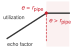
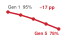

# Data Selection {#sec-data-selection}

::: {layout-narrow}
::: {.column-margin}

\chapterminitoc

:::

::: {.content-visible when-format="pdf"}
\noindent
{fig-alt="Isometric diagram of many scattered cubes flowing through a scoring panel and two gates. A smaller green stream enters a blue processing block, while a red stream diverts downward. Labels read scarcity, score, select, signal, and cost."}
:::

::: {.content-visible unless-format="pdf"}
{fig-alt="Isometric diagram of many scattered cubes flowing through a scoring panel and two gates. A smaller green stream enters a blue processing block, while a red stream diverts downward. Labels read scarcity, score, select, signal, and cost."}
:::

:::

## Purpose {.unnumbered .unlisted}

\begin{marginfigure}
\mlsysstack{0}{0}{25}{50}{0}{0}{0}{90}
\end{marginfigure}

_How can a carefully selected subset retain most of the value of a much larger dataset?_

Training pays to acquire, label, score, move, and process examples even though their learning value differs. Large datasets contain redundant, noisy, or target-misaligned samples, while scarce regions may lack the cases a model needs, such as the rare conditions under which a deployed system is most likely to fail. Training on every example treats a near-duplicate and a rare failure case as equally worth paying for, and at scale much of the compute budget can go to relearning what the model already knows. Data selection turns that heterogeneity into a systems optimization. It can remove avoidable work before training, direct labels and training steps toward informative cases as learning proceeds, or create missing examples when scarcity is the binding constraint. It can also invest once in reusable representation learning when that cost can be amortized across downstream tasks. The objective is therefore not the smallest dataset but the lowest end-to-end cost of reaching target quality without losing rare cases, underrepresented groups, or deployment-relevant coverage. Every strategy adds its own overhead: examples must be scored, generated, shuffled, stored, or validated, and those costs can erase the savings they promise. That judgment must be made end to end, because gains in labeling or training can be erased by selection latency, storage access, or distributed coordination. A method earns its place only when the learning it preserves or creates exceeds the work required to apply it. This distinction matters across repeated experiments, where useful reductions compound, and across adaptation, where the value of an example changes with the model and target distribution. Data engineering established that data is the source code of ML systems; data selection asks which evidence is useful now and which is still missing. In D·A·M terms, it is data-algorithm co-design: shape the training signal so each unit of machine work buys more useful learning.

::: {.content-visible when-format="pdf"}

\newpage

:::

::: {.callout-learning-objectives}

- Explain data selection as data-algorithm co-design that controls sample value, training work, and labeling cost
- Calculate information-compute ratio to decide whether additional examples improve learning per FLOP
- Compare deduplication, coreset selection, and quality pruning for reducing redundant pretraining data
- Design curriculum, active learning, or synthetic-data strategies for changing data value during training
- Apply the selection inequality to test whether selection overhead beats full-dataset training cost
- Evaluate distributed selection pipelines against storage locality, consistency, and accelerator utilization constraints
- Select data-selection investments using ROI, amortization, and compute-optimal frontier diagnostics

:::

## Data Selection Fundamentals {#sec-data-selection-data-selection-fundamentals-e839}

Training pays the iron-law cost for every example it processes, but not every example returns learning signal worth that cost. Data selection\index{Data selection!definition} gives a clean, well-engineered dataset a systems objective: keep the examples that contribute the most learning per unit of compute. Data engineering makes the dataset reliable through correct labels, consistent schemas, and governed records. Data selection optimizes the dataset's value by extracting maximum learning from minimum samples, shrinking the total operations $(\Operations)$ term in the iron law\index{Iron law of ML systems!total operations reduction via data selection} (principle \ref{pri-iron-law}) when it removes processing at matched quality. The distinction matters: quality asks whether data is correct, while value asks whether correct data is worth the compute spent processing it.

::: {.column-margin}
```{=latex}
\vspace*{-18mm}
```
{width="100%" fig-alt="Two trend lines labeled compute and data diverge, opening a red-shaded gap."}

*Compute supply can outrun high-quality data supply.*
:::

Increasing the amount of training data has long been a standard way to improve models. Scaling laws\index{Scaling laws!data-compute asymmetry}[^fn-scaling-laws-origin] [@kaplan2020scaling; @hoffmann2022chinchilla] quantify how model performance can improve with dataset size, and teams have responded by collecting and generating more examples. Accelerator fleets, however, can expand usable compute faster than the supply of novel, high-quality human-generated text and images. Much of the easily accessible public web has already been incorporated into large training corpora, and expert labeling capacity grows slowly. This asymmetry is the **data wall**\index{Data wall!definition},[^fn-data-wall-scaling] shifting engineering focus from indiscriminate data ingestion toward maximizing the learning signal extracted from every stored and processed sample.

[^fn-scaling-laws-origin]: **Scaling laws**\index{Scaling laws!power-law origin}: Jared Kaplan and colleagues at Johns Hopkins and OpenAI empirically demonstrated in 2020 that language model loss follows power-law relationships with model size, dataset size, and compute budget over the regimes they studied [@kaplan2020scaling]. Their fitted data exponent was approximately $\Glyph{\alpha} = 0.095$ in $\LossFunction \propto \DataScalingLossFactor$. The value is not universal, but the diminishing-return shape makes it possible to reason about when selection becomes more cost-effective than collection.

```{python}
#| echo: false
#| label: scaling-asymmetry-calc

# ┌─────────────────────────────────────────────────────────────────────────────
# │ SCALING ASYMMETRY TABLE
# ├─────────────────────────────────────────────────────────────────────────────
# │ Context: @tbl-scaling-asymmetry in "Data Selection Fundamentals" section
# │
# │ Goal: Quantify the growth rate gap between compute and data.
# │ Show: That compute grows 10×/3yr while data only grows 2×/5yr.
# │ How: Contrast historical growth factors for TFLOP/s and high-quality tokens.
# │
# │ Scope: chapter-anchor — opening scaling-asymmetry table is reused by the
# │        fallacies section as the chapter's data-wall callback.
# └─────────────────────────────────────────────────────────────────────────────
from mlsysim.fmt import check, fmt_multiple, fmt_time

# ┌── LEGO ───────────────────────────────────────────────
class ScalingAsymmetry:
    """
    Namespace for Scaling Asymmetry Table.
    Scenario: Comparing growth rates of Compute vs Data.
    """

    # ┌── 1. LOAD (Constants) ───────────────────────────────────────────────
    # Hardware: 10x every 3 years (approx 2.15x/year)
    gpu_growth_factor = 10.0
    gpu_period_years = 3.0

    # Data: 2x every 5 years (approx 1.15x/year)
    web_growth_factor = 2.0
    web_period_years = 5.0

    # Labels: 1.5x every 5 years (approx 1.08x/year)
    label_growth_factor = 1.5
    label_period_years = 5.0

    # ┌── 2. EXECUTE (The Compute) ─────────────────────────────────────────
    # Step 1: Annualized growth rates: Rate = Factor^(1/Period)
    gpu_annual = gpu_growth_factor ** (1.0 / gpu_period_years)
    web_annual = web_growth_factor ** (1.0 / web_period_years)

    # Step 2: Divergence
    gap_ratio = gpu_annual / web_annual

    # ┌── 3. GUARD (Invariants) ───────────────────────────────────────────
    check(gap_ratio >= 1.5, f"GPU growth ({gpu_annual:.2f}x/yr) is not fast enough vs. Data ({web_annual:.2f}x/yr). Gap: {gap_ratio:.2f}x")

    # ┌── 4. OUTPUT (Formatting) ──────────────────────────────────────────────
    gpu_growth_mult_str = fmt_multiple(round(gpu_growth_factor), precision=0, commas=False)
    # Custom "years" suffix uses fmt_int() suffix discipline.
    gpu_period_years_str = fmt_time(round(gpu_period_years), 'year', precision=0, commas=False, style='word')

    web_data_growth_mult_str = fmt_multiple(round(web_growth_factor), precision=0, commas=False)
    web_data_period_years_str = fmt_time(round(web_period_years), 'year', precision=0, commas=False, style='word')

    label_data_growth_mult_str = fmt_multiple(label_growth_factor, precision=1, commas=False)
    label_data_period_years_str = fmt_time(round(label_period_years), 'year', precision=0, commas=False, style='word')
```

@Tbl-scaling-asymmetry uses an illustrative growth scenario in which GPU compute rises `{python} ScalingAsymmetry.gpu_growth_mult_str` every `{python} ScalingAsymmetry.gpu_period_years_str` while accessible high-quality data grows more slowly. These are scenario inputs, not measured universal rates.

| **Resource**            |                                                                                                   **Growth Rate** | **Implication**                                                                   |
|:------------------------|------------------------------------------------------------------------------------------------------------------:|:----------------------------------------------------------------------------------|
| **GPU Compute**         |               ~`{python} ScalingAsymmetry.gpu_growth_mult_str` / `{python} ScalingAsymmetry.gpu_period_years_str` | Hardware throughput can rise quickly in a given era                               |
| **Training Data (Web)** |     ~`{python} ScalingAsymmetry.web_data_growth_mult_str` / `{python} ScalingAsymmetry.web_data_period_years_str` | High-quality web text is finite; much already scraped                             |
| **Labeled Data**        | ~`{python} ScalingAsymmetry.label_data_growth_mult_str` / `{python} ScalingAsymmetry.label_data_period_years_str` | Human annotation throughput is inherently bounded                                 |
| **Synthetic Data**      |                                                                                                 Potentially large | Bounded by generator quality (models trained on model-generated data can degrade) |

: **Scaling Asymmetry in ML Resources**: In the illustrated scaling regime, compute grows faster than high-quality data supply, creating a compute-to-data imbalance that makes data selection valuable. {#tbl-scaling-asymmetry .striped .hover tbl-colwidths="[16,13,71]"}

[^fn-data-wall-scaling]: **Data wall**\index{Data wall!scaling constraint}: Unlike compute (which scales with capital expenditure) or algorithms (which improve through research), the stock of high-quality human-generated text grows slowly; Epoch AI's updated projections estimated that, under the paper's modeled consumption assumptions, models could use datasets roughly equal in size to the stock of public human-generated text between 2026 and 2032 [@villalobos2022will]. The point for systems design is not a fixed calendar deadline; it is that data can become a supply constraint rather than merely an economic one. The wall does not change how many operations $(\Operations)$ a run performs. It lowers what each of those operations buys, because once quality data runs short, additional compute spent on repeated or weaker data yields diminishing accuracy regardless of hardware throughput.

Scaling dataset size eventually encounters the finite stock of high-quality human speech and text. @Fig-running-out-of-human-data charts the steep log-scale ascent of foundation model training sets from GPT-3 through Llama 3, showing the empirical trajectory converging toward the shaded ceiling of high-quality public text stock near $10^{14}$ tokens.

::: {#fig-running-out-of-human-data fig-env="figure" fig-pos="htb" fig-cap="**Dataset Growth Approaching Limits**: Several foundation-model datasets have grown toward estimates of the total stock of high-quality public text. The projection should be read as a dated constraint scenario rather than a fixed forecast: data selection, synthetic generation, multimodal learning, licensing, and filtering policy all change the usable supply." fig-alt="Log-scale line chart of dataset size from 100 million to 1 quadrillion tokens vs. year from 2012 to 2028. A rising blue trend line includes labeled markers for GPT-3, Chinchilla, Llama 2, and Llama 3. An orange band from 100 trillion to 1 quadrillion tokens is labeled High-Quality Public Text Stock, and a red Projected Data Limit annotation points toward the trend line."}
```{.tikz}
\begin{tikzpicture}[font=\sffamily\small]

\pgfplotsset{
  layers/axis lines on top/.define layer set={
    axis background,
    axis grid,
    axis ticks,
    axis tick labels,
    pre main,
    main,
    axis lines,
    axis descriptions,
    axis foreground,
  }{/pgfplots/layers/standard},
}

\begin{axis}[
   /pgf/number format/.cd,
   tick label style={/pgf/number format/assume math mode=true},
   ticklabel style={font=\footnotesize\sffamily},
   1000 sep={}, % uklanja zareze
  yticklabel style={
  /pgf/number format/.cd,
  sci,
  sci generic={mantissa e exponent},
  precision=1
},
    width=15cm,
    height=75mm,
    xmin=2012, xmax=2028.5,
    ymin=1e8, ymax=1.4e15,
    ymode=log,
    log basis y=10,
    xtick={2012,2014,2016,2018,2020,2022,2024,2026,2028},
    ytick={1e8,1e9,1e10,1e11,1e12,1e13,1e14,1e15},
    yticklabels={10\textsuperscript{8},10\textsuperscript{9},
    10\textsuperscript{10},10\textsuperscript{11},
    10\textsuperscript{12},10\textsuperscript{13},
    10\textsuperscript{14},10\textsuperscript{15}},
    xlabel={Year},
    ylabel={Dataset Size (Tokens)},
    axis lines*=left,
    axis line style={gray!70,line width=1pt},
 % axis on top=true,
    set layers=axis lines on top,
    tick style={gray!70},
    tick label style={font=\sffamily\footnotesize},
    ylabel style={font=\small\sffamily,align=center,yshift=-1.2mm},
    xlabel style={font=\small\sffamily},
    grid=both,
    major grid style={gray!12},
    minor grid style={gray!6},
    clip=false,
    major tick style={thin,black},
   tick align=outside,
   major tick length=4pt,
]

%—shaded public text stock band ---
\addplot[
    draw=none,
    fill=myorange!07
] coordinates {
    (2012,1e14)
    (2028,1e14)
    (2028,1e15)
    (2012,1e15)
}; %\closedcycle

\node[
    anchor=center,
    align=center,
    text=myorange!75!black,
    font=\footnotesize\sffamily
] at (axis cs:2015.5,3e14)
{High-Quality Public Text Stock\\(Books, Papers, Code, Web)};

%—scaling line ---
\addplot[
    BlueLine,
    line width=1.5pt,
] coordinates {
    (2017.15,1e9)
    (2026.60,1e15)
};

%—data points ---
\addplot[
    only marks,
    mark=*,
    mark size=2.5,
    BlueLine,
    draw=white,line width=0.95pt
] coordinates {
    (2019.0,1.4e10)   % unlabeled low point
    (2020.0,3.0e11)   % GPT-3
    (2022.0,1.4e12)   % Chinchilla
    (2023.0,2.0e12)   % Llama 2
    (2024.0,1.5e13)   % Llama 3
};

%—point labels ---
\node[anchor=west, text=BlueLine, font=\sffamily\footnotesize]
    at (axis cs:2018.5,3.0e11) {GPT-3};

\node[anchor=west, text=BlueLine, font=\sffamily\footnotesize]
    at (axis cs:2022.0,9.0e11) {Chinchilla};

\node[anchor=west, text=BlueLine, font=\sffamily\footnotesize]
    at (axis cs:2023.1,2.0e12) {Llama 2};

\node[anchor=west, text=BlueLine, font=\sffamily\footnotesize]
    at (axis cs:2024.15,1.5e13) {Llama 3};

%—red curved arrow and label ---
\node[
    anchor=west,
    text=myred,
    font=\sffamily\footnotesize
](PD) at (axis cs:2015.4,1.2e12)
{Projected Data Limit};
\coordinate(PO)at(axis cs:2025.05,1.05e14);
\end{axis}
\draw[myred,line width=0.75pt, <-,>=latex]
(PO)
to[bend right=15]
(PD);
\end{tikzpicture}
```
:::

When *compute* is abundant and *quality data* is scarce, the optimization priority inverts. Selection, not faster kernels, then extracts more learning per dollar, and for teams whose accelerator budget exceeds their curated corpus, the bottleneck shifts from accelerator access to the quality, legality, and diversity of the training data.

That inversion raises the bitter lesson's question in data terms. General methods win by absorbing more computation, and scaling laws describe that absorption only while data grows alongside compute. Selection can look like the hand-built expertise the lesson warns against, and a filter written from human intuition about which examples matter is exactly that. Selection can also use the model's own signals, such as loss, gradient norms, or embedding similarity. More compute can support stronger scoring models or more frequent score updates, but improved sample rankings must be established against downstream quality and coverage. Done that way, selection is how a compute-hungry general method stays fed once the supply of fresh, high-quality data stops keeping pace.

::: {.column-margin .margin-pointer}
↩ The bitter lesson, that general methods using more computation outperform encoded human expertise, is established in @sec-introduction-bitter-lesson-79c7.
:::

The engineering toolkit for intelligent data selection follows a deliberate optimization ordering\index{Data selection!optimization ordering}: first ask whether a sample is worth processing, then ask how to process the remaining workload efficiently. Data selection sits first in the ordering that frames all of Part III, removing avoidable work before anything simplifies or accelerates the work that remains. Static pruning\index{Static pruning!definition} fixes the retained subset before target-model training; scoring may itself require proxy training. Dynamic selection\index{Dynamic selection!definition} adapts the data diet during training through curriculum learning and active learning. Synthetic generation\index{Synthetic data generation!definition} creates high-value samples through augmentation, simulation, or examples labeled by a larger trained model (a *teacher*) when real data runs short.

Each stage can increase the information density of the data that reaches the model when measured quality gains justify its overhead, forming a complementary toolkit rather than a rigid execution sequence: pruning reduces *what* the pipeline contains, dynamic selection focuses *how* the training loop schedules it, and synthesis expands *what* the pipeline can access. Self-supervised pretraining complements these three levers by redefining what constitutes a supervision signal: rather than selecting among labeled examples, it derives learning targets directly from the intrinsic structure of unannotated data. Evaluating any of these techniques requires a systems definition of data selection and a quantitative account of its effectiveness.

### Defining data selection {#sec-data-selection-defining-data-selection-ef2f}

A duplicated image, a mislabeled record, and a rare boundary case may all cost the same forward and backward pass, but they do not contribute the same learning signal. Data selection therefore starts by making sample value explicit relative to compute cost. The information-compute ratio measures that value as learning signal gained per unit of training compute, formalized in @sec-data-selection-informationcompute-ratio-8c0b.

::: {#dfn-data-selection-data-selection .callout-definition title="Data selection"}

***Data selection***\index{Data selection!definition} is the process of retaining, prioritizing, or generating training examples to minimize the end-to-end cost of reaching target quality while preserving required coverage.

1.  **Significance**: It identifies data worth retaining, prioritizing, or generating for the target objective, reducing the total operations $(\Operations)$ when redundant or noisy samples can be excluded without losing required coverage.
2.  **Distinction**: Unlike data engineering, which focuses on the cleanliness and consistency of data, data selection focuses on the informativeness and diversity of the samples.
3.  **Common pitfall**: A frequent misconception is that more data is always better. Additional low-quality data can yield less improvement than a much smaller, carefully selected set, so retained volume must be evaluated together with coverage and target quality.

:::

To make this concrete, consider training an autoregressive language model\index{LLM} in the GPT-2\index{GPT-2!data selection}/Llama\index{Llama!data selection} lighthouse family at frontier scale. The scenario deliberately steps outside this book's one-machine scope, to a 70-billion-parameter model on a cluster of thousands of accelerators, because that is where the data wall binds first. The GPT-2 model trained in @sec-model-training-running-example-training-gpt2-19cd sits far below this point, but the same arithmetic applies to any team whose compute can traverse its curated corpus many times over.

::: {.column-margin .margin-pointer}
↩ GPT-2, the bandwidth-bound lighthouse for decoder-only language models, is established in @sec-network-architectures-lighthouse-roster-model-biographies-a763.
:::

```{python}
#| echo: false
#| label: gpt-llama-calc

import mlsysim.core.units as c
from mlsysim import Hardware, Infrastructure, Models, Systems
from mlsysim.engine import calibration
from mlsysim.fmt import check, fmt, fmt_count, fmt_multiple, fmt_percent, fmt_time, fmt_usd

class ComputeDataGap:
    # LOAD
    h100_count = Systems.Clusters.Training_10K.total_accelerators
    months = 3
    filtered_corpus_tokens = 5e12 * c.count
    public_text_stock = 300e12 * c.count
    sustained_mfu = calibration.REFERENCE_MFU_SUSTAINED
    training_flops_per_token = 6 * Models.Language.Llama2_70B.parameters.to(c.param) * c.flop / c.param
    training_duration = months * c.DAYS_PER_MONTH * c.HOURS_PER_DAY * c.hour

    # EXECUTE
    total_flops = h100_count * Hardware.Cloud.H100.compute.peak_flops.to(c.flop / c.second) * training_duration.to(c.second) * sustained_mfu
    tokens_capacity = (total_flops / training_flops_per_token).to(c.count)
    corpus_reuse_ratio = (tokens_capacity / filtered_corpus_tokens).to("").magnitude
    cluster_cost = h100_count * training_duration.to(c.hour) * Infrastructure.Pricing.Cloud.GpuTrainingPerHour.rate.to(c.USD / c.hour)

    # GUARD
    check(public_text_stock > tokens_capacity, "Public stock estimate should exceed the example training run capacity.")
    check(corpus_reuse_ratio > 10, f"Cluster should be able to traverse the filtered corpus many times; got {corpus_reuse_ratio:.1f}x.")

    # OUTPUT
    h100_count_str = fmt(h100_count, precision=0, commas=True)
    tokens_capacity_str = fmt_count(tokens_capacity, scale='T', precision=1, commas=False)
    filtered_corpus_tokens_str = fmt_count(filtered_corpus_tokens, scale='T', commas=False)
    public_text_stock_str = fmt_count(public_text_stock, scale='T', commas=False)
    corpus_reuse_ratio_mult_str = fmt_multiple(corpus_reuse_ratio, precision=1, commas=False)
    training_months_str = fmt_time(months, 'month', precision=0, commas=False, style='word')
    sustained_mfu_pct_str = fmt_percent(sustained_mfu, precision=0, commas=False, style='prose')
    cluster_cost_m_str = fmt_usd(cluster_cost, precision=1, commas=False, scale="M")
    gpu_rate_str = fmt_usd(
        Infrastructure.Pricing.Cloud.GpuTrainingPerHour.rate.to(c.USD / c.hour).magnitude, precision=0, commas=False, per="GPU-hour"
    )
```

The compute budget (`{python} ComputeDataGap.h100_count_str` H100 GPUs for `{python} ComputeDataGap.training_months_str`) represents roughly `{python} ComputeDataGap.cluster_cost_m_str` at a cloud rental price of `{python} ComputeDataGap.gpu_rate_str` and can process about `{python} ComputeDataGap.tokens_capacity_str` tokens at `{python} ComputeDataGap.sustained_mfu_pct_str` sustained model FLOPs utilization (MFU), the fraction of peak arithmetic a training run actually delivers (definition \ref{dfn-training-model-flops-utilization-mfu}). Estimates of quality- and repetition-adjusted public human-generated text are on the order of `{python} ComputeDataGap.public_text_stock_str` tokens, far larger than a single curated web corpus. The practical bottleneck is narrower: how much of that stock is accessible, legally usable, high quality, deduplicated, and useful for the target distribution. If a team has only a `{python} ComputeDataGap.filtered_corpus_tokens_str` filtered corpus ready for use, the compute budget can already process it roughly `{python} ComputeDataGap.corpus_reuse_ratio_mult_str` over. At that point, the cluster outstrips the available unique signal. An engineering team can repeat epochs over the same corpus, but gradient updates on familiar tokens yield diminishing loss reductions. It can lower quality thresholds to admit uncurated web text, but noisy and misaligned tokens degrade downstream evaluation. Or it can invest in data selection (refining quality filters, constructing difficulty curricula, and synthesizing missing edge cases) to raise the learning return per FLOP. When compute capacity outpaces high-signal data, selection delivers higher return on capital than provisioning additional accelerators.

The opportunity applies across the lighthouse models\index{ResNet-50!data selection}, from ResNet-50 to GPT-2/Llama, although the safe reduction differs by task. Whenever a validated method removes examples or tokens without adding compensating steps, training FLOPs fall. The appropriate framing is therefore systemic rather than purely statistical.

### Systems perspective {#sec-data-selection-systems-perspective-bd61}

The data wall dictates the physical limits of scaling uncurated datasets; a systems perspective determines how to manage that constraint across the hardware stack. The conventional *ML framing* evaluates data selection through statistical sample complexity and generalization theory, asking how many samples are required to achieve a given test error. That formulation treats every sample as a zero-cost mathematical abstraction, ignoring the physical resource cost of data ingestion, transport, and execution.

A data-selection *systems framing*\index{Data selection!systems vs. ML framing} asks instead how to minimize the total resource cost of achieving target accuracy across the entire ML lifecycle. This framing shifts attention from theoretical sample efficiency to concrete resource consumption, as @tbl-ml-vs-systems-framing illustrates.

| **ML Framing**                        |                         **Systems Framing** |
|:--------------------------------------|--------------------------------------------:|
| **"Fewer samples for same accuracy"** |             "Fewer FLOPs for same accuracy" |
| **"Better generalization"**           | "Lower training cost (time, money, energy)" |
| **"Sample complexity bounds"**        |            "End-to-end resource efficiency" |
| **"Learning theory"**                 |                          "Cost engineering" |

: **ML vs. Systems Perspectives on Data Selection**: The ML framing optimizes sample complexity; the systems framing optimizes total resource cost across the pipeline. {#tbl-ml-vs-systems-framing .striped .hover}

This framing reveals optimization leverage across the execution stack. In the D·A·M taxonomy, data selection operates at the data layer to eliminate physical work before algorithmic and hardware optimizations execute it, as formalized by the iron law of ML systems.

::: {.column-margin .margin-pointer}
↩ The D·A·M taxonomy and its three diagnostic axes are established in @sec-introduction-defining-ml-systems-d4af.
:::

Read as an optimization map (@fig-optimization-triad), the taxonomy assigns each vertex its own governing question, positioning data selection as an input optimization that prunes the total workload before algorithmic and physical execution take place. The model vertex determines how many operations each forward and backward pass requires; the machine vertex determines how rapidly the hardware executes that arithmetic; and the data vertex determines whether an example warrants processing at all. The connecting edges demarcate the primary operational bottlenecks: compute-bound arithmetic throughput between algorithms and hardware, I/O-bound bandwidth between storage and accelerators, and sample efficiency between data curation and model capacity. Sample efficiency governs the Data–Algorithm boundary (what to learn from), the I/O bound governs the Data–Machine boundary (how information moves), and the compute bound governs the Algorithm–Machine boundary (how to execute arithmetic efficiently). By optimizing at the data vertex, data selection eliminates work across both adjacent boundaries—reducing storage ingestion traffic along the machine edge and raising effective learning return along the algorithm edge.

::: {#fig-optimization-triad fig-env="figure" fig-pos="htb" fig-cap="**The D·A·M Taxonomy as an Optimization Map**: Machine learning performance is organized around Algorithms (Model), Data Selection, and Machine (Hardware). The triangle's edges label the compute-bound, I/O-bound, and sample-efficiency relationships, while data selection reduces workload before model or hardware execution." fig-alt="Triangular diagram with three pillars around a central ML Performance label: Algorithms (Model) at top, Machine (Hardware) at bottom-left, and Data Selection at bottom-right. Curved arrows trace each edge of the triangle, labeled Compute Bound (between Algorithms and Machine), I/O Bound (between Machine and Data Selection), and Sample Efficiency (between Data Selection and Algorithms)."}
```{.tikz}
\scalebox{0.8}{%
\begin{tikzpicture}[line join=round,font=\sffamily\footnotesize]
\tikzset{%
Box2/.style={align=flush center, inner sep=0pt,draw=none,fill=none,minimum height=8mm },
planet/.style = {circle, draw=none,semithick, fill=yellow!10,line width=1.5pt,
                    font=\sffamily\bfseries,
                    minimum size=27mm, inner sep=1mm,align=flush center},
satellite/.style = {circle, draw=#1, dashed, thick, fill=none,%#1!10,
                    text width=26mm, inner sep=1pt, align=flush center,minimum size=28mm,minimum height=12mm},
TxtC/.style = {font=\footnotesize\sffamily,text width=50mm,align=flush center},
LineA/.style = {violet!60,{Kite[line width=1.1pt,fill=white,round,length=9pt,width=7pt]}-,line width=1.5pt,shorten <=-3pt},
ALineA/.style={{Triangle[width=14pt,length=10pt]}-{Triangle[width=14pt,length=10pt]}, line width=7pt,cyan!40}
}

\tikzset{mycylinder/.style={cylinder, shape border rotate=90, aspect=1.3, draw, fill=white,
minimum width=25mm,minimum height=11mm,line width=\Linewidth,node distance=-0.15},
pics/data/.style = {
        code = {
        \pgfkeys{/channel/.cd, #1}
\begin{scope}[local bounding box=STREAMING,scale=\scalefac, every node/.append style={transform shape}]
\node[mycylinder,fill=\filllcolor!50] (A) {};
\node[mycylinder, above=of A,fill=\filllcolor!30] (B) {};
\node[mycylinder, above=of B,fill=\filllcolor!10] (C) {};
\fill[\filllcolor!50!black]($(C.west)!0.12!(C.east)$)circle(3pt);
\fill[\filllcolor!50!black]($(B.west)!0.12!(B.east)$)circle(3pt);
\fill[\filllcolor!50!black]($(A.west)!0.12!(A.east)$)circle(3pt);
 \end{scope}
     }
  }
}

%funnel
\tikzset{%
 pics/funnel/.style = {
        code = {
        \pgfkeys{/channel/.cd, #1}
\begin{scope}[local bounding box=FUNNEL,scale=\scalefac, every node/.append style={transform shape}]
\draw[fill=\filllcolor!50,line width=\Linewidth,draw=\drawcolor](-0.12,-0.81)--(-0.19,-0.25)--(-0.7,0.41)--(0.7,0.41)--(0.19,-0.25)--(0.12,-0.81)--cycle;
\draw[fill=\filllcolor!50,line width=\Linewidth,draw=\drawcolor](-0.19,-0.25)--(0.08,-0.25);
\draw[fill=\filllcolor!50,line width=\Linewidth,draw=\drawcolor](0.16,-0.09)--(0.41,0.31);
%
\node[line width=\Linewidth,draw=\drawcolor,fill=\filllcolor!50,inner sep=1pt,
rectangle,rounded corners=0.5pt,minimum width=16mm,minimum height=5pt]at(0,0.5){};
%
\foreach \i in{-0.5,0,0.5}{
\node[single arrow, line width=0.8*\Linewidth,draw=black,fill=\filllcirclecolor, rotate=270,inner sep=1pt,
      minimum width =9pt, single arrow head extend=2pt,
      minimum height=5mm]at(\i,0.9) {}; % length of arrow
   }
\node[single arrow,line width=0.8*\Linewidth,draw=black,fill=\filllcirclecolor, rotate=270,inner sep=1pt,
      minimum width =11pt, single arrow head extend=2pt,
      minimum height=5mm]at(0,-1.1) {}; % length of arrow
 \end{scope}
     }
  }
}
%CPU
\tikzset{%
 pics/cpu/.style = {
        code = {
        \pgfkeys{/channel/.cd, #1}
\begin{scope}[local bounding box=FUNNEL,scale=\scalefac, every node/.append style={transform shape}]
\node[fill=\filllcolor,minimum width=66, minimum height=66,
            rounded corners=2,outer sep=2pt] (C1) {};
\node[fill=white,minimum width=54, minimum height=54] (C2) {};
\node[fill=\filllcolor!40,minimum width=44, minimum height=44] (C3) {\large CPU};

\foreach \x/\y in {0.11/1,0.26/2,0.41/3,0.56/4,0.71/5,0.85/6}{
\node[fill=\filllcolor,minimum width=3, minimum height=15,
           inner sep=0pt,anchor=south](GO\y)at($(C1.north west)!\x!(C1.north east)$){};
}
\foreach \x/\y in {0.11/1,0.26/2,0.41/3,0.56/4,0.71/5,0.85/6}{
\node[fill=\filllcolor,minimum width=3, minimum height=15,
           inner sep=0pt,anchor=north](DO\y)at($(C1.south west)!\x!(C1.south east)$){};
}
\foreach \x/\y in {0.11/1,0.26/2,0.41/3,0.56/4,0.71/5,0.85/6}{
\node[fill=\filllcolor,minimum width=15, minimum height=3,
           inner sep=0pt,anchor=east](LE\y)at($(C1.north west)!\x!(C1.south west)$){};
}
\foreach \x/\y in {0.11/1,0.26/2,0.41/3,0.56/4,0.71/5,0.85/6}{
\node[fill=\filllcolor,minimum width=15, minimum height=3,
           inner sep=0pt,anchor=west](DE\y)at($(C1.north east)!\x!(C1.south east)$){};
}
 \end{scope}
     }
  }
}
\tikzset{
pics/algorithm/.style = {
        code = {
        \pgfkeys{/channel/.cd, #1}
\begin{scope}[shift={($(0,0)+(0,0)$)},scale=\scalefac,every node/.append style={transform shape}]
\node[fill=\filllcolor!60,draw=\drawcolor,line width=\Linewidth,rectangle,minimum size=2.5mm,
rounded corners=1pt,inner sep=1pt](B2)at(0,-0.47){};
\node[fill=\filllcolor!30,draw=\drawcolor,line width=\Linewidth,rectangle,minimum size=2.5mm,
rounded corners=1pt,inner sep=1pt](B3)at(-0.6,-0.47){};
\node[fill=\filllcolor!30,draw=\drawcolor,line width=\Linewidth,rectangle,minimum size=2.5mm,
rounded corners=1pt,inner sep=1pt](B1)at(0.6,-0.47){};
%
\node[fill=\filllcolor!99!violet!80,draw=\drawcolor,line width=\Linewidth,rectangle,
minimum width=8.5mm,minimum height=3mm,
rounded corners=2pt,inner sep=1pt](B0)at(0,0.53){};
\draw[draw=\drawcolor,shorten >=4pt,shorten <=4pt,line width=1.5*\Linewidth]
($(B0.north west)!0.33!(B0.south west)$)--($(B0.north east)!0.33!(B0.south east)$);
\draw[draw=\drawcolor,shorten >=4pt,shorten <=4pt,line width=1.5*\Linewidth]
($(B0.north west)!0.66!(B0.south west)$)--($(B0.north east)!0.66!(B0.south east)$);
\draw[draw=\drawcolor,rounded corners](B1)|-(B0);
\draw[draw=\drawcolor,rounded corners](B3)|-(B0);
\draw[draw=\drawcolor,rounded corners](B2)--(B0);
\node[fill=\filllcirclecolor!60,draw=\drawcolor,line width=\Linewidth,rectangle,minimum size=2.5mm,
rounded corners=1pt,inner sep=1pt,rotate=45](R2){};
\node[fill=\filllcirclecolor!30,draw=\drawcolor,line width=\Linewidth,rectangle,minimum size=2.5mm,
rounded corners=1pt,inner sep=1pt,rotate=45](R1) at (-0.6,0){};
\node[fill=\filllcirclecolor!30,draw=\drawcolor,line width=\Linewidth,rectangle,minimum size=2.5mm,
rounded corners=1pt,inner sep=1pt,rotate=45](R3) at (0.6,0){};
\end{scope}
    }
  }
}
%vaga
\tikzset{
pics/vaga/.style = {
        code = {
        \pgfkeys{/channel/.cd, #1}
\begin{scope}[shift={($(0,0)+(0,0)$)},scale=\scalefac,every node/.append style={transform shape}]
\node[rectangle,minimum width=2mm,minimum height=22mm,
draw=none, fill=\filllcolor,line width=\Linewidth](1R) at (0,-0.95){};
\fill[fill=\filllcolor!60!black](230:2.8)arc(230:310:2.8)--cycle;%circle(2.9);
%LT
\node [semicircle, shape border rotate=180,  anchor=chord center,
      minimum size=11mm, draw=none, fill=\filllcirclecolor](LT) at (-2,-0.5) {};
\node [circle,  minimum size=4mm, draw=none, fill=\filllcirclecolor](T1) at (-2,1.25) {};
\draw[draw=\drawcolor,,line width=1.2*\Linewidth,shorten <=3pt,shorten >=3pt](T1)--(LT);
\draw[draw=\drawcolor,,line width=1.2*\Linewidth,shorten <=3pt,shorten >=3pt](T1)--(LT.30);
\draw[draw=\drawcolor,,line width=1.2*\Linewidth,shorten <=3pt,shorten >=3pt](T1)--(LT.150);
%DT
\node [semicircle, shape border rotate=180,  anchor=chord center,
      minimum size=11mm, draw=none, fill=\filllcirclecolor!70!black](DT) at (2,-0.5) {};
\node [circle,  minimum size=4mm, draw=none, fill=\filllcirclecolor!70!black](T2) at (2,1.25) {};
\draw[draw=\drawcolor,line width=1.2*\Linewidth,shorten <=3pt,shorten >=3pt](T2)--(DT);
\draw[draw=\drawcolor,,line width=1.2*\Linewidth,shorten <=3pt,shorten >=3pt](T2)--(DT.30);
\draw[draw=\drawcolor,,line width=1.2*\Linewidth,shorten <=3pt,shorten >=3pt](T2)--(DT.150);
%
\node[draw=none,rectangle,minimum width=32mm,minimum height=1.5mm,inner sep=0pt,
fill=\filllcolor!60!black]at(0,1.25){};
\node[draw=white,fill=\filllcolor,line width=2*\Linewidth,ellipse,minimum width=9mm,  minimum height=15mm](EL)at(0,0.85){};
\node[draw=white,fill=\filllcolor!60!black,line width=2*\Linewidth,,circle,minimum size=10mm](2C)at(0,2.05){};
\end{scope}
    }
  }
}
\pgfkeys{
  /channel/.cd,
   Depth/.store in=\Depth,
  Height/.store in=\Height,
  Width/.store in=\Width,
  filllcirclecolor/.store in=\filllcirclecolor,
  filllcolor/.store in=\filllcolor,
  drawcolor/.store in=\drawcolor,
  drawcircle/.store in=\drawcircle,
  scalefac/.store in=\scalefac,
  Linewidth/.store in=\Linewidth,
  picname/.store in=\picname,
  filllcolor=BrownLine,
  filllcirclecolor=violet!20,
  drawcolor=black,
  drawcircle=violet,
  scalefac=1,
  Linewidth=0.5pt,
  Depth=1.3,
  Height=0.8,
  Width=1.1,
  picname=C
}
\definecolor{Siva}{RGB}{161,152,130}
\def\radius{3.15}
%planet
\node (p)   [planet]    {};
\node[TxtC,below=0pt of p]{ML\\ Performance};
%satellites

\foreach \i/\j/\sho [count=\k from 0] in {
magenta!70!/{Algorithms (Model)}/105pt,
Siva/{Data Selection}/105pt,
cyan/{Machine (Hardware)}/105pt
%violet!75!/{\textbf{Embodiment}\\{\footnotesize No grounding}}/11pt%,
%orange/\textbf{Alignment}\\ {\footnotesize Value loading}/11pt
}
{
\def\startangle{90}
%Satelit
\pgfmathsetmacro{\angle}{\startangle - \k * (360/3)}
\node (s\k) [satellite=\i, font=\footnotesize\sffamily] at (\angle:\radius+\sho) {};
\node[TxtC,below=0pt of s\k]{\j};
%Arrows
%\draw[arr=\i,shorten >=\sho] (p) --coordinate[pos=0.35](AR\k) (s\k);
}

 \pic[shift={(0,0)}] at  (0,0){vaga={scalefac=0.35,picname=1,filllcolor=BlueLine,  Linewidth=1.0pt,filllcirclecolor=orange}};
 %algorithm
 \pic[shift={(0,0)}] at  (s0){algorithm={scalefac=1.2,picname=1,
drawcolor=black,filllcolor=orange!80!, Linewidth=0.75pt,filllcirclecolor=green}};
%data
\begin{scope}[local bounding box=DATA1,shift={($(0,-0.66)+(s1)$)},
scale=0.6, every node/.append style={transform shape}]
\pic[shift={(0,0)}] at  (0,0){data={scalefac=1,picname=1,filllcolor=BlueLine, Linewidth=0.7pt}};
\node[draw=black!70,line width=1pt,yshift=-3mm,fill=white,circle,minimum size=18mm](CIR)at(A.north east){};
\pic[shift={(0,0)}] at  (CIR){funnel={scalefac=0.6,picname=1,Linewidth=0.5pt,
 filllcolor=BrownL,drawcolor=black,filllcirclecolor=green}};
 \end{scope}
  %machine - CPU
 \pic[shift={(0,0)}] at  (s2){cpu={scalefac=0.55,picname=1,filllcolor=BrownLine, Linewidth=0.7pt}};
 %Arrows
 \draw[ALineA] (60:\radius) arc[radius=\radius, start angle=60, end angle= 0];
\coordinate (AR1) at (30:\radius);

\draw[ALineA] (300:\radius) arc[radius=\radius, start angle=300, end angle= 240];
\coordinate (AR2) at (270:\radius);

\draw[ALineA] (180:\radius) arc[radius=\radius, start angle=180, end angle= 120];
\coordinate (AR3) at (150:\radius);
%%%%%%%%%
 \path[LineA](AR1)--++(0:1.0)coordinate(MA);
 \node[Box2,anchor=west](T1)at(MA){Sample Efficiency};
 \draw[violet!50,line width=2pt](T1.north west)to[bend right=25]coordinate(AR11)(T1.south west);
 \draw[LineA](AR1)--(AR11);

 \path[LineA](AR2)--++(270:0.65)coordinate(MA2);
 \node[Box2,anchor=west,rotate=90](T2)at(MA2){};%Sample Efficiency
  \node[anchor=north](T222)at(MA2){I/O Bound};
 \draw[violet!50,line width=2pt](T2.north west)to[bend left=25]coordinate(AR22)(T2.south west);
 \draw[LineA](AR2)--(AR22);

 \path[LineA](AR3)--++(0:-1.0)coordinate(MA1);
 \node[Box2,anchor=east,align=right](T3)at(MA1){Compute Bound};
 \draw[violet!50,line width=2pt](T3.north east)to[bend left=25]coordinate(AR33)(T3.south east);
 \draw[LineA](AR3)--(AR33);
 \end{tikzpicture}}
```

:::

```{python}
#| echo: false
#| label: data-selection-savings-calc

# ┌─────────────────────────────────────────────────────────────────────────────
# │ IRON LAW SAVINGS CALCULATION
# ├─────────────────────────────────────────────────────────────────────────────
# │ Context: "Data Selection and the Iron Law" callout
# │
# │ Goal: Demonstrate the multiplicative impact of data selection.
# │ Show: That dataset reduction compounds with hardware and model optimizations.
# │ How: Contrast additive vs. multiplicative speedup factors for an 8x total gain.
# │
# └─────────────────────────────────────────────────────────────────────────────
from mlsysim.fmt import fmt_percent, fmt, fmt_usd, check
from mlsysim import Infrastructure
from mlsysim.core.units import MILLION, USD, hour

# ┌── LEGO ───────────────────────────────────────────────
class IronLawSavings:
    """
    Namespace for Iron Law Multiplicative Savings.
    Scenario: 2x Data Selection * 2x Compression * 2x Hardware = 8x Total.
    """

    # ┌── 1. LOAD (Constants) ───────────────────────────────────────────────
    budget_m = 100  # $100M training run

    # Optimization factors
    factor_data = 2.0
    factor_model = 2.0
    factor_hw = 2.0

    # Derived
    data_pruning_pct = (1 - (1 / factor_data)) * 100

    # ┌── 2. EXECUTE (The Compute) ─────────────────────────────────────────
    # Step 1: Multiplicative effect
    total_speedup = factor_data * factor_model * factor_hw

    # Step 2: Savings
    compute_savings_m = budget_m * (data_pruning_pct / 100.0)

    # ┌── 3. GUARD (Invariants) ───────────────────────────────────────────
    additive_sum = factor_data + factor_model + factor_hw
    check(total_speedup > additive_sum, f"Multiplicative speedup ({total_speedup}x) should exceed additive sum ({additive_sum}).")

    # ┌── 4. OUTPUT (Formatting) ──────────────────────────────────────────────
    training_cost_m_str = fmt_usd((budget_m) * MILLION, precision=0, commas=False, scale="M")
    dataset_reduction_pct_str = fmt_percent(data_pruning_pct / 100, precision=0, commas=False, style='prose')
    compute_savings_m_str = fmt_usd((compute_savings_m) * MILLION, precision=0, commas=False, scale="M")
    combined_factor_mult_str = fmt_multiple(round(total_speedup), precision=0, commas=False)
    factor_data_mult_str = fmt_multiple(round(factor_data), precision=0, commas=False)
    factor_model_mult_str = fmt_multiple(round(factor_model), precision=0, commas=False)
    factor_hw_mult_str = fmt_multiple(round(factor_hw), precision=0, commas=False)
```

::: {#psp-data-selection-data-selection-iron-law .callout-perspective title="Data selection and the iron law"}

In the iron law of ML systems $(\Time= \frac{\DataVolume}{\Bandwidth} + \frac{\Operations}{\PeakRate \cdot \EfficiencyHw} + \Latency)$, data selection reduces the number of examples or tokens that enter the workload. Later model-level optimizations reduce operations per forward/backward pass, and machine-level optimizations increase $\PeakRate$ (peak throughput) and $\EfficiencyHw$ (utilization). Selection removes work before those downstream optimizations execute it.

Within the compute term $\Operations/(\PeakRate \cdot \EfficiencyHw)$, data selection is multiplicatively valuable\index{Iron law of ML systems!multiplicative savings from data selection}. Data selection and model-level optimization shrink the numerator while machine-level optimization enlarges the denominator, so when a compute-bound run applies all three, a `{python} IronLawSavings.factor_data_mult_str` reduction in dataset size with `{python} IronLawSavings.factor_model_mult_str` fewer operations per sample and `{python} IronLawSavings.factor_hw_mult_str` higher effective throughput yields an `{python} IronLawSavings.combined_factor_mult_str` reduction in compute time because the factors multiply; each layer divides the work the next layer sees. The iron law itself remains the sum of @eq-intro-iron-law, so a run bound by data movement $(\DataVolume/\Bandwidth)$ or fixed overhead $(\Latency)$ sees less than the full product.

:::

Holding epoch count, batch size, and per-sample work fixed, a `{python} IronLawSavings.dataset_reduction_pct_str` reduction in dataset size directly halves the required forward passes, backward passes, and gradient updates. For the `{python} IronLawSavings.training_cost_m_str` scenario, this reduction yields `{python} IronLawSavings.compute_savings_m_str` in direct compute savings, provided the training schedule does not compensate by adding optimization steps.

These compute savings propagate throughout the hardware hierarchy. By decreasing total data volume ($\DataVolume$), deduplication\index{Deduplication!storage and I/O cost reduction} and coreset selection alleviate storage bandwidth demands, network fabric ingress, and host-to-accelerator PCIe transfers that otherwise leave the accelerator's arithmetic units waiting on input. Upstream, active learning\index{Active learning!labeling cost reduction} curbs annotation budgets by directing human labeling to samples chosen for uncertainty, diversity, or other task-relevant query criteria.

Yet selection is not free: every selection strategy incurs its own runtime overhead to score, filter, shuffle, or coordinate samples. An online selection algorithm that executes additional forward passes to rank sample difficulty can easily consume more accelerator cycles than it saves if its selection overhead exceeds the subsequent reduction in training time. A pipeline claiming a training-time saving must make filtering plus subset training faster than full-data training at the same target quality. Labeling savings and reusable representations require the broader cost accounting developed later in the chapter.

### Information-compute ratio {#sec-data-selection-informationcompute-ratio-8c0b}

The systems framing established in @sec-data-selection-systems-perspective-bd61 calls for a quantitative metric. Data selection moves along a Pareto frontier (principle \ref{pri-pareto-frontier}) between accuracy and cost\index{Information-compute ratio!accuracy-cost frontier}: retaining every example preserves coverage but expends compute on redundant signal, whereas over-aggressive pruning saves FLOPs at the expense of rare-slice recall. Navigating that trade-off requires quantifying the marginal learning signal each sample yields per unit of hardware execution. Data engineering already priced task-relevant signal against one cost, the data gravity of moving bytes, in the data selection gain of @eq-data-selection-gain. Selection needs the same ratio with training compute in the denominator, because a sample that is cheap to move can still cost a full forward and backward pass. That ratio is the **information-compute ratio** (ICR)\index{Information-compute ratio!definition}.

Let $\FiniteChange\DataInformationContent$ be the learning signal a sample or batch adds and $\FiniteChange\Operations$ the training operations spent processing it. In practice $\FiniteChange\DataInformationContent$ is measured as the gain in a fixed evaluation metric, such as percentage points of validation accuracy, so ICR carries units of metric gain per FLOP. The ratio relates the two:
$$\text{ICR} = \frac{\FiniteChange\DataInformationContent}{\FiniteChange\Operations}$$

A higher ICR indicates that each FLOP of training buys more measured learning signal over the stated interval. Validation gain and training FLOPs can be observed for a specified experiment with a fixed evaluation protocol; the causal contribution of an individual example generally cannot. Uncertainty and gradient-based scores instead rank candidate examples before their downstream benefit is known. Those rankings require validation against measured quality, compute cost, and deployment-critical slice coverage. The core metrics in @sec-data-selection-core-metrics-32e9 supply complementary evidence for that evaluation rather than interchangeable measurements of per-example information.

### The ICR frontier: When data becomes a tax {#sec-data-selection-icr-frontier}

The information-compute ratio falls as increasingly redundant examples enter the dataset. The **ICR frontier**\index{Information-compute ratio!frontier} is the dataset size beyond which the marginal ICR, the learning bought by the next FLOP spent on more data, drops below what that FLOP could buy elsewhere: a larger model, a different data source, or an earlier stop.

To illustrate diminishing returns, let $\DataInformationContent(\DatasetSize)$ be the information content of a dataset of size $\DatasetSize$ and assume $\DataInformationContent(\DatasetSize) \propto \log \DatasetSize$. This is a simplified analytical model rather than a universal law. If compute cost scales linearly with the per-sample operation count $\OperationsPerSample$, then total operations are $\Operations = \OperationsPerSample \cdot \DatasetSize$, and the resulting marginal ICR follows @eq-icr-decay:
$$\text{ICR}(\DatasetSize) = \frac{\DerivativeOperator\DataInformationContent/d\DatasetSize}{d\Operations/d\DatasetSize} \approx \frac{1/\DatasetSize}{\OperationsPerSample} = \frac{1}{\OperationsPerSample\cdot \DatasetSize}$$ {#eq-icr-decay}

The derivative ratio describes the return on an infinitesimal increase in dataset size. For two controlled finite allocations, the corresponding incremental ratio divides the additional evaluation gain by the additional training FLOPs, using the same evaluation metric and protocol. The coreset comparison that follows instead averages gain over one epoch of each dataset; that average does not establish the return on the next increment.

Under this illustrative model, marginal ICR falls as $1/(\OperationsPerSample \cdot \DatasetSize)$, so doubling the dataset halves the learning each additional FLOP buys. Inverted, the compute spent per unit of learning grows linearly with $\DatasetSize$. ICR never reaches zero in this model and the curve has no knee of its own, so the frontier is located by comparing marginal ICR with the threshold the engineer sets, not read off the curve. That saturation is distinct from the data wall (a limit on how much new, high-quality data exists), but the two compound\index{Data wall!zero learning signal}. When new data is scarce *and* marginal data is weak, selection becomes the main lever. Beyond the frontier, additional data still adds compute but buys less learning than the threshold demands. In this regime, data becomes a **data tax**\index{Data tax!definition} that inflates the $\Operations$ term of the iron law without a commensurate gain in ICR. Priced in dollars rather than FLOPs, the same tax lowers the return on compute (RoC) of @eq-intro-roc, the accuracy gained per added dollar of infrastructure.

::: {.column-margin .margin-pointer}
↩ Return on compute, the economic lens that prices accuracy gains against infrastructure spending, is established in @sec-introduction-roc-invariant.
:::

Data selection turns the total operations $(\Operations)$ term in the iron law from a fixed constant into a variable. A 2$\times$ improvement in measured ICR halves the FLOPs required to reach the same measured gain. It produces the same ideal time reduction as a 2$\times$ throughput increase only when the workload is compute-bound and the saved work lies on the critical path. ICR focuses specifically on compute; the cost-modeling framework in @sec-data-selection-cost-modeling-9b02 extends the same reasoning to acquisition, labeling, and storage costs.

A random batch of raw data can have low ICR when it contains redundant, noisy, or already-mastered examples. To systematically raise ICR, @fig-data-selection-pipeline organizes three intervention points: offline static pruning before target training, dynamic selection during training loops, and on-demand synthetic generation. Their use and ordering depend on the workload.

::: {#fig-data-selection-pipeline fig-cap="**An Example Data Selection Pipeline**: One possible combination of interventions for increasing data value. The three intervention points are Static Pruning before target training, Dynamic Selection during training, and Synthetic Generation on demand. The sequence is illustrative rather than required: synthetic data can enter independently and can itself be pruned or dynamically selected. The final evaluation determines whether the quality gain justifies the compute cost through the Information-Compute Ratio (ICR)." fig-alt="Illustrative flow diagram from raw data through static pruning, dynamic selection, and synthetic generation to a model. The final arrow is labeled Evaluate ICR. Labels place pruning before target training, dynamic selection during training, and generation on demand."}
```{.tikz}
\begin{tikzpicture}[font=\small\sffamily, >=stealth]
\tikzset{
Box/.style={align=center, inner xsep=2pt,draw=GreenLine, line width=1pt,fill=none,
minimum width=24mm, minimum height=25mm,node distance=1.5},
LineA/.style={violet!50,line width=4.0pt,{-{Triangle[width=1.5*6pt,length=2.0*5pt]}},shorten <=1pt,shorten >=1pt},
ALine/.style={black!50, line width=1.1pt,{{Triangle[width=0.9*6pt,length=1.2*6pt]}-}},
Larrow/.style={fill=violet!50, single arrow,  inner sep=2pt, single arrow head extend=3pt,
            single arrow head indent=0pt,minimum height=10mm, minimum width=3pt}
}
\tikzset{%
 pics/inbox/.style = {
        code = {
        \pgfkeys{/channel/.cd, #1}
\begin{scope}[local bounding box=INBOX,scale=\scalefac, every node/.append style={transform shape}]
\node[line width=\Linewidth,draw=\drawcolor,fill=\filllcolor!50,
rectangle,rounded corners=3pt,minimum width=14mm,minimum height=10mm]at(0,0.3){};
\node[line width=\Linewidth,draw=\drawcolor,fill=\filllcolor,
rectangle,rounded corners=3pt,minimum width=15mm,minimum height=10mm]at(0,0.1){};
\node[line width=\Linewidth,draw=\drawcolor,fill=\filllcolor!50,
,rectangle,rounded corners=3pt,minimum width=17mm,minimum height=10mm]
at(0,-0.1){};
\draw[line width=\Linewidth,draw=\drawcolor,fill=\filllcirclecolor,,rounded corners=2pt](-0.92,0.05)--
(-0.92,-0.78)--(0.92,-0.78)--(0.92,0.05)--(0.40,0.05)--(0.32,-0.2)--(-0.29,-0.2)--(-0.40,0.05)--cycle;

\node[single arrow, line width=\Linewidth,draw=black,fill=cyan!90!black!30, rotate=270,
      minimum width = 15pt, single arrow head extend=6pt,
      minimum height=10mm]at(0,0.5) {}; % length of arrow
 \end{scope}
     }
  }
}
%target
\tikzset{
pics/target/.style = {
        code = {
        \pgfkeys{/channel/.cd, #1}
\begin{scope}[shift={($(0,0)+(0,0)$)},scale=\scalefac,every node/.append style={transform shape}]
\definecolor{col1}{RGB}{62,100,125}
\definecolor{col2}{RGB}{219,253,166}
\colorlet{col1}{\filllcolor}
\colorlet{col2}{\filllcirclecolor}
\foreach\i/\col [count=\k]in {22mm/col1,17mm/col2,12mm/col1,7mm/col2,2.5mm/col1}{
\node[circle,inner sep=0pt,draw=\drawcolor,fill=\col,minimum size=\i,line width=\Linewidth](C\k){};
}
\draw[thick,fill=brown,xscale=-1](0,0)--++(111:0.13)--++(135:1)--++(225:0.1)--++(315:1)--cycle;
\path[green,xscale=-1](0,0)--(135:0.85)coordinate(XS1);
\draw[thick,fill=yellow,xscale=-1](XS1)--++(80:0.2)--++(135:0.37)--++(260:0.2)--++(190:0.2)--++(315:0.37)--cycle;
\end{scope}
    }
  }
}
%brain
\tikzset{pics/brain/.style = {
        code = {
        \pgfkeys{/channel/.cd, #1}
\begin{scope}[local bounding box=BRAIN,scale=\scalefac, every node/.append style={transform shape}]
\fill[fill=\filllcolor!50](0.1,-0.5)to[out=0,in=180](0.33,-0.5)
to[out=0,in=270](0.45,-0.38)to(0.45,-0.18)
to[out=40,in=240](0.57,-0.13)to[out=110,in=310](0.52,-0.05)
to[out=130,in=290](0.44,0.15)to[out=90,in=340,distance=8](0.08,0.69)
to[out=160,in=80](-0.42,-0.15)to (-0.48,-0.7)to(0.07,-0.7)to(0.1,-0.5)
(-0.10,-0.42)to[out=310,in=180](0.1,-0.5);
\draw[draw=\drawcolor,line width=\Linewidth](0.1,-0.5)to[out=0,in=180](0.33,-0.5)
to[out=0,in=270](0.45,-0.38)to(0.45,-0.18)
to[out=40,in=240](0.57,-0.13)to[out=110,in=310](0.52,-0.05)
to[out=130,in=290](0.44,0.15)to[out=90,in=340,distance=8](0.08,0.69)
(-0.42,-0.15)to (-0.48,-0.7)
(0.07,-0.7)to(0.1,-0.5)
(-0.10,-0.42)to[out=310,in=180](0.1,-0.5);
\draw[fill=\filllcolor,line width=\Linewidth](-0.3,-0.10)to(0.08,0.60)
to[out=60,in=50,distance=3](-0.1,0.69)to[out=160,in=80](-0.26,0.59)to[out=170,in=90](-0.46,0.42)
to[out=170,in=110](-0.54,0.25)to[out=210,in=150](-0.54,0.04)
to[out=240,in=130](-0.52,-0.1)to[out=300,in=240]cycle;
\draw[fill=\filllcolor,line width=\Linewidth]
(-0.04,0.64)to[out=120,in=0](-0.1,0.69)(-0.19,0.52)to[out=120,in=330](-0.26,0.59)
(-0.4,0.33)to[out=150,in=280](-0.46,0.42)
%
(-0.44,-0.03)to[bend left=30](-0.34,-0.04)
(-0.33,0.08)to[bend left=40](-0.37,0.2) (-0.37,0.12)to[bend left=40](-0.45,0.14)
(-0.26,0.2)to[bend left=30](-0.24,0.13)
(-0.16,0.32)to[bend right=30](-0.27,0.3)to[bend right=30](-0.29,0.38)
(-0.13,0.49)to[bend left=30](-0.04,0.51);

\draw[rounded corners=0.8pt,\drawcircle,-{Circle[fill=\filllcirclecolor,length=2.5pt]}](-0.23,0.03)--(-0.15,-0.03)--(-0.19,-0.18)--(-0.04,-0.28);
\draw[rounded corners=0.8pt,\drawcircle,-{Circle[fill=\filllcirclecolor,length=2.5pt]}](-0.17,0.13)--(-0.04,0.05)--(-0.06,-0.06)--(0.14,-0.11);
\draw[rounded corners=0.8pt,\drawcircle,-{Circle[fill=\filllcirclecolor,length=2.5pt]}](-0.12,0.23)--(0.31,0.0);
\draw[rounded corners=0.8pt,\drawcircle,-{Circle[fill=\filllcirclecolor,length=2.5pt]}](-0.07,0.32)--(0.06,0.26)--(0.16,0.33)--(0.34,0.2);
\draw[rounded corners=0.8pt,\drawcircle,-{Circle[fill=\filllcirclecolor,length=2.5pt]}](-0.01,0.43)--(0.06,0.39)--(0.18,0.51)--(0.31,0.4);
\end{scope}
     }
  }
}
%starS
\tikzset{
 mystar/.style={shape=star,star points=4,inner sep=1pt,
 minimum size=#1,star point ratio=2.1,rounded corners=#1/20},
pics/starS/.style = {
        code = {
        \pgfkeys{/channel/.cd, #1}
\begin{scope}[shift={($(0,0)+(0,0)$)},scale=\scalefac,every node/.append style={transform shape}]
\node[fill=\filllcolor,mystar={13mm}] at (0,0) {};
\node[fill=\filllcolor,mystar={8mm}] at (-0.75,0.6) {};
\node[fill=\filllcolor,mystar={4mm}] at (-0.2,1.0) {};
\node[fill=\filllcolor,mystar={5mm}] at (-0.8,-0.3) {};
\end{scope}
    }
  }
}
%funnel
\tikzset{%
 pics/funnel/.style = {
        code = {
        \pgfkeys{/channel/.cd, #1}
\begin{scope}[local bounding box=FUNNEL,scale=\scalefac, every node/.append style={transform shape}]
\draw[fill=\filllcolor,line width=\Linewidth,draw=\drawcolor](-0.12,-0.81)--(-0.19,-0.25)--(-0.7,0.41)--(0.7,0.41)--(0.19,-0.25)--(0.12,-0.81)--cycle;
\draw[fill=\filllcolor,line width=\Linewidth,draw=\drawcolor](-0.19,-0.25)--(0.08,-0.25);
\draw[fill=\filllcolor,line width=\Linewidth,draw=\drawcolor](0.16,-0.09)--(0.41,0.31);
%
\node[line width=\Linewidth,draw=\drawcolor,fill=\filllcolor,inner sep=1pt,
rectangle,rounded corners=2pt,minimum width=16mm,minimum height=5pt]at(0,0.5){};
%
\foreach \i in{-0.5,0,0.5}{
\node[single arrow, line width=0.8*\Linewidth,draw=black,fill=\filllcirclecolor, rotate=270,inner sep=1pt,
      minimum width =9pt, single arrow head extend=2pt,
      minimum height=5mm]at(\i,0.9) {}; % length of arrow
   }
\node[single arrow,line width=0.8*\Linewidth,draw=black,fill=\filllcirclecolor, rotate=270,inner sep=1pt,
      minimum width =11pt, single arrow head extend=2pt,
      minimum height=5mm]at(0,-1.1) {}; % length of arrow
 \end{scope}
     }
  }
}
\pgfkeys{
  /channel/.cd,
   Depth/.store in=\Depth,
  Height/.store in=\Height,
  Width/.store in=\Width,
  filllcirclecolor/.store in=\filllcirclecolor,
  filllcolor/.store in=\filllcolor,
  drawcolor/.store in=\drawcolor,
  drawcircle/.store in=\drawcircle,
  scalefac/.store in=\scalefac,
  Linewidth/.store in=\Linewidth,
  picname/.store in=\picname,
  filllcolor=BrownLine,
  filllcirclecolor=violet!20,
  drawcolor=black,
  drawcircle=violet,
  scalefac=1,
  Linewidth=0.5pt,
  Depth=1.3,
  Height=0.8,
  Width=1.1,
  picname=C
}
%Raw Data
\node[Box](B1){};
\fill[green!07](B1.north west) rectangle ($(B1.north east)!0.6!(B1.south east)$)coordinate(B1DE);
\fill[green!20](B1.south east) rectangle ($(B1.north west)!0.6!(B1.south west)$)coordinate(B1LE);
\node[Box](){};
\tikzset{Text2/.style={font=\sffamily\bfseries\small,align=center}}
\node[Text2]at($(B1.south west)!0.5!(B1DE)$){Raw Data};
\coordinate(Q1)at($(B1.north west)!0.5!(B1DE)$);
\pic[shift={(0,0)}] at  (Q1){inbox={scalefac=0.7,picname=1,Linewidth=1.0pt,
 filllcolor=BrownL,drawcolor=black,filllcirclecolor=orange!70!yellow!80}};
%Static Pruning
\node[Box, right=of B1](B2){};
\fill[cyan!07](B2.north west) rectangle ($(B2.north east)!0.6!(B2.south east)$)coordinate(B2DE);
\fill[cyan!20](B2.south east) rectangle ($(B2.north west)!0.6!(B2.south west)$)coordinate(B2LE);
\node[Box, right=of B1,draw=BlueD](B2){};
\node[Text2]at($(B2.south west)!0.5!(B2DE)$){Static\\ Pruning};
\coordinate(Q2)at($(B2.north west)!0.5!(B2DE)$);
\pic[shift={(0,0)}] at  (Q2){funnel={scalefac=0.53,picname=1,Linewidth=0.5pt,
 filllcolor=green!70!orange!70,drawcolor=black,filllcirclecolor=red!70!blue!80}};
%%Dynamic Selection
\node[Box, right=of B2](B3){};
\fill[violet!07](B3.north west) rectangle ($(B3.north east)!0.6!(B3.south east)$)coordinate(B3DE);
\fill[violet!20](B3.south east) rectangle ($(B3.north west)!0.6!(B3.south west)$)coordinate(B3LE);
\node[Box, right=of B2,draw=violet](B3){};
\node[Text2]at($(B3.south west)!0.5!(B3DE)$){Dynamic\\ Selection};
\coordinate(Q3)at($(B3.north west)!0.5!(B3DE)$);
 \pic[shift={(0,0)}] at  (Q3){target={scalefac=0.55,picname=1,drawcolor=BlueD,
filllcolor=cyan!90!,Linewidth=0.7pt, filllcirclecolor=cyan!20}};
%Synthetic Gen
\node[Box, right=of B3](B4){};
\fill[orange!07](B4.north west) rectangle ($(B4.north east)!0.6!(B4.south east)$)coordinate(B4DE);
\fill[orange!20](B4.south east) rectangle ($(B4.north west)!0.6!(B4.south west)$)coordinate(B4LE);
\node[Box, right=of B3,draw=OrangeLine](B4){};
\node[Text2]at($(B4.south west)!0.5!(B4DE)$){Synthetic\\ Gen};
\coordinate(Q4)at($(B4.north west)!0.5!(B4DE)$);
\pic[shift={(0.15,-0.23)}] at  (Q4){starS={scalefac=0.7,picname=1,filllcolor=violet!90!}};
%Model
\node[Box, right=1.95 of B4](B5){};
\fill[black!05](B5.north west) rectangle ($(B5.north east)!0.6!(B5.south east)$)coordinate(B5DE);
\fill[black!15](B5.south east) rectangle ($(B5.north west)!0.6!(B5.south west)$)coordinate(B5LE);
\node[Box, right=1.95 of B4,draw=black](B5){};
\node[Text2]at($(B5.south west)!0.5!(B5DE)$){Model};
\coordinate(Q5)at($(B5.north west)!0.5!(B5DE)$);
\pic[shift={(0,0)}] at  (Q5){brain={scalefac=0.9,picname=1,filllcolor=orange!30!, Linewidth=0.95pt}};
%arrows
\foreach \i in{1,2,3}{
\pgfmathtruncatemacro{\X}{\i + 1} %
\draw[LineA](B\i)--(B\X);
}
\draw[LineA,font=\footnotesize\sffamily,text=black!70](B4)--node[above,align=center]{Evaluate\\ICR}(B5);
\node[below =2pt of B2,text=black!70]{Before Training};
\node[below =2pt of B3,text=black!70]{During Training};
\node[below =2pt of B4,text=black!70]{On-Demand};
\end{tikzpicture}
```

:::

The ratio becomes concrete on a *coreset*\index{Coreset!ICR example}, a deliberately selected subset intended to preserve the full dataset's learning signal. Computing ICR for an ImageNet coreset used to train the ResNet-50 lighthouse shows how large the efficiency gap could become once dataset size, per-sample model cost, and selection strategy meet concrete FLOP budgets. The scenario uses assumed accuracy gains to illustrate the arithmetic; it is not a reported result for the scoring method (EL2N) that @sec-data-selection-coreset-selection-algorithms-2c74 develops.

```{python}
#| echo: false
#| label: data-selection-setup

# ┌─────────────────────────────────────────────────────────────────────────────
# │ ICR CORESET COMPARISON
# ├─────────────────────────────────────────────────────────────────────────────
# │ Context: "Computing ICR: Coresets" callout example
# │
# │ Goal: Make the Information-Compute Ratio (ICR) concrete.
# │ Show: That coresets achieve 1.8× higher ICR by focusing on difficult samples.
# │ How: Compare learning-per-FLOP for random sampling vs. coreset selection.
# │ Scope: chapter-anchor
# │
# └─────────────────────────────────────────────────────────────────────────────
from mlsysim import Datasets, Models
from mlsysim.core.units import GFLOPs, count, flop
from mlsysim.fmt import fmt_percent, fmt, fmt_math, check, fmt_flops, fmt_pp, fmt_sci_flops, fmt_count, sci_latex

class IcrCoresetComparison:
    """Illustrative learning-per-FLOP comparison for random and selected data."""

    # ┌── 1. LOAD (Constants) ──────────────────────────────────────────────
    imagenet_size = Datasets.ImageNet.training_examples.to(count)
    acc_gain_random_pp = 5.0  # percentage-point gain per epoch
    acc_gain_coreset_pp = 4.5  # percentage points with 50% coreset
    coreset_fraction_value = 0.5  # keep 50% of data

    # ┌── 2. EXECUTE (The Compute) ────────────────────────────────────────
    m_resnet = Models.Vision.ResNet50
    resnet50_fwd_flops = m_resnet.inference_flops.to(GFLOPs)
    resnet50_fwdbwd_flops = (m_resnet.inference_flops * 3).to(GFLOPs)
    full_epoch_flops = imagenet_size * resnet50_fwdbwd_flops

    icr_random_value = acc_gain_random_pp / full_epoch_flops.to(flop).magnitude

    coreset_size = imagenet_size * coreset_fraction_value
    coreset_flops = coreset_size * resnet50_fwdbwd_flops
    icr_coreset_value = acc_gain_coreset_pp / coreset_flops.to(flop).magnitude
    icr_ratio_value = icr_coreset_value / icr_random_value
    acc_diff_pp = acc_gain_random_pp - acc_gain_coreset_pp

    # ┌── 3. GUARD (Invariants) ──────────────────────────────────────────
    check(icr_ratio_value > 1.0, f"Coreset ICR ({icr_ratio_value:.2f}) should exceed random ICR.")
    check(coreset_fraction_value < 1.0, "Coreset fraction must be less than 1.")

    # ┌── 4. OUTPUT (Formatting) ─────────────────────────────────────────────
    resnet50_fwd_gflop_str = fmt_flops(resnet50_fwd_flops, unit=GFLOPs, precision=1)
    resnet50_fwdbwd_gflop_str = fmt_flops(resnet50_fwdbwd_flops, unit=GFLOPs, precision=1)
    full_epoch_flops_str = fmt_sci_flops(full_epoch_flops, precision=2)
    icr_random_math = fmt_math(sci_latex(icr_random_value, precision=1))
    imagenet_size_str = fmt_count(imagenet_size, scale='M', precision=2)
    # Custom "K" suffix on a divided count uses fmt() suffix discipline.
    coreset_size_str = fmt_count(coreset_size, scale='K', precision=1, commas=False)
    coreset_flops_str = fmt_sci_flops(coreset_flops, precision=1)
    icr_coreset_math = fmt_math(sci_latex(icr_coreset_value, precision=1))
    icr_ratio_mult_str = fmt_multiple(icr_ratio_value, precision=1, commas=False)
    acc_gain_random_str = fmt_pp(acc_gain_random_pp, precision=0)
    acc_gain_coreset_str = fmt_pp(acc_gain_coreset_pp, precision=1)
    acc_diff_str = fmt_pp(acc_diff_pp, precision=1)
    coreset_pct_str = fmt_percent(coreset_fraction_value, precision=0, commas=False, style='prose')
    acc_perf_pct_str = fmt_percent(acc_gain_coreset_pp / acc_gain_random_pp, precision=0, commas=False, style='prose')
```

::: {#nbk-data-selection-computing-icr-coresets .callout-notebook title="Computing ICR: Coresets"}

**Problem**: Training the ResNet-50 lighthouse model on ImageNet for one epoch costs `{python} IcrCoresetComparison.full_epoch_flops_str`. Under the scenario's assumed accuracy gains, how would retaining `{python} IcrCoresetComparison.coreset_pct_str` of the data change the information-compute ratio? The calculation holds the per-sample work fixed and does not include selection overhead.

**Setup**:

- Dataset: ImageNet (`{python} IcrCoresetComparison.imagenet_size_str`)
- Model: ResNet-50 lighthouse (~`{python} IcrCoresetComparison.resnet50_fwd_gflop_str` per forward pass, roughly `{python} IcrCoresetComparison.resnet50_fwdbwd_gflop_str` for a forward plus backward training step, depending on implementation)
- One epoch: `{python} IcrCoresetComparison.imagenet_size_str` $\times$ `{python} IcrCoresetComparison.resnet50_fwdbwd_gflop_str` = `{python} IcrCoresetComparison.full_epoch_flops_str`
- Assumed accuracy improvement per epoch (early training): `{python} IcrCoresetComparison.acc_gain_random_str`

**Random selection (baseline)**:

- Process all `{python} IcrCoresetComparison.imagenet_size_str` samples uniformly
- Accuracy gain: `{python} IcrCoresetComparison.acc_gain_random_str`
- $\text{ICR}_{\text{random}}$ = `{python} IcrCoresetComparison.acc_gain_random_str` / (`{python} IcrCoresetComparison.full_epoch_flops_str`) = `{python} IcrCoresetComparison.icr_random_math` per FLOP

**Difficulty-scored coreset** (EL2N, a training-dynamics score defined in @sec-data-selection-coreset-selection-algorithms-2c74; `{python} IcrCoresetComparison.coreset_pct_str` of data):

- Process `{python} IcrCoresetComparison.coreset_size_str` selected samples
- Assumed accuracy gain: `{python} IcrCoresetComparison.acc_gain_coreset_str` (`{python} IcrCoresetComparison.acc_perf_pct_str` of the full-data gain)
- Compute: `{python} IcrCoresetComparison.coreset_size_str` $\times$ `{python} IcrCoresetComparison.resnet50_fwdbwd_gflop_str` = `{python} IcrCoresetComparison.coreset_flops_str`
- $\text{ICR}_{\text{coreset}}$ = `{python} IcrCoresetComparison.acc_gain_coreset_str` / (`{python} IcrCoresetComparison.coreset_flops_str`) = `{python} IcrCoresetComparison.icr_coreset_math` per FLOP

**Systems insight**: Under these assumptions, the selected subset achieves `{python} IcrCoresetComparison.icr_ratio_mult_str` higher ICR with a `{python} IcrCoresetComparison.acc_diff_str` smaller accuracy gain. The comparison is learning per FLOP over one epoch of each dataset. It does not show that the coreset reaches the full-data run's final accuracy, which must be checked separately at equal quality, and a real decision also requires measured gains, selection overhead, and coverage checks.

:::

::: {#chk-data-selection-data-selection-efficiency .callout-checkpoint title="Data selection efficiency"}

The goal is to improve ICR subject to target quality and required coverage, then verify that the resulting pipeline reduces the cost it is intended to address.

**Metric checks**

- [ ] **ICR application**: Given two training runs with identical accuracy gains but different compute budgets, determine which achieved higher ICR.
- [ ] **Data efficiency**: The coreset notebook reports `{python} IcrCoresetComparison.icr_ratio_mult_str` higher ICR but a smaller per-epoch gain. Explain what would have to change for a 50 percent subset to match the full-data gain, which would give it 2$\times$ higher ICR and so deliver the same measured gain for half the training FLOPs.

**Pipeline checks**

- [ ] **The three stages**: Map static pruning, dynamic selection, and synthetic generation to the training lifecycle.

:::

A reduction in sample count remains a claim until it is shown to translate into end-to-end efficiency without silently compromising generalization. The notebook above holds per-sample work fixed and assumes its accuracy gains; testing the claim on a real workload requires measured metrics that weigh arithmetic savings, data movement overhead, and task quality across the complete pipeline.

## Measurement Framework {#sec-data-selection-measurement-framework-733b}

Deploying a model trained on an aggressively filtered dataset can yield unexpected regressions in production: an autonomous vehicle perception model might maintain high aggregate precision while failing on rare pedestrian crossings pruned as low-density noise. Failures of this kind make a disciplined measurement framework\index{Measurement framework!data selection metrics} essential. Every data selection technique claims to improve efficiency, but only rigorous measurement separates genuine training savings from shifted computational debt or degradation on safety-critical tail distributions. Three kinds of evidence judge a smaller dataset by what it preserves under production stress rather than by the volume it discards: efficiency metrics that tie sample reduction to accuracy, a diagnostic that tests whether the training run is data-limited at all, and validation that deployment-critical slices survive the reduction.

### Core metrics {#sec-data-selection-core-metrics-32e9}

Three core metrics connect sample reduction to model quality instead of reporting accuracy alone. Performance-per-data measures accuracy gain per sample, the area under the learning curve measures cumulative learning efficiency across dataset scales, and the data compression ratio measures dataset reduction at a target accuracy. Together they complement the measured information-compute ratio (@sec-data-selection-informationcompute-ratio-8c0b). PPD measures average gain per sample, which becomes gain per FLOP once per-sample cost is fixed. AULC summarizes performance across a common dataset-size range, while DCR measures retained sample reduction at fixed quality. None establishes the causal value of an individual example.

#### Performance-per-data {.unnumbered}

The most direct metric, **performance-per-data (PPD)**\index{Performance-per-data!metric definition}, measures accuracy gain per sample:
$$
\text{PPD}(\LearningCurveSampleCount) = \frac{\text{Accuracy}(\LearningCurveSampleCount) - \text{Accuracy}(0)}{\LearningCurveSampleCount}
$$
where $\LearningCurveSampleCount$ is the number of training samples. A higher PPD indicates greater average improvement per sample over the stated interval. Its shape must be measured because diminishing returns and their onset are workload-dependent.

#### Area under the learning curve {.unnumbered}

Rather than comparing at a single point, the **area under the learning curve**\index{Area under the learning curve!definition} (AULC) integrates performance across all dataset sizes:
$$
\text{AULC} = \int_0^\DatasetSize\text{Accuracy}(\LearningCurveSampleCount) \, d\LearningCurveSampleCount$$
where $\LearningCurveSampleCount$ is the dataset size and $\DatasetSize$ is the total dataset size.

For the same metric and integration range, a higher AULC means stronger integrated performance across dataset sizes, though one strategy need not outperform the other at every size. Comparisons must use the same upper limit $\DatasetSize$ or normalize the integral. Measuring AULC requires training at several dataset sizes, so the metric itself spends compute, and when it guides a selection decision that cost belongs to the selection overhead.

#### Data compression ratio {.unnumbered}

For coreset methods, the **data compression ratio**\index{Data compression ratio!definition} (DCR) measures how much data reduction is achieved at a target accuracy:
$$
\text{DCR} = \frac{\FullDatasetSize}{\SubsetDatasetSize} \text{ at } \text{Accuracy}_{\text{target}}
$$

A DCR of 5$\times$ means the coreset achieves target accuracy with 20 percent of the data.

Applied to the coreset notebook, the three metrics behave differently. Over one epoch, the full ImageNet set gains `{python} IcrCoresetComparison.acc_gain_random_str` while the half-size coreset gains `{python} IcrCoresetComparison.acc_gain_coreset_str`, so the coreset's PPD is higher by the same `{python} IcrCoresetComparison.icr_ratio_mult_str` as its ICR, because per-sample work is fixed. DCR cannot be computed from that notebook at all, because the two runs never reach a common target accuracy. Exposing that missing equal-quality check is exactly the job DCR is designed for.

### The compute-optimal frontier {#sec-data-selection-computeoptimal-frontier-24ba}

While the core metrics in @sec-data-selection-core-metrics-32e9 measure individual techniques, a higher-level diagnostic is also needed to test whether the overall training strategy is data-limited or compute-limited. Neural scaling-law experiments [@kaplan2020scaling; @hoffmann2022chinchilla] fit power-law relationships over particular model families, datasets, and compute ranges. Controlled sweeps can use those fitted relationships to compare model and data allocations, but no single ratio diagnoses every training run.

The Chinchilla study\index{Chinchilla!compute-optimal training}[^fn-chinchilla-scaling-law] [@hoffmann2022chinchilla] fit a compute-optimal balance between model size and training data within its experimental regime. Allocations on either side of that fitted balance used the study's compute budget less effectively.

[^fn-chinchilla-scaling-law]: **Chinchilla**\index{Chinchilla!compute-optimal scaling}: Chinchilla is a 70-billion-parameter language model trained on 1.4 trillion tokens. In the experiments reported by @hoffmann2022chinchilla, it outperformed the larger GPT-3 on most evaluated tasks under a similar training-compute budget. The fitted compute-optimal allocation scaled parameters and tokens at roughly equal rates within the study's experimental regime; it is not a universal prescription for every architecture, dataset, or training recipe.

The optimal balance defines a **compute-optimal frontier**\index{Compute-optimal frontier!Chinchilla scaling laws}: the best achievable performance at each compute budget when data and model size are properly balanced. @Fig-compute-optimal-frontier plots this diagnostic curve over normalized training compute, isolating the optimal operating envelope on the green frontier from the compute-starved and data-starved allocations charted in the suboptimal region below.

::: {#fig-compute-optimal-frontier fig-env="figure" fig-pos="H" fig-cap="**Illustrative Compute-Optimal Frontier**: The green curve is a conceptual frontier over normalized compute, not a fitted result from Chinchilla. Points below it illustrate allocations that a controlled model-size and token-count sweep might identify as data- or compute-limited." fig-alt="Semi-log plot with normalized training compute from 10^0 to 10^3 on the logarithmic x-axis and model performance from 50 to 100 on the y-axis. A green compute-optimal frontier bounds a gray-shaded suboptimal region. Orange Data-starved and red Compute-starved points below the curve have dashed arrows labeled Better data selection and More training, respectively; a violet Optimal point lies on the curve."}

```{python}
#| echo: false

# ┌─────────────────────────────────────────────────────────────────────────────
# │ COMPUTE-OPTIMAL FRONTIER (FIGURE)
# ├─────────────────────────────────────────────────────────────────────────────
# │ Context: @fig-compute-optimal-frontier—Measuring Data Selection section
# │
# │ Goal: Plot compute-optimal frontier curve; show data-starved vs compute-
# │       starved operating points and arrows toward frontier.
# │ Show: Log-log axes; green frontier curve; orange/red/purple points; labels.
# │ How: Exponential saturation curve; scatter + annotate; book_style.setup_plot().
# │
# └─────────────────────────────────────────────────────────────────────────────
# ┌── 1. CANVAS ────────────────────────────────────────────────────────────────
# │ Plot compute-optimal frontier curve; show data-starved vs. compute-
import numpy as np
from binder.tools.figures import style as book_style

fig, ax, COLORS, plt = book_style.setup_plot(figsize=(10, 3.6))

# Compute-optimal frontier curve

# ┌── 2. ARRAYS ────────────────────────────────────────────────────────────────
x = np.logspace(0, 3, 200)
y = 95 - 45 * np.exp(-0.8 * np.log(x))

# Suboptimal region fill

# ┌── 3. RENDER ────────────────────────────────────────────────────────────────
ax.fill_between(x, 50, y, color='gray', alpha=0.08)

# Frontier curve
ax.plot(x, y, color=COLORS['GreenLine'], linewidth=2.5, label='Compute-optimal frontier', zorder=3)

# Data-starved point
ax.scatter([100], [72], color=COLORS['OrangeLine'], s=100, zorder=4, edgecolors='white')

# ┌── 4. DECORATE ──────────────────────────────────────────────────────────────
ax.annotate('', xy=(100, 83), xytext=(100, 73), arrowprops=dict(arrowstyle='->', color=COLORS['OrangeLine'], lw=1.5, linestyle='dashed'))
ax.text(
    110,
    78,
    'Better data\nselection',
    fontsize=8,
    color=COLORS['OrangeLine'],
    va='center',
    bbox=dict(facecolor='white', edgecolor='none', alpha=0.9, pad=2),
)
ax.text(
    100,
    70,
    'Data-starved',
    fontsize=9,
    fontweight='bold',
    color=COLORS['OrangeLine'],
    ha='center',
    va='center',
    bbox=dict(facecolor='white', edgecolor='none', alpha=0.9, pad=2),
)

# Compute-starved point
ax.scatter([10], [62], color=COLORS['RedLine'], s=100, zorder=4, edgecolors='white')
ax.annotate('', xy=(28, 74), xytext=(11, 63), arrowprops=dict(arrowstyle='->', color=COLORS['RedLine'], lw=1.5, linestyle='dashed'))
ax.text(
    12,
    68,
    'More\ntraining',
    fontsize=8,
    color=COLORS['RedLine'],
    va='bottom',
    ha='center',
    bbox=dict(facecolor='white', edgecolor='none', alpha=0.9, pad=2),
)
ax.text(
    10,
    60,
    'Compute-starved',
    fontsize=9,
    fontweight='bold',
    color=COLORS['RedLine'],
    ha='center',
    va='center',
    bbox=dict(facecolor='white', edgecolor='none', alpha=0.9, pad=2),
)

# Optimal point—lands exactly on the frontier curve y = 95 - 45 * x^-0.8 at x = 300.
ax.scatter([300], [94.6], color=COLORS['VioletLine'], s=100, zorder=4, edgecolors='white')
ax.text(
    295,
    92.7,
    'Optimal',
    fontsize=9,
    fontweight='bold',
    color=COLORS['VioletLine'],
    ha='center',
    va='center',
    bbox=dict(facecolor='white', edgecolor='none', alpha=0.9, pad=2),
)

# Suboptimal region label
ax.text(25, 54, 'Suboptimal region', fontsize=9, color='gray', bbox=dict(facecolor='white', edgecolor='none', alpha=0.9, pad=2))

ax.set_xscale('log')
ax.set_xlabel('Training Compute (normalized units)')
ax.set_ylabel('Model Performance (Accuracy)')
ax.set_xlim(1, 1000)
ax.set_ylim(50, 100)
ax.set_xticks([1, 10, 100, 1000])
ax.set_xticklabels(['$10^0$', '$10^1$', '$10^2$', '$10^3$'])
ax.set_yticks([50, 60, 70, 80, 90, 100])
ax.legend(loc='upper left', fontsize=8, frameon=True, facecolor='white', framealpha=0.95, edgecolor='gray', fancybox=True, borderpad=0.6)
plt.show()
plt.close()
```

:::

The frontier answers one allocation question, whether the next unit of compute at a given budget should go to more parameters or to more training tokens. A run is *data-starved* when it trains on too few unique, useful tokens for its parameter count, so its tokens-per-parameter ratio (interpreted below) sits well under the fitted balance, and the same compute would buy more accuracy with more or better data. Against a frontier fitted from controlled sweeps, an operating point's location motivates further experiments. The directional vectors charted in @fig-compute-optimal-frontier illustrate two candidate interventions: additional training compute and improved data selection at fixed compute. Controlled changes to model size, data, and training allocation determine which intervention helps; a point below the frontier does not identify a unique remedy. Points near a fitted frontier remain specific to the model family, dataset, objective, and compute range used to estimate it.

```{python}
#| echo: false
#| label: chinchilla-diagnostic-calc

# ┌─────────────────────────────────────────────────────────────────────────────
# │ CHINCHILLA D/P DIAGNOSTIC ANCHORS
# ├─────────────────────────────────────────────────────────────────────────────
# │ Context: "Interpreting the Chinchilla result" subsection and the
# │          [^fn-chinchilla-token-ratio] footnote.
# │
# │ Goal:    Anchor the GPT-3 / Llama 2 70B reference D/P ratios.
# │ Show:    Reference D/P ratios for both models and the
# │          token-count growth implied by doubling the compute budget.
# │ How:     Divide training tokens by parameter counts for each reference
# │          model; compute sqrt(2) - 1 for the doubling growth percent.
# │
# └─────────────────────────────────────────────────────────────────────────────
import math

import mlsysim.core.units as c
from mlsysim.fmt import fmt_percent, fmt_ratio

# ┌── LEGO ───────────────────────────────────────────────
class ChinchillaDiagnostic:
    # LOAD
    from mlsysim import Models

    m_gpt3 = Models.Language.GPT3
    m_llama2 = Models.Language.Llama2_70B

    tokens_per_param_opt = 20
    llama2_70b_training_tokens = 2.0 * c.TRILLION * c.count
    compute_multiplier = 2.0

    # EXECUTE
    gpt3_dn_ratio = (Models.Language.GPT3.training_tokens.to(c.count) / m_gpt3.parameters.to(c.param)).to("").magnitude
    llama2_dn_ratio = (llama2_70b_training_tokens / m_llama2.parameters.to(c.param)).to("").magnitude
    doubling_token_growth_pct = (math.sqrt(compute_multiplier) - 1) * 100

    # ┌── 4. OUTPUT (Formatting) ─────────────────────────────────────────────
    tokens_per_param_opt_str = fmt_ratio(tokens_per_param_opt, precision=0, commas=False)
    gpt3_dn_ratio_str = fmt_ratio(gpt3_dn_ratio, precision=1, commas=False)
    llama2_dn_ratio_str = fmt_ratio(llama2_dn_ratio, precision=1, commas=False)
    doubling_token_growth_pct_str = fmt_percent(doubling_token_growth_pct / 100, precision=1, commas=False, style='prose')
```

#### Interpreting the Chinchilla result {.unnumbered}

Within the fitted Chinchilla regime, compute-optimal model parameters and training tokens grew at roughly equal rates.[^fn-chinchilla-token-ratio] Training a dense transformer costs approximately $6\Parameters\DatasetSize$ FLOPs for $\Parameters$ parameters and $\DatasetSize$ tokens, the forward-plus-backward accounting derived for the GPT-2 lighthouse in @sec-model-training-running-example-training-gpt2-19cd. Under an equal scaling regime where parameters and tokens grow proportionally ($\Parameters \propto \DatasetSize$), total compute scales quadratically ($\Operations \propto \DatasetSize^2$), directly implying that optimal token count scales as the square root of the compute budget ($\ComputeOptimalTokenCount \propto \sqrt{\Operations}$). Doubling compute therefore corresponds to about $\sqrt{2} - 1$, or `{python} ChinchillaDiagnostic.doubling_token_growth_pct_str`, more tokens under those assumptions. The commonly quoted `{python} ChinchillaDiagnostic.tokens_per_param_opt_str` tokens per parameter is a useful reference point from that study, not a universal optimum.

[^fn-chinchilla-token-ratio]: [offset=-1mm] **Tokens per parameter**\index{Chinchilla!tokens-per-parameter diagnostic}: The ratio $\DatasetSize/\Parameters$ compares training tokens with model parameters; GPT-3 used approximately `{python} ChinchillaDiagnostic.gpt3_dn_ratio_str` tokens per parameter [@brown2020language], while Llama 2 70B used approximately `{python} ChinchillaDiagnostic.llama2_dn_ratio_str` [@touvron2023llama2]. These descriptive ratios do not establish whether either run is compute-optimal under a different architecture, corpus, objective, or hardware budget. Controlled model-size and token-count sweeps are required for that diagnosis.

#### Applying the diagnostic {.unnumbered}

If a training run underperforms expectations, extending one run can reveal whether additional optimization steps still help, but a plateau does not identify data starvation by itself. Learning-rate schedules, optimization limits, model capacity, and data quality can all produce a plateau. A reliable diagnosis compares controlled runs that vary model size, token count, and compute allocation while holding the evaluation protocol fixed.

When controlled runs do point to the data, the remedy that keeps compute fixed is better selection, which changes the shape of the learning curve itself. Seeing that change requires switching axes, from the frontier's training compute to the core metrics' dataset size, where the area under each curve is the AULC defined above. In the illustrative curves of @fig-ppd-curve, efficient selection bends into an accuracy plateau near 25 percent of the data while uniform random sampling climbs gradually across the entire budget. The horizontal separation between the curves is the reduction in required samples, and at an identical 20 percent data budget the vertical gap is the accuracy that selection buys without any additional compute.

::: {#fig-ppd-curve fig-env="figure" fig-pos="htb" fig-cap="**Illustrative Diminishing Returns of Data**: The synthetic data-efficient curve (blue) reaches the same plateau with fewer samples than random sampling (gray). The vertical red arrow marks the modeled performance gap at a fixed dataset size; measured curves need not have this shape." fig-alt="Line chart with Dataset Size (% of Total) on the x-axis and Model Accuracy (%) on the y-axis. A gray dashed Random Sampling curve rises gradually, while a blue Efficient Selection curve rises more steeply and reaches the same plateau earlier; the area between them is lightly shaded blue. A vertical red double-headed arrow is labeled Performance Gap (Same Data Budget)."}

```{python}
#| echo: false

# ┌─────────────────────────────────────────────────────────────────────────────
# │ DIMINISHING RETURNS FIGURE
# ├─────────────────────────────────────────────────────────────────────────────
# │ Context: @fig-ppd-curve (Measuring Data Selection section)
# │
# │ Goal: Visualize the performance benefits of data selection.
# │ Show: That efficient selection reaches the accuracy plateau faster than random sampling.
# │ How: Plot exponential saturation curves for random vs. curated datasets.
# │
# └─────────────────────────────────────────────────────────────────────────────
# ┌── 1. CANVAS ────────────────────────────────────────────────────────────────
# │ Visualize the performance benefits of data selection.
import numpy as np
from binder.tools.figures import style as book_style

fig, ax, COLORS, plt = book_style.setup_plot(figsize=(10, 4.0))

# —Plot: Efficient vs Random Data Selection ---

# ┌── 2. ARRAYS ────────────────────────────────────────────────────────────────
x = np.linspace(0, 100, 200)
y_random = 95 * (1 - np.exp(-0.04 * x))
y_efficient = 95 * (1 - np.exp(-0.15 * x))

# ┌── 3. RENDER ────────────────────────────────────────────────────────────────
ax.plot(x, y_random, '--', color=COLORS['grid'], label='Random Sampling', linewidth=2)
ax.plot(x, y_efficient, '-', color=COLORS['BlueLine'], label='Efficient Selection', linewidth=2.5)
ax.fill_between(x, y_random, y_efficient, color=COLORS['BlueL'], alpha=0.1)

# ┌── 4. DECORATE ──────────────────────────────────────────────────────────────
ax.set_xlabel('Dataset Size (% of Total)')
ax.set_ylabel('Model Accuracy (%)')
ax.set_xlim(0, 100)
ax.set_ylim(0, 100)

idx = 40
x_val, y_eff, y_rnd = x[idx], y_efficient[idx], y_random[idx]
ax.annotate("", xy=(x_val, y_eff), xytext=(x_val, y_rnd), arrowprops=dict(arrowstyle="<->", color=COLORS['RedLine'], lw=1.0))
ax.text(
    x_val + 0.7,
    (y_eff + y_rnd) / 1.88,
    "Performance Gap\n(Same Data Budget)",
    color=COLORS['RedLine'],
    fontsize=8,
    va='center',
    fontweight='bold',
    bbox=dict(facecolor='white', alpha=0.8, edgecolor='none', pad=0.3),
)

ax.legend(loc='lower right', fontsize=8, frameon=True, facecolor='white', framealpha=0.95, edgecolor='gray', fancybox=True, borderpad=0.6)
plt.show()
plt.close()
```

:::

These evaluation metrics govern the transition point where indiscriminate data collection yields to targeted curation, identifying when marginal samples waste training compute rather than improving generalization. Yet algorithmic efficiency does not guarantee that a reduced dataset preserves model quality across operational edge cases.

Data selection techniques implicitly rank sample value, and validating that a curated dataset preserves model quality requires systematic benchmarking across three dimensions. Coverage metrics validate that coreset selection preserved representation across classes and demographic groups. Distribution alignment metrics (such as KL divergence and population stability index, which @sec-appdx-data-foundations-measuring-drift-divergence-a6dd defines) detect whether the curated training set drifted from the deployment distribution. Label quality metrics (inter-annotator agreement, and confident learning, which flags examples whose given label disagrees with a model's confident out-of-sample prediction) validate that active learning did not introduce systematic labeling errors. A 50 percent dataset reduction is only valuable if benchmarking confirms the model maintains target accuracy, calibration, and robustness.

::: {.column-margin .margin-pointer}
↪ Coverage, label-quality, and distribution-alignment checks are developed into a full data-benchmarking protocol in @sec-benchmarking-data-benchmarking-22f9.
:::

The validation target can itself be unreliable. Benchmark accuracy can overstate generalization when test sets fail to capture operational distribution shifts, demanding the same scrutiny for evaluation benchmarks as for curated training sets.

::: {#exmp-data-selection-benchmark-replication-gap .callout-example title="The benchmark replication gap"}

**Scenario**: Classifiers evaluated on newly collected test sets experienced 3 to 15 percentage-point accuracy drops on CIFAR-10 and 11 to 14 points on ImageNet [@recht2019imagenet].

**Diagnosis**: The replicated collection produced slightly harder images than the original test sets. The study found that benchmark adaptivity did not explain the gap, even though repeated use of a fixed test set remains a general evaluation risk.

**Systems lesson**: Evaluation-set construction affects measured generalization. Data-selection pipelines should validate curated subsets on independently collected and deployment-relevant test sets rather than trusting one long-reused benchmark.

:::

An efficiency gain measured against a single benchmark can evaporate under distribution shift; a curated subset must demonstrate consistent quality across multiple held-out distributions before its reported reduction ratio is trusted.

Disciplined metrics separate genuine compute savings from deferred computational debt: a selection strategy must be evaluated against its stated objective, counting the overhead of scoring, filtering, and staging samples alongside training, labeling, or reuse savings at target quality. When teams optimize selection algorithms against isolated benchmarks rather than end-to-end pipeline constraints, intuitive heuristics frequently backfire. They waste cluster cycles on scoring overhead, destabilize optimization trajectories, or silently corrupt downstream generalization.

These metrics apply to three complementary levers, taken in order of when they act: prune static waste upfront, steer dynamic batches during execution, and synthesize missing coverage on demand. Static pruning comes first because it fixes the subset before target-model training, though its scoring process may use a trained proxy.

## Static Pruning {#sec-data-selection-static-pruning-a390}

Web-scale scraping routinely gathers terabytes of boilerplate text, duplicate images, and malformed records that waste cluster compute before a single valid gradient is calculated. Static pruning\index{Static pruning!pretraining filtration} and pretraining filtration eliminate this uninformative volume upstream of the training loop. By purging redundant and corrupt records before target-model training, static filtration shrinks the operation count $(\Operations)$ without modifying model architectures or execution kernels.

### The case for smaller datasets {#sec-data-selection-case-smaller-datasets-215e}

Empirical scaling studies show that dataset volume alone does not dictate model accuracy: large-scale corpora harbor substantial redundancy\index{Data redundancy!empirical evidence}. In many regimes, a significant fraction of training examples contributes negligible gradient signal while consuming full forward-backward compute.

On CIFAR-10, @paul2021deep report that EL2N pruning (which scores each example by its prediction error early in training) removed half of the training data without reducing accuracy. On ImageNet-1K, @ganguli2022 report that a self-supervised prototype metric discarded 20 percent of the data without sacrificing performance. The pattern extends to language modeling, where web-scraped corpora like The Pile[^fn-the-pile-diversity] and C4[^fn-c4-dataset-filtering] contain enough duplicate and templated content to make deduplication a systems issue. In datasets studied by @lee2022, approximate near-duplicate removal affected 3.04 percent of C4 and 13.63 percent of RealNews, and deduplicated training reduced memorization while preserving or improving perplexity.

[^fn-the-pile-diversity]: **The Pile**\index{Pile, The!data diversity}: An approximately 886 GB English text corpus (reported as 825 gibibytes by the source) aggregating twenty-two sub-datasets, including PubMed, ArXiv, GitHub, Project Gutenberg, Common Crawl, Stack Exchange, Wikipedia, and USPTO patents [@gao2020pile]. Its multi-source design makes it a useful example of data diversity: each source family has a different duplication, quality, and domain-coverage profile, so selection pipelines must preserve coverage while removing redundant text.

[^fn-c4-dataset-filtering]: **C4 (Colossal Clean Crawled Corpus)**\index{C4!quality filtering}: C4 applies filtering to Common Crawl data, including language detection, deduplication of repeated three-sentence spans, and removal of pages that fail heuristic quality checks, producing approximately 750 GB of cleaned English text [@Raffel2020exploring]. Filtering has its own compute cost and can remove useful material, so its ROI and quality effects must be measured rather than inferred from corpus size alone.

The reported gains are benchmark-specific. Pruning effectiveness depends on intrinsic dataset redundancy, the selection algorithm, and target model capacity; production deployments require task-specific validation before committing to aggressive filtration.

Individual data points need not provide equal value for training. This heterogeneity follows in part from how classifiers learn decision boundaries. Many samples fall far from a boundary: a picture of a dog in good lighting may become easy once the model has learned its dominant features, while ambiguous and underrepresented cases can remain informative. Label quality\index{Data quality!noise penalty on convergence}\index{Convergence!rate, clean vs. noisy data} also affects data requirements. Conflicting labels can push updates in opposing directions, so reaching a target error may require more examples or more passes over them. The size of that penalty depends on the task and training procedure. A **data quality multiplier**\index{Data quality multiplier!label noise penalty} therefore comes from comparing learning curves at the same held-out error, rather than assigning a universal convergence rate to all noisy data.

```{python}
#| echo: false
#| label: data-quality-multiplier-calc

# ┌─────────────────────────────────────────────────────────────────────────────
# │ DATA QUALITY MULTIPLIER
# ├─────────────────────────────────────────────────────────────────────────────
# │ Context: "The Data Quality Multiplier" callout (Case for Smaller Datasets)
# │
# │ Goal: Translate equal-quality sample requirements into training-work savings.
# │ Show: A hypothetical 1.6× work ratio at 1% held-out error.
# │ How: Compare supplied sample counts under the same epochs and per-sample work.
# │
# └─────────────────────────────────────────────────────────────────────────────
from mlsysim.fmt import fmt_percent, fmt, fmt_multiple, check

# ┌── LEGO ───────────────────────────────────────────────
class QualityMultiplier:
    """Training-work ratio derived from clean vs. noisy sample requirements."""

    # ┌── 1. LOAD (Constants) ───────────────────────────────────────────────
    epsilon = 0.01  # scenario assumption: common held-out target error
    n_clean = 10_000  # hypothetical clean-data sample count at target error
    n_noisy = 16_000  # hypothetical noisy-data sample count at the same error

    # ┌── 2. EXECUTE (The Compute) ─────────────────────────────────────────
    # Equal epoch counts and per-sample work make the sample ratio a work ratio.
    ratio = n_noisy / n_clean

    # ┌── 3. GUARD (Invariants) ───────────────────────────────────────────
    check(abs(ratio - 1.6) < 1e-9, "The supplied pilot outcomes imply a 1.6x work ratio.")

    # ┌── 4. OUTPUT (Formatting) ──────────────────────────────────────────────
    epsilon_str = fmt(epsilon, precision=2, commas=False)
    epsilon_pct_str = fmt_percent(epsilon, precision=0, commas=False, style='prose')
    n_clean_str = fmt(n_clean, precision=0, commas=True)
    n_noisy_str = fmt(n_noisy, precision=0, commas=True)
    ratio_mult_str = fmt_multiple(ratio, precision=1, commas=False)
```

::: {#nbk-data-selection-data-quality-multiplier .callout-notebook title="The data quality multiplier"}

**Problem**: Two hypothetical pilot learning curves reach the same held-out error using different amounts of clean and noisy data. With epoch count and per-sample work held fixed, what training-work multiplier do these sample counts imply?

**Setup**: Consider a representative evaluation where a fixed model architecture and training recipe reach target error $\TargetError$ = `{python} QualityMultiplier.epsilon_str` (`{python} QualityMultiplier.epsilon_pct_str`) under clean versus noisy training partitions:

*   Clean data: $\CleanLabelSampleCount$ = `{python} QualityMultiplier.n_clean_str`
*   Noisy data: $\NoisyLabelSampleCount$ = `{python} QualityMultiplier.n_noisy_str`

**Result**: Dividing the noisy-data count by the clean-data count gives `{python} QualityMultiplier.ratio_mult_str`. Under the fixed training recipe, the noisy dataset therefore requires `{python} QualityMultiplier.ratio_mult_str` as much training work to reach the same error.

**Systems insight**: The avoided training work sets a budget for cleaning. Cleaning pays for itself only when correction or review costs less than the work it removes, with required coverage preserved. If the two learning curves require different epoch counts, compare total examples processed to the target instead of unique sample counts. The decision depends on measured learning curves and pipeline costs, not on the presence of noise alone.

:::

### Data deduplication {#sec-data-selection-data-deduplication-6c20}

The cheapest samples to remove are the ones that repeat what the dataset already contains. Repeated content costs a full forward and backward pass on every presentation, even when that repetition adds little useful learning signal. Exact hashing and shingle-based near-duplicate detection can identify candidates for removal without training a scoring model. Deduplication\index{Deduplication!data selection optimization} therefore comes first among the static levers and can provide immediate efficiency gains. This makes it one of the most accessible optimizations in data selection, but near-duplicate thresholds must be validated so the pipeline does not remove useful distributional signal.

The simplest form of deduplication\index{Deduplication!hash-based, exact matching} uses hash-based methods for exact matches. By computing a cryptographic hash (MD5 or SHA-256) for each sample and removing those with identical hashes, practitioners can eliminate byte-for-byte duplicates that inevitably accumulate in large web-scraped corpora. This process is computationally cheap, scaling linearly with dataset size, and can be parallelized trivially.

::: {.column-margin .margin-pointer}
↩ Deduplication as a deterministic data-cleaning step that keeps training and serving pipelines consistent is established in @sec-data-engineering-ensuring-trainingserving-consistency-c683.
:::

Near-duplicate detection addresses content that differs at the byte level while retaining substantial token- or character-shingle overlap. For text, MinHash\index{MinHash!near-duplicate detection}[^fn-minhash-jaccard-dedup] with Locality-Sensitive Hashing\index{Locality-sensitive hashing!near-duplicate detection}[^fn-lsh-hashing-dedup] (LSH) approximates Jaccard similarity[^fn-jaccard-similarity-dedup] efficiently. In practice, the pipeline converts each document into a set of overlapping character or word $\ShingleLength$-shingles, compresses these sets into fixed-length MinHash signatures where the probability of hash collision equals Jaccard similarity, and partitions the signatures into $\LshBandCount$ bands of $\LshRowsPerBand$ rows using LSH. Documents matching across all rows in any single band collide in the same bucket, restricting expensive similarity verification to likely candidates and avoiding an impossible $\mathcal{O}(\DatasetSize^2)$ all-pairs comparison across a corpus of $\DatasetSize$ web documents numbering in the billions. It can detect lightly edited content with high overlap, but it does not establish semantic paraphrase equivalence.

[^fn-jaccard-similarity-dedup]: **Jaccard similarity**\index{Jaccard similarity!deduplication}: Defined as $|\FirstJaccardSet\cap \SecondJaccardSet| / |\FirstJaccardSet\cup \SecondJaccardSet|$ for two sets $\FirstJaccardSet$ and $\SecondJaccardSet$, ranging from 0 (disjoint) to 1 (identical). For deduplication, the metric compares sets of shingles across documents of different lengths. The threshold must be calibrated for the shingle definition, corpus, and downstream quality because no universal cutoff separates duplicates from legitimately related documents.

[^fn-lsh-hashing-dedup]: **Locality-sensitive hashing (LSH)**\index{Locality-sensitive hashing!probabilistic bucketing}: LSH hashes MinHash signatures into buckets so that similar signatures are more likely to collide. Candidate generation avoids an exhaustive all-pairs comparison, while runtime and memory depend on signature width, banding, bucket sizes, and the number of candidates that require verification.

[^fn-minhash-jaccard-dedup]: **MinHash**\index{MinHash!signature compression}: Invented by @broder1997resemblance to detect duplicate web pages for AltaVista, the algorithm creates compact signatures using random hash functions such that similar documents produce similar signatures with high probability. Each signature compresses a document to a fixed-size sketch, enabling pairwise similarity estimation in $\mathcal{O}(\MinHashSketchSize)$ time for sketch size $\MinHashSketchSize$.

For images, perceptual hashing\index{Perceptual hashing!image deduplication} produces signatures robust to minor transformations like resizing and compression, identifying visually similar candidates stored in different formats. Embedding-based similarity\index{Deduplication!embedding-based} can retrieve semantic near-neighbor candidates by computing dense representations (CLIP[^fn-clip-embedding-dedup] [@radford2021learning] for images, sentence transformers for text), though proximity does not itself prove duplication and the approach incurs higher computational overhead.

[^fn-clip-embedding-dedup]: **CLIP (Contrastive Language-Image Pretraining)**\index{Contrastive Language-Image Pretraining!semantic deduplication}\index{CLIP|see{Contrastive Language-Image Pretraining}}: Pretrained on 400 million image-text pairs, CLIP maps semantically related images and text into a shared embedding space [@radford2021learning]. Embeddings can retrieve candidates for review, but semantic proximity is not proof that two samples are duplicates. Generating embeddings also costs substantially more than computing perceptual hashes, with the ratio depending on model and hardware.

Deduplication can reduce repeated-content memorization and avoid spending FLOPs on exact or near duplicates. It can also alter the corpus's intentional empirical weighting, so thresholds and downstream quality must be validated rather than assuming that every duplicate is harmful.

The systems impact of deduplication shifts when input examples index persistent model state rather than streaming through stateless compute layers.

::: {#lhs-data-selection-dlrm-embedding-deduplication .callout-lighthouse title="DLRM and embedding deduplication"}

The DLRM lighthouse model is memory capacity-bound, and at production scale its embedding tables reach terabytes of storage for billions of user/item IDs. Much of this capacity is wasted on *cold embeddings*, IDs that appear rarely in training data.

Data selection for DLRM can include interaction deduplication\index{Interaction deduplication} and embedding pruning\index{Embedding pruning} for cold IDs. Removing repeated interactions reduces training examples but shrinks an embedding table only when IDs disappear or the allocation, hashing, or sharing policy changes.

:::

### Data pruning by quality {#sec-data-selection-data-pruning-quality-3d69}

Deduplication removes samples that repeat information; quality pruning targets samples whose information is wrong or absent. Quality-based pruning\index{Pruning!quality, label error detection} eliminates samples that either contribute no meaningful signal or introduce contradictory information that confuses the optimization process.

Label error detection can be a high-impact form of quality pruning. Tools like Cleanlab\index{Cleanlab!label error detection} identify samples where the assigned label may be incorrect based on model confidence patterns across training. A sample that the model consistently predicts as class A but is labeled class B may be a hard boundary case, a distribution shift, a model blind spot, or an annotation mistake. The score should trigger review rather than automatic deletion; confirmed errors can then be corrected or removed.

Outlier removal\index{Pruning!outlier removal} addresses a different pathology: samples far from any cluster center in feature space. Such points can indicate noise, annotation errors, or corruption, but they can also be the rare edge cases that define deployment risk. The key is distinguishing informative outliers from invalid samples, with conservative thresholds and slice-level review before removal.

Low-information filtering\index{Pruning!low-information filtering} applies domain-specific heuristics to remove samples that lack sufficient signal for learning. For text corpora, this often means removing high-perplexity\index{Perplexity!filtering, low-information text removal} garbled text (perplexity is a language model's measure of how surprising a text is, so high values can flag incoherent strings but also valid specialist or rare-language text) and, in some pipelines, low-perplexity boilerplate or repetitive text. For image datasets, filtering targets blurry, corrupted, or near-uniform samples that provide little visual information.

Beyond heuristics and perplexity, industrial pretraining pipelines rely heavily on *classifier-based filtering*: training a lightweight, high-throughput linear classifier (such as fastText) using curated, high-quality reference text (e.g., Wikipedia, books, and scientific papers) as positive examples and uncurated web dumps as negative examples. This classifier assigns each scraped document a continuous quality score, allowing pipelines to filter out millions of low-quality web pages at gigabyte-per-second ingestion speeds without the heavy computational burden of evaluating a full neural language model.

### Coreset selection algorithms {#sec-data-selection-coreset-selection-algorithms-2c74}

Once duplicates and defective records are gone, the remaining samples are unique and valid but still unequal in value, which is the heterogeneity that opened this section. Ranking them requires systematic selection criteria. **Coreset selection**\index{Coreset!definition}\index{Static pruning!coreset selection}[^fn-coreset-geometry-selection] turns the static pruning decision into a coverage problem: keep the smallest subset that preserves the statistical properties of the entire dataset.

[^fn-coreset-geometry-selection]: **Coreset (core set)**\index{Coreset!etymology}\index{Coreset!geometry origins}: In computational geometry, a small subset can approximate a specified geometric objective within a controlled error factor [@agarwal2005geometric]. Machine learning adapts this idea as a selection principle, but a guarantee for an embedding and distance objective does not by itself guarantee neural-network accuracy. The retained subset must still be validated on the target task.

The systems decision is where to spend the selection budget: on cheap coverage metrics that preserve distributional structure, or on costlier training-dynamics scores that better target the decision boundary. The decision also needs a guardrail before any score is applied: classes, demographic groups, time windows, and rare failure modes that matter at deployment require minimum representation, because the highest-average-ICR subset can still remove the examples that define production risk.

Geometry-based methods select samples that cover a chosen representation without requiring target-model training. The $\CenterCount$-Center algorithm\index{k-center!coreset selection},[^fn-k-center-coverage] a facility-location-style objective, selects samples that reduce the maximum distance from any point to its nearest selected center under the chosen embedding and metric.

[^fn-k-center-coverage]: **k-center algorithm**\index{k-center!coverage guarantee}: Its greedy strategy iteratively picks the point farthest from the existing centers under a chosen embedding and metric. Sener and Savarese use this core-set framing for convolutional-neural-network active learning [@sener2018active]. The resulting coverage bound applies to that geometric objective, not directly to downstream accuracy or rare-class preservation.

Herding\index{Herding!coreset selection} takes a different approach. Welling's original procedure iteratively constructs representative pseudo-samples whose feature statistics approximate observed moments [@welling2009]. Related moment-matching objectives can guide subset selection from a fixed pool. These methods are computationally attractive because they operate on feature representations, but their scores are not inherently label-aware.

Training-dynamics methods use a proxy model to identify examples that may be important. GraNd (Gradient Normed)\index{GraNd!gradient-based coreset scoring} and **EL2N (error L2-norm)**\index{EL2N!definition}[^fn-el2n-grand-scoring] score samples by gradient magnitude or prediction error early in training [@paul2021deep]. Theoretically, sample valuation can be framed via *influence functions* [@koh2017understanding], which measure how removing a sample changes validation loss. Evaluating true sample influence requires calculating an inverse empirical Hessian ($\LossHessian^{-1} \nabla_\ModelParameters\LossFunction$), where the Hessian matrix $\LossHessian$ captures the local curvature of the loss surface across all parameter interactions. For a model with $\Parameters$ parameters, storing the $\Parameters \times \Parameters$ Hessian demands $\mathcal{O}(\Parameters^2)$ memory, and computing its inverse requires $\mathcal{O}(\Parameters^3)$ arithmetic operations. Exact second-order influence is therefore intractable for models with millions or billions of parameters.

Systems methods circumvent this barrier by relying on lightweight first-order approximations: GraNd scores samples using expected gradient norm ($\|\nabla_\ModelParameters\LossFunction\|_2$), while EL2N observes that early in training, the gradient norm with respect to linear layers is strongly correlated with output prediction error ($\|\PredictedOutput - \LabelVector\|_2$, the distance between the predicted probability vector $\PredictedOutput$ and the one-hot label $\LabelVector$). This enables practitioners to score prediction error using a single forward pass without computing backward-pass gradients. Error and uncertainty differ: a confident prediction of the wrong class can have high EL2N despite low predictive uncertainty. High scores identify examples the proxy finds difficult, but they can also identify noise or unrepresentative samples and therefore need coverage and quality checks. The same work reports useful score transfer across several architectures, which can enable less expensive proxy-based selection. A third training-dynamics signal, forgetting events\index{Forgetting events!coreset selection},[^fn-forgetting-events-pruning] tracks how often a sample is correctly classified and later misclassified during training [@toneva2019empirical].

[^fn-el2n-grand-scoring]: **EL2N (error L2-norm) and GraNd (gradient normed)**\index{EL2N!proxy transferability}: These methods score samples based on their error or gradient norm early in training, identifying samples the model finds most difficult. The practicality of this approach relies on *transferability*, where scores from a small proxy model can guide data selection for a much larger target model. For instance, a proxy trained for five epochs can generate scores to curate a dataset for a full 90-epoch production training run [@paul2021deep].

[^fn-forgetting-events-pruning]: **Forgetting events**\index{Forgetting events!pruning trade-off}: This method identifies valuable examples by tracking when the model "forgets" them, transitioning from a correct to an incorrect classification during training. The central trade-off is the high cost of this analysis, which requires a full training run. However, the resulting importance scores can transfer from small proxy models to larger target models (for example, ResNet-18 to ResNet-50), enabling inexpensive proxy-based selection when ranking quality holds for the target task [@toneva2019empirical].

Each algorithm in @tbl-coreset-comparison balances upfront scoring computation against downstream training reduction. Because geometry-based and training-dynamics methods optimize different proxies, their relative ranking depends on dataset scale, feature representations, target model capacity, and scoring budgets; a score is computationally justified only when downstream training savings exceed evaluation overhead.

| **Method**     | **Compute Cost**                                                            | **Requires Training** | **Best For**          | **Limitation**            |
|:---------------|:----------------------------------------------------------------------------|:----------------------|:----------------------|:--------------------------|
| **k-Center**   | $\mathcal{O}(\DatasetSize^2)$ or $\mathcal{O}(\DatasetSize \CoresetBudget)$ | No                    | Coverage, exploration | Ignores label information |
| **Herding**    | $\mathcal{O}(\DatasetSize \CoresetBudget)$                                  | No                    | Distribution matching | Matches chosen moments    |
| **GraNd**      | $\mathcal{O}(\text{epochs} \times \DatasetSize)$                            | Yes (few epochs)      | Decision boundaries   | Requires proxy training   |
| **EL2N**       | $\mathcal{O}(\text{epochs} \times \DatasetSize)$                            | Yes (few epochs)      | Error-based scoring   | Can rank noise as hard    |
| **Forgetting** | $\mathcal{O}(\text{full training})$                                         | Yes (full)            | Hard examples         | Expensive to compute      |
: **Coreset Selection Algorithm Comparison**: $\DatasetSize =$ dataset size, $\CoresetBudget=$ coreset size. Geometry-based and training-dynamics methods optimize different proxies, so their quality ranking depends on the dataset, representation, target model, and scoring budget. {#tbl-coreset-comparison .striped .hover tbl-colwidths="[10,20,20,25,25]"}

Geometry-based methods prioritize coverage in a chosen feature representation, while training-dynamics methods use signals such as error or forgetting. Uncertainty sampling, which active learning uses as a query rule (@sec-data-selection-active-learning-humanintheloop-6932), concentrates the budget near the current decision boundary; EL2N instead ranks prediction error, which can also be high for confidently wrong examples away from the boundary. @Fig-coreset-selection contrasts that boundary-focused allocation with uniform random sampling of the same five-point budget. It illustrates one family of selection rules; a geometry-based method such as $\CenterCount$-center would instead spread its picks to cover the feature space.

::: {#fig-coreset-selection fig-env="figure" fig-pos="htb" fig-cap="**Illustrative Boundary-Focused Selection**: Both panels select five samples, isolating allocation rather than budget. Random sampling distributes those choices across the feature space; a boundary-focused rule such as uncertainty sampling concentrates them in the shaded band around the current decision boundary." fig-alt="Two side-by-side x1–x2 scatter plots contain blue and red point classes separated by a dashed diagonal boundary. The left plot, Random Sampling, circles five points distributed across the plot in orange. The right plot, Coreset Selection, shades a yellow uncertainty band around the boundary and circles five points near it in green."}

```{.tikz}
\scalebox{0.9}{%
\begin{tikzpicture}[font=\small\sffamily,x=9mm,y=8mm]
% Left plot: Random Sampling
\begin{scope}
    \node[font=\small\sffamily] at (2.15, 5.0) {Random Sampling};

    % Decision boundary
    \draw[thick, dashed, gray] (0, 0) -- (5, 5);

    % Class A points (below line) - circles
    \foreach \x/\y in {0.5/0.2, 1.0/0.5, 0.8/1.2, 1.5/0.8, 2.0/1.0,
                       2.5/1.5, 1.2/0.3, 0.3/0.8, 1.8/1.5, 2.2/0.5,
                       3.0/2.0, 3.5/2.5, 2.8/1.8, 3.2/1.2, 4.0/2.8} {
        \fill[blue!60] (\x, \y) circle (2pt);
    }

    % Class B points (above line) - triangles
    \foreach \x/\y in {0.5/1.5, 1.0/2.0, 0.3/2.5, 1.5/2.5, 2.0/3.0,
                       2.5/3.5, 1.2/3.2, 0.8/3.8, 1.8/3.5, 2.2/4.0,
                       3.0/4.0, 3.5/4.5, 2.8/3.8, 3.2/4.2, 4.0/4.5} {
        \fill[red!60] (\x, \y) circle (2pt);
    }

    % Randomly selected (circled) - some easy, some hard
    \foreach \x/\y in {0.5/0.2, 1.5/2.5, 3.0/2.0, 0.8/3.8, 2.2/0.5} {
        \draw[thick, orange] (\x, \y) circle (5pt);
    }

    % Axis
    \draw[->,>=Latex,thick] (0, 0) -- (5.2, 0) node[right, font=\footnotesize\sffamily] {$x_1$};
    \draw[->,>=Latex,thick] (0, 0) -- (0, 5.2) node[above, font=\footnotesize\sffamily] {$x_2$};

    % Label
    \node[font=\footnotesize\sffamily, orange] at (2.5, -0.5) {Selected (random)};
\end{scope}

% Right plot: Coreset Selection
\begin{scope}[xshift=7cm]
    \node[font=\small\sffamily] at (2.15, 5.0) {Coreset Selection};

    % Decision boundary
    \draw[thick, dashed, gray] (0, 0) -- (5, 5);

    % Uncertainty band near boundary
    \fill[yellow!20] (0, 0) -- (0, 1) -- (4, 5) -- (5, 5) -- (5, 4) -- (1, 0) -- cycle;
        \node[font=\fontsize{7pt}{8}\sffamily, fill=white, inner sep=1pt] at (3.5, 3.25) {High uncertainty};

    % Class A points (below line) - circles
    \foreach \x/\y in {0.5/0.2, 1.0/0.5, 0.8/1.2, 1.5/0.8, 2.0/1.0,
                       2.5/1.5, 1.2/0.3, 0.3/0.8, 1.8/1.5, 2.2/0.5,
                       3.0/2.0, 3.5/2.5, 2.8/1.8, 3.2/1.2, 4.0/2.8} {
        \fill[blue!60] (\x, \y) circle (2pt);
    }

    % Class B points (above line) - triangles
    \foreach \x/\y in {0.5/1.5, 1.0/2.0, 0.3/2.5, 1.5/2.5, 2.0/3.0,
                       2.5/3.5, 1.2/3.2, 0.8/3.8, 1.8/3.5, 2.2/4.0,
                       3.0/4.0, 3.5/4.5, 2.8/3.8, 3.2/4.2, 4.0/4.5} {
        \fill[red!60] (\x, \y) circle (2pt);
    }

    % Coreset selected (near boundary) - circled
    \foreach \x/\y in {0.8/1.2, 2.5/1.5, 3.0/2.0, 1.0/2.0, 2.0/3.0} {
        \draw[thick, green!60!black] (\x, \y) circle (5pt);
    }

    % Axis
    \draw[->,>=Latex,thick] (0, 0) -- (5.2, 0) node[right, font=\footnotesize\sffamily] {$x_1$};
    \draw[->,>=Latex,thick] (0, 0) -- (0, 5.2) node[above, font=\footnotesize\sffamily] {$x_2$};

    % Label
    \node[font=\footnotesize\sffamily, green!60!black] at (2.5, -0.5) {Selected (boundary)};
\end{scope}
\end{tikzpicture}}
```

:::

EL2N with a small proxy model\index{Proxy model!practical workflow} offers one practical balance between scoring cost and selection quality. The approach trains a lightweight model for a few epochs, computes EL2N scores, and selects a subset subject to coverage and quality checks. The proxy must provide rankings that transfer to the target model, and the investment pays off only when downstream training savings exceed selection overhead. A concrete scenario shows the workflow; whether its 10 percent subset preserves accuracy is exactly what validation must establish.

```{python}
#| echo: false
#| label: coreset-practice-calc

# ┌─────────────────────────────────────────────────────────────────────────────
# │ CORESET PRACTICE EXAMPLE
# ├─────────────────────────────────────────────────────────────────────────────
# │ Context: "Coreset Selection in Practice" callout
# │
# │ Goal: Outline a practical workflow for 10× data reduction.
# │ Show: How a 5-epoch proxy model can identify the most informative 10% of a dataset.
# │ How: Model the selection of 100K high-uncertainty samples from a 1M image pool.
# │
# └─────────────────────────────────────────────────────────────────────────────
from mlsysim.core.units import count
from mlsysim.fmt import fmt_percent, fmt, fmt_count, check

class CoresetPractice:
    """Practical 10× coreset workflow: 5-epoch proxy selects 100K from 1M images."""

    # ┌── 1. LOAD (Constants) ──────────────────────────────────────────────
    train_image_count = 1_000_000 * count  # scenario assumption: 1M training images
    coreset_fraction_value = 0.1  # keep 10%
    proxy_epoch_count = 5  # proxy training epochs

    # ┌── 2. EXECUTE (The Compute) ────────────────────────────────────────
    coreset_image_count = train_image_count * coreset_fraction_value

    # ┌── 3. GUARD (Invariants) ──────────────────────────────────────────
    check(coreset_image_count == 100_000 * count, f"Expected 100k coreset images, got {coreset_image_count}")
    check(coreset_fraction_value < 1.0, "Coreset fraction must be less than 1.")

    # ┌── 4. OUTPUT (Formatting) ─────────────────────────────────────────────
    n_train_images_str = fmt_count(train_image_count, scale="M", precision=0, scale_style="word")
    coreset_fraction_pct_str = fmt_percent(coreset_fraction_value, precision=0, commas=False, style='prose')
    n_coreset_str = fmt_count(coreset_image_count, precision=0, commas=True)
    n_epochs_proxy_str = fmt(proxy_epoch_count, precision=0, commas=False)
```

::: {#exmp-data-selection-coreset-selection-practice .callout-example title="Coreset selection in practice"}

**Scenario**: An engineering team aims to select a `{python} CoresetPractice.n_coreset_str` coreset (`{python} CoresetPractice.coreset_fraction_pct_str`) from `{python} CoresetPractice.n_train_images_str` training images for faster model iteration.

**Diagnosis**: Naive random subsampling can miss rare classes and boundary examples. Training a lightweight proxy model for `{python} CoresetPractice.n_epochs_proxy_str` epochs calculates EL2N error scores, prioritizing high-error examples while checking rare-class coverage.

**Systems lesson**: Proxy-based coreset selection replaces some full-data passes with targeted scoring compute. It accelerates full-model training only when the proxy ranking transfers and coverage checks preserve rare classes and edge cases.

:::

@Lst-el2n-coreset turns proxy prediction error into reusable selected indices. The `compute_el2n_scores` function spends a small amount of probe compute to measure which samples still confuse a briefly trained model, and `select_coreset` retains the highest-scoring examples. This top-$\Glyph{k}$ sketch needs quality and coverage checks before its subset replaces the full training pool. The scoring pass requires an unshuffled dataloader so each score position remains aligned with its dataset index.

::: {#lst-el2n-coreset lst-cap="**EL2N-Based Coreset Selection**: The `compute_el2n_scores` function trains a proxy model for a few epochs, then measures prediction error via L2 distance from one-hot labels. High scores identify samples the proxy finds difficult, including potentially noisy examples. The `select_coreset` function illustrates ranking by this score; production use also requires coverage, noise, and target-quality validation."}

```{.python}
def compute_el2n_scores(model, dataloader, num_epochs=5):
    """Compute EL2N scores.

    Returns L2 norm of (prediction - one_hot_label).
    """
    # Train proxy model for a few epochs to get meaningful predictions
    train_proxy(model, dataloader, num_epochs)

    scores = []
    model.eval()
    for x, y in dataloader:
        logits = model(x)
        probs = softmax(logits, dim=1)
        # One-hot encode labels
        one_hot = zeros_like(probs).scatter_(1, y.unsqueeze(1), 1)
        # EL2N score = L2 distance between probabilities and one-hot target
        el2n = (probs - one_hot).norm(dim=1)  # High = large prediction error
        scores.extend(el2n.tolist())
    return scores


def select_coreset(scores, dataset, fraction=0.1):
    """Select top-k samples with the largest prediction errors."""
    k = int(len(dataset) * fraction)
    # Sort by score descending (largest prediction error first)
    indices = argsort(scores, descending=True)[:k]
    return Subset(dataset, indices)


# Illustrative 10% subset; validate accuracy and coverage before use
scores = compute_el2n_scores(proxy_model, full_loader)
coreset = select_coreset(scores, full_dataset, fraction=0.1)
train_full_model(model, coreset)
```

:::

A coverage floor changes the indices retained by the score ranking. Consider disjoint classes A and B, a total coreset budget $\CoresetBudget$ as in @tbl-coreset-comparison, and task-validated minimum counts $\FirstClassCoverageFloor$ and $\SecondClassCoverageFloor$ for the respective classes. First reserve the highest-scoring $\FirstClassCoverageFloor$ eligible examples from A and the highest-scoring $\SecondClassCoverageFloor$ from B. Fill the remaining $\CoresetBudget-\FirstClassCoverageFloor-\SecondClassCoverageFloor$ slots from the global ranking, skipping indices already reserved. The allocation is infeasible if $\CoresetBudget<\FirstClassCoverageFloor+\SecondClassCoverageFloor$, if either class lacks enough eligible examples to meet its floor, or if the eligible pool is smaller than $\CoresetBudget$; the pipeline must revise the budget or acquire missing coverage before training.

Suppose the unconstrained top-$\CoresetBudget$ ranking contains only A examples and the budget can meet both floors. Reserving B's floor replaces the lowest-scoring $\SecondClassCoverageFloor$ members of that all-A subset with the highest-scoring eligible B examples, while the remaining slots still follow the score order. Coverage thus has an explicit opportunity cost in the selection score. Overlapping demographic or operational slices require joint constraint handling because one example may satisfy several floors; summing those floors as if the slices were disjoint can reject a feasible budget. Even a feasible allocation establishes only retained counts. Independent evaluation must still establish target quality and performance on the required slices.

Together, these three static pruning techniques (deduplication, quality filtering, and coreset selection) shrink $\Operations$ before training begins, subject to the same fixed-schedule caveat as before. A schedule that adds compensating epochs or steps gives back part of the saving.

Static pruning answers a question about *what* to keep, but it treats the answer as fixed. Once the pruned dataset is set, every epoch trains on the same subset. A sample's usefulness, however, can change as the model learns: examples that challenge an undertrained model may become easy after sufficient gradient updates. Dynamic selection techniques address this limitation by adapting the training data at each stage based on what the model has already mastered.

## Dynamic Selection {#sec-data-selection-dynamic-selection-edaa}

A sample's marginal learning signal is non-stationary across training. Early in optimization, broad coverage provides stable gradients that establish general feature representations. As parameters converge, the gradient norms of mastered examples decay toward zero. Executing forward and backward passes on these samples continues to consume accelerator execution cycles and high-bandwidth memory (HBM) transfers while producing negligible parameter updates, driving their effective ICR toward zero. Dynamic selection\index{Dynamic selection!training-time optimization} mitigates this waste by adapting batch composition to the model's current state. This shifts selection from an offline preprocessing step into the active execution loop, modifying the operation count ($\Operations$) at runtime while requiring data loaders to balance scoring overhead against accelerator throughput. The same adaptive logic extends to labels. Active learning decides which examples earn a human label as the model's uncertainty shifts, and semi-supervised learning lets the evolving model supply provisional labels for the unlabeled remainder.

### Curriculum learning: Easy to hard {#sec-data-selection-curriculum-learning-easy-hard-2c4e}

The first dynamic selection technique, **curriculum learning**\index{Dynamic selection!curriculum learning}\index{Curriculum learning!difficulty scorer and pacing function}[^fn-curriculum-learning-order] [@bengio2009; @soviany2022], structures the order in which data is presented to the model. Instead of random shuffling, it starts with simpler examples and gradually introduces more complex ones, mirroring how humans learn by mastering basics before advancing to harder material.

[^fn-curriculum-learning-order]: **Curriculum learning**\index{Curriculum learning!optimization landscape}\index{Curriculum learning!etymology}: From Latin *currere* ("to run"), originally meaning "the course to be run," a metaphor that maps directly to the technique, with training data as a course run in deliberate order and the easy stretches first. Curriculum learning can act as a continuation method for nonconvex optimization, with easier examples shaping the early optimization trajectory before harder examples are introduced. From a systems perspective, the ICR of a sample can vary during training, which motivates changing the mix of examples over time.

Curriculum learning can change the optimization trajectory by controlling which gradients dominate at each stage. Easy examples may provide stable early signals, while examples scored as hard can contain useful boundary information, label noise, or outliers. An easy-to-hard schedule can smooth training on some workloads, but its benefit depends on the difficulty score, pacing rule, model, and data; any claimed epoch reduction must therefore be treated as illustrative rather than guaranteed.

Implementing a curriculum requires two components: a difficulty scorer that ranks samples, and a pacing function\index{Pacing function!linear warmup} that controls how quickly hard samples are introduced. A common choice is linear pacing:
$$
\text{samples}_{\EpochIndex} = \texttt{sort\_by\_difficulty}[:\DatasetSize\cdot \min(1, \EpochIndex/\WarmupEpochCount)]
$$
where $\EpochIndex$ is the current epoch, $\DatasetSize$ is the total dataset size, and $\WarmupEpochCount$ is the number of warmup epochs before the full dataset becomes available. Early epochs train on the easiest fraction $\EpochIndex/\WarmupEpochCount$ of the $\DatasetSize$ samples; after warmup, training proceeds on the full dataset. From a systems standpoint, dynamically re-sorting multi-terabyte datasets epoch-by-epoch destroys sequential I/O read-ahead and stalls accelerators on storage latency. Production data loaders implement curricula by pre-sorting data offline into discrete difficulty-tiered shards or buckets. During training, workers stream shards sequentially from storage while maintaining local shuffle buffers within each tier, preserving high sequential storage bandwidth while maintaining batch diversity and gradient stability.

The pacing rule fixes one saving before any benchmark is run. Summed over the warmup, the loader serves $\sum_{\EpochIndex=1}^{\WarmupEpochCount} \DatasetSize \cdot \EpochIndex/\WarmupEpochCount= \DatasetSize (\WarmupEpochCount+1)/2$ samples in place of $\WarmupEpochCount\cdot \DatasetSize$, so the warmup epochs cost roughly half their full-data FLOPs. A curriculum can therefore save compute in two distinct ways, through cheaper warmup epochs and through any reduction in the total epochs needed to reach target quality, and a claimed saving must say which of the two it measured.

The difficulty scorer is a systems choice because it trades probe-compute overhead against ordering quality, as @tbl-difficulty-scoring shows. Loss and confidence scoring buy better ordering with extra inference, heuristics avoid compute but require domain knowledge, and self-paced scoring moves adaptation into the training loop itself.

| **Strategy**          | **Difficulty Score**                      | **Best For**                                |
|:----------------------|:------------------------------------------|:--------------------------------------------|
| **Loss-Based**        | Loss from probe model (low = easy)        | General-purpose; requires probe training    |
| **Confidence-Based**  | Teacher model confidence (high = easy)    | When teacher available; distillation setups |
| **Domain Heuristics** | Sentence length, image complexity         | No extra compute; domain knowledge required |
| **Self-Paced**        | Current model's loss (updated each epoch) | Adaptive; no probe needed                   |

: **Difficulty Scoring Strategies for Curriculum Learning**: The rows compare each scorer's signal source with the system prerequisite or trade-off it introduces. {#tbl-difficulty-scoring .striped .hover}

```{python}
#| echo: false
#| label: curriculum-benchmarks-calc

# ┌─────────────────────────────────────────────────────────────────────────────
# │ CURRICULUM LEARNING BENCHMARKS
# ├─────────────────────────────────────────────────────────────────────────────
# │ Context: @tbl-curriculum-benchmarks (Curriculum Learning section)
# │
# │ Goal: Illustrate how epoch reductions can differ across workloads.
# │ Show: A hypothetical comparison, not reported benchmark measurements.
# │ How: Calculate reductions from scenario epoch counts.
# │
# └─────────────────────────────────────────────────────────────────────────────
from mlsysim.fmt import fmt_percent, fmt, check

class CurriculumBenchmarks:
    """Illustrative curriculum-learning epoch scenarios."""

    # ┌── 1. LOAD (Constants) ──────────────────────────────────────────────
    cifar10_baseline_epochs = 150
    cifar10_curriculum_epochs = 115

    cifar100_baseline_epochs = 220
    cifar100_curriculum_epochs = 180

    imagenet_baseline_epochs = 90
    imagenet_curriculum_epochs = 80

    mentornet_baseline_epochs = 90
    mentornet_curriculum_epochs = 70

    # ┌── 2. EXECUTE (The Compute) ────────────────────────────────────────
    cifar10_speedup_pct = (cifar10_baseline_epochs - cifar10_curriculum_epochs) / cifar10_baseline_epochs * 100
    cifar100_speedup_pct = (cifar100_baseline_epochs - cifar100_curriculum_epochs) / cifar100_baseline_epochs * 100
    imagenet_speedup_pct = (imagenet_baseline_epochs - imagenet_curriculum_epochs) / imagenet_baseline_epochs * 100
    mentornet_speedup_pct = (mentornet_baseline_epochs - mentornet_curriculum_epochs) / mentornet_baseline_epochs * 100

    # ┌── 3. GUARD (Invariants) ──────────────────────────────────────────
    check(cifar10_speedup_pct > imagenet_speedup_pct, "CIFAR-10 (more redundant) should show larger speedup than ImageNet.")
    check(
        all(p > 0 for p in [cifar10_speedup_pct, cifar100_speedup_pct, imagenet_speedup_pct, mentornet_speedup_pct]),
        "All epoch reductions must be positive.",
    )

    # ┌── 4. OUTPUT (Formatting) ─────────────────────────────────────────────
    cifar10_speedup_str = fmt_percent(cifar10_speedup_pct / 100, precision=1, commas=False, style='symbol')
    cifar100_speedup_str = fmt_percent(cifar100_speedup_pct / 100, precision=1, commas=False, style='symbol')
    imagenet_speedup_str = fmt_percent(imagenet_speedup_pct / 100, precision=1, commas=False, style='symbol')
    mentornet_speedup_str = fmt_percent(mentornet_speedup_pct / 100, precision=1, commas=False, style='symbol')
    cifar10_speedup_prose_str = fmt_percent(cifar10_speedup_pct / 100, precision=1, commas=False, style='prose')
    cifar100_speedup_prose_str = fmt_percent(cifar100_speedup_pct / 100, precision=1, commas=False, style='prose')
    imagenet_speedup_prose_str = fmt_percent(imagenet_speedup_pct / 100, precision=1, commas=False, style='prose')
    # Surface suffix-bearing aliases for prose; raw int attributes kept above
    # for the arithmetic at lines 1514–1517.
    cifar10_baseline_epochs_str = fmt(cifar10_baseline_epochs, precision=0, commas=False)
    cifar10_curriculum_epochs_str = fmt(cifar10_curriculum_epochs, precision=0, commas=False)
    cifar100_baseline_epochs_str = fmt(cifar100_baseline_epochs, precision=0, commas=False)
    cifar100_curriculum_epochs_str = fmt(cifar100_curriculum_epochs, precision=0, commas=False)
    imagenet_baseline_epochs_str = fmt(imagenet_baseline_epochs, precision=0, commas=False)
    imagenet_curriculum_epochs_str = fmt(imagenet_curriculum_epochs, precision=0, commas=False)
    mentornet_baseline_epochs_str = fmt(mentornet_baseline_epochs, precision=0, commas=False)
    mentornet_curriculum_epochs_str = fmt(mentornet_curriculum_epochs, precision=0, commas=False)
```

To see how curriculum savings translate to systems accounting, consider an illustrative workload where a linear-warmup curriculum reaches target accuracy in `{python} CurriculumBenchmarks.cifar10_curriculum_epochs_str` epochs compared to `{python} CurriculumBenchmarks.cifar10_baseline_epochs_str` epochs for the standard shuffled baseline—an apparent `{python} CurriculumBenchmarks.cifar10_speedup_str` epoch reduction. Counting epochs alone, however, obscures the actual systems cost. Because linear pacing serves fewer samples during warmup, early epochs consume fewer FLOPs than post-warmup epochs; conversely, difficulty scoring and shard reordering introduce data-loading overhead that must be offset by the training speedup.

Alternative curriculum strategies diverge further in their computational demands. In a learned curriculum, an auxiliary network dynamically weights examples—down-weighting likely mislabeled instances—rather than enforcing a fixed difficulty schedule. Conversely, *anti-curriculum*\index{Anti-curriculum!hard examples first} presents the hardest examples first when boundary definition accelerates early convergence, while *self-paced learning*\index{Self-paced learning!adaptive difficulty} continuously updates sample difficulty using the current model's training loss. Because optimal sample ordering depends on the architecture, optimizer, and label noise, curriculum gains cannot be assumed from nominal epoch reductions; they must be verified by measuring end-to-end wall-clock time at the target quality metric.

### Active learning: Human-in-the-loop {#sec-data-selection-active-learning-humanintheloop-6932}

Curriculum learning optimizes the order in which samples are presented but assumes all samples are already labeled. This assumption breaks down in specialized domains where labeling requires substantial expertise, time, or money. Active learning\index{Active learning!definition}\index{Dynamic selection!active learning}[^fn-active-learning-queries] [@settles2012; @ren2021], which @sec-data-engineering-scaling-aiassisted-labeling-9360 introduced as a way to stretch a labeling budget, becomes a selection loop here. Rather than labeling everything upfront, it shifts the optimization target from choosing which labeled samples to train on to choosing which unlabeled samples are worth labeling.

[^fn-active-learning-queries]: **Active learning**\index{Active learning!labeling cost reduction}: The "active" component is the learning algorithm itself selecting which unlabeled samples a human expert should label next. This reframes the problem from a computational optimization (training on given data) to a financial one: maximizing model improvement per dollar spent on expert labeling. Querying the most informative examples can substantially reduce labeling needs compared with random sampling, but the multiplier is task-, model-, and oracle-dependent.

Active learning transforms data acquisition from static collection into an iterative feedback cycle. The closed loop diagrammed in @fig-active-learning-loop sequences this workflow across five stages: the selection strategy queries the unlabeled pool based on model uncertainty, routes ambiguous instances to a human oracle, merges newly labeled data into the training set, and retrains the model to update uncertainty scores over the remaining pool.

The effectiveness of active learning depends critically on the query strategy used to select samples for annotation [@settles2009active; @settles2012; @ren2021]. The simplest approach, uncertainty sampling\index{Uncertainty sampling!active learning query strategy}, selects samples where the model is least confident, such as predictions near 0.5 probability for binary classification. It is inexpensive to score with one model but can overconcentrate queries near one ambiguous region. Query-by-committee\index{Query-by-committee!active learning strategy} extends this idea by training multiple models and selecting samples where they disagree most, capturing epistemic uncertainty that a single model might miss.

For practitioners willing to invest more compute, expected model change\index{Expected Model Change!active learning query strategy} selects samples that would cause the largest gradient update if labeled. This approach provides a theoretically grounded but expensive alternative. Diversity sampling\index{Diversity Sampling!active learning query strategy} complements uncertainty-based methods by selecting samples dissimilar from currently labeled data, improving coverage rather than clustering every query around the same ambiguous region.

Active learning is particularly valuable in domains where labeling requires expertise. In medical imaging, for instance, an AI system diagnosing diseases from X-rays may be confident on common conditions but uncertain about rarer cases. By focusing human annotation on these ambiguous cases, active learning optimizes the use of expensive expert time while accelerating model improvement.

::: {#fig-active-learning-loop fig-cap="**The Active Learning Closed Loop**: The selection cycle trades proxy-scoring compute for queries chosen from an unlabeled pool for oracle annotation. Uncertainty, diversity, and coverage criteria seek more useful information per annotation than undirected sampling." fig-alt="Five-box cycle: Unlabeled Pool points right to Selection Strategy with Candidates, then down to Oracle (Human) with Queries, down to Training Set with Labels, left to Model with Train, and back up to Unlabeled Pool with a dashed Update arrow."}
```{.tikz}
\scalebox{0.9}{\begin{tikzpicture}[font=\small\sffamily]
\tikzset{
Box2/.style={align=flush center, inner sep=2pt,draw=none,fill=black!70,
font=\fontsize{8pt}{8}\sffamily\bfseries,text=white,minimum width=20mm, minimum height=5mm },
Box/.style={align=center, inner xsep=2pt,draw=black!70, line width=1pt,node distance=12mm,
fill=none, minimum width=25mm, minimum height=20mm},
Circle1/.style={circle,  minimum size=33mm, draw=none, fill=BrownLine!20},
LineD/.style={BrownLine!60!black!20,line width=4.0pt,dashed,dash pattern=on 5pt off 2pt,
{-{Triangle[width=1.5*6pt,length=2.0*5pt]}},shorten <=5pt,shorten >=1pt},
LineA/.style={BrownLine!80!black!40,line width=4.0pt,
{-{Triangle[width=1.5*6pt,length=2.0*5pt]}},shorten <=5pt,shorten >=1pt},
ALineA/.style={violet!60,{Circle[line width=1.1pt,fill=white,round,length=5pt,width=5pt]}-,
line width=1.5pt,shorten <=-3pt,shorten >=-6pt}
}

%dataS
\tikzset{%
 pics/dataS/.style = {
        code = {
        \pgfkeys{/channel/.cd, #1}
\begin{scope}[local bounding box=FUNNEL,scale=\scalefac, every node/.append style={transform shape}]
%plats
\draw[fill=\filllcolor,line width=\Linewidth,draw=\drawcolor](0,-0.3)--(-0.67,0.03)--(0,0.37)--(0.67,0.03)--cycle;
\draw[fill=\filllcirclecolor,line width=\Linewidth,draw=\drawcolor](0,0)--(-0.67,0.33)--(0,0.67)--(0.67,0.33)--cycle;
\draw[fill=\filllcolor,line width=\Linewidth,draw=\drawcolor](0,0.3)--(-0.67,0.63)--(0,0.97)--(0.67,0.63)--cycle;
%left
\draw[line width=\Linewidth,draw=\drawcolor](-0.39,1.21)--++(210:0.55)--++(270:1.22)--(-0.39,-0.56);
\fill[line width=\Linewidth,fill=\filllcirclecolor!60!violet!,draw=green,draw=\drawcolor](-0.39,1.21)circle(3pt);
\fill[line width=\Linewidth,fill=\filllcolor,draw=green,draw=\drawcolor](-0.39,-0.56)circle(3pt);
%right
\draw[line width=\Linewidth,draw=\drawcolor](0.39,1.21)--++(330:0.55)--++(270:1.22)--(0.39,-0.56);
\fill[line width=\Linewidth,fill=\filllcirclecolor!60!violet!,draw=green,draw=\drawcolor](0.39,1.21)circle(3pt);
\fill[line width=\Linewidth,fill=\filllcolor,draw=green,draw=\drawcolor](0.39,-0.56)circle(3pt);
\end{scope}
     }
  }
}
%graph style
\tikzset{
pics/graph/.style = {
        code = {
        \pgfkeys{/channel/.cd, #1}
\begin{scope}[local bounding box=GRAPH,line join=round,scale=1, every node/.append style={transform shape}]
\def\dx{\Width}
\def\dy{\Height}
\def\dz{\Depth}
%
\def\x{0}
\def\y{0.15}
\def\z{0}
% colors
\draw[draw=\filllcirclecolor,line width=1pt](-0.2,0)--(1.3,0);
\draw[draw=\filllcirclecolor,line width=1pt](-0.2,0)--(-0.2,1.2);
\filldraw[fill=\filllcolor!10, draw=\drawcolor] (\x,\y+\dy,\z) -- (\x,\y+\dy,\z+\dz) -- (\x+\dx,\y+\dy,\z+\dz) -- (\x+\dx,\y+\dy,\z) -- cycle; % gornja strana
\filldraw[fill=\filllcolor!50, draw=\drawcolor] (\x+\dx,\y,\z) -- (\x+\dx,\y,\z+\dz) -- (\x+\dx,\y+\dy,\z+\dz) -- (\x+\dx,\y+\dy,\z) -- cycle; % desna strana
\filldraw[fill=\filllcolor!60, draw=\drawcolor] (\x,\y,\z+\dz) -- (\x+\dx,\y,\z+\dz) -- (\x+\dx,\y+\dy,\z+\dz) -- (\x,\y+\dy,\z+\dz) -- cycle; % prednja strana
\end{scope}
    }
  }
}
 %person style
 \tikzset{
 pics/man/.style = {
        code = {
        \pgfkeys{/channel/.cd, #1}
\begin{scope}[local bounding box=PERSON,scale=\scalefac, every node/.append style={transform shape}]
     % tie
    \draw[draw=\tiecolor,fill=\tiecolor] (0.0,-1.1)--(0.16,-0.87)--(0.09,-0.46)--(0.13,-0.37)--(0.0,-0.28)
                   --(-0.13,-0.37)--(-0.09,-0.46)--(-0.16,-0.87)--cycle;
    % ears
    \draw[fill=black] (0.74,0.95) to[out=20,in=80](0.86,0.80) to[out=250,in=330](0.65,0.65) to[out=70,in=260] cycle;
    \draw[fill=black] (-0.76,0.96) to[out=170,in=110](-0.85,0.80) to[out=290,in=190](-0.65,0.65) to[out=110,in=290] cycle;

    % head
    \draw[fill=black] (0,0) to[out=180,in=290](-0.72,0.84) to[out=110,in=190](-0.56,1.67)
                      to[out=70,in=110](0.68,1.58) to[out=320,in=80](0.72,0.84) to[out=250,in=0] cycle;
    % face
    \draw[fill=white] (0,0.11) to[out=175,in=290](-0.53,0.65) to[out=110,in=265](-0.61,1.22)
                      to[out=80,in=235](-0.50,1.45) to[out=340,in=215](0.50,1.47)
                      to[out=310,in=85](0.60,0.92) to[out=260,in=2] cycle;
    \draw[fill=black] (-0.50,1.45) to[out=315,in=195](0.40,1.25) to[out=340,in=10](0.37,1.32)
                      to[out=190,in=310](-0.40,1.49) -- cycle;
    % neck
    \draw[line width=1.0pt] (-0.62,-0.2) to[out=50,in=290] (-0.5,0.42);
    \draw[line width=1.0pt] (0.62,-0.2) to[out=130,in=250] (0.5,0.42);
    % body
    \draw[draw=\bodycolor,fill=\bodycolor,line width=\Linewidth] (0.0,-1.0) to[out=150,in=290](-0.48,-0.14) to[out=200,in=50](-1.28,-0.44)
                   to[out=240,in=80](-1.55,-2.06) -- (1.55,-2.06)
                   to[out=100,in=300](1.28,-0.44) to[out=130,in=340](0.49,-0.14)
                   to[out=245,in=30] cycle;
    % right stet
    \draw[line width=3pt,\stetcolor] (0.8,-0.32) to[bend left=7](0.78,-0.64)
         to[out=350,in=80](0.98,-1.35) to[out=250,in=330](0.72,-1.60);
    \draw[line width=3pt,\stetcolor] (0.43,-1.53) to[out=180,in=240](0.3,-1.15)
         to[out=60,in=170](0.78,-0.64);
    % left stet
    \draw[line width=3pt,\stetcolor] (-0.75,-0.31) to[bend right=20](-0.65,-1.45);
    \node[fill=\stetcolor,circle,minimum size=5pt] at (-0.65,-1.45) {};
    % eyes
    \node[circle,fill=black,inner sep=2pt] at (0.28,0.94) {};
    \node[circle,fill=black,inner sep=2pt] at (-0.28,0.94) {};
     % mouth
    \draw[line width=1.1pt] (-0.25,0.5) to[bend right=40](0.25,0.5);
 \end{scope}
     }
  }
}
%target
\tikzset{
pics/target/.style = {
        code = {
        \pgfkeys{/channel/.cd, #1}
\begin{scope}[shift={($(0,0)+(0,0)$)},scale=\scalefac,every node/.append style={transform shape}]
\definecolor{col1}{RGB}{62,100,125}
\definecolor{col2}{RGB}{219,253,166}
\colorlet{col1}{\filllcolor}
\colorlet{col2}{\filllcirclecolor}
\foreach\i/\col [count=\k]in {22mm/col1,17mm/col2,12mm/col1,7mm/col2,2.5mm/col1}{
\node[circle,inner sep=0pt,draw=\drawcolor,fill=\col,minimum size=\i,line width=\Linewidth](C\k){};
}
\draw[thick,fill=brown,xscale=-1](0,0)--++(111:0.13)--++(135:1)--++(225:0.1)--++(315:1)--cycle;
\path[green,xscale=-1](0,0)--(135:0.85)coordinate(XS1);
\draw[thick,fill=yellow,xscale=-1](XS1)--++(80:0.2)--++(135:0.37)--++(260:0.2)--++(190:0.2)--++(315:0.37)--cycle;
\end{scope}
    }
  }
}
%AI style
\tikzset{
pics/llm/.style = {
        code = {
        \pgfkeys{/channel/.cd, #1}
\begin{scope}[shift={($(0,0)+(0,0)$)},scale=\scalefac,every node/.append style={transform shape}]
\node[circle,minimum size=12mm,draw=\drawcolor, fill=\filllcolor!70,line width=1.25*\Linewidth](C\picname) at (0,0){};
\def\startangle{90}
\def\radius{1.15}
\def\radiusI{1.1}
\foreach \i [evaluate=\i as \j using \i+1] [count =\k] in {0,2,4,6,8} {
\pgfmathsetmacro{\angle}{\startangle - \i * (360/8)}
\draw[draw=black,-{Circle[black ,fill=\filllcirclecolor,length=5.5pt,line width=0.5*\Linewidth]},line width=1.5*\Linewidth](C\picname)--++(\startangle - \i*45:\radius) ;
\node[circle,draw=black,fill=\filllcirclecolor!80!red!50,inner sep=3pt,line width=0.5*\Linewidth](2C\k)at(\startangle - \j*45:\radiusI) {};
}
\draw[line width=1.5*\Linewidth](2C1)--++(-0.5,0)|-(2C2);
\draw[line width=1.5*\Linewidth](2C3)--++(0.5,0)|-(2C4);
\node[circle,,minimum size=12mm,draw=\drawcolor, fill=\filllcolor!70,line width=0.5*\Linewidth]at (0,0){};
\end{scope}
    }
  }
}
%brain
\tikzset{pics/brain/.style = {
        code = {
        \pgfkeys{/channel/.cd, #1}
\begin{scope}[local bounding box=BRAIN,scale=\scalefac, every node/.append style={transform shape}]
\draw[fill=\filllcolor,line width=\Linewidth](-0.3,-0.10)to(0.08,0.60)
to[out=60,in=50,distance=3](-0.1,0.69)to[out=160,in=80](-0.26,0.59)to[out=170,in=90](-0.46,0.42)
to[out=170,in=110](-0.54,0.25)to[out=210,in=150](-0.54,0.04)
to[out=240,in=130](-0.52,-0.1)to[out=300,in=240]cycle;
\draw[fill=\filllcolor,line width=\Linewidth]
(-0.04,0.64)to[out=120,in=0](-0.1,0.69)(-0.19,0.52)to[out=120,in=330](-0.26,0.59)
(-0.4,0.33)to[out=150,in=280](-0.46,0.42)
%
(-0.44,-0.03)to[bend left=30](-0.34,-0.04)
(-0.33,0.08)to[bend left=40](-0.37,0.2) (-0.37,0.12)to[bend left=40](-0.45,0.14)
(-0.26,0.2)to[bend left=30](-0.24,0.13)
(-0.16,0.32)to[bend right=30](-0.27,0.3)to[bend right=30](-0.29,0.38)
(-0.13,0.49)to[bend left=30](-0.04,0.51);
\draw[thick,rounded corners=0.8pt,\drawcircle,-{Circle[fill=\filllcolor,length=2.5pt]}](-0.23,0.03)--(-0.15,-0.03)--(-0.19,-0.18)--(-0.04,-0.28);
\draw[thick,rounded corners=0.8pt,\drawcircle,-{Circle[fill=\filllcolor,length=2.5pt]}](-0.17,0.13)--(-0.04,0.05)--(-0.06,-0.06)--(0.14,-0.11);
\draw[thick,rounded corners=0.8pt,\drawcircle,-{Circle[fill=\filllcolor,length=2.5pt]}](-0.12,0.23)--(0.31,0.0);
\draw[thick,rounded corners=0.8pt,\drawcircle,-{Circle[fill=\filllcolor,length=2.5pt]}](-0.07,0.32)--(0.06,0.26)--(0.16,0.33)--(0.34,0.2);
\draw[thick,rounded corners=0.8pt,\drawcircle,-{Circle[fill=\filllcolor,length=2.5pt]}](-0.01,0.43)--(0.06,0.39)--(0.18,0.51)--(0.31,0.4);
\end{scope}
     }
  }
}
\pgfkeys{
  /channel/.cd,
   Depth/.store in=\Depth,
  Height/.store in=\Height,
  Width/.store in=\Width,
  filllcirclecolor/.store in=\filllcirclecolor,
  filllcolor/.store in=\filllcolor,
  drawcolor/.store in=\drawcolor,
  drawcircle/.store in=\drawcircle,
  scalefac/.store in=\scalefac,
  Linewidth/.store in=\Linewidth,
  picname/.store in=\picname,
  tiecolor/.store in=\tiecolor,
  bodycolor/.store in=\bodycolor,
  stetcolor/.store in=\stetcolor,
  tiecolor=red,      % default tie color
  bodycolor=blue!30,  % default body color
  stetcolor=green,  % default stet color
  filllcolor=BrownLine,
  filllcirclecolor=violet!20,
  drawcolor=black,
  drawcircle=violet,
  scalefac=1,
  Linewidth=0.5pt,
  Depth=0.2,
  Height=0.5,
  Width=0.25,
  picname=C
}
%Unlabeled Pool
\node[Box,dashed](B1){};
\pic[shift={(0,-0.28)}] at  (B1){dataS={scalefac=0.9,picname=1,Linewidth=1.0pt,
 filllcolor=cyan!90!black!40!,drawcolor=black,filllcirclecolor=orange}};
 \draw[ALineA,draw=black!70](B1.south west)--++(200:0.45)
 node[below=1pt,Box2]{Unlabeled Pool};
%Selection Strategy
\node[Box,right=3 of B1,draw=BlueLine](B2){};
 \pic[shift={(0,0)}] at  (B2){target={scalefac=0.7,picname=1,
 drawcolor=BlueD,filllcolor=green!90!black,Linewidth=0.7pt, filllcirclecolor=green!20}};
\draw[ALineA,draw=BlueLine](B2.south west)--++(200:0.45)
 node[below=1pt,Box2,fill=BlueLine]{Selection Strategy};
%Oracle (Human)
\node[Box,below=of B2,draw=OrangeLine](B3){};
 %persons 1
\begin{scope}[local bounding box=PERSON1,shift={($(B3)+(-0.5,-0.17)$)},scale=1, every node/.append style={transform shape}]
\pic at (1.0,0) {man={scalefac=0.32,tiecolor=green, bodycolor=RedLine,stetcolor=RedLine, Linewidth=0.5pt}};
\pic at (0.25,0.16) {man={scalefac=0.4,tiecolor=orange, bodycolor=BlueLine,stetcolor=BlueLine, Linewidth=0.5pt}};
\end{scope}
\draw[ALineA,draw=OrangeLine](B3.south west)--++(200:0.45)
 node[below=1pt,Box2,fill=OrangeLine]{Oracle (Human)};
%Training Set
\node[Box,below=of B3,draw=GreenD](B4){};
\begin{scope}[local bounding box=GRAPH1,shift={($(B4)+(-0.67,-0.75)$)},
scale=1.3, every node/.append style={transform shape}]
\pic[shift={(0,0)}] at  (0,0){graph={filllcirclecolor=black!60,scalefac=0.5,picname=1,drawcolor=black,filllcolor=red,Height=0.5,Linewidth=1.25pt}};
\pic[shift={(0.33,0)}] at  (0,0){graph={filllcirclecolor=none,scalefac=0.5,picname=2,drawcolor=black,filllcolor=violet,Height=1,Linewidth=1.25pt}};
\pic[shift={(0.66,0)}] at  (0,0){graph={filllcirclecolor=none,scalefac=0.5,picname=3,drawcolor=black,filllcolor=green!60!black,Height=0.25,Linewidth=1.25pt}};
\pic[shift={(0.99,0)}] at  (0,0){graph={filllcirclecolor=none,scalefac=0.5,picname=4,drawcolor=black,filllcolor=cyan,Height=0.75,Linewidth=1.25pt}};
\end{scope}
\draw[ALineA,draw=GreenD](B4.south west)--++(200:0.45)
 node[below=1pt,Box2,fill=GreenD]{Training Set};
%Model
\node[Box,left=3 of B4,draw=RedLine](B5){};
%AI
\pic[shift={(0,0)}] at  (B5){llm={scalefac=0.8,picname=1,drawcolor=GreenD,filllcolor=GreenD!20!, Linewidth=1pt,filllcirclecolor=red}};
%brain
\pic[shift={(0.12,-0.18)}] at  (C1){brain={scalefac=0.81,picname=2,filllcolor=orange!30!, filllcirclecolor=cyan!55!black!60, Linewidth=0.75pt}};
\draw[ALineA,draw=RedLine](B5.south west)--++(200:0.45)
 node[below=1pt,Box2,fill=RedLine]{Model};
%arrows
\draw[LineA,BrownLine!80!black!70](B1)--node[above,font=\footnotesize\sffamily,text=black!70]{Candidates}(B2);
\draw[LineA](B2)--node[right,font=\footnotesize\sffamily,text=black!70]{Queries}(B3);
\draw[LineA](B3)--node[right,font=\footnotesize\sffamily,text=black!70]{Labels}(B4);
\draw[LineA](B4)--node[above,font=\footnotesize\sffamily,text=black!70]{Train}(B5);
\draw[LineD](B5)--node[left,font=\footnotesize\sffamily,text=black!70]{Update}(B1);
\end{tikzpicture}}
```
:::

The economic implications can be substantial in specialist domains, where annotation cost and turnaround dominate the compute required to score candidate samples. By governing the uncertainty triage step within the closed loop (@fig-active-learning-loop), targeted query strategies arbitrate which instances warrant expensive oracle invocation before retraining. A concrete budget comparison quantifies how this selective labeling reduces both financial expenditure and redundant training work under stated assumptions.

```{python}
#| echo: false
#| label: active-learning-roi-calc

# ┌─────────────────────────────────────────────────────────────────────────────
# │ ACTIVE LEARNING ROI CALCULATION
# ├─────────────────────────────────────────────────────────────────────────────
# │ Context: "The Active Learning ROI" callout (medical imaging scenario)
# │
# │ Goal: Quantify active learning against the budget-matched random baseline.
# │      At $5/label, the $500K budget buys 100K random labels. Active learning
# │      uses 50K labels ($250K), saving $250K and halving per-epoch work.
# │
# └─────────────────────────────────────────────────────────────────────────────
from mlsysim.core.units import USD, count, ureg
from mlsysim.fmt import fmt_percent, fmt, check, fmt_time, fmt_count, fmt_usd, fmt_multiple, fmt_math, MarkdownStr

class ActiveLearningRoi:
    """Medical imaging active learning: 2× label ratio and $250K budget savings."""

    # ┌── 1. LOAD (Constants) ──────────────────────────────────────────────
    unlabeled_scan_count = 1_000_000 * count  # scenario assumption: scans in pool
    cost_per_label = 5.00 * (USD / count)  # scenario assumption: specialist label cost
    budget = 500_000 * USD  # scenario assumption: available budget
    deadline = 1 * ureg.month  # scenario assumption: time constraint
    active_scan_count = 50_000 * count  # scenario assumption: samples needed with AL

    # ┌── 2. EXECUTE (The Compute) ────────────────────────────────────────
    cost_all = unlabeled_scan_count * cost_per_label
    random_scan_count = (budget / cost_per_label).to(count)

    cost_active = active_scan_count * cost_per_label
    cost_active_under_budget = (budget - cost_active) / budget
    speedup_value = (random_scan_count / active_scan_count).to("").magnitude
    cost_saving = budget - cost_active
    over_budget_ratio_value = (cost_all / budget).to("").magnitude

    # ┌── 3. GUARD (Invariants) ──────────────────────────────────────────
    check(cost_active < budget, "Active learning cost must be within budget.")
    check(speedup_value > 1.0, "Active learning must require fewer labels than naive labeling.")

    # ┌── 4. OUTPUT (Formatting) ─────────────────────────────────────────────
    n_unlabeled_str = fmt_count(unlabeled_scan_count, scale="Million")

    cost_per_label_value_str = fmt_usd(cost_per_label.to(USD / count).magnitude, precision=0, commas=False)

    # For prose text: $5/label
    cost_per_label_str = fmt_usd(
        cost_per_label.to(USD / count).magnitude,
        precision=0,
        commas=False,
        per="label",
    )

    # For math expressions: $5/\text{label}
    cost_per_label_math = MarkdownStr(f"{cost_per_label_value_str}/\\text{{label}}")

    budget_str = fmt_usd(budget, precision=0, commas=True)
    cost_all_str = fmt_usd(cost_all, precision=0, commas=True)
    n_random_str = fmt_count(random_scan_count, precision=0, commas=True)
    n_active_str = fmt_count(active_scan_count, precision=0, commas=True)
    cost_active_str = fmt_usd(cost_active, precision=0, commas=True)
    cost_active_pct_str = fmt_percent(cost_active_under_budget, precision=0, commas=False, style='prose')
    speedup_mult_str = fmt_multiple(round(speedup_value), precision=0, commas=False)
    cost_saving_str = fmt_usd(cost_saving, precision=0, commas=True)
    over_budget_ratio_mult_str = fmt_multiple(round(over_budget_ratio_value), precision=0, commas=False)
    deadline_months_str = fmt_time(deadline, 'month', precision=0, commas=False, style='word')

    baseline_calc_math = fmt_math(f"{budget_str} \\div {cost_per_label_math} = {n_random_str}")

    cost_active_calc_math = fmt_math(f"{n_active_str} \\times {cost_per_label_math} = {cost_active_str}")

    training_work_calc_math = fmt_math(f"{n_random_str} \\div {n_active_str} = {speedup_mult_str}")

    savings_calc_math = fmt_math(f"{budget_str} - {cost_active_str} = {cost_saving_str}")

ActiveLearningRoi.cost_per_label_math_expr = ActiveLearningRoi.cost_per_label_math
```

::: {#nbk-data-selection-active-learning-roi .callout-notebook title="The active learning ROI"}

**Problem**: A hospital team has `{python} ActiveLearningRoi.n_unlabeled_str` unlabeled scans, a `{python} ActiveLearningRoi.cost_per_label_str` specialist-label cost, and a `{python} ActiveLearningRoi.budget_str` budget. How does uncertainty sampling change labeling cost and per-epoch training work relative to the budget-matched random baseline?

**Scenario A: Naive Labeling**

- **Cost**: Labeling all `{python} ActiveLearningRoi.n_unlabeled_str` scans would cost `{python} ActiveLearningRoi.cost_all_str` (`{python} ActiveLearningRoi.over_budget_ratio_mult_str` over budget).
- **Budget-matched baseline**: `{python} ActiveLearningRoi.baseline_calc_math` random scans.
- **Naive labeling outcome**: Random selection does not guarantee rare-pathology coverage.

```{=latex}
\vspace*{-2.5ex}
```
**Scenario B: Active Learning**

- **Strategy**: Uncertainty sampling selects `{python} ActiveLearningRoi.n_active_str` scans for specialist labeling.
- **Cost**: `{python} ActiveLearningRoi.cost_active_calc_math` (`{python} ActiveLearningRoi.cost_active_pct_str` under budget).
- **Training work**: `{python} ActiveLearningRoi.training_work_calc_math` fewer examples per epoch than the budget-matched random baseline.
- **Active learning outcome**: Matching `{python} ActiveLearningRoi.n_random_str` random scans requires empirical validation.

```{=latex}
\vspace*{-2.5ex}
```
**Systems insight**: Against the budget-matched random baseline, selection saves `{python} ActiveLearningRoi.savings_calc_math`; accuracy still requires empirical validation.

:::

The notebook's `{python} ActiveLearningRoi.speedup_mult_str` label reduction is an assumption, and the size of that multiplier is what decides the outcome. In the illustrative learning curves of @fig-active-learning-multiplier, uncertainty sampling reaches 90 percent accuracy with roughly 2,500 annotations while uniform random sampling needs about 10,000, a 4$\times$ gap.

::: {#fig-active-learning-multiplier fig-env="figure" fig-pos="htb" fig-cap="**The Active Learning Multiplier**: Model accuracy is plotted against labeled samples on a logarithmic axis. In this illustrative scenario, active learning (green solid) reaches the same accuracy with fewer labels than random sampling (gray dashed); the arrow marks an approximately 4$\times$ label-efficiency gap near 90 percent accuracy." fig-alt="Line chart with labeled samples from 100 to 10,000 on a logarithmic x-axis and accuracy on the y-axis. A green active-learning curve rises above a gray dashed random-sampling curve, the area between them is shaded green, and a horizontal arrow near 90 percent accuracy is labeled 4 times data efficiency."}

```{python}
#| echo: false

# ┌─────────────────────────────────────────────────────────────────────────────
# │ ACTIVE LEARNING MULTIPLIER FIGURE
# ├─────────────────────────────────────────────────────────────────────────────
# │ Context: @fig-active-learning-multiplier (Active Learning section)
# │
# │ Goal: Visualize the data efficiency advantage of active learning.
# │ Show: That active learning reaches 90% accuracy 4× faster than random sampling.
# │ How: Plot learning curves showing accuracy vs. labeled sample count.
# │
# └─────────────────────────────────────────────────────────────────────────────
# ┌── 1. CANVAS ────────────────────────────────────────────────────────────────
# │ Visualize the data efficiency advantage of active learning.
import numpy as np
from binder.tools.figures import style as book_style

fig, ax, COLORS, plt = book_style.setup_plot(figsize=(10, 4.0))
# —Plot: Active Learning vs Random Sampling ---

# ┌── 2. ARRAYS ────────────────────────────────────────────────────────────────
samples = np.logspace(2, 4, 100)
acc_random = 50 + 40 * np.log10(samples / 100 + 1) / np.log10(101)
acc_active = 50 + 45 * (1 - np.exp(-samples / 1000))
acc_active = np.minimum(acc_active, 95)
acc_random = np.minimum(acc_random, 95)

# ┌── 3. RENDER ────────────────────────────────────────────────────────────────
ax.plot(samples, acc_random, '--', color=COLORS['grid'], label='Random Sampling', linewidth=2)
ax.plot(samples, acc_active, '-', color=COLORS['GreenLine'], label='Active Learning', linewidth=2.5)
ax.fill_between(samples, acc_random, acc_active, color=COLORS['GreenL'], alpha=0.3)

# ┌── 4. DECORATE ──────────────────────────────────────────────────────────────
ax.set_xscale('log')
ax.set_xlabel('Labeled Samples')
ax.set_ylabel('Accuracy (%)')
ax.annotate("", xy=(2500, 90), xytext=(9000, 90), arrowprops=dict(arrowstyle="->", color='black'))
ax.text(5000, 91, "4× Data Efficiency", ha='center', fontsize=9, bbox=dict(facecolor='white', alpha=0.8, edgecolor='none', pad=0.5))

ax.legend(loc='upper left', fontsize=8, frameon=True, facecolor='white', framealpha=0.95, edgecolor='gray', fancybox=True, borderpad=0.6)
plt.show()
plt.close()
```

:::

At a fixed price per label, label count and labeling dollars are the same axis, so the figure and notebook \ref{nbk-data-selection-active-learning-roi} differ only in the multiplier they assume. The notebook plans on the conservative `{python} ActiveLearningRoi.speedup_mult_str`; the figure shows what a more favorable task would look like. Because the realized multiplier depends on the task, the model, and the query rule, a team budgets on the conservative value and measures the real one on its own data. Active learning also incurs scoring, acquisition, and repeated-retraining costs, so end-to-end savings can be smaller than the label-count gap.

Active learning can do more than save labeling cost: a suitable query rule can concentrate review on uncertain, diverse, or failure-relevant examples.

::: {#exmp-data-selection-mining-hard-negatives .callout-example title="Hard negative mining in a smart doorbell"}

**Scenario**: A smart doorbell vision detector receives continuous video feeds dominated by empty backgrounds (easy negatives) and normal pedestrian poses.

**Diagnosis**: Random frame sampling can miss rare false positives such as statues, laundry piles, and human-shaped shadows. Active learning routes uncertain predictions ("Person: 51%") and sampled production errors to human reviewers for targeted labeling.

**Systems lesson**: Hard-negative mining can improve labeling efficiency by spending review effort on suspected false positives and other difficult negatives. The query stream still needs diversity and coverage checks so confident but systematically wrong cases are not excluded.

:::

### Semi-supervised learning: Using unlabeled data {#sec-data-selection-semisupervised-learning-using-unlabeled-data-51fc}

```{python}
#| echo: false
#| label: clinical-labeling-economics-calc

# ┌─────────────────────────────────────────────────────────────────────────────
# │ CLINICAL LABELING ECONOMICS
# ├─────────────────────────────────────────────────────────────────────────────
# │ Context: Semi-supervised learning footnote [^fn-labeling-economic-cost] in
# │          @sec-data-selection-semisupervised-learning-using-unlabeled-data-51fc.
# │
# │ Goal:    Quantify the cost gap between labeling a 1% seed set vs. the full
# │          chest X-ray pool that motivates semi-supervised learning.
# │ Show:    Specialist hours and dollar ranges for seed vs. full labeling, and
# │          the work-weeks of radiologist time the full pool would require.
# │ How:     Multiply scan counts by review-rate and hourly-rate ranges; convert
# │          full-pool hours into full-time work-weeks.
# │
# └─────────────────────────────────────────────────────────────────────────────
import math

from mlsysim.fmt import check, fmt, fmt_percent, fmt_time_range, fmt_range, fmt_usd_range

class ClinicalLabelingEconomics:
    # LOAD
    labeled_scans = 500
    full_pool_scans = 50_000
    review_rate_low = 50
    review_rate_high = 80
    hourly_rate_low = 150
    hourly_rate_high = 300
    workweek_hours = 40

    # EXECUTE
    labeling_rate = labeled_scans / full_pool_scans
    unlabeled_scans = full_pool_scans - labeled_scans
    labeled_hours_low = labeled_scans / review_rate_high
    labeled_hours_high = labeled_scans / review_rate_low
    labeled_cost_low = labeled_hours_low * hourly_rate_low
    labeled_cost_high = labeled_hours_high * hourly_rate_high

    full_hours_low = full_pool_scans / review_rate_high
    full_hours_high = full_pool_scans / review_rate_low
    full_cost_low = full_hours_low * hourly_rate_low
    full_cost_high = full_hours_high * hourly_rate_high
    full_weeks_low = full_hours_low / workweek_hours
    full_weeks_high = full_hours_high / workweek_hours
    labeled_hours_low_display = math.ceil(labeled_hours_low)
    labeled_hours_high_display = math.ceil(labeled_hours_high)
    labeled_cost_low_display = round(labeled_cost_low, -3)
    labeled_cost_high_display = round(labeled_cost_high, -3)
    full_cost_low_display = round(full_cost_low, -3)
    full_cost_high_display = round(full_cost_high, -3)

    # GUARD
    check(labeled_cost_low < labeled_cost_high, "Initial labeling cost range must be ordered.")
    check(full_cost_low > labeled_cost_high, "Full labeling must cost far more than the 1% seed set.")

    # OUTPUT
    labeled_scans_str = fmt(labeled_scans, precision=0, commas=True)
    full_pool_scans_str = fmt(full_pool_scans, precision=0, commas=True)
    labeling_rate_pct_str = fmt_percent(labeling_rate, precision=0, commas=False, style='prose')
    unlabeled_scans_str = fmt(unlabeled_scans, precision=0, commas=True)
    review_rate_range_str = fmt_range(review_rate_low, review_rate_high, precision=0, commas=False)
    hourly_rate_range_str = fmt_usd_range(
        hourly_rate_low,
        hourly_rate_high,
        precision=0,
        commas=False,
        repeat_symbol=False,
        per="hour",
    )
    labeled_hours_range_str = fmt_time_range(
        labeled_hours_low_display,
        labeled_hours_high_display,
        "hour",
        precision=0,
        commas=False,
        style="word",
    )
    labeled_cost_range_str = fmt_usd_range(
        labeled_cost_low_display,
        labeled_cost_high_display,
        precision=0,
        commas=True,
        repeat_symbol=False,
    )
    full_hours_range_str = fmt_range(full_hours_low, full_hours_high, precision=0, commas=True)
    full_weeks_range_str = fmt_time_range(
        full_weeks_low,
        full_weeks_high,
        "week",
        precision=(1, 0),
        commas=False,
        style="word",
    )
    full_cost_range_str = fmt_usd_range(
        full_cost_low_display,
        full_cost_high_display,
        precision=0,
        commas=True,
        repeat_symbol=False,
    )
```

Active learning optimizes which samples to label but still requires human annotation for every selected example. Semi-supervised learning\index{Semi-supervised learning!definition} shifts the engineering trade-off from human annotation to accelerator compute: it uses a small labeled subset to anchor optimization on a larger unlabeled pool, extracting supervisory signals directly from unannotated inputs. This allows models to approach fully supervised accuracy with substantially fewer manual labels, provided the unlabeled pool reflects the target distribution.

Consider an illustrative medical-imaging scenario with `{python} ClinicalLabelingEconomics.full_pool_scans_str` chest X-rays, of which `{python} ClinicalLabelingEconomics.labeled_scans_str` have been reviewed and labeled[^fn-labeling-economic-cost] by radiologists, a labeling rate of `{python} ClinicalLabelingEconomics.labeling_rate_pct_str`. Whether that seed set is adequate depends on the task and distribution. Semi-supervised learning can use the remaining `{python} ClinicalLabelingEconomics.unlabeled_scans_str` images when the unlabeled pool matches the target distribution and the method is validated on labeled data.

[^fn-labeling-economic-cost]: **Illustrative clinical labeling economics**\index{Data labeling!clinical economics}: The review-rate and hourly-rate ranges are scenario assumptions rather than reported measurements. Under those inputs, labeling `{python} ClinicalLabelingEconomics.labeled_scans_str` scans requires `{python} ClinicalLabelingEconomics.labeled_hours_range_str` and costs `{python} ClinicalLabelingEconomics.labeled_cost_range_str`; labeling all `{python} ClinicalLabelingEconomics.full_pool_scans_str` costs `{python} ClinicalLabelingEconomics.full_cost_range_str`. The arithmetic illustrates why semi-supervised learning can be attractive when expert labels are expensive, but actual review time, adjudication, prevalence, and validation requirements must be measured.

The core insight behind semi-supervised learning is that unlabeled data, while it cannot directly teach the mapping from inputs to outputs, contains structural information about the input distribution $\InputDistribution$ that can constrain the hypothesis space. Under smoothness and cluster assumptions, a decision boundary that cuts through a dense region assigns different labels to nearby inputs and is less plausible than one in a low-density region. Semi-supervised methods exploit these assumptions, which must be checked against the target task.

Three techniques implement this distribution-regularization insight. Pseudo-labeling\index{Pseudo-labeling!semi-supervised technique}[^fn-pseudo-labeling-ssl] trains on the labeled subset, generates model predictions on the unlabeled pool, and incorporates samples exceeding a confidence threshold as synthetic ground truth for subsequent retraining. The confidence threshold governs a critical systems trade-off: setting it too low admits label noise that degrades learning, while setting it too high discards informative examples and wastes the unlabeled pool. Confident mistakes can survive either threshold, so confidence must be checked against labeled validation evidence rather than treated as proof of correctness.

[^fn-pseudo-labeling-ssl]: **Pseudo-labeling**\index{Pseudo-labeling!semi-supervised learning}: Uses a trained model's own confident predictions as ground-truth labels for unlabeled data; the technique's effectiveness depends on a virtuous cycle\index{Virtuous cycle!definition}: accurate predictions on easy unlabeled examples expand the training set, improving the model, which enables accurate predictions on harder examples. The failure mode is equally self-reinforcing: incorrect pseudo-labels reinforce errors through *confirmation bias*\index{Pseudo-labeling!confirmation bias}, causing the model to reinforce its own misclassifications.

Consistency regularization\index{Consistency regularization!semi-supervised technique}[^fn-consistency-reg-ssl] enforces that the model produce invariant predictions across perturbed versions of the same input. When transformations such as cropping, rotation, or color shifts preserve the task label, the loss function penalizes prediction divergence between two stochastic views of an unlabeled sample. Hybrid approaches like FixMatch\index{Semi-supervised learning!consistency plus pseudo-labeling}[^fn-fixmatch-semi-supervised] unify both mechanisms: they generate a pseudo-label on a weakly augmented view when prediction confidence exceeds a threshold, then train the model to predict that label on a strongly augmented variant of the same input.

[^fn-consistency-reg-ssl]: **Consistency regularization**\index{Consistency regularization!compute trade-off}: Rooted in a task-dependent smoothness assumption: if two inputs $\ModelInput_1$ and $\ModelInput_2$ are related by a label-preserving perturbation, their predictions should agree; the training objective minimizes divergence between a model's predictions on an input and its augmented version. This is conceptually distinct from data augmentation (which creates more training examples) because it explicitly enforces prediction consistency as a loss term, even for unlabeled data where the "correct" label is unknown. The systems consequence is additional computation for generating and comparing predictions under multiple perturbations, a trade-off that can favor compute-rich, label-poor settings.

[^fn-fixmatch-semi-supervised]: **FixMatch**\index{FixMatch!label-compute trade-off}: It generates a pseudo-label using a weakly augmented image and then trains the model to predict that same label for a strongly augmented version of the image. This consistency training is gated by a confidence threshold; a pseudo-label is only used if the model's prediction on the weak augmentation is highly confident (for example, >0.95) [@sohn2020fixmatch]. This embodies a direct systems trade-off between additional training compute and fewer manual labels; the magnitude depends on the baseline and cost model.

Label propagation\index{Label propagation!graph-based semi-supervised} frames semi-supervised learning as graph diffusion: it constructs an affinity graph over sample representations and propagates labels from labeled nodes to unlabeled neighbors. This approach works well when representations form well-separated clusters, though constructing and querying the similarity graph across large datasets introduces substantial memory and nearest-neighbor search overhead.

```{python}
#| echo: false
#| label: fixmatch-calc

# ┌─────────────────────────────────────────────────────────────────────────────
# │ FIXMATCH LABEL EFFICIENCY
# ├─────────────────────────────────────────────────────────────────────────────
# │ Context: "FixMatch on CIFAR-10" callout and @tbl-fixmatch-cifar10
# │
# │ Goal: Quantify the trade-off between labels and compute in SSL.
# │ Show: That trading 5× more compute for 200× fewer labels yields 8× total savings.
# │ How: Compare labeling and compute costs for FixMatch vs. supervised baseline.
# │
# │ How: Compare label counts, accuracy, and total cost for supervised vs. FixMatch.
# │
# └─────────────────────────────────────────────────────────────────────────────
from mlsysim.fmt import fmt_percent, fmt, fmt_usd, fmt_multiple, fmt_count, check

class FixmatchLabelEfficiency:
    """FixMatch CIFAR-10: 200× label reduction for ~8× total cost savings."""

    # ┌── 1. LOAD (Constants) ──────────────────────────────────────────────
    cifar10_full_labels = int(Datasets.CIFAR10.training_examples.to(count).magnitude)

    cifar10_fixmatch_4k_labels = 4000
    cifar10_fixmatch_4k_acc = 95.7

    cifar10_fixmatch_250_labels = 250
    cifar10_fixmatch_250_acc = 94.9

    cifar10_fixmatch_40_labels = 40
    cifar10_fixmatch_40_acc = 88.6

    cifar10_num_classes = Datasets.CIFAR10.num_classes
    cost_label = 1  # $/label
    cost_gpu_hr = Infrastructure.Pricing.Cloud.LowCostGpuPerHour.rate.to(USD / hour).magnitude

    supervised_labels = 4000
    supervised_compute_cost = 50

    fixmatch_labels = 250
    fixmatch_compute_cost = 250  # 5x more training

    # ┌── 2. EXECUTE (The Compute) ────────────────────────────────────────
    cifar10_fixmatch_4k_eff = cifar10_full_labels / cifar10_fixmatch_4k_labels
    cifar10_fixmatch_250_eff = cifar10_full_labels / cifar10_fixmatch_250_labels
    cifar10_fixmatch_40_eff = cifar10_full_labels / cifar10_fixmatch_40_labels

    supervised_label_cost = supervised_labels * cost_label
    supervised_total = supervised_label_cost + supervised_compute_cost

    fixmatch_label_cost = fixmatch_labels * cost_label
    fixmatch_total = fixmatch_label_cost + fixmatch_compute_cost

    fixmatch_compute_multiplier_value = fixmatch_compute_cost / supervised_compute_cost
    cost_reduction = supervised_total / fixmatch_total
    labels_per_class_250 = cifar10_fixmatch_250_labels // cifar10_num_classes

    # ROI baseline: FixMatch vs. 4,000-label supervised baseline
    roi_label_efficiency = supervised_labels / fixmatch_labels

    # Label budgets as a fraction of the full training set
    cifar10_full_fraction = cifar10_full_labels / cifar10_full_labels
    cifar10_fixmatch_4k_fraction = cifar10_fixmatch_4k_labels / cifar10_full_labels
    cifar10_fixmatch_250_fraction = cifar10_fixmatch_250_labels / cifar10_full_labels
    cifar10_fixmatch_40_fraction = cifar10_fixmatch_40_labels / cifar10_full_labels

    # ┌── 3. GUARD (Invariants) ──────────────────────────────────────────
    check(cost_reduction > 1.0, "FixMatch must be cheaper than supervised baseline.")
    check(cifar10_fixmatch_250_eff > 1.0, "FixMatch must require fewer labels than full supervision.")
    check(labels_per_class_250 == 25, f"250 CIFAR-10 labels should be 25 per class, got {labels_per_class_250}.")

    # ┌── 4. OUTPUT (Formatting) ─────────────────────────────────────────────
    supervised_label_cost_str = fmt_usd(supervised_label_cost, precision=0, commas=True)
    supervised_labels_str = fmt(supervised_labels, precision=0, commas=True)
    supervised_total_usd_str = fmt_usd(supervised_total, precision=0, commas=True)
    fixmatch_label_cost_str = fmt_usd(fixmatch_label_cost, precision=0, commas=True)
    fixmatch_total_usd_str = fmt_usd(fixmatch_total, precision=0, commas=True)
    cost_reduction_mult_str = fmt_multiple(cost_reduction, precision=1, commas=False)
    fixmatch_compute_mult_str = fmt_multiple(round(fixmatch_compute_multiplier_value), precision=0, commas=False)
    cifar10_full_labels_str = fmt(cifar10_full_labels, precision=0, commas=True)
    cifar10_fixmatch_4k_labels_str = fmt(cifar10_fixmatch_4k_labels, precision=0, commas=True)
    cifar10_fixmatch_250_labels_str = fmt(cifar10_fixmatch_250_labels, precision=0, commas=True)
    labels_per_class_250_str = fmt(labels_per_class_250, precision=0, commas=False)
    cifar10_fixmatch_40_labels_str = fmt(cifar10_fixmatch_40_labels, precision=0, commas=True)
    # Surface suffix-bearing aliases for prose; raw float/int attributes
    # remain above for the arithmetic at lines 2048–2060 and the check at 2064.
    cifar10_fixmatch_4k_acc_str = fmt_percent(cifar10_fixmatch_4k_acc / 100, precision=1, commas=False, style='symbol')
    cifar10_fixmatch_250_acc_str = fmt_percent(cifar10_fixmatch_250_acc / 100, precision=1, commas=False, style='symbol')
    cifar10_fixmatch_250_acc_prose_str = fmt_percent(cifar10_fixmatch_250_acc / 100, precision=1, commas=False, style='prose')
    cifar10_fixmatch_40_acc_str = fmt_percent(cifar10_fixmatch_40_acc / 100, precision=1, commas=False, style='symbol')
    cifar10_fixmatch_4k_efficiency_factor_mult_str = fmt_multiple(cifar10_fixmatch_4k_eff, precision=1, commas=False)
    cifar10_fixmatch_250_efficiency_factor_mult_str = fmt_multiple(round(cifar10_fixmatch_250_eff), precision=0, commas=False)
    cifar10_fixmatch_40_efficiency_factor_mult_str = fmt_multiple(round(cifar10_fixmatch_40_eff), precision=0, commas=False)
    supervised_compute_cost_str = fmt_usd(supervised_compute_cost, precision=0, commas=False)
    fixmatch_compute_cost_str = fmt_usd(fixmatch_compute_cost, precision=0, commas=False)
    roi_label_efficiency_mult_str = fmt_multiple(round(roi_label_efficiency), precision=0, commas=False)
    cost_label_str = fmt_usd(cost_label, precision=0, commas=False)
    cost_gpu_hr_str = fmt_usd(cost_gpu_hr, precision=2, commas=False)
    cifar10_full_labels_k_str = fmt_count(cifar10_full_labels, scale='K', precision=0, commas=False)
    cifar10_full_frac_pct_str = fmt_percent(cifar10_full_fraction, precision=0, commas=False, style='symbol')
    cifar10_fixmatch_4k_frac_pct_str = fmt_percent(cifar10_fixmatch_4k_fraction, precision=0, commas=False, style='symbol')
    cifar10_fixmatch_250_frac_pct_str = fmt_percent(cifar10_fixmatch_250_fraction, precision=1, commas=False, style='symbol')
    cifar10_fixmatch_250_frac_pct_prose_str = fmt_percent(cifar10_fixmatch_250_fraction, precision=1, commas=False, style='prose')
    cifar10_fixmatch_40_frac_pct_str = fmt_percent(cifar10_fixmatch_40_fraction, precision=2, commas=False, style='symbol')
```

::: {#exmp-data-selection-fixmatch-cifar-10 .callout-example title="FixMatch on CIFAR-10"}

**Scenario**: A semi-supervised image classification pipeline trains on CIFAR-10 with only `{python} FixmatchLabelEfficiency.cifar10_fixmatch_250_labels_str` labeled samples (`{python} FixmatchLabelEfficiency.labels_per_class_250_str` per class) alongside unlabeled data [@sohn2020fixmatch].

**Diagnosis**: The fully labeled CIFAR-10 training set contains `{python} FixmatchLabelEfficiency.cifar10_full_labels_k_str` labels. FixMatch generates high-confidence pseudo-labels (>0.95 threshold) on weakly augmented unlabeled images and enforces consistency on strongly augmented variants, reaching `{python} FixmatchLabelEfficiency.cifar10_fixmatch_250_acc_prose_str` accuracy in the cited experiment.

**Systems lesson**: Semi-supervised learning trades additional training compute for fewer manual labels. In an illustrative cost scenario at `{python} FixmatchLabelEfficiency.cost_label_str` per label, a supervised baseline with `{python} FixmatchLabelEfficiency.supervised_labels_str` labels costs `{python} FixmatchLabelEfficiency.supervised_label_cost_str` in labels plus `{python} FixmatchLabelEfficiency.supervised_compute_cost_str` of compute, or `{python} FixmatchLabelEfficiency.supervised_total_usd_str`. FixMatch at `{python} FixmatchLabelEfficiency.cifar10_fixmatch_250_labels_str` labels costs `{python} FixmatchLabelEfficiency.fixmatch_label_cost_str` in labels but `{python} FixmatchLabelEfficiency.fixmatch_compute_mult_str` the compute, `{python} FixmatchLabelEfficiency.fixmatch_compute_cost_str`, for `{python} FixmatchLabelEfficiency.fixmatch_total_usd_str`. Preparation expense falls by `{python} FixmatchLabelEfficiency.cost_reduction_mult_str`; the end-to-end saving depends on the real unlabeled-data and compute costs.

:::

The systems trade-off in semi-supervised learning exchanges labeling effort for additional computation over labeled and unlabeled samples. Its objective is lower total labeling and compute cost at matched quality, which can justify a lower ICR when annotation savings exceed the added training expense. It can approach fully supervised accuracy with fewer labels, but neither the label reduction nor the compute increase is universal. A CIFAR-10 comparison makes one such trade-off concrete (@tbl-fixmatch-cifar10).

| **Label Budget**                                                                                                                              | **Method**        |                           **Accuracy**                          |                                                                              **Label Efficiency** |
|:----------------------------------------------------------------------------------------------------------------------------------------------|:------------------|:---------------------------------------------------------------:|--------------------------------------------------------------------------------------------------:|
| **`{python} FixmatchLabelEfficiency.cifar10_full_labels_str` (`{python} FixmatchLabelEfficiency.cifar10_full_frac_pct_str`)**                 | Full training set |                               ---                               |                                                                             Label-count reference |
| **`{python} FixmatchLabelEfficiency.cifar10_fixmatch_4k_labels_str` (`{python} FixmatchLabelEfficiency.cifar10_fixmatch_4k_frac_pct_str`)**   | FixMatch          |  `{python} FixmatchLabelEfficiency.cifar10_fixmatch_4k_acc_str` |  `{python} FixmatchLabelEfficiency.cifar10_fixmatch_4k_efficiency_factor_mult_str` more efficient |
| **`{python} FixmatchLabelEfficiency.cifar10_fixmatch_250_labels_str` (`{python} FixmatchLabelEfficiency.cifar10_fixmatch_250_frac_pct_str`)** | FixMatch          | `{python} FixmatchLabelEfficiency.cifar10_fixmatch_250_acc_str` | `{python} FixmatchLabelEfficiency.cifar10_fixmatch_250_efficiency_factor_mult_str` more efficient |
| **`{python} FixmatchLabelEfficiency.cifar10_fixmatch_40_labels_str` (`{python} FixmatchLabelEfficiency.cifar10_fixmatch_40_frac_pct_str`)**   | FixMatch          |  `{python} FixmatchLabelEfficiency.cifar10_fixmatch_40_acc_str` |  `{python} FixmatchLabelEfficiency.cifar10_fixmatch_40_efficiency_factor_mult_str` more efficient |

: **FixMatch Label Efficiency on CIFAR-10**: With `{python} FixmatchLabelEfficiency.cifar10_fixmatch_250_labels_str` labels (`{python} FixmatchLabelEfficiency.cifar10_fixmatch_250_frac_pct_prose_str` of the dataset), FixMatch reaches `{python} FixmatchLabelEfficiency.cifar10_fixmatch_250_acc_prose_str` accuracy while using `{python} FixmatchLabelEfficiency.cifar10_fixmatch_250_efficiency_factor_mult_str` fewer labels than the full training set contains. {#tbl-fixmatch-cifar10 .striped .hover tbl-colwidths="[25,25,25,25]"}

The efficiency column counts labels only, relative to the full labeled set. It does not claim that FixMatch matches a fully supervised model, which would have to be compared at equal accuracy. These efficiency gains also depend on benign distribution assumptions. Semi-supervised learning assumes that unlabeled data comes from the same distribution as labeled data, and it struggles when unlabeled data contains out-of-distribution samples (the model confidently mislabels them), when class imbalance is severe (pseudo-labels amplify majority class bias), or when the labeled set does not cover all classes (preventing label propagation for unseen classes). Always validate on a held-out set with true labels to catch distribution mismatch.

Despite these limitations, semi-supervised learning can reduce label requirements while maintaining accuracy on suitable tasks. Across the techniques, coreset selection and deduplication prune low-value samples before training; curriculum learning changes the presentation order; active learning chooses which samples receive human annotation; and semi-supervised learning extracts additional signal from an unlabeled pool. Each technique can reduce dependence on task-specific labels, but none eliminates the need for labeled evaluation. The progression raises a related possibility: task-specific labels may not be necessary for pretraining. The structure of data itself (cat images resemble other cat images, and coherent sentences follow grammatical patterns) may provide a supervision signal, while downstream quality still requires task-aligned validation.

## Self-Supervised Learning {#sec-data-selection-selfsupervised-learning-7518}

GPT was trained to predict the next token in a sequence. BERT was trained to fill in masked tokens. Neither pretraining objective required task-specific human labels. **Self-supervised learning**\index{Self-supervised learning!definition}[^fn-self-supervised-paradigm] (SSL) generalizes this insight: by designing *pretext tasks* that derive supervision from the data's structure, models can learn reusable representations from unlabeled data at scale. Where active and semi-supervised learning reduce the demand for labels, SSL changes the accounting by making unlabeled structure the pretraining signal. Within the intervention map of @fig-data-selection-pipeline, SSL sits beside the three levers and extends the usable pool; the question shifts from which labeled samples to train on to how unlabeled samples can support pretraining. It responds to one aspect of the data wall introduced in @sec-data-selection-data-selection-fundamentals-e839 by broadening what counts as a training signal, while leaving corpus quality, licensing, coverage, and labeled evaluation requirements intact.

[^fn-self-supervised-paradigm]: **Self-supervised learning**\index{Self-supervised learning!iron law restructuring}: The pretext task, such as next-token or masked-token prediction, provides a supervisory signal derived from the data itself. This reduces dependence on task-specific human labels but can require substantial pretraining compute. Amortization depends on how broadly the resulting model is reused.

Labels are one form of supervision; a pretext task can also derive a learning signal from the structure of the data, as @tbl-self-supervised-tasks summarizes.

| **Modality**    | **Self-Supervised Task** |                      **Supervision Signal** |
|:----------------|:-------------------------|--------------------------------------------:|
| **Text**        | Masked language modeling |                 Predict [MASK] from context |
| **Text**        | Next-token prediction    |              Predict next token in sequence |
| **Images**      | Contrastive learning     | Same image (augmented) vs. different images |
| **Images**      | Masked autoencoding      |                  Reconstruct masked patches |
| **Multi-modal** | CLIP-style alignment     |                      Match image-text pairs |

: **Self-Supervised Pretext Tasks by Modality**: Each task extracts supervision from data structure rather than human labels, enabling pretraining on large-scale unlabeled corpora. {#tbl-self-supervised-tasks .striped .hover tbl-colwidths="[30,30,40]"}

Pretext tasks\index{Pretext Task!self-supervised learning} generate supervision signals automatically. Masked-token objectives\index{Masked Language Modeling!pretext task} can encourage models to learn grammatical and semantic structure; next-token prediction\index{Next-Token Prediction!pretext task} teaches continuation structure; and contrastive image objectives encourage visual features that are invariant to selected transformations\index{Contrastive Learning!pretext task}. These approaches build on convolutional neural network and transformer families, but the systems accounting matters: self-supervision removes task-specific annotation from the pretraining gate rather than removing data cost. Pretraining can begin on unlabeled corpora without waiting for example-level labels, but collection, filtering, licensing, storage, and processing remain. Separating pretraining from downstream labeling restructures the economics of machine learning when the representation transfers across tasks; task-specific adaptation and evaluation still carry their own data requirements.

When its pretraining cost is reused across tasks, SSL supports the **foundation model paradigm**\index{Foundation model!definition}\index{Self-supervised learning!foundation model paradigm}[^fn-foundation-model-risk] [@bommasani2021opportunities]. The core data selection principles (coreset selection, curriculum learning, and active learning) remain essential within this paradigm. Pretraining corpus curation applies deduplication and quality filtering at web scale, while downstream selection dictates which fine-tuning examples maximize task-specific transfer.

::: {.column-margin}
{width="100%" fig-alt="One red source node at left fans out through arrows to several blue downstream task nodes at right."}

*One pretraining corpus defect can affect many downstream tasks.*
:::

[^fn-foundation-model-risk]: **Foundation model**\index{Foundation model!homogenization risk}: The name emphasizes that these models serve as a shared base for many downstream tasks, but this creates a single point of failure. Defects in the foundation model's pretraining data (biases, factual errors, memorized private content) can propagate to multiple applications built upon it, depending on transfer and downstream adaptation. From a systems perspective, this homogenization risk means that data selection quality during pretraining has an outsized blast radius: a curation error that would affect one task in the train-from-scratch paradigm can affect many downstream deployments.

Pretext objectives differ in what they stress on the machine. Contrastive learning trains a model to map two augmented views of the same image to nearby representations while pushing the representations of different images apart. Those other images are the *negatives*, and the objective learns better with more of them. SimCLR\index{SimCLR!batch requirements}\index{Contrastive Learning!batch-based methods} [@chen2020simclr] draws its negatives from the rest of the mini-batch, with batches of up to 8,192 examples, so the negative count is paid for in activation memory and, across accelerators, in all-gather traffic that collects every device's representations. Momentum Contrast (MoCo)\index{MoCo!queue-based dictionary} [@he2020] instead keeps recent representations in a queue produced by a slowly updated copy of the encoder (the momentum encoder), which decouples the number of negatives from batch size. Masked autoencoders split an image into small square patches, hide most of them, and train the model to reconstruct what is hidden; because the encoder sees only the visible patches, it spends far less memory and compute per image. Autoregressive pretraining, by contrast, scales with tokens. For data selection, the common point is that pretraining turns raw structure into reusable signal that multiplies the value of scarce labels.

Self-supervised learning addresses the label bottleneck by learning from data structure rather than human annotation, yet it cannot solve data scarcity itself. Rare classes may have too few examples, edge cases may never appear in the wild, and privacy constraints may prevent collecting real samples. Synthetic generation addresses this gap by creating new data on demand rather than selecting or curating existing data.

## Synthetic Data Generation {#sec-data-selection-synthetic-data-generation-415c}

Real-world data collection encounters physical and legal boundaries: autonomous fleets cannot safely crash vehicles to acquire catastrophic collision trajectories, healthcare systems cannot transmit protected patient telemetry across institutional firewalls, and edge products must handle acoustic environments before any deployed fleet exists to record them. When target distributions exhibit extreme scarcity or zero empirical coverage, neither static filtering nor dynamic sample prioritization can extract signal that does not exist in the source corpus. Synthetic data generation\index{Synthetic data generation!three-stage pipeline}, which @sec-data-engineering-scalability-cost-optimization-b9b3 introduced as one acquisition channel among several, becomes here a deliberate lever for manufacturing the training distribution directly. The engineering strategy shifts from *curation* (filtering and weighting existing records) to *creation*, generating novel inputs, domain perturbations, or supervisory targets to satisfy statistical coverage constraints.

### Data augmentation: Transformation-based synthesis {#sec-data-selection-data-augmentation-transformationbased-synthesis-3aa7}

Data augmentation\index{Data augmentation!definition} is the lowest-overhead form of synthetic generation: it expands the effective training distribution by transforming existing samples dynamically during ingestion. Because label-preserving transformations generate novel inputs without expanding durable storage, augmentation multiplies dataset diversity with zero additional data acquisition cost. In an accelerator-based training pipeline, however, augmentation shifts the computational bottleneck between the host CPU and the accelerator. When executed on host CPU worker threads, intensive decoding and spatial transformations can saturate host cores, starving the accelerator across the PCIe bus. Offloading transformations directly to accelerator kernels can relieve CPU preprocessing pressure, while inputs still cross the host-to-device link. Accelerator-side transformation in turn consumes HBM and compute cycles that would otherwise perform gradient updates.

For image data, transformation pipelines encode task-valid invariances required at deployment [@shorten2019]. Geometric operations (rotation, horizontal flipping, random cropping, and scaling) encourage viewpoint invariance when they preserve the target label, while photometric adjustments (brightness, contrast, and color jitter) simulate sensor noise and varying illumination. More aggressive strategies alter input topology directly: Cutout\index{Cutout!image augmentation}[^fn-cutout-data-augmentation] applies random rectangular zero-masks to prevent reliance on localized features; MixUp\index{MixUp!image augmentation} [@zhang2018mixup] constructs virtual samples by taking linear combinations of image pairs and their one-hot labels ($\MixupSample= \MixupWeight \ModelInput_i + (1 - \MixupWeight) \ModelInput_j$, with mixing weight $\MixupWeight\in [0, 1]$); and CutMix\index{CutMix!image augmentation}[^fn-cutmix-data-augmentation] pastes rectangular patches from one image into another while blending labels proportionally to the patch area. Because CutMix and MixUp operate via tensor linear combinations and block memory copies directly in device memory, they provide strong data-space regularization with negligible FLOP overhead.

[^fn-cutout-data-augmentation]: **Cutout**\index{Cutout!augmentation efficiency}: Randomly masks square regions of input images during training, forcing the model to recognize objects from partial information rather than relying on any single discriminative region [@devries2017cutout]. Unlike dropout (which zeroes neurons in feature space), Cutout operates in input space. The original Cutout experiments produced 0.3--2.0 percentage-point gains across CIFAR-10/100 and SVHN with negligible compute overhead, making it a high-ICR augmentation technique when occlusion-style invariance matches the task: more information per sample at near-zero additional cost to the pipeline.

[^fn-cutmix-data-augmentation]: **CutMix**\index{CutMix!label mixing}: Replaces Cutout's zeroed-out region with a patch from a different training image, mixing labels proportionally to patch area (30 percent of image A replaced by image B yields a 70/30 label split) [@yun2019cutmix]. This addresses Cutout's weakness: zeroed regions waste pixel information that could carry learning signal. The CutMix paper reports ImageNet top-1 improvements of 2.28 percentage points for ResNet-50 and 1.70 percentage points for ResNet-101, while also improving localization behavior. The method provides stronger regularization than either Cutout or MixUp alone with little additional data-pipeline cost.

Text augmentation presents different constraints because discrete token vocabularies lack smooth geometric manifolds. Back-translation\index{Back-translation!text augmentation}[^fn-back-translation-nlp] provides semantic paraphrasing for sequence-to-sequence tasks by routing target-language monolingual corpora through an intermediate model to generate synthetic source pairings. Simpler heuristic transforms, such as synonym substitution via WordNet, random token insertion, or deletion, introduce local perturbations, but risk corrupting semantic labels if applied without task-specific validation.

[^fn-back-translation-nlp]: **Back-translation**\index{Back-translation!pipeline latency}: In the method described by @sennrich2016backtranslation, target-language monolingual text is translated into the source language, and the synthetic source is paired with the unchanged target for machine-translation training. The systems trade-off is latency because each synthetic source requires translation-model inference. Pipelines can precompute these examples offline rather than generating them in the data loader.

Rather than hand-tuning transformation schedules, automated policy searches optimize augmentation combinations directly. AutoAugment[^fn-autoaugment-policy-search] uses reinforcement learning across discrete operation spaces, but incurs extreme compute overhead. RandAugment[^fn-randaugment-simple-search] eliminates this search cost by parameterizing the policy with just two values: the number of transformations applied to each image and a single global distortion magnitude.

[^fn-autoaugment-policy-search]: **AutoAugment**\index{AutoAugment!search cost}: Treats augmentation policy design as a reinforcement learning search problem: a controller selects operations (rotate, translate, shear, equalize), their magnitudes, and application probabilities to maximize validation accuracy [@cubuk2019]. The original ImageNet search used approximately 15,000 GPU-hours, motivating later methods that reduce the search space.

[^fn-randaugment-simple-search]: **RandAugment**\index{RandAugment!hyperparameter simplicity}: Collapses AutoAugment's policy search to two hyperparameters, a transformation count and a shared magnitude [@cubuk2020]. That small search space matches or exceeds AutoAugment on the reported benchmarks at far lower search cost, making it practical when 15,000 GPU-hours of policy search cannot be justified.

::: {#lhs-data-selection-mobilenet-aggressive-augmentation .callout-lighthouse title="MobileNetV2 and augmentation strength"}

The MobileNetV2 lighthouse model exemplifies how data augmentation complements a resource-constrained architecture. Its depthwise separable convolutions replace standard spatial convolutions with depthwise spatial filters followed by $1{\times}1$ pointwise projections, substantially reducing parameter count and arithmetic intensity.

Compact architectures have limited capacity, so they typically benefit from milder augmentation than large models; excessive distortion can exceed what a compact network can fit and cause underfitting on the underlying task distribution. Augmentation strength is therefore a capacity-matched hyperparameter, and RandAugment's single magnitude knob makes it cheap to tune per model size. Whatever strength is chosen, augmentation adds nothing to inference parameter memory or latency.

:::

### Generative synthesis: Creating new samples {#sec-data-selection-generative-synthesis-creating-new-samples-a43d}

Augmentation perturbs existing training points within their local neighborhoods. Generative synthesis constructs entirely new coordinate tuples $(\ModelInput, \ExampleLabel)$ by sampling from parametric generative models or physical simulation engines. The systems trade-off across generative paradigms spans a cost-fidelity spectrum:

1. Generative Adversarial Networks (GANs)\index{GAN!synthetic data generation} train a generator against a discriminator. Once trained, feed-forward generator inference requires a single forward pass, providing low latency and high sample throughput. However, GAN training is vulnerable to mode collapse, which suppresses the tail variety required for robust edge-case coverage.
2. Diffusion models\index{Diffusion model!text-to-image synthesis} formulate synthesis as iterative denoising across a parameterized Markov chain or continuous score-based process. Latent diffusion systems such as Stable Diffusion[^fn-stable-diffusion-synthesis] enable precise semantic conditioning from text prompts while operating in a compressed latent space. A sampling recipe with 20 to 50 sequential denoising steps runs the backbone repeatedly for each generated batch. Its arithmetic and memory traffic can make offline generation preferable; whether on-the-fly generation is feasible depends on the sampler, generator, and available resources.
3. Physical simulation engines (such as CARLA for autonomous driving or Isaac Sim and Unity for robotics) decouple data generation from neural inference entirely, executing rigid-body physics, kinematics, and graphics rendering pipelines. Simulators produce exact ground-truth annotations (including 3D bounding boxes, depth maps, and velocity vectors) from internal state without human labeling cost. The systems bottleneck shifts to host CPU physics computation and GPU graphics rasterization or ray tracing throughput.

[^fn-stable-diffusion-synthesis]: **Stable Diffusion**\index{Stable Diffusion!generation cost}: Performs iterative denoising in a compressed latent space, enabling targeted text-to-image examples [@rombach2022]. Its iterative generation is substantially more compute-intensive than geometric transforms, so it fits cases where novelty matters more than per-sample throughput.

Regardless of the generative engine, synthetic samples inevitably diverge from the statistical distributions of real deployment environments. This divergence defines the domain gap.

### Bridging the domain gap {#sec-data-selection-bridging-domain-gap-100b}

The domain gap\index{Domain gap!training-serving skew}[^fn-domain-gap-shift] represents the statistical divergence between synthetic training distributions and production deployment data. When models optimize purely on synthetic distributions, they can learn simulator or generator artifacts that fail to transfer. The schematic in @fig-domain-gap sketches shifted feature densities and possible boundary misalignment. The marginal densities alone do not determine either decision boundary; class-conditional structure and real-data evaluation are needed to establish how the shift affects classification.

::: {#fig-domain-gap fig-env="figure" fig-pos="htb" fig-cap="**The Domain Gap Problem**: Synthetic data (blue) and real data (orange) occupy shifted feature distributions. The dashed red synthetic boundary and dotted green real-data boundary illustrate possible misalignment; marginal feature densities alone do not determine class boundaries." fig-alt="Density plot over feature space with an overlapping blue synthetic distribution centered near zero and orange real distribution centered near three. A dashed red vertical line near 1.5 is labeled Synthetic boundary, a dotted green vertical line appears at three, and a purple double-headed arrow labeled Domain Gap spans the two distribution centers."}

```{.tikz}
\begin{tikzpicture}[font=\small\sffamily]
\begin{axis}[
    width=11cm, height=50mm,
    xlabel={Feature Space},
    ylabel={Density},
    xmin=-3, xmax=7.25,
    ymin=0, ymax=0.7,
    axis lines=left,
    axis line style={thick,-latex},
    axis on top,
    xtick=\empty,
    ytick=\empty,
    ylabel style={font=\footnotesize\sffamily},
    xlabel style={font=\footnotesize\sffamily},
   % legend style={at={(0.98,0.98)}, anchor=north east, font=\footnotesize\sffamily, draw=none},
legend style={at={(0.85,0.92)}, anchor=north},
  legend cell align=left,
  legend style={fill=BrownL!30,draw=BrownLine,row sep=1.15pt,
  font=\fontsize{7pt}{7}\selectfont\sffamily},
    clip=false
]
    % Synthetic data distribution (centered at 0)
    \addplot[line width=1.25pt, blue, domain=-3:4, samples=100, fill=blue!20, fill opacity=0.5]
        {0.4*exp(-0.5*(x)^2)};
    \addlegendentry{Synthetic}

    % Real data distribution (centered at 3, slightly different shape)
    \addplot[line width=1.25pt, orange, domain=0:7, samples=100, fill=orange!20, fill opacity=0.5]
        {0.35*exp(-0.4*(x-3)^2)};
    \addlegendentry{Real}

    % Decision boundary learned from synthetic
    \draw[thick, dashed, red] (axis cs: 1.5, 0) -- (axis cs: 1.5, 0.6)
    node[red, font=\footnotesize\sffamily, fill=white,above=0pt,inner sep=1pt] {Synthetic boundary};

    % Ideal boundary for real data
    \draw[thick, dotted, green!60!black] (axis cs: 3, 0) -- (axis cs: 3, 0.50);
 %   \draw[thick, dotted, green!60!black] (axis cs: 0, 0) -- (axis cs: 0, 0.50);

    % Domain gap annotation
    \draw[latex-latex, thick, purple] (axis cs: 0, 0.48) --
    node[purple, font=\footnotesize\sffamily, fill=white, inner sep=1pt]{Domain Gap} (axis cs: 3, 0.48);

\end{axis}
\end{tikzpicture}
```

:::

[^fn-domain-gap-shift]: **Domain gap**\index{Domain gap!training-serving skew}: The statistical divergence between synthetic and real data distributions, measurable with metrics such as maximum mean discrepancy (MMD) or Frechet Inception Distance (FID). For ML systems, the gap becomes training-serving skew: a simulator-trained model can validate well on synthetic data while failing silently on real deployment data.

Two complementary strategies address this distribution mismatch. Domain randomization\index{Domain randomization!bridging synthetic-real gap}[^fn-domain-randomization-sim] takes an aggressive approach: rather than trying to match the real world precisely, it trains on varied synthetic data by randomizing lighting, textures, backgrounds, and camera parameters during generation.

[^fn-domain-randomization-sim]: **Domain randomization**\index{Domain randomization!rendering trade-off}: Makes synthetic data deliberately varied by randomizing textures, colors, lighting, and physical properties. The goal is not photorealism; it is enough variation to improve coverage of deployment conditions, shifting the cost bottleneck from rendering fidelity to coverage.

The aim is to make deployment conditions fall within the variation seen during training, but coverage is never guaranteed by randomization alone. The method can be effective in robotics and autonomous-driving settings when the simulator spans the relevant physical and visual factors and the result is validated on real data.

Domain adaptation\index{Domain adaptation!feature alignment} takes the opposite approach by explicitly aligning synthetic and real distributions. Feature alignment methods train on synthetic data while simultaneously minimizing the distance between synthetic and real feature distributions, often using adversarial training to learn domain-invariant representations. Fine-tuning offers a simpler path: pretrain on abundant synthetic data to learn general features, then fine-tune on a small real dataset to adapt to deployment conditions. Self-training combines these ideas by using a synthetic-trained model to pseudo-label real unlabeled data, then retraining on the combined labeled set.

In practice, mixing synthetic and real data provides a real-data anchor while retaining some synthetic coverage. Moving the mix from all-synthetic toward all-real trades a larger domain gap for a higher collection cost, and the best ratio depends on the domain, simulator fidelity, model family, and validation protocol rather than on any universal recipe.

```{python}
#| echo: false
#| label: kws-data-selection-calc

# ┌─────────────────────────────────────────────────────────────────────────────
# │ KWS DATA SELECTION ECONOMICS
# ├─────────────────────────────────────────────────────────────────────────────
# │ Context: "KWS data selection" callout-example in the synthetic-data section
# │          immediately below this cell.
# │
# │ Goal:    Anchor the seed/augmentation/noise-injection sample counts and the
# │          recording cost for the Keyword Spotting Lighthouse data pipeline.
# │ Show:    Seed sample count, augmented total, target sample count, full
# │          recording cost range, and seed fraction of the target.
# │ How:     Multiply speakers by utterances and augmentation factor; multiply
# │          target samples by the per-sample recording cost range.
# │
# └─────────────────────────────────────────────────────────────────────────────
from mlsysim.fmt import check, fmt, fmt_percent, fmt_rate, fmt_text, fmt_usd_range

class KwsDataSelectionCalc:
    # LOAD
    speakers = 50
    utterances_per_speaker = 10
    augmentation_multiplier = 10
    target_samples = 10_000
    cost_per_sample_low = 2
    cost_per_sample_high = 5

    # EXECUTE
    seed_samples = speakers * utterances_per_speaker
    augmented_samples = seed_samples * augmentation_multiplier
    full_cost_low = target_samples * cost_per_sample_low
    full_cost_high = target_samples * cost_per_sample_high
    seed_cost_pct = seed_samples / target_samples * 100

    # GUARD
    check(seed_samples == 500, "Seed recording count should remain 50 speakers × 10 utterances.")
    check(seed_cost_pct <= 5, "Seed recording should stay near 5% of full recording cost.")

    # OUTPUT
    speakers_str = fmt(speakers, precision=0, commas=False)
    utterances_per_speaker_str = fmt_rate(utterances_per_speaker, "utterances/speaker", precision=0, commas=False)
    seed_samples_str = fmt(seed_samples, precision=0, commas=True)
    augmented_samples_str = fmt(augmented_samples, precision=0, commas=True)
    target_samples_str = fmt(target_samples, precision=0, commas=True)
    target_samples_plus_str = fmt_text(target_samples_str, "+")
    full_cost_range_str = fmt_usd_range(
        full_cost_low,
        full_cost_high,
        scale="K",
        precision=0,
        commas=False,
        repeat_symbol=False,
    )
    cost_per_sample_range_str = fmt_usd_range(
        cost_per_sample_low,
        cost_per_sample_high,
        precision=0,
        commas=False,
        repeat_symbol=False,
        per="sample",
    )
    augmentation_mult_str = fmt_multiple(round(augmentation_multiplier), precision=0, commas=False)
    seed_cost_pct_str = fmt_percent(seed_cost_pct / 100, precision=0, commas=False, style='prose')
```

::: {#exmp-data-selection-kws-data-selection .callout-example title="KWS data selection"}

**Scenario**: An embedded keyword spotting (KWS) system targets deployment on a 256 KB SRAM microcontroller with a `{python} KwsDataSelectionCalc.target_samples_plus_str` audio sample requirement.

**Diagnosis**: Manually recording `{python} KwsDataSelectionCalc.target_samples_str` real utterances across diverse speakers and acoustic environments costs `{python} KwsDataSelectionCalc.full_cost_range_str`. Staging a 5-tier pipeline (seed recordings $\to$ augmentation $\to$ noise injection $\to$ hard-negative mining $\to$ text-to-speech simulation) builds dataset scale from `{python} KwsDataSelectionCalc.seed_samples_str` seed samples.

**Systems lesson**: Layered data strategies can lower acquisition costs for resource-constrained edge ML deployments. In this scenario, augmentation and noise injection reduce physical collection cost to `{python} KwsDataSelectionCalc.seed_cost_pct_str` of the full-recording estimate; target accuracy and acoustic coverage still require validation.

:::

The keyword-spotting scenario shows how augmentation, noise injection, and simulation can expand a small seed set, but the same creation strategy becomes riskier when samples come from learned generators. In recursive training, *model collapse*\index{Model collapse!recursive synthetic training}[^fn-model-collapse-mechanism] can amplify errors and reduce diversity over generations. Synthetic data therefore requires provenance, mixture controls, and validation against real deployment data rather than an unverified assumption that more generated samples help.

[^fn-model-collapse-mechanism]: **Model collapse**\index{Model collapse!tail distribution compression}: Formally analyzed by @shumailov2024, this phenomenon can arise when errors and missing tail coverage compound during recursive training. Tail distributions contain rare but important patterns that appear infrequently in training data. When generation $\ModelGenerationIndex+1$ trains on output from generation $\ModelGenerationIndex$ under these conditions, successive generations can further compress the tails, producing increasingly homogeneous data. The degradation can be rapid in recursive training settings, which is why training on unanchored synthetic outputs risks catastrophic collapse of tail diversity.

### Knowledge distillation: Compressing information {#sec-data-selection-knowledge-distillation-compressing-information-ce68}

While data augmentation (@sec-data-selection-data-augmentation-transformationbased-synthesis-3aa7) and generative synthesis (@sec-data-selection-generative-synthesis-creating-new-samples-a43d) synthesize new input samples, knowledge distillation\index{Knowledge distillation!teacher-generated targets}[^fn-distillation-dark-knowledge] [@hinton2015distilling; @gou2021] synthesizes supervisory targets. Rather than training exclusively on sparse ground-truth labels (such as a one-hot vector $[1, 0, 0]$), a compact student network trains against the continuous probability distribution generated by a larger teacher model (such as $[0.70, 0.20, 0.10]$). The soft target distribution, scaled by a temperature parameter $\DistillationTemperature$, exposes inter-class correlations (the dark knowledge) that reflect similarities learned in the teacher's representation space. @Sec-model-compression-distillation-mathematics-4af6 develops the loss and temperature mechanics; here the concern is distillation as a *data* source and what storing or serving those targets costs.

[^fn-distillation-dark-knowledge]: **Knowledge distillation**\index{Knowledge distillation!information density}: Soft teacher probabilities reveal structural similarities across classes that one-hot encodings omit. The temperature parameter\index{Knowledge distillation!temperature parameter} scales logit smoothing ($\DistillationTemperature > 1$); excessive smoothing erases discriminative signal, while $\DistillationTemperature \to 0$ collapses toward the argmax (one-hot) prediction and $\DistillationTemperature = 1$ recovers the ordinary softmax. Distillation introduces teacher inference costs that must be justified by improved student sample efficiency or accuracy.

Distillation exposes a fundamental systems trade-off between accelerator HBM capacity and secondary storage I/O bandwidth:

- **Online distillation**: The teacher model resides directly in accelerator memory alongside the student model during training. The system computes teacher forward passes concurrently with student execution, eliminating persistent storage overhead for soft targets. However, co-locating an overparameterized teacher consumes accelerator memory and arithmetic throughput, restricting the student's maximum per-accelerator batch size and increasing step latency.
- **Offline distillation**: The teacher generates predictions across the corpus during an offline precomputation pass, storing dense logit vectors to disk. This frees accelerator memory entirely for student training, but dramatically expands dataset storage volume and input pipeline bandwidth. For a classification vocabulary of $\ClassCount$ classes, storing uncompressed float32 logits increases the per-sample label footprint from a single integer index ($\lceil \log_2 \ClassCount \rceil$ bits) to $4\ClassCount$ bytes, an expansion of more than three orders of magnitude once $\ClassCount$ reaches the thousands.

Together, transformation-based augmentation (@sec-data-selection-data-augmentation-transformationbased-synthesis-3aa7), generative synthesis (@sec-data-selection-generative-synthesis-creating-new-samples-a43d), and supervisory distillation provide complementary ways to generate training signals. Synthetic generation manufactures missing signals when empirical collection hits physical, legal, or economic constraints. Orchestrating these techniques across the data, algorithm, and machine dimensions requires balancing data storage footprint, pipeline preprocessing throughput, and accelerator utilization within a unified systems budget.

## Selection Engineering {#sec-data-selection-selection-engineering-a4eb}

A naive active learning loop that scans the entire dataset every epoch to select the "best" samples can turn a compute-bound training job into an I/O-bound bottleneck. **Selection engineering**\index{Selection engineering!definition} begins where the algorithms of the preceding sections end: once a technique is chosen, engineering must ensure that it delivers its promised speedup on real hardware and real data pipelines. Translating algorithmic filtering into realized throughput requires architectural patterns that bound scoring latency, preserve sequential storage access, and prevent accelerator starvation.

### The selection bottleneck {#sec-data-selection-selection-bottleneck-4d00}

```{python}
#| echo: false
#| label: selection-bottleneck-anchor

# ┌─────────────────────────────────────────────────────────────────────────────
# │ SELECTION BOTTLENECK ANCHOR
# ├─────────────────────────────────────────────────────────────────────────────
# │ Context: Selection bottleneck paragraph immediately below.
# │
# │ Goal: Keep the candidate-pool and coreset values local to the bottleneck prose.
# │ Show: A 1M-image pool, 2.8-hour full-model scoring pass, and 10% coreset.
# │ How: Format the same scenario used by the selection inequality worked example.
# │
# └─────────────────────────────────────────────────────────────────────────────
from mlsysim.core.units import count, hour
from mlsysim.core.units import count, day, hour
from mlsysim.fmt import fmt, check, fmt_percent, fmt_count, fmt_time

# ┌── LEGO ───────────────────────────────────────────────
class SelectionBottleneckAnchor:
    """Local anchor for the selection-latency bottleneck scenario."""

    # ┌── 1. LOAD (Constants) ───────────────────────────────────────────────
    dataset_image_count = 1_000_000 * count  # scenario assumption: candidate images
    scoring_time = 2.8 * hour  # scenario assumption: full-model scoring pass
    coreset_pct = 10

    # ┌── 2. EXECUTE (The Compute) ─────────────────────────────────────────
    # Values are the scenario constants for the prose below.

    # ┌── 3. GUARD (Invariants) ───────────────────────────────────────────
    check(scoring_time > 2 * hour, "Full-model scoring should be hours, not minutes.")
    check(coreset_pct == 10, "Worked example assumes a 10% coreset.")

    # ┌── 4. OUTPUT (Formatting) ─────────────────────────────────────────────
    dataset_size_str = fmt_count(dataset_image_count, scale='M', commas=False)
    scoring_time_hours_str = fmt_time(scoring_time, 'hour', precision=1, commas=False, style='word')
    coreset_pct_str = fmt_percent(coreset_pct / 100, precision=0, commas=False, style='prose')
```

Dynamic data selection introduces a new bottleneck: selection latency\index{Latency!selection, dynamic selection bottleneck}. A conventional loader follows a predetermined sampling plan, whereas active learning or adaptive curricula may evaluate a selection function $\SelectionScoreFunction(\ModelInput)$ over a large candidate pool before forming later batches. Concretely, scoring a `{python} SelectionBottleneckAnchor.dataset_size_str` dataset with a large model can take `{python} SelectionBottleneckAnchor.scoring_time_hours_str`, potentially negating the savings from a `{python} SelectionBottleneckAnchor.coreset_pct_str` coreset if not performed with a smaller proxy model. The systems trade-off requires that selection cost remain below the training work the subset saves; otherwise, sample counts fall while end-to-end cost rises.

To reduce overall training time at a fixed quality target, selection plus subset training must take less time than training on the full corpus. Let $\SelectionTime$ be total wall-clock selection overhead, including candidate scoring and any prerequisite scorer preparation charged to the training run. Let $\TrainingTime(\DatasetSize)$ be wall-clock training time for a dataset of size $\DatasetSize$, and let $\SubsetDatasetSize$ and $\FullDatasetSize$ be the retained and full sample counts. @Eq-selection-inequality formalizes this break-even condition as the **selection inequality**\index{Selection inequality!definition}:
$$ \SelectionTime+ \TrainingTime(\SubsetDatasetSize) < \TrainingTime(\FullDatasetSize) $$ {#eq-selection-inequality}

Equivalently, isolating the allowable selection overhead yields $\SelectionTime< \TrainingTime(\FullDatasetSize) - \TrainingTime(\SubsetDatasetSize)$. The upper bound on selection latency depends strictly on how much training execution the subset eliminates; no arbitrary overhead fraction applies across workloads. When an engineering pipeline can amortize scorer preparation or checkpoint extraction across multiple downstream training runs (@sec-data-selection-amortization-across-training-runs-f6b8), $\SelectionTime$ reflects only the marginal scoring pass over the candidate pool. Conversely, if an auxiliary proxy must be trained from scratch for a single isolated run, that preparatory compute adds directly to $\SelectionTime$. When $\SelectionScoreFunction(\ModelInput)$ repeatedly evaluates the candidate pool using the primary model architecture, recurring scoring passes and distributed coordination can consume the saved training cycles, turning data selection into a net throughput penalty.

```{python}
#| echo: false
#| label: selection-inequality-calc

from mlsysim.fmt import fmt_int

# ┌─────────────────────────────────────────────────────────────────────────────
# │ SELECTION INEQUALITY WORKED EXAMPLE
# ├─────────────────────────────────────────────────────────────────────────────
# │ Context: "Selection Inequality in Practice" callout and the decision
# │          process in @sec-data-selection-decision-framework-0261.
# │ Scope: chapter-anchor — the final decision reuses the same cost scenario.
# │
# │ Goal: Demonstrate the selection inequality with a concrete 1M image scenario.
# │ Show: Both scorers save training time; the proxy reduces the scoring term.
# │ How: Contrast total training time for full-model vs. proxy scoring.
# │
# └─────────────────────────────────────────────────────────────────────────────
from mlsysim.core.units import count, hour, second
from mlsysim.fmt import fmt_percent, fmt_int, fmt, check, fmt_count, fmt_time

class SelectionInequalityCalc:
    """Compare one-time target-model and proxy scoring at a fixed retained fraction."""

    # ┌── 1. LOAD (Constants) ──────────────────────────────────────────────
    image_count = 1_000_000 * count  # scenario assumption: total images
    coreset_image_count = 100_000 * count  # scenario assumption: 10% coreset
    training_epoch_count = 100  # training epochs
    resnet50_time_per_image = 0.01 * (second / count)  # scenario assumption: full-model scoring latency
    resnet18_time_per_image = 0.002 * (second / count)  # scenario assumption: proxy scoring latency
    trap_selection_time = 50 * hour  # scenario assumption: 7B model scoring
    coreset_fraction_value = coreset_image_count / image_count

    # ┌── 2. EXECUTE (The Compute) ────────────────────────────────────────
    score_a_time = image_count * resnet50_time_per_image
    train_a_time = coreset_image_count * training_epoch_count * resnet50_time_per_image
    total_a_time = score_a_time + train_a_time

    score_b_time = image_count * resnet18_time_per_image
    train_b_time = train_a_time
    total_b_time = score_b_time + train_b_time

    baseline_time = image_count * training_epoch_count * resnet50_time_per_image

    savings_a_time = baseline_time - total_a_time
    savings_a_fraction = savings_a_time / baseline_time
    savings_b_time = baseline_time - total_b_time
    savings_b_fraction = savings_b_time / baseline_time
    b_beats_a_time = total_a_time - total_b_time

    trap_total_time = trap_selection_time + train_a_time
    trap_overhead_fraction = trap_selection_time / (baseline_time - trap_total_time)

    score_b_hrs_value = score_b_time.to(hour).magnitude

    # ┌── 3. GUARD (Invariants) ──────────────────────────────────────────
    check(savings_b_fraction > savings_a_fraction, "Proxy selection must outperform full-model selection.")
    check(total_b_time < baseline_time, "Selection + subset training must beat full training.")
    check(score_b_hrs_value < 1.0, f"Proxy scoring should take under 1 hour, got {score_b_hrs_value:.2f} h.")

    # ┌── 4. OUTPUT (Formatting) ─────────────────────────────────────────────
    score_a_s_str = fmt_time(score_a_time, 'second', precision=0, commas=True)
    score_a_hrs_str = fmt_time(score_a_time, 'hour', precision=1, commas=False)
    train_a_s_str = fmt_time(train_a_time, 'second', precision=0, commas=True)
    # Every hour value renders at one decimal. Rounding each to a whole hour
    # independently broke the arithmetic on the page: the totals printed 31 and 28
    # under a line claiming a two-hour gap, and 278 - 28 printed as 249.
    train_a_hrs_str = fmt_time(train_a_time, 'hour', precision=1, commas=False)
    total_a_hrs_str = fmt_time(total_a_time, 'hour', precision=1, commas=False)
    score_b_s_str = fmt_time(score_b_time, 'second', precision=0, commas=True)
    score_b_hrs_str = fmt_time(score_b_hrs_value, 'hour', precision=1, commas=False)
    total_b_hrs_str = fmt_time(total_b_time, 'hour', precision=1, commas=False)
    baseline_s_str = fmt_time(baseline_time, 'second', precision=0, commas=True)
    baseline_hrs_str = fmt_time(baseline_time, 'hour', precision=1, commas=False)
    savings_a_hours_str = fmt_time(savings_a_time, 'hour', precision=1, commas=False)
    savings_a_pct_str = fmt_percent(savings_a_fraction, precision=0, commas=False, style='prose')
    savings_b_hours_str = fmt_time(savings_b_time, 'hour', precision=1, commas=False)
    savings_b_pct_str = fmt_percent(savings_b_fraction, precision=1, commas=False, style='prose')
    b_beats_a_hours_str = fmt_time(b_beats_a_time, 'hour', precision=1, commas=False)
    trap_total_hours_str = fmt_time(trap_total_time, 'hour', precision=1, commas=False)
    trap_pct_str = fmt_percent(trap_overhead_fraction, precision=0, commas=False, style='prose')
    n_images_str = fmt_count(image_count, scale='M', commas=False)
    n_coreset_str = fmt_count(coreset_image_count, scale='K', commas=False)
    n_epochs_str = fmt(training_epoch_count, precision=0, commas=False)
    coreset_pct_str = fmt_percent(coreset_fraction_value, precision=0, commas=False, style='prose')
    resnet50_time_per_image_s_str = fmt_time(resnet50_time_per_image, 'second', precision=2, commas=False, per='image')
    resnet18_time_per_image_s_str = fmt_time(resnet18_time_per_image, 'second', precision=3, commas=False, per='image')
    trap_sel_hrs_str = fmt_time(trap_selection_time, 'hour', precision=0, commas=False)
```

::: {#exmp-data-selection-selection-inequality-practice .callout-example title="Selection inequality in practice"}

**Scenario**: A computer vision team selects a `{python} SelectionInequalityCalc.n_coreset_str` coreset (`{python} SelectionInequalityCalc.coreset_pct_str`) from `{python} SelectionInequalityCalc.n_images_str` images to reduce training time on an accelerator cluster. Pretrained checkpoints for both the target architecture and a lightweight proxy are already available from earlier exploration, so this comparison prices a marginal scoring pass over the candidate pool.

**Diagnosis**: Against a `{python} SelectionInequalityCalc.baseline_hrs_str` full-data run of `{python} SelectionInequalityCalc.n_epochs_str` epochs, marginal full-model scoring (Option A: target ResNet-50) adds `{python} SelectionInequalityCalc.score_a_hrs_str` of selection overhead and still saves `{python} SelectionInequalityCalc.savings_a_hours_str` (`{python} SelectionInequalityCalc.savings_a_pct_str`). Marginal proxy-model scoring (Option B: ResNet-18) drops selection overhead to `{python} SelectionInequalityCalc.score_b_hrs_str` and saves `{python} SelectionInequalityCalc.savings_b_hours_str` (`{python} SelectionInequalityCalc.savings_b_pct_str`), only `{python} SelectionInequalityCalc.b_beats_a_hours_str` more.

**Systems lesson**: Both options satisfy the selection inequality by a wide margin, because a single scoring pass costs at most about one forward pass over the dataset (roughly one-third of a full-data epoch for the target ResNet-50) and far less with the proxy, while training on the `{python} SelectionInequalityCalc.coreset_pct_str` coreset shrinks every one of the `{python} SelectionInequalityCalc.n_epochs_str` epochs. This calculation assumes that scorer preparation carries zero marginal cost. If training the ResNet-18 proxy from scratch were charged entirely to this single run rather than amortized across a multi-run campaign (@sec-data-selection-amortization-across-training-runs-f6b8), that preparatory training would erase Option B's `{python} SelectionInequalityCalc.b_beats_a_hours_str` advantage. Scorer choice also becomes decisive when selection rescores dynamically every epoch or when the scoring architecture is significantly larger than the target, multiplying selection latency while subset training savings remain fixed.

:::

End-to-end wall-clock time divides into selection overhead and subset training. The stacked bars in @fig-selection-inequality chart this trade-off across three regimes: lightweight proxy scoring limits selection overhead to 5 percent while training on the 40 percent subset (yielding 55 percent net savings), whereas heavyweight scoring expends 60 percent overhead on selection, wiping out all subset-training efficiency gains.

::: {#fig-selection-inequality fig-env="figure" fig-pos="htb" fig-cap="**The Selection Inequality**: Data selection only improves end-to-end training time at matched quality if the overhead of selection plus training on the subset is less than training on the full dataset. A lightweight selection function (proxy model, cached embeddings) keeps selection overhead low; an expensive selection function (full model forward pass) can negate the savings." fig-alt="Stacked bar chart comparing three approaches: Baseline shows a single tall bar (100) for full training; Efficient Selection shows two short stacked bars (5 selection overhead plus 40 subset training) totaling 45 with a 55 percent savings annotation; Expensive Selection shows two stacked bars (60 selection overhead plus 40 subset training) totaling 100 with a No savings annotation."}

```{python}
#| echo: false

# ┌─────────────────────────────────────────────────────────────────────────────
# │ SELECTION INEQUALITY FIGURE
# ├─────────────────────────────────────────────────────────────────────────────
# │ Context: @fig-selection-inequality (Selection Bottleneck section)
# │
# │ Goal: Visualize the total training cost components under selection.
# │ How: Plot stacked bars for baseline, efficient, and expensive selection scenarios.
# │
# └─────────────────────────────────────────────────────────────────────────────
# ┌── 1. CANVAS ────────────────────────────────────────────────────────────────
# │ Visualize the total training cost components under selection.
import numpy as np
from binder.tools.figures import style as book_style

fig, ax, COLORS, plt = book_style.setup_plot(figsize=(10, 3.8))

# —Plot: Selection Inequality Stacked Bars ---

# ┌── 2. ARRAYS ────────────────────────────────────────────────────────────────
categories = ['Baseline', 'Efficient Selection', 'Expensive Selection']
full_train_cost = np.array([100, 0, 0])
selection_overhead = np.array([0, 5, 60])
subset_train_cost = np.array([0, 40, 40])

x = np.arange(len(categories))
width = 0.3

# ┌── 3. RENDER ────────────────────────────────────────────────────────────────
p1 = ax.bar(x, full_train_cost, width, label='Full Training', color=COLORS['BlueFill'], edgecolor=COLORS['BlueLine'])
p2 = ax.bar(x, selection_overhead, width, bottom=full_train_cost, label='Selection Overhead', color=COLORS['OrangeL'], edgecolor=COLORS['OrangeLine'])
p3 = ax.bar(
    x,
    subset_train_cost,
    width,
    bottom=full_train_cost + selection_overhead,
    label='Subset Training',
    color=COLORS['GreenFill'],
    edgecolor=COLORS['GreenLine'],
)

# ┌── 4. DECORATE ──────────────────────────────────────────────────────────────
ax.set_ylabel('Total Time (Normalized)')
ax.set_xticks(x)
ax.set_xticklabels(categories)
ax.set_ylim(0, 117)
# ax.legend(loc='upper right', ncol=3, fontsize=9)
ax.legend(loc='upper left', ncol=3, fontsize=8, frameon=True, facecolor='white', framealpha=0.95, edgecolor='gray', fancybox=True, borderpad=0.6)
ax.annotate("", xy=(1, 45), xytext=(1, 100), arrowprops=dict(arrowstyle="<->", color=COLORS['GreenLine'], lw=1))
ax.text(
    1.05,
    72,
    "55% Savings",
    color=COLORS['GreenLine'],
    fontweight='bold',
    fontsize=9,
    va='center',
    bbox=dict(facecolor='white', alpha=0.8, edgecolor='none', pad=0.5),
)
ax.annotate("", xy=(1.85, 100), xytext=(0.15, 100), arrowprops=dict(arrowstyle="-", linestyle="--", color=COLORS['grid']))
ax.text(
    2,
    103,
    "No Savings!",
    color=COLORS['RedLine'],
    fontweight='bold',
    fontsize=9,
    ha='center',
    bbox=dict(facecolor='white', alpha=0.8, edgecolor='none', pad=0.5),
)
plt.show()
plt.close()
```

:::

This overhead compounds when selection runs dynamically across epochs rather than once offline. If per-epoch rescoring approaches the training work saved by the pruned subset, the net systems advantage vanishes.

Engineering pipelines manage selection overhead through proxy models, cached embeddings, and indexed retrieval. A smaller proxy model curtails scoring latency provided its sample ranking transfers accurately to the target architecture. Running the scoring pass in reduced numerical precision can improve arithmetic throughput and reduce memory traffic when ranking fidelity permits. For similarity-based or diversity-based selection, vector indices such as FAISS\index{Vector index!embedding-based selection}[^fn-faiss-similarity-search] replace expensive corpus-wide scans with approximate nearest-neighbor retrieval over precomputed embeddings. These techniques decouple selection evaluation from primary model training, reducing $\SelectionTime$; measured costs and retained quality determine whether the inequality holds.

[^fn-faiss-similarity-search]: **FAISS (Facebook AI Similarity Search)**\index{Facebook AI Similarity Search!selection infrastructure}\index{FAISS|see{Facebook AI Similarity Search}}: Provides GPU-accelerated similarity search using exact, approximate, and compressed-domain index designs [@johnson2019billion]; Johnson, Douze, and Jegou report billion-vector graph construction on multiple GPUs, showing why vector-index infrastructure matters for web-scale selection. For data selection pipelines, FAISS-style indexing supports $\NeighborCount$-nearest-neighbor retrieval for coreset selection, embedding-based deduplication, and stratified clustering for balanced sampling. Without this infrastructure, embedding-based selection would often fall back to expensive full-corpus scans.

### Storage access: The random-access penalty {#sec-data-selection-hardware-empathy-random-access-penalty-ef16}

The selection inequality addresses compute overhead, but selection algorithms also reshape physical I/O patterns. Training already pays for shuffling through the access factor $\StorageAccessFactor$ that scales effective storage throughput in the data-pipeline model of @sec-model-training-core-components-d28d. Selection pushes that factor lower by design, because a retained subset is scattered across the corpus rather than stored contiguously. Index-driven sampling turns large sequential shard transfers into scattered, nonsequential reads, forfeiting the throughput benefits of hardware readahead, OS page caching, and bulk controller prefetching. Because disk heads must physically seek and flash controllers must execute random block lookups, equal-sized subsets can produce starkly different wall-clock training times depending on access locality. @Tbl-io-performance quantifies this small-read penalty across storage tiers for 4 KB transfers.

```{python}
#| echo: false
#| label: random-access-penalty-calc

# ┌─────────────────────────────────────────────────────────────────────────────
# │ RANDOM-ACCESS PENALTY ACROSS STORAGE TIERS
# ├─────────────────────────────────────────────────────────────────────────────
# │ Context: @tbl-io-performance ("The Cost of Randomness") in the selection
# │          I/O-bottleneck discussion immediately above the table.
# │
# │ Goal:    Quantify the throughput gap between sequential and random 4 KB
# │          reads across HDD, SATA SSD, and NVMe SSD storage tiers.
# │ Show:    Sequential throughput, random IOPS, derived random throughput, and
# │          the sequential-vs-random penalty factor for each tier.
# │ How:     Convert IOPS at 4 KB reads to MB/s, then divide sequential by
# │          random throughput to get the penalty factor.
# │
# └─────────────────────────────────────────────────────────────────────────────
from mlsysim import Systems
from mlsysim.core.units import KB, MB, second
from mlsysim.fmt import fmt_int, check, fmt, fmt_bandwidth, fmt_rate

class RandomAccessPenalty:
    # LOAD
    hdd = Systems.Storage.Hdd7200Rpm
    sata = Systems.Storage.SataSsd
    nvme = Systems.Storage.LocalNvmeGen3
    random_read_q = 4 * KB  # scenario assumption: standard small random-read size
    hdd_seq_q = hdd.bandwidth
    hdd_iops = hdd.iops
    sata_seq_q = sata.bandwidth
    sata_iops = sata.iops
    nvme_seq_q = nvme.bandwidth
    nvme_iops = nvme.iops

    # EXECUTE
    hdd_random_q = hdd_iops * random_read_q / second
    sata_random_q = sata_iops * random_read_q / second
    nvme_random_q = nvme_iops * random_read_q / second
    hdd_penalty = (hdd_seq_q / hdd_random_q).to("").magnitude
    sata_penalty = (sata_seq_q / sata_random_q).to("").magnitude
    nvme_penalty = (nvme_seq_q / nvme_random_q).to("").magnitude

    # GUARD
    check(hdd_penalty > sata_penalty > nvme_penalty, "Random penalty should shrink as storage latency improves.")
    check(nvme_random_q < nvme_seq_q, "Random NVMe throughput should remain below sequential throughput.")

    # OUTPUT
    hdd_seq_mb_per_s_str = fmt_bandwidth(hdd_seq_q, unit=MB / second, precision=0, commas=False)
    hdd_iops_str = fmt_rate(hdd_iops, "IOPS", precision=0, commas=False)
    hdd_random_mb_per_s_str = fmt_bandwidth(hdd_random_q, unit=MB / second, precision=1, commas=False)
    hdd_penalty_factor_mult_str = fmt_multiple(round(hdd_penalty), precision=0, commas=False)

    sata_seq_mb_per_s_str = fmt_bandwidth(sata_seq_q, unit=MB / second, precision=0, commas=False)
    sata_iops_str = fmt_rate(sata_iops, "IOPS", scale='K', commas=False)
    sata_random_mb_per_s_str = fmt_bandwidth(sata_random_q, unit=MB / second, precision=0, commas=False)
    sata_penalty_factor_mult_str = fmt_multiple(sata_penalty, precision=1, commas=False)

    nvme_seq_mb_per_s_str = fmt_bandwidth(nvme_seq_q, unit=MB / second, precision=0, commas=True)
    nvme_iops_str = fmt_rate(nvme_iops, "IOPS", scale='K', commas=False)
    nvme_random_mb_per_s_str = fmt_bandwidth(nvme_random_q, unit=MB / second, precision=0, commas=True)
    nvme_penalty_factor_mult_str = fmt_multiple(nvme_penalty, precision=2, commas=False)
```

| **Storage Tier** |               **Sequential Throughput**               |             **Random I/O (IOPS)**             |              **Random Throughput (approx)**              |                      **Random Penalty**                     |
|:-----------------|:-----------------------------------------------------:|:---------------------------------------------:|:--------------------------------------------------------:|:-----------------------------------------------------------:|
| **HDD (7.2k)**   |  ~`{python} RandomAccessPenalty.hdd_seq_mb_per_s_str` |  ~`{python} RandomAccessPenalty.hdd_iops_str` | ~`{python} RandomAccessPenalty.hdd_random_mb_per_s_str`  |  `{python} RandomAccessPenalty.hdd_penalty_factor_mult_str` |
| **SATA SSD**     | ~`{python} RandomAccessPenalty.sata_seq_mb_per_s_str` | ~`{python} RandomAccessPenalty.sata_iops_str` | ~`{python} RandomAccessPenalty.sata_random_mb_per_s_str` | `{python} RandomAccessPenalty.sata_penalty_factor_mult_str` |
| **NVMe SSD**     | ~`{python} RandomAccessPenalty.nvme_seq_mb_per_s_str` | ~`{python} RandomAccessPenalty.nvme_iops_str` | ~`{python} RandomAccessPenalty.nvme_random_mb_per_s_str` | `{python} RandomAccessPenalty.nvme_penalty_factor_mult_str` |
| **Cloud (S3)**   |                Configuration-dependent                |              Not IOPS-comparable              |                 Configuration-dependent                  |                     Potentially extreme                     |

: **Illustrative Small-Read Penalty**: Registry device anchors compare sequential bandwidth with random 4 KB reads under a simplified IOPS conversion. Real throughput depends on request size, queue depth, concurrency, caching, and service configuration; the cloud row is only a qualitative scenario. {#tbl-io-performance .striped .hover tbl-colwidths="[11,25,20,24,20]"}

Data loaders\index{Data loading!shard-based sequential I/O} resolve this conflict through data-machine co-design. Sharded dataset formats, such as WebDataset and FFCV, pack thousands of individual examples into contiguous, sequentially readable archive chunks. Rather than fetching scattered individual samples from disk, the loader streams large sequential shards into host memory and populates a **shuffle buffer**\index{Shuffle buffer!approximate random sampling}. The training loop samples pseudo-randomly from this in-memory buffer, preserving peak storage read bandwidth while satisfying the statistical requirement of randomized mini-batches.

Converting a logical set of selected indices into sequential physical reads requires choosing between two storage strategies. For static pruning (such as a fixed coreset or a deduplicated corpus), the pipeline can materialize the subset offline by repacking the retained records into new, contiguous shards. This step incurs a one-time sequential read and write cost alongside additional disk storage, but ensures that every subsequent training epoch transfers only retained bytes from storage. Conversely, when the selection policy updates dynamically across training iterations or active-learning rounds, repeatedly repacking multi-terabyte shards on disk would choke the filesystem on write bandwidth. Data loaders instead stream the original, full-volume shards sequentially into host memory and discard unselected records before populating the shuffle buffer. This online filtering preserves sequential read throughput and eliminates seek penalties, but it leaves physical storage traffic unchanged: the host continues to read 100 percent of the corpus bytes from disk even when accelerators train on only a 10 percent subset. Systems engineers must price this ongoing read traffic on storage-bound nodes and include offline materialization costs when evaluating the selection inequality.

In distributed training across multiple accelerators, each worker maintains an independent shuffle buffer over a non-overlapping shard. Because randomization is local to each worker's memory buffer rather than global across the corpus, rare classes or boundary cases concentrated in specific shards receive uneven exposure across workers unless the dataset is stratified and shards are balanced prior to distribution.

::: {#chk-data-selection-selection-inequality .callout-checkpoint title="The selection inequality"}

Data selection is not free. It introduces a new term to the iron law and a new I/O cost.

**Equation checks**

- [ ] **Selection cost**: Explain why $\SelectionTime+ \TrainingTime(\SubsetDatasetSize)$ must be strictly less than $\TrainingTime(\FullDatasetSize)$ for the technique to reduce end-to-end training time.
- [ ] **Overhead management**: Explain how proxy models and cached embeddings keep $\SelectionTime$ low.

**Systems implications**

- [ ] **I/O patterns**: Explain why nonsequential access for dynamic selection reduces data-loader throughput relative to sequential reads.

:::

### Data echoing: Amortizing I/O costs {#sec-data-selection-data-echoing-amortizing-io-costs-b4e0}

Even when storage bandwidth is preserved, dynamic selection pipelines often shift the system constraint upstream to host CPU computation. Heavy data transformations, such as 3D rotations, MixUp, JPEG decoding, or on-the-fly generative synthesis, demand substantial host processing per sample. When the host pipeline produces batches slower than the accelerator executes forward and backward passes, the accelerator idles, starved for input; this is the feeding problem reappearing inside the selection loop. The resulting collapse in accelerator utilization extends training wall-clock time, neutralizing the efficiency gains achieved by pruning the dataset.

::: {.column-margin .margin-pointer}
↩ Accelerator bubbles, which open when the data-loading stage cannot keep pace with the accelerator, are established in @sec-model-training-staged-pipeline.
:::

Data echoing\index{Data echoing!amortizing I/O costs}[^fn-data-echoing-pipeline] [@choi2020dataechoing] reuses data multiple times before fetching new samples, trading freshness for accelerator utilization when the input pipeline is slower than training. Echoing before randomized augmentation can produce different transformed inputs on each repetition, while echoing later in the pipeline may repeat identical tensors.

[^fn-data-echoing-pipeline]: **Data echoing**\index{Data echoing!GPU utilization}: The key subtlety is *where* in the pipeline to insert the echo point. Echoing before augmentation (upstream echoing\index{Upstream echoing!definition}) can apply different random augmentations to each repetition, while echoing after augmentation feeds identical tensors to the accelerator. Useful echo factors and realized speedups depend on the workload, batch size, insertion point, and shuffling policy [@choi2020dataechoing].

The optimal echo factor depends on the ratio $\InputPipelineRatio$ of upstream processing time to downstream training time, where $\HostPreparationTime$ is the time the data pipeline needs to produce a batch and $\AcceleratorBatchTime$ is the time the accelerator needs to train on it:
$$
\InputPipelineRatio= \frac{\HostPreparationTime}{\AcceleratorBatchTime}
$$

In this two-stage rate model, $\InputPipelineRatio> 1$ means the data pipeline bottlenecks training. An echo factor $\EchoFactor< \InputPipelineRatio$ partially recovers idle accelerator cycles, while $\EchoFactor\ge \InputPipelineRatio$ removes input waiting entirely, provided repeated samples remain statistically productive. Raising $\EchoFactor$ beyond $\InputPipelineRatio$ adds no throughput and only reduces gradient diversity. When $\InputPipelineRatio< 1$, the input pipeline already outruns the accelerator, so echoing has nothing to recover.

::: {.column-margin}
{width="100%" fig-alt="A threshold curve with a dashed red marker labeled e equals r_pipe; the region beyond the threshold is the over-echo zone."}

*Pipeline utilization saturates near the ratio threshold; statistical value remains workload-dependent.*
:::

```{python}
#| echo: false
#| label: data-echoing-calc

from mlsysim.fmt import fmt_int

# ┌─────────────────────────────────────────────────────────────────────────────
# │ DATA ECHOING ROI CALCULATION
# ├─────────────────────────────────────────────────────────────────────────────
# │ Context: "Worked Example: Data Echoing ROI" callout
# │
# │ Goal: Demonstrate when data echoing provides positive ROI.
# │ How: Calculate GPU utilization and training duration with and without echoing.
# │
# └─────────────────────────────────────────────────────────────────────────────
from mlsysim.core.units import count, second
from mlsysim.fmt import fmt_percent, fmt_ratio, check, fmt_time, fmt_rate, fmt, fmt_math

class DataEchoingRoi:
    """ImageNet heavy augmentation: echo factor 2 cuts training from 107 hrs to 53 hrs."""

    # ┌── 1. LOAD (Constants) ──────────────────────────────────────────────
    pipeline_throughput = 300 * (count / second)  # scenario assumption: CPU-bound images/sec
    gpu_throughput = 800 * (count / second)  # scenario assumption: GPU image/sec capacity
    echo_epoch_count = 90  # standard ImageNet epochs
    imagenet_size = Datasets.ImageNet.training_examples.to(count)
    echo_factor_value = 2  # repeat each batch 2x

    # ┌── 2. EXECUTE (The Compute) ────────────────────────────────────────
    ratio_r_value = (gpu_throughput / pipeline_throughput).to("").magnitude
    gpu_idle_fraction = 1 - pipeline_throughput / gpu_throughput

    no_echo_throughput = pipeline_throughput
    no_echo_time = echo_epoch_count * imagenet_size / no_echo_throughput
    gpu_util_no_echo = pipeline_throughput / gpu_throughput

    echo_throughput = pipeline_throughput * echo_factor_value
    echo_time = echo_epoch_count * imagenet_size / echo_throughput

    # ┌── 3. GUARD (Invariants) ──────────────────────────────────────────
    check(ratio_r_value > 1.0, "Pipeline must be slower than GPU for echoing to help.")
    check(echo_time < no_echo_time, "Echoing must reduce training time.")

    # ┌── 4. OUTPUT (Formatting) ─────────────────────────────────────────────
    pipeline_throughput_images_per_s_str = fmt_rate(pipeline_throughput, "images/s", precision=0, commas=False)
    gpu_throughput_images_per_s_str = fmt_rate(gpu_throughput, "images/s", precision=0, commas=False)
    pipeline_ratio_str = fmt_ratio(ratio_r_value, precision=2, commas=False)
    idle_pct_str = fmt_percent(gpu_idle_fraction, precision=1, commas=False, style='prose')
    no_echo_sec_str = fmt_time(round(no_echo_time.to(second).magnitude), 'second', precision=0, commas=True, style='word')
    no_echo_hrs_str = fmt_time(no_echo_time, 'hour', precision=1, commas=False, style='word')
    # Unrounded: idle_pct_str prints the complement, and rounding utilization to a
    # whole percent made the printed pair sum to 100.5 percent.
    gpu_util_str = fmt_percent(gpu_util_no_echo.to("").magnitude, precision=1, commas=False, style='prose')
    echo_sec_str = fmt_time(round(echo_time.to(second).magnitude), 'second', precision=0, commas=True, style='word')
    echo_hrs_str = fmt_time(echo_time, 'hour', precision=1, commas=False, style='word')
    echo_factor_str = fmt_ratio(echo_factor_value, precision=0, commas=False)
    effective_throughput_images_per_s_str = fmt_rate(echo_throughput, "images/s", precision=0, commas=False)
    epoch_count_str = fmt(echo_epoch_count, precision=0, commas=False)
    # Whole numerator pre-rendered as a math string (inline {python} does not
    # evaluate inside $...$): "$90 \times 1.28\text{M}$".
    epochs_images_math = fmt_math(f"{echo_epoch_count} \\times {imagenet_size.to(count).magnitude / 1e6:.2f}\\text{{M}}")
```

::: {#nbk-data-selection-worked-example-data-echoing-roi .callout-notebook title="Worked example: Data echoing ROI"}

**Scenario**: Training ResNet-50 on ImageNet with heavy augmentation (RandAugment + MixUp).

**Measurements**:

- Data pipeline throughput: `{python} DataEchoingRoi.pipeline_throughput_images_per_s_str` (reading, decoding, augmenting on CPU)
- GPU training throughput: `{python} DataEchoingRoi.gpu_throughput_images_per_s_str` (forward + backward pass)
- Ratio $\InputPipelineRatio= \HostPreparationTime / \AcceleratorBatchTime$ = (1/`{python} DataEchoingRoi.pipeline_throughput_images_per_s_str`) / (1/`{python} DataEchoingRoi.gpu_throughput_images_per_s_str`) = `{python} DataEchoingRoi.gpu_throughput_images_per_s_str`/`{python} DataEchoingRoi.pipeline_throughput_images_per_s_str` ≈ `{python} DataEchoingRoi.pipeline_ratio_str` (GPU waiting `{python} DataEchoingRoi.idle_pct_str` of time)

**Without echoing**:

- Effective throughput: `{python} DataEchoingRoi.pipeline_throughput_images_per_s_str` (limited by data pipeline)
- Training time for `{python} DataEchoingRoi.epoch_count_str` epochs: `{python} DataEchoingRoi.epochs_images_math` / `{python} DataEchoingRoi.pipeline_throughput_images_per_s_str` = `{python} DataEchoingRoi.no_echo_sec_str` (`{python} DataEchoingRoi.no_echo_hrs_str`)
- GPU utilization: `{python} DataEchoingRoi.gpu_util_str`

**With echo factor**: $\EchoFactor$ = `{python} DataEchoingRoi.echo_factor_str`, inserted after the measured reading, decoding, and augmentation stage.

- Each already-augmented batch is processed twice, amortizing the measured upstream work; the repeated pass introduces no fresh augmentation
- Effective throughput: `{python} DataEchoingRoi.effective_throughput_images_per_s_str` (still below GPU capacity)
- Unique images per second: `{python} DataEchoingRoi.pipeline_throughput_images_per_s_str` (unchanged)
- Training time: `{python} DataEchoingRoi.epochs_images_math` / `{python} DataEchoingRoi.effective_throughput_images_per_s_str` = `{python} DataEchoingRoi.echo_sec_str` (`{python} DataEchoingRoi.echo_hrs_str`) if echoed data is equally valuable

**Trade-off**: Repeated samples are not guaranteed to be as useful as fresh samples; the data echoing paper evaluates echo factor, insertion point, and shuffling because those choices determine whether reuse preserves predictive performance. In one network-fed ResNet-50/ImageNet configuration, @choi2020dataechoing reports a 3.25$\times$ reduction in wall-clock time to the target metric.

**Systems insight**: Data echoing can trade sample diversity for accelerator utilization when the input pipeline is the bottleneck. The useful echo factor must be measured for the workload because it depends on the batch size, insertion point, augmentation, shuffling, and target metric.

:::

Echoing can introduce correlations when the same example appears within or across nearby batches, so implementations must preserve adequate shuffling and validate the target metric. @choi2020dataechoing did not observe a negative batch-normalization interaction in their ResNet-50 or Single Shot MultiBox Detector (SSD) experiments, but that result does not guarantee the same behavior for every workload.

These implementation patterns determine whether data selection yields net systems throughput. Proxy selection curtails probe compute when scoring rankings transfer to target architectures. Sharded file formats and shuffle buffers reconcile pseudo-random batch creation with hardware-level sequential streaming, while data echoing recovers stalled accelerator cycles when ingestion throughput limits the training loop.

These patterns leave a coordination question when several accelerator workers share one host. Each worker scores or trains on its own shard, but the selected indices and scoring checkpoint must still describe one coherent dataset. Shared storage and host memory do not make each worker's local view representative of the corpus.

## Distributed Selection {#sec-data-selection-distributed-selection-d03e}

Data sharding dissolves the single-process abstraction even on one machine with two to eight accelerators. In a centralized pipeline, coreset algorithms sort a single global ranking, curricula enforce a uniform sequence, and active-learning loops evaluate a shared candidate pool. Parallel worker processes\index{Distributed training!data selection challenges} divide the corpus into local shards and may score them using different model checkpoints. Selection must reconstruct a representative global subset from these local views and keep rankings coherent as the model changes. The workers still share host memory capacity, storage bandwidth, and host-to-device links.

Whether distributed selection stays faithful to the global dataset or collapses into local shard heuristics depends on how much cross-worker coordination each technique requires against the bandwidth available to sustain it. On one host, score gathering and index dispatch compete for CPU time and memory bandwidth with decoding and batch preparation. Evaluating selection therefore requires analyzing statistical fidelity alongside these shared resources.

These are independent requirements. A coreset can remain representative yet cost too much to coordinate, while a cheap shard-local method can scale but systematically miss rare groups visible only in the global corpus. A distributed design therefore needs two acceptance tests: compare selected-data quality with a centralized or otherwise auditable reference, and compare selection overhead with the end-to-end training time it saves. Passing only one test is insufficient.

### Strategies for distributed selection {#sec-data-selection-strategies-distributed-selection-6119}

In a basic data-parallel layout, each worker processes a distinct shard and model synchronization is handled separately. Data selection can add dependencies across those shards\index{Selection dependency!distributed training} (@tbl-selection-dependencies).

| **Technique**           | **Single-Process Assumption**   | **Distributed Challenge**                      |
|:------------------------|:--------------------------------|:-----------------------------------------------|
| **Coreset Selection**   | Global view of dataset          | Each worker sees only its shard                |
| **Active Learning**     | Centralized uncertainty scoring | Scoring requires model synchronization         |
| **Curriculum Learning** | Global difficulty ordering      | Workers may have different "hardest" samples   |
| **Deduplication**       | One shared duplicate map        | Shard-local hashes miss cross-shard duplicates |

: **Selection Dependencies in Distributed Training**: The table starts from a common centralized formulation of each technique and identifies the coordination problem introduced by sharding. Distributed variants may relax rather than reproduce the centralized result exactly. {#tbl-selection-dependencies .striped .hover}

The selection dependencies admit several architectural solutions, each navigating a different point in the consistency-scalability trade-off space. The most straightforward approach centralizes selection while distributing training. A coordinator process performs selection on the full dataset, then distributes selected indices to workers. This preserves selection quality but introduces a single bottleneck:

```
Coordinator: score_all_samples() → selected_indices
Broadcast: selected_indices → all workers
Workers: train on subset(local_shard, selected_indices)
```

The semantics remain clean, but the coordinator can serialize scoring or index dispatch. Whether that overhead is acceptable depends on the selection payload, refresh rate, worker count, and copies through shared host memory. Adding accelerator workers does not increase the host memory available to the coordinator.

Hierarchical selection\index{Hierarchical selection!distributed coreset} addresses this scalability limitation by distributing the selection computation itself. Each worker performs local selection on its shard, then a coordinator merges results:

```
Workers: local_selected = select_top_k(local_shard)
Coordinator: global_selected = merge_and_rerank(all local_selected)
Broadcast: final_indices → all workers
```

Shard-local selection reduces coordinator load but introduces a quality trade-off: local quotas and score distributions may not preserve the global ranking or rare groups spread unevenly across shards. The merge step therefore needs normalization, coverage constraints, or a second global pass.

Cross-shard deduplication has the same visibility requirement. Workers can compute MinHash\index{MinHash!distributed, cross-shard deduplication} signatures locally, but a shared merge must compare candidates across shard boundaries. Independent local hash tables cannot detect a duplicate whose counterpart belongs to another worker. The merge must fit the host's memory budget or operate in bounded batches, rather than assuming that more workers supply more host capacity.

### Consistency challenges in active learning {#sec-data-selection-consistency-challenges-active-learning-59c9}

Shard-local selection already needs a coherent score scale, but active learning introduces an additional complication because the model changes during selection. Consider what happens when Worker A scores samples using the model at step $\OptimizerStepIndex$ while Worker B simultaneously updates the model to step $\OptimizerStepIndex+1$. Worker A's scores are now stale and may select samples that the updated model would rank differently.

The scoring schedule therefore defines the meaning of a query, not merely its cost. A reproducible system versions the model checkpoint, candidate-pool snapshot, scoring rule, and selected indices together. It can then measure how much ranking agreement decays with checkpoint age and choose a refresh interval from that evidence rather than from an arbitrary number of steps.

Several strategies mitigate this staleness problem, each with distinct overhead characteristics:

- **Synchronous scoring**\index{Synchronous scoring!active learning}: All workers pause training and score simultaneously, guaranteeing consistency but at substantial cost in GPU utilization.
- **Periodic score refresh**\index{Periodic score refresh!active learning}: Workers re-score every $\ScoreRefreshInterval$ epochs rather than every batch, trading freshness for reduced overhead.
- **Checkpoint-robust selection**: The system selects samples that exhibit high uncertainty under multiple model checkpoints, favoring decisions that are less sensitive to checkpoint choice. Agreement across past checkpoints is a robustness heuristic; ranking quality still needs validation as the model evolves.

An illustrative one-host scenario with eight accelerator workers prices the shard-local scoring and centralized merge of a one-time coreset selection. Repeated refreshes incur this cost again; the assumed phase times include parallel execution and host coordination rather than promising linear speedup from the worker count.

```{python}
#| echo: false
#| label: distributed-overhead-calc

# ┌─────────────────────────────────────────────────────────────────────────────
# │ DISTRIBUTED CORESET SELECTION OVERHEAD
# ├─────────────────────────────────────────────────────────────────────────────
# │ Context: "Distributed Coreset Selection" callout (8x A100 cluster example)
# │
# │ Goal: Quantify the end-to-end overhead of distributed coreset selection.
# │ How: Sum latencies for embedding, deduplication, scoring, and selection phases.
# │
# └─────────────────────────────────────────────────────────────────────────────
from mlsysim import *

class DistributedOverheadCalc:
    """8× A100 cluster coreset selection: 67-minute total overhead for 10× training speedup."""

    # ┌── 1. LOAD (Constants) ──────────────────────────────────────────────
    t_embed = 20 * minute  # scenario assumption: parallel embedding
    t_dedup = 15 * minute  # scenario assumption: distributed hash
    t_score = 30 * minute  # scenario assumption: parallel proxy scoring
    t_select = 2 * minute  # scenario assumption: centralized selection
    coreset_fraction = 0.10  # scenario selection target
    dedup_fraction = 0.15  # scenario duplicate-removal fraction
    local_top_fraction = 0.20  # scenario local candidate fraction
    imagenet_images = Datasets.ImageNet.training_examples.to(count).magnitude
    workers = 8  # scenario A100 worker count

    # ┌── 2. EXECUTE (The Compute) ────────────────────────────────────────
    t_total_overhead = t_embed + t_dedup + t_score + t_select

    # ┌── 3. GUARD (Invariants) ──────────────────────────────────────────
    check(60 * minute < t_total_overhead < 80 * minute, f"Expected 67 min total overhead, got {t_total_overhead}")
    check(t_score == max(t_embed, t_dedup, t_score, t_select), "Scoring must be the dominant overhead phase.")

    # ┌── 4. OUTPUT (Formatting) ─────────────────────────────────────────────
    # Time formatter owns the minute display.
    t_embed_min_str = fmt_time(t_embed, 'minute', precision=0, commas=False, style='word')
    t_dedup_min_str = fmt_time(t_dedup, 'minute', precision=0, commas=False, style='word')
    t_score_min_str = fmt_time(t_score, 'minute', precision=0, commas=False, style='word')
    t_select_min_str = fmt_time(t_select, 'minute', precision=0, commas=False, style='word')
    t_total_overhead_min_str = fmt_time(t_total_overhead, 'minute', precision=0, commas=False, style='word')
    coreset_pct_str = fmt_percent(coreset_fraction, precision=0, commas=False, style='prose')
    dedup_pct_str = fmt_percent(dedup_fraction, precision=0, commas=False, style='prose')
    local_top_pct_str = fmt_percent(local_top_fraction, precision=0, commas=False, style='prose')
    imagenet_images_m_str = fmt_count(imagenet_images, scale="M", precision=1, commas=False)
    workers_str = fmt_count(workers, precision=0, commas=False)
```

::: {#exmp-data-selection-distributed-coreset-selection .callout-example title="Distributed coreset selection"}

**Scenario**: One host with `{python} DistributedOverheadCalc.workers_str` A100 accelerator workers selects a `{python} DistributedOverheadCalc.coreset_pct_str` coreset from ImageNet (`{python} DistributedOverheadCalc.imagenet_images_m_str` images) across local worker processes.

**Diagnosis**: Scoring on one accelerator leaves the other devices unused. Shard-local embedding, parallel signature generation with cross-shard deduplication, local EL2N scoring, and a centralized candidate merge distribute that work. Under the assumed phase times, dataset selection takes `{python} DistributedOverheadCalc.t_total_overhead_min_str`.

**Systems lesson**: Parallel scoring reduces work per accelerator, while embeddings, score arrays, and the global index must still fit within the machine's memory budget. In @fig-distributed-coreset-architecture, “Coordinator Node” names the logical selection role on this same host; the worker boxes represent accelerator processes, not additional machines. Workers return candidate scores and indices to the coordinator, which maintains the global FAISS index for embedding-based checks, merges local candidates, and dispatches the final coreset indices. The merge must enforce coverage floors and compare its result with the centralized reference, because candidates discarded locally cannot be recovered from their scores alone.

:::

::: {#fig-distributed-coreset-architecture fig-env="figure" fig-pos="htb" fig-cap="**Distributed Coreset Selection Architecture**: Parallel shard-local scoring reduces the work assigned to a centralized rank-merging coordinator. Workers send local EL2N scores upward; the coordinator merges them and broadcasts final coreset indices. The design is beneficial only when this coordination overhead remains below the training time saved by the coreset." fig-alt="Architecture diagram with one wide Coordinator Node above three representative worker boxes labeled Worker 0, Worker 1, and Worker N, separated by ellipses. The coordinator lists a global FAISS embedding index, merged local selections, and broadcast final coreset indices. Paired arrows show local scores flowing upward from workers and final coreset indices flowing downward."}

```{.tikz}
\scalebox{0.85}{%
\begin{tikzpicture}[font=\small\sffamily]
\tikzset{
  ScoreLine/.style={-{Triangle[width=6pt,length=6pt]}, line width=1.2pt,BrownLine!70,text=black},
  IndexLine/.style={-{Triangle[width=6pt,length=6pt]}, line width=1.2pt,BlueLine!75,text=black},
  Box/.style={inner xsep=2pt, draw=BlueD, line width=0.75pt,fill=BlueL!70,
    text width=70mm,align=left,minimum width=110mm, minimum height=18mm},
   Box2/.style={Box, draw=GreenLine,fill=green!80!black!10,align= flush center,
   text width=23mm,minimum width=23mm, minimum height=16mm},
   Text/.style={right,fill=none,text=black!70,font=\footnotesize\sffamily,align=left},
}

% Coordinator node
\node[Box] (B0) {};
\node[draw=none,fill=BlueD,text=white,below=0pt of B0.north] (BB0) {\textbf{Coordinator Node}};
\node[draw=none,align=left,anchor=south]at($(B0.south)+(0,2pt)$){%
    \textbullet\ Maintains global embedding index (FAISS)\\
    \textbullet\ Merges local selections\\
    \textbullet\ Broadcasts final coreset indices};

% Worker 1
\node[Box2,below=of B0.south] (W0){};
\node[Box2,below=0pt of W0.north,minimum height=6mm,
fill=GreenLine,text=white] (WW0){\textbf{Worker 1}};
\node[align=center]at($(WW0.south)!0.5!(W0.south)$){150K images\\
    Local EL2N};
% Worker 0
\node[Box2,below=of B0.194] (W1){};
\node[Box2,below=0pt of W1.north,minimum height=6mm,
fill=GreenLine,text=white] (WW1){\textbf{Worker 0}};
\node[align=center]at($(WW1.south)!0.5!(W1.south)$){150K images\\
    Local EL2N};
% Worker N
\node[Box2,below=of B0.346] (W2){};
\node[Box2,below=0pt of W2.north,minimum height=6mm,
fill=GreenLine,text=white] (WW2){\textbf{Worker N}};
\node[align=center]at($(WW2.south)!0.5!(W2.south)$){150K images\\
    Local EL2N};
% Bidirectional coordination: local scores flow up; final coreset indices flow down.
\foreach \i in{0,1,2}{
\draw[ScoreLine] ([xshift=-1.7mm]W\i.north) -- ([xshift=-1.7mm]W\i.north |- B0.south);
\draw[IndexLine] ([xshift=1.7mm]W\i.north |- B0.south) -- ([xshift=1.7mm]W\i.north);
}
\node at ($(W1)!0.5!(W0)$) {\Large$\cdots$};
\node at ($(W2)!0.5!(W0)$) {\Large$\cdots$};
\end{tikzpicture}}
```

:::

Positive ROI can erode quickly when workers coordinate frequently during training. Distributed selection introduces a coordination tax\index{Coordination Tax!distributed data selection} whose size depends on what is synchronized and how often. That tax must remain smaller than the training time saved; if it approaches the limit, simplify the strategy or increase the refresh interval.

The communication path adds a further constraint. Gradient synchronization may use accelerator collectives over local interconnects, while embedding vectors, score arrays, and coreset indices may pass through host memory and CPU dispatch. Selection can therefore expose host-memory, PCIe, storage, or process-synchronization bottlenecks that the training profile alone does not reveal. Extending the design to independent machines adds network topology\index{Distributed Selection!network topology constraints} and remote-storage constraints; those are a further scaling problem beyond the one-host design developed here.

Yet operational feasibility does not guarantee economic viability. A deduplication pipeline that costs \$50K to engineer and saves \$10K per training run loses money on a single run and pays off only if enough runs reuse it. Deploying selection techniques requires rigorous financial accounting of capital, compute, and human annotation budgets.

## Cost Modeling {#sec-data-selection-cost-modeling-9b02}

The hospital team in notebook \ref{nbk-data-selection-active-learning-roi} could not label every scan, because doing so would have cost `{python} ActiveLearningRoi.cost_all_str`, `{python} ActiveLearningRoi.over_budget_ratio_mult_str` over its budget. Allocating capital between human annotation and accelerator compute is a primary systems decision, and a team under a fixed budget must determine whether the next dollar buys more downstream accuracy as specialist annotations or as additional accelerator hours. Systematic cost modeling\index{Cost modeling!data selection economics} establishes the quantitative framework required to navigate these trade-offs, calculating break-even points for active learning pipelines and determining how many training runs are required to amortize custom data curation tooling.

### Quantifying data costs and ROI {#sec-data-selection-quantifying-data-costs-roi-f0b4}

The total cost of training data\index{Total cost of data!formula} spans acquisition, labeling, storage retention, and accelerator compute, extending well beyond object-storage invoices:
$$
\TotalDataCost= \DataAcquisitionCost+ \DataLabelingCost+ \DataStorageCost+ \DataProcessingCost$$
Labeling ($\DataLabelingCost$) represents the expenditure that data selection targets most directly, whereas storage ($\DataStorageCost$) and processing ($\DataProcessingCost$) scale mechanically with retained byte volume and the number of accelerator passes. @Tbl-cost-components itemizes these four cost components alongside their operational drivers.

```{=latex}
\begingroup
\renewcommand{\arraystretch}{1.25}
```

| **Component**              |                                 **Formula**                                  |                        **Illustrative Range** |
|:---------------------------|:----------------------------------------------------------------------------:|----------------------------------------------:|
| **$\DataAcquisitionCost$** |                 $\DatasetSize\times \SampleAcquisitionPrice$                 | \$0.001–\$10/sample (web scrape vs. licensed) |
| **$\DataLabelingCost$**    |               $\LabeledSampleCount\times \SampleLabelingPrice$               |        \$0.01–\$200/sample (crowd vs. expert) |
| **$\DataStorageCost$**     |     $\StoredDataVolume\times \StoragePrice\times \StorageRetentionTime$      |                        \$0.02–\$0.10/GB/month |
| **$\DataProcessingCost$**  | $\DatasetSize\times \EpochCount\times \OperationsPerSample\times \FlopPrice$ |                Proportional to training FLOPs |

: **Total Cost of Training Data**: The four cost components span the full data lifecycle. Here $\DatasetSize$ is the total sample count, $\LabeledSampleCount$ is the labeled subset, $\StoredDataVolume$ is stored byte volume, $\StorageRetentionTime$ is retention time, $\EpochCount$ is the number of training passes, and $\OperationsPerSample$ is per-sample training work. The ranges are scenario anchors rather than universal market prices. {#tbl-cost-components .striped .hover tbl-colwidths="[25,30,45]"}

```{=latex}
\endgroup
```

The interplay of these four cost terms becomes concrete when evaluating an ImageNet-scale vision model training run.

```{python}
#| echo: false
#| label: cost-breakdown-calc

# ┌─────────────────────────────────────────────────────────────────────────────
# │ TRAINING COST BREAKDOWN
# ├─────────────────────────────────────────────────────────────────────────────
# │ Context: "Cost Breakdown: ImageNet-Scale Training" callout
# │
# │ Goal: Demonstrate that data costs often exceed compute costs.
# │ How: Calculate total costs for raw data, labeling, storage, and training.
# │
# └─────────────────────────────────────────────────────────────────────────────
from mlsysim import Infrastructure
from mlsysim.core.units import GB, USD, count, hour, ureg
from mlsysim.fmt import fmt_percent, fmt_usd, check, fmt_count, fmt_time, fmt_memory

class CostBreakdown:
    """ImageNet-scale cost breakdown: data (~83%) still leads compute (~17%) once the
    whole training campaign, not a single run, is priced."""

    # ┌── 1. LOAD (Constants) ──────────────────────────────────────────────
    raw_data_cost = 50000 * USD  # scenario assumption: licensed dataset
    label_count = 1_200_000 * count  # scenario assumption: images to label
    cost_per_label = Infrastructure.Pricing.Labeling.CrowdHigh.rate / count
    storage_rate = Infrastructure.Pricing.Storage.S3StandardLowPerTbMonth.rate
    gpu_rate = Infrastructure.Pricing.Cloud.GpuTrainingPerHour.rate
    storage_size = 150 * GB  # scenario assumption: retained training data
    storage_duration = 12 * ureg.month  # scenario assumption: retention time
    train_epoch_count = 100
    train_gpu_count = 8  # scenario assumption: 8-GPU training job
    train_duration = 24 * hour  # scenario assumption: runtime of ONE run
    # The dataset is paid for once; the accelerators are not. A published model
    # is the survivor of a campaign of hyperparameter sweeps, restarts, and
    # ablations, so pricing a single run understates compute by that factor.
    # 30 is a deliberately conservative campaign size for this scenario.
    train_run_count = 30  # scenario assumption: runs in the training campaign

    # ┌── 2. EXECUTE (The Compute) ────────────────────────────────────────
    label_cost = label_count * cost_per_label
    storage_cost = (storage_size * storage_rate * storage_duration).to(USD)
    train_gpu_hours_per_run = train_gpu_count * train_duration
    train_gpu_hours = train_gpu_hours_per_run * train_run_count
    train_compute_cost = (train_gpu_hours * gpu_rate).to(USD)
    total_cost = raw_data_cost + label_cost + storage_cost + train_compute_cost

    p_data = (raw_data_cost + label_cost + storage_cost) / total_cost
    p_compute = train_compute_cost / total_cost

    # ┌── 3. GUARD (Invariants) ──────────────────────────────────────────
    check(p_data > p_compute, "Data costs must dominate compute costs in this scenario.")
    check(abs((p_data + p_compute).to("").magnitude - 1.0) < 0.001, "Data + compute percentages must sum to 100%.")
    # Every Amount in the table must be reproducible from the operands printed
    # beside it, so each derived cost is checked against its published rate.
    check(
        abs(storage_cost.to(USD).magnitude - 36.0) < 1e-9,
        f"Storage should be 150 GB x $0.02/GB/month x 12 months = $36, got {storage_cost.to(USD).magnitude:.2f}.",
    )
    check(
        abs(train_compute_cost.to(USD).magnitude - 23_040.0) < 1e-9,
        f"Training should be 30 runs x 192 GPU-hours x $4.00/h = $23,040, " f"got {train_compute_cost.to(USD).magnitude:.2f}.",
    )
    check(
        abs(label_cost.to(USD).magnitude - 60_000.0) < 1e-9,
        f"Labels should be 1.2M x $0.05 = $60,000, got {label_cost.to(USD).magnitude:.2f}.",
    )

    # ┌── 4. OUTPUT (Formatting) ─────────────────────────────────────────────
    c_raw_usd_str = fmt_usd(raw_data_cost, precision=0)
    c_label_usd_str = fmt_usd(label_cost, precision=0)
    c_store_usd_str = fmt_usd(storage_cost, precision=0, commas=False)
    c_train_usd_str = fmt_usd(train_compute_cost, precision=0)
    train_run_count_str = fmt_count(train_run_count, label="run")
    c_total_usd_str = fmt_usd(total_cost, precision=0)
    p_data_str = fmt_percent(p_data, precision=1, commas=False, style='symbol')
    p_compute_str = fmt_percent(p_compute, precision=1, commas=False, style='symbol')
    n_labels_str = fmt_count(label_count, scale='M', precision=1)
    cb_cost_per_label_str = fmt_usd(cost_per_label.to(USD / count).magnitude, precision=2, commas=False, per="label")
    storage_size_str = fmt_memory(storage_size, unit=GB, precision=0, commas=False)
    storage_duration_str = fmt_time(storage_duration, ureg.month, precision=0, commas=False, style="word")
    cb_storage_rate_str = fmt_usd(storage_rate.to(USD / GB / ureg.month).magnitude, precision=2, commas=False, per="GB/month")
    cb_gpu_rate_str = fmt_usd(gpu_rate.to(USD / hour).magnitude, precision=0, commas=False, per="GPU-hour")
    train_epoch_count_str = fmt_count(train_epoch_count, label="epoch", plural_label="epochs")
    train_gpu_count_str = fmt_count(train_gpu_count, label="A100")
    train_duration_str = fmt_time(train_duration, hour, precision=0, commas=False)
    train_gpu_hours_str = fmt_count(
        train_gpu_hours.to(hour).magnitude,
        label="GPU-hour",
        plural_label="GPU-hours",
    )
```

::: {#nbk-data-selection-cost-breakdown-imagenet-scale-training .callout-notebook title="Cost breakdown: ImageNet-scale training"}

@Tbl-data-selection-imagenet-cost-breakdown itemizes one illustrative acquisition, labeling, storage, and compute scenario at ImageNet scale. The resulting ratio follows from the stated licensing, annotation, storage, runtime, and compute-cost assumptions; it is not a typical ratio for every supervised workload.

| **Cost Component**                                                                                                                                                                                                       | **Calculation**                                                                                                                                        |                                        **Amount**                                        |
|:-------------------------------------------------------------------------------------------------------------------------------------------------------------------------------------------------------------------------|:-------------------------------------------------------------------------------------------------------------------------------------------------------|:----------------------------------------------------------------------------------------:|
| **Raw data (`{python} CostBreakdown.n_labels_str` images)**                                                                                                                                                              | Licensed dataset, flat fee                                                                                                                             |                          `{python} CostBreakdown.c_raw_usd_str`                          |
| **Labels (crowd annotation)**                                                                                                                                                                                            | `{python} CostBreakdown.n_labels_str` $\times$ `{python} CostBreakdown.cb_cost_per_label_str`                                                          |                         `{python} CostBreakdown.c_label_usd_str`                         |
| **Storage (cloud object store)**                                                                                                                                                                                         | `{python} CostBreakdown.storage_size_str` $\times$ `{python} CostBreakdown.cb_storage_rate_str` $\times$ `{python} CostBreakdown.storage_duration_str` |                         `{python} CostBreakdown.c_store_usd_str`                         |
| **Training campaign (`{python} CostBreakdown.train_run_count_str`, each `{python} CostBreakdown.train_epoch_count_str` in `{python} CostBreakdown.train_duration_str` on `{python} CostBreakdown.train_gpu_count_str`)** | `{python} CostBreakdown.train_gpu_hours_str` $\times$ `{python} CostBreakdown.cb_gpu_rate_str`                                                         |                         `{python} CostBreakdown.c_train_usd_str`                         |
| **Total**                                                                                                                                                                                                                |                                                                                                                                                        |                       **`{python} CostBreakdown.c_total_usd_str`**                       |
| **Data vs. Compute ratio**                                                                                                                                                                                               |                                                                                                                                                        | `{python} CostBreakdown.p_data_str` data, `{python} CostBreakdown.p_compute_str` compute |

: **Illustrative ImageNet-Scale Cost Breakdown**: Itemized acquisition, labeling, storage, and compute costs under the stated scenario assumptions. Each amount follows from the rate shown beside it, using the book's published crowd-labeling, object-storage, and cloud-GPU rates. Data costs dominate this particular calculation because licensing and annotation are included while the training run itself is short. {#tbl-data-selection-imagenet-cost-breakdown tbl-colwidths="[30,38,32]"}

**Systems insight**: Acquisition and labeling can dwarf compute cost in supervised vision workloads, as they do under these assumptions. The compute figure prices the whole training campaign, not one run: a published model is the survivor of sweeps, restarts, and ablations, and costing a single run would understate compute roughly thirtyfold. Even so, acquisition and labeling remain the larger share. The run count is an assumption like any other, so a complete ROI calculation must state it and price both categories rather than assuming which one dominates.

:::

### ROI framework for data selection techniques {#sec-data-selection-roi-framework-data-selection-techniques-dade}

Data selection techniques insert algorithmic filtering into the training pipeline to reduce downstream costs. However, evaluating sample importance is not free: scoring consumes accelerator cycles, generates host-device memory traffic, or requires engineering custom pipeline stages. Evaluating whether a selection strategy is economically justified requires balancing these upfront overheads against downstream savings through Return on Investment\index{Return on investment!data selection framework} (ROI):
$$
\text{ROI} = \frac{\text{Savings} - \text{Investment}}{\text{Investment}} \times 100\%
$$

The balance between investment and savings varies across selection strategies. @Tbl-roi-profiles maps the primary cost drivers and benefit mechanisms across four standard techniques; their net return depends on corpus volume, model scale, and existing pipeline infrastructure.

```{=latex}
\begingroup
\renewcommand{\arraystretch}{1.35}
```

| **Technique**         | **Investment (Cost)**                                   | **Savings (Benefit)**                                        |
|:----------------------|:--------------------------------------------------------|:-------------------------------------------------------------|
| **Deduplication**     | One-time compute for hashing + infrastructure           | Reduced storage and repeated-sample processing               |
| **Coreset Selection** | Proxy model training + selection compute                | Fewer retained samples if target quality and coverage hold   |
| **Active Learning**   | Inference on unlabeled pool + human-in-the-loop latency | Lower labeling demand when query selection transfers         |
| **Data Augmentation** | CPU/GPU cycles for transforms                           | Effective dataset size increase without new data acquisition |

: **ROI Profiles for Data Selection Techniques**: The table identifies costs and possible savings. No technique guarantees positive ROI. A training-time claim must satisfy the selection inequality; labeling savings or reusable data investments require their corresponding total-cost comparison at target quality. {#tbl-roi-profiles .striped .hover tbl-colwidths="[18,39,43]"}

```{=latex}
\endgroup
```

The profiles in @tbl-roi-profiles demonstrate that data savings never come for free. Deduplication requires an upfront investment in hashing or embedding infrastructure, but can pay off across many epochs and runs by eliminating redundant storage and compute. Coreset selection demands training a proxy model to score the dataset; it only breaks even if the compute saved by dropping samples exceeds the cost of that proxy training. Active learning shifts the cost from human labelers to machine inference, generating high ROI when human time is expensive, though it introduces human-in-the-loop latency that can stall automated pipelines. Finally, data augmentation requires zero new data acquisition but shifts the burden to the CPU or GPU, trading compute cycles for effective dataset expansion. In all cases, a technique earns its place only when its specific benefit clearly outweighs its structural investment.

### Break-even analysis {#sec-data-selection-breakeven-analysis-9a38}

Selection algorithms expend compute and pipeline latency to reduce downstream labeling or training work. The **break-even point**\index{Break-even point!data selection ROI} marks the operating boundary where the financial savings from omitted samples exactly equal the computational and operational overhead of selecting them. If candidate scoring is computationally intensive or candidate pools are massive, a selection policy can easily consume more resources than it recovers.

```{python}
#| echo: false
#| label: breakeven-calc

# ┌─────────────────────────────────────────────────────────────────────────────
# │ ACTIVE LEARNING BREAK-EVEN ANALYSIS
# ├─────────────────────────────────────────────────────────────────────────────
# │ Context: "Break-Even Analysis" section (Example: Active Learning Break-Even)
# │
# │ Goal: Calculate the break-even point for active learning investments.
# │      $50/round inference cost, active learning achieves target accuracy with
# │      2,000 labels + $500 inference vs random sampling's 5,000 labels. The
# │      144% ROI shows active learning is economically justified when labeling
# │      exceeds inference cost.
# │
# └─────────────────────────────────────────────────────────────────────────────
from mlsysim.fmt import fmt_count, fmt_percent, fmt, check, fmt_usd, fmt_math

class BreakevenCalc:
    """Active learning break-even: 2K labels + $500 inference achieves same accuracy as 5K random labels."""

    # ┌── 1. LOAD (Constants) ──────────────────────────────────────────────
    cost_label = 10  # $/label
    n_initial = 1000  # initial labeled set
    n_queries_per_round = 100  # samples per round
    cost_inference = 50  # $/round (scoring pool)
    n_random = 5000  # random sampling needs
    n_active = 2000  # active learning needs
    n_rounds = 10  # AL query rounds

    # ┌── 2. EXECUTE (The Compute) ────────────────────────────────────────
    cost_random_total = n_random * cost_label
    cost_active_label = n_active * cost_label
    cost_active_inference = n_rounds * cost_inference
    cost_active_total = cost_active_label + cost_active_inference

    roi_pct = (cost_random_total - cost_active_total) / cost_active_total * 100

    # ┌── 3. GUARD (Invariants) ──────────────────────────────────────────
    check(cost_random_total > cost_active_total, "Active learning must be cheaper than random sampling.")
    check(abs(roi_pct - 143.9) < 1.0, f"Expected ~144% ROI, got {roi_pct:.1f}%")

    # ┌── 4. OUTPUT (Formatting) ─────────────────────────────────────────────
    cost_label_str = fmt_usd(cost_label, precision=0, commas=False, per="sample")
    n_initial_str = fmt(n_initial, precision=0, commas=True)
    cost_initial_str = fmt_usd(n_initial * cost_label, precision=0, commas=True)
    n_queries_str = fmt_count(n_queries_per_round, label="query", commas=False)
    cost_inference_str = fmt_usd(cost_inference, precision=0, commas=False)
    be_n_random_str = fmt(n_random, precision=0, commas=True)
    be_n_active_str = fmt(n_active, precision=0, commas=True)
    n_rounds_str = fmt(n_rounds, precision=0, commas=False)
    cost_random_total_str = fmt_usd(cost_random_total, precision=0, commas=True)
    cost_active_label_str = fmt_usd(cost_active_label, precision=0, commas=True)
    cost_active_inference_str = fmt_usd(cost_active_inference, precision=0, commas=True)
    cost_active_total_str = fmt_usd(cost_active_total, precision=0, commas=True)
    # "%"-glyph math form for the ROI worked-calc line (this value is only consumed inside that calculation).
    roi_pct_math = fmt_math(rf"{roi_pct:.1f}\%")
```

Suppose labeling costs `{python} BreakevenCalc.cost_label_str`, active learning starts from `{python} BreakevenCalc.n_initial_str` labeled samples (`{python} BreakevenCalc.cost_initial_str`), issues `{python} BreakevenCalc.n_queries_str` per round at `{python} BreakevenCalc.cost_inference_str` inference cost (the expense of scoring the candidate pool $\UnlabeledPool$ with the active model), and the random-labeling baseline requires `{python} BreakevenCalc.be_n_random_str` samples for target accuracy. If active learning reaches target accuracy with only `{python} BreakevenCalc.be_n_active_str` labeled samples, the following comparison reports net savings relative to the stated labels-plus-scoring cost. This calculation includes labels and pool scoring only, assumes both methods reach the same target accuracy, and excludes retraining, engineering, storage, and annotation-delay costs. It reports net savings per dollar of that stated active-learning budget, using a different denominator from the incremental-investment ROI in the preceding framework:
\begin{gather*}
\text{Random labeling cost} = \text{`{python} BreakevenCalc.be_n_random_str`} \times \text{`{python} BreakevenCalc.cost_label_str`} = \text{`{python} BreakevenCalc.cost_random_total_str`}
\\
\text{Active learning cost} = \text{`{python} BreakevenCalc.be_n_active_str`} \times \text{`{python} BreakevenCalc.cost_label_str`} + \text{`{python} BreakevenCalc.n_rounds_str` rounds} \times \text{`{python} BreakevenCalc.cost_inference_str`} = \text{`{python} BreakevenCalc.cost_active_total_str`}
\\
\text{ROI} = \frac{\text{`{python} BreakevenCalc.cost_random_total_str`} - \text{`{python} BreakevenCalc.cost_active_total_str`}}{\text{`{python} BreakevenCalc.cost_active_total_str`}}= \text{`{python} BreakevenCalc.roi_pct_math`}
\end{gather*}

Within this labels-plus-scoring boundary, break-even occurs when avoided labeling costs equal selection overhead. A complete dollar comparison must also deduct any additional retraining, engineering, storage, and delay-related expense relative to the random-labeling baseline. When an unlabeled candidate pool $\UnlabeledPool$ contains millions of uncurated examples, repeatedly scoring it across multiple rounds scales scoring cost with $|\UnlabeledPool| \times \CandidateScoringCost$, meaning an algorithmic reduction in labeled samples can be erased if proxy inference costs are not carefully bounded.

### Amortization across training runs {#sec-data-selection-amortization-across-training-runs-f6b8}

Static data selection techniques decouple dataset curation from the model training loop. Computational filters such as MinHash deduplication, exact $\NgramLength$-gram indexing, or embedding clustering require substantial upfront engineering and preprocessing compute. However, production model development is inherently iterative: hyperparameter search, neural architecture search, ablation studies, and seed sweeps repeatedly train on the identical curated corpus. Evaluating these techniques on a single isolated run misrepresents their economics. **Amortized return on investment (ROI)**\index{Return on investment!amortized} accounts for how upfront curation investments spread across an entire training campaign:
$$
\text{Amortized ROI} = \frac{\TrainingRunCount\times \text{Per-Run Savings} - \text{One-Time Investment}}{\text{One-Time Investment}} \times 100\%
$$

@Tbl-dedup-costs itemizes the upfront capital and compute expenditures against per-run savings for an illustrative MinHash deduplication pipeline.

```{python}
#| echo: false
#| label: amortization-calc

# ┌─────────────────────────────────────────────────────────────────────────────
# │ DEDUPLICATION AMORTIZATION
# ├─────────────────────────────────────────────────────────────────────────────
# │ Context: "Amortization: The Time Value of Data Selection" section
# │
# │ Goal: Demonstrate how infrastructure ROI depends on model reuse.
# │ How: Calculate amortized ROI for data deduplication infrastructure over time.
# │
# └─────────────────────────────────────────────────────────────────────────────
from mlsysim.fmt import fmt_percent, fmt, check, fmt_usd

class DeduplicationAmortization:
    """Deduplication pipeline ROI: negative at 1 run, highly profitable at 50 runs."""

    # ┌── 1. LOAD (Constants) ──────────────────────────────────────────────
    cost_build = 50000  # $ engineering time
    cost_compute_once = 5000  # $ one-time MinHash compute
    savings_per_run = 10000  # $ saved per training run

    # ┌── 2. EXECUTE (The Compute) ────────────────────────────────────────
    cost_investment = cost_build + cost_compute_once
    runs = [1, 5, 10, 50]
    # Step 1: For-loop (not list comprehension)—class bodies cannot access class attrs in comprehension scopes
    rois = []
    for _r in runs:
        rois.append((_r * savings_per_run - cost_investment) / cost_investment)

    # ┌── 3. GUARD (Invariants) ──────────────────────────────────────────
    check(rois[0] < 0, "Single-run ROI must be negative (investment not yet recovered).")
    check(rois[3] > 0, "50-run ROI must be positive (highly profitable).")

    # ┌── 4. OUTPUT (Formatting) ─────────────────────────────────────────────
    cost_build_str = fmt_usd(cost_build, precision=0, commas=True)
    cost_compute_once_str = fmt_usd(cost_compute_once, precision=0, commas=True)
    savings_per_run_str = fmt_usd(savings_per_run, precision=0, commas=True, per="run")
    # ROI is a signed rate of change (negative at 1 run, >800% at 50): opt into
    # fmt_percent's wider domain explicitly so the guard still catches blunders.
    roi_1_str = fmt_percent(rois[0], precision=1, commas=False, style='symbol', allow_negative=True, max_ratio=9)
    roi_5_str = fmt_percent(rois[1], precision=1, commas=False, style='symbol', allow_negative=True, max_ratio=9)
    roi_10_str = fmt_percent(rois[2], precision=1, commas=False, style='symbol', allow_negative=True, max_ratio=9)
    roi_50_str = fmt_percent(rois[3], precision=1, commas=False, style='symbol', allow_negative=True, max_ratio=9)
```

```{=latex}
\begingroup
\renewcommand{\arraystretch}{1.3}
```

| **Component**                             |                                                               **Cost** |
|:------------------------------------------|-----------------------------------------------------------------------:|
| **Build deduplication pipeline**          | `{python} DeduplicationAmortization.cost_build_str` (engineering time) |
| **Compute MinHash signatures (one-time)** |             `{python} DeduplicationAmortization.cost_compute_once_str` |
| **Per-run savings**                       |               `{python} DeduplicationAmortization.savings_per_run_str` |

: **Deduplication Infrastructure Cost Components**: The one-time investment covers engineering effort and initial compute; the per-run savings accrue with every subsequent training run on the deduplicated data. {#tbl-dedup-costs .striped .hover}

```{=latex}
\endgroup
```

Because the initial infrastructure and signature-generation costs are fixed, each subsequent training run compounds the net financial return. Three operational factors govern whether curation infrastructure reaches break-even:

- **Repeated training runs**: Hyperparameter search, model iterations, and scheduled retraining reuse the same selection infrastructure many times.
- **Shared datasets**: A cleaned or deduplicated corpus can support multiple teams or model architectures.
- **Broadly reusable techniques**: Methods such as deduplication transfer across models, whereas task-specific coresets may not.

@Tbl-amortized-roi tracks how amortized return scales with campaign run count under these cost parameters.

| **Number of Runs** |                                                    **Amortized ROI** |
|:-------------------|---------------------------------------------------------------------:|
| **1 run**          |            `{python} DeduplicationAmortization.roi_1_str` (net loss) |
| **5 runs**         |     `{python} DeduplicationAmortization.roi_5_str` (near break-even) |
| **10 runs**        |          +`{python} DeduplicationAmortization.roi_10_str` (positive) |
| **50 runs**        | +`{python} DeduplicationAmortization.roi_50_str` (highly profitable) |

: **Amortized ROI over Multiple Training Runs**: Under this scenario's costs and savings, a deduplication pipeline that loses money on its first use becomes profitable when reused across enough runs. Infrastructure investments should be evaluated over their expected lifetime rather than from one use. {#tbl-amortized-roi .striped .hover}

Deduplication achieves high investment leverage because eliminating redundant sequences reduces host-storage footprint and avoids wasted gradient updates across every downstream architecture. Sample-selection methods conditioned on proxy gradients or uncertainty scores transfer within a model family or between related architectures, but their rankings must be revalidated when the target model, task, or data changes, which narrows their amortization window relative to deduplication. For exploratory or one-off training runs, low-overhead methods like uniform random sampling or basic augmentation may offer better ROI. A static scoring pass can still pay for itself in one run if its measured savings exceed its cost at target quality.

### Amortization across tasks: Foundation models {#sec-data-selection-economics-amortization-98bb}

The centrality of self-supervised learning to foundation-model workflows stems directly from cost amortization\index{Cost amortization!self-supervised pretraining}. A foundation model is a broadly pretrained reusable base model adapted to downstream tasks through fine-tuning. This architecture divides costs into two phases: an expensive upfront pretraining investment executed once on unlabeled data, and lightweight task-specific adaptations reused across many applications (@tbl-cost-amortization).

| **Approach**                   | **Labels per Task** | **Compute per Task**  |     **Data Acquisition** |
|:-------------------------------|:--------------------|:----------------------|-------------------------:|
| **Train from scratch**         | 100K–1M labeled     | 100% full training    | Task-specific collection |
| **Fine-tune foundation model** | 100–1K labeled      | 1–5% of full training | Reuse pretraining corpus |

: **Illustrative Foundation-Model Amortization**: The label and compute ranges are scenario assumptions. They illustrate why reuse can lower marginal task cost when representations transfer, not a universal fine-tuning ratio. {#tbl-cost-amortization .striped .hover}

```{python}
#| echo: false
#| label: foundation-cost-calc

# ┌─────────────────────────────────────────────────────────────────────────────
# │ FOUNDATION MODEL COST AMORTIZATION
# ├─────────────────────────────────────────────────────────────────────────────
# │ Context: "Economics of Amortization" section and @tbl-cost-amortization
# │
# │ Goal: Demonstrate the economic shift toward foundation models.
# │ Show: That fine-tuning yields a 100× label reduction and 20× marginal compute drop.
# │ How: Contrast total costs for 10 tasks trained from scratch vs. fine-tuned.
# │
# └─────────────────────────────────────────────────────────────────────────────
from mlsysim.core.units import USD, count, hour
from mlsysim.fmt import fmt_percent, fmt, fmt_count, fmt_usd, check

class FoundationCostAmortization:
    """Foundation model amortization: 10 tasks, 100× label reduction, 20× marginal compute drop."""

    # ┌── 1. LOAD (Constants) ──────────────────────────────────────────────
    scratch_compute_per_task = 1000 * hour  # scenario assumption: GPU-hours per task
    task_count = 10  # number of tasks
    pretrain_compute = 10000 * hour  # scenario assumption: one-time GPU-hours
    finetune_compute_per_task = 50 * hour  # scenario assumption: GPU-hours per task
    labels_per_task_scratch = 100_000 * count  # scenario assumption: labels from scratch
    cost_per_label = 1 * (USD / count)  # scenario assumption: label price
    labels_per_task_finetune = 1_000 * count  # scenario assumption: labels for fine-tuning

    # ┌── 2. EXECUTE (The Compute) ────────────────────────────────────────
    scratch_compute_total = scratch_compute_per_task * task_count
    foundation_compute_total = pretrain_compute + (finetune_compute_per_task * task_count)

    label_cost_scratch_total = labels_per_task_scratch * cost_per_label * task_count
    label_cost_finetune_total = labels_per_task_finetune * cost_per_label * task_count

    label_cost_reduction = label_cost_scratch_total / label_cost_finetune_total
    marginal_compute_reduction = (scratch_compute_per_task / finetune_compute_per_task).to("").magnitude
    crossover_tasks_value = (pretrain_compute / (scratch_compute_per_task - finetune_compute_per_task)).to("").magnitude

    # ┌── 3. GUARD (Invariants) ──────────────────────────────────────────
    check(label_cost_reduction > 1.0, "Fine-tuning must require fewer labels than scratch training.")
    check(marginal_compute_reduction > 1.0, "Fine-tuning marginal compute must be less than scratch training.")
    check(abs(crossover_tasks_value - 10.53) < 0.1, f"Expected ~10.5 crossover tasks, got {crossover_tasks_value:.2f}")

    # ┌── 4. OUTPUT (Formatting) ─────────────────────────────────────────────
    n_tasks_str = fmt(task_count, precision=0, commas=False)
    cost_per_label_str = fmt_usd(cost_per_label.to(USD / count).magnitude, precision=0, commas=False)
    labels_per_task_scratch_str = fmt_count(labels_per_task_scratch, precision=0, commas=True)
    # Currency prefix + M/K suffixes use fmt() prefix/suffix discipline.
    label_cost_scratch_total_str = fmt_usd(label_cost_scratch_total, precision=0, commas=False, scale="M")
    cost_scratch_per_task_str = fmt_count(
        scratch_compute_per_task.to(hour).magnitude, precision=0, commas=True, label="GPU-hour", plural_label="GPU-hours"
    )
    cost_scratch_total_str = fmt_count(scratch_compute_total.to(hour).magnitude, precision=0, commas=True, label="GPU-hour", plural_label="GPU-hours")
    cost_foundation_total_str = fmt_count(
        foundation_compute_total.to(hour).magnitude, precision=0, commas=True, label="GPU-hour", plural_label="GPU-hours"
    )
    labels_per_task_finetune_str = fmt_count(labels_per_task_finetune, precision=0, commas=True)
    label_cost_finetune_total_str = fmt_usd(label_cost_finetune_total, precision=0, commas=False, scale="K")
    cost_finetune_value_str = fmt_count(
        finetune_compute_per_task.to(hour).magnitude, precision=0, commas=True, label="GPU-hour", plural_label="GPU-hours"
    )
    cost_pretrain_value_str = fmt_count(pretrain_compute.to(hour).magnitude, precision=0, commas=True, label="GPU-hour", plural_label="GPU-hours")
    marginal_compute_reduction_mult_str = fmt_multiple(marginal_compute_reduction, precision=0, commas=False)
    crossover_tasks_str = fmt(crossover_tasks_value, precision=1, commas=False)
    label_cost_reduction_factor_mult_str = fmt_multiple(label_cost_reduction, precision=0, commas=True)
```

To illustrate this economic transformation, consider a company building `{python} FoundationCostAmortization.n_tasks_str` specialized classifiers. Under the scenario assumptions, each task trained from scratch needs `{python} FoundationCostAmortization.labels_per_task_scratch_str` labels at `{python} FoundationCostAmortization.cost_per_label_str` per label, for `{python} FoundationCostAmortization.label_cost_scratch_total_str` across all tasks. The modeled compute burden is `{python} FoundationCostAmortization.cost_scratch_total_str`.

The fine-tuning scenario pays `{python} FoundationCostAmortization.cost_pretrain_value_str` once, then assigns `{python} FoundationCostAmortization.labels_per_task_finetune_str` labels and `{python} FoundationCostAmortization.cost_finetune_value_str` of compute to each task. Across all `{python} FoundationCostAmortization.n_tasks_str` tasks, the modeled fine-tuning labels cost `{python} FoundationCostAmortization.label_cost_finetune_total_str`.

Assuming both approaches reach the same target quality on every downstream task, labeling cost drops by `{python} FoundationCostAmortization.label_cost_reduction_factor_mult_str` and per-task marginal compute by `{python} FoundationCostAmortization.marginal_compute_reduction_mult_str`. These are consequences of the chosen scenario values, while total compute becomes favorable only after enough downstream tasks amortize pretraining.

The compute-only crossover occurs when enough downstream tasks share the pretraining cost, provided the representations transfer at the required quality. A dollar crossover also depends on labeling savings, compute prices, and other costs that differ between the approaches. The side-by-side bar charts in @fig-amortization-comparison contrast the cost structures across ten downstream tasks: training from scratch expends a constant 1,000 GPU-hours per task (totaling 10,000 GPU-hours), whereas the foundation model approach absorbs a 10,000 GPU-hour pretraining bar upfront but collapses subsequent task fine-tuning to just 50 GPU-hours per bar.

::: {#fig-amortization-comparison fig-env="figure" fig-pos="htb" fig-cap="**Cost Amortization in Foundation Models**: Training from scratch (left) requires `{python} FoundationCostAmortization.cost_scratch_per_task_str` per task (`{python} FoundationCostAmortization.cost_scratch_total_str` total for `{python} FoundationCostAmortization.n_tasks_str` tasks). The foundation model approach (right) pays `{python} FoundationCostAmortization.cost_pretrain_value_str` upfront for pretraining but reduces each subsequent task to just `{python} FoundationCostAmortization.cost_finetune_value_str`. At `{python} FoundationCostAmortization.n_tasks_str` tasks the totals are comparable (`{python} FoundationCostAmortization.cost_scratch_total_str` vs. `{python} FoundationCostAmortization.cost_foundation_total_str`), but the per-task marginal cost drops by `{python} FoundationCostAmortization.marginal_compute_reduction_mult_str`, and the compute-only crossover favoring the foundation model occurs around `{python} FoundationCostAmortization.crossover_tasks_str` tasks. The plotted `{python} FoundationCostAmortization.n_tasks_str`-task snapshot therefore remains just below that break-even point." fig-alt="Two bar charts side by side. Left (train from scratch) shows equal per-task GPU-hour bars totaling the scratch-training cost. Right (foundation model) shows one tall pretraining bar followed by short fine-tuning bars per task."}

```{python}
#| echo: false

# ┌─────────────────────────────────────────────────────────────────────────────
# │ COST AMORTIZATION COMPARISON (FIGURE)
# ├─────────────────────────────────────────────────────────────────────────────
# │ Context: @fig-amortization-comparison—foundation model cost structure
# │
# │ Goal: Contrast train-from-scratch (10×1,000 hrs) vs foundation model
# │       (10,000 upfront + 10×50 fine-tune); show crossover at ~11 tasks.
# │ Show: Side-by-side bar charts; total labels; 20× per-task marginal drop.
# │ How: matplotlib subplots; stacked/grouped bars; book_style.set_book_style().
# │
# └─────────────────────────────────────────────────────────────────────────────
# ┌── 1. CANVAS ────────────────────────────────────────────────────────────────
# │ Contrast train-from-scratch (10×1,000 hrs) vs foundation model
import numpy as np
import matplotlib.pyplot as plt
from binder.tools.figures import style as book_style

# ┌── 2. ARRAYS ────────────────────────────────────────────────────────────────
book_style.set_book_style()
COLORS = book_style.COLORS
fig, (ax1, ax2) = plt.subplots(1, 2, figsize=(10, 4.1))

tasks = np.arange(1, 11)

# Left: Train from Scratch
ax1.bar(tasks, [1] * 10, color=COLORS['RedL'], edgecolor=COLORS['RedLine'], linewidth=0.8, width=0.6)
ax1.set_title('Train from Scratch', fontweight='bold', fontsize=11)
ax1.set_xlabel('Task Number')
ax1.set_ylabel('Cost (1000 GPU-hours)')
ax1.set_ylim(0, 12)
ax1.set_xticks(tasks)
ax1.set_yticks([0, 2, 4, 6, 8, 10])
ax1.spines['top'].set_visible(False)
ax1.spines['right'].set_visible(False)
ax1.grid(False)
ax1.text(5.5, 11, 'Total: 10,000 GPU-hours', ha='center', fontsize=9, fontweight='bold', color=COLORS['RedLine'])

# Right: Foundation Model

# ┌── 3. RENDER ────────────────────────────────────────────────────────────────
fm_tasks = np.arange(0, 11)
fm_labels = ['Pre'] + [str(i) for i in range(1, 11)]
pre_train = [10] + [0] * 10
fine_tune = [0] + [0.05] * 10

ax2.bar(fm_tasks, pre_train, color=COLORS['BlueL'], edgecolor=COLORS['BlueLine'], linewidth=0.8, width=0.6, label='Pre-training')
ax2.bar(fm_tasks, fine_tune, bottom=pre_train, color=COLORS['GreenL'], edgecolor=COLORS['GreenLine'], linewidth=0.8, width=0.6, label='Fine-tuning')
ax2.set_title('Foundation Model', fontweight='bold', fontsize=11)
ax2.set_xlabel('Task Number')
ax2.set_ylim(0, 12)
ax2.set_xticks(fm_tasks)
ax2.set_xticklabels(fm_labels)
ax2.set_yticks([0, 2, 4, 6, 8, 10])
ax2.spines['top'].set_visible(False)
ax2.spines['right'].set_visible(False)
ax2.grid(False)
ax2.legend(loc='upper right', fontsize=8, frameon=True, facecolor='white', framealpha=0.95, edgecolor='gray', fancybox=True, borderpad=0.6)
ax2.text(5.5, 11, 'Total: 10,500 GPU-hours', ha='center', fontsize=9, fontweight='bold', color=COLORS['BlueLine'])

plt.tight_layout()
plt.show()
plt.close()

# ┌── 4. DECORATE ──────────────────────────────────────────────────────────────
```

:::

::: {#chk-data-selection-acceptance-evidence .callout-checkpoint title="Accepting a data intervention"}

A smaller training pool is one observation in the acceptance decision. Connect the measurements to the constraint the intervention was meant to relieve.

- [ ] **Time savings**: Identify the scoring, coordination, and training times needed to compare a selected subset with full-data training at the same target quality.
- [ ] **Cost objective**: Explain how an active-learning pipeline could reduce total expenditure even if it takes longer to train, and identify the costs that must enter that comparison.
- [ ] **Coverage**: Decide whether unchanged aggregate accuracy is sufficient when a deployment-critical rare slice regresses, and name the additional validation evidence needed. For the disjoint-class allocation in @sec-data-selection-coreset-selection-algorithms-2c74, explain why reducing $\CoresetBudget$ below $\FirstClassCoverageFloor+\SecondClassCoverageFloor$ requires revising the selection plan before training, even if every remaining example has a high score.

:::

With time, labeling, and amortized costs expressed in one accounting, every technique in the chapter can now be priced against the claim it makes. A training-time saving must satisfy the selection inequality, a labeling saving must beat the random-labeling baseline after scoring and any other differing costs, and a reusable investment must recover its one-time cost across the runs or tasks that share it. Pricing each technique separately, however, does not say which one to reach for first when several of them compete for the same budget.

## Decision Framework {#sec-data-selection-decision-framework-0261}

When labeling budget, redundancy, rare classes, privacy, and convergence speed conflict, systems engineering requires identifying the primary binding constraint. @Tbl-data-selection collects the three levers with order-of-magnitude ranges drawn from scenarios like those worked in this chapter; each must reduce the cost it targets after counting its overhead and preserving target quality and required coverage. Self-supervised pretraining, which changes the training signal rather than the sample set, enters the decision through the labeling-cost branch of the tree that follows.

| **Stage**                | **When Applied** | **Techniques**                                        | **Order-of-Magnitude Scenario Range**                |
|:-------------------------|:-----------------|:------------------------------------------------------|:-----------------------------------------------------|
| **Static pruning**       | Before training  | Coreset Selection, Deduplication, Quality Filtering   | 30–50% dataset reduction                             |
| **Dynamic selection**    | During training  | Curriculum Learning, Active Learning, Semi-Supervised | 10–30% faster curricula; 2--100$\times$ fewer labels |
| **Synthetic generation** | On-demand        | Augmentation, Generative Models, Distillation         | 2--10$\times$ effective data expansion               |

: **Three-Stage Data Selection Pipeline**: The ranges illustrate possible outcomes rather than portable expectations. Actual gains depend on the dataset, model, selection method, and target metric. {#tbl-data-selection .striped .hover tbl-colwidths="[23,21,28,28]"}

Once the dominant constraint is named, @tbl-technique-selection compares which technique changes that constraint and why. The same mapping recurs across the five lighthouse workloads, because each is bound by a different resource.

| **Constraint**                  | **Candidate Technique**   | **Why**                                              |
|:--------------------------------|:--------------------------|:-----------------------------------------------------|
| **Limited labeling budget**     | Active Learning           | Maximizes label ROI by selecting informative samples |
| **High redundancy in data**     | Deduplication + Coreset   | Removes waste before training begins                 |
| **Rare classes or edge cases**  | Synthetic Generation      | Creates samples that do not exist in raw data        |
| **Slow convergence**            | Curriculum Learning       | Improves gradient quality in early training          |
| **Privacy requirements**        | Privacy-audited synthesis | Reduce direct use of real records; verify leakage    |
| **Capable teacher, small data** | Knowledge Distillation    | Teacher's soft targets add supervision per example   |

: **Technique Selection Guide by Primary Constraint**: Candidate data-selection techniques mapped to the dominant resource constraint in the ML pipeline. The table begins the diagnosis; prerequisites and measured ROI determine the final choice. {#tbl-technique-selection .striped .hover}

::: {#lhs-data-selection-lighthouse-data-selection .callout-lighthouse title="Lighthouse data selection"}

Data selection principles apply to all five lighthouse models, though the dominant constraint determines the technique. @Tbl-data-selection-lighthouse-priorities maps each workload to a priority. Compute-bound ResNet-50 training benefits from coreset selection, while GPT-2/Llama training relies on deduplication and quality filtering to cut the raw tokens it must process. MobileNetV2's binding constraints, latency and power, apply at inference, where no choice of training data changes the cost of a prediction. The data lever that matters is therefore the one that helps a small model generalize, augmentation matched to its capacity, and the work is validating that the augmentation preserves the invariances the deployment environment requires. DLRM, bound by memory capacity, uses interaction deduplication to cut redundant examples and embedding pruning to shrink massive embedding tables by dropping or rehashing cold IDs. Finally, the tiny Keyword Spotting model is bound as much by a scarce, costly seed set as by its memory budget, and it overcomes that scarcity by using augmentation and synthesis to build robust datasets from minimal seed samples.

```{=latex}
\begingroup
\renewcommand{\arraystretch}{1.35}
```

| **Lighthouse**       | **Primary Bottleneck**                         | **Data Selection Priority**                                                                                          |
|:---------------------|:-----------------------------------------------|:---------------------------------------------------------------------------------------------------------------------|
| **ResNet-50**        | Compute                                        | Coreset selection directly reduces training FLOPs                                                                    |
| **GPT-2/Llama**      | Training compute (tokens $\times$ FLOPs/token) | Deduplication and quality filtering cut tokens processed; curriculum may improve token efficiency                    |
| **MobileNetV2**      | Latency/Power                                  | Validate augmentation against the target model and deployment invariances                                            |
| **DLRM**             | Memory capacity                                | Interaction deduplication cuts examples; embedding pruning shrinks tables only when cold IDs are dropped or rehashed |
| **Keyword Spotting** | Data scarcity (small seed set)                 | Augmentation and synthesis create datasets from minimal seeds                                                        |

: **Data Selection Priorities by Lighthouse**: Primary bottleneck and candidate data-selection priority for each lighthouse workload. The pairing suggests a hypothesis to test; the dominant resource constraint alone does not guarantee that a technique pays off. {#tbl-data-selection-lighthouse-priorities}

```{=latex}
\endgroup
```

Across these workloads, data selection functions as a systems optimization tailored to relieve whichever physical resource binds the pipeline.

:::

Both @tbl-technique-selection and the lighthouse mapping assume a single dominant constraint, but real projects face several at once. The triage flowchart in @fig-technique-decision-tree therefore routes candidate strategies hierarchically from the root bottleneck (labeling expense, compute limits, or data scarcity) through operational checks on oracle availability, dataset redundancy, teacher or simulator support, and unlabeled-pool size to isolate actionable techniques.

::: {#fig-technique-decision-tree fig-pos="htb" fig-cap="**Data Selection Decision Tree**: The tree begins with the primary bottleneck (labeling cost, compute cost, or data scarcity) and narrows each branch using available pools, oracles, redundancy, teachers, or simulators. Its leaves identify candidate techniques; projects with multiple binding constraints may require more than one branch." fig-alt="Decision tree rooted at Primary bottleneck, with branches for labeling cost, compute cost, and data scarcity. Labeling cost branches to self-supervised, active, or semi-supervised learning based on pool and oracle availability. Compute cost branches through redundant data to deduplication plus coreset selection or curriculum learning. Data scarcity branches through teacher or simulator availability to knowledge distillation, synthetic generation, or data augmentation."}
```{.tikz}
\begin{tikzpicture}[font=\small\sffamily]
  \tikzset{
     Decision/.style={draw=BlueD,fill=cyan!10, trapezium,aspect=2,inner sep=-1.2ex,
     text width=30mm,line width=1pt,
                        diamond, minimum width=32mm, minimum height=20mm, align= flush center,
                        node distance=15mm and 25mm},
    Leaf/.style={
      rectangle,
      draw=GreenLine,
      fill=green!90!black!10,
      align=center,
      line width=1pt,minimum width=23mm,
      minimum height=1cm,
      font=\footnotesize\sffamily
    },
    Arrow/.style={->, >=Latex,line width=1pt, color=black!70}
  }
\def\be{8mm}
% Root
\node[Decision] (D1) {Primary\\bottleneck?};
% Left
\node[Decision, below left= 17mm and 31mm of D1] (D2) {Labeling\\cost};
\node[Decision, below = \be of D2] (D3) {Oracle\\available?};
\node[Leaf, left=14mm of D2] (B1){Self-\\Supervised};
\node[Leaf, below=7mm of D3] (B2){Active\\Learning};
\node[Leaf, left=14mm of D3] (B3){Semi-\\Supervised};
%right
\node[Decision, below right=17mm and 31mm  of D1] (D4) {Data\\scarcity};
\node[Decision, below = \be of D4] (D5) {Simulator\\available?};
\node[Leaf, right=14mm of D4] (B6){Knowledge\\Distillation};
\node[Leaf, right=14mm of D5] (B7){Data\\Augmentation};
\node[Leaf, below=7mm of D5] (B8){Synthetic\\Generation};
%center
\node[Decision, below = 7mm of D1] (D6) {Compute\\cost};
\node[Decision, below = \be of D6] (D7) {Redundant\\data?};
\node[Leaf, below=7mm of $(D3.south)!0.6!(D7.south)$] (B4){Dedup +\\Coreset};
\node[Leaf, below=7mm of $(D7.south)!0.4!(D5.south)$] (B5){Curriculum\\Learning};
%%arrows
\draw[Arrow](D1)-|node[above, pos=0.25, font=\scriptsize\sffamily] {Labeling $\$\$\$$}(D2);
\draw[Arrow](D1)-|node[above, pos=0.25, font=\scriptsize\sffamily] {Not enough data}(D4);
\draw[Arrow](D1)--node[right, pos=0.25, font=\scriptsize\sffamily] {Compute $\$\$\$$}(D6);
\draw[Arrow] (D2) -- node[above, pos=0.45, font=\scriptsize\sffamily] {Large pool} (B1);
\draw[Arrow](D2)--(D3);
\draw[Arrow](D3)--node[right, pos=0.25, font=\scriptsize\sffamily] {Yes}(B2);
\draw[Arrow](D3)--node[above, pos=0.25, font=\scriptsize\sffamily] {No}(B3);
%
\draw[Arrow](D7.west)-|node[above, pos=0.25, font=\scriptsize\sffamily] {High}(B4.120);
\draw[Arrow](D7.east)-|node[above, pos=0.25, font=\scriptsize\sffamily] {Low}(B5.65);
%
\draw[Arrow](D5)--node[right, pos=0.25, font=\scriptsize\sffamily] {Yes}(B8);
\draw[Arrow](D5)--node[above, pos=0.25, font=\scriptsize\sffamily] {No}(B7);

\draw[Arrow] (D4) -- node[above, pos=0.45, font=\scriptsize\sffamily] {Teacher} (B6);

\draw[Arrow](D4)--node[right, pos=0.25, font=\scriptsize\sffamily] {Domain}(D5);

\draw[Arrow](D6)--(D7);
\end{tikzpicture}
```

:::

The tree identifies candidates; an engineering decision must still test their cost and quality. The vision workload in example \ref{exmp-data-selection-selection-inequality-practice} provides a concrete comparison. Its target-model and proxy scorers retain the same fraction of data, but they need not retain the same examples. A cheaper ranking can therefore win the time comparison and lose the deployment-quality comparison.

### Decision process {.unnumbered}

#### Step 1: Assess the bottleneck {.unnumbered}

The vision team's stated objective is shorter training turnaround at the existing quality target. The full-data baseline takes `{python} SelectionInequalityCalc.baseline_hrs_str`, and both candidates retain `{python} SelectionInequalityCalc.coreset_pct_str` of the images. This places the decision in the compute-cost branch. The retained fraction alone does not settle it; selection time and training time to the target must both be included, and the selected data must preserve the required slices.

A different binding constraint would change the comparison. If labels were the limiting expense, fewer annotations could justify additional training time. If controlled sweeps instead diagnosed a shortage of useful tokens, the data-scarcity branch would be relevant even with idle accelerators. Naming the objective determines which saving the candidate must actually deliver.

#### Step 2: Check prerequisites {.unnumbered}

Both vision candidates require access to the full image pool, a scoring model, and stable sample indices. The proxy additionally needs a ranking that transfers to the target model; its lower execution cost does not establish that prerequisite. @Tbl-technique-prerequisites places these requirements alongside those of the alternative branches.

```{=latex}
\begingroup
\renewcommand{\arraystretch}{1.3}
```

| **Technique**                                        | **Prerequisites**                                           |
|:-----------------------------------------------------|:------------------------------------------------------------|
| **Active Learning**                                  | Access to oracle, unlabeled pool, retraining infrastructure |
| **Coreset selection**\index{Coreset!data efficiency} | Proxy model or embedding extractor, full dataset accessible |
| **Curriculum Learning**                              | Difficulty scoring method, pacing schedule                  |
| **Semi-Supervised**                                  | Some labeled data, unlabeled data from same distribution    |
| **Self-Supervised**                                  | Large unlabeled corpus, pretraining compute budget          |
| **Augmentation**                                     | Domain knowledge of invariances, augmentation library       |
| **Synthetic Generation**                             | Generative model or simulator, domain gap mitigation        |

: **Technique Prerequisites**: Each technique carries specific infrastructure and data requirements that must be verified before implementation. A technique with excellent theoretical gains but unmet prerequisites will fail in practice, making this checklist the first step in technique selection. {#tbl-technique-prerequisites .striped .hover}

```{=latex}
\endgroup
```

#### Step 3: Estimate ROI {.unnumbered}

For the stated vision scenario, target-model scoring plus subset training takes `{python} SelectionInequalityCalc.total_a_hrs_str` (Option A), while proxy scoring plus subset training takes `{python} SelectionInequalityCalc.total_b_hrs_str` (Option B). These figures evaluate the marginal scoring pass using existing checkpoints. Both options beat the full-data baseline in the cost model. The proxy reduces only the scoring term; the retained training work is identical.

Suppose pilot validation in this hypothetical decision confirms that both runs reach the aggregate target under the modeled schedule, but only Option A meets every deployment-critical slice threshold. Option B regresses on a rare class. Option A is then the acceptable choice despite its more expensive scoring pass, saving `{python} SelectionInequalityCalc.savings_a_hours_str` against the baseline. Option B remains a candidate for repair, not deployment: enforce the coverage floor from @sec-data-selection-coreset-selection-algorithms-2c74, rescore or enlarge the subset as needed, and repeat the time-to-quality comparison. Additional examples or passes change its cost, so the original proxy saving cannot simply be carried forward. If both candidates passed all quality gates at the stated times, Option B would win this time comparison.

A time saving must still justify any engineering investment. If the proxy checkpoint is not pre-existing and its training must be charged entirely to a single run rather than amortized across a campaign (@sec-data-selection-amortization-across-training-runs-f6b8), that preparatory training will erase Option B's modest time advantage over Option A. @Sec-data-selection-roi-framework-data-selection-techniques-dade prices that investment, and @sec-data-selection-amortization-across-training-runs-f6b8 spreads one-time costs across the planned experiments $\TrainingRunCount$. Reusing the proxy is economically useful only while its ranking continues to pass the same quality checks.

#### Step 4: Combine techniques {.unnumbered}

Data selection techniques are not mutually exclusive, but combining them does not guarantee additive gains. A representative workflow deduplicates the raw corpus, applies a coverage-aware coreset filter, orders retained batches through an empirical curriculum, and applies runtime augmentations during batch collation. Pretrained representations alter the baseline trajectory further. Every additional stage must justify its compute overhead, because cascading filters frequently discard overlapping subsets while their scoring latencies accumulate.

*Stages can compound efficiency gains when their effects do not overlap and their overhead remains small; combined savings must be measured rather than assumed.*

A choice made at the data layer does not stay there. The decision process above prices a technique by its own scoring cost and the training work it removes, but a smaller or reordered corpus also changes what the model learns to represent, which hardware resource binds once compute pressure falls, and how much synchronization a multi-accelerator run performs. A selection that looks optimal in isolation can therefore move cost into compression, the input pipeline, or communication, so the chosen strategy must be checked against the layers it feeds.

## Cross-Layer Interactions {#sec-data-selection-crosslayer-interactions-1f39}

Halving a training corpus halves the forward and backward passes, yet the resulting model may be no cheaper to compress or serve, and a selection policy that balanced work on one accelerator can leave eight workers idle at a synchronization barrier. Real ML systems combine data selection with model-level efficiency, machine-level throughput, and distributed training, and these optimizations amplify or undermine each other in ways no single layer reveals.

In the D·A·M taxonomy, data selection operates on the data dimension to change the examples processed and the learning signal they provide. Yet execution time under the iron law of ML systems depends on how input pruning alters the algorithm (model representations, loss landscapes, and compressibility) and the machine (memory bandwidth, kernel arithmetic intensity, and inter-accelerator communication). These cross-layer interactions\index{Cross-layer interaction!cross-optimization effects} can amplify efficiency gains across the stack or introduce unexpected bottlenecks that negate upstream savings. System efficiency requires co-designing data curation alongside model compression and hardware scheduling rather than optimizing each component in isolation.

### Model-level efficiency {#sec-data-selection-model-compression-9aef}

Model-level efficiency reduces parameter counts and arithmetic operations in the trained network through post-training weight pruning, lower-precision representation, and distillation. The composition of the training corpus shapes internal representations, altering how susceptible the resulting network is to downstream compression. However, arithmetic operation reductions do not automatically reduce serving latency; unless the target execution substrate and runtime kernels support the resulting sparsity or precision patterns, wall-clock inference time can remain unchanged despite substantial parameter elimination [@hoefler2021sparsity].

::: {.column-margin .margin-pointer}
↪ Why accelerators turn structured sparsity patterns into wall-clock speedup while unstructured sparsity rarely pays off is developed in @sec-hardware-acceleration-nm-structured-sparsity-mechanics-9a71.
:::

This cross-layer interaction traces back to how networks allocate capacity during training. A model trained on an uncurated, repetitive corpus frequently assigns representational capacity to redundant features that post-training pruning subsequently discards, wasting the training compute expended to learn them. Conversely, training on a curated corpus of diverse, informative examples can produce more compact internal representations from the start. That initial efficiency can simplify subsequent pruning or quantization, although this remains an empirical hypothesis to verify through profiling rather than an invariant property of every selected dataset. Data selection and model compression remain distinct levers within the D·A·M taxonomy: data selection reduces training work and shapes learned representations, whereas model compression shrinks the trained deployment artifact. Their combined impact must be measured by benchmarking serving latency and task accuracy directly rather than assuming that an upstream dataset reduction automatically guarantees downstream model efficiency.

::: {.column-margin .margin-pointer}
↪ Co-designing post-training pruning and quantization under the silicon contract is developed in @sec-model-compression-optimization-framework-9e21.
:::

### Machine-level throughput {#sec-data-selection-hardware-acceleration-cf40}

While model-level efficiency determines the computational work remaining after training, machine-level throughput determines how efficiently hardware executes the training loop itself. Under the iron law of ML systems, training runtime depends on whether execution is bound by input data transfer ($\DataVolume/\Bandwidth$), arithmetic execution ($\Operations/(\PeakRate \cdot \EfficiencyHw)$), or scheduling latency ($\Latency$). Pruning samples reduces total floating-point operations, but non-uniform sampling and dynamic filtering alter data-loader access patterns and expose new hardware limits. @Tbl-bottleneck-shifts outlines how selection strategies shift the dominant system bottleneck.

| **Observed Condition**                  | **Possible Bottleneck**        | **Candidate Response**                    |
|:----------------------------------------|:-------------------------------|:------------------------------------------|
| **Input rate below accelerator demand** | Storage, decode, or host link  | Sharding, prefetching, parallel decode    |
| **Low-intensity training kernels**      | Accelerator memory bandwidth   | Fusion, reduced traffic, lower precision  |
| **Dynamic scoring dominates iteration** | Selection compute or index I/O | Proxy models, cached scores or embeddings |

: **Diagnosing Bottlenecks after Data Selection**: Dataset and access-pattern changes can expose a different bottleneck, but dataset size alone does not determine the limiting resource. Re-profile the pipeline and match the response to the measured condition. {#tbl-bottleneck-shifts .striped .hover}

Data selection can therefore shift the hardware execution regime. A technique that reduces sample count by 80 percent may relieve pressure on the accelerator's arithmetic units, only to expose random-access storage latency, host-to-device PCIe bandwidth, or scoring overhead as the new critical path. Relieving that subsequent bottleneck requires matching the engineering response to the active constraint: caching selection scores, fusing memory-bound operations, or pre-staging contiguous shards into host memory before accelerator dispatch. Before applying aggressive data reduction, engineers must profile the full pipeline to verify which bottleneck actually binds execution.

### Distributed training {#sec-data-selection-distributed-training-9266}

The hardware bottleneck analysis in @sec-data-selection-hardware-acceleration-cf40 focuses on execution on a single accelerator. When training scales to several accelerators in one node (two to eight devices in this book's scope), data selection alters both communication volume and memory synchronization.

In data-parallel training across accelerators, each device computes forward and backward passes on a local micro-batch before synchronizing parameter gradients via an all-reduce collective. With per-device batch size and epoch count held fixed, pruning the training corpus reduces the total number of parameter updates across a run, directly eliminating collective communication rounds over PCIe or NVLink interconnects. Furthermore, smaller per-worker shards can increase the proportion of the dataset that fits into local host RAM or accelerator cache, reducing repetitive storage streaming.

These communication savings must be balanced against the coordination overhead analyzed in @sec-data-selection-distributed-selection-d03e. While gradient synchronization exploits dedicated high-bandwidth interconnects, dynamic sample scoring and index exchanges often route through host memory and CPU dispatch threads. A selection policy that scales efficiently on a single accelerator can introduce serialization bottlenecks or imbalanced shard workloads when partitioned across eight parallel workers, stalling devices at synchronization barriers and eroding the compute time saved by pruning.

### The optimization stack {#sec-data-selection-optimization-stack-ba66}

Pairwise interactions expose localized bottlenecks, but production deployments execute these techniques as an integrated pipeline. @Fig-optimization-stack diagrams the complete optimization stack across two stages, tracing how data selection and training curate raw inputs into a trained model before post-training compression and hardware acceleration deploy the artifact to production. Every stage along this end-to-end path amplifies or attenuates downstream efficiency\index{Optimization stack!multiplicative effects}.

::: {#fig-optimization-stack fig-env="figure" fig-pos="htb" fig-cap="**The Optimization Stack**: Data artifacts flow through selection and training before the resulting model enters compression and deployment. Upstream changes propagate quality and cost effects downstream, but reducing training data does not automatically simplify the model or deployment hardware." fig-alt="Two-row pipeline. The top row shows raw data, data selection, curated data, training, and a model. The bottom row shows the model, compression, a compact model, hardware, and a deployed system."}
```{.tikz}
\begin{tikzpicture}[font=\small\sffamily]
\tikzset{
Box/.style={align=center, inner xsep=2pt,draw=GreenLine, line width=1pt,
node distance=10mm,fill=none, minimum width=28mm, minimum height=20mm},
Box1/.style={Box,draw=OrangeLine,fill=none},
BoxD/.style={Box,font=\footnotesize\sffamily\bfseries,anchor=south,draw=none,text=white,fill=GreenLine,minimum height=5mm},
BoxD1/.style={Box,font=\footnotesize\sffamily\bfseries,anchor=south,draw=none,text=white,fill=OrangeLine,minimum height=5mm},
Circle1/.style={circle,  minimum size=33mm, draw=none, fill=BrownLine!20},
LineD/.style={BrownLine!60!black!20,line width=4.0pt,dashed,dash pattern=on 5pt off 2pt,
{-{Triangle[width=1.5*6pt,length=2.0*5pt]}},shorten <=5pt,shorten >=1pt},
LineA/.style={BrownLine!80!black!40,line width=4.0pt,
{-{Triangle[width=1.5*6pt,length=2.0*5pt]}},shorten <=1pt,shorten >=1pt},
ALineA/.style={violet!60,{Circle[line width=1.1pt,fill=white,round,length=5pt,width=5pt]}-,
line width=1.5pt,shorten <=-3pt,shorten >=-6pt}
}

%dataS
\tikzset{%
 pics/dataS/.style = {
        code = {
        \pgfkeys{/channel/.cd, #1}
\begin{scope}[local bounding box=FUNNEL,scale=\scalefac, every node/.append style={transform shape}]
%plats
\draw[fill=\filllcolor,line width=\Linewidth,draw=\drawcolor](0,-0.3)--(-0.67,0.03)--(0,0.37)--(0.67,0.03)--cycle;
\draw[fill=\filllcirclecolor,line width=\Linewidth,draw=\drawcolor](0,0)--(-0.67,0.33)--(0,0.67)--(0.67,0.33)--cycle;
\draw[fill=\filllcolor,line width=\Linewidth,draw=\drawcolor](0,0.3)--(-0.67,0.63)--(0,0.97)--(0.67,0.63)--cycle;
%left
\draw[line width=\Linewidth,draw=\drawcolor](-0.39,1.21)--++(210:0.55)--++(270:1.22)--(-0.39,-0.56);
\fill[line width=\Linewidth,fill=\filllcirclecolor!60!violet!,draw=green,draw=\drawcolor](-0.39,1.21)circle(3pt);
\fill[line width=\Linewidth,fill=\filllcolor,draw=green,draw=\drawcolor](-0.39,-0.56)circle(3pt);
\draw[line width=\Linewidth,draw=\drawcolor](0.39,1.21)--++(330:0.55)--++(270:1.22)--(0.39,-0.56);
\fill[line width=\Linewidth,fill=\filllcirclecolor!60!violet!,draw=green,draw=\drawcolor](0.39,1.21)circle(3pt);
\fill[line width=\Linewidth,fill=\filllcolor,draw=green,draw=\drawcolor](0.39,-0.56)circle(3pt);
\end{scope}
     }
  }
}
%AI style
\tikzset{
pics/llm/.style = {
        code = {
        \pgfkeys{/channel/.cd, #1}
\begin{scope}[shift={($(0,0)+(0,0)$)},scale=\scalefac,every node/.append style={transform shape}]
\node[circle,minimum size=12mm,draw=\drawcolor, fill=\filllcolor!70,line width=1.25*\Linewidth](C\picname) at (0,0){};
\def\startangle{90}
\def\radius{1.15}
\def\radiusI{1.1}
\foreach \i [evaluate=\i as \j using \i+1] [count =\k] in {0,2,4,6,8} {
\pgfmathsetmacro{\angle}{\startangle - \i * (360/8)}
\draw[draw=black,-{Circle[black ,fill=\filllcirclecolor,length=5.5pt,line width=0.5*\Linewidth]},line width=1.5*\Linewidth](C\picname)--++(\startangle - \i*45:\radius) ;
\node[circle,draw=black,fill=\filllcirclecolor!80!red!50,inner sep=3pt,line width=0.5*\Linewidth](2C\k)at(\startangle - \j*45:\radiusI) {};
}
\draw[line width=1.5*\Linewidth](2C1)--++(-0.5,0)|-(2C2);
\draw[line width=1.5*\Linewidth](2C3)--++(0.5,0)|-(2C4);
\node[circle,,minimum size=12mm,draw=\drawcolor, fill=\filllcolor!70,line width=0.5*\Linewidth]at (0,0){};
\end{scope}
    }
  }
}
%brain
\tikzset{pics/brain/.style = {
        code = {
        \pgfkeys{/channel/.cd, #1}
\begin{scope}[local bounding box=BRAIN,scale=\scalefac, every node/.append style={transform shape}]
\draw[fill=\filllcolor,line width=\Linewidth](-0.3,-0.10)to(0.08,0.60)
to[out=60,in=50,distance=3](-0.1,0.69)to[out=160,in=80](-0.26,0.59)to[out=170,in=90](-0.46,0.42)
to[out=170,in=110](-0.54,0.25)to[out=210,in=150](-0.54,0.04)
to[out=240,in=130](-0.52,-0.1)to[out=300,in=240]cycle;
\draw[fill=\filllcolor,line width=\Linewidth]
(-0.04,0.64)to[out=120,in=0](-0.1,0.69)(-0.19,0.52)to[out=120,in=330](-0.26,0.59)
(-0.4,0.33)to[out=150,in=280](-0.46,0.42)
%
(-0.44,-0.03)to[bend left=30](-0.34,-0.04)
(-0.33,0.08)to[bend left=40](-0.37,0.2) (-0.37,0.12)to[bend left=40](-0.45,0.14)
(-0.26,0.2)to[bend left=30](-0.24,0.13)
(-0.16,0.32)to[bend right=30](-0.27,0.3)to[bend right=30](-0.29,0.38)
(-0.13,0.49)to[bend left=30](-0.04,0.51);
\draw[thick,line width=\Linewidth,rounded corners=0.8pt,\drawcircle,-{Circle[fill=\filllcolor,length=2.5pt]}](-0.23,0.03)--(-0.15,-0.03)--(-0.19,-0.18)--(-0.04,-0.28);
\draw[thick,line width=\Linewidth,rounded corners=0.8pt,\drawcircle,-{Circle[fill=\filllcolor,length=2.5pt]}](-0.17,0.13)--(-0.04,0.05)--(-0.06,-0.06)--(0.14,-0.11);
\draw[thick,line width=\Linewidth,rounded corners=0.8pt,\drawcircle,-{Circle[fill=\filllcolor,length=2.5pt]}](-0.12,0.23)--(0.31,0.0);
\draw[thick,line width=\Linewidth,rounded corners=0.8pt,\drawcircle,-{Circle[fill=\filllcolor,length=2.5pt]}](-0.07,0.32)--(0.06,0.26)--(0.16,0.33)--(0.34,0.2);
\draw[thick,line width=\Linewidth,rounded corners=0.8pt,\drawcircle,-{Circle[fill=\filllcolor,length=2.5pt]}](-0.01,0.43)--(0.06,0.39)--(0.18,0.51)--(0.31,0.4);
\end{scope}
     }
  }
}
%funnel
\tikzset{%
 pics/funnel/.style = {
        code = {
        \pgfkeys{/channel/.cd, #1}
\begin{scope}[local bounding box=FUNNEL,scale=\scalefac, every node/.append style={transform shape}]
\draw[fill=\filllcolor!50,line width=\Linewidth,draw=\drawcolor](-0.12,-0.81)--(-0.19,-0.25)--(-0.7,0.41)--(0.7,0.41)--(0.19,-0.25)--(0.12,-0.81)--cycle;
\draw[fill=\filllcolor!50,line width=\Linewidth,draw=\drawcolor](-0.19,-0.25)--(0.08,-0.25);
\draw[fill=\filllcolor!50,line width=\Linewidth,draw=\drawcolor](0.16,-0.09)--(0.41,0.31);
%
\node[line width=\Linewidth,draw=\drawcolor,fill=\filllcolor!50,inner sep=1pt,
rectangle,rounded corners=2pt,minimum width=16mm,minimum height=5pt]at(0,0.5){};
%
\foreach \i in{-0.5,0,0.5}{
\node[single arrow, line width=0.8*\Linewidth,draw=black,fill=cyan!90!black!30, rotate=270,inner sep=1pt,
      minimum width =9pt, single arrow head extend=2pt,
      minimum height=5mm]at(\i,0.9) {}; % length of arrow
   }
\node[single arrow,line width=0.8*\Linewidth,draw=black,fill=cyan!90!black!30, rotate=270,inner sep=1pt,
      minimum width =11pt, single arrow head extend=2pt,
      minimum height=5mm]at(0,-1.1) {}; % length of arrow
 \end{scope}
     }
  }
}
\tikzset{
pics/algorithm/.style = {
        code = {
        \pgfkeys{/channel/.cd, #1}
\begin{scope}[shift={($(0,0)+(0,0)$)},scale=\scalefac,every node/.append style={transform shape}]
\node[fill=\filllcolor!60,draw=\drawcolor,line width=\Linewidth,rectangle,minimum size=2.5mm,
rounded corners=1pt,inner sep=1pt](\picname-B2)at(0,-0.47){};
\node[fill=\filllcolor!30,draw=\drawcolor,line width=\Linewidth,rectangle,minimum size=2.5mm,
rounded corners=1pt,inner sep=1pt](\picname-B3)at(-0.6,-0.47){};
\node[fill=\filllcolor!30,draw=\drawcolor,line width=\Linewidth,rectangle,minimum size=2.5mm,
rounded corners=1pt,inner sep=1pt](\picname-B1)at(0.6,-0.47){};
%
\node[fill=\filllcolor!99!violet!80,draw=\drawcolor,line width=\Linewidth,rectangle,
minimum width=8.5mm,minimum height=3mm,
rounded corners=2pt,inner sep=1pt](\picname-B0)at(0,0.53){};
\draw[draw=\drawcolor,shorten >=4pt,shorten <=4pt,line width=1.5*\Linewidth]
($(\picname-B0.north west)!0.33!(\picname-B0.south west)$)--($(\picname-B0.north east)!0.33!(\picname-B0.south east)$);
\draw[draw=\drawcolor,shorten >=4pt,shorten <=4pt,line width=1.5*\Linewidth]
($(\picname-B0.north west)!0.66!(\picname-B0.south west)$)--($(\picname-B0.north east)!0.66!(\picname-B0.south east)$);
\draw[draw=\drawcolor,rounded corners](\picname-B1)|-(\picname-B0);
\draw[draw=\drawcolor,rounded corners](\picname-B3)|-(\picname-B0);
\draw[draw=\drawcolor,rounded corners](\picname-B2)--(\picname-B0);
\node[fill=\filllcirclecolor!60,draw=\drawcolor,line width=\Linewidth,rectangle,minimum size=2.5mm,
rounded corners=1pt,inner sep=1pt,rotate=45](R2){};
\node[fill=\filllcirclecolor!30,draw=\drawcolor,line width=\Linewidth,rectangle,minimum size=2.5mm,
rounded corners=1pt,inner sep=1pt,rotate=45](R1) at (-0.6,0){};
\node[fill=\filllcirclecolor!30,draw=\drawcolor,line width=\Linewidth,rectangle,minimum size=2.5mm,
rounded corners=1pt,inner sep=1pt,rotate=45](R3) at (0.6,0){};
\end{scope}
    }
  }
}
%CPU
\tikzset{%
 pics/cpu/.style = {
        code = {
        \pgfkeys{/channel/.cd, #1}
\begin{scope}[local bounding box=FUNNEL,scale=\scalefac, every node/.append style={transform shape}]
\node[fill=\filllcolor,minimum width=66, minimum height=66,
            rounded corners=2,outer sep=2pt] (C1) {};
\node[fill=white,minimum width=54, minimum height=54] (C2) {};
\node[fill=\filllcolor!40,minimum width=44, minimum height=44] (C3) {\large CPU};

\foreach \x/\y in {0.11/1,0.26/2,0.41/3,0.56/4,0.71/5,0.85/6}{
\node[fill=\filllcolor,minimum width=3, minimum height=15,
           inner sep=0pt,anchor=south](GO\y)at($(C1.north west)!\x!(C1.north east)$){};
}
\foreach \x/\y in {0.11/1,0.26/2,0.41/3,0.56/4,0.71/5,0.85/6}{
\node[fill=\filllcolor,minimum width=3, minimum height=15,
           inner sep=0pt,anchor=north](DO\y)at($(C1.south west)!\x!(C1.south east)$){};
}
\foreach \x/\y in {0.11/1,0.26/2,0.41/3,0.56/4,0.71/5,0.85/6}{
\node[fill=\filllcolor,minimum width=15, minimum height=3,
           inner sep=0pt,anchor=east](LE\y)at($(C1.north west)!\x!(C1.south west)$){};
}
\foreach \x/\y in {0.11/1,0.26/2,0.41/3,0.56/4,0.71/5,0.85/6}{
\node[fill=\filllcolor,minimum width=15, minimum height=3,
           inner sep=0pt,anchor=west](DE\y)at($(C1.north east)!\x!(C1.south east)$){};
}
 \end{scope}
     }
  }
}
\tikzset{
pics/llm1/.style = {
        code = {
        \pgfkeys{/channel/.cd, #1}
\begin{scope}[shift={($(0,0)+(0,0)$)},scale=\scalefac,every node/.append style={transform shape}]
\node[circle,minimum size=13mm,draw=\drawcolor, fill=\filllcolor!70,line width=\Linewidth](C\picname) at (0,0){\bfseries LLM};
\def\startangle{110}
\def\radius{1.75}
\def\radiusI{1.4}
\foreach \i [evaluate=\i as \j using \i+1] in {0,2,4,6,8} {
\pgfmathsetmacro{\angle}{\startangle - \i * (360/10)}
\draw[draw=\drawcolor,line width=0.7*\Linewidth,-{Circle[\drawcolor,fill=\filllcirclecolor,length=7.0pt]}](C\picname)--++(\startangle - \i*36:\radius) ;
\draw[draw=\drawcolor,line width=0.7*\Linewidth,-{Circle[\drawcolor,fill=\filllcirclecolor!80!red!50,length=4.5pt]}](C\picname)--++(\startangle - \j*36:\radiusI) ;
}
\end{scope}
    }
  }
}
\tikzset{
pics/rocket/.style = {
        code = {
        \pgfkeys{/channel/.cd, #1}
\begin{scope}[shift={($(0,0)+(0,0)$)},scale=\scalefac,every node/.append style={transform shape}]
%vrh
\draw[fill=\filllcolor,draw=\drawcolor,line width=\Linewidth](-0.26,0.5)to[bend right=12](0.26,0.5)to[bend right=7] (0,0.85)to[bend right=7] cycle;
%krila
\draw[fill=\filllcolor!70!red,,draw=\drawcolor,line width=\Linewidth,rounded corners=1pt](-0.2,-0.7)--(-0.45,-0.9)--(-0.567,-0.4)--(-0.3,-0.17)--cycle;
\draw[fill=\filllcolor!70!red,draw=\drawcolor,line width=\Linewidth,rounded corners=1pt](0.2,-0.7)--(0.45,-0.9)--(0.567,-0.4)--(0.3,-0.17)--cycle;
%rep
\draw[fill=\filllcolor,draw=\drawcolor,line width=\Linewidth](0.16,-0.76)--(0.22,-0.9)--(-0.2,-0.9)--(-0.15,-0.76)--cycle;
%body
\draw[fill=\filllcolor,draw=\drawcolor,line width=\Linewidth](-0.2,-0.7)--(0.2,-0.7)to[out=75,in=320](0,0.85)to[out=220,in=105] cycle;
%krug
\node[circle,draw=\drawcolor,minimum size=4mm,fill=\filllcirclecolor,line width=\Linewidth]{};
\draw[draw=\drawcolor](0,-0.99)--(0,-1.3);
\draw[draw=\drawcolor](-0.11,-0.99)--(-0.11,-1.2);
\draw[draw=\drawcolor](0.11,-0.99)--(0.11,-1.2);
\end{scope}
    }
  }
}
\tikzset{mycylinder/.style={cylinder, shape border rotate=90, aspect=1.3, draw, fill=white,
minimum width=25mm,minimum height=11mm,line width=\Linewidth,node distance=-0.15},
pics/data/.style = {
        code = {
        \pgfkeys{/channel/.cd, #1}
\begin{scope}[local bounding box=STREAMING,scale=\scalefac, every node/.append style={transform shape}]
\node[mycylinder,fill=\filllcolor!50] (A) {};
\node[mycylinder, above=of A,fill=\filllcolor!30] (B) {};
\node[mycylinder, above=of B,fill=\filllcolor!10] (C) {};
\fill[\filllcolor!50!black]($(C.west)!0.12!(C.east)$)circle(3pt);
\fill[\filllcolor!50!black]($(B.west)!0.12!(B.east)$)circle(3pt);
\fill[\filllcolor!50!black]($(A.west)!0.12!(A.east)$)circle(3pt);
 \end{scope}
     }
  }
}
\tikzset{%
 pics/dataFolderS/.style = {
        code = {
        \pgfkeys{/channel/.cd, #1}
\begin{scope}[local bounding box=DATAFOLDER,scale=\scalefac, every node/.append style={transform shape},
LinE/.style={\filllcirclecolor,line width=2.0pt,
{{Triangle[width=1.5*3pt,length=2.0*3pt]}-},shorten <=1pt,shorten >=1pt},
ELin/.style={\filllcirclecolor,line width=2.0pt,
{-{Triangle[width=1.5*3pt,length=2.0*3pt]}},shorten <=1pt,shorten >=1pt},]
\draw[line width=\Linewidth,draw=\drawcolor,rounded corners=0.1pt,fill=\filllcolor!20] (0,0) -- (-0.20,2.45)coordinate(\picname-GL)--
(0.4,2.45)to[out=360,in=180](0.9,2.1)-- (2.5,2.1)--(2.5,0)--cycle ;
\draw[line width=\Linewidth,draw=\drawcolor,rounded corners=2pt,
fill=\filllcolor!50] (0,0)coordinate(\picname-DL) -- (2.8,0)
coordinate(\picname-DD)-- (3,1.8) -- (0.2,1.8) -- cycle;
\draw[LinE](\picname-DD)--++(330:2.0);
\draw[LinE](-0.3,1.8)--++(150:2.0);
\draw[LinE](3,1.8)--++(30:2.0);
\draw[LinE](\picname-DL)--++(210:2.0);
 \end{scope}
     }
  }
}
\pgfkeys{
  /channel/.cd,
   Depth/.store in=\Depth,
  Height/.store in=\Height,
  Width/.store in=\Width,
  filllcirclecolor/.store in=\filllcirclecolor,
  filllcolor/.store in=\filllcolor,
  drawcolor/.store in=\drawcolor,
  drawcircle/.store in=\drawcircle,
  scalefac/.store in=\scalefac,
  Linewidth/.store in=\Linewidth,
  picname/.store in=\picname,
  tiecolor/.store in=\tiecolor,
  bodycolor/.store in=\bodycolor,
  stetcolor/.store in=\stetcolor,
  tiecolor=red,      % default tie color
  bodycolor=blue!30,  % default body color
  stetcolor=green,  % default stet color
  filllcolor=BrownLine,
  filllcirclecolor=violet!20,
  drawcolor=black,
  drawcircle=violet,
  scalefac=1,
  Linewidth=0.5pt,
  Depth=0.2,
  Height=0.5,
  Width=0.25,
  picname=C
}
%Unlabeled Pool
\node[Box](B1){};
\node[BoxD](BB1)at(B1.south){Raw Data};
\coordinate(S1)at($(B1.north)!0.5!(BB1.north)$);
\pic[shift={(0,-0.22)}] at  (S1){dataS={scalefac=0.6,picname=1,Linewidth=1.0pt,
 filllcolor=red!90!black!40!,drawcolor=black,filllcirclecolor=cyan}};
 % Data Selection
 \node[Box1,right=of B1](B2){};
\node[BoxD1](BB2)at(B2.south){Data Selection};
\coordinate(S2)at($(B2.north)!0.5!(BB2.north)$);
\pic[shift={(0,0.05)}] at  (S2){funnel={scalefac=0.53,picname=1,Linewidth=0.5pt,
 filllcolor=BrownL,drawcolor=black,filllcirclecolor=orange!70!yellow!80}};

 % Curated Data
 \node[Box,right=of B2](B3){};
\node[BoxD](BB3)at(B3.south){Curated Data};
\coordinate(S3)at($(B3.north)!0.5!(BB3.north)$);
\pic[shift={(0,-0.45)}] at  (S3){data={scalefac=0.4,picname=1,filllcolor=magenta, Linewidth=0.7pt}};
% Training
 \node[Box1,right=of B3](B4){};
\node[BoxD1](BB4)at(B4.south){Training};
\coordinate(S4)at($(B4.north)!0.5!(BB4.north)$);
\pic[shift={(0,-0.04)}] at  (S4){algorithm={scalefac=0.9,picname=1,
drawcolor=black,filllcolor=cyan!50!, Linewidth=0.75pt,filllcirclecolor=green}};

 % Model
 \node[Box,below right=0 and 1 of B4](B5){};
\node[BoxD](BB5)at(B5.south){Model};
\coordinate(S5)at($(B5.north)!0.5!(BB5.north)$);
%AI
\pic[shift={(0,0)}] at  (S5){llm={scalefac=0.6,picname=1,drawcolor=GreenD,
filllcolor=GreenD!20!, Linewidth=0.7pt,filllcirclecolor=red}};
%brain
\pic[shift={(0.09,-0.13)}] at  (C1){brain={scalefac=0.6,picname=2,filllcolor=orange!30!,
filllcirclecolor=cyan!55!black!60, Linewidth=0.5pt}};
% Compression
 \node[Box1,below left=0 and 1 of B5](B6){};
\node[BoxD1](BB6)at(B6.south){Compression};
\coordinate(S6)at($(B6.north)!0.5!(BB6.north)$);
\pic[shift={(-0.32,-0.27)}] at  (S6){dataFolderS={scalefac=0.29,picname=1,Linewidth=0.5pt,
 filllcolor=BrownLine,drawcolor=BrownLine,filllcirclecolor=RedLine}};
% Compact Model
 \node[Box,left=of B6](B7){};
\node[BoxD](BB7)at(B7.south){Compact Model};
\coordinate(S7)at($(B7.north)!0.5!(BB7.north)$);
\pic[shift={(0,0)}] at  (S7){llm1={scalefac=0.38,drawcolor=black,filllcolor=orange!50!, Linewidth=1.0pt,filllcirclecolor=violet!70!}};
% Hardware
 \node[Box1, left=of B7](B8){};
\node[BoxD1](BB8)at(B8.south){Hardware};
\coordinate(S8)at($(B8.north)!0.5!(BB8.north)$);
\pic[shift={(0,0)}] at  (S8){cpu={scalefac=0.35,picname=1,filllcolor=BlueLine, Linewidth=0.7pt}};
% Deployed System
 \node[Box, left=of B8](B9){};
\node[BoxD](BB9)at(B9.south){Deployed System};
\coordinate(S9)at($(B9.north)!0.5!(BB9.north)$);
\pic[shift={(0,0.1)}] at  (S9){rocket={scalefac=0.6,picname=1,
drawcolor=black,filllcolor=cyan!10!, Linewidth=0.75pt,filllcirclecolor=red}};
%arrows
\foreach \i in {1,2,3,6,7,8}{
\pgfmathtruncatemacro{\x}{\i + 1} %
\draw[LineA](B\i)--(B\x);
}
\draw[LineA](B4)-|(B5);
\draw[LineA](B5)|-(B6);
 \end{tikzpicture}
```

:::

Tracing artifacts through the pipeline in @fig-optimization-stack reveals why data selection occupies an asymmetric position at the head of the optimization stack: pruning raw inputs reduces upstream training FLOPs, but does not automatically shrink parameter footprint, improve quantization headroom, or relax serving latency constraints in the downstream compression and hardware stages. Each downstream tier inherits both the computational savings and any representational deficits created upstream; an aggressive filter that discards rare but critical edge cases can force downstream engineers to train longer or abandon aggressive quantization to preserve task accuracy.

The same asymmetry underlies the recurrent failure modes that follow, which show how data selection breaks down in production and how systems engineers diagnose them before launching expensive training runs.

## Fallacies and Pitfalls {#sec-data-selection-fallacies-pitfalls-f4d0}

Data selection involves counterintuitive diminishing returns that contradict the "more is better" intuition from traditional machine learning. The following errors fall into three groups: conceptual fallacies about what data selection can achieve, implementation pitfalls that arise when correct strategies meet engineering realities, and transfer errors that occur when benchmark results are applied uncritically to new domains.

```{python}
#| echo: false
#| label: fp-fallacy-calc

# ┌─────────────────────────────────────────────────────────────────────────────
# │ FALLACIES CALCULATIONS
# ├─────────────────────────────────────────────────────────────────────────────
# │ Context: Fallacies and Pitfalls section — fallacy prose below
# │
# │ Goal: Quantitative backing for data-selection fallacies.
# │ Show: Diminishing returns, synthetic collapse, scale ROI, benchmark transfer.
# │ How: Pre-compute comparative stats for accuracy and cost scenarios.
# │
# └─────────────────────────────────────────────────────────────────────────────
from mlsysim.core.units import USD, count
from mlsysim.fmt import fmt_percent, fmt, fmt_pp, check, fmt_count, fmt_usd

# ┌── LEGO ───────────────────────────────────────────────
class FpFallacyCalc:
    """Quantitative backing for Fallacies in the F&P section."""

    # ┌── 1. LOAD (Constants) ──────────────────────────────────────────────
    data_1m_count = 1_000_000 * count
    data_10m_count = 10_000_000 * count
    acc_gain_10x_pp = 4.0
    curated_sample_count = 100_000 * count
    raw_sample_count = 1_000_000 * count
    curated_accuracy_pct = 92.0
    raw_accuracy_pct = 88.0
    synthetic_gen1_acc_pct = 95.0
    synthetic_gen5_acc_pct = 78.0
    optimal_synthetic_mix_min_pct = 50
    optimal_synthetic_mix_max_pct = 80
    training_run_cost = 100_000_000 * USD  # scenario assumption: large-scale training run
    efficiency_gain_pct_value = 10
    cifar10_coreset_pct_value = 50
    cifar10_acc_retained_pct = 98
    imagenet_acc_retained_pct = 95
    medical_acc_retained_pct = 72

    # ┌── 2. EXECUTE (The Compute) ────────────────────────────────────────
    curated_cost_ratio_value = (raw_sample_count / curated_sample_count).to("").magnitude
    data_scale_value = (data_10m_count / data_1m_count).to("").magnitude
    synthetic_acc_drop_pp = synthetic_gen1_acc_pct - synthetic_gen5_acc_pct
    savings = training_run_cost * efficiency_gain_pct_value / 100

    # ┌── 3. GUARD (Invariants) ──────────────────────────────────────────
    check(curated_accuracy_pct > raw_accuracy_pct, "Curated small dataset must outperform raw large dataset.")
    check(abs(synthetic_acc_drop_pp - 17.0) < 0.1, f"Expected 17 pp accuracy drop, got {synthetic_acc_drop_pp}")

    # ┌── 4. OUTPUT (Formatting) ─────────────────────────────────────────────
    data_1m_str = fmt_count(data_1m_count, scale='M')
    data_10m_str = fmt_count(data_10m_count, scale='M')
    acc_gain_10x_str = fmt_pp(acc_gain_10x_pp, precision=0)
    synthetic_gen1_acc_str = fmt_percent(synthetic_gen1_acc_pct / 100, precision=0, commas=False, style='prose')
    synthetic_gen5_acc_str = fmt_percent(synthetic_gen5_acc_pct / 100, precision=0, commas=False, style='prose')
    synthetic_acc_drop_pp_str = fmt_pp(synthetic_acc_drop_pp, precision=0, commas=False, attributive=True)
    optimal_synthetic_mix_str = fmt_percent_range(
        optimal_synthetic_mix_min_pct / 100, optimal_synthetic_mix_max_pct / 100, precision=0, commas=False, style="prose"
    )
    training_run_cost_str = fmt_usd(training_run_cost, precision=0, commas=False, scale='M')
    efficiency_gain_pct_str = fmt_percent(efficiency_gain_pct_value / 100, precision=0, commas=False, style='prose')
    savings_str = fmt_usd(savings, precision=0, commas=False, scale='M')
```

::: {.fallacy-pitfall}

**Fallacy**: *Data is the new oil, so more is always better.*

More data does not imply proportional accuracy gains because learning curves exhibit power-law diminishing returns. Test loss diminishes sub-linearly with dataset size ($\LossFunction(\DatasetSize) \propto \DataScalingLossFactor$ for a fitted exponent $\DataScalingExponent$), meaning each successive error reduction demands a multiplicatively larger corpus. In an illustrative learning-curve scenario, scaling a dataset tenfold from `{python} FpFallacyCalc.data_1m_str` to `{python} FpFallacyCalc.data_10m_str` samples yields only `{python} FpFallacyCalc.acc_gain_10x_str` of accuracy gain. In systems terms, that 10$\times$ volume expansion requires a tenfold increase in storage I/O, host-to-device transfers, and accelerator FLOPs, expending massive cluster energy to process redundant, low-gradient examples that contribute negligible information to parameter updates. Engineering teams must measure the empirical learning curve and marginal compute cost of their specific workload rather than assuming uncurated data scaling will deliver proportional value.

:::

::: {.fallacy-pitfall}

**Pitfall**: *Replacing real-data validation with synthetic-only training data.*

Engineers often assume generative models can replace empirical data collection with inexhaustible synthetic samples at zero marginal acquisition cost. Synthetic-only training faces two primary failure modes. First, as examined in @sec-data-selection-bridging-domain-gap-100b, synthetic data can differ from the deployment distribution, allowing a model to learn features that fail to transfer (@fig-domain-gap). The resulting effect on classification must be checked with real-data labels; marginal feature densities alone do not determine the decision boundary. Second, recursive training on model-generated data can trigger model collapse [@shumailov2024]. As illustrated in the margin, feeding synthetic outputs back into subsequent training cycles progressively erodes distribution tails: in this scenario, evaluation accuracy degrades from `{python} FpFallacyCalc.synthetic_gen1_acc_str` to `{python} FpFallacyCalc.synthetic_gen5_acc_str` across five recursive generations, suffering a `{python} FpFallacyCalc.synthetic_acc_drop_pp_str` collapse. Although synthetic augmentation provides valuable coverage for scarce tail classes, synthetic mixtures must always be validated and anchored against curated real-world distributions.

:::

::: {.column-margin}
```{=latex}
\vspace*{-20mm}
```
{width="100%" fig-alt="A single red line falls from 95 percent accuracy at generation 1 to 78 percent at generation 5, a 17-percentage-point decline."}

*An illustrative recursive synthetic-data scenario loses accuracy across generations.*
:::

::: {.fallacy-pitfall}

**Fallacy**: *Data selection is merely data cleaning.*

Engineers often conflate data quality (correcting malformed schemas, corrupted labels, and noisy tokens) with data value under a specific training procedure. A dataset can be completely clean, correctly labeled, and grammatically impeccable, yet mathematically redundant: if the model has already minimized loss on a feature cluster, processing additional identical samples yields zero gradient signal while burning memory bandwidth and accelerator FLOPs. Data cleaning addresses intrinsic data defects, whereas data selection actively maximizes the learning return per FLOP spent. By selecting examples for task-relevant information and coverage (@fig-coreset-selection; see algorithmic objectives in @sec-data-selection-coreset-selection-algorithms-2c74), coreset algorithms can elevate the ICR, as in the worked coreset scenario of notebook \ref{nbk-data-selection-computing-icr-coresets}, where the selected subset reached `{python} IcrCoresetComparison.icr_ratio_mult_str` higher ICR. Cleaning ensures data correctness; selection optimizes training compute efficiency.

:::

::: {.fallacy-pitfall}

**Pitfall**: *Treating data selection as a budget-only tactic.*

Practitioners often view data selection as a technique reserved for resource-constrained edge deployments or budget-limited teams, assuming that frontier foundation models can simply brute-force convergence by scaling cluster size. In reality, large-scale training is bounded by the public data wall charted in @fig-running-out-of-human-data, where exponential token consumption rapidly converges toward the finite ceiling of high-quality human text stock. Furthermore, the economic return of selection scales with cluster expenditure: a `{python} FpFallacyCalc.efficiency_gain_pct_str` efficiency gain on a `{python} FpFallacyCalc.training_run_cost_str` frontier training run saves `{python} FpFallacyCalc.savings_str` under our baseline assumptions. When selection infrastructure, pre-computed importance scores, and cached embeddings are amortized across repeated training runs and downstream adaptations (@sec-data-selection-amortization-across-training-runs-f6b8), intelligent filtering becomes a foundational economic lever for large-scale engineering systems.

:::

```{python}
#| echo: false
#| label: fp-pitfall-calc

# ┌─────────────────────────────────────────────────────────────────────────────
# │ PITFALLS CALCULATIONS
# ├─────────────────────────────────────────────────────────────────────────────
# │ Context: Fallacies and Pitfalls section — pitfall prose below
# │
# │ Goal: Quantitative backing for data-selection implementation pitfalls.
# │ Show: Selection overhead, rare-class pruning, AL latency, metric mismatch.
# │ How: Pre-compute timing, sampling, and accuracy scenarios.
# │
# └─────────────────────────────────────────────────────────────────────────────
from mlsysim.fmt import check, fmt_percent, fmt_count, fmt_time

# ┌── LEGO ───────────────────────────────────────────────
class FpPitfallCalc:
    """Quantitative backing for Pitfalls in the F&P section."""

    # ┌── 1. LOAD (Constants) ──────────────────────────────────────────────
    selection_time_bad = 10 * hour  # scenario assumption: expensive selection
    training_time = 2 * hour  # scenario assumption: subset training run
    full_training_time = 8 * hour  # scenario assumption: full training run
    selection_time_good = 0.5 * hour  # scenario assumption: proxy scoring
    total_sample_count = 1_000_000 * count
    rare_class_pct_value = 0.1
    coreset_pct_value = 10
    min_sample_threshold = 150 * count
    al_latency = 14 * day  # scenario assumption: annotation turnaround
    model_drift_epoch_count = 10
    batch_size_small_count = 100
    batch_size_large_count = 1000
    coreset_size_pct_value = 10
    rare_class_acc_pct = 45
    majority_class_acc_pct = 97

    # ┌── 2. EXECUTE (The Compute) ────────────────────────────────────────
    selection_overhead_ratio_value = (selection_time_bad / training_time).to("").magnitude
    selection_overhead_good_fraction = selection_time_good / full_training_time
    rare_class_count = total_sample_count * rare_class_pct_value / 100
    expected_rare_in_coreset = rare_class_count * coreset_pct_value / 100

    # ┌── 3. GUARD (Invariants) ──────────────────────────────────────────
    check(expected_rare_in_coreset < min_sample_threshold, "Random coreset should drop rare class below minimum threshold.")

    # ┌── 4. OUTPUT (Formatting) ─────────────────────────────────────────────
    selection_time_bad_hours_str = fmt_time(selection_time_bad, 'hour', precision=0, commas=False, style='word')
    training_time_hours_str = fmt_time(
        training_time,
        "hour",
        precision=0,
        commas=False,
        style="word",
        attributive=True,
    )
    selection_overhead_ratio_mult_str = fmt_multiple(round(selection_overhead_ratio_value), precision=0, commas=False)
    selection_time_good_min_str = fmt_time(selection_time_good, 'minute', precision=0, commas=False, style='word')
    selection_overhead_good_pct_str = fmt_percent(selection_overhead_good_fraction, precision=1, commas=False, style='prose')
    full_training_time_hours_str = fmt_time(full_training_time, 'hour', precision=0, commas=False, style='word')
    total_samples_str = fmt_count(total_sample_count, scale='M')
    rare_class_pct_str = fmt_percent(rare_class_pct_value / 100, precision=1, commas=False, style='prose')
    rare_class_count_str = fmt_count(rare_class_count, precision=0, commas=True)
    fp_coreset_pct_str = fmt_percent(coreset_pct_value / 100, precision=0, commas=False, style='prose')
    expected_rare_in_coreset_str = fmt_count(expected_rare_in_coreset, precision=0, commas=False)
    min_samples_threshold_str = fmt_count(min_sample_threshold, precision=0, commas=False)
    al_latency_days_str = fmt_time(al_latency, 'day', precision=0, commas=False, style='word', attributive=True)
    coreset_size_pct_str = fmt_percent(coreset_size_pct_value / 100, precision=0, commas=False, style='prose')
```

::: {.fallacy-pitfall}

**Fallacy**: *Selection overhead is too small to change training economics.*

A data selection strategy claiming a training-time saving must spend less time scoring and filtering than it saves in training at matched quality. As formalized by the selection inequality in @eq-selection-inequality, that time-saving claim requires $\SelectionTime+ \TrainingTime(\SubsetDatasetSize) < \TrainingTime(\FullDatasetSize)$. Consider a baseline training run requiring `{python} FpPitfallCalc.full_training_time_hours_str`, where training on an optimized coreset takes `{python} FpPitfallCalc.training_time_hours_str`. If a complex selection algorithm requires `{python} FpPitfallCalc.selection_time_bad_hours_str` to compute sample importance, the selection step alone consumes `{python} FpPitfallCalc.selection_overhead_ratio_mult_str` the duration of the accelerated training run and exceeds the full training baseline itself, generating a net wall-clock penalty. Cached embeddings or lightweight proxy networks can reduce scoring time enough to satisfy @eq-selection-inequality, provided selection quality transfers. In our illustrative comparison, proxy-based EL2N scoring completes in `{python} FpPitfallCalc.selection_time_good_min_str`, just `{python} FpPitfallCalc.selection_overhead_good_pct_str` of the full-training baseline, satisfying the inequality and delivering tangible wall-clock savings.

:::

::: {.fallacy-pitfall}

**Pitfall**: *Pruning rare classes into oblivion.*

Standard selection objectives minimize aggregate empirical loss, giving tail slices minimal influence over global sampling probabilities. In a `{python} FpPitfallCalc.total_samples_str` dataset where rare classes comprise `{python} FpPitfallCalc.rare_class_pct_str` of the data (`{python} FpPitfallCalc.rare_class_count_str` examples), an unstratified `{python} FpPitfallCalc.fp_coreset_pct_str` coreset retains only `{python} FpPitfallCalc.expected_rare_in_coreset_str` rare-class examples in expectation, far below the illustrative `{python} FpPitfallCalc.min_samples_threshold_str`-sample retention floor assumed here. An appropriate floor must be validated from task-specific learning curves and critical-slice performance. While importance sampling\index{Importance sampling!gradient variance} can theoretically compensate by weighting loss contributions by inverse selection probabilities, extreme sampling weights inflate gradient variance. This gradient variance destabilizes optimizer momentum trajectories, forcing smaller learning rates that slow cluster convergence. As recommended in @sec-data-selection-coreset-selection-algorithms-2c74, production coreset pipelines must enforce hard stratification floors per class or deployment-critical slice before optimizing the remaining selection budget.

:::

::: {.fallacy-pitfall}

**Fallacy**: *Deduplicating training data is enough to make evaluation reliable.*

Engineers often assume that eliminating duplicate sequences within the training partition prevents memorization and ensures clean evaluation. However, web-scale ingestion pipelines scrape training, validation, and benchmark test splits from common web crawls, introducing silent cross-split leakage. When evaluation sets contain duplicates or near-duplicates of training documents, validation metrics measure memorization rather than out-of-distribution generalization. A comprehensive deduplication study revealed that train-test overlap affects over 4 percent of validation examples across standard language-modeling benchmarks [@lee2022]. Deduplicating training data in isolation leaves this evaluation contamination untouched. Rigorous pipeline hygiene requires cross-partition deduplication using $\NgramLength$-gram matching or MinHash LSH (@sec-data-selection-data-deduplication-6c20), calibrating near-duplicate similarity thresholds against the declared split policy. For a frozen evaluation set, remove overlapping training records while preserving the evaluation set and its provenance; rebuilding evaluation splits requires a new documented benchmark version.

:::

::: {.fallacy-pitfall}

**Pitfall**: *Active learning without considering annotation latency.*

Theoretical formulations of active learning assume a zero-latency oracle that labels queried samples instantaneously, allowing the model to incorporate new gradients immediately before selecting the subsequent query batch. In production systems, human annotation queues introduce substantial turnaround delays, such as the illustrative `{python} FpPitfallCalc.al_latency_days_str` latency between sample dispatch and label return assumed here. This latency breaks the active learning feedback loop in two ways. If accelerator clusters halt training while awaiting labels, expensive hardware sits idle, destroying cluster compute utilization. Conversely, if training continues asynchronously on background data while annotations are pending, model weights drift across training steps; by the time the labels arrive, the uncertainty scores that justified querying those samples are obsolete. Furthermore, dispatching massive batches to amortize labeling turnaround causes information redundancy within the query batch unless diversity penalties are applied. The return on investment for active learning is bounded not just by label pricing, but by the ratio of annotation turnaround latency to the model retraining cycle.

:::

::: {.fallacy-pitfall}

**Fallacy**: *If a technique works on ImageNet, it will work on my dataset.*

Data-selection pruning ratios derived from standard vision benchmarks cannot be blindly transferred to domain-specific workloads. Benchmark datasets like CIFAR-10 and ImageNet exhibit high semantic redundancy across canonical object classes, allowing aggressive coreset pruning (often 30 to 50 percent) without measurable accuracy degradation. In contrast, specialized domains such as histopathology, satellite remote sensing, or industrial defect detection exhibit heavy-tailed feature distributions where safety-critical patterns appear in only a few rare samples. Discarding 50 percent of examples based on an ImageNet heuristic can eliminate the sole boundary examples that separate subtle pathologies, triggering catastrophic domain degradation. Furthermore, geometric coreset algorithms rely on embedding spaces: if the feature extractor was pretrained on natural images, its representations lack the inductive bias needed to resolve fine-grained domain distinctions. Engineering teams must measure the redundancy of their own data, evaluate representations against target downstream tasks, and validate retention fractions across safety-critical slices before applying pruning.

:::

::: {.fallacy-pitfall}

**Pitfall**: *Optimizing data selection metrics instead of deployment metrics.*

Selection algorithms optimize surrogate objectives such as overall loss reduction, area under the learning curve (AULC), or performance-per-data (PPD, @sec-data-selection-core-metrics-32e9), each evaluated as an aggregate scalar over the validation corpus. A selection policy retaining a `{python} FpPitfallCalc.coreset_size_pct_str` coreset can achieve superior aggregate PPD by prioritizing dense clusters of common, easy samples that accelerate average convergence, while discarding ambiguous edge cases and rare slices. In production, however, system failures occur on tail slices, edge cases, and protected sub-populations rather than dataset averages. Maximizing aggregate selection efficiency without subgroup constraints produces models that pass global validation gates but fail catastrophically in deployment. As mandated by the measurement framework in @sec-data-selection-measurement-framework-733b, selection policies must be evaluated using stratified, slice-level benchmarks that enforce coverage across demographic groups, rare categories, and operational edge cases, even when doing so slightly lowers average PPD.

:::

## Summary {#sec-data-selection-summary-cf3e}

Data selection treats training volume as an engineering variable rather than an unchangeable constraint. Where traditional machine learning asks how many samples are required to reach target accuracy, systems engineering optimizes total cost across compute, storage, labeling, energy, and wall-clock time. Curated datasets can match or outperform massive uncurated corpora because marginal learning signal varies by orders of magnitude across raw examples. Within the optimization ordering, selection addresses the first question: which examples are worth processing, prioritizing, or generating for the target task.

This systems perspective becomes actionable through three quantitative tools: the ICR, the selection inequality, and the total data cost model. The information-compute ratio quantifies learning gained per floating-point operation, providing a proxy for sample value that must be evaluated alongside coverage and target quality. The selection inequality tests a training-time claim by requiring scoring plus subset training to take less time than full-data training at matched quality. Together with return-on-investment and break-even analysis, these formulations determine whether a proposed selection mechanism saves resources or merely shifts expenditure between stages.

The three complementary intervention points address different parts of this cost equation: static pruning removes redundancy before training through coreset selection and deduplication; dynamic selection prioritizes informative examples during training through curriculum and active learning; and synthetic generation creates data where none exists through augmentation, simulation, and distillation. Together, these strategies address the data wall, the structural asymmetry between rapidly growing compute capacity and slowly growing high-quality data.

Self-supervised learning sits beside these levers rather than within them. Pretraining moves the bulk of representation learning into an unannotated upstream phase, so downstream tasks can reach target quality with far fewer task-specific labels; the worked amortization scenario assumes `{python} FoundationCostAmortization.label_cost_reduction_factor_mult_str` fewer. The compute-only crossover occurs at roughly `{python} FoundationCostAmortization.crossover_tasks_str` tasks under the scenario assumptions. Labeling savings enter a separate dollar comparison that also requires compute prices and other differing costs.

In production, the difficult part is rarely the scoring rule itself. It is keeping selection from becoming the next bottleneck. Proxy models and cached embeddings bound scoring time, shard-based loaders keep storage access sequential, and data echoing recovers accelerator cycles when ingestion lags. Controlled model-size and data sweeps diagnose whether a run is data-limited or compute-limited in the first place, and PPD, AULC, and DCR then show whether a reduction bought what it promised at the binding resource.

::: {.callout-takeaways title="Curate, do not accumulate"}

* **Selection optimizes system cost**: The objective is minimizing total cost across compute, storage, labeling, and energy rather than reducing sample counts alone. The information-compute ratio measures learning gained per FLOP spent; total-cost accounting and pipeline measurements establish whether that gain serves the system objective.
* **Start with deduplication**: Exact deduplication is often the lowest-risk first technique because it removes repeated bytes without a learned scoring pass. Apply near-duplicate and semantic deduplication only after validating thresholds against downstream quality metrics.
* **Training-time savings must exceed selection overhead**: At matched quality, $\SelectionTime+ \TrainingTime(\SubsetDatasetSize) < \TrainingTime(\FullDatasetSize)$. Lightweight proxy models and cached embeddings keep $\SelectionTime$ low, whereas unoptimized selection algorithms can consume all the compute they save.
* **Dynamic selection adapts the data diet**: Curriculum learning changes presentation order, while active learning changes which samples receive labels. Either improves efficiency when its scoring rule, coverage, and refresh overhead are validated.
* **Self-supervised pretraining can amortize adaptation cost**: Pretraining once and fine-tuning many times spreads pretraining cost across downstream tasks. The worked scenario assumes a `{python} FoundationCostAmortization.label_cost_reduction_factor_mult_str` label reduction and a `{python} FoundationCostAmortization.marginal_compute_reduction_mult_str` marginal-compute reduction; realized savings depend on transfer quality and reuse.
* **Synthetic data is a supplement, not a replacement**: Synthetic samples augment scarce tail cases effectively, but cannot substitute entirely for empirical data. Unanchored synthetic training introduces domain-gap degradation, and recursive synthetic loops trigger catastrophic model collapse.
* **Validated workload reduction compounds downstream**: When selection safely eliminates examples or tokens without adding compensating steps, that work never reaches later model or machine optimizations. Dynamic scoring and synthesis add their own costs, so the combined saving must be measured rather than assumed.

:::

The governing invariant of data selection is that training examples provide vastly unequal marginal learning signal per byte transferred and FLOP executed. Within the D·A·M taxonomy, selection operates at the head of the system: every redundant sample or uninformative token safely eliminated directly reduces operation count ($\Operations$) in the iron law of ML systems (principle \ref{pri-iron-law}) and can avoid downstream training reads. Scoring may still read the entire pool, and shard streaming may read discarded records, so reductions in data volume ($\DataVolume$) must count scoring and shard-read traffic separately. When fewer examples are actually processed and selection overhead satisfies the time-saving comparison at matched quality, that upstream reduction removes work before downstream compression or hardware acceleration ever sees it. Model-based scoring offers a way to invest additional compute in selection, consistent with the bitter lesson, but a stronger scorer earns that investment only if its improved rankings save more downstream work than it costs. The Pareto frontier (principle \ref{pri-pareto-frontier}) applies upstream of the model as well. Each retained fraction is an operating point that trades coverage and rare-slice accuracy against compute, and no single fraction is optimal for every workload.

::: {.callout-chapter-connection title="From data to algorithms"}

Data selection changes *what* the system learns from, and its savings end where the trained model begins. A model trained on a carefully curated subset has the same parameter count, numerical precision, and memory footprint as one trained on the full corpus, so it can still overflow a phone's memory or leave inference bound by memory bandwidth. @Sec-model-compression turns to *how* the model represents what it has learned. It starts from the deployment envelope the model must fit and renegotiates three things against it: the model's structure through pruning and distillation, its numerical precision through quantization, and the way the remaining operations map onto the hardware that executes them.

:::

<!-- This is here to make sure that quizzes are inserted properly before a part begins. -->

::: { .quiz-end }
:::

```{python}
#| echo: false
#| label: chapter-end
```
