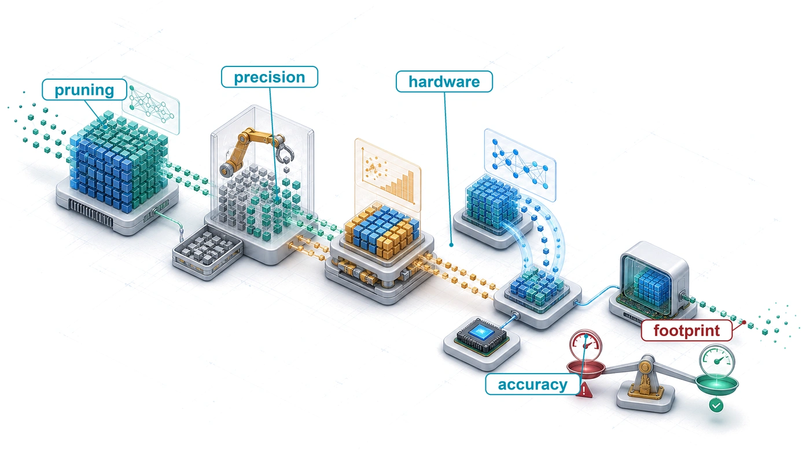
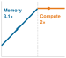
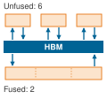
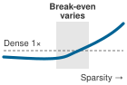
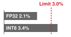

# Model Compression {#sec-model-compression}

::: {layout-narrow}
::: {.column-margin}

\chapterminitoc

:::

::: {.content-visible when-format="pdf"}
\noindent
{fig-alt="Isometric compression workshop where a large model passes through pruning, distillation, and quantization stations before fitting into a constrained device envelope."}
:::

::: {.content-visible unless-format="pdf"}
{fig-alt="Isometric compression workshop where a large model passes through pruning, distillation, and quantization stations before fitting into a constrained device envelope."}
:::

:::

## Purpose {.unnumbered .unlisted}

::: {.content-visible when-format="pdf"}
\begin{marginfigure}
\mlsysstack{30}{25}{90}{25}{45}{0}{0}{10}
\end{marginfigure}
:::

::: {.content-visible unless-format="pdf"}
::: {.column-margin}
{width="100%" fig-alt="Machine Learning Systems Architecture Stack"}

*Architecture stack focus for this chapter.*
:::
:::

_Why do the models that win benchmarks rarely become the models that run in production?_

A capable trained model is not automatically a deployable one. Cloud, Edge, Mobile, and TinyML environments each impose physical constraints that research benchmarks ignore, including memory budgets measured in megabytes rather than gigabytes, latency targets measured in milliseconds rather than seconds, and power envelopes measured in milliwatts rather than kilowatts. Research optimizes for accuracy on held-out test sets; production optimizes for accuracy per dollar, accuracy per watt, and accuracy per millisecond. Models that win benchmarks are frequently larger, slower, and more resource-intensive than production envelopes permit. Bridging this gap requires a systematic discipline of compression that trades capabilities the deployment does not need for physical constraints it cannot violate. Many trained models carry more numerical precision, more parameters, or higher representational capacity than the target workload requires. Some of this surplus can be removed while preserving predictive behavior. Yet a smaller representation is not automatically a faster one. The hardware and runtime software stack must exploit the new precision or structure; otherwise, a nominal size reduction merely moves the bottleneck while latency remains unchanged. Removing half the weights in a tensor leaves execution time and energy untouched if the underlying hardware still fetches, stores, and multiplies every zero. Applied effectively, compression reduces model size by integer factors, transforming a research artifact that runs only on data center accelerators into a production asset capable of executing on a mobile phone, sensor node, or embedded microcontroller. The engineering goal is to make the right model viable within its physical environment, which differs fundamentally from making a model as small as possible. In D·A·M terms, model compression enacts algorithm-machine co-design directly on the network, reshaping its mathematical structure to satisfy the physical limits of the target hardware.

::: {.content-visible when-format="pdf"}

\newpage

:::

::: {.callout-learning-objectives}

- Explain compression as algorithm-machine co-design that trades surplus capacity for memory, latency, and energy constraints
- Compare pruning, distillation, quantization, and architecture search by the resource constraint each relaxes
- Calculate parameter memory, precision, and sparsity reductions to estimate best-case compression gains
- Apply post-training, quantization-aware, and weight-only strategies under accuracy and hardware constraints
- Select structured pruning and operator choices that map to available accelerator kernels
- Design compression pipelines that order pruning, distillation, and quantization to preserve deployment accuracy
- Evaluate measured latency, energy, and accuracy on target hardware rather than relying on FLOP counts

:::

## Fitting the Deployment Budget {#sec-model-compression-optimization-framework-9e21}

A **deployment budget**\index{Deployment budget!definition} is the memory, time, and energy that a target device grants to each result a model produces. Memory capacity bounds the bytes of weights and activations that can stay resident, a frame rate or token rate bounds the milliseconds available for each result, and a battery or thermal envelope bounds the joules that each result may consume. A trained model arrives with demands on all three that were set by the accelerators it trained on, not by the device it must run on. Bringing those demands inside the budget, by changing what the model computes, how its values are stored, and how its operations execute, is the work of model compression.

@Sec-data-selection lowered the cost of producing a trained model by spending training compute only on examples that carry signal. Its savings end where the trained model begins. A model trained on a curated subset has the same parameter count, numerical precision, and memory footprint as one trained on the full corpus, so it can still overflow a phone's memory or leave inference bound by memory bandwidth. @Sec-hardware-acceleration then examines the silicon that executes a model. Compression comes before it because compression decides what that silicon is asked to run: how many operations, how many bytes per value, and which kernels.

```{python}
#| echo: false
#| label: compression-deployment-scale
# ┌─────────────────────────────────────────────────────────────────────────────
# │ DEPLOYMENT SCALE: A 7B MODEL AGAINST A PHONE
# ├─────────────────────────────────────────────────────────────────────────────
# │ Context: Opening hook of
# │          @sec-model-compression-optimization-framework-9e21 and the
# │          175B-versus-microcontroller sentence that follows it.
# │
# │ Goal:    Show that a 7B FP16 model overflows phone memory and, even if it
# │          fit, would stream its weights too slowly and too expensively.
# │ Show:    Weight bytes, phone RAM, per-token weight-streaming time and DRAM
# │          energy, the phone power envelope, and the 175B/MCU contrast.
# │ How:     Registry model sizes; phone LPDDR5 bandwidth from the flagship
# │          phone entry; DRAM energy per byte from Hardware.Tech.
# └─────────────────────────────────────────────────────────────────────────────
from mlsysim import *
from mlsysim.core.units import *
from mlsysim import Models, Platforms, Hardware
from mlsysim.physics import memory_from_params
from mlsysim.physics.quantities import token_throughput
from mlsysim.fmt import fmt, fmt_int, fmt_qty_int, fmt_memory_capacity, check, fmt_memory, fmt_time, fmt_energy, fmt_bandwidth, fmt_power, fmt_range

class CompressionDeploymentScale:
    """A 7B FP16 model against a phone's capacity, bandwidth, and energy envelope."""

    # ┌── 1. LOAD (Constants) ──────────────────────────────────────────────
    llm_7b_params = Models.Language.Llama2_7B.parameters.to(Bparam).magnitude
    llm_175b_params = Models.Language.GPT3.parameters.to(Bparam).magnitude
    bytes_fp16 = BYTES_FP16.to(byte).magnitude
    smartphone_ram = Platforms.Mobile.ram
    phone_bw = Hardware.Mobile.iPhone15Pro.memory.bandwidth      # flagship phone LPDDR5 bus
    dram_energy_per_byte = Hardware.Tech.Memory.DRAM.energy_per_byte
    phone_tdp_min_w, phone_tdp_max_w = [int(v) for v in Platforms.Mobile.tdp_range_w.split("-")]
    mcu_ram_kb = Platforms.Tiny.ram.to(KB).magnitude

    # ┌── 2. EXECUTE (The Compute) ────────────────────────────────────────
    llm_7b_mem_fp16 = memory_from_params(llm_7b_params * Bparam, bytes_fp16 * byte / param)
    llm_7b_mem_fp16_gb = llm_7b_mem_fp16.to(GB).magnitude
    llm_175b_mem_fp16 = memory_from_params(llm_175b_params * Bparam, bytes_fp16 * byte / param)
    llm_175b_mem_fp16_gb = llm_175b_mem_fp16.to(GB).magnitude
    token_stream_time = (llm_7b_mem_fp16 / phone_bw).to(millisecond)
    token_stream_energy = (llm_7b_mem_fp16 * dram_energy_per_byte).to(joule)
    token_stream_power = (token_stream_energy / token_stream_time).to(watt)
    mcu_ram = mcu_ram_kb * KB

    # ┌── 3. GUARD (Invariants) ───────────────────────────────────────────
    check(llm_7b_mem_fp16 > smartphone_ram, "7-billion-parameter model must exceed smartphone RAM to illustrate the deployment gap.")
    check(260 < token_stream_time.to(millisecond).magnitude < 290, f"Prose says about 270 ms per token, got {token_stream_time}.")
    check(2.0 < token_stream_energy.to(joule).magnitude < 2.5, f"Prose says about 2 J of DRAM energy per token, got {token_stream_energy}.")
    check(token_stream_power.to(watt).magnitude > phone_tdp_max_w, "Prose says the DRAM traffic alone exceeds the phone's sustained power envelope.")

    # ┌── 4. OUTPUT (Formatting) ─────────────────────────────────────────────
    llm_7b_str = fmt(llm_7b_params, precision=0, commas=False)
    llm_7b_mem_gb_str = fmt_memory(llm_7b_mem_fp16, unit=GB, precision=0, commas=False)
    llm_175b_str = fmt(llm_175b_params, precision=0, commas=False)
    llm_175b_mem_gb_str = fmt_memory(llm_175b_mem_fp16, unit=GB, precision=0, commas=False)
    smartphone_ram_gb_str = fmt_memory_capacity(smartphone_ram, unit=GiB, precision=0, commas=False)
    mcu_ram_kb_str = fmt_memory_capacity(Platforms.Tiny.ram, unit=KiB, precision=0, commas=False)
    phone_bw_gb_per_s_str = fmt_bandwidth(phone_bw, unit=GB / second, precision=1, commas=False)
    token_stream_ms_str = fmt_time(round(token_stream_time.to(millisecond).magnitude, -1), "millisecond", precision=0, commas=False)
    token_stream_j_str = fmt_energy(round(token_stream_energy.to(joule).magnitude) * joule, unit=joule, precision=0, commas=False)
    token_stream_power_w_str = fmt_power(round(token_stream_power.to(watt).magnitude) * watt, unit=watt, precision=0, commas=False)
    phone_tdp_range_str = fmt_range(phone_tdp_min_w, phone_tdp_max_w, precision=0, commas=False, unit="W")
```

::: {.column-margin}
{width="100%" fig-alt="Vertical log-scale ladder of blue bars: a 175B FP16 weight footprint at top towers over a phone RAM bar, which towers over a tiny microcontroller RAM bar at the bottom."}

*Frontier weights dwarf phone and microcontroller memory; compression bridges the gap.*
:::

The gap is easiest to see at its extreme. A `{python} CompressionDeploymentScale.llm_7b_str`-billion-parameter language model requires `{python} CompressionDeploymentScale.llm_7b_mem_gb_str` merely to store its weights in FP16. A smartphone offers `{python} CompressionDeploymentScale.smartphone_ram_gb_str` of RAM shared across the operating system, background applications, and the user interface, so even if the operating system surrendered its entire memory pool to one process, the weights would not fit. Fitting in memory would only expose a second limit, the token rate. At batch size one, dense autoregressive decoding is memory-bandwidth bound because generating each token reads every weight from DRAM, and no other request shares those bytes. Over a flagship phone's `{python} CompressionDeploymentScale.phone_bw_gb_per_s_str` low-power DDR (LPDDR) bus, streaming `{python} CompressionDeploymentScale.llm_7b_mem_gb_str` takes about `{python} CompressionDeploymentScale.token_stream_ms_str` per token and about `{python} CompressionDeploymentScale.token_stream_j_str` of DRAM access energy, so the memory traffic alone would draw about `{python} CompressionDeploymentScale.token_stream_power_w_str`, above the phone's sustained thermal envelope of `{python} CompressionDeploymentScale.phone_tdp_range_str`. A model of this size is the extreme case; the rest of the chapter works with models that come closer to fitting, where the engineering choices are less obvious.

Under the silicon contract (principle \ref{pri-silicon-contract}), compute throughput, memory bandwidth, memory capacity, and fixed launch overhead determine which physical resource binds first for a given model on a given machine. Training sets those quantities generously. Server-class accelerators supply the aggregate memory and floating-point throughput that wide layers, high numerical precision, and large auxiliary state require, because training must hold gradients, optimizer moment buffers, and activation caches across backward passes. Inference deployment changes these requirements. Execution is forward-only, intermediate activation buffers can be reused after their last consumer, and optimizer states disappear. Residual branches extend some lifetimes, while autoregressive decoding retains KV state across tokens. While mixed-precision methods improve training throughput by selectively adopting FP16 or BF16 (@sec-model-training-mixedprecision-training-9218), deployment can reduce precision further, to INT8, INT4, or specialized microformats, when the target's execution units support them. Model compression\index{Model compression!silicon contract} is the systematic process of meeting the silicon contract of a constrained execution context, reducing parameter footprint, memory traffic, or arithmetic operations while preserving task accuracy.

::: {.column-margin .margin-pointer}
↩ Mixed-precision training with FP16 and BF16, including loss scaling and FP32 accumulation, is established in @sec-model-training-mixedprecision-training-9218.
:::

Across deployment targets, the disparity in weight memory spans about six orders of magnitude, from the `{python} CompressionDeploymentScale.llm_175b_mem_gb_str` of FP16 weights in a `{python} CompressionDeploymentScale.llm_175b_str`-billion-parameter frontier model to the `{python} CompressionDeploymentScale.mcu_ram_kb_str` of on-chip SRAM in an embedded microcontroller. The bitter lesson explains why this gap persists. General methods that scale with compute keep winning benchmarks, so the winning models grow with available training compute while a phone's or microcontroller's memory and power envelope stays fixed for the life of the device. Compression is the deployment-side counterweight to scale.

::: {.column-margin .margin-pointer}
↩ The bitter lesson, that general methods which scale with compute keep displacing hand-engineered ones, is established in @sec-introduction-bitter-lesson-79c7.
:::


```{python}
#| echo: false
# ┌─────────────────────────────────────────────────────────────────────────────
# │ SMALLEST CAPABLE MODEL (LEGO)
# ├─────────────────────────────────────────────────────────────────────────────
# │ Context: Paragraph after the bitter-lesson sentence in
# │          @sec-model-compression-optimization-framework-9e21 and
# │          @fig-smallest-capable-model.
# │
# │ Goal: Show how fast the size needed for a fixed benchmark score fell.
# │ Show: Smallest dense model at >= 60% MMLU: Gopher 280B (Dec 2021) →
# │       Qwen2.5-Coder-3B (Sep 2024), ~93× smaller.
# │ How: Running minimum of parameters among Literature.Series.MMLUDenseModels
# │      rows at or above the threshold, ordered by release date.
# │
# └─────────────────────────────────────────────────────────────────────────────
import datetime as dt
from mlsysim import Literature
from mlsysim.fmt import check, fmt_count, fmt_multiple, fmt_percent

# ┌── LEGO ───────────────────────────────────────────────
class SmallestCapableModel:
    """Smallest dense model clearing a fixed MMLU score over time."""

    # ┌── 1. LOAD (Constants) ───────────────────────────────────────────────
    threshold = 0.60
    rows = sorted(Literature.Series.MMLUDenseModels.entries, key=lambda r: r["date"])

    # ┌── 2. EXECUTE (The Compute) ─────────────────────────────────────────
    frontier = []
    for _r in rows:
        if _r["mmlu"] >= threshold and (not frontier or _r["parameters"] < frontier[-1]["parameters"]):
            frontier.append(_r)
    first, last = frontier[0], frontier[-1]
    shrink = first["parameters"] / last["parameters"]
    span_years = (dt.date.fromisoformat(last["date"]) - dt.date.fromisoformat(first["date"])).days / 365.25

    # ┌── 3. GUARD (Invariants) ───────────────────────────────────────────
    check(first["model"].startswith("Gopher") and "Qwen2.5" in last["model"], "Prose names Gopher and Qwen2.5-Coder-3B.")
    check(50 <= shrink <= 150, f"Expected ~93x shrink, got {shrink:.0f}.")
    check(span_years < 3, f"Prose says under three years, got {span_years:.1f}.")

    # ┌── 4. OUTPUT (Formatting) ──────────────────────────────────────────────
    threshold_pct_str = fmt_percent(threshold, precision=0, style="prose")
    first_params_str = fmt_count(first["parameters"], scale="B", scale_style="word", precision=0)
    last_params_str = fmt_count(last["parameters"], scale="B", scale_style="word", precision=0)
    shrink_mult_str = fmt_multiple(round(shrink), precision=0)
```

The record of language models shows how much ground that counterweight can recover. @Fig-smallest-capable-model follows the smallest dense model reported to score at least `{python} SmallestCapableModel.threshold_pct_str` on the Massive Multitask Language Understanding (MMLU) benchmark [@hendrycks2021mmlu] at each point in time. That size fell from `{python} SmallestCapableModel.first_params_str` parameters for Gopher at the end of 2021 to `{python} SmallestCapableModel.last_params_str` for Qwen2.5-Coder-3B, a code-specialized model, in 2024, about `{python} SmallestCapableModel.shrink_mult_str` smaller in under three years [@epochai2026benchmarks]. Better training data, longer training, and distillation from larger models all contributed, so the decline is not compression alone, but it shows that a capability first reached at frontier scale can later fit a far smaller deployment budget.

::: {#fig-smallest-capable-model fig-env="figure" fig-pos="htb" fig-cap="**Smallest Model Reaching a Fixed Score**: Parameter counts of dense language models against release date on a logarithmic axis, with models scoring at least 60 percent on the MMLU benchmark in blue and the rest in gray. The red step line tracks the smallest model at or above that score released up to each date. Scores are as reported by each source, and parameter counts come from model names, so the line is a lower envelope of reported results rather than a controlled comparison. Data from @epochai2026benchmarks." fig-alt="Scatter plot of parameters on a logarithmic axis from about 10 to the 8.7 to 10 to the 11.7 against release dates from mid-2021 to early 2025. Blue points mark models at or above 60 percent MMLU and gray points those below. A red step line descends from Gopher 280B in late 2021 through several smaller record holders, including Chinchilla 70B, Llama 2 34B, and Mistral 7B, to Qwen2.5-Coder-3B in late 2024."}

```{python}
#| echo: false
# ┌─────────────────────────────────────────────────────────────────────────────
# │ SMALLEST CAPABLE MODEL (FIGURE)
# ├─────────────────────────────────────────────────────────────────────────────
# │ Context: @fig-smallest-capable-model.
# │
# │ Goal: Show the shrinking size needed to reach a fixed MMLU score.
# │ Show: All dense models (above/below threshold) and the running minimum.
# │ How: SmallestCapableModel (above); book_style.setup_plot().
# │
# └─────────────────────────────────────────────────────────────────────────────
from binder.tools.figures import style as book_style

fig, ax, COLORS, plt = book_style.setup_plot(figsize=(10, 4.4))
_S = SmallestCapableModel
def _yr(s):
    d = dt.date.fromisoformat(s)
    return d.year + (d.timetuple().tm_yday - 1) / 365.25
_below = [r for r in _S.rows if r["mmlu"] < _S.threshold]
_above = [r for r in _S.rows if r["mmlu"] >= _S.threshold]
ax.scatter([_yr(r["date"]) for r in _below], [r["parameters"] for r in _below], s=14, color=COLORS["grid"], label="MMLU below 60%", zorder=2)
ax.scatter([_yr(r["date"]) for r in _above], [r["parameters"] for r in _above], s=18, color=COLORS["BlueLine"], label="MMLU at or above 60%", zorder=3)
_fx = [_yr(r["date"]) for r in _S.frontier] + [max(_yr(r["date"]) for r in _above)]
_fy = [r["parameters"] for r in _S.frontier] + [_S.frontier[-1]["parameters"]]
ax.step(_fx, _fy, where="post", color=COLORS["RedLine"], lw=1.8, label="Smallest model at or above 60%", zorder=4)
for _r in _S.frontier:
    if _r["model"] in ("Gopher 280B", "Chinchilla 70B", "LLAMA 2 34B", "Mistral 7B", "Qwen2.5-Coder-3B"):
        ax.annotate(_r["model"].replace("LLAMA", "Llama"), (_yr(_r["date"]), _r["parameters"]), xytext=(4, 4), textcoords="offset points",
                    fontsize=7.5, color=COLORS["RedLine"], bbox=dict(facecolor="white", alpha=0.8, edgecolor="none", pad=0.3))
ax.set_xticks([2022, 2023, 2024, 2025]); ax.set_xlim(2021.5, 2025.2)
ax.set_yscale("log"); ax.set_xlabel("Release date"); ax.set_ylabel("Parameters (log scale)")
ax.legend(loc="lower left", frameon=True, framealpha=0.95)
plt.show()
plt.close()
```

:::

Bridging the gap between frontier models and fixed deployment targets requires an engineering framework with predictable physical trade-offs. Every compression technique removes specific structure from the model, whether unnecessary weights, surplus numerical bits, or redundant operator subgraphs. Designing a production deployment requires identifying which resource binds first on the target platform and analyzing how successive approximations compound across the memory hierarchy. The framework this chapter builds works on three levels: what the model computes (its structure), how many bits represent each value (its precision), and how the result executes on the target processor (its implementation). Benefits compound only when transformations relieve distinct binding bottlenecks and the runtime supports the resulting graph.

```{python}
#| echo: false
# ┌── LEGO ───────────────────────────────────────────────
# │ Goal: INT8 weight-memory reduction for iron-law definition item.
from mlsysim import Models
from mlsysim.fmt import fmt, check, fmt_count, fmt_memory

class CompressionIronLawQuant:
    bytes_fp16 = BYTES_FP16.to(byte).magnitude
    bytes_int8 = BYTES_INT8.to(byte).magnitude
    llm_175b_params = Models.Language.GPT3.parameters.to(Bparam).magnitude
    llm_175b_mem_fp16_gb = llm_175b_params * bytes_fp16
    llm_175b_mem_int8_gb = llm_175b_params * bytes_int8
    llm_175b_mem_fp16 = llm_175b_mem_fp16_gb * GB
    llm_175b_mem_int8 = llm_175b_mem_int8_gb * GB
    llm_175b_fp16_int8_reduction = llm_175b_mem_fp16_gb / llm_175b_mem_int8_gb

    check(llm_175b_fp16_int8_reduction == 2, "FP16-to-INT8 weight memory should halve.")

    # ┌── 4. OUTPUT (Formatting) ─────────────────────────────────────────────
    llm_175b_str = fmt(llm_175b_params, precision=0, commas=False)
    llm_175b_mem_gb_str = fmt_memory(llm_175b_mem_fp16, unit=GB, precision=0, commas=False)
    llm_175b_mem_int8_gb_str = fmt_memory(llm_175b_mem_int8, unit=GB, precision=0, commas=False)
    llm_175b_fp16_int8_reduction_mult_str = fmt_multiple(round(llm_175b_fp16_int8_reduction), precision=0, commas=False)
```

::: {#dfn-model-compression-model-compression .callout-definition title="Model compression"}

***Model compression***\index{Model compression!definition} is a family of techniques that reduce a trained model's computational cost and memory footprint by eliminating redundant parameters (pruning), reducing numerical precision (quantization), or transferring learned behavior into a smaller architecture (distillation), while preserving as much predictive accuracy as possible.

1.  **Significance**: Compression directly reduces the iron law's data-movement and compute terms. INT8 quantization of a `{python} CompressionIronLawQuant.llm_175b_str`-billion-parameter LLM cuts weight memory from `{python} CompressionIronLawQuant.llm_175b_mem_gb_str` (FP16) to `{python} CompressionIronLawQuant.llm_175b_mem_int8_gb_str`, a `{python} CompressionIronLawQuant.llm_175b_fp16_int8_reduction_mult_str` reduction in $\DataVolume$, while dedicated low-precision matrix units can increase compute throughput when kernels and layouts use the supported INT8 path. Unstructured pruning to 50 percent sparsity halves the nonzero count, but executed operations fall only when the runtime can skip those zeros through a supported sparse format or kernel.
2.  **Distinction**: Unlike post-training compression methods such as pruning and quantization, neural architecture search discovers efficient architectures from scratch by exploring a design space. Here, NAS is treated as a related structural optimization technique, because it changes the representation before training rather than compressing a finished model post hoc.
3.  **Common pitfall**: Compression techniques do not compose without interference. Pruning changes weight distributions and operation patterns; quantization adds calibration and kernel constraints. Their combination can lose accuracy or fail to accelerate without joint validation.

:::

The three levels form a stack that descends from algorithmic software toward physical silicon, the same direction in which @sec-ml-frameworks lowered a computational graph to kernels. At the top sits what operations the model executes, in the middle how many bits encode each operand, and at the bottom how kernels map onto the processor's compute and memory structures (@fig-3-sections).

::: {#fig-3-sections fig-env="figure" fig-pos="htb" fig-cap="**Optimization Stack**: Model optimization progresses from software-level representation (pruning, distillation, NAS) down through numerical precision (quantization) to hardware execution (kernel fusion, sparsity engines). Lowering abstraction moves optimizations closer to physical silicon, where representation decisions dictate achievable execution efficiency." fig-alt="Three stacked rectangular boxes labeled from top to bottom: efficient model representation, efficient numerics representation, efficient hardware implementation. A vertical arrow spans the stack with More software at top and More hardware at bottom."}

```{.tikz}
\resizebox{.5\textwidth}{!}{
\begin{tikzpicture}[font=\small\sffamily]
\tikzset{
  Box/.style={inner xsep=2pt,
  draw=black!90,
  line width=0.75pt,
  anchor=west,
  text width=54mm,align=flush center,
  minimum width=54mm, minimum height=8mm
  },
}
\node[Box,fill=red!30,anchor=south west](B1)at (0.33,0.5){Efficient Hardware Implementation};
\node[Box,fill=red!20,node distance=0.15,above=of B1](B2){Efficient Numerics Representation};
\node[Box,fill=red!10,node distance=0.15,above=of B2](B3){Efficient Model Representation};
\draw[latex-latex,line width=0.75pt](0,0.20)--(0,3.7);

\node[left=1.4 of B1,rotate=90,anchor=north,align=center,font=\footnotesize\sffamily]{More\\ hardware};
\node[left=1.4 of B3,rotate=90,anchor=north,align=center,font=\footnotesize\sffamily]{More \\software};
\end{tikzpicture}}
```

:::

```{python}
#| echo: false
#| label: nas-search-cost-calc
from mlsysim.fmt import fmt, fmt_count, fmt_multiple, fmt_time, check

class NASCostCalc:
    # ┌── 1. LOAD (Constants) ──────────────────────────────────────────────
    gpus = 800
    days = 28
    weight_sharing_reduction = 1000

    # ┌── 2. EXECUTE (The Compute) ────────────────────────────────────────
    gpu_days = gpus * days
    gpu_hours = gpu_days * HOURS_PER_DAY

    # ┌── 3. GUARD (Invariants) ───────────────────────────────────────────
    check(gpu_days == 22_400, "NAS GPU-day arithmetic changed unexpectedly.")
    check(gpu_hours == 537_600, "NAS GPU-hour arithmetic changed unexpectedly.")

    # ┌── 4. OUTPUT (Formatting) ──────────────────────────────────────────
    gpus_str = fmt_count(gpus, label="GPU")
    days_str = fmt_time(days, "day", precision=0, commas=False, style="word")
    gpu_days_str = fmt_count(gpu_days, label='GPU-day', plural_label='GPU-days')
    gpu_hours_str = fmt_count(gpu_hours, label='GPU-hour', plural_label='GPU-hours')
    weight_sharing_reduction_mult_str = fmt_multiple(weight_sharing_reduction, precision=0, commas=True)
```

The top layer, efficient model representation, eliminates structural redundancy within the computational graph. Techniques such as pruning, knowledge distillation, and neural architecture search (NAS)[^fn-nas-search-cost] modify parameter counts and operator topologies directly. Pruning removes weights or entire channels whose contribution to model accuracy is negligible. Knowledge distillation trains a compact student model to match the output distributions or intermediate representations of an overparameterized teacher. Hardware-aware NAS automates this exploration, evaluating candidate layer topologies, expansion ratios, and kernel dimensions to discover Pareto-optimal graphs under explicit latency or memory bounds.

[^fn-nas-search-cost]: **Neural architecture search (NAS)**\index{NAS!search cost}: @zoph2017neural at Google Brain used reinforcement learning to learn the architecture itself at a cost of `{python} NASCostCalc.gpu_days_str` (`{python} NASCostCalc.gpus_str` for `{python} NASCostCalc.days_str`), equivalent to `{python} NASCostCalc.gpu_hours_str`. Weight-sharing approaches such as Efficient Neural Architecture Search (ENAS) later reduced search cost by roughly `{python} NASCostCalc.weight_sharing_reduction_mult_str` by sharing parameters across candidate architectures [@pham2018efficient]. Hardware-aware NAS and scaling methods then made the search output practical for deployable architecture families such as EfficientNet and MobileNetV3 [@tan2019efficientnet; @howard2019].

The middle layer, efficient numerics representation, optimizes the bit-width used to encode each tensor value. Quantization maps continuous high-precision floating-point values to low-bit representations (such as 8-bit or 4-bit integers), shrinking weight memory footprint and DRAM bus traffic ($\DataVolume$) by factors of two to four. Beyond memory reduction, integer arithmetic relieves compute bottlenecks. Low-precision matrix units execute integer multiply-accumulate operations with a fraction of the silicon area and energy required by 32-bit floating-point ALUs, enabling higher peak throughput within the same thermal envelope.

The bottom layer, efficient hardware implementation, aligns the remaining operations with the physical accelerator architecture. A reduced operation count does not guarantee faster execution if data movement stalls the compute cores or uncoalesced memory accesses serialize DRAM channels. Kernel fusion merges adjacent layers (folding a convolution, bias addition, and activation function into a single kernel, for example), keeping intermediate activations resident in fast on-chip SRAM or registers rather than round-tripping through high-latency off-chip DRAM. Similarly, hardware-supported sparsity engines, such as sparse Tensor Cores that skip two zeros in every group of four weights (2:4 structured sparsity), deliver physical speedup only when nonzeros conform to the alignment and fetch constraints of the hardware execution pipeline.

These three layers are tightly coupled across the compilation and execution boundary. Pruning alters weight distributions and activation profiles, changing the dynamic ranges required for subsequent quantization-range calibration. Quantization reduces data-movement volume across the memory bus, shifting a previously memory-bound workload toward compute-bound execution where kernel fusion and tile scheduling dominate. Achieving compounding performance gains requires co-designing transformations across all three layers rather than applying them in isolation, a composition strategy that @sec-model-compression-optimization-strategies-f2f6 develops through a staged pipeline.

Which layer of the optimization stack yields the highest return depends entirely on the physical machine hosting the workload. A data-center server equipped with several high-bandwidth memory (HBM) accelerators tolerates multi-gigabyte models but demands high token throughput under concurrency. A smartphone or an embedded microcontroller operates under severe physical ceilings on memory capacity, bus bandwidth, and thermal dissipation.

### Deployment budgets and the running cases {#sec-model-compression-deployment-scenarios-70c9}

Cloud inference, a phone camera, and a microcontroller each grant a different budget, and compression asks which term of that budget a given model violates and what it costs to stop violating it.

```{python}
#| echo: false
#| label: model-device-comparison
# ┌─────────────────────────────────────────────────────────────────────────────
# │ RUNNING CASES: MEMORY AND COMPUTE AGAINST THE DEPLOYMENT BUDGET
# ├─────────────────────────────────────────────────────────────────────────────
# │ Context: @tbl-model-vs-device and the paragraphs around it; DLRM and KWS
# │          lighthouses in @sec-model-compression-precision-energy-cc8e;
# │          binary/ternary paragraph in
# │          @sec-model-compression-numerical-format-comparison-8fa2.
# │
# │ Goal:    Put weight bytes, operations per result, and weight-streaming
# │          time beside the phone and microcontroller envelopes.
# │ Show:    MobileNetV2 (FP32, INT8), ResNet-50 teacher, GPT-2 XL (FP16,
# │          INT4), DS-CNN (INT8), and the DLRM reference configuration.
# │ How:     Registry parameter counts and FLOPs; byte widths from core.units;
# │          phone RAM from the Mobile envelope; phone LPDDR5 bandwidth from
# │          the flagship phone entry.
# └─────────────────────────────────────────────────────────────────────────────
from mlsysim import Models, Platforms, Hardware
from mlsysim.fmt import check, fmt, fmt_int, fmt_multiple, fmt_qty_int, fmt_memory, fmt_memory_capacity, fmt_flops, fmt_time, fmt_percent, fmt_bandwidth

def _overflow_ratio(model_mem, device_mem):
    """Return how many times a model exceeds a device memory envelope."""
    return model_mem.to(byte).magnitude / device_mem.to(byte).magnitude

class ModelDeviceComparison:
    """The running cases' weight bytes, work, and weight-streaming time against the deployment budget."""

    # ┌── 1. LOAD (Constants) ──────────────────────────────────────────────
    cloud_mem = Platforms.Cloud.ram
    mobile_mem = Platforms.Mobile.ram
    tiny_mem = Platforms.Tiny.ram
    phone_bw = Hardware.Mobile.iPhone15Pro.memory.bandwidth
    frame_rate = 30                                   # scenario: camera frames per second

    mobilenet = Models.Vision.MobileNetV2
    resnet = Models.Vision.ResNet50
    gpt2 = Models.Language.GPT2
    dscnn = Models.Tiny.DS_CNN
    dlrm_mem = Models.Recommendation.DLRM.model_size

    # ┌── 2. EXECUTE (The Compute) ────────────────────────────────────────
    mobilenet_mem = mobilenet.size_in_bytes(BYTES_FP32)
    mobilenet_int8_mem = mobilenet.size_in_bytes(BYTES_INT8)
    resnet_mem = resnet.size_in_bytes(BYTES_FP32)
    gpt2_mem = gpt2.size_in_bytes(BYTES_FP16)
    gpt2_int4_mem = gpt2.size_in_bytes(BYTES_INT4)
    dscnn_mem = dscnn.size_in_bytes(BYTES_INT8)
    frame_budget = (1 / (frame_rate / second)).to(millisecond)

    mobilenet_stream = (mobilenet_mem / phone_bw).to(millisecond)
    mobilenet_int8_stream = (mobilenet_int8_mem / phone_bw).to(millisecond)
    resnet_stream = (resnet_mem / phone_bw).to(millisecond)
    gpt2_stream = (gpt2_mem / phone_bw).to(millisecond)
    gpt2_int4_stream = (gpt2_int4_mem / phone_bw).to(millisecond)

    dlrm_mobile_overflow = _overflow_ratio(dlrm_mem, mobile_mem)
    dlrm_tiny_overflow = _overflow_ratio(dlrm_mem, tiny_mem)
    gpt2_tiny_overflow = _overflow_ratio(gpt2_mem, tiny_mem)
    gpt2_int4_tiny_overflow = _overflow_ratio(gpt2_int4_mem, tiny_mem)
    resnet_tiny_overflow = _overflow_ratio(resnet_mem, tiny_mem)
    mobilenet_tiny_overflow = _overflow_ratio(mobilenet_mem, tiny_mem)
    mobilenet_int8_tiny_ratio = _overflow_ratio(mobilenet_int8_mem, tiny_mem)
    dscnn_tiny_overflow = _overflow_ratio(dscnn_mem, tiny_mem)
    mobilenet_stream_share = (mobilenet_stream / frame_budget).to("").magnitude

    # ┌── 3. GUARD (Invariants) ──────────────────────────────────────────
    check(dscnn_tiny_overflow < 1, "DS-CNN must fit in TinyML device.")
    check(gpt2_mem < mobile_mem, "GPT-2 XL FP16 weights should fit in phone memory.")
    check(6 <= mobilenet_int8_tiny_ratio <= 8, "MobileNetV2 INT8 should exceed TinyML by about 7x.")
    check(mobilenet_stream_share < 0.02, "Prose says MobileNetV2's weights take about 1 percent of the 33 ms frame budget to stream.")
    check(55 < gpt2_stream.to(millisecond).magnitude < 62, f"Prose says GPT-2 XL FP16 weights take about 59 ms per token to stream, got {gpt2_stream}.")
    check(dlrm_mobile_overflow > 10, "DLRM reference configuration should exceed phone memory by more than 10x.")

    # ┌── 4. OUTPUT (Formatting) ─────────────────────────────────────────────
    dlrm_gb_str = fmt_memory(dlrm_mem, unit=GB, precision=0, commas=False)
    gpt2_gb_str = fmt_memory(gpt2_mem, unit=GB, precision=0, commas=False)
    gpt2_int4_gb_str = fmt_memory(gpt2_int4_mem, unit=GB, precision=2, commas=False)
    resnet_mb_str = fmt_memory(resnet_mem, unit=MB, precision=1, commas=False)
    mobilenet_mb_str = fmt_memory(mobilenet_mem, unit=MB, commas=False)
    mobilenet_int8_mb_str = fmt_memory(mobilenet_int8_mem, unit=MB, precision=1, commas=False)
    dscnn_kb_str = fmt_memory(dscnn_mem, unit=KB, precision=0, commas=False)
    mobilenet_mflop_str = fmt_flops(mobilenet.inference_flops, unit=MFLOPs, precision=0, commas=False)
    resnet_gflop_str = fmt_flops(resnet.inference_flops, unit=GFLOPs, precision=1, commas=False)
    gpt2_gflop_str = fmt_flops(gpt2.inference_flops, unit=GFLOPs, precision=0, commas=False)
    dscnn_mflop_str = fmt_flops(dscnn.inference_flops, unit=MFLOPs, precision=0, commas=False)
    mobilenet_stream_ms_str = fmt_time(mobilenet_stream, "millisecond", precision=2, commas=False)
    mobilenet_int8_stream_ms_str = fmt_time(mobilenet_int8_stream, "millisecond", precision=2, commas=False)
    resnet_stream_ms_str = fmt_time(round(resnet_stream.to(millisecond).magnitude), "millisecond", precision=0, commas=False)
    gpt2_stream_ms_str = fmt_time(round(gpt2_stream.to(millisecond).magnitude), "millisecond", precision=0, commas=False)
    gpt2_int4_stream_ms_str = fmt_time(round(gpt2_int4_stream.to(millisecond).magnitude), "millisecond", precision=0, commas=False)
    frame_budget_ms_str = fmt_time(round(frame_budget.to(millisecond).magnitude), "millisecond", precision=0, commas=False)
    frame_rate_str = fmt_int(frame_rate, commas=False)
    phone_bw_gb_per_s_str = fmt_bandwidth(phone_bw, unit=GB / second, precision=1, commas=False)
    mobile_cap_gb_str = fmt_memory_capacity(mobile_mem, unit=GiB, precision=0, commas=False)
    tiny_cap_kb_str = fmt_memory_capacity(tiny_mem, unit=KiB, precision=0, commas=False, approx=True)
    dlrm_mobile_overflow_mult_str = fmt_multiple(dlrm_mobile_overflow)
    dlrm_tiny_overflow_mult_str = fmt_multiple(dlrm_tiny_overflow)
    gpt2_tiny_overflow_mult_str = fmt_multiple(gpt2_tiny_overflow)
    gpt2_int4_tiny_overflow_mult_str = fmt_multiple(gpt2_int4_tiny_overflow)
    mobilenet_stream_share_pct_str = fmt_percent(round(mobilenet_stream_share * 100) / 100, precision=0, commas=False, style='prose')
    resnet_tiny_overflow_mult_str = fmt_multiple(resnet_tiny_overflow)
    mobilenet_tiny_overflow_mult_str = fmt_multiple(mobilenet_tiny_overflow)
    mobilenet_int8_tiny_ratio_mult_str = fmt_multiple(mobilenet_int8_tiny_ratio, precision=1, commas=False)
```

Cloud inference centers on throughput (requests per second per dollar), where supported integer quantization paths increase serving density and kernel fusion reduces per-request kernel launch overhead [@choudhary2020; @dean2018]. Mobile and edge deployments must fit within tight physical memory bounds while meeting deterministic real-time deadlines. A serialized camera pipeline that must finish each frame before the next arrives at `{python} ModelDeviceComparison.frame_rate_str` frames per second has about `{python} ModelDeviceComparison.frame_budget_ms_str` per frame. A pipelined design that overlaps capture, inference, and display can sustain `{python} ModelDeviceComparison.frame_rate_str` frames per second even when each frame takes longer than `{python} ModelDeviceComparison.frame_budget_ms_str` end to end, so it must check frame rate and per-frame latency as two separate budgets.

TinyML makes physical fit a deployment requirement. A microcontroller with only a few hundred kilobytes of SRAM and limited model storage *cannot* accommodate a 100 MB model without a compatible placement strategy, regardless of predictive accuracy [@banbury2020benchmarking]. Persistent weights may reside in flash or other supported storage, while runtime buffers occupy working memory. Without paging, the peak SRAM working set must fit the available SRAM; the model artifact must separately fit its storage budget. Capacity is also a hard bound on mobile and cloud devices, though their placement options differ.

::: {.column-margin .margin-pointer}
↩ The latency, memory, and power envelopes defining cloud, edge, mobile, and TinyML tiers are established in @sec-ml-systems-deployment-paradigm-framework-0d25.
:::

Meeting real-time deadlines on commodity mobile hardware depends as much on the hardware-supported precision path as on absolute memory capacity. When execution units provide hardware acceleration exclusively for fixed-point arithmetic, precision selection dictates whether a workload executes on energy-efficient neural processing units or falls back to power-hungry general-purpose cores. That choice decides the chapter's running case, a camera pipeline that must meet an interactive frame rate within a phone's thermal budget (Example \ref{exmp-model-compression-mobilenet-win}).

```{python}
#| echo: false
#| label: camera-running-case-calc
# ┌─────────────────────────────────────────────────────────────────────────────
# │ CAMERA RUNNING CASE: ILLUSTRATIVE FRAME RATES
# ├─────────────────────────────────────────────────────────────────────────────
# │ Context: Example \ref{exmp-model-compression-mobilenet-win}; reused by
# │          @fig-compression-waterfall in
# │          @sec-model-compression-optimization-strategies-f2f6.
# │
# │ Goal:    Hold the running case's FP32 and INT8 frame rates in one place.
# │ Show:    FP32 on the phone CPU at 8 FPS (125 ms per frame) and INT8 on the
# │          integer accelerator at 35 FPS.
# │ How:     Scenario frame rates from the labeled composite; frame time is
# │          the reciprocal of frame rate.
# └─────────────────────────────────────────────────────────────────────────────
from mlsysim.core.units import millisecond, second
from mlsysim.fmt import check, fmt_int, fmt_time

class CameraRunningCase:
    """Illustrative frame rates of the camera running case, FP32 on CPU and INT8 on the integer accelerator."""

    # ┌── 1. LOAD (Constants) ──────────────────────────────────────────────
    fp32_cpu_fps = 8    # scenario: labeled composite, FP32 MobileNetV2 on the phone CPU
    int8_npu_fps = 35   # scenario: labeled composite, INT8 MobileNetV2 on the phone's integer accelerator
    frame_budget = ModelDeviceComparison.frame_budget

    # ┌── 2. EXECUTE (The Compute) ────────────────────────────────────────
    fp32_cpu_frame = (1 / (fp32_cpu_fps / second)).to(millisecond)
    int8_npu_frame = (1 / (int8_npu_fps / second)).to(millisecond)

    # ┌── 3. GUARD (Invariants) ───────────────────────────────────────────
    check(abs(fp32_cpu_frame.magnitude - 125) < 0.5, f"Prose says about 125 ms per FP32 frame, got {fp32_cpu_frame}.")
    check(fp32_cpu_frame > frame_budget, "Prose says the FP32 model misses the frame budget.")
    check(int8_npu_frame < frame_budget, "Prose says the INT8 model on the accelerator meets the frame budget.")

    # ┌── 4. OUTPUT (Formatting) ─────────────────────────────────────────────
    fp32_cpu_fps_str = fmt_int(fp32_cpu_fps, commas=False)
    int8_npu_fps_str = fmt_int(int8_npu_fps, commas=False)
    fp32_cpu_frame_ms_str = fmt_time(round(fp32_cpu_frame.magnitude), "millisecond", precision=0, commas=False)
```

::: {#exmp-model-compression-mobilenet-win .callout-example title="The running case: Real-time blur on a phone"}

**Scenario**: A labeled composite. A camera application deploys a MobileNetV2-based segmentation model for real-time background blur on mid-tier smartphones at `{python} ModelDeviceComparison.frame_rate_str` FPS.

**Diagnosis**: An uncompressed FP32 MobileNetV2 model runs on the phone's CPU at only `{python} CameraRunningCase.fp32_cpu_fps_str` FPS, about `{python} CameraRunningCase.fp32_cpu_frame_ms_str` per frame against a `{python} ModelDeviceComparison.frame_budget_ms_str` budget, while holding the CPU at a power level the thermal envelope cannot sustain. The phone's NPU or DSP accelerates integer matrix arithmetic, not FP32, so the uncompressed model cannot use it.

**Systems lesson**: INT8 quantization cuts raw parameter payload by 4$\times$, but most of the gain from `{python} CameraRunningCase.fp32_cpu_fps_str` FPS to `{python} CameraRunningCase.int8_npu_fps_str` FPS comes from what INT8 unlocks, a move from the CPU onto the integer accelerator. The precision change is the enabler; the change of processor supplies most of the speed. The frame rates are illustrative, so speed and power still require device measurement.

:::

The chapter follows that camera pipeline through the structural and hardware tiers of the stack. MobileNetV2 is the book's compute-bound lighthouse in its efficient regime. Depthwise separable convolutions keep its arithmetic small, and at batch one on a phone its frame time goes to arithmetic and activation traffic rather than to reading weights. The precision tier needs a workload whose time is set by bytes, so it follows GPT-2 XL decoding on the same phone. GPT-2 XL is the book's bandwidth-bound lighthouse, and every token it generates streams every weight. Two callouts mark the ends of the memory constraint. DLRM [@naumov2019deep], the capacity-bound lighthouse, shows precision deciding whether embedding tables fit, and keyword spotting (KWS) [@zhang2017hello], the power-bound lighthouse, shows precision deciding whether a model fits a microcontroller's SRAM and energy budget. ResNet-50, the compute-bound lighthouse, serves twice, as the teacher that distills into MobileNetV2 and as the subject of the closing INT8 deployment profile. Rather than running every technique on all five, the chapter returns to each workload where it exposes the binding resource most clearly.

::: {.column-margin .margin-pointer}
↩ The iron law of ML systems, which splits execution time into data-movement, compute, and fixed-overhead terms, is established in @sec-introduction-iron-law-ml-systems-c32a.
:::

@Tbl-model-vs-device places the cases' weight bytes and work beside the deployment budget, and two of its rows explain how the chapter divides the work. MobileNetV2's FP32 weights stream across the phone's `{python} ModelDeviceComparison.phone_bw_gb_per_s_str` memory bus in about `{python} ModelDeviceComparison.mobilenet_stream_ms_str`, roughly `{python} ModelDeviceComparison.mobilenet_stream_share_pct_str` of the `{python} ModelDeviceComparison.frame_budget_ms_str` frame budget, so the frame is spent on its `{python} ModelDeviceComparison.mobilenet_mflop_str` of arithmetic and on activation traffic, and the structural and execution tiers are the levers that matter. GPT-2 XL's FP16 weights fit in the phone's memory but take about `{python} ModelDeviceComparison.gpt2_stream_ms_str` to stream for every generated token, so precision, which shrinks the bytes behind each weight, is the lever that matters. Even MobileNetV2 at INT8 exceeds the TinyML envelope by about `{python} ModelDeviceComparison.mobilenet_int8_tiny_ratio_mult_str`, while the purpose-built DS-CNN keyword spotter fits it after INT8 quantization.

| **Model and precision**         |                  **Weight memory**                  |                      **Work per result**                       |               **Weight streaming on the phone**                | **Phone (`{python} ModelDeviceComparison.mobile_cap_gb_str`)** |      **TinyML (`{python} ModelDeviceComparison.tiny_cap_kb_str`)**       |
|:--------------------------------|:---------------------------------------------------:|:--------------------------------------------------------------:|:--------------------------------------------------------------:|:--------------------------------------------------------------:|:------------------------------------------------------------------------:|
| **MobileNetV2, FP32**           |  `{python} ModelDeviceComparison.mobilenet_mb_str`  |   `{python} ModelDeviceComparison.mobilenet_mflop_str` per frame   |   `{python} ModelDeviceComparison.mobilenet_stream_ms_str`    |                              fits                              |  no (`{python} ModelDeviceComparison.mobilenet_tiny_overflow_mult_str`)  |
| **MobileNetV2, INT8**           | `{python} ModelDeviceComparison.mobilenet_int8_mb_str` |   `{python} ModelDeviceComparison.mobilenet_mflop_str` per frame   | `{python} ModelDeviceComparison.mobilenet_int8_stream_ms_str` |                              fits                              | no (`{python} ModelDeviceComparison.mobilenet_int8_tiny_ratio_mult_str`) |
| **ResNet-50, FP32 (teacher)**   |   `{python} ModelDeviceComparison.resnet_mb_str`    |    `{python} ModelDeviceComparison.resnet_gflop_str` per image     |     `{python} ModelDeviceComparison.resnet_stream_ms_str`     |                              fits                              |   no (`{python} ModelDeviceComparison.resnet_tiny_overflow_mult_str`)    |
| **GPT-2 XL, FP16**              |    `{python} ModelDeviceComparison.gpt2_gb_str`     |     `{python} ModelDeviceComparison.gpt2_gflop_str` per token      |      `{python} ModelDeviceComparison.gpt2_stream_ms_str`      |                              fits                              |    no (`{python} ModelDeviceComparison.gpt2_tiny_overflow_mult_str`)     |
| **GPT-2 XL, INT4**              |  `{python} ModelDeviceComparison.gpt2_int4_gb_str`  |     `{python} ModelDeviceComparison.gpt2_gflop_str` per token      |   `{python} ModelDeviceComparison.gpt2_int4_stream_ms_str`    |                              fits                              | no (`{python} ModelDeviceComparison.gpt2_int4_tiny_overflow_mult_str`)  |
| **DS-CNN (KWS), INT8**          |    `{python} ModelDeviceComparison.dscnn_kb_str`    | `{python} ModelDeviceComparison.dscnn_mflop_str` per inference |                         runs on a microcontroller                         |                              fits                              |                                   fits                                   |
| **DLRM (reference)**            |    `{python} ModelDeviceComparison.dlrm_gb_str`     |                         lookup-dominated                         |                            does not fit                            |  no (`{python} ModelDeviceComparison.dlrm_mobile_overflow_mult_str`)  |    no (`{python} ModelDeviceComparison.dlrm_tiny_overflow_mult_str`)     |

: **Deployment Budget for the Running Cases**: Weight memory, work per result, and the time a flagship phone's `{python} ModelDeviceComparison.phone_bw_gb_per_s_str` memory bus needs to read the weights once, against the phone and TinyML memory envelopes. Work counts two FLOPs per multiply-accumulate; GPT-2 XL's work and streaming time are per generated token, and MobileNetV2 must finish each frame within the `{python} ModelDeviceComparison.frame_budget_ms_str` budget of a `{python} ModelDeviceComparison.frame_rate_str` FPS camera. DLRM represents recommendation-model embedding pressure [@naumov2019deep]; DS-CNN represents the TinyML keyword-spotting case [@zhang2017hello]. The accounting covers weights only; activations, the KV cache, workspace, and metadata are excluded, and the DLRM row is a single reference configuration whose production counterparts can be far larger. Numbers in parentheses show how many times the model exceeds device memory. {#tbl-model-vs-device tbl-colwidths="[20,14,18,16,14,18]"}

The chapter descends the optimization stack one tier at a time (@tbl-model-compression-chapter-spine). Structural optimization changes what the model computes and carries the camera pipeline through pruning, low-rank factorization, distillation from a ResNet-50 teacher, efficient architecture design, architecture search, and input-dependent computation. Numerical precision changes how each surviving value is stored and carries GPT-2 XL decoding from numerical formats and their energy, through the quantization methods, to the conditions under which fewer bits run faster. Hardware implementation changes how the remaining operations execute, through the fusions and sparse kernels that compression makes possible and the gap between paper savings and measured ones. Choosing and combining techniques maps a binding constraint to the levers that relieve it and sequences them on the camera pipeline. Measuring compression gains closes the chapter on a ResNet-50 INT8 deployment profile, which @sec-hardware-acceleration takes up.

| **Section**                           | **Tier of the stack**   | **What changes**                                  | **Iron law term most affected**                                        | **Condition for a measured gain**                                        |
|:--------------------------------------|:------------------------|:--------------------------------------------------|:-----------------------------------------------------------------------|:-------------------------------------------------------------------------|
| **Structural Optimization**           | Model representation    | Which weights, channels, layers, and paths exist  | Operations $\Operations$, and weight bytes in $\DataVolume$            | Removed structure leaves smaller dense tensors or a supported sparse format |
| **Numerical Precision**               | Numerics representation | Bits per weight and activation                    | Bytes moved $\DataVolume$, and energy per operation                    | The target has a kernel path for the format                              |
| **Hardware Implementation**           | Hardware implementation | Which kernels run, and what they skip             | $\DataVolume$, fixed overhead $\Latency$, and efficiency $\EfficiencyHw$ | The compiler can fuse the pattern and the kernel can skip the zeros      |
| **Choosing and Combining Techniques** | All three tiers         | Which levers apply, and in what order             | Whichever term binds                                                   | The binding resource is identified before any lever is applied           |
| **Measuring Compression Gains**       | The deployed system     | Nothing in the model; the claims are measured     | All terms, end to end                                                  | Measured on the target hardware against quality limits                   |

: **Chapter Map**: Each section of the chapter works one tier of the optimization stack, from what the model computes down to how it executes, and names the iron law term that tier most affects and the condition under which its paper savings become measured ones. {#tbl-model-compression-chapter-spine tbl-colwidths="[22,16,20,21,21]"}

The descent begins at the top of the stack, with the structure of the model itself.

## Structural Optimization: Changing What the Model Computes {#sec-model-compression-structural-optimization-ee93}

A standard ResNet-50 trained on ImageNet contains over 25 million parameters, yet with careful magnitude pruning and retraining about 80 percent of its weights can be removed for roughly a one-point loss in top-1 accuracy [@gale2019state]. Modern neural networks routinely carry far more parameters than deployment requires.[^fn-overparameterization-compute-scale] Unused capacity still consumes memory, computation, and energy. Structural optimization is the first tier of the stack, **efficient model representation**\index{Model compression!efficient model representation}, by modifying *what* the model computes. Although additional capacity can aid optimization during training, parameters that do not improve the deployed model still impose deployment cost.

[^fn-overparameterization-compute-scale]: **Overparameterization**\index{Overparameterization!compression rationale}: @zhang2017rethinking demonstrated that networks large enough to fit ImageNet can also memorize completely random labels, showing that training capacity can exceed the structure needed for natural labels. Pruning studies then show the deployment consequence, that trained models often contain many parameters that can be removed or sparsified with modest task loss when pruning and fine-tuning are done carefully [@gale2019state; @blalock2020state]. The redundancy is not a universal 10$\times$ constant; it depends on architecture, dataset, sparsity pattern, and runtime support.

Every technique in this chapter answers to the conservation-of-complexity heuristic\index{Conservation of complexity!structural optimization} that opened Part I. Complexity tends to move among the Data, Algorithm, and Machine axes rather than disappear, so engineers must account for where each technique sends cost and risk. It is a heuristic, not a literal conservation law, and removing genuinely avoidable work can reduce total cost. Pruning may reduce parameters while asking the runtime to exploit sparse structure; distillation may reduce inference cost while adding a teacher-student training phase; quantization may reduce data movement while spending numerical precision. The engineer's task is to move complexity to where the cost is lowest given deployment constraints.

The job is to remove capacity the task does not need without removing what it does need. Operating along this Pareto frontier[^fn-pareto-frontier-compression] requires deciding where complexity should reside: in training-time discovery, runtime sparse indexing, or student-model capacity.

[^fn-pareto-frontier-compression]: **Pareto frontier in compression**\index{Pareto frontier!compression trade-off}: EfficientNet traces the frontier concretely, from B0 (77.1 percent accuracy, 390 million FLOPs) to B7 (84.4 percent, 37 billion FLOPs), a 95$\times$ compute increase for 7.3 percentage points of accuracy, quantifying how steep the trade-off becomes at the frontier's edge [@tan2019efficientnet].

These techniques address the challenge through complementary structural mechanisms. Pruning eliminates redundant parameters from an existing network, and low-rank factorization stores an existing weight matrix as a product of two thin ones. Knowledge distillation transfers learned behavior into an independently designed compact network, efficient architecture design and neural architecture search build a network that is efficient on the target by construction [@hutter2019automl], and adaptive computation decides for each input how much of the network runs. In production pipelines, these techniques frequently compose, as when a NAS-discovered architecture, supervised by a distilled teacher, is pruned before final quantization.

The camera pipeline gives every structural technique the same test. MobileNetV2 must finish a frame within `{python} ModelDeviceComparison.frame_budget_ms_str` on the phone, and its weights are not what fills that budget, so a structural change pays off only if it removes multiply-accumulates or activation traffic that the phone actually executes. The analysis below evaluates what structural artifact each method produces, what fine-tuning or recovery step it requires, and which hardware execution conditions allow it to deliver physical speedups. Pruning comes first because it exposes the systems constraint most directly. Eliminating mathematical parameters translates to physical hardware acceleration only when the resulting sparsity pattern aligns with the memory hierarchy and compute units of the target processor.

### Pruning {#sec-model-compression-pruning-d1cb}

For the camera pipeline, pruning is the first lever to try because it starts from the trained MobileNetV2 rather than from a new design. Removing whole channels from its convolutions shrinks every layer that consumes them and cuts the multiply-accumulates that fill the `{python} ModelDeviceComparison.frame_budget_ms_str` frame budget. Removing scattered individual weights leaves the same layers in place and saves bytes or time only if the zeros are stored compactly and skipped. Which of these the phone can exploit is the question every pruning decision returns to.

Pruning[^fn-pruning-lecun-1989] directly addresses memory efficiency constraints by eliminating parameters or structures that contribute little to the deployed objective. Many trained networks contain removable capacity, but the safe fraction depends on the architecture, task, pruning pattern, and recovery procedure. The central questions are *what* to prune (individual weights vs. entire structures), *how* to estimate what is expendable (magnitude, gradients, or activations), and *when* to prune (after training, during training, or even at initialization). The foundational systems rule does not change. Zero-valued weights conserve physical resources only when the underlying hardware and runtime execution path can skip loading or computing them.

[^fn-pruning-lecun-1989]: **Optimal Brain Damage**\index{Pruning!Optimal Brain Damage}: Introduced by @lecun1990optimal, the method achieved 4$\times$ parameter reduction, with proportional memory savings, in a handwriting recognizer by using a diagonal approximation to second-derivative (Hessian) information to estimate the loss increase from removing each weight. A full Hessian has $\mathcal{O}(\Parameters^2)$ entries for $\Parameters$ parameters, but Optimal Brain Damage avoids storing that full matrix by approximating its diagonal. Modern-scale pruning still favors cheaper criteria such as magnitude because even diagonal curvature estimation adds training cost.

::: {#dfn-model-compression-pruning .callout-definition title="Pruning"}

***Pruning***\index{Pruning!definition} is a model-compression technique that sparsifies the parameter space by removing the weights or structures whose removal increases the training loss least.

1.  **Significance**: It can convert dense matrices into sparse structures, reducing memory footprint and total data volume $(\DataVolume)$ when the sparse representation, metadata, and recovery procedure preserve acceptable quality.
2.  **Distinction**: Unlike quantization, which reduces the precision of every weight, pruning reduces the count of weights by identifying and eliminating redundancy.
3.  **Common pitfall**: A frequent misconception is that pruning "automatically" speeds up execution. In reality, without specialized sparse execution support, the resulting sparse matrices may actually run slower than dense ones due to irregular memory access patterns. A speedup requires a storage format and a kernel that skip the zeros, not merely a faster processor.

:::

The formal pruning objective seeks a sparse parameter tensor $\PrunedWeightMatrix$ that minimizes empirical loss subject to a parameter budget $\NonzeroParameterBudget$:
$$
\min_{\PrunedWeightMatrix} \LossFunction(\PrunedWeightMatrix) \quad \text{subject to} \quad \|\PrunedWeightMatrix\|_0 \leq \NonzeroParameterBudget$$
where $\|\PrunedWeightMatrix\|_0$ is the **$\ell_0$ norm**\index{L0 norm!parameter count} (the count of nonzero parameters). Solving this cardinality-constrained optimization is combinatorial, so practical methods use heuristics[^fn-heuristic-magnitude-pruning] such as **magnitude-based pruning**\index{Magnitude-based pruning!definition}. The thresholding heuristic keeps the largest weights and zeroes the rest (@lst-pruning_example). Applied to an $11\times 11$ weight tensor, it collapses sub-threshold entries to zero while irregular, high-magnitude weights persist across the grid (@fig-sparse-matrix).

[^fn-heuristic-magnitude-pruning]: **Heuristic**\index{Heuristic!pruning}: From Greek *heuriskein* (to discover), the same root as Archimedes' "eureka." In pruning, the dominant heuristic (larger magnitude means more important) works well empirically but creates a systems trap. Magnitude-based pruning applied globally can remove most parameters from overparameterized layers while leaving critical bottleneck layers largely intact, giving the appearance of aggressive compression while preserving much of the compute and memory cost in the layers that matter [@blalock2020state]. Iterative prune-retrain cycles with per-layer budgets are therefore often safer than naive global magnitude pruning, because each cycle lets the network redistribute importance before the next cut.

::: {#lst-pruning_example lst-cap="**Magnitude-Based Pruning**: Removes weights below a threshold to create sparse matrices, reducing the number of nonzero parameters from 9 to 4 $(\NonzeroParameterBudget=4)$."}

```{.python}
import torch

# Original dense weight matrix
weights = torch.tensor(
    [[0.8, 0.1, -0.7], [0.05, -0.9, 0.03], [-0.6, 0.02, 0.4]]
)

# Simple magnitude-based pruning: keep only the 4 largest weights
threshold = 0.5
mask = torch.abs(weights) >= threshold
pruned_weights = weights * mask

print("Original:", weights)
print("Pruned (4 nonzeros):", pruned_weights)
```

:::

::: {#fig-sparse-matrix fig-env="figure" fig-pos="htb" fig-cap="**Sparse Matrix Transformation**: Magnitude-based pruning replaces weights below a numerical threshold with exact zeros (white cells) while preserving salient high-magnitude connections (colored cells). The resulting sparsity cuts parameter count, but realizing hardware speedups requires translating these unstructured zero entries into sparse storage formats or specialized execution kernels." fig-alt="Two 11×11 matrices side by side. Left matrix shows every cell shaded uniformly with its weight value, including many near-zero entries. Right matrix shows sparse version with most cells white (zero) and only high-magnitude values retained in color."}

```{.tikz}
\begin{tikzpicture}[line join=round,font=\sffamily\footnotesize]
\tikzset{%
cell/.style={draw=black!80,line width=0.5pt, minimum size=\cellsize,
    minimum height=\cellheight}
}
\definecolor{Blue1}{RGB}{84,131,217}
\definecolor{Blue2}{RGB}{145,177,237}
\definecolor{Blue3}{RGB}{201,217,247}
\definecolor{Blue4}{RGB}{227,235,250}
\colorlet{Blue1}{RedFill}
\colorlet{Blue2}{RedFill}
\colorlet{Blue3}{RedFill}
\colorlet{Blue4}{RedFill}
\def\columns{3}
\def\rows{3}
\def\cellsize{8mm}
\def\cellheight{8mm}

%%LEFT
\begin{scope}[local bounding box=M1,shift={(0,0)}]
\def\columns{11}
\def\rows{11}
\def\br{M1}
\foreach \x in {1,...,\columns}{
    \foreach \y in {1,...,\rows}{
        %
\node[draw=black!80, fill=Blue4, minimum width=\cellsize,
                    minimum height=\cellheight, line width=0.5pt] (cell-\x-\y\br) at (\x*\cellsize,-\y*\cellheight) {0.01};
    }
}
%1
\foreach \c/\n/\f in {3/-1.9/Blue3,5/1.76/Blue3,8/3.75/Blue2,2/0.02/Blue4,4/0.02/Blue4,9/0.02/Blue4}{
\node[cell,fill=\f]at(cell-\c-1M1){\n};
}
%2
\foreach \c/\n/\f in {1/7.93/Blue1,4/0.68/Blue3,7/-1.1/Blue3,2/0.02/Blue4,5/0.02/Blue4,9/0.02/Blue4}{
\node[cell,fill=\f]at(cell-\c-2M1){\n};
}
%3
\foreach \c/\n/\f in {3/5.2/Blue2,4/0.2/Blue3,9/-6.2/Blue2,1/0.02/Blue4,5/0.02/Blue4,8/0.02/Blue4,10/0.02/Blue4}{
\node[cell,fill=\f]at(cell-\c-3M1){\n};
}
%4
\foreach \c/\n/\f in {9/-2.5/Blue3,2/0.02/Blue4,7/0.02/Blue4}{
\node[cell,fill=\f]at(cell-\c-4M1){\n};
}
%5
\foreach \c/\n/\f in {1/0.32/Blue3,3/-3.5/Blue3,5/0.88/Blue3,7/0.02/Blue4,9/0.02/Blue4,11/0.02/Blue4}{
\node[cell,fill=\f]at(cell-\c-5M1){\n};
}
 %6
\foreach \c/\n/\f in {4/2.4/Blue3,6/-3.1/Blue2,11/8.26/Blue1,2/0.02/Blue4,3/0.02/Blue4,5/0.02/Blue4,9/0.02/Blue4}{
\node[cell,fill=\f]at(cell-\c-6M1){\n};
}
%7
 \foreach \c/\n/\f in {1/0.96/Blue2,2/9.77/Blue1,3/0.92/Blue3,7/8.5/Blue1,8/6.6/Blue2}{
\node[cell,fill=\f]at(cell-\c-7M1){\n};
}
%8
\foreach \c/\n/\f in {2/0.8/Blue2,1/0.03/Blue4,4/0.03/Blue4,7/0.03/Blue4,6/0.02/Blue4,8/0.02/Blue4,9/0.02/Blue4,11/0.02/Blue4}{
\node[cell,fill=\f]at(cell-\c-8M1){\n};
}
%9
\foreach \c/\n/\f in {8/0.7/Blue3,9/14.8/Blue1,11/0.91/Blue3,2/0.02/Blue4,4/0.02/Blue4,7/0.03/Blue4}{
\node[cell,fill=\f]at(cell-\c-9M1){\n};
}
 %10
 \foreach \c/\n/\f in {7/-0.38/Blue2,11/10.1/Blue1,1/0.02/Blue4,2/0.02/Blue4,5/0.02/Blue4,10/0.03/Blue4}{
\node[cell,fill=\f,inner sep=0pt]at(cell-\c-10M1){\n};
}
 %11
 \foreach \c/\n/\f in {3/16.3/Blue1,6/2.9/Blue2,10/-5.4/Blue2,2/0.03/Blue4,4/0.03/Blue4,9/0.02/Blue4}{
\node[cell,fill=\f,inner sep=0pt]at(cell-\c-11M1){\n};
}
\end{scope}

%%RIGHT
\begin{scope}[local bounding box=M2,shift={(11,0)}]
\def\columns{11}
\def\rows{11}
\def\br{M2}

\foreach \x in {1,...,\columns}{
    \foreach \y in {1,...,\rows}{
        %
        \node[draw=black!80, fill=white, minimum width=\cellsize,
                    minimum height=\cellheight, line width=0.5pt] (cell-\x-\y\br) at (\x*\cellsize,-\y*\cellheight) {0};
    }
}
\node[cell,fill=Blue3]at(cell-3-1M2){-1.9};
\node[cell,fill=Blue3]at(cell-5-1M2){1.76};
\node[cell,fill=Blue2]at(cell-8-1M2){3.75};
%2
\node[cell,fill=Blue1]at(cell-1-2M2){7.93};
\node[cell,fill=Blue3]at(cell-4-2M2){0.68};
\node[cell,fill=Blue3]at(cell-7-2M2){-1.1};
%3
\node[cell,fill=Blue2]at(cell-3-3M2){5.2};
\node[cell,fill=Blue3]at(cell-4-3M2){0.2};
\node[cell,fill=Blue2]at(cell-9-3M2){-6.2};
%4
 \node[cell,fill=Blue3]at(cell-9-4M2){-2.5};
%5
\node[cell,fill=Blue3]at(cell-1-5M2){0.32};
\node[cell,fill=Blue3]at(cell-3-5M2){-3.5};
\node[cell,fill=Blue3]at(cell-5-5M2){0.88};
%6
\node[cell,fill=Blue3]at(cell-4-6M2){2.4};
\node[cell,fill=Blue2]at(cell-6-6M2){-3.1};
\node[cell,fill=Blue1]at(cell-11-6M2){8.26};
%7
\node[cell,fill=Blue2]at(cell-1-7M2){0.96};
\node[cell,fill=Blue1]at(cell-2-7M2){9.77};
\node[cell,fill=Blue3]at(cell-3-7M2){0.92};
\node[cell,fill=Blue1]at(cell-7-7M2){8.5};
\node[cell,fill=Blue2]at(cell-8-7M2){6.6};
%8
 \node[cell,fill=Blue2]at(cell-2-8M2){0.8};
%9
\node[cell,fill=Blue3]at(cell-8-9M2){0.7};
\node[cell,fill=Blue1]at(cell-9-9M2){14.8};
\node[cell,fill=Blue3]at(cell-11-9M2){0.91};
%10
\node[cell,fill=Blue2]at(cell-7-10M2){-0.38};
\node[cell,fill=Blue1]at(cell-11-10M2){10.1};
%11
\node[cell,fill=Blue1]at(cell-3-11M2){16.3};
\node[cell,fill=Blue2]at(cell-6-11M2){2.9};
\node[cell,fill=Blue2]at(cell-10-11M2){-5.4};
\end{scope}
\node[above=0.2 of M1,align=center,
            font=\sffamily\normalsize]{Weight matrix \\ (before pruning)};
\node[above=0.2 of M2,align=center,
            font=\sffamily\normalsize]{Weight matrix \\ (after pruning -- very sparse)};
\path[draw=OrangeLine, line width=2mm, -{Triangle[length=4mm, bend]},
shorten >=1.1mm, shorten <=1.15mm](cell-11-1M1.north east) to [bend left] (cell-1-1M2.north west);
\end{tikzpicture}
```

:::

The resulting sparse matrix retains only the high-magnitude values (colored cells) while near-zero weights become exact zeros. In models amenable to pruning, much of the representational capacity remains intact after removing low-magnitude weights, establishing magnitude thresholding as an effective baseline heuristic.

To make pruning computationally tractable during gradient-based training, practical methods often relax the combinatorial $\ell_0$ constraint with continuous penalties such as $\ell_1$-regularization $(\SparsityPenaltyWeight\| \WeightMatrix\|_1)$, where $\SparsityPenaltyWeight$ scales the sparsity penalty applied to weight tensor $\WeightMatrix$. Penalizing weight magnitudes drives non-essential parameters toward zero, facilitating downstream thresholding. Practitioners typically couple this with **iterative pruning**\index{Iterative pruning!definition}, removing parameters in successive increments interleaved with fine-tuning cycles to recover lost accuracy [@gale2019state; @blalock2020state].

#### Target structures {#sec-model-compression-target-structures-1230}

The choice of what to prune depends on the deployment target's hardware constraints and which resource is the binding bottleneck. When memory capacity is primary, **neuron pruning**\index{Pruning!neuron} can provide direct relief in models whose fully connected layers dominate parameter storage. Removing entire neurons and their associated weights and biases reduces layer width and parameter count. Profiling must first establish that these layers, rather than embeddings, activations, or another component, are the actual bottleneck.

When convolutional inference latency on commodity accelerators is the bottleneck, **channel pruning**\index{Pruning!channel} (also called filter pruning) is a strong candidate. Eliminating entire channels or filters reduces feature-map depth and the multiply-accumulate count in subsequent layers. The resulting subnetwork remains dense and regular, so it can map to conventional GPU and Tensor Processing Unit (TPU) kernels without an unstructured sparse format. Realized latency still depends on the resulting dimensions, kernels, and memory traffic.

When a model contains removable stages, **layer pruning**\index{Pruning!layer} removes entire layers from the network. Each removal eliminates all computation in that stage, but it also reduces representational depth and may change tensor shapes, residual paths, or downstream interfaces. The remaining layers must absorb the lost function, typically through fine-tuning or retraining. The nominal operation saving therefore does not guarantee proportional latency, because graph rewrites, kernel shapes, and memory traffic still govern execution. Layer pruning demands careful task validation and end-to-end profiling. Side by side, the two granularities differ in what they remove. An individual filter slice contracts intermediate feature depth, while an excised layer collapses a full computational stage (@fig-channel-layer-pruning).

::: {#fig-channel-layer-pruning fig-env="figure" fig-pos="htb" fig-cap="**Channel vs. Layer Pruning**: Structural pruning operates at different architectural granularities. Channel pruning (left) removes feature map slices within convolutional layers while preserving overall network topology and dense execution, whereas layer pruning (right) eliminates entire computational stages, requiring graph rewiring and risking greater capacity loss to achieve larger per-operation savings." fig-alt="Side-by-side diagrams showing channel pruning (left) and layer pruning (right). Each shows three-stage CNN with feature maps as 3D blocks connected by dashed lines. Red highlights indicate pruned channels or layers."}

```{.tikz}
\begin{tikzpicture}[line join=round,font=\small\sffamily]
\colorlet{PrunedGreen}{green!30!red}
\tikzset{
 Line/.style={line width=0.5pt,black!50,dashed},
 cubes/.pic={
\pgfkeys{/cubes/.cd, #1}
\begin{scope}[scale=\scalefac,every node/.style={scale=1*\scalefac}]
\pgfmathsetmacro{\cubex}{0.1}
\pgfmathsetmacro{\cubey}{1.5}
\pgfmathsetmacro{\cubez}{1.3}
\coordinate (\picname-tl) at (-\cubex,0,0); % top-left point
\coordinate (\picname-tr) at (0,0,0); % top-right point
\coordinate (\picname-br) at (0,-\cubey,0); % bottom-right point
\coordinate (\picname-bl) at (-\cubex,-\cubey,0); % bottom-left point
\coordinate (\picname-ztl) at (-\cubex,0,-\cubez); % ztop-left point
\coordinate (\picname-ztr) at (0,0,-\cubez); % ztop-right point
\coordinate (\picname-zbr) at (0,-\cubey,-\cubez); % zbottom-right point
\coordinate (\picname-zbl) at (-\cubex,-\cubey,-\cubez); %z bottom-left point
%front
\draw[draw=\drawcubecolor,fill=\cubecolor!15, \ifboxdashed dashed\fi] (0,0,0) -- ++(-\cubex,0,0) -- ++(0,-\cubey,0) -- ++(\cubex,0,0) -- cycle;
%right
\draw[draw=\drawcubecolor,fill=\cubecolor!30, \ifboxdashed dashed\fi] (0,0,0) -- ++(0,0,-\cubez) -- ++(0,-\cubey,0) -- ++(0,0,\cubez) -- cycle;
%top
\draw[draw=\drawcubecolor,fill=\cubecolor!20, \ifboxdashed dashed\fi] (0,0,0) -- ++(-\cubex,0,0) -- ++(0,0,-\cubez) -- ++(\cubex,0,0) -- cycle;
            \end{scope}
        }
}
\makeatletter
\newif\ifboxdashed
\boxdashedfalse % default: not dashed
\makeatother

\pgfkeys{
  /cubes/.cd,
  cubecolor/.store in=\cubecolor,
  drawcubecolor/.store in=\drawcubecolor,
  scalefac/.store in=\scalefac,
  picname/.store in=\picname, % ← nova linija
  cubecolor=red,
  drawcubecolor=BrownLine,
  scalefac=1,
  dashed/.is if=boxdashed,
  dashed/.default=true,
  picname=C
}
\newcommand{\Desno}[1]{
\foreach \i /\da in {1,...,9} {
   \pic at ({\i*0.22}, {-0.022*\i}) {cubes={cubecolor=BrownLine,picname=\i-cube#1}};
}
}
\newcommand{\Levo}[1]{
\foreach \i /\da in {1,2,3} {
\pic at ({\i*0.25}, {-0.025*\i}) {cubes={scalefac=1.65,cubecolor=BrownLine,picname=\i-cube#1}};
}
}
\newcommand{\Sredina}[2]{
\foreach \i /\clr/\dclr/\da in {#2} {
\pic at ({\i*0.22}, {-0.022*\i}) {cubes={scalefac=1.35, drawcubecolor=\dclr,
cubecolor=\clr,picname=\i-cube#1,\da}};
}
}
%%%%%%%%%%%%%%%%%%%%%%
\begin{scope}[local bounding box=ROW1,shift={(0,0)}]
\begin{scope}[local bounding box=G1,shift={(0,0)}]
 \Desno{1}
\end{scope}
\begin{scope}[local bounding box=G2,shift={(-4,0.5)}]
\Sredina{2}{1/BrownLine/BrownLine/,
2/red/red/,
3/BrownLine/BrownLine/,
4/BrownLine/BrownLine/,
5/BrownLine/BrownLine/,
6/BrownLine/BrownLine/,
7/BrownLine/BrownLine/,
8/BrownLine/BrownLine/,
9/BrownLine/BrownLine/}
\end{scope}
\begin{scope}[local bounding box=G3,shift={(-7,0.8)}]
\Levo{3}
\end{scope}
\draw[Line] (1-cube1-bl) -- (9-cube2-br);
 \draw[Line] (1-cube1-tl) -- (9-cube2-tr);
 \scoped[on background layer]
\draw[Line] (1-cube1-zbl) -- (9-cube2-zbr);
 \draw[Line] (1-cube1-ztl) -- (9-cube2-ztr);
 %
 \draw[Line] (1-cube2-bl) -- (3-cube3-br);
 \draw[Line] (1-cube2-tl) -- (3-cube3-tr);
 \scoped[on background layer]
\draw[Line] (1-cube2-zbl) -- (3-cube3-zbr);
 \draw[Line] (1-cube2-ztl) -- (3-cube3-ztr);
\end{scope}
%%%%%%%%%%%%%%%%
\begin{scope}[local bounding box=ROW2,shift={(0,-4.5)}]
\begin{scope}[local bounding box=G1,shift={(0,0)}]
 \Desno{1}
\end{scope}
\begin{scope}[local bounding box=G2,shift={(-4,0.5)}]
\Sredina{2}{1/BrownLine/BrownLine/,
2/PrunedGreen/red/dashed,
3/BrownLine/BrownLine/,
4/BrownLine/BrownLine/,
5/BrownLine/BrownLine/,
6/BrownLine/BrownLine/,
7/BrownLine/BrownLine/,
8/BrownLine/BrownLine/,
9/BrownLine/BrownLine/}
\end{scope}
\begin{scope}[local bounding box=G3,shift={(-7,0.8)}]
\Levo{3}
\end{scope}
\draw[Line] (1-cube1-bl) -- (9-cube2-br);
 \draw[Line] (1-cube1-tl) -- (9-cube2-tr);
 \scoped[on background layer]
\draw[Line] (1-cube1-zbl) -- (9-cube2-zbr);
 \draw[Line] (1-cube1-ztl) -- (9-cube2-ztr);
 %
 \draw[Line] (1-cube2-bl) -- (3-cube3-br);
 \draw[Line] (1-cube2-tl) -- (3-cube3-tr);
 \scoped[on background layer]
\draw[Line] (1-cube2-zbl) -- (3-cube3-zbr);
 \draw[Line] (1-cube2-ztl) -- (3-cube3-ztr);
\end{scope}
%%%%%%%%%%%%%%%%
\begin{scope}[local bounding box=ROW3,shift={(0,-9)}]
\begin{scope}[local bounding box=G1,shift={(0,0)}]
 \Desno{1}
\end{scope}
\begin{scope}[local bounding box=G2,shift={(-4,0.5)}]
\Sredina{2}{1/BrownLine/BrownLine/,
2/BrownLine/BrownLine/,
3/BrownLine/BrownLine/,
4/BrownLine/BrownLine/,
5/BrownLine/BrownLine/,
6/BrownLine/BrownLine/,
7/BrownLine/BrownLine/,
8/BrownLine/BrownLine/}
\end{scope}
\begin{scope}[local bounding box=G3,shift={(-7,0.8)}]
\Levo{3}
\end{scope}
\draw[Line] (1-cube1-bl) -- (8-cube2-br);
 \draw[Line] (1-cube1-tl) -- (8-cube2-tr);
 \scoped[on background layer]
\draw[Line] (1-cube1-zbl) -- (8-cube2-zbr);
 \draw[Line] (1-cube1-ztl) -- (8-cube2-ztr);
 %
 \draw[Line] (1-cube2-bl) -- (3-cube3-br);
 \draw[Line] (1-cube2-tl) -- (3-cube3-tr);
 \scoped[on background layer]
\draw[Line] (1-cube2-zbl) -- (3-cube3-zbr);
 \draw[Line] (1-cube2-ztl) -- (3-cube3-ztr);
\end{scope}
\node[draw,
      single arrow, draw=red, fill=red,rotate=-90,
      minimum width=8pt, single arrow head extend=3pt,
      minimum height=13mm, line width=1pt] (ST1)
      at($(ROW1.south)!0.75!(ROW2.north)$){};
\node[below right=1pt and 12pt of ST1.south,align=center,anchor=west]{Prune the selected\\ channel (in red)};
\node[draw,
      single arrow, draw=green!90!black, fill=green!90!black,rotate=-90,
      minimum width=8pt, single arrow head extend=3pt,
      minimum height=13mm, line width=1pt] (ST2)
      at($(ROW2.south)!0.75!(ROW3.north)$){};
\node[below right=1pt and 12pt of ST2.south,align=center,anchor=west]{Reconfigure model's\\
architecture to adjust \\ to the changes};
\node[above=2pt of ROW1]{\textbf{Channel/Filter Pruning}};
%%%%%%%%%%%%%%%%%%%%%%%%%%%%%%%
%RIGHT
\begin{scope}[local bounding box=RROW1,shift={(11,0)}]
\begin{scope}[local bounding box=G1,shift={(0,0)}]
 \Desno{1}
\end{scope}
\begin{scope}[local bounding box=G2,shift={(-4,0.5)}]
\Sredina{2}{1/red/red/,
2/red/red/,
3/red/red/,
4/red/red/,
5/red/red/,
6/red/red/,
7/red/red/,
8/red/red/,
9/red/red/}
\end{scope}
\begin{scope}[local bounding box=G3,shift={(-7,0.8)}]
\Levo{3}
\end{scope}
\draw[Line] (1-cube1-bl) -- (9-cube2-br);
 \draw[Line] (1-cube1-tl) -- (9-cube2-tr);
 \scoped[on background layer]
\draw[Line] (1-cube1-zbl) -- (9-cube2-zbr);
 \draw[Line] (1-cube1-ztl) -- (9-cube2-ztr);
 %
 \draw[Line] (1-cube2-bl) -- (3-cube3-br);
 \draw[Line] (1-cube2-tl) -- (3-cube3-tr);
 \scoped[on background layer]
\draw[Line] (1-cube2-zbl) -- (3-cube3-zbr);
 \draw[Line] (1-cube2-ztl) -- (3-cube3-ztr);
\end{scope}
%%%%%%%%%%%%%%%%
\begin{scope}[local bounding box=RROW2,shift={(11,-4.5)}]
\begin{scope}[local bounding box=RG1,shift={(0,0)}]
 \Desno{1}
\end{scope}
\begin{scope}[local bounding box=RG2,shift={(-4,0.5)}]
\Sredina{2}{1/PrunedGreen/red/dashed,
2/PrunedGreen/red/dashed,
3/PrunedGreen/red/dashed,
4/PrunedGreen/red/dashed,
5/PrunedGreen/red/dashed,
6/PrunedGreen/red/dashed,
7/PrunedGreen/red/dashed,
8/PrunedGreen/red/dashed,
9/PrunedGreen/red/dashed}
\end{scope}
\begin{scope}[local bounding box=RG3,shift={(-7,0.8)}]
\Levo{3}
\end{scope}
\draw[Line] (1-cube1-bl) -- (9-cube2-br);
 \draw[Line] (1-cube1-tl) -- (9-cube2-tr);
 \scoped[on background layer]
\draw[Line] (1-cube1-zbl) -- (9-cube2-zbr);
 \draw[Line] (1-cube1-ztl) -- (9-cube2-ztr);
 %
 \draw[Line] (1-cube2-bl) -- (3-cube3-br);
 \draw[Line] (1-cube2-tl) -- (3-cube3-tr);
 \scoped[on background layer]
\draw[Line] (1-cube2-zbl) -- (3-cube3-zbr);
 \draw[Line] (1-cube2-ztl) -- (3-cube3-ztr);
\end{scope}
%%%%%%%%%%%%%%%%
\begin{scope}[local bounding box=RROW3,shift={(11,-9)}]
\begin{scope}[local bounding box=RG1,shift={(-2,0)}]
 \Desno{1}
\end{scope}
\begin{scope}[local bounding box=RG3,shift={(-5.5,0.8)}]
\Levo{3}
\end{scope}
\draw[Line] (1-cube1-bl) -- (3-cube3-br);
 \draw[Line] (1-cube1-tl) -- (3-cube3-tr);
 \scoped[on background layer]
\draw[Line] (1-cube1-zbl) -- (3-cube3-zbr);
 \draw[Line] (1-cube1-ztl) -- (3-cube3-ztr);
 %
\end{scope}
 \node[draw,
      single arrow, draw=red, fill=red,rotate=-90,
      minimum width=8pt, single arrow head extend=3pt,
      minimum height=13mm, line width=1pt] (RST1)
      at($(RROW1.south)!0.75!(RROW2.north)$){};
\node[below right=1pt and 12pt of RST1.south,align=center,anchor=west]{Prune the entire layer\\
(all channels in red)};
\node[draw,
      single arrow, draw=green!90!black, fill=green!90!black,rotate=-90,
      minimum width=8pt, single arrow head extend=3pt,
      minimum height=13mm, line width=1pt] (RST2)
      at($(RROW2.south)!0.75!(RROW3.north)$){};
\node[below right=1pt and 12pt of RST2.south,align=center,anchor=west]{Reconfigure model's\\
architecture to adjust \\ to the changes};
\node[above=2pt of RROW1]{\textbf{Layer Pruning}};
\draw[violet!30,line width=2pt]($(ROW1.north east)!0.5!(RROW1.north west)$)--
($(ROW3.south east)!0.26!(RROW3.south west)$);
\end{tikzpicture}
```

:::

Channel and layer pruning place different demands on accelerator hardware. Channel pruning contracts the inner dimensions of dense general matrix multiply (GEMM) operations, because eliminating output channels in layer $\ell$ reduces the input channel dimension in layer $\ell+1$. The tensors remain dense and avoid sparse pointer lookups, but their dimensions still decide how well single instruction, multiple data (SIMD) lanes and Tensor Core tiles fill. Pruning a 256-channel layer to 250 channels, for example, removes about 2 percent of the work yet can leave a matrix unit that processes channels in groups of 8 running a partly empty final tile, so the layer may run no faster. Pruning to 248 keeps every tile full. The camera pipeline's MobileNetV2 shows the same rule in its design, since its reference implementation rounds every channel count to a multiple of 8, and a pruning policy for the phone keeps the pruned counts on that grid. The preferred multiple depends on the kernel and numerical format, and because it counts elements rather than bytes, it is a different constraint from cache-line or memory-transaction alignment. Layer pruning removes full computational stages and their associated launches and intermediates, but the rewritten graph must still satisfy shape, residual-connection, and kernel-layout requirements. Both approaches require quality validation.

#### Unstructured pruning {#sec-model-compression-unstructured-pruning-1c47}

**Unstructured pruning**\index{Pruning!unstructured} removes individual weights while preserving the overall network architecture. Some connections become redundant during training, contributing little to the final output. Pruning these weak connections reduces the nonzero count and can preserve most task quality after recovery.

Formalizing this process, let $\WeightMatrix\in \mathbb{R}^{\WeightMatrixRowCount\times \WeightMatrixColumnCount}$ represent a weight matrix in a given layer. Pruning removes a subset of weights by applying a binary mask $\PruningMask\in \{0,1\}^{\WeightMatrixRowCount\times \WeightMatrixColumnCount}$, yielding a pruned weight matrix:
$$
\PrunedWeightMatrix= \PruningMask\odot \WeightMatrix$$
where $\odot$ represents the element-wise Hadamard product. The mask $\PruningMask$ is constructed based on a pruning criterion, typically weight magnitude. A common approach is magnitude-based pruning, which removes a fraction $\SparsityRatio$ of the lowest-magnitude weights by defining a threshold $\PruningThreshold$ such that:
$$
\PruningMaskEntry =
\begin{cases}
1, & \text{if } |\LayerWeightEntry_{i,j}| > \PruningThreshold\\
0, & \text{otherwise}
\end{cases}
$$
where $\PruningThreshold$ is chosen to ensure that only the largest $(1 - \SparsityRatio)$ fraction of weights remain. This method assumes that larger-magnitude weights contribute more to the network's function, making them preferable for retention.

Unstructured pruning reduces the count of nonzero parameters, but translating that reduction into physical storage savings requires an indexed sparse encoding such as Compressed Sparse Row (CSR) or coordinate list (COO), whose positional metadata can cancel the saving at low sparsity. Storing a dense tensor with zeroed entries saves no memory at all. Where the indexed formats break even in bytes and in time is a question about execution rather than about which weights to remove, and @sec-model-compression-sparse-break-even-7e4a answers it.

#### Structured pruning {#sec-model-compression-structured-pruning-9692}

Where unstructured pruning removes individual weights across arbitrary tensor coordinates, **structured pruning**\index{Pruning!structured} [@li2017pruning] eliminates regular groups of parameters: channels, filters, attention heads, or entire layers. Because removing whole structural units contracts weight arrays into smaller, contiguous dense tensors, the remaining computation executes directly on standard Basic Linear Algebra Subprograms (BLAS) and convolution engines without specialized sparse libraries or metadata indexing overhead.

Between unconstrained irregular masks and coarse-grained channel excision lies hardware-aligned fine-grained regularity. Hardware-aware pruning strategies, such as *N:M structured sparsity*,[^fn-nm-sparsity-a100] enforce fine-grained patterns that map directly onto accelerator execution datapaths. Under a *2:4 structured sparsity* constraint, every contiguous block of four weights must contain exactly two zeros and two nonzero values:
$$
\text{Original block (4 values):}\quad [0.0,\; 1.4,\; 0.0,\; -2.1] \;\longrightarrow\; \text{Compressed storage:}\quad [1.4,\; -2.1] \quad \text{with 2-bit indices:}\; [01_2,\; 11_2]
$$
Because every group of four weights compresses to exactly two values, the value payload halves, and a 2-bit index per kept value adds only a small, fixed metadata cost with no structural irregularity. This chapter uses the 2:4 pattern as the canonical compression example, and @sec-model-compression-sparsity-exploitation-48a6 returns to what a sparse matrix unit does with it.

[^fn-nm-sparsity-a100]: **N:M structured sparsity**\index{Structured sparsity!N:M pattern}: Introduced commercially with NVIDIA's A100 GPU (2020), the 2:4 pattern was chosen because it halves multiply-accumulate operations while keeping position metadata small enough for the sparse Tensor Core path [@NVIDIA2020; @choquette2021]. This fixed ratio is a hardware constraint, not a mathematical optimum. The A100 Sparse Tensor Core path accelerates 2:4 sparse operands, yielding up to 2$\times$ math-throughput speedup over dense execution when kernels and layouts satisfy the constraint. Other ratios are not accelerated by this specific hardware path, illustrating how silicon design constrains which sparsity patterns translate to actual speedup.

::: {.column-margin .margin-pointer}
↪ How sparse Tensor Cores use the 2-bit metadata to select matching activations and skip the zeroed multiplies is developed in @sec-hardware-acceleration-nm-structured-sparsity-mechanics-9a71.
:::

The regularity-compression trade-off spans three architectural granularities, from irregular connection masking to coarse-grained neuron dropping and full convolutional channel excision (@fig-structured-unstructured).

::: {#fig-structured-unstructured fig-env="figure" fig-pos="htb" fig-cap="**Unstructured vs. Structured Pruning**: The regularity-compression trade-off across pruning granularities. Unstructured pruning (left) removes arbitrary individual connections and requires a sparse representation and matching kernel to change execution. Structured pruning of neurons (middle) or convolutional channels (right) can produce smaller dense tensors that remain compatible with standard kernels, although realized latency depends on the resulting shapes and runtime. Source: [@qi2021]." fig-alt="Three-panel diagram. Left shows unstructured pruning with dashed connections in a neural network. Middle and right show structured pruning: a fully connected network with pruned neurons and a CNN with pruned filters shown as dashed squares."}

```{.tikz}
\begin{tikzpicture}[line join=round,font=\small\sffamily]
\tikzset{
 Line/.style={line width=0.5pt,black!50,text=black},
  LineD/.style={line width=0.5pt,black!50,text=black,dashed},
}
\makeatletter
\newif\ifboxdashed
\boxdashedfalse % default: not dashed
\makeatother

\tikzset{
channel/.pic={
\pgfkeys{/channel/.cd, #1}
\node[rectangle,draw=\channelcolor,line width=1pt,fill=\channelcolor!10,
minimum size=56,\ifboxdashed dashed\fi](\picname){};
\node[rectangle,draw=BrownLine,line width=0.5pt,fill=white,
minimum size=18](\smallpicname){};
        }
}

\tikzset{
circles/.pic={
\pgfkeys{/channel/.cd, #1}
\node[circle,draw=\channelcolor,line width=1pt,fill=\channelcolor!10,
minimum size=9mm,\ifboxdashed dashed\fi](\picname){};
        }
}

\tikzset{
channelw/.pic={
\pgfkeys{/channel/.cd, #1}
\node[rectangle,draw=\channelcolor,line width=1pt,fill=\channelcolor!10,
minimum size=56,\ifboxdashed dashed\fi](\picname){};
        }
}

\pgfkeys{
  /channel/.cd,
  channelcolor/.store in=\channelcolor,
  scalefac/.store in=\scalefac,
  picname/.store in=\picname,
  smallpicname/.store in=\smallpicname,
  channelcolor=BrownLine,
  scalefac=1,
  dashed/.is if=boxdashed,
  dashed/.default=true,
  picname=C
}

\begin{scope}[local bounding box=CHANEL1,shift={(0,0)}]
\foreach \i/\da in {1/dashed,2/,3/dashed,4/} {
\pic at ({-\i*0.8}, {-0.8*\i}) {channel={picname=\i-CH1,smallpicname=\i-SCH1,\da}};
}
\end{scope}

\begin{scope}[local bounding box=CHANEL2,shift={(4.5,0)}]
\foreach \i/\da in {2/dashed,3/} {
\pic at ({-\i*0.8}, {-0.8*\i}) {channelw={picname=\i-CH2,smallpicname=\i-SCH2,\da}};
}
\end{scope}
\node[below =5pt of CHANEL2,align=center]{Convolutional\\ neural network};
\draw[Line](4-SCH1.center)--++(120:3.2)coordinate(CE1);
\draw[Line](2-SCH1.north)--(CE1);
\draw[Line](1-SCH1.north)--(CE1)node[above,align=center,text=black]{Convolutional\\ kernel};
%%
\coordinate(CE2)at ($(3-CH2.north west)!0.35!(3-CH2.south east)$);
\coordinate(CE3)at ($(3-CH2.north east)!0.2!(3-CH2.south west)$);
\coordinate(CE4)at ($(1-CH1.north east)!0.15!(1-CH1.south west)$);

\draw[Line](4-SCH1.north east)--(CE2);
\draw[Line](4-SCH1.south east)--(CE2);
\foreach \i in {1,2,3}{
\draw[Line](\i-SCH1.east)--(CE2);
}
\draw[Line](CE3)--++(80:1.8)node[above]{Channels}--(CE4);
%%
\begin{scope}[local bounding box=CIRCLE1,shift={($(CHANEL1)+(-5.6,0)$)}]
\foreach \i/\da in {1/,2/dashed,3/} {
  \pgfmathsetmacro{\y}{(2-\i)*1.5}
  \pic at (0,\y) {circles={channelcolor=OrangeLine,picname=1CL\i,\da}};
}
%right -2 neurons
\foreach \j/\da in {1/dashed,2/} {
  \pgfmathsetmacro{\y}{(1-\j)*1.5 + 0.6}
  \pic at (1.8,\y) {circles={channelcolor=OrangeLine,picname=1CR\j,\da}};
}
\end{scope}

\draw[Line](1CL3)--(1CR2);
\draw[Line](1CL1)--(1CR2);
\foreach \i in {1,2,3}{
  \foreach \j in {1,2}{
\draw[LineD](1CL\i)--(1CR\j);
}}

\scoped[on background layer]
\node[draw=BlueLine,inner xsep=8,inner ysep=9,yshift=-2mm,
minimum height=57mm,
           fill=BlueL!20,fit=(CIRCLE1)(CHANEL1)(CHANEL2),line width=1.0pt](BB1){};
\node[above=2pt of BB1.south,anchor=south]{Structured pruning};
%%
\begin{scope}[local bounding box=CIRCLE2,shift={($(CIRCLE1)+(-4.6,0)$)}]
\foreach \i/\da in {1/,2/,3/} {
  \pgfmathsetmacro{\y}{(2-\i)*1.5}
  \pic at (0,\y) {circles={channelcolor=OrangeLine,picname=2CL\i,\da}};
}
%right -2 neurons
\foreach \j/\da in {1/,2/} {
  \pgfmathsetmacro{\y}{(1-\j)*1.5 + 0.6}
  \pic at (1.8,\y) {circles={channelcolor=OrangeLine,picname=2CR\j,\da}};
}
\draw[Line](2CL3)--(2CR1);
\draw[Line](2CL1)--(2CR2);
\draw[Line](2CL2)--(2CR2);

\foreach \i in {1,2,3}{
  \foreach \j in {1,2}{
\draw[LineD](2CL\i)--(2CR\j);
}}
\end{scope}
\scoped[on background layer]
\node[draw=OliveLine,inner xsep=10,inner ysep=9,yshift=-2mm,
minimum height=57mm,
           fill=yellow!10,fit=(CIRCLE2),line width=1.0pt](BB1){};
\node[above=2pt of BB1.south,anchor=south]{Unstructured pruning};
\end{tikzpicture}
```

:::

Across the structured pruning regimes in @fig-structured-unstructured, removing whole units contracts the underlying matrices into smaller, contiguous dense tensors, eliminating the sparse metadata and memory divergence penalties of unstructured sparsity. In fully connected layers (center), pruning neurons eliminates corresponding rows and columns in adjacent weight matrices. In convolutional layers (right), pruning channels removes complete 3D filter slices. Because the resulting subnetwork consists entirely of dense operations, it executes directly on standard BLAS and convolution engines without specialized sparse libraries. The primary systems requirement is matching the resulting tensor shapes and layouts to efficient kernels, the tile-filling condition illustrated above.

A common approach to structured pruning ranks entire neurons or filters by the magnitude of their associated weights. A low group norm is an inexpensive proxy for low importance, not proof that the unit is dispensable. The score can use an $\ell_1$-norm or $\ell_2$-norm over the weights associated with each unit; groups below a selected threshold become pruning candidates. Layer-wise ranking matters because raw scales can differ across layers. The method needs no representative data pass, but computing scores, choosing a threshold, materializing the smaller graph, and validating or fine-tuning the result still incur engineering and compute cost.

Another strategy is **activation-based pruning**\index{Activation-based pruning!definition}, which evaluates neuron or filter activations over a dataset. Units that remain weak across representative inputs become candidates for removal, subject to ablation or fine-tuning checks. This method captures input-dependent behavior rather than relying only on static weights. Its ranking can still miss rare but important inputs, depend on activation scaling, or change after upstream units are removed. Activation-based pruning therefore requires representative profiling data and validation after the selected structures are removed.

**Gradient-based pruning**\index{Gradient-based pruning!definition} uses loss derivatives to estimate how removing a neuron or filter would change the objective. A small first-order score suggests a candidate at the current checkpoint and on the sampled data; it does not establish permanent irrelevance or capture every interaction among units. Gradient-based criteria can combine a unit's value with its gradient to rank the expected local loss change. Mathematically, this criterion approximates the change in loss $\FiniteChange\LossFunction$ when zeroing parameter $\ModelWeight_i$ via a first-order Taylor expansion: $\FiniteChange\LossFunction \approx |\ModelWeight_i \cdot \frac{\partial \LossFunction}{\partial \ModelWeight_i}|$. Weights that are either near zero or have negligible gradients exert minimal influence on the objective, making them prime candidates for excision. Unlike weight-only magnitude criteria, they require backward computation and are usually integrated into training or fine-tuning. The pruned result still needs task-level validation because the score is a local approximation.

These criteria trade measurement cost against fidelity to model behavior. Magnitude scores are inexpensive and provide a useful baseline, but they ignore the input distribution. Activation scores incorporate representative inputs and expose units that are quiet on that workload, while gradient-based scores also incorporate the local loss surface at additional training cost. None dominates across models, and none establishes that removal is harmless. A sound comparison prunes to the same structural target, applies the same recovery budget, and measures task quality after removal. It then profiles the exported graph, because a better importance score can preserve quality without producing shapes that the target runtime executes efficiently. The choice therefore depends on available data and compute, the structure being removed, and the deployment's quality margin.

#### Pruning trade-offs {#sec-model-compression-pruning-tradeoffs-fada}

The three pruning approaches occupy different positions on the regularity-versus-granularity trade-off. Unstructured pruning can remove individual weights and therefore express fine-grained sparsity, but accelerators need matching sparse formats and kernels to skip those zeros. Structured pruning removes channels, filters, or layers and can produce smaller dense operations that conventional hardware already supports. Dynamic pruning, which @sec-model-compression-adaptive-computation-methods-d164 develops with the other input-dependent methods, makes the executed structure depend on each input, adding control and batching overhead in exchange for conditional allocation. The three differ in what they remove, what the runtime must support, and what recovery they need (@tbl-pruning).

These categories describe deployed execution rather than mutually exclusive training algorithms. A structured subnetwork may be learned with a dynamic schedule and then frozen for serving; classify the artifact by what its runtime actually executes.

| **Aspect**                  | **Unstructured Pruning**                                                                  | **Structured Pruning**                                                         | **Dynamic Pruning**                                           |
|:----------------------------|:------------------------------------------------------------------------------------------|:-------------------------------------------------------------------------------|:--------------------------------------------------------------|
| **Removed unit**            | Individual weights in the model                                                           | Entire neurons, channels, filters, or layers                                   | Adjusts pruning based on runtime conditions                   |
| **Model structure**         | Sparse weight matrices; original architecture remains unchanged                           | Model architecture is modified; pruned layers are fully removed                | Structure adapts dynamically                                  |
| **Impact on memory**        | Reduces the nonzero count; storage falls only with an appropriate sparse representation   | Reduces model storage by removing entire components                            | Varies based on real-time pruning                             |
| **Impact on computation**   | Dense work remains unless a supported sparse path skips zeros                             | Reduces nominal FLOPs; latency depends on resulting shapes and kernels         | Varies with routing policy and controller overhead            |
| **Hardware compatibility**  | Requires sparse formats and matching execution support                                    | Produces dense subnetworks, but awkward shapes can still underutilize hardware | Requires adaptive inference engines                           |
| **Fine-tuning requirement** | Often used to recover accuracy after pruning                                              | Often used after structural modification                                       | Depends on how the routing policy and subnetworks are trained |
| **Use cases**               | Targets whose runtime provides sparse formats and kernels, or storage-bound high sparsity | Real-time inference optimization, mobile/edge AI, and efficient training       | Adaptive AI applications, real-time systems                   |

: **Pruning Strategies**: Unstructured pruning removes individual weights but needs sparse storage and matching kernels for deployment gains; structured pruning removes whole components that map more directly to dense hardware, while dynamic pruning adds runtime adaptation and overhead. {#tbl-pruning tbl-colwidths="[20,29,30,21]"}

#### Pruning schedules {#sec-model-compression-pruning-strategies-03f7}

The pruning schedule affects how much recovery training the network receives after capacity is removed. Two primary scheduling strategies govern weight removal: iterative pruning and one-shot pruning.

##### Iterative pruning {#sec-model-compression-iterative-pruning-ee12}

Iterative pruning removes capacity gradually, alternating each structural cut with fine-tuning so that the network recovers before the next cut. Across three successive prune-and-retrain cycles, accuracy drops after each cut and recovers during the fine-tuning that follows (@fig-iterative-pruning).

::: {#fig-iterative-pruning fig-env="figure" fig-pos="htb" fig-cap="**Illustrative Iterative Pruning Performance**: Three rows depict successive prune-then-fine-tune cycles, each removing two of the original twenty-two channels. Accuracy drops from 0.995 to 0.971 after the first prune, recovers to 0.992 after fine-tuning, and settles at 0.991 after all three cycles, a 0.4 percent loss with 27 percent fewer channels." fig-alt="Three-row workflow showing iterative pruning. Each row displays CNN architecture, prune step with red arrow, accuracy drop box, fine-tune gears icon, and accuracy recovery. Values progress from 0.995 to 0.991 final accuracy."}

```{.tikz}
\begin{tikzpicture}[line join=round,font=\sffamily]
\tikzset{
 Line/.style={line width=0.5pt,black!50,dashed},
 cubes/.pic={
\pgfkeys{/cubes/.cd, #1}
\begin{scope}[scale=\scalefac,every node/.style={scale=1*\scalefac}]
\pgfmathsetmacro{\cubex}{0.08}
\pgfmathsetmacro{\cubey}{1.6}
\pgfmathsetmacro{\cubez}{1.6}
%front
\coordinate (\picname-tl) at (-\cubex,0,0); % top-left point
\coordinate (\picname-tr) at (0,0,0); % top-right point
\coordinate (\picname-br) at (0,-\cubey,0); % bottom-right point
\coordinate (\picname-bl) at (-\cubex,-\cubey,0); % bottom-left point
\coordinate (\picname-ztl) at (-\cubex,0,-\cubez); % ztop-left point
\coordinate (\picname-ztr) at (0,0,-\cubez); % ztop-right point
\coordinate (\picname-zbr) at (0,-\cubey,-\cubez); % zbottom-right point
\coordinate (\picname-zbl) at (-\cubex,-\cubey,-\cubez); %z bottom-left point
\draw[draw=\cubecolor,fill=\cubecolor!15, \ifboxdashed dashed\fi] (0,0,0) -- ++(-\cubex,0,0) -- ++(0,-\cubey,0) -- ++(\cubex,0,0) -- cycle;
%right
\draw[draw=\cubecolor,fill=\cubecolor!30, \ifboxdashed dashed\fi] (0,0,0) -- ++(0,0,-\cubez) -- ++(0,-\cubey,0) -- ++(0,0,\cubez) -- cycle;
%top
\draw[draw=\cubecolor,fill=\cubecolor!20, \ifboxdashed dashed\fi] (0,0,0) -- ++(-\cubex,0,0) -- ++(0,0,-\cubez) -- ++(\cubex,0,0) -- cycle;
            \end{scope}
        }
}
\makeatletter
\newif\ifboxdashed
\boxdashedfalse % default: not dashed
\makeatother

\pgfkeys{
  /cubes/.cd,
  cubecolor/.store in=\cubecolor,
  scalefac/.store in=\scalefac,
  picname/.store in=\picname, % ← nova linija
  cubecolor=red,
  scalefac=1,
  dashed/.is if=boxdashed,
  dashed/.default=true,
  picname=C
}
\newcommand{\Iteration}[8]{%
\begin{scope}[local bounding box=G1,shift={(0,0)}]
\foreach \i in {#1} {
  \pgfmathsetmacro\colorname{%
    ifthenelse(\i==#2 || \i==#3 ,
      "red", "BrownLine")}
\pic at ({\i*0.15}, {-0.02*\i}) {cubes={cubecolor=\colorname,picname=\i-cube1}};
}
\end{scope}

\begin{scope}[local bounding box=G2,shift={(-2.75,0.4)}]
\foreach \i in {#5} {
  \pgfmathsetmacro\colorname{%
    ifthenelse(\i==#6 || \i==#7,
      "red", "BrownLine")}
\pic at ({\i*0.18}, {-0.02*\i}) {cubes={scalefac=1.35,cubecolor=\colorname,picname=\i-cube2}};
}
\end{scope}

\begin{scope}[local bounding box=G3,shift={(-5.5,0.6)}]
\foreach \i in {1,2,3} {
  \pgfmathsetmacro\colorname{%
    ifthenelse(\i==13 || \i==14,"red", "BrownLine")}
\pic at ({\i*0.30}, {-0.02*\i}) {cubes={scalefac=1.5,cubecolor=\colorname,picname=\i-cube3}};
}
\end{scope}

\begin{scope}[local bounding box=G4,shift={(-7.75,1.0)}]
\foreach \i in {1} {
  \pgfmathsetmacro\colorname{%
    ifthenelse(\i==13 || \i==14,"red", "BrownLine")}
\pic at ({\i*0.25}, {-0.02*\i}) {cubes={scalefac=1.8,cubecolor=\colorname,picname=\i-cube4}};
}
\end{scope}
\draw[Line] (1-cube1-bl) -- (6-cube2-br);
 \draw[Line] (1-cube1-tl) -- (6-cube2-tr);
 \scoped[on background layer]
\draw[Line] (1-cube1-zbl) -- (6-cube2-zbr);
 \draw[Line] (1-cube1-ztl) -- (6-cube2-ztr);
 %
 \draw[Line] (1-cube2-bl) -- (3-cube3-br);
 \draw[Line] (1-cube2-tl) -- (3-cube3-tr);
 \scoped[on background layer]
\draw[Line] (1-cube2-zbl) -- (3-cube3-zbr);
 \draw[Line] (1-cube2-ztl) -- (3-cube3-ztr);
 %
  \draw[Line] (1-cube3-bl) -- (1-cube4-br);
 \draw[Line] (1-cube3-tl) -- (1-cube4-tr);
 \scoped[on background layer]
\draw[Line] (1-cube3-zbl) -- (1-cube4-zbr);
 \draw[Line] (1-cube3-ztl) -- (1-cube4-ztr);

\scoped[on background layer]
\node[draw=BlueLine,inner xsep=8,inner ysep=14,yshift=0mm,
           fill=BlueL!10,fit=(G1)(G4),line width=1.0pt](BB1){};
\node[fill=BlueL,below left=5.5pt and 11pt of  BB1.north east,anchor=north east,align=center]{
Starting Accuracy:\\ \textbf{#4}};
\node[above=1pt of  BB1.north west,anchor=south west,align=left]{\large #8};
}

%%%%%%
% #1 number of teeth
% #2 radius intern
% #3 radius extern
% #4 angle from start to end of the first arc
% #5 angle to decale the second arc from the first
% #6 inner radius to cut off
\newcommand{\gear}[6]{%
  (0:#2)
  \foreach \i [evaluate=\i as \n using {\i-1)*360/#1}] in {1,...,#1}{%
    arc (\n:\n+#4:#2) {[rounded corners=1.5pt] -- (\n+#4+#5:#3)
    arc (\n+#4+#5:\n+360/#1-#5:#3)} --  (\n+360/#1:#2)
  }%
  (0,0) circle[radius=#6];
}
\newcommand{\Test}[2]{%
\begin{scope}[local bounding box=GEAR,shift={($(BB1.east)+(8,0)$)},
scale=1.0, every node/.append style={transform shape}]
\def\ra{20mm}
\tikzset{%
 Arrow/.style={-{Triangle[width=15pt,length=8pt]}, line width=7pt,}
}
\draw[Arrow,violet!60] (-80:0.5*\ra)
arc[radius=0.5*\ra, start angle=-80, end angle= 80]coordinate(K1);
\draw[Arrow,orange!80!black!90] (100:0.5*\ra)
arc[radius=0.5*\ra, start angle=100, end angle= 260]coordinate(K2);
\node[circle,minimum size=\ra](KR){};

\fill[draw=none,fill=black,even odd rule,xshift=-2mm]\gear{10}{0.23}{0.28}{10}{2}{0.1};
\fill[draw=none,fill=black,even odd rule,xshift=3mm,yshift=2mm]\gear{10}{0.18}{0.22}{10}{2}{0.08};

\scoped[on background layer]
\node[draw=BlueLine,minimum width=27mm,minimum height=29mm,
           fill=BlueL!20,fit=(K1)(K2)(KR),line width=1.0pt](BB3){};
\end{scope}
%
\begin{scope}[local bounding box=TA1,shift={($(BB1.east)+(3.25,0)$)},
scale=1.0, every node/.append style={transform shape}]
\node[draw=BrownLine,
minimum width=27mm,minimum height=29mm,
           fill=brown!10,line width=1.0pt](BB2){};
\node[below=0.2 of BB2.north](TTA1){\textbf{Test Accuracy:}};
\node[below right= 0.7 and -0.6 of TTA1, draw,
      single arrow, draw=red, fill=red, rotate=-90,
      minimum width=8pt, single arrow head extend=3pt,
      minimum height=9mm, line width=1pt] (ST1) {};
\node[left=0.3 of ST1,anchor=north east](BR1){\large\textbf{#1}};
\end{scope}
%%
\begin{scope}[local bounding box=TA2,shift={($(BB3.east)+(2.5,0)$)},
scale=1.0, every node/.append style={transform shape}]
\node[draw=GreenLine,
minimum width=27mm,minimum height=29mm,
           fill=yellow!10,line width=1.0pt](BB4){};
\node[below=0.2 of BB4.north](TTA1){\textbf{Test Accuracy:}};
\node[below right= 1.1 and -0.9 of TTA1, draw,
      single arrow, draw=GreenLine, fill=GreenL!90!black, rotate=90,
      minimum width=8pt, single arrow head extend=3pt,
      minimum height=9mm, line width=1pt] (ST1) {};

\node[left=0.3 of ST1,anchor=south east](BR1){\large\textbf{#2}};
\end{scope}
     \node[draw,
      single arrow, draw=red, fill=red,
      minimum width=8pt, single arrow head extend=3pt,
      minimum height=16mm, line width=1pt] (ST1)
      at($(BB1.east)!0.5!(BB2.west)$){};
      \node[draw,
      single arrow, draw=VioletLine, fill=VioletL,
      minimum width=8pt, single arrow head extend=3pt,
      minimum height=16mm, line width=1pt] (ST2)
      at($(BB2.east)!0.5!(BB3.west)$){};
      \node[draw,
      single arrow, draw=GreenLine, fill=GreenL!90!black,
      minimum width=8pt, single arrow head extend=3pt,
      minimum height=9mm, line width=1pt] (ST3)
      at($(BB3.east)!0.5!(BB4.west)$){};
\node[align=center,above=3pt of ST1]{Prune\\ selected\\ channels};
\node[align=center,above=3pt of ST2]{Fine-tune\\ on new\\ structure};
}

%%%%%%%%%%%%%%%%%%%%
%#1 number of plants - first group
%#2 and #3 red plants - first group
%#4 starting accuracy - first group
%#5 number of plants - second group
%#6 and #7 red plants - second group
%#8 iteration name
%\Iteration{#1}{#1}{#2}{#3}{#4}{#5}{#6}{#7}{#8}
%%%%%%%%%%%%%%%%%%%%%%%
\begin{scope}[local bounding box=ROW1,shift={(0,0)}]
\Iteration{1,...,12}{3}{4}{0.995}{1,...,6}{5}{6}{1st Iteration}\Test{0.971}{0.992};
\end{scope}
\begin{scope}[local bounding box=ROW2,shift={(0,-6)}]
\Iteration{1,2,5,6,...,12}{3}{4}{0.992}{1,...,6}{3}{4}{2nd Iteration}\Test{0.956}{0.993};
\end{scope}
\begin{scope}[local bounding box=ROW3,shift={(0,-12)}]
\Iteration{1,2,5,6,...,12}{9}{10}{0.993}{1,2,5,6}{3}{4}{3rd Iteration}\Test{0.967}{0.991};
\end{scope}
\end{tikzpicture}
```

:::

In the illustrative workflow, a convolutional network loses six channels with recovery between successive cuts. Rather than removing all six channels in a single pass, the pipeline removes two channels per cycle across three iterations, fine-tuning the remaining parameters after each cut. The initial cut drops accuracy from 0.995 to 0.971, but brief fine-tuning restores performance to 0.992. Two subsequent prune-and-tune cycles produce a final model at 0.991 accuracy, a 0.4 percent degradation despite a 27 percent reduction in channel count. Staging structural surgery across multiple retraining intervals allows surviving weights to adjust their representations along the loss landscape.

##### One-shot pruning {#sec-model-compression-oneshot-pruning-12a1}

**One-shot pruning**\index{One-shot pruning!definition} removes multiple architectural components in a single step, followed by an extensive fine-tuning phase to recover model accuracy. This aggressive approach compresses the model quickly but risks greater accuracy degradation, as the network must adapt to significant structural changes simultaneously.

Applying one-shot pruning to the same network illustrates the hazard of aggressive structural truncation. Excising all six highlighted channels simultaneously (@fig-oneshot-pruning) precipitates a sudden accuracy plunge from 0.995 to 0.914, from which fine-tuning recovers only partially to 0.943, leaving about a 5 percent quality penalty under the recovery procedure shown. The two figures illustrate a mechanism, not a controlled result. Both runs end with the same tensor geometry, but the iterative run also received three rounds of fine-tuning, so its better final accuracy mixes the benefit of smaller cuts with the benefit of more recovery training. A fair comparison holds the final structure and the total recovery budget fixed.

::: {#fig-oneshot-pruning fig-env="figure" fig-pos="htb" fig-cap="**Illustrative One-Shot Pruning Impact**: All six channels (27 percent) are removed simultaneously, causing accuracy to drop from 0.995 to 0.914. Fine-tuning recovers only to 0.943, a 5 percent degradation from the original accuracy." fig-alt="Single-row workflow showing one-shot pruning. CNN with six red-highlighted channels to prune, followed by accuracy drop from 0.995 to 0.914, fine-tuning gears, and partial recovery to 0.943."}

```{.tikz}
\begin{tikzpicture}[line join=round,font=\sffamily]
\tikzset{
    Line/.style={line width=0.5pt,black!50,dashed},
 cubes/.pic={
   \pgfkeys{/cubes/.cd, #1}
\begin{scope}[scale=\scalefac,every node/.style={scale=1*\scalefac}]
\pgfmathsetmacro{\cubex}{0.08}
\pgfmathsetmacro{\cubey}{1.6}
\pgfmathsetmacro{\cubez}{1.6}
%front
\coordinate (\picname-tl) at (-\cubex,0,0); % top-left point
\coordinate (\picname-tr) at (0,0,0); % top-right point
\coordinate (\picname-br) at (0,-\cubey,0); % bottom-right point
\coordinate (\picname-bl) at (-\cubex,-\cubey,0); % bottom-left point
\coordinate (\picname-ztl) at (-\cubex,0,-\cubez); % ztop-left point
\coordinate (\picname-ztr) at (0,0,-\cubez); % ztop-right point
\coordinate (\picname-zbr) at (0,-\cubey,-\cubez); % zbottom-right point
\coordinate (\picname-zbl) at (-\cubex,-\cubey,-\cubez); %z bottom-left point
\draw[draw=\cubecolor,fill=\cubecolor!15, \ifboxdashed dashed\fi] (0,0,0) -- ++(-\cubex,0,0) -- ++(0,-\cubey,0) -- ++(\cubex,0,0) -- cycle;
%right
\draw[draw=\cubecolor,fill=\cubecolor!30, \ifboxdashed dashed\fi] (0,0,0) -- ++(0,0,-\cubez) -- ++(0,-\cubey,0) -- ++(0,0,\cubez) -- cycle;
%top
\draw[draw=\cubecolor,fill=\cubecolor!20, \ifboxdashed dashed\fi] (0,0,0) -- ++(-\cubex,0,0) -- ++(0,0,-\cubez) -- ++(\cubex,0,0) -- cycle;
            \end{scope}
        }
}
\makeatletter
\newif\ifboxdashed
\boxdashedfalse % default: not dashed
\makeatother

\pgfkeys{
  /cubes/.cd,
  cubecolor/.store in=\cubecolor,
  scalefac/.store in=\scalefac,
  picname/.store in=\picname, % ← nova linija
  cubecolor=red,
  scalefac=1,
  dashed/.is if=boxdashed,
  dashed/.default=true,
  picname=C
}
\begin{scope}[local bounding box=G1,shift={(0,0)}]
\foreach \i in {1,...,12} {
  \pgfmathsetmacro\colorname{%
    ifthenelse(\i==3 || \i==4 || \i==9 || \i==10,
      "red", "BrownLine")}
\pic at ({\i*0.15}, {-0.02*\i}) {cubes={cubecolor=\colorname,picname=\i-cube1}};
}
\end{scope}

\begin{scope}[local bounding box=G2,shift={(-2.75,0.4)}]
\foreach \i in {1,...,6} {
  \pgfmathsetmacro\colorname{%
    ifthenelse(\i==3 || \i==4,
      "red", "BrownLine")}
\pic at ({\i*0.18}, {-0.02*\i}) {cubes={scalefac=1.35,cubecolor=\colorname,picname=\i-cube2}};
}
\end{scope}

\begin{scope}[local bounding box=G3,shift={(-5.5,0.6)}]
\foreach \i in {1,2,3} {
  \pgfmathsetmacro\colorname{%
    ifthenelse(\i==13 || \i==14,"red", "BrownLine")}
\pic at ({\i*0.30}, {-0.02*\i}) {cubes={scalefac=1.5,cubecolor=\colorname,picname=\i-cube3}};
}
\end{scope}

\begin{scope}[local bounding box=G4,shift={(-7.75,1.0)}]
\foreach \i in {1} {
  \pgfmathsetmacro\colorname{%
    ifthenelse(\i==13 || \i==14,"red", "BrownLine")}
\pic at ({\i*0.25}, {-0.02*\i}) {cubes={scalefac=1.8,cubecolor=\colorname,picname=\i-cube4}};
}
\end{scope}
\draw[Line] (1-cube1-bl) -- (6-cube2-br);
 \draw[Line] (1-cube1-tl) -- (6-cube2-tr);
 \scoped[on background layer]
\draw[Line] (1-cube1-zbl) -- (6-cube2-zbr);
 \draw[Line] (1-cube1-ztl) -- (6-cube2-ztr);
 %
 \draw[Line] (1-cube2-bl) -- (3-cube3-br);
 \draw[Line] (1-cube2-tl) -- (3-cube3-tr);
 \scoped[on background layer]
\draw[Line] (1-cube2-zbl) -- (3-cube3-zbr);
 \draw[Line] (1-cube2-ztl) -- (3-cube3-ztr);
 %
  \draw[Line] (1-cube3-bl) -- (1-cube4-br);
 \draw[Line] (1-cube3-tl) -- (1-cube4-tr);
 \scoped[on background layer]
\draw[Line] (1-cube3-zbl) -- (1-cube4-zbr);
 \draw[Line] (1-cube3-ztl) -- (1-cube4-ztr);

\scoped[on background layer]
\node[draw=BlueLine,inner xsep=8,inner ysep=14,yshift=0mm,
           fill=BlueL!10,fit=(G1)(G4),line width=1.0pt](BB1){};
\node[fill=BlueL,below left=5.5pt and 11pt of  BB1.north east,anchor=north east,align=center]{
Starting Accuracy:\\ \textbf{0.995}};
\node[above=1pt of  BB1.north west,anchor=south west,align=left]{\large One-shot (a single iteration)};

\begin{scope}[local bounding box=GEAR,
shift={($(BB1.east)+(8,0)$)},
scale=1.0, every node/.append style={transform shape}]
\def\ra{20mm}
\tikzset{%
 Arrow/.style={-{Triangle[width=15pt,length=8pt]}, line width=7pt,}
}
\draw[Arrow,violet!60] (-80:0.5*\ra)
arc[radius=0.5*\ra, start angle=-80, end angle= 80]coordinate(K1);
\draw[Arrow,orange!80!black!90] (100:0.5*\ra)
arc[radius=0.5*\ra, start angle=100, end angle= 260]coordinate(K2);
\node[circle,minimum size=\ra](KR){};

% #1 number of teeth
% #2 radius intern
% #3 radius extern
% #4 angle from start to end of the first arc
% #5 angle to decale the second arc from the first
% #6 inner radius to cut off
\newcommand{\gear}[6]{%
  (0:#2)
  \foreach \i [evaluate=\i as \n using {\i-1)*360/#1}] in {1,...,#1}{%
    arc (\n:\n+#4:#2) {[rounded corners=1.5pt] -- (\n+#4+#5:#3)
    arc (\n+#4+#5:\n+360/#1-#5:#3)} --  (\n+360/#1:#2)
  }%
  (0,0) circle[radius=#6];
}

\fill[draw=none,fill=black,even odd rule,xshift=-2mm]\gear{10}{0.23}{0.28}{10}{2}{0.1};
\fill[draw=none,fill=black,even odd rule,xshift=3mm,yshift=2mm]\gear{10}{0.18}{0.22}{10}{2}{0.08};

\scoped[on background layer]
\node[draw=BlueLine,%inner xsep=8,inner ysep=8,yshift=0mm,
minimum width=27mm,minimum height=29mm,
           fill=BlueL!20,fit=(K1)(K2)(KR),line width=1.0pt](BB3){};
\end{scope}

%%
\begin{scope}[local bounding box=TA1,
shift={($(BB1.east)+(3.25,0)$)},
scale=1.0, every node/.append style={transform shape}]
\node[draw=BrownLine,
minimum width=27mm,minimum height=29mm,
           fill=brown!10,line width=1.0pt](BB2){};
\node[below=0.2 of BB2.north](TTA1){\textbf{Test Accuracy:}};
\node[below right= 0.7 and -0.9 of TTA1, draw,
      single arrow, draw=red, fill=red, rotate=-90,
      minimum width=8pt, single arrow head extend=3pt,
      minimum height=9mm, line width=1pt] (ST1) {};

\node[below right= 0.7 and -0.9 of TTA1, draw, xshift=6mm,
      single arrow, draw=red, fill=red, rotate=-90,
      minimum width=8pt, single arrow head extend=3pt,
      minimum height=9mm, line width=1pt] (ST2) {};
\node[left=0.3 of ST1,anchor=north east](BR1){\large\textbf{0.914}};
\end{scope}
%%
\begin{scope}[local bounding box=TA2,
shift={($(BB3.east)+(2.5,0)$)},
scale=1.0, every node/.append style={transform shape}]
\node[draw=GreenLine,
minimum width=27mm,minimum height=29mm,
           fill=yellow!10,line width=1.0pt](BB4){};
\node[below=0.2 of BB4.north](TTA1){\textbf{Test Accuracy:}};
\node[below right= 1.1 and -0.9 of TTA1, draw,
      single arrow, draw=GreenLine, fill=GreenL!90!black, rotate=90,
      minimum width=8pt, single arrow head extend=3pt,
      minimum height=9mm, line width=1pt] (ST1) {};

\node[left=0.3 of ST1,anchor=south east](BR1){\large\textbf{0.943}};
\end{scope}

\node[draw,
      single arrow, draw=red, fill=red,
      minimum width=8pt, single arrow head extend=3pt,
      minimum height=16mm, line width=1pt] (ST1)
      at($(BB1.east)!0.5!(BB2.west)$){};
      \node[draw,
      single arrow, draw=VioletLine, fill=VioletL,
      minimum width=8pt, single arrow head extend=3pt,
      minimum height=16mm, line width=1pt] (ST2)
      at($(BB2.east)!0.5!(BB3.west)$){};
      \node[draw,
      single arrow, draw=GreenLine, fill=GreenL!90!black,
      minimum width=8pt, single arrow head extend=3pt,
      minimum height=9mm, line width=1pt] (ST3)
      at($(BB3.east)!0.5!(BB4.west)$){};
\node[align=center,above=3pt of ST1]{Prune\\ selected\\ channels};
\node[align=center,above=3pt of ST2]{Fine-tune\\ on new\\ structure};
\end{tikzpicture}
```

:::

The working rule follows from that mechanism. Start with one-shot pruning plus recovery, because it is cheapest, and accept it if the recovered model meets the quality target. Move to an iterative schedule when it does not, which is most likely at high sparsity, where a single large cut removes capacity the network cannot rebuild in one recovery phase. Compare the two at a matched recovery budget, and spend the extra cycles only when the target accelerator can exploit the sparsity pattern that results.

#### Lottery ticket hypothesis (optional depth) {#sec-model-compression-lottery-ticket-hypothesis-1b3d}

Standard pruning workflows assume a fully trained dense model from which weights are subsequently removed. Yet the relationship between network structure and optimization dynamics runs deeper, because pruning can reveal inherently efficient, highly trainable subnetworks embedded within the initial random parameterization.

This perspective leads to the Lottery Ticket Hypothesis[^fn-lottery-ticket-sparsity] (LTH), which challenges conventional pruning workflows by proposing that within large neural networks, there exist small, well-initialized subnetworks ("winning tickets") that can achieve comparable accuracy to the full model when trained in isolation. Rather than viewing pruning as a post-training compression step, LTH suggests it can serve as a discovery mechanism to identify these efficient subnetworks early in training [@rachwan2022winning].

[^fn-lottery-ticket-sparsity]: **Lottery ticket hypothesis**\index{Lottery ticket hypothesis!etymology}: Named for the intuition that training a large network is like buying many lottery tickets, most of which lose, while a few "winning tickets" (sparse subnetworks with favorable initializations) can train to comparable accuracy on their own. @frankle2019lottery established the hypothesis on smaller vision and fully connected networks; later work surveyed and extended the idea to larger settings [@rachwan2022winning]. The systems implication is that some of the memory and compute spent training dense networks may be discoverable overhead, but the practical payoff depends on whether the winning subnetwork can be found before paying most of the original training cost.

The discovery procedure is an iterative pruning-and-rewinding loop. After training to convergence and pruning low-magnitude connections, the surviving weights reset to their initialization state $\ModelParameters_0$, which isolates a sparse subnetwork (@fig-winning-ticket). Repeating the cycle can isolate a sparse subnetwork that, in the reported settings, trains to accuracy comparable with the original network [@frankle2019lottery]. Whether the same procedure succeeds depends on architecture, scale, optimizer, and training budget.

::: {#fig-winning-ticket fig-env="figure" fig-pos="htb" fig-cap="**Lottery Ticket Iteration Cycle**: The original procedure repeatedly trains, prunes low-magnitude weights, and resets surviving weights to their initial state $\ModelParameters_0$. The cycle tests whether the resulting sparse subnetwork can match the dense baseline when trained in isolation; the outcome is empirical rather than guaranteed." fig-alt="Left, a flowchart starts at randomly initialize the weights and then cycles through train the network until convergence, prune a percentage of the lowest weights, and reset weights to initial values, with the loop labeled Iterate. Right, a dense network diagram highlights in red the surviving neurons and connections, labeled as the winning lottery ticket subnetwork."}

```{.tikz}
\begin{tikzpicture}[line join=round,font=\small\sffamily]
\tikzset{
Line/.style={line width=0.5pt,black!50,text=black},
LineD/.style={-{Triangle[width=7pt,length=8pt]},red,line width=1.25pt},
}

\begin{scope}[local bounding box=CIRCLES,shift={($(0,0)+(-5.6,0)$)}]
\tikzset{
circles/.pic={
\pgfkeys{/channel/.cd, #1}
\node[circle,draw=\channelcolor,line width=\linewidth,fill=\channelcolor!10,
minimum size=9mm](\picname){};
        }
}
\pgfkeys{
  /channel/.cd,
  linewidth/.store in=\linewidth,
  channelcolor/.store in=\channelcolor,
  scalefac/.store in=\scalefac,
  picname/.store in=\picname,
  channelcolor=BlueLine,
  scalefac=1,
  linewidth=0.3pt,
  picname=C
}

\def\vi{1.75}
\foreach \i in {1,...,7} {
  \pgfmathsetmacro{\y}{(7-\i)*\vi}
  \pic at (0,\y) {circles={channelcolor=VioletLine2!70!,picname=2CI\i}};
}
 %
\foreach \i in {2,4,6} {
  \pgfmathsetmacro{\y}{(7-\i)*\vi}
  \pic at (0,\y) {circles={channelcolor=red,linewidth=1pt}};
}
\foreach \i in {1,...,7} {
  \pgfmathsetmacro{\y}{(7-\i)*\vi}
  \pic at (3.5,\y) {circles={channelcolor=VioletLine2!70!,,picname=3CI\i}};
}
\foreach \i in {2,5} {
  \pgfmathsetmacro{\y}{(7-\i)*\vi}
  \pic at (3.5,\y) {circles={channelcolor=red,linewidth=1pt}};
}
%right -2 neurons
\foreach \j in {1,...,2} {
  \pgfmathsetmacro{\y}{(4-\j)*\vi + 0.6}
  \pic at (6,\y) {circles={channelcolor=red,linewidth=1pt,picname=4CI\j}};
}
%left -4 neurons
\foreach \j in {1,...,4} {
  \pgfmathsetmacro{\y}{(5-\j)*\vi + 0.6}
  \pic at (-2.85,\y) {circles={channelcolor=red,linewidth=1pt,picname=1CI\j}};
}
\foreach \i in {1,...,4} {
  \foreach \j in {1,...,7} {
\draw[VioletLine2!70!,](1CI\i )--(2CI\j);
}}
\foreach \i in {1,...,7} {
  \foreach \j in {1,...,7} {
\draw[VioletLine2!70!,](2CI\i )--(3CI\j);
}}
\foreach \i in {1,...,7} {
  \foreach \j in {1,...,2} {
\draw[VioletLine2!70!,](3CI\i )--(4CI\j);
}}
\draw[LineD](1CI1)--(2CI2);
\draw[LineD](1CI1)--(2CI4);
\draw[LineD](1CI2)--(2CI4);
\draw[LineD](1CI3)--(2CI6);
\draw[LineD](1CI4)--(2CI6);
\draw[LineD](1CI4)--(2CI2);
\draw[LineD](2CI2)--(3CI2);
\draw[LineD](2CI4)--(3CI5);
\draw[LineD](2CI6)--(3CI5);
\draw[LineD](2CI6)--(3CI2);
\draw[LineD](3CI2)--(4CI1);
\draw[LineD](3CI2)--(4CI2);
\draw[LineD](3CI5)--(4CI1);
\draw[LineD](3CI5)--(4CI2);
\end{scope}
%%%%%%%%%%%%%%
%left figure
\begin{scope}[local bounding box=krug,shift={($(CIRCLES)+(-11.2,-2.1)$)}]
\def\ra{65mm}
\draw[{Triangle[width=18pt,length=8pt]}-, line width=10pt,violet!60] (1:0.5*\ra)
arc[radius=0.5*\ra, start angle=1, end angle= 57];
\draw[{Triangle[width=18pt,length=8pt]}-, line width=10pt,cyan!80!black!90] (123:0.5*\ra)
arc[radius=0.5*\ra, start angle=123, end angle= 180];
\draw[{Triangle[width=18pt,length=8pt]}-, line width=10pt,orange!70] (245:0.53*\ra)
arc[radius=0.53*\ra, start angle=245, end angle= 290];
\node[]at(0,0){\large Iterate};
%%top
\begin{scope}[local bounding box=GEAR,shift={($(90: 0.5*\ra)+(0,-0.75)$)},
scale=1.0, every node/.append style={transform shape}]
% #1 number of teeth
% #2 radius intern
% #3 radius extern
% #4 angle from start to end of the first arc
% #5 angle to decale the second arc from the first
% #6 inner radius to cut off
\newcommand{\gear}[6]{%
  (0:#2)
  \foreach \i [evaluate=\i as \n using {\i-1)*360/#1}] in {1,...,#1}{%
    arc (\n:\n+#4:#2) {[rounded corners=1.5pt] -- (\n+#4+#5:#3)
    arc (\n+#4+#5:\n+360/#1-#5:#3)} --  (\n+360/#1:#2)
  }%
  (0,0) circle[radius=#6];
}
\fill[draw=none,fill=green!40!black,even odd rule,xshift=-2mm]\gear{12}{0.4}{0.33}{10}{2}{0.1};
\fill[draw=none,fill=green!40!black,even odd rule,xshift=4mm,yshift=4mm]\gear{10}{0.22}{0.28}{10}{2}{0.08};
\node[align=center](TTN) at (0,1.25){Train the network\\ until convergence};
\node[align=center](TTN1) at (0,-0.5){};

\scoped[on background layer]
\node[draw=BlueLine,minimum width=27mm,minimum height=27mm,
           fill=BlueL!20,fit=(TTN1)(TTN),line width=1.0pt](5BB3){};
\end{scope}
%%right
\begin{scope}[local bounding box=PRUNE,shift={($(330: 0.5*\ra)+(0,-0.5)$)},
scale=1.0, every node/.append style={transform shape}]
\node[align=center](TTN) at (0,1.25){Prune a \\percentage of\\ the lowest weights};
\node[align=center](TTN1) at (0,-0.5){};

\begin{scope}[local bounding box=MC,shift={($(TTN)+(-0.2,-0.5)$)},
scale=1.0, every node/.append style={transform shape}]

\foreach \i in {1,...,3}{
  \pgfmathsetmacro{\y}{(-\i)*0.37}
  \node[circle,draw, minimum size=2.5mm,inner sep=0pt,fill=red](2K\i) at(0,\y){};
}
\foreach \i in {1,...,3}{
  \pgfmathsetmacro{\y}{(-\i)*0.37}
  \node[circle,draw, minimum size=2.5mm,inner sep=0pt,fill=brown](3K\i) at(0.6,\y){};
}
\foreach \i in {1,...,2}{
  \pgfmathsetmacro{\y}{-(3.5-\i)*0.37}
  \node[circle,draw, minimum size=2.5mm,inner sep=0pt,fill=cyan](1K\i) at(-0.6,\y){};
}
\foreach \i in {1}{
  \pgfmathsetmacro{\y}{-(3.0-\i)*0.37}
  \node[circle,draw, minimum size=2.5mm,inner sep=0pt,fill=green!40!black](4K\i) at(1.2,\y){};
}
\foreach \i in {1,...,2}{
  \foreach \j in {1,...,3}{
\draw[Line](1K\i)--(2K\j);
}}
\foreach \i in {1,...,3}{
  \foreach \j in {1,...,3}{
\draw[Line](2K\i)--(3K\j);
}}\foreach \i in {1,...,3}{
  \foreach \j in {1}{
\draw[Line](3K\i)--(4K\j);
}}
\end{scope}
\scoped[on background layer]
\node[draw=BlueLine,minimum width=30mm,minimum height=27mm,
           fill=BlueL!20,fit=(TTN1)(TTN),line width=1.0pt](6BB3){};
\end{scope}
%%left
\begin{scope}[local bounding box=PUMPE,shift={($(210: 0.5*\ra)+(0,-0.3)$)},
scale=1.0, every node/.append style={transform shape}]
\node[align=center](TTN) at (0,1.25){Reset weights\\ to initial values};
\node[align=center](TTN1) at (0,-0.5){};
\scoped[on background layer]
\node[draw=BlueLine,yshift=-1mm,
minimum width=30mm,minimum height=27mm,
           fill=BlueL!20,fit=(TTN1)(TTN),line width=1.0pt](BB3){};
%
\begin{scope}[local bounding box=RESETA,shift={($(TTN)+(0.25,-1.2)$)}]
\def\ra{12mm}
\tikzset{%
 Arrow/.style={{Triangle[width=15pt,length=8pt]}-, line width=7pt,}
}
\draw[Arrow,violet!60] (-80:0.5*\ra)
arc[radius=0.5*\ra, start angle=-80, end angle= 80]coordinate(K1);
\node[circle,minimum size=\ra](KR){};
\end{scope}
\node[]at(-0.50,0){$\left[\begin{array}{c} 0.5\\ 0.08\\ 0.45\\ 0.98\end{array}\right]$};
\end{scope}
\end{scope}
%%%%TOP
\begin{scope}[local bounding box=KOCKICE,shift={($(GEAR)+(0,3.2)$)},
scale=1.0, every node/.append style={transform shape}]
\node[align=center](TTN) at (0,1.25){Randomly\\ initialize\\ the weights};
\node[align=center](TTN1) at (0,-0.5){};
\scoped[on background layer]
\node[draw=RedLine,yshift=-1mm,
minimum width=30mm,minimum height=27mm,
           fill=RedL!20,fit=(TTN1)(TTN),line width=1.0pt](2BB3){};
%
\begin{scope}[local bounding box=VK,shift={($(TTN)+(0.2,-1.0)$)},
scale=0.15, every node/.append style={transform shape}]
\pgfmathsetmacro{\cubex}{4}
\pgfmathsetmacro{\cubey}{4}
\pgfmathsetmacro{\cubez}{3}
\draw[fill=yellow!10] (0,0,0) -- ++(-\cubex,0,0) -- ++(0,-\cubey,0) -- ++(\cubex,0,0) -- cycle;
\draw[fill=yellow!60] (0,0,0) -- ++(0,0,-\cubez) -- ++(0,-\cubey,0) -- ++(0,0,\cubez) -- cycle;
\draw[fill=yellow!30] (0,0,0) -- ++(-\cubex,0,0) -- ++(0,0,-\cubez) -- ++(\cubex,0,0) -- cycle;
 \node[circle,draw, minimum size=5mm,inner sep=0pt,fill=green!40!black]
at($(0,0,0)!0.5!(-\cubex,-\cubey,0)$){};
 \node[circle,draw, minimum size=5mm,inner sep=0pt,fill=green!40!black]
at($(0,0,0)!0.22!(-\cubex,-\cubey,0)$){};
 \node[circle,draw, minimum size=5mm,inner sep=0pt,fill=green!40!black]
at($(0,0,0)!0.78!(-\cubex,-\cubey,0)$){};
 \node[circle,draw, minimum size=5mm,inner sep=0pt,fill=green!40!black]
at($(-\cubex,0,0)!0.78!(0,-\cubey,0)$){};
 \node[circle,draw, minimum size=5mm,inner sep=0pt,fill=green!40!black]
at($(-\cubex,0,0)!0.22!(0,-\cubey,0)$){};
%
 \node[ellipse,draw, minimum width=6mm,minimum height=3mm,inner sep=0pt,fill=green!40!black]
at($(0,0,0)!0.5!(-\cubex,0,-\cubez)$){};
 \node[ellipse,draw, minimum width=3mm,minimum height=6mm,inner sep=0pt,fill=green!40!black]
at($(0,0,0)!0.3!(0,-\cubey,-\cubez)$){};
 \node[ellipse,draw, minimum width=3mm,minimum height=6mm,inner sep=0pt,fill=green!40!black]
at($(0,0,0)!0.7!(0,-\cubey,-\cubez)$){};
\end{scope}
\end{scope}
\path[red](2BB3.north east)--++(0:3.9)coordinate(GO)|-coordinate(DO)(6BB3.south east);
\draw[brown!60,line width=2pt,dash pattern={on 10pt off 8pt}](GO)--(DO);
\node[draw,
      single arrow, draw=VioletLine, fill=VioletL,rotate=270,
      minimum width=8pt, single arrow head extend=3pt,
      minimum height=8mm, line width=1pt] (1ST2)
      at($(KOCKICE.south)!0.45!(GEAR.north)$){};
%
      \node[draw, align=left,anchor=south west,
      single arrow, draw=BlueLine, fill=BlueL,
      minimum width=8pt, single arrow head extend=10pt,
      minimum height=8mm, line width=1pt] (2ST2)
      at($(KOCKICE.east)+(2.26,-0.5)$){Remaining structure\\constitutes the winning\\
      lottery ticket subnetwork};
\end{tikzpicture}
```

:::

The Lottery Ticket Hypothesis suggests that compact, trainable subnetworks may exist inside an overparameterized initialization, which motivates direct sparse-training research. The standard discovery procedure, however, does not eliminate dense training cost. It first pays for one or more dense or partially dense runs, plus a rewind and a recovery phase per pruning cycle, to find the ticket. A winning ticket is therefore a training result. It becomes a systems win only when that total accelerator time, the final artifact size, target latency, and task quality beat the simpler alternatives: training a smaller dense model from the start, one-shot pruning with recovery, and direct sparse training.

#### Pruning in practice {#sec-model-compression-pruning-practice-8059}

While the Lottery Ticket Hypothesis illuminates the optimization landscape, practical serving systems care only about executable artifacts. Framework-level pruning is useful only when it materializes concrete hardware savings: a smaller dense tensor, a hardware-aligned structured sparse matrix, or an indexed sparse layout paired with matching runtime kernels. Training-time pruning often begins as mask application. The original tensor remains resident in memory, while a binary mask zeros selected weights during forward propagation. That mechanism guides gradient flow during recovery, but it delivers zero memory reduction or latency improvement on its own. Measurable efficiency gains emerge only after the masked structure is exported into the physical artifact loaded by the inference engine.

This artifact boundary separates the pruning strategies. Unstructured pruning removes individual weights and needs sparse kernels plus an appropriate storage format to translate zeros into speed. Structured pruning removes whole channels, heads, neurons, or blocks, which can reshape tensors into smaller dense operations that ordinary accelerators already execute well. Gradual pruning during fine-tuning adds a training schedule in which sparsity increases over time so the remaining weights can recover accuracy as capacity is removed. The systems audit is therefore concrete: identify what is pruned, identify the runtime format, and verify that the target hardware has kernels that make the sparsity useful.

::: {.column-margin .margin-pointer}
↪ Benchmark protocols that separate structured from unstructured pruning and specify the hardware and sparse-kernel support behind any measured speedup are operationalized in @sec-benchmarking-compression-benchmarks-9cf0.
:::

These trade-offs become concrete when examining real-world deployments. Some model families reduce deployment cost through architecture rather than post-hoc pruning. MobileNet uses depthwise separable convolutions for mobile and embedded vision [@howard2017mobilenets], while EfficientNet uses compound scaling to improve the accuracy-efficiency trade-off under resource constraints [@tan2019efficientnet]. Pruning remains a separate optimization lever. BERT-style transformers[^fn-bert-pruning-scale] have been pruned by removing redundant attention heads or intermediate dimensions, while separate distillation methods such as DistilBERT and TinyBERT train smaller dense student models that retain much of BERT's performance [@sanh2019distilbert; @jiao2020].

[^fn-bert-pruning-scale]: **BERT pruning**\index{BERT!compression techniques}: BERT's 12 attention heads per layer can contain substantial redundancy. @michel2019are found on MultiNLI that many heads could be removed without a statistically significant performance change. The removable fraction depends on the layer and task, so deployment pruning must measure both task quality and whether the resulting structure reduces runtime work.

Pruning decides which weights exist, and every weight it keeps is still stored and multiplied at full size. A second way to shrink an existing layer keeps every weight position but stores the matrix as a product of two thin matrices, which suits layers whose weights carry less information than their dimensions suggest.

### Low-rank factorization {#sec-model-compression-structured-approximations-4798}

Weight matrices in deep networks often exhibit rapid singular-value decay, in which a small fraction of principal components captures most of the variance in the linear transformation. Rather than materializing and fetching full $M \times N$ dense matrices from DRAM, **structured approximation**\index{Structured approximation!definition} decomposes weight tensors into products of low-rank matrices or tensor factors. For an illustrative $4096 \times 4096$ weight block, a rank-128 factorization requires only 6.25 percent of the original scalar parameters. Low-rank matrix factorization and multi-linear tensor decompositions translate this algebraic redundancy into reduced memory traffic and lower arithmetic cost. In the camera pipeline, the candidates are MobileNetV2's pointwise convolutions, which are matrix multiplications over channels, and factoring one trades fewer multiply-accumulates against an extra kernel and an intermediate tensor, the trade-off developed below.

```{python}
#| echo: false
#| label: lowrank-bandwidth-calc
# ┌─────────────────────────────────────────────────────────────────────────────
# │ LOW-RANK BANDWIDTH CALCULATION
# ├─────────────────────────────────────────────────────────────────────────────
# │ Context: SVD footnote and "The Bandwidth-Compute Trade-off" callout
# │
# │ Goal: Demonstrate memory savings from low-rank factorization.
# │ Show: The 16× storage reduction achieved by rank-128 SVD on a 4096×4096 matrix.
# │ How: Contrast weight counts for full vs. factored matrix representations.
# │
# └─────────────────────────────────────────────────────────────────────────────
from mlsysim.fmt import fmt, check, fmt_memory

# ┌── LEGO ───────────────────────────────────────────────
class LowRankFactorization:
    """
    Namespace for Low-Rank Factorization Bandwidth calculation.
    Scenario: Factoring a 4096-by-4096 matrix into rank 128 components.
    """

    # ┌── 1. LOAD (Constants) ───────────────────────────────────────────────
    mat_dim = 4096
    rank_k = 128
    bytes_per_param = 4  # FP32

    # ┌── 2. EXECUTE (The Compute) ─────────────────────────────────────────
    # Step 1: Full Matrix: N * N
    full_params = mat_dim * mat_dim
    full = memory_from_params(full_params * param, bytes_per_param * byte / param)

    # Step 2: Factored: 2 * N * K
    factored_params = 2 * mat_dim * rank_k
    factored = memory_from_params(factored_params * param, bytes_per_param * byte / param)

    data_reduction = (full / factored).to("").magnitude

    # ┌── 3. GUARD (Invariants) ───────────────────────────────────────────
    check(data_reduction > 10, f"Low-rank reduction ({data_reduction:.1f}x) is too low for K=128.")

    # ┌── 4. OUTPUT (Formatting) ──────────────────────────────────────────────
    mat_dim_str = fmt(mat_dim, precision=0, commas=False)
    rank_k_value_str = fmt(rank_k, precision=0, commas=False)
    full_mb_str = fmt_memory(full, unit=MB, precision=1, commas=False)
    factored_mb_str = fmt_memory(factored, unit=MB, precision=1, commas=False)
    data_reduction_mult_str = fmt_multiple(round(data_reduction), precision=0, commas=False)
```

#### Matrix factorization {#sec-model-compression-lowrank-factorization-955e}

**Low-rank matrix factorization (LRMF)**\index{Low-rank factorization!definition} approximates weight matrices with lower-rank representations. Given a weight matrix $\WeightMatrix\in \mathbb{R}^{\WeightMatrixRowCount\times \WeightMatrixColumnCount}$, LRMF identifies factor matrices $\LowRankLeftFactor\in \mathbb{R}^{\WeightMatrixRowCount\times \FactorizationRank}$ and $\LowRankRightFactor\in \mathbb{R}^{\WeightMatrixColumnCount\times \FactorizationRank}$ such that:
$$
\WeightMatrix\approx \LowRankLeftFactor\LowRankRightFactor^T
$$
where the approximation rank $\FactorizationRank\ll \min(\WeightMatrixRowCount, \WeightMatrixColumnCount)$. This decomposition is typically computed via singular value decomposition (SVD),[^fn-svd-rank-tradeoff] retaining only the $\FactorizationRank$ largest singular values. Writing the truncated decomposition as $\WeightMatrix\approx \LeftSingularVectorMatrix_k \SingularSpectrumMatrix_k \RightSingularVectorMatrix_k^T$ and splitting the singular values evenly between the two factors gives $\LowRankLeftFactor= \LeftSingularVectorMatrix_k \SingularSpectrumMatrix_k^{1/2}$ and $\LowRankRightFactor= \RightSingularVectorMatrix_k \SingularSpectrumMatrix_k^{1/2}$. During inference, computing the layer output as $\HiddenActivation= \LowRankLeftFactor(\LowRankRightFactor^T \LayerInputVector)$ replaces a single large matrix-vector product with two sequential, smaller multiplications. The primary systems question is whether the reduction in parameter footprint and arithmetic operations compensates for the overhead of staging an intermediate activation and dispatching an additional kernel.

[^fn-svd-rank-tradeoff]: **Singular value decomposition (SVD)**\index{Singular value decomposition!rank-bandwidth trade-off}: The Eckart-Young theorem (1936) proves that retaining the top $\FactorizationRank$ singular values yields an optimal rank-$\FactorizationRank$ approximation in the Frobenius and spectral norms. The key systems trade-off is whether the high, one-time compute cost of this factorization, $\mathcal{O}(\WeightMatrixRowCount \WeightMatrixColumnCount\cdot \min(\WeightMatrixRowCount,\WeightMatrixColumnCount))$, is amortized by the memory and bandwidth savings from using the smaller model in repeated inference calls.

::: {#psp-model-compression-bandwidth-compute-tradeoff .callout-perspective title="The bandwidth-compute trade-off"}

Low-rank factorization can reduce both arithmetic and bandwidth demand when the retained rank is small, though it adds a second factor operation and possible kernel-launch overhead. Storing a `{python} LowRankFactorization.mat_dim_str` by `{python} LowRankFactorization.mat_dim_str` matrix requires `{python} LowRankFactorization.full_mb_str` (at FP32). Fetching this matrix for a single inference imposes substantial memory traffic, especially when execution is limited by physical memory bandwidth.

Factoring the matrix at rank $\FactorizationRank=$ `{python} LowRankFactorization.rank_k_value_str` requires storing two smaller matrices (`{python} LowRankFactorization.mat_dim_str` by `{python} LowRankFactorization.rank_k_value_str` and `{python} LowRankFactorization.rank_k_value_str` by `{python} LowRankFactorization.mat_dim_str`), totaling only `{python} LowRankFactorization.factored_mb_str`, a `{python} LowRankFactorization.data_reduction_mult_str` reduction in stored values. When inference uses the two factors directly, matrix-vector arithmetic also falls from $\mathcal{O}(\WeightMatrixRowCount \WeightMatrixColumnCount)$ to $\mathcal{O}(\FactorizationRank(\WeightMatrixRowCount+\WeightMatrixColumnCount))$ for small $\FactorizationRank$. The deployment speeds up only if the two factor operations and their intermediate traffic cost less than the original dense kernel. Explicitly materializing $\LowRankLeftFactor\LowRankRightFactor^T$ would add $\mathcal{O}(\WeightMatrixRowCount \FactorizationRank \WeightMatrixColumnCount)$ work and defeat the purpose.

:::

This bandwidth-compute trade-off exemplifies the memory wall at the operator level. When batch sizes are small, execution is bottlenecked by the time required to fetch weight bytes from DRAM rather than the time required to perform multiply-accumulate operations. In production serving engines, evaluating the factored representation avoids full-rank materialization entirely. The original $\WeightMatrixRowCount\times \WeightMatrixColumnCount$ weight matrix $\WeightMatrix$ becomes the product of a tall factor $\LowRankLeftFactor$ ($\WeightMatrixRowCount\times \FactorizationRank$) and a wide factor $\LowRankRightFactor^T$ ($\FactorizationRank\times \WeightMatrixColumnCount$) (@fig-matrix-factorization).

::: {.column-margin .margin-pointer}
↪ The AI memory wall, the regime in which arithmetic throughput outpaces the memory bandwidth that feeds it, is developed in @sec-hardware-acceleration-understanding-ai-memory-wall-3ea9.
:::

::: {#fig-matrix-factorization fig-env="figure" fig-pos="htb" fig-cap="**Low-Rank Factorization**: A weight matrix $\WeightMatrix$ of size $\WeightMatrixRowCount{\times}\WeightMatrixColumnCount$ is approximated by two smaller factors, $\LowRankLeftFactor$ $(\WeightMatrixRowCount{\times}\FactorizationRank)$ and $\LowRankRightFactor^T$ $(\FactorizationRank{\times}\WeightMatrixColumnCount)$. Storage falls from $\WeightMatrixRowCount \times \WeightMatrixColumnCount$ to $\WeightMatrixRowCount \times \FactorizationRank + \FactorizationRank \times \WeightMatrixColumnCount$ parameters, while one dense operation becomes two factor operations." fig-alt="Three rectangular boxes show matrix factorization. A large W matrix of size m by n approximately equals the product of a narrower U matrix of size m by k and a wider V-transpose matrix of size k by n."}

```{.tikz}
\begin{tikzpicture}[font=\small\sffamily]
\tikzset{
  Box/.style={inner xsep=2pt,
  draw=black!90,node distance=0.8,
  line width=0.65pt,
  anchor=west,
  align=flush center,
  minimum width=12mm,
  minimum height=17mm
  },
}
\node[Box,fill=red!30](B1)at (0.33,0.5){$\mathbf{W}$};
\node[Box,fill=Brown!20,minimum width=8mm,
             right=of B1](B2){$\mathbf{U}$};
\node[Box,fill=BlueL!90,minimum width=12mm,   minimum height=8mm,
             right=of B2](B3){$\mathbf{V}^T$};
\node[]at($(B1)!0.53!(B2)$){$\boldsymbol{\approx}$};
\node[]at($(B2)!0.47!(B3)$){$\boldsymbol{\times}$};
\node[below=2pt of B1]{\textit{m $\boldsymbol{\times}$ n}};
\node[below=2pt of B2]{\textit{m $\boldsymbol{\times}$ k}};
\node[below=2pt of B3]{\textit{k $\boldsymbol{\times}$ n}};
\end{tikzpicture}
```

:::

LRMF applies directly to fully connected projection layers and to flattened convolutional weight tensors. The storage and arithmetic savings derived above are only half of the accounting on a real accelerator. The intermediate activation vector $\FactoredIntermediateActivation= \LowRankRightFactor^T \LayerInputVector$ must be staged in on-chip SRAM or round-tripped through memory, and dispatching two separate kernels incurs launch latency unless the operations are fused. Furthermore, if the approximation rank $\FactorizationRank$ is small or unaligned with hardware tile dimensions (such as $16{\times}16$ systolic arrays), the hardware compute units operate well below peak throughput. Selecting rank $\FactorizationRank$ therefore balances memory footprint and bandwidth reduction against approximation error, kernel dispatch overhead, and hardware tile utilization.

::: {.column-margin .margin-pointer}
↪ How a matrix is tiled onto a fixed-size systolic array, and why a dimension just past the tile width drops utilization sharply, is developed in @sec-hardware-acceleration-tiling-principle.
:::

#### Tensor decomposition (optional depth) {#sec-model-compression-tensor-decomposition-5e9e}

**Tensor decomposition**\index{Tensor decomposition!definition} extends low-rank approximation to multidimensional arrays, such as four-dimensional convolutional kernels ($\LayerOutputWidth \times \LayerInputWidth \times \KernelHeight \times \KernelWidth$) and multi-head attention weights. Matrix factorization could compress such a tensor only after unfolding it into a matrix, which discards which axis was which. Tensor decompositions instead keep each axis separate by representing the tensor through multilinear products of lower-dimensional factors. A three-dimensional tensor $\DecomposedTensor\in \mathbb{R}^{\TensorRowModeSize\times \TensorColumnModeSize\times \TensorDepthModeSize}$, for example, decomposes into three rank-$\FactorizationRank$ factor matrices ($\RowModeFactorMatrix$, $\ColumnModeFactorMatrix$, and $\DepthModeFactorMatrix$), and outer products of the slice vectors $\RowModeFactorSlice_i$, $\ColumnModeFactorSlice_j$, and $\DepthModeFactorSlice_t$ reconstruct entry $\DecomposedTensorEntry$ (@fig-tensor-decomposition).

::: {#fig-tensor-decomposition fig-env="figure" fig-pos="htb" fig-cap="**Tensor Decomposition**: A three-dimensional tensor $\DecomposedTensor\in\mathbb{R}^{\TensorRowModeSize{\times}\TensorColumnModeSize{\times}\TensorDepthModeSize}$ is approximated by factor matrices $\RowModeFactorMatrix$, $\ColumnModeFactorMatrix$, and $\DepthModeFactorMatrix$. The highlighted factor vectors $\RowModeFactorSlice_i$, $\ColumnModeFactorSlice_j$, and $\DepthModeFactorSlice_t$ combine across rank $\FactorizationRank$ to reconstruct the entry $\DecomposedTensorEntry$. Extending low-rank approximation from two dimensions to three carries the storage and computation argument into convolutional layers. Source: [@gholami2022]." fig-alt="A three-dimensional tensor Y with dimensions I by J by T beside factor matrices A, transposed B, and C. Highlighted factor vectors a i, b j, and c t combine across the rank dimension to reconstruct tensor entry y i j t."}

```{.tikz}
\scalebox{0.75}{%
\begin{tikzpicture}[line width=0.35pt,line join=round]

\begin{scope}
\newcommand{\Depth}{3}
\newcommand{\Height}{3}
\newcommand{\Width}{3}
\coordinate (O) at (0,0,0);
\coordinate (A) at (0,\Width,0);
\coordinate (B) at (0,\Width,\Height);
\coordinate (C) at (0,0,\Height);
\coordinate (D) at (\Depth,0,0);
\coordinate (E) at (\Depth,\Width,0);
\coordinate (F) at (\Depth,\Width,\Height);
\coordinate (G) at (\Depth,0,\Height);

\draw[GreenLine,fill=GreenFill] (O) -- (C) -- (G) -- (D) -- cycle;% Bottom Face
\draw[GreenLine,fill=GreenFill] (O) -- (A) -- (E) -- (D) -- cycle;% Back Face
\draw[GreenLine,fill=GreenFill] (O) -- (A) -- (B) -- (C) -- cycle;% Left Face
\draw[GreenLine,fill=none] (D) -- (E) -- (F) -- (G) -- cycle;% Right Face
\draw[GreenLine,fill=none] (C) -- (B) -- (F) -- (G) -- (C);% Front Face
\draw[GreenLine,fill=none] (A) -- (B) -- (F) -- (E) -- cycle;% Top Face
%
\draw[GreenLine,line width=0.75pt](B)--(C)--(G)--(F)--(B)
(A)--(E)--(D)--(G)
(B)--(A) (F)--(E);
\path [every edge/.append style={line width=0.75pt,draw=blue, |-|}](C)+(0,-7pt)coordinate (C2)
edge [auto, text=blue, "$J$"']  (C2 -|G)
(G) +(4.5pt,-4.5pt) coordinate (G2) edge [text=blue,"$T$"'] ([xshift=4.5pt,yshift=-4.5pt]D)
(C) +(-7pt,0) coordinate (C1) edge [blue,"$I$"] (C1 |- B);
\end{scope}

\begin{scope}[shift={(0.75,0.75)},line width=0.5pt]
\newcommand{\Depth}{0.4}
\newcommand{\Height}{0.4}
\newcommand{\Width}{0.4}
\coordinate (MO) at (0,0,0);
\coordinate (MA) at (0,\Width,0);
\coordinate (MB) at (0,\Width,\Height);
\coordinate (MC) at (0,0,\Height);
\coordinate (MD) at (\Depth,0,0);
\coordinate (ME) at (\Depth,\Width,0);
\coordinate (MF) at (\Depth,\Width,\Height);
\coordinate (MG) at (\Depth,0,\Height);

\draw[RedLine,fill=RedFill] (MO) -- (MC) -- (MG) -- (MD) -- cycle;% Bottom Face
\draw[RedLine,fill=RedFill] (MO) -- (MA) -- (ME) -- (MD) -- cycle;% Back Face
\draw[RedLine,fill=RedFill] (MO) -- (MA) -- (MB) -- (MC) -- cycle;% Left Face
\draw[RedLine,fill=none] (MD) -- (ME) -- (MF) -- (MG) -- cycle;% Right Face
\draw[RedLine,fill=none] (MC) -- (MB) -- (MF) -- (MG) -- cycle;% Front Face
\draw[RedLine,fill=none] (MA) -- (MB) -- (MF) -- (ME) -- cycle;% Top Face
\draw[latex-]($(MC)!0.5!(MG)$)--++(260:0.81)node[below,text=black]{$(i,j,t)$-th};
\node[RedLine,below right=0pt and 0pt of MG]{$y_{ijt}$};
%
\draw[RedLine,line width=0.75pt](MB)--(MC)--(MG)--(MF)--(MB)
(MA)--(ME)--(MD)--(MG)
(MB)--(MA) (MF)--(ME);
%
\node[below=0.8of $(C)!0.5!(G)$]{$\mathcal{Y}\in\mathbb{R}^{I\times J\times T}$};
\end{scope}

%the second
\begin{scope}[shift={(5,-0.50)}]
\newcommand{\Depth}{1}
\newcommand{\Height}{0.5}
\newcommand{\Width}{3}
\coordinate (O2) at (0,0,0);
\coordinate (A2) at (0,\Width,0);
\coordinate (B2) at (0,\Width,\Height);
\coordinate (C2) at (0,0,\Height);
\coordinate (D2) at (\Depth,0,0);
\coordinate (E2) at (\Depth,\Width,0);
\coordinate (F2) at (\Depth,\Width,\Height);
\coordinate (G2) at (\Depth,0,\Height);

\draw[BrownLine,fill=brown!07] (O2) -- (C2) -- (G2) -- (D2) -- cycle;% Bottom Face
\draw[BrownLine,fill=brown!07] (O2) -- (A2) -- (E2) -- (D2) -- cycle;% Back Face
\draw[BrownLine,fill=brown!07] (O2) -- (A2) -- (B2) -- (C2) -- cycle;% Left Face
\draw[BrownLine,fill=none] (D2) -- (E2) -- (F2) -- (G2) -- cycle;% Right Face
\draw[BrownLine,fill=none] (C2) -- (B2) -- (F2) -- (G2) -- cycle;% Front Face
\draw[BrownLine,fill=none] (A2) -- (B2) -- (F2) -- (E2) -- cycle;% Top Face
\draw[BrownLine,line width=0.75pt](B2)--(C2)--(G2)--(F2)--(B2)
(A2)--(E2)--(D2)--(G2)
(B2)--(A2) (F2)--(E2);
%
\node[below=0.3 of $(C2)!0.5!(G2)$]{$\mathbf{A}\in\mathbb{R}^{I\times k}$};
\end{scope}

%the second small
\begin{scope}[shift={(5,0.950)},line width=0.5pt]
\newcommand{\Depth}{1}
\newcommand{\Height}{0.5}
\newcommand{\Width}{0.4}
\coordinate (MO2) at (0,0,0);
\coordinate (MA2) at (0,\Width,0);
\coordinate (MB2) at (0,\Width,\Height);
\coordinate (MC2) at (0,0,\Height);
\coordinate (MD2) at (\Depth,0,0);
\coordinate (ME2) at (\Depth,\Width,0);
\coordinate (MF2) at (\Depth,\Width,\Height);
\coordinate (MG2) at (\Depth,0,\Height);

\draw[RedLine,fill=magenta!10] (MO2) -- (MC2) -- (MG2) -- (MD2) -- cycle;% Bottom Face
\draw[RedLine,fill=magenta!10] (MO2) -- (MA2) -- (ME2) -- (MD2) -- cycle;% Back Face
\draw[RedLine,fill=magenta!10] (MO2) -- (MA2) -- (MB2) -- (MC2) -- cycle;% Left Face
\draw[RedLine,fill=none] (MD2) -- (ME2) -- (MF2) -- (MG2) -- cycle;% Right Face
\draw[RedLine,fill=none] (MC2) -- (MB2) -- (MF2) -- (MG2) -- cycle;% Front Face
\draw[RedLine,fill=none] (MA2) -- (MB2) -- (MF2) -- (ME2) -- cycle;% Top Face
\draw[BrownLine,fill=none,line width=0.75pt] (F2) -- (G2) -- cycle;% Right Face
\draw[RedLine,line width=0.75pt](MB2)--(MC2)--(MG2)--(MF2)--(MB2)
(MA2)--(ME2)--(MD2)--(MG2)
(MB2)--(MA2) (MF2)--(ME2);
%
\node[RedLine,left=1pt of $(MB2)!0.5!(MC2)$](UI){$\mathbf{a}_i$};
\node[left=0.17 of UI,font=\Large]{$\boldsymbol{\approx}$};
\end{scope}

%%%%%%%%
%the threed
\begin{scope}[shift={(7,4)}]
\newcommand{\Depth}{1}
\newcommand{\Height}{3}
\newcommand{\Width}{0.5}
\coordinate (O3) at (0,0,0);
\coordinate (A3) at (0,\Width,0);
\coordinate (B3) at (0,\Width,\Height);
\coordinate (C3) at (0,0,\Height);
\coordinate (D3) at (\Depth,0,0);
\coordinate (E3) at (\Depth,\Width,0);
\coordinate (F3) at (\Depth,\Width,\Height);
\coordinate (G3) at (\Depth,0,\Height);

\draw[BlueLine,fill=BlueFill] (O3) -- (C3) -- (G3) -- (D3) -- cycle;% Bottom Face
\draw[BlueLine,fill=BlueFill] (O3) -- (A3) -- (E3) -- (D3) -- cycle;% Back Face
\draw[BlueLine,fill=BlueFill] (O3) -- (A3) -- (B3) -- (C3) -- cycle;% Left Face
\draw[BlueLine,fill=none] (D3) -- (E3) -- (F3) -- (G3) -- cycle;% Right Face
\draw[BlueLine,fill=none] (C3) -- (B3) -- (F3) -- (G3) -- cycle;% Front Face
\draw[BlueLine,fill=none] (A3) -- (B3) -- (F3) -- (E3) -- cycle;% Top Face
\draw[BlueLine,line width=0.75pt](B3)--(C3)--(G3)--(F3)--(B3)
(A3)--(E3)--(D3)--(G3)
(B3)--(A3) (F3)--(E3);
%
\node[right=0.3 of $(G3)!0.5!(D3)$]{$\mathbf{C}\in\mathbb{R}^{T\times k}$};
\end{scope}

%the threed small
\begin{scope}[shift={(6.55,3.55)}]
\newcommand{\Depth}{1}
\newcommand{\Height}{0.4}
\newcommand{\Width}{0.5}
\coordinate (MO3) at (0,0,0);
\coordinate (MA3) at (0,\Width,0);
\coordinate (MB3) at (0,\Width,\Height);
\coordinate (MC3) at (0,0,\Height);
\coordinate (MD3) at (\Depth,0,0);
\coordinate (ME3) at (\Depth,\Width,0);
\coordinate (MF3) at (\Depth,\Width,\Height);
\coordinate (MG3) at (\Depth,0,\Height);

\draw[RedLine,fill=magenta!10] (MO3) -- (MC3) -- (MG3) -- (MD3) -- cycle;% Bottom Face
\draw[RedLine,fill=magenta!10] (MO3) -- (MA3) -- (ME3) -- (MD3) -- cycle;% Back Face
\draw[RedLine,fill=magenta!10] (MO3) -- (MA3) -- (MB3) -- (MC3) -- cycle;% Left Face
\draw[RedLine,fill=none] (MD3) -- (ME3) -- (MF3) -- (MG3) -- cycle;% Right Face
\draw[RedLine,fill=none] (MC3) -- (MB3) -- (MF3) -- (MG3) -- cycle;% Front Face
\draw[RedLine,fill=none] (MA3) -- (MB3) -- (MF3) -- (ME3) -- cycle;% Top Face
\draw[RedLine,line width=0.75pt](MB3)--(MC3)--(MG3)--(MF3)--(MB3)
(MA3)--(ME3)--(MD3)--(MG3)
(MB3)--(MA3) (MF3)--(ME3);
%
\draw[BlueLine,fill=none,line width=0.75pt] (F3) -- (E3) -- cycle;% Right Face
%
\node[right=0.3 of $(G3)!0.5!(D3)$]{$\mathbf{C}\in\mathbb{R}^{T\times k}$};
\node[RedLine,left=2pt of $(MB3)!0.9!(MA3)$](UI){$\mathbf{c}_t$};
\end{scope}

%%%%%%%%%%%%%%%%%%%%%
%%%%%%%%
%the fourth
\begin{scope}[shift={(7,1)}]
\newcommand{\Depth}{3}
\newcommand{\Height}{0.4}
\newcommand{\Width}{1}
\coordinate (O4) at (0,0,0);
\coordinate (A4) at (0,\Width,0);
\coordinate (B4) at (0,\Width,\Height);
\coordinate (C4) at (0,0,\Height);
\coordinate (D4) at (\Depth,0,0);
\coordinate (E4) at (\Depth,\Width,0);
\coordinate (F4) at (\Depth,\Width,\Height);
\coordinate (G4) at (\Depth,0,\Height);

\draw[OliveLine,fill=yellow!10] (O4) -- (C4) -- (G4) -- (D4) -- cycle;% Bottom Face
\draw[OliveLine,fill=yellow!10] (O4) -- (A4) -- (E4) -- (D4) -- cycle;% Back Face
\draw[OliveLine,fill=yellow!10] (O4) -- (A4) -- (B4) -- (C4) -- cycle;% Left Face
\draw[OliveLine,fill=none] (D4) -- (E4) -- (F4) -- (G4) -- cycle;% Right Face
\draw[OliveLine,fill=none] (C4) -- (B4) -- (F4) -- (G4) -- cycle;% Front Face
\draw[OliveLine,fill=none] (A4) -- (B4) -- (F4) -- (E4) -- cycle;% Top Face
\draw[OliveLine,line width=0.75pt](B4)--(C4)--(G4)--(F4)--(B4)
(A4)--(E4)--(D4)--(G4)
(B4)--(A4)  (F4)--(E4);
%
\node[below=0.6 of $(C4)!0.5!(G4)$]{$\mathbf{B}^T\in\mathbb{R}^{k\times J}$};
\end{scope}
%
%the fourth small
\begin{scope}[shift={(8.8,1)}]
\newcommand{\Depth}{0.4}
\newcommand{\Height}{0.4}
\newcommand{\Width}{1}
\coordinate (MO4) at (0,0,0);
\coordinate (MA4) at (0,\Width,0);
\coordinate (MB4) at (0,\Width,\Height);
\coordinate (MC4) at (0,0,\Height);
\coordinate (MD4) at (\Depth,0,0);
\coordinate (ME4) at (\Depth,\Width,0);
\coordinate (MF4) at (\Depth,\Width,\Height);
\coordinate (MG4) at (\Depth,0,\Height);

\draw[RedLine,fill=magenta!10] (MO4) -- (MC4) -- (MG4) -- (MD4) -- cycle;% Bottom Face
\draw[RedLine,fill=magenta!10] (MO4) -- (MA4) -- (ME4) -- (MD4) -- cycle;% Back Face
\draw[RedLine,fill=magenta!10] (MO4) -- (MA4) -- (MB4) -- (MC4) -- cycle;% Left Face
\draw[RedLine,fill=none] (MD4) -- (ME4) -- (MF4) -- (MG4) -- cycle;% Right Face
\draw[RedLine,fill=none] (MC4) -- (MB4) -- (MF4) -- (MG4) -- cycle;% Front Face
\draw[RedLine,fill=none] (MA4) -- (MB4) -- (MF4) -- (ME4) -- cycle;% Top Face
\draw[RedLine,line width=0.75pt](MB4)--(MC4)--(MG4)--(MF4)--(MB4)
(MA4)--(ME4)--(MD4)--(MG4)
(MB4)--(MA4)  (MF4)--(ME4);
\node[RedLine,below=2pt of $(MC4)!0.5!(MG4)$](UI){$\mathbf{b}_j$};
%
\draw[OliveLine,fill=none,line width=0.75pt] (B4) -- (F4) -- cycle;% Right Face
\end{scope}
\end{tikzpicture}}
```

:::

Formats trade parameter reduction against contraction complexity. **CP decomposition**\index{CP decomposition!definition} is the form drawn in @fig-tensor-decomposition. It expresses the tensor as a sum of $\FactorizationRank$ rank-one components, $\DecomposedTensor\approx \sum_{\RankComponentIndex=1}^{\FactorizationRank} \RowModeComponentVector \otimes \ColumnModeComponentVector \otimes \DepthModeComponentVector$, where $\RowModeComponentVector$, $\ColumnModeComponentVector$, and $\DepthModeComponentVector$ are column $\RankComponentIndex$ of $\RowModeFactorMatrix$, $\ColumnModeFactorMatrix$, and $\DepthModeFactorMatrix$ [@lebedev2015speeding], giving maximal parameter reduction but often unstable rank optimization. **Tucker decomposition**\index{Tucker decomposition!definition} keeps a small dense core tensor multiplied along each mode by a factor matrix, $\DecomposedTensor\approx \TuckerCoreTensor\times _1 \RowModeFactorMatrix\times _2 \ColumnModeFactorMatrix\times _3 \DepthModeFactorMatrix$, where $\times_{\TensorModeIndex}$ multiplies along axis $\TensorModeIndex$ of the tensor. **Tensor-train (TT)**\index{Tensor decomposition!Tensor-Train} stores a many-axis tensor (the order of a tensor is its number of axes) as a chain of small third-order cores, which avoids the exponential growth of Tucker cores with the number of axes.

Tensor decomposition applies to convolutional filters, attention projections, and embedding tables. Its barrier is execution cost, because accelerators are specialized for dense matrix multiplication (GEMM). Contracting decomposed tensors needs transposition kernels or many small contractions, and without fused contraction kernels the data movement and launch latency can erase the arithmetic savings. LRMF and tensor decomposition differ in the data structures they apply to, the compression they achieve, and what they ask of the execution engine (@tbl-lrmf-tensor).

```{=latex}
\begingroup
\renewcommand{\arraystretch}{1.3}
```

| **Feature**                   | **Low-Rank Matrix Factorization (LRMF)**                                                                                                                                                   | **Tensor Decomposition**                                                                                     |
|:------------------------------|:-------------------------------------------------------------------------------------------------------------------------------------------------------------------------------------------|:-------------------------------------------------------------------------------------------------------------|
| **Applicable Data Structure** | Two-dimensional matrices                                                                                                                                                                   | Multi-dimensional tensors                                                                                    |
| **Compression Mechanism**     | Factorizes a matrix into two or more lower-rank matrices                                                                                                                                   | Decomposes a tensor into multiple lower-rank components                                                      |
| **Common Methods**            | SVD; Alternating Least Squares (ALS), which fits one factor at a time                                                                                                                      | CP Decomposition, Tucker Decomposition, Tensor-Train (TT)                                                    |
| **Compute cost**              | Depends on the factorization method, selected rank, and kernels                                                                                                                            | Depends on the decomposition, selected ranks, optimization procedure, and tensor-contraction kernels         |
| **Storage Reduction**         | Reduces storage from $\mathcal{O}(\WeightMatrixRowCount \WeightMatrixColumnCount)$ to $\mathcal{O}(\WeightMatrixRowCount \FactorizationRank+ \FactorizationRank \WeightMatrixColumnCount)$ | Depends on the decomposition and selected ranks; stores factor matrices and, for some methods, a core tensor |
| **Inference execution**       | Replaces one dense operation with two factor operations                                                                                                                                    | Introduces tensor contractions whose latency depends on available kernels                                    |
| **Primary Use Cases**         | Fully connected layers, embeddings, recommendation systems                                                                                                                                 | Convolutional filters, attention mechanisms, multi-modal learning                                            |
| **Implementation Complexity** | Easier to implement, often involves direct factorization methods                                                                                                                           | More complex, requiring iterative optimization and rank selection                                            |

: **Matrix and Tensor Factorization**: LRMF applies to two-dimensional matrices, while tensor decompositions extend low-rank representations to multidimensional tensors; realized storage and latency depend on rank choice and kernel support. {#tbl-lrmf-tensor tbl-colwidths="[26,37,37]"}

```{=latex}
\endgroup
```

In production pipelines, practitioners frequently combine these structured approximations, applying LRMF to large linear projections and embedding tables while targeting multi-dimensional convolutional layers with tensor decompositions. Under the D·A·M taxonomy, structured approximation alters the Algorithm to relieve Machine memory-capacity and bandwidth bottlenecks. When fetched weights dominate serving latency, reducing weight bytes can reduce that component of execution time. Added factor operations, intermediate tensors, and launch overhead must still be counted; they can offset the saving in either a memory-bound or compute-bound workload.

Pruning and factorization both modify the parameterization of an existing model, and neither can replace an operator that suits the target poorly. If the original operator choices, kernel dimensions, or memory access patterns are ill-suited to the target accelerator, removing or factoring weights cannot substitute more efficient primitives. When deployment limits demand a different topology altogether, the compression objective shifts from subtracting weights to training a compact model to behave like the original.

### Knowledge distillation {#sec-model-compression-knowledge-distillation-1842}

The camera pipeline's MobileNetV2 does not have to learn its task from labels alone. A ResNet-50 trained for the same task needs `{python} ModelDeviceComparison.resnet_mb_str` of FP32 weights and `{python} ModelDeviceComparison.resnet_gflop_str` per image against MobileNetV2's `{python} ModelDeviceComparison.mobilenet_mb_str` and `{python} ModelDeviceComparison.mobilenet_mflop_str` (@tbl-model-vs-device), far too much arithmetic for the phone's frame budget, yet its output distribution carries information that labels do not. Knowledge distillation\index{Knowledge distillation!overview} trains a compact *student* network, here MobileNetV2, to reproduce the output behavior and representations of an overparameterized *teacher*, here ResNet-50 [@hinton2015distilling; @sanh2019distilbert]. While the term borrows from chemical purification,[^fn-distillation-etymology-chemistry] the systems mechanism is algorithmic. Distillation transfers dark knowledge across architectures, amortizing a one-time training phase across millions of lower-latency inference queries.

::: {#dfn-model-compression-knowledge-distillation .callout-definition title="Knowledge distillation"}

***Knowledge distillation***\index{Knowledge distillation!definition} is a model-compression technique that trains a smaller *student*\index{Knowledge distillation!student model} model to match the behavior of a larger, pretrained *teacher*\index{Knowledge distillation!teacher model} model.

1.  **Significance**: Distillation moves cost from repeated inference to an additional training phase. A student can be substantially smaller than its teacher while retaining useful task performance; DistilBERT, for example, reports 40 percent fewer parameters, 60 percent faster inference, and 97 percent of BERT's language-understanding performance [@sanh2019distilbert]. This trade-off is valuable when the student-training cost is amortized across many deployed queries.
2.  **Distinction**: Unlike pruning, which removes parameters from an existing architecture, and quantization, which lowers numerical precision, distillation trains a new dense architecture. The student inherits behavior from the teacher's output distribution or intermediate representations rather than inheriting the teacher's full parameter count or layer structure.
3.  **Common pitfall**: A frequent misconception is that distillation is lossless compression. In reality, the student is bounded by its own capacity, the quality of the teacher, and the match between the distillation data and deployment distribution; a student can faithfully reproduce teacher errors as well as teacher knowledge.

:::

Data selection used the teacher's soft targets as training data (@sec-data-selection-knowledge-distillation-compressing-information-ce68); here they become a compression mechanism. Teacher models transfer semantic knowledge through nonzero probabilities assigned across non-target classes. Whereas a one-hot ground-truth label assigns a probability of one exclusively to the correct class, a teacher's distribution keeps the inter-class correlations that data selection called dark knowledge, revealing that an input classified as a cat (85 percent) shares subtle semantic features with a dog (10 percent) and a fox (5 percent) (@fig-kd-targets).

[^fn-distillation-etymology-chemistry]: **Distillation**\index{Knowledge distillation!etymology}: The name borrows from the chemical process of separating a mixture. In model compression, the student learns from a teacher's softened output distribution or internal representations rather than copying its parameters. Soft targets can encode relationships among classes, but the student learns only what its objective and training data expose. The metaphor is useful but not literal, since the temperature parameter comes from softmax scaling, and the size-quality trade-off depends on the student, data, objective, and training procedure [@hinton2015distilling]. Deployment savings come from the student architecture, not from the metaphor itself.

::: {#fig-kd-targets fig-env="figure" fig-pos="htb" fig-cap="**Soft Target Distribution**: The teacher's relative confidence levels indicate which classes are semantically similar (for example, cat vs. dog), providing a much richer supervision signal than a binary \"correct\" label." fig-alt="Bar chart showing probability distribution across three animal classes: Cat at 85 percent, Dog at 10 percent, Fox at 5 percent."}

```{.tikz}
\begin{tikzpicture}[font=\small\sffamily]
\definecolor{Softmax}{HTML}{FDAE61}
\definecolor{ReLU}{HTML}{ABDDA4}
\definecolor{Tanh}{HTML}{2B83BA}
\begin{axis}[
  width=85mm,
  height=53mm,
   axis line style={draw=none},
    ylabel={Probability},
    xlabel={Animal},
    ymin=0,
    axis lines=left,
   axis line style={thick,-latex},
 ytick={0,20,40,60,80,100},
  yticklabels={0\%,20\%,40\%,60\%,80\%,100\%},
    tick label style={/pgf/number format/assume math mode=true},
    yticklabel style={font=\fontsize{7pt}{7}\selectfont\sffamily,
    /pgf/number format/.cd, fixed, fixed zerofill, precision=2},
    xticklabel style={font=\fontsize{7pt}{7}\selectfont\sffamily},
    ylabel style={font=\footnotesize\sffamily},
    xlabel style={font=\footnotesize\sffamily},
    ymax=101,
    enlarge x limits=0.3,
   y tick style={draw=none},
    x tick style={draw=black,thin},
    tick align=outside,
    major tick length=1mm,
    bar width=30pt,
     grid=both,
    major grid style={thin,black!60},
    minor tick num=1,
    xtick={1,2,3},
    xticklabels={Cat,Dog,Fox},
nodes near coords={\pgfmathprintnumber{\pgfplotspointmeta}\%},
    every node near coord/.append style={yshift=0pt,
  font=\scriptsize\sffamily, anchor=south,black,
  /pgf/number format/assume math mode=true,fill=white,
   /pgf/number format/.cd, fixed, fixed zerofill, precision=2,zerofill=false},
    every axis plot/.append style={
          ybar,
          bar width=0.55,
          bar shift=0pt,
          fill
        }]
      \addplot[red]coordinates {(1,85)};
      \addplot[Tanh]coordinates{(2,10)};
      \addplot[ReLU]coordinates{(3,5)};
\end{axis}
\end{tikzpicture}
```

:::

Training a student model requires balancing teacher imitation against ground-truth task supervision. Operationally, the workflow requires four decisions before training begins: selecting a teacher with the desired behavior, designing a student whose dense architecture satisfies the target accelerator's memory and compute budget, generating soft targets over the training corpus, and choosing the temperature and loss weights that govern optimization. In the resulting dual-path pipeline, an input sample $\ModelInput$ passes through both the teacher and the student, temperature-scaled soft predictions ($\DistillationTemperature > 1$) feed the distillation loss, and unscaled student predictions ($\DistillationTemperature = 1$) are scored against ground-truth hard labels (@fig-kd-overview).

::: {#fig-kd-overview fig-env="figure" fig-pos="htb" fig-cap="**Knowledge Distillation Workflow**: An input sample passes through both the teacher and the student network. The teacher produces soft labels via temperature-scaled softmax, while the student output is compared against both the soft labels (distillation loss) and the hard labels (student loss)." fig-alt="Block diagram showing knowledge distillation. Input flows to both teacher and student models. Teacher outputs soft labels via temperature-scaled softmax. Student outputs feed into distillation loss and student loss functions."}

```{.tikz}
\begin{tikzpicture}[font=\small\sffamily]
\tikzset{%
helvetica/.style={align=flush center,font=\small\sffamily},
Line/.style={line width=1.0pt,black!50},
Box/.style={inner xsep=2pt,
    node distance=0.7,
    draw=GreenLine,
    line width=0.75pt,
    fill=GreenL,
    align=flush center,
    minimum width=15mm, minimum height=10mm
  },
Box2/.style={Box, minimum width=25mm, minimum height=10mm}
}

\node[Box,fill=BrownL,draw=BrownLine](B1){Layer 1};
\node[Box,right=of B1,fill=BrownL,draw=BrownLine](B2){Layer 2};
\node[, node distance=0.7,right=of B2,fill=none,draw=none,
           font=\Large\bfseries](B0){$\cdots$};
\node[Box,right=of B0,fill=BrownL,draw=BrownLine](B3){Layer $N_{L,\text{student}}$};
\draw[Line,-latex](B1)--(B2);
\draw[Line,-latex](B2)--(B0);
\draw[Line,-latex](B0)--(B3);
\scoped[on background layer]
\node[draw=BrownLine,inner xsep=4mm,inner ysep=5mm,
yshift=2.5mm,fill=none,fit=(B1)(B3),line width=0.75pt](BB2){};
\node[below=4pt of  BB2.north,inner sep=0pt,
anchor=north]{Student (distilled) model};
%%
\node[Box,above=1.95 of B1,fill=RedL,draw=RedLine](GB1){Layer 1};
\node[Box,right=of GB1,fill=RedL,draw=RedLine](GB2){Layer 2};
\node[, node distance=0.7,right=of GB2,fill=none,draw=none,
           font=\Large\bfseries](GB0){$\cdots$};
\node[Box,right=of GB0,fill=RedL,draw=RedLine](GB3){Layer $N_{L,\text{teacher}}$};
\draw[Line,-latex](GB1)--(GB2);
\draw[Line,-latex](GB2)--(GB0);
\draw[Line,-latex](GB0)--(GB3);
\scoped[on background layer]
\node[draw=red,inner xsep=4mm,inner ysep=5mm,
yshift=2.5mm,fill=none,fit=(GB1)(GB3),line width=0.75pt](GBB2){};
\node[below=4pt of  GBB2.north,inner sep=0pt,
anchor=north]{Teacher model};
%%
\node[Box, rounded corners=7pt, left=2of $(GB1)!0.5!(B1)$](IN){Input $x$};
\draw[Line,-latex](IN.east)--++(0:0.4)|-(GB1);
\draw[Line,-latex](IN.east)--++(0:0.4)|-(B1);
%%
\node[Box2, right= 1.3of GB3,fill=OliveL,draw=OliveLine](S1){Softmax (${T_{\text{distill}}}>1$)};
\node[Box2,above right=0 and 1.3 of B3,fill=OliveL,draw=OliveLine](S2){Softmax (${T_{\text{distill}}}>1$)};
\node[Box2,below right=0 and 1.3 of B3,fill=OliveL,draw=OliveLine](S3){Softmax (${T_{\text{distill}}}=1$)};
%
\node[Box2, right= 0.65of S1,fill=BlueL,draw=BlueLine](SL1){Soft labels};
\node[Box2, right= 0.65of S2,fill=BlueL,draw=BlueLine](SL2){Soft predictions};
\node[Box2, right= 0.65of S3,fill=BlueL,draw=BlueLine](SL3){Hard predictions};
\node[Box, rounded corners=7pt, below =1.0of SL3.250](HL){Hard\\ label y};
%
\node[Box,right=1.5of $(SL1)!0.5!(SL2)$,fill=OliveL,draw=OliveLine](L1){Loss Fn};
\node[Box,below right=0.2 and 0.2of SL3,fill=OliveL,draw=OliveLine](L2){Loss Fn};
%%
\node[left=2pt of L1,align=right,violet]{Distillation\\ loss};
\node[left=2pt of L2,align=right,violet]{Student\\ loss};
\node[below=2pt of HL,align=center]{(Ground truth)};
%
\draw[Line,-latex](GB3)--(S1);
\draw[Line,-latex](S1)--(SL1);
\draw[Line,-latex](SL1)-|(L1);
\draw[Line,-latex](SL2)-|(L1);
%
\draw[Line,-latex](B3.east)--++(0:0.74)|-(S2);
\draw[Line,-latex](B3.east)--++(0:0.74)|-(S3);
\draw[Line,-latex](S2)--(SL2);
\draw[Line,-latex](S3)--(SL3);
\draw[Line,-latex](SL3)-|(L2);
\draw[Line,-latex](HL)-|(L2);
%
\end{tikzpicture}
```

:::

Deploying the distilled student requires verifying more than top-1 accuracy. Because a student can inherit the teacher's systematic biases and miscalibrations as readily as its useful representations, verification must measure calibration error, subgroup behavior, and executed latency on the target hardware.

#### Distillation mathematics {#sec-model-compression-distillation-mathematics-4af6}

Standard softmax normalization converts raw model logits $\OutputLogit_i$ into probabilities. Introducing a **temperature parameter**\index{Knowledge distillation!temperature parameter}[^fn-temperature-boltzmann-scaling] $\DistillationTemperature$ softens the resulting probability distribution across output classes:
$$
\DistillationClassProbability_i = \frac{\exp(\OutputLogit_i/\DistillationTemperature)}{\sum_j \exp(\OutputLogit_j/\DistillationTemperature)}
$$

[^fn-temperature-boltzmann-scaling]: **Temperature (softmax)**\index{Temperature!softmax distillation}: The term comes from the Boltzmann distribution in statistical mechanics. Dividing logits by a temperature above one produces a softer distribution and can expose relative probabilities among non-target classes. At $\DistillationTemperature{=}1$, the expression is standard softmax; increasing the temperature reduces logit gaps but does not guarantee that the revealed probabilities help the student. The useful amount of softening depends on logit scale, teacher calibration, student capacity, loss weighting, and the accompanying $\DistillationTemperature^2$ factor. Temperature is therefore selected empirically rather than fixed to a universal range.

A higher $\DistillationTemperature$ flattens the softmax distribution and exposes more of the dark knowledge\index{Dark knowledge!class correlations} carried in relative class probabilities, such as a teacher assigning a small but nonzero probability to dog and near-zero probability to truck when classifying an image of a cat. The total distillation loss $\DistillationLoss$ balances standard cross-entropy with the Kullback-Leibler (KL) divergence against the teacher's softened distribution:[^fn-kl-divergence-distillation]

[^fn-kl-divergence-distillation]: **KL divergence**\index{Kullback-Leibler divergence!distillation loss}: Introduced by Solomon Kullback and Richard Leibler in 1951, $\KlDivergence(\ReferenceDistribution\lVert \ApproximatingDistribution)$ quantifies the extra bits needed to encode samples from distribution $\ReferenceDistribution$ using a code optimized for $\ApproximatingDistribution$. The key asymmetric consequence: $\KlDivergence(\text{teacher} \lVert \text{student})$ penalizes the student heavily for assigning zero probability to teacher-probable outputs, forcing the student to maintain broad coverage of the teacher's distribution, including low-probability "soft labels" that carry the teacher's learned uncertainty. Distillation can affect calibration, which must be evaluated separately.

$$
\DistillationLoss = (1 - \DistillationLossWeight) \CrossEntropyLoss(\StudentProbabilityVector, \LabelVector) + \DistillationLossWeight\DistillationTemperature^2 \KlDivergence(\SoftenedTeacherProbabilityVector \lVert \SoftenedStudentProbabilityVector)
$$

Here $\SoftenedTeacherProbabilityVector$ and $\SoftenedStudentProbabilityVector$ are the probability vectors computed at temperature $\DistillationTemperature$, $\LabelVector$ is the one-hot ground-truth label vector, and $\DistillationLossWeight\in [0,1]$ balances the hard-label and soft-target objectives. The scaling factor $\DistillationTemperature^2$ ensures that the gradient magnitude of the distillation loss remains commensurate with the hard cross-entropy loss. Dividing logits by $\DistillationTemperature$ scales the derivative of the softmax probabilities by $1/\DistillationTemperature$, and the gradient of the KL divergence with respect to the student's logits scales as $1/\DistillationTemperature^2$ in the high-temperature limit. Multiplying by $\DistillationTemperature^2$ prevents the teacher's supervisory gradient from vanishing relative to the hard-label loss as $\DistillationTemperature$ increases. This formulation defines response-based distillation, matching final output distributions. Modern pipelines also employ feature-based distillation, training intermediate student layers to directly match the teacher's hidden representations or attention maps using mean squared error or cosine distance to guide gradient updates across deep backbones.

##### Efficiency gains and trade-offs {#sec-model-compression-efficiency-gains-tradeoffs-fb5b}

Distillation's primary deployment advantage over unstructured pruning is that it produces a smaller dense model. Standard accelerators achieve peak throughput on contiguous matrix multiplications; unstructured sparse models incur irregular memory access and index decoding overheads that often negate theoretical FLOP reductions unless sparsity is extreme. A compact dense student maintains coalesced memory access and executes vendor-optimized dense GEMM kernels. However, parameter reduction alone does not guarantee lower latency, because operational intensity, layer depth, attention sequence length, and memory bandwidth limits still govern runtime. DistilBERT, for example, is about 60 percent faster (roughly 1.6$\times$) primarily because it removes half of BERT's transformer layers [@sanh2019distilbert]. The gap from the ideal 2$\times$ reflects work that halving the layers does not remove, such as the embedding layer, the task head, and fixed per-request overheads.

Distillation composes with pruning and quantization in multi-stage compression pipelines, and the order matters. Quantization usually comes last, because its calibration must see the weight and activation distributions of the final structure. Pruning first and then distilling makes the pruned network itself the student, so distillation doubles as the recovery training after the cut. @Sec-model-compression-optimization-strategies-f2f6 applies this order to the camera pipeline and to a modeled BERT pipeline. Structural compression can also happen earlier than fine-tuning: @gordon2020 show that BERT pruned during pretraining transfers to downstream tasks, so the structural step need not wait for a task-specific model.

These operational gains trade inference efficiency for substantial training overhead. Distillation requires running inference across the teacher model to generate soft targets and backpropagating loss through the student across millions of tokens. For large models, this auxiliary training phase consumes significant accelerator FLOPs and memory bandwidth, whereas post-training quantization, introduced later in this chapter, needs only a pass over a small calibration set. Compression effectiveness is also bounded by student capacity and teacher fidelity. An undersized student lacks the capacity to absorb the teacher's distribution, while an inaccurate or uncalibrated teacher imparts its own systematic errors to the student. Selecting an optimization strategy requires evaluating task accuracy, parameter footprint, serving latency, and total training cost together.

@Tbl-optimization-tradeoffs in @sec-model-compression-technique-selection-ba16 sets distillation and pruning beside quantization by quality risk, training cost, and hardware dependency.

Distillation still needs a student architecture, and the student's own design decides how much of the frame budget remains for everything else. Efficient architecture design and neural architecture search build that student to be efficient on the target by construction.

### Efficient architecture design {#sec-model-compression-hardwareaware-design-c561}

Hardware-aware design begins before compression. If the target device cannot keep convolution kernels fed, cannot store activations without spilling, or cannot meet the power budget at the chosen input resolution, pruning and quantization only treat symptoms. The architecture itself must expose the kind of work the hardware can execute efficiently. That means choosing layer shapes, scaling rules, and operator patterns with memory bandwidth, parallelism, and energy as first-class constraints rather than post-hoc deployment checks.

#### Efficient design principles {#sec-model-compression-efficient-design-principles-b015}

The first design step is to identify what the trace shows as the limiting resource. A model can miss its target because every layer is too expensive, because one convolution family dominates arithmetic, because activations or parameters do not fit the memory hierarchy, or because the candidate architecture ignores the platform's preferred operators. @Tbl-hardware-efficient-design organizes the common responses by the bottleneck they address rather than by model family.

| **Observed bottleneck**       | **Architectural response**                                                                                                                         | **Example networks** |
|:------------------------------|:---------------------------------------------------------------------------------------------------------------------------------------------------|:---------------------|
| **Over-budget model scaling** | Adjust depth, width, and resolution together so the model stays within the latency, memory, and power envelope.                                    | EfficientNet         |
| **Redundant computation**     | Replace expensive dense operations with factorized or grouped operations that preserve useful channel mixing at lower arithmetic cost.             | MobileNet, ResNeXt   |
| **Memory pressure**           | Reduce parameter storage or reuse features, then check peak activation lifetimes; feature reuse can retain a larger working set.                   | DenseNet, SqueezeNet |
| **Platform mismatch**         | Include measured device latency, operator support, and power behavior in the architecture search or design loop instead of optimizing FLOPs alone. | MobileNetV3, MnasNet |

: **Hardware-Aware Design Principles**: A profiling trace should determine which architectural response is appropriate. MobileNet responds to redundant convolutional computation with depthwise separable convolutions, DenseNet and SqueezeNet respond to memory pressure with feature reuse and parameter reduction, and hardware-aware NAS incorporates measured platform behavior directly into the search objective. {#tbl-hardware-efficient-design tbl-colwidths="[23,56,21]"}

These responses interact. Reducing convolutional FLOPs with depthwise separable convolutions helps only if the target runtime has efficient kernels for the resulting operators. Shrinking a model with parameter-reduction layers helps only if activation storage or memory traffic was part of the measured problem. Hardware-aware design therefore does not replace profiling; it moves profiling information earlier, into the architecture itself.

#### Scaling optimization {#sec-model-compression-scaling-optimization-6ad9}

The first architectural response is global. When every stage of the profile is over budget, the problem is not one bad layer; the model is scaled incorrectly for the deployment envelope. The design task is then to distribute capacity across depth, width, and input resolution rather than choose a single parameter count. Depth increases sequential work and activation storage. Width exposes more parallel work but raises memory use. Resolution improves spatial detail while increasing the number of positions each convolution must process. The right balance depends on the machine. A highly parallel accelerator can often exploit width, while a small edge device may be dominated by memory capacity and energy per access.

Mathematically, the total FLOPs for a convolutional model can be approximated as:
$$
\Operations\propto \LayerCount \cdot \WidthMultiplier^2 \cdot \InputResolution^2,
$$
where $\LayerCount$ is depth (number of layers), $\WidthMultiplier$ is the width multiplier (channel count relative to a base model), and $\InputResolution$ is the input resolution. This expression shows why naive scaling fails. Increasing width and resolution together multiplies work quickly, and the resulting model may exceed the memory bandwidth or power budget even when the parameter count appears reasonable.

```{python}
#| echo: false
#| label: mobilenet-width-multiplier
# ┌─────────────────────────────────────────────────────────────────────────────
# │ MOBILENETV2 WIDTH MULTIPLIER
# ├─────────────────────────────────────────────────────────────────────────────
# │ Context: @sec-model-compression-scaling-optimization-6ad9, the paragraph
# │          immediately below.
# │
# │ Goal:    Show the case's own width knob trading parameters and arithmetic.
# │ Show:    Parameters and FLOPs of MobileNetV2 at width 1.0 and 0.75, and
# │          the fraction of arithmetic the narrower model keeps.
# │ How:     Registry entries for both widths.
# └─────────────────────────────────────────────────────────────────────────────
from mlsysim import Models
from mlsysim.fmt import check, fmt_params, fmt_flops, fmt_percent

class MobileNetWidthMultiplier:
    """MobileNetV2 at width 1.0 versus 0.75: the case's width multiplier."""

    # ┌── 1. LOAD (Constants) ──────────────────────────────────────────────
    full = Models.Vision.MobileNetV2
    narrow = Models.Vision.MobileNetV2_Alpha0_75

    # ┌── 2. EXECUTE (The Compute) ────────────────────────────────────────
    flop_fraction = (narrow.inference_flops / full.inference_flops).to("").magnitude
    param_fraction = (narrow.parameters / full.parameters).to("").magnitude

    # ┌── 3. GUARD (Invariants) ───────────────────────────────────────────
    check(0.65 < flop_fraction < 0.75, f"Prose says width 0.75 keeps about 70 percent of the arithmetic, got {flop_fraction:.2f}.")
    check(flop_fraction > 0.75 ** 2, "Prose says the measured arithmetic falls less than the ideal square law.")

    # ┌── 4. OUTPUT (Formatting) ─────────────────────────────────────────────
    full_params_m_str = fmt_params(full.parameters, scale="M", precision=1, commas=False)
    narrow_params_m_str = fmt_params(narrow.parameters, scale="M", precision=1, commas=False)
    full_mflop_str = fmt_flops(full.inference_flops, unit=MFLOPs, precision=0, commas=False)
    narrow_mflop_str = fmt_flops(narrow.inference_flops, unit=MFLOPs, precision=0, commas=False)
    flop_fraction_pct_str = fmt_percent(round(flop_fraction * 100) / 100, precision=0, commas=False, style='prose')
```

The camera pipeline's own architecture exposes one of these knobs directly. MobileNetV2's width multiplier scales every layer's channel count, and at a width of 0.75 the network shrinks from `{python} MobileNetWidthMultiplier.full_params_m_str` to `{python} MobileNetWidthMultiplier.narrow_params_m_str` parameters and from `{python} MobileNetWidthMultiplier.full_mflop_str` to `{python} MobileNetWidthMultiplier.narrow_mflop_str` per frame, keeping about `{python} MobileNetWidthMultiplier.flop_fraction_pct_str` of the arithmetic. The square law predicts a larger cut, because depthwise layers cost in proportion to the width rather than its square, and the network's final convolution keeps its full width at reduced multipliers. A width setting is therefore a trade the phone can measure directly, in milliseconds per frame, against the accuracy the narrower network loses.

Compound scaling turns this balancing act into a controlled design rule. Instead of adjusting depth, width, and resolution independently, compound scaling grows all three dimensions by fixed ratios $(\DepthScalingRatio, \WidthScalingRatio, \ResolutionScalingRatio)$ relative to a base model:
$$
\LayerCount = \DepthScalingRatio^\CompoundScalingCoefficient \BaseLayerCount, \quad \WidthMultiplier= \WidthScalingRatio^\CompoundScalingCoefficient \BaseWidthMultiplier, \quad \InputResolution= \ResolutionScalingRatio^\CompoundScalingCoefficient \InputResolution_0
$$
Here, $\CompoundScalingCoefficient$ is a scaling coefficient, and $\DepthScalingRatio$, $\WidthScalingRatio$, and $\ResolutionScalingRatio$ (as in the original EfficientNet paper) are scaling factors determined from empirical accuracy and efficiency measurements. The rule matters because it prevents one dimension from consuming the budget before the others can contribute useful accuracy.

EfficientNet (@sec-model-compression-neural-architecture-search-cf12) validated this principle by using search to find a baseline architecture and then scaling it with balanced depth, width, and resolution coefficients [@tan2019efficientnet]. The lesson is not that every deployment should use EfficientNet. The systems lesson is that scaling is a resource-allocation decision, because the same accuracy target can imply different depth-width-resolution trade-offs depending on which resource the target platform makes scarce. @Sec-benchmarking formalizes how to measure those trade-offs; the design principle here is to scale the dimensions against the binding resource.

The same logic extends beyond convolutional models. Transformer layers, attention heads, sequence length, and embedding width play roles analogous to depth, width, and resolution. Each increases capacity, but each stresses compute, memory bandwidth, or activation storage differently. Hardware-aware scaling keeps those dimensions tied to the measured bottleneck instead of treating model size as a single scalar.

#### Computation reduction {#sec-model-compression-computation-reduction-13de}

If the profile shows that a small set of convolutional operators dominates arithmetic, reducing the whole model uniformly is wasteful. The better response is to change the expensive operator. Modern efficient architectures do this by factorizing dense computations into cheaper pieces that preserve the representation needed for accuracy.

Depthwise separable convolutions\index{Depthwise separable convolution!mobile efficiency}, the factorization behind the MobileNetV2 and KWS lighthouses [@howard2017mobilenets; @sandler2018], exemplify this approach by decomposing standard convolutions into two stages: depthwise convolution (applying separate filters to each input channel independently) and pointwise convolution ($1{\times}1$ convolution mixing outputs across channels). For batch size one, unit stride, padding that preserves an $\FeatureMapHeight{\times}\FeatureMapWidth$ spatial size, and a square kernel of width $\KernelSize$, the computational complexity of standard convolution with $\LayerInputWidth$ input channels and $\LayerOutputWidth$ output channels is:
$$
\mathcal{O}(\FeatureMapHeight \FeatureMapWidth \LayerInputWidth \LayerOutputWidth \KernelSize^2)
$$
where $\KernelSize$ is kernel size. Depthwise separable convolutions reduce this to:
$$
\mathcal{O}(\FeatureMapHeight \FeatureMapWidth \LayerInputWidth \KernelSize^2) + \mathcal{O}(\FeatureMapHeight \FeatureMapWidth \LayerInputWidth \LayerOutputWidth)
$$
eliminating the $\KernelSize^2$ factor from channel-mixing operations. The ratio of the two costs is $1/\LayerOutputWidth + 1/\KernelSize^2$, so with $3{\times}3$ kernels and many output channels the factorized layer needs roughly one-ninth of the arithmetic. What this chapter adds to that derivation is the deployment condition. The wall-clock benefit depends on kernel support and memory behavior. A mobile runtime with optimized depthwise kernels can convert much of this arithmetic reduction into latency savings, while a poorly supported backend may expose the factorized operations as many small, memory-bound kernels.

::: {.column-margin .margin-pointer}
↩ Depthwise separable convolution and its cost reduction relative to a standard convolution are established in @sec-network-architectures-efficient-architectures-keyword-spotting-0625.
:::

Other factorization patterns respond to the same diagnosis. Grouped convolutions, used in ResNeXt, partition feature maps into independent groups before merging them, reducing redundant cross-channel work. Bottleneck layers, used in ResNet, apply $1{\times}1$ convolutions to reduce feature dimensionality before expensive operations. SqueezeNet uses the same $1{\times}1$ idea to reduce parameters. These techniques improve efficiency when they reduce the operation that actually dominates the trace; they provide much less benefit when memory traffic, launch overhead, or unsupported kernels become the new bottleneck.

Arithmetic reduction is only one possible response. When profiling instead identifies memory capacity or data movement as the binding resource on the target device, the architecture must address that memory bottleneck directly.

#### Memory optimization {#sec-model-compression-memory-optimization-8c43}

When the profile points to memory rather than arithmetic, the architecture must reduce the working set or the number of expensive memory accesses. Activations, feature maps, and parameters can exceed cache, SRAM, accelerator memory, or edge-device storage even when the FLOP count is acceptable. Memory-efficient architectures therefore try to preserve useful information while storing or moving less data.

DenseNet illustrates the feature-reuse response [@huang2017]. In a traditional convolutional network, each layer computes a new set of feature maps, increasing the activation footprint as the network deepens. DenseNet connects layers so later computations can reuse earlier feature maps instead of relearning similar representations. In DenseNet with $\LayerCount$ layers and growth rate $\FeatureMapGrowthRate$, each layer generates $\FeatureMapGrowthRate$ new feature maps concatenated with prior layers, causing the total number of feature maps to grow linearly:
$$
\mathcal{O}(\LayerCount \FeatureMapGrowthRate)
$$

DenseNet reduces parameter redundancy through feature reuse, but concatenating retained features can increase activation storage and memory traffic. The resulting working set and runtime must be measured on the target hardware.

Activation checkpointing attacks activation memory by trading recomputation for retained tensor states during backpropagation. Its role in compression is strictly indirect. It leaves the deployed inference artifact unchanged but enables training an over-wide teacher or search supernet within a fixed memory budget, providing the surplus capacity that pruning and distillation later carve away.

::: {.column-margin .margin-pointer}
↩ Activation checkpointing, which trades recomputation for saved activations during training, is established in @sec-model-training-activation-checkpointing-2ee1.
:::

Parameter reduction applies the same reasoning to storage. SqueezeNet uses $1{\times}1$ convolutions to reduce the number of input channels before applying standard convolutions, making the expensive layer operate on a smaller representation [@iandola2016squeezenet]. The number of parameters in a standard convolutional layer is:
$$
\mathcal{O}(\LayerInputWidth \LayerOutputWidth \KernelSize^2)
$$

By reducing $\LayerInputWidth$ using $1{\times}1$ convolutions, SqueezeNet reduces parameter count, achieving the paper's AlexNet-level accuracy target with far fewer parameters than AlexNet. That trade is attractive when the deployment constraint is flash storage, model download size, or parameter bandwidth; it is less decisive when activation memory or operator overhead dominates.

Feature reuse, activation checkpointing, and parameter reduction are therefore not interchangeable recipes. Each changes a different part of the memory problem. Reused features reduce redundant representations, checkpointing reduces training-time activation storage only, and $1{\times}1$ bottlenecks reduce parameter movement at deployment. The correct choice follows from which memory term the profile shows as binding.

Manual hardware-aware design identifies effective architectural motifs, but tuning channel widths, kernel dimensions, and layer depths across dozens of network stages quickly exceeds what human intuition can optimize systematically. When the combinatorial space of valid configurations is vast, discovering the optimal trade-off curve requires automated search.

### Neural architecture search {#sec-model-compression-neural-architecture-search-cf12}

**Neural architecture search (NAS)**\index{NAS!definition} automates structural design by systematically traversing a bounded space of operations, topologies, and compound scaling rules [@elsken2019]. Rather than compressing an existing model post hoc, NAS discovers optimized architectures prior to training. Early reinforcement-learning formulations maximized task accuracy without hardware constraints [@zoph2017neural]; subsequent weight-sharing methods amortized evaluation overhead [@pham2018efficient]; and hardware-aware NAS explicitly incorporated measured device latency and energy into the multi-objective search [@tan2019]. For the camera pipeline, architecture search is already part of the model's lineage, since MnasNet and MobileNetV3, MobileNetV2's successors, came from searches that measured candidate latency on phones [@tan2019; @howard2019].

```{=latex}
\Needspace{25\baselineskip}
```

Discovery runs as a closed loop. The search strategy samples candidate architectures $\CandidateArchitecture\in \ArchitectureSearchSpace$ from the defined search space, and the performance estimation engine evaluates their latency or accuracy and feeds the result back to refine subsequent proposals (@fig-nas-flow). NAS[^fn-nas-hardware-aware] returns graphs that sit on the Pareto frontier under explicit resource bounds.

[^fn-nas-hardware-aware]: **Hardware-aware NAS**\index{NAS!hardware-aware}: Optimizes measured latency rather than FLOPs, which can diverge by 3--5$\times$ when memory access or operator support dominates. @tan2019 fed device latency into search and found architectures 1.8$\times$ faster than MobileNetV2 at higher accuracy.

::: {#fig-nas-flow fig-env="figure" fig-pos="htb" fig-cap="**Neural Architecture Search Flow**: An automated optimization loop for architecture discovery. The search strategy samples candidate subnetworks from a predefined search space, while the performance estimation engine evaluates candidates against target accuracy and hardware constraints (such as latency or energy), feeding reward signals back to steer subsequent exploration toward Pareto-optimal designs." fig-alt="Three-box flowchart showing NAS process. Search Space box feeds into Search Strategy box, which exchanges architecture and performance estimate with Performance Estimation Strategy box in a feedback loop."}

```{.tikz}
\begin{tikzpicture}[line join=round,font=\sffamily\small]
\tikzset{%
    Line/.style={line width=1.0pt,black!50,text=black},
Box/.style={align=center,
    inner xsep=2pt,
    node distance=2.7,
    draw=BlueLine,
    line width=0.75pt,
    fill=BlueL,
    text width=32mm,
    minimum width=32mm, minimum height=10mm
  },
Box2/.style={Box,fill=VioletL2,draw=VioletLine},
Circ/.style={draw=none,fill=none,circle,minimum size=30mm},
Arr/.style={-{Triangle[width=10pt,length=6pt]}, line width=5pt,violet!40,
shorten <=-8pt,shorten >=-8pt},
 }

%griddot
\tikzset{
pics/griddot/.style = {
        code = {
        \pgfkeys{/channel/.cd, #1}
\begin{scope}[shift={($(0,0)+(0,0)$)},line cap=round,scale=\scalefac,every node/.append style={transform shape}]
\node[draw=\drawcolor,line width=0.4*\Linewidth,fill=\filllcolor,rectangle,minimum height=20mm,
minimum width=20mm](RE){};

\draw[draw=\drawcolor,line width =\Linewidth,shorten >=5pt,shorten <=5pt]
(RE.150)--coordinate[pos=0.66](D1)(RE.30);
\node[draw=\drawcolor,fill=cyan,line width=\Linewidth,circle,minimum size=13,inner sep=2pt]at(D1){};);
\draw[draw=\drawcolor,line width =\Linewidth,shorten >=5pt,shorten <=5pt]
(RE.180)--coordinate[pos=0.33](D2)(RE.0);
\node[draw=\drawcolor,fill=violet!50,line width=\Linewidth,circle,minimum size=13,inner sep=2pt]at(D2){};);
\draw[draw=\drawcolor,line width =\Linewidth,shorten >=5pt,shorten <=5pt]
(RE.210)--coordinate[pos=0.66](D1)(RE.330);
\node[draw=\drawcolor,fill=red,line width=\Linewidth,circle,minimum size=13,inner sep=2pt]at(D1){};);
\end{scope}
    }
  }
}
%patharrow
\tikzset{
pics/patharrow/.style = {
        code = {
        \pgfkeys{/channel/.cd, #1}
\begin{scope}[shift={($(0,0)+(0,0)$)},scale=\scalefac,every node/.append style={transform shape}]
\node[draw=\drawcolor,line width=1.5pt,fill=\filllcolor,rectangle,
minimum width=20mm,minimum height=20mm](RE){};
\node[draw=\drawcolor,fill=\filllcirclecolor,line width=3pt,circle,minimum size=18,inner sep=2pt,]
at($(RE.south east)!0.75)!(RE.north west)$){};
\node [font=\bfseries\fontsize{32pt}{32}\selectfont,text=\drawcolor,
rotate=45,line width=3pt]at($(RE.south east)!0.23)!(RE.north west)$){+};
%
\draw[draw=black,
-{Latex[length=6mm,width=6mm,round,open,fill=\filllcirclecolor,line width=2.5pt]},
line width=3pt,shorten <=4pt](RE.240)--++(0,0.58)
arc[start angle=180, end angle=90, radius=3mm]
--++(0.43,0)
arc[start angle=270, end angle=360, radius=3mm]
--++(0,0.7);
\end{scope}
    }
  }
}
%graph
\tikzset{pics/graph/.style = {
        code = {
        \pgfkeys{/channel/.cd, #1}
\begin{scope}[local bounding box=GRAPH,scale=\scalefac, every node/.append style={transform shape}]
\draw[line width=2*\Linewidth,draw = \drawcolor](-0.20,0)--(2,0);
\draw[line width=2*\Linewidth,draw = \drawcolor](-0.20,0)--(-0.20,2);
\foreach \i/\vi[count=\k] in {0/5,0.5/8,1/11,1.5/15}{
\node[draw, minimum width  =4mm, minimum height = \vi mm, inner sep = 0pt,
      draw = \filllcolor, fill=\filllcolor!20, line width=\Linewidth,anchor=south west](COM\k)at(\i,0.2){};
}
\draw[line width=2*\Linewidth,draw =\filllcolor!70!black!80,->,>=Latex]
($(COM1.north west)+(0,0.15)$)--($(COM2.north west)+(0,0.5)$)
--++(0,-0.35)--($(COM3.north west)+(0,0.5)$)
--++(0,-0.35)--($(COM4.north west)+(0,0.4)$)
;
 \end{scope}
     }
  }
}
\pgfkeys{
  /channel/.cd,
   Dual/.store in=\Dual,
   Depth/.store in=\Depth,
  Height/.store in=\Height,
  Width/.store in=\Width,
  Smile/.store in=\Smile,
  Level/.store in=\Level,
  filllcirclecolor/.store in=\filllcirclecolor,
  filllcolor/.store in=\filllcolor,
  drawcolor/.store in=\drawcolor,
  drawcircle/.store in=\drawcircle,
  scalefac/.store in=\scalefac,
  Linewidth/.store in=\Linewidth,
  picname/.store in=\picname,
  filllcolor=BrownLine,
  filllcirclecolor=cyan,
  drawcolor=black,
  drawcircle=violet,
  scalefac=1,
  Dual=adual,
  Smile=smile,
  Level=0.52,
  Linewidth=0.5pt,
  Depth=1.3,
  Height=0.8,
  Width=1.1,
  picname=C
}

\node[Circ](C1){};
\pic[shift={(0,0)}] at  (C1){patharrow={scalefac=1.0,picname=1,drawcolor=orange,
filllcolor=orange!05!,Linewidth=0.7pt, filllcirclecolor=green!60}};
\node[below =-7pt of C1](B1){Search Space  $\mathcal{A}$};

\node[Circ,right=4 of C1](C2){};
\pic[shift={(0,0)}] at  (C2){griddot={scalefac=1,picname=1,drawcolor=BlueD,
filllcolor=green!10!,Linewidth=2.75pt, filllcirclecolor=cyan!20}};
\node[below =-7pt of C2](B2){Search Strategy};

\node[Circ,right=4 of C2](C3){};
\pic[shift={(-0.80,-0.9)}] at  (C3){graph={scalefac=1,picname=1,filllcolor=BlueLine, Linewidth=1.0pt}};
\node[below =-7pt of C3,align=center](B3){Performance Estimation Strategy};
 \scoped[on background layer]
\node[draw=BackLine,inner xsep=5mm,inner ysep=5mm,minimum height=37mm,
yshift=5.5mm,fill=BackColor!10,fit=(C2)(C3)(B3),line width=1pt](BB1){};
\node[below=4pt of BB1.north,inner sep=0pt,
anchor=north,align=center]{Architecture search and evaluation loop};
\draw[Arr](C1)--(C2);
\draw[Arr](C2.15)--node[text=black,above=2pt,align=center]{Architecture  $a\in\mathcal{A}$}(C3.165);
\draw[Arr](C3.195)--node[text=black,below,align=center]{Performance\ estimate of $a$}(C2.345);
\end{tikzpicture}
```

:::

#### The NAS optimization problem (optional depth) {#sec-model-compression-nas-optimization-problem-7f8e}

NAS rests on three design decisions: the search space, the search strategy, and how each candidate is evaluated. An architecture's quality cannot be known until it is trained, and training is expensive, which creates two nested decisions: which operations to include (the architecture) and which parameters work best for them (the weights).

NAS is therefore a **bi-level optimization problem**\index{NAS!bi-level optimization}.[^fn-bilevel-optimization-nas] The outer loop searches the architecture space $\ArchitectureSearchSpace$, while the inner loop trains candidate architectures to evaluate performance. Formally, the objective seeks the optimal architecture $\CandidateArchitecture^*$ that minimizes validation loss $\ValidationLoss$ under constraints $\ArchitectureResourceCost$ (latency, memory):
$$
\CandidateArchitecture^* = \operatorname{arg\,min}_{\CandidateArchitecture\in \ArchitectureSearchSpace} \ValidationLoss(\ModelParameters^*(\CandidateArchitecture), \CandidateArchitecture) \quad \text{subject to} \quad \ArchitectureResourceCost(\CandidateArchitecture) \leq \ResourceCostBudget$$
where $\ModelParameters^*(\CandidateArchitecture)$ represents the optimal model parameters for architecture $\CandidateArchitecture$, obtained by minimizing training loss:
$$
\ModelParameters^*(\CandidateArchitecture) = \operatorname{arg\,min}_{\ModelParameters} \TrainingLoss(\ModelParameters, \CandidateArchitecture)
$$

[^fn-bilevel-optimization-nas]: **Bi-level optimization**\index{NAS!bi-level optimization cost}: A formulation where one optimization problem sits inside another. In NAS, the outer level selects an architecture while the inner level trains that candidate's weights, so early methods paid a full training cost for every architecture evaluated. This nesting is why early NAS required `{python} NASCostCalc.gpu_days_str`; weight-sharing methods amortize one training run across many candidates, reducing search cost by roughly `{python} NASCostCalc.weight_sharing_reduction_mult_str`.

The computational bottleneck lies in this inner loop. If evaluating every candidate requires independent training from scratch, a modest search space of 10 operation choices across 20 layers yields $10^{20}$ possible architectures, making exhaustive enumeration impossible. Practical NAS methods overcome this combinatorial explosion through three mechanisms: restricting the search space to reusable cells, amortizing evaluation through weight sharing, or relaxing discrete choices into continuous, differentiable formulations.

#### Search space design (optional depth) {#sec-model-compression-search-space-design-62db}

Many NAS systems search for reusable cells that are stacked to form complete networks, rather than searching whole architectures. A convolutional cell might choose among $3{\times}3$ convolution, $5{\times}5$ convolution, depthwise separable convolution, max pooling, or identity connections. A simplified cell with four nodes and two operations per edge yields roughly 10,000 possible cell designs, far more tractable than searching full architectures. NASNet discovered reusable normal and reduction cells this way.

Search spaces also encode hardware constraints by restricting candidate operations to primitives with efficient kernels on the target platform. Mobile search spaces, for example, prioritize depthwise separable convolutions with bounded kernel sizes and channel counts [@zhang2020fast]. MobileNetV3 paired this structured block-level search space with NetAdapt to prune layer channels against measured mobile CPU latency [@howard2019].

#### Search strategies (optional depth) {#sec-model-compression-search-strategies-84ad}

Search strategies trade search cost against architectural diversity (@tbl-nas-strategies).

| **Strategy**                | **Search Efficiency**               | **When to Use**                     | **Key Challenge**                       |
|:----------------------------|:------------------------------------|:------------------------------------|:----------------------------------------|
| **Reinforcement Learning**  | `{python} NASCostCalc.gpu_days_str` | Novel domains, unconstrained search | High computational cost                 |
| **Evolutionary Algorithms** | 3,150 GPU-days                      | Parallel infrastructure available   | Requires large populations              |
| **Gradient-Based (DARTS)**  | 1--4 GPU-days                       | Limited compute budget              | May converge to suboptimal local minima |

: **NAS Search Strategy Comparison**: Representative trade-offs between search efficiency, use cases, and limitations for different NAS approaches. The costs are method-specific results from early reinforcement-learning and evolutionary searches and from DARTS, not universal ranges for each strategy [@zoph2017neural; @real2019; @liu2019darts]. {#tbl-nas-strategies tbl-colwidths="[23,18,34,25]"}

Reinforcement learning treats search as a sequential decision in which a controller proposes architectures and receives an accuracy reward. It discovered NASNet, but every reward requires training a candidate; @zoph2017neural evaluated roughly 12,800 architectures, totaling `{python} NASCostCalc.gpu_days_str`. This cost pushed practical NAS toward weight sharing and cheaper performance predictors.

Evolutionary algorithms mutate and recombine a population of candidates and keep the fittest. AmoebaNet reached ImageNet accuracy competitive with top human-designed models after 3,150 GPU-days [@real2019], a cost that needs proxy tasks, weight sharing, or massive parallelism to control.

Gradient-based methods such as DARTS (Differentiable Architecture Search) [@liu2019darts] relax the search space into weighted combinations of all operations and optimize architecture weights and model weights jointly by gradient descent. This reduces search cost from hundreds of GPU-days to one to four, though the relaxation may miss discrete patterns that discrete search finds.

Hardware-aware NAS optimizes execution metrics on target silicon rather than FLOP counts, which correlate poorly with latency when memory bandwidth or launch overheads dominate. Under the arithmetic intensity law (principle \ref{pri-arithmetic-intensity}), an operation with few FLOPs but low arithmetic intensity can run slower than a higher-FLOP operation that saturates compute. MnasNet addresses this divergence by measuring each candidate's latency directly on a mobile phone and folding it into the reward, which combines accuracy and latency through a weighted product:
$$
\text{Reward}(\CandidateArchitecture) = \text{Accuracy}(\CandidateArchitecture) \times \left(\frac{\TargetInferenceLatency}{\InferenceLatency(\CandidateArchitecture)}\right)^{\LatencyRewardExponent}$$
where $\InferenceLatency(\CandidateArchitecture)$ is the measured on-device inference latency of architecture $\CandidateArchitecture$, $\TargetInferenceLatency$ is the latency constraint, and the exponent $\LatencyRewardExponent$ controls the accuracy-latency trade-off. Architectures that exceed the latency target are penalized. In the reported MnasNet search space, varying inverted-residual expansion ratios produced a stronger accuracy-latency trade-off than uniform expansion.

#### When to use NAS {#sec-model-compression-use-nas-2b47}

Neural architecture search can discover architectures that outperform hand-designed alternatives, but its cost demands a check on whether the investment is justified. NAS can be worthwhile for novel hardware platforms with unusual constraints, such as new accelerator architectures or highly constrained edge devices, where existing architectures are poorly optimized. It can also make sense at deployment scales where small efficiency improvements justify the upfront search cost, or when architecture families for cloud, edge, and mobile deployments can amortize one search across many variants.

Conversely, custom NAS is difficult to justify when standard deployment constraints already have well-optimized architecture families. If the compute budget is only a few GPU-days, large reinforcement-learning or evolutionary searches are impractical; differentiable or weight-sharing methods such as DARTS may remain feasible, but still require deployment-scale and validation-cost justification. Rapidly changing requirements also weaken the case because the target can move before search and validation finish.

For most practitioners, existing NAS-discovered or NAS-assisted architectures such as EfficientNet [@tan2019efficientnet], MobileNetV3 [@howard2019], and MnasNet [@tan2019] provide strong baselines before funding a search from scratch. Their transfer quality still depends on task and hardware. Reserve custom NAS for unusual constraints or deployment scales that can amortize the search and validation investment.

#### Architecture examples {#sec-model-compression-architecture-examples-b1ce}

EfficientNet jointly scales depth, width, and resolution with compound coefficients [@tan2019efficientnet], MobileNetV3 combines hardware-aware search with NetAdapt for phone latency targets [@howard2019], and FBNet puts device-specific latency into a mobile-CPU search objective [@wu2019]. NAS has also been applied to compact transformer models under compute or memory constraints. These results show what search found under particular spaces, objectives, and measurements, not that search universally beats careful manual design. The systems lesson is that when latency, memory, or energy enters the objective and is measured on the target platform, the search evaluates candidates against the resource deployment actually constrains.

### Adaptive computation methods {#sec-model-compression-adaptive-computation-methods-d164}

Pruning, distillation, factorization, and architecture search all produce a fixed execution graph. Absent input-dependent control, every input follows an identical scheduled path. On static graphs, the **Algorithm** imposes an invariant computational workload on the **Machine**: a 24-layer transformer executes identical multiply-accumulate (MAC) operations and streams its full parameter footprint from HBM or off-chip DRAM for an obvious, easily classified sample as it does for an ambiguous one. **Adaptive inference**\index{Adaptive inference!definition} replaces this open-loop pipeline with an input-dependent control loop, in which intermediate representations or runtime budgets decide whether to terminate execution or which specialized subnetwork receives the activations. While dynamic paths can reduce average arithmetic operations and memory traffic, they introduce runtime overheads in routing logic, batch management, confidence calibration, and latency variance. The camera pipeline is a natural candidate, because many frames are easy and the phone processes one frame at a time. Dynamic pruning applies the idea at the granularity of channels and filters; early exits, conditional layers, and expert subnetworks apply it at coarser grain, where the savings per decision are larger and so is the cost of a wrong one.

#### Dynamic pruning {#sec-model-compression-dynamic-pruning-b794}

Traditional pruning methods, whether unstructured or structured, produce a **static pruning**\index{Pruning!static} mask or subnetwork that remains fixed during deployment, even if the mask was learned gradually during training. **Dynamic pruning**\index{Pruning!dynamic} instead decides at inference time, from each input, which computation is active, so the executed subnetwork changes from one input to the next.

Dynamic pruning can use runtime sparsity techniques in which the model selects parameters or structures from input characteristics. Activation-conditioned pruning, for example, deactivates neurons or channels for particular inputs [@hu2023]. The resulting input-dependent sparsity reduces executed work only when the controller and runtime can skip that work more cheaply than a dense path would execute it.

For instance, consider a convolutional neural network processing images with varying complexity. During inference on a simple image containing mostly uniform regions, some convolutional filters may produce negligible activations. A dynamic policy can identify candidate filters and temporarily exclude them from computation. That exclusion reduces nominal work, but the controller, irregular execution, and any quality change remain part of the result. The method becomes useful in a latency-sensitive application only when variation among inputs is large enough to repay those costs. Evaluating such efficiency gains requires measuring both latency and accuracy on the same target workload across the full input distribution.

::: {.column-margin .margin-pointer}
↪ Joint evaluation of compressed models on accuracy and target efficiency metrics such as latency, plotted as an efficiency-quality frontier, is measured in @sec-benchmarking-compression-validation-efficiencyquality-frontier-e9c4.
:::

Methods that change the mask during training are sometimes also called dynamic, but they solve a different problem. Gradual magnitude pruning starts with a dense network and progressively increases the fraction of pruned parameters while fine-tuning the surviving weights, which is the iterative schedule that @sec-model-compression-pruning-strategies-03f7 develops, run inside training. Dynamic sparse training variants additionally regrow connections that prove important later in training. Both end in a static mask for deployment, so this chapter reserves *dynamic pruning* for input-dependent execution.

Dynamic pruning can allocate different amounts of work to different inputs and can use, for a hard input, capacity that a static deployment mask would remove permanently. Those properties create an opportunity, not a guaranteed efficiency or accuracy gain. A controller sits on the critical path, input-dependent routing fragments batch execution across SIMD vector lanes, and the enlarged behavior space requires more validation. Training may also need routing losses or regularization so that the policy actually uses its cheaper paths. Production deployments must monitor route frequency, latency tails, and quality by route. Dynamic pruning is therefore a candidate when input complexity varies enough to repay the controller and batching overhead, not a default substitute for static pruning.

::: {.column-margin .margin-pointer}
↪ Infrastructure telemetry that tracks latency distributions in deployed systems, alongside the model-quality signals production monitoring pairs with it, is operationalized in @sec-ml-operations-quantifying-drift-physics-psi-8c11.
:::

#### Dynamic schemes {#sec-model-compression-dynamic-schemes-e9ff}

Because input data exhibit non-uniform semantic complexity, allocating an invariant computational budget wastes memory bandwidth and execution cycles on simple samples. Dynamic schemes modulate execution paths to lower amortized computation while preserving the deep network for worst-case inputs. This architectural flexibility spans four primary control variables: network depth (early exit), structural routing (conditional layer skipping), expert subnetworks (mixture-of-experts), and continuous computational allocation.

To control execution depth, **early exit**\index{Adaptive computation!early exit} architectures attach auxiliary classification heads to intermediate layers, terminating execution when intermediate representations yield sufficient prediction confidence [@teerapittayanon2016]. BranchyNet implements this mechanism across convolutional backbones using shallow exit branches, whereas multi-exit vision transformers attach linear probes and entropy estimators between transformer blocks [@xin2021]. When an input satisfies an exit criterion, such as softmax prediction entropy dropping below a pre-tuned threshold, the runtime halts evaluation and returns the intermediate prediction. The net operational benefit requires that the arithmetic operations and memory transfers avoided in subsequent layers exceed the computational overhead of evaluating the intermediate classifiers and gating thresholds.

The systems trade-off diverges sharply across hardware deployment targets. On single-sample edge processors (batch size $\BatchSize=1$, typical of microcontrollers and mobile NPUs), early exit immediately terminates the execution thread [@hu2020triple]. Skipping remaining layers eliminates both the arithmetic operations and the off-chip DRAM transactions required to load subsequent layer weights into on-chip SRAM cache. Conversely, on parallel throughput accelerators (GPUs and TPUs) processing batched workloads ($\BatchSize> 1$), early exit introduces severe batch fragmentation [@chen2024eellm]. If only a subset of samples in a batch reaches the exit threshold, the remaining samples must still traverse deeper layers. Unless the runtime executes dynamic batch compaction (gathering unresolved activation tensors into a contiguous memory buffer through memory copies and kernel synchronizations), inactive samples remain allocated in memory, or the accelerator must mask inactive SIMD or single instruction, multiple threads (SIMT) lanes. Consequently, tail latency for the batch remains dictated by the deepest traversing sample. Along a transformer backbone, each block taps its intermediate representation into an auxiliary classifier and a learned confidence estimator (learning to exit, LTE) that can trigger an early exit, while unresolved inputs continue to deeper layers (@fig-early-exit-transformers).

::: {.column-margin .margin-pointer}
↪ The latency-throughput trade-offs of batching under production request streams, including service-level objective (SLO) violations, are developed in @sec-model-serving-dynamic-batching-latencythroughput-tradeoffs-986d.
:::

::: {#fig-early-exit-transformers fig-env="figure" fig-pos="htb" fig-cap="**Early Exit Architecture**: Transformer layers dynamically adjust computation by classifying each layer's output and enabling early termination if sufficient confidence is reached, reducing average latency and power when many inputs can exit before the final layer. Source: [@xin2021]." fig-alt="Flowchart with input feeding transformer layers 1 through N sub L in sequence. Each layer connects to a classifier, confidence estimator, and exit point. Arrows show continue paths for low confidence."}

```{.tikz}
\begin{tikzpicture}[font=\small\sffamily]
\tikzset{%
Line/.style={line width=1.0pt,black!50,text=black},
Box/.style={inner xsep=2pt,
    node distance=1.7,
    draw=GreenLine,
    line width=0.75pt,
    fill=GreenL,
    text width=25mm,align=flush center,
    minimum width=25mm, minimum height=8mm
  },
}

\node[Box, ellipse,text width=14mm,minimum width=12mm,inner ysep=-1pt,
             minimum height=10mm, fill=RedL,draw=RedLine](B1){Input};
\node[Box,right=of B1](B2){Transformer 1};
\node[Box,right=of B2](B3){Transformer 2};
\node[Box, node distance=2.5,right=of B3](B4){Transformer $N_L$};
\node[font=\tiny\sffamily](B0)at($(B3)!0.5!(B4)$){$\bullet$ $\bullet$ $\bullet$};
%
\def\di{0.45}
\node[Box,node distance=\di,below=of B2,fill=VioletL2,draw=VioletLine](C1){Classifier 1};
\node[Box,node distance=\di,below=of C1,fill=BlueL,draw=BlueLine](C2){Confidence/LTE};
\node[Box,node distance=\di,below=of C2,ellipse,text width=14mm,minimum width=12mm,
             minimum height=10mm, fill=RedL,draw=RedLine](C3){Exit};
%
\node[Box,node distance=\di,below=of B3,fill=VioletL2,draw=VioletLine](2C1){Classifier 2};
\node[Box,node distance=\di,below=of 2C1,fill=BlueL,draw=BlueLine](2C2){Confidence/LTE};
\node[Box,node distance=\di,below=of 2C2,ellipse,text width=14mm,minimum width=12mm,
             minimum height=10mm, fill=RedL,draw=RedLine](2C3){Exit};
%
\node[Box,node distance=\di,below=of B4,fill=VioletL2,draw=VioletLine](3C1){Classifier $N_L$};
\node[Box,node distance=\di,below=of 3C1,fill=BlueL,draw=BlueLine](3C2){Confidence/LTE};
\node[Box,node distance=\di,below=of 3C2,ellipse,text width=14mm,minimum width=12mm,
             minimum height=10mm, fill=RedL,draw=RedLine](3C3){Exit};
%
\node[font=\tiny\sffamily](2B0)at($(2C1)!0.5!(3C1)$){$\bullet$ $\bullet$ $\bullet$};
\node[font=\tiny\sffamily](3B0)at($(2C2)!0.5!(3C2)$){$\bullet$ $\bullet$ $\bullet$};
\draw[Line,-latex](B1)--(B2);
\draw[Line,-latex](B2)--(B3);
\draw[Line,-latex](B3)--(B0);
\draw[Line,-latex](B0)--(B4);
%
\draw[Line,-latex](B2)--(C1);
\draw[Line,-latex](C1)--(C2);
\draw[Line,-latex](C2)--(C3);
%
\draw[Line,-latex](B3)--(2C1);
\draw[Line,-latex](2C1)--(2C2);
\draw[Line,-latex](2C2)--(2C3);
%
\draw[Line,-latex](B4)--(3C1);
\draw[Line,-latex](3C1)--(3C2);
\draw[Line,-latex](3C2)--(3C3);
%
\draw[Line,-latex](C2)-|node[left=6pt,pos=0.8,rotate=90]{Continue}($(B2)!0.5!(B3)$);
\draw[Line,-latex](2C2.east)-|node[right=9pt,pos=0.35,rotate=90]{Continue}($(B3)!0.68!(B0)$);
\end{tikzpicture}
```

:::

Where early exit truncates depth along a single linear pipeline, **conditional computation**\index{Conditional computation!definition} dynamically modulates the topological routing of activations through the network graph [@bengio2015conditional]. Instead of executing every block in a predefined sequence, gating functions evaluate activation tensors to bypass residual layers, alter operator kernels, or select specialized functional blocks. This converts a static directed acyclic graph (DAG) into an input-dependent dynamic graph.

SkipNet illustrates the pattern at the granularity of whole blocks. It uses lightweight recurrent or feedforward gating controllers to conditionally bypass residual blocks in convolutional networks, preserving full network depth only for computationally difficult inputs [@wang2018skipnet]. From a hardware systems perspective, conditional routing achieves wall-clock speedups only when the cycles saved by bypassing operators surpass the latency of evaluating the gating network, executing host-device control synchronization, and managing uncoalesced memory accesses.

In a dense transformer, every token computes against every weight matrix, so parameter capacity and per-token compute grow together. The **mixture-of-experts (MoE)**\index{MoE!definition} architecture decouples them by replacing dense feedforward network (FFN) layers with a bank of parallel expert subnetworks coordinated by a parameterized router [@shazeer2017outrageously]. Google's Switch Transformer[^fn-switch-transformer-scaling] steers each token to a single expert ($\RoutedExpertCount=1$), which reduces communication overhead relative to routing to $\RoutedExpertCount> 1$ experts [@fedus2022switch].

[^fn-switch-transformer-scaling]: **Switch Transformer**\index{Switch Transformer!scaling trade-off}: @fedus2022switch scales to roughly 1.6 trillion total parameters while routing each token to one expert; in a compute-matched experiment, Switch-Base with 64 experts reached the T5-Base quality target in about one-seventh the training time; the trillion-parameter comparison reported roughly 4$\times$ speedup over T5-XXL. Routing each token to one expert reduces communication relative to routing to $\RoutedExpertCount> 1$ experts, but load imbalance requires auxiliary losses and capacity factors, which cap how many tokens each expert accepts per batch. This trade-off, massive parameter capacity at low per-token compute cost in exchange for complex load-balancing engineering, defines the MoE design space.

Sparse activation trades compute for memory. A token routed to one of $\ExpertCount$ experts executes arithmetic against only $1/\ExpertCount$ of the expert parameters, yet an all-resident deployment keeps all $\ExpertCount$ expert matrices in device memory. At low batch sizes, divergent routing also leaves each expert with too few tokens to keep matrix units busy, and uneven token distribution overloads some experts while others sit idle.

In a Switch Transformer block, a Switching FFN layer sits inside the standard transformer stack, and its gating router dispatches individual tokens ("More" with $\RouterGateProbability=0.65$, "Parameters" with $\RouterGateProbability=0.8$) to distinct expert sub-blocks (FFN 2 and FFN 1) while unselected experts stay idle (@fig-switch-transformer).

::: {#fig-switch-transformer fig-env="figure" fig-pos="htb" fig-cap="**Switch Transformer Architecture**: Replacing dense feedforward layers with a Switching FFN layer (left) enables sparse conditional routing. A gating network routes each token to a single expert (right) out of a large pool, decoupling total model capacity (parameters) from per-token compute cost (FLOPs). Source: [@fedus2022switch]." fig-alt="Two-part diagram. Left shows switch transformer block with self-attention, add-normalize, switching FFN layer, and add-normalize. Right shows expanded view with router selecting one of four FFN experts per token based on probability."}

```{.tikz}
\begin{tikzpicture}[line join=round,font=\small\sffamily]
\tikzset{%
Line/.style={line width=1.0pt,black!50,text=black},
Box/.style={inner xsep=2pt,
    node distance=0.8,
    draw=GreenLine,
    line width=0.75pt,
    fill=GreenL,
    text width=75mm,align=flush center,
    minimum width=75mm, minimum height=8mm
  },
Box2/.style={inner xsep=2pt,
    node distance=0.15,
    draw=VioletLine,
    line width=0.75pt,
    fill=VioletL2,
    text width=10mm,align=flush center,
    minimum width=10mm, minimum height=7mm
  },
Box3/.style={inner xsep=2pt,
    node distance=0.8,
    draw=VioletLine,
    line width=0.75pt,
    fill=VioletL2,
    text width=33mm,align=flush center,
    minimum width=33mm, minimum height=8mm
  },
do path picture/.style={%
    path picture={%
      \pgfpointdiff{\pgfpointanchor{path picture bounding box}{south west}}%
        {\pgfpointanchor{path picture bounding box}{north east}}%
      \pgfgetlastxy\x\y%
      \tikzset{x=\x/2,y=\y/2}%
      #1
    }
  },
  cross/.style={do path picture={
    \draw [line cap=round] (-1,-1) -- (1,1) (-1,1) -- (1,-1);
  }},
plus/.style={do path picture={
    \draw [line cap=round] (-3/4,0) -- (3/4,0) (0,-3/4) -- (0,3/4);
  }}
}

\node[Box,fill=RedL,draw=RedLine](P1){Self-Attention};
\node[Box,above=0.4 of P1,fill=BrownL,draw=BrownLine](P2){Add + Normalize};
\node[Box,node distance=6.5,above=of P2,fill=BrownL,draw=BrownLine](P3){Add + Normalize};
\draw[Line,-latex](P2.172)coordinate(DPR1)--++(90:1)coordinate(PR1);
\draw[Line,-latex](P2.8)coordinate(DPR2)--++(90:1)coordinate(PR2);
\draw[Line,-latex](P3.172)coordinate(DAN1)--++(90:0.5)coordinate(AN1);
\draw[Line,-latex](P3.8)coordinate(DAN2)--++(90:0.5)coordinate(AN2);
\draw[Line,-latex](P1.172)--(P1.172|-P2.south);
\draw[Line,-latex](P1.8)--(P1.8|-P2.south);
%%%Router-1
\begin{scope}[local bounding box=R1,line width=0.5pt,shift={($(PR1)+(-0.4,0.2)$)}]
\newcommand{\Depth}{1.3}
\newcommand{\Height}{0.7}
\newcommand{\Width}{0.4}
\coordinate (O2) at (0,0,0);
\coordinate (A2) at (0,\Width,0);
\coordinate (B2) at (0,\Width,\Height);
\coordinate (C2) at (0,0,\Height);
\coordinate (D2) at (\Depth,0,0);
\coordinate (E2) at (\Depth,\Width,0);
\coordinate (F2) at (\Depth,\Width,\Height);
\coordinate (G2) at (\Depth,0,\Height);

\draw[fill=GreenL] (D2) -- (E2) -- (F2) -- (G2) -- cycle;% Right Face
\draw[fill=GreenL] (C2) -- (B2) -- (F2) -- (G2) -- (C2);% Front Face
\draw[fill=GreenL] (A2) -- (B2) -- (F2) -- (E2) -- cycle;% Top Face
%
\node[]at($(B2)!0.5!(G2)$){Router};

\begin{scope}[local bounding box=BB1,line width=0.5pt,inner sep=3.6pt]
\def\dx{0.25}
\def\dy{0.5}
\def\dz{0.2}
% bottom-left corner coordinate (bar origin)
\def\x{0}
\def\y{0.21}
\def\z{0}

% boje
%\filldraw[fill=blue!30, draw=black] (\x,\y,\z) -- (\x,\y,\z+\dz) -- (\x,\y+\dy,\z+\dz) -- (\x,\y+\dy,\z) -- cycle; % leva strana
\filldraw[fill=red!10, draw=black] (\x,\y+\dy,\z) -- (\x,\y+\dy,\z+\dz) -- (\x+\dx,\y+\dy,\z+\dz) -- (\x+\dx,\y+\dy,\z) -- cycle; % gornja strana
%\filldraw[fill=blue!20, draw=black] (\x,\y,\z) -- (\x,\y,\z+\dz) -- (\x+\dx,\y,\z+\dz) -- (\x+\dx,\y,\z) -- cycle; % donja strana
%\filldraw[fill=blue!40, draw=black] (\x,\y,\z) -- (\x+\dx,\y,\z) -- (\x+\dx,\y+\dy,\z) -- (\x,\y+\dy,\z) -- cycle; % zadnja strana
\filldraw[fill=red!50, draw=black] (\x+\dx,\y,\z) -- (\x+\dx,\y,\z+\dz) -- (\x+\dx,\y+\dy,\z+\dz) -- (\x+\dx,\y+\dy,\z) -- cycle; % desna strana
\filldraw[fill=red!60, draw=black] (\x,\y,\z+\dz) -- (\x+\dx,\y,\z+\dz) -- (\x+\dx,\y+\dy,\z+\dz) -- (\x,\y+\dy,\z+\dz) -- cycle; % prednja strana
\end{scope}

\begin{scope}[local bounding box=BB1,shift={(0.25,0)}]
\def\dx{0.25}
\def\dy{1.0}
\def\dz{0.2}
%
\def\x{0}
\def\y{0.21}
\def\z{0}
\filldraw[fill=red!10, draw=black] (\x,\y+\dy,\z)coordinate(NB1) -- (\x,\y+\dy,\z+\dz) -- (\x+\dx,\y+\dy,\z+\dz) -- (\x+\dx,\y+\dy,\z) -- cycle; % gornja strana
\filldraw[fill=red!50, draw=black] (\x+\dx,\y,\z) -- (\x+\dx,\y,\z+\dz) -- (\x+\dx,\y+\dy,\z+\dz) -- (\x+\dx,\y+\dy,\z) -- cycle; % desna strana
\filldraw[fill=red!60, draw=black] (\x,\y,\z+\dz) -- (\x+\dx,\y,\z+\dz) -- (\x+\dx,\y+\dy,\z+\dz) -- (\x,\y+\dy,\z+\dz) -- cycle; % prednja strana
\end{scope}
\begin{scope}[local bounding box=BB1,shift={(0.5,0)}]
\def\dx{0.25}
\def\dy{0.2}
\def\dz{0.2}
%
\def\x{0}
\def\y{0.21}
\def\z{0}
%
\filldraw[fill=red!10, draw=black] (\x,\y+\dy,\z) -- (\x,\y+\dy,\z+\dz) -- (\x+\dx,\y+\dy,\z+\dz) -- (\x+\dx,\y+\dy,\z) -- cycle; % gornja strana
\filldraw[fill=red!50, draw=black] (\x+\dx,\y,\z) -- (\x+\dx,\y,\z+\dz) -- (\x+\dx,\y+\dy,\z+\dz) -- (\x+\dx,\y+\dy,\z) -- cycle; % desna strana
\filldraw[fill=red!60, draw=black] (\x,\y,\z+\dz) -- (\x+\dx,\y,\z+\dz) -- (\x+\dx,\y+\dy,\z+\dz) -- (\x,\y+\dy,\z+\dz) -- cycle; % prednja strana
\end{scope}
\begin{scope}[local bounding box=BB1,shift={(0.75,0)}]
\def\dx{0.25}
\def\dy{0.6}
\def\dz{0.2}
%
\def\x{0}
\def\y{0.21}
\def\z{0}
%
\filldraw[fill=red!10, draw=black] (\x,\y+\dy,\z) -- (\x,\y+\dy,\z+\dz) -- (\x+\dx,\y+\dy,\z+\dz) -- (\x+\dx,\y+\dy,\z) -- cycle; % gornja strana
\filldraw[fill=red!50, draw=black] (\x+\dx,\y,\z) -- (\x+\dx,\y,\z+\dz) -- (\x+\dx,\y+\dy,\z+\dz) -- (\x+\dx,\y+\dy,\z) -- cycle; % desna strana
\filldraw[fill=red!60, draw=black] (\x,\y,\z+\dz) -- (\x+\dx,\y,\z+\dz) -- (\x+\dx,\y+\dy,\z+\dz) -- (\x,\y+\dy,\z+\dz) -- cycle; % prednja strana
\end{scope}
\end{scope}
%%%%%%%%%%%%%%%%%%
%%%Router-2
\begin{scope}[local bounding box=R1,line width=0.5pt,shift={($(PR2)+(-0.4,0.2)$)}]
\newcommand{\Depth}{1.3}
\newcommand{\Height}{0.7}
\newcommand{\Width}{0.4}
\coordinate (O2) at (0,0,0);
\coordinate (A2) at (0,\Width,0);
\coordinate (B2) at (0,\Width,\Height);
\coordinate (C2) at (0,0,\Height);
\coordinate (D2) at (\Depth,0,0);
\coordinate (E2) at (\Depth,\Width,0);
\coordinate (F2) at (\Depth,\Width,\Height);
\coordinate (G2) at (\Depth,0,\Height);

\draw[fill=GreenL] (D2) -- (E2) -- (F2) -- (G2) -- cycle;% Right Face
\draw[fill=GreenL] (C2) -- (B2) -- (F2) -- (G2) -- (C2);% Front Face
\draw[fill=GreenL] (A2) -- (B2) -- (F2) -- (E2) -- cycle;% Top Face
%
\node[]at($(B2)!0.5!(G2)$){Router};

\begin{scope}[local bounding box=BB1,line width=0.5pt,inner sep=3.6pt]
\def\dx{0.25}
\def\dy{1.1}
\def\dz{0.2}
%
\def\x{0}
\def\y{0.21}
\def\z{0}

%
\filldraw[fill=red!10, draw=black] (\x,\y+\dy,\z) coordinate(NB2)-- (\x,\y+\dy,\z+\dz) -- (\x+\dx,\y+\dy,\z+\dz) -- (\x+\dx,\y+\dy,\z) -- cycle; % gornja strana
\filldraw[fill=red!50, draw=black] (\x+\dx,\y,\z) -- (\x+\dx,\y,\z+\dz) -- (\x+\dx,\y+\dy,\z+\dz) -- (\x+\dx,\y+\dy,\z) -- cycle; % desna strana
\filldraw[fill=red!60, draw=black] (\x,\y,\z+\dz) -- (\x+\dx,\y,\z+\dz) -- (\x+\dx,\y+\dy,\z+\dz) -- (\x,\y+\dy,\z+\dz) -- cycle; % prednja strana
\end{scope}

\begin{scope}[local bounding box=BB1,shift={(0.25,0)}]
\def\dx{0.25}
\def\dy{0.6}
\def\dz{0.2}
%
\def\x{0}
\def\y{0.21}
\def\z{0}
\filldraw[fill=red!10, draw=black] (\x,\y+\dy,\z) -- (\x,\y+\dy,\z+\dz) -- (\x+\dx,\y+\dy,\z+\dz) -- (\x+\dx,\y+\dy,\z) -- cycle; % gornja strana
\filldraw[fill=red!50, draw=black] (\x+\dx,\y,\z) -- (\x+\dx,\y,\z+\dz) -- (\x+\dx,\y+\dy,\z+\dz) -- (\x+\dx,\y+\dy,\z) -- cycle; % desna strana
\filldraw[fill=red!60, draw=black] (\x,\y,\z+\dz) -- (\x+\dx,\y,\z+\dz) -- (\x+\dx,\y+\dy,\z+\dz) -- (\x,\y+\dy,\z+\dz) -- cycle; % prednja strana
\end{scope}
\begin{scope}[local bounding box=BB1,shift={(0.5,0)}]
\def\dx{0.25}
\def\dy{0.3}
\def\dz{0.2}
%
\def\x{0}
\def\y{0.21}
\def\z{0}
%
\filldraw[fill=red!10, draw=black] (\x,\y+\dy,\z) -- (\x,\y+\dy,\z+\dz) -- (\x+\dx,\y+\dy,\z+\dz) -- (\x+\dx,\y+\dy,\z) -- cycle; % gornja strana
\filldraw[fill=red!50, draw=black] (\x+\dx,\y,\z) -- (\x+\dx,\y,\z+\dz) -- (\x+\dx,\y+\dy,\z+\dz) -- (\x+\dx,\y+\dy,\z) -- cycle; % desna strana
\filldraw[fill=red!60, draw=black] (\x,\y,\z+\dz) -- (\x+\dx,\y,\z+\dz) -- (\x+\dx,\y+\dy,\z+\dz) -- (\x,\y+\dy,\z+\dz) -- cycle; % prednja strana
\end{scope}
\begin{scope}[local bounding box=BB1,shift={(0.75,0)}]
\def\dx{0.25}
\def\dy{0.15}
\def\dz{0.2}
%
\def\x{0}
\def\y{0.21}
\def\z{0}
%
\filldraw[fill=red!10, draw=black] (\x,\y+\dy,\z) -- (\x,\y+\dy,\z+\dz) -- (\x+\dx,\y+\dy,\z+\dz) -- (\x+\dx,\y+\dy,\z) -- cycle; % gornja strana
\filldraw[fill=red!50, draw=black] (\x+\dx,\y,\z) -- (\x+\dx,\y,\z+\dz) -- (\x+\dx,\y+\dy,\z+\dz) -- (\x+\dx,\y+\dy,\z) -- cycle; % desna strana
\filldraw[fill=red!60, draw=black] (\x,\y,\z+\dz) -- (\x+\dx,\y,\z+\dz) -- (\x+\dx,\y+\dy,\z+\dz) -- (\x,\y+\dy,\z+\dz) -- cycle; % prednja strana
\end{scope}
\end{scope}
%%%%%%%%%%%%%%%%%
%FFN left
\begin{scope}[local bounding box=SFFN1,line width=0.5pt,shift={($(NB1)+(-1.85,1.55)$)}]
\node[Box2](FFN1){FFN1};
\node[Box2,right=of FFN1,line width=1.5pt](FFN2){FFN2};
\node[Box2,right=of FFN2](FFN3){FFN3};
\node[Box2,right=of FFN3](FFN4){FFN4};
\end{scope}
%FFN right
\begin{scope}[local bounding box=SFFN2,line width=0.5pt,shift={($(SFFN1)+(3.9,0)$)}]
\node[Box2,line width=1.5pt](2FFN1){FFN1};
\node[Box2,right=of 2FFN1](2FFN2){FFN2};
\node[Box2,right=of 2FFN2](2FFN3){FFN3};
\node[Box2,right=of 2FFN3](2FFN4){FFN4};
\end{scope}
\node[draw,circle,line width=0.75pt, above=1.2 of $(FFN2)!0.5!(FFN3)$,cross,minimum width=6mm](CI1){};
\node[draw,circle,line width=0.75pt, above=1.2 of $(2FFN2)!0.5!(2FFN3)$,cross,minimum width=6mm](CI2){};
%
\draw[Line,-latex](NB1)--++(90:0.5)-|(FFN2);
\draw[Line,-latex](NB2)--++(90:0.5)-|(2FFN1);
\draw[Line,-latex,dashed,rounded corners=8pt](NB1)--
node[below,pos=0.5]{$p_{\text{gate}} = 0.65$}++(180:2.7)|-(CI1.west);
\draw[Line,-latex,dashed,rounded corners=8pt](NB2)--
node[below,pos=0.5]{$p_{\text{gate}} = 0.8$}++(0:3.2)|-(CI2.east);
\draw[Line,-latex](CI1)--(CI1|-P3.south);
\draw[Line,-latex](CI2)--(CI2|-P3.south);
\draw[Line,-latex](FFN2)--++(90:0.7)-|(CI1);
\draw[Line,-latex](2FFN1)--++(90:0.7)-|(CI2);
%%%
%fitting
\scoped[on background layer]
\node[draw=BackLine,inner xsep=7mm,inner ysep=3mm,
yshift=0mm,fill=BackColor!70,fit=(FFN1)(2FFN4)(CI2)(R1),line width=0.75pt](GBB2){};
%%below Router to Add +Normalize
\draw[Line,-latex]($(DPR1)!0.25!(PR1)$)--++(180:3.8)|-(P3);
\draw[Line,-latex]($(DPR2)!0.25!(PR2)$)--++(0:3.8)|-(P3);
%%%Above Add + Normalize
\begin{scope}[local bounding box=Y1,line width=0.5pt,shift={($(AN1)+(-1.2,0)$)}]
\def\side{0.4}
\foreach \i/\col in {0/white,1/green!40,2/white,3/green!40,4/white,5/green!40}{
    \draw[fill=\col,thick] (\i*\side,0) rectangle ++(\side,\side);
}
\end{scope}
\node[left=2pt of Y1]{$y_1$};
\begin{scope}[local bounding box=Y2,line width=0.5pt,shift={($(AN2)+(-1.2,0)$)}]
\def\side{0.4}
\foreach \i/\col in {0/white,1/green!40,2/white,3/green!40,4/white,5/green!40}{
    \draw[fill=\col,thick] (\i*\side,0) rectangle ++(\side,\side);
}
\end{scope}
\node[left=2pt of Y2]{$y_2$};
%%below Self-Attention
\draw[Line,latex-](P1.188)coordinate(GSA1)--++(270:0.7)coordinate(SA1);
\node[draw,circle,line width=0.75pt, below=0 of SA1,cross,minimum width=6mm](CI3){};
\draw[Line,latex-](P1.352)coordinate(GSA2)--++(270:0.7)coordinate(SA2);
\node[draw,circle,line width=0.75pt, below=0 of SA2,cross,minimum width=6mm](CI4){};
\draw[Line,latex-](CI3.south)coordinate(GDCI3)--++(270:0.7)coordinate(DCI3);
\draw[Line,latex-](CI4.south)coordinate(GDCI4)--++(270:0.7)coordinate(DCI4);%
%
\node[left=2pt of CI3,align=center]{Positional\\ embedding};
\node[left=2pt of CI4,align=center]{Positional\\ embedding};
%
\begin{scope}[local bounding box=X1,line width=0.5pt,shift={($(DCI3)+(-1.2,-0.14)$)}]
\def\side{0.4}
\foreach \i/\col in {0/white,1/green!40,2/white,3/green!40,4/white,5/green!40}{
    \draw[fill=\col,thick] (\i*\side,0) rectangle ++(\side,\side);
}
\end{scope}
\node[left=2pt of X1]{$x_1$};
\node[below=2pt of X1]{More};
\begin{scope}[local bounding box=X2,line width=0.5pt,shift={($(DCI4)+(-1.2,-0.14)$)}]
\def\side{0.4}
\foreach \i/\col in {0/white,1/green!40,2/white,3/green!40,4/white,5/green!40}{
    \draw[fill=\col,thick] (\i*\side,0) rectangle ++(\side,\side);
}
\end{scope}
\node[left=2pt of X2]{$x_2$};
\node[below=2pt of X2]{Parameters};
%
\draw[Line,-latex]($(GSA1)!0.5!(SA1)$)--++(180:3.8)|-(P2);
\draw[Line,-latex]($(GSA2)!0.5!(SA2)$)--++(0:3.8)|-(P2);
%%%%%%%%%%%%
%left diagram
\begin{scope}[local bounding box=LD,line width=0.5pt,shift={(-13,1.8)}]
\node[Box3,fill=RedL,draw=RedLine](2P1){Self-Attention};
\node[Box3,above=of 2P1,fill=BrownL,draw=BrownLine](2P2){Add + Normalize};
\node[Box3,above=of 2P2,fill=BackColor,draw=BackLine](2P3){Switching FFN Layer};
\node[Box3,above=of 2P3,fill=BrownL,draw=BrownLine](2P4){Add + Normalize};
%
\draw[Line,-latex](2P1)--(2P2);
\draw[Line,-latex](2P2)--(2P3);
\draw[Line,-latex](2P3)--(2P4);
\draw[Line,-latex](2P4)--++(90:1)node[above]{$y$};
\draw[Line,latex-](2P1)--++(270:1)node[below]{$x$};
\draw[blue,dashed,thick]($(2P1.south east)+(0.2,-0.2)$)--++(310:5);
\draw[blue,dashed,thick]($(2P4.north east)+(0.2,-0.2)$)--++(40:5);
\end{scope}
\end{tikzpicture}
```

:::

Because the router lies on the critical path, the runtime must gather tokens assigned to the same expert into contiguous tiles [@lepikhin2021gshard], and a skewed routing distribution forces it either to truncate tokens or to launch kernels that leave lanes idle.

::: {.column-margin .margin-pointer}
↪ How runtimes execute tensors whose shapes vary, by matching precompiled shape profiles, padding, splitting the batch, or falling back to a general kernel, is developed in @sec-hardware-acceleration-dynamic-kernel-execution-33fc.
:::

Early exit and MoE routing make discrete branch selections, but adaptive inference can also modulate depth or iteration counts continuously according to task difficulty [@yang2020]. BlockDrop adjusts the number of active layers with a runtime policy network [@wu2018blockdrop], and dynamic layer scaling adds computation until output uncertainty drops below a calibrated threshold. In an embedded vision system, high-contrast frames with clear road geometry resolve through a minimal prefix of layers, whereas degraded frames with occluded obstacles trigger deeper processing. The gain materializes only if the control evaluation remains computationally lightweight and the runtime schedules frames with matched execution depths concurrently to maintain high hardware utilization.

#### Implementation challenges {#sec-model-compression-implementation-challenges-1184}

Realizing the efficiency gains of adaptive computation requires overcoming challenges across optimization, runtime orchestration, and hardware execution. During training, discrete routing decisions (such as non-differentiable $\mathrm{argmax}$ branch selections) break standard gradient-based backpropagation. Practitioners overcome this with continuous relaxations such as the Gumbel-Softmax estimator, which replaces hard selections with smooth approximations so gradients flow, with policy gradients that reinforce routing choices that earn a reward, or with auxiliary load-balancing losses that keep routers from collapsing onto a single favored expert [@shazeer2017outrageously].

At runtime, control-flow branching conflicts with the lockstep execution of modern accelerators, where the threads of a warp execute the same instruction. When threads within a GPU warp take divergent branches, the hardware may serialize them and mask inactive threads, which erodes the theoretical FLOP savings. Gating also introduces control dependencies that can limit fusion, require token-permutation buffers, or trigger host-device synchronization. If these dispatch overheads exceed the compute time saved by skipping layers, the dynamic model has higher end-to-end latency than a dense baseline. Runtime strategies such as ragged batching and dynamic kernel launch queues manage these patterns, and they belong to the accelerator runtime rather than to the model.

Dynamic control also adds quality and security failure modes. Poorly calibrated gates underallocate computation to rare inputs, which degrades accuracy on safety-critical edge cases, and adversarial perturbations can push the gates toward truncated early exits or maximally deep paths. Evaluating adaptive models therefore cannot rely on average FLOP counts alone. Rigorous system profiling must report path distribution histograms, tail latency (p99), accuracy stratified by input difficulty, and throughput stability under dynamic batching.

The structural techniques covered so far (pruning, low-rank factorization, distillation, efficient architecture design, NAS, and adaptive computation) all optimize *what* computations the model performs, including which parameters exist, which connections remain, how the architecture is structured, and which paths a given input executes. These techniques can substantially reduce parameter counts and theoretical FLOPs. Regardless of structural efficiency, every surviving weight and activation must still be stored and processed at some numerical precision.

::: {#chk-model-compression-structural-optimization .callout-checkpoint title="Choosing a structural method"}

Structural methods relocate deployment cost in different ways.

- [ ] **Structured vs. unstructured pruning**: compare how each pattern interacts with GPU and TPU execution.
- [ ] **Distillation vs. pruning**: explain why a dense student may preserve accuracy better than aggressive pruning while requiring additional training.
- [ ] **NAS selection**: identify when hardware-specific constraints and deployment scale justify architecture search rather than manual design.
- [ ] **Factorization cost**: explain why fewer stored parameters and MACs may not reduce latency when two factor operations add launches and an intermediate tensor.
- [ ] **Adaptive computation**: explain why early exit can cut latency at batch size one yet fragment batched execution on a GPU.

:::

Structural optimizations alter what a model computes, but the surviving graph must still execute within the physical memory bandwidth, register files, and cache hierarchies of the target silicon. When structural pruning and distillation have carved away unnecessary parameters and layers, every remaining operation continues to incur a memory-movement and arithmetic cost determined entirely by its bit representation. Optimizing this numerical representation forms the second tier of the optimization stack, and its clearest case is a workload whose time is set by bytes rather than by arithmetic.

## Numerical Precision: Changing How Values Are Stored {#sec-model-compression-quantization-precision-cd46}

GPT-2 XL decoding on the phone shows what structural changes leave untouched. Its FP16 weights fit in the phone's memory, yet every generated token streams all `{python} ModelDeviceComparison.gpt2_gb_str` of them across a `{python} ModelDeviceComparison.phone_bw_gb_per_s_str` bus, about `{python} ModelDeviceComparison.gpt2_stream_ms_str` per token before any arithmetic (@tbl-model-vs-device). Pruning or factorizing its layers would change which weights exist; the complementary optimization leaves the network topology unaltered and reduces the bit width of every surviving tensor. Quantization trades numerical precision for a smaller memory footprint, higher cache utilization, and higher arithmetic throughput on hardware with integer datapaths.

::: {#dfn-model-compression-quantization .callout-definition title="Quantization"}

***Quantization***\index{Quantization!definition} is a model-compression technique that reduces information fidelity by mapping high-precision continuous values to a lower-precision discrete set.

1.  **Significance**: FP32-to-INT8 conversion reduces the raw payload per quantized value by 4$\times$. Real artifact size, traffic, and latency also depend on scales, metadata, packing, operator coverage, and the target kernels.
2.  **Distinction**: Unlike pruning, which reduces the count of parameters, quantization reduces the bit depth of selected weights and/or activations.
3.  **Common pitfall**: A frequent misconception is that quantization is just "rounding." In reality, it is a lossy mapping that requires careful range estimation and, often, quantization-aware training (QAT) to minimize its impact on accuracy.

:::

Quantization[^fn-quantization-shannon-theory] concerns every neural network weight and activation stored at some numerical precision: FP32 (32 bits), FP16 (16 bits), INT8 (8 bits), or lower. Bit width sets how many bytes each value occupies, how much cache it uses, and how fast specialized matrix engines can run.

::: {.column-margin .margin-pointer}
↪ How accelerators trade precision and dynamic range for matrix-engine throughput, pairing low-precision inputs with higher-precision accumulation, is developed in @sec-hardware-acceleration-numerics-ai-acceleration-f7be.
:::

[^fn-quantization-shannon-theory]: **Quantization**\index{Quantization!information-theoretic origin}: Rooted in Shannon's theory of representing continuous signals with discrete values [@shannon1948], reducing FP32 to INT8 collapses over four billion representable values to just 256. Neural networks often tolerate this because trained weights concentrate information in relative magnitudes, not absolute precision: INT8 inference can stay close to the full-precision baseline with appropriate calibration or quantization-aware training, while INT4 and lower-bit methods become more architecture- and method-dependent [@jacob2018; @gholami2022; @shen2020; @lin2023awq]. The systems consequence is that quantization viability must be validated per-model and per-task, not assumed from aggregate benchmarks.

Quantization transforms three physical terms of execution. First, converting FP32 to INT8 reduces raw weight payload by 4$\times$ before scale and packing metadata, allowing models to fit within constrained device memories. Second, when tensors remain packed across memory buses, memory traffic drops proportionally, directly reducing token latency in bandwidth-bound autoregressive decoding. Third, fixed-point integer arithmetic units occupy smaller silicon area and consume significantly less energy per operation than floating-point units, enabling higher compute density on supported hardware [@gupta2015deep; @wang2019benchmarking].

The accuracy cost varies by model, task, quantizer, calibration data, and bit width. Many convolutional neural network (CNN) inference models tolerate INT8 well; transformers, speech models, and outlier-heavy layers may need different granularity, mixed precision, or training-aware methods. The main approaches are **post-training quantization**\index{Post-training quantization!overview} (PTQ), **quantization-aware training**\index{Quantization-aware training!definition} (QAT), and mixed-precision or **extreme quantization**\index{Quantization!extreme (INT4, binary)} for lower-bit deployment. They differ in training cost and control, not in a guaranteed ordering of accuracy.

The viability of each approach depends on how much precision a given model architecture can shed before quality degrades. Across precision formats from FP32 down to INT2, both CNN and transformer curves exhibit a low-loss plateau where INT8 quantization closely matches full-precision performance, followed by a steep accuracy cliff at lower bit widths where representational capacity breaks down. Because tolerable accuracy degradation depends on end-to-end application constraints, engineering teams must evaluate these cliff boundaries for each target workload and range-calibration recipe (@fig-quantization-free-lunch).

::: {#fig-quantization-free-lunch fig-env="figure" fig-pos="htb" fig-cap="**Illustrative Quantization Regimes**: The curves depict a qualitative plateau followed by an accuracy cliff as bit width falls. Their breakpoints are illustrative; actual boundaries depend on the model, layer distributions, quantizer, calibration or training method, and evaluation task." fig-alt="Illustrative line chart of accuracy versus precision. Two example curves remain nearly flat over part of the range and then fall at different low-bit thresholds. Shaded regions mark a low-loss plateau and a model-dependent cliff."}

```{python}
#| echo: false
# ┌─────────────────────────────────────────────────────────────────────────────
# │ QUANTIZATION REGIMES (FIGURE)
# ├─────────────────────────────────────────────────────────────────────────────
# │ Context: @fig-quantization-free-lunch in Quantization and Precision section
# │
# │ Goal: Visualize the accuracy-vs-precision trade-off.
# │ Show: An illustrative low-loss plateau and accuracy cliff.
# │ How: Plot illustrative accuracy across bit-widths (FP32 to INT2).
# │
# └─────────────────────────────────────────────────────────────────────────────
# ┌── 1. CANVAS ────────────────────────────────────────────────────────────────
# │ Visualize the accuracy-vs-precision trade-off.
import numpy as np
from binder.tools.figures import style as book_style

fig, ax, COLORS, plt = book_style.setup_plot(figsize=(10, 4.1))

# —Data ---

# ┌── 2. ARRAYS ────────────────────────────────────────────────────────────────
bits = np.array([32, 16, 8, 4, 3, 2])
acc_cnn = np.array([76.1, 76.1, 76.0, 74.5, 55.0, 10.0])
acc_trans = np.array([84.0, 84.0, 83.5, 78.0, 40.0, 10.0])

# —Plot ---

# ┌── 3. RENDER ────────────────────────────────────────────────────────────────
ax.plot(bits, acc_cnn, 'o-', color=COLORS['BlueLine'], label='CNN (ResNet-50)', markersize=5)
ax.plot(bits, acc_trans, 's-', color=COLORS['RedLine'], label='Transformer (BERT)', markersize=5)

ax.invert_xaxis()

# ┌── 4. DECORATE ──────────────────────────────────────────────────────────────
ax.set_xlabel('Precision (Bits)', labelpad=12)
ax.set_ylabel('Model Accuracy (%)')
ax.set_xticks(bits)
ax.set_xticklabels(['FP32', 'FP16', 'INT8', 'INT4', 'INT3', 'INT2'], rotation=90)

ax.axvspan(33, 7, color=COLORS['GreenL'], alpha=0.3)
ax.text(20, 50, "Low-Loss Plateau", color=COLORS['GreenLine'], fontweight='bold', ha='center', fontsize=9)
ax.axvspan(3.5, 1, color=COLORS['RedL'], alpha=0.3)
ax.text(3.0, 83, "The Cliff", color=COLORS['RedLine'], fontweight='bold', ha='center', fontsize=9)
ax.legend(loc='lower left', fontsize=8, frameon=True, facecolor='white', framealpha=0.95, edgecolor='gray', fancybox=True, borderpad=0.6)
plt.show()
plt.close()
```

:::

### Numerical formats {#sec-model-compression-numerical-format-comparison-8fa2}

Bit width is only one property of a numerical format. How a format divides its bits between range and precision decides which values survive the conversion, and whether the target has a datapath for the format decides whether the narrower values run any faster.

```{python}
#| echo: false
#| label: compression-format-throughput
# ┌─────────────────────────────────────────────────────────────────────────────
# │ FP8 PEAK THROUGHPUT ON THE REFERENCE ACCELERATOR
# ├─────────────────────────────────────────────────────────────────────────────
# │ Context: FP8 row of @tbl-numerics and the FP8 paragraph below it in
# │          @sec-model-compression-numerical-format-comparison-8fa2.
# │
# │ Goal:    Give FP8 a registry-backed peak-rate entry on the H100.
# │ Show:    FP8 and INT8 peak rates relative to the dense FP16 peak.
# │ How:     Ratio of H100 precision_flops entries.
# └─────────────────────────────────────────────────────────────────────────────
from mlsysim import Hardware
from mlsysim.fmt import check, fmt_multiple

class FormatThroughput:
    """FP8 versus dense FP16 peak rate on the reference accelerator."""

    # ┌── 1. LOAD (Constants) ──────────────────────────────────────────────
    rates = Hardware.Cloud.H100.compute.precision_flops
    fp16_rate = rates["fp16_dense"]
    fp8_rate = rates["fp8"]
    int8_rate = rates["int8"]

    # ┌── 2. EXECUTE (The Compute) ────────────────────────────────────────
    fp8_over_fp16 = (fp8_rate / fp16_rate).to("").magnitude
    fp8_over_int8 = fp8_rate.to(TFLOPs / second).magnitude / int8_rate.to(TOPS).magnitude

    # ┌── 3. GUARD (Invariants) ───────────────────────────────────────────
    check(1.9 < fp8_over_fp16 < 2.1, f"Prose says FP8 peak is about 2x dense FP16 on the H100, got {fp8_over_fp16:.2f}x.")
    check(abs(fp8_over_int8 - 1) < 0.01, "Prose says FP8 and INT8 share one peak rate on the H100.")

    # ┌── 4. OUTPUT (Formatting) ─────────────────────────────────────────────
    fp8_over_fp16_mult_str = fmt_multiple(round(fp8_over_fp16), precision=0, commas=False)
```

Selecting a numerical format requires balancing dynamic range and hardware execution support against memory traffic, rather than minimizing bit width blindly. The formats commonly deployed across accelerator architectures differ in raw storage, peak arithmetic rate, and the hardware that supports them, each measured against standard 32-bit floating point (FP32) (@tbl-numerics).

| **Precision Format**             | **Bit-Width** | **Storage Reduction (vs. FP32)** |             **Compute Speed (vs. FP32)**            |         **Power Effect**         | **Use Cases**                                               |
|:---------------------------------|:-------------:|:--------------------------------:|:---------------------------------------------------:|:--------------------------------:|:------------------------------------------------------------|
| **FP32**                         |     32-bit    |       Baseline (1$\times$)       |                 Baseline (1$\times$)                |             Baseline             | Training & inference (general-purpose)                      |
| **FP16**                         |     16-bit    |        2$\times$ smaller         | Up to 2$\times$ peak on selected supported hardware | Hardware- and workload-dependent | Accelerated training, inference (NVIDIA Tensor Cores, TPUs) |
| **BF16 (Brain Floating Point)**  |     16-bit    |        2$\times$ smaller         |           Hardware- and workload-dependent          | Hardware- and workload-dependent | Training on TPUs, transformer-based models                  |
| **TF32 (TensorFloat-32)**        |     19-bit    |      None (stored as FP32)       |  Up to 8$\times$ peak on NVIDIA Ampere Tensor Cores | Hardware- and workload-dependent | Training on NVIDIA GPUs                                     |
| **FP8 (E4M3, E5M2)**             |     8-bit     |        4$\times$ smaller         | `{python} FormatThroughput.fp8_over_fp16_mult_str` the dense FP16 peak on the H100 | Hardware- and workload-dependent | Inference and training on recent data-center accelerators   |
| **INT8 (8-bit Integer)**         |     8-bit     |        4$\times$ smaller         |           Hardware- and workload-dependent          | Hardware- and workload-dependent | Quantized inference (Edge AI, mobile AI, NPUs)              |
| **INT4 (4-bit Integer)**         |     4-bit     |        8$\times$ smaller         |           Hardware- and workload-dependent          | Hardware- and workload-dependent | Ultra-low-power AI, experimental quantization               |
| **Binary/Ternary (1-bit/2-bit)** |    1–2-bit    |      16--32$\times$ smaller      |           Hardware- and workload-dependent          | Hardware- and workload-dependent | Extreme efficiency (binary/ternary neural networks)         |

: **Numerical Precision Formats**: Storage ratios reflect raw value width; compute speed and power effects depend on hardware support and workload behavior. {#tbl-numerics tbl-colwidths="[15,12,13,18,18,24]"}

At 16 bits, FP16 and BF16 halve memory storage relative to FP32 while targeting dedicated matrix execution units (such as NVIDIA Tensor Cores and Google TPUs) to accelerate arithmetic throughput. BF16 retains FP32's 8-bit exponent, preserving a dynamic range spanning roughly $10^{-38}$ to $10^{38}$ while truncating the fraction to 7 bits. In contrast, FP16 allocates 5 bits to the exponent and 10 bits to the fraction, offering greater precision but capping the maximum representable finite value at 65,504, with normal values underflowing below approximately $6.1\times10^{-5}$ (and subnormals down to $6.0\times10^{-8}$). This is why the mixed-precision training recalled at the start of this chapter pairs FP16 with loss scaling and FP32 accumulation, whereas BF16's wide exponent range accommodates standard training dynamics without scaling. For inference, the same range limits decide whether activations with large outliers survive the narrower format. TensorFloat-32 (TF32) adopts a hybrid compromise. It retains the 8-bit exponent of FP32 and the 10-bit fraction of FP16, executing on Tensor Cores to accelerate matrix multiplication while storing values in standard 32-bit memory. Each format partitions its sign, exponent, and mantissa fields differently to balance dynamic range against precision (@fig-3float).

::: {#fig-3float fig-env="figure" fig-pos="htb" fig-cap="**Floating-Point Bit Layouts**: Bit allocation trades dynamic range against significand precision. FP32 uses 8 exponent and 23 fraction bits. BF16 retains FP32's 8-bit exponent and therefore a similar numerical range, but reduces the fraction to 7 bits. FP16 uses 5 exponent and 10 fraction bits, providing more significand precision than BF16 but a narrower range that can require loss scaling during training." fig-alt="Three horizontal bit-layout diagrams. FP32 shows 1 sign bit, 8 exponent bits, and 23 fraction bits. FP16 shows 1 sign bit, 5 exponent bits, and 10 fraction bits. BF16 shows 1 sign bit, 8 exponent bits, and 7 fraction bits."}

```{.tikz}
\begin{tikzpicture}[font=\small\sffamily]
\definecolor{col1}{RGB}{239,230,197}
\definecolor{col2}{RGB}{245,208,122}
\definecolor{col3}{RGB}{242,162,57}
\colorlet{col1}{VioletL}
\colorlet{col2}{RedL}
\colorlet{col3}{RedLine!50}
\tikzset{
  Box/.style={inner xsep=2pt,
  %rounded corners,
  node distance=0,
  draw=black!90,
    line width=0.75pt,
    anchor=west,
    align=flush center,
    minimum width=54mm, minimum height=11mm
  },
}

\node[Box,fill=col1,anchor=south west,minimum width=30
](B1){\textbf{1-bit}\\sign};
\node[Box,fill=col2,right=of B1,minimum width=160
](B2){\textbf{8-bit} exponent};
 \node[Box,fill=col3,right=of B2,minimum width=470,name path=GG,
](B3){\textbf{23-bit} mantissa};
\node[left=2mmof B1]{\textbf{FP32}};

\begin{scope}[shift={(0,-1.7)}]
\node[Box,fill=col1,anchor=south west,minimum width=30
](BB1){\textbf{1-bit}\\sign};
\node[Box,fill=col2,right=of BB1,minimum width=100
](BB2){\textbf{5-bit} exponent};
 \node[Box,fill=col3,right=of BB2,minimum width=200
](BB3){\textbf{10-bit} mantissa};
\node[left=2mmof BB1]{\textbf{FP16}};
\end{scope}

\begin{scope}[shift={(0,-3.4)}]
\node[Box,fill=col1,anchor=south west,minimum width=30
](DB1){\textbf{1-bit}\\sign};
\node[Box,fill=col2,right=of DB1,minimum width=160
](DB2){\textbf{8-bit} exponent};
 \node[Box,fill=col3,right=of DB2,minimum width=140
](DB3){\textbf{7-bit} mantissa};
\node[left=2mmof DB1]{\textbf{BF16}};
\end{scope}

\draw[dashed,line width=0.75pt](DB3.south east)--++(270:0.5);
\draw[dashed,line width=0.75pt,name path=D](DB3.south east)--++(90:6);
%\node[Box,fill=cyan!10,minimum width=640](B13){S};

\path [name intersections={of=D and GG,by={X,Y}}];

\draw[align=center,
text width=62mm,
decoration={brace,amplitude=13pt},
decorate,thick] ([yshift=5mm,xshift=0mm]B1.north west) -- ([yshift=5mm]X)
node [midway,above=5mm] {\textbf{16 bits}};

\draw[align=center,
text width=62mm,
decoration={brace,amplitude=13pt},
decorate,thick] ([yshift=5mm,xshift=0mm]X) -- ([yshift=5mm]B3.north east)
node [midway,above=5mm] {\textbf{16 bits}};
\end{tikzpicture}
```

:::

For inference workloads, INT8 precision provides a fourfold reduction in raw storage relative to FP32 when the chosen quantizer preserves acceptable prediction accuracy. Inference avoids the gradient backpropagation pass, eliminating the small-magnitude, high-dynamic-range updates that cause underflow during training. Activations and weights can still contain outliers or sensitive values, so range calibration or QAT must validate mapping them onto signed 8-bit integers ($[-128, 127]$) using uniform affine or symmetric quantization scales. In bandwidth-limited inference regimes, such as autoregressive language model token generation, this $4\times$ footprint reduction relieves memory bus contention by cutting DRAM and cache traffic. On compute-bound operators, dedicated INT8 vector and tensor units provide higher arithmetic operation density per clock cycle and per unit of silicon area than equivalent floating-point units.

FP8\index{FP8!definition}\index{FP8!formats}\index{FP8!E4M3 and E5M2 formats} gets its own row because it is the first 8-bit format that keeps an exponent. It comes in two layouts, each with one sign bit: E4M3, with four exponent and three mantissa bits, for weights and activations, and E5M2, with five exponent and two mantissa bits, for the wider range of gradients [@micikevicius2022fp8]. Like INT8, it halves the bytes of FP16, and on the reference H100 its peak matrix rate equals the INT8 rate, `{python} FormatThroughput.fp8_over_fp16_mult_str` the dense FP16 peak. Unlike INT8, it needs no zero-point, and its exponent absorbs the outliers that force an integer format to choose between clipping and resolution, so a model often converts to FP8 with less range-calibration effort than to INT8. FP8 as the default serving precision on such accelerators is developed in @sec-model-serving. Microscaling formats\index{Microscaling formats} carry the same idea below eight bits [@rouhani2023microscaling]. A block of values, typically 32, shares one 8-bit power-of-two scale, so the elements of an MXFP8, MXFP6, or MXFP4 block borrow their range from the shared exponent and spend their few bits on precision. They are an awareness item here, because their payoff depends on accelerators with native support.

Binary and ternary formats occupy the far end of @tbl-numerics, constraining values to $\{-1, +1\}$ or $\{-1, 0, +1\}$ so that multiplication collapses into bitwise logic or a conditional add. They promise the largest storage ratio in the table, but byte-addressed memory and training stability make them a special case that @sec-model-compression-extreme-quantization-aba4 develops in full. The keyword-spotting lighthouse shows why such formats are considered at all. Under the strict `{python} ModelDeviceComparison.tiny_cap_kb_str` SRAM budget, INT8 is the baseline target, and INT4, binary, or ternary representations trade additional dynamic range to meet stricter memory and power bounds.

The format table counts bytes and peak rates. What each format saves in joules depends on where its bits travel, and that is the subject of the energy comparison that follows.

### Precision and energy {#sec-model-compression-precision-energy-cc8e}

Precision is an energy decision because physical data movement can dominate a workload’s energy budget. The balance depends on the number and location of memory accesses as well as the arithmetic performed. In silicon, energy dissipation scales directly with wire capacitance ($\SwitchingEnergy\propto \SwitchedCapacitance \SupplyVoltage^2$), meaning that shuttling bits across long memory buses costs orders of magnitude more joules than toggling logic gates inside an arithmetic logic unit. Moving a 32-bit floating-point operand from off-chip DRAM to local registers consumes substantially more energy than executing the multiply-accumulate operation itself. Reducing numerical precision directly contracts the byte volume traversing the memory hierarchy ($\DataVolume$) and lowers the switching energy per ALU operation ($\EnergyPerOperation$), relaxing memory bandwidth and thermal bottlenecks across the hardware stack.

```{python}
#| echo: false
# ┌── LEGO ───────────────────────────────────────────────
# │ Goal: Horowitz energy hierarchy for quantization physics callout.
from mlsysim.fmt import check, fmt, fmt_energy, fmt_energy_per_byte, fmt_energy_per_op, fmt_multiple
from mlsysim.core.units import pJ, byte, flop

class QuantizationEnergyPhysics:
    # Energy values sourced from the mlsysim registry (Hardware.Tech).
    ENERGY_DRAM_ACCESS_PJ = Hardware.Tech.Memory.DRAM.energy_per_access
    ENERGY_DRAM_PJ_PER_BYTE = Hardware.Tech.Memory.DRAM.energy_per_byte
    ENERGY_FLOP_FP32_PJ = Hardware.Tech.Op.FlopFp32.energy
    ENERGY_OP_INT8_PJ = Hardware.Tech.Op.OpInt8.energy
    ENERGY_ADD_FP32_PJ = Hardware.Tech.Op.AddFp32.energy
    ENERGY_ADD_INT8_PJ = Hardware.Tech.Op.AddInt8.energy

    bytes_fp32 = BYTES_FP32.to(byte).magnitude
    bytes_int8 = BYTES_INT8.to(byte).magnitude

    energy_dram = ENERGY_DRAM_ACCESS_PJ
    energy_dram_per_byte = ENERGY_DRAM_PJ_PER_BYTE
    energy_int8_fetch = energy_dram_per_byte * BYTES_INT8
    energy_dram_read_bytes = energy_dram.to(pJ).magnitude / energy_dram_per_byte.to(pJ / byte).magnitude
    energy_dram_read_bits = energy_dram_read_bytes * 8
    energy_flop_fp32 = ENERGY_FLOP_FP32_PJ
    energy_op_int8 = ENERGY_OP_INT8_PJ
    energy_add_fp32 = ENERGY_ADD_FP32_PJ.to(pJ / flop).magnitude
    energy_add_int8 = ENERGY_ADD_INT8_PJ.to(pJ / flop).magnitude
    energy_float_add_ratio = energy_add_fp32 / energy_add_int8
    energy_dram_read_ratio = energy_dram.to(pJ).magnitude / energy_add_int8
    # Multiply-energy ratio, derived from the two multiply costs quoted in the
    # callout. Distinct from EnergyRatio.int8_fp32_energy_ratio later in this
    # chapter, which adds the accumulate step and therefore lands near 20x.
    int8_multiply_energy_reduction = (energy_flop_fp32 / energy_op_int8).to("").magnitude

    check(bytes_fp32 / bytes_int8 == 4, "FP32-to-INT8 memory reduction should be 4x.")
    check(energy_dram_read_ratio > 10_000, "DRAM reads should exceed INT8 add energy by more than four orders of magnitude.")
    check(abs(energy_dram_read_bits - 32) < 1e-9, "The 640 pJ DRAM access should correspond to a 32-bit read under the per-byte constant.")
    check(
        abs(energy_int8_fetch.to(pJ).magnitude - energy_dram_per_byte.to(pJ / byte).magnitude) < 1e-9,
        "One INT8 weight fetch should equal one byte of DRAM energy.",
    )

    # ┌── 4. OUTPUT (Formatting) ─────────────────────────────────────────────
    energy_dram_read_bits_value_str = fmt(energy_dram_read_bits, precision=0, commas=False)
    energy_flop_fp32_pj_per_op_str = fmt_energy_per_op(energy_flop_fp32, precision=1, commas=False)
    energy_op_int8_pj_per_op_str = fmt_energy_per_op(energy_op_int8, precision=1, commas=False)
    energy_float_add_ratio_mult_str = fmt_multiple(round(energy_float_add_ratio), precision=0, commas=False)
    energy_dram_read_ratio_mult_str = fmt_multiple(energy_dram_read_ratio, precision=1, commas=True)
    int8_multiply_energy_reduction_mult_str = fmt_multiple(int8_multiply_energy_reduction, precision=1, commas=False)
    mem_reduction_ratio_mult_str = fmt_multiple(round(bytes_fp32 / bytes_int8), precision=0, commas=False)
```

::: {#psp-model-compression-physics-quantization .callout-perspective title="The physics of quantization"}

The energy-movement principle (\ref{pri-energy-movement}), $\EnergyPerByteMoved \gg \EnergyPerOperation$, summarizes the high cost of moving an operand relative to operating on it in the reference technology. Applying it to a workload requires multiplying energy per byte and energy per operation by their respective traffic and operation counts [@horowitz2014]. @Sec-appdx-machine-foundations-numbers-know-b531 collects the reference energy ratios, and @sec-appdx-machine-foundations-numerical-representations-c889 compares numerical format trade-offs.

Under the iron law of ML systems (principle \ref{pri-iron-law}), reducing bit width changes the data-movement $(\DataVolume/\Bandwidth)$ and compute $(\Operations/(\PeakRate \cdot \EfficiencyHw))$ terms only through the execution path that uses the new representation. A first-order packed-value model gives two useful comparisons:

1.  **Memory movement $(\DataVolume \times \EnergyPerByteMoved)$**: A packed INT8 stream carries one quarter as many raw value bits as FP32. The corresponding energy estimate assumes full transactions are amortized across packed values; caches, metadata, alignment, and transaction size affect the realized cost.
2.  **Compute work $(\Operations \times \EnergyPerOperation)$**: A 32-bit multiply costs ≈ `{python} QuantizationEnergyPhysics.energy_flop_fp32_pj_per_op_str`. An INT8 multiply costs ≈ `{python} QuantizationEnergyPhysics.energy_op_int8_pj_per_op_str`.

Normalized against an 8-bit integer add, a DRAM access sits about four orders of magnitude higher (@tbl-model-compression-energy-hierarchy).

For inference workloads, moving from FP32 to INT8 saves `{python} QuantizationEnergyPhysics.mem_reduction_ratio_mult_str` in raw value storage, while the two multiply costs above give an idealized multiply-energy reduction of `{python} QuantizationEnergyPhysics.int8_multiply_energy_reduction_mult_str`. End-to-end energy also includes memory, control, sensors, and idle power. @Sec-appdx-machine-foundations-roofline-model-2529 formalizes the distinction behind this relationship. Workloads with little arithmetic per byte are memory bound, so shrinking data movement dominates; workloads with more arithmetic per byte are compute bound, so arithmetic savings matter more. The arithmetic ratio alone cannot predict device battery life.


:::

Energy measurements explain why systems exploit quantization, but hardware efficiency alone does not determine viability. The operational envelope of quantization depends on two interacting constraints across the D·A·M boundary: the algorithm's tolerance to numerical perturbation before task accuracy degrades, and the machine's ability to translate narrower bit widths into reduced energy and wall-clock speedup. Quantifying the hardware side of this trade-off requires measuring the physical energy consumed across each tier of the memory and execution hierarchy.

```{python}
#| echo: false
#| label: compression-energy-costs
# ┌─────────────────────────────────────────────────────────────────────────────
# │ ENERGY COSTS BY PRECISION FORMAT
# ├─────────────────────────────────────────────────────────────────────────────
# │ Context: @sec-model-compression-energy-costs-d1d5 opening paragraph
# │          (energy per addition at FP32, FP16, INT32, INT8).
# │
# │ Goal:    Provide per-operation energy costs across precision formats.
# │ Show:    Energy per add for FP32, FP16, INT32, INT8 (Horowitz 2014).
# │ How:     Retrieve constants from mlsysim.core.units and format for prose.
# │
# └─────────────────────────────────────────────────────────────────────────────
from mlsysim.core.units import pJ, flop
from mlsysim.fmt import check, fmt_energy, fmt_energy_per_op, fmt_multiple

class EnergyCosts:
    """Energy per addition operation across numerical precisions (Horowitz 2014)."""

    # ┌── 1. LOAD (Constants) ──────────────────────────────────────────────
    # Energy values sourced from the mlsysim registry (Hardware.Tech.Op).
    ENERGY_ADD_FP32_PJ = Hardware.Tech.Op.AddFp32.energy
    ENERGY_ADD_FP16_PJ = Hardware.Tech.Op.AddFp16.energy
    ENERGY_ADD_INT32_PJ = Hardware.Tech.Op.AddInt32.energy
    ENERGY_ADD_INT8_PJ = Hardware.Tech.Op.AddInt8.energy

    energy_add_fp32_pj = ENERGY_ADD_FP32_PJ.to(pJ / flop).magnitude
    energy_add_fp16_pj = ENERGY_ADD_FP16_PJ.to(pJ / flop).magnitude
    energy_add_int32_pj = ENERGY_ADD_INT32_PJ.to(pJ / flop).magnitude
    energy_add_int8_pj = ENERGY_ADD_INT8_PJ.to(pJ / flop).magnitude
    # SRAM reads by array size (Horowitz 2014, 45 nm)
    sram_8kb_pj = Hardware.Tech.Memory.SRAM_8KB.energy_per_access.to(pJ).magnitude
    sram_1mb_pj = Hardware.Tech.Memory.SRAM_1MB.energy_per_access.to(pJ).magnitude

    # ┌── 2. EXECUTE (The Compute) ────────────────────────────────────────
    sram_8kb_ratio = sram_8kb_pj / energy_add_int8_pj
    sram_1mb_ratio = sram_1mb_pj / energy_add_int8_pj

    # ┌── 3. GUARD (Invariants) ──────────────────────────────────────────
    check(energy_add_fp32_pj > energy_add_int8_pj, "FP32 add must cost more energy than INT8 add.")
    check(160 < sram_8kb_ratio < 170 and 1600 < sram_1mb_ratio < 1700, "Figure marks about 167x and 1,667x the INT8 add.")

    # ┌── 4. OUTPUT (Formatting) ─────────────────────────────────────────────
    energy_add_fp32_pj_per_op_str = fmt_energy_per_op(ENERGY_ADD_FP32_PJ, commas=False)
    energy_add_fp16_pj_per_op_str = fmt_energy_per_op(ENERGY_ADD_FP16_PJ, commas=False)
    energy_add_int32_pj_per_op_str = fmt_energy_per_op(ENERGY_ADD_INT32_PJ, commas=False)
    energy_add_int8_pj_per_op_str = fmt_energy_per_op(ENERGY_ADD_INT8_PJ, commas=False)
    sram_8kb_pj_str = fmt_energy(sram_8kb_pj * pJ, unit=pJ, precision=0, commas=False)
    sram_1mb_pj_str = fmt_energy(sram_1mb_pj * pJ, unit=pJ, precision=0, commas=False)
    int8_add_pj_str = fmt_energy(energy_add_int8_pj * pJ, unit=pJ, precision=2, commas=False)
    sram_8kb_ratio_mult_str = fmt_multiple(round(sram_8kb_ratio), precision=0, commas=False)
    sram_1mb_ratio_mult_str = fmt_multiple(round(sram_1mb_ratio), precision=0, commas=True)
```

#### Energy costs {#sec-model-compression-energy-costs-d1d5}

The reference costs in @tbl-model-compression-energy-hierarchy use the cheapest operation, an 8-bit integer addition, as the unit. Against a 32-bit floating-point operation the DRAM penalty shrinks to the 100–1,000$\times$ of principle \ref{pri-energy-movement}, but against the integer arithmetic that quantization enables it widens to four orders of magnitude, which is the primary physical motivation for bit-width reduction. The reference measurements predate FP8 and carry no row for it; an FP8 value moves the same eight bits as an INT8 value, so the data-movement saving that dominates these comparisons applies to it unchanged.

| **Operation**   |                              **Bit-Width**                               |                         **Relative Energy**                          |
|:----------------|:------------------------------------------------------------------------:|:--------------------------------------------------------------------:|
| **Integer Add** |                                  8-bit                                   |                              1$\times$                               |
| **Float Add**   |                                  32-bit                                  | `{python} QuantizationEnergyPhysics.energy_float_add_ratio_mult_str` |
| **DRAM Read**   | `{python} QuantizationEnergyPhysics.energy_dram_read_bits_value_str`-bit | `{python} QuantizationEnergyPhysics.energy_dram_read_ratio_mult_str` |

: **Relative Energy per Operation**: Relative energy cost of representative arithmetic and memory operations, normalized to an 8-bit integer add. A 32-bit float add costs `{python} QuantizationEnergyPhysics.energy_float_add_ratio_mult_str` more than its 8-bit integer counterpart, but a single `{python} QuantizationEnergyPhysics.energy_dram_read_bits_value_str`-bit DRAM read costs `{python} QuantizationEnergyPhysics.energy_dram_read_ratio_mult_str` more, placing this DRAM access more than four orders of magnitude above the INT8 add. These per-event reference costs explain why shrinking data movement can save substantial energy; total inference energy also depends on access counts, arithmetic counts, and where operands reside [@horowitz2014]. {#tbl-model-compression-energy-hierarchy tbl-colwidths="[34,33,33]"}

Across arithmetic precisions and on-chip SRAM tiers, a read from an 8 KB SRAM (`{python} EnergyCosts.sram_8kb_pj_str`, marked by the `{python} EnergyCosts.sram_8kb_ratio_mult_str` trajectory) dwarfs an 8-bit integer addition (`{python} EnergyCosts.int8_add_pj_str`) (@fig-quantized-energy). In the reference 45 nm technology model, a 32-bit integer addition costs `{python} EnergyCosts.energy_add_int32_pj_per_op_str`, whereas an 8-bit integer addition consumes `{python} EnergyCosts.energy_add_int8_pj_per_op_str`. Floating-point arithmetic follows the same progression. A 32-bit floating-point addition consumes approximately `{python} EnergyCosts.energy_add_fp32_pj_per_op_str`, whereas a 16-bit floating-point addition requires `{python} EnergyCosts.energy_add_fp16_pj_per_op_str`. Relative to the `{python} EnergyCosts.int8_add_pj_str` INT8 add, on-chip SRAM reads span `{python} EnergyCosts.sram_8kb_pj_str` to `{python} EnergyCosts.sram_1mb_pj_str`, a factor of `{python} EnergyCosts.sram_8kb_ratio_mult_str` to `{python} EnergyCosts.sram_1mb_ratio_mult_str`, which shows that operand placement within the cache hierarchy dictates energy consumption as heavily as the arithmetic format itself. Off-chip DRAM access is costlier still. At scale, these per-operation disparities compound across billions of parameters and operations. For workloads dominated by off-chip weight traffic, moving unquantized parameters across high-capacitance DRAM buses can saturate bandwidth and account for substantial accelerator energy [@patterson2021carbon], whereas on energy-constrained edge devices, redundant bit width directly exhausts battery reserves and violates thermal limits.

::: {#fig-quantized-energy fig-env="figure" fig-pos="htb" fig-cap="**Energy per Operation by Precision**: Representative 45 nm energy costs range from 0.03 pJ for an INT8 add to 3.10 pJ for an INT32 multiply and 5 to 50 pJ for the SRAM reads shown. The diagonal marks a read from the 8 KB SRAM at approximately 167 times the INT8-add energy; the complete SRAM range spans approximately 167 to 1,667 times that baseline. Energy figures from [@horowitz2014]." fig-alt="Bar chart of representative 45 nanometer operation energy. An INT8 add uses 0.03 picojoules, an INT32 multiply uses 3.10 picojoules, and SRAM reads range from 5 to 50 picojoules. The diagonal marks a read from the 8 KB SRAM as approximately 167 times the INT8-add energy; the complete SRAM range spans approximately 167 to 1,667 times that baseline."}

```{.tikz}
\begin{tikzpicture}[font=\small\sffamily]
\definecolor{Softmax}{HTML}{FDAE61}
\definecolor{ReLU}{HTML}{ABDDA4}
\definecolor{Tanh}{HTML}{2B83BA}
%RIGHT
 \begin{scope}[local bounding box=RR2,shift={(7,0)}]
\begin{axis}[
    axis line style={draw=none},
    width=105mm,
    height=75mm,
    xlabel={Operation},
    ylabel={Energy (pJ)},
    title={Representative 45 nm energy per operation},
    title style={yshift=-4pt},
    ymin=-1.1,ymax=53,
    ytick={0,10,...,50},
    tick label style={/pgf/number format/assume math mode=true},
    yticklabel style={font=\footnotesize\sffamily,
    /pgf/number format/.cd, fixed, fixed zerofill, precision=1},
    xticklabel style={font=\fontsize{7pt}{7}\selectfont\sffamily,rotate=25,anchor=north east},
    ylabel style={font=\footnotesize\sffamily},
    enlarge x limits=0.1,
    grid=both,
    minor tick num=1,
    major grid style={black!60},
    tick style={draw=none},
    nodes near coords,
    every node near coord/.append style={yshift=2pt,
  font=\scriptsize\sffamily, anchor=south,black,
  /pgf/number format/assume math mode=true,fill=white,
   /pgf/number format/.cd, fixed, fixed zerofill, precision=2,zerofill=false,},
    major tick length=1mm,
    xtick={1,2,3,4,5,6,7,8},
    xticklabels={Integer ADD (8b), Integer ADD (16b), Integer ADD (32b),
                Integer MULT (8b), Integer MULT (32b),
                8 KB SRAM Read (32b), 32 KB SRAM Read (32b), 1 MB SRAM Read (32b) },
    every axis plot/.append style={
          ybar,
          bar width=9mm,
          bar shift=0pt,
          fill
        }]
      \addplot[VioletLine]coordinates {(1,0.03)};
      \addplot[BrownLine]coordinates{(2,0.05)};
      \addplot[BlueLine]coordinates{(3,0.1)};
      \addplot[Softmax]coordinates{(4,0.2)};
      \addplot[Softmax]coordinates {(5,3.1)};
      \addplot[Tanh]coordinates{(6,5)};
      \addplot[ReLU]coordinates{(7,10)};
      \addplot[RedLine]coordinates{(8,50)};
%
\coordinate(L)at(axis cs:1,0.03);
\coordinate(D)at(axis cs:6,5);
\coordinate(S1)at(axis cs:0,27);
\coordinate(S2)at(axis cs:2,30);
\end{axis}
\node[fill=white,text=red,font=\bfseries\large\sffamily] at (S2) {$\approx 167\times$};
\draw[red,-latex,line width=2pt](L)--(D);
\end{scope}
%LEFT
\path[red](S1)--++(180:5)coordinate(S);
%%
\begin{scope}[local bounding box=RR1,shift={(S)}]
\colorlet{col1}{BrownLine!35}
\colorlet{col2}{BrownLine!15}
\colorlet{col3}{BrownLine!5}
\matrix(T)[%nodes in empty cells,
  matrix of nodes,
  row sep =3\pgflinewidth,
  column sep = 3\pgflinewidth,
  nodes={text height=1.5ex,text depth=0.25ex, text width=2mm, draw=white,
  line width=0.25pt, font=\footnotesize\sffamily},
  row 1/.style={nodes={align=center,fill=col1}},
  column 2/.style = {nodes={text width=40mm,align=left}},
  column 3/.style = {nodes={text width=20mm,align=center}},
  ]
  {
&\textbf{Operation}&\textbf{Energy (pJ)}\\
1&|[fill=col3]| Integer ADD (8b) &|[fill=col3]| 0.03\\
2&|[fill=col2]| Integer ADD (16b)&|[fill=col2]| 0.05\\
3&|[fill=col3]| Integer ADD (32b)&|[fill=col3]| 0.10\\
4&|[fill=col2]| Integer MULT (8b)&|[fill=col2]| 0.20\\
5&|[fill=col3]| Integer MULT (32b)&|[fill=col3]|3.10\\
6&|[fill=col2]| 8 KB SRAM Read (32b)&|[fill=col2]|5.00\\
7&|[fill=col3]| 32 KB SRAM Read (32b)&|[fill=col3]|10.00\\
8&|[fill=col2]| 1 MB SRAM Read (32b)&|[fill=col2]|50.00\\
  };
\end{scope}
\end{tikzpicture}

```

:::

```{python}
#| echo: false
#| label: energy-dividend-calc
# ┌── LEGO ───────────────────────────────────────────────
# │ Goal: Contrast bit-reduction vs energy-reduction in quantization.
from mlsysim.core.units import pJ, flop, byte
from mlsysim.fmt import check, fmt, fmt_energy, fmt_energy_per_op, fmt_multiple

class EnergyDividend:
    # Energy values sourced from the mlsysim registry (Hardware.Tech).
    ENERGY_ADD_FP32_PJ = Hardware.Tech.Op.AddFp32.energy
    ENERGY_ADD_INT8_PJ = Hardware.Tech.Op.AddInt8.energy
    ENERGY_DRAM_ACCESS_PJ = Hardware.Tech.Memory.DRAM.energy_per_access
    ENERGY_DRAM_PJ_PER_BYTE = Hardware.Tech.Memory.DRAM.energy_per_byte
    ENERGY_OP_INT8_PJ = Hardware.Tech.Op.OpInt8.energy

    e_add_fp32 = ENERGY_ADD_FP32_PJ.to(pJ / flop).magnitude
    e_add_int8 = ENERGY_ADD_INT8_PJ.to(pJ / flop).magnitude
    e_dram = ENERGY_DRAM_ACCESS_PJ.to(pJ).magnitude
    e_dram_per_byte = ENERGY_DRAM_PJ_PER_BYTE.to(pJ / byte).magnitude
    dram_read_bits = (e_dram / e_dram_per_byte) * 8
    e_int8_mac = ENERGY_OP_INT8_PJ.to(pJ / flop).magnitude + e_add_int8

    dividend = e_add_fp32 / e_add_int8
    dram_read_vs_int8_mac = e_dram / e_int8_mac

    check(dividend >= 25, f"INT8 should be ~30x more efficient than FP32. Ratio: {dividend:.1f}")
    check(dram_read_vs_int8_mac > 1000, "A DRAM read should dominate INT8 MAC energy by orders of magnitude.")
    check(abs(dram_read_bits - 32) < 1e-9, "The 640 pJ DRAM access should correspond to a 32-bit read under the per-byte constant.")

    # ┌── 4. OUTPUT (Formatting) ─────────────────────────────────────────────
    energy_add_fp32_pj_per_op_str = fmt_energy_per_op(ENERGY_ADD_FP32_PJ, commas=False)
    energy_add_int8_pj_per_op_str = fmt_energy_per_op(ENERGY_ADD_INT8_PJ, commas=False)
    energy_dividend_factor_mult_str = fmt_multiple(round(dividend), precision=0, commas=False)
```

#### INT8 versus FP32 energy {#sec-model-compression-energy-dividend}

The arithmetic ratios in the energy hierarchy describe the energy\index{Quantization!energy saving per operation} that quantization saves on each operation. In the reference technology model, an FP32 addition costs `{python} EnergyDividend.energy_add_fp32_pj_per_op_str`, while an INT8 addition costs `{python} EnergyDividend.energy_add_int8_pj_per_op_str`, an operation-level ratio of `{python} EnergyDividend.energy_dividend_factor_mult_str`. Applying that ratio to battery life would also require accounting for memory accesses, accumulation precision, control, sensors, and idle power. When memory capacity binds, the more immediate benefit is placement, because smaller values may let the model reside in a memory tier that the uncompressed model cannot fit.

```{python}
#| echo: false
#| label: compression-energy-ratio
# ┌─────────────────────────────────────────────────────────────────────────────
# │ INT8 VS FP32 MAC ENERGY RATIO
# ├─────────────────────────────────────────────────────────────────────────────
# │ Context: @sec-model-compression-precision-energy-cc8e concluding
# │          energy-ratio paragraph ("~Nx less energy than FP32").
# │
# │ Goal:    Compute the full MAC (multiply + add) energy ratio INT8 vs FP32.
# │ Show:    That INT8 MACs (INT32 accumulate) use ~15x less energy than FP32 MACs.
# │ How:     Sum multiply + add energies for each precision; divide.
# │
# └─────────────────────────────────────────────────────────────────────────────
from mlsysim.fmt import fmt, check
from mlsysim.physics import calc_amdahls_speedup

class EnergyRatio:
    """INT8 vs FP32 MAC energy ratio (multiply + add)."""

    # ┌── 1. LOAD (Constants) ──────────────────────────────────────────────
    # Energy values sourced from the mlsysim registry (Hardware.Tech.Op).
    ENERGY_FLOP_FP32_PJ = Hardware.Tech.Op.FlopFp32.energy
    ENERGY_OP_INT8_PJ = Hardware.Tech.Op.OpInt8.energy
    ENERGY_ADD_FP32_PJ = Hardware.Tech.Op.AddFp32.energy
    ENERGY_ADD_INT8_PJ = Hardware.Tech.Op.AddInt8.energy
    ENERGY_ADD_INT32_PJ = Hardware.Tech.Op.AddInt32.energy

    energy_mul_fp32_pj = ENERGY_FLOP_FP32_PJ.to(pJ / flop).magnitude
    energy_add_fp32_pj = ENERGY_ADD_FP32_PJ.to(pJ / flop).magnitude
    energy_op_int8_pj = ENERGY_OP_INT8_PJ.to(pJ / flop).magnitude
    energy_add_int8_pj = ENERGY_ADD_INT8_PJ.to(pJ / flop).magnitude
    energy_add_int32_pj = ENERGY_ADD_INT32_PJ.to(pJ / flop).magnitude

    # ┌── 2. EXECUTE (The Compute) ────────────────────────────────────────
    fp32_mac_pj = energy_mul_fp32_pj + energy_add_fp32_pj  # ~4.6 pJ
    int8_mac_pj = energy_op_int8_pj + energy_add_int32_pj  # INT8 products accumulate in INT32, ~0.3 pJ
    int8_fp32_energy_ratio = fp32_mac_pj / int8_mac_pj

    # ┌── 3. GUARD (Invariants) ──────────────────────────────────────────
    check(int8_fp32_energy_ratio > 1, "FP32 MAC must cost more energy than INT8 MAC.")

    # ┌── 4. OUTPUT (Formatting) ─────────────────────────────────────────────
    int8_fp32_energy_ratio_mult_str = fmt_multiple(round(int8_fp32_energy_ratio), precision=0, commas=False)
```

The two operation-level ratios above, `{python} QuantizationEnergyPhysics.int8_multiply_energy_reduction_mult_str` for a multiply and `{python} EnergyDividend.energy_dividend_factor_mult_str` for an add, combine in every multiply-accumulate a matrix unit performs, so the figure that governs a format decision\index{Quantization!energy impact} is their combination. A full INT8 multiply-accumulate uses roughly `{python} EnergyRatio.int8_fp32_energy_ratio_mult_str` less energy than its FP32 equivalent, on top of the 4$\times$ cut in bytes moved. Accelerators equipped with native low-precision units (such as NVIDIA Tensor Cores, Google TPUs, or mobile NPUs) compound these arithmetic savings with reduced memory traffic. In contrast, general-purpose processors lacking native low-precision execution pipelines lose much of this benefit to the runtime overhead of bit unpacking, format conversion, and scalar fallback. Precision is therefore a model-hardware decision, not a software configuration flag.

::: {.column-margin}
```{=latex}
\vspace*{-47mm}
```
{width="100%" fig-alt="Three stacked boxes labeled D Data, A Algorithm, and M Machine, with the M Machine box highlighted."}

*The machine's memory capacity, not arithmetic, now sets the constraint.*
:::

Recommendation models convert the energy argument into a placement problem, in which quantization must shrink the dominant memory structures enough to reside in the host machine's physical memory.

::: {#lhs-model-compression-dlrm-embedding-quantization .callout-lighthouse title="DLRM and embedding quantization"}

The DLRM lighthouse presents a compression challenge where memory capacity, rather than compute throughput or memory bandwidth, is the binding constraint [@naumov2019deep]. Even the reference configuration in @tbl-model-vs-device needs `{python} ModelDeviceComparison.dlrm_gb_str` of weights, more than one accelerator's memory, and production embedding tables can grow to terabytes that must be sharded across many devices.

For DLRM, quantization targets storage density rather than arithmetic throughput. Reducing embedding-table precision from FP32 to INT8 (or lower) shrinks the memory footprint by 4--8$\times$, allowing larger tables to fit on fewer GPUs when accuracy and lookup kernels tolerate the lower precision. Compressing the lookup tables ensures that physical device memory can accommodate the algorithmic model.

:::

```{python}
#| echo: false
#| label: model-compression-kws-quant-imperative

# ┌─────────────────────────────────────────────────────────────────────────────
# │ KWS (DS-CNN) QUANTIZATION IMPERATIVE
# ├─────────────────────────────────────────────────────────────────────────────
# │ Context: @lhs-model-compression-tinyml-quantization-imperative — the
# │          TinyML lighthouse contrasting DS-CNN's FP32 vs INT8 footprint
# │          against the tiny-tier SRAM budget.
# │
# │ Goal: Show that the purpose-built DS-CNN keyword spotter does NOT fit the
# │       tiny-tier SRAM budget at FP32 and DOES fit at INT8 — the misfit IS
# │       the quantization imperative the callout teaches.
# │ Show: FP32 footprint (800 KB), INT8 footprint (200 KB), 512 KB budget.
# │ How: Models.Tiny.DS_CNN.size_in_bytes at 4 B and 1 B per parameter,
# │      compared against Platforms.Tiny.ram.
# │
# └─────────────────────────────────────────────────────────────────────────────
from mlsysim.fmt import fmt_memory_capacity, check, fmt_memory
from mlsysim.core.units import byte, KB

class KwsQuantImperative:
    # ┌── 1. LOAD (Constants) ──────────────────────────────────────────────
    ds_cnn = Models.Tiny.DS_CNN
    tiny_ram = Platforms.Tiny.ram

    # ┌── 2. EXECUTE (The Compute) ────────────────────────────────────────
    fp32_size = ds_cnn.size_in_bytes(4 * byte)
    int8_size = ds_cnn.size_in_bytes(1 * byte)

    # ┌── 3. GUARD (Invariants) ───────────────────────────────────────────
    check(fp32_size > tiny_ram, "FP32 DS-CNN must exceed the tiny-tier SRAM budget — that misfit is the point of this callout")
    check(int8_size < tiny_ram, "INT8 DS-CNN must fit the tiny-tier SRAM budget")

    # ┌── 4. OUTPUT (Formatting) ──────────────────────────────────────────
    fp32_kb_str = fmt_memory(fp32_size, unit=KB, precision=0, commas=False)
    int8_kb_str = fmt_memory(int8_size, unit=KB, precision=0, commas=False)
    budget_kb_str = fmt_memory_capacity(tiny_ram, unit=KiB, precision=0, commas=False)
```

::: {#lhs-model-compression-tinyml-quantization-imperative .callout-lighthouse title="Keyword spotting and the SRAM budget"}

The KWS lighthouse, DS-CNN, operates at the opposite extreme of the iron law from DLRM [@zhang2017hello]. Consider a deployment that keeps weights in roughly `{python} KwsQuantImperative.budget_kb_str` of SRAM. Even the purpose-built DS-CNN keyword spotter overshoots that budget in FP32, where its weights occupy `{python} KwsQuantImperative.fp32_kb_str`. Quantized to INT8, its weights shrink to `{python} KwsQuantImperative.int8_kb_str`, leaving space whose sufficiency must be checked against peak activation and runtime-buffer use. A device that reads weights directly from flash has a separate weight-storage budget; its SRAM feasibility still depends on the working set. A stricter smart-doorbell microcontroller with 256 KB SRAM leaves closer to 100 KB for model weights after runtime buffers, audio windows, and feature extraction state, motivating more aggressive INT4 or binary compression.

In FP32, even the compact DS-CNN architecture moves 4$\times$ more raw weight bytes than in INT8, and the arithmetic path can also cost more on hardware with efficient integer units. For an always-on coin-cell device, that reduction contributes to longer battery life, but sensor, wake-up, feature-extraction, and idle-power costs may dominate. Here, quantization reduces the model's data-movement term and can improve its compute term $(\Operations / (\PeakRate \cdot \EfficiencyHw))$ when the integer path is supported.

:::

Together, DLRM and the TinyML lighthouse (\ref{lhs-model-compression-tinyml-quantization-imperative}) illustrate the two operational extremes of this memory constraint. DLRM uses lower precision to fit embedding tables that can reach terabytes into host memory; TinyML uses lower precision to keep every inference within a tiny energy envelope and a few hundred kilobytes of on-chip SRAM.

Reducing numerical precision thus attacks physical execution costs on two fronts, arithmetic energy and latency in the ALU and byte traffic across the memory bus. Both savings assume that the low-precision values still represent the model faithfully, and producing such values is the job of the quantization methods.

### Quantization methods {#sec-model-compression-precision-reduction-strategies-db83}

Reducing numerical bit width relieves memory traffic and arithmetic energy, but naive truncation introduces quantization noise that degrades model accuracy. Deploying low-precision representations requires structured strategies that control where and how bit widths change across the computational graph.

Three approaches differ in the training and validation cost they require. Post-training quantization (PTQ) reduces precision after training, requiring no retraining and minimal computational investment. Quantization-aware training (QAT) models quantization noise directly within the training loop, allowing backpropagation to adapt surviving weights and recover accuracy when calibration alone is insufficient. Specialized extreme formats push beyond standard 8-bit and 4-bit representations to binary or ternary regimes, demanding customized execution kernels and model-specific co-design. Representation choices, such as selecting INT8 versus INT4, mixing bit widths across sensitive layers, or choosing per-tensor versus per-channel ranges, are orthogonal options evaluated *within* these workflows rather than separate maturity levels. Ordered by the engineering effort each requires, the deployment sequence moves from fast post-training range calibration through quantization-aware retraining to custom low-bit pipelines (@fig-quantization-roadmap).

::: {#fig-quantization-roadmap fig-env="figure" fig-pos="htb" fig-cap="**Quantization Engineering Workflow**: The tiers order deployment paths by engineering and validation effort, not by format or guaranteed accuracy. PTQ serves as the initial candidate because it operates over frozen weights with zero retraining cost; QAT introduces simulated quantization into the training loop when quality recovery demands backpropagation; specialized sub-4-bit and binary formats require custom kernel execution and extensive hardware-specific validation. Representation choices such as INT8 versus INT4, per-channel scaling, and mixed precision apply across these stages rather than defining separate maturity levels." fig-alt="Tiered diagram with three levels ordered by engineering effort: post-training calibration without retraining, quantization-aware retraining for accuracy recovery, and specialized sub-4-bit formats requiring custom execution support."}

```{.tikz}
\begin{tikzpicture}[line join=round,font=\sffamily]
\tikzset{
Box/.style={align=flush center,
    inner xsep=2pt,
    node distance=1.4,
    draw=OrangeLine,
    line width=0.75pt,
    rounded corners,
    fill=OrangeL!40,
    text width=61mm,
    minimum width=58mm, minimum height=22mm
  }
  }

\tikzset{%
planet/.style = {circle, draw=yellow!50!red!90,semithick, fill=yellow!30,line width=1.5pt,
                    font=\sffamily\bfseries,
                    minimum size=24mm, inner sep=1mm,align=flush center},
satelliteI/.style = {circle, draw=none, semithick, node distance=5,%fill=#1!10,
                    text width=35mm, inner sep=1pt, align=flush center,minimum size=20mm,minimum height=12mm},
satellite/.style = {circle, draw=none, semithick, fill=#1!10,
                    text width=26mm, inner sep=1pt, align=flush center,minimum size=20mm,minimum height=12mm},
TxtC/.style = {font=\sffamily,text width=44mm,align=flush center},
arr/.style = {-{Triangle[length=3mm,width=6mm]}, color=#1!60,
                    line width=3mm, shorten <=1mm, shorten >=1mm},
Line/.style = {},
LineA/.style = {violet!60,{Circle[line width=1.5pt,fill=white,length=7.5pt]}-,line width=2.0pt,shorten <=-4pt},
LineAA/.style={violet!30,dashed, line width=1.0pt,{-{Triangle[width=1.0*6pt,length=1.6*6pt]}},shorten <=3pt,shorten >=2pt}
}

\tikzset{pics/brain/.style = {
        code = {
        \pgfkeys{/channel/.cd, #1}
\begin{scope}[local bounding box=BRAIN,scale=\scalefac, every node/.append style={transform shape}]
\draw[fill=\filllcolor,line width=\Linewidth](-0.3,-0.10)to(0.08,0.60)
to[out=60,in=50,distance=3](-0.1,0.69)to[out=160,in=80](-0.26,0.59)to[out=170,in=90](-0.46,0.42)
to[out=170,in=110](-0.54,0.25)to[out=210,in=150](-0.54,0.04)
to[out=240,in=130](-0.52,-0.1)to[out=300,in=240]cycle;
\draw[fill=\filllcolor,line width=\Linewidth]
(-0.04,0.64)to[out=120,in=0](-0.1,0.69)(-0.19,0.52)to[out=120,in=330](-0.26,0.59)
(-0.4,0.33)to[out=150,in=280](-0.46,0.42)
%
(-0.44,-0.03)to[bend left=30](-0.34,-0.04)
(-0.33,0.08)to[bend left=40](-0.37,0.2) (-0.37,0.12)to[bend left=40](-0.45,0.14)
(-0.26,0.2)to[bend left=30](-0.24,0.13)
(-0.16,0.32)to[bend right=30](-0.27,0.3)to[bend right=30](-0.29,0.38)
(-0.13,0.49)to[bend left=30](-0.04,0.51);
\draw[rounded corners=0.8pt,line width=2*\Linewidth,\drawcircle,-{Circle[fill=\filllcolor,length=5.5pt]}](-0.23,0.03)--(-0.15,-0.03)--(-0.19,-0.18)--(-0.04,-0.28);
\draw[rounded corners=0.8pt,line width=2*\Linewidth,\drawcircle,-{Circle[fill=\filllcolor,length=5.5pt]}](-0.17,0.13)--(-0.04,0.05)--(-0.06,-0.06)--(0.14,-0.11);
\draw[rounded corners=0.8pt,line width=2*\Linewidth,\drawcircle,-{Circle[fill=\filllcolor,length=5.5pt]}](-0.12,0.23)--(0.31,0.0);
\draw[rounded corners=0.8pt,line width=2*\Linewidth,\drawcircle,-{Circle[fill=\filllcolor,length=5.5pt]}](-0.07,0.32)--(0.06,0.26)--(0.16,0.33)--(0.34,0.2);
\draw[rounded corners=0.8pt,line width=2*\Linewidth,\drawcircle,-{Circle[fill=\filllcolor,length=5.5pt]}](-0.01,0.43)--(0.06,0.39)--(0.18,0.51)--(0.31,0.4);
\coordinate(PO)at(-0.1,0.2);
\node[circle,draw=white,line width=1pt,fill=\filllcirclecolor,minimum size=5mm,inner sep=0pt](LV)at(PO){};
\node[draw=none,rotate=40,rounded corners=2pt,rectangle,minimum width=1.2mm,inner sep=1pt,
fill=\filllcirclecolor,minimum height=6mm,anchor=north]at(PO){};
\node[circle,draw=none,fill=white,minimum size=3.0mm,inner sep=0pt](LM)at(PO){};
\node[font=\tiny\bfseries]at(LM){...};
\end{scope}
     }
  }
}
\tikzset{pics/factory/.style = {
        code = {
        \pgfkeys{/channel/.cd, #1}
\begin{scope}[local bounding box=FACTORY,scale=\scalefac, every node/.append style={transform shape}]
\node[rectangle,draw=\drawcolor,fill=\filllcolor!50,minimum height=15,minimum width=23,,line width=\Linewidth](R1){};
\draw[fill=\filllcolor!50,line width=1.0pt]($(R1.40)+(0,-0.01)$)--++(110:0.2)--++(180:0.12)|-($(R1.40)+(0,-0.01)$);
\draw[,line width=\Linewidth,fill=green](-0.68,-0.27)--++(88:1.10)--++(0:0.15)--(-0.48,-0.27)--cycle;
\draw[line width=2.5pt](-0.8,-0.27)--(0.55,-0.27);

\foreach \x in{0.25,0.45,0.65}{
\node[rectangle,fill=black,minimum height=2,minimum width=5,thick,inner sep=0pt]
at ($(R1.north)!\x!(R1.south)$){};
}
\foreach \x in{0.25,0.45,0.65}{
\node[rectangle,fill=black,minimum height=2,minimum width=5,thick,inner sep=0pt]
at ($(R1.130)!\x!(R1.230)$){};
}
\foreach \x in{0.25,0.45,0.65}{
\node[rectangle,fill=black,minimum height=2,minimum width=5,thick,inner sep=0pt]
at ($(R1.50)!\x!(R1.310)$){};
}
\end{scope}
     }
  }
}
%brick
\tikzset{
  cigla/.style={ inner sep=0pt,anchor=west,
    node distance=1.4pt,
    draw=none,
    line width=0.1pt,
    rounded corners=1pt,
    fill=\filllcolor,
    minimum width=4mm, minimum height=2mm
  },
    cigla1/.style={cigla,fill=\filllcirclecolor},
pics/brick/.style = {
        code = {
        \pgfkeys{/channel/.cd, #1}
\begin{scope}[shift={($(0,0)+(0,0)$)},scale=\scalefac,every node/.append style={transform shape}]
\path[clip] (-1.05,-0.52)rectangle (0.71,0.45);
\node[cigla](C1) at (-1.03,-0.4){};
\node[cigla1,right= of C1](C2){};
\node[cigla,right= of C2](C3){};
\node[cigla1,right= of C3](C4){};
%
\node[cigla,above right= of C1,anchor=south](C11){};
\node[cigla1,right= of C11](C12){};
\node[cigla,right= of C12](C13){};
\node[cigla1,right= of C13](C14){};
%
\node[cigla,above right= of C11,anchor=south](C21){};
\node[cigla1,right= of C21](C22){};
\node[cigla,right= of C22](C23){};
%
\node[cigla,above right= of C21,anchor=south](C31){};
\node[cigla1,right= of C31](C32){};
\node[cigla,right= of C32](C33){};
\end{scope}
    }
  }
}
\pgfkeys{
  /channel/.cd,
   Depth/.store in=\Depth,
  Height/.store in=\Height,
  Width/.store in=\Width,
  filllcirclecolor/.store in=\filllcirclecolor,
  filllcolor/.store in=\filllcolor,
  drawcolor/.store in=\drawcolor,
  drawcircle/.store in=\drawcircle,
  scalefac/.store in=\scalefac,
  Linewidth/.store in=\Linewidth,
  picname/.store in=\picname,
  filllcolor=BrownLine,
  filllcirclecolor=violet!20,
  drawcolor=black,
  drawcircle=violet,
  scalefac=1,
  Linewidth=0.5pt,
  Depth=1.3,
  Height=0.8,
  Width=1.1,
  picname=C
}

\def\radius{3.2}
\def\startangle{90}

\node[satelliteI,fill=green!79!black!10](S1){};
\node[satelliteI,fill=red!10,right=of S1](S2){};
\node[satelliteI,fill=gray!10,right=of S2](S3){};
%logos
\pic[shift={(0.15,-0.5)}] at  (S3){brain={scalefac=2.3,picname=1,filllcolor=orange!30!, filllcirclecolor=cyan!55!black!60, Linewidth=0.5pt}};
\pic[shift={(0.2,-0.40)}] at  (S2){factory={scalefac=1.8,picname=1,filllcolor=brown!, Linewidth=0.5pt}};
\pic[shift={(0.15,0.15)}] at  (S1) {brick={scalefac=1.5,picname=1,filllcolor=red!70!black!80, Linewidth=1.0pt,filllcirclecolor=red!90!black!50}};
 \def\ra{26mm}
\foreach \i [count=\k from 1] in{180,180,180}{
\pgfmathtruncatemacro{\newX}{\i + 90} %
\draw[Line,line width=2.6pt,violet]
   (S\k)+(\i:0.7*\ra) arc[start angle=\i, end angle=\newX, radius=0.7*\ra];
}
\draw[LineA](S1.240)--++(200:2.15)coordinate(MA);
 \node[Box,anchor=north](FO)at(MA){\textbf{Post-Training (PTQ)}\\ Calibration Without Retraining\\ Fast Validation Path};
 \draw[LineA](S2.240)--++(200:2.15)coordinate(ST);
 \node[Box,anchor=north](PR)at(ST){\textbf{Quantization-Aware (QAT)}\\ Retraining With Simulated Noise\\ Recovers Discretization Loss};
 \draw[LineA](S3.240)--++(200:2.15)coordinate(ST1);
 \node[Box,anchor=north](RE)at(ST1){\textbf{Specialized \& Extreme}\\ Custom Kernels \& Hardware Co-design\\ Sub-4-Bit \& Non-Standard Formats};
%
\node[TxtC,below=5pt of FO]{Primary deployment candidate\\ Zero retraining cost\\ Evaluates INT8/INT4 PTQ};
\node[TxtC,below=5pt of PR]{Applies gradient updates\\ Fine-tunes model weights\\ Used when PTQ falls short};
\node[TxtC,below=5pt of RE]{Extreme hardware limits\\ Non-standard datapath logic\\ Requires specialized kernels};
%
\draw[-{Triangle[width=18pt,length=8pt]}, line width=10pt,cyan!40,shorten >=5pt, shorten <=5pt]
(S1)--node[above,text=black]{Increasing}(S2);
\draw[-{Triangle[width=18pt,length=8pt]}, line width=10pt,cyan!40,shorten >=5pt, shorten <=5pt]
(S2)--node[above,text=black]{Engineering Effort}(S3);
 \end{tikzpicture}
```

:::

Evaluate post-training quantization first, because it modifies representations with minimal compute and pipeline overhead. When PTQ satisfies the application latency, energy, and quality thresholds, the optimization process halts. When post-training calibration introduces unacceptable accuracy degradation, quantization-aware training provides the recovery mechanism by allowing model weights to adapt to discretization noise during backpropagation. Format selections such as INT8 or INT4 weight-only packing, per-channel scaling, and mixed layer precisions operate within both workflows, whereas extreme sub-4-bit or ternary representations demand dedicated kernel implementations and rigorous hardware validation.

#### Post-training quantization {#sec-model-compression-posttraining-quantization-bb5b}

**Post-training quantization (PTQ)**\index{Post-training quantization!definition} converts weights and activation tensors from floating-point to fixed-point formats after model training completes [@choukroun2019]. Because it operates directly on an existing checkpoint, PTQ avoids the compute cost and engineering overhead of full training loops. Weight-only quantization requires only a single pass over static parameter tensors, while full integer quantization calibrates activation dynamic ranges using a small, unlabelled sample of representative inputs.

The principal constraint in PTQ is unmodeled discretization noise. Rounding introduces numerical error that cannot be compensated by gradient updates. While redundant architectures absorb 8-bit rounding noise with negligible accuracy loss, sensitive models or lower bit widths (such as INT4) experience degradation unless scaling granularities are refined or quantization-aware training is applied. Production runtimes such as TensorFlow Lite, Open Neural Network Exchange (ONNX) Runtime, and TensorRT provide automated calibration pipelines to profile tensor ranges and apply this conversion.

The core mechanism of PTQ is **uniform quantization**\index{Uniform quantization!definition}, which maps floating-point values to discrete integer levels using a consistent scaling factor. Because the interval between each quantized value is constant, uniform quantization simplifies implementation and enables efficient hardware execution. For the symmetric form shown here, $\QuantizationScale$ is chosen from the maximum absolute value so that the resulting integers stay within the target range. The quantized value $\QuantizedIntegerCode$ is computed as:
$$
\QuantizedIntegerCode = \text{round} \left(\frac{\QuantizerInput}{\QuantizationScale} \right)
$$
where:

- $\QuantizedIntegerCode$ is the quantized integer representation,
- $\QuantizerInput$ is the original floating-point value,
- $\QuantizationScale$ is a scaling factor that maps the floating-point range to the available integer range.

Uniform quantization from FP32 to INT8 reduces the raw value payload from 32 to 8 bits per weight at the cost of a measurable quantization error, with scale metadata and packing overhead excluded (@lst-quantization_example). Once a model is quantized, the runtime can use integer arithmetic where supported [@gholami2022].

::: {#lst-quantization_example lst-cap="**Uniform Quantization**: Converts FP32 weights to INT8, reducing raw per-weight payload from 32 to 8 bits while measuring quantization error; scale metadata and packing overhead are excluded."}

```{.python}
import torch

# Original FP32 weights
weights_fp32 = torch.tensor(
    [0.127, -0.084, 0.392, -0.203], dtype=torch.float32
)
print(f"Original FP32: {weights_fp32}")
print(f"Memory per weight: 32 bits")

# Simple uniform quantization to INT8 (-128 to 127)
# Step 1: Find scale factor
max_val = weights_fp32.abs().max()
scale = max_val / 127  # 127 is max positive INT8 value

# Step 2: Quantize using our formula x_q = round(x/s)
weights_int8 = torch.round(weights_fp32 / scale).to(torch.int8)
print(f"Quantized INT8: {weights_int8}")
print(f"Memory per weight: 8 bits (reduced from 32)")

# Step 3: Dequantize to verify
weights_dequantized = weights_int8.float() * scale
print(f"Dequantized: {weights_dequantized}")
print(
    f"Quantization error: "
    f"{(weights_fp32 - weights_dequantized).abs().mean():.6f}"
)
```

:::

Rounding to a uniform grid introduces an error with a precise bound. A uniform quantizer maps each value to the nearest of evenly spaced levels separated by a step size $\QuantizationScale$ (range calibration derives $\QuantizationScale$ from the tensor's clipping range in @eq-quant-scale, later in this section). For any value inside the clipping range, rounding to the nearest level misses by at most half a step, so within-range error is bounded by $[-\QuantizationScale/2, \QuantizationScale/2]$. Aggregated across many tensors, most error concentrates inside that bound, while the tails carry the larger distortion that comes from saturation clipping and from mixing tensors that use different step sizes (@fig-quantization-error-dist). Many CNNs tolerate INT8 well, whereas large transformers often need outlier-aware or mixed-precision schemes because a few activation channels carry extreme values. Selecting the appropriate numerical precision therefore requires balancing accuracy constraints, hardware support, and efficiency gains.

::: {#fig-quantization-error-dist fig-env="figure" fig-pos="htb" fig-cap="**Illustrative Aggregate Quantization Residuals**: Illustrative aggregate residual distribution across heterogeneous scales and clipped values. Within one unclipped uniform quantizer, rounding error is bounded by $[-\QuantizationScale/2, \QuantizationScale/2]$ for step size $\QuantizationScale$; the displayed tails represent clipping or aggregation across different step sizes." fig-alt="Illustrative histogram of aggregate quantization residuals centered near zero, with tails representing clipping or aggregation across values that use different quantization step sizes."}

```{.tikz}
\begin{tikzpicture}[font=\small\sffamily]
\definecolor{barfill}{cmyk}{0.7, 0.4, 0, 0}
\begin{axis}[
  width=16cm,
  height=82mm,
  xmin=-3, xmax=3,
  ymin=0, ymax=1.06,
  axis lines=left,
  xtick={-3,-2,-1,0,1,2,3},
  xticklabels={$-$3,$-$2,$-$1,0,+1,+2,+3},
  ytick={0,0.25,0.5,0.75,1.0},
  ymajorgrids=true,
  grid style={draw=black!10},
  tick align=outside,
  tick style={black},
  tick label style={/pgf/number format/assume math mode=true},
  xlabel={\bfseries Quantization Error},
  ylabel={\bfseries\sffamily Relative Density},
  title={\bfseries Quantization Error Distribution},
  title style={yshift=1pt},
  clip=false
]

% ------------------------------------------------------------
% 1) Histogram bars (approx. values, symmetric)
%    x = bin center, y = bar height
% ------------------------------------------------------------
\addplot[ybar, line width=0.7pt,bar width=12.5pt, draw=BlueD, fill=barfill!80]
table[row sep=\\]{
x    y\\
-2.2 0.10\\
-2.0 0.16\\
-1.8 0.23\\
-1.6 0.31\\
-1.4 0.43\\
-1.2 0.56\\
-1.0 0.7\\
-0.8 0.80\\
-0.6 0.9\\
-0.4 0.97\\
-0.2 0.99\\
 0.0 1.0\\
 0.2 0.99\\
 0.4 0.95\\
 0.6 0.87\\
 0.8 0.75\\
 1.0 0.64\\
 1.2 0.52\\
 1.4 0.40\\
 1.6 0.3\\
 1.8 0.22\\
 2.0 0.15\\
 2.2 0.10\\
};

% ------------------------------------------------------------
% 2) Red tail overlays (bars in tails)
%    left tail: x <= -2.2, right tail: x >= 2.0
% ------------------------------------------------------------
\addplot[ybar, bar width=12.5pt, draw=red!70!black, fill=red!35, fill opacity=0.65]
table[row sep=\\]{
x    y\\
-2.8 0.03\\
-2.6 0.04\\
-2.4 0.06\\
};

\addplot[ybar, bar width=12.5pt, draw=red!70!black, fill=red!35, fill opacity=0.65]
table[row sep=\\]{
x    y\\
 2.4 0.06\\
 2.6 0.04\\
 2.8 0.03\\
};

% ------------------------------------------------------------
% 3) Smooth curve (normal-like) in dark red
% ------------------------------------------------------------
\addplot[line width=2pt, red!70!black, smooth, domain=-3:3, samples=200]
{exp(-0.5*x^2)}; % scaled to peak ~1

% ------------------------------------------------------------
% 4) Center dashed line around 0 (slightly to the right like the figure)
% ------------------------------------------------------------
\addplot[black!35, dashed, white,line width=1pt]
coordinates {(0.0,0) (0.0,1.0)};
% ------------------------------------------------------------
% 5) Annotations (Tail errors) with dashed arrows
% ------------------------------------------------------------
\draw[red!70!black, dashed, <-, >=Latex,line width=1pt]
(axis cs:-2.55,0.08) --  (axis cs:-2.4,0.27)
node[above=2pt,anchor=south,align=center,
text=red!70!black, font=\sffamily\bfseries]{Tail errors};
%
\draw[red!70!black, dashed, <-, >=Latex,line width=1pt]
(axis cs:2.55,0.08) --  (axis cs:2.35,0.27)
node[above=40pt,anchor=north,align=center,text=red!70!black, font=\sffamily\bfseries]{Tail errors}
node[above=27pt,anchor=north,align=center,text=black!50, font=\footnotesize\sffamily\itshape]{affect model\\
accuracy};

\node[font=\itshape\small\sffamily\itshape,text=black!70] at (rel axis cs:0.5,1.01)
{Illustrative aggregate residual density};

\node[font=\itshape\footnotesize\sffamily\itshape,text=black!70] at (rel axis cs:0.5,.-0.21)
{Most quantization errors are near zero; tail errors introduce cumulative noise};
\end{axis}
\end{tikzpicture}
```

:::

An alternative, nonuniform quantization, assigns finer-grained precision to numerical ranges that are more densely populated, which can preserve accuracy for models whose weight distributions concentrate around specific values. Nonuniform schemes require more complex calibration and are less common in production, but they can be effective for models particularly sensitive to precision changes.

Sensitivity to PTQ varies by architecture, layer, and distribution. When a uniform configuration misses the quality target, the next options include finer granularity, mixed precision, weight-only methods, better calibration, or QAT.

##### Range calibration {#sec-model-compression-calibration-c650}

Quantization-range calibration\index{Quantization calibration!range} estimates the real-valued clipping range $[\ClippingRangeLowerBound, \ClippingRangeUpperBound]$ for each tensor; from here on, $\ClippingRangeLowerBound$ and $\ClippingRangeUpperBound$ denote its lower and upper bounds. An ill-fitting range either saturates critical values through clipping or squanders available integer levels on sparse outliers. Calibration minimizes representation error over the sampled distribution, although it does not guarantee bounds on out-of-distribution deployment inputs.

Because activation tensors vary with input data, profiling requires running an unlabelled calibration dataset through the forward pass to capture dynamic ranges. In the offline conversion pipeline, the pretrained model and a representative calibration dataset pass through a profiling stage that establishes dynamic ranges, and those ranges parameterize the quantization step that yields the final quantized model (@fig-ptq-calibration). Layer by layer, activation observers record value distributions from which the scale and zero-point metadata are computed (@algo-ptq-calibration). Range calibration in this sense is distinct from the confidence calibration that asks whether a model's predicted probabilities match its observed accuracy, which returns in @sec-model-compression-efficiency-measurement-2424.

```pseudocode
#| label: algo-ptq-calibration
#| pdf-line-number: true
#| pdf-right-comment: false
#| html-comment-delimiter: "▷"
\begin{algorithm}
\caption{Post-training quantization calibration}
\begin{algorithmic}
\Require pretrained model $f_\theta$; representative calibration set $\mathcal{C}_{\text{cal}}$; bit width $b$; granularity (layer/group/channel); method (max, entropy, percentile)
\Ensure quantized weights and per-group range metadata $\{(\alpha_g, \beta_g, s_g, z_g)\}$
\State attach observers to weights and selected activation tensors, at the chosen granularity
\For{each batch in $\mathcal{C}_{\text{cal}}$} \Comment{calibration pass}
    \State run $f_\theta$ in inference; record per-group value distributions
\EndFor
\For{each quantization group $g$}
    \State select clipping range $[\alpha_g, \beta_g]$ by the chosen method
    \State derive scale $s_g$, zero-point $z_g$ mapping $[\alpha_g, \beta_g]$ into the $b$-bit integer range
\EndFor
\State quantize static weights; export activation range metadata for inference
\State if accuracy falls below the production threshold, widen ranges, change granularity, or move to QAT
\end{algorithmic}
\end{algorithm}
```

::: {#fig-ptq-calibration fig-env="figure" fig-pos="htb" fig-cap="**Post-Training Quantization Pipeline**: PTQ converts a trained FP32 model directly to INT8 without retraining. Representative calibration data passes through the model to record activation ranges $[\ClippingRangeLowerBound, \ClippingRangeUpperBound]$, computing scale factor $\QuantizationScale$ and zero-point $\QuantizationZeroPoint$ parameters to quantize parameters before deployment." fig-alt="Vertical flowchart with four boxes connected by arrows. Pretrained model and calibration data feed into calibration step, which feeds into quantization step, producing final quantized model output."}

```{.tikz}
\begin{tikzpicture}[font=\footnotesize\sffamily]
\tikzset{
  Box/.style={inner xsep=2pt,
   node distance=0.4,
    draw=black!90,
    line width=0.75pt,
    anchor=west,
    align=flush center,
    minimum width=64mm,
    minimum height=6.25mm
  },
Line/.style={line width=1.0pt,black!50,-latex}
}

\node[Box,fill=GreenL](B1){Quantized model};
\node[Box,fill=BlueL,above=of B1](B2){Quantization};
\node[Box,fill=BlueL,above=of B2](B3){Calibration};
\node[Box,fill=GreenL,above=of B3.north west,minimum width=30mm,
anchor= south west](B4){Pre-trained model};
\node[Box,fill=BrownL,above=of B3.north east,minimum width=30mm,
anchor= south east](B5){Calibration data};
\draw[Line](B2)--(B1);
\draw[Line](B3)--(B2);
\draw[Line](B4)--(B4|-B3.north);
\draw[Line](B5)--(B5|-B3.north);
\end{tikzpicture}
```

:::

The single calibration pass over $\CalibrationDataset$ avoids retraining, and FP32-to-INT8 weight quantization cuts raw stored weight values by 4$\times$ before scale, zero-point, and packing metadata. The price is that the static activation ranges fixed in the loop risk saturation or wasted integer levels when the calibration data misses deployment tails. The quantization step then converts model parameters to the lower-precision format, producing the final quantized model.

Mapping an unnecessarily wide real-valued interval to the 256 discrete bins of an 8-bit integer wastes numerical resolution on empty range, whereas clipping too aggressively truncates signal. Three calibration methods balance this clipping-versus-resolution trade-off: **max**\index{Quantization calibration!max method} sets bounds to the absolute extremum (preserving extreme values at the cost of vulnerability to outliers), **entropy**\index{Quantization calibration!entropy method} selects bounds by minimizing the Kullback--Leibler (KL) divergence between original and quantized distributions, and **percentile**\index{Quantization calibration!percentile method} retains a chosen fraction (such as 99.9 percent) and clips the remaining tail. In one ResNet-50 layer, the dense bulk of activations clusters below 1.1, while a sparse outlier tail stretching past 2.0 motivates testing a candidate clipping boundary near 1.1 to allocate more INT8 bins to the bulk (@fig-resnet-activations-histogram). Choosing a percentile boundary requires cumulative activation counts; the illustrated boundary is not assigned a percentile rank. Task validation must establish whether clipping that tail preserves important rare cases.

::: {#fig-resnet-activations-histogram fig-env="figure" fig-pos="htb" fig-cap="**Activation Distribution**: ResNet-50 layer activations exhibit a long tail, with outlier values that can lead to inefficient precision use if not handled carefully. Source: [@wu2020integer]." fig-alt="Histogram of ResNet50 activation values showing right-skewed distribution. Most values cluster near zero with long tail extending to outliers around 2.1."}

```{.tikz}
\begin{tikzpicture}[font=\small\sffamily]
\definecolor{barfill}{cmyk}{0.7, 0.4, 0, 0}
\begin{axis}[
  width=16cm,
  height=62mm,
  xmin=0, xmax=2.5,
  ymin=0, ymax=1.06,
  axis lines=left,
  xtick={0,0.5,1,1.5,2,2.5},
  xticklabels={0.0,0.5,1.0,1.5,2.0,2.5},
  ytick={0,0.25,0.5,0.75,1.0},
  ymajorgrids=true,
  grid style={draw=black!10},
  tick align=outside,
  tick style={black},
  tick label style={/pgf/number format/assume math mode=true},
  xlabel={\bfseries Activation Value},
  ylabel={\bfseries\sffamily Frequency},
  title={\bfseries ResNet-50 Layer Activation Distribution},
  title style={yshift=1pt},
  clip=false,   %enlarge x limits=0.02,
]

% ------------------------------------------------------------
% 1) Histogram bars (approx. values, symmetric)
%    x = bin center, y = bar height
% ------------------------------------------------------------
\addplot[ybar, line width=0.7pt,bar width=15pt, draw=BlueD, fill=barfill!80]
table[row sep=\\]{
x    y\\
0.05 1\\
0.15 0.95\\
0.25 0.91\\
0.35 0.84\\
0.45 0.74\\
0.55 0.6\\
0.65 0.47\\
0.75 0.36\\
0.85 0.28\\
0.95 0.21\\
1.05 0.16\\
1.15 0.12\\
};
% ------------------------------------------------------------
% 2) Red tail overlays (bars in tails)
%    left tail: x <= -2.2, right tail: x >= 2.0
% ------------------------------------------------------------
\addplot[ybar, bar width=15pt, draw=red!70!black, fill=red!35, fill opacity=0.65]
table[row sep=\\]{
x    y\\
1.25 0.09\\
1.35 0.06\\
1.45 0.04\\
1.55 0.035\\
1.65 0.03\\
1.75 0.025\\
1.85 0.02\\
1.95 0.015\\
2.05 0.01\\
};

\node[font=\itshape\small\sffamily\itshape,text=black!70] at (rel axis cs:0.5,1.01)
{Right-skewed distribution with long tail challenging quantization range selection};

\node[font=\itshape\footnotesize\sffamily\itshape,text=black!70] at (rel axis cs:0.5,.-0.27)
{Most values cluster near zero; long tail requires careful calibration range selection};
% ------------------------------------------------------------
% 3) Center dashed line around 0 (slightly to the right like the figure)
% ------------------------------------------------------------
\addplot[black!35, dashed, GreenD,line width=1pt]
coordinates {(1.1,0) (1.1,1.0)};
% ------------------------------------------------------------
% 4) Annotations (Tail errors) with dashed arrows
% ------------------------------------------------------------
\node[align=left,text=GreenD, font=\small\sffamily\bfseries,
anchor=north west]at (axis cs:1.15,0.96){Candidate threshold\\
{\sffamily\itshape test clipping here}};
%
\draw[red!70!black, dashed, <-, >=Latex,line width=1pt]
(axis cs:1.15,0.13) --  (axis cs:1.6,0.4)
node[right=5pt,align=left,text=red!70!black,
font=\small\sffamily\bfseries]{Outlier tail\\
{\color{black!70}\footnotesize\sffamily\itshape Skews quantization range}\\[-2pt]
{\color{black!70}\footnotesize\sffamily\itshape if not clipped}};
\end{axis}
\end{tikzpicture}

```

:::

Calibration ranges can be **symmetric**\index{Quantization!symmetric} (a zero-centered range, typically with zero-point zero) or **asymmetric**\index{Quantization!asymmetric} (one scale with a generally nonzero zero-point, useful when distributions are skewed). The choice of method and range significantly affects quantized model accuracy.

##### Tuning quantization ranges {#sec-model-compression-tuning-quantization-ranges-439d}

Once calibration identifies clipping boundaries $[\ClippingRangeLowerBound, \ClippingRangeUpperBound]$, the range must be mapped onto integer endpoints. Two mapping schemes dominate (@fig-calibration-ranges). The symmetric layout forces real zero to integer zero by mapping $[-1, 1]$ directly onto $[-127, 127]$, whereas the asymmetric layout accommodates skewed activation intervals such as $[-0.5, 1.5]$ across $[-128, 127]$ by shifting the integer zero-point offset $\QuantizationZeroPoint$.

::: {#fig-calibration-ranges fig-env="figure" fig-pos="htb" fig-cap="**Calibration Range Selection**: Symmetric vs. asymmetric affine quantization mappings. Symmetric quantization (left) forces real zero to map to integer zero, using equal-magnitude negative and positive clipping bounds at the expense of wasted dynamic range for skewed activation distributions; asymmetric quantization (right) uses an explicit zero-point offset $\QuantizationZeroPoint$ to map non-centered ranges $[\ClippingRangeLowerBound, \ClippingRangeUpperBound]$ efficiently." fig-alt="Two side-by-side mapping diagrams. Left shows symmetric calibration with range from -1 to 1 mapping to -127 to 127 with zero aligned. Right shows asymmetric calibration with range -0.5 to 1.5 mapping to -128 to 127 with a shifted zero point."}

```{.tikz}
\begin{tikzpicture}[line join=round,font=\large\sffamily]
\tikzset{
Line/.style={line width=1.0pt,red,text=black},
LineT/.style={black,line width=0.5pt,-latex,shorten >=2pt},
LineD/.style={dashed,black,line width=0.75pt},
}
%\node[]at(-0.7,1.7){ \includegraphics[scale=1.0]{1}};
\def\go{2.8}
\begin{scope}[local bounding box=RIGHT,shift={($(10.5,0)+(0,0)$)}]

\coordinate(RD1)at(0,0);
\coordinate(RD2)at(2.3,0);
\coordinate(RD3)at(4.42,0);
\coordinate(RD4)at(5.67,0);
\coordinate(RD5)at(8.79,0);
\coordinate(RG1)at(0.33,\go);
\coordinate(RGG1)at($(RG1)+(-0.5,0)$);
\coordinate(RG2)at(1.81,\go);
\coordinate(RG3)at(3.15,\go);
\coordinate(RG4)at(4.43,\go);
\coordinate(RG5)at(5.09,\go);
\coordinate(RG6)at(6.87,\go);
\coordinate(RG7)at(8.23,\go);
\coordinate(RGG7)at($(RG7)+(0.5,0)$);
\draw[LineD,latex-latex](RGG1)--(RGG7)node[right,text=black]{$r$};
\draw[Line](RD1)--(RD5)node[right=3pt,text=black]{$Q$};
\draw[Line](RG2)node[above=2pt]{$\alpha=-0.5$}--(RG6);
\draw[LineT](RG2)--(RD1)node[below=2pt]{$-128$};
\draw[LineT](RG1)--(RD1);
\draw[LineT](RG3)node[above=2pt]{$0$}--(RD2)node[below=2pt]{$z$};
\draw[LineT](RG4)node[above=2pt]{$-s z$}--(RD3)node[below=2pt]{$0$};
\draw[LineT](RG5)--(RD4);
\draw[LineT](RG6)node[above=2pt]{$\beta=1.5$}--(RD5);
\draw[LineT](RG7)--(RD5)node[below=2pt]{$127$};
\foreach \i/\cl in {1/red,2/red,3/green!70!black,4/red,5/red,6/red,7/red} {
\fill[\cl](RG\i)circle(2.5pt);
}
\foreach \i/\cl in {1/red,2/red,3/green!70!black,4/red,5/red} {
\fill[\cl](RD\i)circle(2.5pt);
}\end{scope}

\begin{scope}[local bounding box=LEFT,shift={($(0,0)+(0,0)$)}]
\coordinate(D1)at(0,0);
\coordinate(D2)at(2.3,0);
\coordinate(D3)at(4.42,0);
\coordinate(D4)at(5.67,0);
\coordinate(D5)at(8.79,0);
\coordinate(G1)at(0.33,\go);
\coordinate(GG1)at($(G1)+(-0.5,0)$);
\coordinate(G2)at(1.81,\go);
\coordinate(G3)at(3.15,\go);
\coordinate(G4)at(4.43,\go);
\coordinate(G5)at(5.09,\go);
\coordinate(G6)at(6.87,\go);
\coordinate(G7)at(8.23,\go);
\coordinate(GG7)at($(G7)+(0.5,0)$);
\draw[LineD,latex-latex](GG1)--(GG7)node[right,text=black]{$r$};
\draw[Line](D1)--(D5)node[right=3pt,text=black]{$Q$};
\draw[Line](G2)node[above=2pt]{$\alpha=-1$}--(G6);
\draw[LineT](G2)--(D1)node[below=2pt]{$-127$};
\draw[LineT](G1)--(D1);
\draw[LineT](G3)--(D2);
\draw[LineT](G4)node[above=2pt]{$0$}--(D3)node[below=2pt]{$0$};
\draw[LineT](G5)--(D4);
\draw[LineT](G6)node[above=2pt]{$\beta=1$}--(D5);
\draw[LineT](G7)--(D5)node[below=2pt]{$127$};
\foreach \i/\cl in {1/red,2/red,3/red,4/green!70!black,5/red,6/red,7/red} {
\fill[\cl](G\i)circle(2.5pt);
}
\foreach \i/\cl in {1/red,2/red,3/green!70!black,4/red,5/red} {
\fill[\cl](D\i)circle(2.5pt);
}
\end{scope}
\end{tikzpicture}
```

:::

Symmetric quantization simplifies integer matrix multiplication kernels because the zero-point is zero ($\QuantizationZeroPoint= 0$), eliminating cross-term additions during hardware accumulation. However, for activations following asymmetric distributions (such as post-ReLU feature maps where all values are non-negative), symmetric quantization wastes roughly half of the integer dynamic range on unused negative values. Asymmetric quantization recovers this dynamic range by mapping $[\ClippingRangeLowerBound, \ClippingRangeUpperBound]$ to $[0, 2^\QuantizationBitWidth- 1]$, but requires runtime hardware to compute offset corrections ($\QuantizationZeroPoint\sum_k \QuantizedWeightEntry$ for output row $\MatrixRowIndex$) during multiply-accumulate operations. Either mapping is fully specified by two numbers per range, a scale and a zero-point, and the uniform quantizer introduced for PTQ is the special case whose zero-point is zero.

```{python}
#| echo: false
#| label: quantization-math-calc
# ┌─────────────────────────────────────────────────────────────────────────────
# │ QUANTIZATION MATH: SCALE AND ZERO-POINT
# ├─────────────────────────────────────────────────────────────────────────────
# │ Context: "Calculating Scale and Zero-Point" callout
# │
# │ Goal: Demonstrate the derivation of affine quantization parameters.
# │ Show: How to map a floating-point range to the 8-bit integer domain.
# │ How: Calculate scale and zero-point for a representative distribution.
# │
# └─────────────────────────────────────────────────────────────────────────────
from mlsysim.fmt import fmt_int, fmt, fmt_math, fmt_display_math, check, MarkdownStr

def _affine_quantize(value, scale, zero_point, top):
    """Affine-quantize one value: clamp(round(value / scale + zero_point), 0, top)."""
    return max(0, min(top, round(value / scale + zero_point)))

class QuantizationMathCalc:
    """Derive affine quantization parameters: scale and zero-point for [-1.0, 3.0] → UINT8."""

    # ┌── 1. LOAD (Constants) ──────────────────────────────────────────────
    alpha = -1.0  # activation range min
    beta = 3.0  # activation range max
    bits = 8  # target bit-width
    x_val = 0.0  # value to quantize
    x_00, x_01, x_10, x_11 = -1.0, 1.0, 0.0, 3.0  # 2x2 activation matrix (row-major); no entry sits on a rounding tie

    # ┌── 2. EXECUTE (The Compute) ────────────────────────────────────────
    # Step 1: 1. Scale: s = (beta - alpha) / (2^b - 1)
    int_steps = 2**bits - 1
    scale = (beta - alpha) / int_steps

    # Step 2: 2. Zero-point: z = round(-alpha/s)
    zp_quotient = -alpha / scale
    zero_point = round(zp_quotient)

    # Step 3: 3. Quantize: x_q = clamp(round(x/s) + z, 0, 2^b - 1)
    x_q_raw = round(x_val / scale) + zero_point
    x_q = max(0, min(int_steps, x_q_raw))

    # Step 4: 4. Dequantize: x_recon = (x_q - z) * s
    x_recon = (x_q - zero_point) * scale

    # Step 5: Quantize the 2x2 activation matrix element-wise
    q_00 = _affine_quantize(x_00, scale, zero_point, int_steps)
    q_01 = _affine_quantize(x_01, scale, zero_point, int_steps)
    q_10 = _affine_quantize(x_10, scale, zero_point, int_steps)
    q_11 = _affine_quantize(x_11, scale, zero_point, int_steps)

    # ┌── 3. GUARD (Invariants) ──────────────────────────────────────────
    check(0.001 < scale < 0.05, f"Expected scale in valid range (0.001..0.05), got {scale}")
    check(0 <= zero_point <= int_steps, "Zero-point must be in valid integer range.")
    check(abs(x_recon - x_val) < scale, "Reconstruction error must be less than one step size.")
    check(round(zp_quotient) == zero_point, "Displayed zero-point must match rounded quotient.")
    check(q_00 == 0 and q_11 == int_steps, "Range endpoints must map to the integer endpoints.")
    check(q_10 == zero_point, "Real zero must map exactly to the zero-point.")

    # ┌── 4. OUTPUT (Formatting) ─────────────────────────────────────────────
    alpha_str = fmt_int(alpha, commas=False)
    beta_str = fmt_int(beta, commas=False)
    range_str = fmt_int(beta - alpha, commas=False)
    steps_str = fmt(int_steps, precision=0, commas=False)
    scale_str = fmt(scale, precision=4, commas=False)
    zp_quotient_str = fmt(zp_quotient, precision=2, commas=False)
    scale_fraction_frac = MarkdownStr(rf"\frac{{{range_str}}}{{{steps_str}}}")
    scale_fraction_math = fmt_math(scale_fraction_frac)
    steps_math = fmt_math(f"2^{bits} - 1")
    zero_point_str = fmt_int(zero_point, commas=False)
    x_val_str = fmt_int(x_val, commas=False)
    x_q_str = fmt_int(x_q, commas=False)
    x_recon_str = fmt_int(x_recon, commas=False)
    alpha_math = fmt_math(rf"\ClippingRangeLowerBound = {alpha_str}")
    beta_math = fmt_math(rf"\ClippingRangeUpperBound = {beta_str}")
    range_math = fmt_math(rf"\ClippingRangeUpperBound - \ClippingRangeLowerBound = {range_str}")
    scale_math = fmt_math(rf"\QuantizationScale = {scale_fraction_frac} \approx {scale_str}")
    x_matrix_math = fmt_display_math(
        rf"\mathbf{{X}} = \begin{{pmatrix}} {fmt_int(x_00, commas=False)} & {fmt_int(x_01, commas=False)} \\ "
        rf"{fmt_int(x_10, commas=False)} & {fmt_int(x_11, commas=False)} \end{{pmatrix}}"
    )
    x_q_matrix_math = fmt_display_math(
        rf"\mathbf{{X}}_q = \begin{{pmatrix}} {fmt_int(q_00, commas=False)} & {fmt_int(q_01, commas=False)} \\ "
        rf"{fmt_int(q_10, commas=False)} & {fmt_int(q_11, commas=False)} \end{{pmatrix}}"
    )

    zero_point_math = fmt_math(
        rf"\QuantizationZeroPoint = \text{{round}}(-(\ClippingRangeLowerBound)/\QuantizationScale)"
        rf" = \text{{round}}\!\left(-({alpha_str})/{scale_fraction_frac}\right)"
        rf" = \text{{round}}({zp_quotient_str})"
        rf" = {zero_point_str}"
    )

QuantizationMathCalc.scale_fraction_raw = QuantizationMathCalc.scale_fraction_frac
```

::: {#nbk-model-compression-scale-zero-point .callout-notebook title="Calculating scale and zero-point"}

**The affine quantization formula**\index{Quantization!affine}: An affine map sends a floating-point range $[\ClippingRangeLowerBound, \ClippingRangeUpperBound]$ that includes zero to an integer range $[0, 2^\QuantizationBitWidth-1]$ (for example, UINT8) via the following construction.

**Analysis**:
Affine quantization establishes a linear mapping $\QuantizerInput\approx \QuantizationScale(\QuantizedIntegerCode - \QuantizationZeroPoint)$, where $\QuantizationScale$ is the **scale**\index{Quantization!scale} (step size) and $\QuantizationZeroPoint$ is the **zero-point**\index{Quantization!zero-point} (integer value corresponding to real zero). The mapping involves three computational steps:

1.  **Calculate scale $(\QuantizationScale)$**: Divide the real range by the integer range using @eq-quant-scale.
    $$\QuantizationScale= \frac{\ClippingRangeUpperBound- \ClippingRangeLowerBound}{2^\QuantizationBitWidth- 1}$$ {#eq-quant-scale}

2.  **Calculate zero-point $(\QuantizationZeroPoint)$**: Shift the range so that real zero maps to an integer using @eq-quant-zero-point.
    $$\QuantizationZeroPoint= \text{round}\left(\frac{-\ClippingRangeLowerBound}{\QuantizationScale}\right)$$ {#eq-quant-zero-point}

3.  **Quantize $(\QuantizerInput\to \QuantizedIntegerCode)$**: Divide by the scale, add the zero-point, then round and clamp to the integer range using @eq-quantize.
    $$\QuantizedIntegerCode = \text{clamp}\left(\text{round}\left(\frac{\QuantizerInput}{\QuantizationScale} + \QuantizationZeroPoint\right), 0, 2^\QuantizationBitWidth- 1\right)$$ {#eq-quantize}

```{=latex}
\vspace*{-2ex}
```
**Scenario**:
Consider quantizing a $2 \times 2$ activation matrix with values ranging from `{python} QuantizationMathCalc.alpha_math` to `{python} QuantizationMathCalc.beta_math`, and the target precision is UINT8 $(\QuantizationBitWidth=8)$:

`{python} QuantizationMathCalc.x_matrix_math`

* **Range**: `{python} QuantizationMathCalc.range_math`.
* **Steps**: `{python} QuantizationMathCalc.steps_math` = `{python} QuantizationMathCalc.steps_str`.
* **Scale**: `{python} QuantizationMathCalc.scale_math`.
* **Zero-point**: `{python} QuantizationMathCalc.zero_point_math`.

Applying @eq-quantize element-wise maps each floating-point entry to an integer bin:

`{python} QuantizationMathCalc.x_q_matrix_math`

**Systems insight**: The real value $0.0$ is represented exactly by the integer `{python} QuantizationMathCalc.zero_point_str`. This is critical because it ensures that zero-padding (common in CNNs) is represented exactly, preventing "quantization drift" where padding introduces nonzero noise.

:::

##### Granularity {#sec-model-compression-granularity-93b3}

Quantization granularity governs how broadly scale factors and zero-points are shared across a tensor, balancing representation resolution against metadata overhead and execution complexity. In convolutional filters or transformer projection matrices, weight magnitudes often vary widely across individual channels. Sharing a single scale factor across an entire tensor risks collapsing the dynamic range of small-magnitude channels to zero; conversely, assigning scales per channel preserves local variance at the expense of tracking additional scale vectors during matrix multiplication.

When weight channels exhibit divergent standard deviations, sharing a single clipping threshold across an entire layer either collapses small-magnitude channels or clips wider channels. Across convolutional channels (filters 1 through $\LayerOutputWidth$), a global layerwise threshold spans the widest distribution at the cost of resolution in narrower filters, whereas per-channel clipping boundaries adapt tightly to each filter's dynamic range (@fig-quantization-granularity).

::: {#fig-quantization-granularity fig-env="figure" fig-pos="htb" fig-cap="**Quantization Range Variation**: Different convolutional filters can have different weight ranges, motivating per-filter quantization to reduce quantization error. The differing clipping scales illustrate the choice between one layerwise range and separate channelwise ranges. Source: [@gholami2022]." fig-alt="Four rows showing CNN filters with Gaussian weight distributions. Each filter has different clipping ranges shown as red and blue dashed lines. Layer-wise clipping uses same range; channel-wise uses per-filter ranges."}

```{.tikz}
\resizebox{.8\textwidth}{!}{%
\begin{tikzpicture}[line join=round,font=\sffamily]
\tikzset{%
helvetica/.style={align=flush center,font=\small\sffamily},
Line/.style={line width=1.0pt,black!50,text=black},
Box/.style={inner xsep=2pt,
    node distance=1.2,
    draw=VioletLine2,
    line width=0.75pt,
    fill=VioletL2,
    text width=27mm,align=flush center,
    minimum width=27mm, minimum height=10mm
  },
}
\pgfmathdeclarefunction{agausss}{2}{%
  \pgfmathparse{1/(#2*sqrt(2*pi))*exp(-((x-#1)^2)/(2*#2^2))}%
}
\pgfmathdeclarefunction{gauss}{3}{%
\pgfmathparse{1/(#3*sqrt(2*pi))*exp(-((#1-#2)^2)/(2*#3^2))}%
}
%first row
\begin{scope}
\begin{scope}[local bounding box=F1,line width=0.5pt]
\newcommand{\Depth}{1.3}
\newcommand{\Height}{1.3}
\newcommand{\Width}{1.3}
\coordinate (O2) at (0,0,0);
\coordinate (A2) at (0,\Width,0);
\coordinate (B2) at (0,\Width,\Height);
\coordinate (C2) at (0,0,\Height);
\coordinate (D2) at (\Depth,0,0);
\coordinate (E2) at (\Depth,\Width,0);
\coordinate (F2) at (\Depth,\Width,\Height);
\coordinate (G2) at (\Depth,0,\Height);

\draw[fill=GreenL] (D2) -- (E2) -- (F2) -- (G2) -- cycle;% Right Face
\draw[fill=GreenL] (C2) -- (B2) -- (F2) -- (G2) -- (C2);% Front Face
\draw[fill=GreenL] (A2) -- (B2) -- (F2) -- (E2) -- cycle;% Top Face
%
\draw($(C2)!0.33!(G2)$)--($(B2)!0.33!(F2)$)--($(A2)!0.33!(E2)$);
\draw($(C2)!0.66!(G2)$)--($(B2)!0.66!(F2)$)--($(A2)!0.66!(E2)$);
\draw($(B2)!0.33!(C2)$)--($(F2)!0.33!(G2)$)--($(E2)!0.33!(D2)$);
\draw($(B2)!0.66!(C2)$)--($(F2)!0.66!(G2)$)--($(E2)!0.66!(D2)$);
\draw($(B2)!0.33!(A2)$)--($(F2)!0.33!(E2)$)--($(G2)!0.33!(D2)$);
\draw($(B2)!0.66!(A2)$)--($(F2)!0.66!(E2)$)--($(G2)!0.66!(D2)$);
\node[below=0.1of $(C2)!0.5!(G2)$]{Filter 1};
\end{scope}

\begin{scope}[line width=0.5pt,shift={(4.5,-1)},scale=0.7]
\draw[line width=2pt] plot[domain=-3.9:3.9,samples=51,
            smooth,xscale=0.5,yscale=2.0] (\x,{2*exp(-\x*\x/3});
\draw[red,dashed](3.2,0)--(3.2,4);
\draw[red,dashed](-3.2,0)--(-3.2,4);
\end{scope}

\begin{scope}[line width=0.5pt,shift={(10,-1)},scale=0.7]
\draw[line width=2pt] plot[domain=-3.9:3.9,samples=51,
             smooth,xscale=0.5,yscale=2.0] (\x,{2*exp(-\x*\x/3});
\draw[blue,dashed](1.95,0)--(1.95,4);
\draw[blue,dashed](-1.95,0)--(-1.95,4);
\end{scope}
\end{scope}
%%%%%%%%%%%%%%%%%%%%%%%%%%
%second row
\begin{scope}[shift={(0,-2.75)}]
\begin{scope}[line width=0.5pt]
\newcommand{\Depth}{1.3}
\newcommand{\Height}{1.3}
\newcommand{\Width}{1.3}
\coordinate (O2) at (0,0,0);
\coordinate (A2) at (0,\Width,0);
\coordinate (B2) at (0,\Width,\Height);
\coordinate (C2) at (0,0,\Height);
\coordinate (D2) at (\Depth,0,0);
\coordinate (E2) at (\Depth,\Width,0);
\coordinate (F2) at (\Depth,\Width,\Height);
\coordinate (G2) at (\Depth,0,\Height);

\draw[fill=white] (D2) -- (E2) -- (F2) -- (G2) -- cycle;% Right Face
\draw[fill=white] (C2) -- (B2) -- (F2) -- (G2) -- (C2);% Front Face
\draw[fill=white] (A2) -- (B2) -- (F2) -- (E2) -- cycle;% Top Face
%
\draw($(C2)!0.33!(G2)$)--($(B2)!0.33!(F2)$)--($(A2)!0.33!(E2)$);
\draw($(C2)!0.66!(G2)$)--($(B2)!0.66!(F2)$)--($(A2)!0.66!(E2)$);
\draw($(B2)!0.33!(C2)$)--($(F2)!0.33!(G2)$)--($(E2)!0.33!(D2)$);
\draw($(B2)!0.66!(C2)$)--($(F2)!0.66!(G2)$)--($(E2)!0.66!(D2)$);
\draw($(B2)!0.33!(A2)$)--($(F2)!0.33!(E2)$)--($(G2)!0.33!(D2)$);
\draw($(B2)!0.66!(A2)$)--($(F2)!0.66!(E2)$)--($(G2)!0.66!(D2)$);
\node[below=0.1of $(C2)!0.5!(G2)$]{Filter 2};
\end{scope}

\begin{scope}[line width=0.5pt,shift={(4.5,-1)},scale=0.7]
\draw[line width=2pt] plot[domain=-3:3,samples=51,
            smooth,xscale=0.8,yscale=1.5] (\x,{2*exp(-\x*\x/3});
\draw[red,dashed](3.2,0)--(3.2,3.5);
\draw[red,dashed](-3.2,0)--(-3.2,3.5);
\end{scope}

\begin{scope}[line width=0.5pt,shift={(10,-1)},scale=0.7]
\draw[line width=2pt] plot[domain=-3:3,samples=51,
             smooth,xscale=0.8,yscale=1.5] (\x,{2*exp(-\x*\x/3});
\draw[blue,dashed](2.4,0)--(2.4,3.5);
\draw[blue,dashed](-2.4,0)--(-2.4,3.5);
\end{scope}
\end{scope}
%%%%%%%%%%%%%%%%%%%%%%%%%
%third row
\begin{scope}[shift={(0,-5.5)}]
\begin{scope}[local bounding box=SF3,line width=0.5pt]
\newcommand{\Depth}{1.3}
\newcommand{\Height}{1.3}
\newcommand{\Width}{1.3}
\coordinate (O2) at (0,0,0);
\coordinate (A2) at (0,\Width,0);
\coordinate (B2) at (0,\Width,\Height);
\coordinate (C2) at (0,0,\Height);
\coordinate (D2) at (\Depth,0,0);
\coordinate (E2) at (\Depth,\Width,0);
\coordinate (F2) at (\Depth,\Width,\Height);
\coordinate (G2) at (\Depth,0,\Height);

\draw[fill=white] (D2) -- (E2) -- (F2) -- (G2) -- cycle;% Right Face
\draw[fill=white] (C2) -- (B2) -- (F2) -- (G2) -- (C2);% Front Face
\draw[fill=white] (A2) -- (B2) -- (F2) -- (E2) -- cycle;% Top Face
%
\draw($(C2)!0.33!(G2)$)--($(B2)!0.33!(F2)$)--($(A2)!0.33!(E2)$);
\draw($(C2)!0.66!(G2)$)--($(B2)!0.66!(F2)$)--($(A2)!0.66!(E2)$);
\draw($(B2)!0.33!(C2)$)--($(F2)!0.33!(G2)$)--($(E2)!0.33!(D2)$);
\draw($(B2)!0.66!(C2)$)--($(F2)!0.66!(G2)$)--($(E2)!0.66!(D2)$);
\draw($(B2)!0.33!(A2)$)--($(F2)!0.33!(E2)$)--($(G2)!0.33!(D2)$);
\draw($(B2)!0.66!(A2)$)--($(F2)!0.66!(E2)$)--($(G2)!0.66!(D2)$);
\node[below=0.1of $(C2)!0.5!(G2)$](F3){Filter 3};
\end{scope}

\begin{scope}[local bounding box=S1,line width=0.5pt,shift={(4.5,-0.5)},scale=0.7]
\draw[line width=2pt] plot[domain=-4:4,samples=51,
             smooth,xscale=0.8] (\x,{1.7*exp(-\x*\x/3});
\draw[red,dashed](3.2,0)--(3.2,2);
\draw[red,dashed](-3.2,0)--(-3.2,2);
\end{scope}

\begin{scope}[local bounding box=S2,line width=0.5pt,shift={(10,-0.5)},scale=0.7]
\draw[line width=2pt] plot[domain=-4:4,samples=51,
            smooth,xscale=0.8] (\x,{1.7*exp(-\x*\x/3});
\draw[blue,dashed](3.2,0)--(3.2,2);
\draw[blue,dashed](-3.2,0)--(-3.2,2);
\end{scope}
\end{scope}
%%%%%%%%%%%%%%%%%%%%%%%%%%
%fourth row
\begin{scope}[shift={(0,-8.65)}]
\begin{scope}[local bounding box=SFC,line width=0.5pt]
\newcommand{\Depth}{1.3}
\newcommand{\Height}{1.3}
\newcommand{\Width}{1.3}
\coordinate (CO2) at (0,0,0);
\coordinate (CA2) at (0,\Width,0);
\coordinate (CB2) at (0,\Width,\Height);
\coordinate (CC2) at (0,0,\Height);
\coordinate (CD2) at (\Depth,0,0);
\coordinate (CE2) at (\Depth,\Width,0);
\coordinate (CF2) at (\Depth,\Width,\Height);
\coordinate (CG2) at (\Depth,0,\Height);

\draw[fill=white] (CD2) -- (CE2) -- (CF2) -- (CG2) -- cycle;% Right Face
\draw[fill=white] (CC2) -- (CB2) -- (CF2) -- (CG2) -- (CC2);% Front Face
\draw[fill=white] (CA2) -- (CB2) -- (CF2) -- (CE2) -- cycle;% Top Face
%
\draw($(CC2)!0.33!(CG2)$)--($(CB2)!0.33!(CF2)$)--($(CA2)!0.33!(CE2)$);
\draw($(CC2)!0.66!(CG2)$)--($(CB2)!0.66!(CF2)$)--($(CA2)!0.66!(CE2)$);
\draw($(CB2)!0.33!(CC2)$)--($(CF2)!0.33!(CG2)$)--($(CE2)!0.33!(CD2)$);
\draw($(CB2)!0.66!(CC2)$)--($(CF2)!0.66!(CG2)$)--($(CE2)!0.66!(CD2)$);
\draw($(CB2)!0.33!(CA2)$)--($(CF2)!0.33!(CE2)$)--($(CG2)!0.33!(CD2)$);
\draw($(CB2)!0.66!(CA2)$)--($(CF2)!0.66!(CE2)$)--($(CG2)!0.66!(CD2)$);
\node[below=0.1of $(CC2)!0.5!(CG2)$](FC){Filter C};
\end{scope}

\begin{scope}[local bounding box=S3,line width=0.5pt,shift={(4.5,-1)},scale=0.7]
\draw[line width=2pt] plot[domain=-3:3,samples=51,
             smooth,xscale=0.8,yscale=1.5] (\x,{2*exp(-\x*\x/3});
\draw[red,dashed](3.2,0)coordinate(X2)--(3.2,3.5);
\draw[red,dashed](-3.2,0)coordinate(X1)--(-3.2,3.5);
\node[below=0.35of $(X1)!0.5!(X2)$,align=center]{Layerwise\\ Quantization};
\end{scope}

\begin{scope}[local bounding box=S4,line width=0.5pt,shift={(10,-1)},scale=0.7]
\draw[line width=2pt] plot[domain=-3:3,samples=51,
            smooth,xscale=0.8,yscale=1.5] (\x,{2*exp(-\x*\x/3});
\draw[blue,dashed](2.4,0)coordinate(D2)--(2.4,3.5);
\draw[blue,dashed](-2.4,0)coordinate(D1)--(-2.4,3.5);
\node[below=0.35of $(D1)!0.5!(D2)$,align=center]{Channelwise\\ Quantization};
\end{scope}
\node[rotate=90,font=\Large\bfseries]at($(S1)!0.42!(S3)$){...};
\node[rotate=90,font=\Large\bfseries]at($(S2)!0.42!(S4)$){...};
\node[rotate=90,font=\Large\bfseries]at($(SF3)!0.48!(SFC)$){...};
\end{scope}
%%%%
%diagram
\begin{scope}[local bounding box=DI,line width=0.5pt,shift={(-5,-1)}]
\node[Box](B1){Layer $N_L$};
\node[Box,below=of B1](B2){Layer $N_L-1$};
\node[Box,node distance=2.2,,below=of B2](B3){Layer 2};
\node[Box,below=of B3,fill=RedL,draw=RedLine](B4){Layer 1};
\node[rotate=90,font=\Large\bfseries](B0)at($(B2)!0.5!(B3)$){...};
\draw[Line,-latex](B4)--(B3);
\draw[Line,-latex](B3)--(B0);
\draw[Line,-latex](B0)--(B2);
\draw[Line,-latex](B2)--(B1);
\draw[Line,-latex](B1)--++(90:1.3)node[above]{Output: $\hat{y}$};
\draw[Line,latex-](B4)--++(270:1.3)node[below]{Input: $x$};
\end{scope}
\draw[dashed,red,thick](B4.north east)--(F1.north west);
\draw[dashed,red,thick](B4.south east)--(FC.south west);
\end{tikzpicture}}
```

:::

Quantization granularity trades calibration and metadata overhead against representation error. More local ranges can preserve information when channels differ, but they do not improve accuracy automatically and may lack an efficient kernel path. Each additional scale also has to be stored, loaded, and applied at the granularity supported by the backend. Four levels are common, from one shared layer range to local ranges within a filter (@tbl-quantization-granularity).

| **Level**                                               | **Range sharing**                  | **Trade-off**                                                                                     |
|:--------------------------------------------------------|:-----------------------------------|:--------------------------------------------------------------------------------------------------|
| **Layerwise**\index{Quantization!layerwise}             | One range per layer                | Simple but suboptimal when filter ranges vary widely                                              |
| **Groupwise**\index{Quantization!groupwise}             | Filters grouped with shared ranges | Used in Q-BERT [@shen2020] for transformer attention layers                                       |
| **Channelwise**\index{Quantization!channelwise}         | One range per filter               | Common default; balances quantization error against scale metadata and implementation overhead    |
| **Sub-channelwise**\index{Quantization!sub-channelwise} | Ranges within each filter          | More local ranges can reduce quantization error but increase metadata and implementation overhead |

: **Quantization Granularity Levels**: Granularity trades calibration and metadata overhead against representation error, from a single per-layer range to per-filter sub-ranges. {#tbl-quantization-granularity tbl-colwidths="[15,29,56]"}

Channelwise quantization preserves accuracy over layerwise quantization when channel dynamic ranges differ, at the cost of storing additional scale vectors and executing per-channel rescaling in the kernel pipeline. Beyond scale granularity, execution efficiency depends on the distinction between static weights and dynamic activations, which impose fundamentally different memory and latency constraints on the deployment system.

##### Weights vs. activations {#sec-model-compression-weights-vs-activations-5efb}

Executing low-precision inference requires transforming floating-point inputs before kernel execution and requantizing intermediate accumulator outputs. During integer matrix multiplication, multiplying two 8-bit integers produces a 16-bit product. Summing these products across an inner dimension of length $\GemmInnerDimension$ causes bit-growth that quickly overflows 8-bit registers; hardware therefore accumulates into 32-bit integer registers (`INT32`). Before feeding the result into subsequent layers, requantization rescales the 32-bit accumulated sum by the layer's effective scale factor ($\RequantizationScale= \frac{\WeightQuantizationScale \cdot \InputQuantizationScale}{\OutputQuantizationScale}$) and clamps the values back into the 8-bit integer range. The full pipeline therefore has four stages (@fig-weight-activations-quantization): quantizers convert floating-point activations and weights into INT8 operands, an integer core executes the matrix multiplication, a 32-bit accumulator holds the sum, and a requantization stage returns the result to INT8 before the nonlinear activation.

::: {.column-margin .margin-pointer}
↪ How a single Tensor Core matrix instruction takes low-precision input tiles into higher-precision accumulator registers is developed in @sec-hardware-acceleration-tensor-cores-771f.
:::

::: {#fig-weight-activations-quantization fig-env="figure" fig-pos="htb" fig-cap="**Quantized Matrix Multiplication Pipeline**: Floating-point weights and activation inputs are quantized to INT8 (violet), fed into integer SIMD/Tensor Core matrix multiplication (blue), accumulated in 32-bit registers (red), and requantized back to INT8 (green) before non-linear activation. From the HarvardX TinyML course." fig-alt="Matrix multiplication diagram. Violet boxes quantize floating-point inputs to INT8 before matrix multiplication, a blue block performs the multiplication, a red box shows the INT32 intermediate output, a green block requantizes before activation, and a green box shows the final INT8 output."}

```{.tikz}
\begin{tikzpicture}[font=\small\sffamily]
\tikzset{%
helvetica/.style={align=flush center,font=\small\sffamily},
Line/.style={line width=1.0pt,black!50,text=black},
Box/.style={inner xsep=2pt,
    node distance=0.5,
    draw=BlueLine,
    line width=0.75pt,
    fill=BlueL,
    text width=19mm,align=flush center,
    minimum width=19mm, minimum height=9mm
  },
}

\node[Box](B1){Matrix\\ Multiplication};
\node[Box,right=of B1,fill=RedL,draw=RedLine](B2){INT32\\ Output};
\node[Box,right=of B2,fill=GreenL,draw=GreenLine](B3){Requantization};
\node[Box,node distance=1.4,right=of B3,fill=BrownL,draw=BrownLine](B4){Activation};
\node[Box,right=of B4,fill=GreenL,draw=GreenLine](B5){INT8\\ Output};
\node[Box,above left=0.2 and 0 of B1,fill=VioletL2,draw=VioletLine2](GB2){Quantization};
\node[Box,left=of GB2,fill=VioletL2,draw=VioletLine2](GB1){Float input};
\node[Box,below left=0.2 and 0 of B1,fill=VioletL2,draw=VioletLine2](DB2){Quantization};
\node[Box,left=of DB2,fill=VioletL2,draw=VioletLine2](DB1){Float input};
%%%
\begin{scope}[font=\fontsize{7pt}{7}\selectfont\sffamily,scale=0.75,shift={($(B4)+(0,-3.25)$)}]
\draw[line width=0.5pt, -{Latex[length=6pt,width=4pt]}] (-3,0)--(3,0)node[below, xshift=-0.12cm]{$x$};
\draw[line width=0.5pt, -{Latex[length=6pt,width=4pt]}] (0,-1.8)--(0,2.2)node[left, yshift=-0.15cm]{$y$};
\draw[xscale=1, yscale=1, line width=1.25pt, domain=-2.9:2.9,smooth,
            variable=\x, BlueLine] plot ({\x},{rad(atan(\x))});
\draw[line width=0.5pt] (0,1.4)--(2.95,1.4);
\draw[line width=0.5pt] (0,-1.4)--(-2.95,-1.4);
\draw[line width=0.5pt] (-0.1,1.4)node[left]{1}--(0,1.4);
\draw[line width=0.5pt] (-0.1,0.7)node[left]{0.5}--(0.1,0.7);
\draw[line width=0.5pt] (-0.1,-0.7)--(0.1,-0.7)node[right]{–0.5};
\draw[line width=0.5pt] (-0.1,-1.4)--(0,-1.4)node[right]{–1};
%
\draw[red, line width=1.0pt](-2.9,0.1)to[out=0,in=180](2.9,1.3);
\draw[green!90!red!90, line width=1.0pt](0,0)--++(190:3);
\draw[VioletLine,line width=1.0pt](0,0)--++(45:3);
\end{scope}
%%
\draw[Line,-latex](GB1)--(GB2);
\draw[Line,-latex](GB2)-|node[above,pos=0.3]{INT8}(B1);
\draw[Line,-latex](DB1)--(DB2);
\draw[Line,-latex](DB2)-|node[below,pos=0.3]{INT8}(B1);
\draw[Line,-latex](B1)--(B2);
\draw[Line,-latex](B2)--(B3);
\draw[Line,-latex](B3)--node[above]{INT8}(B4);
\draw[Line,-latex](B4)--(B5);
\end{tikzpicture}
```

:::

Activation quantization maps layer outputs to a lower-precision representation during inference. It reduces intermediate payloads and can reduce arithmetic cost on hardware with an efficient integer path, but it also introduces error between layers. For example, a CNN may convert FP32 feature maps to INT8 before later convolutions. The benefit is greatest when consecutive operators remain on the integer path; isolated quantized operators may pay conversion cost without reducing enough work. Whether activation quantization improves latency therefore depends on supported kernels, scale handling, tensor lifetimes, and any quantize or dequantize boundaries that remain in the exported graph.

##### Static vs. dynamic quantization {#sec-model-compression-static-vs-dynamic-quantization-4791}

The clipping range also depends on *when* activation ranges are computed. Activation quantization divides into two primary execution models: static quantization and dynamic quantization.

In **static quantization**\index{Static quantization!definition}, the clipping range is precalculated during offline calibration and remains fixed during inference. This approach introduces zero runtime range-estimation overhead, because inputs are scaled by fixed factors and directly fed to integer execution units. However, static ranges risk saturation or underflow whenever production inputs deviate from the calibration distribution [@jacob2018; @yao2021hawq].

**Dynamic quantization**\index{Dynamic quantization!definition} instead calculates scaling factors and zero-points dynamically from runtime activation tensors. Adapting the clipping window to each input reduces mismatch with a fixed calibration range. Outliers can still consume resolution, and a policy that clips tails can still saturate values. The trade-off is runtime memory and latency overhead, because the hardware must perform reduction passes over intermediate activation tensors to extract minimum and maximum values before integer arithmetic can begin. On memory-bandwidth-bound operators, this reduction pass can erode the execution advantage of lower precision.

These timing and granularity decisions interact with the broader choice of quantization methodology. The two methodology choices, post-training quantization and quantization-aware training, sit naturally beside dynamic quantization (@tbl-quantization_methods). Dynamic range computation is a timing choice orthogonal to PTQ versus QAT (dynamic PTQ is common), but it belongs in the comparison because it answers a third binding question, input variability.

| **Method**               | **Engineering effort**                                 | **Accuracy preservation**                | **Input adaptability**  | **Reach for it when**                                                          |
|:-------------------------|:-------------------------------------------------------|:-----------------------------------------|:------------------------|:-------------------------------------------------------------------------------|
| **Static PTQ**           | Low: no retraining                                     | Model-dependent; parameters do not adapt | Fixed calibration range | a calibrated model meets the measured accuracy and performance targets         |
| **Static QAT**           | High: additional training with quantization simulation | Often stronger when PTQ falls short      | Fixed calibration range | PTQ misses the accuracy target and the training budget allows                  |
| **Dynamic quantization** | Moderate: ranges recomputed at runtime                 | Model-dependent; range fits each input   | Per-input range         | activation ranges vary widely across inputs and runtime overhead is acceptable |

: **Quantization Method Comparison**: The choice turns on three binding questions, namely engineering budget, accuracy threshold, and input variability, rather than on a feature checklist. {#tbl-quantization_methods tbl-colwidths="[16,22,22,15,25]"}

PTQ serves as the low-effort baseline; QAT spends training cycles when PTQ degrades task accuracy, while dynamic quantization expends runtime memory traffic and compute to track input-dependent dynamic ranges.

::: {#chk-model-compression-quantization-gate .callout-checkpoint title="Calibration and range choices"}

Quantization succeeds only when the range policy matches deployment data and runtime constraints.

**Range design**

- [ ] **Calibration data**: explain how an unrepresentative calibration set creates clipping or wastes integer levels.
- [ ] **Granularity**: compare per-tensor and per-channel ranges by the error and metadata trade-off each creates.
- [ ] **Static vs. dynamic ranges**: select a range policy when activation distributions shift across inputs and runtime overhead is constrained.

:::

##### PTQ in practice {#sec-model-compression-ptq-practice-2800}

Post-training quantization balances deployment turnaround against accuracy control. PTQ requires no gradient backpropagation or retraining. Whether offline calibration is sufficient depends on the architecture, calibration data distribution, numerical quantizer design, and target hardware constraints.

The primary limitation is that PTQ freezes model parameters, preventing compensation for accuracy loss. When a quantized model falls below the production threshold, mitigations include recalibrating, refining scale granularity, adopting mixed precision, or escalating to quantization-aware training. QAT integrates precision constraints directly into the training graph using a **straight-through estimator (STE)**\index{Straight-through estimator!gradient approximation} (@sec-model-compression-training-mathematics-699e) to pass gradients through nondifferentiable rounding operators. This enables weights to adapt to low-bit representations during retraining, recovering accuracy at the cost of additional training compute ($\TrainingCompute$) and hyperparameter tuning.

#### Quantization-aware training {#sec-model-compression-quantizationaware-training-4032}

Quantization-aware training incorporates numerical rounding noise directly into the optimization graph. A pretrained model is quantized and then retrained or fine-tuned on the training dataset, which yields a low-precision model whose parameters have adapted to rounding noise (@fig-qat).

::: {#fig-qat fig-env="figure" fig-pos="htb" fig-cap="**Quantization-Aware Training Pipeline**: QAT inserts fake-quantization nodes into the forward graph to simulate low-precision clipping and rounding errors during training. Backpropagation updates floating-point master weights using straight-through estimators (STE), allowing network parameters to adapt to numerical noise before exporting fixed integer scales for inference." fig-alt="Vertical flowchart showing QAT process. Pretrained model feeds into quantization step, then retraining/fine-tuning step with training data input, producing final quantized model output."}

```{.tikz}
\begin{tikzpicture}[font=\footnotesize\sffamily]
\tikzset{
  Box/.style={inner xsep=2pt,
   node distance=0.5,
    draw=black!90,
    line width=0.75pt,
    anchor=west,
    align=flush center,
    minimum width=64mm,
    minimum height=7.5mm
  },
Line/.style={line width=1.0pt,black!50,-latex}
}
\node[Box,fill=GreenL](B1){Quantized model};
\node[Box,fill=BlueL,above=of B1](B2){Retraining/Finetuning};
\node[Box,fill=BlueL,above=of B2.north west,minimum width=30mm,
anchor= south west](B3){Quantization};
\node[Box,fill=GreenL,above=of B3.north east,minimum width=30mm,
anchor= south east](B4){Pre-trained model};
\node[Box,fill=none,above=of B2.north east,minimum width=30mm,
draw=none,anchor= south east](B5){};
\draw[Line](B2)--(B1);
\draw[Line](B4)--(B4|-B3.north);
\draw[Line](B3)--(B3|-B2.north);
\path[red](B2.north east)|-coordinate(A)(B4.north east);
\path[blue](A)-|(B5.south west)coordinate(B);
\draw[line width=0.75pt, draw=black!90, fill=OrangeL]
(A) rectangle (B) node[pos=0.5] {Training data};
\coordinate(S)at($(B)!0.5!(B5.south east)$);
\draw[Line](S)--(S|-B2.north);
\end{tikzpicture}

```

:::

Rather than training from scratch or cold-starting scale parameters, production workflows frequently initialize QAT using scale factors derived during an initial PTQ calibration pass. In this two-phase pipeline, a PTQ phase feeds calibration data into the pretrained model to establish initial scale metadata, and the resulting PTQ checkpoint enters a QAT phase in which the full training data drives fine-tuning (@fig-ptq-qat).

::: {#fig-ptq-qat fig-env="figure" fig-pos="htb" fig-cap="**PTQ-to-QAT Pipeline**: PTQ calibration can initialize ranges and scales before QAT fine-tunes the pretrained weights with simulated quantization. Calibration data feeds the PTQ stage, and training data feeds QAT." fig-alt="Vertical flowchart with two grouped stages. PTQ stage shows pretrained model through quantize and calibrate steps. QAT stage shows fine-tuning step. Calibrate data feeds PTQ; training data feeds QAT."}

```{.tikz}
\scalebox{0.8}{
\begin{tikzpicture}[font=\small\sffamily]

\tikzset{%
helvetica/.style={align=flush center,font=\small\sffamily},
Line/.style={line width=1.0pt,black!50},
Box/.style={inner xsep=2pt,
    node distance=0.6,
    draw=GreenLine,
    line width=0.75pt,
    fill=GreenL,
    text width=27mm,align=flush center,
    minimum width=27mm, minimum height=9mm
  },
}

\node[Box](B1){Pretrained model};
\node[Box,below=of B1,fill=RedL,draw=RedLine](B2){Quantize model};
\node[Box,below=of B2,fill=RedL,draw=RedLine](B3){Calibrate model};
\node[Box,below=of B3](B4){PTQ model};
\node[Box,below=of B4,fill=RedL,draw=RedLine](B5){Fine-tune model};
\node[Box,below=of B5](B6){QAT model};
%
\node[Box,node distance=1.6,left=of B3,fill=BlueL,draw=BlueLine](B7){Calibrate data};
\node[Box,node distance=1.6,left=of B5,fill=BlueL,draw=BlueLine](B8){Training data};

\foreach \x in{1,...,5}{
\pgfmathtruncatemacro{\newX}{\x + 1}
\draw[Line,-latex](B\x)--(B\newX);
}
\draw[Line,-latex](B7)--(B3);
\draw[Line,-latex](B8)--(B5);
\scoped[on background layer]
\node[draw=BackLine,inner xsep=5mm,inner ysep=3mm,
yshift=0mm,
fill=BackColor,fit=(B2)(B3)(B7),line width=0.75pt](BB1){};
\node[below=4pt of  BB1.north,inner sep=0pt,
anchor=north,fill=BackColor]{PTQ};

\scoped[on background layer]
\node[draw=BackLine,inner xsep=5mm,inner ysep=3mm,
yshift=0mm,
fill=OliveL!30,fit=(B5)(B8),line width=0.75pt](BB2){};
\node[below=4pt of  BB2.north,inner sep=0pt,
anchor=north,fill=BackColor]{QAT};
\end{tikzpicture}}
```

:::

##### Training mathematics {#sec-model-compression-training-mathematics-699e}

During forward propagation, weights and activations are quantized and dequantized to mimic reduced precision. Let $\QuantizerInput$ be a full-precision value, $\QuantizationScale$ the scaling factor that maps floating-point values into a lower-precision range, and $\FakeQuantizedOutput$ the simulated (quantized, then dequantized) value. Ignoring clipping and the zero-point for this simplified expression, the process is represented as:
$$
\FakeQuantizedOutput= \text{round} \left(\frac{\QuantizerInput}{\QuantizationScale} \right) \times \QuantizationScale$$
where $\FakeQuantizedOutput$ represents the simulated quantized value, $\QuantizerInput$ denotes the full-precision weight or activation, and $\QuantizationScale$ is the scaling factor mapping floating-point values to lower-precision integers.

Although the forward pass executes with simulated quantization, computing gradients requires backpropagating through the rounding operator $\text{round}(\cdot)$. Because rounding is a piecewise-constant step function, its mathematical derivative is zero almost everywhere and undefined at step transitions, which would zero out gradients and halt gradient descent. The Straight-Through Estimator (STE) resolves this bottleneck by substituting the identity function for the rounding operator during backpropagation [@bengio2013estimating].[^fn-ste-gradient-trick]

[^fn-ste-gradient-trick]: **Straight-through estimator (STE)**\index{Straight-through estimator!quantization-aware training}: Proposed by @bengio2013estimating, the STE substitutes the identity function for the true gradient of rounding, which is zero almost everywhere because rounding is piecewise constant. The common identity STE copies the upstream gradient through the quantizer. It is a biased heuristic rather than the true derivative.

Integrating quantization effects during training lets the model adapt its weights and activation ranges to simulated low-precision error. QAT can recover quality that a post-training route loses, particularly at aggressive bit widths, but the advantage depends on the model, quantizer, calibration, and training procedure [@krishnamoorthi2018quantizing].

##### Fake quantization nodes and implementation {#sec-model-compression-fake-quantization-nodes-implementation-e822}

QAT implementation relies on fake quantization operations that simulate quantization during forward propagation while maintaining full precision for gradient computation. These operations insert quantize-dequantize pairs into the computational graph, creating a training-time simulation of inference-time behavior.

A fake quantization node must preserve the same errors the inference runtime will see, so its three operations model the deployment path during training:

1. **Quantization**: Map floating-point value to discrete quantization level
2. **Clipping**: Enforce range constraints based on bit width
3. **Dequantization**: Convert back to floating-point for subsequent operations

Mathematically, for symmetric quantization with bit width $\QuantizationBitWidth$, given a floating-point input value $\QuantizerInput$:
$$
\begin{aligned}
\QuantizedIntegerCode &= \text{clip}\left(\text{round}\left(\frac{\QuantizerInput}{\QuantizationScale}\right), -2^{\QuantizationBitWidth-1}, 2^{\QuantizationBitWidth-1} - 1\right) \\
\FakeQuantizedOutput&= \QuantizedIntegerCode \times \QuantizationScale\end{aligned}
$$
where $\QuantizedIntegerCode$ is the quantized integer level, $\QuantizationScale= \frac{\max(|\QuantizerInput|)}{2^{\QuantizationBitWidth-1} - 1}$ is the scale factor computed from the input distribution, and $\FakeQuantizedOutput$ represents the fake-quantized output that mimics INT8 values but remains in floating-point format.

For asymmetric quantization supporting unsigned integers, the node applies the scale, zero-point, and quantize steps of @eq-quant-scale, @eq-quant-zero-point, and @eq-quantize to the observed range (extended to include zero) and then dequantizes:
$$
\begin{aligned}
\QuantizationScale&= \frac{\max(\QuantizerInput) - \min(\QuantizerInput)}{2^\QuantizationBitWidth- 1} \\
\QuantizationZeroPoint&= \text{round}\left(-\frac{\min(\QuantizerInput)}{\QuantizationScale}\right) \\
\QuantizedIntegerCode &= \text{clip}\left(\text{round}\left(\frac{\QuantizerInput}{\QuantizationScale} + \QuantizationZeroPoint\right), 0, 2^\QuantizationBitWidth- 1\right) \\
\FakeQuantizedOutput&= (\QuantizedIntegerCode - \QuantizationZeroPoint) \times \QuantizationScale\end{aligned}
$$
where $\QuantizationZeroPoint$ is the zero-point offset enabling asymmetric range representation and the observed range $[\min(\QuantizerInput), \max(\QuantizerInput)]$ serves as the clipping range $[\ClippingRangeLowerBound, \ClippingRangeUpperBound]$.

In the QAT forward path, fake quantization is applied to inputs and weights before convolution, simulating INT8 numerics while retaining floating-point tensors for training (@lst-qat-conv-forward).

::: {#lst-qat-conv-forward lst-cap="**QAT Convolution Forward Pass**: Fake-quantizes activations and weights before convolution to simulate deployment numerics during training."}

```{.python}
# Forward pass with fake quantization
def qat_conv_forward(x, weight):
    # Fake quantize input activations
    x_scale = compute_scale(x, bits=8, symmetric=False)
    x_zero = compute_zero_point(x, x_scale, bits=8)
    x_quant = fake_quantize(x, x_scale, x_zero, bits=8)

    # Fake quantize weights (typically symmetric)
    w_scale = compute_scale(weight, bits=8, symmetric=True)
    w_quant = fake_quantize(weight, w_scale, zero=0, bits=8)

    # Convolution with fake-quantized values
    output = conv2d(x_quant, w_quant)
    return output
```

:::

During backpropagation, fake quantization nodes approximate gradients through a clipping-aware straight-through estimator:
$$
\frac{\partial \FakeQuantizedOutput}{\partial \QuantizerInput} = \begin{cases}
1 & \text{if } \QuantizerInput\in [\ClippingRangeLowerBound, \ClippingRangeUpperBound] \\
0 & \text{otherwise}
\end{cases}
$$
Within the clipping range $[\ClippingRangeLowerBound, \ClippingRangeUpperBound]$, the estimator treats quantization as an identity mapping, passing the upstream gradient $\frac{\partial \LossFunction}{\partial \FakeQuantizedOutput}$ unchanged to master weight $\QuantizerInput$. Beyond clipping boundaries, the derivative evaluates to zero, blocking gradients from saturated outliers that would otherwise destabilize optimizer updates.

In practice, frameworks like PyTorch and TensorFlow implement fake quantization as custom autograd operators whose forward pass performs the quantize-dequantize round trip while the backward pass applies an STE. Scale handling depends on the method, since observers may track distributions and later freeze, or scales may be learned. Batch normalization also requires deployment-consistent handling. Workflows freeze batch-normalization statistics and fold them into the preceding convolution before export (@sec-model-compression-operator-fusion-ac1d). Freezing running statistics before export allows fake-quantization scales to match the static fused parameters executed during inference.

##### QAT trade-offs {#sec-model-compression-qat-tradeoffs-e8ef}

QAT's[^fn-qat-accuracy-gap] primary advantage is additional control over quality at low precision. By incorporating simulated quantization noise during training or fine-tuning, the model can adapt to the deployed numerical path. Processors with dedicated integer units can then exploit INT8 arithmetic for faster or lower-energy inference when the exported operators are supported [@wu2020integer; @gholami2022]. The benefit must be measured against PTQ for the same model and target, including the extra training cost and any difference in calibration, graph coverage, or kernel selection.

[^fn-qat-accuracy-gap]: **Quantization-aware training (QAT)**\index{Quantization-aware training!accuracy preservation}: QAT simulates low-precision behavior during training or fine-tuning so weight updates can adapt to clipping and rounding error. BERT studies report that training-aware or Hessian-aware methods can remain closer to full-precision General Language Understanding Evaluation (GLUE) baselines than simpler post-training routes in their evaluated settings [@zafrir2019; @shen2020]. The exact gap depends on model, task, quantizer, bit width, training budget, and evaluation distribution; a closer benchmark result is evidence for trying QAT, not a guarantee that its added training cost or exported runtime will meet a production target.

The cost is additional engineering complexity. QAT inserts simulated quantization into training, so teams must validate quantization schemes, scale behavior, and accuracy recovery on the target model. This overhead can make QAT less practical for very large models when training budgets are already constrained. Post-training routes provide a complementary path that eliminates this retraining overhead when training budgets are constrained [@choukroun2019].

As the opening of this section stated, QAT is warranted only when the exported PTQ model misses its quality or deployment targets and training resources permit. A hybrid approach, starting with PTQ calibration and applying QAT fine-tuning only to accuracy-critical layers, often provides a useful balance.

PTQ and QAT commonly target 8-bit or 4-bit precision, but retained accuracy depends on the model, task, and quantization method. Some deployment scenarios, however, demand even more aggressive compression, pushing precision to the absolute limits of what neural networks can tolerate.

### Extreme quantization {#sec-model-compression-extreme-quantization-aba4}

Extreme quantization pushes numerical precision down to 1 or 2 bits per value for deployment environments where even INT8 or INT4 cannot satisfy memory or energy budgets [@courbariaux2015binaryconnect; @Zhu2017]. Binarization\index{Binarization!definition} constrains weights and activations to two values, typically encoded as $\{-1, +1\}$. In digital logic, mapping $-1$ to binary $0$ and $+1$ to binary $1$ renders scalar multiplication isomorphic to the bitwise `XNOR` operation. As a result, expensive floating-point or integer MAC units are replaced by bitwise logic and population count (`popcount`) operations [@Rastegari2016]. A 64-bit register packs 64 binary values. A 64-bit `XNOR` instruction represents 64 binary products in parallel, with instruction latency determined by the processor, and a subsequent hardware `popcount` instruction counts the matching bits to accumulate the dot product ($2 \times \text{popcount}(\BinaryWeightVector\text{ XNOR } \BinaryActivationVector) - 64$). This eliminates hardware multipliers entirely. However, 1-bit representations severely constrain model expressiveness, leading to steep accuracy degradation on complex perceptual and language tasks [@Hubara2018].

Ternarization\index{Ternarization!definition} mitigates this capacity loss by allowing three values: $\{-1, 0, +1\}$ [@Zhu2017]. The zero state introduces sparsity and simplifies arithmetic. Multiplying an activation by $+1$ requires an addition, multiplying by $-1$ requires a subtraction, and multiplying by $0$ is skipped entirely. This eliminates general-purpose multipliers, reducing the arithmetic unit to a conditional adder-subtractor accumulator. However, ternary values cannot be packed at one bit per value. They require at least two bits per weight in standard byte-aligned memory (wasting one of four possible 2-bit states) or multi-trit encoding (such as packing five trits into a single byte, since $3^5 = 243 < 256$) that introduces runtime decoding overhead. The arithmetic gains of multiplier-free execution must outweigh the instruction overhead required to decode and unpack the weights on the target architecture.

Both binary and ternary quantization introduce step functions whose derivative is zero almost everywhere ($\frac{\DerivativeOperator}{d\QuantizerInput}\text{sign}(\QuantizerInput) = 0$ for $\QuantizerInput\neq 0$), causing backpropagation gradients to vanish. To train these representations, quantization-aware training again relies on the straight-through estimator [@bengio2013estimating; @Choi2019] of @sec-model-compression-training-mathematics-699e, whose gradients reach full-precision latent weights that accumulate small optimizer steps until they cross the quantization thresholds.

#### Challenges and limitations {#sec-model-compression-challenges-limitations-a99c}

Translating sub-byte precision into actual wall-clock speedups is constrained by standard processor architectures. Native support for binary or two-bit matrix operations varies across processors and kernel libraries. On a target without a matching sub-byte path, executing these representations requires bit-shifting, masking, or unpacking routines. The instruction overhead of this bit manipulation frequently offsets memory-bandwidth savings unless workloads run on custom bit-serial accelerators, field-programmable gate arrays (FPGAs), or specialized hardware with native bitwise execution units [@umuroglu2017].

Model quality is the second barrier. Extreme quantization sharply reduces the representational capacity of a network. While low-entropy workloads such as KWS on a microcontroller SRAM budget may tolerate binary or ternary weights, complex perceptual and generative models suffer steep accuracy degradation. Binary and ternary quantization become viable candidates only when higher-precision alternatives such as INT8 or INT4 fail to satisfy physical memory or energy budgets, and when the deployment hardware can execute bit-packed operations natively [@Rastegari2016; @Hubara2018; @Zhu2017; @umuroglu2017]. Production deployment requires evaluating binary and ternary baselines against INT8, INT4, structured pruning, and compact architectural redesigns on the identical workload, measuring total binary artifact size, end-to-end latency, energy per inference, and task accuracy on target hardware.

Use binary or ternary formats only if INT8 and INT4 do not fit and the hardware has native bit operations. Whether a narrower format actually runs faster is the last question the precision tier must answer.

### When fewer bits run faster {#sec-model-compression-performance-gains-0656}

Every byte that quantization removes is a byte the memory system no longer moves, but whether the model then runs faster depends on which resource binds. A compute-bound matrix multiplication speeds up only if the hardware has a faster datapath for the narrower format. A bandwidth-bound decode speeds up in proportion to the bytes removed from each token's traffic. The worked examples below bracket the payoff, first on the reference H100 for a compute-bound layer and then on the running case's phone for GPT-2 XL decoding.

```{python}
#| echo: false
#| label: compression-h100-int8-speedup
# ┌─────────────────────────────────────────────────────────────────────────────
# │ H100 INT8 SPEEDUP CONSTANTS
# ├─────────────────────────────────────────────────────────────────────────────
# │ Context: "The quantization speedup (compute bound)" notebook immediately
# │          below and the bandwidth-bound contrast in its systems insight.
# │
# │ Goal:    Quantify the throughput gain from INT8 on the reference accelerator.
# │ Show:    H100 INT8 versus dense FP16 peak throughput as a speedup factor,
# │          and the byte ratio that bounds the bandwidth-bound case.
# │ How:     Read H100 precision rates from the registry; byte widths from
# │          core.units.
# └─────────────────────────────────────────────────────────────────────────────
from mlsysim import Hardware
from mlsysim.fmt import check, fmt_multiple, fmt_flop_rate, fmt_ops_rate

class H100Int8Speedup:
    """H100 Tensor Core throughput: dense FP16 versus INT8."""

    # ┌── 1. LOAD (Constants) ──────────────────────────────────────────────
    h100 = Hardware.Cloud.H100
    fp16_rate = h100.compute.precision_flops["fp16_dense"]
    int8_rate = h100.compute.precision_flops["int8"]

    # ┌── 2. EXECUTE (The Compute) ────────────────────────────────────────
    int8_speedup = int8_rate.to(TOPS).magnitude / fp16_rate.to(TFLOPs / second).magnitude
    bandwidth_bound_speedup = (BYTES_FP16 / BYTES_INT8).to("").magnitude

    # ┌── 3. GUARD (Invariants) ──────────────────────────────────────────
    check(1.9 < int8_speedup < 2.1, f"Prose says H100 INT8 peak is about 2x dense FP16, got {int8_speedup:.2f}x.")
    check(bandwidth_bound_speedup == 2, "FP16-to-INT8 should halve the bytes moved.")

    # ┌── 4. OUTPUT (Formatting) ─────────────────────────────────────────────
    int8_speedup_mult_str = fmt_multiple(round(int8_speedup), precision=0, commas=False)
    bandwidth_bound_speedup_mult_str = fmt_multiple(round(bandwidth_bound_speedup), precision=0, commas=False)
    fp16_tflop_per_s_str = fmt_flop_rate(fp16_rate, unit=TFLOP / second, precision=0, commas=False)
    int8_tops_str = fmt_ops_rate(int8_rate, unit=TOPS, precision=0, commas=False)
```

::: {#nbk-model-compression-quantization-speedup-compute-bound .callout-notebook title="The quantization speedup (compute bound)"}

**Problem**: A compute-bound matrix multiplication (for example, in a transformer multilayer perceptron block at a large batch) switches from FP16 to INT8 on the reference H100. What throughput speedup can the integer matrix units deliver?

**Math**: On hardware with dedicated INT8 units:

1. **Integer throughput path**: The H100 rates its INT8 matrix path at `{python} H100Int8Speedup.int8_tops_str` against `{python} H100Int8Speedup.fp16_tflop_per_s_str` on the dense FP16 path [@nvidia2022h100; @choquette2023]. The peak throughput increase is that spec ratio, about `{python} H100Int8Speedup.int8_speedup_mult_str`.
2. **Memory bandwidth**: Packed INT8 weights carry half the raw weight bytes of FP16. Their streaming time can approach half at the same achieved bandwidth, before metadata and conversion costs.
3. **Combined effect**: For compute-bound operations, the ideal throughput factor is about `{python} H100Int8Speedup.int8_speedup_mult_str` at comparable utilization of the two arithmetic paths.

**Systems insight**: The speedup from quantization depends on the bottleneck. Compute-bound operations (large batch sizes, high arithmetic intensity $\ArithmeticIntensity$) can approach about `{python} H100Int8Speedup.int8_speedup_mult_str` at comparable utilization of supported INT8 units, where the gain comes from the integer matrix path rather than reduced memory traffic. The bandwidth-bound case inverts this. Halving the bytes moved (FP16 to INT8) yields up to `{python} H100Int8Speedup.bandwidth_bound_speedup_mult_str`, and larger bit-width reductions scale the gain further, as the decode example below traces.

:::

Processors without dedicated matrix units see the same compute-bound effect through data-level parallelism in their registers, the path a phone's CPU takes before a model moves to its integer accelerator. Fixed-width vector execution units (SIMD) and systolic arrays process more operands per cycle when each operand occupies fewer bits.

```{python}
#| echo: false
#| label: simd-throughput-calc
# ┌─────────────────────────────────────────────────────────────────────────────
# │ SIMD THROUGHPUT CALCULATION
# ├─────────────────────────────────────────────────────────────────────────────
# │ Context: Callout "The SIMD Multiplier"
# │
# │ Goal: Demonstrate the throughput gain from hardware SIMD parallelism.
# │ Show: That INT8 quantization yields a 4× speedup on fixed-width registers.
# │ How: Calculate operations-per-register for 32-bit vs. 8-bit types.
# │
# └─────────────────────────────────────────────────────────────────────────────
from mlsysim.fmt import fmt, check

# ┌── LEGO ───────────────────────────────────────────────
class SIMDThroughput:
    """
    Namespace for SIMD Throughput calculation.
    Scenario: Comparing ops per register for FP32 vs INT8.
    """

    # ┌── 1. LOAD (Constants) ───────────────────────────────────────────────
    register_bits = SIMD_REGISTER_BITS
    fp32_bits = FP32_BITS
    int8_bits = INT8_BITS

    # ┌── 2. EXECUTE (The Compute) ─────────────────────────────────────────
    ops_fp32 = register_bits // fp32_bits
    ops_int8 = register_bits // int8_bits
    gain = ops_int8 // ops_fp32

    # ┌── 3. GUARD (Invariants) ───────────────────────────────────────────
    check(gain == 4, f"INT8 vs FP32 should yield 4x ops, got {gain}x")

    # ┌── 4. OUTPUT (Formatting) ──────────────────────────────────────────────
    simd_fp32_elements_value_str = fmt(ops_fp32, precision=0, commas=False)
    simd_int8_elements_value_str = fmt(ops_int8, precision=0, commas=False)
    simd_gain_mult_str = fmt_multiple(gain, precision=0, commas=False)
    simd_register_bits_value_str = fmt(register_bits, precision=0, commas=False)
    simd_fp32_bits_value_str = fmt(fp32_bits, precision=0, commas=False)
    simd_int8_bits_value_str = fmt(int8_bits, precision=0, commas=False)
```

::: {#nbk-model-compression-simd-multiplier .callout-notebook title="The SIMD multiplier"}

**Problem**: A compute-bound layer executes using INT8 rather than FP32 on the same processor. Determine the architectural source of arithmetic speedup under fixed register width.

**Mechanism**: SIMD execution. A CPU or GPU core processes data in fixed-width vector registers (for example, AVX-512 is 512 bits wide).

**Math**:

1.  **Register width**: `{python} SIMDThroughput.simd_register_bits_value_str` bits.
2.  **FP32 capacity**: `{python} SIMDThroughput.simd_register_bits_value_str`/`{python} SIMDThroughput.simd_fp32_bits_value_str` = `{python} SIMDThroughput.simd_fp32_elements_value_str` elements per vector instruction.
3.  **INT8 capacity**: `{python} SIMDThroughput.simd_register_bits_value_str`/`{python} SIMDThroughput.simd_int8_bits_value_str` = `{python} SIMDThroughput.simd_int8_elements_value_str` elements per vector instruction.

**Result**: Switching to INT8 packs `{python} SIMDThroughput.simd_gain_mult_str` more elements into the same register.
$\text{Throughput Gain} = \text{INT8 elements/inst} / \text{FP32 elements/inst}$ = `{python} SIMDThroughput.simd_int8_elements_value_str`/`{python} SIMDThroughput.simd_fp32_elements_value_str` = `{python} SIMDThroughput.simd_gain_mult_str`

**Systems insight**: The packing ratio gives an ideal `{python} SIMDThroughput.simd_gain_mult_str` throughput factor, assuming comparable vector-instruction throughput, occupied lanes, and supported operators. It is a candidate bound for compute-bound layers, not a measured layer speedup; memory traffic and conversion overhead still affect execution.

:::

When an operation is bandwidth bound, speedup tracks the reduction in bytes transferred per token rather than peak arithmetic throughput. In autoregressive token generation with small batch sizes, memory bus traffic dominates latency.

```{python}
#| echo: false
#| label: quant-speedup-calc
# ┌─────────────────────────────────────────────────────────────────────────────
# │ GPT-2 XL DECODE ON THE PHONE: FP16 VERSUS INT4 WEIGHTS
# ├─────────────────────────────────────────────────────────────────────────────
# │ Context: "The quantization speedup (bandwidth bound)" notebook in
# │          @sec-model-compression-performance-gains-0656.
# │
# │ Goal:    Show the bandwidth-driven decode speedup from INT4 weights.
# │ Show:    Weight and KV-cache bytes, per-token streaming time, token rate,
# │          and the speedup, held below 4x by the unchanged FP16 KV cache.
# │ How:     Registry GPT-2 XL shape; KV cache from the model's helper at the
# │          model's 1,024-token context; phone LPDDR5 bandwidth and the Mobile
# │          RAM envelope.
# └─────────────────────────────────────────────────────────────────────────────
from mlsysim import Models, Platforms, Hardware
from mlsysim.fmt import fmt_int, fmt, fmt_params, check, fmt_time, fmt_rate, fmt_memory, fmt_memory_capacity, fmt_bandwidth, fmt_multiple
from mlsysim.core.units import ms
from mlsysim.physics.quantities import token_throughput

class GPT2DecodeQuantization:
    """GPT-2 XL batch-one decode on the phone: weight precision sets the token rate."""

    # ┌── 1. LOAD (Constants) ───────────────────────────────────────────────
    model = Models.Language.GPT2
    phone_bw = Hardware.Mobile.iPhone15Pro.memory.bandwidth
    phone_ram = Platforms.Mobile.ram
    context_tokens = 1024                             # GPT-2's maximum context
    batch_size = 1

    # ┌── 2. EXECUTE (The Compute) ─────────────────────────────────────────
    head_dim = model.hidden_dim // model.heads
    kv_cache = model.get_kv_cache_size(seq_len=context_tokens, batch_size=batch_size, precision=BYTES_FP16)
    fp16_weights = model.size_in_bytes(BYTES_FP16)
    int4_weights = model.size_in_bytes(BYTES_INT4)
    fp16_total = fp16_weights + kv_cache
    int4_total = int4_weights + kv_cache
    fp16_latency = (fp16_total / phone_bw).to(ms)
    int4_latency = (int4_total / phone_bw).to(ms)
    fp16_toks = token_throughput(1 * count, fp16_latency).to(count / second).magnitude
    int4_toks = token_throughput(1 * count, int4_latency).to(count / second).magnitude
    speedup = int4_toks / fp16_toks

    # ┌── 3. GUARD (Invariants) ───────────────────────────────────────────
    check(fp16_total < phone_ram, "GPT-2 XL FP16 weights plus a full KV cache should fit the phone's memory.")
    check(2.9 <= speedup <= 3.3, f"INT4 weights with an FP16 KV cache should yield about 3.1x here, got {speedup:.2f}x")
    check(60 < fp16_latency.to(ms).magnitude < 70, f"Prose says about 65 ms per FP16 token, got {fp16_latency}.")

    # ┌── 4. OUTPUT (Formatting) ──────────────────────────────────────────────
    params_b_str = fmt_params(model.parameters, scale="B", precision=1, commas=False)
    phone_bw_gb_per_s_str = fmt_bandwidth(phone_bw, unit=GB / second, precision=1, commas=False)
    phone_ram_gb_str = fmt_memory_capacity(phone_ram, unit=GiB, precision=0, commas=False)
    context_tokens_str = fmt_int(context_tokens)
    kv_layers_str = fmt_int(model.layers, commas=False)
    kv_heads_str = fmt_int(model.heads, commas=False)
    kv_head_dim_str = fmt_int(head_dim, commas=False)
    kv_cache_gb_str = fmt_memory(kv_cache, unit=GB, precision=2, commas=False)
    fp16_size_gb_str = fmt_memory(fp16_weights, unit=GB, precision=0, commas=False)
    fp16_total_gb_str = fmt_memory(fp16_total, unit=GB, precision=1, commas=False)
    fp16_latency_ms_str = fmt_time(round(fp16_latency.to(ms).magnitude), "millisecond", precision=0, commas=False)
    fp16_tokens_per_s_str = fmt_rate(round(fp16_toks), "tokens/s", precision=0, commas=False)
    int4_size_gb_str = fmt_memory(int4_weights, unit=GB, precision=2, commas=False)
    int4_total_gb_str = fmt_memory(int4_total, unit=GB, precision=2, commas=False)
    int4_latency_ms_str = fmt_time(round(int4_latency.to(ms).magnitude), "millisecond", precision=0, commas=False)
    int4_tokens_per_s_str = fmt_rate(round(int4_toks), "tokens/s", precision=0, commas=False)
    speedup_mult_str = fmt_multiple(speedup, commas=False, precision=1)
```

::: {#nbk-model-compression-quantization-speedup .callout-notebook title="The quantization speedup (bandwidth bound)"}

**Problem**: The running case's phone decodes GPT-2 XL (`{python} GPT2DecodeQuantization.params_b_str` parameters) at batch size one with a full `{python} GPT2DecodeQuantization.context_tokens_str`-token context. Its memory bus delivers `{python} GPT2DecodeQuantization.phone_bw_gb_per_s_str`, and each token must read every weight and the whole KV cache. How much faster does decoding run with INT4 weights than with FP16 weights?

**Math (FP16 weights)**:

1.  **Weights**: `{python} GPT2DecodeQuantization.fp16_size_gb_str` at two bytes per parameter.
2.  **KV cache**: Keys and values across `{python} GPT2DecodeQuantization.kv_layers_str` layers, `{python} GPT2DecodeQuantization.kv_heads_str` heads, and `{python} GPT2DecodeQuantization.kv_head_dim_str` dimensions per head, stored in FP16 for `{python} GPT2DecodeQuantization.context_tokens_str` tokens, occupy `{python} GPT2DecodeQuantization.kv_cache_gb_str`.
3.  **Total per token**: `{python} GPT2DecodeQuantization.fp16_total_gb_str`, which fits the phone's `{python} GPT2DecodeQuantization.phone_ram_gb_str` but takes `{python} GPT2DecodeQuantization.fp16_latency_ms_str` to stream, or about `{python} GPT2DecodeQuantization.fp16_tokens_per_s_str`.

**Fix (INT4 weights)**:

1.  **Weights**: `{python} GPT2DecodeQuantization.int4_size_gb_str` at half a byte per parameter, for `{python} GPT2DecodeQuantization.int4_total_gb_str` per token with the unchanged FP16 KV cache.
2.  **Speed**: Streaming that total takes `{python} GPT2DecodeQuantization.int4_latency_ms_str`, or about `{python} GPT2DecodeQuantization.int4_tokens_per_s_str`.

**Systems insight**: INT4 weights yield a `{python} GPT2DecodeQuantization.speedup_mult_str` speedup in this traffic model, below the 4$\times$ weight reduction because the FP16 KV-cache traffic is unchanged. The model already fit in memory at FP16; quantization bought speed, not feasibility. The realized speedup still depends on a kernel that unpacks INT4 weights inside the matrix multiplication rather than in a separate pass.

:::

Across three vision networks (Inception v3, MobileNet v1, and ResNet v2), INT8 conversion contracts weight storage by exactly $4\times$ (135 MB to 33.75 MB for the illustrative Inception bar), while the latency change varies with the architecture and its kernels (@fig-quantization-impact).

::: {#fig-quantization-impact fig-env="figure" fig-pos="htb" fig-cap="**Illustrative Quantization Scenario**: Paired bars separate FP32 and INT8 alternatives. The right panel shows illustrative weight storage, where reducing each weight from 32 to 8 bits produces an exact fourfold decrease; the left panel shows illustrative, architecture-dependent latency changes." fig-alt="Two paired bar charts compare FP32 and INT8. The left chart shows illustrative inference time in milliseconds for Inception v3, MobileNet v1, and ResNet v2. The right chart shows raw weight storage in megabytes, with every INT8 bar one quarter the FP32 bar."}

```{.tikz}
\begin{tikzpicture}[font=\small\sffamily]
\definecolor{other}{HTML}{D7191C}
\definecolor{WeightGradient}{HTML}{FDAE61}
\definecolor{Optimization}{HTML}{ABDDA4}
\definecolor{Activation}{HTML}{2B83BA}

\pgfplotsset{
  mybarstyle/.style={
   /pgf/number format/.cd,
   1000 sep={},
    width=75mm,
    height=62mm,
    axis line style={draw=none},
    ybar=1pt, ymin=0,
    bar width=8mm,
    title style={font=\fontsize{8pt}{8}\selectfont\sffamily,yshift=-4pt},
    symbolic x coords={Inception\_v3,MobileNet\_v1, ResNet\_v2},
    xtick=data,
    xticklabels={Inception v3,MobileNet v1,ResNet v2},
   legend style={at={(0.85,0.9)}, anchor=north},
   legend cell align=left,
   legend style={fill=BrownL!40,draw=BrownLine,row sep=1.85pt,
   font=\fontsize{7pt}{7}\selectfont\sffamily},
    enlarge x limits=0.2,
    tick label style={/pgf/number format/assume math mode=true},
    ticklabel style={font=\footnotesize\sffamily},
    grid=major,
    major grid style={black!60},
   every node near coord/.append style={yshift=2pt,
   /pgf/number format/assume math mode=true,
    font=\fontsize{6pt}{6}\selectfont\sffamily, anchor=south},
    %
    yticklabel style={font=\fontsize{7pt}{8}\selectfont\sffamily},
    xticklabel style={font=\fontsize{7pt}{8}\selectfont\sffamily,yshift=-3pt},
    ylabel style={font=\footnotesize\sffamily},
    xlabel style={font=\footnotesize\sffamily},
 }
}
\begin{scope}[local bounding box=RR,shift={(0,0)}]
\begin{axis}[mybarstyle,
    ymin=0,
    ytick={0,250,500,750,1000,1250},
    ylabel={Inference Time (ms)},
    title={Inference Time},
   nodes near coords={\pgfmathprintnumber{\pgfplotspointmeta}~ms},
    ]
    \addplot [fill=WeightGradient!80,draw=none] coordinates {
        ({Inception\_v3},800)
        ({MobileNet\_v1},700)
        ({ResNet\_v2},300)};
    \addplot [fill=Activation!90,draw=none] coordinates {
        ({Inception\_v3},500)
        ({MobileNet\_v1},30)
        ({ResNet\_v2},70)};
\end{axis}
 \end{scope}
 %%%%RIGHT
 \begin{scope}[local bounding box=RR2,shift={(7.5,0)}]
\begin{axis}[mybarstyle,
  ymin=0,
  ymax=150,
  ytick={0,25,50,75,100,125,150},
  ylabel={Weight Storage (MB)},
  title={Weight Storage},
  nodes near coords={\pgfmathprintnumber{\pgfplotspointmeta}~MB},
    ]
    \addplot [fill=WeightGradient!80,draw=none] coordinates {
        ({Inception\_v3},135)
        ({MobileNet\_v1},45)
        ({ResNet\_v2},24)};
    \addplot [fill=Activation!90,draw=none] coordinates {
        ({Inception\_v3},33.75)
        ({MobileNet\_v1},11.25)
        ({ResNet\_v2},6)};

\legend{FP32,INT8}
\coordinate (legend) at (axis description cs:0.85,0.9);
\end{axis}
\node[fill=white,above=1pt of legend,anchor=south,
 font=\fontsize{8pt}{8}\selectfont\sffamily]{Precision};
 \end{scope}
 \node[draw=none,inner sep=0pt,fit=(RR)(RR2)](BB){};
 \node[above=-1pt of BB]{Impact of Quantization on Inference Time and Model Size};
  \node[below=-2pt of BB]{Model};
  \end{tikzpicture}
```

:::

::: {.column-margin}
{width="100%" fig-alt="Mini roofline with one workload dot on the memory-bound slope labeled Memory 3.1× and one workload dot on the compute-bound ceiling labeled Compute 2×."}

*Quantization speedup depends on whether memory bandwidth or compute throughput is binding.*
:::

Activation-aware methods such as **activation-aware weight quantization (AWQ)**\index{Quantization!activation-aware weight (AWQ)}[^fn-awq-salient-weights] target weight traffic in LLM inference. This approach serves exactly the regime of GPT-2 XL decoding on the phone, where loading model weights limits the token rate. By protecting a small fraction of salient weight channels based on activation magnitude, AWQ supports INT4-class weight quantization while controlling task degradation. Packed low-bit weights can reduce the memory traffic required during token generation when the runtime provides a matching kernel [@lin2023awq].

[^fn-awq-salient-weights]:  **Activation-aware weight quantization (AWQ)**\index{Quantization!AWQ bandwidth reduction}: Salience is determined by activation magnitude, not weight magnitude, a distinction that matters because a small weight multiplied by a large activation produces a large output contribution. AWQ protects about 1 percent of salient weight channels through activation-aware scaling while quantizing most weights to low-bit formats, so GPT-2 XL's `{python} GPT2DecodeQuantization.fp16_size_gb_str` of FP16 weights can move toward an INT4-class footprint of about `{python} GPT2DecodeQuantization.int4_size_gb_str` before metadata, scales, and kernel-specific packing overheads [@lin2023awq].

::: {#chk-model-compression-quantization-precision .callout-checkpoint title="Quantization and precision checkpoint"}

Quantization design review criteria:

- [ ] **INT8 memory vs. energy**: Explain why INT8's per-operation energy saving can exceed 4$\times$ while its end-to-end energy saving is usually smaller.
- [ ] **QAT vs. PTQ**: Evaluate the architectural advantages of quantization-aware training over post-training quantization, identifying the accuracy and retraining cost trade-offs that justify auxiliary optimization.
- [ ] **Bit-width speedup**: For GPT-2 XL decoding on the phone, estimate FP16 versus INT4 weight bytes and the ideal weight-traffic speedup bound. Identify the conditions under which weight-traffic reduction approaches a proportional latency gain, and explain how KV traffic or a separate dequantization pass can limit that gain.
- [ ] **Compute versus bandwidth**: Explain why the same FP16-to-INT8 change can roughly double throughput on a compute-bound layer and halve time on a bandwidth-bound one for different reasons.

:::

These speedups are bounds computed from bytes and peak rates. Whether a deployed model reaches them depends on how its compressed operations are lowered onto kernels, which is the third tier of the stack.

## Hardware Implementation: Changing How the Model Executes {#sec-model-compression-architectural-efficiency-8dd3}

A smaller model is not a faster one until the kernels that run it skip the removed work. Profiling shows where theoretical speedups vanish. Sparse tensors continue to move through dense kernels, reduced-precision operators trigger un-fused type conversions that flood the memory bus, and small layers spend more time launching kernels and moving intermediates than doing arithmetic.

```{python}
#| echo: false
#| label: theory-practice-speedup-calc
# ┌─────────────────────────────────────────────────────────────────────────────
# │ THEORY VS. PRACTICE COMPRESSION SPEEDUP
# ├─────────────────────────────────────────────────────────────────────────────
# │ Context: @sec-model-compression-architectural-efficiency-8dd3 opening
# │          and the paragraph immediately following this cell.
# │
# │ Goal:    Illustrate the gap between idealized and realized compression speedup.
# │ Show:    An 8x paper target (2x pruning x 4x INT8 quantization) alongside
# │          a hypothetical 1.5x realized outcome.
# │ How:     Multiply scenario pruning and quantization factors, then compare
# │          them with the hypothetical outcome.
# │
# └─────────────────────────────────────────────────────────────────────────────
from mlsysim.fmt import check, fmt_multiple, fmt_percent

class TheoryPracticeSpeedup:
    # ┌── 1. LOAD (Constants) ──────────────────────────────────────────────
    pruning_speedup = 2.0  # 50% structured pruning ideal
    quant_speedup = 4.0  # theoretical INT8 memory-width reduction from FP32
    measured_speedup = 1.5  # hypothetical realized outcome

    # ┌── 2. EXECUTE (The Compute) ────────────────────────────────────────
    theoretical_speedup = pruning_speedup * quant_speedup
    realized_fraction_pct = measured_speedup / theoretical_speedup * 100

    # ┌── 3. GUARD (Invariants) ───────────────────────────────────────────
    check(theoretical_speedup == 8.0, "Expected paper speedup anchor should be 8x.")
    check(measured_speedup < theoretical_speedup, "Measured speedup should remain below idealized paper speedup.")

    # ┌── 4. OUTPUT (Formatting) ──────────────────────────────────────────
    pruning_speedup_mult_str = fmt_multiple(round(pruning_speedup), precision=0, commas=False)
    quant_speedup_mult_str = fmt_multiple(round(quant_speedup), precision=0, commas=False)
    theoretical_speedup_mult_str = fmt_multiple(round(theoretical_speedup), precision=0, commas=False)
    measured_speedup_mult_str = fmt_multiple(measured_speedup, precision=1, commas=False)
    realized_fraction_pct_str = fmt_percent(realized_fraction_pct / 100, precision=1, commas=False, style='prose')
```

Calculations of parameter counts, theoretical FLOPs, and nominal bit depths establish upper bounds on potential efficiency gains. Yet these paper metrics measure mathematical properties rather than physical execution time. Translating parameter elimination or bit-depth reduction into observed latency and energy improvements requires confronting the physical hardware interface.

In production environments, a persistent gap emerges between theoretical projections and measured runtime speedups. Consider an illustrative model that is pruned structurally to half its weights and then quantized from FP32 to INT8. The stored weight bytes fall by `{python} TheoryPracticeSpeedup.pruning_speedup_mult_str` from pruning and `{python} TheoryPracticeSpeedup.quant_speedup_mult_str` from the narrower values, `{python} TheoryPracticeSpeedup.theoretical_speedup_mult_str` in all. Reading that byte ratio as a speedup is the back-of-envelope projection, and it holds only for a workload limited purely by weight traffic in which every kernel exploits both changes. The scenario assumes that only `{python} TheoryPracticeSpeedup.measured_speedup_mult_str` is realized. That is roughly `{python} TheoryPracticeSpeedup.realized_fraction_pct_str` of the paper target. The scenario illustrates why *theoretical compression does not imply proportional speedup*.

The gap arises from several architectural and runtime mismatches. Sparse matrices stored in dense formats waste memory bandwidth transferring zeros, because hardware cannot skip unindexed zeros. Operations that could execute concurrently stall sequentially when scheduling or runtime dependencies prevent overlap. Bridging the divide between paper reduction and measured hardware speedup is the domain of the third tier of the stack, efficient **hardware implementation**\index{Hardware implementation!theory-practice gap}. This tier asks whether structural and precision optimizations translate into real execution gains.

The measured bottleneck selects the implementation technique. Kernel fusion consolidates memory-bound operator chains, custom dequantization loops keep packed low-precision weights inside cache, and hardware sparsity engines align with tensor layouts to bypass zeroed arithmetic.

### Compression-specific fusion {#sec-model-compression-operator-fusion-ac1d}

Kernel fusion\index{Kernel fusion!compression-aware} (also called operator fusion) is the framework's main defense against the memory wall, and compression changes what fusion has to work with. Folding batch normalization into a pruned convolution, keeping a dequantize step inside the matrix-multiplication kernel that consumes it, and choosing which adjacent operators of a rewritten graph can share one kernel are all fusion decisions that exist only once the graph has been compressed. The camera pipeline's MobileNetV2 is built from exactly the layer these decisions touch, a convolution followed by batch normalization followed by a rectified linear unit (ReLU). Without fusion, each operation writes its output to accelerator global memory, and the next operation reads that output back, three memory round-trips for work that could stay in on-chip registers. Fusing the three into a single kernel lets compilers and inference engines eliminate the redundant memory transactions, improving both throughput and latency on memory-bound workloads [@chen2018tvm; @nvidia2024tensorrt].

::: {.column-margin .margin-pointer}
↩ Kernel fusion, which keeps intermediates in registers or on-chip memory instead of round-tripping them through HBM, is established in @sec-ml-frameworks-execution-strategy-matters-memory-wall-1ce8.
:::

That read-compute-write cycle creates memory bandwidth bottlenecks for operations with low arithmetic intensity (FLOP/byte). For an ideal sequence of $\ChainedOperationCount$ operations over the same intermediate tensor of $\IntermediateTensorSize$ bytes, the unfused traffic is:
$$
\UnfusedDataVolume= 2\,\ChainedOperationCount \IntermediateTensorSize$$
where each operation reads and writes the intermediate once. If the sequence is legal to fuse and intermediates stay on chip, the traffic can approach:
$$
\FusedDataVolume= 2\IntermediateTensorSize$$
by reading the intermediate input once and writing its final output once. Weights, auxiliary inputs, cache effects, and register spills are outside this simple bound. Fusion also has limits of its own. Data dependencies, tensor shapes, register pressure, and cache capacity limit how much can legally be fused, and over-fusing can reduce occupancy or force spills back to memory. Several inference patterns nevertheless approximate the bound closely enough for fusion to matter.

#### Convolution-BatchNorm-ReLU fusion {.unnumbered}

The common Conv-BN-ReLU pattern can replace three launches and intermediate round-trips with one fused path when the compiler can legally fold batch normalization and combine the activation (@lst-conv-bn-relu-fusion). Folding is compression-specific because it must happen after the convolution's channels and scales are final. Workflows fold batch normalization into preceding convolution weights ($\FusedConvolutionWeight= \frac{\NormalizationScaleVector}{\BatchNormRunningStandardDeviation} \WeightMatrix$) where $\BatchNormRunningStandardDeviation$ is the square root of the sum of running variance and the numerical stabilizer. Folding also adjusts the convolution bias, $\FusedConvolutionBias = \frac{\NormalizationScaleVector}{\BatchNormRunningStandardDeviation}(\BiasVector- \BatchNormRunningMean) + \NormalizationShiftVector$, where $\BatchNormRunningMean$ is the per-channel running mean and $\NormalizationScaleVector$ and $\NormalizationShiftVector$ are the learned batch-normalization scale and shift. Batch normalization's per-channel scale thus multiplies into the surviving filters, and its shift becomes the convolution's bias, so a pruned or quantized network is folded once its structure stops changing.

::: {#lst-conv-bn-relu-fusion lst-cap="**Conv-BN-ReLU Fusion**: Combining three operations into a single kernel reduces the idealized intermediate-tensor stream from 6 transfers to 2; weights, auxiliary inputs, and spills are outside this count."}

```{.python}
# Pseudocode: runtime APIs and fusion legality are
# implementation-dependent.
# === UNFUSED: 3 kernel launches, 6 memory transfers ===
conv_out = conv2d(input, weight)
bn_out = batch_norm(conv_out, ...)
relu_out = relu(bn_out)


# === FUSED: 1 kernel launch, 2 memory transfers ===
def conv_bn_relu_fused(input, weight, gamma, beta, mean, var):
    # Read input and weight once
    conv = conv2d(input, weight)

    # Apply batch norm in registers (no memory write)
    bn = gamma * (conv - mean) / sqrt(var + eps) + beta

    # Apply ReLU in registers (no memory write)
    output = relu(bn)

    # Write final result once
    return output
```

:::

```{python}
#| echo: false
#| label: conv-fusion-calc
# ┌─────────────────────────────────────────────────────────────────────────────
# │ CONV-BN-RELU FUSION TRANSFER REDUCTION
# ├─────────────────────────────────────────────────────────────────────────────
# │ Context: Operator fusion prose, after @lst-conv-bn-relu-fusion
# │
# │ Goal: Demonstrate the memory traffic reduction from Conv-BN-ReLU fusion.
# │ Show: A 3× reduction in data movement (6 transfers to 2).
# │ How: Calculate memory read/write counts for fused vs. unfused execution.
# │
# └─────────────────────────────────────────────────────────────────────────────
from mlsysim.fmt import fmt, check, fmt_math

class ConvFusionCalc:
    """Demonstrate 3x memory traffic reduction from Conv-BN-ReLU fusion (6 transfers → 2)."""

    unfused_transfers = 6
    fused_transfers = 2
    conv_channels = 256
    conv_spatial = 28
    bytes_per_element = 4

    transfer_reduction = unfused_transfers / fused_transfers
    eliminated_traffic_mb = 4 * conv_channels * conv_spatial * conv_spatial * bytes_per_element / MILLION

    check(transfer_reduction == 3, "Conv-BN-ReLU fusion must yield exactly 3x transfer reduction.")

    transfer_reduction_mult_str = fmt_multiple(round(transfer_reduction), precision=0, commas=False)
    conv_bn_relu_mem_math = fmt_math(
        f"4 \\times 256 \\times 28 \\times 28 \\times 4 \\text{{ bytes}} \\approx \\text{{{eliminated_traffic_mb:.1f} MB}}"
    )
```

::: {.column-margin}
{width="100%" fig-alt="A blue bar labeled HBM sits between two rows of orange kernel boxes. Above it, three separate boxes labeled Unfused: 6 each connect to the bar by one up arrow and one down arrow. Below it, one wide box with dashed internal dividers, labeled Fused: 2, connects by a single down arrow and a single up arrow."}

*The idealized intermediate stream falls from six transfers to two.*
:::

The intended function is preserved, although batch-normalization folding changes the arithmetic sequence, and the intermediate traffic falls by `{python} ConvFusionCalc.transfer_reduction_mult_str`.

The same principle extends beyond CNNs. GEMM bias-activation fusion eliminates intermediate writes in transformer linear layers by computing element-wise operations in registers immediately after each matrix multiplication output element, and IO-aware attention tiling reduces HBM traffic by processing attention in SRAM-sized tiles without materializing the full $\SequenceLength{\times}\SequenceLength$ attention matrix [@dao2022]. Neither depends on compression; both belong to the general fusion toolkit.

::: {.column-margin .margin-pointer}
↩ IO-aware attention tiling and its HBM-traffic accounting are established in @sec-model-training-flash-attention-ioaware-attention-optimization-3da0.
:::

```{python}
#| echo: false
#| label: fusion-calc
# ┌── LEGO ───────────────────────────────────────────────
# │ Goal: Conv-BN-ReLU bandwidth and kernel-launch savings for fusion prose.
from mlsysim.fmt import fmt, fmt_int, fmt_qty_int, check, fmt_time, fmt_memory
from mlsysim.core.units import microsecond

class FusionCalc:
    conv_channels = 256
    conv_spatial = 28
    bytes_per_element = 4
    kernel_size = 3                               # 3x3 convolution, channels in = channels out
    weights_mb = conv_channels * conv_channels * kernel_size * kernel_size * bytes_per_element / MILLION
    bn_params_mb = 0.002
    kernels_unfused = 150
    kernels_fused = 50
    latency_per_kernel_us = 10
    h100_bw = Hardware.Cloud.H100.memory.bandwidth

    feat_map_mb = conv_channels * conv_spatial * conv_spatial * bytes_per_element / MILLION
    feat_map = feat_map_mb * MB
    weights = weights_mb * MB
    bn_params = bn_params_mb * MB
    unfused_conv_mb = feat_map_mb * 2 + weights_mb
    unfused_conv = unfused_conv_mb * MB
    unfused_conv_display = round(unfused_conv_mb) * MB
    unfused_bn_mb = feat_map_mb * 2 + bn_params_mb
    unfused_bn = unfused_bn_mb * MB
    unfused_relu_mb = feat_map_mb * 2
    unfused_relu = unfused_relu_mb * MB
    total_unfused_mb = unfused_conv_mb + unfused_bn_mb + unfused_relu_mb
    total_unfused = total_unfused_mb * MB
    total_fused_mb = feat_map_mb * 2 + weights_mb
    total_fused = total_fused_mb * MB
    total_fused_display = round(total_fused_mb) * MB
    bandwidth_reduction_pct = (1 - total_fused_mb / total_unfused_mb) * 100
    saved_latency_ms = (kernels_unfused - kernels_fused) * latency_per_kernel_us / THOUSAND
    unfused_time = total_unfused / h100_bw
    fused_time = total_fused / h100_bw
    fusion_speedup = (unfused_time / fused_time).to("").magnitude

    check(bandwidth_reduction_pct > 40, "Fusion should reduce bandwidth by more than 40%.")
    check(fusion_speedup > 1, "Fused execution must be faster than unfused.")

    # ┌── 4. OUTPUT (Formatting) ─────────────────────────────────────────────
    feat_map_kb_str = fmt_memory(feat_map, unit=KB, precision=1, commas=False)
    weights_mb_str = fmt_memory(weights, unit=MB, precision=1, commas=False)
    bn_params_kb_str = fmt_memory(bn_params, unit=KB, precision=0, commas=False)
    unfused_conv_mb_str = fmt_qty_int(unfused_conv_display, MB, commas=False)
    unfused_bn_mb_str = fmt_memory(unfused_bn, unit=MB, precision=1, commas=False)
    unfused_relu_mb_str = fmt_memory(unfused_relu, unit=MB, precision=1, commas=False)
    total_unfused_mb_str = fmt_memory(total_unfused, unit=MB, precision=1, commas=False)
    total_fused_mb_str = fmt_qty_int(total_fused_display, MB, commas=False)
    bandwidth_reduction_pct_str = fmt_percent(bandwidth_reduction_pct / 100, precision=1, commas=False, style='prose')
    kernels_unfused_str = fmt(kernels_unfused, precision=0, commas=False)
    kernels_fused_str = fmt(kernels_fused, precision=0, commas=False)
    unfused_time_us_str = fmt_time(round(unfused_time.to(microsecond).magnitude), "microsecond", precision=0, commas=False, style="word")
    fused_time_us_str = fmt_time(fused_time, "microsecond", precision=1, commas=False, style="word")
    fusion_speedup_mult_str = fmt_multiple(fusion_speedup, precision=2, commas=False)
```

A ResNet-50 layer with 256 channels and a $28{\times}28$ spatial size puts numbers on this. Its feature map occupies `{python} FusionCalc.feat_map_kb_str`, so the four intermediate transfers that fusion removes amount to `{python} ConvFusionCalc.conv_bn_relu_mem_math` per layer. The full accounting also counts weights and parameters. Without fusion, each operation performs its own memory round-trip: Conv reads input (`{python} FusionCalc.feat_map_kb_str`) plus weights (`{python} FusionCalc.weights_mb_str`) and writes output (`{python} FusionCalc.feat_map_kb_str`), totaling `{python} FusionCalc.unfused_conv_mb_str`. BN then reads that output, adds its parameters (`{python} FusionCalc.bn_params_kb_str`), and writes again, for `{python} FusionCalc.unfused_bn_mb_str`. ReLU repeats the pattern for another `{python} FusionCalc.unfused_relu_mb_str`. The total unfused memory traffic is `{python} FusionCalc.total_unfused_mb_str`. With fusion, the entire sequence reads input and weights once and writes the final output once, requiring only `{python} FusionCalc.total_fused_mb_str`, a `{python} FusionCalc.bandwidth_reduction_pct_str` bandwidth reduction.

```{python}
#| echo: false
#| label: compression-h100-fusion-bandwidth
# ┌── LEGO ───────────────────────────────────────────────
# │ Goal: H100 HBM bandwidth for the fusion timing prose.
from mlsysim.fmt import fmt_bandwidth

class H100FusionBandwidth:
    h100_bw = Hardware.Cloud.H100.memory.bandwidth

    # ┌── 4. OUTPUT (Formatting) ─────────────────────────────────────────────
    h100_bw_gb_per_s_str = fmt_bandwidth(h100_bw, unit=GB / second, precision=0, commas=True)
```

At the reference H100's `{python} H100FusionBandwidth.h100_bw_gb_per_s_str` HBM bandwidth, these traffic volumes imply ideal lower bounds of `{python} FusionCalc.unfused_time_us_str` before fusion and `{python} FusionCalc.fused_time_us_str` after fusion, a `{python} FusionCalc.fusion_speedup_mult_str` ratio for the traffic component alone. These are not full layer latencies because convolution compute, cache effects, and launch overhead must also be included.

Fusion benefits vary by workload (@tbl-fusion-speedup). Memory-bound operations benefit most, while compute-bound operations see minimal improvement.

```{=latex}
\begingroup
\renewcommand{\arraystretch}{1.3}
```

| **Workload**                | **Relative Fusion Benefit** | **Why**                                                       |
|:----------------------------|:---------------------------:|:--------------------------------------------------------------|
| **Element-wise operations** |             High            | Highly memory bound, low arithmetic intensity                 |
| **Conv-BN-Act patterns**    |           Moderate          | Mixed memory/compute characteristics                          |
| **GEMM-based operations**   |             Low             | Compute bound; fusion reduces the memory-bound tail           |
| **Attention mechanisms**    |             High            | Long sequences amplify avoided attention-intermediate traffic |

: **Illustrative Kernel Fusion Benefit by Workload**: Memory-bound workloads tend to benefit more than compute-bound workloads; realized gains depend on the graph, runtime, sequence shape, and hardware. {#tbl-fusion-speedup tbl-colwidths="[34,18,48]"}

```{=latex}
\endgroup
```

Fusion also reduces kernel launch overhead. Each CUDA kernel launch incurs microsecond-scale latency (the dispatch cost developed in @sec-ml-frameworks-dispatch-tax). In a graph with 50 fusible Conv-BN-ReLU triplets, unfused execution launches `{python} FusionCalc.kernels_unfused_str` kernels, while fused execution launches `{python} FusionCalc.kernels_fused_str` kernels, saving repeated launch overhead in addition to memory traffic.

Fusion implementation spans framework-level pattern matching, compilers such as Accelerated Linear Algebra (XLA), TVM, and TensorRT, and runtime fusion that adapts to input shapes and hardware. All of them need the computation captured as a graph, and dynamic control flow, in-place mutation, or unsupported operations can block the rewrite, so the exported plan must be inspected rather than assumed (graph capture is developed in @sec-ml-frameworks-hybrid-approaches-jit-compilation-8954).

::: {.column-margin .margin-pointer}
↪ The register pressure and accelerator-specific constraints that bound how far kernels can be fused on GPUs and TPUs are developed in @sec-hardware-acceleration-performance-benefits-constraints-1b74.
:::

Quantization adds a fusion of its own. A weight-only INT8 or INT4 kernel must turn each packed integer code $\QuantizedIntegerCode$ back into a real value $\QuantizerInput$ before multiplying it, using the scale $\QuantizationScale$ and zero-point $\QuantizationZeroPoint$ of @eq-quant-scale and @eq-quant-zero-point:
$$
\QuantizerInput= \QuantizationScale(\QuantizedIntegerCode - \QuantizationZeroPoint)
$$ {#eq-dequantize}
Executed as a separate kernel, dequantization writes the full-precision weights back to memory and reads them again, restoring the traffic that quantization removed. Fused into the matrix-multiplication kernel, the dequantize step runs in registers on each tile as it arrives, so only the packed bytes cross the memory bus. That fusion is what lets GPT-2 XL's INT4 weights deliver the decode speedup computed in @sec-model-compression-performance-gains-0656. When a runtime cannot fuse it, the quantized model can run slower than its FP16 baseline, a failure @sec-model-compression-hardwarespecific-optimization-libraries-3ab1 examines.

Fusion removes traffic between dense operations that must all execute. It does nothing for operands that pruning has already set to zero, which still occupy memory and multiplier slots unless the kernel can skip them.

### Sparsity exploitation {#sec-model-compression-sparsity-exploitation-48a6}

Pruning introduces zeros into weight matrices, but dense kernels cannot infer skipped operations from a zero operand in memory. Sparsity exploitation addresses the execution half of this trade-off, designing the representations and kernels that translate zeros into reduced memory traffic and execution time. **Sparsity**\index{Sparsity!definition}[^fn-sparsity-hardware-gap] in machine learning denotes tensors where a substantial fraction of entries are zero.

[^fn-sparsity-hardware-gap]: **Sparsity**\index{Sparsity!hardware gap}: From Latin *sparsus* (scattered), past participle of *spargere* (to scatter); in ML, $\ell_1$ regularization such as the lasso can induce exact zeros rather than merely small values [@tibshirani1996regression]. Software can represent arbitrary sparsity patterns, while efficient hardware execution generally requires a supported format or structured pattern (for example, NVIDIA's 2:4 sparsity). The gap between representable and executable sparsity separates theoretical compression from realized speedup.

Formally, for a sparse weight matrix $\SparseWeightMatrix\in \mathbb{R}^{\WeightMatrixRowCount\times \WeightMatrixColumnCount}$, the nominal sparsity ratio $\SparsityRatio$ is:
$$
\SparsityRatio= \frac{\Vert \ZeroEntryIndicator\Vert_0}{\WeightMatrixRowCount\times \WeightMatrixColumnCount}
$$
where $\ZeroEntryIndicator$ is an indicator function that yields 1 if entry $(\MatrixRowIndex,\MatrixColumnIndex)$ is zero and 0 otherwise, and $\Vert \cdot \Vert_0$ counts nonzero entries. When magnitude pruning treats entries below $\PruningThreshold$ as removable, the thresholded sparsity ratio becomes:
$$
\ThresholdedSparsityRatio= \frac{\Vert \BelowThresholdIndicator \Vert_0}{\WeightMatrixRowCount\times \WeightMatrixColumnCount}
$$
where $\PruningThreshold$ defines the pruning boundary. Zeros yield wall-clock acceleration only when the execution pipeline skips both the arithmetic and the associated memory traffic.

#### Sparsity types {#sec-model-compression-sparsity-types-793d}

From an execution standpoint, the spatial pattern of zeros determines memory transaction efficiency. As established in @sec-model-compression-unstructured-pruning-1c47, unstructured sparsity zeroes arbitrary scalar connections, requiring pointer arrays and non-unit-stride gathers that degrade bandwidth on SIMD and systolic units. Conversely, structured patterns, such as channel pruning or $N$:$M$ constraints, preserve predictable memory layouts, aligning with standard dense kernels or dedicated hardware datapaths.

#### Sparsity utilization methods {#sec-model-compression-sparsity-utilization-methods-04c3}

Translating zeros into runtime speedup requires a representation that encodes nonzero positions and a kernel that decodes those coordinates to bypass unneeded computation [@hoefler2021sparsity]. In a matrix-vector product, a dense $4{\times}4$ operator executes 16 multiply-accumulate operations, whereas a sparse execution path computes only the six nonzero products alongside the necessary metadata lookups:
$$
\begin{bmatrix}
2 & 0 & 0 & 1 \\
0 & 3 & 0 & 0 \\
4 & 0 & 5 & 0 \\
0 & 0 & 0 & 6
\end{bmatrix}
\begin{bmatrix} \SparseProductInputComponent_1 \\ \SparseProductInputComponent_2 \\ \SparseProductInputComponent_3 \\ \SparseProductInputComponent_4 \end{bmatrix}
=
\begin{bmatrix} 2\SparseProductInputComponent_1 + \SparseProductInputComponent_4 \\ 3\SparseProductInputComponent_2 \\ 4\SparseProductInputComponent_1 + 5\SparseProductInputComponent_3 \\ 6\SparseProductInputComponent_4 \end{bmatrix}
$$

The runtime benefit depends entirely on whether the latency eliminated by skipping 10 multiply-accumulate operations exceeds the latency added by coordinate decoding and non-contiguous activation loads. For unstructured sparsity, that trade has a computable answer in bytes and a measurable one in time.

#### Storage and execution break-even {#sec-model-compression-sparse-break-even-7e4a}

```{python}
#| echo: false
#| label: mobilenet-pruning-stats
# ┌─────────────────────────────────────────────────────────────────────────────
# │ MOBILENET PRUNING STATISTICS
# ├─────────────────────────────────────────────────────────────────────────────
# │ Context: @sec-model-compression-sparse-break-even-7e4a, the wearable
# │          variant of the camera case and the break-even paragraph after it.
# │
# │ Goal: Show an unstructured-pruning target that fits only if the surviving
# │       values cost nothing to locate.
# │ Show: MobileNetV2's FP32 weights, the 2 MB flash budget, and the share of
# │       weights that must be removed to reach it.
# │ How: Registry FP32 weight bytes; scenario flash budget and pruned size.
# │
# └─────────────────────────────────────────────────────────────────────────────
from mlsysim import Models
from mlsysim.fmt import fmt, check, fmt_memory, fmt_percent

# ┌── LEGO ───────────────────────────────────────────────
class MobileNetCompressionAnchor:
    """Wearable variant of the camera case: unstructured pruning against a 2 MB flash budget."""

    # ┌── 1. LOAD (Constants) ──────────────────────────────────────────────
    original_size = Models.Vision.MobileNetV2.size_in_bytes(BYTES_FP32)
    flash_budget = 2 * MB                             # scenario: wearable microcontroller flash
    pruned_size = 2 * MB                              # scenario: surviving FP32 values after pruning

    # ┌── 2. EXECUTE (The Compute) ────────────────────────────────────────
    pruning_pct = (1 - (pruned_size / original_size).to("").magnitude) * 100

    # ┌── 3. GUARD (Invariants) ──────────────────────────────────────────
    check(80 <= pruning_pct <= 90, "MobileNet pruning anchor should be near 85%.")

    # ┌── 4. OUTPUT (Formatting) ───────────────────────────────────────────
    # Typed formatters own the percent and memory-unit display policy.
    pruning_pct_str = fmt_percent(pruning_pct / 100, precision=1, commas=False, style='prose')
    original_size_mb_str = fmt_memory(original_size, unit=MB, commas=False)
    pruned_size_mb_str = fmt_memory(pruned_size, unit=MB, precision=0, commas=False)
    flash_budget_mb_str = fmt_memory(flash_budget, unit=MB, precision=0, commas=False)
```

A variant of the running case makes the byte side concrete. Suppose the camera team must also ship its MobileNetV2 to a wearable companion device whose microcontroller offers only `{python} MobileNetCompressionAnchor.flash_budget_mb_str` of flash memory, against the model's `{python} MobileNetCompressionAnchor.original_size_mb_str` of FP32 weights. Retraining a smaller architecture from scratch would require weeks of data collection and validation that the product schedule does not allow. Suppose profiling shows that about `{python} MobileNetCompressionAnchor.pruning_pct_str` of the model's weights are near zero and contribute little on the validation set. Removing those weights and fine-tuning the remainder for a few epochs leaves surviving weight values that total `{python} MobileNetCompressionAnchor.pruned_size_mb_str` with an acceptable accuracy loss. Whether the stored artifact also fits in `{python} MobileNetCompressionAnchor.flash_budget_mb_str` depends on how the surviving weights are stored. The numbers are a labeled scenario that anchors the engineering trade-off, not a universal MobileNet benchmark.

Storing only the surviving values requires an indexed sparse encoding such as **Compressed Sparse Row (CSR)**\index{Compressed sparse row!definition} or coordinate list (COO). Because these formats must store positional metadata (such as column indices and row pointers) alongside the nonzero values, metadata overhead offsets savings at low sparsity. For example, storing a 16-bit floating-point weight with a 16-bit column index doubles the per-element byte footprint, requiring over 50 percent sparsity just to break even on artifact size ($\DataVolume$). Storing a dense tensor with zeroed entries saves zero memory. The wearable variant shows the consequence. Its surviving weights total `{python} MobileNetCompressionAnchor.pruned_size_mb_str` only if they cost nothing to locate. A 16-bit index beside each value adds half again to 32-bit values and doubles 16-bit ones, so the stored artifact misses the `{python} MobileNetCompressionAnchor.flash_budget_mb_str` flash budget. A denser position encoding, such as a bitmap, reduces the metadata overhead but cannot fit unchanged values that already consume the entire budget. Fitting requires further pruning or lower-precision values with room reserved for metadata, or structured removal of whole channels so that the remaining tensors can be stored without per-value indices.

::: {.column-margin .margin-pointer}
↪ The memory footprint and index-pointer layouts for compressed sparse row (CSR) representations are collected for reference in @sec-appdx-algorithm-foundations-sparse-matrix-formats-0bd0.
:::

Nor does unstructured sparsity translate directly to inference acceleration on modern hardware. Commodity accelerators achieve peak throughput ($\PeakRate$) through dense systolic arrays and wide SIMD execution units that rely on *memory coalescing*. Memory transfers use device-dependent transaction granularity, and caches store data in *cache lines*. Coalescing nearby, aligned accesses lets parallel threads share transactions more efficiently. A dense masked tensor still moves its zero entries. An indexed sparse encoding instead packs nonzero values, but Sparse Matrix-Dense Matrix Multiplication (SpMM) kernels must decode metadata and gather the matching activations. Irregular activation accesses, load imbalance, and kernel overhead can offset the skipped arithmetic even when stored weight values are contiguous. The performance break-even point depends on shape, format, batch size, and the available sparse kernel, so artifact reduction alone does not establish a speedup.

#### Structured patterns {#sec-model-compression-structured-patterns-c3f4}

Structured patterns resolve the break-even problem by constraining where zeros occur, and achieving actual speedups from them requires hardware that can efficiently skip zero-valued computations. Processor architectures differ in which patterns they exploit. Ampere-generation and later Sparse Tensor Cores exploit fine-grained 2:4 structured patterns, while systolic arrays require dense block structures. Libraries such as cuSPARSE reformulate sparse computations into patterns the hardware handles well, and MegaBlocks [@gale2022megablocksefficientsparsetraining] recasts sparse mixture-of-experts training as block-sparse operations on dense tiles.

A sparse pattern earns hardware speedup only when it is regular enough for kernels to predict. Two formats make that regularity explicit: block sparse matrices and N:M sparsity patterns. Block sparse matrices group nonzeros into dense submatrices, so operations on the large sparse matrix become a smaller number of dense operations on submatrices. In the illustrated representation, $3\times 3$ dense sub-blocks are indexed by an auxiliary coordinate array, so sub-block kernels can bypass the empty tiles (@fig-block-sparse-gemm) [@nvidia_cusparse_block]. The block size is a teaching choice. Actual speedup requires a block shape, layout, datatype, and kernel supported by the target library and hardware; regular blocks alone do not guarantee aligned memory transactions or Tensor Core execution.

::: {#fig-block-sparse-gemm fig-env="figure" fig-pos="htb" fig-cap="**Block Sparse Representation**: Grouping non-zero weights into dense sub-blocks and storing an auxiliary index array lets matching kernels skip empty blocks. The $3\times3$ tiles illustrate the representation; efficient GPU execution depends on supported block shapes, layouts, and kernels. Adapted from NVIDIA cuSPARSE documentation [@nvidia_cusparse_block]." fig-alt="Grid of 3×3 matrix blocks with varying shades indicating dense submatrices. Adjacent index array shows non zero block positions. Gray blocks represent zeros, colored blocks represent dense submatrices stored separately."}

```{.tikz}
\scalebox{0.6}{\begin{tikzpicture}[line join=round,font=\sffamily]
\tikzset{%
helvetica/.style={align=flush center,font=\small\sffamily},
Line/.style={line width=1.0pt,black!50,text=black},
}
\definecolor{Blue1}{RGB}{23,68,150}
\definecolor{Blue2}{RGB}{84,131,217}
\definecolor{Blue3}{RGB}{145,177,237}
\def\columns{3}
\def\rows{3}
\def\cellsize{5mm}
\def\cellheight{5mm}

\begin{scope}[local bounding box=BL1]
\begin{scope}[local bounding box=matrica1]
\def\rowone{Blue2,Blue3,Blue2}
\def\rowtwo{Blue2,Blue1,Blue2}
\def\rowthree{Blue2,Blue2,Blue2}
\def\br{A}
%
\foreach \x in {1,...,\columns}{
    \foreach \y in {1,...,\rows}{
        %
        \node[draw=white, line width=1pt,fill=black!10, minimum width=\cellsize,
                    minimum height=\cellheight, line width=0.5pt] (cell-\x-\y\br) at (\x*\cellsize,-\y*\cellheight) {};
    }
}

%
\foreach \color [count=\x] in \rowone {
    \node[fill=\color,draw=white,line width=1pt, minimum size=\cellsize,
    minimum height=\cellheight] at (cell-\x-1\br) {};
}
\foreach \color [count=\x] in \rowtwo {
    \node[fill=\color,draw=white,line width=1pt, minimum size=\cellsize,
               minimum height=\cellheight] at (cell-\x-2\br) {};
}
\foreach \color [count=\x] in \rowthree {
    \node[fill=\color,draw=white,line width=1pt, minimum size=\cellsize,
               minimum height=\cellheight] at (cell-\x-3\br) {};
}

%countur line
\draw[line width=2pt,black!80]
    (0.5*\cellsize,-0.5*\cellheight) rectangle
    (\columns*\cellsize+0.5*\cellsize,-\rows*\cellheight-0.5*\cellheight);
\end{scope}
%%%%%%
\begin{scope}[shift={(1.5,0)}]
\def\rowone{Blue1,Blue2,Blue2}
\def\rowtwo{Blue3,Blue2,Blue1}
\def\rowthree{Blue2,Blue1,Blue2}
\def\br{B}
%
\foreach \x in {1,...,\columns}{
    \foreach \y in {1,...,\rows}{
        %
        \node[draw=white, line width=1pt,fill=black!10, minimum width=\cellsize,
                    minimum height=\cellheight, line width=0.5pt] (cell-\x-\y\br) at (\x*\cellsize,-\y*\cellheight) {};
    }
}

%
\foreach \color [count=\x] in \rowone {
    \node[fill=\color,draw=white,line width=1pt, minimum size=\cellsize,
    minimum height=\cellheight] at (cell-\x-1\br) {};
}
\foreach \color [count=\x] in \rowtwo {
    \node[fill=\color,draw=white,line width=1pt, minimum size=\cellsize,
               minimum height=\cellheight] at (cell-\x-2\br) {};
}
\foreach \color [count=\x] in \rowthree {
    \node[fill=\color,draw=white,line width=1pt, minimum size=\cellsize,
               minimum height=\cellheight] at (cell-\x-3\br) {};
}

%countur line
\draw[line width=2pt,black!80]
    (0.5*\cellsize,-0.5*\cellheight) rectangle
    (\columns*\cellsize+0.5*\cellsize,-\rows*\cellheight-0.5*\cellheight);
\end{scope}
%%%%%%
\begin{scope}[shift={(3.0,0)}]
\def\br{C}
%
\foreach \x in {1,...,\columns}{
    \foreach \y in {1,...,\rows}{
        %
        \node[draw=white, line width=1pt,fill=black!10, minimum width=\cellsize,
                    minimum height=\cellheight, line width=0.5pt] (cell-\x-\y\br) at (\x*\cellsize,-\y*\cellheight) {};
    }
}
%countur line
\draw[line width=2pt,black!80]
    (0.5*\cellsize,-0.5*\cellheight) rectangle
    (\columns*\cellsize+0.5*\cellsize,-\rows*\cellheight-0.5*\cellheight);
\end{scope}
%%%%%%%%
%second row
\begin{scope}[shift={(0,-1.5)}]
\def\rowone{Blue1,Blue3,Blue3}
\def\rowtwo{Blue1,Blue2,Blue2}
\def\rowthree{Blue2,Blue1,Blue2}
\def\br{D}
%
\foreach \x in {1,...,\columns}{
    \foreach \y in {1,...,\rows}{
        %
        \node[draw=white, line width=1pt,fill=black!10, minimum width=\cellsize,
                    minimum height=\cellheight, line width=0.5pt] (cell-\x-\y\br) at (\x*\cellsize,-\y*\cellheight) {};
    }
}

%
\foreach \color [count=\x] in \rowone {
    \node[fill=\color,draw=white,line width=1pt, minimum size=\cellsize,
    minimum height=\cellheight] at (cell-\x-1\br) {};
}
\foreach \color [count=\x] in \rowtwo {
    \node[fill=\color,draw=white,line width=1pt, minimum size=\cellsize,
               minimum height=\cellheight] at (cell-\x-2\br) {};
}
\foreach \color [count=\x] in \rowthree {
    \node[fill=\color,draw=white,line width=1pt, minimum size=\cellsize,
               minimum height=\cellheight] at (cell-\x-3\br) {};
}

%countur line
\draw[line width=2pt,black!80]
    (0.5*\cellsize,-0.5*\cellheight) rectangle
    (\columns*\cellsize+0.5*\cellsize,-\rows*\cellheight-0.5*\cellheight);
\end{scope}
\begin{scope}[shift={(1.5,-1.5)}]
\def\br{E}
%
\foreach \x in {1,...,\columns}{
    \foreach \y in {1,...,\rows}{
        %
        \node[draw=white, line width=1pt,fill=black!10, minimum width=\cellsize,
                    minimum height=\cellheight, line width=0.5pt] (cell-\x-\y\br) at (\x*\cellsize,-\y*\cellheight) {};
    }
}

%countur line
\draw[line width=2pt,black!80]
    (0.5*\cellsize,-0.5*\cellheight) rectangle
    (\columns*\cellsize+0.5*\cellsize,-\rows*\cellheight-0.5*\cellheight);
\end{scope}
\begin{scope}[shift={(3,-1.5)}]
\def\rowone{Blue1,Blue2,Blue2}
\def\rowtwo{Blue2,Blue1,Blue2}
\def\rowthree{Blue2,Blue2,Blue1}
\def\br{E}
%
\foreach \x in {1,...,\columns}{
    \foreach \y in {1,...,\rows}{
        %
        \node[draw=white, line width=1pt,fill=black!10, minimum width=\cellsize,
                    minimum height=\cellheight, line width=0.5pt] (cell-\x-\y\br) at (\x*\cellsize,-\y*\cellheight) {};
    }
}

%
\foreach \color [count=\x] in \rowone {
    \node[fill=\color,draw=white,line width=1pt, minimum size=\cellsize,
    minimum height=\cellheight] at (cell-\x-1\br) {};
}
\foreach \color [count=\x] in \rowtwo {
    \node[fill=\color,draw=white,line width=1pt, minimum size=\cellsize,
               minimum height=\cellheight] at (cell-\x-2\br) {};
}
\foreach \color [count=\x] in \rowthree {
    \node[fill=\color,draw=white,line width=1pt, minimum size=\cellsize,
               minimum height=\cellheight] at (cell-\x-3\br) {};
}

%countur line
\draw[line width=2pt,black!80]
    (0.5*\cellsize,-0.5*\cellheight) rectangle
    (\columns*\cellsize+0.5*\cellsize,-\rows*\cellheight-0.5*\cellheight);
\end{scope}
%%third row
\begin{scope}[shift={(0,-3)}]
\def\br{H}
%
\foreach \x in {1,...,\columns}{
    \foreach \y in {1,...,\rows}{
        %
        \node[draw=white, line width=1pt,fill=black!10, minimum width=\cellsize,
                    minimum height=\cellheight, line width=0.5pt] (cell-\x-\y\br) at (\x*\cellsize,-\y*\cellheight) {};
    }
}

%countur line
\draw[line width=2pt,black!80]
    (0.5*\cellsize,-0.5*\cellheight) rectangle
    (\columns*\cellsize+0.5*\cellsize,-\rows*\cellheight-0.5*\cellheight);
\end{scope}
\begin{scope}[shift={(1.5,-3)}]
\def\rowone{Blue2,Blue1,Blue3}
\def\rowtwo{Blue2,Blue2,Blue1}
\def\rowthree{Blue1,Blue2,Blue2}
\def\br{E}
%
\foreach \x in {1,...,\columns}{
    \foreach \y in {1,...,\rows}{
        %
        \node[draw=white, line width=1pt,fill=black!10, minimum width=\cellsize,
                    minimum height=\cellheight, line width=0.5pt] (cell-\x-\y\br) at (\x*\cellsize,-\y*\cellheight) {};
    }
}

%
\foreach \color [count=\x] in \rowone {
    \node[fill=\color,draw=white,line width=1pt, minimum size=\cellsize,
    minimum height=\cellheight] at (cell-\x-1\br) {};
}
\foreach \color [count=\x] in \rowtwo {
    \node[fill=\color,draw=white,line width=1pt, minimum size=\cellsize,
               minimum height=\cellheight] at (cell-\x-2\br) {};
}
\foreach \color [count=\x] in \rowthree {
    \node[fill=\color,draw=white,line width=1pt, minimum size=\cellsize,
               minimum height=\cellheight] at (cell-\x-3\br) {};
}

%countur line
\draw[line width=2pt,black!80]
    (0.5*\cellsize,-0.5*\cellheight) rectangle
    (\columns*\cellsize+0.5*\cellsize,-\rows*\cellheight-0.5*\cellheight);
\end{scope}
\begin{scope}[shift={(3,-3)}]
\def\rowone{Blue2,Blue3,Blue2}
\def\rowtwo{Blue3,Blue1,Blue1}
\def\rowthree{Blue2,Blue3,Blue2}
\def\br{E}
%
\foreach \x in {1,...,\columns}{
    \foreach \y in {1,...,\rows}{
        %
        \node[draw=white, line width=1pt,fill=black!10, minimum width=\cellsize,
                    minimum height=\cellheight, line width=0.5pt] (cell-\x-\y\br) at (\x*\cellsize,-\y*\cellheight) {};
    }
}

%
\foreach \color [count=\x] in \rowone {
    \node[fill=\color,draw=white,line width=1pt, minimum size=\cellsize,
    minimum height=\cellheight] at (cell-\x-1\br) {};
}
\foreach \color [count=\x] in \rowtwo {
    \node[fill=\color,draw=white,line width=1pt, minimum size=\cellsize,
               minimum height=\cellheight] at (cell-\x-2\br) {};
}
\foreach \color [count=\x] in \rowthree {
    \node[fill=\color,draw=white,line width=1pt, minimum size=\cellsize,
               minimum height=\cellheight] at (cell-\x-3\br) {};
}

%countur line
\draw[line width=2pt,black!80]
    (0.5*\cellsize,-0.5*\cellheight) rectangle
    (\columns*\cellsize+0.5*\cellsize,-\rows*\cellheight-0.5*\cellheight);
\end{scope}
\end{scope}
\node[below=0.2 of BL1,align=center]{Block sparse\\ weights};
\newcommand{\zeroentry}{%
    \tikz[baseline=0.8ex]{
\node[draw=black, line width=1.2pt,fill=black!10, minimum width=0.8*\cellsize,
                    minimum height=0.8*\cellheight] (cell-G)  {};
}}
\node[above=0.2 of BL1,align=center]{\zeroentry ~~= zero entry};

%%%%%%%%%%%%
%%right matrix
\begin{scope}[local bounding box=BL2,shift={(6,0)}]
\begin{scope}
\def\rowone{Blue2,Blue3,Blue2}
\def\rowtwo{Blue2,Blue1,Blue2}
\def\rowthree{Blue2,Blue2,Blue2}
\def\br{A2}
%
\foreach \x in {1,...,\columns}{
    \foreach \y in {1,...,\rows}{
        %
        \node[draw=white, line width=1pt,fill=black!10, minimum width=\cellsize,
                    minimum height=\cellheight, line width=0.5pt] (cell-\x-\y\br) at (\x*\cellsize,-\y*\cellheight) {};
    }
}
%
\foreach \color [count=\x] in \rowone {
    \node[fill=\color,draw=white,line width=1pt, minimum size=\cellsize,
    minimum height=\cellheight] at (cell-\x-1\br) {};
}
\foreach \color [count=\x] in \rowtwo {
    \node[fill=\color,draw=white,line width=1pt, minimum size=\cellsize,
               minimum height=\cellheight] at (cell-\x-2\br) {};
}
\foreach \color [count=\x] in \rowthree {
    \node[fill=\color,draw=white,line width=1pt, minimum size=\cellsize,
               minimum height=\cellheight] at (cell-\x-3\br) {};
}

%countur line
\draw[line width=2pt,black!80]
    (0.5*\cellsize,-0.5*\cellheight) rectangle
    (\columns*\cellsize+0.5*\cellsize,-\rows*\cellheight-0.5*\cellheight);
\end{scope}
%%%%%%
\begin{scope}[shift={(1.5,0)}]
\def\rowone{Blue1,Blue2,Blue2}
\def\rowtwo{Blue3,Blue2,Blue1}
\def\rowthree{Blue2,Blue1,Blue2}
\def\br{B2}
%
\foreach \x in {1,...,\columns}{
    \foreach \y in {1,...,\rows}{
        %
        \node[draw=white, line width=1pt,fill=black!10, minimum width=\cellsize,
                    minimum height=\cellheight, line width=0.5pt] (cell-\x-\y\br) at (\x*\cellsize,-\y*\cellheight) {};
    }
}

%
\foreach \color [count=\x] in \rowone {
    \node[fill=\color,draw=white,line width=1pt, minimum size=\cellsize,
    minimum height=\cellheight] at (cell-\x-1\br) {};
}
\foreach \color [count=\x] in \rowtwo {
    \node[fill=\color,draw=white,line width=1pt, minimum size=\cellsize,
               minimum height=\cellheight] at (cell-\x-2\br) {};
}
\foreach \color [count=\x] in \rowthree {
    \node[fill=\color,draw=white,line width=1pt, minimum size=\cellsize,
               minimum height=\cellheight] at (cell-\x-3\br) {};
}

%countur line
\draw[line width=2pt,black!80]
    (0.5*\cellsize,-0.5*\cellheight) rectangle
    (\columns*\cellsize+0.5*\cellsize,-\rows*\cellheight-0.5*\cellheight);
\end{scope}
%%%%%%
%second row
\begin{scope}[shift={(0,-1.5)}]
\def\rowone{Blue1,Blue3,Blue3}
\def\rowtwo{Blue1,Blue2,Blue2}
\def\rowthree{Blue2,Blue1,Blue2}
\def\br{C2}
%
\foreach \x in {1,...,\columns}{
    \foreach \y in {1,...,\rows}{
        %
        \node[draw=white, line width=1pt,fill=black!10, minimum width=\cellsize,
                    minimum height=\cellheight, line width=0.5pt] (cell-\x-\y\br) at (\x*\cellsize,-\y*\cellheight) {};
    }
}

%
\foreach \color [count=\x] in \rowone {
    \node[fill=\color,draw=white,line width=1pt, minimum size=\cellsize,
    minimum height=\cellheight] at (cell-\x-1\br) {};
}
\foreach \color [count=\x] in \rowtwo {
    \node[fill=\color,draw=white,line width=1pt, minimum size=\cellsize,
               minimum height=\cellheight] at (cell-\x-2\br) {};
}
\foreach \color [count=\x] in \rowthree {
    \node[fill=\color,draw=white,line width=1pt, minimum size=\cellsize,
               minimum height=\cellheight] at (cell-\x-3\br) {};
}

%countur line
\draw[line width=2pt,black!80]
    (0.5*\cellsize,-0.5*\cellheight) rectangle
    (\columns*\cellsize+0.5*\cellsize,-\rows*\cellheight-0.5*\cellheight);
\end{scope}
\begin{scope}[shift={(1.5,-1.5)}]
\def\rowone{Blue1,Blue2,Blue2}
\def\rowtwo{Blue2,Blue1,Blue2}
\def\rowthree{Blue2,Blue2,Blue1}
\def\br{D2}
%
\foreach \x in {1,...,\columns}{
    \foreach \y in {1,...,\rows}{
        %
        \node[draw=white, line width=1pt,fill=black!10, minimum width=\cellsize,
                    minimum height=\cellheight, line width=0.5pt] (cell-\x-\y\br) at (\x*\cellsize,-\y*\cellheight) {};
    }
}

%
\foreach \color [count=\x] in \rowone {
    \node[fill=\color,draw=white,line width=1pt, minimum size=\cellsize,
    minimum height=\cellheight] at (cell-\x-1\br) {};
}
\foreach \color [count=\x] in \rowtwo {
    \node[fill=\color,draw=white,line width=1pt, minimum size=\cellsize,
               minimum height=\cellheight] at (cell-\x-2\br) {};
}
\foreach \color [count=\x] in \rowthree {
    \node[fill=\color,draw=white,line width=1pt, minimum size=\cellsize,
               minimum height=\cellheight] at (cell-\x-3\br) {};
}

%countur line
\draw[line width=2pt,black!80]
    (0.5*\cellsize,-0.5*\cellheight) rectangle
    (\columns*\cellsize+0.5*\cellsize,-\rows*\cellheight-0.5*\cellheight);
\end{scope}
%%third row
\begin{scope}[shift={(0,-3)}]
\def\rowone{Blue2,Blue1,Blue3}
\def\rowtwo{Blue2,Blue2,Blue1}
\def\rowthree{Blue1,Blue2,Blue2}
\def\br{E2}
%
\foreach \x in {1,...,\columns}{
    \foreach \y in {1,...,\rows}{
        %
        \node[draw=white, line width=1pt,fill=black!10, minimum width=\cellsize,
                    minimum height=\cellheight, line width=0.5pt] (cell-\x-\y\br) at (\x*\cellsize,-\y*\cellheight) {};
    }
}

%
\foreach \color [count=\x] in \rowone {
    \node[fill=\color,draw=white,line width=1pt, minimum size=\cellsize,
    minimum height=\cellheight] at (cell-\x-1\br) {};
}
\foreach \color [count=\x] in \rowtwo {
    \node[fill=\color,draw=white,line width=1pt, minimum size=\cellsize,
               minimum height=\cellheight] at (cell-\x-2\br) {};
}
\foreach \color [count=\x] in \rowthree {
    \node[fill=\color,draw=white,line width=1pt, minimum size=\cellsize,
               minimum height=\cellheight] at (cell-\x-3\br) {};
}

%countur line
\draw[line width=2pt,black!80]
    (0.5*\cellsize,-0.5*\cellheight) rectangle
    (\columns*\cellsize+0.5*\cellsize,-\rows*\cellheight-0.5*\cellheight);
\end{scope}
\begin{scope}[shift={(1.5,-3)}]
\def\rowone{Blue2,Blue3,Blue2}
\def\rowtwo{Blue3,Blue1,Blue1}
\def\rowthree{Blue2,Blue3,Blue2}
\def\br{F2}
%
\foreach \x in {1,...,\columns}{
    \foreach \y in {1,...,\rows}{
        %
        \node[draw=white, line width=1pt,fill=black!10, minimum width=\cellsize,
                    minimum height=\cellheight, line width=0.5pt] (cell-\x-\y\br) at (\x*\cellsize,-\y*\cellheight) {};
    }
}

%
\foreach \color [count=\x] in \rowone {
    \node[fill=\color,draw=white,line width=1pt, minimum size=\cellsize,
    minimum height=\cellheight] at (cell-\x-1\br) {};
}
\foreach \color [count=\x] in \rowtwo {
    \node[fill=\color,draw=white,line width=1pt, minimum size=\cellsize,
               minimum height=\cellheight] at (cell-\x-2\br) {};
}
\foreach \color [count=\x] in \rowthree {
    \node[fill=\color,draw=white,line width=1pt, minimum size=\cellsize,
               minimum height=\cellheight] at (cell-\x-3\br) {};
}

%countur line
\draw[line width=2pt,black!80]
    (0.5*\cellsize,-0.5*\cellheight) rectangle
    (\columns*\cellsize+0.5*\cellsize,-\rows*\cellheight-0.5*\cellheight);
\end{scope}
\end{scope}

%%%%%%%%%%%
%%third matrix-other color
\begin{scope}[local bounding box=BL3,shift={(9.5,0.5)}]
\def\columns{2}
\def\rows{1}
\def\cellsize{5mm}
\def\cellheight{15mm}
\begin{scope}
\def\rowone{OrangeL,OrangeL}
\def\br{A3}
%
\foreach \x in {1,...,\columns}{
    \foreach \y in {1,...,\rows}{
        %
        \node[draw=white, line width=1pt,fill=white, minimum width=\cellsize,
                    minimum height=\cellheight, line width=0.5pt] (cell-\x-\y\br) at (\x*\cellsize,-\y*\cellheight) {};
    }
}
\foreach \color [count=\x] in \rowone {
    \node[fill=\color,draw=black!80,line width=2pt, minimum size=\cellsize,
    minimum height=\cellheight] at (cell-\x-1\br) {};
}
%countur line
\draw[line width=2pt,black!80]
    (0.5*\cellsize,-0.5*\cellheight) rectangle
    (\columns*\cellsize+0.5*\cellsize,-\rows*\cellheight-0.5*\cellheight);
\end{scope}
\begin{scope}[shift={(0,-1.5)}]
\def\rowone{OrangeL,OrangeL}
\def\br{B3}
%
\foreach \x in {1,...,\columns}{
    \foreach \y in {1,...,\rows}{
        %
        \node[draw=white, line width=1pt,fill=white, minimum width=\cellsize,
                    minimum height=\cellheight, line width=0.5pt] (cell-\x-\y\br) at (\x*\cellsize,-\y*\cellheight) {};
    }
}
\foreach \color [count=\x] in \rowone {
    \node[fill=\color,draw=black!80,line width=2pt, minimum size=\cellsize,
    minimum height=\cellheight] at (cell-\x-1\br) {};
}
%countur line
\draw[line width=2pt,black!80]
    (0.5*\cellsize,-0.5*\cellheight) rectangle
    (\columns*\cellsize+0.5*\cellsize,-\rows*\cellheight-0.5*\cellheight);
\end{scope}
\begin{scope}[shift={(0,-3)}]
\def\rowone{OrangeL,OrangeL}
\def\br{C3}
%
\foreach \x in {1,...,\columns}{
    \foreach \y in {1,...,\rows}{
        %
        \node[draw=white, line width=1pt,fill=white, minimum width=\cellsize,
                    minimum height=\cellheight, line width=0.5pt] (cell-\x-\y\br) at (\x*\cellsize,-\y*\cellheight) {};
    }
}
\foreach \color [count=\x] in \rowone {
    \node[fill=\color,draw=black!80,line width=2pt, minimum size=\cellsize,
    minimum height=\cellheight] at (cell-\x-1\br) {};
}
%countur line
\draw[line width=2pt,black!80]
    (0.5*\cellsize,-0.5*\cellheight) rectangle
    (\columns*\cellsize+0.5*\cellsize,-\rows*\cellheight-0.5*\cellheight);
\end{scope}
\end{scope}
\node[below=0.2 of BL2,align=center](NZ){Non-zero\\ data values};
\node[below=0.2 of BL3,align=center](BI){Block\\ indices};
\scoped[on background layer]
\node[draw=none,inner xsep=0mm,inner ysep=0mm,
yshift=0mm,fill=none,fit=(NZ)(BI),line width=0.75pt](BB1){};
\node[below=2pt of BB1](IR){Internal representation};

\coordinate(XA)at($(cell-1-1A2.north west)+(0.5,0.5)$);
\coordinate(XA1)at($(cell-1-3E2.south west)+(0.5,-1.5)$);
\coordinate(XB)at($(cell-1-1A3.north east)+(0,0.5)$);
\coordinate(XB1)at($(cell-1-1C3.south east)+(0.5,-1.5)$);
%\fill[red](cell-1-1A2.north west)circle(2pt);
\draw[line width=3.5pt,violet!30,rounded corners=20pt](XA)--++(180:1.3)|-(XA1);
\draw[line width=3.5pt,violet!30,rounded corners=20pt](XB)--++(0:1.3)|-(XB1);
%
\coordinate(T1)at($(cell-1-1A2.north west)+(-0.2,0.2)$);
\coordinate(T2)at($(cell-2-1A3.north east)+(0.2,0.2)$);
\coordinate(T3)at($(cell-2-1A3.south east)+(0.2,-0.2)$);
\coordinate(T4)at($(cell-1-1A3.south west)+(-0.2,-0.2)$);
\coordinate(T5)at($(cell-1-1A2.south west)+(-0.2,-0.2)$);
\draw[line width=3.5pt,red](T1)-|(T3)--(T4)|-(T5)--(T1);
%\fill[blue](T5)circle(2pt);

%%%%%%%%%%%
%%third matrix-other color
\begin{scope}[local bounding box=BL4,shift={(13,0)}]
\def\columns{4}
\def\rows{9}
\begin{scope}
\def\br{A4}
%
\foreach \x in {1,...,\columns}{
    \foreach \y in {1,...,\rows}{
        %
        \node[line width=2pt,draw=black!80, fill=GreenL, minimum width=\cellsize,
                    minimum height=\cellheight] (cell-\x-\y\br) at (\x*\cellsize,-\y*\cellheight) {};
    }
}
\end{scope}
\end{scope}
%%%%%%%%%%%
%%above matrix
\begin{scope}[local bounding box=BL5,shift={(13,6)}]
\def\columns{4}
\def\rows{9}
\begin{scope}
\def\br{A5}
%
\foreach \x in {1,...,\columns}{
    \foreach \y in {1,...,\rows}{
        %
        \node[line width=2pt,draw=black!80, fill=BrownL, minimum width=\cellsize,
                    minimum height=\cellheight] (cell-\x-\y\br) at (\x*\cellsize,-\y*\cellheight) {};
    }
}
\end{scope}
\end{scope}
\node[below=0.2 of BL4,align=center](OA){Output\\ activations};

\node[draw=red,inner xsep=1.5mm,inner ysep=1.5mm,outer sep=0pt,
yshift=0mm,fill=none,fit=(cell-1-1A4),line width=3.5pt](BB2){};
\draw[red,line width=1.5pt](BB2)--++(135:2)node[above left]{Dot Product};
\node[draw=red,inner xsep=1.5mm,inner ysep=1.5mm,outer sep=0pt,
yshift=0mm,fill=none,fit=(cell-1-1A5)(cell-1-9A5),line width=3.5pt](BB3){};
%
\node[single arrow, draw=black,thick, fill=VioletL,
      minimum width = 20pt, single arrow head extend=3pt,
      minimum height=10mm]at($(BL3)!0.52!(BL4)$) {};
\node[single arrow, draw=black,thick, fill=VioletL,
      minimum width = 20pt, single arrow head extend=3pt,
      minimum height=9mm,rotate=270]at($(BL5)!0.5!(BL4)$) {};
\node[left=2mm of BB3,align=center,red]{Input\\activations};
\end{tikzpicture}}
```

:::

Similarly, N:M sparsity retains at most $\StructuredSparsityNonzeroCount$ nonzeros in each group of $\StructuredSparsityGroupSize$ consecutive elements; hardware-oriented pruning often enforces exactly $\StructuredSparsityNonzeroCount$ retained values so every group has the same representation [@zhou2021learningnmfinegrainedstructured]. The deterministic format lets a supported kernel predict the value and metadata layout while retaining more capacity than removing whole channels or blocks. That regularity creates an executable compromise between arbitrary masks and dense computation, but only for targets with the matching path.

On hardware with a sparse matrix path, the 2:4 pattern of @sec-model-compression-structured-pruning-9692 turns into execution savings, since its 2-bit position indices cost far less than the pointer arrays of general CSR or COO formats [@NVIDIA2020]. The sparse datapath that consumes those indices and skips the zeroed multiplies is developed in @sec-hardware-acceleration-nm-structured-sparsity-mechanics-9a71. Learned masks need not stop at 2:4; STEP, for example, learns more general N:M masks for inference [@lu2023steplearningnmstructured].

Unstructured pruning\index{Unstructured pruning!hardware limitations} zeroes arbitrary individual weights. Those irregular locations can disrupt memory coalescing and lane utilization, while Compressed Sparse Row (CSR) or Coordinate (COO) metadata adds storage and non-unit-stride accesses. An unstructured sparse model can therefore run slower than its dense counterpart when metadata and underutilization outweigh skipped arithmetic. TPUs are useful contrast cases for dense systolic-array acceleration [@jouppi2021], but sparse acceleration still depends on a specific hardware and software path rather than accepting arbitrary masks. Field-programmable gate arrays can implement application-specific sparse formats, yet their efficiency depends on the chosen dataflow and resource budget; programmability is not a universal sparse-speedup guarantee.

Across all platforms, sparse operations can reduce memory bandwidth requirements and energy consumption when the sparse representation and kernels actually skip data movement rather than only arithmetic. This benefit compounds with quantization, since a sparse INT8 model can require less memory traffic than either technique alone when the format overhead is small enough [@hoefler2021sparsity; @gale2020].

#### Challenges and limitations {#sec-model-compression-challenges-limitations-975f}

The dependence of every sparse speedup on a matching format and kernel explains why nominal sparsity often fails to deliver speedups in practice.

::: {.column-margin}
{width="100%" fig-alt="A blue speedup curve starts just below a dashed horizontal line labeled Dense 1×, crosses that line inside a gray shaded band labeled Break-even varies, then climbs to the right. The horizontal axis is labeled Sparsity. No sparsity percentage is marked."}

*Unstructured sparsity pays off only after crossing a hardware- and kernel-specific break-even point.*
:::

First, the performance break-even point varies with tensor dimensions, sparse format, kernel implementation, and hardware architecture. When coordinate metadata and irregular activation gathers saturate cache lines, an unstructured sparse kernel can run slower than an optimized dense baseline until sparsity exceeds 80 to 90 percent. Second, the accuracy-efficiency trade-off is nonlinear, because models often tolerate moderate pruning before task quality degrades abruptly past a critical density threshold. Finally, energy savings do not scale linearly with skipped operations; irregular memory access and index decoding can consume more power on edge devices than the arithmetic they eliminate.

Fusion and sparse kernels decide whether each technique's paper savings survive contact with the hardware. Most deployments apply several techniques at once, and choosing and ordering them is the next decision.

## Choosing and Combining Techniques {#sec-model-compression-technique-selection-ba16}

This section covers how to choose techniques and in what order to apply them. The choice starts from the binding physical constraint of the target environment. Consider a transformer deployment where model parameters exceed device memory by 3$\times$, inference latency exceeds the service-level objective by 4$\times$, and the thermal envelope restricts dissipation to no more than 2 W sustained. Deciding whether to quantize, prune, distill to a compact architecture, or compose multiple methods depends on which hardware boundary is saturated, the allowable task accuracy loss, and the available training budget.

The three primary optimization levers target different levels of the system stack. Distillation alters the algorithmic architecture by training a compact dense student to emulate a larger teacher, executing efficiently on standard hardware without specialized runtime support. Pruning modifies tensor topology and operation patterns, but yields wall-clock acceleration only when the resulting sparsity aligns with hardware execution units, such as 2:4 structured sparse matrix cores or channel-aligned sub-matrices. Quantization alters data representation by reducing numerical bit width, directly lowering memory bus traffic and cache footprint while engaging higher-throughput integer datapaths. Their first-order trade-offs, with representative ranges for common choices, sit side by side in @tbl-optimization-tradeoffs.

| **Technique**              | **Systems gain**                          | **Typical impact**                          | **Training cost**                    | **Hardware dependency**                        | **Region** |
|:---------------------------|:------------------------------------------|:--------------------------------------------|:-------------------------------------|:-----------------------------------------------|:----------:|
| **Kernel fusion**          | 10–30% latency reduction                  | No accuracy loss                            | None                                 | The compiler must recognize the pattern        |     1      |
| **FP32 → BF16**            | 2$\times$ memory, ~2$\times$ throughput   | $<0.1\%$ accuracy drop                      | None for inference                   | A native BF16 path                             |     1      |
| **FP16 → INT8**            | 2$\times$ memory, 2--4$\times$ throughput | Quantization error, 0.5–1% accuracy drop    | Low for PTQ; higher for QAT          | INT8 kernels for a runtime speedup             |     2      |
| **50% pruning**            | ~2$\times$ smaller model                  | Capacity loss, 0.5–1% accuracy drop         | Usually includes fine-tuning         | Structured shapes or supported sparse kernels  |     2      |
| **Knowledge distillation** | 2--10$\times$ smaller student             | Capability ceiling, 1–3% accuracy drop      | Teacher inference and a student run  | Low; the student is an ordinary dense model    |     2      |
| **4-bit quantization**     | 4$\times$ memory reduction                | Significant error, 2–5% accuracy drop       | Low for PTQ; higher for QAT          | Low-bit kernels with fused dequantization      |    2–3     |
| **90% pruning**            | ~10$\times$ smaller model                 | Severe capacity loss, 5–15% accuracy drop   | Iterative fine-tuning                | Sparse kernels past the break-even point       |     3      |

: **Optimization Trade-Offs**: Systems gain, quality impact, training cost, and hardware dependency for common compression choices. Region 1 marks little or no quality loss, region 2 a moderate trade, and region 3 steep quality loss. The ranges are representative engineering values synthesized from published work on inference runtimes, quantization, pruning, low-bit LLM quantization, and distillation [@nvidia2024tensorrt; @jacob2018; @han2015deep; @lin2023awq; @hinton2015distilling]; actual results vary with architecture, task, range-calibration data, and implementation quality. The rows identify first-order candidates, not guaranteed outcomes, and the hardware dependency decides whether pruning or quantization changes latency at all. {#tbl-optimization-tradeoffs tbl-colwidths="[17,19,20,15,20,9]"}

### Mapping constraints to techniques {#sec-model-compression-mapping-constraints-techniques-ff2c}

The binding hardware constraint identifies initial optimization candidates. Under the D·A·M taxonomy, compression methods redistribute resource demands across Algorithm (topology, pruning, distillation, and the numerical representation of weights) and Machine (execution units and memory hierarchies); range-calibration sets are the main Data-axis input. Each system constraint maps to the optimization dimensions that can relieve it (@tbl-constraint-opt-mapping), and the marks identify mechanisms to investigate, not guaranteed deployment gains.

| **System Constraint**      | **Model Representation** | **Numerical Precision** | **Hardware Implementation** |
|:---------------------------|:------------------------:|:-----------------------:|:---------------------------:|
| **Computational Cost**     |            ✓             |       $\triangle$       |              ✓              |
| **Memory and Storage**     |            ✓             |            ✓            |         $\triangle$         |
| **Latency and Throughput** |            ✓             |       $\triangle$       |              ✓              |
| **Energy Efficiency**      |            ✓             |            ✓            |              ✓              |
| **Scalability**            |            ✓             |       $\triangle$       |              ✓              |

: **Optimization Dimensions**: System constraints drive optimization along three core dimensions: model representation, numerical precision, and hardware implementation, each addressing different resource limitations and performance goals. ✓ marks a direct lever, while $\triangle$ marks a workload- or hardware-dependent benefit; for example, low-precision arithmetic helps only when the accelerator and runtime provide a supported path. {#tbl-constraint-opt-mapping}

One technique can move more than one term of the iron law. For example, quantizing weights from FP32 to INT8 directly relieves on-device storage capacity. A bandwidth-limited operator approaches proportional latency savings only when the affected traffic dominates and conversion overhead does not consume the gain. A compute-limited operator needs a faster supported execution path. Unstructured pruning likewise reduces executed arithmetic only when sparse kernels exploit the removed weights; indexing and irregular memory accesses can offset the saving. The changed representation therefore supplies a candidate improvement whose effect must be measured on the target.

### The accuracy-efficiency frontier {#sec-model-compression-balancing-tradeoffs-6ae3}

Every lever in @tbl-optimization-tradeoffs moves the model along the **accuracy-efficiency trade-off**\index{Model compression!accuracy-efficiency trade-off}. Additional model capacity can improve predictive accuracy while demanding larger weight payloads, expanded activation working sets, and higher memory bandwidth during inference. On hardware with strict memory or power limits, engineers first seek avoidable costs, then choose among feasible operating points on the Pareto frontier (principle \ref{pri-pareto-frontier}).

::: {#psp-model-compression-compression-accuracy-tradeoff-curve .callout-perspective title="The compression-accuracy trade-off curve"}

The measured trade-off is not uniform. A structure-preserving implementation improvement can move a dominated model toward the frontier with little or no accuracy loss. Once on an efficient frontier, improving one objective trades against another; aggressive structural changes can enter regions with steep quality penalties.

The engineering decision is where to stop. The "knee" of the curve marks a region where further resource savings incur a sharper quality penalty. It is a useful visual diagnostic, but accuracy points cannot be compared directly with milliseconds, bytes, or joules. Stop at an operating point that meets the deployment's quality and resource thresholds, using explicit objective weights if a further trade must be ranked.

:::

Techniques that preserve model structure, such as kernel fusion and modest precision reduction (FP32 to BF16), can yield latency or memory gains with little quality loss when the model and execution path support them. In contrast, techniques that alter network structure, such as pruning and distillation, yield larger reductions in memory and arithmetic volume but risk significant quality degradation without careful retraining. Optimization begins by identifying the binding hardware constraint: memory capacity on mobile devices, frame latency in interactive pipelines, or energy per inference on battery-powered sensors. Compression strategies then target that bottleneck directly: structural methods reduce parameter and operation counts, quantization shrinks memory traffic and increases arithmetic intensity, and compiler-level fusion eliminates intermediate memory round-trips. The regions in @tbl-optimization-tradeoffs mark where each choice typically lands on that curve.

::: {#chk-model-compression-efficiency-frontier .callout-checkpoint title="The efficiency frontier"}

Optimization can remove avoidable costs or trade among efficient operating points.

**Trade-offs**

- [ ] **Accuracy vs. cost**: compare a structure-preserving optimization and a structure-altering one by naming which resource each saves and which quality risk it introduces.
- [ ] **Dominated operating points**: explain how an implementation improvement can move a dominated operating point toward the frontier without reducing accuracy.
- [ ] **The knee**: explain how a sharp change in the measured trade-off informs a decision, and state the quality and resource thresholds needed to choose an operating point.

:::

### Decision framework {#sec-model-compression-decision-framework-0d69}

When persistent storage or device memory capacity binds the deployment, as over-the-air package limits and microcontroller flash budgets do, quantization provides the most direct payload reduction. Relative to FP32 storage, INT8 post-training quantization (PTQ) cuts raw weight storage by 4$\times$ without requiring retraining cycles. INT4 cuts raw payload by 8$\times$, though aggressive bit-width reduction increases the risk of accuracy degradation. If uniform low-bit quantization causes unacceptable accuracy loss on sensitive layers, distilling knowledge into a smaller dense architecture followed by moderate quantization preserves fidelity while satisfying the storage budget.

When latency is compute-bound, the workload operates above the accelerator's arithmetic intensity ridge point, saturating execution units. Relieving this bottleneck requires reducing executed operations or increasing arithmetic throughput. Structured pruning removes channels, attention heads, or entire layers, yielding smaller dense matrices that execute on standard libraries without sparse runtime overhead; however, pruning to dimensions that misalign with hardware warp or tile sizes (such as channel counts not divisible by 8 or 16) degrades tensor core efficiency and curtails wall-clock gains. If the target platform provides dedicated integer execution units, INT8 quantization increases the instruction throughput rate, accelerating compute-bound kernels directly. Early-exit architectures provide an alternative algorithmic path by dynamically halting inference on simpler inputs, provided that routing and pipeline synchronization overhead do not disrupt batch processing.

Small-batch transformer generation often exposes a weight-bandwidth bottleneck, as GPT-2 XL decoding on the phone showed, because dense decoding streams large parameter matrices for matrix-vector operations with low arithmetic intensity. When fetched weights dominate latency, weight-only quantization (such as INT4 or INT8 weights paired with FP16 activations) can approach a speedup proportional to the reduction in those bytes. KV-cache traffic and dequantization overhead limit that gain without necessarily making execution compute-bound; larger batches can increase weight reuse and shift the limiting resource.

When energy or thermal dissipation binds, quantization provides substantial benefits because moving data across off-chip memory buses consumes orders of magnitude more energy per bit than on-chip arithmetic or local SRAM access. Reducing operand bit widths directly lowers bus capacitance charging energy, while integer ALUs consume less switching energy than floating-point datapaths. Structured pruning compounds these savings by eliminating operations and memory transactions entirely. Full-system power audits must still measure peripheral components (memory refresh, host bus communication, and static idle leakage) to ensure that kernel-level energy savings translate into extended operating life.

Selection also depends on the engineering and computational budget available. Calibrated PTQ needs only a small representative dataset, and QAT adds training cost only when PTQ misses the accuracy threshold. Knowledge distillation costs more, requiring teacher forward passes and substantial training cycles to optimize a smaller student model. Hardware-aware NAS occupies the highest cost tier, justified only when high-volume deployment amortizes the extensive compute needed to explore the architectural search space.

The transformer scenario above makes INT4 weight-only quantization a candidate, not a completed solution. Starting from FP16, its raw weight reduction can clear a 3$\times$ weight-storage gap, but total memory also includes KV state, activations, metadata, and workspace. The 4$\times$ latency gap must be checked against the fraction of time spent fetching weights and the resulting kernel path. Distillation is another candidate if the remaining gap justifies its training cost. Each candidate must pass task-quality, latency, peak-memory, and sustained-power checks against the 2 W envelope.

Choosing an individual technique addresses a single binding bottleneck, but production deployment budgets frequently require compounding gains across multiple dimensions. When memory capacity, bandwidth, and compute throughput are all constrained simultaneously, optimizing a system requires composing structural alterations, precision reductions, and custom execution kernels into an integrated transformation pipeline.

### Combining and sequencing techniques {#sec-model-compression-optimization-strategies-f2f6}

```{python}
#| echo: false
#| label: bert-compression-calc
# ┌─────────────────────────────────────────────────────────────────────────────
# │ BERT-BASE MOBILE COMPRESSION RATIO
# ├─────────────────────────────────────────────────────────────────────────────
# │ Context: BERT-Base compression headline (pruning + distillation + quantization)
# │
# │ Goal: Pin the 16x footprint reduction shared across this section.
# │ How: raw bytes = parameter count times bytes per parameter; ratio uses unrounded sizes.
# │
# │ Scope: chapter-anchor — BERT compression is the chapter's running
# │        optimization-strategy example and is recalled in the summary.
# └─────────────────────────────────────────────────────────────────────────────
from mlsysim import Models
from mlsysim.fmt import check, fmt_multiple, fmt_percent, fmt_qty_int, fmt_params, fmt_memory
from mlsysim.core.units import MB, param, BYTES_FP32, BYTES_INT8
from mlsysim.physics import memory_from_params

class BertCompression:
    """Modeled BERT-Base pipeline with a stipulated compact student."""

    # ┌── 1. LOAD (Constants) ──────────────────────────────────────────────
    teacher_params = Models.Language.BERT_Base.parameters
    student_params = 27_500_000 * param  # scenario: final pruned graph, also the distillation student
    baseline_accuracy = 0.762  # scenario: task accuracy before compression
    pruned_accuracy = 0.751  # scenario: post-pruning accuracy
    distilled_accuracy = 0.759  # scenario: post-distillation recovery
    final_accuracy = 0.756  # scenario: final INT8 accuracy
    mobile_speedup = 12  # scenario: mobile CPU speedup
    wrong_order_loss = 0.021  # scenario: loss if quantization precedes pruning

    # ┌── 2. EXECUTE (The Compute) ────────────────────────────────────────
    full_size = memory_from_params(teacher_params, BYTES_FP32 / param)
    student_fp32_size = memory_from_params(student_params, BYTES_FP32 / param)
    compressed_size = memory_from_params(student_params, BYTES_INT8 / param)
    full_mb = full_size.to(MB).magnitude
    compressed_mb = compressed_size.to(MB).magnitude
    parameter_reduction = 1 - (student_params / teacher_params).magnitude
    quant_memory_reduction = (BYTES_FP32 / BYTES_INT8).magnitude
    compression_ratio = (full_size / compressed_size).magnitude
    final_accuracy_loss = baseline_accuracy - final_accuracy

    # ┌── 3. GUARD (Invariants) ───────────────────────────────────────────
    check(full_mb > compressed_mb, "Compressed model must be smaller than the original.")
    check(compression_ratio == 16, f"BERT raw-weight compression should be 16x, got {compression_ratio}.")
    check(final_accuracy_loss < wrong_order_loss, "Sequenced compression should lose less accuracy than quantization-first compression.")

    # ┌── 4. OUTPUT (Formatting) ─────────────────────────────────────────────
    full_mb_str = fmt_qty_int(full_size, MB, commas=False)
    compressed_mb_str = fmt_qty_int(round(compressed_mb) * MB, MB, commas=False)
    compressed_exact_str = fmt_memory(compressed_size, unit=MB, precision=1)
    student_fp32_size_str = fmt_memory(student_fp32_size, unit=MB, precision=0)
    teacher_params_str = fmt_params(teacher_params, scale="M", precision=0)
    student_params_str = fmt_params(student_params, scale="M", precision=1)
    compression_ratio_mult_str = fmt_multiple(compression_ratio, precision=0, commas=False)
    parameter_reduction_pct_str = fmt_percent(parameter_reduction, precision=0, commas=False, style="prose")
    baseline_accuracy_pct_str = fmt_percent(baseline_accuracy, precision=1, commas=False, style="prose")
    pruned_accuracy_pct_str = fmt_percent(pruned_accuracy, precision=1, commas=False, style="prose")
    distilled_accuracy_pct_str = fmt_percent(distilled_accuracy, precision=1, commas=False, style="prose")
    final_accuracy_pct_str = fmt_percent(final_accuracy, precision=1, commas=False, style="prose")
    quant_memory_reduction_mult_str = fmt_multiple(quant_memory_reduction, precision=0, commas=False)
    mobile_speedup_mult_str = fmt_multiple(mobile_speedup, precision=0, commas=False)
    final_accuracy_loss_pct_str = fmt_percent(final_accuracy_loss, precision=1, commas=False, style="prose")
    wrong_order_loss_pct_str = fmt_percent(wrong_order_loss, precision=1, commas=False, style="prose")
```

On the camera pipeline, the sequence follows from the dependencies between the tiers. Channel pruning comes first, with pruned channel counts kept on a multiple of the hardware's tile width so the smaller layers still fill the phone's matrix tiles. Distillation from the ResNet-50 teacher then serves as the recovery training for the pruned network, the prune-then-distill order described in @sec-model-compression-knowledge-distillation-1842. INT8 quantization comes last among the model changes, because range calibration must see the weight and activation distributions of the final structure, and because INT8 is what moves the model from the phone's CPU onto its integer accelerator. Batch-normalization folding and the remaining fusions are applied when the graph is compiled for the device. Each step is profiled on the phone before the next is taken, because each one changes the bottleneck that the next one faces. The steps also move different quantities, and most of the frame time comes off at the step that changes the processor (@fig-compression-waterfall).

```{python}
#| echo: false
#| label: camera-compression-waterfall-calc
# ┌─────────────────────────────────────────────────────────────────────────────
# │ CAMERA PIPELINE COMPRESSION WATERFALL
# ├─────────────────────────────────────────────────────────────────────────────
# │ Context: @fig-compression-waterfall in
# │          @sec-model-compression-optimization-strategies-f2f6.
# │
# │ Goal:    Give each model change in the camera sequence its weight memory
# │          and its frame time against the frame budget.
# │ Show:    FP32, channel-pruned FP32, and pruned INT8 MobileNetV2; weight
# │          megabytes and frame milliseconds for each stage.
# │ How:     Registry weight bytes for width 1.0 and width 0.75; the running
# │          case's frame times scaled by the pruned network's arithmetic share.
# └─────────────────────────────────────────────────────────────────────────────
from mlsysim import Models
from mlsysim.core.units import BYTES_FP32, BYTES_INT8, MB, millisecond
from mlsysim.fmt import check, fmt_memory, fmt_multiple, fmt_percent, fmt_time

class CameraCompressionWaterfall:
    """Weight memory and frame time after each model change in the camera sequence."""

    # ┌── 1. LOAD (Constants) ──────────────────────────────────────────────
    full = Models.Vision.MobileNetV2
    # scenario: channel pruning keeps 75 percent of every layer's channels,
    # which yields the width-0.75 network of MobileNetWidthMultiplier
    pruned = Models.Vision.MobileNetV2_Alpha0_75
    flop_fraction = MobileNetWidthMultiplier.flop_fraction
    fp32_cpu_frame = CameraRunningCase.fp32_cpu_frame    # running case, unpruned FP32 on the CPU
    int8_npu_frame = CameraRunningCase.int8_npu_frame    # running case, unpruned INT8 on the accelerator
    frame_budget = ModelDeviceComparison.frame_budget
    # scenario: on a given processor, frame time scales with arithmetic, because
    # channel pruning leaves dense tensors that run the same kernels on fewer channels

    # ┌── 2. EXECUTE (The Compute) ────────────────────────────────────────
    fp32_mem = full.size_in_bytes(BYTES_FP32).to(MB)
    pruned_mem = pruned.size_in_bytes(BYTES_FP32).to(MB)
    pruned_int8_mem = pruned.size_in_bytes(BYTES_INT8).to(MB)
    pruned_cpu_frame = (fp32_cpu_frame * flop_fraction).to(millisecond)
    pruned_int8_frame = (int8_npu_frame * flop_fraction).to(millisecond)
    int8_byte_cut = (pruned_mem / pruned_int8_mem).to("").magnitude
    pruning_saving = fp32_cpu_frame - pruned_cpu_frame
    int8_saving = pruned_cpu_frame - pruned_int8_frame

    # ┌── 3. GUARD (Invariants) ───────────────────────────────────────────
    check(pruned_cpu_frame > 2 * frame_budget, "Caption says pruning alone leaves the CPU frame well over budget.")
    check(pruned_int8_frame < frame_budget, "Caption says pruned INT8 on the accelerator meets the budget.")
    check(int8_saving > pruning_saving, "Caption says the INT8 stage supplies most of the frame-time reduction.")
    check(abs(int8_byte_cut - 4) < 1e-9, f"Caption says INT8 cuts the weights 4x, got {int8_byte_cut}.")

    # ┌── 4. OUTPUT (Formatting) ─────────────────────────────────────────────
    fp32_mem_str = fmt_memory(fp32_mem, unit=MB, precision=1, commas=False)
    pruned_mem_str = fmt_memory(pruned_mem, unit=MB, precision=1, commas=False)
    pruned_int8_mem_str = fmt_memory(pruned_int8_mem, unit=MB, precision=1, commas=False)
    fp32_cpu_frame_ms_str = fmt_time(round(fp32_cpu_frame.magnitude), "millisecond", precision=0, commas=False)
    pruned_cpu_frame_ms_str = fmt_time(round(pruned_cpu_frame.magnitude), "millisecond", precision=0, commas=False)
    pruned_int8_frame_ms_str = fmt_time(round(pruned_int8_frame.magnitude), "millisecond", precision=0, commas=False)
    flop_fraction_pct_str = fmt_percent(round(flop_fraction * 100) / 100, precision=0, commas=False, style='prose')
    int8_byte_cut_mult_str = fmt_multiple(int8_byte_cut, precision=0, commas=False)
```

::: {#fig-compression-waterfall fig-env="figure" fig-pos="htb" fig-cap="**Compression Waterfall for the Camera Pipeline**: MobileNetV2 weight memory (left) and frame time (right) after each model change, against the `{python} ModelDeviceComparison.frame_budget_ms_str` budget of a `{python} ModelDeviceComparison.frame_rate_str` FPS camera. Weight memory follows from the parameter counts. The FP32 frame time is the running case's illustrative value, and the hatched bars scale the running case's frame times by the share of arithmetic the pruned network keeps. Channel pruning to width 0.75 keeps `{python} CameraCompressionWaterfall.flop_fraction_pct_str` of the arithmetic but leaves the frame near `{python} CameraCompressionWaterfall.pruned_cpu_frame_ms_str` on the CPU. INT8 cuts the weights by `{python} CameraCompressionWaterfall.int8_byte_cut_mult_str` and moves the model onto the integer accelerator, which brings the frame to about `{python} CameraCompressionWaterfall.pruned_int8_frame_ms_str`. Folding and fusion, applied at compile time, are not modeled." fig-alt="Two bar panels side by side over three stages labeled FP32 on CPU, channel-pruned on CPU, and pruned INT8 on accelerator. The left panel shows weight memory in megabytes falling at each stage, with the largest drop at INT8. The right panel shows frame time in milliseconds against a dashed red frame-budget line; the first two bars sit far above the line and the third falls below it. The second and third frame-time bars are hatched."}

```{python}
#| echo: false
# ┌─────────────────────────────────────────────────────────────────────────────
# │ CAMERA PIPELINE COMPRESSION WATERFALL (FIGURE)
# ├─────────────────────────────────────────────────────────────────────────────
# │ Context: @fig-compression-waterfall in
# │          @sec-model-compression-optimization-strategies-f2f6.
# │
# │ Goal: Show which model change moves weight memory and which moves frame
# │       time in the camera sequence.
# │ Show: Two bar panels over three stages; frame-budget line; hatched bars
# │       for projected frame times.
# │ How:  Values from CameraCompressionWaterfall and ModelDeviceComparison;
# │       book_style.set_book_style().
# └─────────────────────────────────────────────────────────────────────────────
# ┌── 1. CANVAS ────────────────────────────────────────────────────────────────
import matplotlib.pyplot as plt
from binder.tools.figures import style as book_style
from mlsysim.core.units import MB, millisecond

book_style.set_book_style()
COLORS = book_style.COLORS
fig, (ax_mem, ax_time) = plt.subplots(1, 2, figsize=(10, 3.6))

# ┌── 2. ARRAYS ────────────────────────────────────────────────────────────────
W = CameraCompressionWaterfall
stages = ['FP32\non CPU', 'Channel-pruned\non CPU', 'Pruned INT8\non accelerator']
mem = [W.fp32_mem.to(MB).magnitude, W.pruned_mem.to(MB).magnitude, W.pruned_int8_mem.to(MB).magnitude]
mem_labels = [W.fp32_mem_str, W.pruned_mem_str, W.pruned_int8_mem_str]
frame = [W.fp32_cpu_frame.to(millisecond).magnitude, W.pruned_cpu_frame.to(millisecond).magnitude,
         W.pruned_int8_frame.to(millisecond).magnitude]
frame_labels = [W.fp32_cpu_frame_ms_str, W.pruned_cpu_frame_ms_str, W.pruned_int8_frame_ms_str]
projected = [False, True, True]
budget = W.frame_budget.to(millisecond).magnitude
x = range(len(stages))

# ┌── 3. RENDER ────────────────────────────────────────────────────────────────
ax_mem.bar(x, mem, width=0.55, color=COLORS['BlueL'], edgecolor=COLORS['BlueLine'], linewidth=1.2, zorder=2)
for i, (v, lab) in enumerate(zip(mem, mem_labels)):
    ax_mem.text(i, v + max(mem) * 0.03, lab, ha='center', va='bottom', fontsize=9)

for i, (v, lab, proj) in enumerate(zip(frame, frame_labels, projected)):
    ax_time.bar(i, v, width=0.55, color=COLORS['OrangeL'], edgecolor=COLORS['OrangeLine'],
                linewidth=1.2, hatch='///' if proj else None, zorder=2)
    ax_time.text(i, v + max(frame) * 0.03, lab, ha='center', va='bottom', fontsize=9)
ax_time.axhline(budget, color=COLORS['RedLine'], linestyle='--', linewidth=1.5, zorder=3)
ax_time.text(2.45, budget + max(frame) * 0.03,
             f"{ModelDeviceComparison.frame_budget_ms_str} budget", ha='right', va='bottom',
             fontsize=9, color=COLORS['RedLine'], fontweight='bold')

# ┌── 4. DECORATE ──────────────────────────────────────────────────────────────
for ax, ylabel, top in ((ax_mem, 'Weight memory (MB)', max(mem)), (ax_time, 'Frame time (ms)', max(frame))):
    ax.set_xticks(list(x))
    ax.set_xticklabels(stages, fontsize=9)
    ax.set_ylabel(ylabel)
    ax.set_ylim(0, top * 1.18)
    ax.set_xlim(-0.6, 2.6)
    ax.grid(axis='x', visible=False)
ax_mem.set_title('Weight memory', fontsize=11)
ax_time.set_title('Frame time', fontsize=11)
fig.tight_layout()
plt.show()
plt.close()
```

:::

A modeled BERT-Base pipeline attaches numbers to the same staging. Pruning, distillation, and quantization together reduce its footprint from `{python} BertCompression.full_mb_str` to `{python} BertCompression.compressed_mb_str` (rounded), a `{python} BertCompression.compression_ratio_mult_str` raw-footprint reduction. Each stage addresses a distinct bottleneck. Structural pruning removes redundant matrix multiplications, distillation supervises the compact student to recover representational capacity, and quantization packs weights and activations into lower-bit integers to relieve memory bandwidth pressure.

::: {#exmp-model-compression-bert-base-mobile-deployment-pipeline .callout-example title="BERT-Base mobile deployment pipeline"}

**Scenario**: A modeled deployment targets executing a `{python} BertCompression.teacher_params_str`-parameter BERT-Base language model on resource-constrained mobile hardware. The compact graph is stipulated for this example; the figures are not reported DistilBERT results.

The FP32 teacher begins at `{python} BertCompression.full_mb_str` with assigned task accuracy `{python} BertCompression.baseline_accuracy_pct_str`. Structural pruning produces a stipulated `{python} BertCompression.student_params_str`-parameter graph, a `{python} BertCompression.parameter_reduction_pct_str` parameter reduction, with raw FP32 weights of `{python} BertCompression.student_fp32_size_str` and assigned accuracy `{python} BertCompression.pruned_accuracy_pct_str`.

That pruned graph is the distillation student. Teacher supervision recovers its assigned accuracy to `{python} BertCompression.distilled_accuracy_pct_str` without another parameter-count reduction. Final INT8 quantization leaves the same parameter count, reduces raw weight storage to `{python} BertCompression.compressed_exact_str`, and has assigned accuracy `{python} BertCompression.final_accuracy_pct_str`. The headline ratio uses this unrounded weight payload; scales, zero-points, packing, activations, and runtime workspace remain outside the calculation.

**Diagnosis**: In this modeled comparison, quantization before pruning has an assigned accuracy loss of `{python} BertCompression.wrong_order_loss_pct_str`. One mechanism to investigate is whether structural changes invalidate previously calibrated ranges. Pruning and distillation before quantization allow calibration to use the resulting distributions. These modeled values illustrate the mechanism and do not establish a universal ordering.

**Systems lesson**: In this modeled pipeline, pruning, then distillation, then post-training INT8 quantization produce a `{python} BertCompression.compression_ratio_mult_str` footprint reduction (`{python} BertCompression.full_mb_str` to `{python} BertCompression.compressed_mb_str`) while limiting task accuracy loss to `{python} BertCompression.final_accuracy_loss_pct_str`. Because tensor distributions and hardware kernel efficiencies vary across architectures, each intermediate artifact must be profiled on the target runtime.

:::

Sequencing matters because these transformations interact through shared parameters and activation distributions. Structural pruning removes channels or attention heads, altering the dynamic range and variance of surviving weight tensors. Quantizing before pruning can leave ranges poorly matched to the resulting distributions, so recalibration or joint adaptation may be needed. In the staged candidate, floating-point recovery lets the pruned network adapt, and distillation supplies a teacher signal before final quantization. QAT itself updates floating-point master weights through approximate gradients; it does not require direct integer weight updates. Alternative schedules should be compared at matched recovery and calibration budgets.

Combining techniques also changes the size-quality trade-off itself [@han2016deep]. In one reported setting (@fig-compression-methods), while individual SVD and pruning curves suffer steep accuracy cliffs below about 15 percent and 6 percent model size respectively, combining pruning with quantization extends the zero-loss plateau down to roughly 3 percent of original parameter footprint. This comparison does not isolate transformation order. The magnitude of these gains remains model- and runtime-specific, requiring engineers to validate each transformation stage independently.

::: {#fig-compression-methods fig-env="figure" fig-pos="htb" fig-cap="**Compression Methods in One Reported Setting**: The cited comparison plots accuracy change against model-size ratio for pruning, quantization, their combination, and SVD. In this setting, pruning plus quantization reaches the smallest ratio near baseline accuracy; the ordering is model- and implementation-specific. Source: [@han2016deep]." fig-alt="Line graph of accuracy change versus model-size ratio with four series for pruning plus quantization, pruning, quantization, and SVD. The combined method reaches the smallest size near baseline accuracy in this reported setting."}

```{.tikz}
\begin{tikzpicture}[font=\small\sffamily]
\definecolor{other}{HTML}{D7191C}
\definecolor{WeightGradient}{HTML}{FDAE61}
\definecolor{Optimization}{HTML}{ABDDA4}
\definecolor{Activation}{HTML}{2B83BA}
\begin{axis}[name=boundary,
 axis line style={draw=none},
  width=14cm,
  height=7cm,
  xlabel={Model Size Ratio after Compression},
  ylabel={Accuracy Change},
  xmin=2, xmax=20,
  ymin=-4.5, ymax=0.5,
  xtick={2,5,8,11,14,17,20},
  xticklabel={\pgfmathprintnumber{\tick}\%},
  ytick={-4.5,-4,-3.5,-3,...,0.5},
  yticklabel={\pgfmathprintnumber{\tick}\%},
    legend style={
    at={(0.5,1.05)},
    anchor=south,
    legend columns=4,
    font=\footnotesize\sffamily,
    /tikz/every even column/.append style={column sep=0.5cm}
  },
  axis line style={black},
  tick align=outside,
  tick label style={/pgf/number format/assume math mode=true},
  ticklabel style={font=\footnotesize\sffamily},
  grid=both,
  grid style={line width=.4pt, draw=gray!80},
  %major grid style={line width=.4pt,draw=gray!50},
  clip=false,
  enlargelimits=false,
  legend style={fill=BrownL!40,draw=none,row sep=1.85pt,
 font=\fontsize{7pt}{7}\selectfont\sffamily},
  forget plot,
]

% Pruning + Quantization (red, circle)
    \addplot+[
      scatter,
      scatter src=explicit symbolic,
      line width=1.5pt,
      draw= Activation,
      smooth,
      mark size=2.5pt,
      %
      mark options={fill=white,draw= Activation},
      scatter/classes={
        a={mark=none},
        b={mark=*}
      },
    ]
    table[row sep=crcr, meta=class] {
  x      y        class\\
  2.74   -4.7     a\\
  2.71   -1.82    b\\
  2.75   -1.25    b\\
  2.90   -0.60    b\\
  3.11   -0.24    b\\
  3.32   -0.10    b\\
  3.69   -0.01    b\\
  4.25    0.010   b\\
  5.00    0.02    b\\
  5.70    0.02    b\\
  6.39    0.02    b\\
  7.37    0.02    b\\
    };
      \addlegendimage{
      Activation,
      line width=1.25pt,
      mark=*,
      mark options={fill=white,draw=Activation},
      mark size=2.5pt
    }
\addlegendentry{Pruning + Quantization}

% Pruning Only (purple, triangle)
    \addplot+[
      scatter,
      scatter src=explicit symbolic,
      line width=1.5pt,
      draw= green!70!black,
      smooth,
      mark size=3.5pt,
      %
      mark options={fill=white,draw= green!70!black,},
      scatter/classes={
        a={mark=none},
        b={mark=triangle*}
      },
    ]
    table[row sep=crcr, meta=class] {
  x      y        class\\
  4.05   -4.7     a\\
  4.25   -4.2     b\\
  5.29   -1.99    b\\
  6.25   -1.04    b\\
  7.15   -0.6     b\\
  8.35   -0.28    b\\
  10.01  -0.073   b\\
  11.15   0.005   b\\
  12.55   0.05    b\\
    };
      \addlegendimage{
      green!70!black,
      line width=1.25pt,
      mark=triangle*,
      mark options={fill=white,draw=green!70!black},
      mark size=3.5pt
    }
     \addlegendentry{Pruning Only}
% Quantization Only
    \addplot+[
      scatter,
      scatter src=explicit symbolic,
      line width=1.5pt,
      draw=orange,
      smooth,
      mark size=2.5pt,
      %
      mark options={fill=white,draw=orange},
      scatter/classes={
        a={mark=none},
        b={mark=square*}
      },
    ]
    table[row sep=crcr, meta=class] {
      x      y        class\\
      6.45   -4.7     a\\
      6.48   -3.66    b\\
      6.65   -2.21    b\\
      7.19   -1.06    b\\
      8.07   -0.58    b\\
      9.9    -0.3      b\\
      13.03  -0.13    b\\
      16.07  -0.05    b\\
      19.3    0.01    b\\
      20.4    0.02    a\\
    };
%
    \addlegendimage{
      orange,
      line width=1.25pt,
      mark=square*,
      mark options={fill=white,draw=orange},
      mark size=2.5pt
    }
\addlegendentry{Quantization Only}
% SVD
    \addplot+[
      scatter,
      scatter src=explicit symbolic,
      line width=1.5pt,
      draw=RedLine,
      smooth,
      mark size=3.5pt,
      %
      mark options={fill=white,draw=RedLine},
      scatter/classes={
        a={mark=none},
        b={mark=diamond*}
      },
    ]
    table[row sep=crcr, meta=class] {
      x      y       class\\
      14.19  -4.7    a\\
      15.09  -2.58   b\\
      15.7   -1.86   a\\
      16.9   -1.35   a\\
      19.62  -0.83   b\\
      20.4   -0.73   a\\
    };
    % Legend
    \addlegendimage{
      RedLine,
      line width=1.25pt,
      mark=diamond*,
      mark options={fill=white,draw=RedLine},
      mark size=3.5pt
    }
    \addlegendentry{SVD}
\end{axis}
\end{tikzpicture}
```

:::

#### Combined optimizations {#sec-model-compression-combined-optimizations-99fd}

Pruning, quantization, kernel fusion, and dynamic computation share weights, representations, and physical memory. Composing these techniques can compound footprint reductions, as when structured 2:4 sparsity is paired with INT8 quantization, but the resulting executable must manage both structural metadata and quantization scales simultaneously. If transformations interact destructively, such as pruning disrupting the memory alignment required by a quantized SIMD kernel, wall-clock performance collapses. Because each optimization alters the arithmetic intensity and memory traffic seen by downstream operators, multi-technique pipelines require joint profiling rather than accumulating theoretical ratios [@hoefler2021sparsity].

::: {#psp-model-compression-optimization-composition-problem .callout-perspective title="The optimization composition problem"}

Optimization techniques interact through shared representations and physical resources rather than composing as independent functions. Pruning changes the surviving value distribution, tensor shapes, or sparse format; quantization adds scales and changes the available kernels; fusion changes which intermediates are materialized and can alter the profile that justified earlier choices. Effective optimization therefore treats the model-runtime-hardware combination as a coupled system, measures it after every transformation, and revisits the sequence when a new bottleneck appears. This makes compression a systems engineering problem as well as a machine learning problem.

:::

A compounding footprint reduction on paper does not guarantee proportional execution speedup on silicon. Unstructured zeros demand sparse runtime support, pruned channel counts risk misaligning with hardware warp or tile boundaries, and quantized weights incur conversion stalls unless paired with native integer execution units. Whether an optimization sequence succeeds is a question only measurement on the target hardware can answer.

## Measuring Compression Gains {#sec-model-compression-efficiency-measurement-2424}

Every saving computed so far in this chapter is a bound, and only a measurement on the target turns a bound into a result, because efficiency is a physical measurement rather than an algorithmic property. While INT8 quantization shrinks weight memory by $4\times$ relative to FP32, end-to-end latency rarely scales in proportion. Realized throughput depends on cache residency, memory bus contention, and kernel launch overhead that nominal compression metrics cannot capture. Measure on the device: find which resource binds each layer, fix a hardware baseline, and separate model time from runtime overhead.

### Profiling and opportunity analysis {#sec-model-compression-profiling-opportunity-analysis-477f}

The top-down profiling method of @sec-model-training-identifying-bottlenecks-f57f tells compression where to act, and two of its measurements decide the technique. Static footprint (weight tensors and persistent buffers) decides whether parameters fit in fast memory or device DRAM without spilling across PCIe, while dynamic allocation (activation tensors and KV caches) sets peak residency and so bounds batch size and serving concurrency. Each operator's arithmetic intensity ($\ArithmeticIntensity= \Operations/\DataVolume$) shows whether removing FLOPs or removing bytes will shorten it, because low-intensity operators (such as layer normalization and elementwise activations) consume wall-clock time disproportionate to their FLOP count.

A profile of a Vision Transformer (ViT) on an edge accelerator illustrates this operational heterogeneity. Per token and layer, the multilayer perceptron (MLP) block costs about $8\HiddenDimension^2$ multiply-accumulates against $4\HiddenDimension^2$ for the query, key, value, and output projections. In a ViT-Base-sized model the MLP blocks therefore carry nearly two-thirds of FLOPs and the projections just under one-third, with the attention score and weighting products adding only a few percent at standard image resolution. Layer normalization inverts the picture, contributing almost no FLOPs yet can claim a visible share of wall-clock latency, because it streams whole activation tensors with little arithmetic per byte. Profiling isolates the governing physical bottleneck for each component, dictating targeted optimizations rather than uniform compression: structured pruning of MLP hidden units relieves the compute-dominant blocks, kernel fusion eliminates intermediate global memory round-trips for memory-bound normalization layers, and INT8 quantization shrinks the static footprint that the MLP and projection weights dominate.

```{python}
#| echo: false
#| label: amdahl-compression-calc
# ┌─────────────────────────────────────────────────────────────────────────────
# │ AMDAHL CEILING FOR MODEL COMPRESSION
# ├─────────────────────────────────────────────────────────────────────────────
# │ Context: "FLOPs reduction != proportional speedup" warning callout in
# │          @sec-model-compression-profiling-opportunity-analysis-477f.
# │
# │ Goal:    Bound end-to-end speedup when model inference is a minority of
# │          total latency.
# │ Show:    A 20 percent model-time fraction caps overall speedup at 1.25x.
# │ How:     Apply Amdahl's Law with model_fraction as the accelerable share.
# │
# └─────────────────────────────────────────────────────────────────────────────
from mlsysim.fmt import fmt, check

class AmdahlCompression:
    # ┌── 1. LOAD (Constants) ──────────────────────────────────────────────
    flops_reduction = 0.50
    model_fraction = 0.20

    # ┌── 2. EXECUTE (The Compute) ────────────────────────────────────────
    non_model_fraction = 1 - model_fraction
    max_speedup = calc_amdahls_speedup(model_fraction, float("inf"))

    # ┌── 3. GUARD (Invariants) ───────────────────────────────────────────
    check(0 < flops_reduction < 1, "FLOPs-reduction comparison should be a fractional optimization target.")
    check(abs(max_speedup - 1.25) < 1e-12, "Amdahl example should yield 1.25x maximum speedup.")

    # ┌── 4. OUTPUT (Formatting) ──────────────────────────────────────────
    flops_reduction_pct_str = fmt_percent(flops_reduction, precision=0, commas=False, style='prose')
    model_fraction_pct_str = fmt_percent(model_fraction, precision=0, commas=False, style='prose')
    non_model_pct_str = fmt_percent(non_model_fraction, precision=0, commas=False, style='prose')
    max_speedup_mult_str = fmt_multiple(max_speedup, precision=2, commas=False)
```

::: {.column-margin}
{width="100%" fig-alt="A horizontal stacked bar has a narrow orange segment at the left, labeled Model 20% above it, and a wide slate-gray segment labeled Other 80% filling the rest."}

*Non-model work dominates latency, so compression caps speedup at 1.25$\times$.*
:::

Translating layer-level profiling metrics into end-to-end system speedup requires accounting for the complete serving pipeline. In production serving systems, model execution frequently represents only a fraction of total latency, with the remainder consumed by image decoding, tokenization, RPC deserialization, or network transfer. Optimizing the model in isolation encounters an Amdahl ceiling whenever non-model stages dominate the latency budget, a ceiling that @sec-benchmarking-endtoend-vs-component-latency-9952 measures end to end.

::: {#psp-model-compression-flops-speedup .callout-perspective title="FLOPs reduction is not proportional speedup"}

Reducing a model's FLOPs by `{python} AmdahlCompression.flops_reduction_pct_str` does not guarantee `{python} AmdahlCompression.flops_reduction_pct_str` latency reduction. Memory-bound operations see little benefit from arithmetic reduction because data movement, not multiplication, sets their time. Critically, Amdahl's law (principle \ref{pri-amdahl}) applies at the system level. If model inference accounts for only `{python} AmdahlCompression.model_fraction_pct_str` of end-to-end latency (with the remaining `{python} AmdahlCompression.non_model_pct_str` spent on data loading, preprocessing, and postprocessing), then even perfect model optimization yields at most `{python} AmdahlCompression.max_speedup_mult_str` overall speedup. Tokenization and network transfer can occupy the non-model fraction in language-model serving; image decoding, resizing, and normalization can do the same in vision pipelines. Profile the complete path on target hardware before estimating optimization benefits.

:::

Complementing latency and throughput profiles, layer-wise sensitivity analysis quantifies how individual layers tolerate perturbation. In deep networks, parameter distributions across different layers exhibit unequal robustness to precision reduction or weight elimination. Profiling accuracy degradation while systematically perturbing one layer at a time, with quantization noise or weight removal, identifies which components require high-precision representations and which can absorb aggressive 4-bit quantization or structured pruning without compromising task accuracy.

### Measuring optimization effectiveness {#sec-model-compression-measuring-optimization-effectiveness-a3b2}

Evaluating compression requires balancing statistical quality against physical execution costs across the Data, Algorithm, and Machine (D·A·M) axes. A single scalar metric, such as top-1 accuracy or parameter count, fails to capture deployment viability. Quality baselines must capture aggregate accuracy, confidence calibration (verifying that predicted probabilities reflect empirical correctness), and performance across underrepresented input slices. Simultaneously, efficiency baselines must record peak memory residency, latency distributions (including p99 tail latency), memory bus saturation, and per-inference energy.

```{python}
#| echo: false
#| label: resnet50-int8-measurement-calc
# ┌─────────────────────────────────────────────────────────────────────────────
# │ RESNET-50 INT8 QUANTIZATION ILLUSTRATIVE METRICS
# ├─────────────────────────────────────────────────────────────────────────────
# │ Context: @sec-model-compression-measuring-optimization-effectiveness-a3b2
# │          baseline-vs-postquantization paragraph.
# │
# │ Goal:    Provide before/after values for an illustrative INT8 quantization
# │          evaluation framework.
# │ Show:    Accuracy drop, latency speedup, model-size reduction, and energy
# │          scenario for ResNet-50 FP32 -> INT8 on the H100, plus per-class
# │          degradation, calibration error, and CPU contrast.
# │ How:     Combine scenario inputs with modeled system values, then derive
# │          drops and ratios.
# │
# └─────────────────────────────────────────────────────────────────────────────
from mlsysim.fmt import (
    check,
    fmt_memory,
    fmt_multiple,
    fmt_percent,
    fmt_pp,
    fmt_energy,
    fmt_power,
    fmt_rate,
    fmt_time,
)

# ┌── LEGO ───────────────────────────────────────────────
class ResNet50Int8Metrics:
    # ┌── 1. LOAD (Constants) ──────────────────────────────────────────────
    from mlsysim import Models, Hardware
    from mlsysim.core.units import BYTES_FP32, BYTES_INT8
    from mlsysim.engine.serving_profile import resnet50_h100_profile

    m = Models.Vision.ResNet50
    h = Hardware.Cloud.H100                           # book reference machine
    profile = resnet50_h100_profile()                 # shared with the serving chapter

    # Scenario inputs, not measurements from a single benchmark run
    fp32_top1 = 76.1
    int8_top1 = 75.8
    calibration_error_fp32 = 2.1
    calibration_error_int8 = 3.4

    # ┌── 2. EXECUTE (The Compute) ────────────────────────────────────────
    # Batch-one latency: compiled engine, FP32 math on TF32 Tensor Cores vs INT8.
    fp32_latency = profile.tensorrt("fp32", batch=1)
    int8_latency = profile.tensorrt("int8", batch=1)
    # Large-batch throughput: modeled for TF32, MLPerf-measured for INT8.
    fp32_throughput = profile.large_batch_throughput("fp32")
    int8_throughput = profile.large_batch_throughput("int8")
    fp32_size = m.size_in_bytes(BYTES_FP32)
    int8_size = m.size_in_bytes(BYTES_INT8)
    # Energy per image at full board power: TDP / throughput.
    fp32_energy = (h.tdp / (fp32_throughput / second)).to(mJ)
    int8_energy = (h.tdp / (int8_throughput / second)).to(mJ)

    top1_drop = fp32_top1 - int8_top1
    latency_speedup = (fp32_latency / int8_latency).to("").magnitude
    throughput_gain = int8_throughput / fp32_throughput
    size_reduction = (fp32_size / int8_size).to("").magnitude
    energy_improvement = (fp32_energy / int8_energy).to("").magnitude

    # ┌── 3. GUARD (Invariants) ───────────────────────────────────────────
    check(0 < top1_drop < 1, "INT8 accuracy drop should be sub-point.")
    check(1.0 < latency_speedup < 2.0, "batch-one INT8 gain is small: fixed costs dominate one image.")
    check(throughput_gain > 3 * latency_speedup, "large-batch INT8 gain should far exceed the batch-one gain.")
    check(abs(size_reduction - 4) < 0.01, "INT8 weights are a quarter of FP32 weights.")
    check(abs(energy_improvement - throughput_gain) < 1e-6, "at constant board power, energy per image tracks throughput.")

    # ┌── 4. OUTPUT (Formatting) ──────────────────────────────────────────
    fp32_top1_str = fmt_percent(fp32_top1 / 100, precision=1, commas=False, style='symbol')
    fp32_top1_prose_str = fmt_percent(fp32_top1 / 100, precision=1, commas=False, style='prose')
    int8_top1_str = fmt_percent(int8_top1 / 100, precision=1, commas=False, style='symbol')
    int8_top1_prose_str = fmt_percent(int8_top1 / 100, precision=1, commas=False, style='prose')
    fp32_latency_ms_str = fmt_time(fp32_latency, 'millisecond', precision=2, commas=False)
    int8_latency_ms_str = fmt_time(int8_latency, 'millisecond', precision=2, commas=False)
    latency_speedup_mult_str = fmt_multiple(latency_speedup, precision=1, commas=False)
    fp32_throughput_str = fmt_rate(fp32_throughput, unit="img/s", precision=0)
    int8_throughput_str = fmt_rate(int8_throughput, unit="img/s", precision=0)
    throughput_gain_mult_str = fmt_multiple(throughput_gain, precision=1, commas=False)
    fp32_size_mb_str = fmt_memory(fp32_size, unit=MB, precision=1, commas=False)
    int8_size_mb_str = fmt_memory(int8_size, unit=MB, precision=1, commas=False)
    fp32_energy_mj_str = fmt_energy(fp32_energy, unit=mJ, precision=1, commas=False)
    int8_energy_mj_str = fmt_energy(int8_energy, unit=mJ, precision=1, commas=False)
    tdp_w_str = fmt_power(h.tdp, unit=watt, precision=0)
    calibration_error_fp32_str = fmt_percent(calibration_error_fp32 / 100, precision=1, commas=False, style='symbol')
    calibration_error_fp32_prose_str = fmt_percent(calibration_error_fp32 / 100, precision=1, commas=False, style='prose')
    calibration_error_int8_str = fmt_percent(calibration_error_int8 / 100, precision=1, commas=False, style='symbol')
    calibration_error_int8_prose_str = fmt_percent(calibration_error_int8 / 100, precision=1, commas=False, style='prose')
    top1_drop_pp_str = fmt_pp(top1_drop, precision=1, commas=False, style="symbol")
    top1_drop_pp_prose_str = fmt_pp(top1_drop, precision=1, commas=False, style="prose")
    size_reduction_mult_str = fmt_multiple(round(size_reduction), precision=0, commas=False)
    energy_improvement_mult_str = fmt_multiple(energy_improvement, precision=1, commas=False)
```

ResNet-50, the camera pipeline's teacher and the book's compute-bound lighthouse, shows how one compression decision ripples across physical and statistical dimensions. Quantizing it from FP32 to INT8 on the reference H100 changes latency, throughput, artifact size, energy, accuracy, and confidence calibration at once, and a deployment profile must report all six rather than an isolated accuracy number (@tbl-resnet50-int8-profile).

```{=latex}
\begingroup
%\renewcommand{\arraystretch}{1.3}
```

| **Metric**            | **FP32 baseline**                                         | **INT8 result**                                                                                               | **Deployment reading**                                                |
|:----------------------|:----------------------------------------------------------|:--------------------------------------------------------------------------------------------------------------|:----------------------------------------------------------------------|
| **Top-1 accuracy**    | `{python} ResNet50Int8Metrics.fp32_top1_str`              | `{python} ResNet50Int8Metrics.int8_top1_str` (`{python} ResNet50Int8Metrics.top1_drop_pp_str` drop)           | Aggregate accuracy mostly holds, but subgroup checks still matter.    |
| **Batch-one latency** | `{python} ResNet50Int8Metrics.fp32_latency_ms_str`        | `{python} ResNet50Int8Metrics.int8_latency_ms_str` (`{python} ResNet50Int8Metrics.latency_speedup_mult_str`)  | Fixed per-request costs dilute the gain for one image.                |
| **Large-batch throughput** | `{python} ResNet50Int8Metrics.fp32_throughput_str`        | `{python} ResNet50Int8Metrics.int8_throughput_str` (`{python} ResNet50Int8Metrics.throughput_gain_mult_str`)  | INT8 Tensor Cores pay off once arithmetic dominates.                  |
| **Model size**        | `{python} ResNet50Int8Metrics.fp32_size_mb_str`           | `{python} ResNet50Int8Metrics.int8_size_mb_str` (`{python} ResNet50Int8Metrics.size_reduction_mult_str`)      | The artifact becomes easier to cache, transmit, and deploy on edge.   |
| **Energy/inference**  | `{python} ResNet50Int8Metrics.fp32_energy_mj_str`         | `{python} ResNet50Int8Metrics.int8_energy_mj_str` (`{python} ResNet50Int8Metrics.energy_improvement_mult_str`) | Assumes full board power at large batch; measure it directly.         |
| **Confidence-calibration error** | `{python} ResNet50Int8Metrics.calibration_error_fp32_str` | `{python} ResNet50Int8Metrics.calibration_error_int8_str`                                                     | Confidence calibration can drift even when accuracy looks acceptable. |

: **ResNet-50 INT8 Deployment Profile on the Reference H100**: Latency and FP32 throughput come from the modeled H100 engine profile, INT8 throughput is the MLPerf Inference measurement, and the accuracy and calibration values are illustrative. A real profile must measure all six on the target system. {#tbl-resnet50-int8-profile tbl-colwidths="[21,19,24,36]"}

```{=latex}
\endgroup
```

Converting weights to INT8 shrinks the artifact by `{python} ResNet50Int8Metrics.size_reduction_mult_str` (from `{python} ResNet50Int8Metrics.fp32_size_mb_str` to `{python} ResNet50Int8Metrics.int8_size_mb_str`), but the speed gain depends on how the model is served. At batch one, a compiled INT8 engine is only `{python} ResNet50Int8Metrics.latency_speedup_mult_str` faster than its FP32 counterpart (`{python} ResNet50Int8Metrics.int8_latency_ms_str` against `{python} ResNet50Int8Metrics.fp32_latency_ms_str`), because launch overhead, per-kernel floors, and the weight read form most of a single image's time and shrink little with precision. At large batch the arithmetic dominates, and INT8 throughput of `{python} ResNet50Int8Metrics.int8_throughput_str`, as MLPerf Inference measured it, is `{python} ResNet50Int8Metrics.throughput_gain_mult_str` the modeled FP32 rate. Energy per image follows throughput only if the board draws its full `{python} ResNet50Int8Metrics.tdp_w_str` in both precisions; the `{python} ResNet50Int8Metrics.energy_improvement_mult_str` energy figure is that assumption, not a separate measurement. The runtime comparison in @sec-model-serving-inference-runtime-selection-5eef derives both latency figures from the same engine profile. While aggregate top-1 accuracy drops by only `{python} ResNet50Int8Metrics.top1_drop_pp_prose_str` (from `{python} ResNet50Int8Metrics.fp32_top1_prose_str` to `{python} ResNet50Int8Metrics.int8_top1_prose_str`), confidence-calibration error (the gap between predicted probability and observed accuracy, distinct from the range calibration of quantization) increases from `{python} ResNet50Int8Metrics.calibration_error_fp32_prose_str` to `{python} ResNet50Int8Metrics.calibration_error_int8_prose_str`. Post-quantization probability distributions drift, which can compromise safety-critical confidence thresholds even when top-1 classification accuracy appears preserved. Production deployment decisions require corresponding quality, latency, and energy measurements using a supported execution path on target hardware.

Suppose the application requires at least 75.5 percent top-1 accuracy and no more than 3.0 percent confidence-calibration error, measured with the same validation data and calibration metric as the profile. The INT8 candidate passes the accuracy limit but fails the calibration limit. Its modeled resource savings therefore do not justify acceptance. Retain the baseline for comparison, try confidence recalibration or a less aggressive quantization configuration, and repeat the quality checks before validating resource gains on the target runtime.

::: {.column-margin}
{width="100%" fig-alt="Two horizontal gray bars start from a shared zero line, labeled FP32 2.1% and INT8 3.4%. A red dashed vertical line labeled Limit 3.0% crosses them; the FP32 bar ends to its left and the INT8 bar extends past it."}

*The INT8 candidate fails the calibration limit despite holding accuracy.*
:::

Gains from stacked techniques are not additive. Applying pruning, quantization, and knowledge distillation sequentially can produce non-additive gains or compound degradation; for example, uncalibrated weight quantization on an aggressively pruned sparse matrix can trigger catastrophic accuracy collapse. Evaluating these compounded trade-offs requires mapping models onto an efficiency-quality Pareto frontier. Executing this systematic profiling and multi-stage transformation pipeline in turn depends on automated software tooling that coordinates compilation, kernel generation, and hardware benchmarking.

### Compression toolchains {#sec-model-compression-implementation-tools-4990}

Quantizing a large model by hand requires modifying thousands of operator call sites to insert scale factors and track dynamic activation ranges. Without automated framework tooling, even uniform INT8 post-training quantization requires manually intercepting tensor lifecycles across the computation graph, while pruning requires maintaining sparsity masks alongside weight matrices. At scale, manual graph manipulation cannot guarantee autograd consistency during retraining or enforce the memory-alignment constraints required by accelerator hardware.

Tool choice follows the layer of the software stack that owns the transformation. Framework APIs operate on the high-level computation graph during training and calibration, where the execution engine maintains visibility into weights, activations, and autograd state. At this stage, quantization is typically simulated, with fake-quantization nodes that clamp and round values within floating-point registers, modeling numerical precision loss while preserving differentiability.

Simulating quantization does not itself establish a physical speedup. A compiler or runtime must lower the graph into supported kernels; frameworks may integrate that stage or export to a separate deployment engine. The runtime compiler fuses scale factor arithmetic directly into matrix-multiplication compute tiles and packs sparse weights into hardware-specific metadata layouts (such as 2:4 structured sparsity formats). This lowering eliminates round-trip memory transactions to HBM that would otherwise negate the benefits of reduced precision. Software infrastructure enforces this boundary, capturing the calibration data, pruning schedules, and kernel fusions that generated the deployable binary rather than relying on untracked script modifications.

Reproducibility is the first requirement of a multi-stage pipeline. Compressing a model alters its numerical representations across both the algorithm and machine layers of the D·A·M taxonomy. Unrecorded calibration inputs or mismatched rounding modes can degrade accuracy silently without raising runtime errors; the baseline requirement is that every deployed artifact must remain deterministically traceable from its source training checkpoint through its compiled hardware execution graph.

::: {.column-margin .margin-pointer}
↪ Versioned artifacts and the lineage graphs that keep deployed models traceable are operationalized in @sec-ml-operations-versioning-lineage-b1cf.
:::

#### Model optimization APIs and tools {#sec-model-compression-model-optimization-apis-tools-1849}

At the model-development layer, compression algorithms require access to runtime state that downstream deployment compilers discard: gradient histories, optimizer state variables, and dynamic activation distributions. When post-training quantization or one-shot pruning degrades accuracy beyond acceptable operating thresholds, recovery requires retraining or iterative fine-tuning. Frameworks such as PyTorch and TensorFlow provide optimization APIs specifically to manage this graph-transformation boundary. These APIs inject quantization nodes, reparameterize weight tensors with sparsity masks, and preserve calibration metadata alongside the trained parameters. Model compression depends on these specialized graph mutations to bridge the algorithmic loss function with machine-level execution constraints.

Quantization-aware training demonstrates this graph-level intervention. Optimization APIs insert the fake-quantization operators of @sec-model-compression-fake-quantization-nodes-implementation-e822 into the compute graph; these operators clamp and round in the forward pass and apply the straight-through estimator of @sec-model-compression-training-mathematics-699e in the backward pass. Producing a deployable low-precision artifact then takes a short sequence of graph transformations and metadata tracking (@lst-qat_example).

::: {#lst-qat_example lst-cap="**Quantization-Aware Training**: Mechanism-level transformation that trains through simulated low-precision behavior and exports the calibration metadata needed for deployment."}

```{.text}
choose target precision and calibration policy
insert quantize/dequantize boundaries around selected tensors
train with simulated low-precision values while keeping gradient flow intact
record scales, zero points, accumulator precision, and unsupported operations
export the calibrated graph and metadata as one reproducible artifact
```

:::

Pruning tools implement the mask-then-export boundary of @sec-model-compression-pruning-practice-8059. A mask-based API keeps the dense weight tensor $\WeightMatrix$ and a binary mask $\PruningMask$ of the same shape during recovery training, computing $\PrunedWeightMatrix= \PruningMask\odot \WeightMatrix$ in the forward pass so the existing dense kernels and gradient updates keep working. An export pass then finalizes the transformation, either slicing away pruned channels or encoding the nonzeros in a sparse format the target's kernels accept. What must be recorded along the way, so that the compressed model can be reproduced, is short but not optional (@lst-pytorch_pruning).

::: {#lst-pytorch_pruning lst-cap="**Pruning Artifact Boundary**: Applies unstructured or structured removal rules, then records the mask and fine-tuning context needed to reproduce the compressed model."}

```{.text}
choose pruning granularity: individual weights, channels, blocks, or attention heads
score candidate parameters by magnitude, sensitivity, or validation loss impact
remove or mask the selected structure according to the hardware-compatible rule
fine-tune the compressed model against the original validation target
export weights, masks, sparsity pattern, and calibration evidence together
```

:::

The engineering value of these APIs centers on experimental reproducibility across the D·A·M hierarchy. Rather than implementing ad hoc graph manipulations, practitioners use built-in optimization modules as standardized control points. Engineers can systematically sweep sparsity ratios, quantization scaling schemes, calibration datasets, and learning-rate schedules while holding the underlying execution pipeline constant. Packaging the resulting scales, zero points, masks, and architectural modifications into unified export artifacts ensures that downstream inference runtimes can reproduce the exact numerical semantics validated during training.

#### Hardware-specific optimization libraries {#sec-model-compression-hardwarespecific-optimization-libraries-3ab1}

Exporting an optimized model from a training framework produces an intermediate graph representation, not an executable binary. Compilers and runtime engines such as TensorRT, XLA, OpenVINO, and TVM own the final translation step: compiling a pruned, quantized, or fused graph into machine instructions tailored to the target accelerator. In D·A·M terms, algorithmic compression remains theoretical until the graph maps to kernels that physically exploit the target machine's memory hierarchy and execution units.

The compilation pass verifies whether nominal compression yields physical speedup. Pruning that leaves zeros in dense tensors still streams and multiplies those entries with a dense kernel. Compact sparse formats need matching kernels, such as a supported 2:4 path, while structured channel removal can produce smaller tensors for ordinary dense kernels. Quantization lowers bitwidth, but a weight-only path may unpack operands into floating-point registers before arithmetic. That unpacking adds instructions; its cost must be compared with the packed weight traffic saved.

The result can be the *runtime dequantization trap*. If an accelerator provides native INT8 matrix-multiplication kernels but lacks an INT8 implementation for an adjacent operation (such as LayerNorm, GeLU, or an attention softmax reduction), the runtime encounters a type boundary. An unfused execution path may allocate a temporary buffer, launch a dequantization kernel to recover floating-point values ($\QuantizerInput= \QuantizationScale(\QuantizedIntegerCode - \QuantizationZeroPoint)$, @eq-dequantize), execute the unsupported operator, and launch another kernel to re-quantize its output. The floating-point format and opportunities to fuse conversion depend on the runtime. These intermediate format conversions incur extra kernel launches, introduce synchronization barriers, and add temporary floating-point traffic that can make the quantized model slower than the FP16 baseline. A fused weight-only path instead unpacks values within the consuming kernel, the fusion of @sec-model-compression-operator-fusion-ac1d, and retains a net memory-traffic benefit.

Furthermore, low-precision kernels require specialized tensor layouts, such as tiled or interleaved memory channels, to ensure coalesced loads into shared memory or register files. Kernel fusion eliminates intermediate round-trips to off-chip DRAM by staging intermediate activations directly inside on-chip SRAM or register space. When an unsupported operator sequence blocks fusion, the memory-bandwidth bottleneck remains intact. Whether integrated into a framework or supplied separately, the compiler and runtime determine which graph-level opportunities become an efficient machine execution plan.

#### Diagnostic visualization {#sec-model-compression-diagnostic-visualization}

The toolchain boundary divides responsibilities: framework APIs create and calibrate the compressed model, hardware optimization libraries lower that model to the execution substrate, and diagnostic inspection verifies numerical integrity. While system-scale validation and artifact monitoring belong to downstream deployment infrastructure, the immediate diagnostic task is verifying that quantization clipping, pruning masks, or sparsity patterns have not perturbed internal feature distributions beyond acceptable task error tolerances.

Quantization error histograms show whether error is broadly distributed or concentrated in outliers. Activation visualizations help detect clipping, overflow, and saturation. In a grid of first-layer convolutional filters, the top rows show distinct edge, color, and frequency detectors, while the bottom row shows uniform-looking filters that appear redundant at a glance but require measured activation tracing before they can be pruned safely (@fig-color-mapping). Framework observers and debuggers can expose quantization ranges and tensor error, while compiler or runtime inspectors can show the graph and kernels that the exported model actually executes.

::: {#fig-color-mapping fig-env="figure" fig-pos="htb" fig-cap="**First-Layer Convolutional Filter Patterns**: An $8\times5$ grid groups stylized kernels into edge, color, frequency, mixed, and uniform-looking patterns. Appearance alone does not establish inactivity; pruning requires measured activation or importance evidence in addition to low weight variance." fig-alt="Grid of 40 stylized first-layer convolutional filters, arranged in eight columns and five rows. The final row appears nearly uniform but is labeled as requiring activation evidence rather than being classified as inactive from appearance alone."}

```{.tikz}
\begin{tikzpicture}[x=13mm,y=13mm,line join=round,font=\sffamily\footnotesize]

\definecolor{cBlue1}{RGB}{83,130,180}
\definecolor{cBlue11}{RGB}{96,128,160}
\definecolor{cBlue2}{RGB}{111,148,185}
\definecolor{cBlue3}{RGB}{155,182,205}
\definecolor{cBlue4}{RGB}{70,98,135}
\definecolor{cBlue44}{RGB}{80,104,112}
\definecolor{cBlue5}{RGB}{120,150,185}
\definecolor{cBlue55}{RGB}{128,160,160}

\definecolor{cOrange1}{RGB}{202,114,61}
\definecolor{cOrange2}{RGB}{214,164,95}
\definecolor{cOrange3}{RGB}{227,150,77}
\definecolor{cOrange33}{RGB}{224,144,80}
\definecolor{cOrange4}{RGB}{193,153,94}

\definecolor{cGreen1}{RGB}{88,154,86}
\definecolor{green11}{RGB}{192,224,192}
\definecolor{cGreen2}{RGB}{139,170,93}
\definecolor{cGreen3}{RGB}{148,182,145}
\definecolor{cGreen4}{RGB}{110,161,109}
\definecolor{cGreen5}{RGB}{162,185,162}

\definecolor{cPurple1}{RGB}{128,100,164}
\definecolor{cPurple2}{RGB}{150,133,184}
\definecolor{cPurple3}{RGB}{174,124,160}
\definecolor{cPurple4}{RGB}{199,173,193}
\definecolor{cPurple44}{RGB}{192,176,208}

\definecolor{cBrown1}{RGB}{173,146,121}
\definecolor{cBrown11}{RGB}{144,112,96}
\definecolor{cBrown2}{RGB}{201,176,145}
\definecolor{cBrown22}{RGB}{160,128,96}
\definecolor{cBrown3}{RGB}{168,141,120}
\definecolor{cBrown4}{RGB}{175,160,142}
\definecolor{cBrown44}{RGB}{160,144,128}
\definecolor{cBrown5}{RGB}{209,189,171}

\definecolor{cGray1}{RGB}{190,190,190}
\definecolor{cGray2}{RGB}{170,170,170}
\definecolor{cGray3}{RGB}{155,155,155}
\definecolor{cGray4}{RGB}{145,145,145}
\definecolor{cGray5}{RGB}{180,180,180}

\definecolor{khaki}{RGB}{208,192,160}
\definecolor{khaki1}{RGB}{208,208,176}
\definecolor{olive1}{RGB}{160,176,96}
\definecolor{rose}{RGB}{180,180,180}
\definecolor{blue1}{RGB}{80,144,192}
\definecolor{siva1}{RGB}{208,208,208}
\definecolor{rose1}{RGB}{192,160,160}
\definecolor{rose2}{RGB}{224,192,192}
%------------------------------------------------
% Dimensions
%------------------------------------------------
\def\T{1.00} % of tile page
\def\S{1.25} % step between tiles
\def\RC{3pt} % corner rounding radius

%------------------------------------------------
% Basic single tile macro
% #1,#2 = position
% #3 = base color
% #4 = content inside the tile
%------------------------------------------------
\newcommand{\Tile}[4]{%
  \begin{scope}[shift={(#1,#2)}]
    \clip[rounded corners=\RC] (0,0) rectangle (\T,\T);
    \fill[#3] (0,0) rectangle (\T,\T);
    #4
    \draw[rounded corners=\RC,draw=black!15,line width=0.3pt]
      (0,0) rectangle (\T,\T);
  \end{scope}
}

%------------------------------------------------
% Auxiliary forms
%------------------------------------------------
\newcommand{\HalfH}[2]{%
  \fill[#1] (0,0.5*\T) rectangle (\T,\T);
  \fill[#2] (0,0) rectangle (\T,0.5*\T);
}

\newcommand{\HalfHI}[2]{%
  \fill[#1] (0,0.5*\T) rectangle (\T,\T);
  \fill[#2] (0,0) rectangle (\T,0.25*\T);
  \fill[#2] (0,0.75*\T) rectangle (\T,1*\T);
}

\newcommand{\HalfV}[2]{%
  \fill[#1] (0,0) rectangle (0.5*\T,\T);
  \fill[#2] (0.5*\T,0) rectangle (\T,\T);
}

\newcommand{\DiagLR}[2]{% diagonal /
  \fill[#1] (0,0) rectangle (\T,\T);
  \fill[#2] (0,0) -- (\T,0) -- (\T,\T) -- cycle;
}

\newcommand{\DiagRL}[2]{% diagonal \
  \fill[#1] (0,0) rectangle (\T,\T);
  \fill[#2] (0,\T) -- (\T,\T) -- (\T,0) -- cycle;
}

\newcommand{\StripeH}[2]{%
  \fill[#1] (0,0) rectangle (\T,\T);
  \fill[#2] (0,0.25*\T) rectangle (\T,0.5*\T);
  \fill[#2] (0,0.75*\T) rectangle (\T,1*\T);
}

\newcommand{\StripeHI}[2]{%
  \fill[#1] (0,0) rectangle (\T,\T);
  \fill[#2] (0,0.33*\T) rectangle (\T,0.66*\T);
%  \fill[#2] (0,0.75*\T) rectangle (\T,1*\T);
}

\newcommand{\StripeHII}[2]{%
  \fill[#1] (0,0) rectangle (\T,\T);
  \fill[#2] (0,0.3*\T) rectangle (\T,0.7*\T);
}

\newcommand{\StripeHIII}[2]{%
  \fill[#1] (0,0) rectangle (\T,\T);
  \fill[#2] (0,0.25*\T) rectangle (\T,0.75*\T);
}

\newcommand{\StripeHV}[2]{%
  \fill[#1] (0,0) rectangle (\T,\T);
  \fill[#2] (0,0*\T) rectangle (0.25*\T,\T);
  \fill[#2] (0.5,0*\T) rectangle (0.75*\T,\T);
}

\newcommand{\StripeV}[2]{%
  \fill[#1] (0,0) rectangle (\T,\T);
  \fill[#2] (0.33*\T,0) rectangle (0.67*\T,\T);
}

\newcommand{\StripeVtwo}[2]{%
  \fill[#1] (0,0) rectangle (\T,\T);
  \fill[#2] (0.22*\T,0) rectangle (0.34*\T,\T);
  \fill[#2] (0.66*\T,0) rectangle (0.78*\T,\T);
}

\newcommand{\StripeVtwoI}[2]{%
  \fill[#1] (0,0) rectangle (\T,\T);
  \fill[#2] (0*\T,0) rectangle (0.25*\T,\T);
  \fill[#2] (0.75*\T,0) rectangle (1*\T,\T);
}

\newcommand{\StripeHtwo}[2]{%
  \fill[#1] (0,0) rectangle (\T,\T);
  \fill[#2] (0,0.18*\T) rectangle (\T,0.30*\T);
  \fill[#2] (0,0.70*\T) rectangle (\T,0.82*\T);
}

\newcommand{\StripeHtwoI}[2]{%
  \fill[#1] (0,0) rectangle (\T,\T);
  %\fill[#2] (0,0.18*\T) rectangle (\T,0.30*\T);
  \fill[#2] (0,0.0*\T) rectangle (\T,0.05*\T);
  \fill[#2] (0,0.25*\T) rectangle (\T,0.4*\T);
  \fill[#2] (0,0.60*\T) rectangle (\T,0.75*\T);
  \fill[#2] (0,0.95*\T) rectangle (\T,1*\T);
}

\newcommand{\CircleC}[2]{%
  \fill[#2] (0.5*\T,0.5*\T) circle[radius=0.28*\T];
}

\newcommand{\CircleCC}[2]{%
  \fill[#2] (0.5*\T,0.5*\T) circle[radius=0.33*\T];
}

\newcommand{\CircleCCC}[2]{%
  \fill[#2] (0.5*\T,0.5*\T) circle[radius=0.4*\T];
}

\newcommand{\DonutC}[3]{%
  \fill[#2] (0.5*\T,0.5*\T) circle[radius=0.34*\T];
  \fill[#3] (0.5*\T,0.5*\T) circle[radius=0.14*\T];
}

\newcommand{\SquareC}[2]{%
  \fill[#2,rounded corners=2pt] (0.26*\T,0.26*\T) rectangle (0.74*\T,0.74*\T);
}

\newcommand{\TriDown}[2]{%
  \fill[#1] (0,0) rectangle (\T,\T);
  \fill[#2] (0,\T) -- (\T,\T) -- (0.5*\T,0) -- cycle;
}

\newcommand{\TriUp}[2]{%
  \fill[#1] (0,0) rectangle (\T,\T);
  \fill[#2] (0,0) -- (\T,0) -- (0.5*\T,\T) -- cycle;
}

\newcommand{\FourQ}[2]{%
  \fill[#1] (0,0) rectangle (\T,\T);
  \fill[#2] (0,0.5*\T) rectangle (0.5*\T,\T);
  \fill[#2] (0.5*\T,0) rectangle (\T,0.5*\T);
}

%------------------------------------------------
% Row 1
%------------------------------------------------
\Tile{0*\S}{4*\S}{white}{\HalfH{cBlue1}{cOrange1}}
\Tile{1*\S}{4*\S}{white}{\HalfV{cGreen1}{red!65!black}}
\Tile{2*\S}{4*\S}{white}{\DiagLR{cBlue2}{cOrange2}}
\Tile{3*\S}{4*\S}{white}{\DiagRL{cPurple3}{cGreen2}}
\Tile{4*\S}{4*\S}{cBlue2}{\SquareC{cBlue2}{yellow!60!red!40}}
\Tile{5*\S}{4*\S}{cBlue4!90}{\StripeHtwoI{cBlue4!90}{siva1}}
\Tile{6*\S}{4*\S}{cOrange1}{\CircleCC{cOrange1}{cOrange33}}
\Tile{7*\S}{4*\S}{cBlue4}{\CircleCC{cBlue4}{blue1}}

%------------------------------------------------
% Row 2
%------------------------------------------------
\Tile{0*\S}{3*\S}{cGray1}{\StripeH{cGray1}{cPurple1}}
\Tile{1*\S}{3*\S}{cBrown2}{\StripeHV{brown!40!white}{cBrown22}}
\Tile{2*\S}{3*\S}{cGreen3}{\TriDown{cGreen3}{green11}}
\Tile{3*\S}{3*\S}{cBrown4}{\DonutC{cBrown4}{khaki!50!white}{cBrown11}}
\Tile{4*\S}{3*\S}{cBlue5!70!gray}{\StripeVtwoI{cBlue55}{cBlue44}}
\Tile{5*\S}{3*\S}{cBrown3}{\DiagLR{cBrown5}{cBrown3}}
\Tile{6*\S}{3*\S}{cBlue3}{\StripeHII{cBlue3}{cBlue1}}
\Tile{7*\S}{3*\S}{khaki!45}{\CircleCC{khaki1}{olive1}}

%------------------------------------------------
% Row 3
%------------------------------------------------
\Tile{0*\S}{2*\S}{cBrown2}{\HalfHI{cBrown2}{cBrown3}}
\Tile{1*\S}{2*\S}{cBlue4}{\TriDown{cBlue4}{cBlue3}}
\Tile{2*\S}{2*\S}{rose1}{\CircleC{rose1}{rose2}}
\Tile{3*\S}{2*\S}{cGreen3}{\FourQ{cGreen3}{cGreen4}}
\Tile{4*\S}{2*\S}{cPurple2}{\StripeHI{cPurple2}{cPurple44}}
\Tile{5*\S}{2*\S}{cBlue5}{\CircleCCC{cBlue5}{cBlue3}}
\Tile{6*\S}{2*\S}{cOrange2!75}{\DiagRL{cOrange2!75}{cOrange4}}
\Tile{7*\S}{2*\S}{cBrown5}{\StripeV{cBrown5}{cBrown44}}

%------------------------------------------------
% Row 4
%------------------------------------------------
\Tile{0*\S}{1*\S}{cBrown4!55}{\SquareC{cBrown4!55}{cBrown4}}
\Tile{1*\S}{1*\S}{cBlue1}{\DiagRL{cBlue11}{cBlue2!50}}
\Tile{2*\S}{1*\S}{cGreen2!55!gray}{\HalfH{cGreen2!55!gray}{cGreen2!35}}
\Tile{3*\S}{1*\S}{cBlue3!80}{\CircleC{cBlue3!80}{cBlue4!70}}
\Tile{4*\S}{1*\S}{cBrown5!80}{\TriUp{cBrown5!80}{cBrown3}}
\Tile{5*\S}{1*\S}{cGreen5}{\HalfV{cGreen1}{cGreen5}}
\Tile{6*\S}{1*\S}{cPurple4}{\StripeVtwoI{cPurple4}{cPurple3}}
\Tile{7*\S}{1*\S}{cBlue3}{\StripeHIII{cBlue3}{cBlue1}}
%------------------------------------------------
% Red 5 (gray row)
%------------------------------------------------
\Tile{0*\S}{0*\S}{cGray1}{\SquareC{cGray1}{cGray3}}
\Tile{1*\S}{0*\S}{cGray4}{}
\Tile{2*\S}{0*\S}{cGray5}{}
\Tile{3*\S}{0*\S}{cGray2}{}
\Tile{4*\S}{0*\S}{cGray3}{}
\Tile{5*\S}{0*\S}{cGray5}{}
\Tile{6*\S}{0*\S}{cGray2}{}
\Tile{7*\S}{0*\S}{cGray5}{}
%------------------------------------------------
%Labeling
%------------------------------------------------
\node[align=left,anchor=west]at(8*\S,4.4*\S){\textbf{\color{crimson}Oriented edges}\\
\textit{\color{black!50}Gabor-like filters}};
\node[align=left,anchor=west]at(8*\S,3.4*\S){\textbf{\color{crimson}Color blobs}\\
\textit{\color{black!50}Chromatic features}};
\node[align=left,anchor=west]at(8*\S,2.4*\S){\textbf{\color{crimson}Frequency}\\
\textit{\color{black!50}Texture patterns}};
\node[align=left,anchor=west]at(8*\S,1.4*\S){\textbf{\color{crimson}Mixed features}\\
\textit{\color{black!50}Center-surround}};
\node[align=left,anchor=west]at(8*\S,0.4*\S){\textbf{\color{crimson}Uniform-looking}\\
\textit{\color{black!50}Check activations}};
%
\node[align=center,anchor=north]at(3.86*\S,-0.3*\S){
\textit{\color{black!50}First-layer convolutional filters ($8{\times}5$ grid); activity measurements determine pruning candidates}};

\node[align=center,anchor=south]at(3.86*\S,5.0*\S){\textbf{Convolutional Kernel Weights}\\
\textit{\color{black!50}First-layer filters learn oriented edges, color blobs, and frequency patterns}};

\end{tikzpicture}

```

:::

Sparsity diagnostics identify candidate layers for sparse execution. The layer-wise schematic in @fig-sparse-heat-map spans convolutional, fully connected, and transformer layer types and is not a measurement from one model or pruning run. Its rows illustrate how a pruning policy might distribute zeros unevenly across architectural blocks. A real diagnostic would pair each layer's density with its storage format and target-kernel profile to determine whether those zeros reduce memory traffic or execution time. Graph viewers and sparsity inspection tools help locate the affected tensors; profiling establishes the deployment benefit.

::: {#fig-sparse-heat-map fig-env="figure" fig-pos="htb" fig-cap="**Illustrative Layer-Wise Sparsity Distribution**: This schematic combines several layer types to illustrate non-uniform parameter removal. Darker tiles indicate more zero-valued weights; their shade establishes neither task redundancy nor a runtime benefit." fig-alt="Schematic heatmap of convolutional, fully connected, attention, and MLP layer types with weight matrix blocks. Darker regions indicate higher sparsity where more weights have been removed. Lighter regions show retained weights."}

```{.tikz}
\begin{tikzpicture}[x=13mm,y=13mm,line join=round,font=\sffamily\footnotesize]

%====================================================
% PRECISELY DEFINED COLORS
%====================================================
%row1
\definecolor{col11}{RGB}{220,230,240}
\definecolor{col12}{RGB}{200,215,230}
\definecolor{col13}{RGB}{215,225,235}
\definecolor{col14}{RGB}{225,232,240}
\definecolor{col15}{RGB}{210,222,234}
\definecolor{col16}{RGB}{220,228,238}
\definecolor{col17}{RGB}{205,218,232}
\definecolor{col18}{RGB}{218,226,236}
%row2
\definecolor{col21}{RGB}{180,200,220}
\definecolor{col22}{RGB}{170,191,215}
\definecolor{col23}{RGB}{190,201,222}
\definecolor{col24}{RGB}{175,198,218}
\definecolor{col25}{RGB}{185,202,220}
\definecolor{col26}{RGB}{165,190,212}
\definecolor{col27}{RGB}{178,196,216}
\definecolor{col28}{RGB}{172,194,214}
%row3
\definecolor{col31}{RGB}{140,170,200}
\definecolor{col32}{RGB}{120,155,185}
\definecolor{col33}{RGB}{150,178,205}
\definecolor{col34}{RGB}{130,162,192}
\definecolor{col35}{RGB}{145,175,202}
\definecolor{col36}{RGB}{125,158,190}
\definecolor{col37}{RGB}{135,165,195}
\definecolor{col38}{RGB}{142,172,200}
%row4
\definecolor{col41}{RGB}{100,140,175}
\definecolor{col42}{RGB}{110,148,182}
\definecolor{col43}{RGB}{90,132,168}
\definecolor{col44}{RGB}{105,142,178}
\definecolor{col45}{RGB}{95,135,170}
\definecolor{col46}{RGB}{85,128,165}
\definecolor{col47}{RGB}{108,145,180}
\definecolor{col48}{RGB}{98,138,172}
%row5
\definecolor{col51}{RGB}{70,115,155}
\definecolor{col52}{RGB}{60,105,145}
\definecolor{col53}{RGB}{80,122,160}
\definecolor{col54}{RGB}{55,100,140}
\definecolor{col55}{RGB}{65,110,150}
\definecolor{col56}{RGB}{50,95,135}
\definecolor{col57}{RGB}{75,118,158}
\definecolor{col58}{RGB}{58,102,142}
%row6
\definecolor{col61}{RGB}{40,80,120}
\definecolor{col62}{RGB}{30,70,108}
\definecolor{col63}{RGB}{35,75,115}
\definecolor{col64}{RGB}{25,65,105}
\definecolor{col65}{RGB}{38,78,118}
\definecolor{col66}{RGB}{22,62,100}
\definecolor{col67}{RGB}{32,72,110}
\definecolor{col68}{RGB}{28,68,106}
%row7
\definecolor{col71}{RGB}{20,55,90}
\definecolor{col72}{RGB}{15,48,82}
\definecolor{col73}{RGB}{22,58,92}
\definecolor{col74}{RGB}{12,45,78}
\definecolor{col75}{RGB}{18,52,86}
\definecolor{col76}{RGB}{10,42,75}
\definecolor{col77}{RGB}{16,50,84}
\definecolor{col78}{RGB}{14,46,80}
%row8
\definecolor{col81}{RGB}{8,38,70}
\definecolor{col82}{RGB}{12,42,75}
\definecolor{col83}{RGB}{6,35,66}
\definecolor{col84}{RGB}{10,40,72}
\definecolor{col85}{RGB}{5,33,64}
\definecolor{col86}{RGB}{8,36,68}
\definecolor{col87}{RGB}{14,44,76}
\definecolor{col88}{RGB}{7,34,65}
%row9
\definecolor{col91}{RGB}{60,105,145}
\definecolor{col92}{RGB}{80,122,160}
\definecolor{col93}{RGB}{40,85,125}
\definecolor{col94}{RGB}{70,115,155}
\definecolor{col95}{RGB}{50,95,135}
\definecolor{col96}{RGB}{65,110,150}
\definecolor{col97}{RGB}{55,100,140}
\definecolor{col98}{RGB}{75,118,158}
%row10
\definecolor{col101}{RGB}{130,165,195}
\definecolor{col102}{RGB}{140,172,200}
\definecolor{col103}{RGB}{120,158,188}
\definecolor{col104}{RGB}{135,168,198}
\definecolor{col105}{RGB}{125,162,192}
\definecolor{col106}{RGB}{118,155,185}
\definecolor{col107}{RGB}{132,166,196}
\definecolor{col108}{RGB}{128,163,193}
%row11
\definecolor{col111}{RGB}{55,100,140}
\definecolor{col112}{RGB}{45,90,130}
\definecolor{col113}{RGB}{65,108,148}
\definecolor{col114}{RGB}{40,85,125}
\definecolor{col115}{RGB}{50,95,135}
\definecolor{col116}{RGB}{35,80,120}
\definecolor{col117}{RGB}{60,105,145}
\definecolor{col118}{RGB}{42,88,128}
%row12
\definecolor{col121}{RGB}{50, 95,135}
\definecolor{col122}{RGB}{40,85,125}
\definecolor{col123}{RGB}{60,105,145}
\definecolor{col124}{RGB}{35,80,120}
\definecolor{col125}{RGB}{45,90,130}
\definecolor{col126}{RGB}{30,75,115}
\definecolor{col127}{RGB}{55,100,140}
\definecolor{col128}{RGB}{38,82,133}
%legend
\definecolor{leg1}{RGB}{220,230,240}
\definecolor{leg2}{RGB}{160,190,215}
\definecolor{leg3}{RGB}{90,135,170}
\definecolor{leg4}{RGB}{40,80,120}
\definecolor{leg5}{RGB}{8,38,70}

%====================================================
% GEOMETRY
%====================================================
\def\BoxW{1.13}
\def\BoxH{0.52}
\def\GapX{0.20}
\def\GapY{0.2}
\def\StartY{0.10}

\pgfmathsetmacro{\RI}{\StartY}
\pgfmathsetmacro{\RII}{\StartY-(\BoxH+\GapY)}
\pgfmathsetmacro{\RIII}{\StartY-2*(\BoxH+\GapY)}
\pgfmathsetmacro{\RIV}{\StartY-3*(\BoxH+\GapY)}
\pgfmathsetmacro{\RV}{\StartY-4*(\BoxH+\GapY)}
\pgfmathsetmacro{\RVI}{\StartY-5*(\BoxH+\GapY)}
\pgfmathsetmacro{\RVII}{\StartY-6*(\BoxH+\GapY)}
\pgfmathsetmacro{\RVIII}{\StartY-7*(\BoxH+\GapY)}
\pgfmathsetmacro{\RIX}{\StartY-8*(\BoxH+\GapY)}
\pgfmathsetmacro{\RX}{\StartY-9*(\BoxH+\GapY)}
\pgfmathsetmacro{\RXI}{\StartY-10*(\BoxH+\GapY)}
\pgfmathsetmacro{\RXII}{\StartY-11*(\BoxH+\GapY)}
\pgfmathsetmacro{\GridW}{8*\BoxW + 7*\GapX}
\pgfmathsetmacro{\CenterX}{0.5*\GridW}

%====================================================
% JEDAN BOKS
% #1=x, #2=y, #3=color name
%====================================================
\newcommand{\OneBoxColor}[3]{%
  \path[
    rounded corners=2.8pt,
    fill=#3,
    draw=none
  ] (#1,#2) rectangle ++(\BoxW,\BoxH);
}

%====================================================
% ENTIRE ROW
% #1=y
% #2=label
% #3=list of 8 colors
\newcommand{\DrawRowColors}[3]{%
  \node[
    anchor=east,
    font=\sffamily\bfseries\small,
    text=black!85
  ] at (-0.25,#1+0.5*\BoxH) {#2};

  \foreach \clr [count=\i from 0] in {#3}{%
    \pgfmathsetmacro{\xx}{\i*(\BoxW+\GapX)}
    \OneBoxColor{\xx}{#1}{\clr}
  }%
}

%====================================================
% TITLE
%====================================================
\node[
  font=\sffamily\bfseries\normalsize,
  text=black!80
] at (\CenterX,1.85)
{Weight Sparsity Distribution Across Layers};

\node[
  font=\sffamily\itshape\normalsize,
  text=black!55
] at (\CenterX,1.45)
{Darker shades indicate higher sparsity (more weights pruned)};

\node[
  font=\sffamily\itshape\small,
  text=black!55
] at (\CenterX,-9.51)
{Illustrated policy prunes FC blocks more heavily; layer tolerance and redundancy require empirical validation};

%====================================================
% COLUMN TITLE
%====================================================
\foreach \txt [count=\i from 0] in {Block 1,Block 2,Block 3,Block 4,Block 5,Block 6,Block 7,Block 8}{
  \pgfmathsetmacro{\xc}{\i*(\BoxW+\GapX)+0.5*\BoxW}
  \node[
    font=\sffamily\small,
    text=black!75
  ] at (\xc,0.9) {\txt};
}

%====================================================
% LINES
% Here is the KEY:
% each position gets a SPECIFIC COLOR NAME
%====================================================
\DrawRowColors{ \RI}{Conv1}    {col11,col12,col13,col14,col15,col16,col17,col18}
\DrawRowColors{\RII}{Conv2}    {col21,col22,col23,col24,col25,col26,col27,col28}
\DrawRowColors{\RIII}{Conv3}     {col31,col32,col33,col34,col35,col36,col37,col38}
\DrawRowColors{\RIV}{Conv4}    {col41,col42,col43,col44,col45,col46,col47,col48}
\DrawRowColors{\RV}{Conv5}   {col51,col52,col53,col54,col55,col56,col57,col58}

\DrawRowColors{\RVI}{FC1}       {col61,col62,col63,col64,col65,col66,col67,col68}
\DrawRowColors{\RVII}{FC2}     {col71,col72,col73,col74,col75,col76,col77,col78}

\DrawRowColors{\RVIII}{FC3}     {col81,col82,col83,col84,col85,col86,col87,col88}
\DrawRowColors{\RIX}{Attn Q/K} {col91,col92,col93,col94,col95,col96,col97,col98}
\DrawRowColors{\RX}{Attn V/O} {col101,col102,col103,col104,col105,col106,col107,col108}

\DrawRowColors{\RXI}{MLP Up}   {col111,col112,col113,col114,col115,col116,col117,col118}
\DrawRowColors{\RXII}{MLP Down} {col121,col122,col123,col124,col125,col126,col127,col128}

%====================================================
% LEGEND
%====================================================
\node[
  anchor=east,
    font=\sffamily\normalsize,
  text=black!75
] at (1.30,-8.5) {Sparsity:};

\foreach \clr/\lab [count=\i from 0] in {
  leg1/{0\%},
  leg2/{25\%},
  leg3/{50\%},
  leg4/{75\%},
  leg5/{90\%+}
}{
  \pgfmathsetmacro{\xx}{1.75 + \i*1.65}
  \path[
    rounded corners=2.8pt,
    fill=\clr,
    draw=none
  ] (\xx,-8.8) rectangle ++(1.15,0.56);

  \node[
    font=\sffamily\small,
    text=black!75
  ] at (\xx+0.575,-9.04) {\lab};
}
%
\draw[black!70,thick](106*\StartY,0.35)--++(0.5,0)
node[align=left,anchor=west]{\textit{\color{black!50}Low sparsity}\\
\textit{\color{black!50}(early layers preserved)}};
%
\draw[black!70,thick](106*\StartY,-3.25)--++(0.5,0)
node[align=left,anchor=west]{\textbf{\color{crimson}High sparsity}\\
\textit{\color{black!50}FC layers: most}\\
\textit{\color{black!50}parameters pruned}
};
%
\draw[black!70,thick](106*\StartY,-6.85)--++(0.5,0)
node[align=left,anchor=west]{\textit{\color{black!50}Transformer layers:}\\
\textit{\color{black!50}(variable sparsity)}};
\end{tikzpicture}
```

:::

The diagnostic value is the nonuniformity, not the exact shade of any one cell. Greater sparsity in later layers shows where the policy removed weights; it does not establish that those representations were redundant. Compare task quality after removing weights from a candidate layer and after recovery training, including performance on important input slices. Early-layer sparsity warrants the same checks because damaging feature extraction can propagate through subsequent layers. Only those comparisons can establish whether the observed removal pattern preserves required behavior. Each density also has a machine reading, because a layer whose zeros never cross the storage and execution break-even of @sec-model-compression-sparse-break-even-7e4a saves neither bytes nor time, however dark its tile.

::: {#chk-model-compression-deployment-evidence .callout-checkpoint title="From compression claim to deployment evidence"}

A compressed artifact must pass the same application requirements as its baseline.

- [ ] **Footprint and feasibility**: distinguish raw weight size from peak runtime memory, including activations, caches, metadata, and workspace.
- [ ] **Modeled and measured gains**: identify which claims in the ResNet-50 profile require target-hardware measurements, and explain why fewer FLOPs or bytes alone cannot establish latency.
- [ ] **Quality and operating limits**: specify the accuracy, confidence calibration, tail-latency, sustained-power, and energy checks needed before accepting a candidate.

:::

Implementation tools make compression repeatable, but they do not make the trade-offs disappear. Pruning alters model structure or parameter count, quantization changes numerical representation, and distillation trains the smaller artifact against a teacher's output distribution, and composing them unmeasured can produce latency regressions or silent accuracy collapse on target hardware. The methodology that makes a measured gain trustworthy, from benchmark design to the statistics of repeated runs, is developed in @sec-benchmarking. The fallacies that follow collect the places where intuitive compression assumptions fail.

## Fallacies and Pitfalls {#sec-model-compression-fallacies-pitfalls-1b5e}

A team deploying GPT-2 XL on a phone might find that an uncalibrated 4-bit quantization cuts weight memory by 4$\times$ while generation quality collapses. Conversely, a vision team might achieve 70 percent weight sparsity through unstructured pruning only to find inference latency increases because commodity GPU kernels cannot execute irregular sparse indexing. Model compression presents numerous counterintuitive traps where theoretical parameter or FLOP reductions fail to produce wall-clock speedups. The following fallacies and pitfalls examine where standard engineering assumptions break down across the model-runtime interface.

```{python}
#| echo: false
#| label: fp-setup
# ┌─────────────────────────────────────────────────────────────────────────────
# │ FALLACIES & PITFALLS CONSTANTS
# ├─────────────────────────────────────────────────────────────────────────────
# │ Context: Fallacies and Pitfalls section of Model Compression chapter
# │
# │ Goal: Provide quantitative examples for common optimization misconceptions.
# │ Show: How pruning and quantization interact nonlinearly to affect speed and accuracy.
# │ How: Pre-compute stats for bit-width degradation and dequantization overhead.
# │
# └─────────────────────────────────────────────────────────────────────────────
from mlsysim.core.units import MB
from mlsysim.fmt import check, fmt, fmt_memory, fmt_multiple, fmt_percent

# ┌── LEGO ───────────────────────────────────────────────
class FallaciesAnalysis:
    """
    Namespace for Fallacies and Pitfalls.
    Scenario: Misinterpreting compression speedups.
    """

    # ┌── 1. LOAD (Constants) ───────────────────────────────────────────────
    # Quantization parameters
    expected_bits = 32
    target_bits = 8
    overhead_pct = 15  # hypothetical conversion overhead

    # Combined pruning + quantization scenario (Pitfall 5)
    prune_speedup = 2  # 50% structured sparsity = 2× theoretical
    measured_speedup = 1.5  # the chapter's realized outcome, as in TheoryPracticeSpeedup

    # ┌── 2. EXECUTE (The Compute) ─────────────────────────────────────────
    quant_speedup = expected_bits / target_bits  # 4× from INT8
    combined_expected = quant_speedup * prune_speedup  # 8× theoretical
    quant_after_overhead = quant_speedup * (1 - overhead_pct / 100)  # scenario quant-only value
    realized_fraction_pct = measured_speedup / combined_expected * 100

    # ┌── 3. GUARD (Invariants) ───────────────────────────────────────────
    check(quant_after_overhead < quant_speedup, "Actual speedup should be less than theoretical due to overhead.")
    check(
        abs(realized_fraction_pct - 18.75) < 0.01,
        f"Realized fraction should match the chapter's 1.5x-of-8x scenario, got {realized_fraction_pct:.1f}%.",
    )

    # ┌── 4. OUTPUT (Formatting) ──────────────────────────────────────────────
    int8_size_reduction_mult_str = fmt_multiple(round(quant_speedup), commas=False, precision=0)
    expected_speedup_mult_str = fmt_multiple(round(combined_expected), precision=0, commas=False)
    actual_speedup_str = fmt_percent(realized_fraction_pct / 100, precision=1, commas=False, style='prose')
    bert_fp32_mb_str = fmt_memory(440 * MB, unit=MB, precision=0, commas=False)
    bert_int8_mb_str = fmt_memory(110 * MB, unit=MB, precision=0, commas=False)
    pruning_target_str = fmt_percent(0.70, precision=0, commas=False, style='prose')
    param_removal_str = fmt(40, precision=0, commas=False)
```

::: {.fallacy-pitfall}

**Fallacy**: *Optimization techniques can be applied independently without considering their interactions.*

Engineers assume optimization strategies compose additively: 50 percent pruning plus `{python} FallaciesAnalysis.int8_size_reduction_mult_str` quantization yields combined benefits. In reality, techniques interact nonlinearly and compound losses. In a representative BERT-style compression scenario, pruning to `{python} FallaciesAnalysis.pruning_target_str` sparsity may preserve most task performance, but applying INT8 quantization afterward can lose more accuracy than QAT on the pruned model. Knowledge distillation from heavily pruned teachers can also transfer degenerate attention patterns that reduce student accuracy compared with distilling from dense teachers. As @sec-model-compression-optimization-strategies-f2f6 demonstrates, successful optimization requires coordinated application where techniques are sequenced together.

:::

::: {.fallacy-pitfall}

**Pitfall**: *Assuming theoretical metrics or compression ratios translate directly into proportional deployment speedup.*

Teams frequently reduce FLOPs or parameter counts substantially without realizing proportional latency gains on physical hardware. In one representative trace, a pruned model with `{python} FallaciesAnalysis.param_removal_str` percent fewer parameters achieves only a 12 percent latency reduction because irregular sparsity prevents efficient execution. Similarly, reducing a transformer from `{python} FallaciesAnalysis.bert_fp32_mb_str` to `{python} FallaciesAnalysis.bert_int8_mb_str` through INT8 quantization yields a `{python} FallaciesAnalysis.int8_size_reduction_mult_str` raw weight-payload reduction, yet format conversion and scalar fallback on hardware without a native low-precision datapath erode the latency gain. In the chapter's illustrative composed pipeline combining 50 percent structured pruning and INT8 quantization, the realized speedup reaches only `{python} TheoryPracticeSpeedup.measured_speedup_mult_str` against an `{python} FallaciesAnalysis.expected_speedup_mult_str` paper target. Measure wall-clock latency on the target execution units rather than extrapolating from nominal compression ratios.

:::

::: {.fallacy-pitfall}

**Fallacy**: *Aggressive quantization maintains model performance with minimal accuracy loss.*

Engineers assume quantization error scales uniformly with bit width. In practice, precision reduction can exhibit threshold effects, and the threshold depends on the model, layer, quantizer, calibration, and training method. The ResNet and BERT values in this chapter are illustrative rather than universal degradation bands. Even operations such as LayerNorm and Softmax can be implemented with integer approximations, so they do not universally require FP16; whether a low-precision implementation preserves task quality must be measured. As @sec-model-compression-precision-reduction-strategies-db83 demonstrates, mixed-precision approaches can retain higher precision where uniform quantization fails.

:::

::: {.fallacy-pitfall}

**Pitfall**: *Defaulting to FP32 everywhere to avoid quantization risk.*

FP32 uses twice the raw storage and bandwidth of BF16, but lower-precision execution does not automatically preserve convergence or accuracy. Mixed-precision training often retains FP32 accumulators or master weights and may require loss scaling, while inference precision must be validated per model and operator. The right question is what lowest precision preserves quality on the evaluation distribution and maps efficiently to the target hardware.

:::

::: {.fallacy-pitfall}

**Fallacy**: *Post-training optimization is always enough.*

Teams often begin with post-training quantization (PTQ) because it avoids retraining, and move to quantization-aware training (QAT) only when the PTQ artifact misses its thresholds. Post-training pruning and post-hoc distillation can likewise underperform training-aware schedules at aggressive sparsity or bit width. As detailed in @sec-model-compression-precision-reduction-strategies-db83, the production threshold, not a presumption that either path is universally superior, governs the decision.

:::

::: {.fallacy-pitfall}

**Fallacy**: *Sparse matrix representations always save memory and accelerate inference.*

Sparse formats introduce coordinate metadata that erodes storage savings at moderate densities, as the 16-bit case of @sec-model-compression-sparse-break-even-7e4a showed; 32-bit indices make the penalty larger. To represent $\NonzeroCount$ nonzero values across $\SparseMatrixRowCount$ rows, a coordinate list (COO) stores explicit coordinate tuples `(row_idx, col_idx, value)`. For 32-bit floats and 32-bit integer indices, each nonzero element consumes 12 bytes ($3\times$ a dense 4-byte FP32 entry), requiring greater than 66.7 percent sparsity just to break even on memory footprint. Compressed sparse row (CSR) eliminates redundant row coordinates by storing three arrays: `values` ($\NonzeroCount \times 4\text{ B}$), `col_indices` ($\NonzeroCount \times 4\text{ B}$), and `row_pointers` ($(\SparseMatrixRowCount+1) \times 4\text{ B}$). Each nonzero entry costs 8 bytes ($2\times$ a dense FP32 entry), requiring over 50 percent sparsity before the sparse structure consumes less memory than the original dense tensor; below 50 percent sparsity, CSR metadata expands the model's memory footprint.

Execution exhibits similar break-even constraints. Converting tensors to sparse storage as soon as pruning creates zeros degrades latency if metadata decoding, irregular gather operations, and poor cache locality outweigh the saved arithmetic. Furthermore, performance exhibits no universal sparsity threshold: tensor dimensions, sparse format, runtime kernel, batch size, and hardware architecture jointly govern whether sparse execution outperforms dense execution. Specialized formats such as 2:4 structured sparsity eliminate index arrays in favor of fixed 2-bit multiplexer metadata, providing an accelerator datapath that nearly halves weight traffic with minimal indexing overhead (@sec-model-compression-structured-pruning-9692). Production workflows must therefore measure realized density and commit to a sparse representation only after verifying that the operational break-even threshold has been crossed on target hardware.

:::

## Summary {#sec-model-compression-summary-8229}

Model compression fits a trained model inside a deployment budget by working three tiers of one stack, the descent the chapter map laid out at the start (@tbl-model-compression-chapter-spine). Structural optimization changes what the model computes, precision changes how each value is stored, and hardware implementation decides how efficiently the remaining operations execute. The running cases showed each tier where it matters most. The camera pipeline's MobileNetV2 spends its frame budget on arithmetic, so channel pruning, distillation from a ResNet-50 teacher, and an INT8 path onto the phone's integer accelerator are its levers. GPT-2 XL decoding spends its token on bytes, so INT4 weights raise its token rate by `{python} GPT2DecodeQuantization.speedup_mult_str` on the same phone, and only when dequantization is fused into the matrix multiplication. The tiers can compound, but their gains do not multiply automatically. Pruning, distillation, and quantization together produce the illustrative pipeline's `{python} BertCompression.compression_ratio_mult_str` footprint reduction from `{python} BertCompression.full_mb_str` to `{python} BertCompression.compressed_mb_str`; metadata, unsupported operators, and hardware mapping determine the realized deployment gain. A parameter reduction approaches the same latency reduction only when the affected work is on the critical path and the runtime can exploit the new representation. Profile on target hardware, not paper metrics.

Data selection and model compression divide the efficiency work along the D·A·M axes. Data selection acts on the Data axis and lowers the cost of producing a model by spending compute only on examples that carry signal. Compression acts where Algorithm meets Machine and lowers the cost of running the model by reshaping its structure and numerics for the target. Whether those deployment savings become real speedups still depends on the hardware and runtime that execute the compressed model. The need for them does not fade, because the bitter lesson keeps growing the models that win benchmarks while the envelopes of phones and microcontrollers stay fixed.

The counting rules developed across the chapter fit on one page (@tbl-model-compression-key-equations). Together they let an engineer bound what a compression plan can save before a model is profiled on its target.

| **Quantity**                      | **Formula**                                                                                                                                                                          | **Where derived**                                         |
|:----------------------------------|:-------------------------------------------------------------------------------------------------------------------------------------------------------------------------------------|:----------------------------------------------------------|
| **Nominal sparsity**              | $\SparsityRatio= \frac{\Vert \ZeroEntryIndicator\Vert_0}{\WeightMatrixRowCount\times \WeightMatrixColumnCount}$                                                                       | @sec-model-compression-sparsity-exploitation-48a6         |
| **Low-rank storage**              | $\WeightMatrixRowCount \FactorizationRank + \FactorizationRank \WeightMatrixColumnCount$ values in place of $\WeightMatrixRowCount \WeightMatrixColumnCount$                          | @sec-model-compression-lowrank-factorization-955e         |
| **Depthwise separable cost**      | $1/\LayerOutputWidth + 1/\KernelSize^2$ of a standard convolution's arithmetic                                                                                                        | @sec-model-compression-computation-reduction-13de         |
| **Convolutional model scaling**   | $\Operations\propto \LayerCount \cdot \WidthMultiplier^2 \cdot \InputResolution^2$                                                                                                   | @sec-model-compression-scaling-optimization-6ad9          |
| **Affine scale and zero-point**   | $\QuantizationScale= \frac{\ClippingRangeUpperBound- \ClippingRangeLowerBound}{2^\QuantizationBitWidth- 1}$, $\QuantizationZeroPoint= \text{round}\left(\frac{-\ClippingRangeLowerBound}{\QuantizationScale}\right)$ | @eq-quant-scale, @eq-quant-zero-point                     |
| **Dequantization**                | $\QuantizerInput= \QuantizationScale(\QuantizedIntegerCode - \QuantizationZeroPoint)$                                                                                                | @eq-dequantize                                            |
| **Requantization scale**          | $\RequantizationScale= \frac{\WeightQuantizationScale \cdot \InputQuantizationScale}{\OutputQuantizationScale}$                                                                      | @sec-model-compression-weights-vs-activations-5efb        |
| **Fused chain traffic**           | $\UnfusedDataVolume= 2\,\ChainedOperationCount \IntermediateTensorSize$ unfused; $\FusedDataVolume= 2\IntermediateTensorSize$ fused                                                  | @sec-model-compression-operator-fusion-ac1d               |
| **Bandwidth-bound decode time**   | $\DataVolume/\Bandwidth$ per token, where $\DataVolume$ counts the weight bytes plus the KV-cache bytes                                                                                | @sec-model-compression-performance-gains-0656             |

: **Key Equations**: The chapter's counting rules in the notation of the sections that derive them. Each gives a paper bound; the hardware tier explains why a measured gain can fall short of it. {#tbl-model-compression-key-equations tbl-colwidths="[24,52,24]"}

::: {.callout-takeaways title="From benchmark winner to production model"}

* **Compression spends surplus capacity**: Production models trade unused parameters, precision, and capacity for latency, memory, power, or cost limits the deployment cannot violate. The target is an artifact that meets the deployment objective and all required quality and resource constraints.
* **Savings multiply only when aligned**: Structural pruning, distillation, quantization, and architecture changes can compound raw footprint reductions, as the modeled BERT mobile pipeline's `{python} BertCompression.compression_ratio_mult_str` ratio illustrates. The gain becomes real only when task quality holds and the resulting operators match the target runtime and accelerator.
* **Precision is a deployment decision**: Where the target runtime supports it, INT8 post-training quantization is a useful first experiment because it reduces raw FP32 weight payload by 4$\times$ without retraining. QAT, distillation, or mixed precision become candidates when range calibration or layer sensitivity exposes unacceptable error.
* **Hardware decides what a saving is worth**: Unstructured sparsity and theoretical FLOP cuts do not imply latency gains unless kernels and memory layouts can exploit them. The chapter's hypothetical `{python} TheoryPracticeSpeedup.theoretical_speedup_mult_str` paper target vs. `{python} TheoryPracticeSpeedup.measured_speedup_mult_str` realized outcome illustrates why target-hardware profiling is mandatory.
* **End-to-end latency caps model wins**: Compression reduces end-to-end latency only when it accelerates the critical path; capacity or energy savings can remain valuable elsewhere. When inference is `{python} AmdahlCompression.model_fraction_pct_str` of total request latency, Amdahl's law (principle \ref{pri-amdahl}) caps even perfect model acceleration at `{python} AmdahlCompression.max_speedup_mult_str`, so preprocessing, dispatch, and data movement may be the true optimization target.

:::

The techniques in this chapter differ in almost every detail, yet one rule runs beneath all of them. Each obtains a smaller, faster, or cooler model by giving up something else. Pruning gives up capacity, quantization gives up numerical precision, and distillation consumes training compute. Where the model holds no surplus to give up, task quality degrades instead. Apart from removing genuinely avoidable work, such as an unfused intermediate round-trip, compression does not make the work disappear; it moves cost or risk from one part of the system to another, and the hardware decides how much each move saves. A technique that helps on a phone can therefore be worthless on a data-center GPU. This is the conservation-of-complexity heuristic at the level of a single model. A production artifact is a model whose structure, representation, and execution path have been engineered together until they fit the silicon and application constraints that govern deployment.

::: {.callout-chapter-connection title="From math to physics"}

These optimization techniques compress the model's logic, reducing the work the algorithm asks the machine to perform. Whether less work becomes less time depends on the silicon that executes it, and this chapter repeatedly ran into the memory wall, the regime where fetching a weight costs more than computing with it. @Sec-hardware-acceleration starts from that wall and from the ResNet-50 INT8 profile that closed this chapter, and explains how GPUs, TPUs, and NPUs organize tensor units, systolic arrays, and tiered SRAM/HBM hierarchies to keep arithmetic fed, which is what decides whether a quantized or sparse representation actually runs faster.

:::

::: { .quiz-end }
:::
