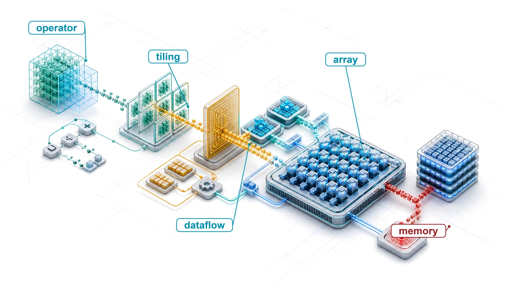
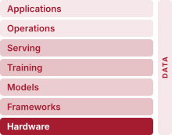
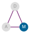
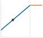
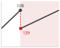

# Hardware Acceleration {#sec-hardware-acceleration}

::: {layout-narrow}
::: {.column-margin}

\chapterminitoc

:::

::: {.content-visible when-format="pdf"}
\noindent
{fig-alt="Layered isometric hardware blueprint where a tensor operation lowers into tiles, local SRAM, and an execution array while avoiding an off-chip memory wall."}
:::

::: {.content-visible unless-format="pdf"}
{fig-alt="Layered isometric hardware blueprint where a tensor operation lowers into tiles, local SRAM, and an execution array while avoiding an off-chip memory wall."}
:::

:::

## Purpose {.unnumbered .unlisted}

::: {.content-visible when-format="pdf"}
\begin{marginfigure}
\mlsysstack{90}{35}{25}{35}{30}{0}{0}{0}
\end{marginfigure}
:::

::: {.content-visible unless-format="pdf"}
::: {.column-margin}
{width="100%" fig-alt="Machine Learning Systems Architecture Stack"}

*Architecture stack focus for this chapter.*
:::
:::

_Why does moving data cost more than computing it?_

Arithmetic is inexpensive relative to data movement. In the time required to fetch a single scalar operand from off-chip DRAM, modern arithmetic units can execute dozens to hundreds of floating-point operations, and that DRAM access consumes on the order of a hundred times more energy than the computation itself. This imbalance, the memory wall, means specialized accelerators are not merely faster arithmetic engines. Rather, their microarchitectures are designed to stage, amortize, and hide data movement through wide spatial interconnects, deep on-chip memory hierarchies, and specialized execution pipelines. When general-purpose processor scaling faltered, hardware specialization enabled machine learning models to continue scaling by turning transistor budgets into high-throughput tensor datapaths. Delivered performance, however, depends on whether a model's tensor access patterns match the data paths of the underlying silicon. Hardware selection cannot be reduced to comparing peak FLOP/s: two accelerators with identical theoretical compute ratings often deliver radically different throughput on real workloads because one saturates its functional units while the other starves for data. A recommendation model dominated by sparse embedding lookups stresses memory bandwidth and interconnect latency, demanding a different memory architecture than a dense transformer training run bounded by matrix multiply-accumulate throughput. If an operation is bandwidth bound, reducing theoretical operation count yields zero speedup because arithmetic is not the binding constraint. Matching workload characteristics to architectural dataflows determines whether an accelerator operates near its hardware ceiling or languishes at a fraction of its advertised peak. In D·A·M terms, the accelerator makes the machine constraint concrete, governing which algorithms and model architectures remain practical in production.

::: {.content-visible when-format="pdf"}

\newpage

:::

::: {.callout-learning-objectives}

- Explain hardware acceleration as tensor-workload specialization and why Amdahl's law bounds its end-to-end speedup
- Compare Tensor Cores, systolic arrays, SIMD/SIMT units, and sparse execution for ML compute primitives
- Diagnose memory-wall bottlenecks using bandwidth, cache hierarchy, host-device transfer, and energy-movement costs
- Calculate arithmetic intensity and execution-path roofline ceilings, then use profiling to diagnose compute or memory limits
- Select dataflow, tiling, and mapping strategies that maximize reuse under memory-capacity constraints
- Analyze compiler and runtime optimizations that fuse kernels, plan memory, and schedule accelerators
- Evaluate accelerator choices across throughput, latency, power, cost, and deployment-context constraints

:::

## Anatomy of an Accelerator {#sec-hardware-acceleration-ai-hardware-acceleration-fundamentals-9b28}

```{python}
#| echo: false
from mlsysim import *
from mlsysim.core.units import *

from mlsysim.fmt import (
    fmt_int,
    fmt,
    fmt_qty_int,
    check,
    fmt_memory,
    fmt_bandwidth,
    fmt_flop_rate,
    fmt_power,
    fmt_energy,
    fmt_count,
    fmt_params,
    fmt_carbon_intensity,
    fmt_compute_efficiency,
    fmt_multiple_range,
)

class HwAccelSetup:
    """H100 peak FP16/BF16 throughput vs. the registry reference CPU for the opening callout."""

    # LOAD
    gap = Scenarios.H100OverReferenceCpu  # H100 FP16 peak against the 1-2 TFLOP/s reference-CPU range

    # EXECUTE
    cpu_gap_min = gap.ratio_low
    cpu_gap_max = gap.ratio_high

    # GUARD
    check(480 <= cpu_gap_min <= 510, f"Unexpected lower CPU gap: {cpu_gap_min:.1f}x")
    check(960 <= cpu_gap_max <= 1020, f"Unexpected upper CPU gap: {cpu_gap_max:.1f}x")

    # OUTPUT
    h100_fp16_tflop_per_s_str = fmt_flop_rate(Hardware.Cloud.H100.compute.peak_flops, unit=TFLOP / second, precision=0, commas=False)
    cpu_gap_range_mult_str = fmt_multiple_range(round(cpu_gap_min, -1), round(cpu_gap_max, -1), precision=0, commas=False)
```

::: {.column-margin}
{width="100%" fig-alt="D·A·M taxonomy triangle with three vertices labeled D, A, and M connected by edges. The M (Machine) vertex is filled in solid color; the D and A vertices are gray, marking the Machine axis."}

*Hardware acceleration turns on the machine axis.*
:::

@Sec-model-compression closed on a deployment profile for ResNet-50 quantized to INT8 (@tbl-resnet50-int8-profile): a model four times smaller whose large-batch throughput rises severalfold on the reference H100 while its batch-one latency barely moves. Data selection reduced the iron law's Data factor ($\text{Samples/Task}$) and compression reduced the Algorithm factor ($\text{FLOPs/Sample}$) and byte traffic ($\DataVolume$), but whether either saving reaches the wall clock is decided by the Machine factor ($\text{Seconds/FLOP}$). This chapter supplies the machine side of that profile. It explains why the same INT8 weights run faster on one execution path than on another, and why the hardware, not the model, determines how much of every compression saving survives execution. The explanation starts with the memory wall: arithmetic is cheap relative to data movement, so specialized hardware matters less because it raises compute throughput than because it organizes memory, dataflow, and parallelism so that its arithmetic units stay fed.

One workload runs through the chapter. ResNet-50 quantized to INT8 carries the book's compute-bound regime (@tbl-lighthouse-examples): its convolutions reuse each weight across many image positions, so on a data-center accelerator most of its time can go to arithmetic rather than to moving bytes. It reappears at every level of the machine, from the matrix units that execute its convolutions to the compiler that lowers its graph, and each time the question is what the INT8 path changes. GPT-2 XL decoding one token at a time supplies the single contrast. It carries the bandwidth-bound regime: every generated token streams all of the model's weights from memory for about two operations per parameter, so the machine that keeps ResNet-50 busy spends most of a decode step waiting for bytes. MobileNetV2, whose depthwise layers trade arithmetic for a small parameter footprint, and keyword spotting (KWS), the power-bound lighthouse, return where the chapter reaches phone-class and embedded chips. DLRM appears where its embedding lookups, the capacity-bound regime, break the regular access patterns that accelerators assume. The reference machine is the NVIDIA H100, the data-center accelerator this book uses for training and serving examples; its numbers are one generation's instance of limits that every generation obeys.

::: {#dfn-hw-acceleration-hardware-acceleration .callout-definition title="Hardware acceleration"}

***Hardware acceleration***\index{Hardware acceleration!definition} is the practice of mapping work from general-purpose execution onto specialized processors or functional units optimized for a narrower operation class. For ML workloads, that specialization commonly trades some programmability for the compute density $(\PeakRate)$ and performance-per-watt gains that regular tensor operations can exploit.

1.  **Significance**: An H100 GPU delivers `{python} HwAccelSetup.h100_fp16_tflop_per_s_str` for dense FP16/BF16 matrix multiplication; against this chapter's illustrative 1–2 TFLOP/s reference-CPU baseline, this is a `{python} HwAccelSetup.cpu_gap_range_mult_str` gap. Its 80 billion transistors devote far more silicon to parallel arithmetic than to branch prediction, out-of-order scheduling, and large caches [@choquette2023].
2.  **Distinction**: A general-purpose CPU is designed for flexible execution, low-latency control, and varied workloads. An accelerator instead concentrates resources on a narrower operation class, so it achieves its gains only when the workload exposes the supported operations and enough parallel work to keep its arithmetic units busy.
3.  **Common pitfall**: A frequent misconception is that an accelerator's advertised peak throughput is the throughput a workload receives. Delivered performance is bounded above by the lower of the compute ceiling and what memory bandwidth can feed (the roofline constraint, developed later in this chapter). A low-arithmetic-intensity kernel can therefore sit at a small fraction of peak FLOP/s no matter how fast the silicon is rated, because it starves for data rather than for arithmetic.

:::

The anatomy of an accelerator\index{Accelerator!anatomy} is the arrangement of parts that every machine learning accelerator shares: arithmetic units built for tensor operations, on-chip memory that holds operands next to those units, a wide path to off-chip memory, and a host interface through which work arrives. Every inference and every training step on such a machine is a stream of operand movements that ends in multiply-accumulate operations, and the anatomy decides how far each operand travels before it is used. A matrix unit that can retire thousands of multiply-accumulates per cycle sits idle whenever its next operands are still in flight, and an off-chip access can take many processor cycles and cost orders of magnitude more energy than the low-precision operation it feeds. The arithmetic units are the easy part of the design; the rest of the anatomy exists to keep them fed.

The definition becomes concrete in the generic chip of @fig-accelerator-anatomy, which serves as this chapter's map. External high-bandwidth memory (HBM) feeds shared on-chip storage (an L2 cache), which distributes operands into rows of processing elements\index{Processing element!accelerator building block}, each equipped with a private scratchpad or cache, a matrix unit, a vector unit, and a special function unit. A host interface connects the chip to the CPU that issues its work.

::: {#fig-accelerator-anatomy fig-env="figure" fig-pos="htb" fig-cap="**Anatomy of a Modern AI Accelerator**: This generic schematic combines common components rather than depicting one product. A host interface connects the accelerator to a CPU, a high-bandwidth device-memory interface feeds shared on-chip storage, and processing elements contain matrix, vector, and special-function units with local memory. Real accelerators differ in which units they provide and whether storage is hardware-managed cache or software-managed scratchpad." fig-alt="Generic schematic of an AI accelerator chip linked by a host interface to a host CPU and by a memory interface to high-bandwidth memory. Inside the chip, rows of processing elements surround shared on-chip storage. An enlarged processing element contains an L1 cache or scratchpad, a tensor core, a vector unit, and a special function unit (SFU). A separate dashed link connects host DRAM to the host CPU."}

```{.tikz}
\begin{tikzpicture}[line cap=round,line join=round,font=\sffamily\small]
\tikzset{
  Box/.style={align=center,outer sep=0pt,
    inner xsep=2pt,
    node distance=0.45,
    draw=GreenLine,
    line width=0.75pt,
    fill=GreenL!60,
   % text width=32mm,
    minimum width=77mm, minimum height=11mm
  },
   Box2/.style={Box, minimum width=10mm, minimum height=6mm,fill=BrownL!60,draw=BrownLine},
   Box3/.style={Box,text width=20mm,  minimum width=20mm, minimum height=9mm,fill=RedL!60,draw=RedLine},
   Box4/.style={Box3, fill=BlueLine!20,draw=BlueLine},
   Box5/.style={Box3, fill=OrangeLine!20,draw=OrangeLine},
   Box6/.style={Box3, text width=27mm,  minimum width=27mm,  minimum height=13mm,fill=OrangeLine!20,draw=OrangeLine},
Line/.style={violet!50, line width=1.1pt,shorten <=1pt,shorten >=2pt},
LineA/.style={violet!50,line width=0.8pt,{-{Triangle[width=1.0*4pt,length=1.0*6pt]}},shorten <=1pt,shorten >=1pt},
ALine/.style={black!50, line width=1.1pt,{{Triangle[width=0.9*6pt,length=1.2*6pt]}-}},
Larrow/.style={fill=violet!50, double arrow,  inner sep=2pt, double arrow head extend=3pt,
            single arrow head indent=0pt,minimum height=17mm, minimum width=3pt}
}

\tikzset{
pics/dram/.style = {
        code = {
        \pgfkeys{/channel/.cd, #1}
\begin{scope}[shift={($(0,0)+(0,0)$)},scale=\scalefac,every node/.append style={transform shape}]
\node[draw=\drawcolor,fill=\filllcolor!70,line width=1.5*\Linewidth,inner sep=0pt,outer sep=0pt,
minimum width=56mm,minimum height=14mm](DRAM\picname)at(0,0){};
\node[draw=\drawcolor,fill=\filllcolor!30,line width=1.5*\Linewidth,inner sep=0pt,outer sep=0pt,anchor=north,
minimum width=52mm,minimum height=6mm](MDRAM\picname)at(DRAM\picname.south){};
%
\pgfmathsetmacro{\spacing}{56/(6+1)}
\foreach \i in {1,...,6} {
  \pgfmathsetmacro{\x}{\i * \spacing}
  \node[draw=\drawcolor,fill=\filllcolor!20,line width=\Linewidth, inner sep=0pt, outer sep=0pt,
        minimum width=6mm, minimum height=8mm]
        at ([xshift=\x mm]DRAM\picname.west) {};
}
%
\foreach \i in {1,...,19} {
  \pgfmathsetmacro{\x}{\i*(52/20)}
  \draw[draw=\drawcolor, line width=3*\Linewidth]
    ([xshift=\x mm,yshift=1pt]MDRAM\picname.south west) -- ++(0,2mm);
}

\end{scope}
    }
  }
}
%CPU style
\tikzset{
pics/cpu/.style = {
        code = {
        \pgfkeys{/channel/.cd, #1}
\begin{scope}[local bounding box = CPU,scale=0.6, every node/.append style={transform shape}]
\node[fill=\filllcolor,minimum width=66, minimum height=66,
            rounded corners=2,outer sep=2pt] (C1) {};
\node[fill=white,minimum width=54, minimum height=54] (C2) {};
\node[fill=\filllcolor!50,minimum width=44, minimum height=44] (C3) {\large CPU};

\foreach \x/\y in {0.11/1,0.26/2,0.41/3,0.56/4,0.71/5,0.85/6}{
\node[fill=\filllcolor,minimum width=4, minimum height=15,
           inner sep=0pt,anchor=south](GO\y)at($(C1.north west)!\x!(C1.north east)$){};
}
\foreach \x/\y in {0.11/1,0.26/2,0.41/3,0.56/4,0.71/5,0.85/6}{
\node[fill=\filllcolor,minimum width=4, minimum height=15,
           inner sep=0pt,anchor=north](DO\y)at($(C1.south west)!\x!(C1.south east)$){};
}
\foreach \x/\y in {0.11/1,0.26/2,0.41/3,0.56/4,0.71/5,0.85/6}{
\node[fill=\filllcolor,minimum width=15, minimum height=4,
           inner sep=0pt,anchor=east](LE\y)at($(C1.north west)!\x!(C1.south west)$){};
}
\foreach \x/\y in {0.11/1,0.26/2,0.41/3,0.56/4,0.71/5,0.85/6}{
\node[fill=\filllcolor,minimum width=15, minimum height=4,
           inner sep=0pt,anchor=west](DE\y)at($(C1.north east)!\x!(C1.south east)$){};
}
\end{scope}
    }  }}
\pgfkeys{
  /channel/.cd,
   Depth/.store in=\Depth,
  Height/.store in=\Height,
  Width/.store in=\Width,
  filllcirclecolor/.store in=\filllcirclecolor,
  filllcolor/.store in=\filllcolor,
  drawcolor/.store in=\drawcolor,
  drawcircle/.store in=\drawcircle,
  scalefac/.store in=\scalefac,
  Linewidth/.store in=\Linewidth,
  picname/.store in=\picname,
  filllcolor=BrownLine,
  filllcirclecolor=BlueFill,
  drawcolor=black,
  drawcircle=violet,
  scalefac=1,
  Linewidth=0.5pt,
  Depth=1.3,
  Height=0.8,
  Width=1.1,
  picname=C
}

\node[Box](B1){L2 Cache (Shared)};
\coordinate(PO1)at($(B1.north west)+(0.5,0.65)$);
\pgfmathsetmacro{\spacing}{47/(2+1)}
\foreach \i [count=\j] in {0,...,2} {
  \pgfmathsetmacro{\x}{\i * \spacing}
\node[Box2,anchor=south west](GPE\j)at([xshift=\x mm]PO1){PE};
}
\node[Box2,right=1.5 of GPE3](GPE4){PE};
\node[font=\tiny\sffamily]at($(GPE3)!0.5!(GPE4)$){$\bullet$ $\bullet$ $\bullet$};
%
\coordinate(PO2)at($(B1.south west)+(0.5,-0.65)$);
\pgfmathsetmacro{\spacing}{47/(2+1)}
\foreach \i [count=\j]in {0,...,2} {
  \pgfmathsetmacro{\x}{\i * \spacing}
\node[Box2,anchor=north west](DPE\j)at([xshift=\x mm]PO2){PE};
}
\node[Box2,right=1.5 of DPE3](DPE4){PE};
\node[font=\tiny\sffamily]at($(DPE3)!0.5!(DPE4)$){$\bullet$ $\bullet$ $\bullet$};
%arrows
\foreach \i  in {1,...,4} {
\draw[LineA](B1.south)--++(0,-0.25)
-|(DPE\i.north);
}
\foreach \i  in {1,...,4} {
\draw[LineA](B1.north)--++(0,0.25)-|(GPE\i.south);
}
\begin{scope}[shift={($(GPE1)+(0.3,2.8)$)}]
\node[Box3](L1){L1 Cache / Scratchpad};
\node[Box4,above right=-0.10 and 0.3 of L1](TC){Tensor Core};
\node[Box4,below right=0.1 and 0.3 of L1](VU){Vector Unit};
\node[Box5,below right=0 and 0.3 of TC](SFU){SFU};
\draw[LineA](L1)|-(TC);
\draw[LineA](L1)|-(VU);
\draw[LineA](TC)-|(SFU);
\draw[LineA](VU)-|(SFU);
%%fitting
\scoped[on background layer]
\node[draw=BackLine,fill=BackColor!20, inner ysep=4mm, inner xsep=2mm,yshift=2mm,
fit=(L1)(TC)(SFU)(VU),yshift=0mm](BB1){};
\node[below left=0 and 0 of BB1.north east]{Processing Element};
\scoped[on background layer]
\fill[BrownLine!10](GPE3.north west)--(BB1.south west)--(BB1.south east)--(GPE3.north east)--cycle;
\draw[BrownLine](GPE3.north west)--(BB1.south west) (BB1.south east)--(GPE3.north east);
\end{scope}
%%fitting
\node[draw=red,dashed,fill=none, inner ysep=4mm, inner xsep=3mm,yshift=2mm,
fit=(BB1)(DPE1)(DPE4)(B1),yshift=0mm](BB2){};
\node[below =0pt of BB2.north]{AI Accelerator Chip};
%CPU
\begin{scope}[local bounding box=CPU1,shift={($(B1)+(-8.1,0)$)}]
\pic[shift={(0,0)}] at (0,0) {cpu={scalefac=1,picname=1,drawcolor=BlueLine,filllcolor=BlueLine!80!,Linewidth=0.5pt}};
\end{scope}
\node[above=6pt of CPU1]{Host CPU};
%%%%
\begin{scope}[local bounding box=DRAM1,shift={($(CPU1)+(0,-1.9)$)},scale=1, every node/.append style={transform shape}]
\pic[shift={(0,0)}] at  (0,0){dram={scalefac=0.45,picname=1,drawcolor=black,filllcolor=OrangeLine!50!,Linewidth=0.5pt}};
\end{scope}
\node[below=9pt of DRAM1]{Host DRAM};
\node[Larrow](AR1)at($(CPU1.east)!0.45!(B1.west)$){};
\node[align=center,above=2pt of AR1,font=\sffamily\footnotesize]{Host Interface\\ (PCIe/NVLink)};
\draw[LineA,dashed](DRAM1)--(CPU1);
%%
\node[Box6,right=2.5 of B1](B6){High-Bandwidth Memory (HBM)};
\node[Larrow](AR2)at($(B1.east)!0.55!(B6.west)$){};
\node[align=center,above=2pt of AR2,font=\sffamily\footnotesize]{Memory\\ Interface};
\end{tikzpicture}
```

:::

Within each processing element, specialized units partition execution across distinct mathematical primitives: dedicated matrix units (Tensor Cores)\index{Tensor Core!matrix multiplication} execute dense matrix multiplication, vector units\index{Vector Unit!element-wise operations} evaluate element-wise arithmetic, and special function units (SFUs)\index{Special Function Unit!activation functions} approximate transcendental operations such as activations and exponentials. Their number, grouping, and names vary by vendor; some designs arrange them into an explicit 2D systolic grid, and others distribute matrix engines among wide parallel cores.

The memory hierarchy amortizes the cost of data transport across tiers. High-bandwidth memory\index{HBM!throughput requirements} provides off-chip capacity and throughput, while shared on-chip storage and per-element caches or scratchpads cut off-chip traffic. Because moving a tensor tile across the package boundary costs orders of magnitude more energy than keeping it on chip, compilers and kernels must coordinate tile capacity, reuse, and prefetching to keep operands staged locally. More HBM bandwidth raises the off-chip ceiling, but without local reuse the execution units still stall. The system assumptions appendix (@sec-appdx-system-assumptions) collects reference specifications for the accelerators this book uses, including the H100.

The host interface links the accelerator to the host CPU, which coordinates execution graphs, asynchronous I/O, and fallback operations while the accelerator executes dispatched kernels. Direct-memory-access engines can overlap host-device transfers with execution, but an operator unsupported by the accelerator backend may require a CPU round-trip. An operator outside the matrix-unit instruction set may instead use vector or other device kernels. These execution boundaries help set the effective speedup envelope. Kernel execution time matters little if transfers, launches, and synchronization dominate end-to-end latency. The three parts of the figure (the processing elements, the memory tiers, and the host link) are the parts this chapter takes apart in turn.

The anatomy embodies the chapter's central engineering trade-off. General-purpose processors allocate silicon area to complex control logic, speculative execution, branch prediction, and multi-level cache hierarchies to handle arbitrary control flow. An accelerator redirects that transistor budget toward dense arithmetic arrays, dedicated register files, and high-bandwidth memory paths tailored to a narrower workload class. When the software path exposes sufficient tensor parallelism, this specialization yields order-of-magnitude improvements in energy efficiency and throughput per watt. Silicon built for a narrow class of dense tensor operations pays off only because, as the bitter lesson predicts, the general methods that win by exploiting computation keep reducing to those same operations at ever larger scale. The dependence also runs the other way, because scale keeps winning only while accelerators keep lowering the time and energy of each additional operation, so the hardware this chapter studies is part of what sustains the bitter lesson itself.

::: {.column-margin .margin-pointer}
↩ The bitter lesson, the observation that general methods exploiting computation win as computation grows, is established in @sec-introduction-bitter-lesson-79c7.
:::

Hardware alone cannot achieve these gains. Algorithms must structure operations to expose data reuse and regular memory access, while silicon architectures must allocate physical units to the mathematical primitives and numeric precisions that algorithms actually execute. That mutual dependence motivates a complementary principle: hardware-software co-design.

::: {#dfn-hw-acceleration-hardware-software-co-design .callout-definition title="Hardware-software co-design"}

***Hardware-Software Co-design***\index{Hardware-Software Co-design!definition} is an ML accelerator development method that crosses conventional abstraction boundaries, allowing algorithm constraints to inform silicon design and hardware capabilities to shape algorithm formulation.

1.  **Significance**: On a supported tensor-core path, 8-bit integer (INT8) quantization can deliver multi-fold throughput gains because hardware executes lower-precision operations more densely and moves fewer bytes than an FP32 path; the exact gain depends on the architecture and workload [@NVIDIA2020; @dally2021; @dally2023].
2.  **Distinction**: Unlike layered abstraction (where software calls a hardware API without knowing the silicon details), co-design exposes hardware constraints directly to algorithm and compiler authors: data alignment requirements, precision formats, and memory access patterns all become visible inputs to global cross-layer optimization.
3.  **Common pitfall**: A frequent misconception is that co-design is a one-time hardware design choice. In practice, the supported features continue to evolve: NVIDIA Tensor Cores began with FP16 matrix multiplication, later generations added TF32 and broader integer support, and Ampere added acceleration for 2:4 structured sparsity [@nvidia_tensors_fp16_2017; @NVIDIA2020].

:::

Co-design explains why model compression techniques deliver real speedups. Quantization shows why converting FP32 to INT8\index{Quantization!INT8 co-design} accelerates execution on supported hardware: reduced precision cuts memory traffic, while specialized arithmetic units execute more low-precision operations per cycle than FP32 equivalents [@NVIDIA2020]. Structured pruning\index{Structured pruning!hardware alignment} improves performance when it produces smaller dense shapes or a sparsity pattern recognized by silicon, whereas arbitrary unstructured sparsity incurs metadata handling and non-coalesced memory accesses that often erase theoretical gains. Evaluating accelerator performance requires tracing this path from workload to silicon: compute primitives, memory hierarchies, roofline diagnosis, mapping and dataflow, and compiler scheduling. The recurring question is why algorithmic improvements frequently fail to deliver proportional end-to-end speedups. Amdahl's law (principle \ref{pri-amdahl}) already answered it for model-side optimizations, since whatever an optimization leaves untouched caps the overall gain. The same bound governs hardware. The theorem below applies the principle to an accelerator, and the only new quantity is the gain, which becomes the accelerator's path gain $\AcceleratorGain$.

::: {.column-margin .margin-pointer}
↩ Quantization and its effect on weight payload, memory traffic, and compute cost are established in @sec-model-compression-quantization-precision-cd46.
:::

::: {#thrm-hw-acceleration-fundamental-limit-acceleration-amdahls-law .callout-theorem title="The fundamental limit of acceleration (Amdahl's law)"}

Hardware acceleration *does not speed up the entire system*; it speeds only the baseline-time fraction using the accelerated path. For that fraction $\ParallelFraction$ and path gain $\AcceleratorGain$, **Amdahl's law**\index{Amdahl's law!definition}\index{Parallel Computing!Amdahl's Law} [@amdahl1967] gives the bound in @eq-amdahl.
$$ \text{Speedup} = \frac{1}{(1 - \ParallelFraction) + \frac{\ParallelFraction}{\AcceleratorGain}} $$ {#eq-amdahl}

*   **Accelerated fraction**\index{Parallel fraction!accelerated path} ($\ParallelFraction$): Share of baseline time receiving the stated gain, often in matrix multiplication or another supported kernel.
*   **Accelerator gain**\index{Accelerator gain!definition} ($\AcceleratorGain$): The raw speed advantage of the GPU or Tensor Processing Unit (TPU) over the CPU for the accelerated portion of the workload.
*   **Unaccelerated fraction**\index{Serial fraction!Amdahl bottleneck} ($1-\ParallelFraction$): Work outside the chosen path, such as data loading, host overhead, unsupported operators, and kernel launch latency\index{Kernel Launch Latency!serial overhead}.

**Pitfall**: *Unaccelerated work caps total speedup.* If 10 percent of baseline time is unaffected ($\ParallelFraction=0.9$), even infinite path gain ($\AcceleratorGain=\infty$) yields at most 10$\times$ overall. Once the accelerated component is fast enough, unaffected work dominates.

:::

Hardware acceleration targets specific terms in the iron law of ML systems\index{Iron law of ML systems!hardware acceleration}, which decomposes end-to-end time into data movement $(\DataVolume/\Bandwidth)$, computation $(\Operations/(\PeakRate \cdot \EfficiencyHw))$, and fixed latency $(\Latency)$. Data selection reduced the number of samples processed ($\text{Samples/Task}$, shrinking both $\Operations$ and input traffic $\DataVolume$), and model compression reduced the operations and bytes per sample ($\text{FLOPs/Sample}$ and weight traffic $\DataVolume$). Hardware acceleration instead reduces the realized time per operation ($\text{Seconds/FLOP}$) by improving $\PeakRate$, $\EfficiencyHw$, and $\Bandwidth$. Which of these physical terms an upgrade actually improves determines its accelerated fraction under Amdahl's law.[^fn-amdahls-law-acceleration]

::: {.column-margin .margin-pointer}
↩ The decomposition of execution time into data, compute, and latency terms is established in @sec-introduction-iron-law-ml-systems-c32a.
:::

[^fn-amdahls-law-acceleration]: **Amdahl's law**\index{Amdahl's law!acceleration ceiling}: Maps onto the iron law only after the proposed change is specified. If a faster tensor unit reduces the computation term $(\Operations/(\PeakRate \cdot \EfficiencyHw))$ but leaves data transfer and fixed latency unchanged, those unaffected terms bound total speedup. A different accelerator or memory system may improve bandwidth as well. The unaccelerated fraction is therefore defined by the intervention, not by a permanent classification of each term as serial.

This dynamic explains why hardware upgrades frequently fail to produce proportional end-to-end speedups. @Fig-iron-law-heatmap maps system speedup across accelerator gain ($\AcceleratorGain$) and accelerated fraction ($\ParallelFraction$), charting where those returns diminish\index{Amdahl's law!diminishing returns}. Where the unaccelerated fraction $1-\ParallelFraction$ remains substantial, the white contour curves flatten horizontally into the unaccelerated-bound regime, bounding total speedup at the $1/(1-\ParallelFraction)$ asymptote regardless of how far $\AcceleratorGain$ scales along the horizontal axis. Because $\ParallelFraction$ differs substantially across workload archetypes running on identical hardware, a workload's vertical position on this map determines whether an accelerator investment pays off or stalls on non-matrix operations.

::: {#fig-iron-law-heatmap fig-env="figure" fig-pos="htb" fig-cap="**The Iron Law Heatmap**: Total system speedup as a function of accelerator gain ($\AcceleratorGain$) and accelerated fraction ($\ParallelFraction$). High speedup appears only near the top-right corner, where both accelerator gain and accelerated fraction are high. At $\ParallelFraction=0.9$, for example, even an infinite gain on the accelerated path cannot exceed 10$\times$ end-to-end speedup. Contours span roughly 1$\times$–200$\times$ speedup." fig-alt="Heatmap of speedup vs. accelerator gain and accelerated fraction. High speedup in red and orange appears near the top-right corner where the accelerated fraction is near 1.0 and accelerator gain is high; lower-fraction regions remain blue. White contour lines labeled 2x to 50x follow the lower bands, a colorbar at the right labels every band from 1x to 500x, and text labels mark a High Accelerated Fraction region above and an Unaccelerated Bound region below."}

```{python}
#| echo: false
# ┌─────────────────────────────────────────────────────────────────────────────
# │ IRON LAW HEATMAP (FIGURE)
# ├─────────────────────────────────────────────────────────────────────────────
# │ Context: @fig-iron-law-heatmap—Amdahl's Law and Acceleration Wall
# │
# │ Goal: Visualize speedup = 1/((1-p)+p/S) as function of S and p; show
# │       diminishing returns when parallel fraction is low.
# │ Show: Contour heatmap; High Accelerated Fraction vs Unaccelerated Bound regions.
# │ How: meshgrid S, P; contourf with LogNorm; book_style.setup_plot().
# │
# └─────────────────────────────────────────────────────────────────────────────
# ┌── 1. CANVAS ────────────────────────────────────────────────────────────────
# │ Visualize speedup = 1/((1-p)+p/G_accel) as function of accelerator gain and p; show
import sys
import os
import numpy as np
import matplotlib.colors as mcolors

# ┌── 2. ARRAYS ────────────────────────────────────────────────────────────────
sys.path.insert(0, ".")
from binder.tools.figures import style as book_style
from mlsysim.physics import calc_amdahls_speedup

fig, ax, COLORS, plt = book_style.setup_plot(figsize=(5.8, 4.2))

# =============================================================================
# PLOT: The Iron Law Heatmap
# =============================================================================
g_accel_vals = np.logspace(0, 3, 100)
p_vals = np.linspace(0.8, 0.999, 100)
g_accel_grid, p_grid = np.meshgrid(g_accel_vals, p_vals)
overall_speedup = np.vectorize(calc_amdahls_speedup)(p_grid, g_accel_grid)

# ┌── 3. RENDER ────────────────────────────────────────────────────────────────
levels = [1, 2, 5, 10, 20, 50, 100, 200, 500]
norm = mcolors.LogNorm(vmin=1, vmax=500)

cf = ax.contourf(g_accel_grid, p_grid, overall_speedup, levels=levels, cmap='RdYlBu_r', norm=norm, alpha=0.8)
# Inline labels only where contours have room; the 100x and 200x contours crowd
# into the top sliver of the linear f axis, so the colorbar labels every band.
# The labeled levels get their own contour set: clabel(levels=..., manual=...)
# on a larger set raises IndexError in matplotlib 3.8 to 3.10.
ax.contour(g_accel_grid, p_grid, overall_speedup, levels=[levels[0]] + levels[6:], colors='white', linewidths=0.8, alpha=0.6)
cs = ax.contour(g_accel_grid, p_grid, overall_speedup, levels=levels[1:6], colors='white', linewidths=0.8, alpha=0.6)
ax.clabel(
    cs,
    inline=1,
    fontsize=9,
    fmt='%gx',
    colors='black',
    manual=[(2.43, 0.85), (9, 0.9), (31, 0.93), (700, 0.951), (150, 0.9866)],
)
cbar = fig.colorbar(cf, ax=ax, ticks=levels, pad=0.02, fraction=0.05)
cbar.ax.set_yticklabels([f"{v:g}×" for v in levels])
cbar.set_label("Overall speedup")

ax.set_xscale('log')
ax.set_xlabel(r'Accelerator gain ($G_{\mathrm{accel}}$)')
ax.set_ylabel(r'Accelerated fraction ($f_{\mathrm{parallel}}$)')

ax.text(
    100,
    0.975,
    "High Accelerated Fraction",
    color='black',
    ha='center',
    va='top',
    fontweight='bold',
    fontsize=9,
    bbox=dict(facecolor='white', alpha=0.8, edgecolor='none', pad=0.5),
)
ax.text(
    100,
    0.82,
    "Unaccelerated Bound",
    color='white',
    ha='center',
    va='bottom',
    fontweight='bold',
    fontsize=9,
    bbox=dict(facecolor='black', alpha=0.6, edgecolor='none', pad=0.5),
)
plt.show()
plt.close()

# ┌── 4. DECORATE ──────────────────────────────────────────────────────────────
```

:::

::: {#chk-hw-acceleration-parallelism-gate .callout-checkpoint title="The parallelism gate"}

These checks turn Amdahl's bound into a hardware-selection test.

**Amdahl's reality**

- [ ] **Serial bottlenecks**: use Amdahl's bound to explain why a 1,000$\times$ faster GPU may only speed up training by 5$\times$ when data loading is slow.
- [ ] **Speedup ceiling**: for $\ParallelFraction=0.95$ and $\AcceleratorGain=100$, estimate total speedup and compare it with the infinite-accelerator ceiling.
- [ ] **Workload variation**: what baseline profiling would establish the ResNet-50\index{ResNet-50!compute-bound workload} and MobileNet accelerated fractions for a proposed hardware change? Explain how those fractions would determine which benefits more.

:::

The serial bottleneck becomes concrete on real hardware, where the same accelerator that nears its parallel ceiling on one workload can stall on another. The comparison below uses the INT8 (8-bit integer) path, whose advantage over FP32 or FP16 has two sources. Each operand occupies a half or a quarter of the bytes, and an 8-bit multiplier occupies far less silicon area than a floating-point one, so the same die holds more multiply-accumulate (MAC) units. Two workloads on an NVIDIA H100 with different unaccelerated fractions show how that fraction governs whether this peak INT8 advantage becomes realized speedup. A second look at the decode case then separates that limit from a different one, bandwidth-boundedness.

::: {.column-margin .margin-pointer}
↪ Order-of-magnitude throughput, bandwidth, and capacity for each accelerator class are collected for reference in @sec-appdx-machine-foundations-ai-hardware-cheat-sheet-modern-reference-4dc1.
:::

```{python}
#| echo: false
#| label: amdahl-h_h100-calc
# ┌─────────────────────────────────────────────────────────────────────────────
# │ AMDAHL'S LAW ON H100
# ├─────────────────────────────────────────────────────────────────────────────
# │ Context: "Amdahl's Law on H100" lighthouse callout
# │
# │ Goal: Demonstrate the limits of parallel speedup on H100.
# │ Show: Why ResNet achieves 20× speedup while GPT-2 is capped at 5×.
# │ How: Apply Amdahl's Law with different parallelizable fractions (95% vs 80%).
# │      Then re-evaluate GPT-2 decode with a bandwidth-set path gain, to keep
# │      memory-boundedness (shrinks G_accel) distinct from the serial fraction.
# │
# └─────────────────────────────────────────────────────────────────────────────
from mlsysim.fmt import fmt_int, fmt, fmt_math, fmt_ops_rate, fmt_ratio, check

# ┌── LEGO ───────────────────────────────────────────────
class AmdahlH100:
    """
    Namespace for Amdahl's Law on H100.
    Scenario: Comparing speedup for a 5% vs 20% unaccelerated fraction (ResNet vs GPT-2).
    """

    # ┌── 1. LOAD (Constants) ───────────────────────────────────────────────
    # H100 INT8 peak against an assumed 8 TOPS server CPU; 95% (ResNet-50) and
    # 80% (GPT-2 decode) of baseline time on the accelerated path.
    resnet = Scenarios.ResNet50InferenceH100OverServerCpu
    gpt2 = Scenarios.Gpt2DecodeH100OverServerCpu
    gpt2_bw = Scenarios.Gpt2DecodeH100OverServerCpuBandwidth  # path gain set by bandwidth
    cpu_int8_tops = resnet.baseline_rate  # scenario assumption: baseline server-CPU INT8 throughput
    p_resnet = resnet.fraction
    p_gpt2 = gpt2.fraction

    # ┌── 2. EXECUTE (The Compute) ─────────────────────────────────────────
    # Amdahl's Law: Speedup = 1 / ((1-p) + (p/G_accel))
    hw_speedup_factor = resnet.gain
    speedup_resnet = resnet.speedup
    speedup_gpt2 = gpt2.speedup

    # Step 1: Theoretical ceiling (if accelerator gain tends to infinity)
    ceiling_gpt2 = gpt2.ceiling

    # Step 2: Decode is memory bound, so its path gain is the bandwidth ratio
    bw_gain = gpt2_bw.gain
    speedup_gpt2_bw = gpt2_bw.speedup

    # ┌── 3. GUARD (Invariants) ───────────────────────────────────────────
    check(speedup_resnet >= speedup_gpt2 * 3, f"ResNet speedup ({speedup_resnet:.1f}x) should be much higher than GPT-2 ({speedup_gpt2:.1f}x).")
    check(speedup_gpt2 <= ceiling_gpt2, "Speedup cannot exceed theoretical ceiling.")
    check(bw_gain < hw_speedup_factor, "Bandwidth gain should be well below the INT8 compute ratio.")
    check(speedup_gpt2_bw < speedup_gpt2, "A smaller path gain must lower the bound.")

    # ┌── 4. OUTPUT (Formatting) ──────────────────────────────────────────────
    # Hardware context
    h100_int8_tops_str = fmt_ops_rate(Hardware.Cloud.H100.compute.precision_flops["int8"], unit=TOPS, precision=0, commas=False)
    cpu_int8_tops_str = fmt_ops_rate(cpu_int8_tops, unit=TOPS, precision=0, commas=False)
    hw_speedup_mult_str = fmt_multiple(round(hw_speedup_factor), precision=0, commas=False)
    hw_speedup_factor_str = fmt_int(hw_speedup_factor, commas=False)

    # ResNet
    p_resnet_str = fmt(p_resnet, precision=2, commas=False)
    p_resnet_pct_str = fmt_percent(p_resnet, precision=0, commas=False, style='prose')
    serial_resnet_str = fmt(1 - p_resnet, precision=2, commas=False)
    serial_resnet_pct_str = fmt_percent(1 - p_resnet, precision=0, commas=False, style='prose')
    p_resnet_over_accel_str = fmt_ratio(p_resnet / hw_speedup_factor, precision=4, commas=False)
    amdahl_resnet_str = fmt(speedup_resnet, precision=1, commas=False)
    amdahl_resnet_speedup_mult_str = fmt_multiple(speedup_resnet, precision=1, commas=False)

    # GPT-2
    p_gpt2_str = fmt(p_gpt2, precision=2, commas=False)
    serial_gpt2_str = fmt(1 - p_gpt2, precision=2, commas=False)
    serial_gpt2_pct_str = fmt_percent(1 - p_gpt2, precision=0, commas=False, style='prose')
    p_gpt2_over_accel_str = fmt_ratio(p_gpt2 / hw_speedup_factor, precision=4, commas=False)
    amdahl_gpt2_str = fmt(speedup_gpt2, precision=1, commas=False)
    amdahl_gpt2_ceiling_speedup_mult_str = fmt_multiple(ceiling_gpt2, precision=0, commas=False)
    amdahl_gpt2_speedup_mult_str = fmt_multiple(speedup_gpt2, precision=1, commas=False)
    bw_gain_mult_str = fmt_multiple(round(bw_gain), precision=0, commas=False)
    amdahl_gpt2_bw_speedup_mult_str = fmt_multiple(speedup_gpt2_bw, precision=1, commas=False)

    resnet_speedup_eq_math = fmt_math(
        rf"\text{{Speedup}} = \frac{{1}}{{(1-{p_resnet_str}) + \frac{{{p_resnet_str}}}{{{hw_speedup_factor_str}}}}} "
        rf"= \frac{{1}}{{{serial_resnet_str} + {p_resnet_over_accel_str}}} "
        rf"\approx {amdahl_resnet_str}\times"
    )
    gpt2_speedup_eq_math = fmt_math(
        rf"\text{{Speedup}} = \frac{{1}}{{(1-{p_gpt2_str}) + \frac{{{p_gpt2_str}}}{{{hw_speedup_factor_str}}}}} "
        rf"= \frac{{1}}{{{serial_gpt2_str} + {p_gpt2_over_accel_str}}} "
        rf"\approx {amdahl_gpt2_str}\times"
    )
```

::: {#lhs-amdahl-h_h100 .callout-lighthouse title="An illustrative Amdahl budget on H100"}

**Illustrative ResNet-50 inference on NVIDIA H100**:

- Assume H100 provides $\AcceleratorGain$ = `{python} AmdahlH100.hw_speedup_mult_str` on matrix multiplication relative to a server CPU without matrix extensions (`{python} AmdahlH100.h100_int8_tops_str` INT8 vs. ~`{python} AmdahlH100.cpu_int8_tops_str`) [@choquette2023]. The CPU's INT8 rate is a scenario assumption for this budget, not the FP32 peak of the reference CPU used elsewhere in the chapter.
- Assume $\ParallelFraction$ = `{python} AmdahlH100.p_resnet_str`: `{python} AmdahlH100.p_resnet_pct_str` of baseline time receives that gain, while `{python} AmdahlH100.serial_resnet_pct_str` remains in data loading, preprocessing, postprocessing, and other work.
$$
\text{`{python} AmdahlH100.resnet_speedup_eq_math`}
$$
The `{python} AmdahlH100.hw_speedup_mult_str` path gain produces only `{python} AmdahlH100.amdahl_resnet_speedup_mult_str` end-to-end speedup because the `{python} AmdahlH100.serial_resnet_pct_str` unaffected fraction sets the ceiling.

**Contrast with GPT-2 (autoregressive)**:

- For GPT-2 token generation, assume $\ParallelFraction$ = `{python} AmdahlH100.p_gpt2_str`; the remaining `{python} AmdahlH100.serial_gpt2_pct_str` includes host overhead, sampling, and decoding work outside the accelerated matrix path.
$$
\text{`{python} AmdahlH100.gpt2_speedup_eq_math`}
$$
Less token-generation time receives the assumed gain, so even an infinite path gain yields at most $1/(1-\ParallelFraction)$ = `{python} AmdahlH100.amdahl_gpt2_ceiling_speedup_mult_str`.

This calculation still overstates the decode path gain. Decode is bandwidth bound, so its accelerated path runs at the rate weights stream from memory rather than at the INT8 TOPS rate. The relevant ratio is the H100's memory bandwidth over the reference CPU socket's, `{python} AmdahlH100.bw_gain_mult_str` (a different path from the host-DRAM link used below). INT8 helps decode on either machine by halving the bytes each weight occupies relative to FP16, not by multiplying faster. With that gain the bound falls from `{python} AmdahlH100.amdahl_gpt2_speedup_mult_str` to `{python} AmdahlH100.amdahl_gpt2_bw_speedup_mult_str`, barely moving, because the unaccelerated fraction already dominates. Two distinct limits are at work. Bandwidth-boundedness shrinks $\AcceleratorGain$, whereas the unaccelerated fraction caps what any $\AcceleratorGain$ can deliver. Serving optimizations attack both. Batching raises the work done per weight byte fetched. Speculative decoding, developed in @sec-model-serving, lets a small draft model propose several tokens that the full model then verifies in one step, reducing the number of sequential full-model steps.

:::

Whether an operation is limited by compute rate or by data movement dictates both hardware selection and software optimization. Under the arithmetic intensity law (principle \ref{pri-arithmetic-intensity}), upgrading to an accelerator with $10\times$ higher peak compute yields negligible speedup if data delivery is the binding bottleneck. The roofline model\index{Roofline model!hardware diagnosis}, previewed in @sec-ml-systems-matching-workloads-hardware-bf91, makes this diagnosis [@williams2009]. It compares an operation's arithmetic intensity\index{Arithmetic intensity!roofline diagnostic}, the ratio of operations to bytes of memory traffic (FLOP/byte), with the hardware's ridge point. An operation below the ridge is bandwidth bound, the regime the roofline literature calls *memory bound*; an operation above it is compute bound. GPT-2 decode and ResNet-50 sit on opposite sides of that line, a difference the Amdahl budget above already registered in the decode path gain. @Sec-hardware-acceleration-roofline-model-42ff turns the classification into numbers once the compute units and memory systems that set the two ceilings have been examined.

::: {.column-margin .margin-pointer}
↩ The arithmetic-intensity spectrum that separates the workload signatures of the major architectures is established in @sec-network-architectures-understanding-arithmetic-intensity-ade5.
:::

The chapter builds the machine from the bottom up (@tbl-hw-acceleration-chapter-spine). Compute primitives and compute units supply the arithmetic side of the anatomy, ending with the INT8 and sparse paths that ResNet-50's profile depends on, and memory systems supply the other side, from registers to host memory. Performance bounds then combine the two into the roofline's ceilings and show which ResNet-50 layers clear the H100's ridge at FP16 and which fall below it at INT8; this is the chapter's midpoint, marked by a checkpoint. The second half asks how software reaches those ceilings, through hardware mapping and then the compilers and runtimes that make its choices automatically. Three shorter sections widen the view to work beyond one accelerator, heterogeneous systems-on-chip, and the choice of an accelerator for a workload and a budget.

| **Section**                  | **Part of the accelerator**       | **Question it answers**                                               | **ResNet-50 INT8 thread**                             |
|:-----------------------------|:----------------------------------|:----------------------------------------------------------------------|:------------------------------------------------------|
| **Hardware Specialization**  | The whole chip                    | Why silicon is specialized for tensor work, and what a byte costs     | Why its convolutions justify dedicated matrix silicon |
| **Compute Primitives**       | Operations the hardware executes  | Which operation classes earn dedicated units                          | Its convolutions lower to matrix multiplication       |
| **Compute Units**            | Vector, matrix, and special units | How each unit executes its primitive, including INT8 and sparse paths | The INT8 tensor path and its arithmetic floor         |
| **Memory Systems**           | Registers through host memory     | Where operands live and what each tier costs                          | One activation tile's trip from HBM to registers      |
| **Performance Bounds**       | Compute and bandwidth ceilings    | Which ceiling binds a given kernel                                    | Which layers clear the FP16 and INT8 ridge points     |
| **Hardware Mapping**         | Placement, dataflow, and tiling   | Which schedule captures the available reuse                           | Weight-stationary tiles and fused epilogues           |
| **Compilers and Runtimes**   | Software that lowers the graph    | Who makes the mapping decisions, and when                             | Naive versus compiled latency                         |
| **Beyond One Accelerator**   | Links between accelerators        | What changes when one accelerator is not enough                       | Awareness only; ResNet-50 fits one accelerator        |
| **Heterogeneous SoC Design** | Phone and embedded chips          | How shared memory and power budgets change the mapping                | MobileNetV2 and KWS take over                         |
| **Choosing an Accelerator**  | The complete system               | Which machine fits a workload, a latency target, and a budget         | Energy and cost per request                           |

: **Chapter Map**: Each section supplies one part of the accelerator's anatomy and follows the chapter's INT8 ResNet-50 workload into it; the first five sections build the machine and its ceilings, and the remaining sections ask how software and system choices reach them. {#tbl-hw-acceleration-chapter-spine tbl-colwidths="[22,22,32,24]"}

The first stage of the accelerator's anatomy begins with a simpler question: why build specialized silicon for tensor math at all, rather than running those operations on general-purpose processors?

## Hardware Specialization {#sec-hardware-acceleration-evolution-hardware-specialization-fdb7}

General-purpose processors dedicate substantial silicon area and power to instruction fetch, branch prediction, out-of-order scheduling, and cache coherence, machinery built for arbitrary control flow that yields poor arithmetic density on regular, dense linear algebra. When Google deployed its first Tensor Processing Unit (TPU v1) into production data centers alongside contemporary CPUs and NVIDIA K80 GPUs, stripping away that general-purpose control machinery in favor of a dedicated matrix array produced an immediate efficiency jump (example \ref{exmp-hw-acceleration-tpuv1-vs-k80-efficiency-shock}). Whenever an algorithmic pattern becomes sufficiently dominant and structured, specialized hardware\index{Hardware specialization!evolution} outperforms general-purpose platforms by replacing dynamic control hardware with dense arithmetic arrays and software-managed data movement.

::: {#exmp-hw-acceleration-tpuv1-vs-k80-efficiency-shock .callout-example title="The TPU v1 vs. K80 efficiency gap"}

**Scenario**: In 2015, Google deployed its first Tensor Processing Unit (TPU v1) into production data centers, comparing its throughput and energy efficiency against general-purpose NVIDIA K80 GPUs [@jouppi2017].

**Diagnosis**: The K80 was a programmable GPU designed to support a broader mix of graphics and compute workloads. The TPU v1 domain-specific architecture (DSA) made a narrower, inference-focused design choice, pairing a large 8-bit systolic matrix unit with software-managed memory and simpler control.

**Systems lesson**: On the six Google inference workloads and contemporary CPU/GPU baselines evaluated in the TPU paper, tailoring silicon to the dominant matrix operations delivered 15–30$\times$ higher throughput and 30–80$\times$ better performance per watt [@jouppi2017]. Those ratios describe the evaluated systems, not every workload.

:::

In D·A·M terms, this efficiency gain stems from tailoring machine resources to algorithmic structure. The TPU[^fn-tpu-google-origin] replaced hardware caches with software-managed buffers and routed data directly between neighboring arithmetic units, raising data reuse and cutting off-chip traffic. The cost is rigidity. Irregular memory access, dynamic control flow, or an unsupported numeric precision stalls a fixed-function data path and leaves expensive silicon idle. Every modern ML accelerator, from DianNao-class designs [@chen2014diannao] to GPUs with Tensor Cores, strikes its own balance between specialization and flexibility, following a pattern that began decades before deep learning.

[^fn-tpu-google-origin]: **TPU (tensor processing unit)**\index{TPU!origin}: The first TPU made a deliberately narrow design choice, centering the design on a single $256{\times}256$ systolic array for 8-bit matrix multiplication and avoiding much of the control machinery required by a general-purpose core [@jouppi2017]. That trade buys high compute density on dense matrix multiplication at the cost of flexibility. Irregular or branch-heavy code remains a poor fit, and compiler tiling, padding, and layer dimensions determine how fully the array is used.

### Specialized computing {#sec-hardware-acceleration-specialized-computing-22ce}

On a late-1970s microprocessor without floating-point hardware, a single 32-bit floating-point multiply\index{Floating-point unit!precision bottleneck} required a software routine of dozens of integer shift-and-add instructions, turning scientific and signal-processing loops into an instruction-fetch bottleneck. Hardware specialization emerges whenever one computational pattern becomes a bottleneck that general-purpose processors cannot scale past. The Intel 8087\index{Intel 8087!floating-point coprocessor}\index{Floating-point unit!history} coprocessor (1980) executed floating-point operations directly in hardware [@palmer1980intel8087], and the Intel 486DX (1989) later moved the floating-point unit onto the CPU die itself [@patterson2017hardware]. That cycle—specializing silicon to relieve an acute bottleneck and integrating it once the capability proves universal—recurs in every later era, and so does its limit. Dedicated silicon removes the instruction overhead around a dominant operation, but the overall gain is bounded by how much of the run time that operation occupies.

Graphics supplied the second lesson, throughput over latency. A CPU spends most of its silicon on control logic, branch prediction, and caches that minimize the latency of a single instruction stream, which buys nothing when identical arithmetic must be applied to millions of independent pixels. GPUs\index{GPU!history} reallocated that silicon to dense arrays of arithmetic units, and when unified shader architectures (2006) replaced separate vertex and pixel pipelines with arrays of identical programmable cores, the GPU became a general-purpose parallel processor [@owens2008]. Digital signal processors\index{Digital signal processing!multiply-accumulate units} such as Texas Instruments' TMS32010 (1983) contributed the memory organization. To meet hard real-time deadlines, they replaced caches, whose misses introduce variable latency, with software-managed scratchpads feeding dedicated MAC data paths [@lyons2011understanding]. ML accelerators inherit both lessons.

The payoff arrived in 2012, when AlexNet\index{AlexNet!GPU deep learning era} [@krizhevsky2012imagenet] won the ImageNet competition after training on two consumer GPUs, the co-design result examined in @sec-introduction-deep-learning-era-infrastructure-bottleneck-2f02. Its dense 2D convolutions mapped directly onto thousands of GPU arithmetic lanes. In D·A·M terms, the machine constraint had dictated which algorithms were feasible, and aligning the algorithm's parallel structure with throughput-oriented hardware lifted it.

Across five eras from the 1980s to the 2020s (@fig-timeline), specialization moved from discrete coprocessors such as the Intel 8087 FPU and TMS32010 DSP through graphics engines and dedicated media codecs to deep-learning tensor arrays and wafer-scale hardware. Each era's specialized unit targets a different bottleneck, yet the principles modern accelerators depend on (dedicating silicon to the dominant operation, staging operands in local memory, and minimizing off-chip data movement) were all in place before deep learning arrived.

::: {#fig-timeline fig-env="figure" fig-pos="htb" fig-cap="**Hardware Specialization Timeline**: Computing architectures evolve through recurring cycles of specialization and integration across five eras. Each era introduces domain-specific hardware to resolve an important memory or arithmetic bottleneck, from off-chip FPUs to GPUs, codecs, and TPU/Tensor Core array units. Many of these capabilities later appear alongside CPUs in broader systems, even when the specialized units remain distinct." fig-alt="Five-column timeline from the 1980s through the 2020s. The columns list floating-point and signal processing (Intel 8087, TMS32010 DSP), 3D graphics and multimedia (early GPUs, GeForce 256), real-time media and network processing (H.264 and MP3 codecs, IXP2800), deep-learning tensor operations (Google TPU v1 and NVIDIA Tensor Cores), and application-specific acceleration (AI engines, SmartNICs, and multi-chip and wafer-scale systems)."}

```{.tikz}
\begin{tikzpicture}[font=\sffamily\small]
\tikzset{
  Box/.style={inner xsep=1pt,
    font=\sffamily\footnotesize,
    draw=none,node distance=3mm,
    fill=#1,align=flush center,
    anchor=west,
    text width=35mm,
    minimum width=35mm, minimum height=10mm
  },
  Box/.default=red
}
\definecolor{col1}{RGB}{128, 179, 255}
\definecolor{col2}{RGB}{255, 255, 128}
\definecolor{col3}{RGB}{204, 255, 204}
\definecolor{col4}{RGB}{230, 179, 255}
\definecolor{col5}{RGB}{255, 153, 204}
\definecolor{col6}{RGB}{245, 82, 102}
\definecolor{col7}{RGB}{255, 102, 102}
\node[Box={col1}](B1){1980s};
\node[Box={col2},right=of B1](B2){1990s};
\node[Box={col3},right=of B2](B3){2000s};
\node[Box={col4},right=of B3](B4){2010s};
\node[Box={col5},right=of B4](B5){2020s};
\foreach \x in{1,2,...,5}
\draw[dashed,thick,-latex](B\x)--++(270:7.2);
\path[red]([yshift=-5mm]B1.south west)coordinate(P)-|coordinate(K)(B5.south east);
\draw[line width=2pt,-latex](P)--(K)--++(0:3mm);
%
\def\vi{1.1}
\node[Box={col1!50},below=\vi of B1](BB1){Floating-Point \&\\Signal Processing};
\node[Box={col1!50},below=of BB1](BB2){Intel 8087 FPU\\(1980)};
\node[Box={col1!50},below=of BB2](BB3){Texas Instruments\\TMS32010 DSP (1983)};
\node[Box={col1!50},below=of BB3](BB4){Integration of FPU\\into Intel 486DX\\(1989)};
%
\node[Box={col2!50},below=\vi of B2](2BB1){3D Graphics \&\\Multimedia};
\node[Box={col2!50},below=of 2BB1](2BB2){Introduction of\\Early GPUs};
\node[Box={col2!50},below=of 2BB2](2BB3){NVIDIA GeForce 256 --\\First GPU with\\Hardware T\&L (1999)};
\node[Box={col2!50},below=of 2BB3](2BB4){Rise of SIMD\\Processing Units};
%
\node[Box={col3!50},below=\vi of B3](3BB1){Real-time Media\\Coding \&\\Network Processing};
\node[Box={col3!50},below=of 3BB1](3BB2){Media Codecs\\(H.264, MP3)};
\node[Box={col3!50},below=of 3BB2](3BB3){Intel IXP2800\\Network Processor};
\node[Box={col3!50},below=of 3BB3](3BB4){Dedicated hardware\\for streaming\\and encoding};
%
\node[Box={col4!50},below=\vi of B4](4BB1){Deep Learning\\Tensor Operations};
\node[Box={col4!50},below=of 4BB1](4BB2){Google TPU v1 for\\ML Inference (2015)};
\node[Box={col4!50},below=of 4BB2](4BB3){NVIDIA Tensor Cores\\for DL Acceleration};
\node[Box={col4!50},below=of 4BB3](4BB4){AI-specific memory\\optimizations};
%
\node[Box={col5!50},below=\vi of B5](5BB1){Application-Specific\\Acceleration};
\node[Box={col5!50},below=of 5BB1](5BB2){AI Engines \&\\SmartNICs};
\node[Box={col5!50},below=of 5BB2](5BB3){Multi-chip and\\wafer-scale ML\\acceleration};
\node[Box={col5!50},below=of 5BB3](5BB4){ML frameworks\\optimizing for\\specialized hardware};
\end{tikzpicture}
```

:::

### Domain-specific architectures {#sec-hardware-acceleration-emergence-domainspecific-architectures-e56e}

A general-purpose CPU core spends most of its energy on instruction fetch and decode, branch prediction, speculative execution, and cache coherence rather than arithmetic: executing one scalar instruction can burn hundreds of picojoules of control overhead just to perform a floating-point operation that costs a few picojoules. For decades, Moore's law\index{Moore's law!slowdown}[^fn-moores-law-scaling] [@moore1998] and Dennard scaling\index{Dennard Scaling!end of} [@dennard1974] hid that overhead by letting operating voltage fall as transistors shrank, so clock frequencies rose at constant power density. When leakage current halted voltage scaling in the mid-2000s, frequencies stalled against the power wall of @sec-ml-systems-deployment-spectrum-71be. Adding more general-purpose cores then ran into Amdahl's law and **dark silicon**\index{Dark Silicon!specialization driver}, the thermal limit under which only a fraction of a chip's transistors can switch at full speed simultaneously [@esmaeilzadeh2011]. As @hennessy2019 argued in their Turing Lecture, the way past this wall is **domain-specific architectures (DSAs)**\index{DSA!definition}\index{DSA!scaling law breakdown}\index{Domain-Specific Architecture|see{DSA}},[^fn-dsa-domain-efficiency] hardware that gives up general-purpose control machinery to spend its power budget directly on the operations a target domain performs.

A DSA wins by specializing every layer of the machine around the workload's invariants. Its data path\index{Data path!customization} is custom-built. Matrix units in AI accelerators are often **systolic arrays**\index{Systolic array!definition}, grid-like networks of processing elements that compute and forward data directly to neighboring units. A value fetched once from on-chip memory is therefore reused across an entire row or column of multiply-accumulate operations instead of returning to a register file after each use. Its memory hierarchy\index{Memory hierarchy!domain-specific} follows the workload's reuse pattern, with software-managed scratchpads and prefetching\index{Prefetching!accelerator optimization} replacing hardware-managed caches for deterministic tensor streams. Its instruction set encodes coarse tensor operations, so one macro-instruction configures thousands of arithmetic units. The same recipe produced smartphone video codecs, genomics aligners, and cryptographic application-specific integrated circuits (ASICs)\index{ASIC!flexibility trade-off} wherever a kernel stabilized [@sullivan2012; @turakhia2018darwin; @bedford_taylor2017].

The pressure to specialize has grown because model demand has outrun single-device hardware scaling. The measured trend is the historical training-compute curve charted in @sec-introduction, whose fitted doubling time runs from 3.4 to about 6 months depending on the window, far faster than the roughly two-year doubling of transistor density [@amodei2018ai; @epochai2024compute]. No single chip closes a gap that compounds at that rate; parallelism and co-design must close the rest.

::: {.column-margin .margin-pointer}
↩ The measured growth of training compute and its doubling time are established in @sec-introduction-efficiency-framework-8dd4.
:::

[^fn-moores-law-scaling]: **Moore's law**\index{Moore's law!ML systems consequence}: Gordon Moore's 1965 observation, revised in 1975, that the number of transistors per chip doubles roughly every two years [@moore1998]. It describes density, not performance; performance tracked density only while Dennard scaling held.

[^fn-dsa-domain-efficiency]: **DSA (domain-specific architecture)**\index{DSA!efficiency trade-off}: A DSA that excels at dense matrix multiplication may perform worse than a CPU on irregular workloads such as graph traversal, so its gain on the target domain must justify the software, compiler, and ecosystem cost of a narrower machine [@hennessy2019; @patterson2017hardware].

```{python}
#| echo: false
#| label: cpu-ml-inefficiency
# ┌─────────────────────────────────────────────────────────────────────────────
# │ CPU ML INEFFICIENCY STATISTICS
# ├─────────────────────────────────────────────────────────────────────────────
# │ Context: "Machine Learning Hardware Specialization" section
# │
# │ Goal: Demonstrate the inefficiency of general-purpose CPUs for ML.
# │ Show: An illustrative CPU utilization scenario alongside accelerator baselines.
# │ How: Compute delivered GFLOP/s at the upper end of an assumed utilization range.
# │
# └─────────────────────────────────────────────────────────────────────────────
from mlsysim.fmt import check, fmt, fmt_percent, fmt_flop_rate, fmt_ops_rate

class CpuMlInefficiency:
    """CPU vs accelerator efficiency gap for ML workloads."""

    # ┌── 1. LOAD (Constants) ──────────────────────────────────────────────
    cpu_utilization_min_value = 5  # illustrative % of peak
    cpu_utilization_max_value = 10  # illustrative % of peak
    cpu_peak_flops = Hardware.Cloud.ReferenceCPU.compute.peak_flops

    # ┌── 2. EXECUTE (The Compute) ────────────────────────────────────────
    cpu_delivered_flops = cpu_peak_flops * (cpu_utilization_max_value / 100)

    # ┌── 3. GUARD (Invariants) ───────────────────────────────────────────
    check(round(cpu_delivered_flops.to(GFLOP / second).magnitude) == 100, f"Delivered CPU GFLOP/s mismatch: {cpu_delivered_flops}")

    # ┌── 4. OUTPUT (Formatting) ─────────────────────────────────────────────
    cpu_utilization_min_str = fmt_percent(round(cpu_utilization_min_value / 100, 2), precision=0, commas=False, style='prose')
    cpu_utilization_max_str = fmt_percent(round(cpu_utilization_max_value / 100, 2), precision=0, commas=False, style='prose')
    cpu_gflop_per_s_str = fmt_flop_rate(cpu_delivered_flops, unit=GFLOP / second, precision=0, commas=False)

    # A100/V100/Mobile specs for footnote comparison
    a100_fp16_tflop_per_s_str = fmt_flop_rate(Hardware.Cloud.A100.compute.peak_flops, unit=TFLOP / second, precision=0, commas=False)
    v100_fp16_tflop_per_s_str = fmt_flop_rate(Hardware.Cloud.V100.compute.peak_flops, unit=TFLOP / second, precision=0, commas=False)
    a100_tf32_tflop_per_s_str = fmt_flop_rate(Hardware.Cloud.A100.compute.precision_flops['tf32'], unit=TFLOP / second, precision=0, commas=False)
    mobile_tops_str = fmt_ops_rate(Hardware.Mobile.iPhone15Pro.compute.peak_flops, unit=TOPS, precision=0, commas=False)
```

### Machine learning hardware specialization {#sec-hardware-acceleration-machine-learning-hardware-specialization-09c5}

That compounding gap between model demand and transistor scaling turned into an operational crisis at Google in 2013, when an internal projection showed that three minutes of daily voice search per user would require doubling the company's global CPU fleet just to serve neural-network inference (example \ref{exmp-hw-acceleration-google-tpu-voice-search}), the projection that launched the TPU v1 program introduced at the start of this section. Many important neural-network workloads concentrate their arithmetic in regular tensor operations, such as dense matrix multiplications and convolutions, with substantial data parallelism, predictable reuse, and tolerance for reduced precision. Other ML operations remain irregular, bandwidth bound, or too small to fill a wide engine, so an accelerator need not speed up every part of a model. Hardware built to exploit the regular portion forms the class of ML accelerators.

::: {#exmp-hw-acceleration-google-tpu-voice-search .callout-example title="The TPU capacity cliff"}

**Scenario**: Google projected in 2013 that user adoption of voice-search speech recognition (3 minutes/day/user) would require doubling global data center capacity to run CPU-based neural network inference [@jouppi2017].

**Diagnosis**: General-purpose CPU server capacity was economically unable to absorb the exponential growth in inference FLOPs, threatening a capital infrastructure bottleneck.

**Systems lesson**: Custom hardware acceleration becomes a candidate when workload volume makes the existing fleet uneconomical. Workload reuse, supported operations, development cost, and server total cost of ownership determine whether a custom ASIC is preferable to software changes or other hardware.

:::

```{python}
#| echo: false
#| label: ml-accelerator-callout-calc
from mlsysim.fmt import fmt, check, fmt_bandwidth, fmt_flop_rate, fmt_multiple

# ┌── LEGO ───────────────────────────────────────────────
class MlAcceleratorCallout:
    """H100 throughput and bandwidth against the host DRAM path for the ML accelerator callout."""

    # ┌── 1. LOAD (Constants) ──────────────────────────────────────────────
    h100_peak_flops = Hardware.Cloud.H100.compute.peak_flops
    h100_bandwidth = Hardware.Cloud.H100.memory.bandwidth
    host_dram_bandwidth = Hardware.Tech.Storage.HostDram.bandwidth

    # ┌── 2. EXECUTE (The Compute) ─────────────────────────────────────────
    hbm_vs_host_dram = (h100_bandwidth / host_dram_bandwidth).to("").magnitude

    # ┌── 3. GUARD (Invariants) ───────────────────────────────────────────
    check(abs(h100_peak_flops.to(TFLOP / second).magnitude - 989.0) < 1.0, "H100 peak FLOP/s drifted from 989 TFLOP/s")
    check(abs(h100_bandwidth.to(TB / second).magnitude - 3.35) < 0.05, "H100 memory bandwidth drifted from 3.35 TB/s")
    check(abs(hbm_vs_host_dram - 16.75) < 0.1, "H100 HBM vs host DRAM bandwidth ratio drifted from 16.75x")

    # ┌── 4. OUTPUT (Formatting) ───────────────────────────────────────────
    h100_fp16_tflop_per_s_str = fmt_flop_rate(h100_peak_flops, unit=TFLOP / second, precision=0, commas=False)
    h100_bw_tb_per_s_str = fmt_bandwidth(h100_bandwidth, unit=TB / second, precision=2, commas=False)
    host_dram_bw_gb_per_s_str = fmt_bandwidth(host_dram_bandwidth, unit=GB / second, precision=0, commas=False)
    hbm_vs_host_dram_mult_str = fmt_multiple(hbm_vs_host_dram, precision=1, commas=False)
```

The fleet projection exposed how little of a CPU's rated throughput survives on dense tensor layers. Take the chapter's reference CPU, the low end of the 1–2 TFLOP/s baseline used in the definition of hardware acceleration, and assume it sustains `{python} CpuMlInefficiency.cpu_utilization_min_str`–`{python} CpuMlInefficiency.cpu_utilization_max_str` of its peak on a neural network workload. The upper endpoint then delivers approximately `{python} CpuMlInefficiency.cpu_gflop_per_s_str` (billions of floating-point operations per second). CPUs optimize for single-thread performance and irregular memory access, whereas neural networks require extensive parallelism and predictable data streams, and a single layer that touches gigabytes of parameters overwhelms cache hierarchies designed for smaller working sets.

```{python}
#| echo: false
#| label: energy-gap-anchor-calc
# ┌─────────────────────────────────────────────────────────────────────────────
# │ ENERGY GAP ANCHOR
# ├─────────────────────────────────────────────────────────────────────────────
# │ Context: The chapter's single canonical movement-vs-arithmetic energy ratio
# │
# │ Goal: State one DRAM-vs-arithmetic ratio and reuse it everywhere.
# │ Show: A 32-bit DRAM access vs. one FP32 multiply (Horowitz 45 nm), the same
# │       pair @tbl-energy-movement-cost normalizes to.
# │ How: Divide registry per-event energies.
# │
# └─────────────────────────────────────────────────────────────────────────────
from mlsysim.core.units import pJ, flop
from mlsysim.fmt import check, fmt_energy, fmt_multiple

class EnergyGapAnchor:
    """Canonical DRAM-access vs. FP32-multiply energy ratio for this chapter."""

    # ┌── 1. LOAD (Constants) ──────────────────────────────────────────────
    dram_access = Hardware.Tech.Memory.DRAM.energy_per_access
    fp32_mul = Hardware.Tech.Op.FlopFp32.energy

    # ┌── 2. EXECUTE (The Compute) ────────────────────────────────────────
    dram_vs_fp32 = dram_access.to(pJ).magnitude / fp32_mul.to(pJ / flop).magnitude

    # ┌── 3. GUARD (Invariants) ───────────────────────────────────────────
    check(100 < dram_vs_fp32 < 1000, "Prose calls the gap roughly two orders of magnitude.")

    # ┌── 4. OUTPUT (Formatting) ──────────────────────────────────────────
    dram_pj_str = fmt_energy(dram_access, unit=pJ, precision=0, commas=False)
    fp32_mul_pj_str = fmt_energy(fp32_mul * flop, unit=pJ, precision=1, commas=False)
    dram_vs_fp32_mult_str = fmt_multiple(round(dram_vs_fp32), precision=0, commas=False)
```

The deeper mismatch is energy\index{Energy!data movement cost}. Per event, accessing a 32-bit value from DRAM costs about `{python} EnergyGapAnchor.dram_pj_str` in the 45 nm estimates of @horowitz2014, roughly `{python} EnergyGapAnchor.dram_vs_fp32_mult_str` the `{python} EnergyGapAnchor.fp32_mul_pj_str` of one FP32 multiply, the same ratio @tbl-energy-movement-cost reported for the data pipeline. The roughly 145-fold gap quoted with the iron law in @sec-introduction-iron-law-ml-systems-c32a comes from the same table but compared one DRAM byte, a quarter of this 32-bit access, with one FP16 operation. Exact values vary by technology node and design, but a gap of two orders of magnitude, the energy-movement principle (\ref{pri-energy-movement}), makes data movement a primary optimization target [@sze2017]. Purpose-built accelerators such as TPUs sustain high utilization on dense kernels because systolic arrays and similar structures maximize data reuse while minimizing movement.

Data access can dominate the energy budget of a memory-intensive kernel.[^fn-von-neumann-bottleneck] On a logarithmic scale, representative 45 nm operation energies span more than four orders of magnitude, from an INT8 addition ($0.03\text{ pJ}$) and an FP32 multiply ($3.7\text{ pJ}$) to an off-chip DRAM fetch ($640\text{ pJ}$) (@fig-energy-hierarchy). This ladder is the chapter's single reference for what moving a value costs; later sections cite it rather than restate it.

[^fn-von-neumann-bottleneck]: **Von Neumann bottleneck**\index{Von Neumann bottleneck!ML accelerator constraint}: Separating storage from compute requires instructions and data to cross interfaces rather than remain in local registers. The exact cost of each crossing changes with technology and operation, but locality remains a first-order design concern.

::: {#fig-energy-hierarchy fig-env="figure" fig-pos="htb" fig-cap="**The Energy Hierarchy**: Representative 45 nm energy estimates on a logarithmic scale from @horowitz2014. An off-chip DRAM access costs about 173$\times$ an FP32 multiply and about 128$\times$ a read from an 8 KB SRAM array in this model; a small, register-adjacent L1 access (about 0.5 pJ in the registry used elsewhere in this chapter) is cheaper still. The values are not universal device specifications; they illustrate why reuse in registers and SRAM can matter more than reducing arithmetic count alone." fig-alt="Log-scale horizontal bar chart of representative 45-nanometer energy estimates. INT8 addition is 0.03 pJ, FP32 addition is 0.9 pJ, FP32 multiplication is 3.7 pJ, an 8 KB SRAM read is 5 pJ, and a DRAM read is 640 pJ. An arrow from the SRAM bar to the DRAM bar marks an approximately 128-fold difference."}

```{python}
#| echo: false
# ┌─────────────────────────────────────────────────────────────────────────────
# │ ENERGY HIERARCHY (FIGURE)
# ├─────────────────────────────────────────────────────────────────────────────
# │ Context: @fig-energy-hierarchy—Horowitz Numbers and Von Neumann bottleneck
# │
# │ Goal: Visualize energy cost per operation (INT8 add to DRAM read); show
# │       ~128× gap between an 8 KB SRAM read and DRAM that drives locality optimization.
# │ Show: Horizontal bar chart; log scale; "~128× Cost" annotation.
# │ How: Hardware.Tech.Op / Hardware.Tech.Memory (Horowitz 2014, 45 nm); barh.
# │
# └─────────────────────────────────────────────────────────────────────────────
# ┌── 1. CANVAS ────────────────────────────────────────────────────────────────
# │ Visualize energy cost per operation (INT8 add to DRAM read); show
import numpy as np
from binder.tools.figures import style as book_style

fig, ax, COLORS, plt = book_style.setup_plot(figsize=(6.2, 4.5))

# =============================================================================
# DATA: Horowitz Numbers (Hardware.Tech, 45 nm)
# =============================================================================

# ┌── 2. ARRAYS ────────────────────────────────────────────────────────────────
from mlsysim import Hardware
from mlsysim.core.units import pJ, flop

_op, _mem = Hardware.Tech.Op, Hardware.Tech.Memory
ENERGY_DATA = [
    ('INT8 Add', _op.AddInt8.energy.to(pJ / flop).magnitude),
    ('FP32 Add', _op.AddFp32.energy.to(pJ / flop).magnitude),
    ('FP32 Mult', _op.FlopFp32.energy.to(pJ / flop).magnitude),
    ('SRAM Read (8 KB)', _mem.SRAM_8KB.energy_per_access.to(pJ).magnitude),
    ('DRAM Read', _mem.DRAM.energy_per_access.to(pJ).magnitude),
]
ops = [name for name, _ in ENERGY_DATA]
energy = [e for _, e in ENERGY_DATA]
sram_pj, dram_pj = energy[3], energy[4]

# =============================================================================
# PLOT: The Energy Hierarchy
# =============================================================================
colors = [COLORS['GreenLine'], COLORS['BlueLine'], COLORS['BlueLine'], COLORS['OrangeLine'], COLORS['RedLine']]
y_pos = np.arange(len(ops))

ax.barh(y_pos, energy, color=colors, alpha=0.8)
ax.set_yticks(y_pos)
ax.set_yticklabels(ops)
ax.set_xscale('log')
ax.set_xlabel('Energy per Operation (picojoules) [Log Scale]')
ax.set_xlim(0.01, 2100)

# ┌── 3. RENDER ────────────────────────────────────────────────────────────────
for i, v in enumerate(energy):
    ax.text(
        v * 1.1,
        i,
        f"{v:g} pJ",
        va='center',
        fontsize=9,
        fontweight='bold',
        color=COLORS['primary'],
        bbox=dict(facecolor='white', alpha=0.8, edgecolor='none', pad=0.5),
    )

# ┌── 4. DECORATE ──────────────────────────────────────────────────────────────
ax.annotate("", xy=(dram_pj, 3), xytext=(20, 3), arrowprops=dict(arrowstyle="->", color=COLORS['RedLine'], lw=1.5))
ax.text(
    115,
    3.12,
    f"~{dram_pj / sram_pj:.0f}× Cost (The Memory Wall)",
    color=COLORS['RedLine'],
    ha='center',
    va='bottom',
    fontsize=9,
    bbox=dict(facecolor='white', alpha=0.8, edgecolor='none', pad=0.5),
)
plt.show()
plt.close()
```

:::

Training and inference\index{Training vs. Inference!accelerator design} load an accelerator differently. Training computes gradients, typically in mixed precision with lower-precision tensor operations and higher-precision accumulation\index{FP16!training precision}\index{FP32!gradient computation} [@micikevicius2017mixed], and backpropagation\index{Backpropagation!memory requirements} retains or recomputes activations, raising memory demand. Inference requires only the forward path and may use INT8 or INT4 when the model and kernels support it. The service objective, whether tail latency, throughput, cost, or energy, then decides which accelerator fits.

::: {.column-margin .margin-pointer}
↩ The activation memory that backpropagation must retain is established in @sec-model-training-activation-memory-requirements-f44c.
:::

::: {#dfn-hw-acceleration-ml-accelerator .callout-definition title="ML accelerator"}

***Machine Learning Accelerators***\index{ML Accelerator!definition}\index{Accelerator!ML} are processors or specialized units designed primarily for common neural-network tensor operations and dataflows. They pursue high $\PeakRate$ and data reuse on matching workloads by devoting more resources to arithmetic and local data movement than a general-purpose execution path can.

1.  **Significance**: An ML accelerator's defining feature is not raw arithmetic alone but a balanced path that supplies operands and retains reusable values nearby. The H100 provides `{python} MlAcceleratorCallout.h100_bw_tb_per_s_str` of device-memory bandwidth, about `{python} MlAcceleratorCallout.hbm_vs_host_dram_mult_str` the illustrative `{python} MlAcceleratorCallout.host_dram_bw_gb_per_s_str` host-DRAM path used here [@choquette2023]. This is a ceiling comparison, not a guarantee: sufficient arithmetic intensity, concurrency, and reuse are still required to approach its `{python} MlAcceleratorCallout.h100_fp16_tflop_per_s_str` dense FP16/BF16 peak.
2.  **Distinction**: The gains are conditional on operation support, parallel work, regular data access, and a software stack that selects the intended path. An ML accelerator can be orders of magnitude faster than a reference CPU on large dense matrix multiplication, yet lose much of that advantage on small, irregular, synchronization-heavy, or control-heavy workloads. Transfers and unsupported operators can dominate even when the accelerated kernel itself is fast.
3.  **Common pitfall**: A frequent misconception is that ML accelerators always accelerate ML. Approaching peak throughput requires a compatible precision, operation shape, layout, and enough parallel work to keep the relevant units busy, and memory and interconnect paths must sustain that work. A batch-1 autoregressive request may therefore use only a small fraction of a large training accelerator's arithmetic capacity even though the same device performs well on batched prefill or training.

:::

Deployment context decides which constraint binds. In data centers it is often time-to-result for training large models. An NVIDIA H100\index{NVIDIA!H100} trades hundreds of watts of power for high throughput [@choquette2023], and Google's TPU v4\index{TPU!data center integration} makes a similar trade through systolic arrays and high-bandwidth memory [@jouppi2023]; whether either lowers total cost depends on utilization, rental price, workload scaling, and the electricity rate.

At the edge, the priority shifts toward energy per inference and hard latency or power limits. A smartphone camera or always-on audio path inside a few-watt budget cannot adopt a data center memory system, so edge architectures reduce movement through local scratchpads, tight integration, and dynamic voltage and frequency scaling. Because the binding constraint differs by setting, no single architecture dominates, yet the memory wall governs both. Data center chips buy capacity and bandwidth with HBM, while edge chips depend on proximity and reuse.

::: {#chk-hw-acceleration-accelerator-gate .callout-checkpoint title="The accelerator gate"}

The energy hierarchy decides when specialization pays.

**Energy hierarchy**

- [ ] **Data movement cost**: explain why a DRAM access costs about two orders of magnitude more energy than the FP32 multiply that consumes its operand?
- [ ] **Architectural response**: why would keeping and reusing operands near arithmetic units reduce movement energy? Use this prediction when the following sections develop systolic arrays and Tensor Cores.

**Selection logic**\index{Selection logic!definition}

- [ ] **Training vs. inference**: how do training and inference objectives affect precision, memory capacity, bandwidth, and latency requirements? Explain why both phases can need high memory bandwidth.

:::

### The integration bottleneck {#sec-hardware-acceleration-integration-bottleneck-ai-needs-specialized-hardware-0b41}

Packing thousands of multiply-accumulate units onto a die buys nothing if those units spend most cycles stalled waiting for operands to cross the memory hierarchy. Once specialized arrays make arithmetic cheap and abundant [@palmer1980intel8087; @sze2017; @jouppi2017], the dominant hardware difficulty shifts from computing products to feeding the units that compute them. This **integration bottleneck**\index{Integration bottleneck!data movement cost} is the memory wall seen from inside the accelerator: transporting operands and results through the memory hierarchy quickly and efficiently enough to keep thousands of parallel compute units busy. Specialized silicon delivers its performance-per-watt advantage only when the workload's demand concentrates into regular operations that align with the hardware's data paths.

Neural-network kernels make this integration bottleneck tractable because their arithmetic, dataflow, and numerical requirements reinforce one another. Large matrix multiplications and convolutions expose abundant data parallelism that dense processing-element arrays can execute concurrently. Because static or compiled tensor graphs move those operands along predictable paths, compilers can tile and stage transfers into local scratchpads[^fn-scratchpad-sram-memory] instead of relying exclusively on hardware-managed caches. Those staged operands also tolerate reduced precision\index{Quantization!reduced precision tolerance}, allowing supported 8-bit or 4-bit paths to pack more values into each scratchpad and multiply them more densely [@dally2021; @dally2023]. Workloads dominated by dynamic control flow, large embedding tables, small tensors, variable shapes, or strict precision requirements break these assumptions and remain bound by memory latency and irregular access.

[^fn-scratchpad-sram-memory]: **Scratchpad memory**\index{Scratchpad memory!ML advantage}: When a compiler can determine a tensor kernel's access pattern, it can explicitly stage tiles in fast, software-controlled local memory. This avoids some tag, replacement, and coherence machinery, but transfers, synchronization, banking, and capacity must be scheduled correctly. Scratchpads complement rather than universally replace caches because irregular or shared data may still benefit from hardware management. Google's TPU v1, for example, used a 24 MB software-managed Unified Buffer for intermediate activations, while weights and instructions used other paths [@jouppi2017].

```{python}
#| echo: false
#| label: hw-acceleration-hbm-vs-gddr

# ┌─────────────────────────────────────────────────────────────────────────────
# │ HBM VS GDDR6X BANDWIDTH GAP
# ├─────────────────────────────────────────────────────────────────────────────
# │ Context: footnote fn-hbm-bandwidth-cost in the integration-bottleneck
# │          discussion — quantifies the HBM-over-GDDR6X bandwidth advantage.
# │
# │ Goal: Anchor the HBM vs GDDR6X comparison to registry values instead of
# │       hand-typed ranges (the old 500–700 GB/s GDDR6X figure contradicted
# │       the registry's 760 GB/s).
# │ Show: Device-level HBM range (A100 HBM2e to H100 HBM3), GDDR6X tech-class
# │       bandwidth, and the computed advantage multiple.
# │ How: Read Hardware.Cloud.A100/H100 memory bandwidth and
# │      Hardware.Tech.Memory.GDDR6X.bandwidth; form range and ratio.
# │
# └─────────────────────────────────────────────────────────────────────────────
from mlsysim.fmt import fmt_qty_range, fmt_bandwidth, fmt_multiple_range, check

class HbmVsGddr:
    # ┌── 1. LOAD (Constants) ──────────────────────────────────────────────
    gddr6x_bw = Hardware.Tech.Memory.GDDR6X.bandwidth
    hbm_low = Hardware.Cloud.A100.memory.bandwidth  # HBM2e device anchor
    hbm_high = Hardware.Cloud.H100.memory.bandwidth  # HBM3 device anchor

    # ┌── 2. EXECUTE (The Compute) ────────────────────────────────────────
    gap_low = (hbm_low / gddr6x_bw).to("").magnitude
    gap_high = (hbm_high / gddr6x_bw).to("").magnitude

    # ┌── 3. GUARD (Invariants) ───────────────────────────────────────────
    check(2.0 < gap_low < gap_high < 5.0, f"HBM-over-GDDR6X advantage should span roughly 2-5x, got {gap_low:.1f}-{gap_high:.1f}")

    # ┌── 4. OUTPUT (Formatting) ──────────────────────────────────────────
    hbm_bw_range_str = fmt_qty_range(hbm_low, hbm_high, TB / second, precision=1, commas=False)
    gddr6x_bw_str = fmt_bandwidth(gddr6x_bw, unit=GB / second, precision=0, commas=False)
    gap_mult_range_str = fmt_multiple_range(gap_low, gap_high, precision=1, commas=False)
```

Because off-chip DRAM transfers\index{DRAM!energy cost} carry that `{python} EnergyGapAnchor.dram_vs_fp32_mult_str` energy penalty over an FP32 multiply, accelerator architects allocate silicon area and thermal budgets to stacked HBM, wide on-chip SRAM, and software-managed scratchpads\index{Scratchpad Memory!accelerator design} rather than packing in additional floating-point logic.[^fn-hbm-bandwidth-cost] Those are the memory tiers drawn in @fig-accelerator-anatomy, and they occupy as much of the design as the arithmetic units they feed.

[^fn-hbm-bandwidth-cost]: **HBM**\index{HBM!bandwidth-cost trade-off}: The A100 and H100 generations provide `{python} HbmVsGddr.hbm_bw_range_str` of device-memory bandwidth through stacked memory and wide interfaces, compared with `{python} HbmVsGddr.gddr6x_bw_str` for the GDDR6X reference used here [@NVIDIA2020; @choquette2023]. Raising the bandwidth ceiling can move some kernels toward the compute-bound side of the roofline, but only if their access pattern and arithmetic intensity can use it. HBM also increases packaging and system cost, so its value depends on the workload's bandwidth demand.

The specialization evident in processing elements, vector pipelines, and tiered scratchpads reflects the computational profile of neural networks, which repeatedly invoke a compact set of linear-algebraic and element-wise primitives. Within the D·A·M framework, an algorithmic change produces a wall-clock speedup only when its computational structure and memory access pattern map onto these primitives; one that cuts theoretical operations without aligning with the hardware's data paths leaves compute units starved. The next section identifies those primitives, beginning with the multiply-accumulate that carries nearly all of ResNet-50's arithmetic.

## Compute Primitives {#sec-hardware-acceleration-ai-compute-primitives-2c99}

A single forward pass through a neural network layer can issue millions or billions of MAC operations\index{NN!dominant MAC pattern}, and executing them one scalar instruction at a time would swamp the processor in instruction-fetch and register-access overhead. Across fully connected, convolutional, and attention layers, learned linear transformations reduce to these repeated MACs, whose regular tensor structure exposes the parallel work and operand reuse that hardware specialization requires. MACs do not dominate every model or phase (normalization, routing, indexing, communication, and element-wise operations can become limiting), but they account for much of the peak arithmetic capacity in modern ML accelerators. Whether they dominate elapsed time still depends on tensor shape, data movement, and the surrounding operators.

The hardware units that exploit these patterns are **AI compute primitives**\index{AI compute primitive!definition}: specialized functional blocks, each optimized for a particular class of operation. Three primitives are especially common in accelerators, each targeting a distinct computational pattern found in neural networks; at the framework level, a single declarative statement encapsulates thousands of their arithmetic operations (@lst-dense_layer_def).

```{python}
#| echo: false
#| label: weight-matrix-calc
from mlsysim import MFLOP, flop
from mlsysim.fmt import fmt_int, fmt, fmt_count, fmt_flops, fmt_time, check

class WeightMatrixCalc:
    """Dense-layer MAC counts used by the compute-primitives listings."""

    # LOAD
    wm_batch_value = 32
    wm_in_value = 256
    wm_out_value = 512
    wm_vector_width = 8

    # EXECUTE
    wm_params_value = wm_in_value * wm_out_value
    wm_batch_macs_value = wm_batch_value * wm_in_value * wm_out_value
    wm_vector_chunks_value = wm_batch_macs_value / wm_vector_width

    # GUARD
    check(wm_params_value == 131_072, f"Unexpected per-sample MAC count: {wm_params_value}")
    check(wm_batch_macs_value == 4_194_304, f"Unexpected batch MAC count: {wm_batch_macs_value}")
    check(wm_vector_chunks_value == 524_288, f"Unexpected vector chunk count: {wm_vector_chunks_value}")

    # OUTPUT
    wm_macs_str = fmt_count(wm_params_value, label="MAC")
    wm_params_str = fmt_count(wm_params_value, label="parameter")
    wm_out_str = fmt(wm_out_value, precision=0, commas=False)
    wm_in_str = fmt(wm_in_value, precision=0, commas=False)
    wm_batch_str = fmt(wm_batch_value, precision=0, commas=False)
    wm_batch_macs_m_str = fmt_count(wm_batch_macs_value, scale="M", precision=1, commas=False, label="MAC")
    wm_vector_chunks_str = fmt(wm_vector_chunks_value, precision=0, commas=True)
```

::: {#lst-dense_layer_def lst-cap="**Dense Layer Abstraction**: High-level framework APIs encapsulate `{python} WeightMatrixCalc.wm_macs_str` (`{python} WeightMatrixCalc.wm_in_str` inputs times `{python} WeightMatrixCalc.wm_out_str` outputs) in a single function call, hiding the computational complexity from developers while enabling automatic hardware optimization."}

```{.python}
# Framework abstracts compute-intensive operations
dense = Dense(512)(input_tensor)  # 256x512 MACs per sample
```

:::

Beneath this API call, an autograd or compilation engine lowers the layer into a computational graph. @Lst-dense_expansion exposes a bulk matrix multiplication and bias broadcast, followed by an optional element-wise activation; the activation is a separate stage rather than an implicit part of the shown `Dense` call.

::: {#lst-dense_expansion lst-cap="**Matrix Operation Expansion**: Each dense layer decomposes into matrix multiplication and element-wise operations, exposing the dominant compute pattern that many neural-network kernels are built around."}

```{.python}
# Linear transformation work scales with input_dim x output_dim x
# batch.
output = (
    matmul(input, weights) + bias
)  # Matrix multiply dominates cost
output = activation(
    output
)  # Element-wise: proportional to output_dim x batch
```

:::

While graph representations group these steps into coarse tensor operators, execution on physical hardware requires scheduling individual scalar operations. Lowering the matrix multiplication to loop nests (@lst-loop_level_dense) makes the execution structure explicit: three nested iterations traverse the batch, output feature, and reduction dimensions, establishing $\mathcal{O}(\BatchSize\times \LayerInputWidth \times \LayerOutputWidth)$ arithmetic complexity.

::: {#lst-loop_level_dense lst-cap="**Processor-Level Execution**: Nested loops reveal the $\mathcal{O}(\BatchSize \times \LayerInputWidth \times \LayerOutputWidth)$ multiply-accumulate operations that accelerators must execute, with `{python} WeightMatrixCalc.wm_batch_macs_m_str` for $\BatchSize$=`{python} WeightMatrixCalc.wm_batch_str`, $\LayerInputWidth$=`{python} WeightMatrixCalc.wm_in_str`, $\LayerOutputWidth$=`{python} WeightMatrixCalc.wm_out_str` configurations."}

```{.python}
# Total operations: batch_size × output_size × input_size MACs
for n in range(batch_size):  # Batch dimension: parallelizable
    for m in range(output_size):  # Output neurons: parallelizable
        sum = bias[m]  # Initialize accumulator
        for k in range(input_size):  # Reduction dimension: sequential
            sum += input[n, k] * weights[k, m]  # MAC operation
        output[n, m] = activation(sum)  # Nonlinear transformation
# Example work scales as batch_size × output_size ×
# input_size multiply-accumulate operations
```

:::

These nested loops expose three recurring computational patterns: element-wise operations along vectors, matrix-level multiply-accumulate reductions, and nonlinear transformations. Their ubiquity justifies dedicated hardware execution paths: vector pipelines stream independent elements and reductions, matrix engines organize multiply-accumulate grids across spatial tiles, and special-function units approximate nonlinear math. The boundaries between these units are architectural rather than mathematical; an optimizing compiler frequently fuses operations across all three paths within a single kernel invocation to eliminate intermediate memory traffic.

### Vector operations {#sec-hardware-acceleration-vector-operations-19bf}

In the scalar loop nest of @lst-loop_level_dense, evaluating a batch of `{python} WeightMatrixCalc.wm_batch_str` samples through a `{python} WeightMatrixCalc.wm_in_str`-to-`{python} WeightMatrixCalc.wm_out_str` dense layer requires `{python} WeightMatrixCalc.wm_batch_macs_m_str`. A scalar processor must fetch and decode separate instructions to load each input-weight pair, multiply-accumulate them, and advance the loop counters. Vector architectures\index{Vector Operation!hardware acceleration}\index{SIMD!data-level parallelism} eliminate this per-element control overhead by packing multiple data elements into wide register files (typically 128 to 512 bits) and applying a single decoded instruction across parallel execution lanes simultaneously.

RISC-V\index{RISC-V!vector extensions},[^fn-riscv-ai-customization] an open instruction-set architecture (ISA) with a standardized vector extension [@waterman2013], provides a concrete vehicle for this execution model. The contiguous loads in @lst-riscv_vector_mac assume that the selected weight column has been packed into a contiguous vector; the row-major `weights[k, m]` access in the scalar example is otherwise strided. In RISC-V vector assembly, code does not depend on a fixed hardware width. The instruction `vsetvli` queries the hardware to determine how many elements fit into available registers, the code processes that chunk, and the loop repeats until all features are exhausted.

[^fn-riscv-ai-customization]: **RISC-V (reduced instruction set computer V)**\index{RISC-V!AI customization}: The open ISA allows hardware teams to add custom ML instructions, including vector dot products, activation functions, and sparse tensor operations, without changing the base ISA. The trade-off is software ecosystem maturity: custom extensions require corresponding compiler, library, and runtime support, which can limit portability and increase integration work.

::: {#lst-riscv_vector_mac lst-cap="**Vectorized Dot-Product Loop**: This illustrative loop processes several element pairs per iteration and reduces them into one scalar dot product."}

```{.c}
fmv.w.x fa0, zero          # Scalar dot-product accumulator
fmv.w.x ft1, zero          # Zero seed for vector reduction
loop_feature:
    vsetvli t0, feature_cnt, e32, m1, ta, ma
    vle32.v v1, (in_ptr)
    vle32.v v2, (wt_ptr)
    vfmul.vv v3, v1, v2
    vfmv.v.f v0, ft1
    vfredusum.vs v4, v3, v0
    vfmv.f.s ft0, v4
    fadd.s fa0, fa0, ft0
    slli t1, t0, 2         # Four bytes per FP32 element
    add in_ptr, in_ptr, t1
    add wt_ptr, wt_ptr, t1
    sub feature_cnt, feature_cnt, t0
    bnez feature_cnt, loop_feature
```

:::

Each pass of the loop in @lst-riscv_vector_mac asks the hardware how many 32-bit elements fit in its vector registers (`vsetvli`) and loads that many input and weight elements with two wide loads (`vle32.v`). It then multiplies them lane by lane (`vfmul.vv`), reduces the products into a partial sum (`vfredusum.vs`), and advances the pointers until no elements remain. One decoded instruction thus does the work of a whole chunk of scalar instructions.

Across iterations, the vector multiply instruction processes multiple data elements concurrently while wide loads amortize instruction decode and memory-request overhead. Because the runtime vector length dynamically adapts to the implementation's hardware width (`VLEN`), the identical binary executes correctly on both narrow embedded vector units and wide data-center pipelines. For this `{python} WeightMatrixCalc.wm_in_str`-feature workload, an 8-lane implementation breaks the reduction into approximately `{python} WeightMatrixCalc.wm_vector_chunks_str` vector chunks across the batch.

Beyond dense inner products, deep learning workloads rely on a broader set of vector instructions. @Tbl-vector maps these primitive vector operations to the specific neural network layers that depend on them.

| **Vector operation**\index{Vector operation}               | Description                                               | **Neural network application**              |
|:-----------------------------------------------------------|:----------------------------------------------------------|:--------------------------------------------|
| **Reduction**\index{Reduction}                             | Combines elements across a vector (for example, sum, max) | Pooling layers, attention score computation |
| **Gather**\index{Gather}                                   | Loads multiple nonconsecutive memory elements             | Embedding lookups, sparse operations        |
| **Scatter**\index{Scatter}                                 | Writes to multiple nonconsecutive memory locations        | Gradient updates for embeddings             |
| **Masked operations**\index{Masked operations}             | Selectively operates on vector elements                   | Attention masks, padding handling           |
| **Vector-scalar broadcast**\index{Vector-scalar broadcast} | Applies scalar to all vector elements                     | Bias addition, scaling operations           |

: **Vector Operations**: Core vector operations map directly to deep learning primitives: reductions implement pooling layers, gathers enable embedding lookups, scatters update embedding gradients, and masked operations handle attention masks. These mappings show how vector hardware supports common ML primitives. {#tbl-vector}

The benefit extends beyond instruction count. Contiguous vector loads can use memory interfaces efficiently, and control overhead is amortized across several data elements. Gather, scatter, masking, and short tails may use fewer lanes or require extra memory transactions, so vector width alone does not guarantee proportional speedup. The architectural pattern is not new. The Cray-1[^fn-cray-vector-legacy] used vector registers and pipelined functional units for scientific computing in the 1970s [@jordan1982]; modern ML processors apply related principles at much larger commercial scale. In ResNet-50 the vector path carries the ReLU after every convolution and the residual addition that closes every bottleneck block. Each touches every activation element once and performs about one operation per element, so on its own it is limited by how fast the activations stream past, not by lane count.

[^fn-cray-vector-legacy]: **Cray-1 vector legacy**\index{Cray-1!AI accelerator lineage}: The Cray-1 (1975) used 64-element vector registers with pipelined functional units, allowing a stream of elements to advance through arithmetic operations without issuing one scalar instruction per element. Modern accelerators extend the same principles of wide registers, pipelined execution, and data reuse to vector and matrix tiles.

Vector operations excel at element-wise transformations such as activation functions, where each output depends only on *its corresponding input*. Neural networks, however, also require structured computations where each output depends on *all inputs*, the weighted sums that define layer transformations. These many-to-many operations naturally express themselves as matrix multiplications, the second compute primitive.

### Matrix operations {#sec-hardware-acceleration-matrix-operations-508d}

Evaluating a dense layer one vector dot product at a time wastes reuse: each weight row is loaded for one sample and discarded before the next sample in the batch arrives, and each input vector is re-read for every output neuron. Matrix multiplication\index{Matrix multiplication!neural network workhorse} eliminates this redundant traffic by organizing work across two-dimensional tiles of weights, activations, and gradients, accounting for much of the arithmetic in dense neural networks [@goodfellow2016deep]. Hardware and libraries tile those dimensions so blocks of weights and activations are reused across an entire tile while partial sums accumulate locally, though small or irregular matrices can still leave tile capacity unused.

#### Matrix operations in neural networks {#sec-hardware-acceleration-matrix-operations-neural-networks-527a}

Neural network computations decompose into hierarchical matrix operations\index{Matrix operation!hierarchical decomposition}. @Lst-linear_matrix_hierarchy captures this hierarchy through a linear layer that transforms input features into output neurons over a batch. Its expanded mathematics uses a column-batch convention and adds an optional ReLU; this illustrates the arithmetic rather than the framework API's internal tensor layout or an activation implicit in `nn.Linear`.

::: {#lst-linear_matrix_hierarchy lst-cap="**Linear-Layer Operation Hierarchy**: The example expands a linear layer into a matrix multiply and bias broadcast, then applies element-wise ReLU, separating the matrix and vector work that hardware must execute."}

```{.python}
layer = nn.Linear(256, 512)  # Layer transforms 256 inputs to 512 outputs
output = layer(input_batch)  # Process a batch of 32 samples

# Framework Internal: Core operations (column-batch convention)
Z = matmul(weights, input)  # Matrix: transforms [256×32]
# input to [512×32] output
Z = Z + bias  # Vector: adds bias to each
# output independently
output = relu(Z)  # Vector: applies activation to
# each element independently
```

:::

The scale of this matrix work follows from the layer dimensions. Each output neuron (`{python} WeightMatrixCalc.wm_out_str` total) must process all input features (`{python} WeightMatrixCalc.wm_in_str` total) for every sample in the batch (`{python} WeightMatrixCalc.wm_batch_str` samples). The weight matrix alone contains `{python} WeightMatrixCalc.wm_in_str` $\times$ `{python} WeightMatrixCalc.wm_out_str` = `{python} WeightMatrixCalc.wm_params_str` that define these transformations, illustrating why efficient matrix multiplication dominates performance considerations.

Neural networks employ matrix operations across architectural patterns beyond simple linear layers. Convolution operations\index{Convolution!matrix multiplication equivalence} transform into matrix multiplications through the im2col technique\index{im2col!convolution to matrix},[^fn-im2col-memory-tradeoff] enabling efficient execution on matrix-optimized hardware. @Lst-matrix_patterns illustrates these applications.

[^fn-im2col-memory-tradeoff]: **Im2col (image-to-column)**\index{im2col!memory-compute trade-off}: The im2col lowering of @sec-network-architectures-computational-mapping-824c turns convolution into a matrix multiplication by unfolding each receptive-field patch into one row or column of a dense matrix. An explicit materialization can duplicate overlapping values and expand storage by up to roughly the kernel area before edge, stride, and channel effects are considered. Production libraries often use implicit-GEMM or direct-convolution kernels to obtain matrix-friendly execution without materializing the full expanded matrix.

::: {#lst-matrix_patterns lst-cap="**Matrix Patterns Across Architectures**: Linear layers, attention mechanisms, and convolutions all reduce key work to matrix multiplications, making matrix hardware the shared primitive across modern neural architectures."}

```{.python}
hidden = matmul(weights, inputs)
# weights: [out_dim x in_dim], inputs: [in_dim x tokens]
# Result combines all inputs for each output

# Attention Mechanisms - Multiple matrix operations
Q = matmul(Wq, inputs)
# Project inputs to query space [query_dim x tokens]
K = matmul(Wk, inputs)
# Project inputs to key space [key_dim x tokens]
attention = matmul(Q.T, K)
# Compare all query tokens with all key tokens [tokens x tokens]

# Convolutions - Matrix multiply after reshaping
patches = im2col(input)
# Convert [H x W x C] image to matrix of patches
output = matmul(kernel, patches)
# Apply kernels to all patches simultaneously
```

:::

These examples differ in tensor shape and reuse pattern, which determines how efficiently each multiplication occupies a matrix unit. Linear layers reuse one weight matrix across a batch; attention forms projections and then a token-to-token score matrix; convolution reuses each kernel across many image patches. Expressing all three as matrix multiplication exposes a common interface to hardware, but it does not make their execution costs identical. Batch size, sequence length, channel count, and tiling determine whether operands are reused locally or repeatedly fetched from memory. For ResNet-50 the lowering is nearly total: every convolution and the final fully connected layer become matrix multiplications, so almost all of its operations run on whatever matrix hardware the accelerator provides. The INT8 profile of @sec-model-compression is in effect a statement about that hardware.

#### Matrix operations hardware acceleration {#sec-hardware-acceleration-matrix-operations-hardware-acceleration-514a}

Accelerators therefore need units that handle whole tiles\index{Matrix operation!hardware acceleration}. @Lst-matrix_unit demonstrates a representative dedicated matrix unit that processes an entire $16{\times}16$ block at once, illustrating why matrix instructions and Tensor Cores can deliver much higher throughput than scalar or vector-only execution paths [@nvidia_tensors_fp16_2017; @intel2021amx].

::: {#lst-matrix_unit lst-cap="**Illustrative Matrix-Unit Operation**: Representative load, matrix-multiply-accumulate, and store instructions operate on matrix blocks rather than individual scalar elements."}

```{.c}
mload mr1, (weight_ptr)     # Load e.g., 16x16 block of
                            # weight matrix
mload mr2, (input_ptr)      # Load corresponding input block
matmul.mm mr3, mr1, mr2     # Multiply and accumulate entire
                            # blocks at once
mstore (output_ptr), mr3    # Store computed output block
```

:::

```{=latex}
\vspace*{-1.5ex}
```
The illustrative unit operates on matrix tiles rather than individual elements. A full $16{\times}16{\times}16$ tile product contains $16^3=4{,}096$ multiply-accumulate operations, but the cycles required depend on the actual instruction and architecture. Sustained throughput also depends on the number of matrix units, operand precision, issue rate, pipeline behavior, and whether memory can keep the units fed. Matrix units complement vector execution by accelerating structured many-to-many transformations.

Much like vector processing, matrix acceleration has deep historical roots; digital signal processors (DSPs) and graphics processors optimized matrix computations in the 1980s–1990s for image processing, scientific computing, and 3D rendering [@owens2008; @hwu2011]. Neural networks have made matrix multiplication commercially dominant, driving the integration of two-dimensional systolic arrays and matrix execution engines (such as NVIDIA Tensor Cores and Google TPUs) directly into processor datapaths.

Linear algebra constitutes only part of the neural network execution pipeline. Between linear transformations, neural networks introduce nonlinear activation functions and normalization layers. While piecewise-linear functions such as ReLU map to simple vector comparison instructions, transcendental computations (such as exponentials in softmax and GELU, or reciprocal square roots in normalization) cannot be computed directly on multiply-accumulate datapaths without incurring severe cycle penalties. @Tbl-matrix summarizes the execution characteristics of the three primary compute primitives and their mapping to neural network operations.

```{=latex}
\begingroup
\renewcommand{\arraystretch}{1.3}
```

| **Operation type**         | Best For                  | Examples                                                          | **Key characteristic**                                      |
|:---------------------------|:--------------------------|:------------------------------------------------------------------|:------------------------------------------------------------|
| **Matrix Operations**      | Many-to-many transforms   | Layer transformations, attention, convolutions                    | Each output depends on multiple inputs                      |
| **Vector Operations**      | Vector and reduction work | Activation functions, layer normalization, element-wise gradients | Uses element-wise operations and vector reductions          |
| **Special-Function Paths** | Transcendental arithmetic | Exponential, logarithm, reciprocal square root                    | Uses architecture-specific approximation or dedicated logic |

: **Operation Characteristics**: Matrix operations excel at many-to-many transformations, while vector units handle element-wise operations and reductions such as activation and normalization. Special-function paths handle transcendental arithmetic through architecture-specific approximation or dedicated logic. The operation structure determines which hardware primitive is appropriate. {#tbl-matrix tbl-colwidths="[18,17,35,30]"}

```{=latex}
\endgroup
```

### Special function units {#sec-hardware-acceleration-special-function-units-ed00}

Standard multiply-accumulate hardware evaluates an exponential in softmax, a hyperbolic tangent in GELU, or a reciprocal square root in layer normalization only through a multi-instruction polynomial approximation, which can stall the pipeline between fast matrix kernels. Special Function Units (SFUs)\index{Special Function Unit!SFU} and specialized instruction paths remove this bottleneck, completing the chapter's trio of processing primitives. The need is not new: floating-point coprocessors addressed scalar arithmetic bottlenecks [@palmer1980intel8087], and digital signal processors added specialized arithmetic for signal-processing workloads [@broesch1997]. An implementation may use a standalone unit, vector approximation instructions, or a library sequence, trading accuracy, latency, and throughput. In neural networks, activation, normalization, and softmax operations can become the limiting stage between matrix kernels when repeated memory passes or transcendental functions cap throughput.

#### Nonlinear functions {#sec-hardware-acceleration-nonlinear-functions-cc93}

```{=latex}
\noindent
\begin{minipage}{1\linewidth}
```
A common layer sequence illustrates how non-matrix operators enter the execution pipeline [@goodfellow2016deep]. @Lst-nonlinear_layer chains a linear transformation with ReLU activation and batch normalization, operations that appear trivial in Python framework code but impose distinct arithmetic and memory constraints on hardware.

::: {#lst-nonlinear_layer lst-cap="**Linear–Nonlinear Layer Sequence**: A linear layer, ReLU, and BatchNorm combine matrix, element-wise, and normalization work in one common layer sequence."}

```{.python}
layer = nn.Sequential(
    nn.Linear(256, 512), nn.ReLU(), nn.BatchNorm1d(512)
)
output = layer(input_tensor)
```

:::
```{=latex}
\end{minipage}
```

@Lst-nonlinear_math expands this sequence into its arithmetic primitives, isolating the element-wise thresholding of ReLU from the cross-batch reductions and reciprocal square root required by batch normalization. Here rows are samples and columns are features; `weights` has input features by output features, while `bias`, `gamma`, and `beta` contain one value per output feature. Keeping the reduced batch dimension permits those per-feature statistics to broadcast across samples.

::: {#lst-nonlinear_math lst-cap="**Nonlinear Operation Expansion**: Expanding the layer sequence exposes ReLU comparison, BatchNorm reductions, variance computation, and square-root normalization around the matrix multiply."}

```{.python}
Z = matmul(input, weights) + bias  # Linear transformation
H = max(0, Z)  # ReLU activation
mean = reduce_mean(H, axis=0, keepdims=True)  # BatchNorm statistics
var = reduce_mean((H - mean) ** 2, axis=0, keepdims=True)  # Variance computation
output = gamma * (H - mean) / sqrt(var + eps) + beta  # Normalization
```

:::

#### Hardware implementation of nonlinear functions {#sec-hardware-acceleration-hardware-implementation-nonlinear-functions-1e39}

Translating these mathematical functions to silicon exposes sharp differences in memory traffic, instruction count, and pipeline utilization. For instance, batch normalization [@ioffe2015batch] demands multi-pass statistics gathering across memory, variance accumulation, and a reciprocal square root, while softmax requires computing exponentials across an entire normalization dimension. \index{Batch normalization!hardware implementation}\index{ReLU!conditional operation overhead} While a rectified linear unit (ReLU) is mathematically simple, a naive scalar implementation incurs branch overhead or redundant memory round-trips unless fused into adjacent kernels. @Lst-traditional_overhead contrasts the memory and dependency overheads of pointwise activation against multi-pass normalization in an unfused loop model.

The label *nonlinear* hides three different execution patterns. Pointwise functions such as ReLU leave elements independent and therefore map naturally to vector lanes or parallel threads. Reductions such as the mean and variance in batch normalization introduce cross-element dependencies: partial results must be combined before later stages can proceed. Transcendental functions such as exponential, logarithm, and reciprocal square root add a numerical trade-off because their implementations balance latency, precision, and valid input range. The dependency pattern, not the mathematical label alone, determines whether vector arithmetic, a reduction tree, or a specialized approximation path is appropriate. A faster special-function path accelerates only the operation it implements; it does not remove surrounding tensor traffic or synchronization.

@Lst-traditional_overhead is intentionally dependency-explicit rather than a model of an optimized kernel. The loops expose three state lifetimes: per-element activations, per-feature accumulators, and the final normalized outputs. The normalization parameters cannot be applied until the required statistics are available, so implementations must either retain intermediate activations or recompute them. Training derives those statistics from the current batch, whereas inference can use stored statistics and reduce normalization to an element-wise affine transform. Compilers may fuse legal stages, but the data dependencies determine which transformations preserve the computation. Reading the listing as a dependency graph therefore reveals the durable hardware questions: how often each tensor crosses a memory interface, which intermediates remain local, and where reductions impose synchronization.

::: {#lst-traditional_overhead lst-cap="**ReLU and BatchNorm Operations**: Neural networks process input data through element-wise selections and multiple normalization passes, highlighting efficiency challenges in naive implementations."}

```{.python}
for batch in range(32):
    for feature in range(512):
        # ReLU: Naive scalar compare/select; optimized kernels
        # usually implement this branchlessly.
        z = matmul_output[batch, feature]
        h = max(0.0, z)  # Conditional operation

        # BatchNorm: Multiple passes over data
        mean_sum[feature] += h  # First pass for mean
        var_sum[feature] += h * h  # Additional pass for variance

        temp[batch, feature] = h  # Extra memory storage needed

# Normalization requires complex arithmetic
for feature in range(512):
    mean = mean_sum[feature] / batch_size
    var = (var_sum[feature] / batch_size) - mean * mean

    # Square root computation: Multiple iterations
    scale = gamma[feature] / sqrt(var + eps)  # Iterative
    # approximation
    shift = beta[feature] - mean * scale

    # Additional pass over data for final computation
    for batch in range(32):
        output[batch, feature] = temp[batch, feature] * scale + shift
```

:::

The dependency structure in @lst-traditional_overhead exposes two costs of naive execution. The pointwise ReLU and normalization scale-and-shift perform little arithmetic per accessed byte, so materializing each pass can place a low bandwidth ceiling on throughput. In this unfused loop model, `temp` is stored and reread after batch statistics are finalized; its physical traffic depends on cache residency and the chosen memory interface. Computing $1/\sqrt{\text{var} + \NumericalStabilityConstant}$ also adds a dependent arithmetic path. The listing illustrates an iterative approximation, but actual kernels may use a reciprocal-square-root instruction and refinement, with device- and accuracy-dependent latency. Specialized function paths address this arithmetic cost, while legal fusion and local buffering reduce intermediate traffic. Neither removes the need to complete the reductions before normalization.

#### SFU hardware implementation {#sec-hardware-acceleration-sfu-hardware-implementation-90ff}

SFUs address arithmetic bottlenecks by implementing nonlinear and transcendental operations in specialized functional units rather than multi-instruction software routines. Accelerators deploy dedicated datapath circuits, such as quadratic polynomial interpolators and small lookup tables (LUTs), that evaluate functions like exponential, reciprocal square root, and logarithm within a few pipeline stages. @Lst-sfu_vector_ops illustrates how an instruction set exposes these operations alongside vector memory accesses.

::: {#lst-sfu_vector_ops lst-cap="**Illustrative SFU Operations**: Pseudocode shows vector nonlinear operations that may map to specialized execution paths; instruction names and latency are implementation dependent."}

```{.c}
vld.v v1, (input_ptr)    # Load vector of values (pseudocode)
vrelu.v v2, v1           # Vector ReLU path
vsigm.v v3, v1           # Vector sigmoid path
vtanh.v v4, v1           # Vector tanh path
vrsqrt.v v5, v1          # Vector reciprocal-square-root path
```

:::

Specialized function paths balance circuit area against mathematical precision. While piecewise linear activations such as ReLU require only single-cycle compare-and-select (maximum) datapath logic, transcendental functions trade off lookup table size and polynomial interpolation degrees against approximation error. Representative mechanisms and their qualitative latencies differ by function (@tbl-sfu).

| **Function unit**                            | Operation               | **Implementation strategy**                    | **Illustrative latency**    |
|:---------------------------------------------|:------------------------|:-----------------------------------------------|:----------------------------|
| **Activation unit**\index{Activation unit}   | ReLU                    | Compare-and-select or maximum                  | Low; architecture-dependent |
| **Statistics unit**\index{Statistics unit}   | Mean, variance          | Parallel reduction trees                       | Grows with reduction depth  |
| **Exponential unit**\index{Exponential unit} | exp, log, sigmoid, tanh | Approximation, table lookup, and interpolation | Architecture-dependent      |
| **Root/power unit**\index{Root/power unit}   | sqrt, rsqrt             | Iterative or approximation hardware            | Architecture-dependent      |

: **Special Function Units**: Dedicated paths reduce instruction overhead for nonlinear and reduction primitives. Implementations and latency are architecture-dependent; the table describes mechanisms rather than universal cycle counts. {#tbl-sfu tbl-colwidths="[18,23,32,27]"}

The two lighthouses use this path differently. ResNet-50 barely touches it: its only activation is ReLU, a comparison, and its only exponentials are the thousand in its final softmax. GPT-2 XL leans on it at every step, because each attention head applies softmax across the whole context and each feed-forward block applies GELU, so its special-function work grows with sequence length while ResNet-50's stays fixed.

Vector operations, matrix operations, and special-function paths establish the foundational arithmetic primitives of ML accelerators, but functional units alone do not dictate sustained throughput. These primitives govern *what* the silicon computes; the execution model and memory hierarchy govern *how* data feeds the datapath. A matrix unit rated for hundreds of teraFLOP/s will idle if memory bandwidth cannot sustain operand delivery, if tile dimensions mismatch register blocking, or if thread synchronization serializes execution. Peak assumes operands are always ready; the execution model decides how much of it a real workload achieves.

## Compute Units {#sec-hardware-acceleration-compute-units-execution-models-f406}

Applying ReLU to a 512-element vector shows why execution models matter. The operation is simple, but throughput depends on whether the hardware treats those 512 comparisons as scalar instructions, as lanes of a single instruction, multiple data (SIMD) unit, as GPU threads, or as tensor-program fragments. Modern AI processors package the three compute primitives into distinct execution units: vector units for vector work, matrix units such as Tensor Cores and systolic arrays for matrix work, and special function units for nonlinear functions. They then group those units into processing elements. That organization defines how computations are structured and exposed to programmers, and it explains why theoretical capability and delivered throughput diverge.

The packaging follows reuse per operand. For the reference low-precision operations, reading an operand from a register file and moving it across on-chip wires can cost more energy than the arithmetic itself, so each primitive goes to the unit whose dataflow supplies the reuse it offers. In D·A·M terms, this partition binds algorithmic primitives to machine execution paths. Routing dense matrix multiplications through vector pipelines saturates register-file read ports and collapses throughput to a small fraction of peak, while routing low-intensity elementwise work through matrix arrays leaves their lanes idle.

### From SIMD lanes to SIMT threads {#sec-hardware-acceleration-evolution-simd-simt-architectures-e1fd}

Even a wide CPU vector unit stalls when streaming through gigabytes of tensor data: cache misses freeze the pipeline for hundreds of cycles waiting on main memory, the instruction reorder buffer fills, and the SIMD lanes sit empty. The vector path of @sec-hardware-acceleration-vector-operations-19bf follows Flynn's SIMD\index{SIMD!hardware execution} execution model, which amortizes instruction fetch and decode by issuing a single decoded instruction across multiple data elements packed into wide vector registers [@flynn1966]. A 512-bit SIMD register processes sixteen 32-bit floating-point values per instruction. The same idea appears in fixed-width CPU vector extensions, Arm's length-agnostic Scalable Vector Extension (SVE) [@stephens2017], and two-dimensional tile extensions such as Intel's Advanced Matrix Extensions (AMX) [@intel2021amx]. Even so, those wide registers still live inside a CPU core built around branch predictors, out-of-order execution logic, and deep cache hierarchies for a few sequential threads. Conditional branching within a vector also requires evaluating divergent paths under bitmasks, further cutting useful lane utilization.

Architectures built on **single instruction, multiple threads (SIMT)**\index{SIMT!definition} execution resolve these bottlenecks by decoupling the logical programming abstraction from physical hardware execution [@lindholm2008; @nickolls2008]. Instead of requiring the programmer to pack data into explicit vector registers, SIMT exposes an execution model of independent scalar threads. In GPU architectures, each Streaming Multiprocessor (SM)\index{Streaming multiprocessor!GPU architecture}[^fn-sm-gpu-block] coordinates thousands of concurrent threads. Hardware warp schedulers group these threads into warps\index{Warp!execution unit}, the 32-thread scheduling groups (wavefronts in AMD architectures) whose granularity already set lane utilization in training kernels. Every thread in a warp executes a common instruction in lockstep across parallel ALUs. This lockstep execution introduces a constraint known as **warp divergence**\index{Warp!divergence penalty}. When threads within a single warp take different paths through a conditional branch, the hardware must execute both required paths sequentially, masking off the inactive lanes during each path. This serialization reduces useful lane utilization and increases execution time, which is why performance-critical ML kernels avoid divergent branching in favor of uniform or predicated control flow.

::: {.column-margin .margin-pointer}
↩ Warps as the 32-thread unit in which GPUs schedule tensor kernels are established in @sec-model-training-compute-operations-83ee.
:::

Rather than relying on large caches to reduce memory latency, GPUs hide latency through extensive thread-level concurrency. An SM statically partitions an on-chip register file across all active threads, eliminating context-saving overhead. When one warp stalls waiting hundreds of cycles for an off-chip memory fetch, the warp scheduler selects and issues instructions from another ready warp on the very next cycle. The baseline matrix multiplication kernel in @lst-cuda_simt illustrates how this scalar thread model maps onto hardware. CUDA organizes a grid of threads into blocks: `blockIdx` locates a block in the grid, `blockDim` gives the block dimensions, and `threadIdx` locates a thread within that block. Multiplying a block coordinate by its dimension and adding the within-block coordinate gives the global row or column used by the listing.

[^fn-sm-gpu-block]: **SM (streaming multiprocessor)**\index{Streaming multiprocessor!occupancy}: The physical hardware engine that implements the SIMT model by using warp schedulers to coordinate many parallel threads. Maintaining enough active warps can help hide instruction and memory latency, but occupancy alone does not identify the bottleneck. Low occupancy may result from register use, shared-memory use, block dimensions, or insufficient parallel work, while a memory-bound kernel can still have high occupancy.

::: {#lst-cuda_simt lst-cap="**SIMT Execution**: Each thread processes a unique output element in parallel, demonstrating how SIMT enables efficient matrix multiplication on GPUs."}

```{.c}
__global__ void matrix_multiply(float* C, float* A, float*
                                B, int N) {  // CUDA kernel
    // Each thread processes one output element
    int row = blockIdx.y * blockDim.y + threadIdx.y;
    int col = blockIdx.x * blockDim.x + threadIdx.x;

    float sum = 0.0f;
    for (int k = 0; k < N; k++) {
        // Threads in a warp execute in parallel
        sum += A[row * N + k] * B[k * N + col];
    }
    C[row * N + col] = sum;
}
```

:::

[^fn-cuda-software-ecosystem]: **CUDA (compute unified device architecture)**\index{CUDA!ecosystem lock-in}: Released by NVIDIA in 2006, CUDA eliminated the need to disguise general-purpose computations as graphics operations, opening GPUs to scientific and ML workloads through a C-like programming model. The ecosystem it created (cuBLAS, cuDNN, TensorRT) constitutes a software ecosystem whose switching cost can lock the ML training stack to NVIDIA hardware: migrating away requires rewriting or replacing thousands of GPU-optimized kernels, a cost that often exceeds the hardware savings of competing platforms. This software lock-in, not raw silicon performance alone, helps explain why many large ML training stacks remain CUDA-centered.

In @lst-cuda_simt, the CUDA[^fn-cuda-software-ecosystem] kernel assigns one output element `C[row * N + col]` to each thread. Adjacent threads in a warp share the same row index while having consecutive column indices (`threadIdx.x`). When threads fetch `B[k * N + col]`, their memory requests target contiguous 4-byte floating-point addresses. The memory controller merges these 32 individual 4-byte loads into a single 128-byte coalesced memory transaction, maximizing DRAM bus efficiency. Concurrently, all threads in the warp read the identical element `A[row * N + k]`, allowing the hardware to broadcast that single fetched value across all 32 lanes. However, this naive kernel runs into the arithmetic intensity law (principle \ref{pri-arithmetic-intensity}). Because each inner-loop iteration performs only two floating-point operations while reloading operands from global memory without on-chip SRAM staging, the kernel remains severely memory bound. Furthermore, executing dense matrix multiplication on scalar SIMT ALUs requires one instruction fetch, decode, and issue cycle for every multiply-accumulate, saturating register file read ports. Overcoming this machine bottleneck requires moving beyond vector-of-scalars execution to specialized two-dimensional matrix units.

### Tensor Cores {#sec-hardware-acceleration-tensor-cores-771f}

```{python}
#| echo: false
#| label: attention-head-tensor-core-calc
from mlsysim.fmt import fmt_int, fmt, check

class AttentionHeadTensorCoreCalc:
    """Arithmetic for one 2048-token, 64-dimension attention-head QK^T."""

    # LOAD
    seq_len = 2048
    head_dim = 64
    scalar_clock_hz = 2e9
    tensor_core_ms = 0.5  # scenario assumption: one SM's Tensor Cores on this head alone

    # EXECUTE
    macs = seq_len * seq_len * head_dim
    flops = 2 * macs
    scalar_ms = flops / scalar_clock_hz * THOUSAND
    tensor_speedup = scalar_ms / tensor_core_ms
    tensor_rate = flops / (tensor_core_ms / THOUSAND) * flop / second

    # GUARD
    check(macs == 268_435_456, f"Unexpected attention MAC count: {macs}")
    check(500 < tensor_speedup < 600, f"Unexpected tensor-core speedup: {tensor_speedup:.0f}x")

    # OUTPUT
    seq_len_str = fmt(seq_len, precision=0, commas=True)
    head_dim_str = fmt(head_dim, precision=0, commas=False)
    macs_m_str = fmt_count(macs, scale="M", precision=1, commas=False, label="MAC")
    flops_mflop_str = fmt_flops(flops * flop, unit=MFLOP, precision=1, commas=False)
    scalar_ms_str = fmt_time(scalar_ms, unit="millisecond", precision=1, commas=False)
    tensor_speedup_mult_str = fmt_multiple(tensor_speedup, precision=1, commas=False)
    tensor_core_ms_str = fmt_time(tensor_core_ms, unit="millisecond", precision=1, commas=False)
    tensor_rate_str = fmt_flop_rate(tensor_rate, unit=TFLOP / second, precision=1, commas=False)
```

For a single transformer attention head over a `{python} AttentionHeadTensorCoreCalc.seq_len_str`-token sequence with `{python} AttentionHeadTensorCoreCalc.head_dim_str`-dimensional embeddings, the $\AttentionQueryMatrix\times \AttentionKeyMatrix^T$ product multiplies a $2048{\times}64$ matrix by a $64{\times}2048$ matrix. That is roughly `{python} AttentionHeadTensorCoreCalc.macs_m_str`, or `{python} AttentionHeadTensorCoreCalc.flops_mflop_str` when the multiply and add are counted separately. On a scalar processor executing one FLOP per cycle at 2 GHz, that single attention head would take `{python} AttentionHeadTensorCoreCalc.scalar_ms_str`. Even on GPU SIMT lanes, issuing a separate scalar fused multiply-add for every element pair saturates instruction-issue bandwidth and register-file read ports. Dedicated matrix engines\index{Matrix operation!neural network workloads} remove both bottlenecks by organizing work around multidimensional tiles and reusing fetched operands across many multiply-accumulate operations on chip. NVIDIA GPUs expose Tensor Cores\index{Tensor Core!hardware execution}\index{Tensor Core!energy efficiency}, the reduced-precision matrix units[^fn-dally-gpu-precision] that mixed-precision training was built to exploit, whereas Google TPUs use matrix units built around systolic arrays. Both execute tiled matrix multiplication and accumulation.[^fn-tensor-core-alignment]

Assume, for illustration, that the Tensor Cores of a single streaming multiprocessor complete that `{python} AttentionHeadTensorCoreCalc.seq_len_str`-token attention head in `{python} AttentionHeadTensorCoreCalc.tensor_core_ms_str`, an implied rate of about `{python} AttentionHeadTensorCoreCalc.tensor_rate_str` and a small slice of a full GPU's tensor peak. The tiled path is then roughly `{python} AttentionHeadTensorCoreCalc.tensor_speedup_mult_str` faster than the scalar baseline, and that speedup comes not from a higher clock frequency but from hardwiring tile-level data reuse into the execution datapath. Whether a workload reaches that rate depends on tile reuse, matrix shape, numeric precision, and memory delivery.

[^fn-dally-gpu-precision]: **Reduced-precision ML**\index{Precision!reduced, architectural trade-off}: Halving operand width halves the bytes per stored element and can support denser arithmetic, although realized throughput depends on the available datapath and kernel [@dally2021; @dally2023]. NVIDIA's transition from Pascal P100 vector arithmetic to mixed-precision Tensor Cores in Volta V100 increased advertised peak FP16 throughput from about 21.2 to `{python} CpuMlInefficiency.v100_fp16_tflop_per_s_str`, roughly 6$\times$ across those products [@nvidia_tensors_fp16_2017]. Precision selection must preserve numerical behavior and use an efficient supported path; the smallest format is not automatically the best one.

[^fn-tensor-core-alignment]: **Tensor Core dimension alignment**\index{Tensor Core!dimension alignment}: NVIDIA Tensor Cores are most efficient when matrix dimensions are aligned to precision- and architecture-specific multiples, such as multiples of 8 or 16 for common FP16/BF16/INT8 paths. Modern cuBLAS and cuDNN can still use Tensor Cores for many nonaligned dimensions, but poorly aligned shapes may trigger less efficient kernels, require padding, or reduce effective throughput [@nvidia_cublas; @nvidia2021cudnn]. This is why model architects often choose embedding and channel dimensions such as 512 rather than 500 and why batch-size-1 inference may fail to reach peak Tensor Core utilization: alignment and arithmetic intensity jointly determine whether the hardware's matrix engines stay full.

In NVIDIA Parallel Thread Execution (PTX), Tensor Core operations are invoked through warp-synchronous matrix instructions (`mma.sync`).[^fn-tensor-core-origin] The mnemonic encodes the tile geometry and data types: `.m16n8k16` gives the tile dimensions ($\GemmRowDimension=16, \GemmColumnDimension=8, \GemmInnerDimension=16$), and the trailing types (`.f32.f16.f16.f32`) declare FP16 inputs accumulated into an FP32 destination. In @lst-tensor_core_op, all 32 threads in a warp execute this single instruction collectively to compute the tile product $\MatrixMultiplyDestination= \GemmLeftOperand\GemmRightOperand+ \GemmOutputMatrix$.

[^fn-tensor-core-origin]: **Tensor Core**\index{Tensor Core!throughput mechanism}: A single Tensor Core instruction executes a complete matrix-multiply-accumulate operation on a small tile of data using a dedicated hardware block [@nvidia_tensors_fp16_2017; @NVIDIA2020]. This approach bypasses the overhead of fetching and scheduling dozens of individual arithmetic instructions on general-purpose CUDA cores. Because these blocks constitute a large fraction of a modern accelerator's advertised tensor throughput, failing to use them can leave most of the chip's theoretical peak unavailable to the workload.

::: {#lst-tensor_core_op lst-cap="**Tensor Core Operation**: Matrix multiplications are performed in parallel across entire matrix blocks, optimizing computational efficiency for neural network training."}

```{.c}

Tensor Core Operation (example GPU PTX):
mma.sync.aligned.m16n8k16.row.col.f32.f16.f16.f32
  {d0,d1,d2,d3},     // Destination registers
  {a0,a1,a2,a3},     // Source matrix A
  {b0,b1},           // Source matrix B
  {c0,c1,c2,c3};     // Accumulator
```

:::

Here inputs $\GemmLeftOperand$ ($16{\times}16$) and $\GemmRightOperand$ ($16{\times}8$) are FP16, while accumulator $\GemmOutputMatrix$ and destination $\MatrixMultiplyDestination$ ($16{\times}8$) are FP32. The register operands in @lst-tensor_core_op represent the per-thread fragment held by each of the 32 threads in the warp rather than the entire matrix tile. Because each 32-bit GPU register packs two 16-bit FP16 values, a single thread's four source registers `{a0,a1,a2,a3}` hold 8 FP16 elements of $\GemmLeftOperand$, so all 32 threads together supply the $32 \times 8 = 256$ elements of the $16{\times}16$ tile. Similarly, `{b0,b1}` holds 4 FP16 elements per thread ($32 \times 4 = 128$ elements for the $16{\times}8$ tile $\GemmRightOperand$), and `{c0,c1,c2,c3}` holds four 32-bit FP32 accumulator elements per thread ($32 \times 4 = 128$ elements for the $16{\times}8$ tile $\GemmOutputMatrix$). A single warp instruction evaluates all $16 \times 8 \times 16 = 2{,}048$ multiply-accumulate operations that would otherwise require 64 separate scalar fused multiply-add (`fma`) instructions per thread. This tile-level execution relieves two bottlenecks of conventional SIMT pipelines: instruction-issue bandwidth and register-file read-port contention. In scalar SIMT execution, every `fma` reads its source operands fresh from the register file, whereas the Tensor Core reads each thread's register fragment once and reuses every fetched element across multiple inner-product steps inside the matrix datapath.

Design priorities determine how matrix engines appear in different processor families. GPU Tensor Cores\index{Tensor Core!precision support} preserve programmability while accelerating general-purpose deep learning kernels. TPU-style designs use large-scale matrix units arranged in systolic arrays to maximize sustained training throughput on dense tensor kernels. Mobile NPUs[^fn-npu-ondevice-strategy] shrink the same idea into low-power inference blocks, while server CPUs add matrix instruction extensions (AMX-class tiles) for inference and mixed workloads. Each version keeps a different amount of flexibility in exchange for removing a different amount of data movement.

[^fn-npu-ondevice-strategy]: **NPU (neural processing unit)**\index{NPU!on-device strategy}: Mobile NPUs achieve low-power inference by implementing common tensor operations in fixed-function or narrowly programmable hardware rather than as fully general GPU kernels. This architectural commitment can deliver large energy-efficiency gains for supported kernels, but it makes deployment dependent on operator coverage: unsupported functions must fall back to a CPU or GPU path that may be far less efficient for that workload [@sze2017].

Tensor Cores also changed how each accelerator generation states its peak. Successive generations combined more matrix units with narrower formats (FP16, then INT8, FP8, and FP4) and, from Ampere onward, a structured-sparsity path. As a result, the headline rating rose by more than three orders of magnitude between 2012 and 2024 while measuring a different precision at almost every step [@nvidia2017gpu; @NVIDIA2020; @choquette2023; @nvidia2024blackwell]. A peak quoted without its precision and sparsity assumption therefore says little about a given workload. The generation-by-generation ratings, with their precision-specific peaks, bandwidths, and power limits, are collected with the other dated specifications in @sec-appdx-assumptions-accelerator-matrix-c4d0. Whatever the format, a Tensor Core retires a tile per instruction only when its operands are already nearby, so accelerators never deploy matrix units on their own. The next level of the execution hierarchy exists to supply that proximity.

### Processing elements {#sec-hardware-acceleration-processing-elements-daa1}

High-throughput matrix units cannot be fed directly from global memory: off-chip DRAM and even on-package HBM lack the bandwidth and low latency required to stream fresh operands into dense arithmetic arrays on every cycle. Accelerators resolve this bandwidth deficit by grouping Tensor Cores, vector units, and special function units alongside high-bandwidth register files and scratchpad SRAM inside modular processing elements (PEs). Staging operands inside the PE keeps data adjacent to the functional units, amortizing the latency and energy cost of external memory accesses across repeated arithmetic reuse. The term is used at two scales in this chapter. Here a PE is a tile or core that bundles several units with local memory, the role a streaming multiprocessor plays in a GPU and a core plays in a TPU. Inside a systolic array (@sec-hardware-acceleration-systolic-arrays-6fa8), a PE is a single multiply-accumulate cell in the grid.

Processing element design varies because each architecture chooses a different balance between compute density, local memory capacity, and interconnect distance. Graphcore's Intelligence Processing Unit (IPU)\index{Graphcore!IPU}, for example, distributes computation across tiles backed by dedicated local SRAM [@Graphcore2020]. Retaining an operand in one tile saves external traffic, but a consumer on another tile still requires an interconnect transfer. Local storage therefore shifts the mapping problem toward keeping repeated consumers close to their operands.

Across these designs, the binding physical constraint is compute density versus data locality: silicon area dedicated to arithmetic units cannot simultaneously house SRAM storage or routing wires. Packing more execution units raises peak theoretical FLOP/s, but those units idle if memory bandwidth and routing channels cannot deliver operands. A processing element's delivered efficiency therefore depends as much on its local memory hierarchy and interconnect strategy as on its raw arithmetic capability. Systolic arrays push this locality principle to its limit: rather than staging operands in a processing element's local memory and fetching them again for each operation, they pass operands directly from one processing element to its neighbor.

### Systolic arrays {#sec-hardware-acceleration-systolic-arrays-6fa8}

Even when operands sit in local SRAM or registers, reading two inputs and writing a partial sum back to a central register file on every multiply-accumulate burns wire energy and port bandwidth that limit how many arithmetic cells a chip can pack. While Tensor Cores amortize register access across instruction-driven micro-tiles, systolic arrays\index{Systolic Array!energy efficiency}\index{Systolic Array!data flow architecture} remove intermediate register-file round-trips altogether by wiring hundreds or thousands of processing elements into two-dimensional spatial grids. In a classic 2D systolic array, data streams rhythmically through adjacent cells on regular clock cycles: inputs march horizontally, partial sums accumulate vertically, and stationary weights remain anchored in place. Because every value passed from one processing element to its immediate neighbor participates in an arithmetic operation without returning to a register file or SRAM buffer, nearest-neighbor wires replace memory reads. An operand loaded once at the array edge contributes to $\SquareGemmDimension$ sequential multiply-accumulate steps across an $\SquareGemmDimension \times \SquareGemmDimension$ grid, driving memory traffic down by an order of magnitude. Counting DRAM accesses per multiply-accumulate with and without neighbor-to-neighbor passing makes the saving concrete.

```{python}
#| echo: false
#| label: systolic-energy-calc
# ┌─────────────────────────────────────────────────────────────────────────────
# │ SYSTOLIC ARRAY ENERGY ADVANTAGE
# ├─────────────────────────────────────────────────────────────────────────────
# │ Context: "The Energy Advantage of Pulsing Data" callout
# │
# │ Goal: Quantify the benefit of operand reuse in a systolic array.
# │ Show: The energy gap between a DRAM-streaming baseline and systolic reuse.
# │ How: Compare DRAM access counts for naive and systolic matrix multiplication.
# │
# └─────────────────────────────────────────────────────────────────────────────
from mlsysim.core.units import pJ, flop
from mlsysim.fmt import check, fmt, fmt_energy, fmt_energy_per_op, fmt_multiple

# ┌── LEGO ───────────────────────────────────────────────
class SystolicEnergy:
    """
    Namespace for Systolic Array Energy calculation.
    Scenario: Comparing a DRAM-streaming MAC with systolic operand reuse.
    """

    # ┌── 1. LOAD (Constants) ───────────────────────────────────────────────
    # DRAM access energy (Horowitz 2014), about 1 pJ per MAC, 4 DRAM accesses
    # per MAC streaming, and 2 edge loads per 128 MACs in the array.
    reuse = Scenarios.SystolicArrayReuseEnergy
    ENERGY_DRAM_ACCESS_PJ = reuse.access_energy
    mac_pj = reuse.mac_energy.to(pJ).magnitude
    vector_dram_accesses = reuse.naive_accesses
    array_dim = reuse.array_dim

    # ┌── 2. EXECUTE (The Compute) ─────────────────────────────────────────
    # Step 1: Streaming-baseline energy = (4 * DRAM) + MAC
    e_vector = reuse.naive_energy.to(pJ).magnitude

    # Step 2: Systolic energy = (2 loads / 128 ops * DRAM) + MAC; C stays in accumulator
    systolic_dram_per_op = reuse.systolic_accesses
    e_systolic = reuse.systolic_energy.to(pJ).magnitude

    efficiency_ratio = reuse.ratio

    # ┌── 3. GUARD (Invariants) ───────────────────────────────────────────
    check(efficiency_ratio >= 100, f"Unexpected ratio for the stated DRAM-streaming scenario: {efficiency_ratio:.1f}×")

    # ┌── 4. OUTPUT (Formatting) ──────────────────────────────────────────────
    dram_access_pj_str = fmt_energy(ENERGY_DRAM_ACCESS_PJ, unit=pJ, precision=0, commas=False)
    systolic_size_str = fmt(array_dim, precision=0, commas=False)
    vector_accesses_str = fmt(vector_dram_accesses, precision=0, commas=False)
    compute_energy_pj_str = fmt_energy(mac_pj * pJ, unit=pJ, precision=0, commas=False)
    vector_energy_pj_per_op_str = fmt_energy_per_op(e_vector * pJ / flop, precision=0)
    systolic_access_str = fmt(systolic_dram_per_op, precision=3, commas=False)
    systolic_energy_pj_per_op_str = fmt_energy_per_op(e_systolic * pJ / flop, precision=0, commas=False)
    energy_ratio_mult_str = fmt_multiple(efficiency_ratio, precision=1, commas=False)
```

```{python}
#| echo: false
#| label: systolic-efficiency-anchor
# ┌─────────────────────────────────────────────────────────────────────────────
# │ SYSTOLIC ARRAY EFFICIENCY ANCHOR
# ├─────────────────────────────────────────────────────────────────────────────
# │ Context: "The Energy Advantage of Pulsing Data" callout — Systems insight bullets
# │
# │ Goal: Anchor the 128×128 MAC/cycle throughput example.
# │ How: Use a pedagogical systolic-array dimension.
# │
# └─────────────────────────────────────────────────────────────────────────────
from mlsysim.fmt import check, fmt, fmt_multiple, fmt_rate

# ┌── LEGO ───────────────────────────────────────────────
class AcceleratorEfficiencyAnchor:
    """
    Namespace for systolic array efficiency anchor.
    """

    # ┌── 1. LOAD (Constants) ───────────────────────────────────────────────
    systolic_dim = 128
    # ┌── 2. EXECUTE (The Compute) ─────────────────────────────────────────
    systolic_macs_cycle = systolic_dim * systolic_dim

    # ┌── 3. GUARD (Invariants) ───────────────────────────────────────────
    check(systolic_macs_cycle == 16384, f"Systolic MACs/cycle mismatch: {systolic_macs_cycle}")

    # ┌── 4. OUTPUT (Formatting) ──────────────────────────────────────────────
    systolic_macs_per_cycle_str = fmt_rate(systolic_macs_cycle, "MACs/cycle", precision=0)
```

::: {#nbk-hw-acceleration-energy-advantage-pulsing-data .callout-notebook title="The energy advantage of pulsing data"}

**Scenario**: The systolic architecture improves energy efficiency by keeping operands local as work pulses through the array; the "Systolic" (heartbeat) metaphor reflects this benefit of reusing operands locally. This worked model compares systolic dataflow with a naive implementation that streams every operand through DRAM:

1.  **DRAM-streaming baseline**: Loads $\GemmLeftOperand$, $\GemmRightOperand$, and the running $\GemmOutputMatrix$, computes $\GemmLeftOperand\times \GemmRightOperand+ \GemmOutputMatrix$, and writes $\GemmOutputMatrix$ back without cache or register reuse.
    - **Data movement**: 3 loads + 1 write = `{python} SystolicEnergy.vector_accesses_str` DRAM accesses (per operation).
    - **Energy**: ≈ `{python} SystolicEnergy.vector_accesses_str` $\times$ `{python} SystolicEnergy.dram_access_pj_str` + `{python} SystolicEnergy.compute_energy_pj_str` (compute) = `{python} SystolicEnergy.vector_energy_pj_per_op_str`.
2.  **Systolic array** (`{python} SystolicEnergy.systolic_size_str` $\times$ `{python} SystolicEnergy.systolic_size_str`): Loads $\GemmLeftOperand$ and $\GemmRightOperand$ once at the edges. Data "pulses" through `{python} SystolicEnergy.systolic_size_str` processing elements.
    - **Data movement**: 2 loads per `{python} SystolicEnergy.systolic_size_str` operations = `{python} SystolicEnergy.systolic_access_str` DRAM accesses (per operation).
    - **Energy**: ≈ `{python} SystolicEnergy.systolic_access_str` $\times$ `{python} SystolicEnergy.dram_access_pj_str` + `{python} SystolicEnergy.compute_energy_pj_str` (compute) ≈ `{python} SystolicEnergy.systolic_energy_pj_per_op_str`.

```{=latex}
\vspace*{-1.5ex}
```
**Systems insight**: Under this deliberately naive DRAM-streaming baseline, the worked model gives the systolic array a `{python} SystolicEnergy.energy_ratio_mult_str` energy advantage. The ratio measures locality, not an inherent gap between vector and systolic arithmetic.

- Concretely, a $128{\times}128$ array can sustain `{python} AcceleratorEfficiencyAnchor.systolic_macs_per_cycle_str` with a large energy saving by pulsing data through processing elements instead of repeatedly loading it from DRAM [@horowitz2014; @jouppi2023].
- This locality lets dense arrays sustain many simultaneous MAC operations without paying a DRAM access for every operation.
- **Limitation**: The comparison assumes no effective reuse in the baseline and full reuse across the array. Caches, register blocking, array underutilization, and other dataflows change the ratio substantially.

:::

Kung\index{Kung, H.T.!systolic array inventor} and Leiserson\index{Leiserson, Charles E.!systolic array inventor}[^fn-systolic-array-dataflow] [@kung1979systolic] first introduced systolic arrays, formalizing their use in parallel computing architectures for efficient matrix operations [@kung1982]. Unlike general-purpose execution units, systolic arrays exploit spatial and temporal locality\index{Data Locality!spatial and temporal} by reusing operands as they propagate through the grid. Google's TPU\index{TPU!systolic array scaling} exemplifies this architectural approach: in the TPU v4, a $128{\times}128$ systolic array\index{Systolic Array!TPU configuration} of multiply-accumulate units\index{Multiply-Accumulate!MAC unit} processes matrix operations by streaming data through the array in a pipelined manner [@jouppi2023]. @Fig-systolic-array traces this 2D pipelined dataflow: a control unit stages operands into input FIFO buffers that stream activation data horizontally across the processing grid, while partial sums accumulate vertically down columns into the bottom adder-accumulator chain. Each processing element performs one multiply-accumulate per cycle and passes its operands to its neighbors, so a value loaded once is reused across an entire row or column rather than refetched from memory.

[^fn-systolic-array-dataflow]: **Systolic array**\index{Systolic Array!dataflow design}: Kung and Leiserson used the term for arrays in which data advances through neighboring processing elements on a regular schedule [@kung1979systolic]. Pipeline fill permits concurrent wavefronts and local reuse. The benefit depends on the stationary operand, tile, buffers, and utilization; it does not guarantee fixed DRAM savings. Irregular workloads and poorly aligned shapes remain a weaker fit because fill, drain, and idle elements consume capacity.

::: {#fig-systolic-array data-explore="original-v1-systolic-array" data-explore-key="vol1:fig-systolic-array" fig-env="figure" fig-pos="htb" fig-cap="**Systolic Array Dataflow Architecture**: A pipelined grid of processing elements (PEs) passes operands and partial results between neighbors. The illustrated movement is one possible matrix-multiplication dataflow; designs choose which operand or partial sum remains stationary to match reuse, buffers, and tensor shape. Utilization depends on mapping and dimensions." fig-alt="Systolic array diagram with a control unit feeding data streams into a processing-element grid. Elements perform multiply-accumulate operations and pass values or partial results to neighboring elements."}

```{.tikz}
\resizebox{0.75\textwidth}{!}{%
\begin{tikzpicture}[font=\sffamily]
%
\tikzset{%
    Line/.style={line width=1.3pt,black!70,rounded corners}
}
\node[line width=0.75pt, draw=VioletLine,fill=VioletL!30, rectangle,
minimum width=200,minimum height=200](B){};
\foreach \x/\y in{0.08/1,0.33/2,0.58/3,0.95/4}
\draw[Line,line cap=round]($(B.south west)!\x!(B.south east)$)coordinate(G\y)
                --++(270:0.7)coordinate(D\y);
%
\foreach \a in{1,2,3,4}{
\begin{scope}[shift={(D\a)}, yshift=-33]
\node[line width=1.25pt, draw,fill=GreenL!30,
              minimum width=22, minimum height=32](MB\a){};
\foreach \x in{0.2,0.4,0.6,0.8}
\draw[line width=1.25pt]($(MB\a.north west)!\x!(MB\a.south west)$)--
            ($(MB\a.north east)!\x!(MB\a.south east)$);
\node[circle,line width=1.25pt,draw,minimum width=19,
           above=0.22 of MB\a,fill=white](C\a){};
\node[font=\bfseries\sffamily\bfseries]at(C\a){+};
\draw[Line](C\a)--(MB\a);
\draw[Line](MB\a.south)--++(270:0.3)--++(180:0.9)|-(C\a.west)coordinate(T\a);
\end{scope}
}

\draw[Line,-latex](MB1)--(MB2);
\draw[Line,-latex](MB2)--(MB3);
\node[font=\Huge](DL)at($(MB3.east)!0.44!(MB4.west)$){...};
\draw[Line,-latex](MB3)--(DL);
\draw[Line,-latex](DL)--(MB4);
\draw[Line,-latex](MB4)--++(0:1)node[right]{Done};

\foreach \x/\y in{0.08/1,0.31/2,0.55/3,0.95/4}
\draw[Line,line cap=round]($(B.north west)!\x!(B.south west)$)coordinate(GG\y)
                --++(180:0.7)coordinate(DD\y);

\foreach \a in{1,2,3,4}{
\begin{scope}[shift={(DD\a)}, xshift=-12,line cap=round]
\node[line width=1.25pt, draw=none,fill=GreenL!80,
              minimum width=32, minimum height=20](2MB\a){};
\foreach \x in{0,0.25,0.5,0.75}
\draw[line width=1.25pt]($(2MB\a.north west)!\x!(2MB\a.north east)$)--
            ($(2MB\a.south west)!\x!(2MB\a.south east)$);
\draw[line width=1.25pt,line cap=round,red](2MB\a.north west)
--++(180:2mm)coordinate(Z);
\draw[line width=1.25pt,line cap=round,red](2MB\a.south west)
--++(180:2mm)coordinate(DZ);
\draw[line width=1.25pt,line cap=round](Z)--(2MB\a.north east)|-(DZ);
\end{scope}
}
\draw[Line,-latex](2MB1)--(2MB2);
\draw[Line,-latex](2MB2)--(2MB3);
\node[font=\Huge,rotate=90](2DL)at($(2MB3.south)!0.52!(2MB4.north)$){...};
\draw[Line,-latex](2MB3)--(2DL);
\draw[Line,-latex](2DL)--(2MB4);
\draw[Line,-latex](2MB4)|-(MB1);
%
\node[line width=1.25pt, draw,fill=BlueL,
             % minimum width=22mm, minimum height=10mm,
             inner ysep=8,inner xsep=10,
              above left=0.25 and 1.2 of 2MB1](CO){Control};
\draw[Line,-latex](CO.350)-|(2MB1);
\draw[Line,-latex](CO.10)-|(B.north west);
%%
\def\di{0.5}
\def\du{1.0}
\draw[Line,-latex](GG1)++(\di,0)--++(0:\du)coordinate(H);
\draw[Line,-latex](H)++(\di,0)--++(0:\du)coordinate(H1);
\draw[Line,-latex](H1)++(\di,0)--++(0:\du)coordinate(H2)
node[right]{Data};
\draw[Line,-latex](GG2)++(\di,0)--++(0:\du)coordinate(2H);
\draw[Line,-latex](2H)++(\di,0)--++(0:\du)coordinate(2H1);
\draw[Line,-latex](GG3)++(\di,0)--++(0:\du)coordinate(3H);
%
\path[](H)-|coordinate(V1)(G4);
\draw[Line,-latex](V1)++(0,-5mm)--++(270:\du)coordinate(V2);
\draw[Line,-latex](V2)++(0,-5mm)--++(270:\du)coordinate(V3);
\draw[Line,-latex](V3)++(0,-5mm)--++(270:\du)coordinate(V4);
%
\path[](2H)-|coordinate(2V1)(G3);
\draw[Line,-latex](2V1)++(0,-0.8*\di)--++(270:0.8*\du)coordinate(2V2);
\draw[Line,-latex](2V2)++(0,-0.8*\di)--++(270:0.8*\du)coordinate(2V3);
\draw[Line,-latex](2V3)++(0,-0.8*\di)--++(270:0.8*\du)node[below]{Partial Sums};
%
\path[](3H)-|coordinate(3V1)(G2);
\draw[Line,-latex](3V1)--++(270:0.8*\du)coordinate(3V2);
\draw[Line,-latex](3V2)++(0,-0.6*\di)--++(270:0.8*\du)coordinate(3V3);
\draw[Line,-latex](3V3)++(0,-0.6*\di)--++(270:0.8*\du)coordinate(3V4);
\end{tikzpicture}}
```

:::

```{python}
#| echo: false
#| label: systolic-ops-calc
# ┌─────────────────────────────────────────────────────────────────────────────
# │ SYSTOLIC ARRAY OPERATIONS PER CYCLE
# ├─────────────────────────────────────────────────────────────────────────────
# │ Context: Prose describing systolic array dimensions and throughput
# │
# │ Goal: Calculate the peak throughput of a systolic array.
# │ Show: That a 128×128 array achieves over 16,000 MACs per cycle.
# │ How: Multiply array dimensions to derive total processing element count.
# │
# └─────────────────────────────────────────────────────────────────────────────
from mlsysim.fmt import check, fmt_int, fmt, fmt_count

class SystolicOpsCalc:
    """Peak MAC throughput of the canonical 128×128 systolic array."""

    # ┌── 1. LOAD (Constants) ──────────────────────────────────────────────
    tpuv4 = Hardware.Cloud.TPUv4  # each matrix unit is a 128 x 128 systolic array
    systolic_dim_value = tpuv4.compute.systolic_array_dim
    tpuv4_bw = tpuv4.memory.bandwidth

    # ┌── 2. EXECUTE (The Compute) ────────────────────────────────────────
    systolic_ops_value = tpuv4.compute.systolic_macs_per_cycle

    # ┌── 3. GUARD (Invariants) ───────────────────────────────────────────
    check(systolic_ops_value == 16384, f"Systolic ops mismatch: {systolic_ops_value}")

    # ┌── 4. OUTPUT (Formatting) ─────────────────────────────────────────────
    systolic_dim_str = fmt(systolic_dim_value, precision=0, commas=False)
    systolic_ops_str = fmt_count(systolic_ops_value, label="operation")
    tpuv4_bw_gb_per_s_str = fmt_bandwidth(tpuv4_bw, unit=GB / second, precision=0, commas=True)
```

A `{python} SystolicOpsCalc.systolic_dim_str` $\times$ `{python} SystolicOpsCalc.systolic_dim_str` systolic array capable of `{python} SystolicOpsCalc.systolic_ops_str` per cycle requires a continuous operand stream to maintain utilization. On-chip buffers feed activations and weights to the array edges and are replenished from off-chip memory as needed; reuse within the array avoids fetching every operand from HBM each cycle. The TPU v4's `{python} SystolicOpsCalc.tpuv4_bw_gb_per_s_str` HBM2 bandwidth helps sustain this stream, but off-chip bandwidth can still limit models whose working sets and reuse patterns exceed on-chip capacity.

::: {#psp-hw-acceleration-matching-architecture-workload .callout-perspective title="Matching architecture to workload"}

**Challenge**: Systolic arrays must choose which operand to keep stationary in processing-element registers (weights, inputs, or partial sums), and that choice hard-codes the hardware's preference for certain model types. @Sec-hardware-acceleration-dataflow-optimization-strategies-ce52 develops the three options as a general mapping decision.

No single accelerator architecture suits every workload. A chip optimized for weight-stationary dataflow (like early TPUs) excels at convolutional neural networks (CNNs), where filter weights are small and reused across many image patches. That same architecture stalls on large language model (LLM) autoregressive inference at batch size 1, where the entire weight matrix must be read from off-chip memory once per generated token with zero batch reuse. No choice of stationary operand recovers reuse that does not exist; the levers are batching, lower-precision weights, and memory bandwidth.

:::

### Numerics and sparsity on the datapath {#sec-hardware-acceleration-numerics-ai-acceleration-f7be}

Storing weights in INT8 or pruning half of them to zero shrinks a checkpoint on disk. If the accelerator lacks a datapath that multiplies narrow integers or skips zero weights in silicon, however, the runtime must unpack those weights back to dense floating point and executes no faster than the baseline. Number formats and structured sparsity patterns were defined in @sec-model-compression; what turns them into wall-clock speedups—including the ResNet-50 INT8 profile—is the hardware datapath that executes them. Systolic arrays and Tensor Cores often provision higher multiply-accumulate capacity for narrower formats such as FP16, BF16, INT8, and FP8, while halving or quartering the bytes moved per value relative to FP32. That speedup is not automatic: it requires a supported kernel, matching input and accumulation formats, and enough parallel work to keep the narrower datapath full without hitting another bottleneck.

#### Precision trade-offs {#sec-hardware-acceleration-precision-tradeoffs-8fa8}

Lower precision\index{Precision!hardware design parameter} is not free, for the range-and-precision reasons that forced loss scaling in mixed-precision training and that @sec-model-compression-numerical-format-comparison-8fa2 compared format by format. FP16 trades dynamic range for significand bits, BF16 keeps FP32's exponent range at the cost of precision, and INT8 has no exponent at all, so its usable range depends on scale, zero-point, and clipping choices. For the hardware designer, those numerical properties set the silicon cost of each datapath. A narrower format needs a smaller multiplier and moves fewer bytes, but accumulation usually stays wider, as the FP32 accumulator of the Tensor Core instruction in @lst-tensor_core_op shows, so part of the area saved in the multipliers is spent keeping sums accurate.

::: {.column-margin .margin-pointer}
↩ The software side of mixed-precision training, including loss scaling, is established in @sec-model-training-mixedprecision-training-9218.
:::

Precision support is integrated into execution units and memory paths. SIMD and SIMT lanes may support several scalar formats, while Tensor Cores (@sec-hardware-acceleration-tensor-cores-771f) and systolic units (@sec-hardware-acceleration-systolic-arrays-6fa8) expose architecture-specific input and accumulation combinations. Changing storage alone may reduce bytes without producing the advertised arithmetic speedup, because the model must select a kernel that uses the efficient path. Converting FP32 weights to INT8 cuts weight traffic by 4$\times$. Whether that moves a kernel from bandwidth bound to compute bound depends on the operation's original arithmetic intensity, the ridge point of the accelerator's INT8 path, and the overhead of quantization and dequantization (@eq-dequantize). Tiling and dataflow, not precision itself, determine reuse, while conversion, scaling, or fallback overhead can offset part of the gain. A format is useful only when the kernel and numerical policy can employ it safely.

#### Mixed-precision computing {#sec-hardware-acceleration-mixedprecision-computing-656f}

Modern AI accelerators support mixed-precision execution\index{Mixed-Precision Computing!training and inference}, in which different stages of one computation use different numerical formats. The training recipe (FP16 or BF16 multiplications with FP32 accumulation) [@micikevicius2017mixed; @mellempudi2019mixed] is developed in @sec-model-training-mixedprecision-training-9218, and the inference recipe (INT8 or INT4 weights with selected activations kept wider) in @sec-model-compression-quantization-precision-cd46. The hardware's part is to execute several formats side by side, with an accumulator wide enough for each.

The shift toward precision diversity is evident in the evolution of AI hardware. Early architectures such as NVIDIA Volta provided Tensor Core support only for FP16, whereas later architectures, including Turing and Ampere, added integer formats and then TF32, a hybrid between FP32 and FP16, alongside BF16 [@nvidia_tf32; @nvidia2017gpu; @nvidia2018t4; @NVIDIA2020]. The generation-by-generation list of supported formats belongs with the other dated specifications in @sec-appdx-system-assumptions; the durable observation is the direction of the trend, toward more formats, each narrower than the last.

The precision format used in hardware design has cascading implications across the entire system. Reducing an operand from FP32 to FP16 halves its value bytes. When those values dominate traffic, the reduction can substantially lower movement energy; the full energy budget still includes access counts, arithmetic, and other device activity [@horowitz2014]. Simultaneously, Tensor Cores and systolic arrays can pack more lower-precision multiply-accumulate units into the same silicon area, raising peak throughput [@dally2021; @dally2023]. Lower-precision integer arithmetic also consumes less energy than FP32 in representative technology studies [@horowitz2014], and the inference-focused TPU v1 was built around 8-bit multiply units [@jouppi2017]. Reduced precision can therefore cut value traffic *and* raise the supported compute ceiling at the same time.

```{python}
#| echo: false
# ┌─────────────────────────────────────────────────────────────────────────────
# │ B200 FP4 PEAK THROUGHPUT
# ├─────────────────────────────────────────────────────────────────────────────
# │ Context: FP8 and FP4 paragraph in
# │          @sec-hardware-acceleration-numerics-ai-acceleration-f7be.
# │
# │ Goal: Surface the H100 FP16 and FP8 peaks and NVIDIA's headline B200 FP4
# │       peak throughput (dense + sparse).
# │ Show: ~9 PFLOP/s dense / ~18 PFLOP/s sparse in FP4 per chip.
# │ How: Read Hardware.Cloud.B200.compute.precision_flops["fp4"] from constants and double
# │      for the sparse case per the constants-file comment.
# │
# └─────────────────────────────────────────────────────────────────────────────
from mlsysim import Systems
from mlsysim.fmt import fmt, fmt_bandwidth, fmt_flop_rate, fmt_percent

class B200FP4Specs:
    """H100 FP16/FP8 peaks and B200 FP4 peak throughput (dense and sparse)."""

    h100_fp16 = Hardware.Cloud.H100.compute.precision_flops["fp16_dense"]
    h100_fp8 = Hardware.Cloud.H100.compute.precision_flops["fp8"]
    dense_flops = Hardware.Cloud.B200.compute.precision_flops["fp4"]
    sparse_flops = 2 * dense_flops
    h100_fp16_tflop_per_s_str = fmt_flop_rate(h100_fp16, unit=TFLOP / second, precision=0, commas=False)
    h100_fp8_tflop_per_s_str = fmt_flop_rate(h100_fp8, unit=TFLOP / second, precision=0, commas=True)
    dense_pflop_per_s_str = fmt_flop_rate(dense_flops, unit=PFLOP / second, precision=0, commas=False)
    sparse_pflop_per_s_str = fmt_flop_rate(sparse_flops, unit=PFLOP / second, precision=0, commas=False)
```

Each narrower format raises the arithmetic ceiling again. The H100 advertises `{python} B200FP4Specs.h100_fp16_tflop_per_s_str` on its dense FP16 tensor path and `{python} B200FP4Specs.h100_fp8_tflop_per_s_str` on its FP8 path, an 8-bit floating-point format introduced for training and inference [@choquette2023; @blankevoort2022; @micikevicius2022fp8]. NVIDIA's Blackwell (B200) architecture extends this trajectory with an FP4 tensor datapath (a 4-bit floating-point format that, unlike INT4, spends some of its four bits on an exponent and so trades uniform spacing for range). The datapath is rated at up to `{python} B200FP4Specs.dense_pflop_per_s_str` dense or `{python} B200FP4Specs.sparse_pflop_per_s_str` sparse peak throughput per chip [@nvidia2024blackwell]. Reaching those theoretical ceilings requires numerical representations, kernel implementations, and sparsity patterns that align exactly with the specialized hardware paths. Narrower numerical formats expand the available design space, but numerical stability and dynamic range requirements dictate whether a workload can safely use FP4.

#### N:M structured sparsity mechanics {#sec-hardware-acceleration-nm-structured-sparsity-mechanics-9a71}

The sparse rating in that comparison depends on one more datapath feature, one that skips zeros only when they follow a fixed pattern. While unstructured pruning reduces model parameter counts, it rarely translates to hardware speedup\index{Sparsity!hardware speedup requirement} because arbitrary nonzero placements destroy memory locality. Hardware accelerators resolve this with N:M structured sparsity\index{Sparsity!N:M structured pattern},[^fn-sparsity-nm-regularity] the pruning constraint from model compression that keeps exactly $\StructuredSparsityNonzeroCount$ of every $\StructuredSparsityGroupSize$ contiguous values along the reduction dimension nonzero, so memory access stays uniform and indexing predictable across parallel execution units.

::: {.column-margin .margin-pointer}
↩ The N:M and 2:4 structured sparsity patterns and their compressed storage are established in @sec-model-compression-structured-pruning-9692.
:::

[^fn-sparsity-nm-regularity]: **N:M structured sparsity**\index{Structured sparsity!N:M pattern}: The 2:4 ratio (50 percent density) used by NVIDIA's Ampere Sparse Tensor Cores is a hardware-friendly compromise: every contiguous four-value group retains two nonzero values, preserving regular indexing while halving the dense value payload [@NVIDIA2020]. At 2:4, the metadata overhead is compact enough to store alongside the weights without overwhelming the memory-traffic savings, which is the constraint that makes the advertised 2$\times$ tensor-math throughput path plausible when kernels and model weights satisfy the pattern.

Parallel hardware needs this regularity because of how sparse matrices are encoded. Classical formats such as Compressed Sparse Row (CSR) and Block Compressed Sparse Row (BSR) rely on auxiliary index arrays to locate nonzero entries, and the corresponding activation gathers can touch scattered addresses, reducing useful bytes per memory transaction. Varying numbers of nonzeros across rows also create load imbalance and divergent execution. Block sparsity groups retained values into larger dense tiles to restore regularity, at the cost of a more restrictive pruning pattern. In the block formats, a short list of nonzero block indices tells the hardware which tiles to fetch, so zero blocks are never read. Whether an indexed format saves bytes or time at a given sparsity, its break-even point, is derived in @sec-model-compression-sparse-break-even-7e4a. The datapath question here is how regular the retained values must be for parallel hardware to use them.

::: {.column-margin .margin-pointer}
↪ The CSR storage format is collected for reference in @sec-appdx-algorithm-foundations-sparse-matrix-formats-0bd0.
:::

NVIDIA's Sparse Tensor Cores\index{Sparse Tensor Core!2:4 constraint} implement the 2:4 instance of the N:M pattern\index{Sparsity!structured, 2:4 hardware support} [@NVIDIA2020; @nvidia_cusparse_block]. Their input is the compressed 2:4 encoding, the two retained values of each group plus a 4-bit metadata tag (2 bits per value) recording their original positions. During execution, the memory hierarchy transfers only the compressed weights and their metadata, halving the weight-value payload while adding metadata traffic; total transferred bytes therefore fall by less than half before other overheads. Inside the Sparse Tensor Core datapath, the 4-bit metadata steers an internal multiplexer network that selects the matching two values from an uncompressed four-element activation vector. These selected activations and the two nonzero weights are then routed into a half-sized dot-product multiplier tree. Because the hardware computes only on the nonzeros while streaming compressed weights, this design doubles the peak arithmetic instruction throughput. The result is an advertised 2$\times$ tensor-math speedup over dense operations when weights are fine-tuned to satisfy the pattern (@fig-2-4-gemm).

::: {#fig-2-4-gemm data-explore="original-v1-2-4-gemm" data-explore-key="vol1:fig-2-4-gemm" fig-env="figure" fig-pos="htb" fig-cap="**2:4 Structured Sparsity GEMM**: Left: standard dense matrix multiplication on Tensor Cores using full 8-element rows. Right: 2:4 sparse multiplication retains two nonzeros in every group of four and uses compact indices to select matching elements from the dense right-hand matrix. A supported sparse inner loop can halve the multiplied values, although metadata handling and the rest of the execution path determine end-to-end speedup. Source: PyTorch blog [@pytorch_sparsity_blog]." fig-alt="Side-by-side comparison of dense and 2:4 sparse GEMM on Tensor Cores. Left shows an 8-element dense row multiplication. Right shows a sparse row with two retained values per group of four and compact indices selecting matching elements from the dense right-hand matrix."}

```{.tikz}
\begin{tikzpicture}[line join=round,font=\sffamily]
\tikzset{%
 mysnake/.style={postaction={draw,decorate,decoration={snake,amplitude=3pt,segment length=19pt}}},
helvetica/.style={align=flush center,font=\small\sffamily},
Line/.style={line width=1.0pt,black!50,text=black},
Box/.style={inner sep=5pt,
    node distance=0.8,
    draw=VioletLine,
    line width=0.75pt,
    fill=VioletL2,
    text width=43mm,align=flush center,
    minimum width=43mm, minimum height=7mm
  },
do path picture/.style={%
    path picture={%
      \pgfpointdiff{\pgfpointanchor{path picture bounding box}{south west}}%
        {\pgfpointanchor{path picture bounding box}{north east}}%
      \pgfgetlastxy\x\y%
      \tikzset{x=\x/2,y=\y/2}%
      #1
    }
  },
  cross/.style={do path picture={
    \draw [line cap=round] (-1,-1) -- (1,1) (-1,1) -- (1,-1);
  }},
}
\definecolor{Blue1}{RGB}{23,68,150}
\definecolor{Blue2}{RGB}{84,131,217}
\definecolor{Blue3}{RGB}{145,177,237}
\def\columns{3}
\def\rows{3}
\def\cellsize{5mm}
\def\cellheight{5mm}

\begin{scope}[local bounding box=LEFT]
\node[draw,circle,line width=0.75pt,cross,minimum width=6mm](CI1){};
\node[draw=black, line width=1.2pt,fill=GreenL, minimum width=0.9*\cellsize,
                    minimum height=0.9*\cellheight,below=0.5 of CI1](AR) {};
\node[right=1mm of AR](AR1){Accumulator (result)};

\begin{scope}[local bounding box=M3,shift={(-0.2,1.5)}]
\def\columns{8}
\def\rows{1}
\def\br{M3}
%
\foreach \x in {1,...,\columns}{
    \foreach \y in {1,...,\rows}{
        %
        \node[draw=black!80, fill=BrownL, minimum width=\cellsize,
                    minimum height=\cellheight, line width=2pt] (cell-\x-\y\br) at (\x*\cellsize,-\y*\cellheight) {};
    }
}
\end{scope}
\begin{scope}[local bounding box=M1,shift={(-4.5,1.5)}]
\def\columns{8}
\def\rows{1}
\def\br{M1}
\def\rowone{Blue1,Blue2,Blue3,Blue1,Blue3,Blue1,Blue2,Blue3}
%
\foreach \x in {1,...,\columns}{
    \foreach \y in {1,...,\rows}{
        %
        \node[draw=black!80, fill=BrownL, minimum width=\cellsize,
                    minimum height=\cellheight, line width=1pt] (cell-\x-\y\br) at (\x*\cellsize,-\y*\cellheight) {};
    }
}
\foreach \color [count=\x] in \rowone {
    \node[fill=\color,draw=black!80,line width=2pt, minimum size=\cellsize,
    minimum height=\cellheight] at (cell-\x-1\br) {};
}
\end{scope}

\draw[Line,-latex](CI1)--(AR);
\draw[Line,-latex](M3)|-(CI1);
\draw[Line,-latex](M1)|-(CI1);
%%fitting
\scoped[on background layer]
\node[draw=BackLine,inner xsep=3mm,inner ysep=11mm,
yshift=8mm,fill=BackColor!50,fit=(AR1)(M1)(M3),line width=0.75pt](BB1){};
\node[anchor=north west,align=center]at(BB1.north west){Dense operation\\ on Tensor Core};

%%below matrix Blue
\begin{scope}[local bounding box=DM1,shift={(0.2,-2.5)}]
\def\columns{8}
\def\rows{8}
\def\br{DM1}
\def\rowone{Blue1,Blue2,Blue3,Blue1,Blue3,Blue1,Blue2,Blue3}
\def\rowtwo{Blue3,Blue2,Blue3,Blue2,Blue3,Blue3,Blue1,Blue1}
\def\rowthree{Blue2,Blue1,Blue2,Blue3,Blue3,Blue2,Blue2,Blue1}
\def\rowfour{Blue2,Blue3,Blue2,Blue3,Blue1,Blue2,Blue3,Blue3}
\def\rowfive{Blue2,Blue2,Blue3,Blue1,Blue3,Blue1,Blue2,Blue3}
\def\rowsix{Blue2,Blue3,Blue1,Blue3,Blue1,Blue3,Blue2,Blue2}
\def\rowseven{Blue3,Blue3,Blue2,Blue1,Blue2,Blue2,Blue3,Blue3}
\def\rowosam{Blue3,Blue2,Blue3,Blue2,Blue3,Blue1,Blue2,Blue1}

\foreach \x in {1,...,\columns}{
    \foreach \y in {1,...,\rows}{
        %
        \node[draw=black!80, fill=BrownL, minimum width=\cellsize,
                    minimum height=\cellheight, line width=2pt] (cell-\x-\y\br) at (\x*\cellsize,-\y*\cellheight) {};
    }
}

%
\foreach \color [count=\x] in \rowone {
    \node[fill=\color,draw=black!80,line width=2pt, minimum size=\cellsize,
    minimum height=\cellheight] at (cell-\x-1\br) {};
}
\foreach \color [count=\x] in \rowtwo {
    \node[fill=\color,draw=black!80,line width=2pt, minimum size=\cellsize,
               minimum height=\cellheight] at (cell-\x-2\br) {};
}
\foreach \color [count=\x] in \rowthree {
    \node[fill=\color,draw=black!80,line width=2pt, minimum size=\cellsize,
               minimum height=\cellheight] at (cell-\x-3\br) {};
}
\foreach \color [count=\x] in \rowfour {
    \node[fill=\color,draw=black!80,line width=2pt, minimum size=\cellsize,
               minimum height=\cellheight] at (cell-\x-4\br) {};
}
\foreach \color [count=\x] in \rowfive {
    \node[fill=\color,draw=black!80,line width=2pt, minimum size=\cellsize,
               minimum height=\cellheight] at (cell-\x-5\br) {};
}
\foreach \color [count=\x] in \rowsix {
    \node[fill=\color,draw=black!80,line width=2pt, minimum size=\cellsize,
               minimum height=\cellheight] at (cell-\x-6\br) {};
}
\foreach \color [count=\x] in \rowseven {
    \node[fill=\color,draw=black!80,line width=2pt, minimum size=\cellsize,
               minimum height=\cellheight] at (cell-\x-7\br) {};
}
\foreach \color [count=\x] in \rowosam {
    \node[fill=\color,draw=black!80,line width=2pt, minimum size=\cellsize,
               minimum height=\cellheight] at (cell-\x-8\br) {};
}
\end{scope}

%
\draw[|-|,thick]([yshift=-5.5]cell-1-8DM1.south west)--node[below=0pt,
                       font=\sffamily\small]{K}([yshift=-5.5]cell-8-8DM1.south east);
\node[left=1mm of DM1.west,rotate=90,anchor=south]{A matrix (Dense)};
\draw[|-|,thick]([xshift=7.5]cell-8-8DM1.south east)--node[right=0pt,
                       font=\sffamily\small]{M}([xshift=7.5]cell-8-1DM1.north east);
%

\node[below=22pt of DM1](SP){\textbf{Dense $M\times N\times K$ GEMM}};
%%%last matrix Green
\begin{scope}[local bounding box=DM3,shift={(6,-2.5)}]
\def\columns{4}
\def\rows{8}
\def\br{DM3}

\foreach \x in {1,...,\columns}{
    \foreach \y in {1,...,\rows}{
        %
        \node[draw=black!80, fill=GreenL, minimum width=\cellsize,
                    minimum height=\cellheight, line width=2pt] (cell-\x-\y\br) at (\x*\cellsize,-\y*\cellheight) {};
    }
}
\end{scope}
%
%
\node[below=0.35 of DM3,align=center](CM){C matrix\\ (Dense)};
\draw[|-|,thick]([yshift=9.5]cell-1-1DM3.north west)--node[above=0pt,
                       font=\sffamily\small]{N}([yshift=9.5]cell-4-1DM3.north east);
\draw[|-|,thick]([xshift=7.5]cell-4-8DM3.south east)--node[right=0pt,
                       font=\sffamily\small]{M}([xshift=7.5]cell-4-1DM3.north east);
%

%
%fitting
\node[draw=red,inner xsep=1.2mm,inner ysep=1.2mm,outer sep=0pt,
yshift=0mm,fill=none,fit=(cell-1-1DM1)(cell-8-1DM1),line width=3.5pt](BB3){};
\draw[red,line width=1.5pt](BB3)--(BB1.south);
\node[draw=red,inner xsep=1.0mm,inner ysep=1.0mm,outer sep=0pt,
yshift=0mm,fill=none,fit=(cell-1-1DM3),line width=3.5pt](BB3){};
\draw[red,line width=1.5pt](BB3)--(BB1.south east);
%%%last upper matrix brown
\begin{scope}[local bounding box=DM4,shift={(6,3.5)}]
\def\columns{4}
\def\rows{8}
\def\br{DM4}

\foreach \x in {1,...,\columns}{
    \foreach \y in {1,...,\rows}{
        %
        \node[draw=black!80, fill=BrownL, minimum width=\cellsize,
                    minimum height=\cellheight, line width=2pt] (cell-\x-\y\br) at (\x*\cellsize,-\y*\cellheight) {};
    }
}
\end{scope}
%
\node[above=0.2 of DM4,align=center](BM){Right-hand matrix\\ (Dense)};
\draw[|-|,thick]([xshift=7.5]cell-4-8DM4.south east)--node[right=0pt,
                       font=\sffamily\small]{K}([xshift=7.5]cell-4-1DM4.north east);
%fitting
\node[draw=red,inner xsep=1.2mm,inner ysep=1.2mm,outer sep=0pt,
yshift=0mm,fill=none,fit=(cell-1-1DM4)(cell-1-8DM4),line width=3.5pt](BB4){};
\draw[red,line width=1.5pt](BB4)--(BB1.east);
\node[draw=red,inner xsep=1.0mm,inner ysep=1.0mm,outer sep=0pt,
yshift=0mm,fill=none,fit=(cell-1-1DM3),line width=3.5pt](BB3){};
\draw[red,line width=1.5pt](BB3)--(BB1.south east);
\end{scope}
%%%%%%%%%%
%right part
%%%%%%%%%%%%
\begin{scope}[local bounding box=RIGHT,shift={(15.15,0)}]
\node[draw,circle,line width=0.75pt,cross,minimum width=6mm](CI1){};
\node[draw=black, line width=1.2pt,fill=GreenL, minimum width=0.9*\cellsize,
                    minimum height=0.9*\cellheight,below=0.5 of CI1](AR) {};
\node[right=1mm of AR](AR1){Accumulator (result)};

\begin{scope}[local bounding box=M3,shift={(1,1.5)}]
\def\columns{4}
\def\rows{1}
\def\br{M3}
%
\foreach \x in {1,...,\columns}{
    \foreach \y in {1,...,\rows}{
        %
        \node[draw=black!80, fill=BrownL, minimum width=\cellsize,
                    minimum height=\cellheight, line width=2pt] (cell-\x-\y\br) at (\x*\cellsize,-\y*\cellheight) {};
    }
}
\end{scope}

\begin{scope}[local bounding box=M2,shift={(-1.3,1.5)}]
\def\columns{4}
\def\rows{1}
\def\br{M2}
\def\cellsize{2.5mm}
%
\foreach \x in {1,...,\columns}{
    \foreach \y in {1,...,\rows}{
        %
        \node[draw=black!80, fill=OrangeL, minimum width=\cellsize,
                    minimum height=\cellheight, line width=2pt] (cell-\x-\y\br) at (\x*\cellsize,-\y*\cellheight) {};
    }
}
\end{scope}
\begin{scope}[local bounding box=M1,shift={(-3.8,1.5)}]
\def\columns{4}
\def\rows{1}
\def\br{M1}
\def\rowone{Blue2,Blue3,Blue1,Blue3}
%
\foreach \x in {1,...,\columns}{
    \foreach \y in {1,...,\rows}{
        %
        \node[draw=black!80, fill=BrownL, minimum width=\cellsize,
                    minimum height=\cellheight, line width=1pt] (cell-\x-\y\br) at (\x*\cellsize,-\y*\cellheight) {};
    }
}
\foreach \color [count=\x] in \rowone {
    \node[fill=\color,draw=black!80,line width=2pt, minimum size=\cellsize,
    minimum height=\cellheight] at (cell-\x-1\br) {};
}
\end{scope}
\node[Box,above=of M3)](CM){Choose matching K/2 elements out of K elements};
%%
\begin{scope}[local bounding box=M4,shift={($(CM.north)+(-2.3,1.5)$)}]
\def\columns{8}
\def\rows{1}
\def\br{M4}
\def\rowone{BrownL,BrownL!20,BrownL!20,BrownL,BrownL!20,BrownL,BrownL,BrownL!20}
%
\foreach \x in {1,...,\columns}{
    \foreach \y in {1,...,\rows}{
        %
        \node[draw=black!80, fill=BrownL, minimum width=\cellsize,
                    minimum height=\cellheight, line width=1pt] (cell-\x-\y\br) at (\x*\cellsize,-\y*\cellheight) {};
    }
}
\foreach \color [count=\x] in \rowone {
    \node[fill=\color,draw=black!80,line width=2pt, minimum size=\cellsize,
    minimum height=\cellheight] at (cell-\x-1\br) {};
}
\end{scope}
%\fill[red](cell-8-1M4)circle(2pt);
\foreach \x in{1,...,8}{
\draw[Line,-latex](cell-\x-1M4)--(cell-\x-1M4|-CM.north);
}
\foreach \x in{1,...,4}{
\draw[Line,latex-](cell-\x-1M3)--(cell-\x-1M3|-CM.south);
}
\draw[Line,-latex](CI1)--(AR);
\draw[Line,-latex](M3)|-(CI1);
\draw[Line,-latex](M1)|-(CI1);
\draw[Line,-latex](M2)|-node[left,pos=0.3]{Select}(CM);
%%fitting
\scoped[on background layer]
\node[draw=BackLine,inner xsep=3mm,inner ysep=3mm,
yshift=0mm,fill=BackColor!50,fit=(AR1)(M1)(M4)(CM),line width=0.75pt](BB1){};
\node[anchor=north west,align=center]at(BB1.north west){Sparse operation\\ on Tensor Core};

%%below matrix Blue
\begin{scope}[local bounding box=DM1,shift={(0.2,-2.5)}]
\def\columns{4}
\def\rows{8}
\def\br{DM1}
\def\rowone{Blue2,Blue3,Blue1,Blue3}
\def\rowtwo{Blue2,Blue3,Blue1,Blue2}
\def\rowthree{Blue2,Blue1,Blue3,Blue2}
\def\rowfour{Blue2,Blue3,Blue1,Blue3}
\def\rowfive{Blue3,Blue1,Blue1,Blue2}
\def\rowsix{Blue2,Blue2,Blue1,Blue3}
\def\rowseven{Blue3,Blue1,Blue2,Blue3}
\def\rowosam{Blue3,Blue2,Blue1,Blue2}

\foreach \x in {1,...,\columns}{
    \foreach \y in {1,...,\rows}{
        %
        \node[draw=black!80, fill=BrownL, minimum width=\cellsize,
                    minimum height=\cellheight, line width=2pt] (cell-\x-\y\br) at (\x*\cellsize,-\y*\cellheight) {};
    }
}

%
\foreach \color [count=\x] in \rowone {
    \node[fill=\color,draw=black!80,line width=2pt, minimum size=\cellsize,
    minimum height=\cellheight] at (cell-\x-1\br) {};
}
\foreach \color [count=\x] in \rowtwo {
    \node[fill=\color,draw=black!80,line width=2pt, minimum size=\cellsize,
               minimum height=\cellheight] at (cell-\x-2\br) {};
}
\foreach \color [count=\x] in \rowthree {
    \node[fill=\color,draw=black!80,line width=2pt, minimum size=\cellsize,
               minimum height=\cellheight] at (cell-\x-3\br) {};
}
\foreach \color [count=\x] in \rowfour {
    \node[fill=\color,draw=black!80,line width=2pt, minimum size=\cellsize,
               minimum height=\cellheight] at (cell-\x-4\br) {};
}
\foreach \color [count=\x] in \rowfive {
    \node[fill=\color,draw=black!80,line width=2pt, minimum size=\cellsize,
               minimum height=\cellheight] at (cell-\x-5\br) {};
}
\foreach \color [count=\x] in \rowsix {
    \node[fill=\color,draw=black!80,line width=2pt, minimum size=\cellsize,
               minimum height=\cellheight] at (cell-\x-6\br) {};
}
\foreach \color [count=\x] in \rowseven {
    \node[fill=\color,draw=black!80,line width=2pt, minimum size=\cellsize,
               minimum height=\cellheight] at (cell-\x-7\br) {};
}
\foreach \color [count=\x] in \rowosam {
    \node[fill=\color,draw=black!80,line width=2pt, minimum size=\cellsize,
               minimum height=\cellheight] at (cell-\x-8\br) {};
}
\end{scope}
\node[below=0.7 of DM1,align=center](NZ){Non-zero data\\ values};
\draw[|-|,thick]([yshift=-5.5]cell-1-8DM1.south west)--node[below=0pt,
                       font=\sffamily\small]{K/2}([yshift=-5.5]cell-4-8DM1.south east);
\node[left=1mm of DM1.west,rotate=90,anchor=south]{A matrix (Sparse)};
\begin{scope}[local bounding box=DM2,shift={(3.4,-2.5)}]
\def\columns{4}
\def\rows{8}
\def\br{DM2}
\def\cellsize{2.5mm}

\foreach \x in {1,...,\columns}{
    \foreach \y in {1,...,\rows}{
        %
        \node[draw=black!80, fill=OrangeL, minimum width=\cellsize,
                    minimum height=\cellheight, line width=2pt] (cell-\x-\y\br) at (\x*\cellsize,-\y*\cellheight) {};
    }
}
\end{scope}
%
\node[below=0.7 of DM2,align=center](2B){2-bits\\ indices};
\draw[|-|,thick]([yshift=-5.5]cell-1-8DM2.south west)--node[below=0pt,
                       font=\sffamily\small]{K/2}([yshift=-5.5]cell-4-8DM2.south east);
\draw[|-|,thick]([xshift=9.5]cell-4-8DM2.south east)--node[right=0pt,
                       font=\sffamily\small]{M}([xshift=9.5]cell-4-1DM2.north east);
%
\node[draw=none,inner xsep=0mm,inner ysep=0mm,
yshift=0mm,fill=none,fit=(NZ)(2B),line width=0.75pt](BB2){};
\node[below=2pt of BB2](SP){\textbf{Sparse $M\times N\times K$ GEMM}};
%%%last matrix Green
\begin{scope}[local bounding box=DM3,shift={(6,-2.5)}]
\def\columns{4}
\def\rows{8}
\def\br{DM3}

\foreach \x in {1,...,\columns}{
    \foreach \y in {1,...,\rows}{
        %
        \node[draw=black!80, fill=GreenL, minimum width=\cellsize,
                    minimum height=\cellheight, line width=2pt] (cell-\x-\y\br) at (\x*\cellsize,-\y*\cellheight) {};
    }
}
\end{scope}
%
%
\node[below=0.7 of DM3,align=center](CM){C matrix\\ (Dense)};
\draw[|-|,thick]([yshift=9.5]cell-1-1DM3.north west)--node[above=0pt,
                       font=\sffamily\small]{N}([yshift=9.5]cell-4-1DM3.north east);
\draw[|-|,thick]([xshift=7.5]cell-4-8DM3.south east)--node[right=0pt,
                       font=\sffamily\small]{M}([xshift=7.5]cell-4-1DM3.north east);
%
%fitting
\node[draw=red,inner xsep=1.2mm,inner ysep=1.2mm,outer sep=0pt,
yshift=0mm,fill=none,fit=(cell-1-1DM1)(cell-4-1DM2),line width=3.5pt](BB3){};
\draw[red,line width=1.5pt](BB3)--(BB1.south);
\node[draw=red,inner xsep=1.0mm,inner ysep=1.0mm,outer sep=0pt,
yshift=0mm,fill=none,fit=(cell-1-1DM3),line width=3.5pt](BB3){};
\draw[red,line width=1.5pt](BB3)--(BB1.south east);
%%%last upper matrix brown
\begin{scope}[local bounding box=DM4,shift={(6,3.5)}]
\def\columns{4}
\def\rows{8}
\def\br{DM4}

\foreach \x in {1,...,\columns}{
    \foreach \y in {1,...,\rows}{
        %
        \node[draw=black!80, fill=BrownL, minimum width=\cellsize,
                    minimum height=\cellheight, line width=2pt] (cell-\x-\y\br) at (\x*\cellsize,-\y*\cellheight) {};
    }
}
\end{scope}
%
\node[above=0.2 of DM4,align=center](BM){Right-hand matrix\\ (Dense)};
\draw[|-|,thick]([xshift=7.5]cell-4-8DM4.south east)--node[right=0pt,
                       font=\sffamily\small]{K}([xshift=7.5]cell-4-1DM4.north east);
\node[left=1mm of DM1.west,rotate=90,anchor=south]{A matrix (Sparse)};
%fitting
\node[draw=red,inner xsep=1.2mm,inner ysep=1.2mm,outer sep=0pt,
yshift=0mm,fill=none,fit=(cell-1-1DM4)(cell-1-8DM4),line width=3.5pt](BB4){};
\draw[red,line width=1.5pt](BB4)--(BB1.east);
\node[draw=red,inner xsep=1.0mm,inner ysep=1.0mm,outer sep=0pt,
yshift=0mm,fill=none,fit=(cell-1-1DM3),line width=3.5pt](BB3){};
\draw[red,line width=1.5pt](BB3)--(BB1.south east);
\end{scope}
\path[]($(RIGHT)!0.5!(LEFT)$)--++(90:6)coordinate(GO);
\path[]($(RIGHT)!0.5!(LEFT)$)--++(270:6)coordinate(DO);
\path[VioletLine!60,mysnake,line width=1pt](GO)--(DO);
\end{tikzpicture}
```

:::

The 2:4 pattern saves about half of the weight bytes and half of the multiplies, minus the metadata, so the reduced weight payload can lower traffic across HBM and on-chip SRAM. A roofline comparison must use consistent accounting: useful dense-equivalent operations can stay fixed while bytes decrease, whereas the count of physically executed sparse operations also decreases. Metadata and activation traffic remain in either traffic budget. Narrower values and skipped zeros therefore help when they reduce the bytes moved and keep the matrix engines fed. The ResNet-50 INT8 profile collects that benefit only on an execution path that supports both its format and its shapes. How fast such a path can possibly run follows from one division.

```{python}
#| echo: false
#| label: resnet-arithmetic-floor-calc
# ┌─────────────────────────────────────────────────────────────────────────────
# │ RESNET-50 ARITHMETIC FLOOR ON THE H100 INT8 PATH
# ├─────────────────────────────────────────────────────────────────────────────
# │ Context: Closing paragraph of
# │          @sec-hardware-acceleration-compute-units-execution-models-f406.
# │
# │ Goal: Make the microsecond-scale arithmetic floor reproducible.
# │ Show: ResNet-50 inference operations divided by the H100 INT8 tensor peak,
# │       and the same division at the FP16 peak for contrast.
# │ How: Registry operation count over registry peak rates.
# │
# └─────────────────────────────────────────────────────────────────────────────
from mlsysim.fmt import check, fmt_flops, fmt_time, fmt_ops_rate, fmt_flop_rate

class ResnetArithmeticFloor:
    """Peak-rate lower bound on one ResNet-50 inference on an H100."""

    # ┌── 1. LOAD (Constants) ──────────────────────────────────────────────
    resnet_flops = Models.Vision.ResNet50.inference_flops
    h100_int8 = Hardware.Cloud.H100.compute.precision_flops["int8"]
    h100_fp16 = Hardware.Cloud.H100.compute.precision_flops["fp16_dense"]

    # ┌── 2. EXECUTE (The Compute) ────────────────────────────────────────
    floor_int8 = Scenarios.ResNet50Batch1H100Int8PeakRate.result.latency_compute.to(microsecond)
    floor_fp16 = Scenarios.ResNet50Batch1H100Fp16PeakRate.result.latency_compute.to(microsecond)

    # ┌── 3. GUARD (Invariants) ───────────────────────────────────────────
    check(1 < floor_int8.magnitude < 10, f"ResNet-50 H100 INT8 floor should be a few microseconds, got {floor_int8}")
    check(floor_fp16 > floor_int8, "The FP16 floor must exceed the INT8 floor.")

    # ┌── 4. OUTPUT (Formatting) ─────────────────────────────────────────────
    resnet_gflop_str = fmt_flops(resnet_flops, unit=GFLOPs, precision=1, commas=False)
    h100_int8_tops_str = fmt_ops_rate(h100_int8, unit=TOPS, precision=0, commas=True)
    floor_int8_us_str = fmt_time(round(floor_int8.magnitude) * microsecond, unit=microsecond, precision=0, commas=False)
    floor_fp16_us_str = fmt_time(round(floor_fp16.magnitude) * microsecond, unit=microsecond, precision=0, commas=False)
```

Dividing a model's total operation count by peak arithmetic throughput produces an idealized lower bound on execution time, not a realistic inference latency. On the H100's INT8 tensor path, dividing ResNet-50's `{python} ResnetArithmeticFloor.resnet_gflop_str` per inference by the `{python} ResnetArithmeticFloor.h100_int8_tops_str` peak yields a floor of about `{python} ResnetArithmeticFloor.floor_int8_us_str`, against `{python} ResnetArithmeticFloor.floor_fp16_us_str` at the FP16 peak. Real single-image ResNet-50 inference takes far longer than either floor. Part of that gap is kernel launch, synchronization, and host overhead that no roofline captures; part is memory traffic in low-intensity layers, because bandwidth has improved more slowly than tensor arithmetic throughput. That imbalance decides whether the advertised INT8 peak delivers high sustained utilization or sits largely idle on a given workload [@horowitz2014; @gholami2024]. Closing the gap requires the other half of the anatomy, the memory hierarchy that supplies the compute units.

## Memory Systems {#sec-hardware-acceleration-ai-memory-systems-0057}

That gap between a `{python} ResnetArithmeticFloor.floor_int8_us_str` arithmetic floor and real inference latency opens whenever the memory subsystem cannot deliver weights and activations fast enough to keep the compute units busy. Modern accelerators provide hundreds of teraflops (or even petaflops) on low-precision tensor datapaths [@NVIDIA2020; @choquette2023; @nvidia2024blackwell], yet their arithmetic pipelines idle as soon as memory traffic saturates the bus. This is the memory wall\index{AI memory systems!bandwidth bottleneck}, the growing divergence between arithmetic capability and memory bandwidth, seen from inside the accelerator.

::: {.column-margin .margin-pointer}
↩ The memory wall, the widening gap between compute growth and memory bandwidth growth, is established in @sec-ml-systems-deployment-spectrum-71be.
:::

Because deep neural networks manipulate millions or billions of parameters across high-dimensional activation tensors, performance is frequently dictated by data movement rather than raw arithmetic capacity. Accelerators combat this memory wall through tiered storage hierarchies, software-managed scratchpads, high-bandwidth 3D stacked memory, and architectural dataflow strategies designed to maximize spatial and temporal reuse. For the chapter's ResNet-50 workload the question becomes where each activation tile lives between the moment one convolution writes it and the moment the next consumes it, and what each tier on that path costs in time and energy.

### The AI memory wall {#sec-hardware-acceleration-understanding-ai-memory-wall-3ea9}

Upgrading to an accelerator with twice the peak FLOP/s yields zero speedup when a workload's weights and activations already saturate memory bandwidth, pinning execution time at $\frac{\DataVolume}{\Bandwidth}$. On an accelerator the **AI memory wall**\index{Memory wall!AI accelerators} is chiefly this bandwidth ceiling, set by the parameter volumes and activation tensors of deep learning rather than by the single-access latency gap of the classic CPU formulation. Adding more memory capacity does not remove it either, because a model that fits comfortably in device memory still waits on the rate at which its bytes reach the compute units of @sec-hardware-acceleration-compute-units-execution-models-f406. The energy side of the wall was set out with the energy ladder in @sec-hardware-acceleration-machine-learning-hardware-specialization-09c5: an off-chip DRAM access costs about `{python} EnergyGapAnchor.dram_vs_fp32_mult_str` the energy of the FP32 multiply that consumes its operand (@fig-energy-hierarchy). The memory wall adds the time side of the same imbalance, which grows with every hardware generation.

```{python}
#| echo: false
#| label: memory-wall-h100-specs-calc
from mlsysim.fmt import fmt_bandwidth, fmt_flop_rate

class MemoryWallH100Specs:
    """H100 peak throughput and bandwidth for the memory-wall scaling prose."""

    h100_peak_flops = Hardware.Cloud.H100.compute.peak_flops
    h100_bandwidth = Hardware.Cloud.H100.memory.bandwidth

    h100_fp16_tflop_per_s_str = fmt_flop_rate(h100_peak_flops, unit=TFLOP / second, precision=0, commas=False)
    h100_fp8_tflop_per_s_str = fmt_flop_rate(Hardware.Cloud.H100.compute.precision_flops["fp8"], unit=TFLOP / second, precision=0, commas=True)
    h100_bw_tb_per_s_str = fmt_bandwidth(h100_bandwidth, unit=TB / second, precision=2, commas=False)
```

#### Quantifying the compute-memory performance gap {#sec-hardware-acceleration-quantifying-computememory-performance-gap-1526}

Over the past two decades, peak computational capabilities have grown substantially faster than DRAM bandwidth\index{Memory Bandwidth!scaling trends} [@gholami2024]. This divergence stems from physical scaling constraints: while transistor scaling and dense systolic arrays multiply arithmetic throughput, memory bandwidth remains bounded by pin counts, package-substrate routing density, and interface signaling power. Representative high-end accelerators can deliver on the order of $10^3$ TFLOP/s of peak tensor throughput (for example, NVIDIA H100 delivering `{python} MemoryWallH100Specs.h100_fp16_tflop_per_s_str` in FP16 or `{python} MemoryWallH100Specs.h100_fp8_tflop_per_s_str` in dense FP8) while providing approximately `{python} MemoryWallH100Specs.h100_bw_tb_per_s_str` of memory bandwidth [@choquette2023]. This implies that on the order of $10^2$ FLOP of work per byte moved is required to fully use the compute, a threshold @sec-hardware-acceleration-hardware-balance calls the ridge point and that exceeds the arithmetic intensity of many practical neural network workloads.

When a workload's arithmetic intensity falls below this threshold, data transfer ($\frac{\DataVolume}{\Bandwidth}$) sets the larger of the two modeled time bounds. Accelerators attempt to tolerate memory latency (typically hundreds of clock cycles for off-chip DRAM) by maintaining thousands of concurrent execution threads and switching between active warps while memory requests remain in flight. However, when memory bandwidth saturates or when register pressure limits occupancy, the scheduler runs out of independent instructions to issue. Compute pipelines then stall, leaving high-throughput tensor cores idle while waiting for operands. Simultaneously, wide off-chip memory buses that cross capacitive printed circuit board traces and PHY interfaces consume a substantial fraction of the chip's thermal design power (TDP), which directly constrains the energy budget available for arithmetic logic [@horowitz2014; @sze2017].

The time gap and the energy ladder describe the same pressure from two sides: each byte fetched from DRAM costs more time relative to the arithmetic it feeds with every generation, on top of its energy cost. The TPU v1's performance-per-watt advantage (example \ref{exmp-hw-acceleration-tpuv1-vs-k80-efficiency-shock}) came largely from minimizing that off-chip movement through systolic arrays and large on-chip SRAM [@jouppi2017]. Whether a model can exploit such a design depends on the pattern of its memory accesses, which differs sharply among parameters, activations, and optimizer state.

```{python}
#| echo: false
# ┌─────────────────────────────────────────────────────────────────────────────
# │ MEMORY WALL TREND (LEGO)
# ├─────────────────────────────────────────────────────────────────────────────
# │ Context: @fig-memory-wall and the paragraph that introduces it.
# │
# │ Goal: Compare growth in dense model parameters with growth in per-device
# │       accelerator memory bandwidth since 2014.
# │ Show: ~3,900× dense-parameter growth (VGG-16 to PaLM) against
# │       ~33× per-device bandwidth growth (one K80 GPU to B200).
# │ How: Registry parameters, bandwidths, and release years; growth indices
# │      relative to the 2014 baselines. The MoE model is plotted at total
# │      parameters but excluded from the trend and the headline multiple.
# │
# └─────────────────────────────────────────────────────────────────────────────
import numpy as np
from mlsysim import Hardware, Models
from mlsysim.fmt import check, fmt_multiple

# ┌── LEGO ───────────────────────────────────────────────
class MemoryWallTrend:
    """Dense model-size growth vs per-device memory-bandwidth growth since 2014."""

    # ┌── 1. LOAD (Constants) ───────────────────────────────────────────────
    growth = Scenarios.DenseParametersVsBandwidthSince2014
    # Figure labels, in the scenario's accelerator and model order.
    chip_labels = [
        "NVIDIA K80 (one GPU)",
        "Google TPU v2",
        "NVIDIA V100",
        "NVIDIA A100",
        "Google TPU v4",
        "NVIDIA H100",
        "AMD MI300X",
        "Google TPU v6e",
        "AMD MI325X",
        "NVIDIA B200",
    ]
    dense_labels = ["AlexNet", "VGG-16", "ResNet-50", "BERT-Large", "GPT-3", "PaLM", "Llama 3.1 405B"]
    moe_labels = ["DeepSeek-V3"]
    chips = list(zip(chip_labels, growth.accelerators))
    dense_models = list(zip(dense_labels, growth.dense_models))
    moe_models = list(zip(moe_labels, growth.sparse_models))
    baseline_chip = growth.baseline_accelerator
    baseline_model = growth.baseline_model

    # ┌── 2. EXECUTE (The Compute) ─────────────────────────────────────────
    chip_names = [n for n, _ in chips]
    chip_years = [h.release_year for _, h in chips]
    chip_bw_gbs = [h.memory.bandwidth.to("GB/s").magnitude for _, h in chips]
    chip_index = growth.bandwidth_index
    dense_names = [n for n, _ in dense_models]
    dense_years = [m.release_year for _, m in dense_models]
    dense_params = [m.parameters.to("count").magnitude for _, m in dense_models]
    dense_index = growth.dense_index
    moe_names = [n for n, _ in moe_models]
    moe_years = [m.release_year for _, m in moe_models]
    moe_params = [m.parameters.to("count").magnitude for _, m in moe_models]
    moe_index = growth.sparse_index
    bandwidth_growth = growth.bandwidth_growth
    model_growth = growth.parameter_growth

    # ┌── 3. GUARD (Invariants) ───────────────────────────────────────────
    check(baseline_chip.release_year == 2014 and baseline_model.release_year == 2014, "Both growth indices are relative to 2014.")
    check(len(chips) == len(growth.accelerators) and len(dense_models) == len(growth.dense_models), "One label per series entry.")
    check(25 <= bandwidth_growth <= 40, f"Expected ~33x per-device bandwidth growth, got {bandwidth_growth:.1f}.")
    check(3000 <= model_growth <= 4500, f"Expected ~3,900x dense-parameter growth, got {model_growth:.0f}.")

    # ┌── 4. OUTPUT (Formatting) ──────────────────────────────────────────────
    bandwidth_growth_mult_str = fmt_multiple(round(bandwidth_growth), precision=0)
    model_growth_mult_str = fmt_multiple(round(model_growth, -2), precision=0, commas=True)
```

Hardware balance is the supply side of the memory wall; model size is the demand side. The structural widening between model footprints and available memory bandwidth is what turns the iron law's memory term into the binding constraint across generations. Parameter count is a capacity quantity. In low-batch dense decoding with weights streamed from device memory, weight traffic per generated token grows with the parameter count. Sparse expert models read selected experts rather than every stored parameter, so their total parameter counts do not directly specify per-token traffic. @Fig-memory-wall plots this logarithmic divergence relative to 2014. It contrasts the roughly `{python} MemoryWallTrend.model_growth_mult_str` increase in dense model parameters (filled red points) against the `{python} MemoryWallTrend.bandwidth_growth_mult_str` increase in per-device accelerator memory bandwidth (blue points). The contrast isolates the widening shaded memory-wall gap [@krizhevsky2012imagenet; @simonyan2014very; @brown2020language; @chowdhery2022palm; @dubey2024llama]. DeepSeek-V3 appears as an open marker at its total parameter count and is left out of the trend for exactly that reason [@deepseek2025v3]. Even high-bandwidth accelerators such as NVIDIA B200 and AMD MI300X/MI325X cannot close this growth-rate gap through bandwidth scaling alone [@nvidia2024blackwell; @amd2023mi300x]. Parameter counts for proprietary systems such as GPT-4 and Gemini are not officially disclosed, so they are not plotted as factual data points.

::: {#fig-memory-wall fig-env="figure" fig-pos="htb" fig-cap="**Model Size vs. Hardware Bandwidth**: Both series are the base-10 logarithm of growth relative to 2014 (VGG-16 for parameters, one GPU of the dual-GPU K80 board for bandwidth), so each unit on the vertical axis is a tenfold increase. Over the plotted decade dense parameter counts grow roughly `{python} MemoryWallTrend.model_growth_mult_str` against per-device bandwidth's `{python} MemoryWallTrend.bandwidth_growth_mult_str`. The open marker is a sparse expert model plotted at total parameters and excluded from the fit. The shaded band is a gap between logarithms rather than a difference, so its width reads as a ratio, and the fitted trends describe the decade's average rates; the dense frontier has been flat since 2022. Method after @gholami2024." fig-alt="Scatter plot with two fitted trend lines from 2012 to 2024. The vertical axis is base-10 logarithm of growth relative to 2014, running from about negative one to four. Red model-size points rise to about 3.5 and blue bandwidth points to about 1.5, with one open red marker for DeepSeek-V3 above the red trend and a gray band shaded between the two trend lines from 2016 onward, labeled in bold as the AI memory wall."}

```{python}
#| echo: false
# ┌─────────────────────────────────────────────────────────────────────────────
# │ MEMORY WALL (FIGURE)
# ├─────────────────────────────────────────────────────────────────────────────
# │ Context: @fig-memory-wall—model size vs hardware bandwidth divergence
# │
# │ Goal: Plot model parameter counts and accelerator bandwidth over time;
# │       show ~3,900× dense-model growth vs ~33× per-device bandwidth growth.
# │ Show: Scatter + trend lines; processor and model milestones.
# │ How: MemoryWallTrend (registry parameters, bandwidths, release years);
# │      book_style.setup_plot().
# │
# └─────────────────────────────────────────────────────────────────────────────
# ┌── 1. CANVAS ────────────────────────────────────────────────────────────────
# │ Plot model parameter counts and accelerator bandwidth over time;
import numpy as np
from binder.tools.figures import style as book_style

fig, ax, COLORS, plt = book_style.setup_plot(figsize=(6.2, 4))

# =============================================================================
# DATA
# =============================================================================

# All values come from the registry through MemoryWallTrend (defined above),
# so the plotted points, the fitted trends, and the prose multiples share one source.
proc_names = MemoryWallTrend.chip_names
proc_years = MemoryWallTrend.chip_years
proc_log_index = np.log10(MemoryWallTrend.chip_index)

model_names = MemoryWallTrend.dense_names
model_years = MemoryWallTrend.dense_years
model_log_index = np.log10(MemoryWallTrend.dense_index)
moe_log_index = np.log10(MemoryWallTrend.moe_index)

# =============================================================================
# PLOT: Model Size vs Hardware Bandwidth
# =============================================================================

proc_fit = np.polyfit(proc_years, proc_log_index, 1)
model_fit = np.polyfit(model_years, model_log_index, 1)
years_range = np.arange(2012, int(max(max(proc_years), max(model_years))) + 1)  # fits stop at the last data year
proc_trend = np.polyval(proc_fit, years_range)
model_trend = np.polyval(model_fit, years_range)

mask = years_range >= 2016

# -----------------------------------------------------------------------------
# Example render
# -----------------------------------------------------------------------------
# TPU v2 and V100 share 2017 and sit ~0.1 apart on the log axis, so their markers
# are dodged apart horizontally for display only; the fit uses the true years.
proc_plot_years = np.asarray(proc_years, dtype=float)
for _name, _dx in {"Google TPU v2": -0.15, "NVIDIA V100": 0.15, "Google TPU v6e": -0.2, "NVIDIA B200": 0.2}.items():
    proc_plot_years[proc_names.index(_name)] += _dx
model_plot_years = np.asarray(model_years, dtype=float)
moe_plot_years = np.asarray(MemoryWallTrend.moe_years, dtype=float) + 0.35
ax.scatter(
    proc_plot_years, proc_log_index, s=45, color=COLORS["BlueLine"], edgecolors="white", linewidths=0.8, zorder=4, label="Bandwidth growth index"
)

ax.scatter(
    model_plot_years,
    model_log_index,
    s=45,
    color=COLORS["RedLine"],
    edgecolors="white",
    linewidths=0.8,
    zorder=4,
    label="Dense model-size growth index",
)
ax.scatter(
    moe_plot_years,
    moe_log_index,
    s=45,
    facecolors="white",
    edgecolors=COLORS["RedLine"],
    linewidths=1.2,
    zorder=4,
    label="Sparse expert model (total parameters)",
)

ax.plot(years_range, proc_trend, '--', color=COLORS["BlueLine"], lw=1.0, alpha=0.9)

ax.plot(years_range, model_trend, '--', color=COLORS["RedLine"], lw=1.0, alpha=0.9)

# =============================================================================
# LABEL CONTROL
# =============================================================================

default_proc_label_style = {
    "textcoords": "offset points",
    "fontsize": 9,
    "color": COLORS["BlueLine"],
    "ha": "left",
    "va": "bottom",
    "bbox": dict(boxstyle="round,pad=0.15", facecolor="white", edgecolor="none", alpha=0.75),
}

default_model_label_style = {
    "textcoords": "offset points",
    "fontsize": 9,
    "color": COLORS["RedLine"],
    "ha": "left",
    "va": "bottom",
    "bbox": dict(boxstyle="round,pad=0.15", facecolor="white", edgecolor="none", alpha=0.75),
}

# -----------------------------------------------------------------------------
# Only the processor labels that should be drawn
# Key = data-point name
# -----------------------------------------------------------------------------
visible_proc_labels = {
    "NVIDIA K80 (one GPU)": {"xytext": (-4, 8), "ha": "right"},
    "Google TPU v2": {"xytext": (0, -16), "ha": "center", "va": "center"},
    "NVIDIA V100": {
        "xytext": (-15, 25),
        "ha": "center",
        "arrowprops": dict(arrowstyle="-", color=COLORS["BlueLine"], lw=0.8),
    },
    "Google TPU v6e": {"xytext": (0, -10), "ha": "center", "va": "center"},
    "AMD MI325X": {
        "xytext": (-62, 14),
        "ha": "center",
        "arrowprops": dict(arrowstyle="-", color=COLORS["BlueLine"], lw=0.8),
    },
    "NVIDIA B200": {"xytext": (0, 5), "ha": "center"},
}

visible_model_labels = {
    "PaLM": {"xytext": (0, 5), "ha": "center"},
    "Llama 3.1 405B": {"xytext": (6, -6), "ha": "left", "va": "top"},
}

# -----------------------------------------------------------------------------
# Draw processor labels
# -----------------------------------------------------------------------------
proc_points = dict(zip(proc_names, zip(proc_plot_years, proc_log_index)))
model_points = dict(zip(model_names, zip(model_plot_years, model_log_index)))

for name, custom_style in visible_proc_labels.items():
    x, y = proc_points[name]
    style = default_proc_label_style.copy()
    style.update(custom_style)
    ax.annotate(name.replace("K80 ", "K80\n"), (x, y), **style)

for name, custom_style in visible_model_labels.items():
    x, y = model_points[name]
    style = default_model_label_style.copy()
    style.update(custom_style)
    ax.annotate(name.replace("3.1 ", "3.1\n"), (x, y), **style)

for name, x, y in zip(MemoryWallTrend.moe_names, moe_plot_years, moe_log_index):
    style = default_model_label_style.copy()
    style.update({"xytext": (6, 0), "ha": "left", "va": "center"})
    ax.annotate(name, (x, y), **style)

mask = years_range >= 2016

ax.fill_between(years_range[mask], proc_trend[mask], model_trend[mask], color=COLORS['grid'], alpha=0.2)

# ┌── 4. DECORATE ──────────────────────────────────────────────────────────────
ax.text(
    2022.3,
    4.2,
    'AI Memory Wall',
    fontsize=9,
    fontweight='bold',
    ha='center',
    color=COLORS['primary'],
    bbox=dict(facecolor='white', alpha=0.8, edgecolor='none', pad=0.5),
)

ax.set_xlabel('Year')
ax.set_ylabel('Log10 Relative Growth (2014 = 1.0)')
ax.set_xlim(2011, 2026.6)
ax.legend(loc='upper center', bbox_to_anchor=(0.5, -0.14), ncol=2, fontsize=9, framealpha=0.85)
plt.show()
plt.close()
```

:::

### Memory access patterns in ML workloads {#sec-hardware-acceleration-memory-access-patterns-ml-workloads-a960}

In dense FP16 autoregressive generation at batch size 1, streaming a model's weights from device memory for each generated token yields roughly 1 FLOP/byte on the matrix-vector work, starving compute units before activations or gradients ever enter the picture. Across training and inference, parameters, activations, and optimizer states compete for that same memory bandwidth in distinct ways. Model parameters (weights and biases) can span hundreds of billions of values [@brown2020language] that must stream from memory whenever batch reuse is low. Intermediate activations produced at each layer must also be buffered for subsequent operations, and during training those forward activations must either stay in memory until backpropagation consumes them or be recomputed on the backward pass. Training then compounds the traffic with gradients and optimizer state. Backpropagation writes a gradient for every parameter, and adaptive optimizers such as Adaptive Moment Estimation (Adam) read and write multi-word momentum states on every step, multiplying the bytes moved per parameter update [@narayanan2021; @kwon2019].

The physical cost of this data movement depends on where each tensor resides in the memory hierarchy. While an on-chip register access completes in a single clock cycle at sub-picojoule energy, a dependent off-chip DRAM fetch can expose hundreds of cycles of latency and expends orders of magnitude more energy. Independent requests can overlap that latency, subject to available concurrency and bandwidth. Tracing a single tensor of the chapter's ResNet-50 workload through the memory tiers during an inference pass makes this disparity concrete (lighthouse \ref{lhs-hw-acceleration-life-tensor-resnet50}).

```{python}
#| echo: false
#| label: tensor-lifecycle-calc
# ┌─────────────────────────────────────────────────────────────────────────────
# │ TENSOR LIFECYCLE: A RESNET-50 ACTIVATION MAP ON THE H100
# ├─────────────────────────────────────────────────────────────────────────────
# │ Context: lighthouse \ref{lhs-hw-acceleration-life-tensor-resnet50} in
# │          @sec-hardware-acceleration-memory-access-patterns-ml-workloads-a960.
# │
# │ Goal: Demonstrate the physical costs of the memory hierarchy on the
# │       chapter's running workload.
# │ Show: Size of one stage-2 activation map at INT8 and FP16, which H100 tiers
# │       can hold it, and the latency and energy of each tier.
# │ How: ResNet-50 stage-2 shape; H100 capacities and Hopper latencies from the
# │      registry; 45 nm DRAM energy per byte.
# └─────────────────────────────────────────────────────────────────────────────
from mlsysim.fmt import check, fmt, fmt_int, fmt_math, fmt_energy, fmt_memory, fmt_time, fmt_ops_rate, fmt_memory_capacity

class TensorLifecycleCalc:
    """Memory-hierarchy costs for one ResNet-50 stage-2 activation map on an H100."""

    # ┌── 1. LOAD (Constants) ──────────────────────────────────────────────
    stage2 = Scenarios.ResNet50Stage2ConvBatch32  # 56 x 56 x 64 output map, batch 32, FP16
    stage2_int8 = Scenarios.ResNet50Stage2ConvBatch32Int8
    map_read = Scenarios.ResNet50Stage2MapInt8ReadOnce  # one INT8 map read once from DRAM
    map_h = stage2.height  # ResNet-50 stage-2 spatial size
    map_c = stage2.out_channels  # ResNet-50 stage-2 bottleneck channels
    batch = stage2.batch_size  # same batch as the roofline analysis
    h100 = Hardware.Cloud.H100
    dram_energy_per_byte = map_read.energy_per_byte
    reg_energy_per_access = Hardware.Tech.Memory.Register.energy_per_access

    # ┌── 2. EXECUTE (The Compute) ────────────────────────────────────────
    map_int8 = stage2_int8.activation_bytes
    map_fp16 = stage2.activation_bytes
    batch_map_int8 = stage2_int8.batch_output_bytes
    smem = h100.memory.shared_memory_per_sm
    l2 = h100.memory.l2_cache
    stream_time = (map_int8 / h100.memory.bandwidth).to(nanosecond)
    map_dram_energy = map_read.energy.to(microjoule)

    # ┌── 3. GUARD (Invariants) ───────────────────────────────────────────
    check(map_int8 < smem < map_fp16, "One INT8 stage-2 map must fit one SM's shared memory; the FP16 map must not.")
    check(batch_map_int8 < l2, "A batch-32 INT8 stage-2 map must fit in the H100 L2 cache.")
    check(
        stream_time < Hardware.Tech.Memory.HopperGlobalMemory.latency,
        "Streaming one map at full bandwidth must take less than one HBM access latency.",
    )

    # ┌── 4. OUTPUT (Formatting) ──────────────────────────────────────────
    map_dims_math = fmt_math(rf"{map_h}{{\times}}{map_h}")
    map_c_str = fmt_int(map_c, commas=False)
    batch_str = fmt_int(batch, commas=False)
    map_int8_kb_str = fmt_memory(round(map_int8.to(KB).magnitude) * KB, unit=KB, precision=0, commas=False)
    map_fp16_kb_str = fmt_memory(round(map_fp16.to(KB).magnitude) * KB, unit=KB, precision=0, commas=False)
    batch_map_mb_str = fmt_memory(batch_map_int8, unit=MB, precision=1, commas=False)
    smem_kb_str = fmt_memory_capacity(smem, unit=KiB, precision=0, commas=False)
    l2_mb_str = fmt_memory_capacity(l2, unit=MiB, precision=0, commas=False)
    latency_hbm_ns_str = fmt_time(
        round(Hardware.Tech.Memory.HopperGlobalMemory.latency.to(nanosecond).magnitude) * nanosecond, unit=nanosecond, precision=0, commas=False
    )
    latency_l2_ns_str = fmt_time(
        round(Hardware.Tech.Memory.HopperL2.latency.to(nanosecond).magnitude) * nanosecond, unit=nanosecond, precision=0, commas=False
    )
    latency_smem_ns_str = fmt_time(
        round(Hardware.Tech.Memory.HopperSharedMemory.latency.to(nanosecond).magnitude) * nanosecond, unit=nanosecond, precision=0, commas=False
    )
    stream_ns_str = fmt_time(round(stream_time.magnitude) * nanosecond, unit=nanosecond, precision=0, commas=False)
    dram_energy_pj_byte_str = fmt_energy(dram_energy_per_byte * byte, unit=pJ, precision=0, commas=False)
    map_dram_energy_uj_str = fmt_energy(map_dram_energy, unit=microjoule, precision=1, commas=False)
    reg_energy_pj_str = fmt_energy(reg_energy_per_access, unit=pJ, precision=1, commas=False)
    h100_int8_tops_str = fmt_ops_rate(h100.compute.precision_flops["int8"], unit=TOPS, precision=0, commas=True)
```

::: {#lhs-hw-acceleration-life-tensor-resnet50 .callout-lighthouse title="Life of a tensor: A ResNet-50 activation map"}

Follow one activation map of the chapter's ResNet-50 workload, the output of a stage-2 convolution (`{python} TensorLifecycleCalc.map_dims_math` positions by `{python} TensorLifecycleCalc.map_c_str` channels), on its way to the next convolution's Tensor Cores on an H100:

1.  **HBM**: The previous kernel wrote the map here.
    *   **Size**: `{python} TensorLifecycleCalc.map_int8_kb_str` per image at INT8 and `{python} TensorLifecycleCalc.map_fp16_kb_str` at FP16; a batch of `{python} TensorLifecycleCalc.batch_str` holds `{python} TensorLifecycleCalc.batch_map_mb_str` at INT8.
    *   **Latency**: A dependent off-chip request takes about `{python} TensorLifecycleCalc.latency_hbm_ns_str`, while streaming one image's map at full bandwidth would take only about `{python} TensorLifecycleCalc.stream_ns_str`, so the kernel must keep many requests in flight to approach the bandwidth ceiling.
    *   **Energy**: About `{python} TensorLifecycleCalc.dram_energy_pj_byte_str` per byte in the 45 nm estimates used throughout the chapter, or about `{python} TensorLifecycleCalc.map_dram_energy_uj_str` to read one image's map once.
2.  **L2 cache**: The H100 shares `{python} TensorLifecycleCalc.l2_mb_str` of L2 across its streaming multiprocessors (SMs), enough to hold the whole batch's map at INT8 if the next kernel consumes it soon after the previous one wrote it.
    *   **Latency**: About `{python} TensorLifecycleCalc.latency_l2_ns_str` on Hopper.
3.  **Shared memory**: One SM stages a tile of the map in its `{python} TensorLifecycleCalc.smem_kb_str` of software-managed shared memory. A whole image's map fits at INT8 but not at FP16, so the INT8 format changes which tier can hold it.
    *   **Latency**: About `{python} TensorLifecycleCalc.latency_smem_ns_str` on Hopper.
4.  **Registers**: The Tensor Core reads its operands here.
    *   **Latency**: A small number of cycles, depending on the instruction.
    *   **Energy**: About `{python} TensorLifecycleCalc.reg_energy_pj_str` per access, more than three orders of magnitude below an off-chip access.
    *   **Device arithmetic peak**: `{python} TensorLifecycleCalc.h100_int8_tops_str` on the H100 INT8 tensor path, the rate these registers must sustain, not a register-transfer rate.

**Systems insight**: Latency and energy per access rise from registers to HBM. The working set's location, access count, reuse, and dependencies determine the memory contribution to time and energy; arithmetic adds its own cost. The bandwidth term of the roofline is whichever link of this ladder the working set must cross; HBM-to-L2 is one possible limiting link, not the only one.

:::

The boundary between bandwidth-bound and compute-bound execution emerges directly from the balance between data transfer time and arithmetic execution time. Consider a workload that requires data volume $\DataVolume$ (bytes) across available memory bandwidth $\Bandwidth$ (bytes/s). It executes $\Operations$ floating-point operations on hardware with peak throughput $\PeakRate$ (FLOP/s) at realized hardware utilization $\EfficiencyHw$. The respective execution times are the iron law's data and compute terms:
\begin{gather*}
\IronlawTermTimesMemory = \frac{\DataVolume}{\Bandwidth}
\\
\IronlawTermTimesCompute = \frac{O}{\PeakRate \cdot \EfficiencyHw}
\end{gather*}

In a strictly sequential model without overlap, $\IronLawMemoryTime > \IronLawComputeTime$ identifies bandwidth-bound execution. When hardware overlaps memory transfers with computation, the larger term sets the theoretical lower bound on execution time. In practice, however, data dependencies, memory controller queueing, and partial pipeline overlap dictate how much arithmetic hardware remains idle while waiting for operands.

#### Irregular memory access {#sec-hardware-acceleration-irregular-memory-access-c6ec}

Production machine learning workloads combine regular dense matrix kernels with irregular memory access patterns\index{Memory Access!irregular patterns} that defeat conventional caching and prefetching hardware. While dense operations like general matrix multiply (GEMM) and convolution stream contiguous blocks that map cleanly onto hardware caches and systolic arrays, irregular operations rely on indirect, sparse, or input-dependent memory addresses. @Tbl-traditional-vs-ml-mem contrasts these two memory regimes across access geometry, cache locality, and hardware pressure.

```{=latex}
\begingroup
\renewcommand{\arraystretch}{1.4}
```

| Feature                                  | **Regular dense kernels**                               | **Irregular ML components**                          |
|:-----------------------------------------|:--------------------------------------------------------|:-----------------------------------------------------|
| **Access pattern**                       | Contiguous or tiled                                     | Indirect, scattered, or input-dependent              |
| **Cache locality**\index{Cache locality} | Often high after tiling                                 | Often lower and workload-dependent                   |
| **Data reuse**\index{Data reuse}         | Structured across tiles or batches                      | Sparse or dynamic, depending on the operator         |
| Dependencies                             | Static loop nests                                       | Input-dependent routing or variable shapes           |
| Examples                                 | GEMM, convolution, dense attention                      | Embedding lookup, unstructured sparsity, MoE routing |
| **Primary pressure**                     | Compute or bandwidth, depending on arithmetic intensity | Latency, bandwidth, metadata, and load imbalance     |
| **Energy consequence**                   | Depends on reuse and memory tier                        | Extra movement and metadata can increase energy      |

: **Regular and Irregular Memory Access**: Regular dense kernels expose tileable reuse and predictable addresses, whereas irregular ML components rely more on indirect or input-dependent access, weakening caching and prefetching and adding metadata or load-balance overhead. A single model may contain both regimes. {#tbl-traditional-vs-ml-mem tbl-colwidths="[20,32,48]"}

```{=latex}
\endgroup
```

Within a single neural network, memory access behavior varies sharply across layer types. Convolutional layers have high spatial locality and register reuse as small weight kernels slide across input feature maps. Fully connected layers and dense attention, by contrast, execute regular matrix multiplications whose large parameter matrices or key-value caches can exceed on-chip SRAM capacity and become bandwidth bound when operational reuse is low. Variable sequence lengths complicate memory buffer allocation, yet the attention operations within each sequence remain regular, contiguous matrix multiplies.

True memory irregularity arises instead from unstructured sparsity,[^fn-sparsity-memory-access] embedding lookups, and dynamic token routing. Unstructured sparsity stores nonzero weights or activations in compressed formats (such as CSR or COO) that require pointer indirection to decode operand coordinates. Embedding tables break sequential transfers in a different way: sparse categorical IDs select arbitrary rows from tables spanning tens of gigabytes in DRAM, turning reads into uncoalesced, scattered fetches. DLRM, the book's capacity-bound lighthouse, is the extreme case. Its embedding tables exceed one accelerator's memory, and each lookup fetches a short row from an address known only when the input arrives, which defeats both caches and prefetchers. Mixture-of-Experts (MoE)\index{MoE!dynamic computation paths} models introduce a third irregularity at the routing layer, where gates direct tokens to different expert networks based on input context. Although deterministic for a given input, token assignments vary across batches, disrupting prefetch pipelines and unbalancing execution queues across parallel cores.

[^fn-sparsity-memory-access]: [offset=-17mm] **Sparsity and memory irregularity**\index{Sparsity!memory access irregularity}: Unstructured sparse formats commonly gather nonzero elements through indirect addressing, which can weaken sequential access and make metadata overhead significant. Structured sparsity preserves hardware-friendly blocks, so its access behavior differs from arbitrary pruning. Without suitable kernels or hardware support, an unstructured sparse model can run slower than its dense counterpart despite performing fewer arithmetic operations.

Irregularity degrades performance through distinct mechanisms, and treating them as one memory problem can point to the wrong optimization. Scattered addresses may turn one logical access into several memory transactions, so each fetched cache line carries few useful payload bytes. Indirection can also serialize address generation: the system must fetch an index or pointer before it knows which payload to request, limiting memory-level parallelism even when aggregate bandwidth remains available. Input-dependent routing creates a third failure mode when some processing elements receive longer queues than others; completion time follows the slowest queue while neighboring units idle. Variable-sized allocations may fragment capacity, but fragmentation is neither necessary nor sufficient for irregular access. A sequential stream can saturate bandwidth without being irregular, whereas a dependent lookup chain can stall far below peak bandwidth.

The paired address strips in @fig-irregular-address-transactions isolate spatial utilization from address dependence. The example counts traffic at a declared sector interface, so it does not infer physical DRAM traffic from logical addresses alone.

::: {#fig-irregular-address-transactions data-explore="original-v1-irregular-address-transactions" data-explore-key="vol1:fig-irregular-address-transactions" fig-env="figure" fig-pos="htb" fig-cap="**Spatial Utilization and Address Dependencies**: Each cell is a four-byte word; heavy outlines mark aligned 16-byte sectors fetched at an illustrative interface. With a cold cache, no reuse, and requests merged within each sector, adjacent requests fetch one sector while scattered requests fetch four for the same useful payload. The separate dependency chain shows why a payload read may have to wait even when bandwidth is available." fig-alt="Two strips of sixteen word cells show four adjacent requested addresses within one sector and four scattered requested addresses in separate sectors. Below, arrows connect an index read, a known payload address, and a dependent payload read."}

```{.tikz}
\begin{tikzpicture}[font=\footnotesize\sffamily,
 flow/.style={-{Stealth[length=1.8mm]},line width=0.8pt,shorten >=2pt,shorten <=2pt}]
\node[anchor=west,font=\small\sffamily\bfseries] at (0,0.7) {(a) Adjacent requests};
\node[anchor=west] at (0,0.15) {Requested byte addresses: 0, 4, 8, 12};
\foreach \i in {0,...,15} {\draw[GrayLine,fill=white] (0.75*\i,-0.85) rectangle ++(0.75,0.65);}
\foreach \i/\addr in {0/0,1/4,2/8,3/12} {
 \draw[BlueLine,fill=GreenL] (0.75*\i,-0.85) rectangle ++(0.75,0.65);
 \node at (0.75*\i+0.375,-0.525) {\addr};
}
\draw[BlueLine,line width=1pt] (0,-0.85) rectangle (3,-0.2);
\foreach \x/\lab in {1.5/0--15,4.5/16--31,7.5/32--47,10.5/48--63} {\node[text=GrayLine] at (\x,-1.25) {\lab};}
\node[anchor=west] at (0,-1.9) {Useful payload: 16 B\qquad Fetched: one 16 B sector};
\node[anchor=west,font=\small\sffamily\bfseries] at (0,-2.8) {(b) Scattered requests};
\node[anchor=west] at (0,-3.35) {Requested byte addresses: 0, 16, 32, 48};
\foreach \i in {0,...,15} {\draw[BlueLine,fill=BlueL] (0.75*\i,-4.35) rectangle ++(0.75,0.65);}
\foreach \i/\addr in {0/0,4/16,8/32,12/48} {
 \draw[BlueLine,fill=GreenL] (0.75*\i,-4.35) rectangle ++(0.75,0.65);
 \node at (0.75*\i+0.375,-4.025) {\addr};
}
\foreach \x/\lab in {0/0--15,3/16--31,6/32--47,9/48--63} {
 \draw[BlueLine,line width=1pt] (\x,-4.35) rectangle ++(3,0.65);
 \node[text=GrayLine] at (\x+1.5,-4.75) {\lab};
}
\node[anchor=west] at (0,-5.4) {Useful payload: 16 B\qquad Fetched: four 16 B sectors};
\draw[BlueLine,fill=GreenL] (0,-6.15) rectangle (0.45,-5.8);
\node[anchor=west] at (0.55,-5.975) {Requested word};
\draw[BlueLine,fill=BlueL] (4.2,-6.15) rectangle (4.65,-5.8);
\node[anchor=west] at (4.75,-5.975) {Fetched surplus};
\draw[GrayLine,fill=white] (8.6,-6.15) rectangle (9.05,-5.8);
\node[anchor=west] at (9.15,-5.975) {Not fetched};
\draw[GrayLine,line width=0.5pt] (0,-6.7) -- (12,-6.7);
\node[anchor=west,font=\small\sffamily\bfseries] at (0,-7.3) {(c) Dependent address: a separate constraint};
\node[draw=BlueLine,fill=BlueL,align=center,text width=25mm,minimum height=12mm,inner sep=4pt] (idx) at (1.6,-8.5) {Read index\\or pointer};
\node[draw=GrayLine,fill=GrayL,align=center,text width=25mm,minimum height=12mm,inner sep=4pt] (addr) at (6,-8.5) {Payload address\\becomes known};
\node[draw=BlueLine,fill=BlueL,align=center,text width=25mm,minimum height=12mm,inner sep=4pt] (data) at (10.4,-8.5) {Issue dependent\\payload read};
\draw[flow] (idx.east) -- (addr.west);
\draw[flow] (addr.east) -- (data.west);
\end{tikzpicture}
```

:::

Packing requests into fewer sectors reduces surplus bytes at that interface. It does not remove the dependency in the lower panel: the payload request still waits until the index or pointer returns its address. Increasing bandwidth and exposing independent requests therefore address different limits.

Diagnosis should therefore begin with the mechanism that prevents forward progress. A low ratio of useful payload bytes to transferred bytes indicates poor spatial utilization or coalescing. Long memory stalls alongside unused bandwidth indicate dependent misses or too few concurrent requests to hide latency. Uneven queue depths or per-route work reveal load imbalance rather than a cache-capacity problem. Cache hit rate alone cannot distinguish these cases because a miss can waste bandwidth, expose latency, or both. Each diagnosis implies a different remedy: packing or blocking improves spatial utilization, reordering and prefetching expose concurrent requests, structured sparse formats reduce indexing overhead, and routing or partitioning balances work. The memory hierarchy determines the cost of the remaining accesses, while dataflow and tensor-layout choices determine how much irregularity software can remove before execution reaches the hardware.

The optimization order follows that diagnosis. Representation comes first when the format is under system control because a block-structured sparse format or grouped routing can remove indirection before a kernel executes. Request organization comes next: accesses issued together should target adjacent addresses, and enough independent requests must remain in flight to hide unavoidable latency. Additional cache capacity or bandwidth helps only when profiling shows that the regularized request stream still exhausts that resource. More bandwidth cannot resolve a serial pointer dependency, and more capacity cannot rebalance skewed work. The objective is to expose as much regular structure as possible while confining unavoidable irregularity to the smallest portion of execution.

Software can mitigate irregular access by regularizing tensor layouts, enforcing structured sparsity, and sorting dynamic routes into uniform batches. Yet software restructuring cannot eliminate the physical penalty of data movement: whether a memory request is contiguous or scattered, every transferred byte must cross physical wires governed by finite bandwidth, propagation latency, and energy dissipation. Bounding these physical costs requires organizing storage into cascading hardware tiers. Rather than treating memory as a uniform pool, accelerator architectures deploy multilevel memory hierarchies that trade off capacity against latency and energy at every tier.

### Memory hierarchy {#sec-hardware-acceleration-memory-hierarchy-1839}

No single storage technology can simultaneously satisfy the multi-terabyte-per-second bandwidth required by dense execution units and the tens of gigabytes of capacity required to hold modern model parameters. Accelerators resolve this tension through multilevel memory hierarchies\index{Memory hierarchy!speed-capacity trade-off}. Rather than treating memory as a monolithic address space, the machine organizes storage into distinct physical tiers, each optimized for a specific balance of capacity, access latency, bandwidth, and energy dissipation.

At the apex of the hierarchy, register files\index{Register!fastest memory} and on-chip SRAM caches supply operands to arithmetic units with sub-nanosecond latency and single-digit picojoule energy costs, but their capacity is strictly limited by silicon die area. At the base, nonvolatile flash storage holds hundreds of gigabytes of model checkpoints and training datasets, but requires milliseconds or microseconds to access. Between these boundaries, software-managed scratchpads stage active tensor tiles, while device-local DRAM (such as HBM or GDDR) provides the primary working memory for parameters and activations.

This organization establishes an inverse relationship across tiers: as storage capacity expands and physical distance from arithmetic units grows, bandwidth falls, latency lengthens by orders of magnitude, and energy consumption per bit escalates. @Tbl-memory-hierarchy compares these tiers across latency, bandwidth, capacity, and functional roles in deep learning workloads.

| Memory Level                                     | **Relative latency**                |      Bandwidth      | **Relative capacity** | **Example Use in Deep Learning**                                 |
|:-------------------------------------------------|:------------------------------------|:-------------------:|:----------------------|:-----------------------------------------------------------------|
| Registers                                        | Lowest                              |       Highest       | Tiny                  | Storing operands for immediate computation                       |
| **L1/L2 Cache (SRAM)**\index{SRAM!on-chip cache} | Very low                            |         High        | Small                 | Caching frequently accessed activations and small weight blocks  |
| **Scratchpad memory**\index{Scratchpad memory}   | Very low                            |         High        | Small to medium       | Software-managed storage for intermediate computations           |
| **Device DRAM (HBM, GDDR, or LPDDR)**            | High                                | Moderate--Very High | Large                 | Storing model parameters and activations that do not fit on-chip |
| **Host DRAM (typically DDR)**                    | High locally; transfer adds latency |       Moderate      | Large to very large   | Staging or offloading data outside accelerator memory            |
| **Flash Storage (SSD/NVMe)**                     | Very high                           |         Low         | Very large            | Storing pretrained models and checkpoints for later loading      |

: **Memory Hierarchy Trade-Offs**: AI accelerators use a multilevel memory hierarchy to balance performance and capacity. Each level provides distinct latency, bandwidth, and capacity characteristics that dictate how neural network components (weights, activations, and intermediate results) should be allocated to minimize bottlenecks and maximize throughput. Relative labels describe the typical ordering; exact values depend on architecture. @Sec-appdx-machine-foundations-latencies-every-programmer-know-e89f supplies registry-backed reference latencies. {#tbl-memory-hierarchy tbl-colwidths="[22,17,14,12,35]"}

A recurring systems question is why accelerators cannot bypass on-chip SRAM entirely and stream all operands directly from high-capacity off-chip DRAM. A dependent DRAM request exposes the full access latency. Many independent requests can hide that latency, but their sustained operand supply remains limited by off-chip bandwidth; on-chip staging also enables reuse.

```{python}
#| echo: false
#| label: speed-of-light-limit-calc
from mlsysim import Hardware
from mlsysim.core.units import millimeter
from mlsysim.fmt import check, fmt_area

# ┌── LEGO ───────────────────────────────────────────────
class SpeedOfLightLimitCalc:
    """Chip-area reference for the signal-propagation callout."""

    # ┌── 1. LOAD (Constants) ──────────────────────────────────────────────
    h100_die_area = Hardware.Cloud.H100.die_area

    # ┌── 3. GUARD (Invariants) ───────────────────────────────────────────
    check(800 <= h100_die_area.to(millimeter**2).magnitude <= 830, "H100 die area should stay near 814 mm^2.")

    # ┌── 4. OUTPUT (Formatting) ──────────────────────────────────────────────
    h100_die_area_mm2_str = fmt_area(h100_die_area, unit=millimeter**2, commas=False)
```

::: {#nbk-hw-acceleration-speed-light-limit .callout-notebook title="Why HBM cannot feed the array directly"}

**Problem**: Why is on-chip SRAM necessary instead of fetching all data from HBM?

**Math**:

1.  **Clock cycle**: At 2 GHz, $1/(2\text{ GHz}) = 500\text{ ps}$.
2.  **DRAM access**: Off-chip HBM sits millimeters away on the package, but row activation, DRAM-array latency, serialization, protocol traversal, and queuing add up to 100+ cycles per access.
3.  **Distance, for comparison**: On an H100-class `{python} SpeedOfLightLimitCalc.h100_die_area_mm2_str` die, signals travel ~20 mm; at $\approx 0.5\VacuumLightSpeed$, $20\text{ mm}/(0.5\VacuumLightSpeed) \approx 130\text{ ps}$, less than one cycle.

**Systems insight**: The propagation estimate alone does not explain the DRAM access cost, and it omits real interconnect delay from wiring and routing. Independent requests can overlap the 100-plus-cycle access path; a dependent request cannot. Registers and SRAM supply operands at the rate the array needs while reusing values that would otherwise cross HBM repeatedly. Transformer tiling addresses both operand supply and reuse, whereas streaming a growing KV cache can still limit inference when its required traffic exceeds the available bandwidth.

:::

#### On-chip memory {#sec-hardware-acceleration-onchip-memory-72d1}

The **on-chip memory**\index{On-chip memory!definition} subsystem integrates registers, Static Random-Access Memory (SRAM) caches\index{SRAM!on-chip fast memory}, and software-managed scratchpads directly on the accelerator die. Register files provide the immediate operand and accumulator storage needed by execution pipelines. Modern accelerators provision substantial register capacity in aggregate across the chip, but partition this pool dynamically among concurrent threads or warps. Increasing per-thread register allocation allows individual threads to retain larger matrix tiles, but limits the total number of concurrently scheduled warps, reducing the hardware's ability to hide memory latency. Conversely, underallocating registers forces the compiler to spill values to off-chip memory, converting single-cycle register accesses into multi-cycle stalls. Efficient kernel design balances register allocation to maintain maximum occupancy while keeping hot operands resident.

Hardware-managed L1 and L2 caches provide fast buffering for frequently referenced data using automatic tag checking and hardware eviction policies. However, automatic caches are poorly suited for streaming multi-gigabyte tensor operations: scanning through large activation tensors can evict reusable weight tiles before arithmetic units can reuse them. Furthermore, specialized execution pipelines impose strict layout and data-type constraints that general caches cannot satisfy automatically. As illustrated in example \ref{exmp-hw-acceleration-tensor-core-contract}, hardware matrix engines require specific alignments and memory layouts; a mismatch may require padding, conversion, or a different kernel whose efficiency must be checked.

::: {#exmp-hw-acceleration-tensor-core-contract .callout-example title="Tensor Cores that never engage"}

**Scenario**: An engineering team migrates a transformer workload to NVIDIA A100 GPUs expecting automatic Tensor Core acceleration, but profiling reveals Tensor Cores remain idle [@NVIDIA2020].

**Diagnosis**: The workload used shapes and data types that selected less efficient kernels rather than the intended Tensor Core path.

**Systems lesson**: Specialized paths have operator, precision, layout, and shape requirements. Libraries can often handle nonaligned dimensions through padding or alternative kernels, but reaching high utilization requires verifying which path was actually selected.

:::

To avoid the eviction overhead and unpredictability of automatic caches, AI accelerators incorporate scratchpad memory\index{Scratchpad Memory!software-managed storage}. Unlike hardware caches, scratchpads are software-managed SRAM structures mapped directly into the core's address space without tag directories or hardware replacement logic. The compiler or programmer explicitly controls when tensor tiles are loaded from external DRAM, how long they reside on-chip, and when updated values are written back. In convolutional models, scratchpads retain input feature maps and weight kernels across sliding receptive windows, eliminating redundant DRAM reads [@chen2017]. On NVIDIA GPUs, scratchpad memory is exposed as *shared memory*: a fast, programmer-controlled SRAM bank shared across all threads within a thread block. Custom kernels written in CUDA or Triton manage shared memory explicitly. FlashAttention demonstrates the power of this mechanism. Rather than materializing the full $\SequenceLength{\times}\SequenceLength$ attention score matrix in off-chip HBM, the kernel tiles queries, keys, and values through shared memory and updates softmax statistics online [@dao2022]. The speedup stems entirely from eliminating high-latency HBM round trips rather than reducing arithmetic operations; in fact, the algorithm recomputes intermediate attention values during the backward pass to avoid storing them to off-chip memory.

::: {.column-margin .margin-pointer}
↩ FlashAttention as an IO-aware attention kernel for training is established in @sec-model-training-flash-attention-ioaware-attention-optimization-3da0.
:::

#### Off-chip memory {#sec-hardware-acceleration-offchip-memory-ecdb}

When tensor working sets exceed on-chip SRAM capacity, operands and parameters reside in device-local DRAM. Rather than sequential hierarchy levels, HBM\index{HBM!3D die stacking}, Graphics DDR (GDDR)\index{GDDR!off-chip DRAM variant}, and Low-Power DDR (LPDDR)\index{LPDDR!low-power DRAM variant} represent alternative memory architectures engineered for distinct cost, bandwidth, and power envelopes. High-performance accelerators use HBM, which stacks DRAM dies vertically using through-silicon vias (TSVs) and interfaces with the accelerator die across a wide silicon interposer (e.g., 1,024 to 8,192 bits). This wide bus delivers multi-terabyte-per-second bandwidth at lower clock frequencies and lower energy per bit than conventional DRAM, but requires complex 2.5D packaging. Where silicon interposers are cost-prohibitive, accelerators adopt GDDR, which uses narrower buses (e.g., 256 to 384 bits) driven at high pin speeds across standard circuit boards. Mobile and embedded accelerators use LPDDR, trading raw bandwidth for low operating voltage and reduced standby power.

When parameter and activation footprints exceed device-local DRAM capacity, the system must offload state to host DRAM (typically standard DDR). Accessing host memory requires crossing an I/O interconnect such as PCIe or a coherent fabric like NVLink or Compute Express Link (CXL). Because PCIe bandwidth (tens of gigabytes per second) is one to two orders of magnitude lower than accelerator DRAM bandwidth, unmanaged offloading stalls arithmetic execution. Efficient runtimes mitigate this penalty by overlapping asynchronous direct memory access (DMA) copies with kernel execution, prefetching upcoming layer parameters while current layers compute.

At the base of the hierarchy, nonvolatile flash storage and solid-state drives (SSDs) provide persistent, multi-terabyte capacity for datasets and training checkpoints [@narayanan2021]. With read latencies measured in tens of microseconds and bus bandwidths capped at single-digit gigabytes per second, flash devices cannot participate directly in kernel execution. Checkpointing and data-loading pipelines treat flash storage as an asynchronous streaming source, staging batches through host DRAM into accelerator memory before computation begins.

The physical tiers of the memory hierarchy establish the latency floors and capacity ceilings of the accelerator, but advertised memory bandwidth\index{Memory Bandwidth!achievable vs. peak} is only a ceiling within them. Achievable bandwidth depends on access pattern, batching, locality, and the host interface that feeds the accelerator. Peak figures assume continuous, stride-1 coalesced access across all memory channels. Real neural network workloads deviate substantially from this ideal: transformer attention, convolution, and fully connected layers realize distinct fractions of peak bandwidth because their memory access strides, tiling dimensions, and operational reuse differ. A sufficiently large, coalesced weight stream can approach peak bandwidth even at small batch size. Batching instead reuses each loaded weight across more samples, raising arithmetic intensity as analyzed under the roofline model in @sec-hardware-acceleration-roofline-model-42ff. Small or irregular kernels may lack enough concurrent accesses to approach the bandwidth ceiling, making memory latency and available parallelism part of the diagnosis.

### Host-accelerator communication {#sec-hardware-acceleration-hostaccelerator-communication-bb7a}

An accelerator rated for hundreds of teraflops sits idle if its input tensors are still crawling across a host PCIe bus an order of magnitude slower than its on-package HBM. In discrete accelerator systems, the host CPU and the accelerator operate as separate computational domains joined by a peripheral bus. The host manages storage I/O, network streams, and runtime orchestration in system DRAM, while the accelerator executes dense mathematical kernels over device memory (HBM or GDDR). Because those two memories occupy separate physical address spaces, computation cannot begin until tensors cross the host-accelerator interconnect\index{Host-Accelerator Communication!transfer bottleneck}, making peripheral bus bandwidth and launch latency a hard gate on end-to-end speedup.

@Fig-host-accelerator-data-movement sequences the four-stage execution trace across host and device lifelines. Step 1 copies input data across PCIe to device memory via DMA\index{DMA!computation overlap}. Step 2 dispatches kernel instructions from the CPU. Step 3 executes parallel core compute with local writeback. Step 4 copies results back to host memory. In a naive synchronous execution model, every transfer step sits directly on the critical path, stalling either the host or the accelerator until each memory transaction finishes.

::: {#fig-host-accelerator-data-movement fig-env="figure" fig-pos="htb" fig-cap="**Host-Accelerator Data Transfer Sequence**: Four-step execution flow between CPU host and GPU device: (1) copying input data over PCIe, (2) issuing kernel instructions, (3) GPU compute, and (4) transferring results back to host memory. Low PCIe bandwidth and host dispatch latencies can easily dominate runtime unless kernel compute time exceeds data transfer overhead." fig-alt="Four-step data flow diagram: (1) copy data from main memory to GPU memory, (2) CPU instructs GPU, (3) GPU executes in parallel, (4) results copy back to main memory."}

```{.tikz}
\begin{tikzpicture}[font=\sffamily\small]
\tikzset{%
    Line/.style={line width=1.0pt,black!50}
}
\tikzset{
  Box/.style={inner xsep=2pt,
    draw=GreenLine,
    line width=0.75pt,
    node distance=1.5,
    fill=GreenL!70,
    align=flush center,
    text width=26mm,
    minimum width=26mm,
    minimum height=10mm
  },
}

\begin{scope}
\node[Box](B1){Main Memory};
\node[Box,right=of B1](B2){CPU};
\node[Box,right=of B2](B3){Memory for GPU};
\node[Box,right=of B3](B4){GPU};
\end{scope}
%
\begin{scope}[shift={(0,-6)}]
\colorlet{GreenL}{OrangeL}
\colorlet{GreenLine}{OrangeLine}
\node[Box](2B1){Main Memory};
\node[Box,right=of 2B1](2B2){CPU};
\node[Box,right=of 2B2](2B3){Memory for GPU};
\node[Box,right=of 2B3](2B4){GPU};
%
\end{scope}
%
\foreach \x in {1,2,3,4} {
 \draw[Line] (B\x) -- (2B\x);
}
%
\draw[Line,-latex]($(B1)!0.2!(2B1)$)--
node[above,text=black,pos=0.26]{Copy processing data (1)}
($(B3)!0.2!(2B3)$);
\draw[Line,-latex]($(B2)!0.37!(2B2)$)--
node[above,text=black,pos=0.26]{Instruct the processing (2)}
($(B4)!0.37!(2B4)$);
%
\draw[Line,-latex]($(B4)!0.75!(2B4)$)--
node[above,text=black,pos=0.5]{Store results}
($(B3)!0.75!(2B3)$);
\draw[Line,-latex]($(B3)!0.85!(2B3)$)--
node[above,text=black,pos=0.25]{Copy the result (4)}
($(B1)!0.85!(2B1)$);
%
\draw[Line,-latex]($(B4)!0.57!(2B4)$)
to [out=10,in=350,distance=42]
node[above,text=black,pos=0.1,fill=white]{Execute parallel in each core (3)}
($(B4)!0.62!(2B4)$);
\end{tikzpicture}

```

:::

The end-to-end latency of a kernel launch decomposes into transfer time, queue dispatch overhead, and arithmetic execution time. When tensor transfers are small or frequent, the fixed overhead of driver submission and bus round trips dominates runtime. When transfers are large, the low bandwidth of PCIe relative to on-package HBM creates a sustained I/O bottleneck. In D·A·M terms, the Machine boundary between host and accelerator forces the Algorithm to maximize arithmetic reuse on the device once tensors arrive.

#### Node-level interconnect topology {#sec-hardware-acceleration-nodelevel-interconnect-topology-b45b}

Within a single machine, how bits move between GPUs and the CPU sets the next ceiling. In the 1–8 GPU regime, scaling is achieved through high-speed intra-node interconnects such as NVLink\index{NVLink!intra-node scaling} and host-to-device PCIe\index{PCIe!host-to-device transfers} transfers that mitigate the memory wall. These links form a **bandwidth taper**\index{Bandwidth taper!interconnect hierarchy}: data-movement speed falls at each step away from the compute units, from on-package HBM through the GPU-to-GPU NVLink bridge down to the host PCIe link. The PCIe step is much slower than the accelerator-local memory and inter-GPU fabric, so any data path that touches the CPU can become a performance hazard. Keeping accelerator-to-accelerator traffic off that link is the reason NVLink\index{NVLink!PCIe bottleneck} exists [@NVIDIA2020nvlink]. A typical AI server is therefore not a flat mesh of connected devices, and optimizing data movement starts from its physical topology.

```{python}
#| echo: false
#| label: interconnect-bandwidth
# ┌─────────────────────────────────────────────────────────────────────────────
# │ INTERCONNECT BANDWIDTH SPECS
# ├─────────────────────────────────────────────────────────────────────────────
# │ Context: "Node-Level Interconnect Topology" prose
# │
# │ Goal: Demonstrate the bandwidth hierarchy across system interconnects.
# │ Show: The 30-100× slowdown when data moves from local NVLink to PCIe or Network.
# │ How: List bandwidth constants for NVLink, PCIe, and InfiniBand.
# │
# └─────────────────────────────────────────────────────────────────────────────
from mlsysim.fmt import fmt, fmt_bandwidth

# ┌── LEGO ───────────────────────────────────────────────
class InterconnectHierarchy:
    """
    Namespace for Interconnect Bandwidth Hierarchy.
    Scenario: The bandwidth taper from Chip -> Node -> Cluster.
    """

    # ┌── 1. LOAD (Constants) ───────────────────────────────────────────────
    # Device
    hbm_bw = Hardware.Cloud.A100.memory.bandwidth

    # Chip-to-Chip
    nvlink_a100 = Hardware.Cloud.A100.nvlink.bandwidth
    nvlink_h100 = Hardware.Cloud.H100.nvlink.bandwidth

    # Host-to-Device
    pcie_gen4 = Hardware.Cloud.A100.interconnect.bandwidth

    # Node-to-Node (Network)
    ib_hdr_gbps = Systems.Fabrics.InfiniBand_HDR.bandwidth.to(Gbps).magnitude
    ib_hdr_bw = Systems.Fabrics.InfiniBand_HDR.bandwidth

    ib_ndr_gbps = Systems.Fabrics.InfiniBand_NDR.bandwidth.to(Gbps).magnitude

    # Bandwidth-taper equation constants (H100-class)
    taper_hbm = Hardware.Cloud.H100.memory.bandwidth
    taper_nvlink = nvlink_h100
    taper_pcie = Hardware.Cloud.H100.interconnect.bandwidth
    taper_net = Systems.Fabrics.InfiniBand_NDR.bandwidth

    # ┌── 3. GUARD (Invariants) ───────────────────────────────────────────
    # The "bandwidth taper" must hold: HBM > NVLink > PCIe > Network
    check(hbm_bw > nvlink_h100 > pcie_gen4 > ib_hdr_bw, "Bandwidth hierarchy violated. HBM > NVLink > PCIe > Network")
    check(taper_hbm > taper_nvlink > taper_pcie > taper_net, "bandwidth taper HBM > NVLink > PCIe > Network must hold")
    check(taper_pcie / taper_net < 2, "PCIe and the NIC are comparable, so the equation uses > rather than >> for that step")

    # ┌── 4. OUTPUT (Formatting) ──────────────────────────────────────────────
    nvlink_a100_gb_per_s_str = fmt_bandwidth(nvlink_a100, unit=GB / second, precision=0, commas=False)
    nvlink_h100_gb_per_s_str = fmt_bandwidth(nvlink_h100, unit=GB / second, precision=0, commas=False)

    # Bandwidth-taper equation — one consistent chip (H100-class) so HBM, NVLink,
    # PCIe (Gen5), and the NDR network link cannot mix incompatible generations.
    taper_eq_math = fmt_display_math(
        rf"\begin{{aligned}} \text{{HBM ({taper_hbm.to(GB/second).magnitude:.0f} GB/s)}} &\gg \text{{NVLink ({taper_nvlink.to(GB/second).magnitude:.0f} GB/s)}} \\ &\gg \text{{PCIe ({taper_pcie.to(GB/second).magnitude:.0f} GB/s)}} > \text{{Network ({taper_net.to(GB/second).magnitude:.0f} GB/s)}} \end{{aligned}}"
    )
```

::: {.column-margin}
{width="100%" fig-alt="Vertical log-scale ladder of violet bandwidth bars, widest at top: HBM, then NVLink, then PCIe, down to a narrow network bar at the bottom."}

*Bandwidth tapers steeply as data moves farther from the accelerator.*
:::

Within a multi-accelerator server node, two interconnect tiers define this bandwidth taper below device memory:

1. **Device-device interconnect (NVLink/Infinity Fabric)**: Modern multi-GPU nodes use specialized high-speed bridges like NVLink[^fn-nvlink-interconnect-bandwidth]\index{NVLink!GPU interconnect}\index{GPU Interconnect!switching fabric}\index{Infinity Fabric!AMD interconnect} to connect accelerators directly, bypassing the host CPU. Bandwidth ranges from `{python} InterconnectHierarchy.nvlink_a100_gb_per_s_str` to `{python} InterconnectHierarchy.nvlink_h100_gb_per_s_str` per GPU [@NVIDIA2020nvlink; @choquette2023]. This link matters whenever tensors must move between accelerators within one server, including model partitioning, activation exchange, and gradient synchronization during training. The architectural principle is the boundary: traffic that stays on the accelerator fabric is far cheaper than traffic that falls back through the host.
2. **Host-device interconnect (PCIe)**: The link between the CPU and the accelerator. Bandwidth ranges from 32 to 64 GB/s (PCIe Gen4/Gen5)\index{PCIe!host-device interconnect}\index{PCIe!bandwidth generations}. Host-staged training data can bottleneck here, although resident data, direct storage or network I/O, and coherent accelerator links can use other paths. Multi-GPU servers may also provide multiple PCIe links rather than a single shared 64 GB/s path.

[^fn-nvlink-interconnect-bandwidth]: **NVLink (NVIDIA Link)**\index{NVLink!definition}: This direct GPU-to-GPU interconnect exists to keep accelerator-to-accelerator traffic off PCIe when tensors must move inside a server. Its 600--900 GB/s aggregate bidirectional bandwidth is roughly 300--450 GB/s per direction under balanced full-duplex traffic, several times the directional bandwidth of a standard PCIe link, so workloads with frequent cross-device tensor movement can remain in the fast part of the bandwidth taper [@NVIDIA2020nvlink; @choquette2023]. Training algorithms determine how much tensor traffic must cross this link; the hardware fact needed here is the bandwidth gap. \index{NVLink!training scaling}

A third tier, the network link from one server to others, continues the taper beyond the node (@sec-hardware-acceleration-multichip-scaling-c649). Together the levels produce a characteristic bandwidth taper:

`{python} InterconnectHierarchy.taper_eq_math`

System efficiency depends on keeping tensors on the highest-bandwidth links available. Because PCIe and network links offer orders of magnitude less bandwidth and higher latency than on-package memory, placement and scheduling must minimize crossings across these boundaries.

#### Transfer optimization {#sec-hardware-acceleration-transfer-optimization-85a8}

The standard remedy for transfer overhead is the asynchronous pipeline of @sec-ml-frameworks-device-memory-management-9404. Batches staged in pinned (page-locked) host memory are copied by dedicated DMA engines while the accelerator computes on the previous batch. This double buffering conceals transfer latency behind arithmetic runtime whenever computation time exceeds transfer time ($\IronLawComputeTime \ge \BatchTransferTime$). When compute duration is too short to amortize the transfer, execution remains bus bound and the compute units stall.

::: {.column-margin .margin-pointer}
↩ The feeding problem, in which data delivery fails to keep pace with compute throughput, is established in @sec-data-engineering-feeding-problem.
:::

Unified Memory\index{Unified Memory!single address space} takes the opposite approach, presenting a single virtual address space that spans host DRAM and device HBM while the driver migrates pages on demand whenever either processor touches an address. On-demand migration removes staging code at the cost of predictability, because each page fault stalls execution and scattered accesses can thrash pages across the PCIe bus. High-throughput production workloads therefore rely on explicit, pipelined DMA transfers and reserve Unified Memory for prototyping or for applications where programmer productivity outweighs sustained hardware utilization. Once tensors reside on the accelerator, the model's own architecture determines whether weights, activations, or lookup tables dominate the device memory hierarchy.

### Model memory pressure {#sec-hardware-acceleration-model-memory-pressure-f95e}

An optimization that relieves memory pressure for one model family can leave another untouched: caching weights helps nothing when ResNet-50's early convolutions spill large activation maps to DRAM, and spatial activation tiling helps nothing when GPT-2 decode streams gigabytes of weights for a single token. Model architecture determines which memory term binds\index{Model Memory Pressure!architecture-specific}. The architectural reasons each family stresses memory as it does were traced in @sec-network-architectures-understanding-arithmetic-intensity-ade5; the hardware consequence differs by family, and the lighthouse models of @tbl-lighthouse-examples cover the cases.

Dense layers, the multilayer perceptron (MLP) blocks that every family contains, are bound by weight traffic at small batch. At batch size $\BatchSize= 1$, each parameter loaded from off-chip memory serves a single multiply-accumulate operation (often $\le 1\text{ FLOP/byte}$), so execution sits on the bandwidth slope; batching reuses each loaded weight across $\BatchSize$ inputs and moves the layer toward the compute ceiling. Dense weight matrices regularly exceed the tens of megabytes of on-chip SRAM, so parameters reside in HBM and stream through tiles that the accelerator double-buffers into SRAM [@chen2017]. The host link enters the critical path only when inputs stream from the host or when the model exceeds device memory.

Convolutional layers, the core of ResNet-50, place their memory pressure on activations rather than weights. Small filters sliding across feature maps supply three forms of reuse\index{CNN!spatial data reuse}: neighboring windows share input activations, each filter is applied at every spatial position, and each input channel feeds every output filter. Early layers therefore carry compact parameter tensors but large activation maps that exceed on-chip SRAM, and unoptimized layer-by-layer execution spills those maps to device DRAM. Spatial tiling keeps activation tiles, with their overlapping boundary pixels, in on-chip buffers so adjacent convolutions consume them without refetching [@chen2017].

Transformers such as GPT-2 stress both capacity and bandwidth, differently in each phase\index{Attention Mechanism!global token interaction}\index{Attention mechanism!memory pressure}. During training and prefill, standard attention materializes an $\SequenceLength{\times}\SequenceLength$ score matrix for sequence length $\SequenceLength$ and moves $\mathcal{O}(\SequenceLength^2)$ bytes through HBM; IO-aware kernels such as FlashAttention [@dao2022] keep those tiles in on-chip SRAM instead (@sec-model-training-flash-attention-ioaware-attention-optimization-3da0). During autoregressive decode, each generated token reads the weights and the accumulated key-value (KV) cache from HBM for a vector-matrix product, which binds generation speed to memory bandwidth.

::: {.column-margin .margin-pointer}
↩ How much memory one request's KV cache claims as its sequence grows is established in @sec-network-architectures-inference-memory-bandwidth-wall-98d1.
:::

Two other lighthouses stress memory in other ways. DLRM's sparse embedding lookups stress random-access bandwidth rather than dense compute, and MobileNetV2's depthwise convolutions trade arithmetic intensity for a smaller parameter footprint, so both reappear as memory-bound rows in the roofline operations table (@tbl-roofline-operations). Accelerators answer these divergent demands with the tiered hierarchy\index{Accelerator!design, workload-specific memory}. On-chip SRAM captures high-reuse activations and tiled matrix blocks at tens of terabytes per second, HBM stages large weight tensors and sequence state, and NVLink-class links carry tensors between accelerators when a model exceeds one device, avoiding the narrower host PCIe bus. @Tbl-mapping-strategies later pairs each family's memory profile with the mapping that answers it. A reference off-chip DRAM access costs far more energy per event than arithmetic (@fig-energy-hierarchy), so reducing repeated external accesses improves efficiency. Deciding whether a given kernel is limited by compute throughput or by memory bandwidth, however, requires an analytical boundary. The roofline model supplies that boundary by comparing operational intensity against hardware performance limits, so that optimization effort targets the resource that actually binds.

## Performance Bounds {#sec-hardware-acceleration-roofline-model-42ff}

::: {.column-margin}
{width="100%" fig-alt="Roofline elbow: a blue memory-bound slope rises left to right to a short orange compute-bound ceiling, with a dashed vertical ridge line at the bend and one workload dot sitting low on the blue slope, far below the ridge in the memory-bound region."}

*Low arithmetic intensity places the modeled throughput ceiling on the bandwidth slope.*
:::

The compute units fix how fast an accelerator can calculate, and the memory system fixes how fast it can be fed. A kernel's performance is bounded by whichever of the two runs out first. Putting numbers on that statement takes three pieces: the roofline's ceilings for each precision path, the ridge point at which they meet, and the hardware balance that moves the ridge from one generation to the next. The ResNet-50 INT8 workload meets its sharpest lesson in these bounds. The INT8 path doubles the H100's arithmetic ceiling without moving its bandwidth ceiling, so a layer that cleared the ridge at FP16 can fall below it at INT8.

### The roofline model {#sec-hardware-acceleration-roofline-model-3e1a}

Quoting an accelerator's peak FLOP/s cannot explain why one kernel runs near the hardware ceiling while another stalls below 1 percent of peak on the same chip, because peak compute measures only what execution units can retire when operands are already in registers. With the compute units and memory systems that set the arithmetic and bandwidth ceilings now in place, the **roofline model**\index{Roofline model!definition}[^fn-roofline-performance-model] [@williams2009], which sorted training kernels in @sec-model-training-arithmetic-intensity-training-bottlenecks-4446, combines both limits on a single plot. It graphs attainable performance against arithmetic intensity and identifies the lower modeled ceiling, compute\index{Compute-Bound!roofline classification} or memory bandwidth\index{Memory-Bound!roofline classification}, for the chosen execution path before profiling establishes which physical resource limits execution.

[^fn-roofline-performance-model]: **Roofline model**\index{Roofline model!optimization diagnostic}: Introduced by @williams2009 at UC Berkeley, building on earlier I/O complexity work from the 1980s. Their specific contribution was making the compute vs. bandwidth trade-off visual and actionable: the characteristic roofline plot immediately reveals whether a kernel is compute bound (hitting the flat ceiling) or memory bound (hitting the sloped bandwidth line) and quantifies the gap to hardware limits. A kernel operating at only 50 percent of its ceiling has 2$\times$ theoretical headroom, but instruction mix, latency, and occupancy may prevent it from closing that gap.

```{python}
#| echo: false
#| label: roofline-utilization-gap-calc
# ┌─────────────────────────────────────────────────────────────────────────────
# │ ROOFLINE UTILIZATION GAP CALCULATION
# ├─────────────────────────────────────────────────────────────────────────────
# │ Context: §Roofline Model and §Hardware ridge points prose; @fig-rising-ridge caption inputs
# │
# │ Goal: Demonstrate why newer accelerators are harder to saturate each generation.
# │ Show: Ridge points ~139 FLOP/byte (V100), ~153 (A100), ~296 (H100); rising gap.
# │ How: ridge_point() = peak_flops/memory_bw via Hardware Digital Twin; both in
# │      SI-compatible pint units so .to(flop/byte).magnitude extracts dimensionless ratio.
# │
# └─────────────────────────────────────────────────────────────────────────────
from mlsysim.fmt import fmt_int, fmt, check, fmt_arithmetic_intensity
from mlsysim import Hardware

# ┌── LEGO ───────────────────────────────────────────────
class RooflineGap:
    """
    Namespace for Roofline Utilization Gap.
    Scenario: Comparing Ridge Points across generations (V100 -> H100).
    """

    # ┌── 1. LOAD (Constants) ───────────────────────────────────────────────
    # Thresholds
    legacy_a100 = Scenarios.KernelAt200FlopPerByteA100  # a kernel tuned for the A100
    legacy_h100 = Scenarios.KernelAt200FlopPerByteH100  # the same kernel on the H100
    legacy_ai = legacy_a100.point_intensity.to(flop / byte).magnitude
    relu_ai = 0.125
    dense_matmul_dim = 1024
    dense_matmul_bytes_per_val = 2

    # Hardware Twins
    h_v100 = Hardware.Cloud.V100
    h_a100 = Hardware.Cloud.A100
    h_h100 = Hardware.Cloud.H100
    h_b200 = Hardware.Cloud.B200

    # ┌── 2. EXECUTE (The Compute) ─────────────────────────────────────────
    # Step 1: Ridge Points (FLOP/byte) directly from Twins
    v100_ridge = h_v100.ridge_point().to(flop / byte).magnitude
    a100_ridge = h_a100.ridge_point().to(flop / byte).magnitude
    h100_ridge = h_h100.ridge_point().to(flop / byte).magnitude
    b200_ridge = h_b200.ridge_point().to(flop / byte).magnitude

    # Step 2: FP32 Ridge for A100
    a100_ridge_fp32 = (h_a100.compute.precision_flops['fp32'] / h_a100.memory.bandwidth).to(flop / byte).magnitude

    # Step 3: Display specs for the ridge-point prose and fig-rising-ridge caption
    v100_flops = h_v100.compute.peak_flops
    v100_bandwidth = h_v100.memory.bandwidth
    a100_fp16_flops = h_a100.compute.peak_flops
    a100_bandwidth = h_a100.memory.bandwidth
    h100_fp16_flops = h_h100.compute.peak_flops
    h100_bandwidth = h_h100.memory.bandwidth

    # Step 4: Comparisons
    bw_growth = (h_h100.memory.bandwidth / h_a100.memory.bandwidth).to_base_units().magnitude
    flops_growth = (h_h100.compute.peak_flops / h_a100.compute.peak_flops).to_base_units().magnitude
    relu_gap = h100_ridge / relu_ai
    # Idealized roofline gain for the legacy kernel: compute roof on the A100,
    # bandwidth slope on the H100 (both rates in FLOP/s).
    legacy_a100_rate = legacy_a100.attainable
    legacy_h100_rate = legacy_h100.attainable
    legacy_gain = (legacy_h100_rate / legacy_a100_rate).to_base_units().magnitude
    dense_matmul_flops = 2 * dense_matmul_dim**3
    dense_matmul_bytes = 3 * dense_matmul_dim**2 * dense_matmul_bytes_per_val
    dense_matmul_ai = dense_matmul_flops / dense_matmul_bytes

    # ┌── 3. GUARD (Invariants) ───────────────────────────────────────────
    # Ridge points must climb: H100 > A100 > V100
    check(h100_ridge > a100_ridge > v100_ridge, f"Ridge points must climb. H100({h100_ridge:.0f}) > A100({a100_ridge:.0f}) > V100({v100_ridge:.0f}).")
    check(abs(b200_ridge / h100_ridge - 1) < 0.1, "Prose says the B200 ridge holds near the H100 level.")
    check(relu_gap >= 1000, f"ReLU gap ({relu_gap:.0f}x) is too small.")
    check(a100_ridge < legacy_ai < h100_ridge, "Prose says the legacy kernel sits above the A100 ridge and below the H100 ridge.")
    check(bw_growth < legacy_gain < flops_growth, f"Prose says the legacy gain lies between the bandwidth and compute ratios, got {legacy_gain:.2f}.")
    check(dense_matmul_ai > h100_ridge, f"Large matmul should clear the H100 ridge, got AI={dense_matmul_ai:.0f}.")

    # ┌── 4. OUTPUT (Formatting) ──────────────────────────────────────────────
    v100_tflop_per_s_str = fmt_flop_rate(v100_flops, unit=TFLOP / second, precision=0, commas=False)
    v100_bw_tb_per_s_str = fmt_bandwidth(v100_bandwidth, unit=TB / second, precision=1, commas=False)
    a100_fp16_tflop_per_s_str = fmt_flop_rate(a100_fp16_flops, unit=TFLOP / second, precision=0, commas=False)
    a100_bw_tb_per_s_str = fmt_bandwidth(a100_bandwidth, unit=TB / second, precision=2, commas=False)
    h100_fp16_tflop_per_s_str = fmt_flop_rate(h100_fp16_flops, unit=TFLOP / second, precision=0, commas=False)
    h100_bw_tb_per_s_str = fmt_bandwidth(h100_bandwidth, unit=TB / second, precision=2, commas=False)
    h100_ridge_str = fmt_arithmetic_intensity(h_h100.ridge_point(), unit=flop / byte, commas=False)
    v100_ridge_int_str = fmt_arithmetic_intensity(round(v100_ridge) * flop / byte, unit=flop / byte, precision=0, commas=False)
    h100_ridge_int_str = fmt_arithmetic_intensity(round(h100_ridge) * flop / byte, unit=flop / byte, precision=0, commas=False)
    b200_ridge_int_str = fmt_arithmetic_intensity(round(b200_ridge) * flop / byte, unit=flop / byte, precision=0, commas=False)

    legacy_ai_str = fmt(legacy_ai, precision=0, commas=False)
    relu_ai_str = fmt(relu_ai, precision=3, commas=False)
    dense_matmul_dim_str = fmt(dense_matmul_dim, precision=0, commas=False)
    dense_matmul_ai_str = fmt(dense_matmul_ai, precision=1, commas=False)
    bandwidth_ratio_mult_str = fmt_multiple(bw_growth, precision=1, commas=False)
    flops_ratio_mult_str = fmt_multiple(flops_growth, precision=1, commas=False)
    legacy_gain_mult_str = fmt_multiple(legacy_gain, precision=1, commas=False)
    full_util_pct_str = fmt_percent(1.0, precision=0, commas=False, style='prose')
```

Performance is bounded by two ceilings, as @eq-roofline formalizes; it writes the bound of the arithmetic intensity law (principle \ref{pri-arithmetic-intensity}) as an idealized equality that ignores launch and synchronization overheads. Here, attainable performance $\AttainableComputeRate$ and peak compute $\PeakRate$ are in FLOP/s (often reported as TFLOP/s), peak bandwidth $\Bandwidth$ is in bytes/s (often TB/s), and arithmetic intensity $\ArithmeticIntensity$ is in FLOP/byte:
$$\AttainableComputeRate = \min(\PeakRate, \Bandwidth \times \ArithmeticIntensity)$$ {#eq-roofline}

Arithmetic intensity $\ArithmeticIntensity = \Operations/\DataVolume$ is the ratio of operations to bytes moved across the memory interface being modeled (definition \ref{dfn-nn-computation-arithmetic-intensity}), and it depends on the implementation as well as the operation. Under the stated traffic models, a large well-tiled `{python} RooflineGap.dense_matmul_dim_str` $\times$ `{python} RooflineGap.dense_matmul_dim_str` multiply reaches about `{python} RooflineGap.dense_matmul_ai_str` FLOP/byte, while standalone ReLU is about `{python} RooflineGap.relu_ai_str` FLOP/byte, so the two meet different ceilings on the same hardware.

The roofline visualization shows performance (TFLOP/s) on the vertical axis and arithmetic intensity (FLOP/byte) on the horizontal axis. At low arithmetic intensity, the upper bound increases linearly along the memory bandwidth slope ($\Bandwidth \times \ArithmeticIntensity$). Above the ridge point, the upper bound is peak compute ($\PeakRate$). A kernel approaching the slope is bandwidth limited, while one approaching the flat roof is compute limited on the specified path. Merely lying below either line does not establish the cause; profiling explains that remaining gap. @Sec-appdx-dam-taxonomy-bottleneck-diagnostic-3fc9 maps each regime to the optimizations that pay off and the ones that waste effort, so classifying a kernel tells the engineer whether more bandwidth, less traffic, or more arithmetic throughput is the investment to test first.

### Hardware ridge points {#sec-hardware-acceleration-hardware-balance}

A kernel with `{python} RooflineGap.legacy_ai_str` FLOP/byte that was comfortably compute bound on a V100 or A100 falls below the compute ceiling when migrated unchanged to an H100, because different devices place the compute-bandwidth boundary at different intensities. The **ridge point**\index{Ridge point!definition}, the balance point between a machine's memory and compute limits previewed alongside the iron law, is a property of the device. Computer architects call the same ratio the **hardware balance $(\RooflineRidgePoint)$**\index{Hardware balance}, peak arithmetic throughput divided by peak memory bandwidth, the intensity at which the roofline's compute and bandwidth ceilings intersect:
$$ \RooflineRidgePoint = \frac{\PeakRate}{\Bandwidth} $$

The ratio sets a device-specific boundary. Depending on the chosen precision, the H100 requires about `{python} RooflineGap.h100_ridge_str` on its dense FP16 path (`{python} RooflineGap.h100_fp16_tflop_per_s_str` over `{python} RooflineGap.h100_bw_tb_per_s_str`) to reach its arithmetic ceiling, and twice that on its INT8 path, whereas a microcontroller may have a much lower ridge point. The same kernel can therefore be bandwidth bound on a compute-dense accelerator and compute bound on an edge processor. Hardware balance does not label either device as universally efficient; it identifies how much reuse a workload needs on that device.

```{python}
#| echo: false
#| label: compute-bandwidth-divergence-calc
# +-----------------------------------------------------------------------------
# | COMPUTE VS BANDWIDTH GROWTH, V100 THROUGH B200
# +-----------------------------------------------------------------------------
# | Context: the lead-in prose above @fig-rising-ridge.
# |
# | Goal: Quantify how much faster peak dense FP16 throughput grew than memory
# |       bandwidth across five NVIDIA datacenter generations.
# | Show: Growth multiples for compute, for bandwidth, and for the gap between
# |       them, which is the ridge-point rise @fig-rising-ridge then plots.
# | How:  Read peak_flops and memory.bandwidth per generation from the hardware
# |       registry and normalize both series to the V100 baseline.
# +-----------------------------------------------------------------------------
from mlsysim.fmt import fmt_multiple, MarkdownStr

class ComputeBandwidthDivergence:
    """Registry-sourced compute vs bandwidth growth, V100 through B200."""

    # +-- 1. LOAD (Constants) --------------------------------------------------
    gens = Scenarios.NvidiaGenerationsV100ToB200
    generations = gens.accelerators

    # +-- 2. EXECUTE (The Compute) ---------------------------------------------
    # A comprehension body cannot see class-scope names, so the baselines are
    # divided out in plain expressions rather than inside a comprehension.
    years = [g.release_year for g in generations]
    compute = [g.compute.peak_flops.to(TFLOP / second).magnitude for g in generations]
    bandwidth = [g.memory.bandwidth.to(GB / second).magnitude for g in generations]
    compute_growth = gens.compute_growth
    bandwidth_growth = gens.bandwidth_growth
    gap_growth = gens.gap_growth

    # +-- 3. GUARD (Invariants) ------------------------------------------------
    check(compute_growth > bandwidth_growth, "Compute must outgrow bandwidth for the divergence to exist.")
    check(compute[3] == compute[2], "H200 should match H100 peak compute; the narrowing lesson depends on it.")
    check(bandwidth[3] > bandwidth[2], "H200 should exceed H100 bandwidth; the narrowing lesson depends on it.")

    # +-- 4. OUTPUT (Formatting) -----------------------------------------------
    span_str = MarkdownStr(f"{years[0]}--{years[-1]}")
    compute_growth_mult_str = fmt_multiple(compute_growth, precision=0, commas=False)
    bandwidth_growth_mult_str = fmt_multiple(bandwidth_growth, precision=1, commas=False)
    gap_growth_mult_str = fmt_multiple(gap_growth, precision=1, commas=False)
```

Peak computational capability has expanded faster than memory bus performance across accelerator generations, and the size of that mismatch is what sets how much data reuse a kernel needs to stay fed. Across `{python} ComputeBandwidthDivergence.span_str`, NVIDIA's data center generations multiplied dense FP16 compute by `{python} ComputeBandwidthDivergence.compute_growth_mult_str` and memory bandwidth by only `{python} ComputeBandwidthDivergence.bandwidth_growth_mult_str`, a `{python} ComputeBandwidthDivergence.gap_growth_mult_str` rise in the reuse a kernel needs on B200 relative to V100.

That ratio measures how far the hardware ridge point\index{Ridge Point!hardware comparison}, the threshold a kernel must clear to become compute bound, has risen since the V100. @Fig-rising-ridge plots it generation by generation, leaving out the H200 exception. The doubling of the gap appears directly as the ridge point roughly doubling from V100 (`{python} RooflineGap.v100_ridge_int_str`) to H100 (`{python} RooflineGap.h100_ridge_int_str`) and then holding near that level on B200 (`{python} RooflineGap.b200_ridge_int_str`). A kernel that cleared the V100 ridge comfortably can fall below the H100 ridge without any change to its code, so newer hardware demands more operational reuse before execution reaches peak throughput.

::: {#fig-rising-ridge fig-env="figure" fig-pos="htb" fig-cap="**The Rising Ridge**: Hardware arithmetic intensity (FLOP/byte) over time computed as each chip's dense FP16 tensor peak divided by its memory bandwidth: `{python} RooflineGap.v100_tflop_per_s_str` over `{python} RooflineGap.v100_bw_tb_per_s_str` for V100, `{python} RooflineGap.a100_fp16_tflop_per_s_str` over `{python} RooflineGap.a100_bw_tb_per_s_str` for A100, and `{python} RooflineGap.h100_fp16_tflop_per_s_str` over `{python} RooflineGap.h100_bw_tb_per_s_str` for H100. This is the arithmetic intensity a kernel must reach before compute rather than bandwidth limits it. As compute capability grows faster than memory bandwidth, the ridge point rises from V100 through H100 and remains high on B200. This trend explains why architectures with high data reuse flourish while low-reuse workloads face a growing performance penalty." fig-alt="Line plot showing dense-FP16 arithmetic intensity ridge points: about 140 FLOP/byte for V100, 153 for A100, 295 for H100, and 281 for B200. Shaded regions indicate memory-rich and compute-dense zones."}

```{python}
#| echo: false
# ┌─────────────────────────────────────────────────────────────────────────────
# │ RISING RIDGE (FIGURE)
# ├─────────────────────────────────────────────────────────────────────────────
# │ Context: @fig-rising-ridge—ridge point and memory-bound regime
# │
# │ Goal: Plot hardware ridge point (FLOP/byte) over time using one precision
# │       basis; explain why low-reuse ops become memory-bound.
# │ Show: Line plot; chip annotations; ridge values.
# │ How: Dense FP16 ridge points and release years from the hardware registry.
# │
# └─────────────────────────────────────────────────────────────────────────────
# ┌── 1. CANVAS ────────────────────────────────────────────────────────────────
# │ Plot hardware ridge point (FLOP/byte) over time; show V100→B200
from binder.tools.figures import style as book_style
import numpy as np

fig, ax, COLORS, plt = book_style.setup_plot(figsize=(6.2, 4))

# =============================================================================
# DATA: Ridge Points (Peak FLOP/s/Memory Bandwidth)
# =============================================================================

chips = ['V100', 'A100', 'H100', 'B200']
years = [getattr(Hardware.Cloud, c).release_year for c in chips]
ridges = [
    Hardware.Cloud.V100.compute.peak_flops.to(TFLOPs / second).magnitude / Hardware.Cloud.V100.memory.bandwidth.to(TB / second).magnitude,
    Hardware.Cloud.A100.compute.peak_flops.to(TFLOPs / second).magnitude / Hardware.Cloud.A100.memory.bandwidth.to(TB / second).magnitude,
    Hardware.Cloud.H100.compute.peak_flops.to(TFLOPs / second).magnitude / Hardware.Cloud.H100.memory.bandwidth.to(TB / second).magnitude,
    Hardware.Cloud.B200.compute.peak_flops.to(TFLOPs / second).magnitude / Hardware.Cloud.B200.memory.bandwidth.to(TB / second).magnitude,
]

# =============================================================================
# PLOT: The Rising Ridge
# =============================================================================

ax.plot(years, ridges, 'o-', color=COLORS['RedLine'], linewidth=2.5, markersize=8, label='Hardware Ridge Point')

# -------------------------------------------------------------------------
# Default styles
# -------------------------------------------------------------------------
default_chip_label_style = {
    "xytext": (0, 12),
    "textcoords": "offset points",
    "ha": "center",
    "va": "bottom",
    "fontweight": "bold",
    "color": COLORS["RedLine"],
    "fontsize": 9,
    "bbox": dict(boxstyle="round,pad=0.2", facecolor="white", edgecolor="none", alpha=0.8),
}

default_value_label_style = {
    "xytext": (0, -18),
    "textcoords": "offset points",
    "ha": "center",
    "va": "top",
    "fontsize": 9,
    "color": COLORS["primary"],
    "bbox": dict(boxstyle="round,pad=0.2", facecolor="white", edgecolor="none", alpha=0.8),
}

# -------------------------------------------------------------------------
# Per-label overrides
# -------------------------------------------------------------------------
chip_label_styles = {
    "V100": {
        "xytext": (0, 7),
        "ha": "center",
    },
    "A100": {
        "xytext": (-5, 7),
        "ha": "center",
    },
    "H100": {
        "xytext": (-10, 7),
        "ha": "center",
    },
    "B200": {
        "xytext": (0, 7),
        "ha": "center",
    },
}

value_label_styles = {
    "V100": {
        "xytext": (0, -8),
        "ha": "center",
    },
    "A100": {
        "xytext": (0, -8),
        "ha": "center",
    },
    "H100": {
        "xytext": (0, -8),
        "ha": "center",
    },
    "B200": {
        "xytext": (4, -8),
        "ha": "center",
    },
}

# -------------------------------------------------------------------------
# Render labels
# -------------------------------------------------------------------------
for year, ridge, chip in zip(years, ridges, chips):
    chip_style = default_chip_label_style.copy()
    chip_style.update(chip_label_styles.get(chip, {}))

    value_style = default_value_label_style.copy()
    value_style.update(value_label_styles.get(chip, {}))

    ax.annotate(chip, (year, ridge), **chip_style)
    ax.annotate(f"{ridge:.0f}", (year, ridge), **value_style)

ax.axhspan(0, 100, color=COLORS['BlueL'], alpha=0.2)

# ┌── 4. DECORATE ──────────────────────────────────────────────────────────────
ax.text(
    2019,
    50,
    "Lower Ridge Point\n(Less Reuse Needed)",
    color=COLORS['BlueLine'],
    ha='center',
    va='center',
    fontsize=9,
    fontweight='bold',
    bbox=dict(facecolor='white', alpha=0.8, edgecolor='none', pad=0.5),
)
ax.axhspan(100, 600, color=COLORS['OrangeL'], alpha=0.1)
ax.text(
    2019,
    350,
    "Higher Ridge Point\n(More Reuse Needed)",
    color=COLORS['OrangeLine'],
    ha='center',
    va='center',
    fontsize=9,
    fontweight='bold',
    bbox=dict(facecolor='white', alpha=0.8, edgecolor='none', pad=0.5),
)

ax.set_xlabel('Release Year')
ax.set_ylabel('Arithmetic Intensity (FLOP/byte)')
ax.set_ylim(0, 650)
ax.set_xticks(years)
plt.show()
plt.close()
```

:::

```{python}
#| echo: false
# ┌─────────────────────────────────────────────────────────────────────────────
# │ CROSS-VENDOR BANDWIDTH AND COMPUTE ENVELOPE (LEGO)
# ├─────────────────────────────────────────────────────────────────────────────
# │ Context: Paragraph before @fig-bandwidth-envelope.
# │
# │ Goal: Show that the compute-bandwidth divergence holds across vendors.
# │ Show: Best-device dense FP16/BF16 throughput ~55× and best bandwidth ~13×
# │       since TPU v2 (2017); best bandwidth ~8 TB/s since early 2025.
# │ How: Running maxima over data/accelerator_bandwidth_compute.csv
# │      (Epoch AI), ordered by release date.
# │
# └─────────────────────────────────────────────────────────────────────────────
from mlsysim import Literature
from mlsysim.core.units import TB, second
from mlsysim.fmt import check, fmt_bandwidth, fmt_int, fmt_multiple

# ┌── LEGO ───────────────────────────────────────────────
class BandwidthEnvelope:
    """Best-device bandwidth and FP16 tensor throughput over time, all vendors."""

    # ┌── 1. LOAD (Constants) ───────────────────────────────────────────────
    env = Scenarios.AcceleratorEnvelopeSinceTpuV2  # data/accelerator_bandwidth_compute.csv
    rows = env.rows

    # ┌── 2. EXECUTE (The Compute) ─────────────────────────────────────────
    bw_env = env.bandwidth_envelope
    fl_env = env.compute_envelope
    baseline = env.baseline
    compute_growth = env.compute_growth
    bandwidth_growth = env.bandwidth_growth
    best_bandwidth_tbs = bw_env[-1][1] / 1e12
    bandwidth_plateau_since = env.best_bandwidth_since
    device_count = env.device_count

    # ┌── 3. GUARD (Invariants) ───────────────────────────────────────────
    check(baseline["device"].startswith("Google TPU v2"), "Baseline is TPU v2, the earliest device with an FP16 tensor rate.")
    check(compute_growth > 3 * bandwidth_growth, "Compute must outgrow bandwidth by a wide margin.")
    check(bandwidth_plateau_since[:4] == "2025", "Prose says best bandwidth has held since early 2025.")

    # ┌── 4. OUTPUT (Formatting) ──────────────────────────────────────────────
    device_count_str = fmt_int(device_count)
    compute_growth_mult_str = fmt_multiple(round(compute_growth), precision=0)
    bandwidth_growth_mult_str = fmt_multiple(round(bandwidth_growth), precision=0)
    best_bandwidth_str = fmt_bandwidth(best_bandwidth_tbs * TB / second, unit="TB/s", precision=0)
```

The generations in @fig-rising-ridge come from one vendor, but the divergence is industry-wide. @Fig-bandwidth-envelope tracks the best memory bandwidth and the best dense FP16/BF16 tensor throughput among `{python} BandwidthEnvelope.device_count_str` accelerators from every major vendor released since 2017 [@epochai2026hardware]. Measured from TPU v2, the best compute rate grew about `{python} BandwidthEnvelope.compute_growth_mult_str` while the best bandwidth grew about `{python} BandwidthEnvelope.bandwidth_growth_mult_str`, so the ridge point of the leading devices rose several-fold. The ratio is larger than the NVIDIA-only one above because TPU v2's 16-bit baseline was low. Since early 2025 the best bandwidth has held near `{python} BandwidthEnvelope.best_bandwidth_str`, and the best dense FP16 rate has leveled as well, because new devices put their added arithmetic into FP8 and FP4 paths rather than 16-bit ones. For a kernel whose reuse stays fixed, this rising ridge shows up as a ceiling on achievable utilization that falls with each generation.

::: {#fig-bandwidth-envelope fig-env="figure" fig-pos="htb" fig-cap="**Compute and Bandwidth Across Vendors**: Dense FP16/BF16 tensor throughput and memory bandwidth of machine learning accelerators from all major vendors with at least 16 GB of off-chip memory, each relative to TPU v2 (2017) on a logarithmic axis. Points are individual devices; step lines track the best device released to date. Compute pulls away from bandwidth, and both best-device envelopes level off in 2025 and 2026 as added arithmetic moves into lower-precision formats. Data from @epochai2026hardware." fig-alt="Scatter plot with two step lines on a logarithmic axis from 2017 to 2026, both starting at 1 for TPU v2. A red step line for best dense FP16 throughput climbs to about 55 by 2025 and stays flat. A blue step line for best memory bandwidth climbs more slowly to about 13 by early 2025 and stays flat. Faint red and blue points mark individual devices below each line."}

```{python}
#| echo: false
# ┌─────────────────────────────────────────────────────────────────────────────
# │ CROSS-VENDOR BANDWIDTH AND COMPUTE ENVELOPE (FIGURE)
# ├─────────────────────────────────────────────────────────────────────────────
# │ Context: @fig-bandwidth-envelope.
# │
# │ Goal: Plot best-device compute and bandwidth growth across vendors.
# │ Show: Per-device points and running-maximum step lines, relative to TPU v2.
# │ How: BandwidthEnvelope (above); book_style.setup_plot().
# │
# └─────────────────────────────────────────────────────────────────────────────
import datetime as dt
from binder.tools.figures import style as book_style

fig, ax, COLORS, plt = book_style.setup_plot(figsize=(6.2, 4.4))
_E = BandwidthEnvelope

def _yr(s):
    d = dt.date.fromisoformat(s)
    return d.year + (d.timetuple().tm_yday - 1) / 365.25

_b0 = _E.baseline["memory_bandwidth_bytes_per_s"]
_f0 = _E.baseline["fp16_tensor_flops"]
ax.scatter([_yr(r["date"]) for r in _E.rows], [r["memory_bandwidth_bytes_per_s"] / _b0 for r in _E.rows], s=10, color=COLORS["BlueLine"], alpha=0.35)
ax.scatter([_yr(r["date"]) for r in _E.rows], [r["fp16_tensor_flops"] / _f0 for r in _E.rows], s=10, color=COLORS["RedLine"], alpha=0.35)
ax.step(
    [_yr(d) for d, _ in _E.bw_env],
    [v / _b0 for _, v in _E.bw_env],
    where="post",
    color=COLORS["BlueLine"],
    lw=2,
    label="Memory bandwidth (best device to date)",
)
ax.step(
    [_yr(d) for d, _ in _E.fl_env],
    [v / _f0 for _, v in _E.fl_env],
    where="post",
    color=COLORS["RedLine"],
    lw=2,
    label="Dense FP16/BF16 throughput (best device to date)",
)
ax.set_yscale("log")
ax.set_xlim(_yr(_E.baseline["date"]) - 0.3, 2026.9)
ax.set_xlabel("Release date")
ax.set_ylabel("Growth relative to TPU v2 (log scale)")
ax.legend(loc="upper left", fontsize=9, frameon=True, framealpha=0.95)
plt.show()
plt.close()
```

:::

::: {#nbk-hw-acceleration-utilization-gap .callout-notebook title="The utilization gap"}

**Problem**: Why is it harder to get `{python} RooflineGap.full_util_pct_str` utilization on an H100 than a V100?

**Metric**: The ridge point $\RooflineRidgePoint = \PeakRate / \Bandwidth$ (FLOP/byte), the number of operations the hardware must perform for every byte loaded to keep its compute units busy.

**Result**: The intensity needed to reach the tensor peak has increased. Under this simple HBM roofline, a kernel with $\ArithmeticIntensity$ = `{python} RooflineGap.legacy_ai_str` FLOP/byte lies above the A100 ridge but below the H100 ridge. If its intensity and implementation remain unchanged, its idealized gain is about `{python} RooflineGap.legacy_gain_mult_str`, between the `{python} RooflineGap.bandwidth_ratio_mult_str` bandwidth ratio and the `{python} RooflineGap.flops_ratio_mult_str` peak-compute ratio, because the kernel moves from the compute roof on the A100 to the bandwidth slope on the H100.

**Systems insight**: Fusion is valuable for low-intensity chains because it can remove intermediate round-trips; it is not automatically the best optimization for every kernel.

:::

Operations such as depthwise convolution\index{Depthwise Convolution!low arithmetic intensity}, embedding lookup\index{Embedding Lookup!memory-bound operation}, LayerNorm\index{LayerNorm!memory-bound operation}, and softmax\index{Softmax!memory-bound operation} serve as low-intensity reference points that commonly fall below the HBM ridge on compute-dense accelerators under the stated traffic models. @Tbl-roofline-operations maps common neural network operations to their representative roofline regimes and to the lighthouse workload that exercises each. Classification depends on the implementation, memory interface, and target path; profiling distinguishes a bandwidth ceiling from latency, limited parallelism, or other execution constraints.

```{=latex}
\begingroup
\renewcommand{\arraystretch}{1.5}
```

| Operation                                  | Arithmetic Intensity   | **Classification**                              | **Lighthouse example**      |
|:-------------------------------------------|:-----------------------|:------------------------------------------------|:----------------------------|
| **Conv2D (Dense)**                         | 50--200 FLOP/byte      | Straddles ridge; high-reuse cases compute-bound | ResNet-50                   |
| **Dense MatMul (large batch, well-tiled)** | ~150--1,000+ FLOP/byte | Compute-bound once above the target's ridge     | GPT-2 (batched projections) |
| **Depthwise conv**\index{Depthwise conv}   | 10--20 FLOP/byte       | Below modeled HBM ridge                         | MobileNet                   |
| Attention Softmax                          | Convention-dependent   | Below modeled HBM ridge                         | GPT-2 (Generation)          |
| LayerNorm                                  | 1--2 FLOP/byte         | Below modeled HBM ridge                         | GPT-2/Llama                 |
| Embedding lookup                           | $<1$ FLOP/byte         | Below modeled HBM ridge                         | DLRM                        |

: **Operations on the Roofline**: Neural network layers span a wide range of arithmetic intensities. Large, well-tiled convolutions and batched GEMMs can be compute-bound, while MobileNet depthwise layers, attention softmax, normalization, and DLRM embeddings are often memory-bound. To see how these intensity values translate into real performance predictions, a transformer layer provides a complete arithmetic-intensity calculation across its major sub-operations. {#tbl-roofline-operations tbl-colwidths="[25,25,25,25]"}

```{python}
#| echo: false
#| label: transformer-layer-calc
# ┌─────────────────────────────────────────────────────────────────────────────
# │ TRANSFORMER LAYER ARITHMETIC INTENSITY
# ├─────────────────────────────────────────────────────────────────────────────
# │ Context: "Transformer Layer Analysis" callout in Roofline section
# │
# │ Goal: Contrast compute-bound and memory-bound ops in a transformer layer.
# │ Show: Why softmax dominates memory traffic despite having few FLOPs.
# │ How: Calculate arithmetic intensity for QKV projection vs. softmax.
# │
# └─────────────────────────────────────────────────────────────────────────────
from mlsysim.fmt import check, fmt, fmt_flops, fmt_int, fmt_memory, fmt_arithmetic_intensity

class TransformerLayerCalc:
    """Arithmetic intensity for QKV projection vs. softmax in a transformer layer."""

    # ┌── 1. LOAD (Constants) ──────────────────────────────────────────────
    # One GPT-2 XL layer at a prefill batch of 8 full-context sequences.
    qkv = Scenarios.Gpt2XlQkvProjectionPrefill
    softmax = Scenarios.Gpt2XlSoftmaxPrefill
    hidden_dim = qkv.in_features
    seq_len = Models.Language.GPT2.context_length
    batch_size = qkv.batch_size // seq_len  # scenario assumption: prefill batch of sequences
    num_heads = Models.Language.GPT2.heads

    # ┌── 2. EXECUTE (The Compute) ────────────────────────────────────────
    # QKV Projection: input, weights, and output moved once
    qkv_flops_value = qkv.flops.to(flop).magnitude
    qkv_memory = qkv.traffic_bytes
    qkv_ai_value = qkv.traffic_intensity

    # Softmax: exp, sum, and divide per score; scores read and written once
    softmax_flops_value = softmax.flops.to(flop).magnitude
    softmax_memory = softmax.traffic_bytes
    softmax_ai_value = softmax.intensity

    h100_ridge_value = Hardware.Cloud.H100.ridge_point().to(flop / byte).magnitude

    # ┌── 3. GUARD (Invariants) ───────────────────────────────────────────
    check(round(qkv_ai_value, 1) == 1046.7, f"QKV intensity mismatch: {qkv_ai_value}")
    check(round(softmax_ai_value, 2) == 0.75, f"Softmax intensity mismatch: {softmax_ai_value}")
    check(qkv_ai_value > h100_ridge_value > softmax_ai_value, "QKV must be compute-bound and softmax memory-bound")

    # ┌── 4. OUTPUT (Formatting) ─────────────────────────────────────────────
    t_hidden_str = fmt(hidden_dim, precision=0, commas=False)
    t_batch_str = fmt(batch_size, precision=0, commas=False)
    t_seq_str = fmt(seq_len, precision=0, commas=False)
    t_heads_str = fmt(num_heads, precision=0, commas=False)
    qkv_gflop_str = fmt_flops(qkv_flops_value * flop, unit=GFLOPs, commas=False)
    qkv_mb_str = fmt_memory(qkv_memory, unit=MB, precision=1, commas=False)
    qkv_ai_str = fmt(qkv_ai_value, precision=1, commas=False)
    softmax_mflop_str = fmt_flops(softmax_flops_value * flop, unit=MFLOPs, commas=False)
    softmax_mb_str = fmt_memory(softmax_memory, unit=MB, precision=1, commas=False)
    softmax_ai_str = fmt(softmax_ai_value, precision=2, commas=False)
    h100_ridge_str = fmt_arithmetic_intensity(Hardware.Cloud.H100.ridge_point(), unit=flop / byte, commas=False)
```

::: {#nbk-transformer-layers .callout-notebook title="Transformer layer analysis"}

For one GPT-2 XL layer during prefill, with hidden dimension $\HiddenDimension$ = `{python} TransformerLayerCalc.t_hidden_str`, batch size $\BatchSize$ = `{python} TransformerLayerCalc.t_batch_str`, sequence length $\SequenceLength$ = `{python} TransformerLayerCalc.t_seq_str`, and $\AttentionHeadCount$ = `{python} TransformerLayerCalc.t_heads_str` attention heads:

**Attention QKV projection**:

- FLOPs: 2 $\times$ 3 $\times$ `{python} TransformerLayerCalc.t_batch_str` $\times$ `{python} TransformerLayerCalc.t_seq_str` $\times$ `{python} TransformerLayerCalc.t_hidden_str` $\times$ `{python} TransformerLayerCalc.t_hidden_str` = `{python} TransformerLayerCalc.qkv_gflop_str`
- Bytes: (input + weights + output) = (`{python} TransformerLayerCalc.t_batch_str` $\times$ `{python} TransformerLayerCalc.t_seq_str` $\times$ `{python} TransformerLayerCalc.t_hidden_str` + 3 $\times$ `{python} TransformerLayerCalc.t_hidden_str` $\times$ `{python} TransformerLayerCalc.t_hidden_str` + `{python} TransformerLayerCalc.t_batch_str` $\times$ `{python} TransformerLayerCalc.t_seq_str` $\times$ `{python} TransformerLayerCalc.t_hidden_str` $\times$ 3) $\times$ 2 ≈ `{python} TransformerLayerCalc.qkv_mb_str`
- $\ArithmeticIntensity$ = `{python} TransformerLayerCalc.qkv_gflop_str` / `{python} TransformerLayerCalc.qkv_mb_str` = `{python} TransformerLayerCalc.qkv_ai_str` FLOP/byte, which is compute bound on the H100 (above the `{python} TransformerLayerCalc.h100_ridge_str` ridge point)

**Softmax**:

- FLOPs: `{python} TransformerLayerCalc.t_batch_str` $\times$ `{python} TransformerLayerCalc.t_heads_str` $\times$ `{python} TransformerLayerCalc.t_seq_str` $\times$ `{python} TransformerLayerCalc.t_seq_str` $\times$ 3 ≈ `{python} TransformerLayerCalc.softmax_mflop_str` (exp, sum, div)
- Bytes: `{python} TransformerLayerCalc.t_batch_str` $\times$ `{python} TransformerLayerCalc.t_heads_str` $\times$ `{python} TransformerLayerCalc.t_seq_str` $\times$ `{python} TransformerLayerCalc.t_seq_str` $\times 2 \times 2$ = `{python} TransformerLayerCalc.softmax_mb_str`
- $\ArithmeticIntensity$ = `{python} TransformerLayerCalc.softmax_mflop_str` / `{python} TransformerLayerCalc.softmax_mb_str` = `{python} TransformerLayerCalc.softmax_ai_str` FLOP/byte under this simple operation count, placing it below the reference tensor-path HBM ridge. Counting exponentials and division as multiple operations raises the numerical intensity, but those instructions use different execution units. The relevant vector, reduction, and special-function ceilings, together with profiling, determine whether bandwidth actually binds.

**Systems insight**: This analysis explains why FlashAttention\index{FlashAttention!memory optimization}\index{Attention Mechanism!memory-bound softmax} focuses on reducing memory traffic in attention rather than reducing FLOPs.

:::

The roofline supplies an initial resource bound; profiling determines which physical subsystem limits the kernel. When a kernel approaches its relevant off-chip bandwidth ceiling, optimization should focus on conserving memory traffic. Fusing adjacent operators keeps intermediate activations in on-chip registers or shared memory (SRAM). Lower-precision numeric formats reduce the physical byte count of memory transfers. Algorithmic refactorings like FlashAttention restructure access patterns to compute within SRAM tiles. When a kernel approaches the compute ceiling of its actual execution path, high data reuse keeps execution units supplied and off-chip bandwidth is no longer the binding resource. Performance here depends on saturating arithmetic execution pipelines: structuring matrix tiles to sustain Tensor Core throughput, hiding instruction latencies through software pipelining, and scaling batch sizes to distribute work across all available streaming multiprocessors.

::: {.column-margin .margin-pointer}
↪ How a benchmark determines where a workload actually sits against its roofline ceiling is developed in @sec-benchmarking-system-benchmarks-393c.
:::

### Memory bandwidth bounds {#sec-hardware-acceleration-calculating-memory-bandwidth-bounds-7fc0}

When a kernel's arithmetic intensity falls below the ridge point, adding more Tensor Cores cannot speed it up because off-chip memory bandwidth cannot deliver operands fast enough to sustain the target compute rate $\TargetComputeRate$ (FLOP/s). For a workload with arithmetic intensity $\ArithmeticIntensity$ (FLOP/byte), keeping the compute units fed at rate $\TargetComputeRate$ requires the memory subsystem to transfer data at the rate defined by @eq-required-bandwidth:
$$\RequiredMemoryBandwidth = \frac{\TargetComputeRate}{\ArithmeticIntensity} \text{ bytes/s}$$ {#eq-required-bandwidth}

When this required bandwidth exceeds the hardware's peak memory bandwidth $\Bandwidth$, memory transfers cap attainable throughput according to @eq-attainable-throughput:
$$\AttainableComputeRate = \Bandwidth \times \ArithmeticIntensity$$ {#eq-attainable-throughput}

Evaluating an operation against its execution path's ridge point identifies the lower modeled ceiling. Extensive data reuse can raise arithmetic intensity above that ridge, making compute the tighter bound; profiling must establish whether execution approaches it. ResNet-50's stage-3 $3{\times}3$ convolution demonstrates this behavior.

```{python}
#| echo: false
#| label: conv2d-analysis-calc
# ┌─────────────────────────────────────────────────────────────────────────────
# │ CONV2D LAYER ROOFLINE ANALYSIS
# ├─────────────────────────────────────────────────────────────────────────────
# │ Context: "Convolutional Layer Analysis" callout notebook
# │
# │ Goal: Demonstrate a compute-bound operation using a ResNet-50 convolution.
# │ Show: That weight reuse in the stage-3 3x3 convolution yields high
# │       arithmetic intensity on the H100 FP16 path.
# │ How: Calculate FLOPs and memory traffic for the layer at batch 32.
# │
# └─────────────────────────────────────────────────────────────────────────────
from mlsysim.fmt import check, fmt, fmt_int, fmt_count, fmt_arithmetic_intensity

class Conv2dAnalysisCalc:
    """Roofline analysis for ResNet-50's stage-3 3×3 convolution on an H100."""

    # ┌── 1. LOAD (Constants) ──────────────────────────────────────────────
    conv = Scenarios.ResNet50Stage3ConvBatch32  # batch 32, FP16
    conv_batch = conv.batch_size
    conv_cin = conv.in_channels  # ResNet-50 stage-3 bottleneck channels
    conv_h = conv.height
    conv_w = conv.width
    conv_cout = conv.out_channels
    conv_k = conv.kernel
    conv_fp_bytes = conv.bytes_per_value.to(byte).magnitude

    # ┌── 2. EXECUTE (The Compute) ────────────────────────────────────────
    conv_out_elements = conv_batch * conv.outputs
    conv_out_m = conv_out_elements / MILLION
    conv_flops_per_out = conv_cin * conv_k * conv_k * 2
    conv_total_flops = conv.flops

    conv_input_memory = conv.batch_input_bytes
    conv_weights_memory = conv.weight_bytes
    conv_output_memory = conv.batch_output_bytes
    conv_total_memory = conv.traffic_bytes
    conv_ai = conv.traffic_intensity

    h100_ridge_value = Hardware.Cloud.H100.ridge_point().to(flop / byte).magnitude
    h100_fp16_flops = Hardware.Cloud.H100.compute.peak_flops

    # ┌── 3. GUARD (Invariants) ───────────────────────────────────────────
    check(round(conv_ai, 1) == 563.1, f"Conv2D arithmetic intensity mismatch: {conv_ai}")
    check(conv_ai > h100_ridge_value, f"Expected Conv2D intensity {conv_ai} to exceed H100 ridge {h100_ridge_value}")

    # ┌── 4. OUTPUT (Formatting) ─────────────────────────────────────────────
    conv_out_m_str = fmt_count(conv_out_elements, scale="M", precision=1, commas=False)
    conv_flops_per_out_value_str = fmt(conv_flops_per_out, precision=0)
    conv_total_gflop_str = fmt_flops(conv_total_flops, unit=GFLOPs, precision=1, commas=False)
    conv_input_mb_str = fmt_memory(conv_input_memory, unit=MB, precision=1, commas=False)
    conv_weights_mb_str = fmt_memory(conv_weights_memory, unit=MB, precision=1, commas=False)
    conv_output_mb_str = fmt_memory(conv_output_memory, unit=MB, precision=1, commas=False)
    conv_total_mb_str = fmt_memory(conv_total_memory, unit=MB, precision=1, commas=False)
    conv_ai_str = fmt(conv_ai, precision=1, commas=False)
    h100_ridge_str = fmt_arithmetic_intensity(Hardware.Cloud.H100.ridge_point(), unit=flop / byte, commas=False)
    h100_fp16_tflop_per_s_str = fmt_flop_rate(h100_fp16_flops, unit=TFLOP / second, precision=0, commas=False)
    # Calc-line LHS products pinned to cell constants (inline {python} cannot
    # evaluate inside $...$): each renders the explicit derivation expression.
    _fpb = int(conv_fp_bytes)
    conv_out_dims_math = fmt_math(f"{conv_batch} \\times {conv_cout} \\times {conv_h} \\times {conv_w}")
    conv_flops_per_out_math = fmt_math(f"{conv_cin} \\times {conv_k} \\times {conv_k} \\times 2")
    conv_input_dims_math = fmt_math(f"{conv_batch} \\times {conv_cin} \\times {conv_h} \\times {conv_w} \\times {_fpb}")
    conv_weights_dims_math = fmt_math(f"{conv_cout} \\times {conv_cin} \\times {conv_k} \\times {conv_k} \\times {_fpb}")
    conv_output_dims_math = fmt_math(f"{conv_batch} \\times {conv_cout} \\times {conv_h} \\times {conv_w} \\times {_fpb}")
```

::: {#nbk-conv-analysis .callout-notebook title="Convolutional layer analysis"}

Consider the $3{\times}3$ convolution\index{Roofline Analysis!conv2d layer} in a stage-3 bottleneck block of ResNet-50, with input shape (batch = 32, channels = 128, height = 28, width = 28) and 128 output channels, on an H100 at FP16:

**Computational requirements**:

- Output size: `{python} Conv2dAnalysisCalc.conv_out_dims_math` = `{python} Conv2dAnalysisCalc.conv_out_m_str` elements
- FLOPs per output: `{python} Conv2dAnalysisCalc.conv_flops_per_out_math` = `{python} Conv2dAnalysisCalc.conv_flops_per_out_value_str` (multiply-add)
- Total FLOPs: `{python} Conv2dAnalysisCalc.conv_out_m_str` $\times$ `{python} Conv2dAnalysisCalc.conv_flops_per_out_value_str` = `{python} Conv2dAnalysisCalc.conv_total_gflop_str`

```{=latex}
\vspace*{-0.75ex}
```
**Memory traffic analysis**:

- Input: `{python} Conv2dAnalysisCalc.conv_input_dims_math` = `{python} Conv2dAnalysisCalc.conv_input_mb_str` (FP16)
- Weights: `{python} Conv2dAnalysisCalc.conv_weights_dims_math` ≈ `{python} Conv2dAnalysisCalc.conv_weights_mb_str` (FP16)
- Output: `{python} Conv2dAnalysisCalc.conv_output_dims_math` = `{python} Conv2dAnalysisCalc.conv_output_mb_str` (FP16)
- Total: `{python} Conv2dAnalysisCalc.conv_total_mb_str`

```{=latex}
\vspace*{-0.75ex}
```
**Arithmetic intensity**:
$\ArithmeticIntensity$ = `{python} Conv2dAnalysisCalc.conv_total_gflop_str` / `{python} Conv2dAnalysisCalc.conv_total_mb_str` = `{python} Conv2dAnalysisCalc.conv_ai_str` FLOP/byte

**Systems insight**: This is well above the H100's FP16 ridge point of `{python} Conv2dAnalysisCalc.h100_ridge_str`, so the simple roofline model places the operation in the compute-limited region. The dense FP16 tensor peak of ~`{python} Conv2dAnalysisCalc.h100_fp16_tflop_per_s_str` is therefore the ceiling, but realized performance still depends on tiling, occupancy, instruction mix, and library efficiency.

:::

The convolutional layer's high arithmetic intensity arises from spatial weight reuse: the same $3{\times}3$ kernel is applied across every spatial location in the feature map, amortizing the cost of loading weights from off-chip memory across millions of multiply-accumulate operations. Keeping active tiles in registers and shared memory reduces repeated off-chip transfers, making high arithmetic throughput possible. Whether a particular kernel then saturates the Tensor Cores depends on tiling, occupancy, and instruction mix, which the roofline does not model. Moreover, the FP16 analysis is only half of the chapter's workload, because the profile @sec-model-compression ended on runs ResNet-50 in INT8. Quantization changes both sides of the roofline at once, and the two changes need not cancel.

```{python}
#| echo: false
#| label: resnet50-int8-ridge-crossing-calc
# ┌─────────────────────────────────────────────────────────────────────────────
# │ RESNET-50 LAYERS AGAINST THE H100 FP16 AND INT8 RIDGES
# ├─────────────────────────────────────────────────────────────────────────────
# │ Context: notebook \ref{nbk-hw-acceleration-int8-ridge-crossing} in
# │          @sec-hardware-acceleration-calculating-memory-bandwidth-bounds-7fc0.
# │
# │ Goal:    Show that the INT8 path doubles the H100 ridge, so a ResNet-50
# │          layer stays compute bound only if its bytes halve as well.
# │ Show:    FP16 and INT8 ridges; intensity of three ResNet-50 layers at
# │          batch 32 under FP16 traffic, all-INT8 traffic, and INT8 arithmetic
# │          fed FP16 activations.
# │ How:     Registry H100 peaks and bandwidth; standard ResNet-50 layer shapes;
# │          one read of input and weights and one write of the output.
# └─────────────────────────────────────────────────────────────────────────────
from mlsysim import Hardware
from mlsysim.fmt import check, fmt, fmt_int, fmt_arithmetic_intensity, fmt_multiple

# ┌── LEGO ───────────────────────────────────────────────
class ResNet50Int8Crossing:
    """ResNet-50 layer intensities against the H100 FP16 and INT8 ridge points."""

    # ┌── 1. LOAD (Constants) ──────────────────────────────────────────────
    h100 = Hardware.Cloud.H100
    fp16_peak = h100.compute.precision_flops["fp16_dense"]
    int8_peak = h100.compute.precision_flops["int8"]
    bw = h100.memory.bandwidth
    stage3 = Scenarios.ResNet50Stage3ConvBatch32  # the FP16 convolution analysis
    batch = stage3.batch_size

    # ┌── 2. EXECUTE (The Compute) ────────────────────────────────────────
    ridge_fp16 = (fp16_peak / bw).to(flop / byte)
    ridge_int8 = (int8_peak / bw).to(flop / byte)
    ridge_ratio = (ridge_int8 / ridge_fp16).to("").magnitude

    # One read of input and weights, one write of output, at batch 32
    s3_fp16 = stage3.traffic_intensity
    s3_int8 = Scenarios.ResNet50Stage3ConvBatch32Int8.traffic_intensity
    s3_mixed = Scenarios.ResNet50Stage3ConvBatch32Int8Weights.traffic_intensity
    s2_fp16 = Scenarios.ResNet50Stage2ConvBatch32.traffic_intensity
    s2_int8 = Scenarios.ResNet50Stage2ConvBatch32Int8.traffic_intensity
    p2_fp16 = Scenarios.ResNet50Stage2ExpansionBatch32.traffic_intensity
    p2_int8 = Scenarios.ResNet50Stage2ExpansionBatch32Int8.traffic_intensity

    r16 = ridge_fp16.magnitude
    r8 = ridge_int8.magnitude

    # ┌── 3. GUARD (Invariants) ───────────────────────────────────────────
    check(1.9 < ridge_ratio < 2.1, f"INT8 ridge should be about twice the FP16 ridge, got {ridge_ratio:.2f}x")
    check(s3_fp16 > r16, "Stage-3 3x3 conv must clear the FP16 ridge.")
    check(s3_int8 > r8, "Stage-3 3x3 conv with INT8 activations must clear the INT8 ridge.")
    check(s3_mixed < r8, "Stage-3 3x3 conv fed FP16 activations must fall below the INT8 ridge.")
    check(0.9 * r16 < s2_fp16 < r16 and 0.9 * r8 < s2_int8 < r8, "Stage-2 3x3 conv must sit just below both ridges.")
    check(p2_int8 < 0.25 * r8, "Stage-2 1x1 expansion must sit far below both ridges.")

    # ┌── 4. OUTPUT (Formatting) ──────────────────────────────────────────
    ridge_fp16_str = fmt_arithmetic_intensity(ridge_fp16, unit=flop / byte, commas=False)
    ridge_int8_str = fmt_arithmetic_intensity(ridge_int8, unit=flop / byte, commas=False)
    ridge_ratio_mult_str = fmt_multiple(round(ridge_ratio), precision=0, commas=False)
    batch_str = fmt(batch, precision=0, commas=False)
    s3_fp16_str = fmt_int(round(s3_fp16), commas=False)
    s3_int8_str = fmt_int(round(s3_int8), commas=True)
    s3_mixed_str = fmt_int(round(s3_mixed), commas=False)
    s2_fp16_str = fmt_int(round(s2_fp16), commas=False)
    s2_int8_str = fmt_int(round(s2_int8), commas=False)
    p2_fp16_str = fmt_int(round(p2_fp16), commas=False)
    p2_int8_str = fmt_int(round(p2_int8), commas=False)
```

::: {#nbk-hw-acceleration-int8-ridge-crossing .callout-notebook title="When INT8 moves a layer below the ridge"}

**Problem**: The H100's INT8 tensor path offers about `{python} ResNet50Int8Crossing.ridge_ratio_mult_str` the operations per second of its FP16 path from the same `{python} RooflineGap.h100_bw_tb_per_s_str` of memory bandwidth. Which ResNet-50 layers stay compute bound when the model moves from FP16 to INT8?

**The two ridges**: The ridge rises from `{python} ResNet50Int8Crossing.ridge_fp16_str` at FP16 to `{python} ResNet50Int8Crossing.ridge_int8_str` at INT8. A layer keeps its position relative to the ridge only if every byte it moves halves along with the operand width.

**Three layers at batch `{python} ResNet50Int8Crossing.batch_str`** (operations per byte, one read of input and weights and one write of the output):

- **Stage-3 $3{\times}3$ convolution** (the layer of notebook \ref{nbk-conv-analysis}): `{python} ResNet50Int8Crossing.s3_fp16_str` at FP16, above the FP16 ridge. With INT8 activations it reaches `{python} ResNet50Int8Crossing.s3_int8_str`, above the INT8 ridge. If its activations stay FP16 between layers, as when the kernel reads and writes 16-bit tensors for FP16 neighbors, its intensity rises only to `{python} ResNet50Int8Crossing.s3_mixed_str`, well below the INT8 ridge. At batch `{python} ResNet50Int8Crossing.batch_str`, the input and output activation tensors together account for roughly 12.8 MB of traffic while the shared $3{\times}3$ weight tensor is only about 0.3 MB in FP16, so halving weight bytes alone barely changes total memory traffic.
- **Stage-2 $3{\times}3$ convolution** ($56{\times}56$ positions, 64 channels in and out): `{python} ResNet50Int8Crossing.s2_fp16_str` at FP16 and `{python} ResNet50Int8Crossing.s2_int8_str` at INT8, just below the ridge in both precisions.
- **Stage-2 $1{\times}1$ expansion** ($56{\times}56$ positions, 64 channels in and 256 out): `{python} ResNet50Int8Crossing.p2_fp16_str` at FP16 and `{python} ResNet50Int8Crossing.p2_int8_str` at INT8, far below the ridge in both.

**Systems insight**: INT8 raises the arithmetic ceiling but leaves the bandwidth ceiling where it was, so the layers that were already bandwidth bound gain only the halved bytes, and a compute-bound layer whose activations stay wide crosses below the new ridge. The INT8 speedup of @sec-model-compression's profile therefore depends on whether activations travel at INT8 between layers, a decision made by the compiler and runtime (@sec-hardware-acceleration-compiler-support-172e), not by the quantized weights alone.

:::

Not all neural network layers reuse data so heavily. Fully connected (dense) layers, such as ResNet-50's classification head, feed-forward networks, and linear projections in transformer attention blocks, lack spatial dimensions. When evaluated at small batch sizes, their arithmetic intensity drops substantially, shifting execution into the bandwidth-bound regime:

```{python}
#| echo: false
#| label: dense-layer-analysis-calc
# ┌─────────────────────────────────────────────────────────────────────────────
# │ DENSE LAYER ROOFLINE ANALYSIS
# ├─────────────────────────────────────────────────────────────────────────────
# │ Context: "Dense Layer Analysis" callout notebook
# │
# │ Goal: Contrast memory-bound GEMM with compute-bound convolution.
# │ Show: That small GEMMs fail to saturate GPU compute due to memory bandwidth limits.
# │ How: Apply the Roofline Model to calculate attainable performance for a dense layer.
# │
# └─────────────────────────────────────────────────────────────────────────────
from mlsysim.fmt import check, fmt, fmt_flops, fmt_int, fmt_arithmetic_intensity

class DenseLayerAnalysisCalc:
    """Roofline analysis for ResNet-50's classifier GEMM showing memory-bound behavior."""

    # ┌── 1. LOAD (Constants) ──────────────────────────────────────────────
    head = Scenarios.ResNet50ClassifierHeadBatch32  # 2048 pooled features to 1000 classes, FP16
    roof = Scenarios.ResNet50ClassifierHeadH100Roofline
    dense_batch = head.batch_size
    dense_in = head.in_features
    dense_out = head.out_features

    # ┌── 2. EXECUTE (The Compute) ────────────────────────────────────────
    dense_input_memory = head.input_bytes
    dense_weights_memory = head.weight_bytes
    dense_output_memory = head.output_bytes
    dense_total_memory = head.traffic_bytes
    dense_total_flops = head.flops
    dense_ai_qty = roof.point_intensity.to(flop / byte)
    dense_ai = dense_ai_qty.magnitude

    h100_bandwidth = Hardware.Cloud.H100.memory.bandwidth
    h100_peak = Hardware.Cloud.H100.compute.peak_flops
    dense_attainable = roof.attainable.to(TFLOP / second)
    dense_util_pct = roof.peak_fraction * 100

    h100_ridge_value = Hardware.Cloud.H100.ridge_point().to(flop / byte).magnitude

    # ┌── 3. GUARD (Invariants) ───────────────────────────────────────────
    check(round(dense_ai, 1) == 30.5, f"Dense arithmetic intensity mismatch: {dense_ai}")
    check(round(dense_util_pct, 1) == 10.3, f"Dense utilization pct mismatch: {dense_util_pct}")
    check(dense_ai < h100_ridge_value, f"Expected Dense intensity {dense_ai} below H100 ridge {h100_ridge_value}")

    # ┌── 4. OUTPUT (Formatting) ─────────────────────────────────────────────
    dense_total_mflop_str = fmt_flops(dense_total_flops, unit=MFLOPs, precision=1, commas=False)
    dense_input_kb_str = fmt_memory(dense_input_memory, unit=KB, precision=1, commas=False)
    dense_weights_mb_str = fmt_memory(dense_weights_memory, unit=MB, precision=1, commas=False)
    dense_output_kb_str = fmt_memory(dense_output_memory, unit=KB, precision=0, commas=False)
    dense_total_mb_str = fmt_memory(dense_total_memory, unit=MB, precision=1, commas=False)
    dense_ai_flops_per_byte_str = fmt_arithmetic_intensity(dense_ai_qty, unit=flop / byte, commas=False)
    dense_attainable_tflop_per_s_str = fmt_flop_rate(dense_attainable, unit=TFLOP / second, commas=False)
    dense_util_pct_str = fmt_percent(dense_util_pct / 100, precision=1, commas=False, style='prose')
    h100_bw_gb_per_s_str = fmt_bandwidth(h100_bandwidth, unit=GB / second, precision=0, commas=True)
    h100_ridge_str = fmt_arithmetic_intensity(Hardware.Cloud.H100.ridge_point(), unit=flop / byte, commas=False)
    # Calc-line LHS products pinned to cell constants (inline {python} cannot
    # evaluate inside $...$): each renders the explicit derivation expression.
    dense_matmul_dims_math = fmt_math(f"({dense_batch} \\times {dense_in}) \\times ({dense_in} \\times {dense_out})")
    dense_total_flops_math = fmt_math(f"2 \\times {dense_batch} \\times {dense_in} \\times {dense_out}")
    dense_input_dims_math = fmt_math(f"{dense_batch} \\times {dense_in} \\times 2")
    dense_weights_dims_math = fmt_math(f"{dense_in} \\times {dense_out} \\times 2")
    dense_output_dims_math = fmt_math(f"{dense_batch} \\times {dense_out} \\times 2")
```

::: {#nbk-hw-acceleration-dense-layer-analysis .callout-notebook title="Dense layer analysis"}

Consider ResNet-50's final fully connected layer\index{Dense Layer!roofline analysis}\index{Roofline Analysis!dense layer}, which maps 2,048 pooled features to 1,000 class scores for a batch of 32 images on the same H100:

**Computational requirements**:

- Matrix multiply: `{python} DenseLayerAnalysisCalc.dense_matmul_dims_math`
- Total FLOPs: `{python} DenseLayerAnalysisCalc.dense_total_flops_math` = `{python} DenseLayerAnalysisCalc.dense_total_mflop_str`

```{=latex}
\vspace*{-0.75ex}
```
**Memory traffic analysis**:

- Input: `{python} DenseLayerAnalysisCalc.dense_input_dims_math` = `{python} DenseLayerAnalysisCalc.dense_input_kb_str` (FP16)
- Weights: `{python} DenseLayerAnalysisCalc.dense_weights_dims_math` = `{python} DenseLayerAnalysisCalc.dense_weights_mb_str` (FP16)
- Output: `{python} DenseLayerAnalysisCalc.dense_output_dims_math` = `{python} DenseLayerAnalysisCalc.dense_output_kb_str` (FP16)
- Total: `{python} DenseLayerAnalysisCalc.dense_total_mb_str`

```{=latex}
\vspace*{-0.75ex}
```
**Arithmetic intensity**:
$\ArithmeticIntensity$ = `{python} DenseLayerAnalysisCalc.dense_total_mflop_str` / `{python} DenseLayerAnalysisCalc.dense_total_mb_str` = `{python} DenseLayerAnalysisCalc.dense_ai_flops_per_byte_str`

This intensity sits below the H100's ridge point of `{python} DenseLayerAnalysisCalc.h100_ridge_str`, making this operation memory bound under the stated traffic model. Attainable performance:
$\AttainableComputeRate$ = `{python} DenseLayerAnalysisCalc.h100_bw_gb_per_s_str` $\times$ `{python} DenseLayerAnalysisCalc.dense_ai_flops_per_byte_str` = `{python} DenseLayerAnalysisCalc.dense_attainable_tflop_per_s_str`

**Systems insight**: Attainable throughput is only `{python} DenseLayerAnalysisCalc.dense_util_pct_str` of peak compute capability, so at batch 32 the memory wall caps this layer long before the Tensor Cores do.

:::

The dense layer's lower arithmetic intensity stems from limited parameter reuse. While a convolutional kernel is reused across every spatial location in an activation map, a dense weight matrix is reused only across the batch dimension. At a batch size of 32, each fetched weight contributes to 32 sample products in this operation. When the weights stream from HBM on each invocation, as modeled, the bandwidth ceiling caps throughput at `{python} DenseLayerAnalysisCalc.dense_util_pct_str` of peak compute capacity. The fraction is a bound rather than a measured stall count, and a layer whose weights stay cached between invocations would do better. The same arithmetic explains why transformer inference at low batch sizes is governed by memory bandwidth rather than arithmetic capability, a regime the throughput-ceiling notebook below quantifies for GPT-2.

While small-batch matrix multiplications suffer from restricted parameter reuse, elementwise and reduction operators represent an even more acute memory bottleneck. Operations such as layer normalization, activation functions, and residual additions perform only a few arithmetic operations per element loaded from memory, driving arithmetic intensity to its physical floor:

```{python}
#| echo: false
#| label: layernorm-analysis-calc
# ┌─────────────────────────────────────────────────────────────────────────────
# │ LAYERNORM ROOFLINE ANALYSIS
# ├─────────────────────────────────────────────────────────────────────────────
# │ Context: "LayerNorm Analysis" callout notebook
# │
# │ Goal: Demonstrate a severely memory-bound workload.
# │ Show: Why LayerNorm achieves <1% of peak compute despite its necessity.
# │ How: Apply the Roofline Model to calculate arithmetic intensity for LayerNorm.
# │
# └─────────────────────────────────────────────────────────────────────────────
from mlsysim.fmt import fmt_int, fmt, fmt_flops, fmt_count, check

class LayernormAnalysisCalc:
    """Roofline analysis for LayerNorm showing severely memory-bound behavior."""

    # ┌── 1. LOAD (Constants) ──────────────────────────────────────────────
    ln = Scenarios.Gpt2XlLayerNormPrefill  # batch 8 full-context sequences, FP16
    roof = Scenarios.Gpt2XlLayerNormH100Roofline
    ln_seq = Models.Language.GPT2.context_length
    ln_hidden = Models.Language.GPT2.hidden_dim  # GPT-2 XL hidden size
    ln_batch = ln.elements // (ln_seq * ln_hidden)  # scenario assumption: prefill batch
    ln_fp_bytes = int(ln.bytes_per_value.to(byte).magnitude)

    # ┌── 2. EXECUTE (The Compute) ────────────────────────────────────────
    ln_elements = ln.elements
    ln_elements_m = ln_elements / MILLION
    ln_flops_per = ln.flops_per_element

    ln_input_memory = ln.input_bytes
    ln_params_memory = ln.parameter_bytes
    ln_output_memory = ln.output_bytes
    ln_total_memory = ln.traffic_bytes
    ln_total_flops = ln.flops
    ln_ai_qty = roof.point_intensity.to(flop / byte)
    ln_ai = ln_ai_qty.magnitude

    h100_bandwidth = Hardware.Cloud.H100.memory.bandwidth
    h100_ridge_value = Hardware.Cloud.H100.ridge_point().to(flop / byte).magnitude
    ln_attainable = roof.attainable.to(TFLOP / second)
    ln_ridge_gap = h100_ridge_value / ln_ai
    ln_util = roof.peak_fraction

    # ┌── 3. GUARD (Invariants) ───────────────────────────────────────────
    check(1.5 < ln_ai < 2.5, f"LayerNorm AI should be around 2 FLOP/byte, got {ln_ai:.2f}")
    check(ln_ridge_gap > 50, f"LayerNorm should sit far below the H100 ridge, got {ln_ridge_gap:.1f}x")

    # ┌── 4. OUTPUT (Formatting) ─────────────────────────────────────────────
    ln_elements_m_str = fmt_count(ln_elements, scale="M", precision=1, commas=False)
    ln_total_mflop_str = fmt_flops(ln_total_flops, unit=MFLOPs, precision=1, commas=False)
    ln_input_mb_str = fmt_memory(ln_input_memory, unit=MB, precision=1, commas=False)
    ln_params_kb_str = fmt_memory(ln_params_memory, unit=KB, precision=1, commas=False)
    ln_output_mb_str = fmt_memory(ln_output_memory, unit=MB, precision=1, commas=False)
    ln_total_mb_str = fmt_memory(ln_total_memory, unit=MB, precision=1, commas=False)
    ln_ai_str = fmt(ln_ai, precision=1, commas=False)
    ln_ridge_gap_mult_str = fmt_multiple(round(ln_ridge_gap), commas=False, precision=0)
    ln_attainable_tflop_per_s_str = fmt_flop_rate(ln_attainable, unit=TFLOP / second, precision=1, commas=False)
    h100_bw_gb_per_s_str = fmt_bandwidth(h100_bandwidth, unit=GB / second, precision=0, commas=True)
    ln_flops_per_element_value_str = fmt(ln_flops_per, precision=0, commas=False)
    ln_fp_bytes_str = fmt(ln_fp_bytes, precision=0, commas=False)
    ln_util_pct_str = fmt_percent(ln_util, precision=1, commas=False, style='prose')
    # Calc-line LHS products pinned to cell constants (inline {python} cannot
    # evaluate inside $...$).
    ln_elements_dims_math = fmt_math(f"{ln_batch} \\times {ln_seq} \\times {ln_hidden}")
    ln_params_dims_math = fmt_math(f"{ln_hidden} \\times 2 \\times {ln_fp_bytes}")
```

::: {#nbk-hw-acceleration-layernorm-analysis .callout-notebook title="LayerNorm analysis"}

LayerNorm over one GPT-2 XL layer's activations, with input shape (batch = 8, sequence = 1024, hidden = 1600):

**Computational requirements**:

- Elements: `{python} LayernormAnalysisCalc.ln_elements_dims_math` = `{python} LayernormAnalysisCalc.ln_elements_m_str`
- Approximate operations per element: mean reduction (1 ADD), variance (2 ADD, 1 MUL), normalization and affine transform (2 ADD, 2 MUL) ≈ `{python} LayernormAnalysisCalc.ln_flops_per_element_value_str`; reciprocal-square-root overhead is amortized across each hidden vector
- Total FLOPs: `{python} LayernormAnalysisCalc.ln_elements_m_str` $\times$ `{python} LayernormAnalysisCalc.ln_flops_per_element_value_str` = `{python} LayernormAnalysisCalc.ln_total_mflop_str`

```{=latex}
\vspace*{-0.75ex}
```
**Memory traffic**:

- Input: `{python} LayernormAnalysisCalc.ln_elements_m_str` $\times$ `{python} LayernormAnalysisCalc.ln_fp_bytes_str` = `{python} LayernormAnalysisCalc.ln_input_mb_str`
- Parameters (scale, bias): `{python} LayernormAnalysisCalc.ln_params_dims_math` = `{python} LayernormAnalysisCalc.ln_params_kb_str` (negligible)
- Output: `{python} LayernormAnalysisCalc.ln_elements_m_str` $\times$ `{python} LayernormAnalysisCalc.ln_fp_bytes_str` = `{python} LayernormAnalysisCalc.ln_output_mb_str`
- Total: `{python} LayernormAnalysisCalc.ln_total_mb_str`

```{=latex}
\vspace*{-0.75ex}
```
**Arithmetic intensity**:
$\ArithmeticIntensity$ = `{python} LayernormAnalysisCalc.ln_total_mflop_str` / `{python} LayernormAnalysisCalc.ln_total_mb_str` = `{python} LayernormAnalysisCalc.ln_ai_str` FLOP/byte

This arithmetic intensity sits severely below the H100 ridge point (`{python} LayernormAnalysisCalc.ln_ridge_gap_mult_str` below). The HBM performance upper bound is:
$\AttainableComputeRate$ = `{python} LayernormAnalysisCalc.h100_bw_gb_per_s_str` $\times$ `{python} LayernormAnalysisCalc.ln_ai_str` FLOP/byte = `{python} LayernormAnalysisCalc.ln_attainable_tflop_per_s_str`

**Systems insight**: The simple HBM roofline bounds this standalone LayerNorm at about `{python} LayernormAnalysisCalc.ln_util_pct_str` of the H100's tensor peak. That tensor peak is a reference, not the throughput available to LayerNorm's vector and reduction instructions. Actual latency also depends on their execution ceilings, fusion, launch overhead, and which memory level supplies the data.

:::

Standalone normalization performs minimal arithmetic relative to the memory traffic it generates, as the LayerNorm\index{Roofline Analysis!layer normalization} analysis demonstrates. Under the modeled unfused HBM read/write boundary, the implementation performs approximately 2 FLOP/byte, giving a low bandwidth ceiling relative to the tensor peak. Reaching that ceiling still requires enough parallel work and an efficient reduction. Cache residency changes the physical HBM byte count and can shift the relevant bound to another memory interface. In the D·A·M framework, when the machine constraint is a memory bandwidth wall, the algorithmic response is kernel fusion, which collapses adjacent projections, bias additions, normalization, and activations into one kernel so that intermediate values stay in registers or SRAM. Fusion pays off when the grouping preserves numerical behavior and fits the local register and SRAM budget, and profiling confirms that the saved traffic outweighs any loss of occupancy.

### Optimization by intensity regime {#sec-hardware-acceleration-optimization-intensity-regime-cb3a}

Tuning thread-block occupancy on a bandwidth-bound LayerNorm kernel wastes engineering effort for zero speedup, just as fusing two already compute-bound matrix multiplications cannot raise throughput past the Tensor Core ceiling. The roofline's intensity regimes (@tbl-optimization-intensity-regime) match each bottleneck to the lever that can move it.

| **Intensity regime**              | **Typical operations**                         | **Optimization priority**                | **Common techniques**                                                               | **Expected impact**                                                            |
|:----------------------------------|:-----------------------------------------------|:-----------------------------------------|:------------------------------------------------------------------------------------|:-------------------------------------------------------------------------------|
| **Above the target path's ridge** | Large convolutions                             | Maximize compute utilization.            | Tensor Cores, thread-block tuning, and high occupancy.                              | Raises sustained compute utilization when the kernel already clears the ridge. |
| **Near the target path's ridge**  | Medium-sized dense layers                      | Balance compute and memory optimization. | Larger batches, register tiling, and fusion with adjacent operations.               | Can move the binding bottleneck between memory and compute.                    |
| **Below the target path's ridge** | Small dense layers and element-wise operations | Reduce memory traffic.                   | Aggressive kernel fusion, reduced precision (FP16 → INT8), and algorithmic changes. | Reduces external-memory traffic when fusion or layout changes are legal.       |
| **Low-intensity operator chains** | Normalization layers and activation functions  | Eliminate memory round-trips.            | Fuse with adjacent operations and use in-place computation where legal.             | Removes intermediate round-trips when adjacent operations can be fused.        |

: **Optimization by Arithmetic Intensity Regime**: Position relative to the target execution path's ridge guides compute and traffic optimization. Profiling confirms the bottleneck; fusion removes intermediate round-trips when dependencies and local storage permit it. {#tbl-optimization-intensity-regime tbl-colwidths="[13,18,16,25,28]"}

For low-intensity operations, kernel fusion\index{Kernel fusion!memory-bound optimization} is often the decisive optimization: LayerNorm\index{LayerNorm!kernel fusion target} combined with the Gaussian Error Linear Unit (GELU), for example, can become a single fused kernel. One of the most accessible levers for moving an operation up and right on the roofline is batching.

```{python}
#| echo: false
#| label: batch-ai-calc
from mlsysim.fmt import fmt_int, fmt, check, fmt_arithmetic_intensity

class BatchAiCalc:
    """Arithmetic intensity for a 2048x2048 dense layer as batch size grows."""

    # LOAD
    small = Scenarios.Dense2048Fp16Batch1
    medium = Scenarios.Dense2048Fp16Batch32
    large = Scenarios.Dense2048Fp16Batch512
    M = small.in_features
    N = small.out_features
    batch_small = small.batch_size
    batch_medium = medium.batch_size
    batch_large = large.batch_size

    # EXECUTE
    batch1_ai = small.traffic_intensity
    batch32_ai = medium.traffic_intensity
    batch_large_ai = large.traffic_intensity
    h100_ridge = Hardware.Cloud.H100.ridge_point().to(flop / byte).magnitude

    # GUARD
    check(0.9 < batch1_ai < 1.1, f"Batch-1 AI should be near 1, got {batch1_ai:.2f}")
    check(30 < batch32_ai < 32, f"Batch-32 AI should be near 31, got {batch32_ai:.2f}")
    check(330 < batch_large_ai < 350, f"Batch-512 AI should be near 341, got {batch_large_ai:.2f}")
    check(batch32_ai < h100_ridge < batch_large_ai, "Batch 32 must sit below and batch 512 above the H100 ridge.")

    # OUTPUT
    batch1_ai_flops_per_byte_str = fmt_arithmetic_intensity(batch1_ai * flop / byte, unit=flop / byte, commas=False)
    batch32_ai_flops_per_byte_str = fmt_arithmetic_intensity(batch32_ai * flop / byte, unit=flop / byte, commas=False)
    batch_large_ai_flops_per_byte_str = fmt_arithmetic_intensity(batch_large_ai * flop / byte, unit=flop / byte, commas=False)
    batch_small_str = fmt(batch_small, precision=0, commas=False)
    batch_medium_str = fmt(batch_medium, precision=0, commas=False)
    batch_large_str = fmt(batch_large, precision=0, commas=False)
    matrix_dim_str = fmt(M, precision=0, commas=False)
    check(M == N, "Batch-AI example assumes a square M=N matrix.")
```

::: {#nbk-hw-acceleration-batch-size-arithmetic-intensity .callout-notebook title="Batch size and arithmetic intensity"}

Increasing batch size\index{Batch Size!arithmetic intensity impact} improves arithmetic intensity for matrix operations by amortizing weight loading. @Eq-batch-ai formalizes this relationship for an idealized FP16/BF16 dense layer $(\BatchSize{\times}\LayerInputWidth){\times}(\LayerInputWidth{\times}\LayerOutputWidth)$, counting one read each of the input and weights and one write of the output, where $\BatchSize$ is batch size and $\LayerInputWidth$ and $\LayerOutputWidth$ are the layer's input and output widths:
$$\ArithmeticIntensity = \frac{2\BatchSize\LayerInputWidth\LayerOutputWidth}{2\BatchSize\LayerInputWidth + 2\LayerInputWidth\LayerOutputWidth + 2\BatchSize\LayerOutputWidth} \approx \frac{2\BatchSize\LayerInputWidth\LayerOutputWidth}{2\LayerInputWidth\LayerOutputWidth} = \BatchSize\quad (\text{when } 2\LayerInputWidth\LayerOutputWidth \gg 2\BatchSize(\LayerInputWidth+\LayerOutputWidth))$$ {#eq-batch-ai}

Example: Dense layer with $\LayerInputWidth = \LayerOutputWidth$ = `{python} BatchAiCalc.matrix_dim_str` (FP16)

- Batch = `{python} BatchAiCalc.batch_small_str`: $\ArithmeticIntensity$ ≈ `{python} BatchAiCalc.batch1_ai_flops_per_byte_str` (memory bound)
- Batch = `{python} BatchAiCalc.batch_medium_str`: $\ArithmeticIntensity$ ≈ `{python} BatchAiCalc.batch32_ai_flops_per_byte_str` (memory bound)
- Batch = `{python} BatchAiCalc.batch_large_str`: $\ArithmeticIntensity$ ≈ `{python} BatchAiCalc.batch_large_ai_flops_per_byte_str` (compute bound on the H100)

**Systems insight**: This explains why batching can produce large throughput improvements in production inference systems, as MLPerf Inference\index{MLPerf!inference benchmarking}, the standardized benchmark suite, demonstrates by separating bulk-throughput runs from latency-constrained serving runs [@reddi2020].

:::

::: {.column-margin .margin-pointer}
↪ The MLPerf Inference execution scenarios that separate throughput runs from latency-constrained runs are developed in @sec-benchmarking-mlperf-execution-scenarios-89f0.
:::

The batch size analysis reveals why inference serving systems are designed around batching: it changes the arithmetic intensity regime of bandwidth-bound workloads. However, batching introduces latency trade-offs, since requests must wait in a queue until a batch forms. This tension between throughput (favoring large batches) and latency (favoring small batches) is a central challenge in ML serving systems, explored in depth in @sec-model-serving-dynamic-batching-latencythroughput-tradeoffs-986d. When service latency limits batching, batch-1 or small-batch LLM decode often retains low weight reuse and low arithmetic intensity, and the next worked model quantifies that particular regime rather than treating all LLM inference as identical.

```{python}
#| echo: false
#| label: gpt2-throughput-calc
# ┌─────────────────────────────────────────────────────────────────────────────
# │ GPT-2 THROUGHPUT CEILING ANALYSIS
# ├─────────────────────────────────────────────────────────────────────────────
# │ Context: "The Throughput Ceiling" callout
# │
# │ Goal: Demonstrate the throughput ceiling for single-batch inference.
# │ Show: Why GPT-2 XL reaches well under 1% utilization on an H100 at batch=1.
# │ How: Calculate attainable TFLOP/s based on GPT-2's arithmetic intensity.
# │
# └─────────────────────────────────────────────────────────────────────────────
from mlsysim.fmt import (
    check,
    fmt,
    fmt_bandwidth,
    fmt_flop_rate,
    fmt_flops,
    fmt_int,
    fmt_memory,
    fmt_percent,
    fmt_usd,
    fmt_arithmetic_intensity,
    fmt_math,
)
from mlsysim.physics import model_memory

class Gpt2ThroughputCalc:
    """Throughput ceiling for GPT-2 XL autoregressive inference at batch=1 on an H100."""

    # ┌── 1. LOAD (Constants) ──────────────────────────────────────────────
    gpt2_weight = Models.Language.GPT2.size_in_bytes(BYTES_FP16)

    # ┌── 2. EXECUTE (The Compute) ────────────────────────────────────────
    gpt2_decode_flops = 2 * Models.Language.GPT2.parameters.to(param) * flop / param
    roof = Scenarios.Gpt2XlDecodeH100Roofline  # every FP16 weight read once per token
    gpt2_decode_ai_qty = roof.point_intensity.to(flop / byte)
    gpt2_decode_ai = gpt2_decode_ai_qty.magnitude

    h100_bandwidth = Hardware.Cloud.H100.memory.bandwidth
    h100_fp16_flops = Hardware.Cloud.H100.compute.peak_flops
    h100_fp32_flops = Hardware.Cloud.H100.compute.precision_flops["fp32"]
    h100_ridge_value = Hardware.Cloud.H100.ridge_point().to(flop / byte).magnitude
    h100_ridge_fp32_value = (Hardware.Cloud.H100.compute.precision_flops['fp32'] / Hardware.Cloud.H100.memory.bandwidth).to(flop / byte).magnitude
    gpt2_max_flops = roof.attainable.to(TFLOP / second)
    gpt2_utilization = roof.peak_fraction * 100

    # ┌── 3. GUARD (Invariants) ───────────────────────────────────────────
    check(round(gpt2_decode_ai, 1) == 1.0, f"GPT-2 decode intensity mismatch: {gpt2_decode_ai}")
    check(0.3 < gpt2_utilization < 0.4, f"GPT-2 utilization mismatch: {gpt2_utilization}")

    # ┌── 4. OUTPUT (Formatting) ─────────────────────────────────────────────
    gpt2_weight_gb_str = fmt_memory(gpt2_weight, unit=GB, precision=0, commas=False)
    gpt2_decode_gflop_str = fmt_flops(gpt2_decode_flops, unit=GFLOPs, precision=0, commas=False)
    gpt2_decode_ai_str = fmt(gpt2_decode_ai, precision=0, commas=False)
    gpt2_max_tflop_per_s_str = fmt_flop_rate(gpt2_max_flops, unit=TFLOP / second, commas=False)
    gpt2_utilization_pct_str = fmt_percent(gpt2_utilization / 100, precision=1, commas=False, style='prose')
    # "%"-glyph math form for the Actual/Peak worked-calc line; the prose twin (gpt2_utilization_pct_str) keeps the word.
    gpt2_utilization_pct_math = fmt_math(rf"{gpt2_utilization:.1f}\%")
    h100_fp16_tflop_per_s_str = fmt_flop_rate(h100_fp16_flops, unit=TFLOP / second, precision=0, commas=False)
    h100_bw_tb_per_s_str = fmt_bandwidth(h100_bandwidth, unit=TB / second, precision=2, commas=False)
    h100_fp32_tflop_per_s_str = fmt_flop_rate(h100_fp32_flops, unit=TFLOP / second, precision=0, commas=False)
    h100_ridge_str = fmt_arithmetic_intensity(Hardware.Cloud.H100.ridge_point(), unit=flop / byte, commas=False)
    h100_ridge_fp32_str = fmt_arithmetic_intensity(
        Hardware.Cloud.H100.compute.precision_flops['fp32'] / Hardware.Cloud.H100.memory.bandwidth, unit=flop / byte, precision=0, commas=False
    )
    h100_cost_usd_str = fmt_usd(Hardware.Cloud.H100.unit_cost.to(USD).magnitude, precision=0, approx=True)
```

::: {#nbk-hw-acceleration-throughput-ceiling .callout-notebook title="The throughput ceiling"}

**Problem**: A batch-1 GPT-2 calculation makes this bandwidth ceiling concrete: what is the maximum possible utilization of an NVIDIA H100 when running GPT-2 inference (batch size 1)?

**The hardware constraints (the denominators)**

*   **Peak compute**: `{python} Gpt2ThroughputCalc.h100_fp16_tflop_per_s_str` (FP16 Tensor Core).
*   **Peak bandwidth**: `{python} Gpt2ThroughputCalc.h100_bw_tb_per_s_str` (HBM3).
*   **Ridge point $(\PeakRate/\Bandwidth)$**: `{python} Gpt2ThroughputCalc.h100_fp16_tflop_per_s_str` / `{python} Gpt2ThroughputCalc.h100_bw_tb_per_s_str` = `{python} Gpt2ThroughputCalc.h100_ridge_str` (for FP16 Tensor Core).

    **Interpretation**: Saturating this chip at FP16 precision requires `{python} Gpt2ThroughputCalc.h100_ridge_str` operations for every byte loaded. The ridge point varies by precision: FP32 operations (`{python} Gpt2ThroughputCalc.h100_fp32_tflop_per_s_str` peak) have a ridge point of only ~`{python} Gpt2ThroughputCalc.h100_ridge_fp32_str`.

**The workload characteristics (the numerator)**

*   **Model**: GPT-2 XL (1.5 billion parameters).
*   **Operation**: Autoregressive generation (1 token at a time).
*   **Data movement**: Must load all weights (`{python} Gpt2ThroughputCalc.gpt2_weight_gb_str` @ FP16) for every token.
*   **Compute**: Vector-Matrix multiplication. Two FLOPs per parameter, $2\Parameters$ ≈ `{python} Gpt2ThroughputCalc.gpt2_decode_gflop_str`.
*   **Arithmetic intensity**:
    `{python} Gpt2ThroughputCalc.gpt2_decode_gflop_str` / `{python} Gpt2ThroughputCalc.gpt2_weight_gb_str` = `{python} Gpt2ThroughputCalc.gpt2_decode_ai_str` FLOP/byte

**The prediction (iron law)**

Since the modeled intensity $\ArithmeticIntensity$ (`{python} Gpt2ThroughputCalc.gpt2_decode_ai_str`) $\ll$ the ridge point $\RooflineRidgePoint$ (`{python} Gpt2ThroughputCalc.h100_ridge_str`), batch-1 decode is bandwidth bound.

*   **Maximum throughput**: `{python} Gpt2ThroughputCalc.gpt2_decode_ai_str` FLOP/byte $\times$ `{python} Gpt2ThroughputCalc.h100_bw_tb_per_s_str` = `{python} Gpt2ThroughputCalc.gpt2_max_tflop_per_s_str`.
*   **Utilization ceiling**:
    `{python} Gpt2ThroughputCalc.gpt2_max_tflop_per_s_str` (Bound) / `{python} Gpt2ThroughputCalc.h100_fp16_tflop_per_s_str` (Peak) ≈ `{python} Gpt2ThroughputCalc.gpt2_utilization_pct_math`

**Systems insight**:
Without batching, a `{python} Gpt2ThroughputCalc.h100_cost_usd_str` accelerator cannot exceed `{python} Gpt2ThroughputCalc.gpt2_utilization_pct_str` of its compute peak in this weight-streaming decode scenario. Batching and weight quantization address that gap; key-value caching instead avoids recomputing prior attention states. The ceiling also assumes that the decode step is launched as a captured graph (@sec-ml-frameworks-hybrid-approaches-jit-compilation-8954); executed one eager kernel at a time, launch overhead rather than weight streaming would set the floor.

:::

Placed on one roofline, the layers and the decode step analyzed above fall on either side of two ridges, and only the stage-3 $3{\times}3$ convolution reaches a flat ceiling (@fig-hw-acceleration-h100-roofline-lighthouses). Through this derivation, the roofline model provides a diagnostic framework for identifying whether operations are compute bound or memory bound. Knowing that batch-1 decode is bandwidth bound at a ceiling of `{python} Gpt2ThroughputCalc.gpt2_utilization_pct_str` of peak is only the first step; the next challenge is translating this diagnosis into efficient execution plans that exploit accelerator architectures.

::: {#fig-hw-acceleration-h100-roofline-lighthouses fig-env="figure" fig-pos="htb" fig-cap="**ResNet-50 and GPT-2 XL on the H100 Roofline**: Attainable throughput against arithmetic intensity on log-log axes, with the dense FP16 ceiling and the INT8 ceiling sharing one bandwidth slope. INT8 raises the ridge from `{python} ResNet50Int8Crossing.ridge_fp16_str` to `{python} ResNet50Int8Crossing.ridge_int8_str`. Arrows connect each layer's FP16 point to its INT8 point. ResNet-50's stage-3 convolution clears the ridge in both precisions when its activations move at the format's width, but falls below the INT8 ridge when its activations stay FP16; its stage-2 expansion and classifier sit far below either ridge, and GPT-2 XL decode sits more than an order of magnitude further left." fig-alt="Log-log roofline with one diagonal blue bandwidth line rising to two flat orange ceilings, a lower solid one labeled FP16 and a higher dashed one labeled INT8, each with its ridge marked. Filled circles mark ResNet-50 layers at FP16 and open circles the same layers at INT8, joined by arrows. An open square for the stage-3 convolution with FP16 activations sits on the slope just left of the INT8 ridge. A filled and an open triangle at the far left mark GPT-2 XL decode at FP16 and with INT8 weights."}

```{python}
#| echo: false
# ┌─────────────────────────────────────────────────────────────────────────────
# │ RESNET-50 AND GPT-2 XL ON THE H100 ROOFLINE (FIGURE)
# ├─────────────────────────────────────────────────────────────────────────────
# │ Context: @fig-hw-acceleration-h100-roofline-lighthouses in
# │          @sec-hardware-acceleration-calculating-memory-bandwidth-bounds-7fc0.
# │
# │ Goal: Place the chapter's analyzed layers and GPT-2 XL decode against the
# │       FP16 and INT8 ceilings of one H100.
# │ Show: Bandwidth slope, two flat ceilings and their ridges; ResNet-50 stage-3
# │       and stage-2 1x1 layers at FP16 and INT8, and its classifier at FP16; the stage-3 layer with FP16 activations; GPT-2 XL
# │       decode at FP16 and with INT8 weights.
# │ How:  Intensities from ResNet50Int8Crossing, DenseLayerAnalysisCalc, and
# │       Gpt2ThroughputCalc; INT8 decode intensity from the same FLOPs over
# │       registry INT8 weight bytes; book_style.setup_plot().
# └─────────────────────────────────────────────────────────────────────────────
# ┌── 1. CANVAS ────────────────────────────────────────────────────────────────
import numpy as np
from binder.tools.figures import style as book_style
from mlsysim import Models
from mlsysim.core.units import BYTES_INT8, TB, TFLOP, byte, flop, second

fig, ax, COLORS, plt = book_style.setup_plot(figsize=(6.2, 4.5))

# ┌── 2. ARRAYS ────────────────────────────────────────────────────────────────
R = ResNet50Int8Crossing
bw = R.bw.to(TB / second).magnitude  # TB/s, so bw x (ops/byte) = Tops/s
peak16 = R.fp16_peak.to(TFLOP / second).magnitude
peak8 = R.int8_peak.to(TFLOP / second).magnitude
r16, r8 = R.r16, R.r8
gpt2_int8_ai = (Gpt2ThroughputCalc.gpt2_decode_flops / Models.Language.GPT2.size_in_bytes(BYTES_INT8)).to(flop / byte).magnitude

def _roof(ai, peak):
    return min(peak, bw * ai)

# (label, FP16 intensity, INT8 intensity or None, label offset in points)
layers = [
    ('Stage-3\n3×3 conv', R.s3_fp16, R.s3_int8, (6, -18)),
    ('Stage-2 1×1 expansion', R.p2_fp16, R.p2_int8, (-8, 12)),
    ('Classifier (FC head)', DenseLayerAnalysisCalc.dense_ai, None, (8, -12)),
]
gpt2 = (Gpt2ThroughputCalc.gpt2_decode_ai, gpt2_int8_ai)
x_min, x_max = 0.5, 4000

# ┌── 3. RENDER ────────────────────────────────────────────────────────────────
xs = np.logspace(np.log10(x_min), np.log10(r8), 50)
ax.plot(xs, bw * xs, color=COLORS['BlueLine'], lw=2.2, zorder=2, label=f"Bandwidth slope ({Gpt2ThroughputCalc.h100_bw_tb_per_s_str})")
ax.plot(
    [r16, x_max],
    [peak16, peak16],
    color=COLORS['OrangeLine'],
    lw=2.2,
    zorder=2,
    label=f"FP16 dense ceiling ({Gpt2ThroughputCalc.h100_fp16_tflop_per_s_str})",
)
ax.plot([r8, x_max], [peak8, peak8], color=COLORS['OrangeLine'], lw=2.2, ls='--', zorder=2, label="INT8 ceiling")
for r, p in ((r16, peak16), (r8, peak8)):
    ax.vlines(r, 1, p, colors=COLORS['secondary'], linestyles=':', lw=1, zorder=1)

for name, a16, a8, off in layers:
    y16 = _roof(a16, peak16)
    ax.scatter(a16, y16, s=46, color=COLORS['primary'], zorder=4)
    if a8 is not None:
        y8 = _roof(a8, peak8)
        ax.annotate("", xy=(a8, y8), xytext=(a16, y16), arrowprops=dict(arrowstyle='->', color=COLORS['secondary'], lw=1, shrinkA=4, shrinkB=5))
        ax.scatter(a8, y8, s=46, facecolors='white', edgecolors=COLORS['primary'], linewidths=1.4, zorder=4)
    ax.annotate(
        name,
        (a16, y16),
        xytext=off,
        textcoords='offset points',
        fontsize=9,
        ha='right' if off[0] < 0 else 'left',
        va='center',
        color=COLORS['primary'],
        bbox=dict(facecolor='white', edgecolor='none', alpha=0.8, pad=0.5),
    )

mixed_y = _roof(R.s3_mixed, peak8)
ax.annotate(
    "",
    xy=(R.s3_mixed, mixed_y),
    xytext=(R.s3_fp16, _roof(R.s3_fp16, peak16)),
    arrowprops=dict(arrowstyle='->', color=COLORS['secondary'], lw=1, ls='--', shrinkA=4, shrinkB=5),
)
ax.scatter(R.s3_mixed, mixed_y, s=46, marker='s', facecolors='white', edgecolors=COLORS['primary'], linewidths=1.4, zorder=5)
ax.annotate(
    "Stage-3 3×3 conv,\nFP16 activations",
    (R.s3_mixed, mixed_y),
    xytext=(-16, 10),
    textcoords='offset points',
    fontsize=9,
    ha='right',
    va='center',
    color=COLORS['primary'],
    bbox=dict(facecolor='white', edgecolor='none', alpha=0.8, pad=0.5),
)

g16, g8 = gpt2
ax.annotate(
    "",
    xy=(g8, _roof(g8, peak8)),
    xytext=(g16, _roof(g16, peak16)),
    arrowprops=dict(arrowstyle='->', color=COLORS['secondary'], lw=1, shrinkA=5, shrinkB=6),
)
ax.scatter(g16, _roof(g16, peak16), s=60, marker='^', color=COLORS['primary'], zorder=4)
ax.scatter(g8, _roof(g8, peak8), s=60, marker='^', facecolors='white', edgecolors=COLORS['primary'], linewidths=1.4, zorder=4)
ax.annotate(
    "GPT-2 XL decode\n(batch 1)",
    (g16, _roof(g16, peak16)),
    xytext=(8, -6),
    textcoords='offset points',
    fontsize=9,
    ha='left',
    va='top',
    color=COLORS['primary'],
)

# ┌── 4. DECORATE ──────────────────────────────────────────────────────────────
ax.text(
    r16,
    1.35,
    f"FP16 ridge\n{R.ridge_fp16_str}",
    ha='right',
    va='bottom',
    fontsize=9,
    color=COLORS['secondary'],
    bbox=dict(facecolor='white', edgecolor='none', pad=1),
)
ax.text(
    r8 * 1.08,
    1.35,
    f"INT8 ridge\n{R.ridge_int8_str}",
    ha='left',
    va='bottom',
    fontsize=9,
    color=COLORS['secondary'],
    bbox=dict(facecolor='white', edgecolor='none', pad=1),
)
ax.scatter([], [], s=46, color=COLORS['primary'], label='FP16 operands')
ax.scatter([], [], s=46, facecolors='white', edgecolors=COLORS['primary'], linewidths=1.4, label='INT8 operands')
ax.set_xscale('log')
ax.set_yscale('log')
ax.set_xlim(x_min, x_max)
ax.set_ylim(1, 6000)
ax.set_xlabel('Arithmetic intensity (operations/byte)')
ax.set_ylabel('Attainable throughput (TFLOP/s or TOPS)')
ax.legend(loc='upper left', fontsize=9, frameon=True, facecolor='white', framealpha=0.95, edgecolor='gray')
plt.show()
plt.close()
```

:::

::: {#chk-hw-acceleration-machine-and-ceilings .callout-checkpoint title="The machine and its ceilings"}

The first half of the chapter has assembled the accelerator and its two ceilings. Before turning to how software reaches them, check that you can work from the anatomy to a bound.

**Compute units**

- [ ] **The INT8 path**: name the two sources of the INT8 tensor path's advantage over FP16, and explain why a 2:4 sparse kernel speeds up only weights that satisfy the pattern.

**Memory systems**

- [ ] **Operand supply**: explain why a matrix unit cannot be fed directly from HBM, and which tier a ResNet-50 activation tile occupies while a Tensor Core consumes it.

**Performance bounds**

- [ ] **Two ridges**: from the H100's FP16 and INT8 peaks and its memory bandwidth, compute both ridge points, then place GPT-2 XL batch-one decode and the ResNet-50 stage-3 convolution against each.
- [ ] **The crossing**: explain why a layer that is compute bound at FP16 can become bandwidth bound at INT8, and what change to its traffic would move it back above the ridge.

:::

## Hardware Mapping {#sec-hardware-acceleration-hardware-mapping-fundamentals-neural-networks-f9a9}

Consider one of ResNet-50's $3{\times}3$ convolutions running on an accelerator tile. The mathematical operation is fixed, but the execution plan is not. One schedule can keep a filter in local registers while many output pixels stream past it; another can advance pixel by pixel and reload the same filter values repeatedly from a slower memory tier. Both schedules compute the same tensor. Only one turns the reuse in the convolution into real bandwidth savings.

::: {#dfn-hw-acceleration-mapping-ai-acceleration .callout-definition title="Mapping in AI acceleration"}

***Mapping in AI acceleration***\index{Hardware Mapping!definition} is the accelerator-compiler process of binding the logical computation graph to the physical hardware topology by deciding which operations execute on which processing elements, which data resides in which memory tier, and in what temporal order.

1.  **Significance**: Within the D·A·M taxonomy, mapping is a machine-axis decision that helps determine how closely an operation approaches the roofline bound $\min(\PeakRate,\; \Bandwidth \times \ArithmeticIntensity)$. A poor tiling choice that forces unnecessary DRAM accesses can reduce effective arithmetic intensity enough to move a nominally compute-bound operation into the bandwidth-bound regime.
2.  **Distinction**: Traditional compilation often emphasizes instruction selection, register allocation, and scheduling for general-purpose processors. Accelerator mapping gives equal prominence to spatial placement and explicit data movement across a dataflow architecture\index{Dataflow Architecture!definition}. The reason is physical: as quantified by the storage-tier energy ladder in @fig-energy-hierarchy, an off-chip DRAM access costs about `{python} EnergyGapAnchor.dram_vs_fp32_mult_str` the energy of an FP32 multiply, making operand placement as critical to efficiency as the execution unit that evaluates it.
3.  **Common pitfall**: A frequent misconception is that mapping is automatically handled by frameworks. For general GPU workloads, compilers such as Accelerated Linear Algebra (XLA) can find strong mappings for common kernels. For specialized accelerators (systolic arrays, custom ASICs), compiler-generated mappings may still lag hand-tuned schedules because the compiler's search space is limited by the time budget at compilation.

:::

The convolution example exposes the three decisions that recur throughout accelerator compilation. Placement assigns the multiply-accumulate work to processing elements so parallelism does not turn into idle time or interconnect congestion. Allocation keeps weights, activations, and partial sums in the memory tier where their next use will occur, rather than letting reuse spill back to DRAM. Scheduling orders loops and kernels so the chosen placement and allocation remain valid over time. A poor choice in any one dimension can collapse a high-arithmetic-intensity operation back into a bandwidth-bound execution. In practice, these choices are too coupled for developers to manage by hand at model scale. Systems such as XLA\index{XLA!accelerator compilation}, TVM\index{Apache TVM!accelerator compilation}, and TensorRT\index{TensorRT!accelerator compilation} therefore lower high-level models and search or select execution plans within their compile-time and hardware budgets. @Sec-hardware-acceleration-compiler-support-172e examines that compiler support in detail.

### Placement and allocation {#sec-hardware-acceleration-computation-placement-23d2}

Spatial and storage mapping decisions pull against each other across the chip. Computation placement\index{Computation Placement!processing element assignment} spreads operations across processing elements to expose parallelism, but placing producer and consumer operations on distant units increases the interconnect bandwidth required to shuttle intermediate tensors between them. Memory allocation stages operands in fast on-chip buffers to cut access latency, but the small capacity of registers and SRAM limits how many processing elements can hold their working sets concurrently. Getting either side wrong leaves thousands of execution units idle or starved for data.

#### Computation placement {#sec-hardware-acceleration-computation-placement-e03f}

The scale of modern hardware magnifies any spatial imbalance: the NVIDIA H100 contains more than 16,000 CUDA cores\index{CUDA!cores, streaming processors} and more than 500 Tensor Cores [@choquette2023], TPUs organize thousands of multiply-accumulate units into systolic arrays [@jouppi2017], and wafer-scale processors such as Cerebras' CS-2 integrate more than 850,000 cores [@Cerebras2021]. Across arrays of that size, even a small fraction of idle processing elements or redundant cross-chip transfers wastes substantial time and energy.

The difficulty of placement depends on workload regularity. Convolutional networks and dense transformer operations possess regular access patterns that tile predictably, though transformer architectures mix operations with distinct tensor shapes and reuse profiles. Graph neural networks (GNNs)\index{Graph Neural Network!irregular computation} present greater difficulty: sparse, input-dependent neighborhood aggregations introduce load imbalance and non-uniform communication across processing elements. @Tbl-placement-challenges summarizes these core placement challenges and their operational impact.

| **Challenge**                                    | **Impact on execution**                                                                                            | **Key Considerations for Placement**                                                        |
|:-------------------------------------------------|:-------------------------------------------------------------------------------------------------------------------|:--------------------------------------------------------------------------------------------|
| **Workload imbalance**\index{Workload imbalance} | Some processing elements finish early while others remain overloaded, leading to idle compute resources.           | Distribute operations evenly to prevent stalls and ensure full utilization of PEs.          |
| **Irregular computation patterns**               | Sparse graphs, routing, and variable shapes can create nonuniform work that complicates static placement.          | Use adaptive placement when workload characteristics vary at run time.                      |
| **Excessive data movement**                      | Frequent memory transfers introduce latency and increase power consumption.                                        | Keep frequently used data close to the compute units and minimize off-chip memory accesses. |
| **Limited interconnect bandwidth**               | Poorly placed operations can create congestion, slowing data movement between PEs.                                 | Optimize spatial and temporal placement to reduce communication overhead.                   |
| **Model-specific execution needs**               | CNNs, transformers, and GNNs require different execution patterns, making a single placement strategy ineffective. | Tailor placement strategies to match the computational structure of each model type.        |

: **Computation Placement Challenges**: Effective neural network deployment requires strategic allocation of computations to processing elements, balancing workload distribution, data movement costs, and hardware constraints to maximize execution efficiency. These challenges guide the design of mapping strategies that optimize resource utilization and minimize communication overhead. {#tbl-placement-challenges tbl-colwidths="[20,45,35]"}

Static spatial mappings suffice for regular dense operations whose shapes and loop bounds are known ahead of time. Workloads with dynamic shapes, sparsity, or mixture-of-experts routing instead require runtime scheduling to balance execution across processing elements. Yet even an optimal computation placement stalls if the required operands are not staged in time: compute units can execute only as fast as operands arrive from the memory hierarchy.

#### Memory allocation {#sec-hardware-acceleration-memory-allocation-faec}

While computation placement determines where operations execute, memory allocation defines where data resides and how it flows through the hierarchy. The goal is to keep reused data near the processing elements without exceeding faster-tier capacity. GPUs expose global memory, shared memory, caches, and registers that kernels coordinate through tiling [@NVIDIA2020]. TPUs use on-chip SRAM buffers to stage the activations that flow horizontally through the 2D systolic-array dataflow [@jouppi2017] of @fig-systolic-array, with partial sums flowing vertically, while wafer-scale processors partition memory and computation to control interconnect traffic [@Cerebras2021]. General-purpose processors and accelerators both use memory hierarchies, but many accelerators expose more placement decisions to compilers and kernels. When allocation fails to exploit locality, processing elements stall waiting for operands, driving down utilization and dissipating energy across the memory bus.

The severity of these penalties varies by workload. Convolutional networks rely on structured, localized access patterns and benefit from well-defined memory layouts that support predictable reuse [@chen2016eyeriss]. Transformers require access to large parameter sets and intermediate activations, making them sensitive to capacity and bandwidth. Graph neural networks add irregular sparse structures that complicate allocation and prefetching.

Capacity is only the first allocation test. A tensor can fit in accelerator memory yet still dominate execution if each kernel rereads it from a distant tier; conversely, tiling can keep a larger working set efficient by preserving reuse locally. The allocation diagnostic is therefore traffic, not capacity alone: compilers must track how frequently values cross each memory boundary and keep high-reuse tensors in the fastest feasible tier. Systems combine static memory plans for known shapes with dynamic buffer management when shapes vary, while device capacity limits which models fit without partitioning or offload. @Tbl-memory-allocation summarizes these allocation challenges across the hierarchy.

| Challenge                            | Impact on Execution                                                                    | **Key Considerations for Allocation**                                                             |
|:-------------------------------------|:---------------------------------------------------------------------------------------|:--------------------------------------------------------------------------------------------------|
| **High memory latency**              | Slow data access delays execution and reduces throughput.                              | Prioritize placing frequently accessed data in faster memory locations.                           |
| **Limited on-chip storage**          | Small local memory constrains the amount of data available near compute units.         | Allocate storage efficiently to maximize data availability without exceeding hardware limits.     |
| **High off-chip bandwidth demand**   | Frequent access to external memory increases delays and power consumption.             | Reduce unnecessary memory transfers by carefully managing when and how data is moved.             |
| **Irregular memory access patterns** | Some models require accessing data unpredictably, leading to inefficient memory usage. | Organize memory layout to align with access patterns and minimize unnecessary data movement.      |
| **Model-specific memory needs**      | Different models require different allocation strategies to optimize performance.      | Tailor allocation decisions based on the structure and execution characteristics of the workload. |

: **Memory Allocation Challenges**: Efficient memory management in AI accelerators balances data access speed with hardware constraints, mitigating performance bottlenecks caused by latency, bandwidth limitations, and irregular data patterns. Complex models such as transformers and graph networks impose variable and demanding memory requirements that amplify these challenges. {#tbl-memory-allocation tbl-colwidths="[17,40,43]"}

### Combinatorial complexity {#sec-hardware-acceleration-combinatorial-complexity-ea33}

The convolution that opened this section illustrates why hardware mapping becomes a combinatorial search problem\index{Hardware Mapping!combinatorial search space}. Keeping a filter resident in local storage improves reuse only if the assigned processing elements have sufficient storage and if the loop schedule revisits that filter before eviction. Similarly, parallelizing across more processing elements improves throughput only until synchronization overhead and interconnect contention erode the benefit. Because changing one decision alters the feasible and efficient choices for the others, compilers must evaluate placement, allocation, and scheduling jointly rather than independently. @Tbl-combinatorial-complexity summarizes these recurring trade-offs across the execution stack.

| Dimension                             | **Placement considerations**                                                                             | **Allocation and Scheduling Considerations**                                                         |
|:--------------------------------------|:---------------------------------------------------------------------------------------------------------|:-----------------------------------------------------------------------------------------------------|
| **Computational granularity**         | Fine-grained placement enables greater parallelism but increases synchronization overhead.               | Coarse-grained scheduling reduces synchronization overhead but may limit flexibility.                |
| **Spatial vs. Temporal Mapping**      | Spatial placement enhances parallel execution but can lead to resource contention and memory congestion. | Temporal scheduling balances resource sharing but may reduce overall throughput.                     |
| **Memory and Data Locality**          | Placing data closer to compute units minimizes latency but may reduce overall memory availability.       | Allocating data across multiple memory levels increases capacity but introduces higher access costs. |
| **Communication and synchronization** | Co-locating compute units reduces communication latency but may introduce contention.                    | Scheduling synchronization mechanisms mitigates stalls but can introduce additional overhead.        |
| **Dataflow and Execution Ordering**   | Static placement simplifies execution but limits adaptability to workload variations.                    | Dynamic scheduling improves adaptability but adds scheduling complexity.                             |

: **Placement-Allocation-Scheduling Trade-Offs**: AI accelerator performance depends on mapping computations to hardware, allocating data to memory tiers, and scheduling execution over time. Careful consideration of these interdependent factors is essential for maximizing throughput and minimizing energy consumption. {#tbl-combinatorial-complexity tbl-colwidths="[25,38,37]"}

#### Counting the search space {#sec-hardware-acceleration-ordering-computation-execution-59e5}

Evaluating these trade-offs requires navigating an unconstrained search space governed by three structural decisions: loop execution order, spatial parallelization across processing elements, and memory placement across the hierarchy. Counting each dimension on its own shows why exhaustive search is impractical.

Machine learning workloads are expressed as nested loops over tensor dimensions, and the loop execution order\index{Loop Ordering!computational efficiency} dictates which tensor elements remain resident in registers or SRAM between iterations. Ignoring dependences and equivalent orderings, the number of ways to arrange $\LoopNestDepth$ loops has the toy upper bound:
$$
\LoopOrderCount= \LoopNestDepth!
$$
A convolutional layer with seven loop dimensions already has $7! = 5{,}040$ possible execution orders. If each memory level could choose an ordering independently, the toy upper bound would expand as:
$$
(\LoopNestDepth!)^{\MemoryHierarchyLevelCount}
$$
where $\MemoryHierarchyLevelCount$ is the number of memory hierarchy levels. A suboptimal ordering evicts values prematurely and multiplies DRAM traffic, whereas an optimized ordering maximizes reuse in local SRAM and caches [@sze2017].

Parallelization multiplies the count again. Parallelizing outer independent loops (such as batch or output feature channels) lets each core execute without interconnect traffic, whereas parallelizing an inner reduction loop requires cross-core synchronization and collective communication. Before legality and capacity constraints are applied, the number of ordered ways to select loops for parallel execution has the upper bound:
$$
\LoopParallelizationChoiceCount= \frac{\LoopNestDepth!}{(\LoopNestDepth-\ParallelLoopCount)!}
$$
where $\ParallelLoopCount$ is the number of loops selected for parallel execution; three of six loops already give $6!/3! = 120$ candidates, each with different demands on synchronization, interconnect bandwidth, and PE utilization. Memory placement is the third dimension, and physical capacity bounds it. In a toy model where five tensor structures can each be assigned to one of four storage handling choices at a single hierarchy level, a single level already yields $4^5 = 1{,}024$ placement combinations, and choosing independently across three memory levels expands the unconstrained count to $(4^5)^3 = 4^{15}$ placements. Because an off-chip DRAM fetch costs roughly 128$\times$ more energy than a read from an 8 KB SRAM array (@fig-energy-hierarchy), where each tensor resides directly dictates the achieved arithmetic intensity. Yet an operand tile can remain in on-chip SRAM only if its working set fits the allocated buffer. Larger resident tiles raise reuse but consume scarce capacity and register pressure, potentially reducing thread concurrency or forcing spills to slower tiers.

::: {.column-margin}
{width="100%" fig-alt="Three gray bars on a log scale from 1, each counting choices at a single memory level using the section's separate toy examples: memory placement at 4 to the 5th, or 1,024; loop ordering at 7 factorial, or 5,040; and parallelization at 6 factorial over 3 factorial, or 120."}

*Per memory level, from the section's separate toy examples: $4^5 = 1{,}024$ placements, $7! = 5{,}040$ orders, $6!/3! = 120$ parallelizations. The product is raised to the number of levels, so three levels give $4^{15}$ placements alone.*
:::

These structural choices (loop ordering, spatial parallelization across processing elements, tile sizing, and memory placement) are deeply coupled. Choosing an output-stationary schedule, for example, pins accumulators in local registers and dictates which loops can be mapped spatially across processing elements without requiring inter-core reduction networks. Conversely, parallelizing across more execution units reduces the per-core SRAM budget available for operand staging, forcing smaller tile dimensions and increasing off-chip memory traffic.

While the unconstrained Cartesian product of these decisions suggests a very large combinatorial space, hardware capacity limits, data dependencies, and symmetry prune the vast majority of candidates as either physically illegal or strictly dominated. Exhaustive search across arbitrary loop permutations and placement choices is therefore both unnecessary and intractable. Production compilers and kernel developers manage this complexity by structuring their search around a small family of canonical dataflow patterns, spatial and temporal schedules engineered to exploit the specific reuse properties of neural network operators.

### Dataflow optimization {#sec-hardware-acceleration-dataflow-optimization-strategies-ce52}

Those canonical patterns exist because two mathematically identical loop schedules for the same convolution can differ by more than an order of magnitude in off-chip weight reads (example \ref{exmp-hw-acceleration-loop-ordering-small-convolution}), and every avoided read that would have reached DRAM saves the most expensive access on the energy ladder. While spatial and temporal mapping establish where operations execute and where operands reside, **dataflow optimization**\index{Dataflow optimization!data movement minimization} governs the exact trajectories and schedules of data moving through processing elements and the memory hierarchy to maximize operand reuse. In a systolic array or tiled vector unit, the temporal schedule and spatial routing of weights, inputs, and partial sums dictate how frequently operands must be fetched from energy-expensive DRAM rather than reused from local registers or scratchpads. By controlling off-chip traffic, the dataflow establishes the effective operational intensity of the kernel, determining whether execution achieves the compute-bound plateau or stalls in the bandwidth-bound regime of the roofline model. Optimizing compilers (@sec-hardware-acceleration-compiler-support-172e) and runtime systems (@sec-hardware-acceleration-runtime-support-f94f) therefore tailor dataflow patterns to match the reuse characteristics of each layer to the hardware constraints of the target accelerator.

Three recurring architectural decisions structure this design space, providing a compact vocabulary for navigating dataflow choices without exhaustive search across billions of candidate schedules:

1. **Locality**: Stationary operand selection\index{Data movement!optimization strategies} (weight-stationary, output-stationary, or input-stationary) dictates which tensor remains pinned in local registers or processing-element scratchpads, trading off memory traffic against register pressure.
2. **Organization**: Physical tensor layouts\index{Tensor layout!memory-aware} (such as channels-last `NHWC`\index{NHWC!channels-last layout} versus channels-first `NCHW`\index{NCHW!channels-first layout}) govern whether memory accesses match hardware memory controller burst sizes and SIMD vector widths, preventing uncoalesced memory transactions.
3. **Combination**: Kernel fusion\index{Kernel fusion!reducing memory writes} and loop tiling\index{Tiling!memory optimization} partition iteration spaces and merge adjacent operations to eliminate round-trips to off-chip memory for intermediate tensors.

### Stationary dataflows {#sec-hardware-acceleration-data-movement-patterns-3b06}

The first lever, locality, begins with the reuse already present in the inner loops of a tensor operator. Because fetching an operand from DRAM costs orders of magnitude more energy than the arithmetic operation that consumes it (@fig-energy-hierarchy) [@chen2016eyeriss], a data movement strategy\index{Data movement!energy dominance} must hold reused values in local registers or scratchpads rather than refetching them across the memory bus. @Lst-matmul_data_movement shows the canonical three-loop matrix multiplication, exposing the three distinct reuse streams across weights, inputs, and partial sums that a stationary schedule can pin on chip.

::: {#lst-matmul_data_movement lst-cap="**Naïve Matrix-Multiplication Dataflow**: The loop nest revisits weight rows, input columns, and output accumulators, exposing the reuse that a mapping must capture in local memory."}

```{.python}
# Matrix multiplication where:
# weights: [512x256] - model parameters
# input:   [256x32]  - batch of activations
# Z:       [512x32]  - output activations

# Computing each output element Z[i,j]:
for i in range(512):
    for j in range(32):
        for k in range(256):
            Z[i, j] += weights[i, k] * input[k, j]
```

:::

Every operand in this loop nest is reused, but along a different loop. Each weight `weights[i, k]` is used once for each of the 32 output columns, each input `input[k, j]` is used once for each of the 512 output rows, and each output `Z[i, j]` accumulates 256 products before it is final. A processing element's local storage holds only a small tile at a time, so the mapping cannot capture all three reuses at once. Fetching from DRAM whichever operand is not held locally, on every use, is what turns a compute-bound kernel into a memory-bound one [@han2016].

The central dataflow decision\index{Dataflow!optimization strategies}\index{Data reuse!accelerator optimization} is therefore which operand to keep local. The loop order answers it: whatever the innermost loops touch repeatedly without changing stays resident, and everything else streams. @Lst-stationary_dataflows reorders the same computation three ways, and the three orders are the three classic stationary dataflows.

::: {#lst-stationary_dataflows lst-cap="**Three Stationary Dataflows**: The same matrix multiplication as the naïve loop, reordered three ways; the operand held fixed across the innermost loop is the one fetched once and reused from local storage, while the other two stream."}

```{.python}
# Weight stationary: hold one weight, stream inputs and partial sums past it
for i in range(512):
    for k in range(256):
        w = weights[i, k]  # fetched once, reused 32 times
        for j in range(32):
            Z[i, j] += w * input[k, j]

# Output stationary: hold one partial sum, stream weights and inputs past it
for i in range(512):
    for j in range(32):
        acc = 0  # stays in a local accumulator
        for k in range(256):
            acc += weights[i, k] * input[k, j]
        Z[i, j] = acc  # written once

# Input stationary: hold one input, stream weights and partial sums past it
for k in range(256):
    for j in range(32):
        x = input[k, j]  # fetched once, reused 512 times
        for i in range(512):
            Z[i, j] += weights[i, k] * x
```

:::

A weight-stationary\index{Weight-stationary!CNN optimization} dataflow keeps parameters on chip, so each weight crosses the expensive memory boundary once no matter how many inputs it touches. That pays off wherever one filter or weight tile is applied to many inputs, as in convolutions and batched matrix multiplication, and it is the canonical TPU dataflow traced cycle by cycle in @sec-hardware-acceleration-tiling-principle. The saved traffic reappears on the other operands: inputs must arrive fast enough to keep the resident weights busy, and partial sums must move between processing elements as they accumulate. The resident tile is also bounded by on-chip capacity, so a layer whose weights far exceed it must cycle weight tiles through, reloading the inputs for each one.

An output-stationary\index{Output-stationary!partial sum accumulation} dataflow keeps each running sum in a local accumulator until all of its contributions have arrived, so every output is written to memory exactly once [@chen2016eyeriss]. It suits layers with wide fan-in, such as fully connected layers and attention projections, where writing a partial sum out after every step would cost far more than the reads it avoids. The cost is two operand streams at once, since both weights and inputs must now be delivered from memory. The naïve loop in @lst-matmul_data_movement already has this order, because its innermost loop runs over $\GemmReductionIndex$ while $\MatrixRowIndex$ and $\MatrixColumnIndex$ stay fixed.

An input-stationary\index{Input-stationary!dataflow strategy} dataflow keeps an activation tile local while weights stream past it. It pays off when one activation feeds several computations before eviction, as when a transformer token's activation feeds the query, key, and value projections. Its costs mirror weight stationary's, with weights now streaming from memory and partial sums still moving as they accumulate.

::: {#exmp-hw-acceleration-loop-ordering-small-convolution .callout-example title="Loop ordering in a small convolution"}

Consider a convolution applying 16 filters of size $3{\times}3$ to an $8{\times}8$ single-channel input. The computation can be expressed as five nested loops iterating over output rows ($\OutputFeatureMapHeight$), output columns ($\OutputFeatureMapWidth$), filter count ($\LayerOutputWidth$), filter height ($\KernelHeight$), and filter width ($\KernelWidth$). The $5! = 120$ permutations are an unconstrained upper bound: legal orderings preserve the mathematical result, although floating-point reduction order can change rounding, and they generate different memory traffic.

**Ordering A (weight-stationary)**: Place the filter loops ($\LayerOutputWidth$, $\KernelHeight$, $\KernelWidth$) outermost and the spatial loops ($\OutputFeatureMapHeight$, $\OutputFeatureMapWidth$) innermost. Each $3{\times}3$ filter is loaded into registers once and then applied across all 36 output positions before the next filter is loaded. Total weight loads: $16 \times 9 = 144$ values, each loaded exactly once.

**Ordering B (output-stationary, filters spilled)**: Place the spatial loops outermost and the filter loops innermost. For every output position, all 16 filters must be loaded, applied, and their partial sums accumulated before advancing to the next position. If the register file cannot hold all 16 filters simultaneously, filters are repeatedly fetched from cache or DRAM. In the worst case, each of the 36 output positions reloads all 144 filter weights, producing $36 \times 144 = 5{,}184$ weight reads.

**Systems insight**: Under these two limiting assumptions, Ordering A reduces modeled weight reads by 36$\times$ relative to the worst case for Ordering B. Real kernels also account for activation and partial-sum traffic, register capacity, cache behavior, and vectorization. The example nevertheless shows why two mathematically equivalent loop orders can place widely different demands on the memory system.

:::

The three strategies form a decision framework rather than a quality ranking. The right choice is the operand with the highest reuse relative to the on-chip storage it would occupy, which depends on layer dimensions and batch size, so compilers select among them per layer. Convolution-specific designs add a fourth label, row-stationary\index{Eyeriss!row-stationary dataflow}. The Eyeriss accelerator maps one-dimensional rows of filter weights and input activations to processing-element registers and accumulates rows of partial sums locally, a hybrid that captures more of a convolution's multidimensional reuse than fixing any single operand [@chen2016eyeriss].

### Tiling {#sec-hardware-acceleration-tiling-principle}

```{python}
#| echo: false
#| label: tiling-principle-calc
# ┌─────────────────────────────────────────────────────────────────────────────
# │ THE TILING PRINCIPLE: SRAM TO SYSTOLIC
# ├─────────────────────────────────────────────────────────────────────────────
# │ Context: "The Tiling Principle" section
# │
# │ Goal: Demonstrate how large matrices are partitioned for hardware.
# │ Show: A 4096 GEMM has 1,024 output tiles and 32,768 tile products.
# │ How: Calculate tile count and memory reuse factors.
# │
# └─────────────────────────────────────────────────────────────────────────────
from mlsysim.fmt import check, fmt, fmt_arithmetic_intensity, fmt_bandwidth, fmt_flop_rate

# ┌── LEGO ───────────────────────────────────────────────
class TilingPrinciple:
    """
    Namespace for The Tiling Principle calculation.
    Scenario: Mapping a Transformer hidden layer to a Systolic Array.
    """

    # ┌── 1. LOAD (Constants) ───────────────────────────────────────────────
    tiling = Scenarios.Matmul4096Fp16Tile128  # a 4,096-square multiply on a 128-wide array's tiles
    layer_dim = tiling.m  # Standard Transformer layer width
    array_dim = tiling.tile_m  # 128

    # ┌── 2. EXECUTE (The Compute) ─────────────────────────────────────────
    # Step 1: Number of tiles per dimension
    tiles_per_dim = tiling.tiles_m
    output_tiles = tiling.output_tiles
    tile_products = tiling.tile_products

    # Step 2: Each tile of weights is loaded once and used for 'layer_dim' MACs
    reuse_factor = array_dim

    # ┌── 3. GUARD (Invariants) ───────────────────────────────────────────
    check(output_tiles == 1024, f"Output tiles for 4096/128 should be 1024. Got {output_tiles:.0f}")
    check(tile_products == 32768, f"Tile products for 4096/128 should be 32768. Got {tile_products:.0f}")

    # ┌── 4. OUTPUT (Formatting) ──────────────────────────────────────────────
    layer_dim_str = fmt(layer_dim, precision=0)
    array_dim_str = fmt(array_dim, precision=0, commas=False)
    output_tile_count_str = fmt_int(output_tiles)
    tile_product_count_str = fmt_int(tile_products)
    reuse_factor_mult_str = fmt_multiple(reuse_factor, precision=0, commas=False)
    tiles_per_dim_str = fmt_int(tiles_per_dim)
```

A stationary dataflow decides which operand stays local; tiling decides how large a block of it local storage can hold. A mismatch exists between the *computational graph* (which sees a single `{python} TilingPrinciple.layer_dim_str` $\times$ `{python} TilingPrinciple.layer_dim_str` matrix multiplication) and the *physical silicon* (which possesses a fixed `{python} TilingPrinciple.array_dim_str` $\times$ `{python} TilingPrinciple.array_dim_str` systolic array). Bridging this gap requires **tiling**\index{Tiling!definition}, which partitions a large tensor operation into tiles that fit exactly into the hardware's fast local memory (SRAM or scratchpad memory), so that each tile is reused many times before it is evicted.

::: {.column-margin .margin-pointer}
↩ Tiling in its software form, the cache-aware blocking a framework applies to matrix multiplication, is established in @sec-ml-frameworks-basic-numerical-operations-5516.
:::

To process the `{python} TilingPrinciple.layer_dim_str`-wide worked-example layer on a `{python} TilingPrinciple.array_dim_str`-wide systolic array, the compiler decomposes the result into `{python} TilingPrinciple.output_tile_count_str` output tiles. Each output tile accumulates across `{python} TilingPrinciple.tiles_per_dim_str` reduction-dimension tiles, so the complete matrix multiplication executes `{python} TilingPrinciple.tile_product_count_str` $\GemmLeftOperand$-tile-by-$\GemmRightOperand$-tile products. This decomposition is a physical requirement imposed by memory hierarchy limits: operand tiles are fetched from high-capacity, high-latency HBM, staged in fast SRAM, and pulsed through the systolic array.

::: {.column-margin}
{width="100%" fig-alt="A utilization curve that climbs to full at a layer width of 128, then drops to about half at 129 where a fringe tile appears along one tiled dimension; the region past 129 is shaded red."}

*Exceeding the tile width along a single dimension tips utilization along that axis off a cliff.*
:::

Tile dimensions balance on-chip capacity against arithmetic intensity. A larger tile reuses each loaded byte across more multiply-accumulate operations, raising operational intensity toward the compute-bound regime of the roofline model. The capacity ceiling is how much of $\GemmLeftOperand$, $\GemmRightOperand$, and $\GemmOutputMatrix$ fits simultaneously in fast on-chip memory. Tiling sustains high hardware efficiency $(\EfficiencyHw)$ by ensuring that for every byte loaded from main memory, the data is reused `{python} TilingPrinciple.reuse_factor_mult_str` within the systolic grid. When a layer dimension is not an exact multiple of the hardware tile size, the accelerator pays a *fringe penalty* in idle silicon. Consider a layer where only one output dimension expands from 128 to 129 while the other dimensions remain perfectly aligned to the 128-element tile. Processing that single extra column requires scheduling a second 128-wide tile across the systolic array, leaving 127 execution units idle during the fringe pass. Two tiles execute where one nearly sufficed, so the utilization factor along that dimension falls to $129/256$, or approximately 50 percent, creating the efficiency cliff illustrated in the margin figure. When multiple dimensions misalign simultaneously, these padding losses multiply across the tiled axes: a $129 \times 129$ output block partitioned into four $128 \times 128$ physical tiles yields a useful-area efficiency of $(129/256)^2$, or barely 25 percent. @Algo-tiled-gemm formalizes the resulting loop nest emitted by the compiler to orchestrate this on-chip staging and accumulation.

```pseudocode
#| label: algo-tiled-gemm
#| pdf-line-number: true
#| pdf-right-comment: false
#| html-comment-delimiter: "▷"
\begin{algorithm}
\caption{Tiled (blocked) matrix multiply}
\begin{algorithmic}
\Require $\mathbf{A} \in \mathbb{R}^{M\times K}$, $\mathbf{B} \in \mathbb{R}^{K\times N}$; tile sizes $M_{\text{tile}}, N_{\text{tile}}, K_{\text{tile}}$
\Ensure $\mathbf{C} = \mathbf{A}\mathbf{B}$
\For{each row tile $i_0$ (size $M_{\text{tile}}$)}
    \For{each column tile $j_0$ (size $N_{\text{tile}}$)}
        \State initialize the $\mathbf{C}$-tile accumulator to zero on chip
        \For{each $k_0$ over $K$ in steps of $K_{\text{tile}}$}
            \State load $\mathbf{A}$-tile $[i_0,k_0]$ and $\mathbf{B}$-tile $[k_0,j_0]$ on chip
            \State accumulate the tile product on chip \Comment{reuse $N_{\text{tile}}$/$M_{\text{tile}}$ per byte}
        \EndFor
        \State write the $\mathbf{C}$-tile back to memory
    \EndFor
\EndFor
\end{algorithmic}
\end{algorithm}
```

Once operand tiles reside in fast local SRAM, the hardware executes the tile product without further off-chip memory traffic. Systolic arrays achieve computational efficiency by routing operands through a structured 2D grid of processing elements (PEs) that communicate directly with adjacent neighbors across dedicated registers, bypassing shared-memory bus contention. In a weight-stationary design, the canonical TPU arrangement of @fig-systolic-array, weights from the $\GemmRightOperand$-tile are preloaded into local PE registers and held stationary. Input activations from the $\GemmLeftOperand$-tile stream horizontally across rows from left to right, while partial sums accumulate vertically down columns. On each clock cycle, every active PE multiplies its incoming activation by its stationary weight, adds the result to the incoming partial sum from above, and passes the activation rightward to its adjacent neighbor for the next cycle.

Because operands propagate one hop per cycle, synchronized execution requires an intentional time skew. Consider a minimal $2{\times}2$ tile product where output element $\GemmOutputElement_{ij} = \GemmLeftOperandElement_{i0}\GemmRightOperandElement_{0j} + \GemmLeftOperandElement_{i1}\GemmRightOperandElement_{1j}$ requires two products and one accumulation. The weight matrix $\GemmRightOperand$ is held stationary across four PEs: $\text{PE}_{00}$ stores $\GemmRightOperandElement_{00}$, $\text{PE}_{01}$ stores $\GemmRightOperandElement_{01}$, $\text{PE}_{10}$ stores $\GemmRightOperandElement_{10}$, and $\text{PE}_{11}$ stores $\GemmRightOperandElement_{11}$. Activation $\GemmLeftOperandElement_{i0}$ enters the top row and $\GemmLeftOperandElement_{i1}$ the second row, because each row holds the weights for one reduction index. If $\GemmLeftOperandElement_{00}$ enters the top row at $\text{PE}_{00}$ in cycle 0, its partial product $\GemmLeftOperandElement_{00}\GemmRightOperandElement_{00}$ moves down to $\text{PE}_{10}$ in cycle 1. That PE holds $\GemmRightOperandElement_{10}$, so the activation it needs is $\GemmLeftOperandElement_{01}$, which must therefore enter the second row at $\text{PE}_{10}$ one cycle later than $\GemmLeftOperandElement_{00}$ entered the first. In cycle 1, $\text{PE}_{10}$ adds $\GemmLeftOperandElement_{01}\GemmRightOperandElement_{10}$ to the arriving partial sum and emits $\GemmOutputElement_{00}$. Meanwhile $\GemmLeftOperandElement_{00}$ has moved right to $\text{PE}_{01}$, and its product $\GemmLeftOperandElement_{00}\GemmRightOperandElement_{01}$ reaches $\text{PE}_{11}$ in cycle 2, just as $\GemmLeftOperandElement_{01}$ arrives there from $\text{PE}_{10}$. As a result, $\GemmOutputElement_{01}$ emerges one cycle after $\GemmOutputElement_{00}$. Inputs along each successive row and column are staggered in the same way, so operands meeting at any physical coordinate represent identical reduction indices. Local reuse amortizes the initial fill and drain overhead: each loaded activation is reused across an entire row of $\GemmTileColumnDimension$ processing elements, while each stationary weight serves an entire sequence of input vectors before eviction. Sustained throughput, however, remains bounded by off-chip memory bandwidth whenever operand replenishment cannot keep pace with array retirement (@sec-hardware-acceleration-understanding-ai-memory-wall-3ea9).

#### Tiling across the memory hierarchy {#sec-hardware-acceleration-memoryefficient-tiling-strategies-9fce}

The systolic array is one instance of a general hierarchy rule. The same blocking that fits a graph-level matrix onto a fixed array, together with its fringe penalty and the loop structure of @algo-tiled-gemm, recurs across registers, L1/shared memory, and L2 caches [@lam1991]. At every tier of the memory hierarchy, tiling\index{Tiling!memory-efficient strategies}[^fn-tiling-cache-reuse] bounds the active working set so that each block is reused locally before eviction rather than refetched from a slower tier.

[^fn-tiling-cache-reuse]: **Tiling (loop blocking)**\index{Tiling!DRAM traffic reduction}: This restructuring partitions a computation into blocks sized for a fast local tier. A naive loop makes repeated references to the same elements; caches may capture some, while blocking deliberately concentrates reuse before eviction [@lam1991]. This reduction in lower-tier traffic is a primary source of the gap between naive matrix multiplication and optimized GEMM routines.

The naïve loop nest of @lst-matmul_data_movement shows the cost of leaving reuse to chance. Written as $\GemmOutputMatrix= \GemmLeftOperand\GemmRightOperand$, with the weights as $\GemmLeftOperand$ and the input batch as $\GemmRightOperand$, it references the same elements of both operands again and again. Without tiling, those repeated accesses consume unnecessary bandwidth. Some references can hit in cache, but large matrices and an unfavorable traversal order can still cause excessive lower-tier traffic. Tiling partitions this multiplication across its three principal dimensions ($\GemmRowDimension$, $\GemmInnerDimension$, and $\GemmColumnDimension$) (@fig-tiling-diagram). Each highlighted region represents the working set staged in fast memory at one moment. An $\GemmTileRowDimension{\times}\GemmTileInnerDimension$ block of $\GemmLeftOperand$ (within the green row band) multiplies a $\GemmTileInnerDimension{\times}\GemmTileColumnDimension$ block of $\GemmRightOperand$ (within the pink column band) to accumulate one $\GemmTileRowDimension{\times}\GemmTileColumnDimension$ output tile ($\text{Block}_{\TileRowIndex,n}$, shaded blue) of $\GemmOutputMatrix$. Processing all inner-product operations for an active tile before evicting it amortizes off-chip DRAM latency across $\GemmTileRowDimension\cdot \GemmTileColumnDimension\cdot \GemmTileInnerDimension$ arithmetic operations.

::: {#fig-tiling-diagram data-explore="original-v1-tiling-diagram" data-explore-key="vol1:fig-tiling-diagram" fig-env="figure" fig-pos="htb" fig-cap="**Matrix Tiling Mechanics**: Partitioning large matrix multiplication ($\GemmOutputMatrix=\GemmLeftOperand\GemmRightOperand$) into $\GemmTileRowDimension\times \GemmTileInnerDimension$ and $\GemmTileInnerDimension\times \GemmTileColumnDimension$ blocks aligns memory footprints with fast on-chip SRAM/registers. Maximizing register reuse within each tile amortizes slow off-chip DRAM accesses and keeps compute engines operating at peak throughput." fig-alt="Three matrices A, B, C with highlighted tiles showing how matrix multiplication partitions into smaller blocks. Dimensions labeled M, N, K with corresponding tile sizes Mtile, Ntile, Ktile."}

```{.tikz}
\scalebox{0.65}{%
\begin{tikzpicture}[line join=round,font=\sffamily,x=1mm,y=1mm]
\tikzset{%
   Line/.style={draw,line width=1.25pt,black,text=black},
   LineT/.style={draw,line width=0.75pt,black,text=black},
  }
%Bmatrix
\node[Line,rectangle,anchor=south west,
minimum width=66mm,minimum height=60mm](BM)at(0,0){};
\scoped[on background layer]
\node[LineT,rectangle,anchor=south west,fill=RedFill,
minimum width=18mm,minimum height=60mm](BM1)at(18mm,0){};
\node[LineT,rectangle,anchor=south west,fill=RedFill,
minimum width=18mm,minimum height=9mm](BM2)at(18mm,30mm){};
%
\draw[thick,decorate,decoration={brace, amplitude=7pt}]([yshift=2mm]BM.north west)--
([yshift=2mm]BM.north east)node[midway,above=9pt]{N};
\draw[thick,decorate,decoration={brace, amplitude=7pt,mirror}]([xshift=-2mm]BM.north west)--
([xshift=-2mm]BM.south west)node[midway,left=9pt]{K};
\draw[thick,decorate,decoration={brace, amplitude=5pt}]([xshift=2mm]BM2.north east)--
([xshift=2mm]BM2.south east)node[midway,right=6pt]{$K_{\text{tile}}$};
\draw[thick,decorate,decoration={brace, amplitude=5pt,mirror}]([yshift=-2mm,xshift=1mm]BM2.south west)--
([yshift=-2mm,xshift=-1mm]BM2.south east)node[midway,below=6pt]{$N_{\text{tile}}$};
\node[below left=2 of BM.north east]{B matrix};
%Cmatrix
\node[Line,rectangle,anchor=north west,
minimum width=66mm,minimum height=48mm](CM)at(0,-10){};
\node[LineT,rectangle,anchor=north west,
minimum width=18mm,minimum height=48mm](CM1)at(18mm,-10){};
\node[LineT,rectangle,anchor=south west,
minimum width=66mm,minimum height=15mm](CM2)at(CM.south west){};
\node[LineT,rectangle,anchor=south west,fill=BlueL,
minimum width=18mm,minimum height=14.8mm](CM3)at(CM1.south west){};
%
\draw[thick,decorate,decoration={brace, amplitude=5pt}]([yshift=-1mm,xshift=2mm]CM3.north east)--
([yshift=1mm,xshift=2mm]CM3.south east)node[midway,right=6pt]{$M_{\text{tile}}$};
\draw[thick,decorate,decoration={brace, amplitude=5pt,mirror}]([yshift=-2mm,xshift=1mm]CM3.south west)--
([yshift=-2mm,xshift=-1mm]CM3.south east)node[midway,below=6pt]{$N_{\text{tile}}$};
\node at (CM3.center){$\text{Block}_{m,n}$};
%Amatrix
\node[Line,rectangle,anchor=north east,
minimum width=60mm,minimum height=48mm](AM)at(-10,-10){};
\node[LineT,rectangle,anchor=south west,fill=GreenL!40,
minimum width=60mm,minimum height=15mm](AM1)at(AM.south west){};
\node[LineT,rectangle,anchor=south west,fill=GreenL,
minimum width=9mm,minimum height=15mm](AM2)at($(AM.south west)+(21mm,0)$){};
\node[below left=2 of CM.north east]{C matrix};
\node[Line,rectangle,anchor=north east,
minimum width=60mm,minimum height=48mm](AM)at(-10,-10){};
%
\draw[thick,decorate,decoration={brace, amplitude=7pt}]([yshift=2mm]AM.north west)--
([yshift=2mm]AM.north east)node[midway,above=9pt]{K};
\draw[thick,decorate,decoration={brace, amplitude=7pt,mirror}]([xshift=-2mm]AM.north west)--
([xshift=-2mm]AM.south west)node[midway,left=9pt]{M};
\draw[thick,decorate,decoration={brace, amplitude=5pt}]([yshift=-1mm,xshift=2mm]AM2.north east)--
([yshift=1mm,xshift=2mm]AM2.south east)node[midway,right=6pt]{$M_{\text{tile}}$};
\draw[thick,decorate,decoration={brace, amplitude=5pt,mirror}]([yshift=-2mm,xshift=1mm]AM2.south west)--
([yshift=-2mm,xshift=-1mm]AM2.south east)node[midway,below=6pt]{$K_{\text{tile}}$};
\node[below left=2 of AM.north east]{A matrix};
\end{tikzpicture}}
```

:::

##### Tiling fundamentals {#sec-hardware-acceleration-tiling-fundamentals-e9e6}

In the untiled loop of @lst-matmul_data_movement, each inner-loop step fetches $\GemmLeftOperandElement_{ik}$ and $\GemmRightOperandElement_{kj}$ across an entire row of $\GemmLeftOperand$ and column of $\GemmRightOperand$ to update $\GemmOutputElement_{ij}$ before advancing to the next column or row. Once $\SquareGemmDimension$ grows large enough that a full row or column evicts earlier entries from local storage, the processor reloads values it touched moments earlier and pays the lower-tier latency and energy penalty on every miss [@horowitz2014; @sze2017].

##### Performance benefits of tiling {#sec-hardware-acceleration-performance-benefits-tiling-e7bd}

Splitting the three loops into outer tile-stepping loops and inner within-tile loops confines the working set to three `TILE_SIZE` $\times$ `TILE_SIZE` submatrices at a time. @Lst-tiled_matmul shows this loop-blocking transformation in Python: the outer loops step in increments of `TILE_SIZE`, while the inner loops complete all $\text{TILE\_SIZE}^3$ multiply-accumulates for the active block before advancing.

::: {#lst-tiled_matmul lst-cap="**Cache-Blocked Matrix Multiplication**: This high-level loop blocking approach divides matrices into smaller index ranges so hardware caches can reuse data within each tile, improving computational efficiency without explicit scratchpad loads."}

```{.python}
TILE_SIZE = 32  # Choose a tile size based on hardware constraints

# Cache blocking: partition data via loop bounds.
# Loads are implicit through the hardware cache hierarchy.
for i in range(0, N, TILE_SIZE):
    for j in range(0, N, TILE_SIZE):
        for k in range(0, N, TILE_SIZE):
            # Each tile computed independently
            for ii in range(i, min(i + TILE_SIZE, N)):
                for jj in range(j, min(j + TILE_SIZE, N)):
                    for kk in range(k, min(k + TILE_SIZE, N)):
                        C[ii, jj] += A[ii, kk] * B[kk, jj]
```

:::

The restructuring produces a chain of effects. A small tile is revisited while it is still likely to be cached, so most operand references hit in L1/L2 or shared memory instead of DRAM. DRAM traffic falls as a result, and the processing units spend less time waiting for operands. When an untiled access pattern repeatedly fetches operands from lower memory tiers, that traffic can impose a bandwidth ceiling below the arithmetic ceiling.

##### Tiling methods {#sec-hardware-acceleration-tiling-methods-6257}

Tiling implementations differ along one axis, which is whether the hardware or the program decides what stays in fast memory. The two ends are implicit (cache) blocking and explicit (scratchpad) staging, and practical kernels often combine them.

Implicit (cache) blocking\index{Tiling!implicit cache blocking} restructures only the loop bounds. The tiled matrix multiplication in @lst-tiled_matmul issues no explicit loads; its tile-shaped access pattern lets hardware caches reuse nearby values before they are evicted. It suits CPUs and GPUs with capable caches and large tensors that exceed fast-memory capacity.

Explicit (scratchpad) staging\index{Tiling!explicit staging} copies each tile into shared memory, a scratchpad, or registers and reorganizes the computation around the staged copy. It is the only option on accelerators whose fast memory is software managed, and it guarantees reuse that a cache might lose to eviction. Convolution is the classic case, because staging a filter once lets it serve many input regions without being refetched. @Lst-loop_blocking loads blocks of $\GemmLeftOperand$ and $\GemmRightOperand$ into temporary fast storage and reuses them across the inner loops. It includes shortened boundary tiles when $\SquareGemmDimension$ is not divisible by `TILE_SIZE`, the software counterpart of the fringe penalty that a fixed-size array pays in idle processing elements.

::: {#lst-loop_blocking lst-cap="**Explicit Tile Staging Pseudocode**: A backend maps the temporary tile objects to fast storage and reuses them across inner-loop operations."}

```{.python}
# Explicit tile staging: load data into fast
# temporary storage before the inner loops.
for i in range(0, N, TILE_SIZE):
    for j in range(0, N, TILE_SIZE):
        for k in range(0, N, TILE_SIZE):
            # Pseudocode: map these tile objects to fast memory
            A_tile = A[i : i + TILE_SIZE, k : k + TILE_SIZE]
            B_tile = B[k : k + TILE_SIZE, j : j + TILE_SIZE]

            # Reuse loaded tiles for all inner iterations
            for ii in range(A_tile.shape[0]):
                for jj in range(B_tile.shape[1]):
                    for kk in range(A_tile.shape[1]):
                        C[i + ii, j + jj] += (
                            A_tile[ii, kk] * B_tile[kk, jj]
                        )
```

:::

##### Tiling challenges and trade-offs {#sec-hardware-acceleration-tiling-challenges-tradeoffs-e9c9}

Tiling improves performance only when the tile matches the locality budget of the hardware. If the tile is too small, memory fetches still dominate execution time because reuse is too limited. If the tile is too large, it exceeds fast memory and causes cache thrashing or scratchpad spills. Selecting the right tile size therefore directly determines computational efficiency and memory bandwidth usage.

The capacity test counts every buffer that is live at the same time. For the tile dimensions in @algo-tiled-gemm, the operand blocks contain $\GemmTileRowDimension \GemmTileInnerDimension$ and $\GemmTileInnerDimension \GemmTileColumnDimension$ elements, while the output accumulator contains $\GemmTileRowDimension \GemmTileColumnDimension$ elements. Suppose a hypothetical accelerator retains all three in one software-managed local store, uses FP16 operands and an FP32 accumulator, and loads only the current operand pair. Element storage size $\ElementStorageSize$ is then 2 bytes for each operand and 4 bytes for each accumulator entry. After reserving space for other live state, the tile must satisfy
$$
(2\text{ bytes})\GemmTileRowDimension \GemmTileInnerDimension+ (2\text{ bytes})\GemmTileInnerDimension \GemmTileColumnDimension+ (4\text{ bytes})\GemmTileRowDimension \GemmTileColumnDimension\le \text{available local bytes}.
$$ {#eq-hw-tile-capacity}
Keeping the output dimensions fixed while doubling the reduction tile doubles both operand buffers without changing the accumulator. Reject that larger candidate if the revised left-hand side of @eq-hw-tile-capacity exceeds the available capacity, even if its longer reduction amortizes accumulator handling over more products. Double buffering has the same operand-capacity effect at fixed tile dimensions: retaining the next $\GemmLeftOperand$ and $\GemmRightOperand$ tiles while computing the current pair requires a second copy of each operand buffer, while the running accumulator remains single buffered.

Actual storage tiers must be budgeted separately. A GPU kernel may stage operand tiles in shared memory while keeping output accumulators in thread registers; unused register capacity cannot make an oversized shared-memory allocation fit. Its shared-memory test counts the staged operand copies and any other shared state, while its register test counts accumulators, operand fragments, and temporary values across the participating threads. Passing both tests establishes capacity feasibility. It does not establish speed: alignment, bank conflicts, occupancy, synchronization, and measured traffic still determine whether the tile improves execution.

The tile choice also controls load balance. In architectures such as GPUs and TPUs, computations execute in parallel across thousands of processing units. If tiles are not evenly distributed, some units remain idle while others are overloaded, leading to suboptimal utilization of computational resources. Effective tile scheduling keeps parallel execution balanced and efficient.

Data movement remains a cost after tiling, even when another resource becomes the throughput limit. Although tiling reduces the number of slow memory accesses, transferring tiles between hierarchy levels still incurs latency and energy cost, especially when data falls from cache or scratchpad back to DRAM. Efficient memory prefetching and scheduling strategies minimize this residual movement and ensure that data is available when needed.

Hybrid tiling combines implicit blocking and explicit staging when neither alone captures the workload's reuse, for example relying on caches for an outer tier while staging convolution weights explicitly in a scratchpad. Register blocking, double buffering, and hierarchical tiling extend the same locality principle at smaller and larger memory tiers. AI compilers and runtime systems such as TensorFlow XLA, TVM, and MLIR automatically select these tiling strategies based on hardware constraints, enabling fine-tuned performance optimization without manual intervention. @Tbl-tiling-strategies compares implicit, explicit, and hybrid tiling.

| Aspect                | **Implicit (Cache) Blocking**                                            | **Explicit (Scratchpad) Staging**                                      | **Hybrid tiling**\index{Hybrid tiling}                         |
|:----------------------|:-------------------------------------------------------------------------|:-----------------------------------------------------------------------|:---------------------------------------------------------------|
| Who Decides Residency | Hardware cache replacement policy                                        | The program, through explicit copies into software-managed memory      | Caches for some tiers, explicit copies for others              |
| Optimization Focus    | Loop bounds shaped so accesses stay within cache-sized blocks            | Staging tiles and reordering computation around the staged copy        | Matching each memory tier to the mechanism it supports         |
| **Memory usage**      | Improves cache locality and reduces DRAM access                          | Keeps frequently used data in fast memory for multiple iterations      | Minimizes data movement while ensuring high reuse              |
| **Common use cases**  | Matrix multiplications, CNNs, self-attention in transformers             | Convolutions, recurrent neural networks (RNNs), iterative computations | AI accelerators with hierarchical memory, mixed workloads      |
| **Performance gains** | Reduced memory bandwidth requirements, better cache utilization          | Lower memory fetch latency, improved data locality                     | Maximized efficiency across multiple hardware types            |
| Challenges            | Reuse is not guaranteed; eviction can discard a tile before it is reused | Can increase register pressure, requires loop restructuring            | Complexity in tuning tile size and execution order dynamically |
| **Best when**         | Hardware caches are capable and the working set exceeds fast memory      | Fast memory is software managed or reuse must be guaranteed            | Different memory tiers favor different mechanisms              |

: **Tiling Strategies**: Implicit, explicit, and hybrid tiling optimize memory access patterns for improved performance. Implicit (cache) blocking shapes loop bounds and lets caches decide residency, explicit (scratchpad) staging copies tiles into software-managed memory to guarantee reuse, and hybrid tiling combines both across memory tiers. AI compilers and runtime systems use these techniques to automatically optimize model execution on diverse hardware. {#tbl-tiling-strategies tbl-colwidths="[16,31,27,26]"}

### Memory-efficient tensor layouts {#sec-hardware-acceleration-memoryefficient-tensor-layouts-e250}

Stationary dataflows (@sec-hardware-acceleration-data-movement-patterns-3b06) and tiling determine which operands stay close to compute units and in what blocks; tensor layouts\index{Tensor layout!hardware alignment} determine whether those operands can be accessed efficiently once they arrive. A well-chosen weight-stationary schedule still stalls if weights are laid out in a format that produces strided, non-coalesced memory fetches. Tensor layout is a kernel requirement. The physical ordering of multidimensional data in linear memory must match the memory access stride expected by the accelerator's execution units, or the processor pays in memory stalls, cache underutilization, and redundant bus transactions.

Hardware accelerators fetch data from device memory in fixed-size transactions, typically 32 to 128 bytes per transaction. When compute units request non-contiguous addresses, each transaction delivers only a fraction of useful payload, degrading effective memory bandwidth. Aligning tensor layout with the execution model lets concurrent threads or SIMD lanes access nearby aligned locations in fewer transactions; the count depends on access width and device granularity [@nvidia2021cudnn].

Machine learning frameworks and compilers often manage this layout selection automatically. Optimization tools such as cuDNN for NVIDIA GPUs, XLA for TensorFlow and JAX, and MLIR-based compiler stacks transform tensor layouts as they lower operations to backend-specific kernels [@nvidia2021cudnn; @GoogleXLA; @lattner2021]. In high-level frameworks, layout transformations are typically applied transparently, but developers authoring custom kernels or targeting low-level APIs such as CUDA, Metal, or OpenCL must manage tensor formats directly.

In PyTorch\index{PyTorch!tensor layout}, for example, view operations such as `tensor.permute()` adjust tensor strides without moving data in memory, requiring an explicit `tensor.contiguous()` call to materialize a packed buffer when a downstream kernel requires contiguous storage [@pytorch2026tensorviews]. Conversely, TensorFlow\index{TensorFlow!tensor layout} defaults to channels-last (NHWC) for convolutional models on NVIDIA GPUs, warning that NCHW inputs introduce automatic transpose overhead when lowered to GPU kernels [@tensorflow2024profiler]. Hardware-optimized libraries such as cuDNN on GPUs and oneDNN on CPUs implement tailored memory formats to maximize cache line utilization and SIMD throughput. The governing principle is to treat memory layout as an intrinsic property of the backend execution path: the fastest tensor format is the one that minimizes layout conversion overhead and makes memory accesses contiguous across hardware execution units.

#### Channels-last layout {#sec-hardware-acceleration-rowmajor-layout-741f}

In an NHWC channels-last layout, the channel index varies fastest in a contiguous tensor, placing the channel values for each spatial coordinate adjacent in memory. The label names the order in which dimensions are laid out in memory, from slowest-varying to fastest-varying, so NCHW and NHWC hold the same values in different linear orders.

Consider an RGB image tensor of shape $(\text{Height}, \text{Width}, \text{Channels}) = (3, 3, 3)$. The elements $\ImageTensorElement(\ImageRowIndex,\ImageColumnIndex,\ImageChannelIndex)$ are laid out in linear memory as follows:
\begin{gather*}
X(0,0,0), X(0,0,1), X(0,0,2), X(0,1,0), X(0,1,1), \\
X(0,1,2), X(0,2,0), X(0,2,1), X(0,2,2), \ldots
\end{gather*}

All channel values for a given pixel are adjacent, and memory addresses advance across width before advancing down height. This layout supports vectorized execution when a compute kernel processes multiple channels simultaneously: CPU SIMD registers and GPU Tensor Cores can load contiguous channel vectors directly without intra-register shuffling.

The advantage of channels-last storage depends on the target operator and hardware unit. TensorFlow uses NHWC\index{NHWC!channels-last layout} by default, whereas PyTorch provides a dedicated channels-last memory format that decouples logical dimension ordering from physical storage. Modern Tensor Core kernels in cuDNN favor NHWC because matrix-multiply units pack channel dimensions directly into accumulator tiles. When kernels require channel-contiguous inputs, passing an incompatible format forces the framework runtime to insert an explicit memory transpose, incurring a memory bandwidth penalty before computation begins.

#### Channels-first layout {#sec-hardware-acceleration-channelmajor-layout-d6a9}

In a contiguous NCHW channels-first layout, the spatial width index varies fastest, and all spatial values across an entire channel are stored contiguously before the next channel begins. Accelerators process data in parallel across thread warps or SIMD lanes; when consecutive threads in a warp access consecutive memory addresses, the memory controller coalesces those requests into fewer memory transactions (**memory coalescing**\index{Memory coalescing!GPU optimization}).[^fn-memory-coalescing-gpu]

[^fn-memory-coalescing-gpu]: **Memory coalescing**\index{Memory coalescing!tensor layout impact}: The GPU hardware mechanism that combines memory requests from threads in a warp into transactions according to address locality, alignment, access width, and device granularity. Tensor layout therefore decides how many transactions a warp's loads become, and whether a given layout helps depends on how the kernel assigns threads to tensor dimensions.

Consider the same RGB image tensor with dimensions reordered in channels-first order as $(\text{Channels}, \text{Height}, \text{Width}) = (3, 3, 3)$. Retaining $\ImageTensorElement(\ImageRowIndex,\ImageColumnIndex,\ImageChannelIndex)$ as semantic coordinate notation, the data are stored in channels-first order as follows:
\begin{gather*}
X(0,0,0), X(0,1,0), X(0,2,0), X(1,0,0), X(1,1,0), X(1,2,0), \ldots, \\
X(0,0,1), X(0,1,1), X(0,2,1), \ldots, X(0,0,2), X(0,1,2), X(0,2,2), \ldots
\end{gather*}

In this format, all red channel values for the entire image are stored first, followed by all green values, and then all blue values. This arrangement allows kernels that parallelize across spatial coordinates $(\ImageHeight, \ImageWidth)$ to issue coalesced reads along image rows, which suited earlier GPU convolution algorithms and SIMD execution pipelines [@chetlur2014cudnn].

The relative advantage of NCHW\index{NCHW!channels-first layout} versus NHWC depends on how the underlying kernel maps computation to hardware threads. Convolutional layers evaluate filters across spatial and channel dimensions simultaneously. In classic direct or FFT-based convolutions, channels-first ordering enabled efficient spatial sliding without stride jumps. However, modern GEMM-lowered convolutions and Tensor Core pipelines map channel reduction directly to matrix multiply accumulators, favoring channels-last structures. When a model operates in NCHW but invokes a Tensor Core-optimized backend, the runtime must either run an unoptimized fallback kernel or dynamically transpose the tensor into NHWC, burning memory bandwidth in both cases.[^fn-nhwc-nchw-layout]

[^fn-nhwc-nchw-layout]: **NHWC vs. NCHW**\index{NHWC vs. NCHW!performance impact}: NHWC lists dimensions as batch, height, width, channel; NCHW lists batch, channel, height, width. Physical memory format determines whether adjacent threads read adjacent addresses, so the performance effect is backend-specific. Layout-to-hardware mismatch is not a micro-optimization; it can create multi-fold performance gaps, especially when a conversion prevents Tensor Core convolution or fusion paths from being used.

#### Comparing channels-last and channels-first layouts {#sec-hardware-acceleration-comparing-rowmajor-channelmajor-layouts-e410}

Both channels-last (NHWC) and channels-first (NCHW) layouts address specific hardware access patterns, with their efficiency determined by whether a kernel parallelizes over spatial coordinates or vectorizes across channel dimensions. Layout choice directly governs cache line utilization, memory bus transaction count, and compute unit occupancy. @Tbl-major contrasts the performance trade-offs and hardware compatibility between these two approaches.

| Feature                     | **Channels-Last (NHWC)**                                       | **Channels-First (NCHW)**                                      |
|:----------------------------|:---------------------------------------------------------------|:---------------------------------------------------------------|
| **Memory storage order**    | Pixels are stored row-by-row, channel interleaved              | All values for a given channel are stored together first       |
| Best for                    | CPU loops, element-wise operations, many channels-last kernels | Many legacy GPU convolution paths and channel-first model code |
| **Cache efficiency**        | High cache locality for sequential row/channel-last access     | Can improve coalescing for channel-first kernels               |
| **Convolution performance** | Often preferred by modern Tensor Core convolution/fusion paths | Efficient for older FP32 cuDNN paths and direct convolutions   |
| **Memory fetching**         | Good when kernels vectorize over adjacent channel data         | Good when kernels process channel-major tiles                  |
| **Default in frameworks**   | Common TensorFlow convention; PyTorch channels-last option     | Common PyTorch tensor shape convention                         |

: **Data Layout Strategies**: Channels-last (NHWC) and channels-first (NCHW) layouts optimize memory access patterns for different backend kernels. NHWC often suits CPU vectorization and modern Tensor Core convolution and fusion paths, while NCHW remains the default PyTorch tensor shape and suits older FP32 GPU kernel paths. Choosing the appropriate layout directly impacts performance by maximizing cache utilization and memory bandwidth efficiency. {#tbl-major}

While compilers such as XLA, TensorRT, and PyTorch Inductor automate layout propagation and insert layout conversions when beneficial, format conversions are not free. Transposing a tensor requires reading every element from memory and writing it back in a different order, which consumes memory bandwidth without executing useful arithmetic. In production deployments, matching the model's memory layout to the accelerator's native kernel format eliminates these layout transformations entirely. Even when tensor layout is perfectly aligned with the hardware, however, executing operations as isolated kernels introduces a separate bottleneck: intermediate values must be exposed through global-memory buffers between operations, even when caches absorb some physical traffic. Resolving that bottleneck requires changing how operations are scheduled rather than how tensors are laid out.

### Kernel fusion on the accelerator {#sec-hardware-acceleration-kernel-fusion-7faf}

At `{python} LayernormAnalysisCalc.ln_ai_str` FLOP/byte, the standalone LayerNorm kernel of notebook \ref{nbk-hw-acceleration-layernorm-analysis} can reach at most `{python} LayernormAnalysisCalc.ln_attainable_tflop_per_s_str`, about `{python} LayernormAnalysisCalc.ln_util_pct_str` of the H100's tensor peak, no matter how its internal arithmetic or tensor layout is scheduled. **Kernel fusion**\index{Kernel Fusion!hardware data movement}[^fn-kernel-fusion-memory] removes that bottleneck by combining successive operations into a single kernel so intermediate tensors stay in registers or on-chip SRAM instead of making round-trips through device memory. On an accelerator, the two engineering questions are which intermediate transfers fusion eliminates from the memory bus and what the combined kernel costs in register pressure and thread occupancy.

::: {.column-margin .margin-pointer}
↩ Kernel fusion (also called operator fusion), with its LayerNorm, dropout, and ReLU example and the traffic count for unfused versus fused chains, is established in @sec-ml-frameworks-execution-strategy-matters-memory-wall-1ce8.
:::

[^fn-kernel-fusion-memory]: **Kernel fusion**\index{Kernel fusion!memory traffic reduction}: Separate GPU kernels expose intermediate results through device memory, although caches can absorb some traffic. A fused kernel can keep intermediates in registers or local storage and avoid corresponding external write/read cycles. The resulting speedup depends on cache behavior, occupancy, launch overhead, and whether memory traffic was the bottleneck; it is not necessarily proportional to the byte reduction.

The case for fusion rests on a traffic count. Run as separate kernels, a chain of three elementwise operations writes each intermediate result to device memory and reads it back for the next operation. In contrast, a fused kernel reads the input once, keeps the intermediates in registers or on-chip SRAM, and writes only the final output, which cuts idealized external traffic by roughly 3$\times$. On an accelerator the saving matters most for elementwise operators, whose arithmetic intensity sits far below one FLOP per byte, so moving each intermediate across the memory bus takes longer than computing it [@Jia2019]. Fused execution\index{Fused execution}\index{Kernel fusion!memory efficiency} also shortens the lifetime of intermediate buffers, although an optimizing runtime can often reuse those buffers anyway. What fusion guarantees is the removed write and read for each eliminated intermediate, and how much of that removed traffic would have reached DRAM depends on cache behavior.

#### Performance benefits and constraints {#sec-hardware-acceleration-performance-benefits-constraints-1b74}

Because high-bandwidth memory is the scarce resource on GPUs and TPUs, eliminating redundant memory transactions translates directly into higher compute utilization [@NVIDIA2020]. Not all operations can be fused arbitrarily, however. Element-wise operations and frozen inference normalization are strong candidates because their computations do not require batch-wide reductions, whereas training-mode batch normalization computes batch statistics and is not purely element-wise. Matrix multiplications and convolutions constrain fusion further because they involve reductions and large data movement; compilers routinely fuse them with element-wise epilogues such as bias or activation, yet cannot freely merge them with unrelated global operations.

Even when two operators are algebraically compatible, register pressure bounds how aggressively they should be fused. Keeping intermediate values in registers eliminates redundant memory writes, but if a fused kernel exceeds the available registers per thread, the compiler spills excess values to per-thread local memory backed by device DRAM, adding latency that can negate the benefits of fusion. On GPUs, where thread occupancy (the number of threads active in parallel) is bounded by the register file, excessive fusion can also starve parallelism. Different accelerators and compilers therefore strike different balances. NVIDIA GPUs favor warp-level parallelism where element-wise epilogue fusion is straightforward [@NVIDIA2020]. TPUs prioritize systolic-array execution coupled to vector post-processing [@jouppi2017]. Compiler stacks such as TVM, XLA, TensorRT, and MLIR use graph rewrites and engine-building heuristics to weigh memory savings against register and occupancy limits [@chen2018tvm; @GoogleXLA; @nvidia2024tensorrt; @lattner2021]. When debugging performance regressions or modifying models frequently, frameworks also allow developers to disable fusion selectively so that memory savings, register usage, and hardware execution constraints can be evaluated independently.

::: {#chk-hw-acceleration-data-movement-kernel-fusion .callout-checkpoint title="Data movement and kernel fusion"}

The dataflow building blocks are now in place: data locality, tensor layout, and kernel fusion. These fusion decisions are ultimately about data locality, which ties together the chapter's core data movement strategies:

- [ ] **Locality choice**: given weight-stationary, output-stationary, and input-stationary dataflows, which tensor does each hold near the compute units, and how does that choice shift where the memory traffic lands?
- [ ] **Layout match**: a kernel runs on a backend expecting NHWC but receives an NCHW tensor. Predict what happens to its memory access pattern and to delivered throughput.
- [ ] **Fusion eligibility**: for a Conv2D, a BatchNorm, and a ReLU executed in sequence, decide which pairs are worth fusing and what determines whether fusing them pays off.
- [ ] **Remaining gap**: an operation still repeatedly fetches operands because its active blocks exceed fast-memory capacity. How could tiling from @sec-hardware-acceleration-tiling-principle change this access pattern, and what capacity and reuse evidence would justify that choice?

:::

### Applying mapping strategies to neural networks {#sec-hardware-acceleration-applying-mapping-strategies-neural-networks-3110}

Convolutional networks, transformers, and multilayer perceptrons stress the memory hierarchy in different places (@sec-hardware-acceleration-model-memory-pressure-f95e), so each model family requires a different combination of stationary dataflow, tiling, tensor layout, and kernel fusion. Mapping is a systematic search over loop permutations, tiling factors, and stationarity policies that maximizes data reuse under hard SRAM and register constraints. Because each family presents a distinct ratio of weights to activations and differing opportunities for temporal locality, optimal mapping policies diverge across workloads. Convolutional networks exploit 2D spatial weight reuse across receptive fields. Transformers split between compute-bound matrix multiplications during prefill and bandwidth-bound KV-cache streaming during autoregressive decoding. Dense MLPs demand blocked GEMM execution across batch dimensions. @Tbl-mapping-strategies consolidates how dataflow, memory layout, kernel fusion, and tiling align with these three architectural archetypes.

#### Convolutional neural networks (ResNet-50) {#sec-hardware-acceleration-convolutional-neural-networks-resnet50-3eb6}

For ResNet-50\index{ResNet-50!weight reuse mapping} and similar CNNs, a key mapping opportunity is spatial weight reuse\index{Weight Reuse!spatial}. A small filter is applied across many spatial locations, so its weights participate in many multiply-accumulate operations. Weight-stationary mappings can capture that reuse by retaining filter tiles locally, while row-stationary or output-stationary mappings may better balance activation and partial-sum traffic on other architectures. Favorable convolution shapes can achieve high arithmetic intensity, which makes them well suited to matrix and systolic execution paths. The model family does not determine one universal dataflow: layer shape, batch size, local-storage capacity, and the target's supported kernels decide which reuse pattern is worth retaining.

| **Property or technique**                                          | CNNs                                                                             | Transformers                                            | MLPs                           | Rationale                                                                                                                                                                                                             |
|:-------------------------------------------------------------------|:---------------------------------------------------------------------------------|:--------------------------------------------------------|:-------------------------------|:----------------------------------------------------------------------------------------------------------------------------------------------------------------------------------------------------------------------|
| **Weight size**                                                    | Small, reused                                                                    | Large, usually dense; sparse in MoE or pruned variants  | Large, dense                   | Sets whether weights can stay on chip or must stream from HBM on every use.                                                                                                                                           |
| **Activation reuse**                                               | High                                                                             | Low to medium                                           | Low                            | Sets how much each loaded activation is worth keeping in local storage.                                                                                                                                               |
| **Memory access pattern**                                          | Spatial locality                                                                 | Mostly regular GEMM plus KV-cache and attention traffic | Regular, sequential (streamed) | Regular patterns tile and prefetch well; KV-cache reads grow with context length.                                                                                                                                     |
| **Potential memory pressure**                                      | Feature-map movement                                                             | Memory capacity and bandwidth                           | Bandwidth at low batch         | Starting hypotheses that execution phase, batch size, and data movement can change, not fixed bottleneck classifications.                                                                                             |
| **Dataflow strategy**\index{Dataflow strategy}                     | Weight, row, or output stationary                                                | Phase- and kernel-dependent                             | Weight or output stationary    | CNNs expose filter and spatial reuse; transformer attention and MLP blocks impose different traffic; dense MLPs reuse weights across a batch and accumulate outputs.                                                  |
| **Memory-aware tensor layouts**\index{Memory-aware tensor layouts} | Backend-dependent (channels-last on Tensor Core paths, NCHW on older FP32 paths) | Backend-dependent (row-major activations typical)       | Row-major typical              | Layout choice depends on backend kernel path and precision mode (@sec-hardware-acceleration-memoryefficient-tensor-layouts-e250 compares the layouts); the entries name common defaults, not universal prescriptions. |
| Kernel Fusion                                                      | Convolution + Activation                                                         | Fused Attention                                         | GEMM Fusion                    | CNNs optimize convolution+activation fusion; Transformers fuse attention mechanisms; MLPs benefit from fused matrix multiplications.                                                                                  |
| **Tiling for Memory Efficiency**                                   | Explicit staging of feature-map tiles                                            | Explicit staging of attention blocks                    | Blocked GEMM                   | CNNs stage feature-map subregions in on-chip SRAM; transformers stage query and key/value blocks in fused attention; MLPs block large matrix multiplications, implicitly or explicitly.                               |

: **Memory Pressure and Mapping by Model Family**: The first four rows profile each family's memory demands, and the remaining rows give the mapping that answers them. Standard dense transformers demand bandwidth and capacity because large weights, KV caches, and attention traffic dominate their traffic, while CNNs benefit from spatial locality and high activation reuse. {#tbl-mapping-strategies tbl-colwidths="[13,21,14,10,42]"}

This spatial regularity also enables aggressive fusion and tiling. For inference with frozen BatchNorm statistics, compilers can fold or fuse convolution, normalization, and activation to avoid unnecessary intermediate writes. Training-mode BatchNorm requires reductions over batch statistics and does not have the same element-wise structure that permits fusion. Spatial tiling partitions the feature map into subregions sized to fit within on-chip SRAM, so the fused kernel processes each tile from fast memory before moving to the next.

#### Transformer architectures (GPT-2/Llama) {#sec-hardware-acceleration-transformer-architectures-gpt2llama-dd9a}

Transformer\index{Transformer!KV-cache memory pressure} mapping depends on execution phase. During training and prefill, attention creates large intermediate matrices unless a tiled implementation avoids materializing them; during autoregressive decoding, attention reads the growing key-value (KV) cache\index{KV cache!transformer memory pressure}. Each new query vector must access the stored key and value pairs across the preceding sequence. As sequences grow, the full KV cache usually lives in HBM or device DRAM, while attention kernels tile active blocks through SRAM, registers, or shared memory. This access pattern motivates staging active K/V tiles in SRAM so attention consumes them from fast local storage. During training and prefill, the memory traffic created by standard attention implementations similarly explains why fused attention kernels, such as FlashAttention\index{FlashAttention!tiled attention implementation} [@dao2022], can deliver large performance gains. They tile the query-key product, softmax, and value summation through on-chip SRAM so the full attention matrix never reaches HBM. The $\mathcal{O}(\SequenceLength^2)$ computation is preserved (@sec-model-training-flash-attention-ioaware-attention-optimization-3da0 develops the algorithm).

#### Multilayer perceptrons and DLRM {#sec-hardware-acceleration-multilayer-perceptrons-dlrm-7c0d}

MLPs\index{MLP!GEMM-dominated computation} present the most straightforward mapping problem because their computation reduces largely to dense GEMM.[^fn-gemm-ml-primitive] Each fully connected layer multiplies an activation matrix by a weight matrix. The weight matrix is fixed across samples, so batching reuses each loaded weight across more activations and raises arithmetic intensity. A batch size of one provides little cross-sample weight reuse and often leaves wide matrix engines underused, while larger batches can move execution toward the compute-bound regime.

::: {.column-margin .margin-pointer}
↪ How GEMM arithmetic intensity scales with matrix dimension is collected for reference in @sec-appdx-algorithm-foundations-general-matrix-multiply-gemm-b55d.
:::

[^fn-gemm-ml-primitive]: **GEMM**\index{GEMM!ML performance predictor}: The operation $\GemmOutputMatrix= \GemmProductScale\GemmLeftOperand\GemmRightOperand+ \GemmAccumulatorScale\GemmOutputMatrix$, with scalars $\GemmProductScale$ and $\GemmAccumulatorScale$, is the dense linear-algebra primitive that many deep-learning layers lower to. Optimized GEMM libraries such as cuBLAS and oneDNN use register blocking, vectorization, and hierarchical tiling to approach hardware limits on favorable shapes [@nvidia_cublas; @oneDNN2021]. Modern AI accelerators are heavily specialized for GEMM-like tiles: Tensor Cores, systolic arrays, and matrix extensions all exist to accelerate this primitive, which is why GEMM performance is an important predictor of end-to-end throughput across architectures.

Because MLP layers are typically followed by activation functions and bias additions, GEMM fusion combines these steps into a single kernel, avoiding intermediate memory writes. Blocked tiling partitions the large matrix multiplications into sub-blocks sized for the accelerator's shared memory, ensuring high cache utilization throughout computation. The simplicity of the MLP mapping, dominated by a single primitive with predictable access patterns, is precisely why hardware vendors optimize GEMM libraries so aggressively: gains in GEMM performance translate directly to MLP throughput. DLRM is not purely an MLP workload, however. Its large sparse embedding tables and feature-interaction stage can dominate capacity and memory traffic, so the dense mapping described here applies to its bottom and top MLP towers rather than to the entire model [@naumov2019deep].

### Hybrid mapping strategies {#sec-hardware-acceleration-hybrid-mapping-strategies-3e8c}

Production models rarely consist of a single layer type. A vision transformer, for example, combines a convolutional patch-embedding stage, self-attention layers, and dense MLP blocks within a single forward pass [@dosovitskiy2021image]. Those layers create different reuse patterns: the embedding stage can benefit from weight-stationary mapping, attention emphasizes activation movement and tiling, and MLP blocks demand blocked GEMM tiling and fusion. Because no single dataflow strategy is optimal across all three stages, hardware mapping in practice is hybrid and layer-specific\index{Hardware mapping!hybrid, layer-specific strategy}.

Hybrid mapping addresses this heterogeneity by allowing the accelerator to switch strategies at layer boundaries. Each layer presents a different balance of compute intensity, data reuse, and memory access pattern, and the optimal mapping must shift accordingly [@sze2017]. Rather than committing to one dataflow for the entire model, hybrid approaches consider weight stationary execution when weights can be reused locally, input-stationary execution when activation reuse justifies its storage, and output stationary execution when partial-sum traffic is costly. Layer dimensions and available local memory determine which candidate pays off.

TPU-style systolic arrays, NVIDIA GPUs, and tile-based accelerator designs expose different combinations of local memory, tensor layouts, fusion, and scheduling controls. Compilers and runtimes can therefore choose layer-specific strategies rather than one global dataflow for the whole model [@jouppi2023; @NVIDIA2020; @chen2018tvm]. These implementations depend on programmable memory hierarchies, efficient interconnects, and specialized execution pipelines. However, hybrid mapping remains a design-time optimization: in production workloads, execution conditions change dynamically due to varying input sizes, memory contention, and hardware resource availability. Machine learning compilers and runtime systems extend these static mapping choices by introducing dynamic scheduling, memory optimizations, and automatic tuning, ensuring that deep learning workloads operate efficiently across diverse accelerators and deployment environments.

## Compilers and Runtimes {#sec-hardware-acceleration-compiler-support-172e}

The roofline gives each ResNet-50 layer a ceiling, and hardware mapping showed which schedules can approach it, but neither reaches the silicon by itself. Every layer needs a tiling, a stationary operand, a tensor layout, a precision for the activations it reads and writes, and a fusion boundary. The resulting plan must then run on a device whose input shapes, free memory, and clock rate change while it serves. Across a whole model these choices number in the thousands, which is why compilers and runtimes, not engineers, make them. Graph capture and dispatch overhead, which decide how a model reaches a compiler, belong to @sec-ml-frameworks, and the choice of a deployment runtime for a service belongs to @sec-model-serving-inference-runtime-selection-5eef. What remains here is lowering, the path from a captured graph to the accelerator's units, and the runtime that executes the result. The decode floors this chapter quotes for GPT-2 XL assume that the step is launched as a captured graph (@sec-ml-frameworks-hybrid-approaches-jit-compilation-8954); executed one eager kernel at a time, launch overhead rather than memory bandwidth would set the floor.

A single convolution can be implemented with dozens of valid tiling strategies, kernel variants, and memory layouts, most of which perform poorly on a given target. **Machine learning compilers**\index{ML compiler!definition} navigate this space by translating high-level dataflow representations into target-specific executable code, making the mapping and dataflow decisions of the preceding sections automatically. Compiling ResNet-50 for GPU inference illustrates the core compiler stages:

1. **Graph optimization**\index{Graph optimization!definition} fuses repeated Conv2D-BatchNorm-ReLU patterns into single compound kernels, eliminating intermediate round-trips to HBM.
2. **Kernel selection**\index{Kernel selection!definition} chooses specialized Tensor Core implementations for compatible matrix multiplications, exploiting the high arithmetic intensity of dense convolutions.
3. **Memory planning**\index{Memory planning!definition} determines activation lifetimes to safely overlap and reuse intermediate buffer allocations.
4. **Computation scheduling**\index{Computation scheduling!definition} pipelines memory copies with execution across independent hardware queues to hide data transfer latencies.

::: {.column-margin .margin-pointer}
↩ Graph compilation, kernel fusion, and framework dispatch overhead are established in @sec-ml-frameworks-execution-problem-e1e1.
:::

```{python}
#| echo: false
#| label: compiler-speedup-calc
# ┌─────────────────────────────────────────────────────────────────────────────
# │ ML COMPILER OPTIMIZATION SPEEDUP
# ├─────────────────────────────────────────────────────────────────────────────
# │ Context: @sec-hardware-acceleration-compiler-support-172e introduction
# │
# │ Goal: Demonstrate the practical impact of ML compiler optimizations.
# │ Show: Batch-one ResNet-50 on the reference H100, eager framework vs compiled engine.
# │ How: The shared serving profile (mlsysim.engine.serving_profile), the same
# │      model the serving chapter's runtime comparison uses.
# │
# └─────────────────────────────────────────────────────────────────────────────
from mlsysim.engine.serving_profile import resnet50_h100_profile
from mlsysim.fmt import check, fmt_count, fmt_multiple, fmt_time

class CompilerSpeedupCalc:
    """ResNet-50 batch-one latency, eager FP16 vs compiled FP16 engine, on the reference H100."""

    # ┌── 1. LOAD (Constants) ──────────────────────────────────────────────
    profile = resnet50_h100_profile()

    # ┌── 2. EXECUTE (The Compute) ────────────────────────────────────────
    naive_inference = profile.eager_fp16(batch=1)
    optimized_inference = profile.tensorrt("fp16", batch=1)
    compiler_speedup = (naive_inference / optimized_inference).to("").magnitude

    # ┌── 3. GUARD (Invariants) ───────────────────────────────────────────
    check(compiler_speedup > 5, "compiling the batch-one graph should remove most of its fixed cost")
    check(profile.fused_kernels < profile.eager_kernels, "fusion must reduce the kernel count")

    # ┌── 4. OUTPUT (Formatting) ─────────────────────────────────────────────
    naive_inference_ms_str = fmt_time(naive_inference, 'millisecond', precision=2, commas=False)
    optimized_inference_ms_str = fmt_time(optimized_inference, 'millisecond', precision=2, commas=False)
    compiler_speedup_mult_str = fmt_multiple(compiler_speedup, precision=1, commas=False)
    eager_kernels_str = fmt_count(profile.eager_kernels, commas=False)
    fused_kernels_str = fmt_count(profile.fused_kernels, commas=False)
```

On the reference H100, the modeled batch-one forward pass falls from `{python} CompilerSpeedupCalc.naive_inference_ms_str` in an eager framework to `{python} CompilerSpeedupCalc.optimized_inference_ms_str` as a compiled FP16 engine, a `{python} CompilerSpeedupCalc.compiler_speedup_mult_str` improvement without altering the model's mathematical output. The arithmetic per image is unchanged. The gain comes from fusing the network's `{python} CompilerSpeedupCalc.eager_kernels_str` framework kernels into `{python} CompilerSpeedupCalc.fused_kernels_str` and launching them as one graph instead of one Python dispatch at a time, which removes the fixed cost that dominates a single image. That answers the question the chapter opened with. The INT8 arithmetic for one image takes about `{python} ResnetArithmeticFloor.floor_int8_us_str` on the H100 (`{python} ResnetArithmeticFloor.floor_fp16_us_str` at FP16), so even the compiled pass spends almost all of its time on launch and overhead. Batch-one latency sits on the overhead floor rather than on either roofline ceiling, which is why halving the arithmetic barely moves it. The latencies are modeled rather than measured, and @sec-model-serving-inference-runtime-selection-5eef separates the same gap into the contribution of each runtime, but the mechanism is general. Graph rewrites, kernel selection, memory planning, and scheduling systematically apply kernel fusion (@sec-hardware-acceleration-kernel-fusion-7faf) and memory-efficient tiling (@sec-hardware-acceleration-memoryefficient-tiling-strategies-9fce) to convert theoretical hardware FLOP/s into delivered throughput [@chen2018tvm; @nvidia2024tensorrt].

### ML compiler design {#sec-hardware-acceleration-compiler-design-differences-ml-workloads-0698}

A conventional C++ compiler such as `gcc` or `clang` cannot collapse ResNet-50's `{python} CompilerSpeedupCalc.eager_kernels_str` framework dispatches into `{python} CompilerSpeedupCalc.fused_kernels_str` fused kernels on its own, because by the time operators lower to scalar loops and pointer arithmetic, the high-level tensor algebra is gone. Machine learning compilers\index{ML compiler!vs. traditional compiler} preserve that domain structure by operating on tensor graphs and operator libraries before lowering to machine code. Whereas general-purpose compilers optimize scalar control flow, vector instructions, register allocation, and cache locality, ML compiler stacks optimize graph topology, tensor memory layouts, shape specialization, accelerator kernel dispatch, and inter-device execution planning [@li2021]. @Tbl-ml-vs-traditional-compilers contrasts the emphasis of these two compiler layers. The boundary is complementary rather than disjoint: an ML compiler stack lowers high-level tensor operations into intermediate representations that feed into an LLVM, GPU, or vendor-specific backend.

| Aspect                      | **Traditional compiler**\index{Traditional compiler}             | **Machine learning compiler**\index{Machine learning compiler}        |
|:----------------------------|:-----------------------------------------------------------------|:----------------------------------------------------------------------|
| **Input representation**    | Source or intermediate-representation program                    | Tensor graph or tensor-level intermediate representation              |
| Execution Model             | Control flow, loops, threads, vectors, and tasks                 | Tensor operators, kernels, graphs, and accelerator streams            |
| **Optimization priorities** | Instruction selection, loop transforms, vectorization, registers | Graph rewrites, fusion, layouts, shapes, and kernel selection         |
| **Memory management**       | Objects, stack/heap, caches, locality, and prefetching           | Tensor lifetimes, buffer reuse, layouts, tiling, and device transfers |
| Target Hardware             | CPUs, GPUs, and other programmable targets                       | CPUs, GPUs, TPUs, and custom accelerators                             |
| **Compilation output**      | Machine code or lower-level intermediate representation          | Kernels plus a hardware-specific graph or execution plan              |

: **Compiler Optimization Priorities**: ML compiler stacks add tensor- and graph-level decisions to conventional instruction- and loop-level compilation. In a production toolchain, the two layers commonly cooperate rather than replace one another. {#tbl-ml-vs-traditional-compilers tbl-colwidths="[21,40,39]"}

The distinction in @tbl-ml-vs-traditional-compilers explains why compiler configuration dictates delivered performance even when the underlying neural network code remains unmodified. ML compilers manage the translation layer between high-level tensor operations and hardware execution units; when this mapping fails to expose reuse or efficient access, execution can be limited by memory traffic, latency, or insufficient parallel work.

### ML compilation pipeline {#sec-hardware-acceleration-ml-compilation-pipeline-7676}

Bridging those two compiler layers requires a staged **ML compilation pipeline**\index{ML compiler!compilation pipeline} that progressively lowers a framework's dataflow graph into executable code for CPUs, GPUs, TPUs, or custom ASICs [@chen2018tvm; @GoogleXLA; @lattner2021]. A full production pipeline adds a fifth stage, code generation, to the four stages previewed on ResNet-50 (graph optimization, kernel selection, memory planning, and computation scheduling), emitting target-specific machine instructions, assembly, or interpreted bytecode. Across these five stages, the compiler applies the dataflow strategies developed in @sec-hardware-acceleration-dataflow-optimization-strategies-ce52: kernel fusion, memory tiling, and compute placement. Hardware acceleration delivers its theoretical throughput only when these compiler-driven transformations expose sufficient arithmetic intensity and align memory access with the hardware hierarchy.

#### Graph optimization {#sec-hardware-acceleration-graph-optimization-f888}

Machine learning frameworks represent models as high-level computation graphs\index{Graph optimization!computation graph restructuring}, where nodes represent mathematical operators (such as convolutions, matrix multiplications, and activations) and directed edges represent tensor data dependencies. Executing each operator as a separate kernel can incur intermediate-buffer traffic and repeated launches. An edge denotes a dependency, not necessarily a new allocation or an off-chip transfer, and asynchronous dependencies need not synchronize the host. When intermediate materialization and dispatch dominate execution, graph transformations can remove substantial overhead.

Graph optimization transforms this computation graph into an efficient execution plan before hardware code generation [@chen2018tvm; @Jia2019]. Working primarily at a target-independent intermediate representation (IR) level before lowering (@sec-hardware-acceleration-code-generation-85c8), graph passes apply four core transformations. Kernel fusion merges adjacent operations into a single compound kernel to eliminate off-chip memory round-trips and launch overheads. In convolutional networks, fusing Conv2D, batch normalization with frozen inference statistics, and ReLU keeps activations in local registers or shared SRAM throughout the sequence (@sec-hardware-acceleration-kernel-fusion-7faf). In transformers, pattern matchers replace multi-operator self-attention subgraphs (score matrix multiplication, scaling, masking, softmax, and multiplication by the value matrix) with IO-aware attention kernels that keep active tiles and running reduction statistics in fast on-chip memory [@dao2022]. Redundant computation elimination and constant folding remove work that need not happen at runtime at all. A typical case is folding frozen normalization parameters into the weights and biases of the preceding linear or convolutional layer (@sec-model-compression-operator-fusion-ac1d). These passes also prune dead subgraphs and merge identical parallel paths through common subexpression elimination.

The remaining two passes reduce data movement and live memory footprint without changing the operator set. Algebraic simplification and layout adjustments reorder mathematically equivalent operations to avoid runtime reshape traffic, for example by pushing transpositions through elementwise ops or canceling them against inverse permutations. Memory-aware node reordering evaluates topological sorts of the dependency graph. It schedules independent operations so intermediate activations are consumed and deallocated promptly before memory pressure forces spills to host DRAM. Production compilers execute these rewrites through pattern-matching rules, producing a coarse-grained execution graph aligned with the accelerator's bandwidth constraints before binding each node to a concrete hardware routine.

#### Kernel selection {#sec-hardware-acceleration-kernel-selection-df01}

Kernel selection\index{Kernel selection!hardware-specific implementation} binds each node in the optimized graph to a concrete hardware implementation. Accelerators provide dozens of valid kernel implementations for a single tensor operation, each parameterized by tile dimensions, thread block configurations, memory staging patterns, and target precision. Choosing the optimal kernel determines whether the execution engine achieves high compute utilization or stalls on uncoalesced memory accesses and pipeline bubbles [@chen2018tvm; @zheng2020ansor].

In most production pipelines, compilers draw from vendor-optimized kernel libraries (NVIDIA's cuDNN\index{cuDNN!NVIDIA deep learning library} and cuBLAS\index{cuBLAS!NVIDIA linear algebra} for GPUs, Intel's oneDNN\index{oneDNN!Intel optimization library} for x86) rather than synthesizing kernels from scratch. These libraries encode microarchitectural details such as register file capacity, cache latency, and vector lane width, so the compiler can invoke pre-tuned implementations.

AI compilers trade compilation time against execution speed across three strategies when choosing among candidate kernels, with numerical precision constraining all three. Rule-based selection is the fastest at compile time. It relies on static heuristics\index{Heuristic!kernel selection trade-off} over tensor shapes, alignment, data types, and target support to pick implementations such as a Tensor Core GEMM without benchmarking a large candidate set, at the risk of missing faster configurations on irregular shapes. Cost-model selection refines that choice without running hardware benchmarks by estimating kernel latency, register pressure, cache hit rates, and arithmetic intensity with analytical models that prune unpromising candidates [@lattner2021]. When compilation budgets allow hardware measurement, profile-guided selection benchmarks candidates directly on the target device. Autotuners such as TVM's AutoTVM and Ansor search over tile sizes, unrolling factors, and thread configurations to converge on the fastest implementation [@chen2018tvm; @zheng2020ansor], and TensorRT similarly times candidate tactics against the target batch sizes. Across all three strategies, precision-aware constraints govern which candidates are legal: inference can use lower-precision paths after quality validation, but selecting INT8 without appropriate range handling degrades accuracy, whereas selecting a wider path unnecessarily forgoes available throughput.

#### Memory planning {#sec-hardware-acceleration-memory-planning-fb9f}

Memory planning\index{Memory planning!compiler phase} assigns physical storage locations, buffer offsets, and tensor lifetimes across the accelerator's memory hierarchy [@roesch2018; @chen2018tvm]. High-performance execution plans fail if memory management introduces uncoalesced memory transactions, bank conflicts, or unnecessary memory allocations that exhaust accelerator memory, so the compiler coordinates three core memory management mechanisms.

Tensor layout optimization chooses the physical arrangement of tensor dimensions that each kernel needs for coalesced access and vectorization, such as channels-last `NHWC` for Tensor Core convolutions (@sec-hardware-acceleration-memoryefficient-tensor-layouts-e250) [@nvidia2021cudnn; @GoogleXLA]. Compilers perform layout assignment globally across the graph to prevent back-to-back layout transformation kernels that consume memory bandwidth.

Liveness analysis and buffer reuse prevent out-of-memory errors by sharing physical memory across non-overlapping tensors. Deep neural networks generate dozens of intermediate activation tensors during forward propagation. Allocating a unique memory buffer for every tensor would quickly exceed the capacity of device memory (such as 16 to 80 GB on typical accelerator GPUs). The compiler analyzes the graph to compute the liveness interval of each tensor, from its generation to the completion of its last consumer. By modeling memory allocation as an interval graph coloring or 2D bin-packing problem, the compiler assigns multiple non-overlapping intermediate tensors to the same physical memory offsets [@roesch2018]. This static reuse reduces peak device memory requirements to the working set size of concurrently active tensors, avoiding runtime allocation overhead and fragmentation.

Memory hierarchy placement optimizes the staging of data between external memory (HBM or GDDR) and on-chip scratchpad memories (SRAM or shared memory). External memory bandwidth is a scarce resource; moving intermediate tiles back and forth across the memory bus creates memory-bound stalls. Compilers synthesize tiling parameters that guarantee intermediate blocks remain resident in on-chip SRAM until all local compute operations complete, minimizing round-trip traffic across the memory bus. With memory layouts fixed and buffer addresses assigned, the compiler schedules operation execution across hardware compute resources.

#### Computation scheduling {#sec-hardware-acceleration-computation-scheduling-7ccd}

Computation scheduling\index{Computation scheduling!parallel execution} determines the execution timeline and hardware resource binding for operations in the compiled graph [@zheng2020ansor]. Modern accelerators feature deep hardware pipelines, multiple independent compute engines, and dedicated DMA copy engines. Effective scheduling coordinates these resources across three distinct architectural dimensions to maximize hardware occupancy, preserve data dependencies, and prevent pipeline stalls [@chen2018tvm].

Task partitioning maps computational subgraphs onto the target's physical execution units. On GPUs, computations are partitioned into grids of thread blocks dispatched across Streaming Multiprocessors (SMs). On TPUs, matrix multiplications are partitioned into tile sequences matched to the physical dimensions of systolic arrays (e.g., $128 \times 128$ or $256 \times 256$ processing elements) [@norrie2021]. On CPUs, tasks are split into thread pools matching physical cores and vectorized to fill SIMD registers.

Execution ordering resolves dependencies while minimizing live memory pressure. Operations that depend on prior results must wait for producer kernels to complete, but independent branches (such as multi-head attention projections or parallel residual paths) can execute concurrently or interleave to maintain uniform compute utilization. Compilers analyze the dependency graph to schedule operations in an order that keeps compute pipelines full while keeping activation lifetimes short, preventing buffer bloat.

Asynchronous overlap hides memory latency by executing data transfers concurrently with compute kernels. Accelerators feature dedicated DMA engines that operate independently of arithmetic pipelines. Compilers exploit this architectural separation by scheduling memory transfers (such as host-to-device weights or inter-accelerator halo exchanges) in separate hardware queues or CUDA streams, overlapping transfer latency behind long-running compute operations [@chen2018tvm; @nvidia2024tensorrt]. When compute and transfer overlap completely, data movement costs are hidden behind arithmetic execution. Poor scheduling instead introduces execution bubbles where arithmetic units sit idle waiting for kernel dispatches or serialized data copies, so synchronizing kernels via explicit compiler-generated events and stream schedules ensures the hardware sustains continuous execution without CPU driver intervention [@nvidia2024tensorrt; @zheng2020ansor].

#### Code generation {#sec-hardware-acceleration-code-generation-85c8}

With scheduling complete, the final compilation stage translates the scheduled execution plan into target-specific machine instructions. Code generation\index{Code generation!hardware-specific instructions} applies traditional backend compiler passes (instruction selection, register allocation, instruction scheduling, and peephole optimization) tailored to accelerator architectures.

Instruction selection for ML targets must emit instructions that directly engage specialized matrix ISA extensions. On NVIDIA GPUs, code generators emit PTX instructions such as `mma.sync.aligned` to invoke Tensor Cores directly, as shown in @lst-tensor_core_op. On Intel CPUs with Advanced Matrix Extensions (AMX), the backend targets tile-multiply instructions operating on 2D register tiles. On Arm architectures with the Scalable Matrix Extension (SME), the target is outer-product accumulation across scalable vector tiles. A backend that emits generic floating-point vector instructions instead of these matrix extensions leaves the primary compute engines idle, reducing effective throughput by an order of magnitude. For CPUs and GPUs, compilers emit machine code or optimized assembly; for TPUs, field-programmable gate arrays (FPGAs),[^fn-fpga-reconfigurable-logic] and proprietary NPUs, the output is often an optimized bytecode or binary execution package executed by a specialized hardware runtime.

[^fn-fpga-reconfigurable-logic]: **Field-programmable gate array**\index{FPGA!reconfigurability trade-off}: "Field-programmable" means the logic fabric is configurable after manufacturing, contrasting with fixed-function ASICs. FPGAs can improve performance for latency-sensitive data center services by implementing custom pipelines matched to a particular workload [@putnam2014]. This reconfigurability makes FPGAs attractive for rapidly evolving ML architectures where committing to an ASIC risks obsolescence, but the requirement for hardware description languages (Verilog/VHDL) and compilation times measured in hours creates a productivity barrier that limits adoption to deployments where the efficiency benefit justifies the engineering cost.

### Runtime support {#sec-hardware-acceleration-runtime-support-f94f}

A compiler transforms a high-level model into an execution plan tailored to target hardware, but that plan embeds static assumptions about runtime conditions: tensor shapes, workspace allocation limits, device capabilities, and execution concurrency. Ahead-of-time (AOT) compilation optimizes graph structures, fusion boundaries, and memory layouts for fixed shapes and known hardware configurations. While just-in-time (JIT) compilation can compile specialized variants dynamically as new shapes arrive, each compiled kernel still executes a fixed execution plan. Production serving breaks those assumptions: request arrival rates fluctuate, batch sizes vary, several inference workloads compete for shared accelerator memory, and thermal throttling can pull clock frequencies below their rated values. Request batching and admission control belong to the serving layer (@sec-model-serving); the concern here is how the accelerator runtime dispatches compiled execution plans once a batch reaches the hardware.

An AI runtime\index{AI runtime!dynamic execution management} bridges static graph compilation and the dynamic realities of accelerator execution. Compilers optimize and lower computational graphs under fixed structural assumptions, but production systems encounter variable batch sizes, fluctuating sequence lengths, and constrained memory budgets. The runtime executes compiled engines while managing input-dependent tensor shapes, device-memory buffers and workspace, asynchronous hardware streams, and precompiled execution profiles. In production inference stacks such as NVIDIA TensorRT, the offline builder optimizes the network and benchmarks candidate tactics to construct an execution engine, while the runtime engine binds input buffers, selects valid optimization profiles, and dispatches kernels to the accelerator [@nvidia2026tensorrtarchitecture; @nvidia2026tensorrtdynamicshapes].

This execution lifecycle spans three core responsibilities. First, the runtime selects and dispatches precompiled kernel variants matched to runtime tensor dimensions and hardware capabilities. Second, it manages device memory through arena allocators and static buffer reuse, reducing repeated allocation and associated host-device synchronization overhead. Third, in distributed environments, framework runtimes coordinate cross-device execution boundaries, as demonstrated in pipeline-parallel frameworks such as GPipe [@huang2019gpipe] and automated device-placement systems [@mirhoseini_device_placement_2017]. While serving schedulers oversee request batching and admission control across clusters, the accelerator runtime governs local execution on the device.

#### ML runtime architecture {#sec-hardware-acceleration-runtime-architecture-differences-ml-systems-932e}

General-purpose runtimes manage threads, preemptive tasks, heap allocations, and asynchronous I/O across arbitrary control-flow paths. In contrast, an AI runtime\index{AI runtime!vs. traditional runtime} operates over dataflow graphs composed of multidimensional tensors, pre-scheduled kernel grids, device memory arenas, and hardware command queues, as contrasted in @tbl-runtime-comparison.

```{=latex}
\begingroup
\renewcommand{\arraystretch}{1.3}
```

| Aspect                  | **Traditional runtime**\index{Traditional runtime}         | **AI runtime**\index{AI runtime}                              |
|:------------------------|:-----------------------------------------------------------|:--------------------------------------------------------------|
| Execution Model         | Functions, threads, tasks, events, and asynchronous I/O    | Tensor graphs, kernels, streams, and device events            |
| **Task scheduling**     | Threads and tasks across processor resources               | Dependency-aware kernel and transfer dispatch                 |
| Memory Management       | Objects, stacks, heaps, pools, and virtual memory          | Tensor buffers, workspaces, device memory, and buffer reuse   |
| Optimization Priorities | Responsiveness, throughput, locality, and resource sharing | Shape compatibility, transfer overlap, reuse, and utilization |
| **Adaptability**        | Dynamic scheduling and allocation within program semantics | Runtime choices within compiled graphs and available kernels  |
| Target Hardware         | CPUs and heterogeneous devices                             | CPUs, GPUs, TPUs, and custom accelerators                     |

: **Runtime Execution Models**: AI runtimes add tensor-, graph-, and accelerator-aware resource management to conventional runtime services. The exact boundary among framework, compiler runtime, device library, and serving scheduler varies by stack. {#tbl-runtime-comparison tbl-colwidths="[22,35,43]"}

```{=latex}
\endgroup
```

Tensor memory management represents a primary architectural divergence. In traditional systems, general-purpose allocators manage variable-sized heap objects using runtime metadata. Traditional device allocation calls such as `cudaMalloc` can introduce costly driver work and synchronization. AI runtimes reduce repeated allocation overhead by combining lifetime analysis with pooled or arena allocation. For fixed-shape graphs, the compiler computes static memory offsets, mapping non-overlapping intermediate tensors to shared physical buffers. For variable-shape tensors, the runtime can carve device-memory buffers from preallocated pools, avoiding repeated driver allocation calls within the reserved capacity.

```{python}
#| echo: false
#| label: runtime-production-tdp
# ┌─────────────────────────────────────────────────────────────────────────────
# │ A100 FORM-FACTOR TDP COMPARISON
# ├─────────────────────────────────────────────────────────────────────────────
# │ Context: Production and benchmark hardware may use different form factors
# │
# │ Goal: Show one hardware reason production performance can differ.
# │ Show: The gap in Thermal Design Power (TDP) between SXM and PCIe variants.
# │ How: List TDP wattage constants for different A100 form factors.
# │
# └─────────────────────────────────────────────────────────────────────────────
from mlsysim.fmt import fmt

class RuntimeProductionTdp:
    """A100 SXM maximum Thermal Design Power for form-factor comparison."""

    # ┌── 2. EXECUTE (The Compute) ────────────────────────────────────────
    # (constant lookup, no derivation)

    # ┌── 4. OUTPUT (Formatting) ─────────────────────────────────────────────
    a100_tdp_w_str = fmt_power(Hardware.Cloud.A100.tdp, unit=watt, precision=0, commas=False)
```

Production environments introduce physical constraints that differ from offline benchmarks. For example, an NVIDIA A100 SXM accelerator operates with a maximum TDP of `{python} RuntimeProductionTdp.a100_tdp_w_str`, whereas the A100 PCIe variant is constrained to a 300 W TDP envelope. Because sustained clock frequencies scale with available power and thermal dissipation, a compiled kernel tuned for an SXM module may experience thermal throttling or fail to meet latency bounds on a PCIe card. The runtime cannot re-synthesize loop structures or change thread-block dimensions dynamically in response to thermal constraints; it must execute within precompiled profiles while the serving system handles request batching and admission control.

#### Dynamic kernel execution {#sec-hardware-acceleration-dynamic-kernel-execution-33fc}

While static compilation generates high-performance machine code for fixed shapes, production inference requires executing requests with dynamic dimensions\index{Dynamic kernel execution!runtime adaptation}. In language models, input sequence length $\SequenceLength$ and batch size $\BatchSize$ vary across requests. Recompiling an execution plan for each unexpected shape can violate a request deadline: exploring loop unrolling, shared-memory tiling, and register allocation requires seconds or minutes, while serving deadlines operate on millisecond timescales.

::: {.column-margin .margin-pointer}
↪ How serving runtimes form batches of varying size under latency deadlines is developed in @sec-model-serving-static-vs-dynamic-batching-fd0a.
:::

Profile-based inference stacks address this mismatch with precompiled shape ranges. The engine is built for a declared range of each dynamic dimension (the minimum, typical, and maximum shapes), with device-memory workspace reserved for that range. A request inside the range binds its tensors to preallocated buffers and launches precompiled kernels without compilation overhead. A request outside it must be padded, split, or routed to a slower general-purpose kernel, because the runtime cannot synthesize new tiling strategies on the fly. TensorRT's optimization profiles are the common example, and choosing and configuring such a runtime for a service is developed in @sec-model-serving-inference-runtime-selection-5eef.

Variable requests also keep the host link busy, and the runtime hides those transfers with the asynchronous streams and double buffering\index{Double buffering!latency hiding} of @sec-hardware-acceleration-transfer-optimization-85a8, copying batch $\BatchIndex{+}1$ while batch $\BatchIndex$ executes. The overlap holds only while compute duration exceeds transfer duration.

#### Runtime kernel selection {#sec-hardware-acceleration-runtime-kernel-selection-1ffe}

An operation may have multiple kernel implementations, termed tactics in TensorRT. The builder selects tactics while constructing an engine; other stacks may retain variants for runtime dispatch. The available choice depends on tensor dimensions, the compiled plan, and permitted device-memory workspace.

Operational batch size changes the available reuse and parallelism. At $\BatchSize=1$ in weight-streaming autoregressive decoding, GEMV kernels often target memory throughput. Larger prompt-processing batches can favor GEMM kernels using Tensor Core paths, register tiles, and shared memory. The transition depends on dimensions, precision, traffic, and hardware balance; no fixed batch threshold establishes compute-bound execution.

Device-memory workspace availability further constrains tactic selection. In a standard output-tiled GEMM, each thread block computes one $(\GemmRowDimension, \GemmColumnDimension)$ output tile and loops sequentially over the entire inner reduction dimension $\GemmInnerDimension$, accumulating partial sums in on-chip registers before writing the final output tile once. When the output matrix is small but the reduction dimension $\GemmInnerDimension$ is long, the output grid spawns too few thread blocks to occupy every streaming multiprocessor. A split-$\GemmInnerDimension$ tactic exposes extra parallelism by partitioning the $\GemmInnerDimension$ reduction loop across multiple thread blocks running on different multiprocessors. Because separate multiprocessors do not share registers or local scratchpad memory, each split-$\GemmInnerDimension$ block must write its partial tile sum to a temporary buffer in global device memory so a subsequent reduction step can sum the slices into the final result. A runtime execution plan built under a tight workspace memory limit may therefore disallow split-$\GemmInnerDimension$ tactics and accept lower multiprocessor occupancy instead.

Runtime selection remains strictly bounded by the numerical formats established during compilation. In mixed-precision training and inference systems such as Megatron-LM, executing matrix multiplications in FP16 or BF16 on Tensor Cores with FP32 accumulation is a numerical requirement of the chosen recipe, validated prior to deployment [@shoeybi2019megatron]. The runtime does not monitor loss values or dynamically alter precision; it only chooses among the validated tactics that implement the specified numerical precision.

#### Kernel scheduling and utilization {#sec-hardware-acceleration-kernel-scheduling-utilization-99d6}

Kernel dispatch\index{Kernel scheduling!hardware utilization} represents the final stage of runtime execution, coordinating host-side task queues with device-side execution. The software runtime manages host-side command queues (such as CUDA streams or TPU command rings) and records hardware events or semaphores to enforce dataflow dependencies asynchronously. When independent operations (such as parallel multi-head attention projections) have no mutual data dependencies, the runtime dispatches them onto separate streams to enable concurrent execution on the accelerator. Once submitted to the device queue, however, execution control transfers entirely to hardware schedulers. On a GPU, the hardware warp scheduler and work distribution engine assign thread blocks to SMs based on register file availability, shared memory capacity, and maximum warp occupancy. The software runtime cannot schedule individual threads or dictate L1/L2 cache replacement policies. Similarly, TPU runtimes submit macro-instructions to on-chip command queues, while hardware sequencers feed systolic matrix units and vector units [@jouppi2017].

A low achieved rate alone cannot distinguish runtime gaps from a memory bottleneck. Consider three supplied illustrative profiles of low-intensity kernels, not measurements from a particular device. In the first, the timeline shows continuous kernel execution and HBM traffic close to the sustainable bandwidth ceiling. Reducing transferred bytes or increasing reuse addresses that observed limit. In the second, kernels remain active but dependent loads produce long stalls while HBM traffic stays well below its ceiling. More bandwidth alone need not help: independent requests or a different access schedule must expose enough concurrency to hide the latency. In the third, short kernels alternate with device-idle gaps while the host submits work. Reducing dispatch and synchronization overhead addresses those gaps; changing the arithmetic instruction rate does not.

The discriminating evidence is the timeline together with traffic and stall observations. If added independent requests raise bandwidth and shorten load stalls, they support the latency hypothesis; if bandwidth is already sustained near its ceiling, traffic reduction is the more direct lever. The roofline bounds the resource opportunity, while the profile identifies which mechanism leaves the kernel below it. Even with aggressive kernel fusion, optimal tactic selection, and zero-allocation memory reuse, the execution capacity of a single accelerator is physically bounded by its silicon area, thermal dissipation limit, and high-bandwidth memory capacity. Scaling beyond these physical boundaries therefore requires distributing computation across multiple accelerators.

## Beyond One Accelerator {#sec-hardware-acceleration-multichip-scaling-c649}

A single accelerator holds the chapter's ResNet-50 workload and GPT-2 XL decoding comfortably in on-package memory, but larger workloads outgrow one device either because their arithmetic would take too long on it or because their weights and runtime state do not fit in its HBM. Multi-chip scaling\index{Multi-chip scaling!beyond single accelerator} still depends on an efficient per-device dataflow, since each accelerator must feed its own execution units, but communication adds further boundaries to the memory hierarchy. Moving data through on-chip storage, HBM, an intra-node link, and a network fabric generally increases latency and energy at each step, so scaling is not merely a question of adding chips.

Each step outward moves the communication boundary and changes the dominant trade-off. Inside the package, chiplet-based architectures\index{Chiplet!modular die interconnect} partition a large design into smaller dies joined at relatively low latency, bypassing the manufacturing limits of a monolithic chip. Wafer-scale integration takes the opposite approach and keeps more computation on one device. At the node, a multi-accelerator server joins several chips, each with its own memory, through board- or server-level interconnects such as NVLink. A workload then splits through data parallelism\index{Data parallelism!multi-accelerator scaling} (each accelerator processes different batches) or model parallelism\index{Model parallelism!multi-accelerator scaling} (different accelerators hold different layers, or individual matrix multiplications are sliced across devices). When a model's weights and runtime state exceed one device's HBM, that split becomes a placement requirement rather than a speed choice. How training uses the accelerators of one machine, including how they synchronize gradients, is developed in @sec-model-training-singlenode-multigpu-training-c87f. Within a server, the engineering test compares the computation or device-memory capacity that partitioning saves with the communication it exposes, accounting for overlap and the actual directional link bandwidth.

Beyond the node, the network interface card\index{Network interface card!node interconnect} links each machine to the others over Ethernet or InfiniBand\index{InfiniBand!node-to-node link}. It is the narrowest, highest-latency step of the bandwidth taper measured in @sec-hardware-acceleration-nodelevel-interconnect-topology-b45b, and traffic that must cross it leaves single-node reasoning behind. Work that spans several machines lies beyond this book's one-machine scope. Scaling out across identical data-center accelerators is one way a system combines multiple engines; at the opposite end of the power spectrum, mobile and embedded systems integrate several *different* engines onto a single silicon die.

## Heterogeneous SoC Design {#sec-hardware-acceleration-heterogeneous-soc-ai-acceleration-b1bb}

Edge, mobile, and automotive deployments operate under strict physical constraints: sealed enclosures without active fans limit thermal dissipation to a few watts, while battery capacity caps total energy consumption. To deliver machine learning capabilities within these boundaries, heterogeneous system-on-chip (SoC)\index{System-on-chip!heterogeneous AI acceleration} architectures integrate general-purpose CPU cores, GPU shader arrays, digital signal processors (DSPs), and specialized neural processing units (NPUs) onto a single silicon die sharing a unified memory subsystem. The workload mapping problem introduced for discrete accelerators persists, but it expands to include hardware operator coverage, cross-engine transfer overheads, real-time deadlines, and dynamic thermal throttling. Two of the book's lighthouses take over from ResNet-50 here. MobileNetV2, compute-bound in its efficient regime and built for phone cameras, runs its convolutions on a phone's NPU within a few watts. KWS, the power-bound lighthouse, listens continuously on a DSP or microcontroller within milliwatts. Both run on silicon that shares one memory system among every engine on the chip.

### Mobile SoC architecture evolution {#sec-hardware-acceleration-mobile-soc-architecture-evolution-6ca8}

That single-die integration evolved as mobile workloads outgrew what a CPU and graphics pipeline could sustain within a battery budget. Mobile system-on-chip architectures\index{Mobile SoC!architecture evolution} implement heterogeneous computing\index{Heterogeneous computing!mobile SoC} by connecting each specialized block, namely CPU clusters, wide SIMD GPU shaders, fixed-point DSPs, and dedicated neural processing units (NPUs)\index{NPU!mobile SoC}\index{NPU!efficiency trade-off}, over an on-chip network to shared low-power DRAM (LPDDR) so sensory and perceptual tasks can run on the engine best aligned with their arithmetic structure. Continuous audio feature extraction and keyword spotting run on low-power DSPs, dense convolution and matrix-multiplication layers execute on systolic or tensor-array NPUs, parallel graphics and image postprocessing map to GPUs, and sequential control flow runs on the CPU. Meeting real-time frame deadlines without triggering aggressive thermal throttling requires scheduling execution across these engines while respecting their differing power profiles.

::: {#exmp-hw-acceleration-heterogeneous-microcontrollers .callout-example title="Heterogeneous microcontrollers"}

**Scenario**: An embedded smart doorbell must run periodic person detection within a tight memory, energy, and latency budget.

**Diagnosis**: On a supported deployment, a general-purpose Cortex-M path misses the measured energy or latency target. A micro-NPU such as Arm Ethos-U can offload compatible convolution operators, while the CPU retains control flow and unsupported operations.

**Systems lesson**: Micro-NPU specialization can improve the energy and latency of supported operators, but feasibility must be measured for the whole pipeline, including fallbacks and sensor processing.

:::

Modern mobile SoCs use unified memory architectures\index{Unified memory!mobile SoC} where all processing units share a common physical address space in LPDDR. Unlike discrete accelerator architectures that incur explicit PCIe transfer latencies, unified memory allows zero-copy buffer passing between the image signal processor (ISP), CPU, GPU, and NPU. Sharing physical DRAM does not guarantee zero software overhead, however. Non-coherent engines need explicit cache maintenance (@sec-hardware-acceleration-software-stack-challenges-255c), and specialized NPUs often require hardware-specific tensor layouts (such as channels-last (NHWC) with 16- or 32-byte channel alignment to feed vector register lanes), forcing memory-bound transpositions when interfacing with CPU layers structured in channels-first (NCHW) formats.

SoC architects customize these compute blocks according to domain-specific physical constraints. High-end smartphone SoCs emphasize peak burst performance and low idle leakage for interactive tasks such as real-time computational photography and on-device text generation. In contrast, embedded and automotive SoCs prioritize deterministic memory access, hardware fault detection, and bounded worst-case latency to satisfy real-time control constraints.

### Strategies for dynamic workload distribution {#sec-hardware-acceleration-strategies-dynamic-workload-distribution-a421}

Consider a real-time object detection pipeline executing on a mobile SoC with an integrated CPU, GPU, and NPU. The pipeline comprises three consecutive stages: a MobileNetV2 backbone for feature extraction, nonmaximum suppression\index{Non-maximum suppression!irregular memory access} (NMS) for postprocessing candidate bounding boxes, and a display overlay\index{Display overlay!GPU mapping} to render final detections onto a camera feed. Partitioning neural network workloads\index{Workload distribution!heterogeneous processor} across those heterogeneous cores requires matching the arithmetic intensity and memory regularity of each stage to the microarchitecture built for it. The convolutional backbone has regular, deterministic memory access and dense arithmetic suited to the NPU's fixed-function tensor engine, even though depthwise separable layers have lower arithmetic intensity than standard convolutions. NMS, by contrast, relies on score-based sorting and conditional intersection-over-union loops evaluated across variable-length candidate lists. This irregular, branch-heavy control flow maps poorly to an NPU's spatial array but executes efficiently on out-of-order CPU cores with branch prediction and hardware caching. Finally, the display overlay requires per-pixel rasterization and alpha blending across a high-resolution frame (an embarrassingly parallel, memory-bandwidth-bound task that maps directly to the GPU's rasterizers and texture units). Splitting the pipeline across the three engines, with the NPU for feature extraction, the CPU for NMS, and the GPU for display compositing, is a candidate mapping. Its compute savings must exceed transfer, layout, and synchronization costs before it improves end-to-end latency or energy over a single-engine implementation.

This pipeline partitioning reflects the broader relationship between algorithmic structures and machine architectures. Regular matrix contractions and convolutions map cleanly to systolic or vectorized NPU datapaths, whereas data-dependent control flow maps to CPU execution resources. Transformer attention layers span both paradigms: the projection GEMMs ($\AttentionQueryMatrix, \AttentionKeyMatrix, \AttentionValuesMatrix, \AttentionOutputMatrix$) and attention score contractions ($\AttentionQueryMatrix\AttentionKeyMatrix^T$, and the product of the attention weights with $\AttentionValuesMatrix$) execute efficiently on NPU matrix units. Intermediate softmax reductions, causal masking, and layer normalizations, however, involve elementwise operations. If the NPU runtime cannot fuse these elementwise operations into on-chip SRAM scratchpads, intermediate tensors must spill to LPDDR, eroding the accelerator's throughput advantage.

Optimal processor assignment is dynamic rather than static. As device thermal conditions deteriorate or battery reserves drop, the runtime must adapt its scheduling policy. However, migrating an executing model across processor backends carries non-trivial overhead: weights must be re-bound in memory, intermediate buffers may require layout reformatting, and device drivers incur kernel dispatch latency. If the overhead of synchronizing state across processors exceeds the compute savings of offloading, retaining execution on a single suboptimal engine can yield lower total latency and energy than continuous cross-engine migration.

Shared memory subsystems introduce cross-engine interference during simultaneous execution. Because the CPU, GPU, NPU, camera ISP, and display engine share a single LPDDR memory bus, the SoC memory controller enforces Quality of Service (QoS) priorities to satisfy real-time hardware deadlines. The display engine and camera ISP must receive guaranteed memory bandwidth and bounded latency to prevent display flicker and sensor FIFO overflow; the memory controller consequently prioritizes display and camera transactions over NPU and GPU traffic. During memory-intensive phases (such as autoregressive language model decoding where model weights must be read from DRAM for every generated token) high-priority ISP or display traffic reduces effective NPU memory bandwidth, increasing token generation latency.

Automotive computing platforms\index{Automotive AI!real-time safety requirements} expose a stricter form of the same interference. A perception pipeline with a hard deadline may share the SoC and memory system with a cabin assistant or infotainment model. If the convenience workload streams weights from DRAM without a bandwidth limit, it can delay the perception pipeline even when the two use different compute engines. Such deployments require resource isolation and validation under concurrent load; average inference throughput alone cannot establish deadline compliance. The hardware lesson is the interference boundary: assigning work to separate engines does not isolate workloads that still share memory bandwidth.

### Power and thermal management {#sec-hardware-acceleration-power-thermal-management-6c00}

Fanless mobile devices operate within strict continuous power budgets\index{Power management!mobile AI} and thermal envelopes\index{Thermal management!mobile constraints}, typically dissipating no more than 3 to 5 watts sustained across the entire chassis before touch temperatures exceed safety thresholds. Although transient bursts can draw 10 to 15 watts, continuous inference rapidly saturates the thermal capacitance of the device, heating the silicon junction and requiring active power management across the SoC.

Heterogeneous SoCs manage power across distinct silicon partitions using **dynamic voltage and frequency scaling (DVFS)**\index{DVFS!power-performance envelope}, which exploits the cubic dependence of dynamic power on frequency behind the power wall (@eq-power-scaling). Total power in complementary metal-oxide-semiconductor (CMOS) digital circuits is the sum of dynamic switching power and static leakage power:
$$\TotalChipPower= \DynamicPower+ \LeakagePower= \SwitchingActivityFactor \SwitchedCapacitance \SupplyVoltage^2 \ClockFrequency+ \LeakageCurrent \SupplyVoltage$$
where $\SwitchingActivityFactor$ is the gate switching activity factor, $\SwitchedCapacitance$ is physical load capacitance, $\SupplyVoltage$ is supply voltage, $\ClockFrequency$ is clock frequency, and $\LeakageCurrent$ is temperature-dependent leakage current. Over an operating range where increasing clock frequency $\ClockFrequency$ requires supply voltage $\SupplyVoltage$ to rise approximately proportionally, fixed activity and capacitance give the cubic approximation for dynamic power dissipation\index{Scaling!frequency, cubic power relationship}:
$$\DynamicPower\propto \ClockFrequency^3$$
Under that approximation, doubling clock frequency can incur an eightfold penalty in dynamic power [@le2010dynamic]. The same relation run in reverse is what DVFS exploits: dropping the clock lets the core voltage fall, and dynamic power falls faster than throughput. The cubic penalty also explains why ML accelerators favor large parallel arrays of simple execution units clocked at moderate frequencies over narrow pipelines clocked at extreme frequencies.

On a heterogeneous SoC, CPU clusters, GPU shader cores, and NPU engines occupy separate power and voltage domains. Increasing the voltage and frequency of the NPU to meet a tight latency deadline consumes electrical current and thermal headroom that would otherwise be available to the CPU or GPU. System power governors continuously adjust these operating points based on workload queues, temperature sensor readings, and frame deadline targets.

When sustained computation exceeds the chassis dissipation rate, the platform initiates thermal throttling\index{Thermal throttling!intelligent migration}. Because specialized NPUs achieve higher energy efficiency (TOPS/W) for tensor math than general-purpose cores, offloading matrix workloads to a CPU or GPU during a thermal event often increases total energy dissipation, exacerbating thermal accumulation. Instead, runtimes manage thermal limits by capping clock frequencies, reducing inference duty cycles (such as throttling a perception model from 30 frames per second to 15 frames per second), or dynamically switching to a smaller, pruned model checkpoint. Task migration is applied selectively to move non-tensor preprocessing away from localized silicon hot spots on the die. Battery state further shapes runtime scheduling. When battery charge drops below critical thresholds or the device enters a low-power mode, the system scheduler trades inferencing fidelity for battery life. It does so by selecting prevalidated lower-precision or sparse model variants, or by batching asynchronous inference requests to maximize the time cores spend in deep low-power sleep states.

### Software stack challenges {#sec-hardware-acceleration-software-stack-challenges-255c}

When a model deployed on an SoC contains even a single operator unsupported by the NPU delegate (such as a custom activation, dynamic tensor shape, or non-standard reduction), the inference runtime must split the computation graph into subgraphs and insert fallback paths to the CPU or GPU. Each boundary crossing requires synchronizing execution and translating data representations, transforming a single algorithmic graph into a fragmented sequence of hardware dispatches. Standard programming models like OpenCL\index{OpenCL!cross-processor execution} and Vulkan provide portable low-level execution abstractions across compute devices, but they do not eliminate this delegation overhead or the need for microarchitecture-specific kernel tuning.

Shared memory subsystems require explicit cache and memory management across non-coherent execution domains. While CPUs maintain cache coherence across their own cores via hardware snooping protocols, mobile NPUs and DSPs frequently interface with system memory as non-coherent DMA bus masters. When the CPU writes input tensors to cached DRAM and hands control to an NPU, software must explicitly flush the CPU's dirty cache lines to DRAM before NPU execution begins. Similarly, upon NPU completion, the CPU must invalidate its own cache lines over the destination memory range to prevent reading stale cached data. If unsupported operators cause an inference graph to ping-pong repeatedly between CPU and NPU, the latency of cache maintenance and intermediate DRAM round-trips can exceed the execution time of the operators themselves.

Runtimes navigate this scheduling complexity using ahead-of-time compilation, empirical profile databases, and dynamic dispatch heuristics. Device telemetry (monitoring frame completion times, core temperatures, and battery drain) informs runtime decisions to throttle clock frequencies or swap execution delegates. However, dynamic adaptation cannot replace deterministic graph lowering for latency-sensitive applications; deployment requires validating the compiled, lowered partition on physical target silicon under worst-case thermal and memory contention.

On an SoC, speed comes from keeping work and data on the right engine, not from how many engines the chip has. In the D·A·M taxonomy, an SoC represents a composite Machine layer whose components have different memory hierarchies, arithmetic strengths, and thermal envelopes. The iron law's data term and the energy-movement principle (\ref{pri-energy-movement}) together make data movement the governor of both runtime and energy. When software coordination fails to maintain tensor locality or induces frequent cross-engine fallbacks, energy dissipation is dominated by interconnect and DRAM traffic rather than arithmetic. Maximizing performance on heterogeneous SoCs requires minimizing data movement across domain boundaries while matching each algorithmic operation to the specialized datapath architected to accelerate it. From the microcontroller that runs keyword spotting to the data-center accelerator that serves GPT-2 XL, that matching ends in a choice of machine, which the next section makes explicit.

## Choosing an Accelerator {#sec-hardware-acceleration-choosing-accelerator-6b2d}

Every section of this chapter ends in the same question asked at a different level: which machine should run a given workload. The question cannot be answered from a datasheet, because the resource that binds belongs to the workload on a particular machine rather than to the machine alone. The book's five lighthouses make the point on a single reference machine. Their bytes and operations differ by orders of magnitude, and each one exhausts a different resource of an H100 first (@tbl-hw-acceleration-lighthouse-memory-compute).

```{python}
#| echo: false
#| label: lighthouse-memory-compute-calc
# ┌─────────────────────────────────────────────────────────────────────────────
# │ LIGHTHOUSE MEMORY AND COMPUTE ON THE REFERENCE ACCELERATOR
# ├─────────────────────────────────────────────────────────────────────────────
# │ Context: @tbl-hw-acceleration-lighthouse-memory-compute and the
# │          cost-performance prose in
# │          @sec-hardware-acceleration-choosing-accelerator-6b2d.
# │
# │ Goal:    Give compute and memory equal weight for every lighthouse before
# │          the chapter compares accelerators.
# │ Show:    Model bytes at FP16 and INT8, operations per inference (per token
# │          for GPT-2 XL), and whether the model fits one H100's memory.
# │ How:     Registry model sizes and FLOP counts; H100 memory capacity.
# └─────────────────────────────────────────────────────────────────────────────
from mlsysim import Models, Hardware, BYTES_FP16, BYTES_INT8
from mlsysim.fmt import check, fmt_memory, fmt_flops, fmt_bandwidth, fmt_memory_capacity

# ┌── LEGO ───────────────────────────────────────────────
class LighthouseMemoryCompute:
    """Per-lighthouse model bytes and operations against one H100."""

    # ┌── 1. LOAD (Constants) ──────────────────────────────────────────────
    resnet = Models.Vision.ResNet50
    mobilenet = Models.Vision.MobileNetV2
    gpt2 = Models.Language.GPT2
    dlrm = Models.Recommendation.DLRM
    kws = Models.Tiny.DS_CNN
    h100_mem = Hardware.Cloud.H100.memory.capacity
    h100_bw = Hardware.Cloud.H100.memory.bandwidth

    # ┌── 2. EXECUTE (The Compute) ────────────────────────────────────────
    resnet_fp16 = resnet.size_in_bytes(BYTES_FP16)
    resnet_int8 = resnet.size_in_bytes(BYTES_INT8)
    mobilenet_fp16 = mobilenet.size_in_bytes(BYTES_FP16)
    mobilenet_int8 = mobilenet.size_in_bytes(BYTES_INT8)
    gpt2_fp16 = gpt2.size_in_bytes(BYTES_FP16)
    gpt2_int8 = gpt2.size_in_bytes(BYTES_INT8)
    gpt2_token_flops = (2 * flop / param) * gpt2.parameters
    kws_fp16 = kws.size_in_bytes(BYTES_FP16)
    kws_int8 = kws.size_in_bytes(BYTES_INT8)
    dlrm_bytes = dlrm.model_size

    # ┌── 3. GUARD (Invariants) ───────────────────────────────────────────
    check(gpt2_fp16 < h100_mem, "GPT-2 XL must fit one H100 at FP16.")
    check(dlrm_bytes > h100_mem, "DLRM's embedding tables must exceed one H100's memory.")
    check(kws_int8 < 1 * MB, "KWS must fit in under a megabyte at INT8.")

    # ┌── 4. OUTPUT (Formatting) ──────────────────────────────────────────
    resnet_fp16_str = fmt_memory(resnet_fp16, unit=MB, precision=1, commas=False)
    resnet_int8_str = fmt_memory(resnet_int8, unit=MB, precision=1, commas=False)
    resnet_ops_str = fmt_flops(resnet.inference_flops, unit=GFLOPs, precision=1, commas=False)
    mobilenet_fp16_str = fmt_memory(mobilenet_fp16, unit=MB, precision=1, commas=False)
    mobilenet_int8_str = fmt_memory(mobilenet_int8, unit=MB, precision=1, commas=False)
    mobilenet_ops_str = fmt_flops(mobilenet.inference_flops, unit=GFLOPs, precision=1, commas=False)
    gpt2_fp16_str = fmt_memory(gpt2_fp16, unit=GB, precision=0, commas=False)
    gpt2_int8_str = fmt_memory(gpt2_int8, unit=GB, precision=1, commas=False)
    gpt2_ops_str = fmt_flops(gpt2_token_flops, unit=GFLOPs, precision=0, commas=False)
    dlrm_bytes_str = fmt_memory(dlrm_bytes, unit=GB, precision=0, commas=False)
    kws_fp16_str = fmt_memory(kws_fp16, unit=KB, precision=0, commas=False)
    kws_int8_str = fmt_memory(kws_int8, unit=KB, precision=0, commas=False)
    kws_ops_str = fmt_flops(kws.inference_flops, unit=MFLOPs, precision=0, commas=False)
    h100_mem_str = fmt_memory_capacity(h100_mem, unit=GiB, precision=0, commas=False)
    h100_bw_gb_per_s_str = fmt_bandwidth(h100_bw, unit=GB / second, precision=0, commas=True)
```

| **Lighthouse**             | **Home regime** | **Model bytes (FP16)**                                      | **Model bytes (INT8)**                                | **Operations per inference**                              | **Binding resource on one H100**                                                            |
|:---------------------------|:----------------|:------------------------------------------------------------|:------------------------------------------------------|:----------------------------------------------------------|:--------------------------------------------------------------------------------------------|
| **ResNet-50**              | Compute bound   | `{python} LighthouseMemoryCompute.resnet_fp16_str`          | `{python} LighthouseMemoryCompute.resnet_int8_str`    | `{python} LighthouseMemoryCompute.resnet_ops_str`         | Arithmetic, once batching amortizes the weights                                             |
| **MobileNetV2**            | Compute bound   | `{python} LighthouseMemoryCompute.mobilenet_fp16_str`       | `{python} LighthouseMemoryCompute.mobilenet_int8_str` | `{python} LighthouseMemoryCompute.mobilenet_ops_str`      | Launch overhead and depthwise-layer bandwidth; built for a phone NPU                        |
| **GPT-2 XL (decode)**      | Bandwidth bound | `{python} LighthouseMemoryCompute.gpt2_fp16_str`            | `{python} LighthouseMemoryCompute.gpt2_int8_str`      | `{python} LighthouseMemoryCompute.gpt2_ops_str` per token | HBM bandwidth: every token rereads every weight                                             |
| **DLRM**                   | Capacity bound  | `{python} LighthouseMemoryCompute.dlrm_bytes_str` of tables | Tables dominate either way                            | Few per lookup                                            | Memory capacity: tables exceed one device's `{python} LighthouseMemoryCompute.h100_mem_str` |
| **Keyword spotting (KWS)** | Power bound     | `{python} LighthouseMemoryCompute.kws_fp16_str`             | `{python} LighthouseMemoryCompute.kws_int8_str`       | `{python} LighthouseMemoryCompute.kws_ops_str`            | None on an H100; built for a microcontroller's milliwatt budget                             |

: **Lighthouse Memory and Compute**: Model bytes and operations for the book's five lighthouses from the model registry, with the resource each exhausts first on one H100. The operation counts are per inference, and per generated token for GPT-2 XL decode; DLRM's bytes are dominated by its embedding tables, whose lookups perform little arithmetic. {#tbl-hw-acceleration-lighthouse-memory-compute tbl-colwidths="[16,13,14,14,16,27]"}

The table turns the chapter's diagnosis into a selection rule. ResNet-50 rewards arithmetic throughput on a supported INT8 path, GPT-2 XL decode rewards memory bandwidth, DLRM rewards memory capacity, and MobileNetV2 and KWS reward energy per inference on chips that never see a data center. The rest of the section applies that rule at three levels: the configurations accelerator families adopt for their target deployments, the cost of delivered throughput, and the energy each request consumes.

### Processor configurations across deployment targets {#sec-hardware-acceleration-interconnects}

Across data-center, server-CPU, and mobile targets, architects assemble SIMD lanes, Tensor Cores, and systolic arrays into markedly different full-chip organizations depending on which resource binds first. Training-optimized accelerators such as the NVIDIA A100 pack 108 Streaming Multiprocessors with wide SIMD units and FP16 Tensor Cores because training throughput scales with aggregate multiply-accumulate capacity across general kernels [@NVIDIA2020]. Google's TPU v4, by contrast, concentrates each chip into two cores built around large $128{\times}128$ BF16 systolic arrays, trading per-thread flexibility for area and energy efficiency on dense matrix multiplications [@jouppi2023]. Inference and edge targets shift the balance again. Intel's Sapphire Rapids dedicates Advanced Matrix Extensions (AMX) tile engines to INT8 and BF16 because server inference models tolerate reduced precision [@intel2021amx], while mobile neural engines shrink those matrix datapaths into low-power SoC blocks that prioritize energy per operation over peak throughput. @Tbl-execution-units compares these architectural configurations.

| Processor                                       | **Vector execution**\index{Vector execution} |   **Matrix engine**\index{Matrix engine}   |  Processing Elements  | **Primary workloads** |
|:------------------------------------------------|:--------------------------------------------:|:------------------------------------------:|:---------------------:|:----------------------|
| **NVIDIA A100**\index{NVIDIA A100}              |              CUDA FP/INT lanes               |       Tensor Core instruction tiles        |        108 SMs        | Training, HPC         |
| **Google TPU v4**\index{Google TPUv4}           |                 Vector unit                  |   $128{\times}128$ BF16 systolic arrays    |      2 cores/chip     | Training              |
| **Intel Sapphire**\index{Intel!Sapphire Rapids} |               512-bit AVX-512                | AMX tiles (up to 16 rows by 64 bytes each) |     Up to 60 cores    | Inference             |
| Mobile NPU                                      |             CPU/GPU/DSP vectors              |            Small matrix engines            | Integrated NPU blocks | Mobile inference      |

: **AI Processor Configurations**: Modern AI processors prioritize different execution unit characteristics for specific workloads: NVIDIA A100 uses wide SIMD and Tensor Cores for training, Google TPU v4 emphasizes high-throughput BF16 matrix multiplication, Intel Sapphire Rapids focuses on INT8-optimized inference, and mobile NPUs prioritize low-power execution. These variations in SIMD width, Tensor Core size, and processing element count reflect the growing diversity in AI hardware architectures. {#tbl-execution-units tbl-colwidths="[15,23,20,23,19]"}

The pattern across these configurations reveals a consistent engineering principle: each design sacrifices generality to optimize for its target workload's dominant operation and precision. Training chips invest silicon in wide floating-point datapaths; inference chips trade precision for throughput; mobile chips trade throughput for energy efficiency. No single design dominates across all workloads, which is precisely why hardware selection depends on workload analysis rather than headline specifications.

### Cost-performance analysis {#sec-hardware-acceleration-costperformance-analysis-e925}

Consider an engineering team choosing between deploying a larger cluster of older accelerators or a smaller cluster of newer units. Architectural specifications define computational potential, but procurement decisions require **cost-performance analysis**\index{Cost-Performance Analysis!accelerator economics} grounded in delivered throughput rather than datasheet peaks. Because memory access costs dominate computation (@sec-hardware-acceleration-machine-learning-hardware-specialization-09c5), accelerators achieve only a fraction of their advertised FLOP/s on memory-bound kernels while sustaining high utilization on dense matrix multiplications that amortize each fetch across many operations.

Peak FLOP/s figures therefore mislead whenever dominant kernels are memory-bandwidth or communication bound. In a large model pipeline, dense feed-forward and attention projection layers may remain compute bound, whereas embedding lookups, layer normalization, residual additions, and small-batch autoregressive decoding often have low arithmetic intensity. Their measured bottlenecks can include memory bandwidth, dependent access latency, reductions, and launch overhead; the operator name alone does not identify the limiting resource. The decisive metric is delivered workload throughput per dollar under realistic cluster utilization, memory capacity constraints, available memory bandwidth, and scale-out interconnect efficiency.

These architectural and economic constraints explain the rapid industry adoption of newer accelerators despite substantial increases in nominal unit price. For bandwidth-bound workloads, generational improvements in memory bandwidth and compiler code generation dominate end-to-end execution time. Cloud deployments introduce additional trade-offs: hourly rental rates, dynamic instance utilization, and infrastructure overhead continuously shift the economic break-even point between purchasing on-premises hardware and leasing cloud capacity.

Price-per-peak worksheets for named products age quickly. List prices vary with vendor, region, contract terms, and procurement volume, and each product's headline peak uses a different precision, so the ratio of price to peak is meaningful for one device but not as a comparison across devices. A dated worksheet for several accelerator generations is kept with the other specifications in @sec-appdx-system-assumptions. The durable rule is the one the lighthouse table states: divide cost by the throughput the workload delivers on its binding resource, not by the advertised peak.

No worksheet reduces accelerator selection to a single headline specification. A bandwidth-bound kernel benefits more from the H100's `{python} LighthouseMemoryCompute.h100_bw_gb_per_s_str` memory subsystem than from an incremental gain in peak arithmetic, whereas a compute-bound GEMM shows the opposite sensitivity. Device memory capacity dictates whether working sets fit on-chip without spilling or partitioning, while compiler and driver maturity determines whether the application can actually reach the advertised datapath.

### Energy per request {#sec-hardware-acceleration-hardware-sustainability-e902}

At fleet scale, energy per useful inference becomes an important hardware-selection criterion\index{Hardware sustainability!carbon footprint}. Operational emissions depend on workload throughput, measured system power, utilization, cooling overhead, and the electricity mix; embodied emissions add another lifecycle cost. Peak performance per watt\index{Performance per watt!efficiency metric}\index{Energy efficiency!TFLOPS per watt} is therefore a screening metric, not a substitute for end-to-end energy per request. The following scenario shows how useful throughput and a common power boundary determine the fleet needed for the same inference service.

```{python}
#| echo: false
#| label: carbon-roi-calc
# ┌─────────────────────────────────────────────────────────────────────────────
# │ CARBON ROI OF SPECIALIZED SILICON
# ├─────────────────────────────────────────────────────────────────────────────
# │ Context: "An illustrative operational-energy comparison" callout
# │
# │ Goal: Compare operational energy for the same inference service.
# │ Show: Fleet counts, joules per served request, and annual emissions.
# │ How: Size fleets from useful throughput with capacity headroom, then
# │      apply matched whole-server wall power and a common grid factor.
# │
# └─────────────────────────────────────────────────────────────────────────────
import math
from mlsysim import Infrastructure, BILLION, HOURS_PER_DAY, DAYS_PER_YEAR
from mlsysim.core.units import watt, second, hour, joule, kWh, kg, metric_ton
from mlsysim.fmt import check, fmt_count, fmt_rate, fmt_percent, fmt_time, fmt_power, fmt_energy, fmt_carbon_intensity, fmt_emissions

class CarbonRoiCalc:
    """Hypothetical matched-service comparison; no product measurements."""

    # ┌── 1. LOAD (Constants) ──────────────────────────────────────────────
    cpu_power = 100 * watt  # hypothetical whole CPU-server wall power
    npu_power = 200 * watt  # hypothetical whole NPU-equipped-server wall power
    cpu_rate = 100 / second  # supplied useful requests/s at the latency target
    npu_rate = 1000 / second  # same model, inputs, quality, and latency target
    operating_fraction = 0.8  # scenario policy: reserve capacity for variation
    inferences_per_day = 1 * BILLION  # hypothetical daily service target
    duration = HOURS_PER_DAY * hour
    carbon_intensity = Infrastructure.Grids.US_Avg.carbon_intensity_kg_kwh * kg / kWh

    # ┌── 2. EXECUTE (The Compute) ────────────────────────────────────────
    cpu_daily_capacity = (cpu_rate * operating_fraction * duration).to_base_units().magnitude
    npu_daily_capacity = (npu_rate * operating_fraction * duration).to_base_units().magnitude
    cpu_servers = math.ceil(inferences_per_day / cpu_daily_capacity)
    npu_servers = math.ceil(inferences_per_day / npu_daily_capacity)
    cpu_energy_day = (cpu_servers * cpu_power * duration).to(kWh)
    npu_energy_day = (npu_servers * npu_power * duration).to(kWh)
    cpu_energy_request = (cpu_energy_day / inferences_per_day).to(joule)
    npu_energy_request = (npu_energy_day / inferences_per_day).to(joule)
    energy_savings_day = cpu_energy_day - npu_energy_day
    cpu_co2_year = (cpu_energy_day * DAYS_PER_YEAR * carbon_intensity).to(metric_ton)
    co2_saved_year = (energy_savings_day * DAYS_PER_YEAR * carbon_intensity).to(metric_ton)

    # ┌── 3. GUARD (Invariants) ──────────────────────────────────────────
    check(
        (cpu_servers - 1) * cpu_daily_capacity < inferences_per_day <= cpu_servers * cpu_daily_capacity,
        "CPU fleet must be the smallest meeting reserved-capacity target.",
    )
    check(
        (npu_servers - 1) * npu_daily_capacity < inferences_per_day <= npu_servers * npu_daily_capacity,
        "NPU fleet must be the smallest meeting reserved-capacity target.",
    )
    check(cpu_servers == 145 and npu_servers == 15, "Unexpected fleet sizing for this scenario.")
    check(abs(cpu_energy_request.to(joule).magnitude - 1.2528) < 1e-9, "CPU joules/request must include the complete provisioned fleet.")
    check(abs(npu_energy_request.to(joule).magnitude - 0.2592) < 1e-9, "NPU joules/request must include the complete provisioned fleet.")
    check(0 * metric_ton < co2_saved_year < cpu_co2_year, "Savings must be positive and below baseline emissions.")

    # ┌── 4. OUTPUT (Formatting) ─────────────────────────────────────────────
    cpu_power_w_str = fmt_power(cpu_power, unit=watt, precision=0)
    npu_power_w_str = fmt_power(npu_power, unit=watt, precision=0)
    cpu_rate_str = fmt_rate(cpu_rate.to(1 / second).magnitude, "requests/s", precision=0)
    npu_rate_str = fmt_rate(npu_rate.to(1 / second).magnitude, "requests/s", precision=0)
    operating_fraction_str = fmt_percent(operating_fraction, precision=0, style='prose')
    duration_h_str = fmt_time(duration, unit=hour, precision=0)
    cpu_daily_capacity_str = fmt_count(cpu_daily_capacity, precision=0)
    npu_daily_capacity_str = fmt_count(npu_daily_capacity, precision=0)
    cpu_servers_str = fmt_count(cpu_servers, precision=0)
    npu_servers_str = fmt_count(npu_servers, precision=0)
    workload_str = fmt_count(inferences_per_day, scale="billion", commas=False, scale_style="word")
    cpu_energy_day_kwh_str = fmt_energy(cpu_energy_day, unit=kWh, precision=0)
    npu_energy_day_kwh_str = fmt_energy(npu_energy_day, unit=kWh, precision=0)
    cpu_energy_request_j_str = fmt_energy(cpu_energy_request, unit=joule, precision=4)
    npu_energy_request_j_str = fmt_energy(npu_energy_request, unit=joule, precision=4)
    carbon_intensity_str = fmt_carbon_intensity(carbon_intensity, unit=kg / kWh, precision=3)
    co2_saved_str = fmt_emissions(co2_saved_year, unit=metric_ton, precision=1)
```

::: {#nbk-hw-acceleration-carbon-roi-specialized-silicon .callout-notebook title="An illustrative operational-energy comparison"}

**Problem**: An inference service must complete `{python} CarbonRoiCalc.workload_str` requests per day. Which of two hypothetical server platforms uses less operational energy for that service?

**Supplied observations**: For the same model, input distribution, accuracy, and latency target, a CPU server sustains `{python} CarbonRoiCalc.cpu_rate_str`, and an NPU-equipped server sustains `{python} CarbonRoiCalc.npu_rate_str`. Their whole-server wall powers are `{python} CarbonRoiCalc.cpu_power_w_str` and `{python} CarbonRoiCalc.npu_power_w_str`, respectively, including hosts and attached accelerators. These are hypothetical observations for this exercise, not product benchmarks. Assume requests arrive steadily through the day. Both fleets operate at no more than `{python} CarbonRoiCalc.operating_fraction_str` of the supplied throughput to reserve capacity for arrival-rate variation. Assume the listed wall power throughout the `{python} CarbonRoiCalc.duration_h_str` day, including spare capacity. Facility cooling and embodied emissions are outside this operational boundary.

**Calculation**:

1. **Size the fleets from useful work.** Multiplying useful throughput by the operating fraction and the day length gives `{python} CarbonRoiCalc.cpu_daily_capacity_str` requests per CPU server per day and `{python} CarbonRoiCalc.npu_daily_capacity_str` per NPU-equipped server. Divide the daily target by each capacity and round up to whole servers. The service requires `{python} CarbonRoiCalc.cpu_servers_str` CPU servers or `{python} CarbonRoiCalc.npu_servers_str` NPU-equipped servers.
2. **Account for the provisioned fleet.** Server count multiplied by wall power and day length yields `{python} CarbonRoiCalc.cpu_energy_day_kwh_str` per day for CPUs and `{python} CarbonRoiCalc.npu_energy_day_kwh_str` for NPUs. Dividing each fleet's energy by the same completed-request target gives `{python} CarbonRoiCalc.cpu_energy_request_j_str` per request and `{python} CarbonRoiCalc.npu_energy_request_j_str` per request. These values include capacity headroom and integer fleet rounding.
3. **Translate the energy difference.** At a common grid factor of `{python} CarbonRoiCalc.carbon_intensity_str`, the NPU-equipped fleet avoids approximately `{python} CarbonRoiCalc.co2_saved_str` of operational CO~2~ emissions per year at the stated system boundary.

**Decision**: Choose the NPU-equipped fleet if the objective is to minimize operational energy under these supplied conditions. Each server draws more power, but its greater useful throughput reduces the required fleet enough to lower joules per completed request. This conclusion depends on meeting the same quality and latency targets; a faster peak arithmetic rate alone would not establish the advantage. A procurement decision must additionally compare acquisition costs, software support, and embodied emissions.

:::

Energy per request completes the selection rule that the lighthouse table began. Hardware selection is not determined by peak speed alone. Energy per useful result, carbon intensity, embodied impact, and total cost of ownership belong beside latency, throughput, and memory capacity, and each is measured against the resource the workload actually exhausts. The misconceptions that follow are the ways teams skip that measurement and choose the wrong hardware path.

## Fallacies and Pitfalls {#sec-hardware-acceleration-fallacies-pitfalls-dc1f}

Hardware acceleration often defies intuition because headline specifications mask workload-specific bottlenecks. The fallacies and pitfalls here capture selection, scaling, and optimization errors that leave expensive compute resources underused. Sound system evaluation follows one diagnostic habit instead: characterize the workload arithmetic intensity, identify the physical bottleneck metric, match execution to the appropriate datapath, and account for interconnect, scaling, and portability costs.

```{python}
#| echo: false
#| label: fp-workload-fit-recap
from mlsysim.fmt import fmt_int, fmt, check, fmt_flop_rate, fmt_percent

class FpWorkloadFitRecap:
    """A100 roofline recap for the hardware-specialization fallacy."""

    # LOAD
    a100_peak_flops = Hardware.Cloud.A100.compute.peak_flops
    a100_bandwidth = Hardware.Cloud.A100.memory.bandwidth
    softmax_ai_low = 2 * (flop / byte)  # scenario assumption: attention-softmax AI lower bound
    softmax_ai_high = 5 * (flop / byte)  # scenario assumption: attention-softmax AI upper bound
    cpu_ridge_low = 10 * (flop / byte)  # scenario assumption: CPU ridge lower bound
    cpu_ridge_high = 20 * (flop / byte)  # scenario assumption: CPU ridge upper bound

    # EXECUTE
    a100_ridge = (a100_peak_flops / a100_bandwidth).to(flop / byte)
    softmax_flops_low = (softmax_ai_low * a100_bandwidth).to(TFLOP / second)
    softmax_flops_high = (softmax_ai_high * a100_bandwidth).to(TFLOP / second)
    softmax_util_high = (softmax_flops_high / a100_peak_flops).to_base_units().magnitude
    cpu_softmax_util_low = (softmax_ai_low / cpu_ridge_high).to_base_units().magnitude
    cpu_softmax_util_high = (softmax_ai_high / cpu_ridge_low).to_base_units().magnitude

    # GUARD
    check(150 * (flop / byte) <= a100_ridge <= 160 * (flop / byte), f"Unexpected A100 ridge: {a100_ridge.to(flop / byte).magnitude:.1f}")
    check(
        4 * (TFLOP / second) <= softmax_flops_low <= 5 * (TFLOP / second),
        f"Unexpected softmax low throughput: {softmax_flops_low.to(TFLOP / second).magnitude:.1f} TFLOP/s",
    )
    check(
        10 * (TFLOP / second) <= softmax_flops_high <= 11 * (TFLOP / second),
        f"Unexpected softmax high throughput: {softmax_flops_high.to(TFLOP / second).magnitude:.1f} TFLOP/s",
    )

    # OUTPUT
    a100_ridge_str = fmt_arithmetic_intensity(a100_ridge, unit=flop / byte, commas=False)
    a100_fp16_tflop_per_s_str = fmt_flop_rate(a100_peak_flops, unit=TFLOP / second, precision=0, commas=False)
    softmax_ai_low_str = fmt_arithmetic_intensity(softmax_ai_low, unit=flop / byte, commas=False)
    softmax_ai_high_str = fmt_arithmetic_intensity(softmax_ai_high, unit=flop / byte, commas=False)
    softmax_low_tflop_per_s_str = fmt_flop_rate(softmax_flops_low, unit=TFLOP / second, precision=1, commas=False)
    softmax_high_tflop_per_s_str = fmt_flop_rate(softmax_flops_high, unit=TFLOP / second, precision=1, commas=False)
    softmax_util_high_str = fmt_percent(softmax_util_high, precision=1, commas=False, style='prose')
    cpu_ridge_low_str = fmt_arithmetic_intensity(cpu_ridge_low, unit=flop / byte, commas=False)
    cpu_ridge_high_str = fmt_arithmetic_intensity(cpu_ridge_high, unit=flop / byte, commas=False)
    cpu_softmax_util_low_str = fmt_percent(cpu_softmax_util_low, precision=0, commas=False, style='prose')
    cpu_softmax_util_high_str = fmt_percent(cpu_softmax_util_high, precision=0, commas=False, style='prose')
```

::: {.fallacy-pitfall}

**Fallacy**: *More specialized hardware always provides better performance than general-purpose alternatives.*

Specialized accelerators achieve high efficiency only when workload access patterns match underlying execution datapaths: the core tenet of algorithm-machine co-design. On the roofline (@sec-hardware-acceleration-roofline-model-42ff), the A100 reference tensor path has a ridge point of `{python} FpWorkloadFitRecap.a100_ridge_str`; below that ridge, increasing its `{python} FpWorkloadFitRecap.a100_fp16_tflop_per_s_str` arithmetic peak does not raise the modeled bandwidth ceiling. A transformer attention softmax with $\ArithmeticIntensity$ = `{python} FpWorkloadFitRecap.softmax_ai_low_str`--`{python} FpWorkloadFitRecap.softmax_ai_high_str` is capped at `{python} FpWorkloadFitRecap.softmax_low_tflop_per_s_str`--`{python} FpWorkloadFitRecap.softmax_high_tflop_per_s_str` (`{python} FpWorkloadFitRecap.softmax_util_high_str` of tensor peak) on an A100. On a CPU, whose ridge point sits around `{python} FpWorkloadFitRecap.cpu_ridge_low_str`--`{python} FpWorkloadFitRecap.cpu_ridge_high_str`, the same traffic model places the kernel below the reference ridge, and its bandwidth ceiling represents `{python} FpWorkloadFitRecap.cpu_softmax_util_low_str`--`{python} FpWorkloadFitRecap.cpu_softmax_util_high_str` of the CPU's compute capacity. These fractions are modeled bandwidth bounds, not measured utilization. When workloads have irregular memory access, tiny batch sizes, or dynamic control flow, highly parallel execution pipelines stall on memory latency and thread divergence. General-purpose CPUs with large cache hierarchies, out-of-order execution, and branch predictors often deliver superior latency and resource efficiency under these conditions. Hardware selection\index{Hardware selection!workload matching} requires matching workload arithmetic intensity and dataflow regularity to architectural ridge points rather than assuming specialization guarantees speed.

:::

```{python}
#| echo: false
#| label: fp-memory-energy-calc
# ┌─────────────────────────────────────────────────────────────────────────────
# │ F&P: MEMORY BANDWIDTH ENERGY COSTS
# ├─────────────────────────────────────────────────────────────────────────────
# │ Context: Pitfall about ignoring memory bandwidth limitations
# │
# │ Goal: Quantifies the energy penalty of DRAM vs on-chip memory and shows
# │      how low-AI operations like LayerNorm achieve <1% utilization on
# │      high-compute accelerators.
# │
# └─────────────────────────────────────────────────────────────────────────────
from mlsysim.fmt import check, fmt, fmt_bandwidth, fmt_energy, fmt_flop_rate, fmt_percent

class FpMemoryEnergyCalc:
    """Energy cost disparity and ridge-point pitfall for memory-bandwidth-limited ops."""

    # ┌── 1. LOAD (Constants) ──────────────────────────────────────────────
    # Energy values sourced from the mlsysim registry (Hardware.Tech.Memory).
    ENERGY_DRAM_ACCESS_PJ = Hardware.Tech.Memory.DRAM.energy_per_access
    ENERGY_SRAM_L1_PJ = Hardware.Tech.Memory.L1.energy_per_access
    dram_pj = ENERGY_DRAM_ACCESS_PJ.to(pJ).magnitude
    sram_pj = ENERGY_SRAM_L1_PJ.to(pJ).magnitude

    layernorm_ai = 1.5
    peak_flops = 300 * (TFLOP / second)  # hypothetical accelerator
    peak_bw = 2 * (TB / second)  # hypothetical accelerator

    # ┌── 2. EXECUTE (The Compute) ────────────────────────────────────────
    energy_ratio = int(dram_pj / sram_pj)
    fp_ridge_example = (peak_flops / peak_bw).to(flop / byte).magnitude

    layernorm_flops = (layernorm_ai * flop / byte * peak_bw).to(TFLOP / second)
    layernorm_util = (layernorm_flops / peak_flops).to_base_units().magnitude * 100

    # ┌── 3. GUARD (Invariants) ───────────────────────────────────────────
    check(round(fp_ridge_example) == 150, f"Ridge point mismatch: {fp_ridge_example}")
    check(round(layernorm_util, 1) == 1.0, f"LayerNorm utilization mismatch: {layernorm_util}")

    # ┌── 4. OUTPUT (Formatting) ─────────────────────────────────────────────
    fp_ridge_example_str = fmt(fp_ridge_example, precision=0, commas=False)
    fp_layernorm_tflop_per_s_str = fmt_flop_rate(round(layernorm_flops), unit=TFLOP / second, precision=0, commas=False)
    fp_layernorm_util_str = fmt_percent(round(layernorm_util / 100, 2), precision=0, commas=False, style='prose')
    fp_dram_pj_str = fmt_energy(ENERGY_DRAM_ACCESS_PJ, unit=pJ, precision=0, commas=False)
    fp_sram_pj_str = fmt_energy(ENERGY_SRAM_L1_PJ, unit=pJ, precision=1, commas=False)
    fp_peak_tflop_per_s_str = fmt_flop_rate(peak_flops, unit=TFLOP / second, precision=0, commas=False)
    fp_peak_bw_tb_per_s_str = fmt_bandwidth(peak_bw, unit=TB / second, precision=0, commas=False)
    fp_layernorm_ai_str = fmt(layernorm_ai, precision=1, commas=False)
```

::: {.fallacy-pitfall}

**Pitfall**: *Ignoring memory bandwidth limitations when selecting acceleration strategies.*

Procurement decisions frequently target peak arithmetic throughput while overlooking memory interface constraints. Off-chip data movement imposes severe performance and energy penalties: fetching an operand from DRAM consumes roughly `{python} FpMemoryEnergyCalc.fp_dram_pj_str` compared to `{python} FpMemoryEnergyCalc.fp_sram_pj_str` for a small, register-adjacent L1 SRAM access, the cheapest tier noted in the caption of @fig-energy-hierarchy. Consider an accelerator providing `{python} FpMemoryEnergyCalc.fp_peak_tflop_per_s_str` of compute alongside `{python} FpMemoryEnergyCalc.fp_peak_bw_tb_per_s_str` of memory bandwidth, setting a ridge point of `{python} FpMemoryEnergyCalc.fp_ridge_example_str` FLOP/byte. A normalization kernel such as LayerNorm with an arithmetic intensity of `{python} FpMemoryEnergyCalc.fp_layernorm_ai_str` FLOP/byte has a bandwidth ceiling of `{python} FpMemoryEnergyCalc.fp_layernorm_tflop_per_s_str` (`{python} FpMemoryEnergyCalc.fp_layernorm_util_str` of compute peak). Under the stated HBM streaming assumption, memory bandwidth supplies this upper bound, and adding compute units alone does not raise it.

:::

```{python}
#| echo: false
#| label: fp-multigpu-scaling-calc
# ┌─────────────────────────────────────────────────────────────────────────────
# │ F&P: MULTI-GPU SCALING OVERHEAD
# ├─────────────────────────────────────────────────────────────────────────────
# │ Context: Fallacy about linear multi-GPU scaling
# │
# │ Goal: Demonstrate why multi-GPU scaling is sublinear.
# │ Show: The communication overhead of gradient synchronization.
# │ How: Contrast local compute throughput with NVLink bandwidth for an 8-GPU node.
# │
# └─────────────────────────────────────────────────────────────────────────────
from mlsysim.fmt import check, fmt

class FpMultigpuScalingCalc:
    """NVLink gradient-sync overhead quantifying sublinear multi-GPU scaling."""

    # ┌── 1. LOAD (Constants) ──────────────────────────────────────────────
    nvlink_bw = Hardware.Cloud.A100.nvlink.bandwidth  # datasheet bidirectional total (for display)
    nvlink_bw_beta = Hardware.Cloud.A100.nvlink.bandwidth_per_direction  # one-way rate for transfer math
    gradient_size = 1.0 * GB  # scenario assumption
    step_time = 50 * millisecond  # scenario assumption
    gpu_count = Systems.Nodes.DGX_A100.accelerators_per_node

    # ┌── 2. EXECUTE (The Compute) ────────────────────────────────────────
    ring_transfer_multiplier = 2 * (gpu_count - 1) / gpu_count
    transfer_volume = gradient_size * ring_transfer_multiplier
    sync_time = (transfer_volume / nvlink_bw_beta).to(millisecond)
    sync_overhead_pct = (sync_time / step_time).to_base_units().magnitude * 100
    no_overlap_speedup = (gpu_count * step_time / (step_time + sync_time)).to_base_units().magnitude
    no_overlap_efficiency_pct = no_overlap_speedup / gpu_count * 100

    # ┌── 3. GUARD (Invariants) ───────────────────────────────────────────
    check(round(sync_time.magnitude, 2) == 5.83, f"Sync time mismatch: {sync_time}")
    check(round(sync_overhead_pct, 1) == 11.7, f"Sync overhead mismatch: {sync_overhead_pct}")
    check(round(no_overlap_efficiency_pct, 1) == 89.6, f"Efficiency mismatch: {no_overlap_efficiency_pct}")

    # ┌── 4. OUTPUT (Formatting) ─────────────────────────────────────────────
    fp_nvlink_bw_gb_per_s_str = fmt_bandwidth(nvlink_bw, unit=GB / second, precision=0, commas=False)
    fp_ring_transfer_mult_str = fmt_multiple(ring_transfer_multiplier, precision=2, commas=False)
    fp_sync_time_ms_str = fmt_time(sync_time, 'millisecond', precision=2, commas=False)
    fp_sync_overhead_str = fmt_percent(sync_overhead_pct / 100, precision=1, commas=False, style='prose')
    fp_no_overlap_speedup_mult_str = fmt_multiple(no_overlap_speedup, precision=1, commas=False)
    fp_no_overlap_efficiency_str = fmt_percent(no_overlap_efficiency_pct / 100, precision=1, commas=False, style='prose')
```

::: {.fallacy-pitfall}

**Fallacy**: *Hardware acceleration benefits scale linearly with additional accelerators.*

Distributed training need not deliver $8\times$ throughput on eight accelerators because exposed inter-chip communication can reduce parallel efficiency. Synchronizing gradients across ranks via ring AllReduce makes each rank send and receive about twice the gradient payload (@eq-training-ring-allreduce), or `{python} FpMultigpuScalingCalc.fp_ring_transfer_mult_str` payloads across eight devices. With an interconnect such as NVLink providing `{python} FpMultigpuScalingCalc.fp_nvlink_bw_gb_per_s_str` bidirectional bandwidth (half that per direction), transmitting a 1 GB gradient payload consumes `{python} FpMultigpuScalingCalc.fp_sync_time_ms_str`. For a model with a 50 ms compute step, this data exchange adds `{python} FpMultigpuScalingCalc.fp_sync_overhead_str` communication overhead before counting software collective latency. Without compute-communication pipelining, an eight-accelerator node reaches only `{python} FpMultigpuScalingCalc.fp_no_overlap_speedup_mult_str` speedup (`{python} FpMultigpuScalingCalc.fp_no_overlap_efficiency_str` parallel efficiency). Stragglers, barrier synchronizations, and collective protocol overhead widen the gap between linear expectations and physical cluster scaling.

:::

```{python}
#| echo: false
#| label: fp-peak-vs-sustained-recap
from mlsysim.fmt import fmt, check, fmt_flop_rate, fmt_percent, fmt_multiple

class FpPeakVsSustainedRecap:
    """A100 peak and sustained ranges for the peak-FLOP/s fallacy."""

    # LOAD
    a100_peak_flops = Hardware.Cloud.A100.compute.peak_flops
    h100_fp16_flops = Hardware.Cloud.H100.compute.peak_flops
    h100_fp32_flops = Hardware.Cloud.H100.compute.precision_flops["fp32"]
    transformer_flops_low = 120 * (TFLOP / second)  # scenario assumption: sustained transformer lower bound
    transformer_flops_high = 180 * (TFLOP / second)  # scenario assumption: sustained transformer upper bound
    recsys_flops_low = 10 * (TFLOP / second)  # scenario assumption: sustained recommender lower bound
    recsys_flops_high = 30 * (TFLOP / second)  # scenario assumption: sustained recommender upper bound

    # EXECUTE
    transformer_util_low = (transformer_flops_low / a100_peak_flops).to_base_units().magnitude
    transformer_util_high = (transformer_flops_high / a100_peak_flops).to_base_units().magnitude
    recsys_util_low = (recsys_flops_low / a100_peak_flops).to_base_units().magnitude
    recsys_util_high = (recsys_flops_high / a100_peak_flops).to_base_units().magnitude

    transformer_util_low_rounded = round(transformer_util_low * 10) / 10
    transformer_util_high_rounded = round(transformer_util_high * 10) / 10
    h100_prec_gap = (h100_fp16_flops / h100_fp32_flops).to("").magnitude

    # GUARD
    check(
        300 * (TFLOP / second) <= a100_peak_flops <= 320 * (TFLOP / second),
        f"Unexpected A100 peak: {a100_peak_flops.to(TFLOP / second).magnitude:.0f}",
    )
    check(0.35 <= transformer_util_low <= 0.45, f"Unexpected transformer low utilization: {transformer_util_low:.3f}")
    check(0.55 <= transformer_util_high <= 0.65, f"Unexpected transformer high utilization: {transformer_util_high:.3f}")
    check(0.03 <= recsys_util_low <= 0.04, f"Unexpected recsys low utilization: {recsys_util_low:.3f}")
    check(0.09 <= recsys_util_high <= 0.10, f"Unexpected recsys high utilization: {recsys_util_high:.3f}")

    # OUTPUT
    a100_fp16_tflop_per_s_str = fmt_flop_rate(a100_peak_flops, unit=TFLOP / second, precision=0, commas=False)
    h100_fp16_tflop_per_s_str = fmt_flop_rate(h100_fp16_flops, unit=TFLOP / second, precision=0, commas=True)
    h100_fp32_tflop_per_s_str = fmt_flop_rate(h100_fp32_flops, unit=TFLOP / second, precision=0, commas=False)
    h100_prec_gap_mult_str = fmt_multiple(round(h100_prec_gap), precision=0, commas=False)
    transformer_low_tflop_per_s_str = fmt_flop_rate(transformer_flops_low, unit=TFLOP / second, precision=0, commas=False)
    transformer_high_tflop_per_s_str = fmt_flop_rate(transformer_flops_high, unit=TFLOP / second, precision=0, commas=False)
    transformer_util_low_str = fmt_percent(transformer_util_low_rounded, precision=0, commas=False, style='prose')
    transformer_util_high_str = fmt_percent(transformer_util_high_rounded, precision=0, commas=False, style='prose')
    recsys_low_tflop_per_s_str = fmt_flop_rate(recsys_flops_low, unit=TFLOP / second, precision=0, commas=False)
    recsys_high_tflop_per_s_str = fmt_flop_rate(recsys_flops_high, unit=TFLOP / second, precision=0, commas=False)
    recsys_util_low_str = fmt_percent(recsys_util_low, precision=1, commas=False, style='prose')
    recsys_util_high_str = fmt_percent(recsys_util_high, precision=1, commas=False, style='prose')
```

::: {.fallacy-pitfall}

**Pitfall**: *Planning accelerator capacity from peak FLOP/s specifications.*

Peak FLOP/s\index{Peak FLOPS!misleading metric} measures arithmetic unit capacity under ideal instruction mixes and continuous operand availability, not delivered application throughput. Realized performance depends on kernel arithmetic intensity, matrix dimensions, memory coalescing, and runtime launch overhead. The roofline model (@sec-hardware-acceleration-roofline-model-42ff) bounds the gap between peak compute and bandwidth-limited execution. On an A100 GPU with a `{python} FpPeakVsSustainedRecap.a100_fp16_tflop_per_s_str` peak, an illustrative dense-transformer scenario supplies a sustained range of `{python} FpPeakVsSustainedRecap.transformer_low_tflop_per_s_str`--`{python} FpPeakVsSustainedRecap.transformer_high_tflop_per_s_str` (`{python} FpPeakVsSustainedRecap.transformer_util_low_str`--`{python} FpPeakVsSustainedRecap.transformer_util_high_str` model FLOPs utilization). This supplied range is illustrative, not a measurement or a prediction for every model. Sizing cluster capacity from peak FLOP/s creates severe under-provisioning; capacity planning must rely on measured sustained throughput or roofline-bounded kernel projections.

:::

::: {.fallacy-pitfall}

**Fallacy**: *One peak FLOP/s rating describes a workload at every precision.*

Accelerators have separate datapaths for different precisions, and the peak throughput varies dramatically across them. An H100 delivers roughly `{python} FpPeakVsSustainedRecap.h100_fp16_tflop_per_s_str` in FP16 tensor operations but only about `{python} FpPeakVsSustainedRecap.h100_fp32_tflop_per_s_str` in FP32 CUDA-core operations: a roughly `{python} FpPeakVsSustainedRecap.h100_prec_gap_mult_str` gap within the same chip [@choquette2023]. Dividing achieved BF16 model FLOP/s by the smaller FP32 peak inflates the reported utilization, while using that FP32 peak to estimate ideal training time overestimates the time. Matching against the wrong roofline misclassifies kernels as compute-bound when they are memory-bound (or vice versa). Useful model FLOP utilization divides the model's useful operations per elapsed second by the matching supported precision and execution-path peak. Hardware busy time is a different metric: an active device can spend time on transfers, redundant work, or fallback execution. Quote the denominator and precision explicitly.

:::

```{python}
#| echo: false
#| label: fp-small-batch-calc
# ┌─────────────────────────────────────────────────────────────────────────────
# │ F&P: SMALL-BATCH INFERENCE ECONOMICS
# ├─────────────────────────────────────────────────────────────────────────────
# │ Context: Pitfall about deploying small-batch inference on high-compute GPUs
# │
# │ Goal: Demonstrate the economics of small-batch inference.
# │ Show: At batch=1 the T4/A100 gap is the bandwidth ratio, not the compute ratio.
# │ How: Contrast arithmetic intensity and utilization across GPU tiers.
# │
# └─────────────────────────────────────────────────────────────────────────────
from mlsysim.fmt import fmt_int, fmt, fmt_arithmetic_intensity, fmt_multiple, check

class FpSmallBatchCalc:
    """Small-batch arithmetic intensity and T4 ridge point for inference economics."""

    # ┌── 1. LOAD (Constants) ──────────────────────────────────────────────
    M = 2048
    N = 2048
    B = 256

    # ┌── 2. EXECUTE (The Compute) ────────────────────────────────────────
    # Batch=1
    flops_b1 = 2 * M * N
    bytes_b1 = (M * N + M + N) * 2
    ai_b1 = flops_b1 / bytes_b1

    # Batch=256
    flops_b256 = 2 * B * M * N
    bytes_b256 = (M * N + B * M + B * N) * 2
    ai_b256 = flops_b256 / bytes_b256

    # T4 ridge point
    t4_flops = Hardware.Cloud.T4.compute.peak_flops
    t4_bw = Hardware.Cloud.T4.memory.bandwidth
    a100_bw = Hardware.Cloud.A100.memory.bandwidth
    t4_ridge = (t4_flops / t4_bw).to(flop / byte).magnitude
    a100_roof_b1 = (a100_bw * ai_b1 * flop / byte).to(TFLOP / second)
    t4_roof_b1 = (t4_bw * ai_b1 * flop / byte).to(TFLOP / second)
    a100_flops = Hardware.Cloud.A100.compute.peak_flops
    roof_ratio_b1 = (a100_roof_b1 / t4_roof_b1).to_base_units().magnitude
    peak_ratio = (a100_flops / t4_flops).to_base_units().magnitude
    cost_ratio = (Hardware.Cloud.A100.unit_cost / Hardware.Cloud.T4.unit_cost).to_base_units().magnitude
    # ┌── 3. GUARD (Invariants) ──────────────────────────────────────────────
    check(abs(roof_ratio_b1 - (a100_bw / t4_bw).to_base_units().magnitude) < 1e-9, "B=1 roof ratio must equal bandwidth ratio")
    check(0.8 < roof_ratio_b1 / cost_ratio < 1.25, "prose claims batch-1 throughput per dollar is roughly equal")

    # ┌── 4. OUTPUT (Formatting) ─────────────────────────────────────────────
    fp_ai_b1_flops_per_byte_str = fmt_arithmetic_intensity(ai_b1 * flop / byte, unit=flop / byte, commas=False)
    fp_ai_b256_flops_per_byte_str = fmt_arithmetic_intensity(ai_b256 * flop / byte, unit=flop / byte, commas=False)
    fp_t4_ridge_str = fmt_arithmetic_intensity(Hardware.Cloud.T4.ridge_point(), unit=flop / byte, precision=1, commas=False)
    fp_t4_flops_tflop_per_s_str = fmt_flop_rate(t4_flops, unit=TFLOP / second, precision=0, commas=False)
    fp_t4_bw_gb_per_s_str = fmt_bandwidth(t4_bw, unit=GB / second, precision=0, commas=False)
    fp_a100_roof_b1_tflop_per_s_str = fmt_flop_rate(a100_roof_b1, unit=TFLOP / second, commas=False)
    fp_t4_roof_b1_tflop_per_s_str = fmt_flop_rate(t4_roof_b1, unit=TFLOP / second, precision=2, commas=False)
    fp_roof_ratio_b1_mult_str = fmt_multiple(roof_ratio_b1, precision=1)
    fp_peak_ratio_mult_str = fmt_multiple(peak_ratio, precision=1)
    fp_cost_ratio_mult_str = fmt_multiple(cost_ratio)
```

::: {.fallacy-pitfall}

**Pitfall**: *Deploying small-batch inference workloads on high-compute accelerators.*

Small-batch dense inference can use only a small fraction of arithmetic peak because single-sample execution lacks cross-sample parameter reuse. For a dense linear projection with widths $\LayerInputWidth=\LayerOutputWidth=2048$, a single request ($\BatchSize=1$) is modeled as streaming the entire weight tensor from device memory to execute a matrix-vector product, yielding an arithmetic intensity of only `{python} FpSmallBatchCalc.fp_ai_b1_flops_per_byte_str`. At batch size $\BatchSize=256$, weight reuse amortizes memory transfers across tokens, elevating arithmetic intensity to `{python} FpSmallBatchCalc.fp_ai_b256_flops_per_byte_str`. At $\BatchSize=1$, memory bandwidth bounds performance at `{python} FpSmallBatchCalc.fp_a100_roof_b1_tflop_per_s_str` on an A100 and `{python} FpSmallBatchCalc.fp_t4_roof_b1_tflop_per_s_str` on a T4. Although the T4 provides a lower peak of `{python} FpSmallBatchCalc.fp_t4_flops_tflop_per_s_str` with a ridge point of `{python} FpSmallBatchCalc.fp_t4_ridge_str`, the two batch-1 ceilings differ by `{python} FpSmallBatchCalc.fp_roof_ratio_b1_mult_str`, which is exactly their memory-bandwidth ratio. The A100's `{python} FpSmallBatchCalc.fp_peak_ratio_mult_str` advantage in peak compute contributes nothing. The A100 costs `{python} FpSmallBatchCalc.fp_cost_ratio_mult_str` as much as the T4, so their modeled batch-1 throughput ceilings per dollar are nearly the same. Actual procurement requires measured latency, throughput, memory fit, and the intended request mix.

:::

::: {.fallacy-pitfall}

**Fallacy**: *Vendor-specific optimizations have no long-term portability cost.*

Optimizing exclusively for a single vendor runtime captures immediate kernel efficiency but introduces severe architectural lock-in\index{Vendor lock-in!portability trade-off} (@sec-hardware-acceleration-compiler-support-172e). Codebases saturated with proprietary device intrinsics, vendor-specific assembly, and non-standard memory layouts require months of engineering labor to port when newer, more cost-effective accelerators emerge. This technical debt delays hardware transitions and prevents multi-vendor procurement. To preserve flexibility, systems must isolate vendor-tuned micro-kernels behind hardware abstraction layers\index{Hardware abstraction layer!portability} or target intermediate compiler representations (such as Triton or MLIR).

:::

```{python}
#| echo: false
#| label: feasibility-calc
# ┌─────────────────────────────────────────────────────────────────────────────
# │ HARDWARE FEASIBILITY ASSESSMENT
# ├─────────────────────────────────────────────────────────────────────────────
# │ Context: Callout "Feasibility Assessment: Can You Run It?"
# │
# │ Goal: Quantify three deployment feasibility checks.
# │ Show: Memory headroom, bandwidth-limited latency, and real-time frame budget.
# │ How: Three independent checks using model_memory() formula.
# │
# └─────────────────────────────────────────────────────────────────────────────
from mlsysim.fmt import fmt_int, fmt, check
from mlsysim.physics import model_memory

# ┌── LEGO ───────────────────────────────────────────────
class FeasibilityAssessment:
    """
    Namespace for Hardware Feasibility Assessment.
    Check 1: Memory--7-billion-parameter model (FP16) on 16 GB GPU.
    Check 2: Bandwidth--70-billion-parameter model on 1 TB/s GPU.
    Check 3: Compute—30 FPS video processing.
    """

    # ┌── 1. LOAD (Constants) ───────────────────────────────────────────────
    # Memory check: 7-billion-parameter Llama model on 16 GB GPU
    llama_7b = Models.Language.Llama2_7B
    params_7b = llama_7b.parameters
    gpu_memory = 16 * GB  # scenario assumption

    # Bandwidth check: 70-billion-parameter model on 1 TB/s GPU
    llama_70b = Models.Language.Llama2_70B
    mem_bw = 1 * (TB / second)  # scenario assumption

    # Compute check: video at 30 FPS
    fps_target = 30
    latency_target = 50 * millisecond  # scenario assumption
    roofline_peak = 2 * (TFLOP / second)  # scenario assumption
    roofline_bandwidth = 200 * (GB / second)  # scenario assumption
    roofline_kernel_ai = 10 * (flop / byte)  # scenario assumption

    # ┌── 2. EXECUTE (The Compute) ─────────────────────────────────────────
    # Step 1: Memory: does the model fit?
    model_7b_memory = llama_7b.size_in_bytes(BYTES_FP16).to(GB)
    headroom = gpu_memory - model_7b_memory

    # Step 2: Bandwidth: how fast can we generate tokens?
    model_70b_memory = llama_70b.size_in_bytes(BYTES_FP16).to(GB)
    token_latency = (model_70b_memory / mem_bw).to(millisecond)

    # Step 3: Compute: real-time frame budget
    frame_budget = (1 / fps_target) * second
    roofline_ridge = roofline_peak / roofline_bandwidth

    # ┌── 3. GUARD (Invariants) ───────────────────────────────────────────
    check(headroom >= 2 * GB, f"Expected >= 2 GB VRAM headroom, got {headroom}")
    check(abs(token_latency.to(millisecond).magnitude - 140.0) < 1.0, f"Expected ~140 ms token latency, got {token_latency}")
    check(abs(roofline_ridge.to(flop / byte).magnitude - 10) < 1e-9, "Roofline checkpoint should put a 10 FLOP/byte kernel at the ridge point.")

    # ┌── 4. OUTPUT (Formatting) ──────────────────────────────────────────────
    model_7b_gb_str = fmt_memory(model_7b_memory, unit=GB, precision=0, commas=False)
    model_70b_gb_str = fmt_memory(model_70b_memory, unit=GB, precision=0, commas=False)
    mem_bw_tb_per_s_str = fmt_bandwidth(mem_bw, unit=TB / second, precision=0, commas=False)
    latency_target_ms_str = fmt_time(latency_target, 'millisecond', precision=0, commas=False)
    frame_budget_ms_str = fmt_time(frame_budget, 'millisecond', precision=1, commas=False)
    params_7b_billion_str = fmt_params(params_7b, scale="billion", precision=0, commas=False, scale_style="word", attributive=True)
    gpu_mem_gb_str = fmt_memory(gpu_memory, unit=GB, precision=0, commas=False)
    roofline_peak_tflop_per_s_str = fmt_flop_rate(roofline_peak, unit=TFLOP / second, precision=0, commas=False)
    roofline_bandwidth_gb_per_s_str = fmt_bandwidth(roofline_bandwidth, unit=GB / second, precision=0, commas=False)
    roofline_kernel_ai_str = fmt_arithmetic_intensity(roofline_kernel_ai, unit=flop / byte, precision=0, commas=False)
```

::: {#chk-hw-acceleration-feasibility-assessment-can-you-run-it .callout-checkpoint title="Feasibility assessment: Can you run it?"}

Before procuring hardware, validate each physical constraint. These failure modes translate into a concrete feasibility test:

- [ ] **Memory capacity**: use $\TotalMemoryFootprint = \WeightMemory + \KvCacheMemory + \ActivationMemory$ (weights, KV cache, and activation buffers) to list the inputs needed to test $\TotalMemoryFootprint < \DeviceMemoryCapacity$ for a `{python} FeasibilityAssessment.params_7b_billion_str`-parameter Llama model with `{python} FeasibilityAssessment.model_7b_gb_str` FP16 weights on a `{python} FeasibilityAssessment.gpu_mem_gb_str` GPU. What sequence length, concurrency, model dimensions, and runtime workspace information is missing before a complete fit decision?
- [ ] **Bandwidth**: compute the weight-streaming lower bound $\DecodeTokenTimeFloor= \DataVolume / \Bandwidth$ for a 70-billion-parameter model (`{python} FeasibilityAssessment.model_70b_gb_str`) on `{python} FeasibilityAssessment.mem_bw_tb_per_s_str` memory bandwidth, then compare the result with a `{python} FeasibilityAssessment.latency_target_ms_str` latency target. Assume one dense FP16 weight read per generated token; what additional traffic and overhead would a measured latency include?
- [ ] **Compute**: identify the operation count, numerical path, and measured efficiency needed to use $\IronLawComputeTime = \Operations / (\PeakRate \cdot \EfficiencyHw)$. With serialized frame processing, 30 FPS leaves `{python} FeasibilityAssessment.frame_budget_ms_str` per frame for the whole pipeline. How does overlapped processing change the distinction between frame latency and sustained throughput?
- [ ] **Roofline placement**: for an accelerator at roughly `{python} FeasibilityAssessment.roofline_peak_tflop_per_s_str` peak and `{python} FeasibilityAssessment.roofline_bandwidth_gb_per_s_str` bandwidth, estimate the ridge-point arithmetic intensity, then place a `{python} FeasibilityAssessment.roofline_kernel_ai_str` kernel against it: how do the two ceilings compare, and would increasing only the compute clock raise the overall bound? What measurements would test the actual bottleneck?

:::

## Summary {#sec-hardware-acceleration-summary-a5f8}

Hardware acceleration co-designs compute engines, memory hierarchies, numerical formats, and dataflows. For a chosen memory interface, the iron law compares compute time $\Operations/(\PeakRate\EfficiencyHw)$ with movement time $\DataVolume/\Bandwidth$; the roofline restates that competition as $\min(\PeakRate, \Bandwidth \times \ArithmeticIntensity)$. End-to-end latency also includes launch, synchronization, communication, and fixed overheads. Accelerators improve efficiency only when supported paths capture reuse locally. Hardware selection therefore begins with the workload's measured or modeled bottleneck, not a vendor peak. For ResNet-50, INT8 multiplies large-batch throughput because large batches sit near the arithmetic ceiling, while batch-one latency sits on the overhead floor and moves only when compilation removes launch cost.

The chapter map (@tbl-hw-acceleration-chapter-spine) can now be read row by row for the INT8 ResNet-50 workload that opened the chapter. Its convolutions lower onto matrix units. Its INT8 path doubles the H100's arithmetic ceiling without moving the bandwidth ceiling. Its activation tiles stay on chip only when the mapping and the tile sizes allow it. Whether a given layer gains from INT8 depends on whether its activations travel at INT8, a choice the compiler and runtime make. GPT-2 XL decode, the single contrast, gains from none of the arithmetic and from every byte saved.

The bounds developed across the chapter fit in one table (@tbl-hw-acceleration-key-equations). Together they let an engineer estimate, before profiling, whether a kernel on a given accelerator is limited by arithmetic, by memory bandwidth, by on-chip capacity, or by work the accelerator never touches.

| **Quantity**                       | **Formula**                                                                                                                                                                                                         | **Where derived**                                                   |
|:-----------------------------------|:--------------------------------------------------------------------------------------------------------------------------------------------------------------------------------------------------------------------|:--------------------------------------------------------------------|
| **Amdahl bound**                   | $\text{Speedup} = \frac{1}{(1 - \ParallelFraction) + \ParallelFraction/\AcceleratorGain}$                                                                                                                           | @eq-amdahl                                                          |
| **Memory and compute time**        | $\IronLawMemoryTime = \DataVolume/\Bandwidth$; $\IronLawComputeTime = \Operations/(\PeakRate \cdot \EfficiencyHw)$                                                                                                  | @sec-hardware-acceleration-memory-access-patterns-ml-workloads-a960 |
| **Arithmetic intensity**           | $\ArithmeticIntensity = \Operations/\DataVolume$                                                                                                                                                                    | definition \ref{dfn-nn-computation-arithmetic-intensity}            |
| **Ridge point (hardware balance)** | $\RooflineRidgePoint = \PeakRate/\Bandwidth$, per precision path                                                                                                                                                    | @sec-hardware-acceleration-hardware-balance                         |
| **Roofline bound**                 | $\AttainableComputeRate = \min(\PeakRate, \Bandwidth \times \ArithmeticIntensity)$                                                                                                                                  | @eq-roofline                                                        |
| **Required bandwidth**             | $\RequiredMemoryBandwidth = \TargetComputeRate/\ArithmeticIntensity$                                                                                                                                                | @eq-required-bandwidth                                              |
| **Dense-layer intensity**          | $\ArithmeticIntensity \approx \BatchSize$ when weight traffic dominates                                                                                                                                             | @eq-batch-ai                                                        |
| **Decode floor**                   | $\DecodeTokenTimeFloor = \DataVolume/\Bandwidth$, with $\DataVolume$ the weight bytes read per token                                                                                                                | Notebook \ref{nbk-hw-acceleration-throughput-ceiling}               |
| **Tile capacity**                  | $(2\text{ bytes})\GemmTileRowDimension \GemmTileInnerDimension + (2\text{ bytes})\GemmTileInnerDimension \GemmTileColumnDimension + (4\text{ bytes})\GemmTileRowDimension \GemmTileColumnDimension \le$ local bytes | @eq-hw-tile-capacity                                                |
| **Transfer overlap**               | Hidden when $\IronLawComputeTime \ge \BatchTransferTime$                                                                                                                                                            | @sec-hardware-acceleration-transfer-optimization-85a8               |

: **Key Equations**: The chapter's bounds in the notation of the sections that derive them. Each ceiling is specific to one precision path and one memory interface; the tile-capacity form assumes FP16 operands and an FP32 accumulator held in one software-managed local store. {#tbl-hw-acceleration-key-equations tbl-colwidths="[22,56,22]"}

```{python}
#| echo: false
#| label: summary-roofline-recap
from mlsysim.fmt import fmt_int, check

class SummaryRooflineRecap:
    """H100 FP16 and INT8 ridge-point recap for the final takeaways."""

    # LOAD
    h100_fp16 = Hardware.Cloud.H100.compute.precision_flops["fp16_dense"]
    h100_int8 = Hardware.Cloud.H100.compute.precision_flops["int8"]
    h100_bandwidth = Hardware.Cloud.H100.memory.bandwidth

    # EXECUTE
    h100_ridge = (h100_fp16 / h100_bandwidth).to(flop / byte)
    h100_ridge_int8 = (h100_int8 / h100_bandwidth).to(flop / byte)

    # GUARD
    check(290 * (flop / byte) <= h100_ridge <= 300 * (flop / byte), f"Unexpected H100 summary ridge: {h100_ridge.to(flop / byte).magnitude:.1f}")
    check(h100_ridge_int8 > h100_ridge, "The INT8 ridge must exceed the FP16 ridge.")

    # OUTPUT
    h100_ridge_str = fmt_arithmetic_intensity(h100_ridge, unit=flop / byte, commas=False)
    h100_ridge_int8_str = fmt_arithmetic_intensity(h100_ridge_int8, unit=flop / byte, commas=False)
```

::: {.callout-takeaways title="Moving data costs more than computing it"}

* **The roofline model bounds attainable performance**: Compare a kernel's arithmetic intensity with the ridge for its memory interface and supported execution path (`{python} SummaryRooflineRecap.h100_ridge_str` for the H100's dense FP16 tensor path and `{python} SummaryRooflineRecap.h100_ridge_int8_str` for its INT8 path). Below it, bandwidth supplies the tighter modeled ceiling; above it, compute does. Profiling establishes whether the kernel approaches that ceiling or is limited by dependencies, dispatch, or another execution resource.
* **Memory bandwidth constrains performance**: GPU compute capacity has grown faster than memory bandwidth. Many inference phases are memory bound, especially low-batch decoding and embedding lookup, while large-batch GEMMs can remain compute bound.
* **Hardware-software co-design compounds performance**: Matching algorithm patterns to architectural capabilities, such as dense GEMM on systolic or tensor units and supported sparsity on sparse paths, can produce large improvements.
* **Tensor Cores require a compatible path**: Precision, dimensions, layouts, and library support must match the architecture. Batch and shape affect reuse and utilization, but no single batch threshold guarantees peak performance.
* **End-to-end speedup stops at the next bottleneck**: Accelerating one kernel leaves launch, transfer, synchronization, communication, and unsupported work unchanged. Use Amdahl's law (principle \ref{pri-amdahl}) and profiling to decide whether further silicon, better mapping, or less movement will improve the complete workload.

:::

An accelerator is not a uniformly faster computer. It provides efficient paths for particular operations and dataflows, and each of those paths is a way of moving fewer bytes per useful operation. Tiling, fusion, stationary dataflows, and systolic execution pay off only when the workload, numerical format, and software path can use them. The diagnostic habit the chapter leaves is therefore an ordering. Place the kernel on the relevant roofline to bound its performance, bound the end-to-end gain with Amdahl's law, and only then choose among more silicon, a better mapping, or less movement. Each step is a prediction that measurement must confirm. The same habit is what keeps the bitter lesson affordable. Scale keeps winning only while each additional operation gets cheaper in time and energy, and on modern accelerators the operation is rarely the expensive part. The bytes that feed it are.

::: {.callout-chapter-connection title="From optimization to validation"}

Data selection, model compression, and hardware acceleration each end with a favorable local number. Data selection reaches target accuracy on fewer examples, compression produces a smaller artifact, and the roofline places a kernel below a ceiling that the vendor's peak overstates. Each number is a prediction made for one stage in isolation, and the stages interact once they run together on a real device under real load. @Sec-benchmarking takes up that test, beginning with this chapter's ResNet-50 workload, whose predicted roofline position becomes the first claim a measurement must confirm. It asks which local gains survive deployment-representative conditions, and it supplies the measurement scope, standardized suites, and statistical protocols that let different systems be compared on the same terms.

:::

::: { .quiz-end }
:::
