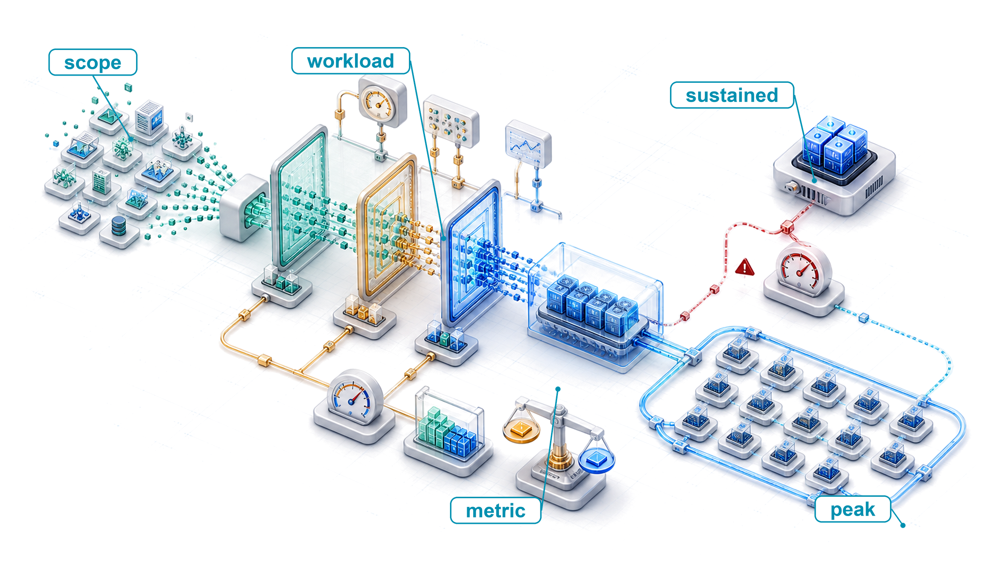
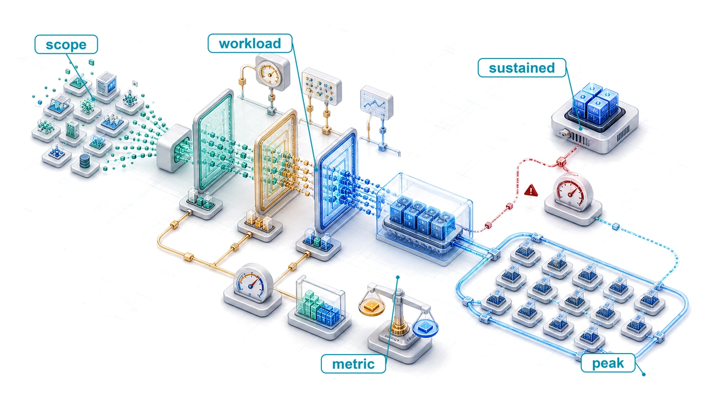
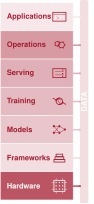
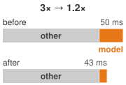
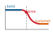
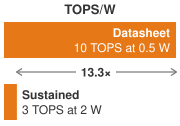
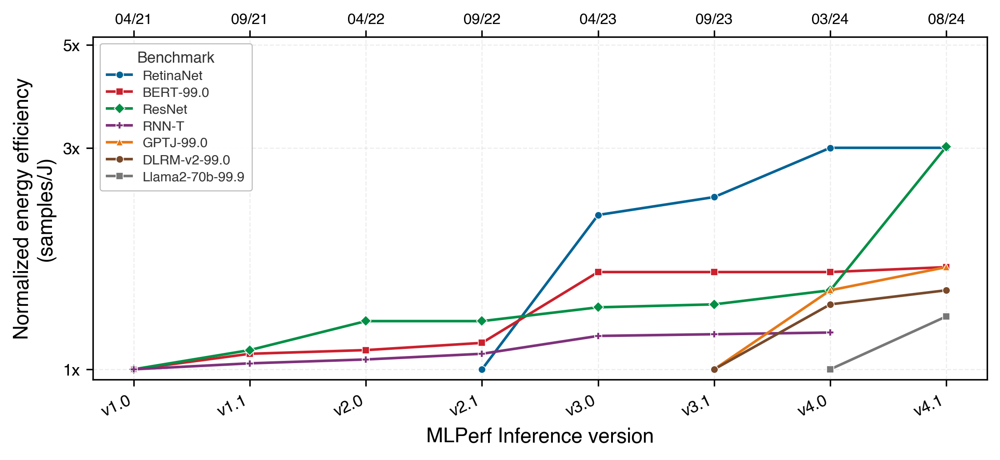
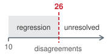
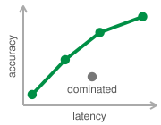
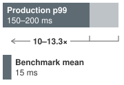

# Benchmarking {#sec-benchmarking}

::: {layout-narrow}
::: {.column-margin}

\chapterminitoc

:::

::: {.content-visible when-format="pdf"}
\noindent
{fig-alt="Isometric benchmarking rig showing a workload passing through nested measurement scopes with a visible gap between peak capability and sustained behavior."}
:::

::: {.content-visible unless-format="pdf"}
{fig-alt="Isometric benchmarking rig showing a workload passing through nested measurement scopes with a visible gap between peak capability and sustained behavior."}
:::

:::

## Purpose {.unnumbered .unlisted}

::: {.content-visible when-format="pdf"}
\begin{marginfigure}
\mlsysstack{75}{15}{25}{30}{35}{45}{10}{15}
\end{marginfigure}
:::

::: {.content-visible unless-format="pdf"}
::: {.column-margin}
{width="100%" fig-alt="Machine Learning Systems Architecture Stack"}

*Architecture stack focus for this chapter.*
:::
:::

_How can ML systems be compared fairly when hardware, models, data, and deployment all interact?_

Every optimization claim must eventually face deployment-representative conditions, and many do not survive the encounter. Each decision targets one dimension (latency, accuracy, throughput, or energy), but an ML system is the product of all these dimensions simultaneously: a pruned model may run faster on one accelerator yet slower on another, while a larger batch size improves accelerator utilization at the cost of violating a latency service-level agreement. Similarly, an edge device may advertise peak throughput that thermal throttling sharply reduces within minutes of sustained load, and a speedup measured on a warm, idle machine with synthetic inputs can vanish or reverse once real requests, cold caches, and competing jobs share the hardware. The challenge is not whether a local metric improves but whether the combined system improves under conditions that actually matter. Benchmarking makes such comparisons systematic rather than anecdotal. It requires defining what to measure, at what granularity (a single kernel, a full model, an end-to-end pipeline), and under which conditions (batch size, input distribution, thermal state, concurrent load). Without this structure, teams compare numbers that were never measured on the same terms, and decisions that looked sound in a spreadsheet collapse under production workloads. Choosing hardware, a model, or a deployment configuration on such numbers can commit an organization to millions of dollars of infrastructure that delivers a fraction of the capacity it was bought to provide. Benchmarking validates each optimization, bringing claims into contact with evidence and quantifying the gap between promise and delivery. In D·A·M terms, benchmarking holds co-design to account by revealing whether Data, Algorithm, and Machine were matched or merely assembled.

::: {.content-visible when-format="pdf"}

\newpage

:::

::: {.callout-learning-objectives}

- Explain the benchmark–production gap and benchmarking as D·A·M validation that tests whether optimization claims hold under representative conditions
- Design a benchmark that turns an optimization claim into a test by fixing its task, data, model, metrics, harness, and run rules
- Select micro, macro, or end-to-end granularity based on the engineering decision being tested, and compare a roofline prediction with a measurement
- Compare training and inference benchmarks using standardized run rules, time to quality, throughput, and latency percentiles
- Measure energy per inference and average power with matched measurement boundaries, windows, and duty cycles
- Determine whether a measured difference exceeds noise using repeated runs, paired tests, and confidence intervals
- Evaluate model and data quality with confidence calibration, robustness, representativeness, and slice-level metrics, and diagnose benchmark–production gaps caused by drift, thermal throttling, and dynamic load

:::

## The Benchmark–Production Gap {#sec-benchmarking-machine-learning-benchmarking-framework-70b8}

A model quantized to INT8 may benchmark 2$\times$ faster on a synthetic workload and show no improvement under real traffic with variable input sizes and concurrent requests. A pruned model may hold its accuracy on the test set and fail on the edge cases the benchmark never covered. Every engineering claim about speed, size, or energy is a number measured somewhere: on a warm accelerator or a cold one, at a batch of 256 or a batch of one, on curated test images or on whatever a camera returns at night. The **benchmark–production gap**\index{Benchmark-production gap!definition} is the difference between how a machine learning system performs under the conditions a measurement fixed and how it performs under the conditions it meets in deployment. Benchmarking is the engineering discipline that measures this gap before a deployment pays for it, and that narrows it by making the measured conditions match the deployed ones.

@Sec-hardware-acceleration ended on predictions. Its roofline placed ResNet-50's layers against an accelerator's compute and bandwidth ceilings, and at INT8 the doubled ridge point moved some of those layers off the compute roof. Before it, @sec-model-compression produced an INT8 artifact a quarter of the FP32 size, and @sec-data-selection reached target accuracy on fewer examples. Each is a favorable local number, computed for one stage in isolation, and the stages interact once they run together on a real machine under real load. Benchmarking measures which of those numbers survive. It comes before serving and operations because every later decision, from how many accelerators to provision to when to roll a model back, rests on measurements made the way this chapter prescribes.

```{python}
#| echo: false

from mlsysim import *
from mlsysim.core.units import *
from mlsysim import Hardware, Engine, Models
from mlsysim.core.units import TFLOP, second
from mlsysim.fmt import fmt_flop_rate, fmt_percent, fmt_time, fmt_multiple, fmt_multiple_range, check
```

```{python}
#| echo: false
#| label: resnet50-h100-sustained
# ┌─────────────────────────────────────────────────────────────────────────────
# │ RESNET-50 ON ONE H100: PEAK VS. SUSTAINED ARITHMETIC
# ├─────────────────────────────────────────────────────────────────────────────
# │ Context: Definition callout immediately below (peak vs. sustained), and
# │          the predicted-vs-measured roofline notebook in the granularity
# │          section, which reuses these values.
# │
# │ Goal:    Show the gap between the H100's peak dense FP16 rate and the
# │          model arithmetic ResNet-50 training actually sustains.
# │ Show:    Peak TFLOP/s, measured images/s, FLOPs per training image,
# │          achieved TFLOP/s, and the resulting MFU.
# │ How:     Registry peak and model FLOPs; MLPerf Training per-accelerator
# │          throughput anchor; training FLOPs = 3x forward FLOPs.
# └─────────────────────────────────────────────────────────────────────────────
from mlsysim import Models, Hardware, Literature
from mlsysim.core.units import GFLOPs, TFLOP, second
from mlsysim.fmt import check, fmt_flop_rate, fmt_flops, fmt_rate, fmt_percent

# ┌── LEGO ───────────────────────────────────────────────
class ResNet50H100Sustained:
    """ResNet-50 training on one H100: peak dense FP16 rate vs. sustained model arithmetic."""

    # ┌── 1. LOAD (Constants) ──────────────────────────────────────────────
    resnet = Models.Vision.ResNet50
    h100 = Hardware.Cloud.H100
    # MLPerf Training v3.1 per-accelerator throughput anchor (images per second)
    measured_rate = Literature.Benchmarks.ResNet50H100TrainThroughput.value / second
    # convention: the backward pass costs about twice the forward pass
    train_to_forward = 3

    # ┌── 2. EXECUTE (The Compute) ────────────────────────────────────────
    peak = h100.compute.peak_flops
    flops_per_image = train_to_forward * resnet.inference_flops
    achieved = (measured_rate * flops_per_image).to(TFLOP / second)
    mfu = (achieved / peak).to("").magnitude

    # ┌── 3. GUARD (Invariants) ───────────────────────────────────────────
    check(0.08 < mfu < 0.2, f"Prose says ResNet-50 sustains about 12 percent of H100 peak, got {mfu:.3f}.")
    check(abs(flops_per_image.to(GFLOPs).magnitude - 24.6) < 0.1, f"Expected 24.6 GFLOP per training image, got {flops_per_image}.")

    # ┌── 4. OUTPUT (Formatting) ─────────────────────────────────────────────
    peak_tflop_per_s_str = fmt_flop_rate(peak, unit=TFLOP / second, precision=0, commas=False)
    measured_ips_str = fmt_rate(measured_rate.to(1 / second).magnitude, "images/s", precision=0, commas=True)
    forward_gflop_str = fmt_flops(resnet.inference_flops, unit=GFLOPs, precision=1, commas=False)
    train_gflop_str = fmt_flops(flops_per_image, unit=GFLOPs, precision=1, commas=False)
    achieved_tflop_per_s_str = fmt_flop_rate(achieved, unit=TFLOP / second, precision=0, commas=False)
    mfu_pct_str = fmt_percent(mfu, precision=1, commas=False, style="prose")
```

::: {#dfn-benchmarking-machine-learning-benchmarking .callout-definition title="Machine learning benchmarking"}

***Machine learning benchmarking***\index{Benchmarking!definition} is the empirical measurement of ML workloads under specified conditions, used to test claims about components, models, or end-to-end systems against representative evidence rather than peak specifications alone.

1.  **Significance**: The gap between peak and sustained performance can be large. An H100 delivers `{python} ResNet50H100Sustained.peak_tflop_per_s_str` of dense FP16 arithmetic at peak, yet ResNet-50 training at the MLPerf per-accelerator throughput of about `{python} ResNet50H100Sustained.measured_ips_str` sustains about `{python} ResNet50H100Sustained.achieved_tflop_per_s_str` of model arithmetic. That is a model FLOPs utilization (MFU, achieved model FLOP/s divided by the hardware's peak FLOP/s) of about `{python} ResNet50H100Sustained.mfu_pct_str`. Memory-bound layers, the input pipeline, and launch and synchronization overhead account for the difference. Benchmarking quantifies the actual $\EfficiencyHw$ gap for a workload; vendor spec sheets do not.
2.  **Distinction**: ML benchmarking spans multiple scopes. Micro-benchmarks isolate operations such as matrix multiplication, model-level benchmarks evaluate complete training or inference workloads, and end-to-end benchmarks include surrounding work such as data loading, preprocessing, optimization, checkpoint I/O, or serving infrastructure. The scope must match the engineering claim.
3.  **Common pitfall**: A frequent misconception is that benchmark numbers are stable references. Both the workload (new model architectures) and the hardware (new GPU generations) evolve, so a result that leads a benchmark under one version often becomes the baseline under a later version. Year-over-year comparisons are therefore meaningful only when the benchmark version is held constant.

:::

The iron law predicts how long a workload should take, and a benchmark measures how long it does; the difference between the two is the benchmark–production gap made quantitative. For bandwidth-bound workloads, the gap between peak and sustained performance follows from the memory wall\index{Memory wall!impact on GPU utilization}. Compute-bound workloads can approach peak, yet ResNet-50's training step shows how much of a nominally compute-bound workload still falls outside the arithmetic. Every later section that quotes a peak number is measured against this gap.

::: {.column-margin .margin-pointer}
↩ The iron law, whose utilization term $\EfficiencyHw$ benchmarks measure against peak, is established in @sec-introduction-iron-law-ml-systems-c32a.
:::

::: {#psp-benchmarking-fallacy-peak-performance .callout-perspective title="The fallacy of peak performance"}

A long-standing computer architecture quip calls peak performance "the performance the manufacturer guarantees you will not exceed." For ML systems, the gap can be wide because of the memory wall. A bandwidth-bound model leaves much of the advertised FLOP/s unreachable no matter how fast the arithmetic units run. Standardized benchmarks like MLPerf require systems to run specified models and data, revealing sustained performance at a documented operating point rather than a universal rate for every workload.

:::

ML benchmarking operates across three interdependent dimensions that map directly to the components of any deployed system. **System benchmarking**\index{Benchmarking!system, definition} measures whether the hardware delivers promised performance under realistic workloads or whether memory bandwidth saturation and software dispatch overhead erode the gains. **Model benchmarking**\index{Model benchmarking!definition} measures whether optimization techniques preserve model quality across the full input distribution, not just on curated test sets. **Data benchmarking**\index{Data benchmarking!definition} measures whether the model generalizes to real-world data with all its noise, bias, and distributional shift. Each dimension can independently reveal problems invisible to the others, and a system that passes all three provides far stronger deployment confidence than one evaluated along any single axis. The three dimensions do not receive equal space. System benchmarking carries most of the chapter, because its measurement problems (how a benchmark is built, at what granularity it measures, which standardized suite it follows, and how it measures training, inference, and power) also shape how models and data are evaluated. Model and data evaluation follow once that machinery is in place, and the summary asks whether all three survive live traffic.

::: {#psp-benchmarking-benchmarks-as-moving-targets .callout-perspective title="Benchmarks as moving targets"}

In traditional systems (for example, SPEC CPU), the benchmark is a *rigid specification*. A sorting algorithm is correct if it sorts the list. Correctness is absolute and unchanging. In ML systems, the benchmark is a *soft specification*: correctness is defined by a finite set of examples (ImageNet), and the world moves. A model that scores highly on ImageNet can still underperform on user photos taken years after the benchmark was created.

In computer architecture, engineers design for the benchmark because the benchmark represents the workload. In ML engineering, designing solely for the benchmark is overfitting. Robustness comes from acknowledging that the benchmark is only a proxy for a shifting reality.

:::

Three lighthouse workloads carry the chapter, each chosen because it sits in a home regime and arrives with claims from the preceding chapters. ResNet-50\index{ResNet-50!benchmarking lighthouse}, the book's compute-bound lighthouse, carries the measurement and training half. It is the MLPerf Training reference workload, with a published quality target (75.9 percent top-1 on ImageNet) and a published per-accelerator throughput, and its INT8 profile is the one @sec-model-compression modeled and @sec-hardware-acceleration placed on the roofline. MobileNetV2, compute-bound in its efficient regime, carries the deployment half. It runs on one edge board in a labeled composite scenario, a wildlife camera trap whose low-power host CPU and attached INT8 accelerator must classify each frame within its deadline on battery power. The measurements made on that board recur from the harness through the energy budget. Keyword spotting (KWS), the power-bound lighthouse, carries the power section, where the question is the energy a wake-word detector spends listening rather than how fast it answers. @Tbl-benchmarking-lighthouse-footprints lists each workload's operations and bytes, the quantities every later benchmark either confirms or refutes.

```{python}
#| echo: false
#| label: lighthouse-footprints
# ┌─────────────────────────────────────────────────────────────────────────────
# │ LIGHTHOUSE FOOTPRINTS: OPERATIONS AND BYTES
# ├─────────────────────────────────────────────────────────────────────────────
# │ Context: @tbl-benchmarking-lighthouse-footprints immediately below.
# │
# │ Goal:    Give the chapter's three workloads equal compute and memory
# │          accounting before any benchmark is run.
# │ Show:    Parameters, forward FLOPs, FP32 and INT8 weight bytes, and the
# │          training state at 16 B/param.
# │ How:     Registry parameter and FLOP counts; byte widths from units;
# │          16 B/param mixed-precision Adam convention from model training.
# └─────────────────────────────────────────────────────────────────────────────
from mlsysim import Models
from mlsysim.core.units import BYTES_FP32, BYTES_INT8, GFLOPs, MFLOPs, MB, KB, byte, param
from mlsysim.fmt import check, fmt_flops, fmt_memory, fmt_params, fmt_multiple

# ┌── LEGO ───────────────────────────────────────────────
class LighthouseFootprints:
    """Operations and bytes for ResNet-50, MobileNetV2, and the DS-CNN keyword spotter."""

    # ┌── 1. LOAD (Constants) ──────────────────────────────────────────────
    resnet = Models.Vision.ResNet50
    mobilenet = Models.Vision.MobileNetV2
    kws = Models.Tiny.DS_CNN
    # convention: FP16 weights and gradients, FP32 master weights and two Adam moments
    training_bytes_per_param = 16 * byte / param

    # ┌── 2. EXECUTE (The Compute) ────────────────────────────────────────
    resnet_fp32 = resnet.size_in_bytes(BYTES_FP32)
    resnet_int8 = resnet.size_in_bytes(BYTES_INT8)
    resnet_train = resnet.parameters * training_bytes_per_param
    mobilenet_fp32 = mobilenet.size_in_bytes(BYTES_FP32)
    mobilenet_int8 = mobilenet.size_in_bytes(BYTES_INT8)
    mobilenet_train = mobilenet.parameters * training_bytes_per_param
    kws_fp32 = kws.size_in_bytes(BYTES_FP32)
    kws_int8 = kws.size_in_bytes(BYTES_INT8)
    kws_train = kws.parameters * training_bytes_per_param

    # ┌── 3. GUARD (Invariants) ───────────────────────────────────────────
    check((resnet_fp32 / resnet_int8).to("").magnitude == 4, "INT8 weights must be a quarter of FP32.")
    check(resnet.inference_flops > 10 * mobilenet.inference_flops, "ResNet-50 should cost over 10x MobileNetV2 per image.")
    check(kws_int8.to(KB).magnitude < 300, "The INT8 keyword spotter should fit in a few hundred kilobytes.")

    # ┌── 4. OUTPUT (Formatting) ─────────────────────────────────────────────
    resnet_params_str = fmt_params(resnet.parameters, scale="M", precision=1, commas=False)
    resnet_gflop_str = fmt_flops(resnet.inference_flops, unit=GFLOPs, precision=1, commas=False)
    resnet_fp32_str = fmt_memory(resnet_fp32, unit=MB, precision=1, commas=False)
    resnet_int8_str = fmt_memory(resnet_int8, unit=MB, precision=1, commas=False)
    resnet_train_str = fmt_memory(resnet_train, unit=MB, precision=1, commas=False)
    mobilenet_params_str = fmt_params(mobilenet.parameters, scale="M", precision=1, commas=False)
    mobilenet_mflop_str = fmt_flops(mobilenet.inference_flops, unit=MFLOPs, precision=0, commas=False)
    mobilenet_fp32_str = fmt_memory(round(mobilenet_fp32.to(MB).magnitude) * MB, unit=MB, precision=0, commas=False)
    mobilenet_int8_str = fmt_memory(round(mobilenet_int8.to(MB).magnitude, 1) * MB, unit=MB, precision=1, commas=False)
    mobilenet_train_str = fmt_memory(round(mobilenet_train.to(MB).magnitude, 1) * MB, unit=MB, precision=1, commas=False)
    kws_params_str = fmt_params(kws.parameters, scale="K", precision=0, commas=False)
    kws_mflop_str = fmt_flops(kws.inference_flops, unit=MFLOPs, precision=0, commas=False)
    kws_fp32_str = fmt_memory(kws_fp32, unit=KB, precision=0, commas=False)
    kws_int8_str = fmt_memory(kws_int8, unit=KB, precision=0, commas=False)
    kws_train_str = fmt_memory(kws_train, unit=MB, precision=1, commas=False)
    flops_ratio_mult_str = fmt_multiple((resnet.inference_flops / mobilenet.inference_flops).to("").magnitude, precision=1, commas=False)
```

| **Workload**     |                    **Parameters**                    |                  **Forward FLOPs**                  |                 **Weights (FP32)**                 |                 **Weights (INT8)**                 |           **Training state (16 B/param)**           |
|:-----------------|:----------------------------------------------------:|:---------------------------------------------------:|:--------------------------------------------------:|:--------------------------------------------------:|:---------------------------------------------------:|
| **ResNet-50**    |  `{python} LighthouseFootprints.resnet_params_str`   |   `{python} LighthouseFootprints.resnet_gflop_str`  |  `{python} LighthouseFootprints.resnet_fp32_str`   |  `{python} LighthouseFootprints.resnet_int8_str`   |   `{python} LighthouseFootprints.resnet_train_str`  |
| **MobileNetV2**  | `{python} LighthouseFootprints.mobilenet_params_str` | `{python} LighthouseFootprints.mobilenet_mflop_str` | `{python} LighthouseFootprints.mobilenet_fp32_str` | `{python} LighthouseFootprints.mobilenet_int8_str` | `{python} LighthouseFootprints.mobilenet_train_str` |
| **KWS (DS-CNN)** |    `{python} LighthouseFootprints.kws_params_str`    |    `{python} LighthouseFootprints.kws_mflop_str`    |    `{python} LighthouseFootprints.kws_fp32_str`    |    `{python} LighthouseFootprints.kws_int8_str`    |    `{python} LighthouseFootprints.kws_train_str`    |

: **Lighthouse Operations and Bytes**: Forward-pass operations per input and the bytes each workload occupies as FP32 weights, INT8 weights, and full mixed-precision training state, so that every later measurement can be checked against what the workload must compute and move. Activations and runtime buffers are excluded. {#tbl-benchmarking-lighthouse-footprints tbl-colwidths="[18,15,16,16,16,19]"}

The table already separates the halves of the chapter. ResNet-50 does `{python} LighthouseFootprints.flops_ratio_mult_str` MobileNetV2's arithmetic per image, so its training benchmarks are about whether an accelerator sustains its rate; MobileNetV2's INT8 weights fit in a few megabytes, so its deployment benchmarks are about latency, sustained thermal state, and energy on a small board.

::: {.column-margin .margin-pointer}
↩ MobileNetV2, the lighthouse model for edge latency, is established in @sec-network-architectures-efficient-architectures-keyword-spotting-0625.
:::

```{python}
#| echo: false
# ┌── LEGO ───────────────────────────────────────────────
# │ Context: MobileNetV2 deployment validation lighthouse callout.
# │ Goal: INT8 compression ratio and accelerator vs host-CPU latency for the pipeline.
# │       Single source for the composite edge board's latencies; later cells read them.
from mlsysim import Models
from mlsysim.core.units import BYTES_FP32, BYTES_INT8, MB, ms
from mlsysim.fmt import fmt, fmt_memory, check

class MobileNetLighthouseSetup:
    _mobilenet_v2 = Models.Vision.MobileNetV2
    accel_latency = 2 * ms  # scenario assumption: INT8 MobileNetV2 on the board's attached accelerator (labeled composite)
    cpu_int8_latency = 15 * ms  # scenario assumption: INT8 MobileNetV2 on the board's host CPU
    _mv2_size = _mobilenet_v2.size_in_bytes(BYTES_FP32)
    _mv2_int8_size = _mobilenet_v2.size_in_bytes(BYTES_INT8)
    _mv2_compress = (_mv2_size / _mv2_int8_size).to_base_units().magnitude

    check(_mv2_compress == 4.0, f"Expected 4x INT8 compression, got {_mv2_compress:.1f}x")

    # ┌── 4. OUTPUT (Formatting) ─────────────────────────────────────────────
    mobilenet_v2_size_mb_str = fmt_memory(_mv2_size, unit=MB, commas=False)
    mobilenet_v2_int8_size_mb_str = fmt_memory(_mv2_int8_size, unit=MB, precision=1, commas=False)
    mobilenet_v2_compression_ratio_mult_str = fmt_multiple(_mv2_compress, precision=0, commas=False)
    accel_latency_ms_str = fmt_time(accel_latency, ms, precision=0, commas=False)
    cpu_latency_ms_str = fmt_time(cpu_int8_latency, ms, precision=0, commas=False)
```

::: {#lhs-benchmarking-mobilenet-deployment-validation .callout-lighthouse title="MobileNetV2 deployment validation"}

MobileNetV2 serves as the lighthouse example for validating the complete optimization pipeline. MobileNetV2 refines v1's depthwise separable design with inverted residuals and linear bottlenecks while maintaining a similar parameter scale [@sandler2018]. It exemplifies the deployment challenges where benchmarking determines success or failure: compression can reduce model size, hardware acceleration can reduce inference latency, and only benchmarking can determine whether those gains survive the full deployment pipeline.

1. **Model compression** (@sec-model-compression): INT8 quantization\index{Quantization!INT8 compression ratio} reduces this MobileNetV2 worked example from `{python} MobileNetLighthouseSetup.mobilenet_v2_size_mb_str` to `{python} MobileNetLighthouseSetup.mobilenet_v2_int8_size_mb_str` (`{python} MobileNetLighthouseSetup.mobilenet_v2_compression_ratio_mult_str` compression)
2. **Hardware acceleration** (@sec-hardware-acceleration): in this illustrative scenario the board's attached INT8 accelerator runs inference in `{python} MobileNetLighthouseSetup.accel_latency_ms_str` against `{python} MobileNetLighthouseSetup.cpu_latency_ms_str` on its host CPU
3. **Benchmarking validation**: Verify the pipeline delivers in practice

A systematic evaluation isolates the accelerator's latency from preprocessing and data transfer overhead, confirms INT8 quantization preserves accuracy on edge cases such as unusual lighting, and verifies that throughput holds on the camera trap's own frames rather than on curated ImageNet test images alone.

:::

Each stage of that pipeline arrives with a favorable number from its own chapter, such as a smaller model file or a faster kernel. The benchmarking question is which of those local numbers still hold once the stages run together on the target device, and three principles guide how the chapter answers it.

First, *benchmarks are proxies, not truth.*\index{Benchmarking!benchmarks as proxies} Every benchmark measures specific conditions that may not match the target deployment. A system can achieve high sample throughput in Offline mode (bulk throughput with all inputs available) and much lower queries per second (QPS) in Server mode (latency-constrained requests arriving over time). The critical question is always what the benchmark does not measure.

Second, Goodhart's Law governs benchmark rankings.[^fn-goodharts-law-metric]\index{Goodhart's law!metric trap} "When a measure becomes a target, it ceases to be a good measure." Teams that optimize for benchmark rankings often produce systems that excel in evaluation but fail in production. Benchmark-specific optimizations frequently degrade characteristics that matter for deployment: robustness, calibration, and efficiency.

Third, end-to-end beats component metrics\index{Benchmarking!end-to-end vs. component metrics}. A component speedup is diluted by every stage of the request it does not touch, and the dilution follows Amdahl's law; @sec-benchmarking-benchmarking-granularity-3855 quantifies it on a vision pipeline. These principles reappear throughout the methodology and return as misconceptions in @sec-benchmarking-fallacies-pitfalls-9781.

Two terms recur from here on. A service-level objective (SLO)\index{SLO!first use} is the target a deployed service commits to meet for a measured quantity, such as answering 99 percent of requests within a stated time; @sec-benchmarking-latency-tail-latency-5cde defines it formally. The 99th-percentile latency (p99)\index{P99!first use} is the response time that 99 percent of requests meet or beat, so it describes the slowest 1 percent of requests rather than the typical one.

[^fn-goodharts-law-metric]: **Goodhart's law**\index{Goodhart's law!etymology}: @goodhart1984 articulated the original 1975 Bank of England observation on monetary policy; @strathern1997improving generalized it into the form quoted above. The original context was macroeconomics: once a monetary aggregate became an official policy target, banks changed behavior to game the metric, destroying its predictive value. In ML, the same failure mode recurs structurally: BLEU rewards n-gram overlap [@papineni2001], ImageNet rewards performance on a fixed visual distribution [@deng2009; @recht2019imagenet], and benchmark leaderboards can incentivize test-set-specific tuning.

The chapter builds the measurement before it applies it (@tbl-benchmarking-chapter-spine). Benchmark carpentry turns a claim into a test that fixes the task, data, model, metrics, harness, and run rules. Granularity decides how much of the system a test spans, from one kernel to the whole request path, and it is where the roofline's prediction for ResNet-50 meets a measurement. Benchmark suites standardize those choices across organizations. The training and inference sections apply them to ResNet-50 and to MobileNetV2 on its edge board, and power measurement adds the joules, with keyword spotting as the case. Best practices supply the statistics that decide whether a measured difference is real, and model and data evaluation test the two dimensions that a hardware result cannot certify. The fallacies and the summary close by asking whether the evidence survives production traffic.

| **Section**                      | **Claim it tests**                                    | **What is measured**                                                      | **Granularity**                    | **Unit**               | **Trap it guards against**                                     |
|:---------------------------------|:------------------------------------------------------|:--------------------------------------------------------------------------|:-----------------------------------|:-----------------------|:---------------------------------------------------------------|
| **Benchmark Carpentry**          | ResNet-50 at INT8 is faster than at FP32              | The claim restated as task, data, model, metric, harness, and run rules   | Set by the claim                   | Stated per metric      | A number reported without its conditions                       |
| **Benchmarking Granularity**     | A kernel speedup speeds up the request                | Kernel, model, and request-path time; predicted against measured roofline | Micro, macro, end to end           | s, FLOP/s, B/s         | A component speedup diluted by untouched stages                |
| **Benchmark Suites**             | Two vendors' numbers are comparable                   | A reference workload under shared divisions, scenarios, and run rules     | Model and system                   | Time to quality, QPS   | Favorable conditions chosen separately by each vendor          |
| **Training Benchmarks**          | More accelerators train a model proportionally faster | Time to target accuracy, throughput, scaling efficiency, MFU              | Model on one to eight accelerators | s, images/s, percent   | Throughput that never reaches the quality target               |
| **Inference Benchmarks**         | MobileNetV2 meets its frame deadline on the board     | Latency percentiles, throughput, memory, cold start                       | End to end on one board            | ms (p50, p99), FPS, B  | A mean that hides the tail; a burst that hides throttling      |
| **Power and Energy Measurement** | The device lasts on its battery                       | Energy over a matched window; average power across the duty cycle         | Device or system boundary          | J per inference, W     | Efficiency quoted at an operating point the device never holds |
| **Benchmarking Best Practices**  | A measured difference is real                         | Repeated runs, paired tests, confidence intervals                         | Any                                | Interval               | A one-point gap inside sampling noise                          |
| **Model and Data Evaluation**    | The compressed model is still right on deployed data  | Confidence calibration, slices, coverage, label quality, shift            | Model and dataset                  | ECE, percent per slice | Aggregate accuracy that hides calibration and subgroup loss    |

: **Chapter Map**: Each section turns one optimization claim into a measurement, names the granularity and unit the measurement uses, and names the trap that a careless version of the measurement falls into. {#tbl-benchmarking-chapter-spine tbl-colwidths="[16,18,22,13,12,19]"}

Knowing *what* to measure is only half of the problem. Measuring incorrectly, with the wrong workload, a biased baseline, or an uncontrolled variable, produces numbers that look precise and mislead the decision they inform. The history of computing benchmarks[^fn-benchmark-etymology-surveying] is full of technically sound metrics applied with flawed methodology, from compiler-gamed Whetstone scores to throughput claims that predict nothing about sustained workloads (@sec-benchmarking-historical-context-7350). The defense is construction. A benchmark must be built so that it measures what its claim says, and that construction is where the chapter begins.

[^fn-benchmark-etymology-surveying]: **Benchmark**\index{Benchmark!etymology}: From surveying, where a "bench mark" was a horizontal cut in stone serving as a fixed elevation reference. The term entered computing in the 1970s to describe standardized comparison points, and the surveying metaphor carries a systems lesson. Just as an elevation measurement is meaningless without a calibrated reference, an ML throughput number is meaningless without controlled workloads, thermal state, and precision settings.

## Benchmark Carpentry {#sec-benchmarking-benchmark-components-97cc}

A claim that ResNet-50 runs faster at INT8 than at FP32 can reverse depending on whether timing starts at a JPEG on storage or at a preprocessed tensor in accelerator memory, or whether the quantized weights drop accuracy below the target floor. **Benchmark carpentry**\index{Benchmark carpentry!definition} is the craft of building a benchmark that measures what its claim says. It fixes the task, data, model, metrics, harness, system specification, and run rules so that the number the benchmark produces answers the engineering question and no other. A synthetic matrix-multiplication loop, a ResNet-50 training run over ImageNet, and a full serving pipeline all need these specifications, and changing one component changes what the next can measure. The components follow the D·A·M taxonomy. The problem definition fixes the input representation (Data). The dataset and task objective bound the feasible models (Algorithm). The target hardware's memory, energy envelope, and deadlines bound how the model may execute (Machine).

Evaluating an ML system requires coupling statistical task metrics with physical efficiency metrics. Quantization and pruning reduce parameter footprint and memory bus traffic, but they alter numerical representations and risk degrading task accuracy. A benchmark that records execution latency without statistical accuracy (such as area under the ROC curve (AUC) or classification error) rewards aggressive approximations that produce invalid outputs. Conversely, reporting accuracy without latency or memory consumption conceals whether the model satisfies the target system's physical constraints.

The measurement harness and run rules provide the experimental controls that make these evaluations reproducible. The protocol follows the question being tested. A controlled steady-state experiment can use warm-up iterations, fixed processor clocks, and pinned host memory to isolate execution differences. A deployment benchmark instead retains the relevant dynamic voltage and frequency scaling (DVFS) policy, cold starts, and competing workloads, documenting their effects. Recording tail latency distributions (p95, p99) alongside the mean exposes delays hidden by averages. Each component is built here on the claim the chapter inherited, that ResNet-50 runs faster at INT8 than at FP32, and MLPerf Tiny's anomaly-detection benchmark at the end shows every component fixed at once on a small embedded model.

### Turning a claim into a test {#sec-benchmarking-problem-definition-79e4}

Every benchmark begins as a claim. The claim from the preceding chapters, that ResNet-50 at INT8 runs faster than at FP32 without unacceptable accuracy loss, is not yet testable, because it names neither the inputs, the output, nor the conditions under which faster must hold. Fixing those boundaries is the first act of carpentry. Without an explicit task specification, hardware and software optimizations cannot be evaluated on equivalent terms: altering an input resolution, a numerical datatype, or a latency deadline changes how much work the machine does. For ResNet-50 the input is a decoded $224{\times}224$ RGB image and the output is one of a thousand ImageNet class labels. Whether the task is natural language processing [@hirschberg2015] or computer vision [@everingham2009; @lin2014microsoft], a complete problem definition establishes three specifications: an input specification, an output specification, and a performance specification.

The input and output specifications fix the data each run must move and define the exact scope of timed execution. The input specification fixes tensor dimensions, batching behavior, numerical representations (such as FP16 or INT8), and ingestion rates. For the ResNet-50 claim, it decides whether timing starts at a JPEG on storage or at a preprocessed tensor already in accelerator memory, a choice that can change the measured time more than the precision change being tested. Conversely, the output specification defines the termination boundary of the computation. Benchmarks frequently introduce measurement bias by timing only accelerator forward passes while ignoring the CPU post-processing required to turn raw tensor outputs into usable decisions. A robust output specification defines whether the system emits raw logits, intermediate embeddings, or final class labels, accounting for any downstream thresholding or reduction kernels that consume host memory bandwidth.

The performance specification defines the operational envelope that governs whether an optimization is viable. Unconstrained throughput numbers are meaningless if statistical accuracy degrades below acceptable thresholds, and high average throughput cannot rescue a system that violates a latency service-level agreement (SLA). For the ResNet-50 claim, the performance specification couples a quality floor (MLPerf Training requires 75.9 percent top-1, and an INT8 deployment might permit at most one percentage point of loss against FP32) with hardware execution limits. These are a tail-latency ceiling, sustained throughput matching the arrival rate of images, and a resident memory footprint that leaves room for activations at the chosen batch size. By defining these three boundaries up front, the benchmark ensures that the later stages, from dataset construction to measurement harness configuration, evaluate system optimizations against the true operational constraints of deployment.

### Task and dataset {#sec-benchmarking-standardized-datasets-123f}

A task definition is only as rigorous as the data used to evaluate it. Standardized datasets enforce identical evaluation conditions across competing approaches, preventing teams from cherry-picking private slices that obscure comparative weaknesses. In computer vision, ImageNet\index{ImageNet!standardized dataset} [@imagenet_website; @deng2009], COCO\index{COCO!object detection dataset} [@lin2014microsoft], and CIFAR-10\index{CIFAR-10!classification reference dataset} [@cifar10_website] establish reference tasks across classification and detection. In natural language processing, SQuAD\index{SQuAD!reading comprehension dataset}[^fn-squad-question-answering] [@rajpurkar2016], GLUE\index{GLUE!language understanding benchmark}[^fn-glue-benchmark-saturation] [@wang2018], and WikiText [@wikitext_website; @merity2016pointer] fulfill equivalent roles by standardizing comprehension, classification, and language modeling across diverse textual domains.

[^fn-squad-question-answering]: **SQuAD (Stanford question answering dataset)**\index{SQuAD!saturation}: Introduced in 2016 with more than 100,000 question-answer pairs from Wikipedia [@rajpurkar2016]. AI systems exceeded the SQuAD 1.1 human baseline of 91.2 percent F1 by 2018 [@devlin2019], but the "superhuman" result reflects a benchmarking failure mode. The task's extractive format (answers are text spans within the passage) makes it easier than open-ended question answering, inflating perceived capability relative to production NLP systems.

[^fn-glue-benchmark-saturation]: **GLUE (general language understanding evaluation)**\index{GLUE!benchmark saturation}: Introduced in 2018 as a broad language-understanding benchmark [@wang2018], GLUE was quickly saturated by systems such as BERT [@devlin2019]. Once GLUE became a target, leaderboard optimization reduced its discriminating power, as Goodhart's Law predicts. The pattern motivated harder follow-on evaluations such as SuperGLUE and BIG-bench.

Dataset selection is the first place a benchmark can lose contact with deployment reality. ImageNet's validation set fixes ResNet-50's quality target, but its curated, centered photographs are not the frames a camera trap returns at dusk, a gap that @sec-benchmarking-data-benchmarking-22f9 returns to. A benchmark dataset must be representative enough to expose deployment failures and hard enough to separate models.

### Model and metrics {#sec-benchmarking-evaluation-metrics-6bac}

```{python}
#| echo: false
#| label: bert-model-specs
# ┌─────────────────────────────────────────────────────────────────────────────
# │ BERT MODEL SPECS
# ├─────────────────────────────────────────────────────────────────────────────
# │ Context: BERT footnote in Model Selection section (~line 1334)
# │
# │ Goal: Provide BERT-Large parameter count for the BERT baseline footnote.
# │ Show: BERT-Large parameter count in millions.
# │ How: Retrieve from Models Digital Twin.
# │
# └─────────────────────────────────────────────────────────────────────────────
from mlsysim.fmt import fmt_params

class BertModelSpecs:
    """BERT-Large parameter count for the model selection footnote."""

    _bert_large_m = Models.Language.BERT_Large.parameters.to(Mparam).magnitude
    bert_large_params_m_str = fmt_params(Models.Language.BERT_Large.parameters, scale="M", precision=0, commas=False)
```

With the task and dataset fixed, the benchmark must specify the model architecture and its baseline implementations. In systems benchmarking, the model defines the execution workload. Its computational graph determines arithmetic intensity, memory footprint, and communication topology. Selecting the benchmark model determines whether measured performance variations reflect architectural efficiency, software runtime optimizations, or raw accelerator capacity. Evaluating an architectural modification requires holding the runtime and hardware target constant. Conversely, evaluating hardware platforms or software execution engines requires standardizing on a fixed, representative model graph so that throughput differences isolate execution efficiency rather than mathematical changes to the workload.

Baseline models\index{Baseline model!reference point selection} establish the empirical reference point for a target domain. Rather than toy algorithms, systems benchmarks rely on canonical workloads whose computational profiles and memory access patterns are well-characterized. In vision, ResNet-50 plays this role, which is why the chapter's claim is stated on it. In language processing, BERT[^fn-bert-benchmark-evaluation] serves as a standard baseline because its multi-head self-attention and dense feed-forward blocks exercise both compute-bound matrix multiplications and memory-bandwidth-bound reduction operations. However, a baseline specification cannot stop at the mathematical graph. Two implementations of the identical architecture across different frameworks or runtimes often behave differently at runtime. Differences in kernel fusion (such as fusing normalization and activation functions directly into general matrix multiply (GEMM) output epilogues to avoid round-trips to high-bandwidth memory (HBM)), kernel launch overhead, and memory allocator behavior can exceed the performance impact of minor architectural variations. A comparison that isolates hardware must control the runtime implementation alongside the mathematical model. A runtime comparison instead names that implementation as the intervention and documents both stacks.

[^fn-bert-benchmark-evaluation]: **BERT (bidirectional encoder representations from transformers)**\index{BERT!benchmarking baseline}: BERT-Large (`{python} BertModelSpecs.bert_large_params_m_str` parameters) is a language-processing workload in MLPerf Inference. The benchmark fixes the task, data, quality target, and applicable execution scenarios so systems can be compared on the same workload. BERT latency still depends on sequence length, batching, and implementation.

A benchmark must select the operational regime relevant to its engineering question. In training, memory capacity and interconnect bandwidth can be binding constraints, because storing forward activations, backward gradients, and optimizer states across multiple accelerators limits batch size and demands high-bandwidth collective communication. Training benchmarks therefore measure time-to-accuracy under fixed convergence criteria rather than raw iteration speed alone. In inference, backward passes and optimizer states disappear. Evaluation instead emphasizes the serving objective, such as tail latency under SLAs, while low-batch autoregressive decode often faces bandwidth pressure. Transitioning a model to production frequently requires precision reduction, quantizing FP32 or BF16 weights and activations to INT8 or FP8. Moving eligible tensors from a 16-bit to an 8-bit format halves their raw storage and can reduce traffic or raise supported arithmetic throughput. Whole-model gains depend on the execution path, and validation must establish whether numerical error stays within the quality target. A development-to-deployment comparison may need both regimes because efficient training does not establish serving feasibility; a deployment decision for a fixed pretrained model can focus on inference.

Evaluation metrics[^fn-metric-etymology-measurement] translate raw model behavior into numbers that can be compared, ranked, and used to make engineering decisions. The difficulty lies in choosing the right numbers. A metric that captures accuracy but ignores latency may declare the winner to be a model too slow for production; one that rewards throughput but ignores energy may optimize for a deployment budget that does not exist. @Tbl-metric-taxonomy categorizes evaluation measures by the failure mode each exposes and the deployment context it serves. <!-- {#sec-benchmarking-metric-taxonomy-d4cd} -->

[^fn-metric-etymology-measurement]: **Metric**\index{Metric!etymology}\index{Metric!intransitivity}: In mathematics, a metric is a distance function satisfying strict axioms including the triangle inequality. ML borrows the term loosely for quantitative measures such as BLEU and perplexity, which are scoring rules rather than mathematical metrics. Leaderboard rankings can change when the evaluation protocol, dataset slice, or metric weighting changes, making the choice of metric an engineering decision that shapes which system wins, not just how performance is measured.

```{=latex}
\begingroup
\renewcommand{\arraystretch}{1.35}
```

| **Category**   | **Metric**                   | **Unit**               | **Primary Use Case**   |
|:---------------|:-----------------------------|:-----------------------|:-----------------------|
| **Accuracy**   | Top-1/Top-5 Accuracy         | Percentage             | Classification         |
|                | mAP (mean Average Precision) | 0–1 score              | Object detection       |
|                | BLEU/ROUGE                   | 0–100 score            | NLP generation         |
|                | Perplexity                   | Score (lower = better) | Language modeling      |
| **Throughput** | Samples/second               | Samples/s              | Batch inference        |
|                | Token throughput             | tokens/s               | LLM inference          |
|                | Time-to-train                | Hours/days             | Training benchmarks    |
| **Latency**    | p50 latency                  | Milliseconds           | Median response time   |
|                | p99 latency                  | Milliseconds           | Tail latency (SLA)     |
|                | First-token latency          | Milliseconds           | LLM responsiveness     |
| **Efficiency** | Samples/second/watt          | Samples/s/W            | Energy efficiency      |
|                | Accuracy/FLOP                | percent/PFLOP          | Algorithmic efficiency |
|                | TCO per inference            | \$/inference           | Economic efficiency    |

: **ML Benchmarking Metric Taxonomy**: Metrics organized by evaluation category, unit, and primary use case. Accuracy metrics quantify model quality, throughput and latency metrics capture system speed, and efficiency metrics combine multiple dimensions. Selecting the right metric for the deployment context is often more important than optimizing any single metric to its maximum. {#tbl-metric-taxonomy}

```{=latex}
\endgroup
```

The metrics in @tbl-metric-taxonomy expose physical trade-offs governed by the accelerator architecture. Throughput\index{Throughput!vs. latency trade-off} measures aggregate processing capacity, whereas latency\index{Latency!percentile, p50 p95 p99 reporting} measures individual request completion time. These two objectives conflict directly at the hardware boundary. Maximizing throughput requires aggregating requests into larger batches to amortize weight-loading memory bandwidth across multiple inputs, raising arithmetic intensity on tensor units. That batching mechanism inflates per-sample latency, because individual requests wait in arrival queues while a batch forms, and larger matrix operations take longer to complete. Furthermore, arithmetic mean latency masks tail behavior. Queuing jitter, memory allocation stalls, and accelerator thermal throttling cause execution times to diverge; a system with a 10 ms mean latency can still suffer a 500 ms p99 latency that violates service-level agreements. Benchmarks must therefore report distribution percentiles (p50, p95, p99) rather than averages. Compound metrics such as samples/second/watt compress multiple dimensions into a single scalar, simplifying high-level comparisons but obscuring where bottlenecks reside. Reporting atomic metrics (latency distributions, throughput, and power draw) alongside compound figures isolates which physical constraint limits the system.

::: {.column-margin .margin-pointer}
↪ The batch size at which waiting for a batch to form pushes latency past its budget is measured with a batch-size sweep in @sec-model-serving-batching-tax.
:::

Task-specific metrics evaluate the algorithmic dimension, quantifying whether the model solves the statistical problem. Classification workloads evaluate accuracy (the fraction of correct predictions), precision\index{Precision!positive prediction accuracy}, recall\index{Recall!positive case detection rate}, and the F1 score\index{F1 score!precision-recall harmonic mean} [@sokolova2009]. Precision and recall isolate true positive rates from false alarms, which is essential when class distributions are imbalanced. Continuous estimation tasks rely on Mean Squared Error (MSE) or Mean Absolute Error (MAE), while sequence generation uses specialized scoring rules such as BLEU[^fn-bleu-score-translation] to measure modified n-gram precision against human reference translations [@papineni2001].

[^fn-bleu-score-translation]: **BLEU (bilingual evaluation understudy)**\index{BLEU!Goodhart's law example}: Introduced by IBM in 2002, BLEU measures translation quality through modified n-gram precision with a brevity penalty against reference translations [@papineni2001]. BLEU is a canonical example of Goodhart's Law in ML, because optimizing for n-gram matches can reward surface-level word overlap even when meaning, fluency, or deployment usefulness diverges from the target.

Task metrics evaluate algorithmic quality in isolation, but deployment viability depends on physical machine constraints. Model capacity, measured in parameter count and memory footprint, determines whether weights fit into on-chip SRAM or accelerator memory, or whether they spill across high-latency interconnects. Per-inference execution latency dictates whether a system meets real-time deadlines, while energy consumption per inference (measured in joules or millijoules) bounds thermal dissipation and battery life.

Benchmarks must also account for measurement sensitivity across software runtimes. As established in @sec-model-training, different frameworks handle loss computation, kernel fusion, and gradient accumulation differently, altering reported benchmark numbers. Subtle implementation differences shift measured accuracy and latency enough to invert benchmark rankings when candidate models differ by narrow margins. Examples include whether batch normalization is configured to use stored running statistics or current mini-batch statistics during evaluation, and how reduction kernels reorder non-associative floating-point additions.

### Benchmark harness {#sec-benchmarking-benchmark-harness-09ea}

Metrics define *what* to measure; the benchmark harness\index{Benchmark harness!test infrastructure} determines *how* to measure it. The harness is the software and instrumentation scaffold that feeds inputs to the system under test, coordinates execution, collects timing and power traces, and enforces reproducibility\index{Reproducibility!benchmark requirement}. In an ML system, measuring execution down to the metal requires accounting for the asynchronous execution boundary between the host CPU and the accelerator. When host software initiates an inference or training step, the framework runtime merely enqueues commands onto an accelerator work queue (such as a CUDA stream or hardware command buffer) and returns control immediately. A naive timer wrapping the host-level call measures only this sub-microsecond queue dispatch latency rather than actual device execution. A rigorous harness inserts explicit device synchronization barriers (such as `torch.cuda.synchronize()`) or queries on-device timestamp events (such as `torch.cuda.Event`), ensuring that recorded timings cover the declared device-work interval rather than mere host enqueue overhead.

The timer endpoints determine which work enters the result. @Fig-benchmark-async-timing separates the host call, the synchronized host interval, and the device-event interval for one inference.

::: {#fig-benchmark-async-timing fig-env="figure" fig-pos="htb" fig-cap="**Timing Across an Asynchronous Boundary**: The host call returns after enqueueing work, before the accelerator completes it. A synchronized host timer spans enqueueing through completion; device events measure elapsed time between their positions on the stream. The timing boundaries determine whether transfers and other queued work are included." fig-alt="Two aligned host and accelerator lanes with an enqueue block, a host waiting block, and an accelerator work block. Three arrows mark the call timer, the device-event interval, and the synchronized host interval."}

```{.tikz}
\begin{tikzpicture}[font=\footnotesize\sffamily,line join=round,
  arr/.style={-{Stealth[length=4pt]},draw=GrayLine,line width=.7pt,shorten >=2pt},
  note/.style={align=center,font=\scriptsize\sffamily}]
\draw[arr] (2,4.05)--(12.8,4.05) node[below left] {time};
\node[anchor=east] at (1.7,3.35) {Host};
\node[anchor=east,align=right] at (1.7,2.05) {Accelerator\\stream};
\draw[GrayLine] (2,3.35)--(12.6,3.35);
\draw[GrayLine] (2,2.05)--(12.6,2.05);
\draw[draw=GreenLine,fill=GreenL!65] (2.2,3.05) rectangle (3.7,3.65);
\node[note] at (2.95,3.35) {enqueue};
\draw[draw=GrayLine,fill=GrayL!35] (3.7,3.05) rectangle (11.5,3.65);
\node[note] at (7.6,3.35) {host waits for completion barrier};
\draw[arr,dashed] (3.7,3.03)--(3.7,2.5)--(4.4,2.5)--(4.4,2.36);
\draw[draw=OrangeLine,fill=OrangeL!65] (4.4,1.75) rectangle (10.6,2.35);
\node[note] at (7.5,2.05) {work bracketed by device events};
\draw[arr,dashed] (10.6,2.36)--(10.6,2.65)--(11.5,2.65)--(11.5,3.03);
\draw[GrayLine,densely dotted] (2.2,3.7)--(2.2,.3);
\draw[GrayLine,densely dotted] (3.7,3.0)--(3.7,1.0);
\draw[GrayLine,densely dotted] (11.5,3.0)--(11.5,.3);
\draw[<->,draw=GreenLine,line width=.9pt] (2.2,1.25)--(3.7,1.25);
\node[note,anchor=east] at (2,1.25) {Call timer};
\node[note,anchor=west] at (4,1.25) {returns before device work completes};
\draw[<->,draw=OrangeLine,line width=.9pt] (4.4,.75)--(10.6,.75);
\node[note] at (7.5,.45) {Device-event interval: elapsed time between events};
\draw[<->,draw=GrayLine,line width=.9pt] (2.2,-.05)--(11.5,-.05);
\node[note] at (6.85,-.4) {Synchronized host interval: enqueue, waiting, and completion};
\end{tikzpicture}
```

:::

These intervals answer different questions. Earlier device work must finish before the host timer starts. A synchronized host interval then measures elapsed completion time under the stated synchronization boundary, whereas events measure the interval between their positions in the accelerator stream. A report must state those boundaries before comparing two implementations; neither method includes work that falls outside them.

Harness architecture must align with the operational regime of the deployment target. In server environments, the harness generates concurrent request traffic using an open-loop load generator, often parameterizing inter-arrival times with a Poisson distribution.[^fn-poisson-arrival-benchmark] An open-loop harness issues requests according to an independent arrival schedule regardless of server responsiveness. This decoupling exposes queuing delays and tail latency (such as p99 response times) when arrival bursts saturate available compute.

In contrast, a naive benchmarking client often employs a closed-loop pattern: sending a request, blocking until the response arrives, and only then issuing the next request. This design introduces the severe measurement distortion known as **coordinated omission**\index{Coordinated omission!closed-loop measurement trap}. Consider a server that experiences a transient 500 ms garbage collection pause or memory reallocation stall. In an open-loop production environment, independent users continue submitting queries, causing dozens of requests to accumulate in the server's ingress queue; once the pause ends, every queued query suffers inflated tail latency. In a closed-loop benchmark, however, the client blocks idly during the entire 500 ms pause, sending zero traffic while the server is struggling. The benchmark records a single slow query and zero queue backlog. By coordinating request generation with server responsiveness, the closed-loop harness artificially paces traffic, systematically erasing the very queue collapse and p99 latency spikes it was constructed to measure.

The missing requests are the source of the distortion. @Fig-benchmark-coordinated-omission aligns the two arrival policies against one server pause so that the change in offered work remains visible.

::: {#fig-benchmark-coordinated-omission fig-env="figure" fig-pos="htb" fig-cap="**A Pause Under Two Arrival Policies**: Each green interval runs from a request arrival to its response. Independent arrivals continue through the same server pause, while one closed-loop client waits for a response before sending again. The resulting workloads differ, so the closed-loop sample omits delays that the independent stream would experience. The timeline is schematic." fig-alt="Aligned request timelines under one shaded server pause. Four open-loop requests arrive during the pause, while a closed-loop client sends one request during the pause and its next request after the response."}

```{.tikz}
\begin{tikzpicture}[font=\footnotesize\sffamily,line join=round,
 arr/.style={-{Stealth[length=4pt]},draw=GrayLine,line width=.7pt,shorten >=2pt},
 note/.style={font=\scriptsize\sffamily,align=center}]
\fill[RedL!65] (4,1.05) rectangle (8.4,5.7);
\draw[RedLine,densely dashed] (4,1.05)--(4,5.7);
\draw[RedLine,densely dashed] (8.4,1.05)--(8.4,5.7);
\node[note,text=RedLine] at (6.2,5.4) {server paused};
\node[anchor=east,align=right] at (2.6,4.15) {Open loop\\independent arrivals};
\foreach \x/\end/\y in {4.3/9.1/4.9,5.5/9.7/4.4,6.7/10.3/3.9,7.9/10.9/3.4}{
 \fill[GreenLine] (\x,\y) circle (2.2pt);
 \draw[arr,GreenLine] (\x,\y)--(\end,\y);
}
\node[note,fill=white,inner sep=2pt] at (7.6,2.85) {one row per request; arrivals continue during the pause};
\node[anchor=east,align=right] at (2.6,1.95) {Closed loop\\one waiting client};

\fill[GreenLine] (4.3,1.95) circle (2.2pt);
\draw[arr,GreenLine] (4.3,1.95)--(9.1,1.95);
\fill[GreenLine] (9.6,1.95) circle (2.2pt);
\draw[arr,GreenLine] (9.6,1.95)--(10.9,1.95);
\node[note] at (6.2,.6) {client sends no further request until the response};
\draw[arr] (2.9,.05)--(12.8,.05) node[below left] {time};
\node[note,anchor=west] at (0,-.65) {\textbullet\ arrival};
\draw[arr,GreenLine] (2.1,-.65)--(3,-.65);
\node[note,anchor=west] at (3.1,-.65) {arrival-to-response interval};
\end{tikzpicture}
```

:::

A closed-loop result is valid for a population whose clients wait in this way. It does not by itself estimate latency for an independent arrival stream, because it reduces the offered load precisely when the server slows. The harness must therefore reproduce the deployment arrival policy or report why a different policy answers the intended question.

Offline batch processing eliminates arrival scheduling entirely; the harness pre-stages large input batches in memory to saturate accelerator execution units, maximize memory bandwidth utilization, and measure peak sustained throughput.

[^fn-poisson-arrival-benchmark]: **Poisson distribution**\index{Poisson distribution!traffic modeling}: Named after Siméon Denis Poisson, who formalized it in 1837 while modeling wrongful conviction rates in French courts. The distribution models independent events at a constant average rate $(\ArrivalRate)$ and is a common baseline for server request arrivals. Real ML serving traffic often violates its assumptions through burstiness, correlation, and time-varying rates. A Poisson harness can therefore misestimate tail latency unless traces or stress cases cover those production patterns.

In embedded and edge deployments, workloads are neither stochastic network streams nor unconstrained batch queues. Instead, inputs arrive sequentially from physical sensors (such as an audio analog-to-digital converter or an image sensor) governed by fixed hardware sampling clocks. The harness must inject these sensor streams through direct memory access into limited on-chip SRAM buffers, verifying that each inference completes within the inter-sample arrival deadline to prevent buffer overflow. Furthermore, edge harnesses must integrate physical instrumentation, such as shunt resistors or external power analyzers, to sample voltage and current across active execution cycles and low-power sleep states, capturing the true energy consumed per inference.

Reproducibility requires specifying which runtime and environmental conditions are controlled and which are part of the workload. Warm-up matters at every scale, from a single kernel to a whole run, because modern accelerators and runtime frameworks have substantial cold-start transients. Initial inference passes trigger on-demand memory allocations, dynamic just-in-time (JIT) compilation, driver initialization, and weight transfers from secondary storage into accelerator memory. For steady-state measurements, the harness executes unmeasured warm-up iterations until caches populate, memory allocators stabilize, and the intended thermal operating state is reached. Controlled experiments may fix clocks and remove competing processes; deployment tests retain and report the relevant DVFS policy and contention. Cold-start measurements time initialization separately instead of discarding it. Finally, telemetry logging must minimize the probe effect by recording execution timestamps and performance counters into non-blocking, pre-allocated memory buffers. The remaining instrumentation overhead should be checked against a minimally instrumented run.

### Specifications and run rules {#sec-benchmarking-run-rules-c33f}

Complementing the harness that controls execution conditions, system specifications record the computational environment, the physical hardware and software stack that establishes the Machine ($\text{M}$) boundaries of the system. Run rules govern how the benchmark runs on it. Without both, a reported throughput or latency measurement cannot be interpreted. An execution metric reflects the interaction between an algorithm's arithmetic intensity and a machine's physical limits: peak arithmetic throughput, memory hierarchy bandwidth, and interconnect latency. A throughput figure reported without accelerator model, memory bandwidth, or operating clocks conceals whether an observed speedup stems from algorithmic efficiency or upgraded silicon. A result reported without its seed policy conceals whether it is reproducible at all, because the stochastic processes catalogued in @sec-benchmarking-ml-measurement-challenges-60ea mean that two runs on identical hardware can produce different numbers. A protocol may fix seeds and data order when isolating system effects, or require repeated runs and quality thresholds when stochastic variation is part of the workload. @Tbl-benchmarking-spec-run-rules lists what a reproducible report records.

| **Item**                       | **What the report records**                                                                | **Why the result depends on it**                                          |
|:-------------------------------|:-------------------------------------------------------------------------------------------|:--------------------------------------------------------------------------|
| **Accelerator**                | Microarchitecture, active core count, base and boost clocks, power limit (TDP)             | Sets the peak arithmetic rate and how long boost clocks persist           |
| **Device memory**              | Capacity, bus width, peak bandwidth                                                        | Sets the bandwidth ceiling and the largest batch that fits                |
| **Multi-accelerator topology** | Host interface (PCIe lanes) and accelerator links (NVLink or shared PCIe switches)         | All-reduce time is bounded by link bandwidth and topology                 |
| **Software stack**             | Operating system, driver, compute runtime (CUDA or ROCm), math libraries (cuBLAS, CUTLASS) | Kernel selection, tiling, and reduction order change with library version |
| **Framework layer**            | Framework version, eager or compiled execution (`torch.compile`), fusion settings          | Separates framework overhead from model cost                              |
| **Power and thermal**          | Sustained board power, throttling events, energy per sample or token                       | A speedup from transient clock boosting does not persist                  |
| **Randomness**                 | Seed policy, data order, known nondeterministic kernels                                    | Two runs on identical hardware can produce different numbers              |
| **Configuration**              | Every hyperparameter, including the learning-rate schedule                                 | A learning-rate change shifts convergence and final accuracy              |
| **Data**                       | Dataset version, splits, preprocessing; any privacy or licensing limit on sharing          | Different splits or preprocessing define a different workload             |
| **Code**                       | Version of model, preprocessing, training, and evaluation code; container image            | Lets another team inspect and, where access permits, reproduce the run    |

: **Benchmark Specification and Run Rules**: What a reproducible benchmark report records about the machine, the software, and the run, and why each item changes the measured result. {#tbl-benchmarking-spec-run-rules tbl-colwidths="[18,46,36]"}

Reference suites may distribute containerized environments that encapsulate dependencies and configurations, while experimental logs retain training metrics, checkpoints, and any mid-run adjustments. Together, these records turn a one-time measurement into evidence another team can inspect and, when access permits, reproduce.

### Interpreting results {#sec-benchmarking-result-interpretation-cd29}

Producing raw benchmark numbers requires only execution. Interpreting them requires understanding the conditions that produced them, the statistical confidence behind them, and the operational boundaries that determine whether the numbers translate to production behavior. A single reported metric, such as latency or accuracy, rarely reveals whether an optimization succeeds in deployment. <!-- {#sec-benchmarking-benchmark-result-interpretation-framework-16a7} -->

Translating benchmark numbers into engineering decisions requires two methodological checks: a defined intervention and statistical rigor. First, state what changes and what remains comparable. ResNet-50 versus MobileNet can be a valid architecture comparison at matched task and quality requirements; FP32 versus INT8 can be a valid precision comparison on a supported execution path. Hold the other relevant conditions fixed or report their changes, including batch size, hardware, runtime, input distribution, and service targets. Second, distinguish steady-state execution from initialization, using the harness's warm-up protocol (@sec-benchmarking-benchmark-harness-09ea). A single run conflates cold-start overhead (kernel compilation, page faults, and cache warming) with sustained throughput, while a prolonged stress test may instead capture the thermal throttling examined for edge devices in @sec-benchmarking-mobile-edge-benchmarks-fd4f. Report cold-start and steady-state results according to the deployment question, and record variation across repeated trials. Whether a measured difference exceeds that variation is a statistical question, answered with the interval and paired-test rules of @sec-benchmarking-statistical-methodological-issues-7aa5.

```{python}
#| echo: false
# ┌── LEGO ───────────────────────────────────────────────
# │ Context: Interpreting a benchmark claim callout (H100 TDP).
# │ Goal: H100 TDP for a complete vendor-specification example.
from mlsysim import Hardware
from mlsysim.core.units import watt
from mlsysim.fmt import fmt, fmt_count, fmt_power

class H100TdpClaim:
    vendor_claim_ips = 10_000
    spec_batch_size = 32
    spec_top1_pct = 76

    # ┌── 4. OUTPUT (Formatting) ─────────────────────────────────────────────
    vendor_claim_ips_str = fmt_count(vendor_claim_ips, commas=True, label="inference")
    spec_batch_size_str = fmt(spec_batch_size, precision=0, commas=False)
    spec_top1_pct_str = fmt_percent(spec_top1_pct / 100, precision=0, commas=False, style='prose')
    h100_tdp_w_str = fmt_power(Hardware.Cloud.H100.tdp, unit=watt, precision=0, commas=False)
```

::: {#psp-benchmarking-interpreting-benchmark-claim .callout-perspective title="Interpreting a benchmark claim"}

A vendor claims "Our system achieves `{python} H100TdpClaim.vendor_claim_ips_str`/second on ResNet-50." Taken alone, the number cannot support deployment planning because the conditions that determine its meaning are unstated.

Four unstated conditions determine what the claim means:

1. **Batch size**: Large batches amortize weight transfers and maximize compute utilization but inflate queuing delay; batch 1 minimizes latency but leaves execution units underutilized.
2. **Precision**: INT8 execution exploits higher-throughput integer pipelines and cuts memory traffic, but requires quantization-range calibration that can compromise numerical fidelity.
3. **Measurement boundary**: The measurement window must state whether it isolates pure accelerator kernel execution or includes host-to-device transfers, JPEG decoding, and tensor format conversions.
4. **Accuracy**: The claim must state whether the optimized model retains baseline validation accuracy (such as 76.1 percent Top-1 on ImageNet) or trades task quality for raw execution speed.

**Example**: "`{python} H100TdpClaim.vendor_claim_ips_str`/second on ResNet-50 at batch size `{python} H100TdpClaim.spec_batch_size_str`, INT8 precision, `{python} H100TdpClaim.spec_top1_pct_str` Top-1 accuracy, including JPEG decoding, on NVIDIA H100 at `{python} H100TdpClaim.h100_tdp_w_str` thermal design power (TDP)."

**Systems insight**: A throughput figure lacking batch size, precision, measurement scope, and accuracy targets is a marketing metric rather than an engineering specification.

:::

A claim whose workload boundary, precision, and excluded costs cannot be reconstructed should be rejected. Marketing phrases compress such omissions into a few words, usually reporting the most favorable operating point without saying so. @Tbl-benchmarking-vendor-claims translates common ones into the technical caveats behind each.

```{=latex}
\begingroup
\renewcommand{\arraystretch}{1.4}
```

| **Vendor Claim**               | **What It Often Means**                                            |
|:-------------------------------|:-------------------------------------------------------------------|
| **"Up to 10,000 images/sec"**  | Peak throughput at maximum batch size, INT8, without preprocessing |
| **"Sub-millisecond latency"**  | Accelerator compute only, excluding data transfer                  |
| **"5$\times$ more efficient"** | Per-operation efficiency, not total system efficiency              |
| **"Optimized for AI"**         | May only accelerate specific operations or precisions              |

: **Decoding Vendor Benchmark Claims**: Four common marketing phrases and the technical caveats that determine whether a claim describes end-to-end performance, a narrow accelerator measurement, or an unsupported efficiency comparison. {#tbl-benchmarking-vendor-claims}

```{=latex}
\endgroup
```

Which metric governs viability depends on the deployment. In safety-critical applications such as medical imaging or autonomous driving, a 1 percent accuracy gain justifies substantial computational cost. In interactive search or speech transcription, tail latency within a tight service-level agreement dominates, so a minor accuracy gain is irrelevant if it breaches the latency budget. Systems evaluation must also guard against *benchmark overfitting*, in which an optimization targets the idiosyncratic computational patterns of a standardized suite at the expense of production workloads. For example, aggressive kernel fusion or operator tiling tuned exclusively for fixed sequence lengths in a benchmark harness can degrade throughput when deployed against dynamic, variable-length user requests. Robust interpretation requires validating performance across diverse input distributions, perturbed batch sizes, and representative operational duty cycles.

::: {#chk-benchmarking-vendor-claims .callout-checkpoint title="Decoding vendor benchmark claims"}

When evaluating hardware or software based on vendor-reported benchmarks, check whether the claim identifies the workload, measurement boundary, and operating conditions.

- [ ] Measured quantity: Does the latency number include preprocessing and postprocessing, not just model execution?
- [ ] Precision boundary: Can the precision behind a throughput claim, such as INT4 versus INT8 or FP16, be identified?
- [ ] Workload boundary: Are the model, batch size, and input distribution used to produce the comparison explicitly named?
- [ ] Excluded costs: Are memory transfers, model loading, initialization, sustained thermal behavior, and power accounted for at the claimed performance level?
- [ ] Claimed vs. achieved: Given a 1,000 TFLOP/s peak claim and a benchmark that sustains 350 TFLOP/s, estimate the MFU and state whether that utilization ratio alone identifies the bottleneck.

:::

### A complete reference benchmark {#sec-benchmarking-example-benchmark-229f}

MLPerf Tiny's anomaly-detection benchmark shows every component fixed at once on one small embedded model. The multi-stage pipeline in @fig-benchmark-components traces this industrial audio benchmark across nine sequential phases. It carries the task from problem definition in the top chevrons through spectrogram extraction, autoencoder training, and INT8 quantization down to embedded deployment on an ARM mbed OS microcontroller. Each stage fixes boundary conditions for the next. The problem definition dictates the acoustic sampling rate and input representation (Data). The dataset properties and task objective determine feasible model architectures (Algorithm). The microcontroller's hardware limits (SRAM capacity, energy envelope, and real-time latency deadlines) dictate INT8 quantization and memory-efficient kernel compilation (Machine). Here every choice constrains the next, so a benchmark that measures only classification accuracy or only raw inference latency misses cross-stage interactions, where an engineering decision at any stage narrows the feasible design space downstream.

::: {#fig-benchmark-components fig-env="figure" fig-pos="htb" fig-cap="**Benchmark Workflow Components**: Read left to right: each stage fixes assumptions for the next, carrying an audio anomaly-detection task from problem definition to a reproducible embedded-device benchmark run. Values from @banbury2021mlperftiny." fig-alt="Nine-stage workflow labeled Problem definition, Dataset selection (public domain), Model selection, Model training code, Derive Tiny version: Quantization, Embedded implementation, Benchmarking harness integration, Deploy on device, and Example benchmark run, with an audio anomaly-detection implementation diagram below."}

```{.tikz}
\begin{tikzpicture}[line cap=round,line join=round,font=\sffamily]
\tikzset{
  Box/.style={align=center,outer sep=0pt ,
    inner xsep=2pt,
    node distance=0.45,
    draw=GreenLine,
    line width=0.75pt,
    fill=GreenL!60,
    text width=32mm,
    minimum width=17mm, minimum height=11mm
  },
   Box2/.style={Box, fill=BrownL!60,draw=BrownLine},
   Box3/.style={Box, fill=RedL!60,draw=RedLine},
   Box4/.style={Box, fill=GreenD,  text width=3mm,minimum width=3mm, minimum height=22mm,draw=none},
   Box5/.style={Box, fill=red,  text width=5mm,minimum width=5mm, minimum height=5mm,draw=none},
   Box6/.style={Box, fill=BrownL!70,text width=17mm,minimum width=17mm, minimum height=9mm,draw=none},
   Box7/.style={Box6, fill=magenta!20},
   Box8/.style={Box6, fill=magenta!20,minimum width=27mm, minimum height=18mm},
   Box9/.style={Box, node distance=0.2,fill=white,text width=22mm,minimum width=22mm,
                        minimum height=14mm,draw=none,font=\sffamily\small},
   Trap/.style={trapezium, trapezium stretches = true, fill=GreenD,draw=none,
   minimum width=15mm,minimum height=10mm, draw=none, thick,rotate=270},
Line/.style={violet!50, line width=1.1pt,shorten <=1pt,shorten >=2pt},
LineA/.style={violet!50,line width=1.0pt,{-{Triangle[width=1.1*4pt,length=1.5*6pt]}},shorten <=1pt,shorten >=1pt},
ALine/.style={black!50, line width=1.1pt,{{Triangle[width=0.9*6pt,length=1.2*6pt]}-}},
Larrow/.style={fill=violet!50, single arrow,  inner sep=2pt, single arrow head extend=3pt,
            single arrow head indent=0pt,minimum height=10mm, minimum width=3pt}
}

\tikzset{
channel/.pic={
\pgfkeys{/channel/.cd, #1}
\begin{scope}[yscale=\scalefac,xscale=\scalefac,every node/.append style={scale=\scalefac}]
\draw[draw=BrownLine,fill=BrownLine!10](0,0.20)coordinate(W1)--
(0.75,-0.20)coordinate(W2)coordinate(\picname-W2)--(1.75,0.4)coordinate(W3)--
(1.0,0.8)coordinate(W4)coordinate(\picname-W4)--cycle;
\draw[BrownLine,shorten <=4pt,shorten >=5pt]($(W4)!0.3!(W1)$)--($(W3)!0.3!(W2)$);
\draw[BrownLine,shorten <=4pt,shorten >=7pt]($(W4)!0.5!(W1)$)--($(W3)!0.5!(W2)$);
\draw[BrownLine,shorten <=4pt,shorten >=9pt]($(W4)!0.7!(W1)$)--($(W3)!0.7!(W2)$);
\end{scope}
        },
}
\pgfkeys{
  /channel/.cd,
  channelcolor/.store in=\channelcolor,
  drawchannelcolor/.store in=\drawchannelcolor,
  scalefac/.store in=\scalefac,
  picname/.store in=\picname,
  channelcolor=BrownLine,
  drawchannelcolor=BrownLine,
  scalefac=1,
  picname=C
}
%Graph1
\begin{scope}[local bounding box=GRAPH1,shift={($(0,0)+(0,0)$)},scale=1, every node/.append style={transform shape}]
\begin{axis}[axis lines=none,  ticks=none, clip=false, width=3cm, height=2cm,
  scale only axis, enlargelimits=false,samples=600]
\addplot[smooth, color=GreenD,  domain=2:7.9] (\x,{sin((22.9*(27*deg(x))) )*cos(((1*deg(x))) )});
\end{axis}
%%fitting
\scoped[on background layer]
\node[draw=OrangeLine,fill=OrangeL!20, inner ysep=1mm, inner xsep=1mm,
fit=(GRAPH1),yshift=0mm](BB1){};
\end{scope}
%
\node[Box,below=1.3 of GRAPH1](ASDS){Anomalous Sound Detection System};
\node[Box2, minimum height=7mm,below=1 .3of ASDS](NORM){Normal};
\node[Box3, minimum height=7mm,below=0 of NORM](ANOM){Anomaly};
\draw[LineA](GRAPH1)--(ASDS);
\draw[LineA](ASDS)--(NORM);
%Graph2
\begin{scope}[local bounding box=GRAPH2,shift={($(GRAPH1)+(5.5,-1.0)$)},scale=1, every node/.append style={transform shape}]
\begin{axis}[ axis x line=bottom,  axis y line=left,  axis line style={-latex},
ticklabel style={font=\tiny\sffamily},axis background/.style={fill=gray!10},
%clip=false,
width=4cm, height=2cm,ymax=0.99,xmax=16,
enlarge x limits=0.1,
 scale only axis, %enlargelimits=false,
 samples=600]
\addplot[smooth, color=cyan,  domain=2:14.9] (\x,{sin((3*(147*deg(x))) )*cos(((1*deg(x))) )}) ;
\end{axis}
\end{scope}
%Graph3
\begin{scope}[local bounding box=GRAPH3,shift={($(GRAPH2.south)+(-1.5,-2.3)$)},scale=1, every node/.append style={transform shape}]
\pgfdeclareverticalshading{rainbow}{100bp}
 {color(0bp)=(blue); color(25bp)=(blue); color(35bp)=(blue);
  color(45bp)=(green); color(55bp)=(cyan); color(65bp)=(blue);
  color(75bp)=(violet); color(100bp)=(violet)}
 \shade[shading=rainbow] (0.1,0.1) rectangle (3.6,2.1);
\draw[-latex](0,0)--(4,0);
\draw[-latex](0,0)--(0,2.5);
\end{scope}
%diagram
\begin{scope}[local bounding box=DIAGRAM1,shift={($(GRAPH3.south)+(-2.7,-1.5)$)}]
\node[Box4](T1){};
\node[Trap,right=1.7 of T1,anchor=north](T2){};
\node[Box5,right=2.3 of T1](T3){};
\node[Trap,right=0.65 of T3,anchor=north,yscale=-1,fill=cyan](T4){};
\node[Box4,right=2.3 of T3,fill=cyan](T5){};
\draw[LineA](T1)--(T2.south);
\draw[LineA](T2)--(T3.west);
\draw[LineA](T3)--(T4.north);
\draw[LineA](T4.south)--(T5);
\end{scope}
%%fitting2
\scoped[on background layer]
\node[draw=BackLine,fill=BackColor!40, inner ysep=2mm, inner xsep=3mm,
fit=(GRAPH2)(DIAGRAM1),yshift=0mm](BB2){};
\fill[BrownL!50](ASDS.north east)--(BB2.north west)--(BB2.south west)--(ASDS.south east)--cycle;
%%%right
\node[Box6,below right=0.9 and 1.9 of BB2.north east](FP){FP32};
\node[Box7,right=1.0  of FP](IN){INT8};
\node[Box8,right=1.1  of IN](ARM){{\large\textbf{ARM}}\\ mbed OS};
%%table
\coordinate(S) at ($(ARM.south)+(0,-1.3)$);
\begin{scope}[local bounding box=TAB2,shift={(S)},anchor=north]
\colorlet{col1}{BrownLine!35}
\colorlet{col2}{BrownLine!15}
\colorlet{col3}{BrownLine!5}
\matrix(T)[%nodes in empty cells,
  matrix of nodes,
  row sep =3\pgflinewidth,
  column sep = 3\pgflinewidth,
  nodes={text height=1.5ex,text depth=0.25ex, text width=2mm, draw=white,
  line width=0.25pt, font=\footnotesize\sffamily},
  row 1/.style={nodes={align=center,fill=col1}},
  column 1/.style = {nodes={text width=23mm,align=left}},
  column 2/.style = {nodes={text width=16mm,align=center}},
  ]
  {
\textbf{Problem}&\textbf{AD}\\
|[fill=col3]| Model &|[fill=col3]| FC-AE\\
% NOTE: Values hardcoded because inline {python} doesn't work inside .tikz blocks.
% Source: ReferenceStats.AnomalyModel.{Latency,Auc,Energy}; keep synchronized with the Python cell below.
|[fill=col2]| Size&|[fill=col2]| 270K params\\
|[fill=col3]| Latency &|[fill=col3]| 10.4 ms/inf.\\
|[fill=col2]| Accuracy &|[fill=col2]| 0.86 AUC\\
|[fill=col3]| Energy &|[fill=col3]| 516 $\mu$J/inf.\\
  };
\end{scope}
%
\begin{scope}[local bounding box=F1,shift={($(FP)+(-0.1,-4.25)$)}]
\foreach \j in {1,2,3} {
\pic[shift={(0,0)}]  at ({\j*0.02}, {0.16*\j}) {channel={scalefac=1.5,picname=1\j}};
}
\node[below=3pt of 11-W2,align=center]{Training Code};
\end{scope}
%
\draw[LineA](FP)--(IN);
\draw[LineA](IN)--(ARM);
\draw[LineA](ARM.south)--(S);
\draw[LineA](13-W4)--++(0,0.8)-|(FP);
%above
\coordinate(AB)at($(GRAPH1.north)+(-0.2,1.7)$);
\node[Box9](B1)at(AB){Problem\\ definition};
\node[Box9,right=of B1](B2){Dataset \\ selection \\ (public domain)};
\node[Box9,right=of B2](B3){Model \\ selection};
\node[Box9,right=of B3](B4){Model \\ training code};
\node[Box9,right=of B4](B5){Derive ``Tiny'' \\ version:\\ Quantization};
\node[Box9,right=of B5](B6){Embedded\\ implementation};
\node[Box9,right=of B6](B7){Benchmarking \\ harness\\ integration};
\node[Box9,right=of B7](B8){Deploy on \\ device};
\node[Box9,right=of B8](B9){Example \\ benchmark\\ run};
%%fitting arrow
\node[draw=none,fill=none, inner ysep=4mm, inner xsep=6mm,fit=(B1)(B9),xshift=-3mm](A){};
\coordinate(AL)at($($(A.north west)!0.5!(A.south west)$)+(0.6,0)$);
\coordinate(AD)at($($(A.north east)!0.5!(A.south east)$)+(0.6,0)$);
\scoped[on background layer]
\draw[draw=none,fill=cyan!50](A.north west)--(A.north east)--(AD)--(A.south east)--(A.south west)--(AL)--cycle;
\end{tikzpicture}
```

:::

Its problem definition fixes the same three specifications that the ResNet-50 claim needed. The input is single-channel audio streamed at 16 kHz in fixed one-second windows, which sets a rigid ingestion rate and memory buffer requirement before feature extraction begins. The output is a binary "Normal" or "Anomaly" flag, including any thresholding that turns a reconstruction error into that decision. The performance specification couples a quality metric, area under the ROC curve (AUC), with execution limits. These are a per-inference latency that keeps pace with the one-second input windows, sustained throughput matching the arrival rate, and a resident footprint that avoids out-of-memory faults on the microcontroller.

At the dataset selection stage (the second chevron), the benchmark pipeline ingests representative audio waveform samples of normal machine operation alongside anomalous conditions before spectrogram feature extraction. Domain-specific collections cover different audio tasks: ToyADMOS[^fn-toyadmos-anomaly-benchmark] [@koizumi2019] supports controlled anomaly-detection research, while Google Speech Commands [@warden2018speech] supports keyword recognition. Simplified datasets like ToyADMOS are valuable for methodological development but may not capture the full complexity of production environments.

[^fn-toyadmos-anomaly-benchmark]: **ToyADMOS**\index{ToyADMOS!domain gap}: Developed by NTT Communications in 2019 for acoustic anomaly detection, containing audio recordings from toy car, toy conveyor, and related miniature-machine operating sounds [@koizumi2019]. The "toy" prefix is intentional: the controlled environment enables reproducible benchmarking but can create a domain gap when models are moved to noisier industrial environments with different machines, sensors, vibration, and background sound.

This interdependence between statistical quality and hardware constraints is evident in anomaly detection. In industrial monitoring, extreme class imbalance renders raw accuracy deceptive. If anomalies constitute only 0.1 percent of operating samples, a trivial model that constantly predicts normal operation achieves 99.9 percent accuracy while failing to detect any faults. The benchmark must instead report AUC\index{AUC!anomaly detection performance}, which scores how well the model ranks anomalous samples above normal ones across every decision threshold, alongside physical resource metrics.

```{python}
#| echo: false
#| label: anomaly-detection-specs
from mlsysim.core.units import ms, uJ
from mlsysim.fmt import fmt, fmt_energy, fmt_params, fmt_time

# ┌─────────────────────────────────────────────────────────────────────────────
# │ ANOMALY DETECTION MODEL SPECS
# ├─────────────────────────────────────────────────────────────────────────────
# │ Context: Multi-metric evaluation paragraph (~line 1408), Example Benchmark
# │          section (~line 1483), and anomaly detection trade-off prose (~line 1485)
# │
# │ Goal: Provide anomaly detection model specs for benchmark component examples.
# │ Show: Parameter count, latency, AUC, and energy per inference.
# │ How: Retrieve from Tiny model Digital Twin and anomaly constants.
# │
# └─────────────────────────────────────────────────────────────────────────────

class AnomalySpecs:
    """Anomaly detection model constants for benchmark component examples."""

    # ┌── 1. LOAD (Constants) ──────────────────────────────────────────────
    _anomaly_params = Models.Tiny.AnomalyDetector.parameters
    from mlsysim import ReferenceStats

    _anomaly_latency = ReferenceStats.AnomalyModel.Latency
    _anomaly_auc = ReferenceStats.AnomalyModel.Auc
    _anomaly_energy = ReferenceStats.AnomalyModel.Energy

    # ┌── 4. OUTPUT (Formatting) ─────────────────────────────────────────────
    anomaly_params_k_str = fmt_params(_anomaly_params, scale='K', precision=0, commas=False)
    anomaly_latency_ms_str = fmt_time(_anomaly_latency, ms, precision=1, commas=False)
    anomaly_auc_str = fmt(_anomaly_auc, precision=2, commas=False)
    anomaly_energy_uj_str = fmt_energy(_anomaly_energy, unit=uJ, precision=0, commas=False)
```

This multi-metric evaluation approach governs the anomaly detection pipeline, which balances four simultaneous constraints. The model has `{python} AnomalySpecs.anomaly_params_k_str` parameters, and its stored representation and runtime buffers must fit the embedded SRAM budget. Processing takes `{python} AnomalySpecs.anomaly_latency_ms_str` per inference, which maintains real-time sampling. Detection accuracy is `{python} AnomalySpecs.anomaly_auc_str` AUC\index{AUC!anomaly detection performance}. Energy consumption is `{python} AnomalySpecs.anomaly_energy_uj_str` per inference, within the target battery budget. Evaluating across all four axes prevents declaring a model superior when its accuracy gain stems from an architecture too large to fit in memory or too power-hungry to survive sustained deployment.

The deployed anomaly detection workflow in @fig-benchmark-components records the four measurements from @sec-benchmarking-evaluation-metrics-6bac in its terminal reporting table (lower right). For the fully connected autoencoder (FC-AE) on the ARM mbed OS target, each certifies something different. Parameter count and per-inference latency certify computational resources, the AUC certifies task effectiveness, and energy per inference certifies operational efficiency.

On a microcontroller, each metric governs a different failure: energy per inference sets battery life on untethered devices, model size decides whether weights fit in fast on-chip SRAM or spill into off-chip DRAM, and latency determines whether streaming audio is processed without dropped frames. The metrics trade against one another: reducing model size below `{python} AnomalySpecs.anomaly_params_k_str` parameters can reduce memory traffic and execution time on a supported path, but risks degrading the `{python} AnomalySpecs.anomaly_auc_str` AUC detection accuracy. Whether these measurements constitute a passing benchmark depends on the operational envelope; the benchmark specification standardizes the evaluation protocol, but application requirements dictate the acceptance thresholds.

The reference flow fixes the task, data, model, and measurement boundary, but it measures one model on one device at one scope. Before choosing that scope, a benchmark should pass three methodological checks.

::: {#chk-benchmarking-benchmarking-methodology .callout-checkpoint title="Benchmarking methodology"}

Three practices distinguish rigorous benchmarks from misleading ones:

- [ ] Representative data: Compare the benchmark input distribution against the production distribution.
- [ ] Warm-up: State whether the goal is steady-state or cold-start performance, and which initialization work is timed or discarded.
- [ ] Isolation: Document the machine, runtime, and competing workloads; explain which controls isolate the intervention and which conditions represent deployment.

:::

A benchmark that passes those checks has still made a second choice, often implicitly. It decides how much of the system it measures. A single kernel, the whole model, and the request path around the model each answer a different question, and each fails in a different way.

## Benchmarking Granularity {#sec-benchmarking-benchmarking-granularity-3855}

```{python}
#| echo: false
#| label: component-latency-example-calc
# ┌── LEGO ───────────────────────────────────────────────
# │ Context: End-to-end-beats-component prose paragraph immediately below.
# │ Goal: Component-only vs end-to-end speedup under pipeline overhead.
from mlsysim.fmt import fmt, check
from mlsysim.physics import calc_amdahls_speedup

class ComponentLatencyExample:
    """A component-only speedup diluted by non-model pipeline work."""

    # ┌── 1. LOAD (Constants) ──────────────────────────────────────────────
    model_latency_ms = 10
    e2e_latency_ms = 50
    component_speedup = 3

    # ┌── 2. EXECUTE (The Compute) ────────────────────────────────────────
    model_fraction = model_latency_ms / e2e_latency_ms
    e2e_speedup = calc_amdahls_speedup(model_fraction, component_speedup)
    optimized_e2e_ms = e2e_latency_ms / e2e_speedup

    # ┌── 3. GUARD (Invariants) ───────────────────────────────────────────
    check(e2e_speedup < component_speedup, "End-to-end speedup must be bounded by non-model work.")
    check(round(e2e_speedup, 1) == 1.2, f"Expected about 1.2x end-to-end speedup, got {e2e_speedup:.1f}x")

    # ┌── 4. OUTPUT (Formatting) ─────────────────────────────────────────────
    model_latency_ms_str = fmt_time(model_latency_ms, 'millisecond', precision=0, commas=False)
    e2e_latency_ms_str = fmt_time(e2e_latency_ms, 'millisecond', precision=0, commas=False)
    component_speedup_mult_str = fmt_multiple(component_speedup, precision=0, commas=False)
    e2e_speedup_mult_str = fmt_multiple(e2e_speedup, precision=1, commas=False)
```

A kernel that runs 3$\times$ faster in isolation may deliver no end-to-end speedup if the data pipeline cannot keep the accelerator fed. In an illustrative request, a `{python} ComponentLatencyExample.component_speedup_mult_str` inference speedup applied to a `{python} ComponentLatencyExample.model_latency_ms_str` model stage inside a `{python} ComponentLatencyExample.e2e_latency_ms_str` request yields only about a `{python} ComponentLatencyExample.e2e_speedup_mult_str` end-to-end improvement, or less if the optimization increases memory pressure. The dilution makes the measurement boundary a design choice. Carpentry specifies *how* a measurement is built, while **benchmarking granularity**\index{Benchmarking granularity!definition} specifies *what* physical boundary it measures. System validation spans multiple architectural scales, from individual tensor operations to complete production pipelines, with each granularity diagnosing distinct bottlenecks:

- Micro benchmarks\index{Micro benchmark!component isolation} isolate individual components: kernel execution time, memory bandwidth utilization, and single-layer numerical behavior. These diagnose *where* low-level hardware inefficiencies occur.
- Macro benchmarks\index{Macro benchmark!subsystem evaluation} evaluate composed model subsystems: full model training convergence, inference pipeline throughput, and dataset accuracy metrics. These reveal *what* architectural trade-offs exist across layer compositions.
- End-to-end benchmarks\index{End-to-end benchmark!complete workflow measurement} measure complete operational pipelines: client request-to-response latency including preprocessing, training time-to-accuracy including storage I/O, and model robustness on production data distributions. These show whether the combined system satisfies real-world service-level objectives.

::: {.column-margin}
{width="100%" fig-alt="Two stacked latency bars compare before and after a 3 times model-stage speedup: the model segment shrinks, but the other pipeline work remains, so 50 milliseconds only falls to about 43 milliseconds."}

*Component speedup rarely survives as end-to-end benchmark speedup.*
:::

Optimization techniques operate across distinct granularities: kernel fusion targets micro-level execution, structured pruning alters macro-level parameter structures, and data curation\index{Data curation!end-to-end generalization} determines end-to-end generalization. System validation must align with these respective boundaries. An isolated micro-benchmark may show substantial kernel speedup, yet a macro-benchmark can reveal that increased activation memory footprints force smaller batch sizes that degrade overall throughput. Similarly, an end-to-end benchmark exposes storage or host deserialization stalls that remain invisible at the accelerator kernel level.

Measurement perimeters widen from left to right in @fig-granularity, and the figure inserts one tier between macro and end-to-end. Micro-benchmarks isolate kernel layers (ML Layers) and macro-benchmarks evaluate composed models (ML Model). An application benchmark then adds the supporting host compute around the model (AI Task), and the end-to-end benchmark adds the non-AI compute nodes the request also traverses. The three granularities in this section fold the application tier into end-to-end, but the four-tier view shows where bottlenecks migrate as the boundary widens: out of the accelerator and into the host systems around it.

::: {#fig-granularity fig-env="figure" fig-pos="htb" fig-cap="**Benchmarking Granularity**: Four-panel block diagram showing micro, macro, application, and end-to-end evaluation layers. Each panel maps a distinct scope of assessment, from isolated kernel operations through full-system deployment, enabling targeted optimization at every level of the ML stack." fig-alt="Block diagram showing four evaluation layers: micro (kernels), macro (models), application (compute logic), and end-to-end (full deployment), linked by dashed lines to show expanding scope."}

```{.tikz}
\begin{tikzpicture}[font=\sffamily\small]
 \tikzset{%
 Box/.style={
 node distance=1.25,
    inner xsep=2pt,
    draw=RedLine,
    line width=0.75pt,
    fill=RedL!20,
    align=flush center,
    text width=30mm,
    minimum width=30mm, minimum height=10mm
  },
   Box2/.style={Box, draw=BlueLine,fill=BlueL!20},
   Box3/.style={Box, draw=GreenLine,fill=GreenL!40},
   Box4/.style={Box, draw=BrownLine,fill=BrownL!40,text width=24mm,},
 %
  Line/.style={line width=0.35pt,black!60,text=black},
  LineD/.style={line width=0.75pt,black!60,text=black,dashed,dash pattern=on 3pt off 2pt},
  Line2/.style={line width=0.85pt,black!60,text=black,-{Latex[length=6pt, width=4pt]}}
}

  \def\rows{3}
  \def\cols{4}
  \def\r{0.35}
  \def\xgap{0.15}
  \def\ygap{0.5}

\begin{scope}[local bounding box=CEN,shift={($(0,0)+(0,0)$)}]
  \foreach \i [count=\c] in {0,...,\numexpr\rows-1} {
    \foreach \j  in {0,...,\numexpr\cols-1} {
      \pgfmathtruncatemacro{\newX}{\j + 1} %
      % Circle position
      \pgfmathsetmacro\x{\j*(2*\r + \xgap)}
      \pgfmathsetmacro\y{-\i*(2*\r + \ygap)}
\definecolor{cellcol}{RGB}{253,226,240}
     \node[fill=VioletLine!60,circle,minimum size=\r](C\c\newX)at(\x,-\y){};
    }
  }
\foreach \a/\b in {C3/C2, C2/C1}{%
  \foreach \i in {1,2,3,4}{%
    \foreach \j in {1,2,3,4}{%
      \draw[Line] (\a\i) -- (\b\j);
    }%
  }%
}
\end{scope}
\scoped[on background layer]
\node[outer sep=0pt,draw=BackLine,inner xsep=3mm,inner ysep=2mm,yshift=0mm,
           fill=BackColor!20,fit=(C11)(C34),line width=0.75pt](BB1){};
\node[above=2pt of  BB1.north,anchor=south]{ML Layers};
%%%
\node[Box,below right =0.19 and 1.4 of BB1.north east](MA){Model A};
\node[Box,above right =0.19 and 1.4 of BB1.south east](MB){Model B};
\scoped[on background layer]
\node[outer sep=0pt,draw=BackLine,inner xsep=3mm,inner ysep=2mm,yshift=0mm,
           fill=BackColor!20,fit=(MA)(MB),line width=0.75pt](BB2){};
\node[above=2pt of  BB2.north,anchor=south]{ML Model};
%
\def\du{1.7}
\node[Box2,right =\du of MA](T1){AI Task 1};
\node[Box2, right =\du  of MB](T2){Supporting Compute};
\scoped[on background layer]
\node[outer sep=0pt,draw=BackLine,inner xsep=3mm,inner ysep=2mm,yshift=0mm,
           fill=BackColor!20,fit=(T1)(T2),line width=0.75pt](BB3){};
\node[above=2pt of  BB3.north,anchor=south]{AI Task};
%
\node[Box3,right =\du  of T1](CN1){AI Compute Node};
\node[Box4,right = 1.15 of CN1](NA1){Non-AI Compute Node};
\node[Box3, right =\du  of T2](CN2){AI Compute Node};
\node[Box4,right = 1.15 of CN2](NA2){Non-AI Compute Node};
\scoped[on background layer]
\node[outer sep=0pt,draw=BackLine,inner xsep=3mm,inner ysep=2mm,yshift=0mm,
           fill=BackColor!20,fit=(CN1)(NA2),line width=0.75pt](BB4){};
\node[above=2pt of  BB4.north,anchor=south]{End-to-End Application};
%
\draw[Line2](MA)--(MB);
\draw[Line2](T1)--(T2);
\draw[Line2](CN1)--(NA1);
\draw[Line2](CN2)--(NA2);
\draw[Line2](NA1)--++(0,-0.8)-|(CN2);
\draw[LineD](BB1.north east)--(MA.170);
\draw[LineD](BB1.south east)--(MA.190);
\draw[LineD](BB2.north east)--(T1.170);
\draw[LineD](BB2.south east)--(T1.190);
\draw[LineD](BB3.north east)--(CN1.170);
\draw[LineD](BB3.south east)--(CN2.190);
\end{tikzpicture}
```

:::

### Micro benchmarks {#sec-benchmarking-micro-benchmarks-7f5a}

While end-to-end metrics govern service-level agreements, optimizing an accelerator pipeline requires isolating the specific mathematical operations that consume execution time and energy. Micro-benchmarks\index{Micro benchmark!diagnostic purpose} serve this diagnostic role by evaluating individual tensor operations in isolation, measuring the accelerator's hardware primitives directly. When profiling a slow inference service, macro-benchmarks report aggregate latency violations, but only micro-benchmarks reveal whether execution time is dominated by matrix multiplications, self-attention projections, memory copies across the host-accelerator interconnect, or elementwise activation kernels.

::: {.column-margin .margin-pointer}
↩ The compute primitives that micro-benchmarks isolate, vector and matrix operations and special function units, are established in @sec-hardware-acceleration-ai-compute-primitives-2c99.
:::

Tensor operations constitute the primary target of micro-benchmarking because matrix multiplications and convolutions dominate the arithmetic budget of deep neural networks. Highly optimized runtime libraries such as cuDNN[^fn-cudnn-library-kernel] [@chetlur2014cudnn] provide hand-tuned kernel implementations tailored to specific microarchitectures. Micro-benchmarks also evaluate standalone activation functions (such as ReLU, Sigmoid, and GELU) and structural submodules (such as multi-head attention projections or transformer feed-forward blocks) across standardized input shapes. Benchmark suites such as Baidu's DeepBench\index{DeepBench!operator-level testing}\index{Micro-benchmark suite!operator-level testing} [@deepbench_github] formalized this methodology by evaluating raw GEMM, convolution, and collective communication primitives across diverse hardware platforms, isolating silicon-level execution efficiency from higher-level framework dispatch overhead.

[^fn-cudnn-library-kernel]: **cuDNN (CUDA deep neural network library)**\index{cuDNN!benchmarking dependency}: Released by NVIDIA in 2014, cuDNN provides hand-tuned kernel implementations for convolutions, pooling, and normalization. The benchmarking implication: reported inference latencies depend heavily on which cuDNN version and algorithm autotuner settings were used, making cuDNN version a mandatory element of any reproducible benchmark specification.

Measuring isolated kernels requires rigorous experimental control. Without disciplined measurement protocols, dynamic hardware frequency scaling, asynchronous execution queues, and cache state introduce transient artifacts that distort kernel runtime.

```{python}
#| echo: false
#| label: h_h100-specs-calc
# ┌── LEGO ───────────────────────────────────────────────
# │ Context: Micro-benchmarking rules callout—SOL Check.
# │ Goal: H100 FP16/FP8 peak TFLOP/s for speed-of-light diagnostics.
from mlsysim import Hardware
from mlsysim.fmt import fmt, fmt_bandwidth, fmt_flop_rate

class H100SolCheck:
    """H100 peak throughput for micro-benchmark SOL checks."""

    _h100_fp16 = Hardware.Cloud.H100.compute.peak_flops
    _h100_fp8 = Hardware.Cloud.H100.compute.precision_flops["fp8"]
    sol_example_tflops = 10 * (TFLOP / second)
    cache_bw_low_tbs = 5 * (TB / second)  # scenario assumption: lower observed cache bandwidth
    cache_bw_high_tbs = 10 * (TB / second)
    dram_bw_low_tbs = 1 * (TB / second)  # scenario assumption: lower observed DRAM bandwidth
    dram_bw_high_tbs = 2 * (TB / second)

    # ┌── 4. OUTPUT (Formatting) ─────────────────────────────────────────────
    h100_fp16_tflop_per_s_str = fmt_flop_rate(_h100_fp16, unit=TFLOP / second, precision=0, commas=False)
    h100_fp8_tflop_per_s_str = fmt_flop_rate(_h100_fp8, unit=TFLOP / second, precision=0, commas=True)
    sol_example_tflop_per_s_str = fmt_flop_rate(sol_example_tflops, unit=TFLOP / second, precision=0, commas=False)
    cache_bw_low_tb_per_s_str = fmt_bandwidth(cache_bw_low_tbs, unit=TB / second, precision=0, commas=False)
    cache_bw_high_tb_per_s_str = fmt_bandwidth(cache_bw_high_tbs, unit=TB / second, precision=0, commas=False)
    dram_bw_low_tb_per_s_str = fmt_bandwidth(dram_bw_low_tbs, unit=TB / second, precision=0, commas=False)
    dram_bw_high_tb_per_s_str = fmt_bandwidth(dram_bw_high_tbs, unit=TB / second, precision=0, commas=False)
```

::: {#psp-benchmarking-micro-benchmarking-rules .callout-perspective title="Micro-benchmarking rules"}

Five rules keep a micro-benchmark measuring the kernel rather than a hardware artifact:

1.  **The warm-up rule**: Do not measure cold-start iterations as steady-state performance. Modern hardware uses DVFS (dynamic voltage and frequency scaling)\index{DVFS!warm-up measurement artifact} and dynamic frequency boosting\index{Frequency boosting!warm-up measurement artifact}; caches, kernels, and clocks need warm-up before the measured loop represents sustained behavior.
2.  **The variance rule**: Report the coefficient of variation (CV) $(\text{CV} = \RepeatedRunStandardDeviation/ \RepeatedRunMean)$, where $\RepeatedRunStandardDeviation$ and $\RepeatedRunMean$ are the standard deviation and mean across repeated runs. Investigate values above the protocol's workload-specific tolerance; common causes include background OS jitter, thermal throttling\index{Thermal throttling!impact on sustained perf}, and memory contention, and 5 percent is not a universal cutoff.
3.  **The "speed of light" (SOL) check**\index{Speed of light check!utilization diagnosis}: Compare the achieved throughput against the roofline. If a kernel achieves `{python} H100SolCheck.sol_example_tflop_per_s_str` on an H100 (peak ~`{python} H100SolCheck.h100_fp16_tflop_per_s_str` FP16, or ~`{python} H100SolCheck.h100_fp8_tflop_per_s_str` FP8 dense), the diagnostic step is to identify the cause of low utilization (often kernel launch latency from too many small kernels) before optimizing the code itself.
4.  **The cache-state rule**: Set cache state to match the claim. Flush or exceed the L2 cache when measuring cold dynamic random-access memory (DRAM) bandwidth; preserve a warmed cache when measuring steady-state reuse. Otherwise a nominal DRAM result may instead reflect cache bandwidth (~`{python} H100SolCheck.cache_bw_low_tb_per_s_str`--`{python} H100SolCheck.cache_bw_high_tb_per_s_str`) rather than DRAM bandwidth (~`{python} H100SolCheck.dram_bw_low_tb_per_s_str`--`{python} H100SolCheck.dram_bw_high_tb_per_s_str`).
5.  **The synchronization barrier rule**: Accelerator kernel launches are asynchronous on the host CPU. Timing GPU operations using CPU clocks without an explicit device barrier (such as `torch.cuda.synchronize()`) measures host enqueue latency rather than kernel execution; always place synchronization barriers immediately before and after the timed region, or use GPU-side timestamp events (`cudaEventRecord`).

:::

```{python}
#| echo: false
#| label: h100-roofline-constants
# ┌─────────────────────────────────────────────────────────────────────────────
# │ H100 ROOFLINE CONSTANTS
# ├─────────────────────────────────────────────────────────────────────────────
# │ Context: Roofline-as-prediction paragraph immediately below, its FLOP/s
# │          footnote, and the iron-law profiling perspective.
# │
# │ Goal: Provide H100 hardware limits for the roofline prediction.
# │ Show: FP16 and FP32 TFLOP/s, memory bandwidth, and ridge point.
# │ How: Retrieve H100 specs from the hardware registry; compute ridge point.
# └─────────────────────────────────────────────────────────────────────────────
from mlsysim import Hardware
from mlsysim.core.units import TFLOP, TB, second, flop, byte
from mlsysim.fmt import fmt_bandwidth, fmt_flop_rate, fmt_arithmetic_intensity, check

# ┌── LEGO ───────────────────────────────────────────────
class H100Roofline:
    """H100 hardware constants for roofline prediction."""

    # ┌── 1. LOAD (Constants) ──────────────────────────────────────────────
    _h100 = Hardware.Cloud.H100
    _fp16 = _h100.compute.peak_flops
    _fp32 = _h100.compute.precision_flops["fp32"]
    _bw = _h100.memory.bandwidth

    # ┌── 2. EXECUTE (The Compute) ────────────────────────────────────────
    _ridge = _h100.ridge_point()

    # ┌── 3. GUARD (Invariants) ───────────────────────────────────────────
    check(round(_ridge.to(flop / byte).magnitude) == 295, f"H100 ridge point should be ~295 FLOP/byte, got {_ridge}")

    # ┌── 4. OUTPUT (Formatting) ─────────────────────────────────────────────
    h100_fp16_tflop_per_s_str = fmt_flop_rate(_fp16, unit=TFLOP / second, precision=0, commas=False)
    h100_fp32_tflop_per_s_str = fmt_flop_rate(_fp32, unit=TFLOP / second, precision=0, commas=False)
    h100_bw_tb_per_s_str = fmt_bandwidth(_bw, unit=TB / second, precision=2, commas=False)
    h100_ridge_str = fmt_arithmetic_intensity(round(_ridge.to(flop / byte).magnitude) * flop / byte, unit=flop / byte, precision=0, commas=False)
```

The roofline model[^fn-roofline-performance-bound] of @sec-hardware-acceleration-roofline-model-42ff, which plots the bound of the arithmetic intensity law (principle \ref{pri-arithmetic-intensity}), is a prediction, and a benchmark is the measurement that tests it. The roofline bounds where a kernel can sit; a benchmark determines where it does sit, and the gap between the two is the diagnostic. A kernel far below its predicted ceiling is losing time to something the model omits (launch overhead, poor coalescing, synchronization), which is exactly what profiling looks for. Making the prediction requires the workload's arithmetic intensity at a named memory interface and the target's matching compute and bandwidth limits. For an NVIDIA H100\index{H100!roofline prediction}\index{Accelerator!specifications, roofline analysis example} with `{python} H100Roofline.h100_fp16_tflop_per_s_str` of dense FP16 Tensor Core performance (FP32 is `{python} H100Roofline.h100_fp32_tflop_per_s_str`)[^fn-flops-throughput-metric] and `{python} H100Roofline.h100_bw_tb_per_s_str` of memory bandwidth, the ridge point\index{Arithmetic intensity!threshold for compute vs. memory bound} (peak compute divided by peak bandwidth, the intensity at which the two ceilings meet) falls at `{python} H100Roofline.h100_ridge_str`. Below it, bandwidth sets the lower ceiling; above it, compute does (@sec-hardware-acceleration-hardware-balance derives the threshold).

[^fn-flops-throughput-metric]: **FLOP/s (floating-point operations per second)**\index{FLOP/s!peak vs. achieved}: The gap between advertised peak FLOP/s and achieved FLOP/s is the central tension in hardware benchmarking. The H100 advertises `{python} H100Roofline.h100_fp16_tflop_per_s_str` of dense FP16 Tensor Core arithmetic, but real workloads achieve different fractions of peak depending on arithmetic intensity, memory access patterns, precision, and runtime overhead. Reporting peak FLOP/s without utilization context is the most common benchmarking distortion.

[^fn-roofline-performance-bound]: **Roofline model**\index{Roofline model!etymology and origin}: @williams2009 introduced the Berkeley model, named for the visual shape of its performance ceiling. Its ridge point (peak FLOP/s divided by peak bandwidth) separates bandwidth-limited from compute-limited ceilings, suggesting which interventions to test against measured execution.

::: {.column-margin .margin-pointer}
↪ The H100 ridge point, with a compute-bound matrix multiplication and a memory-bound element-wise kernel placed on either side of it, is collected for reference in @sec-appdx-machine-foundations-concrete-example-a100-analysis-5b30.
:::

A profiler translates these measurement rules into physical diagnostics by decomposing kernel execution time into the three governing terms of the iron law: data movement, compute throughput, and latency overhead. Comparing the measured utilization of each resource against hardware limits reveals which term dominates the trace.

::: {#psp-benchmarking-measuring-iron-law-terms .callout-perspective title="Measuring the iron law terms"}

Moving from theory to trace means mapping the iron law equation onto a profiler timeline (like Nsight Systems or PyTorch Profiler).

**Measuring the data term** $\left(\frac{\DataVolume}{\Bandwidth}\right)$

*   **Signal**: Look for the "Memory Throughput" or "DRAM Bandwidth" line.
*   **Formula**: $\AchievedKernelBandwidth = \frac{\DataVolume}{\KernelExecutionTime}$.
*   **Diagnosis**: If $\AchievedKernelBandwidth \approx \PeakMemoryBandwidth$ (for example, close to the H100's `{python} H100Roofline.h100_bw_tb_per_s_str` peak), bandwidth pressure is a strong candidate bottleneck. Test whether reducing traffic or increasing bandwidth improves time; a high bandwidth reading alone does not establish that changing compute ($\Operations$) has no effect.

**Measuring achieved compute throughput $(\PeakRate \cdot \EfficiencyHw)$**

*   **Signal**: Distinguish "SM Active," the fraction of time the GPU's Streaming Multiprocessors (SMs), its parallel execution cores, have work resident, from executed-operation throughput. A busy multiprocessor does not imply high useful-model FLOP/s.
*   **Formula**: $\PeakRate \cdot \EfficiencyHw = \frac{\Operations}{\KernelExecutionTime}$, reported in TFLOP/s.
*   **Diagnosis**: If $\EfficiencyHw \ll 1$ AND $\AchievedKernelBandwidth \ll \PeakMemoryBandwidth$, neither quoted peak is being approached. Kernels too small to amortize launch latency or too few threads to occupy the SMs are candidate explanations, but low aggregate rates alone do not exclude dependency stalls or an inefficient memory-access path. Separate inter-kernel gaps from in-kernel stalls, then inspect the corresponding dispatch, dependency, occupancy, or memory-access evidence before selecting an optimization.

**Measuring the latency term $(\Latency)$**

*   **Signal**: Look for gaps (empty space) between colored kernel bars on the timeline.
*   **Formula**: $\text{Kernel gap fraction} = \frac{\InterKernelGapTime}{\KernelExecutionTime+ \InterKernelGapTime}$.
*   **Diagnosis**: A "Sawtooth" pattern (Compute, Gap, Compute, Gap) suggests exposed waiting; correlate CPU dispatch, dependencies, and transfers before attributing it to software overhead\index{Dispatch overhead reduction!kernel launch batching}. If dispatch dominates, candidates include kernel fusion\index{Operator fusion!latency gap elimination}, covered in @sec-hardware-acceleration-kernel-fusion-7faf, or the CUDA Graphs\index{CUDA graphs!kernel launch replay} of @sec-ml-frameworks-hybrid-approaches-jit-compilation-8954. They capture a repeated sequence of GPU launches so the runtime can replay it with less CPU dispatch overhead.

:::

Profilers supply the measurements this mapping needs. A framework profiler such as the PyTorch Profiler\index{PyTorch profiler!performance analysis}\index{Framework profiler!performance analysis tool} isolates the dominant layer on the step timeline. A kernel profiler such as NVIDIA Nsight Compute\index{NVIDIA Nsight!systems and compute profiling}\index{Kernel profiler!hardware-level analysis} explains it from on-chip performance counters, the top-down method developed on a training step in @sec-model-training-identifying-bottlenecks-f57f. Counter collection and kernel replay perturb timing, so diagnostic traces are compared against a minimally instrumented run. The benchmarking use is narrower, confirming or refuting a prediction.

::: {.column-margin .margin-pointer}
↩ The feeding problem, the wall-clock time an accelerator loses waiting on input I/O, is established in @sec-data-engineering-feeding-problem.
:::

These granular measurements enable precise kernel optimization, but they cannot reveal how components interact when assembled into complete models. Macro-benchmarks address this gap.

### Macro benchmarks {#sec-benchmarking-macro-benchmarks-4283}

Micro-benchmarks verify that isolated operators achieve high compute or memory efficiency. Macro-benchmarks determine whether those gains persist when layers are composed into a complete model. Composing layers introduces physical interactions that isolated benchmarks cannot observe: intermediate activation tensors expand peak memory footprint, sequential kernel launches expose CPU driver dispatch overhead, and memory access streams from preceding operations evict shared cache lines before downstream kernels can reuse them.

Macro-benchmarks serve a central engineering objective: evaluating model architectures and runtime configurations under standardized workloads. Model-level evaluation captures the trade-offs that emerge from layer composition: generalization accuracy on unseen validation data, dynamic memory allocation across batch sizes and context lengths, and aggregate throughput across varied request arrival patterns. These dimensions interact directly. An architecture that achieves higher accuracy may require an activation footprint that forces a smaller batch size under device memory constraints, collapsing the computational throughput that justified its adoption. ResNet-50's training step tests the roofline's prediction at exactly this granularity, because the prediction is made layer by layer and the measurement is made on the composed model.

```{python}
#| echo: false
#| label: resnet50-roofline-vs-measured
# ┌─────────────────────────────────────────────────────────────────────────────
# │ RESNET-50 ON THE ROOFLINE: PREDICTED VS. MEASURED
# ├─────────────────────────────────────────────────────────────────────────────
# │ Context: Notebook "ResNet-50 on the roofline" immediately below.
# │
# │ Goal:    Compare the roofline's compute-roof ceiling for ResNet-50 training
# │          on one H100 with the measured MLPerf throughput.
# │ Show:    Predicted ceiling in images/s and the measured-to-predicted gap.
# │ How:     Peak FP16 rate divided by training FLOPs per image, reusing
# │          ResNet50H100Sustained from the chapter opening.
# └─────────────────────────────────────────────────────────────────────────────
from mlsysim.core.units import second
from mlsysim.fmt import check, fmt_rate, fmt_multiple

# ┌── LEGO ───────────────────────────────────────────────
class ResNet50RooflineCheck:
    """Roofline compute-roof ceiling vs. measured ResNet-50 training throughput on one H100."""

    # ┌── 1. LOAD (Constants) ──────────────────────────────────────────────
    peak = ResNet50H100Sustained.peak
    flops_per_image = ResNet50H100Sustained.flops_per_image
    measured_rate = ResNet50H100Sustained.measured_rate

    # ┌── 2. EXECUTE (The Compute) ────────────────────────────────────────
    predicted_rate = (peak / flops_per_image).to(1 / second)
    gap = (predicted_rate / measured_rate).to("").magnitude

    # ┌── 3. GUARD (Invariants) ───────────────────────────────────────────
    check(predicted_rate > measured_rate, "The roofline ceiling must exceed the measured throughput.")
    check(7 < gap < 9, f"Prose says the measurement sits about 8x below the ceiling, got {gap:.2f}x.")

    # ┌── 4. OUTPUT (Formatting) ─────────────────────────────────────────────
    predicted_ips_str = fmt_rate(round(predicted_rate.magnitude, -2), "images/s", precision=0, commas=True)
    gap_mult_str = fmt_multiple(gap, precision=1, commas=False)
```

::: {#nbk-benchmarking-resnet50-roofline-vs-measured .callout-notebook title="ResNet-50 on the roofline: Predicted versus measured"}

**Problem**: The roofline predicts the fastest an H100 can train ResNet-50, and MLPerf measures how fast it does. How large is the gap, and what does it say about where the time goes?

**Prediction**: One training image costs about `{python} ResNet50H100Sustained.train_gflop_str`, three times the `{python} ResNet50H100Sustained.forward_gflop_str` forward pass, because the backward pass computes gradients with respect to both activations and weights. At training batch sizes, the convolution layers reuse each weight across hundreds of images and sit above the `{python} H100Roofline.h100_ridge_str` ridge, so the roofline places the step on the compute roof. Dividing the `{python} ResNet50H100Sustained.peak_tflop_per_s_str` peak by the work per image gives a ceiling of about `{python} ResNet50RooflineCheck.predicted_ips_str`.

**Measurement**: The MLPerf Training per-accelerator result for H100-class systems is about `{python} ResNet50H100Sustained.measured_ips_str`, which delivers about `{python} ResNet50H100Sustained.achieved_tflop_per_s_str` of model arithmetic, `{python} ResNet50H100Sustained.mfu_pct_str` of peak.

**Diagnosis**: The measurement sits `{python} ResNet50RooflineCheck.gap_mult_str` below the prediction. The roofline did not err; it bounded the convolutions and omitted the rest of the step. Normalization and elementwise layers have intensities far below the ridge and run on the bandwidth slope, the host must decode and augment thousands of JPEG images every second, and every step pays launch and synchronization overhead. The prediction cannot say which of these dominates. A profiler attributes the gap among them (perspective \ref{psp-benchmarking-measuring-iron-law-terms}), and @sec-model-training-identifying-bottlenecks-f57f works that attribution for a training step.

**Systems insight**: A prediction and a measurement together locate a bottleneck; either alone does not. The roofline says ResNet-50 could train `{python} ResNet50RooflineCheck.gap_mult_str` faster on this accelerator, and the measurement says something other than arithmetic is setting its pace.

:::

The claim the chapter inherited, that ResNet-50 runs faster at INT8 than at FP32, needs a different measurement from this training one. An inference run under MLPerf Inference rules settles it directly. The ResNet-50 Offline scenario, run at INT8 and at the higher-precision baseline on the same accelerator with each required to hold the reference top-1 accuracy within the benchmark's quality gate, reports both throughputs under one set of rules. The chapter's own deployment measurement moves to MobileNetV2 on the camera-trap board, where the full path from claim to delivered speedup can be traced on one device.

Evaluating complete models requires standardized datasets, fixed reference tasks, and reproducible metric definitions. In computer vision, standard benchmarks evaluate models on ImageNet\index{ImageNet!macro benchmark reference} [@imagenet_website], measuring top-1 classification accuracy alongside inference latency across fixed batch sizes. In natural language processing, standardized tasks evaluate sequence-to-sequence translation and autoregressive generation, quantifying output quality against token generation rate across defined context lengths.

Several industry-standard suites establish reproducible model-level comparisons across platforms. The MLPerf suite standardizes evaluation across data centers, edge appliances, mobile devices, and microcontrollers, as detailed in @sec-benchmarking-mlperf-inference-benchmarks-e878. For resource-constrained embedded targets, EEMBC's MLMark quantifies inference throughput and energy consumption under strict memory budgets, while the AI-Benchmark [@ai_benchmark_website] suite evaluates mobile systems-on-chip across heterogeneous compute units.

### End-to-end benchmarks {#sec-benchmarking-endtoend-benchmarks-51bb}

End-to-end benchmarks encompass the entire production pipeline, capturing every stage required to ingest raw data, generate model predictions, and deliver results to downstream clients. While micro- and macro-benchmarks focus on accelerator execution, real-world serving pipelines frequently find their primary bottlenecks outside the model itself.

Data preprocessing forms the initial phase of the pipeline, converting raw external inputs into model-ready tensor representations. In computer vision pipelines, image ingestion requires decoding compressed file formats (such as JPEG decompression), resizing, cropping, and color normalization. When executed on host CPUs without hardware acceleration, these preprocessing steps can take several times longer than model inference on a modern accelerator, leaving high-throughput tensor cores idle while waiting for host memory transfers. Similarly, in natural language pipelines, subword tokenization and dynamic sequence padding on the host CPU often bound serving throughput. Postprocessing introduces analogous latency bottlenecks: object detection pipelines require non-maximum suppression (NMS) and bounding-box coordinate transformations, which create sequential execution stalls if not integrated efficiently into the execution graph.

Distributed infrastructure components introduce further performance constraints beyond the compute fabric. Remote storage systems bound training throughput when reading large multimodal datasets, and network interface card (NIC) saturation in distributed clusters throttles collective communication. End-to-end benchmarks must measure pipeline throughput under realistic network latencies, concurrent query arrival patterns, and actual storage I/O constraints to ensure reproducible evaluation of the deployment as an integrated system.

Public benchmark suites rarely measure storage, networking, and compute within a single unified protocol. While MLPerf Training and Inference evaluate end-to-end scenarios more closely than isolated operator tests, their closed divisions deliberately standardize input data loading to isolate accelerator performance from storage and network variability. Consequently, production end-to-end benchmarking remains primarily an internal engineering practice, evaluated through distributed tracing and production telemetry on live query distributions.

### End-to-end vs. component latency {#sec-benchmarking-endtoend-vs-component-latency-9952}

Measured at the request, the critical distinction is between component latency (time spent in model computation) and end-to-end latency (total time from request arrival to response delivery). Many benchmarks report only model inference time, obscuring the remaining overhead that determines actual user experience. The overhead is not marginal: serialization, network hops, and queue wait time can dominate total request time, making model-only optimizations yield diminishing returns.

Clipper's designers measured exactly this effect. For lightweight models, CPU-side JSON deserialization and interprocess data copying took more wall-clock time than the accelerator's model execution [@crankshaw2017clipper]. Reporting model latency alone would have hidden the largest component, a serialization cost that @sec-model-serving-serialization-bottleneck-aaa0 develops for serving systems.

@Tbl-latency-breakdown gives an illustrative latency breakdown for an inference request. The model inference stage that vendors report as their "benchmark" number spans 5 to 100 ms, yet the queue wait time it sits behind ranges from 0 to over 1,000 ms. Under load, the single component a benchmark measures is dwarfed by one it never sees, so the reported number can be a small slice of what the user actually experiences.

```{=latex}
\begingroup
\renewcommand{\arraystretch}{1.4}
```

| **Component**              | **Example Range** | **Notes**                  |
|:---------------------------|:-----------------:|:---------------------------|
| **Network round-trip**     |     10–100 ms     | Varies by region           |
| **Request parsing**        |      0.1–1 ms     | JSON/protobuf              |
| **Input preprocessing**    |      1–50 ms      | Tokenization, image resize |
| **Queue wait time**        |     0–1000+ ms    | Load-dependent             |
| **Model inference**        |      5–100 ms     | The "benchmark"            |
| **Output postprocessing**  |     0.5–10 ms     | Decoding, format           |
| **Response serialization** |      0.1–1 ms     | JSON/protobuf              |

: **Inference Latency Breakdown**: Different pipeline components contribute to end-to-end latency, and model inference (the number vendors typically report) can be only one part of total request time. Queue wait time can dominate under load, making end-to-end measurement essential for realistic performance assessment. Ranges are illustrative rather than universal. {#tbl-latency-breakdown}

```{=latex}
\endgroup
```

These component-level contributions explain why optimizing any single stage yields diminishing returns on end-to-end performance, an *optimization ceiling* formalized by Amdahl's Law (principle \ref{pri-amdahl})\index{Amdahl's law!optimization ceiling}. The bound itself appears as @eq-amdahl, where hardware acceleration states it for an accelerated path; the notebook below applies it to a measured pipeline.

```{python}
#| echo: false
#| label: amdahl-benchmark-calc
# ┌─────────────────────────────────────────────────────────────────────────────
# │ AMDAHL'S LAW BENCHMARK CALCULATION
# ├─────────────────────────────────────────────────────────────────────────────
# │ Context: Callout "Amdahl's Law: Optimization Ceiling"—demonstrates why
# │          optimizing only the inference component of a pipeline yields
# │          diminishing end-to-end returns
# │
# │ Goal: Demonstrate that a 5× inference speedup yields only ~1.8× end-to-end
# │       improvement when preprocessing dominates the unconstrained pipeline.
# │ Show: Pre-optimization and post-optimization total latency, Amdahl ceiling.
# │ How: Apply Amdahl's Law: new total = nonoptimized + optimized/speedup.
# │
# └─────────────────────────────────────────────────────────────────────────────
from mlsysim.fmt import fmt, check
from mlsysim.physics import calc_amdahls_speedup

class AmdahlBenchmarkCalc:
    """Amdahl ceiling: 5× inference speedup → only 1.8× end-to-end when preprocessing dominates."""

    # ┌── 1. LOAD (Constants) ──────────────────────────────────────────────
    bench_preprocess_ms = 8
    bench_inference_ms = 10
    bench_inf_speedup = 5
    # ┌── 2. EXECUTE (The Compute) ────────────────────────────────────────
    bench_total_ms = bench_preprocess_ms + bench_inference_ms
    preprocess_fraction = bench_preprocess_ms / bench_total_ms
    bench_opt_inference_ms = bench_inference_ms / bench_inf_speedup
    bench_opt_total_ms = bench_preprocess_ms + bench_opt_inference_ms
    bench_e2e_improvement = calc_amdahls_speedup(1 - preprocess_fraction, bench_inf_speedup)
    # The n->inf ceiling is exactly 1/f, matching the prose math.
    amdahl_ceiling = 1 / preprocess_fraction
    # ┌── 3. GUARD (Invariants) ───────────────────────────────────────────
    check(bench_opt_inference_ms == 2.0, f"Expected optimized inference at 2 ms, got {bench_opt_inference_ms:.1f}")
    check(abs(bench_total_ms / bench_opt_total_ms - bench_e2e_improvement) < 1e-9, "Amdahl helper must agree with the direct timing arithmetic.")
    check(bench_e2e_improvement < bench_inf_speedup, "End-to-end speedup must be below component speedup.")
    # ┌── 4. OUTPUT (Formatting) ─────────────────────────────────────────────
    bench_preprocess_ms_str = fmt_time(bench_preprocess_ms, 'millisecond', precision=0, commas=False)
    bench_inference_ms_str = fmt_time(bench_inference_ms, 'millisecond', precision=0, commas=False)
    bench_inf_speedup_mult_str = fmt_multiple(bench_inf_speedup, precision=0, commas=False)
    bench_total_ms_str = fmt_time(bench_total_ms, 'millisecond', precision=0, commas=False)
    bench_e2e_improvement_mult_str = fmt_multiple(bench_e2e_improvement, precision=1, commas=False)
    bench_opt_total_ms_str = fmt_time(bench_opt_total_ms, 'millisecond', precision=0, commas=False)
    bench_opt_inf_ms_str = fmt_time(bench_opt_inference_ms, 'millisecond', precision=0, commas=False)
    amdahl_ceiling_mult_str = fmt_multiple(amdahl_ceiling, precision=2, commas=False)
    preprocess_pct_str = fmt_percent(preprocess_fraction, precision=1, commas=False, style='prose')
    # Three decimals so the printed reciprocal 1/f matches amdahl_ceiling_mult_str:
    # 1/0.444 rounds to 2.25x, whereas 1/0.44 would read as 2.27x.
    preprocess_fraction_str = fmt(preprocess_fraction, precision=3, commas=False)
```

::: {#nbk-benchmarking-amdahls-law-optimization-ceiling .callout-notebook title="Amdahl's Law: Optimization ceiling"}

**Problem**: A vision pipeline spends `{python} AmdahlBenchmarkCalc.bench_preprocess_ms_str` on preprocessing (JPEG decode, resize, normalize) and `{python} AmdahlBenchmarkCalc.bench_inference_ms_str` on inference. If inference alone is optimized by `{python} AmdahlBenchmarkCalc.bench_inf_speedup_mult_str`, how much does end-to-end latency actually improve?

**Math**: Assume fixed work, sequential stages, and unchanged preprocessing, with no queueing feedback. Optimizing inference from `{python} AmdahlBenchmarkCalc.bench_inference_ms_str` to `{python} AmdahlBenchmarkCalc.bench_opt_inf_ms_str` reduces total latency from `{python} AmdahlBenchmarkCalc.bench_total_ms_str` to only `{python} AmdahlBenchmarkCalc.bench_opt_total_ms_str`, a `{python} AmdahlBenchmarkCalc.bench_e2e_improvement_mult_str` improvement rather than `{python} AmdahlBenchmarkCalc.bench_inf_speedup_mult_str`. Amdahl's Law formalizes this ceiling: if inference, the part being accelerated, is fraction $\ParallelFraction$ of total latency, then even infinitely fast inference yields at most $1/(1-\ParallelFraction)$ speedup, because the preprocessing fraction $1-\ParallelFraction$ remains. With preprocessing at `{python} AmdahlBenchmarkCalc.preprocess_pct_str` of total latency, the remaining fraction $1-\ParallelFraction$ is `{python} AmdahlBenchmarkCalc.preprocess_fraction_str`, which yields a maximum achievable speedup $1/(1-\ParallelFraction)$ of `{python} AmdahlBenchmarkCalc.amdahl_ceiling_mult_str`, regardless of model optimization.

**Systems insight**: Aggressive model optimization yields disappointing end-to-end results whenever the nonmodel fraction dominates. Any component speedup quoted in isolation shrinks once the untouched stages are measured alongside it, and the shortfall grows as those stages take a larger share of the pipeline. Comprehensive benchmarks must either include preprocessing in measurements or state explicitly that reported speedups apply only to the inference component.

:::

A latency report that supports a deployment decision therefore states which components it includes, the load it was measured under, and whether each figure is a component or an end-to-end number. Choosing that boundary is the trade-off between isolating a component bottleneck and measuring what the user experiences.

### Granularity trade-offs and selection criteria {#sec-benchmarking-granularity-tradeoffs-selection-criteria-b7d9}

@Tbl-benchmark-comparison contrasts the diagnostic focus, scope, and engineering trade-offs across the three benchmarking granularities. Micro-benchmarks isolate low-level operations to guide kernel optimization and hardware selection, macro-benchmarks evaluate complete models to guide architectural choices, and end-to-end benchmarks measure full pipelines to ensure production deployments satisfy real-world service requirements.

```{=latex}
\begingroup
\renewcommand{\arraystretch}{1.3}
```

| **Component**   | **Micro Benchmarks**                                      | **Macro Benchmarks**                                   | **End-to-End Benchmarks**                              |
|:----------------|:----------------------------------------------------------|:-------------------------------------------------------|:-------------------------------------------------------|
| **Focus**       | Individual operations                                     | Complete models                                        | Full system pipeline                                   |
| **Scope**       | Tensor ops, layers, activations                           | Model architecture, training, inference                | Extract, transform, load; model; infrastructure        |
| **Example**     | Conv layer performance on cuDNN                           | ResNet-50 on ImageNet                                  | Production recommendation system                       |
| **Advantages**  | Precise bottleneck identification, Component optimization | Model architecture comparison, Standardized evaluation | Realistic performance assessment, System-wide insights |
| **Challenges**  | May miss interaction effects                              | Limited infrastructure insights                        | Complex to standardize, Often proprietary              |
| **Typical Use** | Hardware selection, Operation optimization                | Model selection, Research comparison                   | Production system evaluation                           |

: **Benchmarking Granularity Levels**: Different benchmark scopes target distinct stages of ML system development. Micro-benchmarks isolate individual operations for low-level optimization, macro-benchmarks evaluate complete models to guide architectural choices, and end-to-end benchmarks assess full system performance in production environments. {#tbl-benchmark-comparison tbl-colwidths="[11,28,32,29]"}

```{=latex}
\endgroup
```

Selecting a single granularity level is rarely sufficient because benchmarking presents an inherent trade-off between diagnostic isolation and production fidelity. Along the descending diagonal in @fig-benchmark-tradeoffs, evaluation regimes trade diagnostic power for operational realism. Micro-benchmarks (the red point at the top left) isolate kernel-level memory bandwidth and warp occupancy at the expense of end-to-end context. Macro-benchmarks (the blue center point) capture composed model topologies. End-to-end benchmarks (the green point at the bottom right) encompass live production traffic but obscure the root causes of latency spikes. Effective evaluation requires strategically combining all three tiers to verify that kernel speedups survive full-system deployment.

::: {#fig-benchmark-tradeoffs fig-env="figure" fig-pos="htb" fig-cap="**Isolation vs. Representativeness**: The core trade-off in benchmarking granularity. Micro-benchmarks provide high diagnostic precision but limited real-world relevance, while end-to-end benchmarks capture realistic system behavior but offer less precise component-level insights. Effective ML system evaluation requires strategic combination of all three levels." fig-alt="Scatter plot with three labeled points along a diagonal: micro-benchmarks at high isolation, macro-benchmarks, and end-to-end benchmarks at high representativeness."}

```{.tikz}
\begin{tikzpicture}[font=\sffamily\small,x=8mm,y=8mm]
\tikzset{%
  axis/.style={-latex,thick,black},
  grid/.style={very thin,gray!40},
  point/.style={circle,fill,inner sep=1.75pt}
}
% Draw axes
\draw[axis] (0,0) -- node[pos=.5, sloped, above=17pt]{\footnotesize Isolation/Diagnostic Power} (0,5.6);
\draw[axis] (0,0) --node[below=10pt] {\footnotesize Real-World Representativeness} (8,0) ;
% Draw grid lines
\foreach \x in {1,2,3,4,5,6,7}
  \draw[grid] (\x,0) -- (\x,4.75);
\foreach \y in {1,2,3,4}
  \draw[grid] (0,\y) -- (7.25,\y);
% Add trend line (passes through all three points)
\draw[dashed,thick,gray!60] (1.5,4) -- (4.5,1);
% Draw benchmark points
\node[point,color=RedLine] (micro) at (1.5,4) {};
\node[point,color=BlueLine] (macro) at (3,2.5) {};
\node[point,color=GreenD] (endtoend) at (4.5,1) {};
% Add labels
\node[right=4pt ,color=RedLine] at (micro) {\footnotesize \textbf{Micro-benchmarks}};
\node[right=4pt ,color=BlueLine] at (macro) {\footnotesize \textbf{Macro-benchmarks}};
\node[right=4pt ,color=GreenD] at (endtoend) {\footnotesize \textbf{End-to-End benchmarks}};
% Add axis labels
\node[rotate=90] at (-0.3,4.5) {\footnotesize High};
\node[rotate=90] at (-0.3,0.45) {\footnotesize Low};
\node[below] at (0.5,-0.0) {\footnotesize Low};
\node[below] at (7.5,-0.0) {\footnotesize High};
\end{tikzpicture}
```

:::

This trade-off maps directly onto the D·A·M taxonomy. Micro-benchmarks assess the physical capability of the Machine ($\text{M}$) executing a primitive Algorithm ($\text{A}$). Macro-benchmarks evaluate how the Algorithm ($\text{A}$) orchestrates tensor data flow across composed layers on the Machine ($\text{M}$). End-to-end benchmarks evaluate how raw Data ($\text{D}$) ingestion from external storage and network infrastructure interacts with both Algorithm and Machine under production load. Systematic performance engineering requires evaluating all three tiers to ensure local kernel optimizations translate into global system speedups.

Carpentry and granularity let one team build a trustworthy measurement. Comparing that measurement with another team's, or with a vendor's, requires that both were built the same way, and that agreement is what standardized benchmark suites provide.

## Benchmark Suites {#sec-benchmarking-system-benchmarking-suites-e946}

A team evaluating edge deployment hardware must compare five candidate system-on-chip (SoC) designs for the camera trap's next board. Vendor A reports 8 TOPS at INT8; Vendor B reports 15 TOPS at INT4; Vendor C reports inference latency on a proprietary model; Vendor D cites MLPerf scores from two generations ago; Vendor E provides only peak throughput at maximum batch size. None of these figures can be directly compared. The team cannot make an informed procurement decision because each vendor isolates a favorable metric under idiosyncratic conditions, obscuring true operating trade-offs. Benchmarking suites resolve this fragmentation by enforcing uniform measurement harnesses and standardized evaluation rules.

Each generation of benchmark suites arose to close a gap of exactly this kind, when the metrics of the day stopped predicting what users experienced. Their history explains the rules modern suites enforce.

### From Whetstone to MLPerf {#sec-benchmarking-historical-context-7350}

Three shifts mark that history\index{Benchmarking!historical evolution}: from isolated kernels to representative application suites, from single-metric throughput to multi-objective energy profiles, and from generic compute metrics to domain-specific execution constraints. The earliest computing benchmarks were open to benchmark gaming\index{Benchmark gaming!vendor optimization for tests}. Whetstone\index{Whetstone!synthetic floating-point benchmark} [@curnow1976whetstone] used a synthetic mix of scientific operations, while LINPACK\index{LINPACK!matrix operations benchmark} [@dongarra1979linpack] measured dense linear-system solving. Because both relied on predictable computational loops, compiler and hardware vendors could optimize for the benchmark kernels (unrolling synthetic loops, or tailoring cache tiling to exact matrix dimensions) without improving general application performance. SPEC CPU\index{SPEC CPU!real application workloads} (1989) addressed this by evaluating complete, portable software suites that stressed integer branching, irregular memory hierarchies, and floating-point pipelines [@dixit1993spec]. The same vulnerability applies to ML, since model-specific kernel tuning can overfit a single workload. Model compression claims therefore require validation on representative tasks such as ResNet-50 and BERT across the full software runtime.

Distributed computing\index{Distributed computing!system-level performance} added a further lesson, that component-level microbenchmarks fail to predict cluster-level throughput when interconnect latency, serialization, and collective communication dominate wall-clock time, as they do in distributed ML training. To capture these interactions, DAWNBench\index{DAWNBench!time-to-accuracy evaluation} [@coleman2019] pioneered time-to-accuracy evaluation, tying hardware throughput to algorithmic convergence. Maximizing samples per second has no engineering value if numerical instability or poor batch sizing prevents the model from reaching its target validation accuracy. MLPerf\index{MLPerf!founding and purpose}[^fn-mlperf-benchmark-suite] (2018) combined these lessons and institutionalized full-system measurement, multi-objective constraints, and representative workloads spanning vision, language, and recommendation [@mattson2020mlperf; @reddi2020].

[^fn-mlperf-benchmark-suite]: **MLPerf**\index{MLPerf!founding}: Launched in 2018 by a consortium of industry and academic institutions, MLPerf takes its name from "ML" combined with "Perf" (performance), echoing SPEC's benchmarking tradition. MLPerf's design principles (representative workloads, full-system measurement, and open submission) directly address the gaming that plagued Whetstone and LINPACK. Vendors who could previously report peak kernel throughput on cherry-picked problem sizes must now report end-to-end system performance on standardized tasks [@mattson2020mlperf; @reddi2020].

Energy followed the same path\index{Benchmarking!energy, first-class metric}. SPEC Power\index{SPEC Power!server energy efficiency} (2007) [@lange2009] and Green500\index{Green500!HPC energy efficiency ranking} (2007) [@feng2007green500] made performance per watt a ranking metric for servers and supercomputers. MLPerf Power\index{MLPerf!power, ML energy measurement} [@mlperf_power_website] carried it to ML workloads, whose rapid power swings and shared host components demand calibrated instruments and explicit measurement boundaries (@sec-benchmarking-standardized-power-measurement-7fae).

Energy benchmarking also exposes algorithmic efficiency. Compression and efficient architectures such as MobileNet [@howard2017mobilenets; @sandler2018] save energy by reducing operations and off-chip traffic. Traffic reduction is a primary lever, because a DRAM read costs orders of magnitude more energy than an arithmetic operation (@sec-model-compression-energy-costs-d1d5).

As specialized accelerators emerged, generic benchmarks failed to capture domain-specific execution constraints. Data center training clusters optimize aggregate throughput within rack-level power envelopes, mobile AI operates within thermal limits (typically under 5 watts), and embedded microcontrollers function within milliwatt budgets. These budgets decide whether a benchmark prioritizes samples per second or joules per inference. Application requirements add functional constraints such as calibration for clinical models, hard tail-latency cutoffs for trading systems, and bounded worst-case latency for autonomous vehicles.

Because ML workloads couple tensor execution units, memory bandwidth, and communication fabrics, no single metric or workload can characterize a system. MLPerf therefore splits into distinct deployment suites. MLPerf Training\index{MLPerf Training!data center multi-node scaling} evaluates multi-node scaling and high-bandwidth interconnects under time-to-quality targets [@mattson2020mlperf]. MLPerf Inference\index{MLPerf Inference!server to edge evaluation} measures throughput and latency percentiles under SLAs across server and client systems [@reddi2020]. MLPerf Tiny\index{MLPerf Tiny!microcontroller benchmarks} tests ultra-low-power microcontrollers operating with tight memory constraints [@banbury2021mlperftiny]. The cross-cutting MLPerf Power\index{MLPerf Power!energy efficiency measurement} track measures useful work per watt across each environment. Reading the constraint column of @tbl-mlperf-suites from top to bottom, cluster-scale interconnect bandwidth gives way to latency percentiles at the edge, and finally to strict memory footprints on microcontrollers.

```{=latex}
\begingroup
\renewcommand{\arraystretch}{1.3}
```

| **MLPerf Variant**   | **Target Domain** | **Key Constraints**                              | **Primary Metrics**                             |
|:---------------------|:------------------|:-------------------------------------------------|:------------------------------------------------|
| **MLPerf Training**  | Data center       | Multi-node scaling, high bandwidth interconnects | Time-to-quality, throughput (samples/sec)       |
| **MLPerf Inference** | Server/Edge       | Latency SLAs, throughput requirements            | QPS, latency percentiles, accuracy preservation |
| **MLPerf Tiny**      | MCU/IoT           | Ultra-low-power inference, limited memory        | Latency, accuracy, energy per inference         |
| **MLPerf Power**     | Cross-cutting     | Energy budgets, thermal constraints              | Performance/W, energy per query                 |

: **MLPerf Benchmark Suite Variants**: Each variant addresses a different deployment context, from data-center-scale training to ultra-constrained microcontroller inference, targeting specific operational constraints and measuring metrics relevant to its deployment scenario. {#tbl-mlperf-suites tbl-colwidths="[15,14,36,35]"}

```{=latex}
\endgroup
```

@Tbl-benchmark-evolution summarizes the progression from early synthetic loops to multi-dimensional ML systems evaluation; each row's lesson survives as a rule that modern suites enforce. Those rules become even more demanding in machine learning, where training and inference add variability that deterministic software benchmarks never faced.

| **Benchmark**  | **Year** | **Primary Focus**                   | **Key Metric(s)**                       | **Lesson for ML Benchmarking**                                               |
|:---------------|:--------:|:------------------------------------|:----------------------------------------|:-----------------------------------------------------------------------------|
| **Whetstone**  |   1976   | Synthetic floating-point operations | MWIPS                                   | Gaming synthetic tests undermines evaluation validity                        |
| **LINPACK**    |   1979   | Linear algebra (matrix operations)  | FLOP/s                                  | Isolated operations miss system-level complexity and bottlenecks             |
| **SPEC CPU**   |   1989   | Real application workloads          | SPECrate, SPECspeed                     | Representative workloads reveal true deployment performance                  |
| **SPEC Power** |   2007   | Server energy efficiency            | ssj_ops/W across load levels            | Energy efficiency requires multi-load evaluation, not just peak performance  |
| **Green500**   |   2007   | HPC energy efficiency               | GFLOP/s per watt                        | Efficiency rankings complement raw performance rankings                      |
| **MLPerf**     |   2018   | ML systems (training + inference)   | Time-to-quality, QPS, latency, accuracy | Synthesizes all lessons: representative workloads + multi-objective + system |

: **Benchmark Evolution**: Evolution of computing benchmarks from synthetic operations to ML-specific evaluation. Each generation addressed limitations of its predecessors, culminating in MLPerf's synthesis of representative workloads, multi-objective metrics, and integrated system measurement. {#tbl-benchmark-evolution tbl-colwidths="[12,9,23,20,36]"}

### ML measurement challenges {#sec-benchmarking-ml-measurement-challenges-60ea}

Three lessons from benchmark history (representative workloads, multi-objective evaluation, and integrated system measurement) converge on a requirement unique to machine learning: managing statistical approximation. Traditional computing benchmarks specify correctness checks, which may require exact outputs or permit stated numerical tolerances. In ML systems, low-level engineering choices routinely alter numerical output: aggressive weight quantization, kernel pruning, or reduced-precision accumulators trade accuracy for execution speed and lower memory bandwidth pressure. Consequently, an ML benchmark cannot evaluate execution time in isolation; output accuracy serves as an inviolable operational constraint.

Evaluating an ML system therefore means testing the coupled Data, Algorithm, and Machine (D·A·M) choices together rather than measuring raw compute throughput. A suite earns trust by solving three problems. It must produce valid measurements despite run-to-run noise, finite test sets, unrepresentative workloads, and misaligned metrics. It must then isolate what the hardware-software stack contributes, which is the job of a system benchmark and its roofline diagnostic. Finally, it must make results comparable across organizations, which is the job of community standardization.

ML systems combine several sources of measurement variability\index{Measurement variability!sources in ML systems}\index{Benchmarking!probabilistic variability} that classical software benchmarks were not designed to evaluate together. These fluctuations originate at both the machine and algorithmic layers. On the machine side, sustained execution pushes accelerators against thermal and power envelopes, triggering dynamic voltage and frequency scaling (DVFS) that throttles processor clocks mid-run. Host operating-system activity (thread scheduling jitter, memory paging, and PCIe bus contention during batch staging) further introduces latency variance across runs. On the algorithmic side, floating-point addition is non-associative, so reduction orders that change across parallel execution threads shift results slightly. Mini-batch shuffling, pseudo-random augmentations, stochastic dropout masks, and weight initialization also perturb the trajectory that stochastic gradient descent takes across a non-convex loss surface.

Distinguishing a genuine systems optimization from background measurement noise requires isolating these overlapping sources of variance with repeated runs, paired comparisons, and confidence intervals. Those statistical controls apply to every benchmark in the chapter, so @sec-benchmarking-statistical-methodological-issues-7aa5 collects them in one place, including how large a test set must be before it can resolve a one-point accuracy difference.

Beyond run-to-run variance, benchmark validity depends on workload representativeness. Synthetic microbenchmarks\index{Synthetic Microbenchmark!limitations} generate uniform, statically sized tensors directly in accelerator HBM. By executing continuous, compute-bound GEMM operations in an isolated loop, microbenchmarks measure theoretical peak arithmetic throughput. However, they conceal the memory hierarchies and scheduling bottlenecks that dominate production deployments. Synthetic workloads bypass host-to-device PCIe data transfers, input decoding pipelines, dynamic memory allocation churn, and GPU cache evictions. In contrast, **trace-based benchmarking**\index{Trace-based benchmarking!production replay} replays timestamped request logs recorded from live serving clusters. Production traces capture Poisson and bursty request arrival distributions, variable sequence lengths, and concurrent query streams. Replaying live traces forces the serving infrastructure to manage dynamic batching (grouping requests that arrive within a short time window into one batch), key-value (KV) cache allocation under memory pressure, and queuing delays, stress-testing the system under operational conditions that synthetic steady-state loops obscure.

::: {.column-margin .margin-pointer}
↩ The key-value (KV) cache, the per-request attention state that grows with every generated token, is established in @sec-network-architectures-system-implications-77ac.
:::

A representative workload can still mislead if the evaluation metric fails to reflect deployment constraints. When an engineering team optimizes a single algorithmic figure of merit (such as an offline BLEU score, top-1 classification accuracy, or token perplexity) in isolation from system SLOs, the metric ceases to measure genuine operational fitness. This divergence is the chapter's second principle, Goodhart's Law, operating inside a single team's choice of metric, and once the proxy becomes the sole optimization target it stops reporting overall system health. In neural machine translation, an offline accuracy optimization can break the serving deadline outright.

```{python}
#| echo: false
#| label: goodhart-bleu-calc
# ┌─────────────────────────────────────────────────────────────────────────────
# │ GOODHART'S LAW BLEU-VS-LATENCY CALCULATION
# ├─────────────────────────────────────────────────────────────────────────────
# │ Context: "Goodhart's Law in action" callout-notebook immediately below.
# │
# │ Goal:    Quantify how a beam-search-driven BLEU gain trades against the
# │          inference latency budget.
# │ Show:    Original vs. optimized BLEU, beam size, latency, and the resulting
# │          slowdown and candidate-ratio multipliers.
# │ How:     Direct ratios on the team's reported numbers, with invariants that
# │          fix the 4x slowdown and 10x beam expansion.
# │
# └─────────────────────────────────────────────────────────────────────────────
from mlsysim.fmt import fmt, check, fmt_multiple

class GoodhartBLEUCalc:
    """BLEU leaderboard gain that violates the serving latency budget."""

    # LOAD
    original_bleu = 28.0
    optimized_bleu = 28.5
    original_latency_ms = 50
    optimized_latency_ms = 200
    original_beam_size = 1
    optimized_beam_size = 10
    latency_budget_ms = 100

    # EXECUTE
    bleu_gain = optimized_bleu - original_bleu
    candidate_ratio = optimized_beam_size / original_beam_size
    latency_slowdown = optimized_latency_ms / original_latency_ms

    # GUARD
    check(latency_slowdown == 4.0, f"Expected 4x latency slowdown, got {latency_slowdown:.1f}x")
    check(candidate_ratio == 10.0, f"Expected 10x candidate expansion, got {candidate_ratio:.1f}x")
    check(optimized_latency_ms > latency_budget_ms, "Optimized model should violate the latency budget.")

    # OUTPUT
    original_bleu_str = fmt(original_bleu, precision=0, commas=False)
    optimized_bleu_str = fmt(optimized_bleu, precision=1, commas=False)
    bleu_gain_str = fmt(bleu_gain, precision=1, commas=False)
    original_latency_ms_str = fmt_time(original_latency_ms, 'millisecond', precision=0, commas=False)
    optimized_latency_ms_str = fmt_time(optimized_latency_ms, 'millisecond', precision=0, commas=False)
    latency_slowdown_mult_str = fmt_multiple(round(latency_slowdown), precision=0, commas=False)
    original_beam_size_str = fmt(original_beam_size, precision=0, commas=False)
    optimized_beam_size_str = fmt(optimized_beam_size, precision=0, commas=False)
    candidate_ratio_mult_str = fmt_multiple(round(candidate_ratio), precision=0, commas=False)
    latency_budget_ms_str = fmt_time(latency_budget_ms, 'millisecond', precision=0, commas=False)
```

::: {#exmp-benchmarking-goodharts-law-action .callout-example title="Goodhart's Law in action"}

**Scenario**: An engineering team optimizes a neural machine translation model for offline BLEU score, increasing the beam search size (the number of candidate partial translations kept at each decoding step) from 1 to `{python} GoodhartBLEUCalc.optimized_beam_size_str`.

**Diagnosis**: The larger beam search achieves a `{python} GoodhartBLEUCalc.bleu_gain_str`-point BLEU gain on paper but increases candidate evaluations by `{python} GoodhartBLEUCalc.candidate_ratio_mult_str`, increasing inference latency from `{python} GoodhartBLEUCalc.original_latency_ms_str` to `{python} GoodhartBLEUCalc.optimized_latency_ms_str` (`{python} GoodhartBLEUCalc.latency_slowdown_mult_str` slowdown), exceeding the serving deadline.

**Systems lesson**: Optimizing offline accuracy without latency constraints invites Goodhart's Law failures. Production benchmarks must enforce strict SLOs for serving latency (e.g., latency < `{python} GoodhartBLEUCalc.latency_budget_ms_str`).

:::

The translation example shows an algorithmic change (a tenfold wider beam) multiplying computational load and memory traffic for a marginal quality gain while violating a hardware latency deadline. Fixed benchmarks also assess execution under an unvarying input distribution, which conceals how systems degrade under production distribution shifts. Model and data evaluation must test those distribution limits. System comparisons address a separate question by isolating infrastructure execution efficiency from model architecture and dataset variation. Standardized suites like MLPerf establish reference workloads, datasets, quality targets, and permitted implementation changes, enabling reproducible comparisons of hardware-software execution efficiency within a specified benchmark version and division.

### System benchmarks {#sec-benchmarking-system-benchmarks-393c}

Hardware specifications advertise peak arithmetic rates that application workloads do not sustain—the gap between an H100's dense FP16 peak and the model arithmetic ResNet-50 training actually achieves (@sec-benchmarking-machine-learning-benchmarking-framework-70b8). System benchmarks expose that gap by running standardized ML workloads across hardware architectures, memory systems, and interconnects rather than relying on spec-sheet peaks alone.

The underlying hardware, whether CPUs, GPUs, Tensor Processing Units (TPUs),[^fn-tpu-benchmark-evaluation] and application-specific integrated circuits (ASICs),[^fn-asic-hardware-benchmark] determines ML-system speed, efficiency, and scale. System benchmarks provide standardized methods for comparing hardware across AI workloads by computational throughput, memory bandwidth, power efficiency, operator coverage, and scaling [@reddi2020; @mattson2020mlperf].

[^fn-tpu-benchmark-evaluation]: **TPU (tensor processing unit)**\index{TPU!benchmarking considerations}: Google's custom ASIC for neural network workloads. A TPU v4 pod (4,096 chips) delivers 1.1 exaFLOP/s peak BF16 [@jouppi2023], but benchmarking TPUs requires caution: their systolic-array architecture favors regular tensor operations, so peak FLOP/s overstate performance on irregular workloads like sparse attention or dynamic control flow.

[^fn-asic-hardware-benchmark]: **ASIC (application-specific integrated circuit)**\index{ASIC!benchmarking trade-off}: An ASIC's peak TOPS number applies only to the specific operators it was designed for. An unsupported layer may require a host fallback or a different implementation, adding transfer and coordination costs. This makes operator coverage an early question in any ASIC benchmark: workload compatibility can explain part of the gap between peak and achieved throughput.

System benchmarks serve two functions. For practitioners, they enable informed hardware selection by providing comparative data across configurations. For manufacturers, they quantify generational improvements and guide accelerator development. Both functions require separating what the hardware contributed from what the model and data contributed.

::: {#dfn-benchmarking-machine-learning-system-benchmarks .callout-definition title="Machine learning system benchmarks"}

***Machine learning system benchmarks***\index{ML system benchmark!definition} are standardized evaluation protocols that hold the workload and quality target constant while varying the hardware-software stack, measuring $\EfficiencyHw = \SustainedComputeRate/ \PeakRate$ (the measured sustained rate $\SustainedComputeRate$ over the peak rate) and $\Latency$ to isolate infrastructure efficiency from algorithmic improvements.

1.  **Significance**: The same ResNet-50 model can report the same ImageNet Top-1 accuracy while delivering very different throughput across hardware stacks, precision formats, batch sizes, and compiler configurations. Only a system benchmark exposes that gap.
2.  **Distinction**: Unlike algorithmic benchmarks (which vary the Data and Algorithm factors, $\text{Samples/Task}$ and $\text{FLOPs/Sample}$, to improve convergence or accuracy), system benchmarks hold the algorithm and quality target fixed and vary the implementation (kernel libraries, quantization formats, batch sizes, and hardware generations). They measure how efficiently the hardware-software stack executes the workload, lowering the iron law's realized Machine factor ($\text{Seconds/FLOP}$) across compute ($\Operations/(\PeakRate \cdot \EfficiencyHw)$), data movement ($\DataVolume/\Bandwidth$), and fixed latency ($\Latency$).
3.  **Common pitfall**: A frequent misconception is that a system benchmark result generalizes across workloads. An accelerator that achieves high utilization on ResNet-50 (a compute-friendly vision workload) may achieve much lower utilization on a recommendation system, whose embedding lookups are bound by memory capacity and bandwidth rather than arithmetic. System benchmarks are workload-specific; no single metric characterizes a hardware platform.

:::

System benchmarks evaluate performance across scales, ranging from single-chip configurations to large distributed systems and covering both training and inference. The ImageNet challenge shows why separating the hardware's contribution from the model's is hard to do after the fact. Between 2010 and 2014, top-5 error (the blue line in @fig-imagenet-gpus) fell from 28.2 percent to 7.3 percent, with the steepest single drop at AlexNet's arrival in 2012. Over the same years, GPU-accelerated entries (the green bars) rose from zero to over 100 [@krizhevsky2012imagenet; @russakovsky2015; @gray2015ilsvrcgpu]. These paired series plot contemporaneous empirical trends, not a causal attribution of how much accuracy gain stemmed from hardware throughput versus algorithmic design, training schedules, or dataset expansion. A system benchmark avoids that ambiguity by construction: it fixes the model and quality target so that any change in the result belongs to the hardware-software stack.

::: {#fig-imagenet-gpus fig-env="figure" fig-pos="htb" fig-cap="**ImageNet Error and GPU Adoption**: Sourced top-5 error rates are shown beside GPU use among challenge entries. The temporal association does not isolate hardware's causal contribution. Error-rate sources: [@russakovsky2015; @krizhevsky2012imagenet]. @gray2015ilsvrcgpu charts the per-year GPU entry counts." fig-alt="Dual-axis chart with a blue line showing top-5 error rate declining and green bars showing increased GPU use among ImageNet challenge entries from 2010 to 2014."}

```{.tikz}
\begin{tikzpicture}[font=\small\sffamily]

\pgfplotsset{myaxis/.style={
  axis line style={draw=none},
  /pgf/number format/.cd,
  1000 sep={},
   width=105mm,
   height=60mm,
   axis lines=left,
   axis line style={thick,-latex},
    tick label style={/pgf/number format/assume math mode=true},
    yticklabel style={font=\fontsize{7pt}{7}\selectfont\sffamily,
    /pgf/number format/.cd, fixed, fixed zerofill, precision=1},
    xticklabel style={font=\fontsize{7pt}{7}\selectfont\sffamily},
    ylabel style={font=\footnotesize\sffamily},
    xlabel style={font=\footnotesize\sffamily},
    y tick style={draw=none},
    x tick style={draw=none,thin},
    tick align=outside,
    major tick length=1mm,
    title style={yshift=-4pt,font=\footnotesize\sffamily},
    xmin=2009.5,xmax=2014.5,
    xtick={2010,2011,2012,2013,2014},
    }}
  %grid
\begin{axis}[myaxis,
    grid=both,
    major grid style={thin,black!60},
    minor tick num=1,
    ymin=0,    ymax=33,
    ytick={0,10,...,30},
    xticklabels={,,,,},
]
\end{axis}
%bar
\begin{axis}[myaxis,
    axis y line*=right,
    axis x line=none,
    ylabel={\color{green!60!black}\# of Entries Using GPUs},
    xlabel={Year},
    ymin=0,    ymax=133,
    ytick={0,25,...,125},
    every axis plot/.append style={
          ybar,
          bar width=0.55,
          bar shift=0pt,
          fill
        }]
      \addplot[draw=none]coordinates {(2010,0)};
      \addplot[draw=none]coordinates {(2011,0)};
      \addplot[green!60!black]coordinates {(2012,4)};
      \addplot[green!60!black]coordinates{(2013,60)};
      \addplot[green!60!black]coordinates{(2014,110)};
      %
\end{axis}
  %line
\begin{axis}[myaxis,
    ylabel={\color{blue!50!black}Top-5 Error Rate (\%)},
    xlabel={Year},
    ymin=0,    ymax=33,
    ytick={0,10,...,30},
    xticklabels={2010,2011,2012,2013,2014},
]
\addplot[
  mark=*,
  mark size=2pt,
  line width=1.5pt,
  draw=blue!50!black, %
  mark options={fill=red, draw=red} %
]
table[x=Year,y=Y, col sep=comma] {
Year,Y
  2010,28.2
  2011,25.8
  2012,16.4
  2013,11.7
  2014,7.3
};
\end{axis}
\end{tikzpicture}
```

:::

While @sec-benchmarking-model-benchmarking-4847 evaluates model compression against task accuracy baselines, system benchmarking isolates the execution efficiency of the hardware-software stack under a fixed model. Modern accelerators rarely sustain theoretical peak throughput because physical execution depends on the coupling between tensor shapes and memory hierarchies. ResNet-50 training, which the roofline places on the compute roof, sustains about `{python} ResNet50H100Sustained.mfu_pct_str` of an H100's peak (notebook \ref{nbk-benchmarking-resnet50-roofline-vs-measured}). Parameter-heavy transformer decodes and activation-heavy convolutional passes stress entirely different levels of the memory subsystem, causing achievable throughput to diverge across precision formats.

Measuring sustained utilization rather than peak capability establishes two critical scope boundaries. First, energy consumption scales with execution efficiency, because performance per watt varies widely across hardware platforms, and an underutilized accelerator draws substantial static power for minimal computational output. Second, multi-accelerator execution introduces communication boundaries. While multi-node cluster scaling involves network-topology effects beyond this book's single-node scope, intra-node benchmarking must account for interconnect bandwidth, memory sharing across accelerators, and gradient synchronization over NVLink or PCIe.

### Community-driven standardization {#sec-benchmarking-communitydriven-standardization-5c56}

Without shared measurement boundaries, utilization numbers cannot be compared. If one benchmark includes host-side preprocessing and PCIe transfers while another measures only device kernel execution, or if one power meter reads only the accelerator voltage rail while another includes host processors and chassis fans, the resulting figures reflect incompatible boundaries rather than architectural efficiency. No single vendor can resolve this discrepancy, because each has a commercial incentive to draw the boundary around its own hardware strengths. Formal standards bodies move too slowly for hardware and model structures that change every year, so consortia such as MLCommons maintain living benchmark suites. These pair open-source reference implementations with compliance rules so that numbers from different laboratories describe comparable workloads under the same version, division, quality target, and scenario.

Standardizing system benchmarks requires formalizing the D·A·M taxonomy so that evaluations isolate the Machine without confounding changes to the Algorithm or Data. The MLPerf Training benchmark enforces this separation by measuring time-to-train to a specified quality target rather than raw floating-point throughput or epoch duration [@mattson2020mlperf]. High TFLOP/s from aggressive low-precision scaling helps only if faster steps outweigh any extra work needed to reach the target, and a run that misses the target is invalid. MLPerf splits submissions into two divisions. In the closed division\index{Closed division!MLPerf training}, every submitter must run the reference model and reach the same quality target, so differences in time-to-train belong to the system. The open division permits model and algorithm changes, so its results compare whole solutions rather than machines. Within the closed division, the rules constrain the workload while permitting specified tunable hyperparameters and approved numerical formats. Quality and compliance checks establish which hardware, compiler, and training-configuration improvements constitute valid submissions.

The MLPerf Inference benchmark applies this discipline to production deployment constraints [@reddi2020]. An accelerator cannot simply report peak throughput under infinite batching if interactive serving requires guaranteed responsiveness. The benchmark therefore fixes how queries arrive, through execution scenarios matched to physical operating regimes: one query at a time for a single interactive user, randomly arriving queries under a tail-latency bound for a shared service, and all inputs supplied upfront for bulk throughput. By standardizing these execution boundaries, community benchmarks account for queueing delays and host-to-device PCIe transfers, making the tested load and timing boundary explicit when interpreting a throughput claim.

#### MLPerf execution scenarios {#sec-benchmarking-mlperf-execution-scenarios-89f0}

The same hardware can report dramatically different benchmark numbers depending on *how* requests arrive, which explains why vendor claims often fail to predict production performance. Classic MLPerf Inference defines four execution scenarios that characterize distinct traffic patterns, each requiring different optimization strategies [@reddi2020]. Current client and generative-AI benchmark variants also include interactive measurements for latency-sensitive large language model (LLM) workloads, where time to first token and time per output token, the two measured quantities defined in @sec-benchmarking-token-latency-ttft-tpot-4e1a, become central [@mlperf_client_website].

##### SingleStream {#sec-benchmarking-singlestream-c709}

SingleStream\index{SingleStream!sequential inference scenario} processes one request at a time, measuring latency for sequential inference. This scenario models mobile and embedded applications where a single user interacts with the device: a smartphone camera app classifying images, a voice assistant processing speech, or a wearable detecting gestures. The key metric is a tail percentile of per-query latency (the 90th percentile in MLPerf's rules), and inter-request batching is unavailable because the next query arrives after the previous one completes. Optimization focuses on preprocessing efficiency and power consumption rather than throughput.

##### MultiStream {#sec-benchmarking-multistream-38d1}

MultiStream\index{MultiStream!synchronized sensor fusion} processes multiple synchronized input streams simultaneously, modeling scenarios like autonomous vehicles with multiple cameras that must be processed together for spatial fusion. The application motivation is synchronized processing, but the benchmark rule is version-specific: current MultiStream rules issue a group of samples per query, wait for its completion before the next query, and report a specified latency percentile. Earlier versions used fixed arrival intervals. Grouped-query latency helps assess multi-input execution; it does not establish a hard-deadline guarantee for a vehicle planning loop.

##### Server {#sec-benchmarking-server-e69f}

Server\index{Server scenario!Poisson-distributed traffic} generates requests following a Poisson distribution, simulating cloud API traffic where requests arrive independently and unpredictably. This scenario models web services handling millions of queries from different users. Unlike SingleStream's guaranteed sequential arrival, Server traffic creates queuing dynamics where multiple requests compete for resources. The key metrics are throughput (queries per second) and the workload's tail-latency bound, typically set at the 99th percentile, and dynamic batching can improve efficiency by grouping requests that arrive within a time window. Optimization balances throughput against latency SLOs.

##### Offline {#sec-benchmarking-offline-6ece}

Offline\index{Offline scenario!maximum throughput mode} provides all inputs upfront, measuring maximum throughput when latency constraints are removed. This scenario models batch processing pipelines: overnight data processing, scientific computing, or precomputing recommendations. With no per-query latency requirement, systems can tune batch size for sustained throughput within memory and execution limits. The key metric is pure throughput (samples per second), and optimization focuses entirely on hardware efficiency. @Tbl-mlperf-scenarios maps the classic execution scenarios, plus the newer Interactive LLM-oriented case, to their deployment contexts and optimization strategies.

```{=latex}
\begingroup
\renewcommand{\arraystretch}{1.3}
```

| **Scenario**     | **Context**                         | **Strategy**                         | **Focus**                                  |
|:-----------------|:------------------------------------|:-------------------------------------|:-------------------------------------------|
| **SingleStream** | Mobile apps, embedded devices       | No batching (batch = 1)              | Preprocessing, power efficiency            |
| **MultiStream**  | Autonomous driving, video analytics | Synchronized sensor fusion           | Grouped-query latency percentile           |
| **Server**       | Cloud APIs, web services            | Dynamic batching with timeout        | Throughput-latency trade-off tuning        |
| **Offline**      | Batch processing, data pipelines    | Maximum batch size                   | Throughput, hardware utilization           |
| **Interactive**  | Chat, agents, local generative AI   | Token streaming, KV-cache management | Time-to-first-token, time-per-output-token |

: **MLPerf Execution Scenarios**: Classic MLPerf Inference scenarios map to distinct deployment contexts, each requiring different optimization strategies, and newer Interactive scenarios extend the framework to latency-sensitive LLM workloads. SingleStream and MultiStream prioritize latency, Server balances throughput and latency, Offline maximizes throughput, and Interactive emphasizes token-level responsiveness. Matching the scenario to deployment context determines which benchmark results are relevant. {#tbl-mlperf-scenarios tbl-colwidths="[12,28,28,32]"}

```{=latex}
\endgroup
```

Community standards fix the workload, the divisions, and the arrival pattern. The training and inference sections apply those rules to the chapter's lighthouse workloads, beginning with the one that consumes the most arithmetic per result: training ResNet-50 to its quality target.

## Training Benchmarks {#sec-benchmarking-training-benchmarks-96da}

Training and inference fail in opposite ways on the same accelerator. A training run stalls when synchronizing gradients across accelerators saturates the interconnect; a serving deployment violates its SLO when request bursts build a queue. The two regimes also measure different resources. Training iteratively refines parameters over billions of samples and must hold parameters, gradients, optimizer state, and the activations retained for the backward pass, a footprint that can far exceed the weights alone (@tbl-benchmarking-lighthouse-footprints gives ResNet-50's). Its figure of merit is wall-clock time to a target accuracy. Inference evaluates fixed parameters against arriving queries, discards the backward graph and optimizer state, and is judged by latency percentiles and throughput under bursty load. A training result and an inference result on the same accelerator therefore measure different resources and cannot stand in for each other, which is why MLPerf maintains separate Training and Inference suites [@mattson2020mlperf; @reddi2020]. This chapter measures training on ResNet-50 and serving on MobileNetV2 (@sec-benchmarking-inference-benchmarks-2c1f).

::: {.column-margin .margin-pointer}
↩ The training memory budget of weights, gradients, optimizer state, and retained activations is established in @sec-model-training-optimizer-memory-training-loop-4383.
:::

In an illustrative procurement failure, a team purchases a larger GPU cluster expecting proportional training-speed gains, only to discover that communication overhead and memory bottlenecks limit the actual speedup. Training benchmarks\index{ML training benchmark!convergence throughput scalability} exist to catch this kind of gap before procurement. Training benchmarks span six dimensions (@tbl-training-metrics), anchored by three: convergence metrics that measure learning progress, throughput metrics that measure computational efficiency, and scalability metrics that measure distributed performance.

::: {#dfn-benchmarking-ml-training-benchmarks .callout-definition title="ML training benchmarks"}

***ML training benchmarks***\index{ML training benchmark!definition} are machine learning system benchmarks that measure the time to reach a target quality metric (for example, a specified validation accuracy or loss threshold) on a fixed dataset and model, quantifying the rate of convergence per unit of resource.

1.  **Significance**: Training benchmarks reveal large gaps invisible to hardware specs. Holding the model and quality target fixed, the time to convergence can vary widely across hardware-software stacks because training performance depends on the full pipeline: data loading $(\DataVolume/\Bandwidth)$, compute utilization $(\EfficiencyHw)$, gradient synchronization $(\Bandwidth, \Latency)$, and fault recovery overhead. A peak FLOP/s spec sheet captures none of these interactions.
2.  **Distinction**: Unlike inference benchmarks, which measure per-query latency and throughput under load, training benchmarks measure time-to-accuracy across the full optimization loop: data loading, forward pass, backward pass, gradient synchronization, and optimizer step. As scale increases, communication $(\Bandwidth)$ can displace compute $(\PeakRate)$ as the binding constraint; profiling establishes the transition for a particular workload.
3.  **Common pitfall**: A frequent misconception is that training benchmarks measure "how fast the GPU runs." At large scale, interconnect bandwidth $(\Bandwidth)$ for gradient synchronization and fault tolerance overhead (checkpoint I/O, straggler mitigation) often dominate the benchmark result more than peak FLOP/s.

:::

Training benchmarks validate whether hardware acceleration delivers promised training throughput. Accelerators and multi-chip systems all claim dramatic speedups, and training benchmarks reveal which claims hold under realistic workloads. They evaluate how hardware configurations, data loading mechanisms, and distributed training strategies perform when training production-scale models. These benchmarks are vital because training represents the largest capital expenditure in ML systems, and only rigorous time-to-accuracy measurement reveals whether that capital delivers proportional value rather than dissipating into scaling inefficiencies, memory bottlenecks, or communication overhead. The metrics themselves (time-to-accuracy, scaling efficiency, utilization, checkpoint overhead) are defined and worked at the scale of one machine with one to eight accelerators, the scale of the scaling-efficiency notebook below.

### Training benchmark motivation {#sec-benchmarking-training-benchmark-motivation-f365}

MLPerf Training\index{MLPerf Training!standardized framework} [@mattson2020mlperf; @mlperf_training_website] provides the standardized framework for this time-to-quality measurement. The longitudinal scaling curves in @fig-mlperf-training-improve track cumulative relative performance gains across nine model workloads between 2018 and 2024 against the orange Moore's Law baseline. Every workload curve outpaces cumulative transistor scaling (which reaches 6.6$\times$ by mid-2024), led by Mask R-CNN climbing to 48.8$\times$ and ResNet reaching 34$\times$ as distributed scaling and compiler optimizations compound hardware improvements [@tschand2025]. This trajectory documents improvements in the full hardware-software system beyond transistor scaling alone; the plotted results do not isolate the contribution of competitive pressure from other causes.

::: {#fig-mlperf-training-improve fig-env="figure" fig-pos="htb" fig-cap="**MLPerf Training Progress**: Workload lines report cumulative relative performance across benchmark versions against the plotted cumulative Moore's Law baseline. Every workload's latest point exceeds the baseline at the same date, and Mask R-CNN reaches the largest plotted gain at 48.8$\times$; the comparison captures combined hardware and software progress, not hardware scaling alone. Source: [@tschand2025]." fig-alt="Line chart with nine model benchmarks from 2018 to 2024 showing relative performance gains. Every benchmark's latest point sits above the Moore's law baseline of 6.6×, and Mask R-CNN reaches the highest value at 48.8×."}

```{.tikz}
\begin{tikzpicture}[font=\small\sffamily]
\makeatletter
\newcommand*\short[1]{\expandafter\@gobbletwo\number\numexpr#1\relax}
\makeatother

\begin{axis}[
   axis line style={draw=none},
  /pgf/number format/.cd,
  width=163mm,
  height=63mm,
  legend style={at={(0.5,-0.14)}, anchor=north},
  legend columns=5,
  legend cell align=left,
  legend style={fill=BrownL!40,draw=BrownLine,row sep=-1.1pt,
  font=\fontsize{7pt}{7}\selectfont\sffamily},
  date coordinates in=x,
  table/col sep=comma,
  xticklabel=\month/\short{\year},
  xtick={2018-12-01,2019-06-01,2019-12-01,
  2020-06-01,2020-12-01,2021-06-01,2021-12-01,2022-06-01,2022-12-01,
 2023-06-01,2023-12-01, 2024-06-01},
  x tick label style={rotate=0, anchor=north},
  xmin=2018-10-18,
  xmax=2024-07-30,
  ymin=0.95, ymax=64,
  ymode=log,
  log basis y=2,
  ytick={1,2,4,8,16,32,64},
  yticklabels={1,2,4,8,16,32,64},
  ylabel={},
  title={Relative performance -- Best results -- Closed, available, on premises},
  grid=both,
  major grid style={black!60},
        tick label style={/pgf/number format/assume math mode=true},
        ticklabel style={font=\footnotesize\sffamily},
        xticklabel style={yshift=-3pt},
]
%green-ResNet
\addplot[green!70!black,mark=Mercedes star,
mark options={line width=1pt},
mark size=3pt,line width=1.15pt,
] table[x=Date, y=Y,  col sep=comma] {
Y,Date
1, 2018-12-15
4.87, 2019-07-15
8.2, 2020-07-15
15.5, 2021-06-15
17.85, 2021-12-15
32.5, 2022-06-15
32.5, 2022-11-15
33.8, 2023-06-15
33.8, 2023-11-15
33.8, 2024-06-15
};
\addlegendentry{ResNet}
%diamond-Mask R-CNN
\addplot[cyan!90!black,mark=diamond*,
mark size=2pt,line width=1.15pt,
] table[x=Date, y=Y,  col sep=comma] {
Y,Date
1, 2018-12-15
 3.95, 2019-07-15
6.95, 2020-07-15
18.25, 2021-06-15
22.15, 2021-12-15
32.5, 2022-06-15
32.5, 2022-11-15
48.8, 2023-06-15
48.8, 2023-11-15
};
\addlegendentry{Mask R-CNN}
%triangle RetinaNet
\addplot[OliveLine,
line width=1.15pt,
mark size=2pt,mark=triangle*,
mark options={line width=1pt}
] table[x=Date, y=Y,  col sep=comma] {
Y,Date
3.45, 2022-06-15
4.35, 2022-11-15
5.3, 2023-06-15
8.6, 2023-11-15
10.3, 2024-06-15
};
\addlegendentry{RetinaNet}
%red 3D-U-Net
\addplot[red,line width=1.15pt,
mark=square*,mark size=1.5pt,
] table[x=Date, y=Y,  col sep=comma] {
Y,Date
2.45, 2021-06-15
5.8, 2021-12-15
6.05, 2022-06-15
6.05, 2022-11-15
8.94, 2023-06-15
9.45, 2023-11-15
9.4, 2024-06-15
};
\addlegendentry{3D-U-Net}
%pentagon-Bert-large
\addplot[BlueLine,line width=1.15pt,
  mark=pentagon*,
  mark size=2pt,
] table[x=Date, y=Y,  col sep=comma] {
Y,Date
1.78, 2020-07-15
4.45, 2021-06-15
6.3, 2021-12-15
7.95, 2022-06-15
6.9, 2022-11-15
10.6, 2023-06-15
11.9, 2023-11-15
11.99, 2024-06-15
};
\addlegendentry{BERT-Large}
%violet GPT3
\addplot[pink!59!orange,line width=1.15pt,
mark=|,
  mark options={line width=1pt},
  mark size=2pt,
] table[x=Date, y=Y,  col sep=comma] {
Y,Date
4.8, 2023-06-15
13.45, 2023-11-15
15.39, 2024-06-15
};
\addlegendentry{GPT-3}
%red-DLRM
\addplot[RedLine,line width=1.15pt,
  mark=star,
  mark size=3pt,mark options={line width=1pt}
] table[x=Date, y=Y,  col sep=comma] {
Y,Date
1.78, 2020-07-15
5.95, 2021-06-15
9.3, 2021-12-15
10.0, 2022-06-15
10, 2022-11-15
};
\addlegendentry{DLRM}
%plus DLRM-dcnv2
\addplot[BrownLine,
line width=1.15pt,
mark size=2pt,mark=+,
mark options={line width=1pt}
] table[x=Date, y=Y,  col sep=comma] {
Y,Date
4.8, 2023-06-15
7.55, 2023-11-15
7.9, 2024-06-15
};
\addlegendentry{DLRM-DCNv2}
%violet-Stable diffusion v2
\addplot[VioletLine,
line width=1.25pt,
mark size=2pt,mark=x,
mark options={line width=1pt}
] table[x=Date, y=Y,  col sep=comma] {
Y,Date
5.5, 2023-11-15
9.8, 2024-06-15
};
\addlegendentry{Stable Diffusion v2}
%orange-Moore's Law Cumulative
\addplot[orange,line width=1.25pt,
mark size=2pt,mark=*,
] table[x=Date, y=Y,  col sep=comma] {
Y,Date
1, 2018-12-15
1.23, 2019-07-15
1.78, 2020-07-15
2.45, 2021-06-15
2.85, 2021-12-15
3.45, 2022-06-15
3.9, 2022-11-15
4.8, 2023-06-15
5.5, 2023-11-15
6.6, 2024-06-15
};
\addlegendentry{Moore's Law Cumulative}
\end{axis}
\end{tikzpicture}
```

:::

Training benchmarks also expose inefficiencies such as slow data loading, underutilized accelerators, excessive memory overhead, and communication bottlenecks that erode scaling efficiency. Advertised hardware capability (for example, accelerator TFLOP/s) becomes a training speedup only to the extent that a benchmark verifies it under realistic conditions.

Training benchmarks serve four interconnected functions. First, they enable hardware and software optimization by providing vendor-neutral comparisons across accelerator architectures and frameworks (TensorFlow, PyTorch) on standardized tasks, guiding hardware selection for data centers and cloud environments. Software optimizations including mixed-precision training\index{Mixed-precision training!FP16 and FP32}[^fn-bench-mixed-precision] and memory-efficient data loading are similarly quantified. Second, they evaluate scalability: adding GPUs should reduce training time proportionally, but communication overhead, synchronization latency, and memory bottlenecks limit scaling efficiency in practice. Training benchmarks quantify these losses, revealing whether infrastructure investments deliver proportional returns. Third, they provide cost and energy accountability: with a single large-scale training run consuming energy on the scale of the GPT-3 estimate in @sec-benchmarking-energy-efficiency-cost-15ca, benchmarks that track cost per training run and power consumption per unit of progress help organizations balance computational power with sustainability goals. Finally, standardized evaluation criteria, controlled randomness, submission rules, and audits make comparisons more reproducible and constrain implementation-specific shortcuts.

[^fn-bench-mixed-precision]: **Mixed-precision training**\index{Mixed-precision training!benchmarking comparability}: Uses lower precision for most arithmetic while preserving higher-precision accumulation where needed [@micikevicius2017mixed]. The benchmarking consequence: mixed-precision and full-precision runs are not directly comparable because reduced memory traffic and larger feasible batch sizes can change convergence dynamics. MLPerf addresses this by fixing the accuracy target, making time-to-accuracy the comparable quantity regardless of precision strategy.

### Training metrics {#sec-benchmarking-training-metrics-0f1a}

From a systems perspective, training benchmarks assess the rate of convergence toward a verified quality threshold rather than the raw processing speed of an execution loop. Metrics such as sample throughput and scaling efficiency become meaningful only when the workload reaches target convergence; without that operational constraint, raw throughput rewards numerical instability and divergence. MLPerf Training formalizes this requirement by coupling wall-clock time directly to task-specific validation targets across each standardized workload.

#### Time and throughput {#sec-benchmarking-time-throughput-1252}

A training cluster that processes twice as many images per second by doubling the minibatch or dropping precision has not sped up training if the run requires twice as many epochs to converge—or never reaches the quality floor at all. That is why the primary metric for evaluating training efficiency is the time required to reach a predefined accuracy threshold\index{Time-to-accuracy!training benchmark primary metric}. Training time $(\TrainingTime)$ measures how long a model takes to converge to an acceptable performance level, reflecting the overall computational efficiency of the system. Let $\text{Accuracy}_{\text{val}}(\TimeInstant)$ be the model's validation accuracy at training time $\TimeInstant$, and let the target accuracy be the benchmark-specific threshold (for example, 75.9 percent top-1 accuracy for ResNet-50 on ImageNet in MLPerf). @Eq-training-time-benchmark formally defines this metric, keeping the benchmark focused on how quickly a system achieves meaningful results:
$$\TrainingTime= \inf \big\{\TimeInstant\geq 0 : \text{Accuracy}_{\text{val}}(\TimeInstant) \geq \text{target accuracy} \big\}$$ {#eq-training-time-benchmark}

A run that never reaches the target has no finite time-to-accuracy, preventing raw training speed from rewarding a system that fails the benchmark's quality criterion.

Throughput\index{Throughput!definition},[^fn-throughput-etymology-capacity] often expressed as the number of training samples processed per second, provides an additional measure of system performance. Let $\ProcessedSampleCount$ be the total number of training samples processed and $\TrainingTime$ the training time from @eq-training-time-benchmark. @Eq-throughput-benchmark makes the rate explicit by dividing processed samples by training time:
$$\text{Throughput} = \frac{\ProcessedSampleCount}{\TrainingTime}$$ {#eq-throughput-benchmark}

[^fn-throughput-etymology-capacity]: **Throughput**\index{Throughput!etymology}: Originating in manufacturing to measure units produced per unit time, the term entered computing in the 1960s batch-processing era. The manufacturing origin carries a systems lesson: throughput and latency are inherently opposed, because batching increases throughput (more units per hour) at the cost of individual item wait time. In ML serving, this manifests as the batch-size trade-off: larger batches improve GPU utilization but increase per-request latency.

Throughput alone cannot certify system capability. A platform may sustain high sample rates using aggressive low-precision formats or enormous minibatches, yet fail to reach target accuracy because of gradient divergence or poor generalization. In MLPerf Training, for instance, a ResNet-50 benchmark on ImageNet is valid only if the model achieves the required 75.9 percent top-1 validation accuracy [@mattson2020mlperf; @mlperf_training_website]. Evaluating throughput strictly as the rate of progress toward convergence ensures that reported gains reflect genuine learning productivity rather than wasted arithmetic cycles.

#### Scalability and parallelism {#sec-benchmarking-scalability-parallelism-1124}

Scalability\index{Scalability!distributed training metric} measures how effectively training performance improves as resources are added. Ideally, doubling GPU count should halve training time. In practice, communication overhead, memory bandwidth limits, and parallelization inefficiencies constrain scaling well below linear.

```{python}
#| echo: false
#| label: scaling-efficiency-calc
# ┌─────────────────────────────────────────────────────────────────────────────
# │ SCALING EFFICIENCY CALCULATION
# ├─────────────────────────────────────────────────────────────────────────────
# │ Context: Callout "Scaling Efficiency Calculation"—worked example showing
# │          strong scaling efficiency for multi-GPU ResNet-50 training
# │
# │ Goal: Demonstrate the practical impact of scaling efficiency.
# │ Show: That an 8-GPU cluster can lose 25 percent of its potential to overhead.
# │ How: Calculate the efficiency ratio between single-GPU and multi-GPU training times.
# │
# └─────────────────────────────────────────────────────────────────────────────
from mlsysim.fmt import fmt, check, MarkdownStr

class ScalingEfficiencyCalc:
    """Strong scaling efficiency for an illustrative 8-GPU image-classifier run: 75% efficiency, 25% overhead loss."""

    # ┌── 1. LOAD (Constants) ──────────────────────────────────────────────
    t1_hours = 24  # scenario input: single-GPU training time for the illustrative run
    n_gpus = 8
    tn_hours = 4  # actual N-GPU training time
    # ┌── 2. EXECUTE (The Compute) ────────────────────────────────────────
    ideal_hours = t1_hours / n_gpus
    efficiency_pct = t1_hours / (n_gpus * tn_hours) * 100
    loss_pct = 100 - efficiency_pct
    eff_denom = n_gpus * tn_hours
    # ┌── 3. GUARD (Invariants) ───────────────────────────────────────────
    check(efficiency_pct == 75.0, f"Expected 75% scaling efficiency, got {efficiency_pct:.1f}%")
    check(ideal_hours < tn_hours, "Actual multi-GPU time should be slower than perfect scaling.")
    # ┌── 4. OUTPUT (Formatting) ─────────────────────────────────────────────
    ideal_hours_str = fmt_time(ideal_hours, "hour", precision=0, commas=False, style="word")
    eff_str = fmt_percent(round(efficiency_pct) / 100, precision=0, commas=False, style='prose')
    loss_str = fmt_percent(round(loss_pct) / 100, precision=0, commas=False, style='prose')
    eff_denom_str = fmt(eff_denom, precision=0, commas=False)
    t1_hours_str = fmt_time(t1_hours, "hour", precision=0, commas=False, style="word")
    t1_raw_str = fmt(t1_hours, precision=0, commas=False)
    n_gpus_str = fmt_count(n_gpus, commas=False, label="GPU")
    tn_hours_str = fmt_time(tn_hours, "hour", precision=0, commas=False, style="word")
    scaling_eq_str = fmt_math(
        f"\\text{{Eff}}_{{\\text{{scaling}}}}({n_gpus}) = "
        f"\\frac{{{t1_hours}\\,\\text{{hours}}}}{{{n_gpus} \\times {tn_hours}\\,\\text{{hours}}}} "
        "\\times 100\\%"
    )
```

::: {#nbk-benchmarking-scaling-efficiency-calculation .callout-notebook title="Scaling efficiency calculation"}

**Problem**: A team trains an image classifier on a fixed dataset. Single-GPU training takes `{python} ScalingEfficiencyCalc.t1_hours_str`. With `{python} ScalingEfficiencyCalc.n_gpus_str`, training takes `{python} ScalingEfficiencyCalc.tn_hours_str`. Is this good scaling? Where did the efficiency go?

**Step 1**: Define scaling efficiency.
For strong scaling\index{Strong scaling!definition} (fixed problem size, more processors), let $\Time(1)$ be the training time on a single GPU, and $\Time(\AcceleratorCount)$ the training time on $\AcceleratorCount$ GPUs. @Eq-scaling-efficiency defines efficiency:
$$\text{Eff}_{\text{scaling}}(\AcceleratorCount) = \frac{\Time(1)}{\AcceleratorCount \times \Time(\AcceleratorCount)} \times 100\%$$ {#eq-scaling-efficiency}

**Step 2**: Calculate efficiency.
`{python} ScalingEfficiencyCalc.scaling_eq_str` = `{python} ScalingEfficiencyCalc.t1_raw_str`/`{python} ScalingEfficiencyCalc.eff_denom_str` = `{python} ScalingEfficiencyCalc.eff_str`

With perfect scaling, `{python} ScalingEfficiencyCalc.n_gpus_str` would complete in `{python} ScalingEfficiencyCalc.ideal_hours_str` (`{python} ScalingEfficiencyCalc.t1_hours_str`/`{python} ScalingEfficiencyCalc.n_gpus_str`). The actual `{python} ScalingEfficiencyCalc.tn_hours_str` represents `{python} ScalingEfficiencyCalc.eff_str` efficiency.

**Step 3**: Investigate the efficiency loss. The two elapsed times establish the "missing" `{python} ScalingEfficiencyCalc.loss_str`, but do not attribute it. @Tbl-benchmarking-scaling-efficiency-loss lists illustrative contributions and profiling signals for gradient synchronization, memory copy, load imbalance, and batch-size effects. Strong-scaling comparisons hold total work fixed; time-to-quality comparisons must also account for any change in steps to convergence.

In multi-accelerator data-parallel training (such as 2, 4, or 8 GPUs connected over PCIe or NVLink within a host), each accelerator computes gradients on its own local slice of the minibatch. The AllReduce\index{AllReduce!gradient synchronization} collective of @sec-model-training-data-parallelism-ad1c must sum these gradients so every worker receives the identical global gradient average before the next step. Gradient tensors have one entry per trained parameter, but their byte payload equals weight storage only when their representations match. Moving them across interconnects adds communication whose cost depends on topology, the collective algorithm, and overlap. With fixed total work and ideal partitioning, compute time per step shrinks ($\IronLawComputeTime \propto 1/\AcceleratorCount$), while communication may shrink more slowly or grow. Exposed synchronization then occupies a larger fraction of the step; traces determine how much of the observed scaling loss it explains.

```{=latex}
\begingroup
\renewcommand{\arraystretch}{1.35}
```

| **Source**                                | **Example Contribution** | **Measurement**                     |
|:------------------------------------------|:------------------------:|:------------------------------------|
| **Gradient synchronization**              |          10–15%          | AllReduce time per step             |
| **Memory copy (CPU$\leftrightarrow$GPU)** |           3–5%           | Data transfer profiling             |
| **Load imbalance**                        |           2–5%           | Per-GPU step time variance          |
| **Batch size effects**                    |           2–5%           | Larger batches converge differently |

: **Scaling Efficiency Loss Sources**: Illustrative decomposition of the missing efficiency budget into measurable overhead categories and the corresponding measurement signal used to attribute each loss. Actual percentages depend on model, interconnect, storage, batch schedule, and framework implementation. {#tbl-benchmarking-scaling-efficiency-loss}

```{=latex}
\endgroup
```

**Step 4**: The systems insight.
<!-- lego-ok-block: typical strong-scaling efficiency ranges at different GPU counts -->
Scaling efficiency can decrease as $\AcceleratorCount$ grows when exposed communication and other overheads fail to shrink with per-GPU compute. In this worked example, eight GPUs reach 75 percent efficiency; at larger scales, the same arithmetic makes clear why sophisticated communication and input-pipeline optimization become necessary.

MLPerf reports raw performance, while scaling efficiency can be calculated across matched submissions: a system achieving 2$\times$ throughput at 50 percent efficiency may be worse than 1.5$\times$ throughput at 90 percent efficiency, depending on cost constraints.
<!-- end lego-ok-block -->

:::

::: {.column-margin .margin-pointer}
↩ The AllReduce collective that averages gradients across data-parallel workers is established in @sec-model-training-data-parallelism-ad1c.
:::

Parallelism strategies (data, model, and pipeline parallelism) and the synchronization each requires are developed in @sec-model-training-data-parallelism-ad1c; within one machine of two to eight accelerators, data parallelism\index{Data Parallelism!training strategy} is the common case. A benchmark's job is narrower: to report how much of the added capacity a configuration converts into speedup without degrading convergence. That conversion is **scaling efficiency**\index{Scaling efficiency!strong scaling definition}. While strong scaling evaluates whether adding processors reduces training time on a fixed total workload, **weak scaling**\index{Weak scaling!definition} scales the problem size proportionally with processor count to keep the per-device workload constant. It measures whether the system can train larger models or ingest larger datasets within a fixed time budget without communication bottlenecks dominating.

#### Resource utilization {#sec-benchmarking-resource-utilization-336b}

Training efficiency depends on learning speed, cluster scalability, and how effectively the hardware resources are used. Compute utilization\index{Resource utilization!compute and memory} requires an explicit numerator. Model FLOPs utilization (MFU), the metric of definition \ref{dfn-training-model-flops-utilization-mfu}, compares the useful model operation rate with the matching hardware peak; activity counters instead report whether units are busy. MFU contrasts with hardware FLOPs utilization (HFU), which counts all executed operations including activation recomputation; recomputation adds executed FLOPs without adding useful model FLOPs for the same step. Comparing them separates useful model work from work expended to relieve memory capacity limits. Low utilization may indicate bottlenecks in data movement, memory access, or inefficient workload scheduling.

For instance, when training ResNet-50, decoding and augmenting thousands of JPEG images per second on the host can limit throughput even when the accelerators have compute to spare, the crossing from compute-bound to input-bound that @sec-model-training-data-pipeline-8e71 traces. If storage retrieval or preprocessing cannot keep up, the accelerators wait. Profiling resource utilization identifies the bottleneck, and optimizations such as prefetching, caching, and more parallel input processing can improve sustained performance.

Memory bandwidth is another limiting factor, as deep learning models require frequent access to large volumes of data during training. If memory bandwidth saturates, increasing compute power alone will not improve training speed. Benchmarks assess how well models use available memory, ensuring that data transfer rates between storage, main memory, and processing units do not become performance bottlenecks.

I/O performance also plays a direct role in training efficiency, particularly when working with large datasets that cannot fit entirely in memory. Benchmarks evaluate the efficiency of data loading pipelines, including preprocessing operations, caching mechanisms, and storage retrieval speeds. Systems that fail to optimize data loading can experience large slowdowns, regardless of computational power.

#### Energy efficiency and cost {#sec-benchmarking-energy-efficiency-cost-15ca}

```{python}
#| echo: false
#| label: gpt3-training-energy-anchor
# ┌─────────────────────────────────────────────────────────────────────────────
# │ GPT-3 TRAINING ENERGY ANCHOR
# ├─────────────────────────────────────────────────────────────────────────────
# │ Context: Training benchmark energy-efficiency paragraph below.
# │
# │ Goal: Keep the GPT-3 training-energy estimate local to this paragraph.
# │ Show: Estimated GPT-3 training electricity consumption.
# │ How: Read the registry-backed GPT-3 training energy and format it as MWh.
# │
# └─────────────────────────────────────────────────────────────────────────────
from mlsysim import Models
from mlsysim.fmt import fmt_energy
from mlsysim.core.units import MWh

class Gpt3TrainingEnergyAnchor:
    """Local registry-backed GPT-3 training-energy anchor."""

    # ┌── 1. LOAD (Registry value) ────────────────────────────────────────
    training_energy_mwh = Models.Language.GPT3.training_energy_mwh

    # ┌── 4. OUTPUT (Formatting) ──────────────────────────────────────────
    gpt3_training_energy_mwh_str = fmt_energy(
        training_energy_mwh,
        unit=MWh,
        precision=0,
        commas=True,
    )
```

Training GPT-3\index{GPT-3!training cost} was estimated to consume `{python} Gpt3TrainingEnergyAnchor.gpt3_training_energy_mwh_str` of electricity [@patterson2021carbon]. At that scale, energy efficiency metrics\index{Energy efficiency!training cost accounting} quantify the power usage of training workloads so teams can identify systems that reach target accuracy without wasted energy. Fewer iterations reduce energy only when their total energy cost is lower; a more expensive step can offset the reduced count, so suites such as MLPerf Training measure total energy over the complete run to the same quality target. The same power accounting governs inference, where precision is one potential energy lever; @sec-benchmarking-power-measurement-techniques-bcc2 works through why INT8 quantization cuts per-inference energy by attacking both memory traffic and arithmetic cost.

Cost considerations extend beyond electricity usage to include hardware expenses, cloud computing costs, and infrastructure maintenance. Training benchmarks provide insights into the cost-effectiveness of different hardware and software configurations by measuring training time in relation to resource expenditure. Organizations can use these benchmarks to balance performance and budget constraints when selecting training infrastructure.

#### Fault tolerance and robustness {#sec-benchmarking-fault-tolerance-robustness-93e8}

Training workloads often run for extended periods, sometimes spanning days or weeks, making fault tolerance\index{Fault tolerance!training checkpoint strategy} an essential consideration. A resilient system must handle unexpected failures (hardware malfunctions, network disruptions, and memory errors) without compromising accuracy convergence.

Production systems checkpoint for fault tolerance, periodically saving progress so a failure does not restart the run. On a single host, a benchmark records the save interval, the state written, and the pause each save exposes to training. Model weights and optimizer states consume storage bandwidth, and any pause extends wall-clock time to the quality target. Asynchronous saving can overlap I/O with computation, but its staging buffers and competing storage traffic remain part of the measured workload. Cluster recovery and parallel file systems extend this problem beyond the local machine; the local benchmarking lesson is to include the intended saving behavior in sustained performance measurements. MLPerf Training primarily measures time-to-quality under standardized workloads and does not benchmark failure recovery directly.

Training runs are also where reproducibility is hardest, because stochastic processes interact with hardware-specific behavior over many hours. What a training report must preserve to make its result reproducible, the full run envelope rather than the random seed alone, is collected with the other statistical controls in @sec-benchmarking-reproducibility-standardization-7ecf.

### Training performance evaluation {#sec-benchmarking-training-performance-evaluation-bdc3}

A comprehensive training benchmark considers multiple dimensions of system behavior because each dimension identifies a different way hardware investment can fail to become convergence. @Tbl-training-metrics summarizes the core categories and associated metrics commonly used to benchmark system-level training performance, providing a framework for understanding how training systems behave under different workloads and configurations.

| **Category**                            | **Key Metrics**                                                                                                              | **Example Benchmark Use**                                   |
|:----------------------------------------|:-----------------------------------------------------------------------------------------------------------------------------|:------------------------------------------------------------|
| **Training Time and Throughput**        | Time-to-accuracy (seconds, minutes, hours); Throughput (samples/sec)                                                         | Comparing training speed across different GPU architectures |
| **Scalability and Parallelism**         | Scaling efficiency (percent of ideal speedup); Communication overhead (latency, bandwidth)                                   | Analyzing distributed training performance for large models |
| **Resource Utilization**                | Compute utilization (percent GPU/TPU usage); Memory bandwidth (GB/s); I/O efficiency (data loading speed)                    | Optimizing data pipelines to improve GPU utilization        |
| **Energy Efficiency and Cost**          | Energy consumption per run (MWh, kWh); Training throughput per watt (FLOP/s/W)                                               | Evaluating energy-efficient training strategies             |
| **Fault Tolerance and Robustness**      | Checkpoint overhead (time per save); Recovery success rate (percent)                                                         | Assessing failure recovery in cloud-based training systems  |
| **Reproducibility and Standardization** | Variance across runs (percent difference in accuracy, training time); Framework consistency (TensorFlow vs. PyTorch vs. JAX) | Ensuring consistency in benchmark results across hardware   |

: **Training Benchmark Dimensions**: Key categories and metrics for evaluating machine learning training systems beyond simple speed, covering resource efficiency, reproducibility, and overall performance trade-offs across different training approaches and infrastructure configurations. {#tbl-training-metrics tbl-colwidths="[18,55,27]"}

The scaling notebook supplies a concrete interpretation of @tbl-training-metrics. The measured completion times establish a speedup and a resource-efficiency cost, but they do not identify which overhead caused the difference. A procurement decision therefore uses the time-to-quality result first, then the utilization and communication measurements to decide whether additional hardware or a different execution configuration would address the limiting resource.

Across matched runs, GPU boost-clock[^fn-gpu-boost-clock] behavior and thermal state must follow the same protocol; otherwise a short fast run can be mistaken for a durable improvement. The repeated-run controls in @sec-benchmarking-statistical-methodological-issues-7aa5 determine whether the difference exceeds experimental uncertainty.

[^fn-gpu-boost-clock]: **GPU boost clock**\index{GPU boost clock!benchmark variability}: Dynamic frequency scaling raises clocks above base when thermal and power headroom permit. Short benchmark runs can capture this burst performance, while sustained training may settle to a different operating point. The benchmark must document the measured thermal state and clock policy.

```{python}
#| echo: false
# ┌── LEGO ───────────────────────────────────────────────
# │ Context: Scaling extrapolation pitfall (recap of worked example).
# │ Goal: 8-GPU scaling efficiency of the illustrative run, for distant prose reuse.
from mlsysim.fmt import fmt, check

class ScalingEfficiencyRecap:
    t1_hours = 24
    n_gpus = 8
    tn_hours = 4
    efficiency_pct = t1_hours / (n_gpus * tn_hours) * 100

    check(efficiency_pct == 75.0, f"Expected 75% scaling efficiency, got {efficiency_pct:.1f}%")

    # ┌── 4. OUTPUT (Formatting) ─────────────────────────────────────────────
    n_gpus_str = fmt_count(n_gpus, commas=False, label="GPU")
    eff_str = fmt_percent(round(efficiency_pct) / 100, precision=0, commas=False, style='prose')
```

In the worked case, `{python} ScalingEfficiencyRecap.n_gpus_str` reach `{python} ScalingEfficiencyRecap.eff_str` scaling efficiency. If the required quality target and completion deadline are met, the configuration clears the time constraint, but the remaining scaling overhead still matters for cost. If the deadline is missed, the efficiency ratio alone does not justify buying more accelerators. The next experiment must measure exposed synchronization, input stalls, and per-device work under the intended batch and checkpoint schedule before choosing an intervention. If convergence changes between configurations, compare complete time-to-quality runs rather than interpreting the difference as pure strong-scaling loss.

A training report can therefore support a configuration choice without claiming that every measured overhead has already been explained. Its acceptance gates concern learning; an efficiently trained model still needs separate evidence that it can serve requests under deployment constraints.

::: {#chk-benchmarking-measurement-and-training .callout-checkpoint title="Measuring a training claim"}

The first half of the chapter built the measurement and applied it to training. Before moving to deployment, you should be able to:

- [ ] Restate "ResNet-50 at INT8 is faster" as a benchmark by naming its input boundary, output, quality floor, and timing statistic.
- [ ] Explain why a `{python} ComponentLatencyExample.component_speedup_mult_str` model-stage speedup inside a `{python} ComponentLatencyExample.e2e_latency_ms_str` request yields only about `{python} ComponentLatencyExample.e2e_speedup_mult_str` end to end, and name the granularity that exposes it.
- [ ] Use the roofline ceiling and the measured MLPerf throughput for ResNet-50 on one accelerator to compute its utilization, and name two candidate causes of the gap.
- [ ] Explain what MLPerf's closed division holds fixed and what its open division compares instead.
- [ ] Compute strong-scaling efficiency for a run that takes `{python} ScalingEfficiencyCalc.t1_hours_str` on one accelerator and `{python} ScalingEfficiencyCalc.tn_hours_str` on eight, and explain why the two elapsed times alone do not attribute the loss.

:::

## Inference Benchmarks {#sec-benchmarking-inference-benchmarks-2c1f}

A camera trap running MobileNetV2 on an edge board must classify each frame within a 33-millisecond deadline to keep up with a 30-frame-per-second video stream. If an unbenchmarked garbage collection pause, dynamic batching timeout, or kernel launch hiccup stretches the p99 latency well past that deadline, frames are dropped. An animal that crosses the field of view in under a second may then go unrecorded, no matter how high the board's average throughput. An autonomous vehicle's perception loop runs against the same deadline arithmetic with far higher stakes. Training benchmarks measure how quickly a system learns; inference benchmarks measure how reliably it serves under real-world operational constraints. The two regimes differ in what they tolerate: training tolerates variable iteration times as long as gradient descent converges, but inference enforces service-level objectives where every delayed prediction compromises the application.

Inference is also where the optimization chapters converge, because the accelerated hardware runs the compressed models to deliver real-time predictions. Inference benchmarks reveal whether those theoretical speedups become actual latency reductions under realistic deployment conditions. Their central quantity is end-to-end request latency $\EndToEndRequestLatency$, the full time from a request's arrival to its response, including queueing, preprocessing, model execution, and postprocessing. It is distinct from the iron law's latency term $\Latency$, which counts only the fixed overhead (orchestration, serialization, dispatch) that one execution pays regardless of how much data it moves or arithmetic it performs. Queueing delay, which grows with load, belongs to $\EndToEndRequestLatency$ but not to $\Latency$.

::: {#dfn-benchmarking-ml-inference-benchmarks .callout-definition title="ML inference benchmarks"}

***ML inference benchmarks***\index{ML inference benchmark!definition} are machine learning system benchmarks that quantify a system's ability to meet latency constraints $(\EndToEndRequestLatency)$ at specified throughput levels, measuring scenario-defined latency statistics, throughput (queries per second), and power efficiency across representative serving scenarios.

1.  **Significance**: Inference benchmarks expose the workload- and system-specific gap between unconstrained throughput and throughput while meeting a service-level objective (SLO), such as a p99 latency target. Queuing delays push tail latency above the target at high load, and only a benchmark that enforces the target at each throughput level shows it.
2.  **Distinction**: Unlike training benchmarks, which measure time-to-accuracy over a fixed dataset, inference benchmarks measure per-query response time under realistic load patterns, capturing queuing effects, batching trade-offs, and cold-start overhead that determine real-world serving economics.
3.  **Common pitfall**: A frequent misconception is that average latency is a sufficient benchmark. A low mean can coexist with a long p99 tail, and at high request rates the slowest 1 percent becomes a large number of affected users. The benchmark must report the statistic the service objective names.

:::

### Inference benchmark motivation {#sec-benchmarking-inference-benchmark-motivation-eee1}

Large-scale benchmark training commonly runs on dedicated data center hardware, whereas inference spans a wide range of deployment scenarios, from real-time applications like autonomous driving and conversational AI to mobile devices, IoT systems, and embedded processors. This diversity extends to hardware: while GPUs and TPUs dominate large-scale training, inference workloads often use specialized accelerators like NPUs\index{NPU!inference benchmarking considerations}, field-programmable gate arrays, and dedicated inference chips such as Google's Edge TPU.[^fn-edge-tpu-benchmark] Inference benchmarks evaluate how well hardware selection, model optimization, and data pipeline design work together across these deployment environments.

[^fn-edge-tpu-benchmark]: **Edge TPU (tensor processing unit)**\index{Edge TPU!operator coverage}: Google's fixed-function edge AI accelerator. It illustrates a benchmarking constraint specific to fixed-function accelerators: its headline throughput applies only to quantized TensorFlow Lite models with supported operator types, so models requiring unsupported operators fall back to the host CPU or need graph rewrites before the accelerator result is meaningful.

Deployment differences of this breadth motivate inference benchmarks, which evaluate the bottlenecks that emerge when models transition from development to production serving. The motivating factors parallel those for training (hardware optimization, scalability, cost, fair comparison) but differ in specifics. Software optimization frameworks\index{Inference!compiler, graph optimization framework} apply inference-specific techniques such as kernel fusion, precision calibration, and kernel tuning, whose impact on latency, throughput, and power efficiency must be measured under realistic conditions to confirm they deliver real improvements without degrading accuracy. Auto-tuning compilers\index{Inference!compiler auto-tuning} add a hidden variable. The compiler itself can require hours of optimization per model-hardware pair, so benchmark results reflect the tuning budget as much as the hardware capability. Comparing results across submissions requires normalizing for compiler optimization time.

Scalability concerns also shift character. Training scales by adding GPUs to reduce time-to-accuracy on a fixed workload, whereas inference must scale dynamically in response to fluctuating user demand, handling traffic spikes without violating latency guarantees. Applications that load models on demand, such as serverless deployments, also expose the model's loading time, its cold start, directly to users.

The cost and energy profile of inference differs sharply from training. Training concentrates cost in discrete runs that may recur as data, objectives, or models change; inference cost accumulates continuously with production traffic. Running an inefficient model at scale can multiply cloud compute expenses, and on battery-powered devices, excessive computation directly affects usability. Benchmarks that measure cost per inference request and efficiency per watt help organizations optimize for both performance and sustainability across deployment platforms.

MLPerf Inference extends the standardized comparison principles established for training benchmarks to deployment scenarios, defining evaluation criteria for tasks such as image classification, object detection, and speech recognition across different hardware platforms. This keeps inference comparisons reproducible under deployment constraints such as latency requirements and energy efficiency [@reddi2020].

### Inference metrics {#sec-benchmarking-inference-metrics-78d4}

A camera trap must classify each frame before the next one arrives, a voice assistant must respond quickly enough that users do not perceive lag, and a recommendation engine must score enough candidates to keep pace with user scrolling. These constraints (latency and throughput) define the performance envelope within which all serving optimizations must operate. Inference metrics formalize these real-world demands into measurable quantities, and they differ from training metrics in kind rather than degree, because the optimization target shifts from convergence rate during training to latency predictability during serving. Training optimizes for throughput and time-to-accuracy; inference optimizes for latency consistency, resource efficiency, and service-level predictability, spanning cloud data centers handling millions of requests to edge devices operating under strict power constraints.

#### Latency and tail latency {#sec-benchmarking-latency-tail-latency-5cde}

An inference service that averages 10 ms per request can still time out for thousands of users every hour if queueing bursts or garbage-collection pauses push the slowest 1 percent of requests past its deadline. Latency\index{Latency!inference real-time requirement} measures the time for an inference system to process an input and produce a prediction. Because averages conceal those high-percentile delays, benchmarks also report tail latency\index{Tail latency!p99 significance}[^fn-tail-latency-percentile]—commonly the 95th percentile (p95) or 99th percentile (p99), the time within which 95 percent or 99 percent of inferences complete. Applications with hard deadlines require explicit deadline-miss or worst-case analysis beyond these percentiles. These measurements form the basis for SLOs and SLAs, which formalize performance expectations.

[^fn-tail-latency-percentile]: **Tail latency**\index{Tail latency!fan-out amplification}: A high-percentile response time, such as p95 or p99, determines production SLO or SLA compliance only when that objective or agreement specifies the percentile. @dean2013 showed that in fan-out architectures (common in recommendation systems), even 1 percent slow responses compound: a request touching 100 backend shards has about a 63 percent chance that at least one shard hits its 1 percent tail. Benchmarks reporting only mean latency hide this failure mode.

::: {#dfn-benchmarking-slo-vs-sla .callout-definition title="SLOs and SLAs"}

***SLOs and SLAs***\index{SLO!definition}\index{SLA!definition} are performance commitment specifications for production ML serving systems: a service-level objective (SLO) is a target value or range for a service-level indicator, while an SLA is a contract that specifies service objectives and the consequences of failing to meet them.

1.  **Significance**: A latency SLO bounds end-to-end request latency $\EndToEndRequestLatency$ by setting a target for a specified latency indicator, and the iron law's $\Latency$ is only the fixed-overhead part of that budget. Request queueing and transient spikes consume part of that budget.
2.  **Distinction**: An SLO has no contractual consequence by itself, while missing an SLA objective triggers the consequences specified in the agreement, which may include credits or penalties. Teams commonly set the internal SLO tighter than the external agreement to leave operational headroom, though the definition does not require it.
3.  **Common pitfall**: A frequent misconception is that meeting average latency satisfies a tail-latency SLO. SLOs can use averages, percentiles, rates, or other indicators; when the objective is defined at p99 or p99.9, an excellent mean does not establish compliance.

:::

Engineering teams optimize toward SLOs while the business commits to SLAs. A usable latency objective also fixes the request population, the offered load, and the measurement window. Otherwise, two teams can report the same percentile threshold over different traffic mixes and reach incompatible conclusions about compliance.

::: {#chk-benchmarking-metric-selection .callout-checkpoint title="Metric selection"}

The metric shapes the optimization.

Apply three rules before finalizing metric selection:

- [ ] Throughput vs. latency: Name the objective to optimize and the quality, latency, and cost limits the benchmark must preserve.
- [ ] Tail latency: State what p99 exposes that mean latency hides.
- [ ] End-to-end: List the preprocessing, model execution, and postprocessing stages included in the reported latency.

:::

At production scale, small p99 degradations affect many users. If 1 percent of requests take 10$\times$ longer (for example, 1000 ms instead of 100 ms), 10,000 requests per million are slow enough to risk timeouts and customer churn. Search engines and recommendation systems demonstrate this sensitivity: Google's search-latency experiments found measurable reductions in daily searches per user after 100--400 ms server-side delays [@brutlag2009speed], which is why interactive services often treat sub-100 ms response times as a practical design target. Because occasional slow responses weigh heavily on user satisfaction, such services define percentile-based objectives, and large-scale systems may track deeper tails such as p99.9.

::: {.column-margin .margin-pointer}
↪ Provisioning serving capacity so that p99 latency meets its SLO under peak load is developed in @sec-model-serving-tail-latency-5376.
:::

The challenge of meeting these tail latency targets is that the source of the tail is often architectural, not algorithmic. A garbage-collected runtime, a shared kernel driver, or a priority-inversion bug in the serving stack can inject latency spikes that no model optimization will remove.

Discord's Read States service shows the effect outside machine learning. Periodic garbage-collection pauses in its Go implementation spiked p99 latency every two minutes until a rewrite in Rust removed the pauses [@discord2020rust]. A managed runtime in a feature store or retrieval path can impose the same floor on an ML service's tail, and no model optimization removes it, which is why the complete serving stack belongs inside a production latency benchmark. @Sec-model-serving-tail-latency-5376 develops the mechanisms that shape the tail under load.

#### Token latency: TTFT and TPOT {#sec-benchmarking-token-latency-ttft-tpot-4e1a}

Generative models are served one token at a time, so their latency splits into two measured quantities. **Time to first token (TTFT)**\index{Time to first token!definition} is the interval from a request's arrival to its first output token, dominated by prefill, the pass that processes the whole prompt in parallel. **Time per output token (TPOT)**\index{Time per output token!definition} is the mean interval between subsequent tokens, set by autoregressive decode. The gap between any two successive tokens is the **inter-token latency (ITL)**\index{Inter-token latency!definition}\index{Inter-token latency!throughput trade-off}, so TPOT is the average of a request's ITLs, and the ITL distribution exposes the individual stalls that the average hides. A benchmark that reports a single aggregate throughput hides both. A model can achieve high throughput in tokens per second while still feeling sluggish if the first token arrives late. It can also minimize TTFT\index{Latency!first-token, LLM responsiveness} while generating subsequent text too slowly for interactive reading.

```{python}
#| echo: false
#| label: llm-throughput-calc
# ┌─────────────────────────────────────────────────────────────────────────────
# │ LLM THROUGHPUT CALCULATION
# ├─────────────────────────────────────────────────────────────────────────────
# │ Context: Prose bullet on "tokens/s" in the LLM benchmarking
# │          metrics discussion
# │
# │ Goal: Convert abstract token rates into tangible wall-clock times.
# │ Show: That a 4× throughput gain reduces response time from 30s to 7.5s.
# │ How: Calculate response duration for a 750-token payload across token rates.
# │
# └─────────────────────────────────────────────────────────────────────────────
from mlsysim.fmt import fmt, check, fmt_rate

class LLMThroughputCalc:
    """25 vs 100 tok/s on a 750-token response: 30 s vs 7.5 s—a 4× user-perceived difference."""

    # ┌── 1. LOAD (Constants) ──────────────────────────────────────────────
    response_tokens = 750  # ~500 words
    slow_tokens_per_s = 25
    fast_tokens_per_s = 100
    # ┌── 2. EXECUTE (The Compute) ────────────────────────────────────────
    slow_sec = response_tokens / slow_tokens_per_s
    fast_sec = response_tokens / fast_tokens_per_s

    # ┌── 3. GUARD (Invariants) ───────────────────────────────────────────
    check(slow_sec == 30.0, f"Slow throughput should yield 30.0s, got {slow_sec}")
    check(fast_sec == 7.5, f"Fast throughput should yield 7.5s, got {fast_sec}")

    # ┌── 4. OUTPUT (Formatting) ─────────────────────────────────────────────
    slow_s_str = fmt_time(slow_sec, "second", precision=0, commas=False, style="word")
    fast_s_str = fmt_time(fast_sec, "second", precision=1, commas=False, style="word")
    response_tokens_str = fmt_count(response_tokens, commas=False, label="token")
    slow_tokens_per_s_str = fmt_rate(slow_tokens_per_s, 'tokens/s', precision=0, commas=False)
    fast_tokens_per_s_str = fmt_rate(fast_tokens_per_s, 'tokens/s', precision=0, commas=False)
```

Token throughput\index{Token throughput!generation rate} translates these generation rates into user-perceived wall-clock time: for a response of `{python} LLMThroughputCalc.response_tokens_str`, a generation rate of `{python} LLMThroughputCalc.slow_tokens_per_s_str` requires `{python} LLMThroughputCalc.slow_s_str`, whereas `{python} LLMThroughputCalc.fast_tokens_per_s_str` finishes in `{python} LLMThroughputCalc.fast_s_str`. Time-to-first-token and inter-token latency\index{Inter-token latency!throughput trade-off} must therefore be reported together: one captures initial responsiveness, and the other captures sustained delivery speed. This latency split reflects contrasting computational regimes. Time-to-first-token is governed by prompt prefill, which processes tokens in parallel and is typically compute-bound. Inter-token latency is governed by autoregressive decoding, where low-batch execution often streams weights and accesses a growing KV cache with limited reuse. The resulting bandwidth pressure depends on model residency, context length, batch size, and the execution path. @Sec-model-serving-performance-metrics-ttft-tpot-b009 builds serving policies on these two measurements; the benchmarking requirement is that both are reported, under the same offered load, for every generative workload.

#### Throughput and resource metrics {#sec-benchmarking-throughput-resource-metrics-7c2b}

Latency is only half of the serving envelope. Throughput counts how many inference requests a system completes per second, typically expressed as queries per second\index{Queries per second!inference throughput metric} (QPS) or frames per second (FPS), and it is meaningful only together with the latency at which it was measured. Batching raises throughput by processing several inputs at once while adding wait time to each, so a throughput figure reported without its latency percentile and offered load says nothing about whether a serving deadline is met. A benchmark therefore reports **batch throughput**\index{Batch throughput!definition} and per-request latency as a pair at the same offered load. Choosing the batch size that balances them is a serving policy (@sec-model-serving-batching-tax); the benchmark's job is to measure both sides of that trade.

Speed alone is insufficient because inference optimizations can change model behavior. Reducing numerical precision can accelerate computation while cutting memory and energy, as the simplified MobileNetV2 energy estimate worked out in the power section shows (@sec-benchmarking-power-measurement-boundaries-982c), but lower-precision calculations can introduce accuracy degradation. Inference benchmarks therefore evaluate how well models perform under different numerical settings, such as FP32, FP16, and INT8.[^fn-int8-quantized-benchmark] Model compression techniques[^fn-model-compression-benchmarking] further improve efficiency, but their impact on model accuracy varies depending on the task and dataset. Benchmarks help determine whether these optimizations are viable for deployment, ensuring that improvements in efficiency do not come at the cost of unacceptable accuracy loss.

Beyond speed and accuracy, @tbl-inference-metrics lists the resource terms an inference benchmark must also report, and each exists because a system can pass the latency test and still fail to deploy. Memory footprint decides whether the model fits the device's budget at all, since inference rarely spans accelerators the way training can. Cold-start performance\index{Cold start latency!serverless AI impact}, the load time plus first-request latency,[^fn-cold-start-latency] exposes initialization cost to the requesting user. It dominates in serverless AI environments[^fn-serverless-ai-inference] and on devices that evict models to free memory. When provisioning, model transfer, runtime initialization, and the first response lie on the user request path, the benchmark must include them; a warm-instance result answers a different question. Scalability records whether added accelerators or concurrent models raise throughput or collide on memory bandwidth, and energy per inference (joules per inference, or QPS/W in the cloud) sets battery life on mobile devices and operating cost in data centers.

```{python}
#| echo: false
#| label: cold-start-transfer-calc
# ┌─────────────────────────────────────────────────────────────────────────────
# │ COLD-START WEIGHT-TRANSFER LOWER BOUND
# ├─────────────────────────────────────────────────────────────────────────────
# │ Context: fn-cold-start-latency footnote in Throughput and resource
# │          metrics, immediately below.
# │
# │ Goal:    Compute the physical lower bound on cold-start latency for a
# │          7-billion-parameter FP16 model over PCIe 4.0.
# │ Show:    Parameter count, model size in GB, PCIe effective bandwidth, and
# │          weight-transfer time in milliseconds.
# │ How:     Model size equals params times bytes per param; transfer time
# │          equals model size divided by effective PCIe bandwidth.
# │
# └─────────────────────────────────────────────────────────────────────────────
from mlsysim import Models
from mlsysim.core.units import BYTES_FP16, GB, ms, second
from mlsysim.fmt import check, fmt_bandwidth, fmt_memory, fmt_params, fmt_time

class ColdStartTransferCalc:
    """FP16 weight transfer lower bound for a 7-billion-parameter model on PCIe 4.0."""

    # LOAD
    model = Models.Language.Llama2_7B
    params = model.parameters
    model_size = model.size_in_bytes(BYTES_FP16)
    pcie_effective_bw = 25 * (GB / second)  # Illustrative PCIe 4.0 effective bandwidth

    # EXECUTE
    transfer = (model_size / pcie_effective_bw).to(ms)

    # GUARD
    check(round(model_size.to(GB).magnitude) == 14, f"Expected ~14 GB FP16 weights, got {model_size.to(GB).magnitude:.1f}")
    check(round(transfer.to(ms).magnitude) == 560, f"Expected ~560 ms transfer, got {transfer.to(ms).magnitude:.0f}")

    # OUTPUT
    params_b_str = fmt_params(params, scale='B', precision=0, commas=False)
    model_size_gb_str = fmt_memory(model_size, unit=GB, precision=0, commas=False)
    pcie_effective_gb_per_s_str = fmt_bandwidth(pcie_effective_bw, unit=GB / second, precision=0, commas=False)
    transfer_ms_str = fmt_time(transfer, ms, precision=0, commas=False)
```

[^fn-cold-start-latency]: **Cold-start latency**\index{Cold start latency!physical lower bound}: The initialization time from idle state includes storage reads, host-to-accelerator transfer, and framework setup. For a `{python} ColdStartTransferCalc.params_b_str`-parameter model in FP16 (~`{python} ColdStartTransferCalc.model_size_gb_str`) already resident in host memory, PCIe 4.0 transfer at `{python} ColdStartTransferCalc.pcie_effective_gb_per_s_str` effective bandwidth alone takes ~`{python} ColdStartTransferCalc.transfer_ms_str`; storage and initialization add to it. This lower bound makes cold-start mitigation (model caching, speculative loading) a systems design requirement.

[^fn-int8-quantized-benchmark]: **INT8 (8-bit integer)**\index{INT8!calibration dependency}: INT8 sits at the aggressive end of the precision hierarchy (FP32 baseline, FP16 halves raw weight storage, INT8 quarters it), and each step demands increasing care to preserve accuracy. Post-training INT8 quantization normally fits its value ranges on a representative calibration dataset (quantization-range calibration, distinct from the confidence calibration of @sec-benchmarking-calibration-confidence-scores-matter-3669); accuracy depends on the model, operator coverage, quantization method, and how well the calibration data represent deployment inputs. INT8 benchmarks must specify whether they use post-training quantization or quantization-aware training and document any range-calibration procedure.

[^fn-model-compression-benchmarking]: **Model compression benchmarking**\index{Model compression!multi-dimensional benchmarking}: Compression impact must be measured across four dimensions simultaneously: accuracy degradation, inference speedup, memory reduction, and energy savings. A technique achieving 10$\times$ size reduction with 1 percent accuracy loss may still be unsuitable if latency misses the deployment target; unstructured pruning, for example, leaves dense execution unchanged unless a compatible sparse representation and kernel exploit the zeros.

[^fn-serverless-ai-inference]: **Serverless AI**\index{Serverless AI!cold-start benchmarking}: Deployment paradigm where models scale from zero instances on demand. Cold-start time varies with the model, runtime, storage path, hardware allocation, and provider. Benchmarks for intermittent workloads must report whether initialization and model loading are included, because warm-instance latency alone can understate user-perceived latency.

### MLPerf inference benchmarks {#sec-benchmarking-mlperf-inference-benchmarks-e878}

MLPerf Inference\index{MLPerf Inference!benchmark family evolution} turns that balance among latency, throughput, memory, energy, and accuracy into scored scenarios, and it matters because deployment context changes what a result means. The benchmark, developed by MLCommons\index{MLCommons!nonprofit benchmark consortium},[^fn-mlcommons-benchmark-suite] provides a standardized framework for evaluating machine learning inference performance across a range of deployment environments. MLPerf began with training benchmarks in 2018; MLPerf Inference was added later to standardize deployment-time evaluation across scenarios. The family of MLPerf inference benchmarks maps each benchmark to a deployment setting, so a score can be interpreted against the latency, throughput, memory, and power constraints the system will face.

[^fn-mlcommons-benchmark-suite]: **MLCommons**\index{MLCommons!open submission}: Launched in 2020 as a nonprofit consortium evolving from the 2018 MLPerf effort, MLCommons includes members across industry and academia [@mlcommons2026about]. Requiring published system specifications improves result comparability, but it does not prevent submitters from selecting which systems or workloads to enter. Published results reveal large performance differences between vendors on identical workloads, making MLCommons the closest the field has to SPEC-style like-for-like hardware comparison.

#### MLPerf Inference {#sec-benchmarking-mlperf-inference-4b4a}

MLPerf Inference [@reddi2020] is the baseline inference benchmark, defining standardized scenarios for deployment-time evaluation across data-center and edge settings. Submissions follow the closed and open divisions defined in @sec-benchmarking-communitydriven-standardization-5c56\index{Closed division!MLPerf submission}\index{Open division!MLPerf submission}. Its workloads span image classification, object detection, natural language processing, and recommendation, and its results are a common reference point for comparing accelerators and CPUs when the submission rules and scenario match the intended deployment. On recommendation workloads, scores on DLRM\index{DLRM!recommendation model benchmark}[^fn-dlrm-benchmark-recommendation] can inform choices between accelerator generations, although the size of the gain depends on workload, software stack, and system configuration. At the same time, the cost of comprehensive benchmarking limits who can participate and how thoroughly systems are evaluated.

[^fn-dlrm-benchmark-recommendation]: **DLRM (deep learning recommendation model)**\index{DLRM!capacity-bound benchmark}: Facebook's 2019 recommendation architecture combines embedding tables for categorical features with multilayer perceptrons for continuous features [@naumov2019deep]. DLRM stresses benchmarks differently than vision or language models: its embedding tables can be large enough that memory capacity and bandwidth dominate compute throughput. That makes DLRM the book's capacity-bound workload in MLPerf-style inference evaluation, revealing hardware limitations invisible to compute-bound benchmarks [@reddi2020].

::: {#psp-benchmarking-cost-comprehensive-benchmarking .callout-perspective title="The cost of comprehensive benchmarking"}

Submitting to MLPerf can require dedicated engineering effort, hardware access, tuning, validation, and careful documentation across the relevant configurations. The cost depends heavily on workload and scope, but it is high enough that submissions are dominated by major technology companies and hardware vendors, while smaller organizations rely on published results rather than conducting their own comprehensive evaluations. That barrier motivates the need for more lightweight, internal benchmarking practices that organizations can use to make informed decisions without the expense of full-scale standardized benchmarking.

:::

The rest of the MLPerf inference family narrows that baseline by deployment context. MLPerf Mobile\index{MLPerf Mobile!on-device inference} [@mlperf_mobile_website] evaluates whether a model stays responsive within smartphone power and memory limits [@janapa2022mlperf]. MLPerf Client\index{MLPerf client!local generative AI workloads} [@mlperf_client_website] asks whether consumer devices can run local generative-AI workloads, which makes CPUs, discrete GPUs, and integrated NPUs part of the benchmarked system. MLPerf Tiny\index{MLPerf Tiny!embedded AI benchmark} [@banbury2021mlperftiny] covers embedded and ultra-low-power systems, such as IoT\index{IoT!power-constrained environments} devices, wearables, and microcontrollers. Each variant keeps the same benchmark discipline while changing the binding resource.

### Mobile and edge benchmarks {#sec-benchmarking-mobile-edge-benchmarks-fd4f}

Unlike data centers with kilowatt-scale power delivery and active cooling infrastructure, mobile and edge deployments\index{Edge deployment!constraint triangle} operate within strict milliwatt- to watt-scale power envelopes and passive thermal dissipation limits. Benchmarking these systems means reporting power consumption, inference latency, and model accuracy together, because gains in one usually come at the expense of another. @Tbl-edge-vs-cloud-constraints contrasts these operational constraints against cloud environments.

```{=latex}
\begingroup
%\renewcommand{\arraystretch}{1.3}
```

| **Constraint** | **Cloud Impact**     | **Edge Impact**             |
|:---------------|:---------------------|:----------------------------|
| **Power**      | Operational cost     | Device energy budget        |
| **Latency**    | Service-level target | Local response deadline     |
| **Accuracy**   | Task-quality target  | Balanced with power/latency |

: **Edge vs. Cloud Deployment Constraints**: Typical cloud deployments treat power as an operating cost and latency as a service target, while edge deployments often face tighter energy and response-time limits that constrain achievable accuracy. {#tbl-edge-vs-cloud-constraints}

```{=latex}
\endgroup
```

Consider a smartphone camera executing real-time object detection at 30 frames per second within a 3 W to 5 W thermal envelope. In this setting, an efficient architecture such as MobileNet serves as a realistic benchmark target where a larger ResNet model would violate thermal limits, despite the larger model's superior accuracy in cloud evaluations. An edge benchmark must therefore evaluate accuracy jointly with sustained power and thermal dissipation. The peak-versus-sustained gap (@sec-benchmarking-machine-learning-benchmarking-framework-70b8) is especially acute at the edge, because a passively cooled device sheds heat poorly. As junction temperatures rise, the dynamic thermal management (DTM) controller scales down operating voltage and clock frequency, causing sustained throughput to drop sharply below burst-mode peaks. That thermal mechanism makes the cooling configuration part of the benchmark specification.

::: {#exmp-benchmarking-benchmarking-edge .callout-example title="Benchmarking the edge"}

**Scenario**: An edge engineering team benchmarks a candidate chip for the camera trap's board with a vendor-advertised "1 W AI" power specification.

**Diagnosis**: Early burst-mode testing matches vendor claims, but continuous inference loop execution builds up junction heat, triggering thermal throttling and dropping steady-state throughput.

**Systems lesson**: Short burst benchmarks obscure long-term thermal throttling. Benchmarking edge ML workloads requires continuous, sustained execution testing to reflect true operational hardware limits.

:::

::: {.column-margin}
{width="100%" fig-alt="FPS holds briefly then drops at thermal throttling knee."}

*Burst benchmark FPS collapses once thermal throttling sets in.*
:::

Throttling is the most visible way a short measurement flatters edge hardware. Idle power, duty cycle, and the data movement around the accelerator can distort a headline number too, so each needs checking before a vendor claim informs a design decision.

```{python}
#| echo: false
# ┌── LEGO ───────────────────────────────────────────────
# │ Context: Edge benchmark reality-check callout (peak-vs-sustained).
# │ Goal: Keep a vendor-peak vs. sustained-throughput scenario local to the callout.
# └───────────────────────────────────────────────────────
from mlsysim import Hardware
from mlsysim.core.units import TOPS, milliwatt, second, watt
from mlsysim.fmt import check, fmt_ops_rate, fmt_percent, fmt_power, fmt_qty_range, fmt_time

class MobileNpuScenario:
    """Illustrative mobile NPU peak-throughput scenario for the sustained-performance contrast."""

    # ┌── 1. LOAD (Constants) ───────────────────────────────────────────────
    peak = 45 * TOPS  # scenario assumption: advertised mobile NPU marketing peak
    sustained = 20 * TOPS  # scenario assumption: sustained thermal-throttled NPU throughput
    min_sustained_duration = 30 * second  # scenario assumption: minimum sustained benchmark window
    idle_power = 50 * milliwatt  # scenario assumption: idle device draw
    active_power = 2 * watt  # scenario assumption: active inference draw
    duty_cycle = 0.01  # scenario assumption: inference active share
    tdp_low = 3 * watt  # scenario assumption: mobile edge thermal envelope lower bound
    tdp_high = 5 * watt  # scenario assumption: mobile edge thermal envelope upper bound

    # ┌── 2. EXECUTE (The Compute) ──────────────────────────────────────────
    effective_power = idle_power * (1 - duty_cycle) + active_power * duty_cycle

    # ┌── 3. GUARD (Invariants) ───────────────────────────────────────────
    check(44 <= peak.to(TOPS).magnitude <= 46, "Illustrative peak should be ~45 TOPS.")
    check(sustained < peak, "Sustained throughput should be below advertised peak.")
    check(idle_power < effective_power < active_power, "Duty-cycle power should sit between idle and active power.")

    # ┌── 4. OUTPUT (Formatting) ─────────────────────────────────────────────
    mobile_peak_tops_str = fmt_ops_rate(peak, unit=TOPS, precision=0, commas=False)
    mobile_sustained_tops_str = fmt_ops_rate(sustained, unit=TOPS, precision=0, commas=False)
    min_sustained_duration_str = fmt_time(min_sustained_duration, second, precision=0, commas=False)
    idle_power_mw_str = fmt_power(idle_power, unit=milliwatt, precision=0, commas=False)
    active_power_w_str = fmt_power(active_power, unit=watt, precision=0, commas=False)
    duty_cycle_pct_str = fmt_percent(duty_cycle, precision=0, commas=False, style="prose")
    effective_power_mw_str = fmt_power(effective_power, unit=milliwatt, precision=1, commas=False, approx=True)
```

::: {#psp-benchmarking-edge-benchmark-reality-check .callout-perspective title="Edge benchmark reality check"}

When evaluating edge hardware claims, four factors determine whether vendor numbers translate to real-world performance:

1. **Peak vs. sustained**: A vendor may advertise `{python} MobileNpuScenario.mobile_peak_tops_str` peak throughput while a sustained thermal run delivers closer to `{python} MobileNpuScenario.mobile_sustained_tops_str`. In this scenario, use a sustained run longer than `{python} MobileNpuScenario.min_sustained_duration_str` and verify thermal stabilization; also test the deployment duty cycle.
2. **Power at idle vs. active**: In this scenario, a device consuming `{python} MobileNpuScenario.idle_power_mw_str` idle and `{python} MobileNpuScenario.active_power_w_str` active could report active draw for marketing, but if the application runs inference `{python} MobileNpuScenario.duty_cycle_pct_str` of the time, effective power draw is `{python} MobileNpuScenario.effective_power_mw_str`, not `{python} MobileNpuScenario.active_power_w_str`.
3. **Thermal envelope**: Edge devices often operate inside a narrow TDP envelope. Exceeding it triggers throttling, so benchmark reports omitting thermal conditions are incomplete.
4. **End-to-end vs. accelerator-only**: NPU benchmarks often exclude data transfer overhead. Moving image data from camera to NPU and back can exceed inference time for small models.

:::

A modern mobile SoC packages CPUs, GPUs, digital signal processors (DSPs), and neural processing units (NPUs)\index{NPU!neural network acceleration} on one die that shares system memory and a common thermal budget. An edge benchmark must therefore measure the pipeline across those engines rather than one engine's kernel throughput. Single-engine benchmarks miss three costs that fall between the engines: waking an accelerator from a deep sleep state, contention when several engines access shared DRAM, and converting tensor layouts between the formats different engines require. @Sec-hardware-acceleration-heterogeneous-soc-ai-acceleration-b1bb develops how these SoCs partition work.

### Building the edge-board benchmark {#sec-benchmarking-inference-performance-evaluation-6793}

The camera trap's board is the case for the inference measurements above. It pairs a low-power host CPU with an attached INT8 accelerator, and the claim inherited from the compression and acceleration chapters is that INT8 MobileNetV2 on the accelerator meets the camera's frame deadline at a fraction of the host's energy. The benchmark is built in the order a careful engineer would follow: precision on the host first, then the accelerator, then the gates that decide whether the result can ship. The labeled composite values below are illustrative, not measurements of a named product.

```{python}
#| echo: false
#| label: mobilenet-tradeoff-calc
# ┌─────────────────────────────────────────────────────────────────────────────
# │ MOBILENETV2 FP32-VS-INT8 EDGE TRADE-OFF
# ├─────────────────────────────────────────────────────────────────────────────
# │ Context: "Benchmarking a vision model for edge deployment" callout-example
# │          immediately below; the INT8 host latency matches the host CPU
# │          column of the edge-accelerator lighthouse table that follows.
# │
# │ Goal:    Quantify the FP32-vs-INT8 trade-off for MobileNetV2 on the
# │          camera trap's host CPU (labeled composite edge board).
# │ Show:    Latency, accuracy, model size, derived speedup, size reduction,
# │          accuracy drop, and frames-per-second for each precision.
# │ How:     Direct ratios on illustrative FP32 and INT8 scenario values.
# │
# └─────────────────────────────────────────────────────────────────────────────
from mlsysim import Models
from mlsysim.fmt import fmt, check, fmt_memory, fmt_multiple, fmt_percent, fmt_pp, fmt_fps, fmt_time

class MobileNetTradeoffCalc:
    """MobileNetV2 FP32 vs INT8 edge-deployment trade-off."""

    # ┌── 1. LOAD (Constants) ──────────────────────────────────────────────
    latency_fp32 = 50 * ms  # scenario assumption: FP32 on the board's host CPU
    latency_int8 = MobileNetLighthouseSetup.cpu_int8_latency  # same composite board as the lighthouse setup
    acc_fp32 = 71.8
    acc_int8 = 70.9
    size_fp32 = Models.Vision.MobileNetV2.size_in_bytes(BYTES_FP32)
    size_int8 = Models.Vision.MobileNetV2.size_in_bytes(BYTES_INT8)

    # ┌── 2. EXECUTE (The Compute) ────────────────────────────────────────
    latency_speedup = (latency_fp32 / latency_int8).to("").magnitude
    size_reduction = (size_fp32 / size_int8).to_base_units().magnitude
    acc_drop = acc_fp32 - acc_int8
    fps_fp32 = (1 * second / latency_fp32).to("").magnitude
    fps_int8 = (1 * second / latency_int8).to("").magnitude

    # ┌── 3. GUARD (Invariants) ───────────────────────────────────────────
    check(size_reduction == 4.0, f"Expected 4x size reduction, got {size_reduction:.1f}x")
    check(latency_speedup > 3, f"Expected >3x latency speedup, got {latency_speedup:.1f}x")
    check(acc_drop < 1.0, f"Accuracy drop should stay below 1 point, got {acc_drop:.1f}")

    # ┌── 4. OUTPUT (Formatting) ─────────────────────────────────────────────
    latency_fp32_ms_str = fmt_time(latency_fp32, unit="millisecond", precision=0, commas=False)
    latency_int8_ms_str = fmt_time(latency_int8, unit="millisecond", precision=0, commas=False)
    acc_fp32_str = fmt_percent(acc_fp32 / 100, precision=1, commas=False, style='symbol')
    acc_int8_str = fmt_percent(acc_int8 / 100, precision=1, commas=False, style='symbol')
    size_fp32_mb_str = fmt_memory(size_fp32, unit=MB, commas=False)
    size_int8_mb_str = fmt_memory(size_int8, unit=MB, precision=1, commas=False)
    latency_speedup_mult_str = fmt_multiple(latency_speedup, precision=1, commas=False)
    size_reduction_mult_str = fmt_multiple(size_reduction, precision=0, commas=False)
    acc_drop_str = fmt_pp(acc_drop, precision=1)
    fps_fp32_str = fmt_fps(fps_fp32, precision=0)
    fps_int8_str = fmt_fps(fps_int8, precision=1)
```

::: {#exmp-benchmarking-benchmarking-vision-model-edge-deployment .callout-example title="Benchmarking a vision model for edge deployment"}

**Scenario**: An edge AI team evaluates MobileNetV2 on the camera trap's host CPU, first at FP32 and then at INT8, under strict latency and model size limits [@sandler2018].

**Diagnosis**: FP32 execution yields `{python} MobileNetTradeoffCalc.latency_fp32_ms_str` latency (`{python} MobileNetTradeoffCalc.fps_fp32_str`) and `{python} MobileNetTradeoffCalc.size_fp32_mb_str` size. INT8 quantization speeds up inference by `{python} MobileNetTradeoffCalc.latency_speedup_mult_str` to `{python} MobileNetTradeoffCalc.latency_int8_ms_str` (`{python} MobileNetTradeoffCalc.fps_int8_str`) and reduces model size by `{python} MobileNetTradeoffCalc.size_reduction_mult_str`, at a cost of `{python} MobileNetTradeoffCalc.acc_drop_str` Top-1 accuracy.

**Systems lesson**: Edge model benchmarking requires evaluating multi-dimensional trade-offs across latency, accuracy, and memory payload. Quantization enables high-throughput edge execution when modest accuracy drops meet product requirements.

:::

```{python}
#| echo: false
#| label: edge-accel-speedup-calc
# ┌─────────────────────────────────────────────────────────────────────────────
# │ EDGE-ACCELERATOR SPEEDUP CALCULATION
# ├─────────────────────────────────────────────────────────────────────────────
# │ Context: Callout "MobileNetV2 on the edge accelerator", validates hardware
# │          acceleration claims by comparing accelerator vs host CPU latency and energy
# │
# │ Goal: Contrast raw inference gains with end-to-end efficiency.
# │ Show: That a higher-power accelerator can yield lower energy per inference.
# │ How: Compare accelerator and CPU on latency, end-to-end speed, and J per inference.
# │
# └─────────────────────────────────────────────────────────────────────────────
from mlsysim.core.units import mJ, milliwatt, ms
from mlsysim.fmt import check, fmt_energy, fmt_multiple, fmt_power, fmt_time

class EdgeAccelSpeedupCalc:
    """Attached accelerator vs. host CPU: inference speedup, higher active power, lower energy per inference."""

    # ┌── 1. LOAD (Constants) ──────────────────────────────────────────────
    accel_latency = MobileNetLighthouseSetup.accel_latency  # composite-board scenario, set once above
    cpu_latency = MobileNetLighthouseSetup.cpu_int8_latency
    accel_e2e = 6 * ms  # scenario assumption: accelerator end-to-end latency
    cpu_e2e = 18 * ms  # scenario assumption: host CPU end-to-end latency
    accel_power = 500 * milliwatt  # scenario assumption: accelerator active power
    cpu_power = 120 * milliwatt  # scenario assumption: host CPU active power
    # ┌── 2. EXECUTE (The Compute) ────────────────────────────────────────
    inference_speedup = (cpu_latency / accel_latency).to_base_units().magnitude
    e2e_speedup = (cpu_e2e / accel_e2e).to_base_units().magnitude
    power_ratio = (accel_power / cpu_power).to_base_units().magnitude
    cpu_energy = (cpu_power * cpu_latency).to(mJ)
    accel_energy = (accel_power * accel_latency).to(mJ)
    energy_ratio = (cpu_energy / accel_energy).to_base_units().magnitude
    # ┌── 3. GUARD (Invariants) ───────────────────────────────────────────
    check(e2e_speedup < inference_speedup, "Preprocessing overhead should narrow the end-to-end speedup.")
    check(energy_ratio > 1, "The accelerator should use less active inference energy despite higher power.")
    # ┌── 4. OUTPUT (Formatting) ─────────────────────────────────────────────
    accel_latency_ms_str = fmt_time(accel_latency, ms, precision=0, commas=False)
    cpu_latency_ms_str = fmt_time(cpu_latency, ms, precision=0, commas=False)
    accel_e2e_ms_str = fmt_time(accel_e2e, ms, precision=0, commas=False)
    cpu_e2e_ms_str = fmt_time(cpu_e2e, ms, precision=0, commas=False)
    accel_power_mw_str = fmt_power(accel_power, unit=milliwatt, precision=0, commas=False)
    cpu_power_mw_str = fmt_power(cpu_power, unit=milliwatt, precision=0, commas=False)
    inference_speedup_mult_str = fmt_multiple(inference_speedup, precision=1, commas=False)
    e2e_speedup_mult_str = fmt_multiple(e2e_speedup, precision=0, commas=False)
    accel_power_ratio_mult_str = fmt_multiple(power_ratio, precision=1, commas=False)
    cpu_energy_mj_str = fmt_energy(cpu_energy, unit=mJ, precision=1, commas=False)
    accel_energy_mj_str = fmt_energy(accel_energy, unit=mJ, precision=0, commas=False)
    energy_ratio_mult_str = fmt_multiple(energy_ratio, precision=1, commas=False)
```

::: {#lhs-benchmarking-mobilenet-edge-accelerator .callout-lighthouse title="MobileNetV2 on the edge accelerator"}

Extending lighthouse \ref{lhs-benchmarking-mobilenet-deployment-validation}, the hardware-acceleration claim is evaluated using an illustrative SingleStream-style edge-inference scenario [@reddi2020; @banbury2021mlperftiny].

**Hardware acceleration claim**: In this illustrative edge-accelerator scenario, assume INT8 MobileNetV2 inference takes ~`{python} EdgeAccelSpeedupCalc.accel_latency_ms_str` on the accelerator, approximately `{python} EdgeAccelSpeedupCalc.inference_speedup_mult_str` faster than the same board's low-power host CPU (~`{python} EdgeAccelSpeedupCalc.cpu_latency_ms_str`). The host CPU column is the INT8 host result of example \ref{exmp-benchmarking-benchmarking-vision-model-edge-deployment}, so both measurements describe the same board. Actual results depend on operator coverage, clock frequency, thermal state, and implementation.

@Tbl-benchmarking-edge-accelerator-validation reports the illustrative SingleStream-style scenario assumptions across distinct measurement scopes.

| **Metric**                      | **Measurement Scope**                                                      |                     **Host CPU**                    |                    **Accelerator**                    |                                  **Comparative Ratio**                                   |
|:--------------------------------|:---------------------------------------------------------------------------|:---------------------------------------------------:|:-----------------------------------------------------:|:----------------------------------------------------------------------------------------:|
| **Inference latency**           | Isolated model compute                                                     | ~`{python} EdgeAccelSpeedupCalc.cpu_latency_ms_str` | ~`{python} EdgeAccelSpeedupCalc.accel_latency_ms_str` |  `{python} EdgeAccelSpeedupCalc.inference_speedup_mult_str` faster (isolated headline)   |
| **End-to-end latency**          | Full request path (prep + link + exec)                                     |   ~`{python} EdgeAccelSpeedupCalc.cpu_e2e_ms_str`   |   ~`{python} EdgeAccelSpeedupCalc.accel_e2e_ms_str`   |       ~`{python} EdgeAccelSpeedupCalc.e2e_speedup_mult_str` faster (system-level)        |
| **Active power**                | Component during inference execution                                       |  ~`{python} EdgeAccelSpeedupCalc.cpu_power_mw_str`  |  ~`{python} EdgeAccelSpeedupCalc.accel_power_mw_str`  |  ~`{python} EdgeAccelSpeedupCalc.accel_power_ratio_mult_str` higher (component active)   |
| **Active energy per inference** | Component active energy ($\ActiveInferencePower \times \InferenceLatency$) |  ~`{python} EdgeAccelSpeedupCalc.cpu_energy_mj_str` |  ~`{python} EdgeAccelSpeedupCalc.accel_energy_mj_str` | ~`{python} EdgeAccelSpeedupCalc.energy_ratio_mult_str` more efficient (component active) |

: **Edge Accelerator vs. Host CPU MobileNetV2 Scenario**: Illustrative SingleStream-style latency, power, and energy values show how measurement boundaries alter comparative ratios. While end-to-end latency captures host preprocessing and link transfer overhead, the power and energy rows reflect active component execution alone rather than whole-system draw; these are illustrative values rather than controlled laboratory measurements. {#tbl-benchmarking-edge-accelerator-validation tbl-colwidths="[20,28,16,16,20]"}

**What this reveals**: Under these assumptions, the `{python} EdgeAccelSpeedupCalc.inference_speedup_mult_str` inference speedup narrows to ~`{python} EdgeAccelSpeedupCalc.e2e_speedup_mult_str` end to end because preprocessing runs on the host CPU in both cases (@fig-benchmarking-mobilenet-waterfall). The accelerator path incurs additional latency copying each input across the host-accelerator link and retrieving the result, a transfer overhead the CPU-only path never pays.

Furthermore, the `{python} EdgeAccelSpeedupCalc.energy_ratio_mult_str` energy advantage applies specifically to the active inference interval ($\ActiveInferencePower \times \InferenceLatency$), measuring component-level efficiency rather than total system consumption. This metric excludes host CPU preprocessing energy, interconnect transmission power, and baseline idle draw during non-inference phases. Because end-to-end latency improves by only `{python} EdgeAccelSpeedupCalc.e2e_speedup_mult_str`, host baseline power consumed during these non-accelerated phases narrows the whole-system battery efficiency gain.

Workload arrival patterns determine whether component-level energy efficiency translates to extended battery life. For intermittent duty cycles, the lower active inference energy favors the accelerator, but total battery drain depends on sleep power, wake-up latency and energy overhead, host transfer costs, and any standby leakage the accelerator draws while awaiting work. For continuous streaming workloads such as video analytics, the accelerator's lower active energy per inference dominates cumulative energy consumption.

The SingleStream result illustrates why benchmarking requires matching the MLPerf scenario to the deployment context: SingleStream emphasizes latency, while Offline benchmarks would optimize for bulk throughput rather than latency bounds.

:::

::: {#fig-benchmarking-mobilenet-waterfall fig-env="figure" fig-pos="htb" fig-cap="**From Claimed to Delivered Speedup on the Edge Board**: MobileNetV2 latency per inference (left) and active energy per inference (right) on the camera trap's board. INT8 cuts the host CPU's isolated latency by `{python} MobileNetTradeoffCalc.latency_speedup_mult_str`, and the accelerator cuts it a further `{python} EdgeAccelSpeedupCalc.inference_speedup_mult_str` when only model compute is timed. Widening the boundary to include host preprocessing and the host-accelerator link (hatched) leaves a `{python} EdgeAccelSpeedupCalc.e2e_speedup_mult_str` end-to-end advantage, and the active-energy advantage is `{python} EdgeAccelSpeedupCalc.energy_ratio_mult_str` before idle and host power are counted. All values are the chapter's illustrative scenario, not measurements of a named product." fig-alt="Two bar panels. The left panel plots latency in milliseconds for two groups of bars. The isolated-compute group falls steeply from FP32 on the host CPU to INT8 on the host CPU to INT8 on the accelerator. The end-to-end group compares INT8 on the host CPU with INT8 on the accelerator, each bar split into a solid compute segment and a hatched segment for preprocessing and transfer. Ratio labels sit above arrows between bars. The right panel plots active energy per inference for the host CPU and the accelerator, with the accelerator bar shorter."}

```{python}
#| echo: false
# ┌─────────────────────────────────────────────────────────────────────────────
# │ MOBILENETV2 EDGE-BOARD SPEEDUP WATERFALL (FIGURE)
# ├─────────────────────────────────────────────────────────────────────────────
# │ Context: @fig-benchmarking-mobilenet-waterfall in
# │          @sec-benchmarking-inference-performance-evaluation-6793.
# │
# │ Goal: Show how the accelerator's isolated speedup shrinks as the
# │       measurement boundary widens to the full request.
# │ Show: Isolated latency for host FP32, host INT8, and accelerator INT8;
# │       end-to-end latency for host and accelerator split into compute and
# │       preprocessing plus link; active energy per inference.
# │ How:  Values from MobileNetTradeoffCalc and EdgeAccelSpeedupCalc; the
# │       hatched segments are end-to-end minus isolated latency;
# │       book_style.set_book_style().
# └─────────────────────────────────────────────────────────────────────────────
# ┌── 1. CANVAS ────────────────────────────────────────────────────────────────
import matplotlib.pyplot as plt
from matplotlib.patches import Patch
from binder.tools.figures import style as book_style
from mlsysim.core.units import mJ, ms

book_style.set_book_style()
COLORS = book_style.COLORS
fig, (ax_lat, ax_en) = plt.subplots(1, 2, figsize=(6.2, 3.9), gridspec_kw={'width_ratios': [3.0, 1]})

# ┌── 2. ARRAYS ────────────────────────────────────────────────────────────────
T, E = MobileNetTradeoffCalc, EdgeAccelSpeedupCalc
host_fp32 = T.latency_fp32.to(ms).magnitude
host_int8 = E.cpu_latency.to(ms).magnitude
acc_int8 = E.accel_latency.to(ms).magnitude
host_e2e = E.cpu_e2e.to(ms).magnitude
acc_e2e = E.accel_e2e.to(ms).magnitude
xs = [0, 1, 2, 3.6, 4.6]
compute = [host_fp32, host_int8, acc_int8, host_int8, acc_int8]
overhead = [0, 0, 0, host_e2e - host_int8, acc_e2e - acc_int8]
on_acc = [False, False, True, False, True]
labels = [T.latency_fp32_ms_str, E.cpu_latency_ms_str, E.accel_latency_ms_str, E.cpu_e2e_ms_str, E.accel_e2e_ms_str]
names = ['Host\nCPU\nFP32', 'Host\nCPU\nINT8', 'Accelerator\nINT8', 'Host\nCPU\nINT8', 'Accelerator\nINT8']
energy = [E.cpu_energy.to(mJ).magnitude, E.accel_energy.to(mJ).magnitude]
top = host_fp32 * 1.3

# ┌── 3. RENDER ────────────────────────────────────────────────────────────────
for x, c, o, acc, lab in zip(xs, compute, overhead, on_acc, labels):
    fill, line = (COLORS['OrangeL'], COLORS['OrangeLine']) if acc else (COLORS['GreenL'], COLORS['GreenLine'])
    ax_lat.bar(x, c, width=0.6, color=fill, edgecolor=line, linewidth=1.2, zorder=2)
    if o:
        ax_lat.bar(x, o, bottom=c, width=0.6, color='white', edgecolor=COLORS['VioletLine'], linewidth=1.2, hatch='///', zorder=2)
    ax_lat.text(x, c + o + top * 0.02, lab, ha='center', va='bottom', fontsize=9)

def _step(ax, x0, y0, x1, y1, label):
    ax.annotate(
        "", xy=(x1 - 0.32, y1), xytext=(x0 + 0.32, y0), arrowprops=dict(arrowstyle='-|>', color=COLORS['secondary'], lw=1.3, mutation_scale=12)
    )
    ax.text(
        (x0 + x1) / 2 + 0.06,
        max(y0, y1) * 0.55 + min(y0, y1) * 0.45 + top * 0.05,
        label,
        ha='left',
        va='bottom',
        fontsize=9.5,
        fontweight='bold',
        color=COLORS['primary'],
    )

_step(ax_lat, xs[0], host_fp32 * 0.92, xs[1], host_int8 + top * 0.08, T.latency_speedup_mult_str)
_step(ax_lat, xs[1], host_int8 * 0.85, xs[2], acc_int8 + top * 0.08, E.inference_speedup_mult_str)
_step(ax_lat, xs[3], host_e2e * 0.85, xs[4], acc_e2e + top * 0.08, E.e2e_speedup_mult_str)

ax_en.bar(
    [0, 1],
    energy,
    width=0.6,
    color=[COLORS['GreenL'], COLORS['OrangeL']],
    edgecolor=[COLORS['GreenLine'], COLORS['OrangeLine']],
    linewidth=1.2,
    zorder=2,
)
for i, (v, lab) in enumerate(zip(energy, [E.cpu_energy_mj_str, E.accel_energy_mj_str])):
    ax_en.text(i, v + max(energy) * 0.03, lab, ha='center', va='bottom', fontsize=9)
ax_en.text(
    0.5, max(energy) * 1.22, f"{E.energy_ratio_mult_str} lower", ha='center', va='bottom', fontsize=9.5, fontweight='bold', color=COLORS['primary']
)

# ┌── 4. DECORATE ──────────────────────────────────────────────────────────────
ax_lat.set_xticks(xs)
ax_lat.set_xticklabels(names, fontsize=9)
ax_lat.set_xlim(-0.6, 5.2)
ax_lat.set_ylim(0, top)
ax_lat.set_ylabel('Latency per inference (ms)')
ax_lat.axvline(2.8, color=COLORS['grid'], linewidth=1.0, zorder=1)
ax_lat.text(1.0, top * 0.97, 'Isolated model compute', ha='center', va='top', fontsize=10, fontweight='bold')
ax_lat.text(4.1, top * 0.97, 'End to end', ha='center', va='top', fontsize=10, fontweight='bold')
ax_lat.legend(
    handles=[Patch(facecolor='white', edgecolor=COLORS['VioletLine'], hatch='///', label='Host prep + link')],
    loc='upper right',
    bbox_to_anchor=(1.0, 0.86),
    fontsize=9,
    frameon=False,
)
ax_en.set_xticks([0, 1])
ax_en.set_xticklabels(['Host\nCPU\nINT8', 'Accelerator\nINT8'], fontsize=9)
ax_en.set_xlim(-0.6, 1.6)
ax_en.set_ylim(0, max(energy) * 1.45)
ax_en.set_ylabel('Active energy per inference (mJ)')
for ax in (ax_lat, ax_en):
    ax.grid(axis='x', visible=False)
fig.tight_layout()
plt.show()
plt.close()
```

:::

The board's INT8 results support further evaluation, but they do not establish that the camera trap's service objective has been met. The decision requires the request population, latency statistic, quality floor, and memory and energy budgets to be specified together.

@Tbl-inference-metrics identifies the remaining evidence. A camera pipeline needs sustained completion times under its input cadence; an intermittent application also needs initialization and sleep-state costs. For either application, the candidate must retain the required model quality on representative inputs. The same model-level speedup can therefore support one deployment and fail another.

```{=latex}
\begingroup
\renewcommand{\arraystretch}{1.35}
```

| **Category**                    | **Key Metrics**                                                      | **Example Benchmark Use**                                |
|:--------------------------------|:---------------------------------------------------------------------|:---------------------------------------------------------|
| **Latency and Tail Latency**    | Mean latency (ms/request); Tail latency (p95, p99, p99.9)            | Evaluating interactive and soft real-time performance    |
| **Throughput and Efficiency**   | Queries per second (QPS); Frames per second (FPS); Batch throughput  | Comparing large-scale cloud inference systems            |
| **Numerical Precision Impact**  | Accuracy degradation (FP32 vs. INT8); Speedup from reduced precision | Balancing accuracy vs. efficiency in optimized inference |
| **Memory Footprint**            | Model size (MB/GB); RAM usage (MB); Memory bandwidth utilization     | Assessing feasibility for edge and mobile deployments    |
| **Cold-Start and Load Time**    | Model load time (s); First inference latency (s)                     | Evaluating responsiveness in serverless AI               |
| **Scalability**                 | Efficiency under load; Multi-model serving performance               | Measuring robustness for dynamic, high-demand systems    |
| **Power and Energy Efficiency** | Power consumption (W); Performance per W (QPS/W)                     | Optimizing energy use for mobile and sustainable AI      |

: **Inference Performance Metrics**: Latency, throughput, and resource usage metrics provide a quantitative basis for optimizing deployed machine learning systems and selecting appropriate hardware configurations, balancing speed, cost, and accuracy in production applications. {#tbl-inference-metrics tbl-colwidths="[22,50,28]"}

```{=latex}
\endgroup
```

The acceptance decision can reject a candidate on any binding constraint. A lower model-only latency does not establish an end-to-end gain if preprocessing dominates, and a smaller weight file does not establish that runtime buffers fit the device. The latency decomposition and Amdahl calculation in @sec-benchmarking-endtoend-vs-component-latency-9952 specify which additional measurements the MobileNetV2 comparison needs.

Because physical constraints differ across environments, no single metric ordering governs all systems. Benchmarking requires establishing a priority hierarchy derived directly from the deployment specification. @Tbl-metric-priorities illustrates how metric priorities shift across five operational contexts, mapping hardware and operational constraints to optimization targets.

| **Deployment Context**     | **Primary Priority** | **Secondary Priority** | **Tertiary Priority** | **Key Design Constraint**                         |
|:---------------------------|:---------------------|:-----------------------|:----------------------|:--------------------------------------------------|
| **Real-Time Applications** | Latency              | Reliability            | Memory Footprint      | User experience demands immediate response        |
| **Cloud-Scale Services**   | Throughput (QPS)     | Cost Efficiency        | Average Latency       | Business viability requires massive scale         |
| **Edge/Mobile Devices**    | Power Consumption    | Memory Footprint       | Latency               | Battery life and resource limits dominate         |
| **Training Workloads**     | Training Time        | GPU Utilization        | Memory Efficiency     | Research velocity enables faster experimentation  |
| **Scientific/Medical**     | Accuracy             | Reliability            | Explainability        | Correctness cannot be compromised for performance |

: **Illustrative Performance Metric Priorities by Deployment Context**: A sample priority ordering shows how operational constraints can change benchmark selection and result interpretation; actual thresholds must come from the deployment specification. {#tbl-metric-priorities tbl-colwidths="[18,19,18,17,28]"}

A metric that dictates architectural success in one deployment context may be irrelevant in another. Latency ranks first for autonomous robotics, where sensor-processing pipelines must complete within strict execution deadlines to maintain vehicle stability, whereas cloud batch services accept higher queuing latency in exchange for lower operational cost per query. A 2$\times$ throughput gain represents substantial economic value in a hyperscale cloud cluster, but it provides little benefit on a battery-powered device such as the camera trap, where a 20 percent power reduction extends operational lifetime.

For the camera example, use the required deadline or percentile as the timing gate, the runtime peak allocation as the capacity gate, and the permitted quality loss as the model gate. If any gate lacks a measurement, the decision remains unresolved even when the reported inference speedup is large. A protocol should identify the missing evidence rather than treating the favorable metric as approval. An on-demand deployment adds a fourth gate, cold-start latency\index{Cold start!inference concern}, measured on the user request path as @sec-benchmarking-throughput-resource-metrics-7c2b specifies.

```{python}
#| echo: false
#| label: tops-footnote-anchor
# ┌─────────────────────────────────────────────────────────────────────────────
# │ TOPS FOOTNOTE ANCHOR
# ├─────────────────────────────────────────────────────────────────────────────
# │ Context: TOPS footnote immediately below.
# │
# │ Goal: Keep the H100 INT8 TOPS figure local to the comparability warning.
# │ Show: H100 dense INT8 throughput in TOPS units.
# │ How: Read the H100 INT8 hardware constant and format it for prose.
# │
# └─────────────────────────────────────────────────────────────────────────────
from mlsysim.fmt import fmt, fmt_ops_rate, check

# ┌── LEGO ───────────────────────────────────────────────
class TopsFootnoteAnchor:
    """Local H100 INT8 TOPS anchor for the metric-comparability footnote."""

    # ┌── 1. LOAD (Constants) ───────────────────────────────────────────────
    h100_tops_int8 = Hardware.Cloud.H100.compute.precision_flops["int8"].to(TOPS).magnitude
    m2_ane_peak = Hardware.Mobile.AppleM2.compute.peak_flops
    edge_tpu_peak = Hardware.Edge.Coral.compute.peak_flops

    # ┌── 2. EXECUTE (The Compute) ─────────────────────────────────────────
    # Direct hardware-constant lookup.

    # ┌── 3. GUARD (Invariants) ───────────────────────────────────────────
    check(h100_tops_int8 > 1000, "H100 INT8 peak should exceed 1000 TOPS.")
    check(m2_ane_peak.to(TOPS).magnitude > edge_tpu_peak.to(TOPS).magnitude, "M2 ANE peak should exceed Edge TPU peak.")

    # ┌── 4. OUTPUT (Formatting) ─────────────────────────────────────────────
    h100_int8_tops_str = fmt_ops_rate(Hardware.Cloud.H100.compute.precision_flops["int8"], unit=TOPS, precision=0, commas=False)
    m2_ane_tops_str = fmt_ops_rate(m2_ane_peak, unit=TOPS, precision=1, commas=False)
    edge_tpu_tops_str = fmt_ops_rate(edge_tpu_peak, unit=TOPS, precision=0, commas=False)
```

Beyond initialization delays, inference benchmarks become misleading when operational metrics are reported without functional validation. Numerical precision optimization\index{Numerical precision optimization|see{Quantization}} introduces a significant comparability trap across accelerator platforms. Accelerators provide substantially higher INT8 operation throughput[^fn-tops-throughput-unit] than baseline FP32 floating-point rates. These peak figures are meaningful only when the benchmark verifies accuracy retention under quantization noise, confirms hardware support across all model operators, and enforces equivalent operation definitions across architectures.

[^fn-tops-throughput-unit]: **TOPS (tera operations per second)**\index{TOPS!comparability limitation}: A measure of raw computational throughput (trillions of operations/second). The H100 delivers `{python} TopsFootnoteAnchor.h100_int8_tops_str` INT8 vs. the Apple M2 Neural Engine at `{python} TopsFootnoteAnchor.m2_ane_tops_str` and Edge TPU at `{python} TopsFootnoteAnchor.edge_tpu_tops_str`, but these numbers conflate different operation types (multiply-accumulate, accumulate, or activation). TOPS comparisons across vendors are meaningful only when the operation definition, precision, and sparsity assumptions are identical, conditions rarely met in vendor specifications.

Once a candidate clears quality and capacity gates, varying offered load tests how far its timing result transfers. A runtime can sustain a favorable latency with one request in flight yet miss the target when queues and shared memory fill. The relevant outcome is the supported load under the declared latency bound, measured with the same input mix and power policy, rather than an isolated peak throughput.

The board now has a latency, a throughput, and a memory footprint. What it lacks is the number that decides whether a battery-powered camera trap lasts a season in the field: the energy each frame costs.

## Power and Energy Measurement {#sec-benchmarking-power-measurement-techniques-bcc2}

```{python}
#| echo: false
#| label: power-claim-gap-calc
# ┌─────────────────────────────────────────────────────────────────────────────
# │ DATASHEET-VS-SUSTAINED EFFICIENCY GAP
# ├─────────────────────────────────────────────────────────────────────────────
# │ Context: Opening example of @sec-benchmarking-power-measurement-techniques-bcc2
# │          immediately below.
# │
# │ Goal:    Quantify the TOPS/W gap between a peak datasheet claim and
# │          sustained inference under thermal throttling.
# │ Show:    Datasheet TOPS and watts, sustained TOPS and watts, and the
# │          resulting efficiency-gap multiplier.
# │ How:     Direct TOPS/W ratios for each operating point and their quotient.
# │
# └─────────────────────────────────────────────────────────────────────────────
from mlsysim.fmt import fmt, fmt_ops_rate, fmt_power, check
from mlsysim.core.units import TOPS, watt

class PowerClaimGapCalc:
    """TOPS/W gap between a peak datasheet claim and sustained inference."""

    # LOAD
    datasheet_tops = 10
    datasheet_w = 0.5
    sustained_tops = 3
    sustained_w = 2

    # EXECUTE
    datasheet_tops_per_w = datasheet_tops / datasheet_w
    sustained_tops_per_w = sustained_tops / sustained_w
    efficiency_gap = datasheet_tops_per_w / sustained_tops_per_w

    # GUARD
    check(round(efficiency_gap, 1) == 13.3, f"Expected 13.3x efficiency gap, got {efficiency_gap:.1f}x")
    check(sustained_tops_per_w < datasheet_tops_per_w, "Sustained efficiency should trail the datasheet claim.")

    # OUTPUT
    datasheet_tops_str = fmt_ops_rate(datasheet_tops * TOPS, unit=TOPS, precision=0, commas=False)
    datasheet_w_str = fmt_power(datasheet_w * watt, unit=watt, precision=1, commas=False)
    sustained_tops_str = fmt_ops_rate(sustained_tops * TOPS, unit=TOPS, precision=0, commas=False)
    sustained_w_str = fmt_power(sustained_w * watt, unit=watt, precision=0, commas=False)
    efficiency_gap_mult_str = fmt_multiple(efficiency_gap, precision=1, commas=False)
```

A chip vendor advertises "`{python} PowerClaimGapCalc.datasheet_tops_str` at `{python} PowerClaimGapCalc.datasheet_w_str`," but under sustained inference load, thermal throttling drops actual throughput to `{python} PowerClaimGapCalc.sustained_tops_str` at `{python} PowerClaimGapCalc.sustained_w_str`. That is a `{python} PowerClaimGapCalc.efficiency_gap_mult_str` efficiency gap between the datasheet and reality, and it goes undetected until deployment unless power is measured under load. Energy is the one benchmark quantity that cannot be read off a clock. It must be integrated over a stated measurement boundary and window, and for a duty-cycled device it depends on how the device spends the time between inferences. KWS, the book's power-bound lighthouse, carries the measurement of energy, because a wake-word detector is judged by how long it listens on a battery rather than by how fast it answers. The edge board's frames and the data center's racks appear as contrasts.

This efficiency dimension matters directly because @sec-hardware-acceleration-ai-hardware-acceleration-fundamentals-9b28 defines acceleration by its compute-density and performance-per-watt gains, making TOPS/W\index{TOPS/W!primary design objective} a primary design objective alongside raw TOPS. Power benchmarks validate whether efficiency-optimized accelerators deliver their promised energy savings. TOPS/W is particularly susceptible to gaming because it is a ratio of two separately quotable peaks. A vendor can read the numerator (operations) at the batch size and precision that maximize throughput and the denominator (watts) at a near-idle operating point. The advertised efficiency then describes a state the chip never occupies under real load. Power benchmarks close that loophole by fixing the workload and the measurement window, forcing the numerator and denominator to be read at the same operating point.

::: {.column-margin}
```{=latex}
\vspace*{-8mm}
```
{width="100%" fig-alt="Two orange bars on a linear TOPS per watt scale: a long datasheet bar for 10 TOPS at 0.5 W and a short sustained bar for 3 TOPS at 2 W, joined by a dimension arrow labeled 13.3×."}

*Datasheet TOPS/W overstates sustained efficiency by `{python} PowerClaimGapCalc.efficiency_gap_mult_str`.*
:::

Measuring power differs from measuring execution time because power is not a single timestamped interval: instantaneous power (supply voltage times current) fluctuates continuously across microsecond execution phases and drifts over minutes as silicon heats up, increasing temperature-dependent leakage current. ML deployments also span a wide physical range. The dumbbell plot in @fig-power-differentials isolates this disparity on a logarithmic power scale. It plots minimum (blue) and maximum (red) envelopes across four deployment tiers: TinyML systems (5.6 mW to 167 mW), edge hardware (3.9 W to 1.1 kW), data center inference nodes (267 W to 6.3 kW), and large-scale training clusters (5.5 kW to 498 kW). Spanning about eight orders of magnitude from the TinyML floor to the training-cluster ceiling, this spectrum explains why no single efficiency metric serves all deployment contexts. A figure of merit optimized for multi-rack data center throughput becomes meaningless for a battery-powered keyword spotter governed by milliwatt budgets.

::: {#fig-power-differentials fig-env="figure" fig-pos="htb" fig-cap="**Power Consumption Differentials**: Measured power spans about eight orders of magnitude across MLPerf divisions, from milliwatts for TinyML submissions through watts at the edge to kilowatts in data center inference and hundreds of kilowatts for training systems. Each pair marks the lowest and highest power among official MLPerf Power submissions in that division, after @tschand2025." fig-alt="Dumbbell chart on a logarithmic watts axis: Tiny 5.6 mW to 167 mW, Edge 3.9 W to 1.1 kW, Data center 267 W to 6.3 kW, Training 5.5 kW to 498 kW."}

```{python}
#| echo: false
# ┌─────────────────────────────────────────────────────────────────────────────
# │ POWER CONSUMPTION DIFFERENTIALS FIGURE
# ├─────────────────────────────────────────────────────────────────────────────
# │ Context: @fig-power-differentials—dumbbell chart showing power ranges
# │          across Tiny, Edge, Datacenter, and Training system types
# │
# │ Goal: Visualize the massive spread in power consumption across system types.
# │ Show: The eight-order-of-magnitude span from TinyML to Training systems.
# │ How: Plot power ranges (mW to kW) on a logarithmic dumbbell chart.
# │
# └─────────────────────────────────────────────────────────────────────────────
# ┌── 1. CANVAS ────────────────────────────────────────────────────────────────
# │ Visualize the massive spread in power consumption across system types.
from binder.tools.figures import style as book_style

fig, ax, COLORS, plt = book_style.setup_plot(figsize=(6.2, 4.15))

# ┌── 2. ARRAYS ────────────────────────────────────────────────────────────────
# All values in watts so the log axis is physically meaningful.
# Minimum and maximum measured power per MLPerf division, from Tschand et al.
# (2025), Fig. 2. Tiny spans milliwatts; Edge and Datacenter watts to kilowatts;
# Training kilowatts to hundreds of kilowatts. The full span is roughly eight
# orders of magnitude, which is the point of the figure. (2026-10-12: the Tiny
# minimum was 5.6 uW, a unit error; the paper reports 5.6 mW.)
system_types = ["Tiny", "Edge", "Data center", "Training"]
min_power = [5.6e-3, 3.9, 266.9, 5500.0]  # 5.6 mW, 3.9 W, 267 W, 5.5 kW
max_power = [0.1666, 1100.0, 6300.0, 498000.0]  # 167 mW, 1.1 kW, 6.3 kW, 498 kW

# ┌── 3. RENDER ────────────────────────────────────────────────────────────────
for i, (minp, maxp) in enumerate(zip(min_power, max_power)):
    ax.plot([i, i], [minp, maxp], color=COLORS['grid'], linewidth=2, zorder=1)

ax.scatter(range(len(system_types)), min_power, color=COLORS['BlueLine'], s=80, label='Minimum Power', zorder=2, edgecolors='white')
ax.scatter(range(len(system_types)), max_power, color=COLORS['RedLine'], s=80, label='Maximum Power', zorder=2, edgecolors='white')

# ┌── 4. DECORATE ──────────────────────────────────────────────────────────────
ax.set_yscale('log')
ax.set_ylabel('Power Consumption (W, Log Scale)')
ax.set_xlabel('System Type')
ax.set_xticks(range(len(system_types)))
ax.set_xticklabels(system_types)
ax.legend(loc='upper left', fontsize=9, frameon=True, facecolor='white', framealpha=0.95, edgecolor='gray', fancybox=True, borderpad=0.6)
plt.show()
plt.close()
```

:::

Because measured power spans from milliwatts to hundreds of kilowatts, no single instrument or measurement protocol applies everywhere. Benchmarking an always-on keyword spotter requires measuring microampere currents at millivolt rails, whereas benchmarking a server rack requires measuring high-voltage three-phase alternating current at the power distribution unit. This divergence forces benchmarking standards to establish precise physical boundaries for what hardware is included in the measured energy.

```{python}
#| echo: false
#| label: inference-energy-calc
# ┌─────────────────────────────────────────────────────────────────────────────
# │ INFERENCE ENERGY CALCULATION (E = Power × t)
# ├─────────────────────────────────────────────────────────────────────────────
# │ Context: Training vs. Inference energy comparison paragraph immediately
# │          below this cell.
# │
# │ Goal: Compute per-query energy for two inference latency scenarios.
# │ Show: Power draw, latency, joule cost, and watt-hour cost per query.
# │ How:  E = Power × t identity with two latency points (fast/slow).
# │
# └─────────────────────────────────────────────────────────────────────────────
from mlsysim.fmt import fmt_math, check, fmt_energy, fmt_power, fmt_time
from mlsysim.core.units import MWh, watt

class InferenceEnergy:
    """Per-query energy calculation for two inference latency scenarios."""

    # ┌── 1. LOAD (Constants) ──────────────────────────────────────────────
    _power = 300 * watt  # Illustrative average-power assumption during inference
    _latency_fast = 10 * ms  # Illustrative fast inference
    _latency_slow = 100 * ms  # Illustrative slow inference

    # ┌── 2. EXECUTE (The Compute) ────────────────────────────────────────
    _energy_fast = (_power * _latency_fast).to(joule)
    _energy_slow = (_power * _latency_slow).to(joule)

    # ┌── 3. GUARD (Invariants) ───────────────────────────────────────────
    check(_energy_fast == 3 * joule, f"Expected 3 J at 300 W for 10 ms, got {_energy_fast.to(joule).magnitude:.1f}")
    check(_energy_slow == _energy_fast * 10, "100 ms scenario should use 10x the 10 ms energy.")

    # ┌── 4. OUTPUT (Formatting) ─────────────────────────────────────────────
    accel_power_w_str = fmt_power(_power, unit=watt, precision=0, commas=False)
    latency_fast_ms_str = fmt_time(_latency_fast, ms, precision=0, commas=False)
    latency_slow_ms_str = fmt_time(_latency_slow, ms, precision=0, commas=False)
    _latency_fast_s_str = fmt_time(_latency_fast, second, precision=2, commas=False)
    energy_fast_j_str = fmt_energy(_energy_fast, unit=joule, precision=0, commas=False)
    energy_fast_wh_str = fmt_energy(_energy_fast, unit=Wh, precision=4, commas=False)
    energy_slow_wh_str = fmt_energy(_energy_slow, unit=Wh, precision=4, commas=False)

    # Worked-example math: Power × t = E (fmt_math wraps for inline rendering;
    # each quantity sits in \text{} so its unit stays upright and keeps its space)
    energy_fast_calc_math = fmt_math(rf"\text{{{accel_power_w_str}}} \times \text{{{_latency_fast_s_str}}} = \text{{{energy_fast_j_str}}}")
```

Energy accounting follows contrasting regimes across training and inference. Training energy is a capital investment amortized across the operational lifetime of the model; a large training run can consume on the order of a thousand megawatt-hours (@sec-benchmarking-energy-efficiency-cost-15ca) [@patterson2021carbon]. Inference energy accumulates continuously with request volume, dominating total lifecycle cost as query counts scale into millions. For an isolated inference window containing one completed request, energy obeys the identity $\InferenceEnergy= \ActiveInferencePower\times \InferenceLatency$, with $\ActiveInferencePower$ the average accelerator power during that window and $\InferenceLatency$ its duration. The duty-cycle form used for battery accounting appears in @sec-benchmarking-battery-thermal-benchmarking-79dd. With batching or concurrent requests, integrate energy over a common measurement window and divide by completed requests; multiplying total device power by each request's overlapping serving latency would double-count energy. For example, if measured average accelerator power during the inference window is `{python} InferenceEnergy.accel_power_w_str`, a `{python} InferenceEnergy.latency_fast_ms_str` inference uses `{python} InferenceEnergy.energy_fast_calc_math`, or about `{python} InferenceEnergy.energy_fast_wh_str`; at `{python} InferenceEnergy.latency_slow_ms_str`, that becomes about `{python} InferenceEnergy.energy_slow_wh_str`. An accelerator's TDP rating represents a cooling ceiling rather than dynamic power consumption, making empirical runtime power measurement essential for accurate benchmarking.

### Power measurement boundaries {#sec-benchmarking-power-measurement-boundaries-982c}

Where an engineer draws the system boundary dictates what counts as efficient. If a benchmark measures only the accelerator core, it ignores the host CPU driving the PCIe bus, the off-chip DRAM holding weights, and the cooling fans dissipating heat. @Fig-power-diagram partitions these measurement perimeters across three deployment tiers (Tiny, Inference, and Training), where solid olive enclosures demarcate measured components and red dashed boxes isolate excluded infrastructure such as remote storage and data-center chillers [@tschand2025].

::: {#fig-power-diagram fig-env="figure" fig-pos="htb" fig-cap="**Power Measurement Boundaries**: MLPerf defines system boundaries for power measurement, ranging from single-chip devices to full data center nodes, to enable fair comparisons of energy efficiency across diverse hardware platforms. These boundaries delineate which components' power consumption is included in reported metrics, impacting the interpretation of performance results. Source: [@tschand2025]." fig-alt="Four grouped system diagrams show power-measurement boundaries for a Tiny SoC, inference SoCs with off-chip DRAM, an inference node with accelerator memory, cooling, storage, host DRAM, and a NIC, and training racks. Solid enclosures mark measured boundaries, while red dashed boxes mark excluded remote storage, storage nodes, and data-center cooling components."}

```{.tikz}
\begin{tikzpicture}[font=\footnotesize\sffamily]
\tikzset{%
Line/.style={line width=1.0pt,black!50,text=black,align=center},
BoxG/.style={inner xsep=4pt,
    node distance=0.3,
    draw=GreenLine,
    line width=0.5pt,
    fill=GreenL!60,
    align=flush center,
    rounded corners=2pt,
    minimum height=7.5mm
  },
BoxFill/.style={draw=BackLine,inner xsep=2mm,inner ysep=2mm,
yshift=0mm,fill=BackColor!60,line width=1pt},
BoxFill2/.style={draw=BackLine,inner sep=1pt,fill=BackColor!60,line width=1pt,align=flush center},
BoxDash2/.style={draw=RedLine,inner sep=1pt,fill=white,line width=1pt,dashed,align=flush center},
BoxDash/.style={draw=RedLine,inner xsep=2mm,inner ysep=2mm,
yshift=0mm,fill=white,line width=1pt,dashed,align=flush center},
BoxB/.style={BoxG,fill=cyan!10},
BoxR/.style={BoxG,fill=magenta!15},
BoxO/.style={BoxG,fill=orange!15},
BoxV/.style={BoxG,fill=violet!15}
}
%%%Tiny Example
\foreach \j in {1,2} {
\node[BoxG](1C\j) at({0}, {-0.15*\j}){Compute Unit};
}
\node[BoxB,below =0.4 of  1C2.south west,minimum height=11mm](1C3){Basic\\ Switch};
\node[BoxR,below =0.4 of 1C2.south east,minimum height=11mm](1C4){On Chip\\ SRAM};
\scoped[on background layer]
\node[BoxFill,inner xsep=5mm,fit=(1C1)(1C3)(1C4)](BB1){};
\node[above=4pt of  BB1.north,inner sep=0pt, anchor=south](THE){\textbf{Tiny Example}};
\node[below=4pt of  BB1.south,inner sep=0pt, anchor=north]{Traditional (ultra) Low Power SoC};
%%%Diagam Key
\node[BoxFill,below =1.4 of BB1.219,minimum width=5mm](PMB){};
\node[right=1mm of PMB,yshift=-1pt](PMBT){Power Measurement Boundary};
\node[BoxDash,below =0.13of PMB,,minimum width=5mm](NIB){};
\node[right=1mm of NIB,yshift=-1pt](NIBT){Not in Boundary};
\scoped[on background layer]
\node[BoxFill,fill=white,inner ysep=4mm,yshift=2mm,fit=(PMB)(PMBT)(NIB)](1BB1){};
\node[below left=4pt and -4ptof  1BB1.north west,inner sep=0pt, anchor=north west]{\textbf{Diagram Key}};
%%%Inference Example
%%Typical Inference SoC 1
\foreach \j in {1,2} {
\node[BoxG,minimum height=12mm,yshift=-8mm](2C\j) at({5.6}, {-0.15*\j}){Compute\\ Unit};
}
\node[BoxB,below=of 2C2.south west,anchor=north west,minimum height=12mm](2C3){On Chip\\SRAM};
\node[BoxR,right=of 2C1.north east,anchor=north west,minimum height=10mm](2C4){Switching\\NoC};
\coordinate(S1)at($(2C3.north east)+(1,-0.25)$);
\begin{scope}[local bounding box=CU2,shift={($(S1)+(0,0)$)}]
\foreach \j in {1,2} {
\node[BoxG,minimum height=10mm](22C\j) at({0.15*\j}, {0}){Compute\\ Unit};
}
\end{scope}
\scoped[on background layer]
\node[BoxFill,fill=white,fit=(2C1)(2C3)(2C4)(CU2)](2BB1){};
\node[above left=2pt and -4pt of  2BB1.north west,inner sep=0pt, anchor=south west](TIS){Typical Inference SoC 1};
\node[BoxO,xshift=2mm,below=0mm of 2BB1.east,rotate=90,minimum height=6mm](OCD1){Off-Chip DRAM};
\node[BoxO,xshift=-2mm,above=0mm of 2BB1.west,rotate=90,minimum height=6mm](OCD2){Off-Chip DRAM};
\node[BoxO,below =11mm of OCD2.west,minimum height=8mm,minimum width=6mm](OCD4){};
\node[BoxO,below =11mm of OCD1.west,minimum height=8mm,minimum width=6mm](OCD3){};
%
\path[red](OCD4)-|coordinate(S2)(2C3.south west);
\path[red](OCD3)-|coordinate(S3)(22C2.south east);
\node[BoxG,anchor=west,minimum height=6mm,minimum width=6mm](2B1)at(S2){};
\node[BoxR,anchor=east,minimum height=6mm,minimum width=6mm](2B4)at(S3){};
\node[BoxB,minimum height=6mm,minimum width=6mm](2B3)at($(2B1)!0.66!(2B4)$){};
\node[BoxO,minimum height=6mm,minimum width=6mm](2B2)at($(2B1)!0.33!(2B4)$){};
\scoped[on background layer]
\node[BoxFill,inner xsep=5mm,fit=(OCD3)(TIS)(OCD4)](BB2){};
\scoped[on background layer]
\node[BoxFill,fill=white,fit=(2B1)(2B4),inner ysep=1.5mm,](2BB2){};
\node[above left=2pt and -4pt of  2BB2.north west,inner sep=0pt, anchor=south west]{Typical Inference SoC n};
\scoped[on background layer]
\node[BoxFill,fill=white,fit=(2C1)(2C3)(2C4)(CU2)](2BB1){};
%%%Typical Inference Node 1
\begin{scope}[local bounding box=CU3,shift={($(15,-0.45)+(0,0)$)}]
\foreach \j in {1,2} {
\node[BoxG,minimum height=17mm](3C\j) at({0}, {-0.2*\j}){Accelerator (s) +\\ Local RAM};
}
\node[BoxV,below=4mm of 3C2.south east,minimum width=15mm,minimum height=9mm,anchor=north east](3C3){Active\\ Cooling};
\node[BoxR,below=4mm of 3C3.south east,minimum width=15mm,minimum height=11mm,anchor=north east](3C4){NIC};
\node[BoxR,left=4mm of 3C2.south west,minimum width=15mm,minimum height=9mm,anchor=south east](3C5){Local\\ Storage};
\node[BoxO,below=4mm of 3C2.south west,minimum width=15mm,minimum height=15mm,anchor=north east](3C6){Host\\ DRAM};
\coordinate(S4)at($(3C6.230)+(0,-0.75)$);
\begin{scope}[local bounding box=CU2,shift={($(S4)+(0,0)$)}]
\foreach \j in {1,2} {
\node[BoxG,minimum width=16mm,minimum height=9mm](33C\j) at({0.15*\j}, {0}){Host (s)};
}
\end{scope}
%
\scoped[on background layer]
\node[BoxFill,inner xsep=5mm,fit=(3C1)(3C4)(33C2)](BB4){};
\node[below=4pt of  BB4.south west,inner sep=0pt, anchor=north west]{Traditional Inference Node 1};
\end{scope}
%%%Training Example
\def\ra{1.89mm}
\node[BoxFill2,right=24mm of 3C1.north east,minimum width=41mm,minimum height=6mm,anchor=north west](4C1){
Compute Node 1 (Measured)};
\node[BoxFill2,below=\ra of 4C1.south,minimum width=41mm,minimum height=6mm,anchor=north](4C2){
Compute Node 2 (Measured)};
\node[BoxFill2,below=\ra of 4C2.south,minimum width=41mm,minimum height=9mm,anchor=north](4C3){
Network Switches\\ (Measured/Estimated)};
\node[BoxDash2,below=\ra of 4C3.south,minimum width=41mm,minimum height=6mm,anchor=north](4C4){
Storage Node};
\node[BoxFill2,below=\ra of 4C4.south,minimum width=41mm,minimum height=6mm,anchor=north](4C5){
Compute Node n (Measured)};
\node[BoxDash2,below=\ra of 4C5.south,minimum width=41mm,minimum height=6mm,anchor=north](4C6){
DC Cooling Components};
%
\scoped[on background layer]
\node[BoxFill,inner xsep=5mm,fit=(4C1)(4C6),fill=white,draw=BrownLine,line width=0.75pt](BB6){};
\node[below=4pt of  BB6.south west,inner sep=0pt, anchor=north west]{Training Rack 1};
%%%Right
\node[BoxFill2,right=22mm of 4C1.east,minimum width=7mm,minimum height=6mm,anchor=west](5C1){};
\node[BoxFill2,below=\ra of 5C1.south,minimum width=7mm,minimum height=6mm,anchor=north](5C2){};
\node[BoxFill2,below=\ra of 5C2.south,minimum width=7mm,minimum height=9mm,anchor=north](5C3){};
\node[BoxDash2,below=\ra of 5C3.south,minimum width=7mm,minimum height=6mm,anchor=north](5C4){};
\node[BoxFill2,below=\ra of 5C4.south,minimum width=7mm,minimum height=6mm,anchor=north](5C5){};
\node[BoxDash2,below=\ra of 5C5.south,minimum width=7mm,minimum height=6mm,anchor=north](5C6){};
%
\scoped[on background layer]
\node[BoxFill,inner xsep=4.5mm,fit=(5C1)(5C6),fill=white,draw=BrownLine,line width=0.75pt](BB7){};
\node[below=4pt of  BB7.south west,inner sep=0pt, anchor=north west]{Training Rack n};
%
\node[BoxDash2,rotate=90,minimum height=6mm,minimum width=46mm](RS1)at($(BB2.east)!0.5!(BB4.west)$){Remote Storage};
\node[BoxDash2,rotate=90,minimum height=6mm,minimum width=46mm](RS2)at($(BB4.east)!0.5!(BB6.west)$){Remote Storage};
\node[BoxFill2,rotate=90,minimum height=6mm,minimum width=46mm,
fill=OrangeL!40](RS3)at($(BB6.east)!0.5!(BB7.west)$){Interconnection Fabrics};
\path[red](THE)-|coordinate(S6)(RS1);
\path[red](THE)-|coordinate(S7)($(BB6.north west)!0.5!(BB7.north east)$);
\node[]at(S6){\textbf{Inference Example}};
\node[]at(S7){\textbf{Training Example}};
\end{tikzpicture}
```

:::

The three architectural tiers in @fig-power-diagram (Tiny Example, Inference Example, and Training Example) reflect distinct physical instrumentation points. In TinyML deployments, the entire low-power SoC, including compute cores, internal SRAM, and power management units, falls inside the boundary, measured directly at the DC power rail. Dedicated inference nodes expand this perimeter to include host CPUs, accelerator cards, PCIe buses, local storage, and on-chassis active cooling fans, while excluding remote storage networks. Multi-rack training deployments measure compute nodes and top-of-rack interconnect switches, but exclude centralized data center chillers, facility-level power distribution units (PDUs), and disaggregated storage clusters.

```{python}
#| echo: false
#| label: serving-energy-boundary
# ┌─────────────────────────────────────────────────────────────────────────────
# │ PRODUCTION SERVING ENERGY BY MEASUREMENT BOUNDARY (LEGO)
# ├─────────────────────────────────────────────────────────────────────────────
# │ Context: paragraph immediately below, after @fig-power-diagram's tiers.
# │
# │ Goal: Show that the boundary alone moves a measured per-request energy.
# │ Show: 0.10 Wh accelerator-only vs 0.24 Wh full stack (2.4×); shares
# │       58 / 25 / 17 percent (accelerators / host / idle plus overhead).
# │ How: Literature.Series.GeminiPromptEnergy (Elsworth et al. 2025, Table 1).
# │
# └─────────────────────────────────────────────────────────────────────────────
from mlsysim import Literature
from mlsysim.core.units import Wh
from mlsysim.fmt import check, fmt_energy, fmt_multiple, fmt_percent

def _full_stack_wh(rows, prefix):
    return next(r["comprehensive_wh"] for r in rows if r["component"].startswith(prefix))

class ServingEnergyBoundary:
    """Same median prompt, two measurement boundaries (Elsworth et al. 2025, Table 1)."""

    # ┌── 1. LOAD ──────────────────────────────────────────────────────────
    _rows = Literature.Series.GeminiPromptEnergy.entries

    # ┌── 2. EXECUTE ───────────────────────────────────────────────────────
    _full = sum(r["comprehensive_wh"] for r in _rows if r["comprehensive_counted"] == 1)
    _narrow = sum(r["existing_wh"] for r in _rows if r["existing_counted"] == 1)
    full = _full * Wh
    accel_only = _narrow * Wh
    ratio = _full / _narrow
    accel_share = _full_stack_wh(_rows, "Active AI") / _full
    host_share = _full_stack_wh(_rows, "Active host") / _full
    idle_overhead_share = (_full_stack_wh(_rows, "Idle") + _full_stack_wh(_rows, "Data center")) / _full

    # ┌── 3. GUARD ─────────────────────────────────────────────────────────
    check(abs(_full - 0.24) < 1e-9 and abs(_narrow - 0.10) < 1e-9, "Table 1 totals are 0.24 and 0.10 Wh.")
    check(accel_share > host_share > idle_overhead_share, "Prose lists the shares from largest to smallest.")

    # ┌── 4. OUTPUT ────────────────────────────────────────────────────────
    full_wh_str = fmt_energy(full, unit=Wh, precision=2, commas=False)
    accel_only_wh_str = fmt_energy(accel_only, unit=Wh, precision=2, commas=False)
    ratio_mult_str = fmt_multiple(round(ratio, 1), precision=1, commas=False)
    accel_share_str = fmt_percent(round(accel_share, 2), precision=0, commas=False, style="prose")
    host_share_str = fmt_percent(round(host_share, 2), precision=0, commas=False, style="prose")
    idle_overhead_share_str = fmt_percent(round(idle_overhead_share, 2), precision=0, commas=False, style="prose")
```

The excluded components can more than double the reported energy. Google measured the energy of the median text prompt served by its Gemini assistant under two boundaries [@elsworth2025measuring]\index{Measurement boundary!production serving energy}. Counting only the active accelerators, on prompts served by its most efficient data centers, gave `{python} ServingEnergyBoundary.accel_only_wh_str`. Counting everything the service draws to answer that prompt gave `{python} ServingEnergyBoundary.full_wh_str`, about `{python} ServingEnergyBoundary.ratio_mult_str` more. Of that total, the active accelerators drew `{python} ServingEnergyBoundary.accel_share_str` and the host CPUs and DRAM that feed them `{python} ServingEnergyBoundary.host_share_str`. The remaining `{python} ServingEnergyBoundary.idle_overhead_share_str` went to machines held idle in reserve for traffic spikes and to facility overhead such as cooling and power conversion. An accelerator-only figure therefore understates what a deployed service consumes, and two figures measured under different boundaries are not comparable. Utilization also moves the figure, because the narrow measurement came from the most efficiently used machines. Open benchmark suites such as ML.ENERGY measure energy under realistic serving conditions so that their results reflect deployed utilization rather than an idealized run [@chung2025energy].

The measurement boundary determines which components are counted; workload composition determines where their energy is spent. On mobile devices running TensorFlow Mobile, data movement accounts for 57.3 percent of total inference energy [@boroumand2018], exposing why operation counts alone fail to predict power consumption. Under the energy-movement principle (\ref{pri-energy-movement}), total energy depends on how many events of each kind occur and what each one costs, not on arithmetic alone. The worked example in notebook \ref{nbk-benchmarking-why-int8-saves-energy} decomposes MobileNetV2 inference energy to demonstrate how moving from FP32 to INT8 attacks both the memory-movement bottleneck and arithmetic switching costs.

```{python}
#| echo: false
#| label: energy-per-op-constants
# ┌─────────────────────────────────────────────────────────────────────────────
# │ ENERGY PER OPERATION AND MEMORY ACCESS CONSTANTS
# ├─────────────────────────────────────────────────────────────────────────────
# │ Context: "Why INT8 Saves Energy" callout tables immediately below.
# │
# │ Goal: Provide per-operation and per-access energy values for the
# │       precision vs. energy comparison tables.
# │ Show: pJ per multiply-accumulate at FP32/FP16/INT8, pJ per byte at register/L1/L2.
# │ How:  Read Horowitz 2014 energy anchors from Hardware.Tech.Op / Hardware.Tech.Memory.
# │
# └─────────────────────────────────────────────────────────────────────────────
from mlsysim.fmt import fmt, fmt_multiple, fmt_energy_per_byte, fmt_energy_per_flop, check
from mlsysim.core.units import pJ, byte, flop

class EnergyPerOp:
    """FP32-vs-INT8 multiply and DRAM-vs-register energy ratios for the INT8 energy notebook."""

    # ┌── 1. LOAD (Constants) ──────────────────────────────────────────────
    ENERGY_FLOP_FP32_PJ = Hardware.Tech.Op.FlopFp32.energy
    ENERGY_FLOP_FP16_PJ = Hardware.Tech.Op.FlopFp16.energy
    ENERGY_OP_INT8_PJ = Hardware.Tech.Op.OpInt8.energy
    ENERGY_REG_PJ_PER_BYTE = Hardware.Tech.Movement.Register.energy_per_byte
    ENERGY_DRAM_PJ_PER_BYTE = Hardware.Tech.Memory.DRAM.energy_per_byte

    # ┌── 2. EXECUTE (The Compute) ───────────────────────────────────────────
    # Relative costs: per-op energy vs FP32, and DRAM vs register
    _fp32_e = ENERGY_FLOP_FP32_PJ.to(pJ / flop).magnitude
    fp16_rel_value = ENERGY_FLOP_FP16_PJ.to(pJ / flop).magnitude / _fp32_e
    int8_rel_value = ENERGY_OP_INT8_PJ.to(pJ / flop).magnitude / _fp32_e
    dram_vs_reg_ratio_value = round(ENERGY_DRAM_PJ_PER_BYTE.to(pJ / byte).magnitude / ENERGY_REG_PJ_PER_BYTE.to(pJ / byte).magnitude)

    # ┌── 3. GUARD (Invariants) ───────────────────────────────────────────
    check(round(fp16_rel_value, 1) == 0.3, f"FP16 relative energy should be ~0.3, got {fp16_rel_value:.2f}")
    check(round(int8_rel_value, 2) == 0.05, f"INT8 relative energy should be ~0.05, got {int8_rel_value:.3f}")
    check(dram_vs_reg_ratio_value == 1600, f"DRAM vs. register energy ratio should be 1600, got {dram_vs_reg_ratio_value}")

    # ┌── 4. OUTPUT (Formatting) ─────────────────────────────────────────────
    fp32_vs_int8_mult_str = fmt_multiple(1.0 / int8_rel_value, precision=1, commas=False)
    dram_vs_reg_ratio_mult_str = fmt_multiple(dram_vs_reg_ratio_value, precision=0, commas=True)
```

```{python}
#| echo: false
#| label: energy-breakdown-calc
# ┌── LEGO ───────────────────────────────────────────────
# │ Context: INT8 energy callout tables — MobileNet load vs compute breakdown
from mlsysim import Models, Hardware
from mlsysim.fmt import fmt, check, fmt_energy_per_byte, fmt_flops, fmt_memory, fmt_energy

class EnergyBreakdownCalc:
    """FP32 vs. INT8 MobileNet inference energy: memory load dominates; INT8 attacks both sources."""

    # ┌── 1. LOAD (Constants) ──────────────────────────────────────────────
    m_params = Models.Vision.MobileNetV2.parameters.to(Mparam).magnitude
    m_ops = Models.Vision.MobileNetV2.inference_flops.to(MFLOPs).magnitude
    ENERGY_DRAM_PJ_PER_BYTE = Hardware.Tech.Memory.DRAM.energy_per_byte
    ENERGY_FLOP_FP32_PJ = Hardware.Tech.Op.FlopFp32.energy
    ENERGY_OP_INT8_PJ = Hardware.Tech.Op.OpInt8.energy
    _dram_pj = ENERGY_DRAM_PJ_PER_BYTE.to(pJ / byte).magnitude
    # ┌── 2. EXECUTE (The Compute) ────────────────────────────────────────
    m_fp32 = Models.Vision.MobileNetV2.size_in_bytes(BYTES_FP32)
    m_int8 = Models.Vision.MobileNetV2.size_in_bytes(BYTES_INT8)
    e_fp32_load = (m_fp32 * ENERGY_DRAM_PJ_PER_BYTE).to(uJ)
    e_fp32_compute = (Models.Vision.MobileNetV2.inference_flops * ENERGY_FLOP_FP32_PJ).to(uJ)
    e_int8_load = (m_int8 * ENERGY_DRAM_PJ_PER_BYTE).to(uJ)
    e_int8_compute = (Models.Vision.MobileNetV2.inference_flops * ENERGY_OP_INT8_PJ).to(uJ)
    e_fp32_total = e_fp32_load + e_fp32_compute
    e_int8_total = e_int8_load + e_int8_compute
    s_load = (e_fp32_load / e_int8_load).to_base_units().magnitude
    s_compute = (e_fp32_compute / e_int8_compute).to_base_units().magnitude
    s_total = (e_fp32_total / e_int8_total).to_base_units().magnitude
    e_fp32_load_mj = e_fp32_load.to(mJ)
    e_fp32_compute_mj = e_fp32_compute.to(mJ)
    # ┌── 3. GUARD (Invariants) ───────────────────────────────────────────
    check(round(m_fp32.to(MB).magnitude) == 14, f"MobileNetV2 FP32 size should be about 14 MB, got {m_fp32.to(MB).magnitude:.1f}")
    check(s_load == 4.0, f"Expected 4x load-energy reduction, got {s_load:.1f}x")
    check(s_compute > 15, f"Expected INT8 compute to be much cheaper, got {s_compute:.1f}x")
    # ┌── 4. OUTPUT (Formatting) ─────────────────────────────────────────────
    dram_energy_pj_per_byte_str = fmt_energy_per_byte(ENERGY_DRAM_PJ_PER_BYTE, precision=0, commas=False)
    m_ops_mflop_str = fmt_flops(Models.Vision.MobileNetV2.inference_flops, unit=MFLOPs, precision=0, commas=False)
    m_fp32_mb_str = fmt_memory(m_fp32, unit=MB, commas=False)
    m_int8_mb_str = fmt_memory(m_int8, unit=MB, precision=1, commas=False)
    e_fp32_load_str = fmt_energy(round(e_fp32_load.to(uJ).magnitude) * uJ, unit=uJ, precision=0, commas=False)
    e_fp32_compute_str = fmt_energy(e_fp32_compute, unit=uJ, precision=0, commas=True)
    e_fp32_total_str = fmt_energy(round(e_fp32_total.to(uJ).magnitude) * uJ, unit=uJ, precision=0, commas=True)
    e_int8_load_str = fmt_energy(round(e_int8_load.to(uJ).magnitude) * uJ, unit=uJ, precision=0, commas=False)
    e_int8_compute_str = fmt_energy(e_int8_compute, unit=uJ, precision=0, commas=False)
    e_int8_total_str = fmt_energy(round(e_int8_total.to(uJ).magnitude) * uJ, unit=uJ, precision=0, commas=True)
    load_savings_factor_mult_str = fmt_multiple(s_load, precision=0, commas=False)
    compute_savings_factor_mult_str = fmt_multiple(s_compute, precision=1, commas=False)
    total_savings_factor_mult_str = fmt_multiple(s_total, precision=1, commas=False)
```

::: {#nbk-benchmarking-why-int8-saves-energy .callout-notebook title="Why INT8 saves energy"}

```{=latex}
\begingroup
\renewcommand{\arraystretch}{1.25}
```
**Problem**: Under the stated 45 nm component-energy model, how much does replacing FP32 with INT8 reduce MobileNetV2 weight-read and arithmetic energy?

Moving data costs far more energy than computing on it (principle \ref{pri-energy-movement}, grounded in Horowitz's energy estimates [@horowitz2014]). Understanding *why* quantization reduces energy consumption\index{Quantization!INT8 energy savings} requires decomposing energy into its physical sources. Two dominant factors determine inference energy: compute operations and memory access.

Narrower datatypes require less switching and storage energy per operation, and off-chip memory costs far more than either. In the 45 nm component model that @sec-model-compression-precision-energy-cc8e tabulates (@tbl-model-compression-energy-hierarchy), an 8-bit multiplier uses about `{python} EnergyPerOp.fp32_vs_int8_mult_str` less energy than a 32-bit floating-point multiplier. Reading one byte from DRAM, about `{python} EnergyBreakdownCalc.dram_energy_pj_per_byte_str`, costs over `{python} EnergyPerOp.dram_vs_reg_ratio_mult_str` more than a register access [@horowitz2014]. Absolute values and ratios vary with circuit design and process technology.

**Math**: Component energy follows the energy corollary, with a load term $\DataVolume \times \EnergyPerByteMoved$ (model bytes times DRAM energy per byte) and a compute term $\Operations\times \EnergyPerOperation$ (operations times energy per operation). The FP32 terms sum as `{python} EnergyBreakdownCalc.e_fp32_load_str` + `{python} EnergyBreakdownCalc.e_fp32_compute_str` = `{python} EnergyBreakdownCalc.e_fp32_total_str`; the INT8 terms sum as `{python} EnergyBreakdownCalc.e_int8_load_str` + `{python} EnergyBreakdownCalc.e_int8_compute_str` = `{python} EnergyBreakdownCalc.e_int8_total_str`. Dividing the totals gives a `{python} EnergyBreakdownCalc.total_savings_factor_mult_str` reduction under this simplified model.

@Tbl-benchmarking-mobilenet-int8-energy combines the two effects in a deliberately simplified MobileNetV2 model. It counts one DRAM read per weight and charges every cataloged FLOP at the listed multiplier energy, while excluding activation traffic, cache behavior, additions as a distinct cost, control overhead, and static power:

| **Component**                                                | **FP32 (`{python} EnergyBreakdownCalc.m_fp32_mb_str`)** | **INT8 (`{python} EnergyBreakdownCalc.m_int8_mb_str`)** |                           **Savings**                            |
|:-------------------------------------------------------------|:-------------------------------------------------------:|:-------------------------------------------------------:|:----------------------------------------------------------------:|
| **One weight read from DRAM**                                |      `{python} EnergyBreakdownCalc.e_fp32_load_str`     |      `{python} EnergyBreakdownCalc.e_int8_load_str`     |   `{python} EnergyBreakdownCalc.load_savings_factor_mult_str`    |
| **Compute (`{python} EnergyBreakdownCalc.m_ops_mflop_str`)** |    `{python} EnergyBreakdownCalc.e_fp32_compute_str`    |    `{python} EnergyBreakdownCalc.e_int8_compute_str`    |  `{python} EnergyBreakdownCalc.compute_savings_factor_mult_str`  |
| **Total**                                                    |   **`{python} EnergyBreakdownCalc.e_fp32_total_str`**   |   **`{python} EnergyBreakdownCalc.e_int8_total_str`**   | **`{python} EnergyBreakdownCalc.total_savings_factor_mult_str`** |

: **MobileNetV2 INT8 Simplified Energy Estimate**: One weight read plus a multiplier-energy charge for every cataloged FLOP under a 45 nm component-energy model. This is not a whole-device inference measurement. {#tbl-benchmarking-mobilenet-int8-energy tbl-colwidths="[40,20,20,20]"}

```{=latex}
\endgroup
```

**Systems insight**: Within this simplified model, the weight read and the arithmetic contribute comparable FP32 energy (`{python} EnergyBreakdownCalc.e_fp32_load_str` and `{python} EnergyBreakdownCalc.e_fp32_compute_str`), and INT8 reduces both, taking the total from `{python} EnergyBreakdownCalc.e_fp32_total_str` to `{python} EnergyBreakdownCalc.e_int8_total_str`. The decomposition explains the physical mechanism behind potential savings, but battery-life or per-inference claims require controlled whole-device power measurements.

:::

Beyond individual server nodes, large-scale deployments introduce shared infrastructure that complicates boundary definition. In data centers, cooling systems and power delivery account for 20 to 30 percent of total facility electricity consumption [@barroso2019]. This facility-level overhead is captured by power usage effectiveness (PUE)\index{Power usage effectiveness!data center cooling metric}:
$$\text{PUE} = \frac{\text{Total Facility Energy}}{\text{IT Equipment Energy}}$$
PUE values range from approximately 1.1 in hyperscale facilities using direct-to-chip liquid cooling to over 2.0 in legacy facilities relying on computer room air conditioning [@barroso2019]. When an evaluation reports only server-plug energy, it excludes this facility multiplier. Furthermore, dynamic voltage and frequency scaling (DVFS)\index{DVFS!dynamic voltage and frequency scaling} continuously modulates processor power and heat dissipation during execution [@kim2008dvfs], creating thermal feedback loops that alter the cooling overhead itself.

### Battery and thermal benchmarking {#sec-benchmarking-battery-thermal-benchmarking-79dd}

Battery drain\index{Benchmarking!battery, duty cycle specification} depends on total energy consumed over time rather than peak instantaneous power. Computational photography bursts consume multiple watts for hundreds of milliseconds during image capture, whereas background sensor processing must remain within a milliwatt-scale budget to deliver multi-day battery life. Characterizing battery impact requires measuring the total energy consumption $\TotalEnergy = \int \DevicePower(\TimeInstant)\,d\TimeInstant$ across representative operational profiles, where $\DevicePower(\TimeInstant)$ is the instantaneous power the device draws at time $\TimeInstant$.

The dominant operational variable is the workload duty cycle $\InferenceDutyCycle$, defined as the fraction of time the accelerator actively runs inference. For an active power draw $\ActiveInferencePower$ and standby power draw $\StandbyPower$, the average power is:
$$\AveragePower= \InferenceDutyCycle \ActiveInferencePower+ (1 - \InferenceDutyCycle) \StandbyPower$$
For intermittent workloads such as the camera trap waiting for motion ($\InferenceDutyCycle\ll 0.01$), standby power $\StandbyPower$ and memory retention power dictate battery lifetime, making active inference efficiency secondary. For continuous pipelines like video analytics ($\InferenceDutyCycle\approx 1.0$), active inference energy $\InferenceEnergy= \ActiveInferencePower\cdot \InferenceLatency$ dominates. Furthermore, elevated operating temperatures increase semiconductor leakage current, causing static power dissipation to climb as the device heats up. Benchmarking battery impact therefore requires measuring both active and standby power across the operational duty cycle while monitoring junction temperature over extended multi-minute runs.

```{python}
#| echo: false
#| label: kws-duty-cycle-calc
# ┌─────────────────────────────────────────────────────────────────────────────
# │ KEYWORD SPOTTING DUTY CYCLE ON A MICROCONTROLLER BOARD
# ├─────────────────────────────────────────────────────────────────────────────
# │ Context: Keyword-spotting paragraph immediately below.
# │
# │ Goal:    Show that idle power, not inference energy, sets the battery
# │          drain of always-on keyword spotting on an MCU-class board.
# │ Show:    Inference time, energy per inference, average power, idle share,
# │          and the duty cycle at which active energy would dominate.
# │ How:     Registry DS-CNN FLOPs and ESP32-S3 INT8 rate, active (TDP) and
# │          minimum power; duty-cycle average power identity.
# └─────────────────────────────────────────────────────────────────────────────
from mlsysim import Models, Hardware
from mlsysim.core.units import second, ms, mJ, milliwatt, watt, MFLOPs
from mlsysim.fmt import check, fmt_time, fmt_energy, fmt_power, fmt_percent, fmt_flops

# ┌── LEGO ───────────────────────────────────────────────
class KwsDutyCycle:
    """Always-on keyword spotting on an ESP32-S3-class board: the idle floor dominates."""

    # ┌── 1. LOAD (Constants) ──────────────────────────────────────────────
    kws = Models.Tiny.DS_CNN
    mcu = Hardware.Tiny.ESP32_S3
    int8_rate = mcu.compute.precision_flops["int8"]
    active_power = mcu.tdp
    idle_power = mcu.tdp_min
    window = 1 * second  # scenario assumption: one inference per one-second audio window

    # ┌── 2. EXECUTE (The Compute) ────────────────────────────────────────
    t_inf = (kws.inference_flops / int8_rate).to(ms)
    duty = (t_inf / window).to("").magnitude
    e_inf = (active_power * t_inf).to(mJ)
    p_avg = (duty * active_power + (1 - duty) * idle_power).to(milliwatt)
    idle_share = ((1 - duty) * idle_power / p_avg).to("").magnitude
    crossover_duty = (idle_power / (active_power + idle_power)).to("").magnitude

    # ┌── 3. GUARD (Invariants) ───────────────────────────────────────────
    check(duty < 0.02, f"Keyword spotting should be active under 2 percent of the time, got {duty:.3f}.")
    check(idle_share > 0.9, f"Prose says idle power dominates the average, got {idle_share:.2f}.")
    check(crossover_duty > 5 * duty, "The crossover duty cycle must sit well above the operating duty cycle.")

    # ┌── 4. OUTPUT (Formatting) ─────────────────────────────────────────────
    kws_mflop_str = fmt_flops(kws.inference_flops, unit=MFLOPs, precision=0, commas=False)
    t_inf_ms_str = fmt_time(t_inf, ms, precision=1, commas=False)
    duty_pct_str = fmt_percent(round(duty, 3), precision=1, commas=False, style="prose")
    e_inf_mj_str = fmt_energy(e_inf, unit=mJ, precision=1, commas=False)
    active_power_w_str = fmt_power(active_power, unit=watt, precision=1, commas=False)
    idle_power_mw_str = fmt_power(idle_power, unit=milliwatt, precision=0, commas=False)
    p_avg_mw_str = fmt_power(p_avg, unit=milliwatt, precision=1, commas=False)
    idle_share_pct_str = fmt_percent(round(idle_share, 2), precision=0, commas=False, style="prose")
    active_share_pct_str = fmt_percent(round(1 - idle_share, 2), precision=0, commas=False, style="prose")
    crossover_pct_str = fmt_percent(round(crossover_duty, 2), precision=0, commas=False, style="prose")
```

Keyword spotting makes the point concrete. Run DS-CNN [@zhang2017hello], the MLPerf Tiny keyword-spotting reference at `{python} KwsDutyCycle.kws_mflop_str` per inference, on an ESP32-S3-class microcontroller board with one inference per one-second audio window. At the board's peak INT8 rate an inference takes about `{python} KwsDutyCycle.t_inf_ms_str`, a duty cycle of about `{python} KwsDutyCycle.duty_pct_str`, and costs about `{python} KwsDutyCycle.e_inf_mj_str` at the board's `{python} KwsDutyCycle.active_power_w_str` active power. Between inferences the board idles at `{python} KwsDutyCycle.idle_power_mw_str`. Average power is therefore about `{python} KwsDutyCycle.p_avg_mw_str`, and `{python} KwsDutyCycle.idle_share_pct_str` of it is spent waiting. A benchmark that reports only energy per inference describes the remaining `{python} KwsDutyCycle.active_share_pct_str` of the battery drain. Active energy would overtake the idle floor only if inference occupied more than about `{python} KwsDutyCycle.crossover_pct_str` of the time, and real kernels running below peak raise the active share without changing the conclusion. This is why always-on audio moves to dedicated low-power silicon whose idle draw is microwatts, and why a power benchmark for a duty-cycled device must specify the duty cycle along with the inference.

### Computational efficiency vs. power consumption {#sec-benchmarking-computational-efficiency-vs-power-consumption-d01e}

Power in CMOS logic is dynamic switching power plus static leakage power, and over the range where supply voltage tracks clock frequency, dynamic power grows roughly with the cube of frequency\index{Scaling!frequency, cubic power relationship} (@sec-hardware-acceleration-power-thermal-management-6c00 derives both). Two measurement consequences follow. A measured efficiency belongs to the operating point at which it was measured, because a few percent of clock frequency moves power far more than throughput. A boost-clock burst and a sustained run therefore report different efficiencies for the same chip. Leakage rises with temperature, so a warm device is less efficient than a cold one at the same clock, which is why the power protocol below requires a warm-up to the intended thermal state. Across hardware generations, computations per kilowatt-hour historically doubled approximately every 1.5 years, a long-run trend known as Koomey's law [@koomey2011], so an efficiency comparison across devices must also state which generation each one represents.

Because frequency scaling quickly hits TDP ceilings, system designers optimize efficiency across the Data, Algorithm, and Machine axes. On the algorithm and data side, reduced-precision arithmetic (INT8 or FP8) directly reduces the capacitance switched in the ALUs and compresses memory traffic across interconnect buses, potentially cutting dynamic energy when the chosen format preserves the required model quality [@jacob2018; @wu2020integer; @gholami2021survey]. On the machine side, the energy-delay product (EDP) measures one trade-off between energy and completion time. Its minimum need not coincide with minimum energy or maximum throughput per watt. Battery-constrained devices and power-limited data centers must choose operating points against their own latency, throughput, and energy requirements, measuring leakage and whole-system power alongside switching power.

### Standardized power measurement {#sec-benchmarking-standardized-power-measurement-7fae}

General-purpose power benchmarks such as SPECpower_ssj2008 measure server power across stepped load levels (0 to 100 percent in 10 percent increments) using steady-state transactional workloads [@lange2009]. In contrast, ML workloads swing rapidly in power: instantaneous draw alternates between compute-bound matrix multiplications (where systolic arrays or Tensor Cores draw peak current) and memory-bound stalls or token transfers (where execution units stall waiting for DRAM or interconnect fetches).

Characterizing these fluctuations requires calibrated physical instrumentation. Software interfaces such as Intel RAPL and NVIDIA NVML expose counters or telemetry with device-specific accuracy, update rates, and polling overhead. The instrument must match the measurement boundary and required uncertainty. MLPerf power protocols use external calibrated analyzers for inference systems, while training and HPC measurements can use validated node or power-distribution telemetry; Tiny measurements use instrumentation suited to low-power devices [@tschand2025].

Resolving an individual kernel transient requires instrument bandwidth and sampling fast enough to follow it, because a kilohertz log cannot trace microsecond power spikes. Total run energy instead requires integrating power over the entire measurement window:
$$\TotalEnergy = \int_{t_{\text{start}}}^{\MeasurementWindowEnd} \DevicePower(\TimeInstant) \, d\TimeInstant$$
A calibrated power analyzer can integrate accurately even when its exported log is slow, because the instrument samples voltage and current internally at high frequency and accumulates their product in hardware between log intervals. Polling an unaccumulated instantaneous power reading at a low rate, by contrast, can alias rapid swings between compute-bound and memory-bound phases. For a steady-state energy comparison, the harness separates initialization from the timed workload through three protocol stages:

1. A warm-up phase runs unmeasured inferences until caches, buffers, and temperature reach the intended operating state.
2. A sustained measurement window executes repeated inferences across minutes to average over microarchitectural phase shifts and thermal drift.
3. Hardware-to-software synchronization aligns power and workload timestamps so integrated energy and completed requests cover the same window. Cold-start or intermittent deployments require additional measurements that include initialization, sleep, and wake-up costs.

Workload structure further alters the power profile. In low-batch Transformer execution, decode often has less weight reuse than prefill and can face a lower bandwidth ceiling; their measured power profiles depend on shapes, kernels, and operating policy. DLRM embedding lookups can make memory traffic a substantial energy contributor, which must be measured alongside dense computation and static power. Batch sizing creates another trade-off: larger batches amortize parameter reads over more inputs and can lower energy per inference, while also changing activation traffic, execution time, and instantaneous power. At the edge, the duty cycle governs the outcome through the duty-cycle average power of @sec-benchmarking-battery-thermal-benchmarking-79dd, where the keyword-spotting case shows the idle floor setting battery life.

### MLPerf power case study {#sec-benchmarking-mlperf-power-case-study-a554}

MLPerf Power [@tschand2025] translates raw electrical measurements into standardized efficiency metrics: completed inferences per second per watt under a rigorously defined system boundary. This protocol applies uniform measurement principles across data center, edge, and tiny inference scenarios, where the binding constraint shifts from rack cooling and operating cost to battery runtime and microwatt energy harvesting.

Standardizing the boundary prevents misleading comparisons across architectural families. By specifying instrumentation, measurement boundaries, matched logging windows, and the applicable workload constraints, MLPerf Power makes efficiency results interpretable within the tested scenario.

Over successive benchmark submission rounds from 2021 to 2024, standardized measurements capture how architectural improvements, compiler optimizations, and lower-precision arithmetic translate into production efficiency gains. Tracking normalized energy efficiency (samples per joule) across eight submission cycles from v1.0 to v4.1, @fig-power-trends charts diverging efficiency trajectories across seven distinct MLPerf Inference workloads.

::: {#fig-power-trends fig-env="figure" fig-pos="htb" fig-cap="**Data-Center Energy Efficiency Gains**: Each series is normalized to its own first plotted version, so compare improvement within a workload rather than absolute efficiency across workloads. Source: [@tschand2025]." fig-alt="Line chart of normalized energy efficiency across MLPerf Inference versions from 2021 to 2024. RetinaNet and ResNet rise to 3 times their initial values; BERT and GPT-J reach about 1.9 times, DLRM-v2 about 1.7 times, Llama 2 about 1.5 times, and RNN-T about 1.3 times."}

{width="88%"}

:::

RetinaNet and ResNet show the largest plotted gains, each reaching 3$\times$ its initial normalized efficiency. BERT and GPT-J reach about 1.9$\times$, while DLRM-v2 reaches about 1.7$\times$, Llama 2 about 1.5$\times$, and RNN-T about 1.3$\times$. These trajectories combine changes in hardware, software, numerical formats, and submitted configurations. Static convolutional shapes can benefit from supported low-precision kernels and fusion; low-batch decoding and sparse embedding lookups often give memory improvements greater importance. The plotted ratios alone do not isolate how much each mechanism contributed.

Timing protocols and power instrumentation provide the raw data for benchmarking. Raw data alone, however, does not guarantee sound conclusions. Converting measurements into meaningful comparisons requires understanding the systematic sources of error, bias, and misalignment that can make even carefully collected benchmark numbers misleading.

## Benchmarking Best Practices {#sec-benchmarking-benchmarking-limitations-best-practices-9d65}

An inference stack that passes a steady-state lab run can still miss latency targets when production traffic arrives in bursts, or when the input mix shifts toward expensive examples. Training throughput, inference latency, and power efficiency each have established measurement protocols validated through MLPerf. Yet knowing what to measure is insufficient without understanding what benchmarks cannot capture and why this gap causes production deployments to violate their service-level objectives.

Benchmarks make simplifying assumptions that enable standardized comparison but diverge from production reality. Training suites freeze datasets and tightly specify randomness even though production data and retraining conditions evolve continuously. Inference suites emphasize a defined steady-state scenario even though production traffic arrives in bursts with variable sequence lengths. Power benchmarks control thermal environments where deployed accelerators instead face variable ambient temperatures and sustained thermal loads. Four categories of limitations (statistical, deployment-related, system design, and organizational) determine whether benchmark results translate to deployment success.

### Statistical and methodological issues {#sec-benchmarking-statistical-methodological-issues-7aa5}

A one-point accuracy drop on 1,000 test images or a 2 percent latency improvement between single benchmark runs can sit entirely inside sampling and system noise. Telling a genuine change from a fluke requires the same statistical apparatus for every benchmark in the chapter, from a kernel timing to an accuracy comparison.

To isolate run-to-run variability, benchmark protocols require repeated experimental trials across controlled pseudo-random seeds\index{Random seed!benchmark protocol requirement}. The number of runs must satisfy explicit statistical-power targets, specifying the probability of detecting a stated real effect, rather than opportunistic sampling. Reporting must extend beyond single best-of-$\RepeatedRunCount$ scores or isolated arithmetic means. Reporting sample variance, standard deviations, or confidence intervals\index{Confidence interval!benchmark reporting} quantifies stability and establishes whether an observed speedup exceeds background system jitter. Without these controls, benchmarking yields misleading conclusions. In reinforcement learning, reported performance advantages frequently evaporate into the statistical noise of random weight initializations and environment dynamics [@henderson2018]. Similarly, unstandardized evaluations of generative adversarial networks produce rank reversals across random seeds, demonstrating that uncharacterized variance undermines comparative claims [@lucic2018gans].

Even when run-to-run execution variance is fully controlled, benchmarking encounters a structural constraint in the evaluation dataset itself: test-set measurement capacity. A test set operates as a measurement instrument with a finite resolution limit. Because accuracy on a finite sample is a binomial proportion, empirical scores carry intrinsic sampling variance that scales inversely with sample size. When an optimization alters accuracy by one or two percentage points, the sample size and paired pattern of disagreements determine whether the test can distinguish a genuine algorithmic effect from sampling fluctuation. As analyzed in the accompanying notebook, marginal accuracy scores on a thousand-sample test set are insufficient to establish the significance of a fine-grained difference without examining the paired outcomes.

```{python}
#| echo: false
#| label: statistical-confidence-calc
# ┌── LEGO ───────────────────────────────────────────────
# │ Context: The statistical confidence trap callout below.
# │ Goal: Binomial uncertainty for 95 percent vs 94 percent on 1,000 images.
from math import sqrt, ceil
from mlsysim.fmt import fmt, fmt_count, fmt_pp, check

class StatisticalConfidenceTrap:
    """Binomial uncertainty for a 95% vs. 94% accuracy comparison on 1,000 images."""

    # ┌── 1. LOAD (Constants) ──────────────────────────────────────────────
    n_images = 1000
    baseline_accuracy = 0.95
    compressed_accuracy = 0.94
    z_95 = 1.96
    target_margin = 0.01
    ci_confidence_pct_value = 95

    # ┌── 2. EXECUTE (The Compute) ────────────────────────────────────────
    baseline_error_rate = 1 - baseline_accuracy
    compressed_error_rate = 1 - compressed_accuracy
    baseline_errors = n_images * baseline_error_rate
    compressed_errors = n_images * compressed_error_rate
    sigma_errors = sqrt(n_images * baseline_error_rate * baseline_accuracy)
    accuracy_diff = baseline_accuracy - compressed_accuracy
    se_diff_independent = sqrt(baseline_accuracy * (1 - baseline_accuracy) / n_images + compressed_accuracy * (1 - compressed_accuracy) / n_images)
    diff_ci_low = accuracy_diff - z_95 * se_diff_independent
    diff_ci_high = accuracy_diff + z_95 * se_diff_independent
    one_prop_n = ceil((z_95**2 * baseline_accuracy * (1 - baseline_accuracy)) / (target_margin**2))

    # ┌── 3. GUARD (Invariants) ───────────────────────────────────────────
    check(round(baseline_errors) == 50, f"Expected 50 baseline errors, got {baseline_errors:.1f}")
    check(round(compressed_errors) == 60, f"Expected 60 compressed errors, got {compressed_errors:.1f}")
    check(diff_ci_low < 0 < diff_ci_high, "Independent two-proportion interval should include zero.")
    check(1800 < one_prop_n < 2000, f"One-proportion sample estimate changed: {one_prop_n}")

    # ┌── 4. OUTPUT (Formatting) ─────────────────────────────────────────────
    n_images_str = fmt(n_images, precision=0, commas=True)
    baseline_accuracy_pct_str = fmt_percent(baseline_accuracy, precision=0, commas=False, style='prose')
    compressed_accuracy_pct_str = fmt_percent(compressed_accuracy, precision=0, commas=False, style='prose')
    baseline_errors_str = fmt_count(round(baseline_errors), commas=False, label="error")
    compressed_errors_str = fmt_count(round(compressed_errors), commas=False, label="error")
    sigma_errors_str = fmt_count(round(sigma_errors), commas=False, label="error")
    accuracy_diff_pp_str = fmt_pp(accuracy_diff * 100, precision=0)
    diff_ci_low_pp_str = fmt_pp(diff_ci_low * 100)
    diff_ci_high_pp_str = fmt_pp(diff_ci_high * 100)
    one_prop_n_str = fmt(one_prop_n, precision=0, commas=True)
    target_margin_pp_str = fmt_pp(target_margin * 100, precision=0)
    ci_confidence_pct_str = fmt_percent(ci_confidence_pct_value / 100, precision=0, commas=False, style='prose')
```

```{python}
#| echo: false
#| label: mcnemar-threshold-calc
# ┌── LEGO ───────────────────────────────────────────────
# │ Context: The statistical confidence trap callout below (paired-test step).
# │ Goal: Largest disagreement count at which McNemar's test still flags the
# │       10-error gap between the two models as significant at 95 percent.
from math import floor
from mlsysim.fmt import fmt, check

class McNemarThreshold:
    """McNemar's test (no continuity correction) on the 95 vs. 94 percent same-image comparison."""

    # ┌── 1. LOAD (Constants) ──────────────────────────────────────────────
    error_gap = round(StatisticalConfidenceTrap.compressed_errors - StatisticalConfidenceTrap.baseline_errors)
    z_95 = StatisticalConfidenceTrap.z_95

    # ┌── 2. EXECUTE (The Compute) ────────────────────────────────────────
    # Statistic (n_base - n_comp)^2 / (n_base + n_comp) with n_base - n_comp = error_gap;
    # significant when it exceeds the 1-dof chi-square critical value z_95^2.
    chi2_crit = z_95**2
    max_discordant = floor(error_gap**2 / chi2_crit)

    # ┌── 3. GUARD (Invariants) ───────────────────────────────────────────
    check(error_gap == 10, f"Expected a 10-error gap, got {error_gap}")
    check(max_discordant == 26, f"Expected a 26-image disagreement threshold, got {max_discordant}")
    check(error_gap < max_discordant, "The minimum possible disagreement count must fall below the threshold.")

    # ┌── 4. OUTPUT (Formatting) ─────────────────────────────────────────────
    error_gap_str = fmt(error_gap, precision=0, commas=False)
    chi2_crit_str = fmt(chi2_crit, precision=2, commas=False)
    max_discordant_str = fmt(max_discordant, precision=0, commas=False)
```

::: {.column-margin}
{width="100%" fig-alt="Horizontal axis labeled disagreements, starting at a minimum of 10, with a red dashed threshold at 26; the shaded span left of the threshold is labeled regression and the span to its right is labeled unresolved."}

*At most `{python} McNemarThreshold.max_discordant_str` disagreements reveal a regression; the disagreement count decides.*
:::

::: {#nbk-benchmarking-statistical-confidence-trap .callout-notebook title="The statistical confidence trap"}

**Problem**: A baseline classifier scores `{python} StatisticalConfidenceTrap.baseline_accuracy_pct_str`, while a compressed version scores `{python} StatisticalConfidenceTrap.compressed_accuracy_pct_str` on the same `{python} StatisticalConfidenceTrap.n_images_str` images. Does this one-point drop establish a regression?

**Math**:

1.  **Expected errors**: The scores correspond to `{python} StatisticalConfidenceTrap.baseline_errors_str` and `{python} StatisticalConfidenceTrap.compressed_errors_str`. Under the baseline binomial model, the error count has a standard deviation of about `{python} StatisticalConfidenceTrap.sigma_errors_str`.
2.  **Difference interval** (`{python} StatisticalConfidenceTrap.ci_confidence_pct_str`): The same-image comparison requires paired outcomes, which the two marginal scores do not supply. For comparison, suppose the models instead achieved these scores on independent test sets sampled from the same population. Let $\EstimatedAccuracy_1$ and $\EstimatedAccuracy_2$ denote their accuracy estimates, and let $\EvaluationSampleCount$ be the number of images evaluated for each model. Under that independent-set assumption, the standard error of their difference is

    $$ \operatorname{SE}(\EstimatedAccuracy_1-\EstimatedAccuracy_2) = \sqrt{\frac{\EstimatedAccuracy_1(1-\EstimatedAccuracy_1)}{\EvaluationSampleCount} + \frac{\EstimatedAccuracy_2(1-\EstimatedAccuracy_2)}{\EvaluationSampleCount}}. $$

    The observed `{python} StatisticalConfidenceTrap.accuracy_diff_pp_str` difference has an approximate interval from `{python} StatisticalConfidenceTrap.diff_ci_low_pp_str` to `{python} StatisticalConfidenceTrap.diff_ci_high_pp_str`, which includes zero. Treated as independent samples, the one-point drop is indistinguishable from sampling noise. Pairing can change that verdict, because images that both models classify the same way cancel out of the comparison.

3.  **Paired test on the same images**: The stated problem uses one test set, so the decisive evidence is where the two models disagree. Let $\BaselineOnlyCorrectCount$ count images only the baseline classifies correctly and $\CompressedOnlyCorrectCount$ count images only the compressed model classifies correctly. Images both models get right or both get wrong carry no information about which is better, and McNemar's test [@mcnemar1947note] discards them. Because the compressed model makes `{python} McNemarThreshold.error_gap_str` more errors overall than the baseline, every image that only the compressed model gets right must be offset by one more image that only the baseline gets right. The marginal scores therefore fix the net difference $\BaselineOnlyCorrectCount- \CompressedOnlyCorrectCount$ at `{python} McNemarThreshold.error_gap_str`, while leaving the total disagreement count $\BaselineOnlyCorrectCount+ \CompressedOnlyCorrectCount$ free to vary. The test statistic, without continuity correction, is

    $$ \McnemarTestStatistic= \frac{(\BaselineOnlyCorrectCount- \CompressedOnlyCorrectCount)^2}{\BaselineOnlyCorrectCount+ \CompressedOnlyCorrectCount}, $$

    and the drop is significant at 95 percent when $\McnemarTestStatistic$ exceeds `{python} McNemarThreshold.chi2_crit_str`. That happens only when the models disagree on at most `{python} McNemarThreshold.max_discordant_str` images, for example when the compressed model makes the same 50 errors as the baseline plus 10 new ones ($\BaselineOnlyCorrectCount = 10, \CompressedOnlyCorrectCount = 0$).

    **Implication**: The marginal scores cannot answer the question; the disagreement count decides it. If the compressed model's `{python} McNemarThreshold.error_gap_str` extra errors are nearly its only disagreements with the baseline, the paired test supplies evidence of a regression at the stated significance threshold. If the models disagree on many more images, the test leaves the same one-point gap unresolved. Nonsignificance does not establish equivalence or compliance with a permitted quality-loss tolerance. A benchmark report must therefore keep per-image outcomes, not only the two accuracies; the interval-based decision rule below separates an unresolved difference from a supported improvement.

```{=latex}
\vspace*{-2ex}
```
**Systems insight**: A small test set limits what a benchmark can resolve. The test set, viewed as a measurement instrument, must be sized to match the precision of the change it is meant to detect. A single accuracy estimate alone needs about `{python} StatisticalConfidenceTrap.one_prop_n_str` images for ±`{python} StatisticalConfidenceTrap.target_margin_pp_str` precision, and that sample size does not by itself power a comparison between two models.

:::

The same paired logic governs timing comparisons. Suppose an engineer measures baseline and candidate mean latency under the same request mix, offered load, and timing boundary. Each experimental trial pairs a complete baseline run with a complete candidate run, following the same warm-up and thermal-state protocol and randomizing their execution order to limit drift bias. The comparison assumes that separately repeated run pairs are independent, with persistent background load or thermal drift controlled or accounted for. Requests within one run can share queues, caches, and thermal conditions and therefore cannot automatically count as independent trials. The report states the interval method and confidence level and uses the run pairs as the repeated observations. A request-latency p99 describes the slow end of the observed request population. It is neither a confidence interval for mean latency nor a measure of uncertainty in the estimated p99.

Suppose the report supplies an uncertainty interval for the mean latency reduction, defined as baseline latency minus candidate latency. If the interval extends from a negative reduction to a positive reduction, it includes no change, and the experiment cannot resolve whether the candidate is faster. That conclusion does not establish that the implementations perform identically. If a subsequent adequately controlled comparison yields an interval entirely above zero, it supports a latency reduction under the tested conditions. Deployment still requires a prespecified minimum useful reduction, reflecting the cost of adopting the candidate. An interval entirely above zero but extending below that threshold supports a gain without establishing that the gain justifies adoption; an interval entirely above the threshold supports both claims, provided the quality and resource gates also pass.

Two further issues undermine reliability even when runs are repeated and compared correctly. Incomplete problem coverage\index{Benchmark coverage!incomplete problem representation} occurs when a benchmark exercises only a narrow operating point of a system. Controlled datasets such as CIFAR-10 [@cifar10_website] constrain inputs to uniform, low-resolution images ($32{\times}32$ pixels) with small per-image input footprints. This constrained input shape may exercise memory differently from production images, but the complete working set still depends on the model and batch size, and allocation or kernel-launch overheads remain. A model that achieves high accuracy and throughput on a uniform, downscaled benchmark can stall in deployment when exposed to variable image resolutions, arbitrary aspect ratios, and sensor noise that force frequent kernel recompilations or fallback execution paths.

Statistical insignificance arises when evaluations rely on too few trials to distinguish algorithmic improvements from measurement noise, particularly when the evaluation medium introduces variance. Large language model evaluation exemplifies this vulnerability: whether scoring candidate generations against a reference via human preference ratings or an LLM-as-judge protocol, scores vary substantially based on prompt phrasing, judge model alignment, and response ordering. A reported two-point win can vanish under an alternative prompt template or judge configuration. Rigorous evaluation demands paired hypothesis tests and bootstrap confidence intervals over hundreds of independent prompt pairings. Omitting these confidence bounds obscures whether a reported margin reflects a genuine architectural advance or stochastic evaluation noise.

### Reproducibility {#sec-benchmarking-reproducibility-standardization-7ecf}

Reproducibility studies have repeatedly shown that modest benchmark gains can disappear when random seeds, hardware, framework versions, or implementation details change [@henderson2018]. The stochastic processes that @sec-benchmarking-ml-measurement-challenges-60ea identified as measurement noise interact, over a long training run, with hardware-specific behaviors (floating-point rounding, memory layout, compiler optimizations) to produce results that can vary meaningfully across environments.

A deeper layer of non-determinism comes from the parallel hardware itself. Operations such as parallel atomic additions, used during gradient accumulation for sparse embeddings in models like Graph Neural Networks, execute in non-deterministic order across threads when concurrent updates target the same memory location. The resulting floating-point summation order changes across runs, and because floating-point addition is not associative (@sec-ml-workflow-reproducibility-technical-debt-4c78), a different order produces bit-for-bit different gradients even with identical inputs and seeds. Enforcing bit-exact reproducibility in these cases requires a deterministic reduction path, which can reduce training throughput, a direct trade-off between reproducibility and performance that benchmark protocols must explicitly address. Without explicit controls for all these sources of variability, benchmark numbers reflect a specific confluence of conditions rather than a system's genuine capability.

MLPerf Training addresses this through standardized data preprocessing, target-quality rules, and repeated accepted runs that characterize stochastic variation [@mattson2020mlperf]. The aim is to show that the reported performance reflects system capability rather than a favorable combination of stochastic factors, which a single fast run cannot show.

For a training benchmark, reproducibility is therefore the full run envelope, not the random seed alone. A credible report must preserve the model commit, dataset checksum, preprocessing pipeline, seed plan, framework and compiler versions, precision policy, batch schedule, hardware topology, thermal and power limits, and checkpoint behavior. It must also report the distribution of accepted runs rather than a single best run. Only then can the benchmark separate a real system improvement from a favorable interaction among software version, hardware state, and stochastic training path.

Reproducibility\index{Reproducibility!cross-platform challenge} also limits comparisons across software environments. A compiler or library revision can change kernel tiling, memory access, and reduction order, so an unexplained version change is a second intervention in the experiment. The run envelope above must accompany the result; matching a model name and seed alone does not make two stacks equivalent.

### System design challenges {#sec-benchmarking-system-design-challenges-9ed2}

Statistical rigor ensures that benchmark measurements are precise, but precise measurements of the wrong operational regime still lead to production failures. Benchmark suites must align with the physical constraints of deployment, and the mismatch is sharpest where a standardized scenario meets live serving traffic. Misalignment with real-world goals\index{Laboratory-to-deployment gap!performance misalignment} persists even when a standardized benchmark is measured correctly. Offline throughput and Server throughput answer different questions, and the Server scenario still specifies only one arrival distribution. A production trace with correlated bursts or a different input mix can produce a different queue and memory footprint. The experiment must state which operating conditions its conclusion covers, and production qualification tests those boundaries before release. The summary returns to these gaps as a release problem once model and data evaluation are in place.

Beyond deployment alignment, a further category of limitations stems directly from the physical hardware executing the workload. Accelerator behavior fluctuates with thermal conditions, operating system resource contention, and underlying microarchitectural topology.

Environmental controls must match the claim being tested. Fixed clocks, CPU affinity, and isolated memory allocations can reduce noise in a comparison of implementations, while a deployment test must retain the relevant contention and thermal policy. The sustained-state mechanisms in @sec-benchmarking-mobile-edge-benchmarks-fd4f apply to servers as well as edge devices. A result obtained under tighter isolation supports an implementation comparison, but does not by itself establish production capacity.

The hardware lottery\index{Hardware lottery!architectural bias}[^fn-hardware-lottery-hooker] [@hooker2021] compounds this physical variation by coupling algorithmic viability to specialized hardware support. Modern accelerators allocate most of their silicon area to dense matrix multiplication units (such as Tensor Cores or systolic arrays) backed by wide vector units and high-bandwidth memory hierarchies. Algorithmic architectures such as dense Transformers achieve high arithmetic intensity by reusing weights across batched tokens, sustaining a large fraction of peak theoretical FLOP/s. Conversely, architectures that rely on dynamic control flow, fine-grained sparsity, or graph message passing suffer from uncoalesced memory transactions and thread divergence, underutilizing available compute silicon. Algorithmic performance on a benchmark often reflects how naturally a model's computation graph maps onto dominant accelerator execution units rather than intrinsic mathematical superiority. The lottery is how the bitter lesson shows up on a leaderboard. General methods win by riding growth in computation, but the computation that grows is the dense form the dominant accelerators supply, so the winning methods are also the ones shaped to fit it.

::: {.column-margin .margin-pointer}
↩ The bitter lesson, that general methods which scale with computation outrun hand-built structure, is established in @sec-introduction-bitter-lesson-79c7.
:::

[^fn-hardware-lottery-hooker]: **Hardware lottery**\index{Hardware lottery!benchmark bias}: Coined by @hooker2021 to describe how algorithmic success depends on alignment with available hardware and software. Transformer workloads benefit from dense matrix operations that map efficiently to modern accelerators, while graph neural networks and sparse mixture-of-experts models can be harder to evaluate when available silicon and software stacks favor dense kernels. Hardware-specific leaderboards therefore favor architectures aligned with the measured platform and may obscure alternatives that would fare differently under other hardware assumptions.

Hardware compatibility dependence introduces systematic biases when evaluating models across heterogeneous execution targets. An architecture optimized for GPU execution may underperform on an embedded CPU, DSP, or custom edge accelerator with differing vector widths, cache hierarchies, and quantization support. Across five hardware targets on a Google Pixel 4, @fig-hw-lottery charts how the latency–accuracy Pareto frontier reshuffles between CPU float, CPU uint8, GPU, EdgeTPU, and DSP execution. The diagonal purple arrow links MobileNetV3 Large at roughly 75 percent top-1 accuracy, from approximately 20 ms on CPU float to 4.5 ms on the DSP. Multi-MAX reaches roughly 75 percent accuracy at 2.2 ms on EdgeTPU and 3.4 ms on DSP; its points at higher accuracy carry higher latency. Comparisons must therefore match both the model variant and the accuracy operating point. The shifted frontiers show why model selection requires measurements on the target execution path rather than a latency ranking inherited from another processor.

::: {#fig-hw-lottery fig-env="figure" fig-pos="htb" fig-cap="**Hardware-Dependent Latency–Accuracy Trade-offs**: Each panel holds top-1 ImageNet accuracy on the vertical axis while using a target-specific latency scale horizontally. The arrow links MobileNetV3 Large at roughly equal accuracy on CPU float and DSP, exposing the hardware-dependent latency shift. Source: [@chu2021]." fig-alt="Five scatter plots compare top-1 ImageNet accuracy with latency on Pixel 4 CPU float, CPU uint8, GPU, EdgeTPU, and DSP targets for eight model families. An arrow links approximately equal-accuracy points on the CPU-float and DSP panels."}

```{.tikz}
\begin{tikzpicture}[font=\small\sffamily]
\pgfplotsset{myaxis/.style={
  /pgf/number format/.cd,
  1000 sep={},
   legend style={at={(1.85,0.97)}, anchor=north},
   legend cell align=left,
   legend style={fill=BrownL!30,draw=BrownLine,row sep=1.1pt,
   font=\fontsize{6pt}{6}\selectfont\sffamily},
   width=58mm,
   height=50mm,
   axis line style={thick,-latex},
   tick label style={/pgf/number format/assume math mode=true},
   yticklabel style={xshift=0mm,font=\fontsize{7pt}{7}\selectfont\sffamily,
   /pgf/number format/.cd, fixed, fixed zerofill, precision=2},
   xticklabel style={font=\fontsize{7pt}{7}\selectfont\sffamily},
   ylabel style={font=\fontsize{7pt}{7}\selectfont\sffamily,align=center,yshift=-1mm},
   xlabel style={font=\fontsize{7pt}{7}\selectfont\sffamily},
   tick style={draw=black!60,thin},
   tick align=outside,
   tick pos=bottom,
   major tick length=1mm,
   title style={yshift=-4pt},
   grid=none,
   major grid style={black!60},
   x tick label style={rotate=0, anchor=north,yshift=2pt},
   ylabel={Top-1 ImageNet Acc},
   cycle list={
     {myblue,mark=*,mark size=1.5pt,line width=1pt},
     {myolive,mark=*,mark size=1.5pt,line width=1pt},
     {mygreen,mark=*,mark size=1.5pt,line width=1pt},
     {myred,mark=*,mark size=1.5pt,line width=1pt},
     {mypurple,mark=*,mark size=1.5pt,line width=1pt},
     {myorange,mark=*,mark size=1.5pt,line width=1pt},
     {black,mark=triangle*,mark size=2.5pt,line width=1pt},
     {mybrown,mark=triangle*,mark size=2.5pt,line width=1pt}
  }
    }}

%LEFT
 \begin{scope}[local bounding box=GR1,shift={(0,0)}]
\begin{axis}[myaxis,
  xmin=7,
  xmax=115,
  xtick={25,50,75,100},
  ymin=0.6912, ymax=0.783,
  ytick={0.70,0.72,...,0.78},
  xlabel={Pixel 4 CPU float latency},
]
%blue
\addplot+[] coordinates {(24.2,0.711)(37.1,0.736)(55,0.752)};
%olive
\addplot+[] coordinates {(18,0.703)(25.3,0.733)(39,0.753)};
%green
\addplot+[] coordinates {(14,0.731)(20.3,0.754)(30.5,0.766)};
%red
\addplot+[] coordinates {(12,0.695)(17.3,0.725)(27,0.748)};
%purple
\addplot+[] coordinates {(48,0.743)(60,0.762)(109.5,0.779)};
%orange
\addplot+[] coordinates {(20.5,0.7245)(28,0.75)(41.5,0.765)};
%black
\addplot+[] coordinates {(20.5,0.7345)(25,0.748)(35.5,0.758)};
%brown
\addplot+[] coordinates {(26,0.748)(31,0.759)(45.5,0.769)};
\coordinate(X)at(axis cs: 20.3,0.754);
\end{axis}
\end{scope}
%above center
\begin{scope}[local bounding box=GR2,shift={(5.7,0)}]
\begin{axis}[myaxis,
  xmin=5.4,
  xmax=34.4,
  xtick={10,20,30},
  ymin=0.691, ymax=0.782,
  ytick={0.70,0.72,...,0.78},
  xlabel={Pixel 4 CPU uint8 latency}
]
%blue
\addplot+[] coordinates {(9.0,0.711)(12.8,0.736)(18.2,0.751)};
%olive
\addplot+[] coordinates {(8.5,0.703)(11.5,0.733)(16.6,0.753)};
%green
\addplot+[] coordinates {(9.5,0.731)(13.3,0.753)(17.9,0.7655)};
%red
\addplot+[] coordinates {(6.8,0.695)(8.7,0.726)(12.6,0.749)};
%purple
\addplot+[] coordinates {(16.1,0.743)(19.5,0.762)(33.0,0.7785)};
%orange
\addplot+[] coordinates {(11.3,0.7245)(14.8,0.749)(20.2,0.765)};
%black
\addplot+[] coordinates {(10.2,0.7345)(11.5,0.749)(14.8,0.758)};
%brown
\addplot+[] coordinates {(12.3,0.748)(13.9,0.758)(18.4,0.769)};
\end{axis}
\end{scope}

%above right
\begin{scope}[local bounding box=GR3,shift={(11.4,0)}]
\begin{axis}[myaxis,
  xticklabel style={xshift=0mm,font=\fontsize{7pt}{7}\selectfont\sffamily,
  /pgf/number format/.cd, fixed, fixed zerofill, precision=1},
  xmin=2.2,
  xmax=12.9,
  xtick={2.5,5.0,7.5,10.0,12.5},
  ymin=0.691, ymax=0.782,
  ytick={0.70,0.72,...,0.78},
  xlabel={Pixel 4 GPU Adreno 640 latency}
]
%blue
\addplot+[] coordinates {(3.7,0.711)(4.8,0.7355)(7.1,0.751)};
%olive
\addplot+[] coordinates {(3.4,0.703)(4.4,0.7323)(5.7,0.7525)};
%green
\addplot+[] coordinates {(4.75,0.731)(5.62,0.753)(7.29,0.7655)};
%red
\addplot+[] coordinates {(2.7,0.695)(3.37,0.725)(4.6,0.748)};
%purple
\addplot+[] coordinates {(6.1,0.7427)(7.5,0.7615)(12.4,0.7781)};
%orange
\addplot+[] coordinates {(4.86,0.7245)(5.9,0.749)(7.82,0.764)};
%black
\addplot+[] coordinates {(3.92,0.7345)(4.4,0.748)(5.58,0.758)};
%brown
\addplot+[] coordinates {(4.73,0.747)(5.39,0.758)(6.64,0.768)};
\end{axis}
\end{scope}
%below left
\begin{scope}[local bounding box=GR4,shift={(0,-5)}]
\begin{axis}[myaxis,
  xticklabel style={xshift=0mm,font=\fontsize{7pt}{7}\selectfont\sffamily,
  /pgf/number format/.cd, fixed, fixed zerofill, precision=1},
  xmin=1.85,
  xmax=3.59,
  xtick={2.0,2.5,3.0,3.5},
  ymin=0.691, ymax=0.782,
  ytick={0.70,0.72,...,0.78},
  xlabel={Pixel 4 EdgeTPU latency}
]
%blue
\addplot+[] coordinates {(1.92,0.711)(2.38,0.7359)(2.845,0.7514)};
%olive
\addplot+[] coordinates {(2.03,0.703)(2.3,0.7325)(2.93,0.7525)};
%green
\addplot+[] coordinates {(1.942,0.6947)(2.105,0.7253)(2.58,0.749)};
%red
\addplot+[] coordinates {(1.942,0.6947)(2.105,0.7253)(2.58,0.749)};
%purple
\addplot+[] coordinates {(2.34,0.7425)(2.67,0.7615)(3.495,0.77844)};
%orange
\addplot+[] coordinates {(2.6,0.7245)(3.09,0.7484)(3.42,0.764)};
%black
\addplot+[] coordinates {(2.08,0.734)(2.21,0.748)(2.44,0.7577)};
%brown
\addplot+[] coordinates {(2.315,0.747)(2.4,0.7575)(2.9,0.7676)};
\end{axis}
\end{scope}
%below right
\begin{scope}[local bounding box=GR5,shift={(5.7,-5)}]
\begin{axis}[myaxis,
  xmin=2.35,
  xmax=6.35,
  xtick={3,4,5,6},
  ymin=0.691, ymax=0.782,
  ytick={0.70,0.72,...,0.78},
  xlabel={Pixel 4 DSP Qualcomm Snapdragon 855 latency}
]
%blue
\addplot+[] coordinates {(2.52,0.711)(3.05,0.736)(3.72,0.751)};
\addlegendentry{MobileNet V1}
%olive
\addplot+[] coordinates {(3.3,0.703)(3.84,0.733)(4.97,0.7525)};
\addlegendentry{MobileNet V2}
%green
\addplot+[] coordinates {(3.95,0.731)(4.5,0.753)(5.15,0.7652)};
\addlegendentry{MobileNet V3 Large}
%red
\addplot+[] coordinates {(2.92,0.6945)(3.29,0.725)(3.81,0.7488)};
\addlegendentry{MobileNet V3 Large min}
%purple
\addplot+[] coordinates {(3.82,0.7425)(4.29,0.7615)(6.14,0.7781)};
\addlegendentry{MobileNet-EdgeTPU}
%orange
\addplot+[] coordinates {(3.54,0.7245)(3.885,0.7485)(5.06,0.764)};
\addlegendentry{ProxylessNAS-Mobile}
%black
\addplot+[] coordinates {(3.08,0.7341)(3.377,0.748)(4.05,0.762)};
\addlegendentry{Multi-MAX}
%brown
\addplot+[] coordinates {(3.6,0.747)(3.84,0.759)(4.52,0.7675)};
\addlegendentry{Multi-AVG}
\coordinate(Y)at(axis cs: 4.5,0.753);
\end{axis}
\end{scope}
\draw[VioletLine!60,-{Triangle[width=8pt,length=13pt]}, line width=3pt,
shorten <=2pt](X)--(Y);
\end{tikzpicture}
```

:::

Without benchmarking across heterogeneous hardware configurations, system designers risk selecting architectures solely because they conform to existing accelerator memory hierarchies and instruction sets. Evaluating models across diverse execution engines ensures that architectural decisions reflect computational efficiency rather than platform-specific co-design artifacts.

### Organizational and strategic issues {#sec-benchmarking-organizational-strategic-issues-d25a}

The statistical, deployment, and hardware limitations concern measurement mechanics. A distinct category of failure comes from human incentives, because commercial procurement and academic leaderboards reward a high score more directly than a representative one, and those incentives bias how benchmarks are executed and reported.

#### Benchmark engineering {#sec-benchmarking-benchmark-engineering-3af4}

While the hardware lottery is an unintended consequence of hardware specialization, benchmark engineering\index{Benchmark engineering!intentional optimization bias} is the deliberate practice of tailoring models or systems to exploit the idiosyncrasies of specific benchmark harnesses. This practice yields inflated performance metrics that collapse under production conditions.

Benchmark engineering occurs when developers tune hyperparameters, preprocessing pipelines, or execution paths specifically to maximize benchmark scores rather than generalizable performance. Legitimate optimization respects the run rules and declared workload; misleading benchmark engineering exploits restricted test conditions while making broader claims that the evidence cannot support. For example, an inference pipeline might hardcode input tensor dimensions and pad batches specifically to match the memory stride of an accelerator's GEMM tile configuration. Such a pipeline achieves peak throughput on fixed benchmark shapes while triggering costly kernel fallbacks and memory reallocations on arbitrary production inputs. Similarly, fine-tuning an evaluation pipeline to match the formatting biases of an automated evaluation model produces high leaderboard rankings that fail when interacting with unstructured human dialogue.

Procurement contracts and marketing claims reward exactly this tuning. It is Goodhart's Law (@sec-benchmarking-machine-learning-benchmarking-framework-70b8) acting on an organization rather than on a single team's choice of metric.

To keep this benchmark gaming\index{Benchmark gaming!distorting performance metrics} from corrupting procurement and engineering evaluations, standardized suites enforce strict run rules backed by reference implementations, submission audits, and division boundaries. Their rules forbid three classes of non-generalizable shortcuts:

1. **Precision truncation without disclosure**: A compiler silently lowers numerical precision (for instance, executing intermediate activations in FP8 or INT8 instead of BF16) to inflate arithmetic throughput, without disclosing the reduced dynamic range or verifying whether the lower precision degrades numerical stability on production workloads.
2. **Work pruning and operator elimination**: An execution engine exploits fixed benchmark test sets to skip operations required by general production inputs, such as bypassing dynamic padding removal, masking out-of-bounds tokens, or skipping input boundary validation.
3. **Benchmark fingerprinting**: A runtime inspects input tensor dimensions, dataset hash fingerprints, or memory layout patterns to identify the benchmark suite, executing hardcoded, pre-tuned execution graphs and bespoke kernel configurations that are inaccessible to arbitrary user workloads.

MLPerf detects and deters these shortcuts through its submission divisions (defined in @sec-benchmarking-communitydriven-standardization-5c56), reference-equivalence checks, and peer-reviewed code audits. The closed division permits reproducible runtime optimizations, memory layout transformations (such as converting NCHW to NHWC), hardware-generalizable kernel fusion, and approved low-precision formats with documented, verifiable output quality, while non-generalizable shortcuts remain prohibited. Broader architectural alterations belong in the open division.

#### Bias and over-optimization {#sec-benchmarking-bias-overoptimization-6c65}

System engineers evaluating benchmark results must distinguish legitimate architectural gains from benchmark engineering, and several practices expose the difference. Submissions that publish complete compiler flags, kernel configurations, and execution traces let independent evaluators separate general efficiency gains from harness-specific tuning. Paired results from controlled benchmarks and uncurated production traces expose discrepancies in latency distributions and memory use. Evaluating across several independently maintained suites raises the barrier against overfitting\index{Overfitting!benchmark, over-optimization to test sets}, because an optimization tailored to the quirks of one harness rarely transfers to others.

Third-party verification adds accountability. Independent audits check whether reported speedups reproduce on identical hardware, as in MLPerf's reference-versus-submission validation (@sec-benchmarking-benchmark-engineering-3af4), and application-specific stress tests probe failure modes that static benchmarks omit, such as vision models under adverse imaging conditions or inference engines under skewed request traffic.

#### Benchmark evolution {#sec-benchmarking-benchmark-evolution-b523}

Benchmarks are not static standards; they must evolve alongside model architectures and hardware capabilities. A benchmark that effectively separates system capabilities in one architectural generation becomes obsolete when models saturate its accuracy ceiling or when hardware innovations shift the primary system bottleneck. Stale benchmarks incentivize over-optimizing legacy computational kernels rather than advancing system efficiency.

Early deep learning benchmarks evaluated image classification and object detection on convolutional networks. As workloads expanded to large language models, recommendation systems, and generative AI\index{Generative AI!benchmark evolution}, those vision benchmarks failed to capture long-context attention, autoregressive decoding, and sparse expert routing, and community benchmarks moved to language understanding [@wang2018; @wang2019superglue] and foundation model capabilities [@liang2022helm]. How saturation erodes a static benchmark's discriminating power is a data question, taken up in @sec-benchmarking-data-benchmarking-22f9.

Benchmark evolution also expands the dimensions of measurement. While early benchmarks focused on throughput and accuracy, contemporary systems require multi-objective evaluation across energy efficiency, memory footprint, and tail latency under resource constraints. Scientific instruments provide a further constraint regime in @fig-sciml-graph. Its shaded "Fast ML for Science" envelope places high-throughput trigger pipelines outside typical mobile and IoT operating points [@duarte2022fastml]. The distance between these operating points is why a benchmark must match its application.

::: {#fig-sciml-graph fig-env="figure" fig-pos="htb" fig-cap="**Performance Spectrum**: Scientific and edge applications occupy widely separated operating points in data rate and available computation time, motivating benchmarks tied to each application's timing and data-movement constraints. Source: [@duarte2022fastml]." fig-alt="Log-scale scatter plot of data rate vs. computation time for LHC sensors and triggers, scientific instruments and controls, Internet of Things systems, and mobile devices. Points and error bars span roughly 10^4 to 10^14 bytes per second and nanoseconds to fractions of a second, with a shaded Fast ML for Science benchmark region."}

```{.tikz}
\scalebox{0.77}{%
\begin{tikzpicture}[font=\small\sffamily]
\pgfplotsset{
  errorplot/.style n args={1}{
    scatter,
    line width=0.75pt,
    only marks,
    mark=none,
    error bars/.cd,
      x dir=both, x explicit,
      y dir=both, y explicit relative,
    error bar style={#1, line width=0.75pt, solid},
    error mark options={line width=0.75pt, mark size=3pt, rotate=90}
  }
}
\begin{axis}[
  ymin=2, ymax=14.3,
  ytick={2,4,6,8,10,12,14},
  yticklabels={10\textsuperscript{2},10\textsuperscript{4},10\textsuperscript{6},
  10\textsuperscript{8},10\textsuperscript{10},10\textsuperscript{12},10\textsuperscript{14}},
  xmin=2, xmax=9.0,
  xtick={2,3,4,5,6,7,8,9},
  xticklabels={10\textsuperscript{-9},10\textsuperscript{-7},10\textsuperscript{-5},
  10\textsuperscript{-3},10\textsuperscript{-1},10\textsuperscript{1},10\textsuperscript{3},10\textsuperscript{5}},
   xlabel={Computation time [s]},
   ylabel={Data rate [bytes/s]},
   width=120mm, height=120mm,
   legend style={at={(0.7,0.3)},anchor=south west},
   grid=both
]
%LHC sensor
\addplot+[errorplot={RedLine}]
  coordinates {(2.6,13.72) +- (0.1,0.022)
}node[RedLine,pos=1,right=8pt,anchor=west]{LHC sensor};
%X-ray diffraction
\addplot+[errorplot={VioletLine}]
  coordinates {(3.82,7.52) +- (0.33,0.069)
 } node[VioletLine,pos=1,right=22pt,anchor=west]{X-ray diffraction};
%Internet-of-things
\addplot+[errorplot={OliveLine}]
   coordinates {(5.49,5.50) +- (0.5,0.18)
} node[OliveLine,pos=1,right=22pt,anchor=west]{Internet of Things};
%Mobile devices
\addplot+[errorplot={cyan!90!black}]
   coordinates {( 5.87,4.23) +- (0.1,0.044)
}node[cyan!90!black,pos=1,right=7pt,anchor=west]{Mobile devices};
%Plasma control
\addplot+[errorplot={green!70!black}]
  coordinates { (4.0,9.51) +- (0.15,0.) [meta=a]
}node[green!70!black,pos=1,above right=12pt,anchor=north west]{Plasma control};
%LHC trigger
\addplot+[errorplot={BrownLine}]
  coordinates { (3.42,9.11) +- (0.42,0.) }
node[BrownLine,pos=1, right=17pt,anchor= west]{LHC trigger};
%Beam control
\addplot+[errorplot={OrangeLine}]
  coordinates { (4.92,4.69) +- (0.42,0.) [meta=c]
}node[OrangeLine,pos=0.1,below=2pt,anchor=north east]{Beam control};
%
\addplot+[line width=1.15pt,
  scatter,
  only marks,mark size=3.25pt,
  scatter src=explicit symbolic,
  scatter/classes={
   a={mark=+,blue}, b={mark=+,red}, c={mark=+,purple},
   d={mark=+,orange!70!black},e={mark=+,violet!60!black},f={mark=+,GreenD}
  }
]
table[meta=label, row sep=crcr]{
  x    y    label \\
  3.49 8.90 a     \\
  3.34 9.89 b     \\
  2.99 9.97 c     \\
  5.00 6.72 d     \\
  4.330 8.73 f\\
  4.50 6.50 e\\
};
\node[blue,below left=2pt and -11pt]at(axis cs:3.49,8.93){DUNE readout};
\node[red,below left=0.5pt and 0pt]at(axis cs:3.34,9.89){EIC trigger};
\node[purple,above right=2.5pt and -19pt]at(axis cs:2.99,9.97){Qubit Readout};
\node[orange!70!black,above right=1.5pt and 1pt]at(axis cs:5.00,6.72){Neuro};
\node[violet!60!black,below left=0.5pt and 0pt]at(axis cs:4.50,6.50 ){Magnet quench};
\node[GreenD,below right=0.5pt and 0pt]at(axis cs:4.330,8.78){Electron microscopy};
%
\coordinate(A)at(axis cs:2,14.3);
\coordinate(B)at(axis cs:5.33,14.3);
\coordinate(C)at(axis cs:5.33,4.69);
\coordinate(D)at(axis cs:2,4.69);
\scoped[on background layer]
\filldraw[cyan!5](A)--(B)--(C)--(D)--cycle;
\node[align=center]at(axis description cs: 0.8,0.92){\textbf{Fast ML for Science}\\benchmark tasks};
\end{axis}
\end{tikzpicture}}
```

:::

Managing benchmark evolution introduces a direct trade-off between longitudinal stability and architectural relevance. Benchmarks must remain fixed long enough to allow rigorous cross-generation hardware and software comparisons. If benchmarks change too frequently, tracking historical progress becomes impossible. Conversely, freezing a benchmark indefinitely leads to metric stagnation and over-specialization. Modern benchmarking consortia balance this trade-off by operating on fixed release cycles that introduce new representative workloads while deprecating obsolete suites.

Even the most rigorous system benchmarks validate only one dimension of deployment readiness. Achieving record throughput and energy efficiency on an MLPerf workload confirms that the hardware and runtime stack can deliver high computational efficiency. It cannot determine whether the deployed model generalizes to real-world distributions or whether the underlying dataset represents the operational population. In the D·A·M taxonomy, hardware throughput (Machine) is a necessary foundation, but algorithmic fidelity (Algorithm) and dataset integrity (Data) must hold simultaneously. Validation therefore continues with the model and the data.

## Model and Data Evaluation {#sec-benchmarking-model-data-benchmarking-e0ca}

A compressed model running on accelerated hardware, such as the camera trap's INT8 MobileNetV2, can still fail if it was trained on unrepresentative data. System benchmarks can confirm that hardware delivers promised training throughput, inference latency, and power efficiency, but hardware validation alone cannot ensure deployment success. The optimization pipeline from Part III also included model compression and data selection, each requiring its own validation. The framework's other two dimensions address this gap: model benchmarks verify that compression preserved accuracy and essential model properties, while data benchmarks verify that training data enables robust generalization.

### Model benchmarking {#sec-benchmarking-model-benchmarking-4847}

A pruned model can maintain ImageNet top-1 accuracy while losing robustness to adversarial inputs. A quantized model can preserve average-case performance while degrading on rare edge cases. A distilled model can match its teacher's accuracy while losing confidence calibration. Model benchmarks\index{Model benchmarking!multi-dimensional evaluation} validate whether compression preserved the properties that matter for deployment beyond top-line accuracy. Historically, benchmarks focused almost exclusively on accuracy, but compression makes multi-dimensional evaluation essential.

::: {.column-margin .margin-pointer}
↩ Pruning, quantization, and distillation, the compression techniques these benchmarks validate, are established in @sec-model-compression.
:::

```{python}
#| echo: false
# ┌── LEGO ───────────────────────────────────────────────
# │ Context: ResNet footnote — MLPerf reference-workload spec.
# │ Goal: Pin ResNet-50 parameter count and per-image FLOP profile to the model registry.
# └───────────────────────────────────────────────────────
from mlsysim import Models
from mlsysim.core.units import GFLOPs
from mlsysim.fmt import fmt_params, fmt_flops, check

class ResNetSpec:
    """ResNet-50 canonical parameter and FLOP profile for the MLPerf reference footnote."""

    # ┌── 1. LOAD (Constants) ───────────────────────────────────────────────
    params = Models.Vision.ResNet50.parameters
    flops = Models.Vision.ResNet50.inference_flops

    # ┌── 3. GUARD (Invariants) ───────────────────────────────────────────
    check(20e6 <= float(params.magnitude) <= 30e6, "ResNet-50 params should be ~25M.")

    # ┌── 4. OUTPUT (Formatting) ─────────────────────────────────────────────
    resnet_params_str = fmt_params(params)
    resnet_gflops_str = fmt_flops(flops, unit=GFLOPs, precision=1, commas=False)
```

Evaluating a compressed model requires comparing its behavior against an uncompressed reference baseline. In computer vision, standard network architectures establish the accuracy and resource baselines against which compression techniques are judged: a pruned or quantized model must demonstrate how much task accuracy it sacrifices for a given reduction in latency, memory footprint, or energy consumption. Canonical reference models such as ResNet-50[^fn-resnet-benchmark-baseline] serve as standard MLPerf workloads precisely because their moderate scale (`{python} ResNetSpec.resnet_params_str` parameters) and well-understood compute profile (`{python} ResNetSpec.resnet_gflops_str` per image) make them sensitive to both hardware and software optimizations without requiring distributed multi-node setups [@he2016; @mattson2020mlperf].

[^fn-resnet-benchmark-baseline]: **ResNet (residual network)**\index{ResNet!MLPerf reference model}: Introduced by @he2016, skip connections enabled deep residual networks and achieved 3.57 percent top-5 ImageNet error (ensemble), surpassing the estimated human error rate in the ImageNet challenge context [@russakovsky2015].

#### Accuracy metrics and their blind spots {#sec-benchmarking-accuracy-metrics-blind-spots-4dcd}

The most common model metrics (accuracy, precision, recall, F1) each reveal different aspects of model behavior while hiding others, and understanding their blind spots is essential for compression validation. Top-$\TopClassCount$ accuracy measures whether the correct label appears in the model's top-$\TopClassCount$ predictions. Top-1 accuracy is strict; top-5 is lenient. The gap between them reveals ranking behavior: a model with 75 percent top-1 but 95 percent top-5 accuracy often ranks the correct class among its leading candidates without placing it first. These rank statistics do not establish whether its confidence scores are calibrated. For deployment, the acceptable gap depends on whether downstream systems can use ranked predictions or require single answers.

Precision and recall matter when classes are imbalanced or errors have asymmetric costs [@sokolova2009]. A camera-trap classifier with 99 percent accuracy might have 10 percent recall on a rare species (catching only one in 10 frames that contain it), an unacceptable outcome despite high accuracy. Precision (the fraction of predicted positives that are correct) and recall (the fraction of actual positives identified) expose failures that aggregate accuracy conceals.

Aggregate metrics also conceal subgroup failures. A model achieving 95 percent overall accuracy might achieve 60 percent on a critical demographic subgroup. The Gender Shades project\index{Gender Shades!demographic fairness study} [@buolamwini2018gender] revealed commercial gender-classification systems for facial analysis performing substantially worse on darker-skinned women than on lighter-skinned men, a disparity invisible to aggregate benchmarks. Disaggregated evaluation across deployment-relevant subgroups is essential.

::: {.column-margin .margin-pointer}
↪ Disaggregated evaluation as a release gate, with the slices, metrics, and thresholds that decide whether a model ships, is developed in @sec-responsible-engineering-testing-across-populations-9f20.
:::

#### Confidence calibration {#sec-benchmarking-calibration-confidence-scores-matter-3669}

For many deployment scenarios, *how confident* the model is matters as much as *what* it predicts. A well-calibrated[^fn-calibration-confidence-score] model's confidence scores correspond to actual correctness probability: among 100 predictions made with 80 percent confidence, about 80 should be correct in expectation.

[^fn-calibration-confidence-score]: **Calibration**\index{Calibration!definition and etymology}: From Arabic *qalib* (a mold for casting metal) via Latin *calibrare*, originally describing the adjustment of measuring instruments against known standards. In ML, calibration ensures predicted probabilities match empirical frequencies; @guo2017calibration formalize this concern for modern neural networks and show that temperature scaling is a simple effective post-hoc correction. The etymology is apt: just as an uncalibrated instrument produces precise but inaccurate measurements, an uncalibrated model produces confident but unreliable predictions, causing downstream systems that threshold on confidence scores to make systematically wrong decisions.

Calibration failures create severe operational hazards in automated pipelines. An overconfident model automates catastrophic errors that it should defer to human review (for example, reporting 95 percent confidence but failing 30 percent of the time). Conversely, an underconfident model floods manual review queues with decisions it could safely automate (reporting 60 percent confidence while being correct 98 percent of the time).

To quantify calibration across a dataset, predictions are partitioned into $\CalibrationBinCount$ confidence bins $\text{bin}_1, \text{bin}_2, \dots, \text{bin}_{\CalibrationBinCount}$ (such as ten intervals of width 0.1 from 0 to 1). For each $\text{bin}_\CalibrationBinIndex$, the evaluator computes the empirical accuracy $\text{acc}(\text{bin}_\CalibrationBinIndex)$ (the fraction of correct predictions in that bin) and the average predicted confidence $\text{conf}(\text{bin}_\CalibrationBinIndex)$. **Expected calibration error (ECE)**\index{Expected calibration error!confidence-accuracy gap} [@naeini2015obtaining] measures the weighted average difference between confidence and accuracy in @eq-expected-calibration-error:
$$\text{ECE} = \sum_{\CalibrationBinIndex=1}^{\CalibrationBinCount} \frac{|\text{bin}_\CalibrationBinIndex|}{\EvaluationSampleCount} \left| \text{acc}(\text{bin}_\CalibrationBinIndex) - \text{conf}(\text{bin}_\CalibrationBinIndex) \right|$$ {#eq-expected-calibration-error}
where $\EvaluationSampleCount$ is the total sample count and $|\text{bin}_\CalibrationBinIndex|$ is the sample count in bin $\CalibrationBinIndex$. A measured $\text{ECE} = 0$ means confidence and accuracy agree within the chosen finite-sample bins. Population calibration implies agreement in expectation; a zero estimate does not prove calibration at every confidence level or on another distribution.

Compression frequently disrupts calibration even when preserving aggregate accuracy, a central concern when validating quantization techniques from @sec-model-compression-quantization-precision-cd46. Top-1 accuracy depends only on which final-layer logit is largest, whereas the softmax probabilities that set confidence depend on the numerical gaps between logits. When floating-point weights and activations are quantized to 8-bit integers, discrete rounding and range clipping can preserve the winning class on most inputs while stretching or shifting the gaps between the top logit and its competitors. As a result, headline top-1 accuracy barely moves, yet the quantized model becomes overconfident and assigns extreme probabilities to inputs where the baseline was uncertain. Post-hoc techniques such as temperature scaling can restore calibration by rescaling the logits before the softmax without changing which class ranks first, provided the temperature is fitted on separate calibration data and evaluated on an untouched representative holdout [@guo2017calibration].

#### Compression benchmarks {#sec-benchmarking-compression-benchmarks-9cf0}

```{python}
#| echo: false
#| label: compression-model-specs
from mlsysim.fmt import fmt_count

# ┌─────────────────────────────────────────────────────────────────────────────
# │ COMPRESSION BENCHMARK MODEL SPECS
# ├─────────────────────────────────────────────────────────────────────────────
# │ Context: Compression Benchmarks prose (~2 paragraphs below).
# │
# │ Goal: Provide MobileNetV2 and ResNet-50 parameter counts for the
# │       compression efficiency comparison.
# │ Show: Parameter counts, parameter ratio, and accuracy-per-parameter ratio.
# │ How:  Read from Digital Twins via Models.Vision.
# │
# └─────────────────────────────────────────────────────────────────────────────

class CompressionModelSpecs:
    """MobileNetV2 vs ResNet-50 parameter counts for compression benchmarks."""

    # ┌── 1. LOAD (Constants) ──────────────────────────────────────────────
    _mobilenet_m = Models.Vision.MobileNetV2.parameters.to(Mparam).magnitude
    _resnet50_m = Models.Vision.ResNet50.parameters.to(Mparam).magnitude
    _mobilenet_top1 = 72
    _resnet50_top1 = 76

    # ┌── 2. EXECUTE (The Compute) ────────────────────────────────────────
    _param_ratio = _resnet50_m / _mobilenet_m
    _accuracy_per_param_ratio = (_mobilenet_top1 / _mobilenet_m) / (_resnet50_top1 / _resnet50_m)

    # ┌── 3. GUARD (Invariants) ───────────────────────────────────────────
    check(_param_ratio > 7, f"Expected MobileNetV2 to have >7x fewer params, got {_param_ratio:.1f}x")
    check(_accuracy_per_param_ratio > 6, f"Expected >6x accuracy-per-parameter ratio, got {_accuracy_per_param_ratio:.1f}x")

    # ┌── 4. OUTPUT (Formatting) ─────────────────────────────────────────────
    mobilenet_params_m_str = fmt_count(_mobilenet_m * MILLION, scale='M', precision=1, commas=False)
    resnet50_params_m_str = fmt_count(_resnet50_m * MILLION, scale='M', precision=1, commas=False)
    mobilenet_top1_str = fmt_percent(round(_mobilenet_top1) / 100, precision=0, commas=False, style='prose')
    resnet50_top1_str = fmt_percent(round(_resnet50_top1) / 100, precision=0, commas=False, style='prose')
    param_ratio_mult_str = fmt_multiple(_param_ratio, precision=1, commas=False)
    accuracy_per_param_ratio_mult_str = fmt_multiple(_accuracy_per_param_ratio, precision=1, commas=False)
```

Neural network compression (pruning, quantization, knowledge distillation, and architecture optimization) requires specialized benchmarks because compression reshapes the trade-off landscape: every byte saved or operation eliminated must be weighed against potential accuracy loss and hardware compatibility. The most basic compression metric is raw size reduction: parameter count, memory footprint in bytes, and compressed storage requirements. Size alone, however, is misleading. On ImageNet, MobileNetV2 achieves approximately `{python} CompressionModelSpecs.mobilenet_top1_str` top-1 accuracy with `{python} CompressionModelSpecs.mobilenet_params_m_str` parameters vs. ResNet-50's `{python} CompressionModelSpecs.resnet50_top1_str` accuracy with `{python} CompressionModelSpecs.resnet50_params_m_str` parameters, about `{python} CompressionModelSpecs.param_ratio_mult_str` fewer parameters at comparable accuracy [@sandler2018; @he2016].

Pruning benchmarks must distinguish structured from unstructured sparsity, because they produce qualitatively different results on real hardware, as the storage and execution break-even of @sec-model-compression-sparse-break-even-7e4a shows. Structured pruning yields smaller dense operations that conventional kernels exploit [@li2017pruning]. Unstructured pruning can reach high sparsity but realizes speedups only with specialized sparse computation support, so protocols must specify hardware platform and software implementation [@han2015deep; @gale2019state].

Quantization benchmarks evaluate precision reduction across data types. In the illustrative MobileNetV2 scenario, INT8 reduces raw weight storage by 4$\times$ and the assumed latency values yield the speedup in example \ref{exmp-benchmarking-benchmarking-vision-model-edge-deployment}; realized performance depends on the hardware and implementation. The precision-accuracy trade-off [@jacob2018] is worked in lighthouse \ref{lhs-benchmarking-mobilenet-int8-compression} and the energy implications in @sec-benchmarking-power-measurement-boundaries-982c. Mixed-precision\index{Mixed-precision!layer-wise precision assignment} assignment, which keeps sensitive layers at FP16 while computation-heavy layers use INT8 or INT4, multiplies the configurations a benchmark must name. Knowledge distillation\index{Knowledge distillation!benchmark evaluation} (@sec-model-compression-knowledge-distillation-1842) adds a smaller student whose benchmark must verify that it generalizes rather than merely memorizing the teacher's outputs [@hinton2015distilling].

Acceleration factors vary across hardware platforms because sparse models, reduced-precision models, and efficient architectures need compatible kernels, memory layouts, and accelerator support. Current benchmark suites like MLPerf focus primarily on standardized reference models, while production deployments often use compressed or hardware-specific variants. A compression report must therefore name its representation and execution path before an efficiency-quality comparison can establish whether the variant is deployable.

#### Compression validation: The efficiency-quality frontier {#sec-benchmarking-compression-validation-efficiencyquality-frontier-e9c4}

A compression report identifies the representation and hardware path, but deployment acceptance requires deciding whether their measured gains justify changes in model behavior. Size, latency, and energy improvements must be evaluated against the quality properties and limits the application depends on.

Pareto frontier\index{Pareto frontier!accuracy-efficiency trade-off}[^fn-pareto-benchmark-tradeoff] evaluation (principle \ref{pri-pareto-frontier}) determines whether a compressed model represents a good trade-off. Plotting accuracy against the target efficiency metric (latency, model size, energy) reveals the trade-off frontier. Models on the Pareto frontier *cannot* improve one metric without degrading the other; models below the frontier are dominated by better alternatives.

::: {.column-margin}
{width="100%" fig-alt="Green Pareto frontier of four models on accuracy versus latency axes, rising from low-latency, low-accuracy to high-latency, high-accuracy, with one gray model below the curve labeled dominated."}

*A dominated model is matched or beaten on both accuracy and latency by a frontier model.*
:::

[^fn-pareto-benchmark-tradeoff]: **Pareto frontier**\index{Pareto frontier!compression trade-off}: Named after economist @pareto1896cours, the frontier contains all solutions where improving one objective requires degrading another. In compression benchmarking, the trade-off between adjacent candidates must be interpreted using the named axes and units. A candidate is dominated when another is at least as good on every objective and strictly better on one; frontier membership still does not establish that deployment thresholds are met.

Different compression techniques make different efficiency-quality trade-offs. Quantization reduces precision while often preserving aggregate accuracy [@jacob2018]. Pruning induces sparsity while retaining varying levels of test performance [@han2015deep; @gale2019state]. Distillation transfers knowledge from a larger teacher or ensemble into a smaller model [@hinton2015distilling]. Because these aggregate results do not establish preserved calibration or tail behavior, validation must evaluate those properties directly [@guo2017calibration].

Evaluating calibration during compression requires a standardized protocol. Expected calibration error (ECE) compares predicted confidence with empirical accuracy, but it has no universal thresholds. The metric depends on the binning scheme, bin count, sample size, and prediction distribution. A benchmark protocol must therefore freeze the estimator and evaluate degradation relative to the uncompressed baseline under a fixed task tolerance.

Pareto optimality identifies nondominated choices, but it does not establish that any choice clears the deployment's absolute quality floor. Acceptable degradation depends on deployment context: a 2 percent accuracy drop might be acceptable for a recommendation system where users tolerate imperfect suggestions, but unacceptable for medical diagnosis where every false negative carries severe consequences. Production acceptance gates must define absolute accuracy thresholds before compression, evaluating aggregate accuracy, calibration stability, and deployment-critical slices simultaneously. The MobileNetV2 lighthouse makes this multi-dimensional validation protocol concrete.

```{python}
#| echo: false
#| label: mobilenet-int8-calc
# ┌─────────────────────────────────────────────────────────────────────────────
# │ MOBILENET INT8 COMPRESSION METRICS
# ├─────────────────────────────────────────────────────────────────────────────
# │ Context: Callout "MobileNetV2 INT8 Compression"—complete validation
# │          protocol for INT8 quantization of MobileNetV2
# │
# │ Goal: Demonstrate the necessity of multi-dimensional compression benchmarks.
# │ Show: That INT8 quantization preserves accuracy while yielding 4× size reduction.
# │ How: Compare accuracy, ECE, and model size for FP32 vs. INT8 MobileNetV2.
# │
# └─────────────────────────────────────────────────────────────────────────────
from mlsysim import Models
from mlsysim.core.units import Mparam, BYTES_FP32, BYTES_INT8, MB, lux
from mlsysim.fmt import fmt, fmt_illuminance, check, fmt_memory, fmt_params, fmt_pp

class MobileNetINT8Calc:
    """MobileNetV2 FP32 vs INT8: aggregate accuracy holds but calibration and edge cases degrade."""

    # ┌── 1. LOAD (Constants) ──────────────────────────────────────────────
    _mobilenet_v2 = Models.Vision.MobileNetV2
    acc_fp32 = 71.8
    params = _mobilenet_v2.parameters
    size_fp32 = _mobilenet_v2.size_in_bytes(BYTES_FP32)
    size_int8 = _mobilenet_v2.size_in_bytes(BYTES_INT8)
    acc_int8 = 70.9
    top5_fp32 = 91.0
    top5_int8 = 90.4
    ece_fp32 = 0.031
    ece_int8 = 0.089
    edge_fp32 = 68.2
    edge_int8 = 61.4
    edge_occlusion_pct = 50
    edge_lux = 100
    edge_rotation_deg = 30
    real_world_edge_pct = 5
    confidence_threshold_pct = 85
    # ┌── 2. EXECUTE (The Compute) ────────────────────────────────────────
    acc_drop = acc_fp32 - acc_int8
    edge_drop = edge_fp32 - edge_int8
    size_reduction = (size_fp32 / size_int8).to_base_units().magnitude
    # ┌── 3. GUARD (Invariants) ───────────────────────────────────────────
    check(size_reduction == 4.0, f"Expected 4x size reduction, got {size_reduction:.1f}x")
    check(acc_drop < 1.0, f"Expected <1 point top-1 drop, got {acc_drop:.1f}")
    check(edge_drop > acc_drop, "Edge-case drop should exceed aggregate top-1 drop.")
    # ┌── 4. OUTPUT (Formatting) ─────────────────────────────────────────────
    mv2_acc_fp32_str = fmt_percent(acc_fp32 / 100, precision=1, commas=False, style='symbol')
    mv2_acc_fp32_prose_str = fmt_percent(acc_fp32 / 100, precision=1, commas=False, style='prose')
    mv2_params_m_str = fmt_params(params, scale='M', precision=1, commas=False)
    mv2_size_fp32_mb_str = fmt_memory(size_fp32, unit=MB, commas=False)
    mv2_size_int8_mb_str = fmt_memory(size_int8, unit=MB, precision=1, commas=False)
    mv2_acc_int8_str = fmt_percent(acc_int8 / 100, precision=1, commas=False, style='symbol')
    mv2_acc_drop_str = fmt_pp(acc_drop, precision=1, commas=False, attributive=True)  # 0.9
    mv2_acc_drop_tbl_str = fmt_pp(acc_drop, precision=1, commas=False, style="symbol")  # 0.9
    mv2_top5_fp32_str = fmt_percent(top5_fp32 / 100, precision=0, commas=False, style='symbol')
    mv2_top5_int8_str = fmt_percent(top5_int8 / 100, precision=1, commas=False, style='symbol')
    mv2_ece_fp32_str = fmt(ece_fp32, precision=3, commas=False)
    mv2_ece_int8_str = fmt(ece_int8, precision=3, commas=False)
    mv2_edge_fp32_str = fmt_percent(edge_fp32 / 100, precision=1, commas=False, style='symbol')
    mv2_edge_int8_str = fmt_percent(edge_int8 / 100, precision=1, commas=False, style='symbol')
    mv2_edge_drop_str = fmt_pp(edge_drop, precision=1, commas=False)
    mv2_edge_drop_tbl_str = fmt_pp(edge_drop, precision=1, commas=False, style="symbol")
    edge_occlusion_pct_str = fmt_percent(edge_occlusion_pct / 100, precision=0, commas=False, style='prose')
    edge_lux_str = fmt_illuminance(edge_lux * lux, precision=0, commas=False)
    edge_rotation_deg_str = fmt(edge_rotation_deg, precision=0, commas=False)
    real_world_edge_pct_str = fmt_percent(real_world_edge_pct / 100, precision=0, commas=False, style='prose')
    confidence_threshold_pct_str = fmt_percent(confidence_threshold_pct / 100, precision=0, commas=False, style='prose')
```

::: {#lhs-benchmarking-mobilenet-int8-compression .callout-lighthouse title="MobileNetV2 INT8 compression"}

```{=latex}
\begingroup
\renewcommand{\arraystretch}{1.4}
```
Returning to lighthouse \ref{lhs-benchmarking-mobilenet-deployment-validation}, consider an illustrative validation protocol for INT8 quantization, grounded in MobileNetV2's architecture [@sandler2018] and post-training quantization practice [@jacob2018]. The values in @tbl-benchmarking-mobilenet-int8-validation are assumed. For this example, acceptance permits less than one percentage point of loss on either top-one or top-five accuracy and requires no regression in ECE or critical edge-case accuracy under the same evaluation protocol:

**Precompression baseline**: MobileNetV2 achieves `{python} MobileNetINT8Calc.mv2_acc_fp32_prose_str` top-1 accuracy on ImageNet at `{python} MobileNetINT8Calc.mv2_params_m_str` parameters (`{python} MobileNetINT8Calc.mv2_size_fp32_mb_str` FP32).

In @tbl-benchmarking-mobilenet-int8-validation, aggregate accuracy barely changes after INT8 quantization to `{python} MobileNetINT8Calc.mv2_size_int8_mb_str`, but calibration error and edge-case accuracy reveal substantial degradation. The INT8 model's ECE rises from `{python} MobileNetINT8Calc.mv2_ece_fp32_str` to `{python} MobileNetINT8Calc.mv2_ece_int8_str`, failing this example's no-regression criterion under the fixed ECE protocol.

| **Metric**             |                    **FP32**                    |                    **INT8**                    | **Acceptable?**                                                                                |
|:-----------------------|:----------------------------------------------:|:----------------------------------------------:|:-----------------------------------------------------------------------------------------------|
| **Top-1 accuracy**     | `{python} MobileNetINT8Calc.mv2_acc_fp32_str`  | `{python} MobileNetINT8Calc.mv2_acc_int8_str`  | ✓ (`{python} MobileNetINT8Calc.mv2_acc_drop_tbl_str` drop; below 1 percentage-point threshold) |
| **Top-5 accuracy**     | `{python} MobileNetINT8Calc.mv2_top5_fp32_str` | `{python} MobileNetINT8Calc.mv2_top5_int8_str` | ✓ (below the stated accuracy-loss threshold)                                                   |
| **Calibration ECE**    | `{python} MobileNetINT8Calc.mv2_ece_fp32_str`  | `{python} MobileNetINT8Calc.mv2_ece_int8_str`  | No (degraded)                                                                                  |
| **Edge-case accuracy** | `{python} MobileNetINT8Calc.mv2_edge_fp32_str` | `{python} MobileNetINT8Calc.mv2_edge_int8_str` | No (drop of `{python} MobileNetINT8Calc.mv2_edge_drop_tbl_str`)                                |

: **MobileNetV2 INT8 Postcompression Metrics**: Illustrative FP32 and INT8 values for top-1 and top-5 accuracy, calibration error, and edge-case accuracy, showing how aggregate accuracy can mask calibration and tail-case degradation. {#tbl-benchmarking-mobilenet-int8-validation tbl-colwidths="[20,13,19,48]"}

**Edge-case definition**: Images with $>$ `{python} MobileNetINT8Calc.edge_occlusion_pct_str` occlusion, $<$ `{python} MobileNetINT8Calc.edge_lux_str` lighting, or $>$ `{python} MobileNetINT8Calc.edge_rotation_deg_str`° rotation from training distribution (approximately `{python} MobileNetINT8Calc.real_world_edge_pct_str` of real-world inputs).

```{=latex}
\endgroup
```

**What this reveals**: Under these assumptions, average-case accuracy looks acceptable (`{python} MobileNetINT8Calc.mv2_acc_drop_str` drop), but calibration degrades and edge-case accuracy drops `{python} MobileNetINT8Calc.mv2_edge_drop_str`. If the deployment uses confidence thresholds (for example, "only act if confidence > `{python} MobileNetINT8Calc.confidence_threshold_pct_str`") or encounters many edge cases (unusual lighting, partial occlusions), INT8 MobileNetV2 could fail despite passing aggregate benchmarks.

**Fix**: Evaluate temperature scaling\index{Temperature scaling!calibration restoration} as a post-hoc calibration candidate [@guo2017calibration]. Fit a positive scalar $\CalibrationTemperature$ on separate calibration data to divide logits before softmax: $\text{softmax}(\OutputLogit_i/\CalibrationTemperature)$. Validate on an untouched holdout. This rescaling preserves the top-one ranking, so edge-case classification errors require separate diagnosis of quantization and data coverage, followed by correction and testing on reserved edge-case examples.

:::

Pruning trade-offs are also nonlinear. Iterative pruning finds subnetworks that match the dense network's accuracy up to a critical sparsity and degrade sharply beyond it [@frankle2019lottery], the evidence behind the lottery ticket hypothesis\index{Lottery ticket hypothesis!compression trade-off} of @sec-model-compression-lottery-ticket-hypothesis-1b3d. Compression validation must therefore establish empirical trade-off curves for each specific model and architecture, identifying where the model sits on the Pareto frontier and whether further pruning yields hardware efficiency or merely degrades accuracy.

#### Large language model benchmarks {#sec-benchmarking-large-language-model-benchmarks-4ec7}

The compression evaluation framework applies cleanly when the task has a stable label, such as classification accuracy, detection mAP, or segmentation IoU. Large language models break that pattern. A team can choose a model because it scores well on a public benchmark, then discover in deployment that the model recognizes multiple-choice facts but cannot generate a grounded answer, responds too slowly for an interactive product, or produces confident unsafe text that the benchmark never stressed. LLM benchmarking therefore starts by naming the deployment failure that a score is meant to rule out.

The metric taxonomy in @tbl-llm-benchmark-failure-taxonomy organizes evaluation around those failure modes rather than leaderboard rankings. Its rows use Massive Multitask Language Understanding (MMLU)\index{MMLU!multitask language understanding},[^fn-mmlu-knowledge-benchmark] HELM (Holistic Evaluation of Language Models),[^fn-helm-holistic-evaluation] and perplexity\index{Perplexity!language model prediction measure}[^fn-perplexity-language-metric] as examples of scores that answer distinct deployment questions. The responsiveness row is measured as time to first token and time per output token, defined with the other inference metrics in @sec-benchmarking-token-latency-ttft-tpot-4e1a:

| **Deployment failure to rule out**     | **Metric or benchmark family**                                 | **What the score reveals**                                                                                                                       | **What the score cannot prove**                                                                                                                        |
|:---------------------------------------|:---------------------------------------------------------------|:-------------------------------------------------------------------------------------------------------------------------------------------------|:-------------------------------------------------------------------------------------------------------------------------------------------------------|
| **The model recognizes facts poorly**  | MMLU (Massive Multitask Language Understanding)                | Broad factual and disciplinary knowledge across fifty-seven subjects, with scores interpretable against chance-level multiple-choice performance | Whether the model can generate grounded open-ended answers rather than choose among multiple-choice options                                            |
| **The model is capable but unsafe**    | HELM (Holistic Evaluation of Language Models)                  | Accuracy alongside calibration, robustness, fairness, bias, toxicity, and efficiency                                                             | Whether one aggregate score captures the deployment risk; a model can be strong on accuracy and weak on calibration, safety, cost, or prompt stability |
| **The model predicts its corpus well** | Perplexity                                                     | Held-out next-token prediction on the same corpus; a perplexity of 10 means the model is "10-way confused" on average                            | Whether generated answers are helpful, safe, or grounded outside that corpus                                                                           |
| **The model feels slow in use**        | First-token latency, inter-token latency, and token throughput | Prompt-processing delay before generation starts and decode speed after generation begins                                                        | Whether a single throughput number hides poor interactive responsiveness, especially when batching improves throughput but worsens first-token latency |

: **Failure-Oriented LLM Benchmark Taxonomy**: LLM metrics are useful when each score is tied to the deployment failure it is meant to rule out. Recognition, holistic behavior, corpus prediction, and responsiveness expose different risks, so no single score establishes production readiness. {#tbl-llm-benchmark-failure-taxonomy tbl-colwidths="[17,22,30,31]"}

[^fn-mmlu-knowledge-benchmark]: **MMLU (massive multitask language understanding)**\index{MMLU!format limitation}: Introduced by @hendrycks2021mmlu with 15,908 multiple-choice questions across fifty-seven subjects. MMLU's benchmarking limitation is its format: multiple-choice recognition is not the same task as open-ended generation, so an MMLU score should not be read as direct evidence that a model can produce grounded free-form answers in production.

[^fn-helm-holistic-evaluation]: **HELM (holistic evaluation of language models)**\index{HELM!multi-dimensional evaluation}: Stanford's 2022 evaluation framework tested a broad set of models across seven dimensions (accuracy, calibration, robustness, fairness, bias, toxicity, efficiency) [@liang2022helm]. HELM's contribution is methodological: by evaluating models that score similarly on accuracy but diverge on calibration or toxicity, it demonstrates that single-metric leaderboards systematically hide failure modes that matter for production deployment.

[^fn-perplexity-language-metric]: **Perplexity**\index{Perplexity!etymology}\index{Perplexity!serving interpretation}: From Latin *perplexus* (entangled); in information theory, $2^{\ShannonEntropy(\NextTokenDistribution)}$ where $\ShannonEntropy$ is entropy. A perplexity of 10 means the model is "10-way confused" on average. The systems consequence is interpretive rather than direct memory accounting: perplexity measures held-out next-token prediction on a corpus, while serving memory pressure is governed by context length, batch size, model shape, and decoding state; KV-cache management is a separate serving problem [@kwon2023].

A final failure mode is that a benchmark score may reflect training-data memorization rather than general capability. Benchmark contamination\index{Benchmark contamination!LLM memorization risk} is especially difficult to audit in LLMs because web-scale pretraining corpora may contain benchmark questions, inflating scores through memorization rather than skill [@xu2024benchmarking]. Leakage detection reframes this risk as something benchmark designers can test for rather than merely suspect. Temporal holdouts use content published after the training cutoff, dynamic benchmarks generate fresh instances continuously, and contamination tests check whether the model recalls verbatim benchmark phrasing. These techniques keep the benchmark aligned with the deployment question instead of rewarding pretraining exposure to the evaluation set.

### Data benchmarking {#sec-benchmarking-data-benchmarking-22f9}

Model benchmarks validate whether compression preserved model quality. Model quality, however, depends on the data alongside the architecture and training procedure, and that dependency creates a failure mode that neither system nor model benchmarks can see. A perfectly preserved model trained on biased or unrepresentative data can still fail in production. Data benchmarks\index{Data benchmarking!training set validation} validate whether the efficiency strategies from @sec-data-selection (active learning, curriculum design, data augmentation, and synthetic data generation) produced training sets that enable reliable deployment. This is often the last validation to fail and the hardest to diagnose: a model achieving excellent accuracy on held-out test data may collapse on production inputs that the training data never adequately represented.

Within the D·A·M taxonomy, optimizing the Algorithm and the Machine cannot compensate for structural deficiencies in the Data. An accelerator cluster operating at peak arithmetic intensity only computes incorrect representations faster when training distributions are defective. A data benchmark therefore begins with an operational protocol rather than an aggregate score. The protocol defines the deployment slice the model must serve. It reserves a leakage-resistant holdout and verifies duplicate and near-duplicate separation across partitions. It sets minimum coverage for rare classes and subgroups and audits label quality. It also establishes drift thresholds that determine when the benchmark no longer represents production. Only after those gates are explicit do aggregate metrics become interpretable.

#### Coverage metrics {.unnumbered}

The first question data benchmarking must answer is whether the training distribution covers the operational domain the model will encounter in production. Generalization to poorly represented input regimes is uncertain and requires direct evaluation; the mechanisms through which training coverage fails are often subtle.

Class balance\index{Class balance!coverage metric} is the most apparent failure mode. In a camera-trap dataset, 99 percent of frames are empty or show common species and 1 percent show the rare species the study exists to count. A degenerate model that predicts the majority class unconditionally achieves 99 percent accuracy while failing its operational purpose. Mitigating severe class imbalance\index{Class imbalance!coverage failure mode} requires loss reweighting, targeted oversampling, or decision threshold calibration. More insidious is subgroup imbalance\index{Subgroup imbalance!demographic disparity} within classes: a dataset may have balanced positive and negative classes in the aggregate, yet draw negative examples disproportionately from a specific demographic cohort or geographic region. Aggregate accuracy metrics mask these systematic localized failures. When systems interact with human populations, auditing representation across demographic dimensions (such as age, geography, or dialect) is essential, though missing or noisy demographic metadata frequently complicates detection.

Feature coverage\index{Feature coverage!deployment variation} extends beyond discrete class labels into the continuous space of operational variations. While class balance is verified directly from label statistics, feature coverage requires mapping the physical parameters of the deployment environment. A vision pipeline trained exclusively on daytime captures fails under low-light sensor noise; a voice processing pipeline trained on clean studio signals degrades under acoustic reverberation and ambient noise. These environmental variations (differing sensor hardware, lighting conditions, and rare operational edge cases) fall outside discrete label distributions. Benchmarking feature coverage therefore requires specifying concrete bounds on the input space alongside domain experts before evaluating model performance.

#### Quality metrics {.unnumbered}

Even when a training dataset spans the operational domain, annotation errors corrupt the supervisory signal. Label errors, which average about 3 percent across ten canonical test sets and approach 6 percent on ImageNet's validation set [@northcutt2021pervasive], do not act as benign noise. Supervised optimization treats incorrect labels as ground truth. When an evaluation set contains corrupted labels, a model that learns the true underlying distribution is penalized, while a model that memorizes the annotation artifacts receives an inflated score.

For small corpora, manual audits over stratified random samples provide baseline error estimates. At scale, confident learning\index{Confident learning!mislabeled example detection} identifies label errors algorithmically by estimating the joint distribution of noisy annotations and true latent labels using out-of-sample predicted probabilities. When a model consistently assigns high confidence to a class that conflicts with the assigned label, the discrepancy isolates candidate annotation errors from typical optimization uncertainty. Flagging these candidates enables targeted relabeling or filtering, circumventing the prohibitive cost of exhaustive human review.

Inter-annotator agreement measures consistency across annotators prior to model training. The statistics are the ones data engineering already uses to monitor label quality in production; a data benchmark applies them once, to certify the evaluation set itself. Cohen's kappa\index{Cohen's kappa!inter-annotator agreement} for two raters and Fleiss' kappa for multiple raters quantify agreement above chance expectation [@cohen1960; @fleiss1971measuring]. When agreement metrics fall below established thresholds on tasks with objective ground truth, the failure points to ambiguous labeling taxonomies, rater fatigue, or inconsistent guidelines. While Landis and Koch's qualitative kappa bands provide a historical reference [@landis1977measurement], production pipelines require agreement thresholds calibrated directly to application-specific risk tolerance.

::: {.column-margin .margin-pointer}
↩ Cohen's kappa, its chance-agreement correction, and label quality drift are established in @sec-data-engineering-label-quality-drift-1ce7.
:::

The structural form of label noise determines its downstream impact. Random label noise dilutes gradient signals across classes, increasing sample complexity but rarely teaching coherent false representations. In contrast, systematic errors\index{Systematic error!learned ground truth}, such as consistently mislabeling an underrepresented subclass or coupling a label with an environmental artifact, inject structured bias into model weights. If images of wolves photographed against snow are consistently labeled as dogs, the model learns to associate snow with the target class. In the presence of systematic label error, collecting more training data under the same labeling protocol does not correct the bias; it merely reinforces the spurious association with higher parameter certainty.

#### Distribution alignment {.unnumbered}

Data benchmarking must ultimately evaluate whether a model generalizes from training conditions to deployment environments. Standard evaluation protocols assume that training, validation, and test splits are independent and identically distributed (i.i.d.). In production systems, this assumption fails routinely: temporal drift alters consumer behavior, sensor degradation shifts hardware characteristics, and geographic expansion introduces unmodeled subpopulations. When the i.i.d. assumption breaks down, held-out validation accuracy may become a poor predictor of operational performance. The direction and size of the change depend on the shifted population. A finite evaluation certifies behavior only on the population it sampled, and only within the uncertainty its sample size allows; that limit is the verification gap (principle \ref{pri-verification-gap}).

This train-to-production alignment\index{Distribution shift!train-to-production alignment} gap is quantified systematically by the WILDS[^fn-wilds-distribution-shift] benchmark [@koh2021wilds], which evaluates models across distribution shifts spanning hospital systems, camera trap locations, and satellite passes. On Camelyon17-WILDS, the reported ERM baseline achieved 93.2 percent in-distribution average accuracy and 70.3 percent out-of-distribution average accuracy across unseen clinical sites. This performance drop occurs despite holding the architecture, hyperparameters, and training compute constant, demonstrating a distribution-dependent performance gap for that fixed model and training procedure. The comparison does not isolate which capacity, representation, or data changes would close it.

The same benchmark's iWildCam split is the camera trap's version of the problem. Models trained on images from one set of camera-trap locations are evaluated on traps they have never seen, where background, lighting, and the mix of species all change [@koh2021wilds]. A MobileNetV2 that meets every latency and energy gate on the board can still fail this test, and no system benchmark would reveal it.

[^fn-wilds-distribution-shift]: **WILDS**\index{WILDS!distribution shift benchmark}: Stanford's 2021 benchmark of ten datasets with real-world distribution shifts: hospital changes (Camelyon17), wildlife camera location shifts (iWildCam), and satellite imagery temporal drift (PovertyMap). For the reported Camelyon17-WILDS ERM baseline, average accuracy fell from 93.2 percent in-distribution to 70.3 percent out-of-distribution, demonstrating that standard held-out evaluation can overestimate performance when the i.i.d. assumption\index{i.i.d. assumption!held-out evaluation limitation} fails.

To detect changes that warrant investigation, serving pipelines can apply the statistical shift tests and the covariate, label, and concept shift taxonomy of @sec-data-engineering-detecting-responding-data-drift-509a to incoming inference streams. The benchmarking use is to decide when the evaluation set has stopped representing production. Two-sample hypothesis tests such as the Kolmogorov-Smirnov test\index{Kolmogorov-Smirnov test!covariate shift detection} [@berger2014kolmogorov] for univariate features and maximum mean discrepancy\index{Maximum mean discrepancy!covariate shift detection} [@gretton2012kernel] for multivariate embeddings detect changes in the marginal input distribution $\InputDistribution$. Establishing covariate shift\index{Covariate shift!input distribution change} also requires the conditional target distribution $\ConditionalDistribution$ to remain stable; input-only tests cannot verify that condition without label evidence. Prediction entropy and confidence distributions provide additional warning signals, but shifted inputs can still produce confident predictions. Validate alert thresholds and fallback policies against labeled deployment samples; these signals alone do not guarantee detection before quality degrades.

::: {.column-margin .margin-pointer}
↪ Live covariate shift detectors feed the statistical distance monitoring and automated drift alerts developed in @sec-ml-operations-feature-distribution-monitoring-b8a0.
:::

Distribution alignment challenges highlight a persistent tension in ML development between two paradigms: *fixing the data and iterating on models*, or *fixing the model and iterating on data*. The side-by-side schematics in @fig-model-vs-data isolate this divergence through the placement of the padlock and feedback path. In the model-centric panel\index{Model-centric AI!architectural innovation}, the dataset is locked while the feedback loop iteratively refines model parameters on the CPU. In the data-centric panel, the model architecture is locked while the loop routes back to enhance training data quality, diversity, and labeling. As the bidirectional red arrow emphasizes, the two paradigms are complementary engineering strategies rather than mutually exclusive philosophies.

::: {#fig-model-vs-data fig-env="figure" fig-pos="htb" fig-cap="**Development Paradigms**: Model-centric AI iterates on architecture while holding the dataset fixed, whereas data-centric AI iterates on annotations, diversity, and bias while holding the architecture fixed. The double arrow marks the approaches as complementary." fig-alt="Side-by-side diagrams: model-centric AI shows data cylinders feeding CPU with feedback loop to model, data-centric AI shows feedback loop to data instead. Double arrow indicates complementary approaches."}

```{.tikz}
\begin{tikzpicture}[font=\sffamily]
\tikzset{Line/.style={line width=1.25pt,black!50,-{Latex[length=3mm,width=2mm]}}
}
%CPU
\tikzset{%
 pics/cpu/.style = {
        code = {
        \pgfkeys{/channel/.cd, #1}
\begin{scope}[local bounding box=CPU\picname,scale=\scalefac, every node/.append style={transform shape}]
\node[fill=\filllcolor,minimum width=66, minimum height=66,
            rounded corners=2,outer sep=2pt] (C1) {};
\node[fill=white,minimum width=54, minimum height=54] (C2) {};
\node[fill=\filllcolor!40,minimum width=44, minimum height=44] (C3) {\large CPU};

\foreach \x/\y in {0.11/1,0.26/2,0.41/3,0.56/4,0.71/5,0.85/6}{
\node[fill=\filllcolor,minimum width=3, minimum height=15,
           inner sep=0pt,anchor=south](GO\y)at($(C1.north west)!\x!(C1.north east)$){};
}
\foreach \x/\y in {0.11/1,0.26/2,0.41/3,0.56/4,0.71/5,0.85/6}{
\node[fill=\filllcolor,minimum width=3, minimum height=15,
           inner sep=0pt,anchor=north](DO\y)at($(C1.south west)!\x!(C1.south east)$){};
}
\foreach \x/\y in {0.11/1,0.26/2,0.41/3,0.56/4,0.71/5,0.85/6}{
\node[fill=\filllcolor,minimum width=15, minimum height=3,
           inner sep=0pt,anchor=east](LE\y)at($(C1.north west)!\x!(C1.south west)$){};
}
\foreach \x/\y in {0.11/1,0.26/2,0.41/3,0.56/4,0.71/5,0.85/6}{
\node[fill=\filllcolor,minimum width=15, minimum height=3,
           inner sep=0pt,anchor=west](DE\y)at($(C1.north east)!\x!(C1.south east)$){};
}
 \end{scope}
     }
  }
}
%CPU
\tikzset{mycylinder/.style={cylinder, shape border rotate=90, aspect=1.3, draw, fill=white,
minimum width=25mm,minimum height=11mm,line width=\Linewidth,node distance=-0.15},
pics/data/.style = {
        code = {
        \pgfkeys{/channel/.cd, #1}
\begin{scope}[local bounding box=DATA\picname,scale=\scalefac, every node/.append style={transform shape}]
\node[mycylinder,fill=\filllcolor!50] (A) {};
\node[mycylinder, above=of A,fill=\filllcolor!30] (B) {};
\node[mycylinder, above=of B,fill=\filllcolor!10] (C) {};
\fill[\filllcolor!50!black]($(C.west)!0.12!(C.east)$)circle(3pt);
\fill[\filllcolor!50!black]($(B.west)!0.12!(B.east)$)circle(3pt);
\fill[\filllcolor!50!black]($(A.west)!0.12!(A.east)$)circle(3pt);
 \end{scope}
     }
  }
}
%lokot
\tikzset{
pics/lokot/.style = {
        code = {
        \pgfkeys{/channel/.cd, #1}
\begin{scope}[shift={($(0,0)+(0,0)$)},scale=\scalefac,every node/.append style={transform shape}]
\fill[fill=\filllcolor](0,0)--(2.7,0)--++(270:1.6)to[out=270,in=0](1.85,-2.45)
--++(180:1.1)to[out=180,in=270](0,-1.3)--cycle;
\fill[fill=white](1.32,-0.9)+(230:0.3)
arc[start angle=230, end angle=-50, radius=0.3]--++(280:0.75)--++(180:0.62)--cycle;
\path[](0.27,0)circle(1pt)coordinate(K1);
\path[](0.57,0)circle(1pt)coordinate(K2);
\path[](2.10,0)circle(1pt)coordinate(K3);
\path[](2.4,0)circle(1pt)coordinate(K4);
%
\path[](K1)--++(90:0.6)coordinate(KK1);
\path[](K2)--++(90:0.5)coordinate(KK2);
\path[](K4)--++(90:0.6)coordinate(KK4);
\path[](K3)--++(90:0.5)coordinate(KK3);
\fill[fill=\filllcolor](K1)--(KK1)to[out=90,in=90,distance=37](KK4)--(K4)
--(K3)--(KK3)to[out=90,in=90,distance=29](KK2)--(K2)--cycle;
\end{scope}
    }
  }
}
\pgfkeys{
  /channel/.cd,
   Depth/.store in=\Depth,
  Height/.store in=\Height,
  Width/.store in=\Width,
  filllcirclecolor/.store in=\filllcirclecolor,
  filllcolor/.store in=\filllcolor,
  drawcolor/.store in=\drawcolor,
  drawcircle/.store in=\drawcircle,
  scalefac/.store in=\scalefac,
  Linewidth/.store in=\Linewidth,
  picname/.store in=\picname,
  filllcolor=BrownLine,
  filllcirclecolor=violet!20,
  drawcolor=black,
  drawcircle=violet,
  scalefac=1,
  Linewidth=0.5pt,
  Depth=1.3,
  Height=0.8,
  Width=1.1,
  picname=C
}

%Data
\pic[shift={(0,0)}] at  (0,0){data={scalefac=0.75,picname=1,filllcolor=RedLine, Linewidth=1.0pt}};
%padlock
\pic[shift={(0,0)}] at  (0.5,2){lokot={scalefac=0.22,picname=1,drawcolor=OrangeLine!70!,
filllcolor=black!,Linewidth=0.7pt, filllcirclecolor=black}};
%CPU
\pic[shift={(0,-0.2)}] at  (4.5,1){cpu={scalefac=0.6,picname=1,filllcolor=BlueLine, Linewidth=0.7pt}};
\node[below=0.15 of DO3](MO){Model};
\path[red](MO)-|coordinate(D)(A);
\node[]at(D){Data};
\draw[Line,shorten <=4pt,shorten >=11pt](B.east)--++(0:25mm);
\draw[Line,shorten <=8pt,shorten >=8pt,]($(DE3)!0.5!(DE4)$)--++(0:1)--++(90:1.8)-|
node[above,text=black](TXT){Systematically enhance the model}($(GO3)!0.5!(GO4)$);
%
\scoped[on background layer]
\node[draw=BackLine,inner xsep=5mm,inner ysep=5mm,
yshift=2mm,
fill=BackColor,fit=(D)(DATA1)(CPU1)(TXT),line width=0.75pt](BB){};
\node[below=4pt of  BB.north,inner sep=0pt,xshift=3,
anchor=north,fill=BackColor]{\textbf{Model-centric AI}};
%%%%%%%%%%%%%%%%%
%right
%%%%%%%%%%%%%%%%%%%%
\begin{scope}[node distance=-0.15,shift={(13.5,0)},local bounding box = 2DATA]
\pic[shift={(0,0)}] at  (0,0){data={scalefac=0.75,picname=2,filllcolor=RedLine, Linewidth=1.0pt}};
\pic[shift={(0,-0.2)}] at  (4.5,1){cpu={scalefac=0.6,picname=2,filllcolor=BlueLine, Linewidth=0.7pt}};
\pic[shift={(0,0)}] at  (4.75,1.69){lokot={scalefac=0.22,picname=2,drawcolor=OrangeLine!70!,
filllcolor=black!,Linewidth=0.7pt, filllcirclecolor=black}};
%
\draw[Line,shorten <=4pt,shorten >=11pt](B)--($(LE3)!0.5!(LE4)$);

\node[below=0.15of CPU2](2MO){Model};
\path[red](2MO)-|coordinate(2D)(DATA2);
\node[]at(2D){Data};

\draw[Line](CPU2.east)--++(0:1)coordinate(DE)--++(90:1.8)-|
           node[above,text=black,pos=0.25](2TXT){Systematically enhance the data}(DATA2);
%
\scoped[on background layer]
\node[draw=GreenLine,inner xsep=5mm,inner ysep=5mm,
           yshift=2mm, fill=GreenL!50,fit=(2D)(DATA2)(CPU2)(2TXT)(DE),line width=0.75pt](2BB){};
\node[below=4pt of  2BB.north,inner sep=0pt,xshift=3,
           anchor=north]{\textbf{Data-centric AI}};
\end{scope}
%%%%
\node[double arrow, fill=red!80!black!90,
           minimum width = 10pt, double arrow head extend=4pt,
           minimum height=35mm](DA) at($(BB.east)!0.5!(2BB.west)$){};
\node[below=0.2of DA]{Complementary};
 \end{tikzpicture}

```
:::

Data-centric AI\index{Data-centric AI!dataset enhancement paradigm} reflects an important shift in understanding that challenges the "more data is always better" assumption: dataset composition matters alongside scale. Initiatives like DataPerf\index{DataPerf!data quality benchmark} [@mazumder2024dataperf] and DataComp\index{DataComp!data-centric benchmark}[^fn-datacomp-filtering-benchmark] have emerged to evaluate how dataset construction affects model performance systematically. In DataComp's compute-controlled setting, a baseline that retained the top 30 percent of the candidate pool by CLIP-based filtering outperformed the unfiltered-pool baseline on aggregate downstream evaluation [@beaumont2023]. The result establishes the value of curation for that protocol, not a universal optimal fraction.

[^fn-datacomp-filtering-benchmark]: **DataComp**\index{DataComp!data-centric benchmarking}: Introduced in 2023, DataComp fixes the model family, training code, and compute budget while participants vary dataset construction. Its filtering track isolates the effect of selecting examples from a common candidate pool, making curation strategies comparable without attributing every gain to additional training compute.

#### Dataset saturation and dynamic benchmarks {.unnumbered}

Even when coverage, quality, and distribution alignment protocols are satisfied, static benchmarks encounter the problem of dataset saturation\index{Dataset saturation!performance capability illusion}. As models approach empirical upper bounds on fixed test suites, leaderboard deltas compress, making it difficult to distinguish genuine capability advances from over-optimization to benchmark-specific artifacts. The capability trajectories in @fig-dataset-saturation plot this exhaustion over two decades, showing AI scores rising from normalized baselines (-100) to cross the zero line marking human performance [@perrault2024artificial]. While handwriting and speech recognition required over a decade to reach human parity (the green shaded region), reading comprehension and language understanding surged across the threshold in under two years between 2016 and 2020, rapidly exhausting the discriminating headroom of static suites.

::: {#fig-dataset-saturation fig-env="figure" fig-pos="htb" fig-cap="**Dataset Saturation**: The zero line denotes reported human performance; each curve's crossing marks a capability for which the static benchmark has less remaining discriminating headroom. The crossings do not distinguish genuine capability gains from optimization to the evaluation set. Sources: [@perrault2024artificial; @kiela2021]." fig-alt="Line chart showing five AI capabilities crossing human performance baseline from 1998 to 2020: handwriting, speech, image recognition, reading comprehension, and language understanding."}

```{.tikz}
\begin{tikzpicture}[font=\small\sffamily]
%\node[anchor=south west]at(-0.93,-0.76){%
%\includegraphics[scale=0.7]{1}};

\begin{axis}[clip=false,
   axis line style={draw=none},
  /pgf/number format/.cd,
 1000 sep={},
  width=155mm,%155.9mm,
  height=80mm,%58.0mm,
  axis x line*=bottom,
  legend style={at={(0.16,0.98)}, anchor=north},
  legend cell align=left,
  title style={yshift=-2pt,font=\fontsize{9pt}{9}\selectfont\sffamily},
  ylabel style={align=center,font=\footnotesize\sffamily},
  xmin=1997,
  xmax=2022,
  xtick={2000,2005,2010,2015,2020},
   x tick label style={rotate=0, anchor=north},
  ymin=-100, ymax=24,
  ytick={-100,-80,...,20},
  yticklabels={$-$100,$-$80,$-$60,$-$40,$-$20,0,+20},
  ylabel={Test score of the AI relative\\ to human performance},
  title={Language and image recognition capabilities of AI systems have improved rapidly},
  grid=both,
  major grid style={black!60},
  minor grid style={draw=none},
  minor x tick num=4,
  minor x tick  style={thin,black!60},
  tick label style={/pgf/number format/assume math mode=true},
  ticklabel style={font=\footnotesize\sffamily},
  xticklabel style={yshift=-3pt},
]
%Handwriting recognition
\addplot[OrangeLine,mark=*,
mark size=2pt,line width=1.5pt,
]
coordinates{
(1998,-100)(1998,-80)(2002,-48)(2003,-27)(2006,-25)(2010,-20)(2012,-5)(2013,-1)(2018,2)
}node[pos=0.67,above=3mm]{Handwriting recognition};
%Speech recognition
\addplot[RedLine,mark=*,
mark size=2.0pt,line width=1.5pt,
] coordinates{
(1998,-100)(2011,-66)(2013,-53)(2014,-28)(2015,-26)(2015,-9)(2016,-5)(2016,-1.2)(2017,0.5)(2018,2)
}node[pos=0.17,above=3mm]{Speech recognition};
%Image recognition
\addplot[GreenD,mark=*,
mark size=2.0pt,line width=1.5pt,
] coordinates{
(2009,-100)(2012,-44)(2014,-11.5)(2014,-7)(2015,1)(2016,6)(2018,11.5)(2019,9)(2020,16)
}node[pos=0.13,left=2mm,anchor=north east]{Image recognition};
%Reading comprehension
\addplot[cyan!90!black,mark=*,
mark size=2.0pt,line width=1.5pt,
] coordinates{
(2016,-100)(2016,-34)(2017,-30)(2017,-9)(2018,6)(2019,18)(2020,19)
}node[pos=0.23,left=2mm,anchor=north east,align=right]{Reading\\ comprehension};
%Language understanding
\addplot[red,mark=*,
mark size=2.0pt,line width=1.5pt,
] coordinates{
(2018,-100)(2018,-68)(2019,-64)(2019,-25)(2019,0)(2019,4)(2020,8)(2020,12)
}node[pos=0.23,right=2mm,anchor=north west,align=left]{Language\\ understanding};
%
\draw[font=\fontsize{7pt}{9}\selectfont\sffamily,latex-](axis cs:1996.5,-104)to[bend right=25]++(320:9mm)
node[align=left,below right=2mm and 1mm,anchor=west]{The capability of each AI system is normalized\\
to an initial performance $-$100};
\draw[font=\fontsize{7pt}{9}\selectfont\sffamily,latex-](axis cs:1996.8,2)to[bend left=25]++(30:6mm)
node[align=left, right=1mm,anchor=west]{Human performance, as the benchmark, is set to zero};
%
\draw[red,line width=2pt,{Triangle[width=6pt,length=5pt]}-{Triangle[width=5pt,length=6pt]}](axis cs:2021,-1)--
node[font=\fontsize{7pt}{9}\selectfont\sffamily,right,text=black]{AI systems perform worse}
(axis cs:2021,-19);
\draw[red,line width=2pt,{Triangle[width=6pt,length=5pt]}-{Triangle[width=5pt,length=6pt]}](axis cs:2021,1)--
node[align=left,font=\fontsize{7pt}{9}\selectfont\sffamily,right,text=black]{AI systems perform better than\\
the humans who did these tests}
(axis cs:2021,19);
\coordinate(A)at(axis cs:1994,-100);
\coordinate(B)at(axis cs:2027.5,-100);
\coordinate(C)at(axis cs:2027.5,0);
\coordinate(C1)at(axis cs:2027.5,25);
\coordinate(D)at(axis cs:1994,0);
\coordinate(D1)at(axis cs:1994,25);
\scoped[on background layer]
\fill[fill=magenta!5](A)--(B)--(C)--(D)--cycle;
\scoped[on background layer]
\fill[fill=green!5](D)--(C)--(C1)--(D1)--cycle;
\end{axis}
\end{tikzpicture}
```

:::

Once a static benchmark saturates, high leaderboard accuracy can mask brittle heuristics. MNIST\index{MNIST!dataset saturation example} digit recognition [@lecun1998] demonstrated early that models can exploit dataset-specific capture artifacts rather than invariant features, a concern that eventually prompted researchers to re-examine whether ImageNet had reached the end of its useful diagnostic lifetime [@beyer2020we]. When the evaluation distribution remains frozen, iterative model selection risks overfitting to idiosyncratic test artifacts rather than improving generalizable task capability.

Dynamic benchmarking frameworks such as Dynabench[^fn-dynabench-dynamic-benchmark] [@kiela2021] address saturation by continuously evolving evaluation data. In this paradigm, human annotators generate adversarial inputs targeting the failure modes of current top-performing models, ensuring that the benchmark continues to exercise representational limits. However, dynamic benchmarks introduce a direct systems trade-off: because the evaluation distribution changes across iterations, longitudinal comparisons across model generations become difficult to calibrate. Static and dynamic benchmarks therefore serve complementary roles: static suites ensure longitudinal reproducibility on standardized tasks, while dynamic benchmarks identify newly emergent error boundaries.

[^fn-dynabench-dynamic-benchmark]: **Dynabench**\index{Dynabench!dynamic evaluation}: Facebook AI Research's 2021 platform for dynamic benchmark generation, where humans craft adversarial inputs that fool current best models. Dynabench addresses the saturation problem, where very high accuracy on static benchmarks may reflect test-set familiarity rather than robust capability, but introduces its own trade-off: dynamic benchmarks are harder to compare across time because the evaluation set changes. Static and dynamic benchmarks serve complementary diagnostic roles.

### Holistic system-model-data evaluation {#sec-benchmarking-holistic-systemmodeldata-evaluation-8fda}

Passing system, model, and data benchmarks independently is not enough. A system benchmark can validate hardware performance, a model benchmark can verify that compression preserved quality, and a data benchmark can assess training set representativeness, yet the deployed system can still fail because the three dimensions interact. Real-world AI performance emerges from that interaction, and optimizing one dimension can expose weaknesses in another.

Consider a concrete failure cascade, a composite drawn from the chapter's camera trap: an engineering team achieves target throughput on MLPerf Inference by deploying an INT8-quantized vision model on a specialized accelerator. System benchmarks pass. However, because the quantization scale factors and zero points were fitted (quantization-range calibration) strictly against ImageNet validation samples, deploying the model in the camera trap's night-time infrared frames reveals severe accuracy degradation. Infrared frames produce activation ranges that exceed the calibrated clipping thresholds, truncating feature activations. A targeted model quality benchmark across varied exposure levels would have exposed this numerical sensitivity. Tracing the failure upstream reveals that the training pipeline contained no night-time infrared imagery, a data distribution gap that no amount of accelerator optimization or runtime kernel tuning can resolve.

Cross-dimensional coupling means that a passing benchmark in one domain can be invalidated by an unmeasured failure in another. When system benchmarks succeed alongside a model failure, the hardware delivers its promised throughput while aggressive compression degrades accuracy below deployment thresholds. When they succeed alongside a data failure, fast inference executes on benchmark inputs while training data bias causes severe accuracy disparities across demographic subgroups. Conversely, a model success paired with a system failure produces accurate predictions whose tail latency variance under concurrent load violates service-level agreements. Likewise, a model success paired with a data failure yields high accuracy on held-out test sets that silently degrades under production distribution shift.

These failure modes map onto the pairwise intersections of the D·A·M taxonomy (@fig-ai-triad), though benchmark evaluation lenses do not align one-to-one with isolated physical vertices. Data benchmarks evaluate input distribution quality and coverage ($\text{D}$); model benchmarks assess learned algorithmic representations and numerical robustness ($\text{A}$); and system benchmarks expose hardware execution, kernel efficiency, and memory-interconnect traffic ($\text{M}$). Holistic evaluation validates the pairwise and central intersections where these domains meet, ensuring that optimizations across the Part III pipeline (data selection $\rightarrow$ model compression $\rightarrow$ hardware acceleration) do not introduce hidden cross-axis regressions.

::: {.column-margin .margin-pointer}
↩ The D·A·M taxonomy and its pairwise intersections are established in @sec-introduction-defining-ml-systems-d4af.
:::

The D·A·M taxonomy\index{DAM taxonomy@D·A·M taxonomy!diagnostic framework} provides a diagnostic framework for systematically identifying which axis limits performance. @Tbl-dam-bottleneck formalizes this approach by crossing each D·A·M axis with compute, memory, and I/O constraints.

| **Component** | **Compute Constraint**                             | **Memory Constraint**                              | **I/O Constraint**                                |
|:--------------|:---------------------------------------------------|:---------------------------------------------------|:--------------------------------------------------|
| **Data**      | Host preprocessing saturates compute               | Capacity: working set exceeds RAM                  | Storage delivery cannot keep the accelerator fed  |
| **Algorithm** | Required operations exceed the compute-time budget | Capacity: activations restrict feasible batch size | Exposed gradient synchronization limits step time |
| **Machine**   | Useful operation rate approaches the compute roof  | Bandwidth: traffic approaches the interface limit  | Exposed transfers approach the interconnect limit |

: **D·A·M Bottleneck Diagnostic Matrix**: Each cell suggests a constraint to investigate. Capacity limits determine whether the working set fits; bandwidth limits determine how quickly resident work can move. Activity counters alone do not identify the binding resource, and traces or controlled interventions must confirm a diagnosis. {#tbl-dam-bottleneck tbl-colwidths="[12,29,30,29]"}

Applying this matrix organizes hypotheses when system telemetry diverges from theoretical hardware peaks. If an accelerator achieves only 30 percent GPU utilization during training, an engineer might prematurely blame the model architecture (Algorithm row) and attempt model surgery. Profiling often reveals instead that host-side data workers saturating CPU cores on image augmentation or tokenization cannot feed batches fast enough across PCIe (Data row, Compute Constraint column). The accelerator stalls from input pipeline starvation rather than algorithmic inefficiency. The matrix guides investigation; traces and controlled interventions establish which physical subsystem is binding.

::: {.column-margin .margin-pointer}
↪ A production troubleshooting matrix that maps common failure symptoms to a candidate D·A·M axis and the measurement that confirms it is collected for reference in @sec-appdx-dam-taxonomy-production-troubleshooting-02fb.
:::

Validation under controlled laboratory conditions differs from validation in production. A laboratory protocol may fix data, simplify arrivals, or isolate execution to answer a controlled question. In production, all three assumptions can break simultaneously: data drifts, traffic spikes unpredictably, and concurrent workloads compete for shared hardware. The recurring misconceptions that follow are the ways teams forget that difference.

## Fallacies and Pitfalls {#sec-benchmarking-fallacies-pitfalls-9781}

```{python}
#| echo: false
#| label: fallacies-pitfalls-setup
# ┌─────────────────────────────────────────────────────────────────────────────
# │ FALLACIES AND PITFALLS SETUP
# ├─────────────────────────────────────────────────────────────────────────────
# │ Context: Fallacies and Pitfalls section—provides quantitative backing
# │          for all examples in the chapter's F&P discussion
# │
# │ Goal: Provide quantitative backing for benchmarking misconceptions.
# │ Show: How incorrect benchmarks lead to real-world engineering failures.
# │ How: Pre-compute comparative stats for accuracy, latency, and throughput.
# │
# └─────────────────────────────────────────────────────────────────────────────
from mlsysim.fmt import (
    MarkdownStr,
    check,
    fmt,
    fmt_count,
    fmt_multiple,
    fmt_multiple_range,
    fmt_percent,
    fmt_percent_range,
    fmt_power,
    fmt_rate,
    fmt_time,
)

class FallaciesPitfallsSetup:
    """Quantitative backing for all Fallacy/Pitfall items in the benchmarking chapter."""

    # ┌── 1. LOAD (Constants) ──────────────────────────────────────────────
    # Fallacy 1: Benchmark vs. production accuracy gap
    benchmark_accuracy_pct = 92
    production_accuracy_low_pct = 78
    production_accuracy_high_pct = 82
    # Fallacy 1: Latency gap (mean vs. p99)
    benchmark_latency_mean_ms = 15
    production_p99_low_ms = 150
    production_p99_high_ms = 200
    # Pitfall 1 (Goodhart): Quantization speedup
    pre_quant_latency_ms = 12
    post_quant_latency_ms = 8
    ranking_improvement = 15
    energy_increase_pct = 40
    ood_degradation_pct = 25
    accuracy_improvement_pct = 2.1
    # Fallacy 2: Single-metric trade-offs
    rec_accuracy_pct = 94
    rec_p99_latency_ms = 180
    slo_p99_requirement_ms = 100
    high_throughput_qps = 1200
    low_throughput_qps = 1000
    high_power = 4.2 * watt  # Illustrative high-throughput edge-system power
    low_power = 1.8 * watt  # Illustrative lower-throughput edge-system power
    battery_multiplier = 2.3
    # Pitfall 2: Benchmark saturation (ImageNet)
    imagenet_error_2010_pct = 28.2
    imagenet_error_2015_pct = 3.57
    edge_memory_constraint_x = 10
    edge_power_constraint_x = 100
    # Pitfall 3: Research vs. production
    isolated_throughput_qps = 800
    production_throughput_low_qps = 400
    production_throughput_high_qps = 500
    production_utilization_pct = 90
    model_inference_low_ms = 5
    model_inference_high_ms = 10
    e2e_latency_low_ms = 50
    e2e_latency_high_ms = 100
    availability_nines = 99.9
    downtime_minutes_month = 43
    # ┌── 2. EXECUTE (The Compute) ────────────────────────────────────────
    accuracy_drop_pct = benchmark_accuracy_pct - production_accuracy_high_pct
    latency_multiplier = production_p99_low_ms / benchmark_latency_mean_ms
    power_ratio = (high_power / low_power).to_base_units().magnitude
    throughput_loss_pct = round((1 - low_throughput_qps / high_throughput_qps) * 100)
    throughput_degradation_pct = round((1 - production_throughput_high_qps / isolated_throughput_qps) * 100)

    # ┌── 3. GUARD (Invariants) ───────────────────────────────────────────
    check(accuracy_drop_pct == 10, f"Accuracy drop should be 10%, got {accuracy_drop_pct}")
    check(latency_multiplier == 10, f"Latency multiplier should be 10x, got {latency_multiplier}")
    check(round(power_ratio, 1) == 2.3, f"Power ratio should be ~2.3, got {power_ratio:.2f}")
    check(throughput_loss_pct == 17, f"Throughput loss should be 17%, got {throughput_loss_pct}")
    check(throughput_degradation_pct == 38, f"Throughput degradation should be 38%, got {throughput_degradation_pct}")

    # ┌── 4. OUTPUT (Formatting) ─────────────────────────────────────────────
    benchmark_accuracy_pct_str = fmt_percent(round(benchmark_accuracy_pct) / 100, precision=0, commas=False, style='prose')
    production_accuracy_range_str = fmt_percent_range(
        round(production_accuracy_low_pct) / 100, round(production_accuracy_high_pct) / 100, precision=0, commas=False, style="prose"
    )
    benchmark_latency_mean_ms_str = fmt_time(benchmark_latency_mean_ms, 'millisecond', precision=0, commas=False)
    production_p99_range_str = fmt_range(production_p99_low_ms, production_p99_high_ms, precision=0, commas=False, unit="ms")
    latency_multiplier_mult_str = fmt_multiple(latency_multiplier, precision=0, commas=False)
    pre_quant_latency_ms_str = fmt_time(pre_quant_latency_ms, 'millisecond', precision=0, commas=False)
    post_quant_latency_ms_str = fmt_time(post_quant_latency_ms, 'millisecond', precision=0, commas=False)
    ranking_improvement_str = fmt(ranking_improvement, precision=0, commas=False)
    energy_increase_pct_str = fmt_percent(round(energy_increase_pct) / 100, precision=0, commas=False, style='prose')
    ood_degradation_pct_str = fmt_percent(round(ood_degradation_pct) / 100, precision=0, commas=False, style='prose')
    accuracy_improvement_pp_str = fmt(accuracy_improvement_pct, precision=1, commas=False)
    rec_accuracy_pct_str = fmt_percent(round(rec_accuracy_pct) / 100, precision=0, commas=False, style='prose')
    rec_p99_latency_ms_str = fmt_time(rec_p99_latency_ms, 'millisecond', precision=0, commas=False)
    slo_p99_requirement_ms_str = fmt_time(slo_p99_requirement_ms, 'millisecond', precision=0, commas=False)
    high_throughput_qps_str = fmt_rate(high_throughput_qps, "QPS")
    low_throughput_qps_str = fmt_rate(low_throughput_qps, "QPS")
    high_power_w_str = fmt_power(high_power, unit=watt, precision=1, commas=False)
    low_power_w_str = fmt_power(low_power, unit=watt, precision=1, commas=False)
    power_ratio_mult_str = fmt_multiple(power_ratio, precision=1, commas=False)
    throughput_loss_pct_str = fmt_percent(round(throughput_loss_pct) / 100, precision=0, commas=False, style='prose')
    battery_mult_str = fmt_multiple(battery_multiplier, precision=1, commas=False)
    imagenet_error_2010_pct_str = fmt_percent(imagenet_error_2010_pct / 100, precision=1, commas=False, style='prose')
    imagenet_error_2015_pct_str = fmt_percent(imagenet_error_2015_pct / 100, precision=2, commas=False, style='prose')
    edge_memory_constraint_mult_str = fmt_multiple(edge_memory_constraint_x, precision=0, commas=False)
    edge_power_constraint_mult_str = fmt_multiple(edge_power_constraint_x, precision=0, commas=False)
    isolated_throughput_qps_str = fmt_rate(isolated_throughput_qps, "QPS", commas=False)
    production_throughput_range_str = fmt_range(production_throughput_low_qps, production_throughput_high_qps, precision=0, commas=False, unit="QPS")
    production_utilization_pct_str = fmt_percent(round(production_utilization_pct) / 100, precision=0, commas=False, style='prose')
    throughput_degradation_pct_range_str = fmt_percent_range(
        1 - production_throughput_high_qps / isolated_throughput_qps,
        1 - production_throughput_low_qps / isolated_throughput_qps,
        precision=(1, 0),
        commas=False,
        style="prose",
    )
    latency_degradation_range_mult_str = fmt_multiple_range(
        production_p99_low_ms / benchmark_latency_mean_ms,
        production_p99_high_ms / benchmark_latency_mean_ms,
        precision=(0, 1),
        commas=False,
    )
    model_inference_range_str = fmt_range(model_inference_low_ms, model_inference_high_ms, precision=0, commas=False, unit="ms")
    e2e_latency_range_str = fmt_range(e2e_latency_low_ms, e2e_latency_high_ms, precision=0, commas=False, unit="ms")
    availability_nines_str = fmt_percent(availability_nines / 100, precision=1, commas=False, style='prose')
    downtime_minutes_month_str = fmt_time(downtime_minutes_month, "minute", precision=0, commas=False, style="word")
```

Benchmarking creates false confidence when standardized measurement obscures deployment realities. Teams assume controlled evaluations predict production performance, but real systems face variability, resource constraints, and multi-objective trade-offs that benchmarks cannot capture, wasting engineering effort on systems optimized for evaluation rather than deployment.

::: {.fallacy-pitfall}

**Fallacy**: *Benchmark performance directly translates to real-world application performance.*

The apparent clarity of isolated benchmark numbers\index{Benchmarking!fallacy of direct performance translation} leads teams to assume that measuring a model's forward pass predicts user-facing response times. It does not. In research benchmarks, a model's raw inference pass might execute in `{python} FallaciesPitfallsSetup.model_inference_range_str`. However, inside a production serving microservice, request deserialization, tokenization, feature retrieval, and network transmission overhead expand the total response time to `{python} FallaciesPitfallsSetup.e2e_latency_range_str`. In an illustrative model-only test, the team reports mean latency under synthetic, evenly spaced inputs (`{python} FallaciesPitfallsSetup.benchmark_latency_mean_ms_str`). Under the scenario's production traffic, arrival bursts and queueing backlog raise p99 tail latency to `{python} FallaciesPitfallsSetup.production_p99_range_str` (`{python} FallaciesPitfallsSetup.latency_degradation_range_mult_str` gap from the model-only mean). This contrast changes the statistic, measurement boundary, and traffic conditions; quantifying a slowdown requires matched end-to-end statistics under stated workload conditions. In the same illustrative comparison, a model achieving `{python} FallaciesPitfallsSetup.benchmark_accuracy_pct_str` benchmark accuracy drops to `{python} FallaciesPitfallsSetup.production_accuracy_range_str` when confronted with real-world distribution shifts such as noisy text and uncurated sensor inputs. Evaluating an isolated neural network kernel cannot substitute for benchmarking the complete end-to-end serving pipeline.

:::

::: {.column-margin}
```{=latex}
\vspace*{-29mm}
```
{width="100%" fig-alt="Two slate bars on a linear latency scale: a production p99 bar whose lighter end marks the 150 to 200 ms range, and a short 15 ms benchmark mean bar, joined by a dimension arrow labeled 10–13.3×."}

*In this scenario, the model-only mean understates the production tail by an order of magnitude.*
:::

::: {.fallacy-pitfall}

**Pitfall**: *Optimizing exclusively for benchmark metrics without considering broader system requirements.*

Benchmark leaderboards incentivize aggressive optimization, but the optimizations that climb rankings often degrade the very characteristics production demands. This exemplifies Goodhart's Law (@sec-benchmarking-machine-learning-benchmarking-framework-70b8), whose organizational form @sec-benchmarking-organizational-strategic-issues-d25a examined. In one illustrative scenario, a team reduces inference latency from `{python} FallaciesPitfallsSetup.pre_quant_latency_ms_str` to `{python} FallaciesPitfallsSetup.post_quant_latency_ms_str` through aggressive quantization, improving MLPerf ranking by `{python} FallaciesPitfallsSetup.ranking_improvement_str` positions while degrading calibration such that prediction confidence scores become unreliable for downstream decision-making. Another team improves ImageNet accuracy by `{python} FallaciesPitfallsSetup.accuracy_improvement_pp_str` percentage points through extensive hyperparameter tuning, yet the optimized model consumes `{python} FallaciesPitfallsSetup.energy_increase_pct_str` more energy and suffers `{python} FallaciesPitfallsSetup.ood_degradation_pct_str` worse performance on out-of-distribution images from production cameras.

:::

::: {.fallacy-pitfall}

**Fallacy**: *Single-metric evaluation provides sufficient insight into system performance.*

A single-number claim\index{Single-metric evaluation!fallacy} appears deceptively simple ("94 percent accurate" or "1,200 QPS fast"), yet production success requires balancing multiple competing objectives that any single metric obscures. Modern inference systems demand evaluation across accuracy, latency, throughput, energy, and robustness dimensions (@sec-benchmarking-inference-metrics-78d4). In an illustrative trade-off, a recommendation model achieving `{python} FallaciesPitfallsSetup.rec_accuracy_pct_str` accuracy with `{python} FallaciesPitfallsSetup.rec_p99_latency_ms_str` p99 latency fails service-level objectives requiring p99 < `{python} FallaciesPitfallsSetup.slo_p99_requirement_ms_str` despite excellent accuracy. Conversely, a system optimized for `{python} FallaciesPitfallsSetup.high_throughput_qps_str` throughput achieves this rate while consuming `{python} FallaciesPitfallsSetup.high_power_w_str` vs. `{python} FallaciesPitfallsSetup.low_power_w_str` for a slightly slower system at `{python} FallaciesPitfallsSetup.low_throughput_qps_str` (`{python} FallaciesPitfallsSetup.power_ratio_mult_str` power difference). For battery-powered edge devices, the `{python} FallaciesPitfallsSetup.throughput_loss_pct_str` throughput loss enables `{python} FallaciesPitfallsSetup.battery_mult_str` longer operation time. Different stakeholders prioritize different metrics: ML engineers focus on accuracy, infrastructure teams on throughput and cost, product managers on latency percentiles.

:::

::: {.fallacy-pitfall}

**Pitfall**: *Using outdated benchmarks that no longer reflect deployment challenges and requirements.*

Benchmarks have inertia\index{Benchmark saturation!outdated benchmarks pitfall}: teams continue reporting on established benchmarks after the results cease to provide useful discrimination. Saturation occurs when multiple approaches achieve near-identical performance, eliminating useful comparison. ImageNet top-5 classification error decreased from `{python} FallaciesPitfallsSetup.imagenet_error_2010_pct_str` in 2010 [@russakovsky2015] to `{python} FallaciesPitfallsSetup.imagenet_error_2015_pct_str` by 2015 [@he2016], sharply compressing the headroom measured by that metric. As gaps narrow, the statistical confidence intervals discussed in @sec-benchmarking-statistical-methodological-issues-7aa5 and the result's deployment relevance matter more than leaderboard rank. Changing deployment contexts compound the problem: benchmarks designed for server hardware become misleading for edge devices with `{python} FallaciesPitfallsSetup.edge_memory_constraint_mult_str` less memory and `{python} FallaciesPitfallsSetup.edge_power_constraint_mult_str` lower power budgets. Effective benchmarking requires retiring saturated benchmarks and developing evaluation frameworks matching target deployment realities.

:::

::: {.fallacy-pitfall}

**Fallacy**: *Research benchmarks predict production behavior under real traffic.*

A short, isolated laboratory run can miss the thermal and architectural constraints of sustained production execution. First, laboratory runs frequently suffer from initialization errors: omitting warmup runs\index{Warmup runs!benchmarking methodology} conflates one-time JIT compilation, GPU runtime initialization, and memory allocator page faults with steady-state execution. Second, short laboratory bursts (e.g., 30 seconds) capture transient boost clock frequencies. Under sustained production load, heat accumulates faster than cooling infrastructure can dissipate it; the hardware governor triggers dynamic voltage and frequency scaling (DVFS)\index{DVFS!thermal throttling}, downclocking silicon to protect junction temperatures. As a result, a system achieving `{python} FallaciesPitfallsSetup.isolated_throughput_qps_str` throughput in short burst benchmarks sustains only `{python} FallaciesPitfallsSetup.production_throughput_range_str` under continuous load with `{python} FallaciesPitfallsSetup.production_utilization_pct_str` utilization (`{python} FallaciesPitfallsSetup.throughput_degradation_pct_range_str` degradation).

:::

## Summary {#sec-benchmarking-summary-5b23}

Benchmarking completes Part III's optimization pipeline by validating whether the efficiency gains from data selection, model compression, and hardware acceleration deliver in practice. The three benchmark lenses examine system execution, model behavior, and data representativeness separately, then test whether their assumptions survive when the complete system runs under deployment conditions. Every row of @tbl-benchmarking-chapter-spine began as a claim and now has a measurement. ResNet-50's INT8 claim became a test with stated conditions. Its roofline ceiling met an MLPerf throughput that sits `{python} ResNet50RooflineCheck.gap_mult_str` below it. MobileNetV2's accelerator speedup narrowed once the whole frame path on the edge board was timed. Keyword spotting showed that idle power, not inference, sets a duty-cycled device's battery life.

```{python}
#| echo: false
#| label: precision-energy-summary-anchor
# ┌─────────────────────────────────────────────────────────────────────────────
# │ PRECISION ENERGY SUMMARY ANCHOR
# ├─────────────────────────────────────────────────────────────────────────────
# │ Context: Summary takeaway on precision as an energy lever.
# │
# │ Goal: Keep the MobileNet FP32-to-INT8 total energy ratio local to the summary.
# │ Show: Combined memory-load and compute-energy savings for MobileNetV2.
# │ How: Recompute the same FP32 and INT8 totals from model and energy constants.
# │
# └─────────────────────────────────────────────────────────────────────────────
from mlsysim import Models, Hardware
from mlsysim.fmt import fmt, check

# ┌── LEGO ───────────────────────────────────────────────
class PrecisionEnergySummary:
    """Local summary ratio for MobileNetV2 FP32 vs. INT8 inference energy."""

    # ┌── 1. LOAD (Constants) ───────────────────────────────────────────────
    m_params = Models.Vision.MobileNetV2.parameters.to(Mparam).magnitude
    m_ops = Models.Vision.MobileNetV2.inference_flops.to(MFLOPs).magnitude
    ENERGY_DRAM_PJ_PER_BYTE = Hardware.Tech.Memory.DRAM.energy_per_byte
    ENERGY_FLOP_FP32_PJ = Hardware.Tech.Op.FlopFp32.energy
    ENERGY_OP_INT8_PJ = Hardware.Tech.Op.OpInt8.energy
    dram_pj = ENERGY_DRAM_PJ_PER_BYTE.to(pJ / byte).magnitude
    fp32_pj = ENERGY_FLOP_FP32_PJ.to(pJ / flop).magnitude
    int8_pj = ENERGY_OP_INT8_PJ.to(pJ / flop).magnitude

    # ┌── 2. EXECUTE (The Compute) ─────────────────────────────────────────
    e_fp32_load = (m_params * MILLION * 4 * dram_pj) / MILLION
    e_fp32_compute = (m_ops * MILLION * fp32_pj) / MILLION
    e_int8_load = (m_params * MILLION * 1 * dram_pj) / MILLION
    e_int8_compute = (m_ops * MILLION * int8_pj) / MILLION
    s_total = (e_fp32_load + e_fp32_compute) / (e_int8_load + e_int8_compute)

    # ┌── 3. GUARD (Invariants) ───────────────────────────────────────────
    check(6 < s_total < 7, f"Expected MobileNetV2 INT8 total-energy ratio near 6.6x, got {s_total:.1f}x.")

    # ┌── 4. OUTPUT (Formatting) ─────────────────────────────────────────────
    total_savings_factor_mult_str = fmt_multiple(s_total, precision=1, commas=False)
```

The lenses reveal different failure modes: system benchmarks expose underdelivered throughput, tail latency, and thermal behavior; model benchmarks test accuracy, calibration, robustness, and other properties that an optimization may alter; and data benchmarks examine coverage, label quality, leakage, and alignment with deployment. Standardized suites such as MLPerf Training and Inference provide comparable system evidence, whereas model and data protocols supply the quality and representativeness evidence that a hardware result cannot establish.

Optimization claims need measured execution rather than analytical proxies. Wall-clock timing captures DRAM bandwidth saturation, kernel launch serialization, and host-device transfer overhead that FLOP counts omit. Percentile profiling under concurrent load exposes queuing delays and thermal throttling that arithmetic means conceal. Evaluating workloads against production-representative data reveals dynamic shape variations and memory churn that uniform synthetic inputs never trigger.

A candidate release can pass the hardware, model, and data tests yet still lack evidence for the workload it will serve. A service with bursty requests needs load validation, and a camera trap deployed under changing illumination needs labeled examples from those conditions. Laboratory benchmarks establish behavior under specified conditions; a release decision must identify which of those conditions remain valid in the target deployment and test the ones that change. Timing and memory telemetry can expose overload, while silent predictive degradation requires labels or validated quality proxies, and when labels arrive late the release protocol must name that delay. A research benchmark remains useful for comparing algorithms, but a release gate for a serving system must also include load tests, tail-latency measurements, data-quality checks, failure drills, and rollback criteria. @Tbl-predeployment-checklist pairs each simplifying benchmark assumption with the production condition that violates it and the validation step that closes the gap.

```{=latex}
\begingroup
%\renewcommand{\arraystretch}{1.4}
```

| **Benchmark Assumption**       | **Production Reality**       | **Validation Approach**                |
|:-------------------------------|:-----------------------------|:---------------------------------------|
| **Uniform request arrival**    | Bursty traffic patterns      | Load test with production trace replay |
| **Clean, preprocessed inputs** | Variable quality inputs      | Evaluate on production data sample     |
| **Warm system state**          | Cold starts, cache misses    | Measure cold-start performance         |
| **Isolated execution**         | Resource contention          | Benchmark under realistic system load  |
| **Fixed model version**        | A/B testing, gradual rollout | Establish baseline for comparison      |

: **Predeployment Benchmark Checklist**: Each row pairs a simplifying benchmark assumption with a production condition that can violate it and the validation step that closes the gap. Each row should be independently verified against representative operational conditions. {#tbl-predeployment-checklist}

```{=latex}
\endgroup
```

Once a model is live, benchmarking becomes a rolling comparison against those baselines\index{Production monitoring!continuous benchmarking}: whether the input distribution remains close to the benchmark distribution, whether latency and throughput stay inside the measured envelope, and whether model quality moves outside its expected range. Serving systems turn this measurement loop into staged rollouts, shadow evaluation (running the new model beside production without serving its outputs), and automated rollback. Benchmarking defines the performance envelope and failure thresholds; production monitoring tests live telemetry against them.

::: {.column-margin .margin-pointer}
↪ Shadow, canary, and blue-green releases and the rollback tiers that act on these thresholds are developed in @sec-ml-operations-model-deployment-b9b9.
:::

The chapter's measurement formulas fit on one page (@tbl-benchmarking-key-equations). Together they let an engineer state, before running a benchmark, what it will measure and what result would refute the claim.

| **Quantity**                   | **Formula**                                                                                                                                        | **Where derived**                                        |
|:-------------------------------|:---------------------------------------------------------------------------------------------------------------------------------------------------|:---------------------------------------------------------|
| **Time to accuracy**           | $\TrainingTime= \inf \big\{\TimeInstant\geq 0 : \text{Accuracy}_{\text{val}}(\TimeInstant) \geq \text{target accuracy} \big\}$                     | @eq-training-time-benchmark                              |
| **Training throughput**        | $\text{Throughput} = \frac{\ProcessedSampleCount}{\TrainingTime}$                                                                                  | @eq-throughput-benchmark                                 |
| **Scaling efficiency**         | $\text{Eff}_{\text{scaling}}(\AcceleratorCount) = \frac{\Time(1)}{\AcceleratorCount \times \Time(\AcceleratorCount)} \times 100\%$                 | @eq-scaling-efficiency                                   |
| **Hardware utilization**       | $\EfficiencyHw = \SustainedComputeRate/ \PeakRate$                                                                                                 | @sec-benchmarking-system-benchmarks-393c                 |
| **Amdahl ceiling**             | $1/(1-\ParallelFraction)$ for an accelerated fraction $\ParallelFraction$ of latency                                                               | @sec-benchmarking-endtoend-vs-component-latency-9952     |
| **Energy per inference**       | $\InferenceEnergy= \ActiveInferencePower\times \InferenceLatency$                                                                                  | @sec-benchmarking-power-measurement-techniques-bcc2      |
| **Duty-cycle average power**   | $\AveragePower= \InferenceDutyCycle \ActiveInferencePower+ (1 - \InferenceDutyCycle) \StandbyPower$                                                | @sec-benchmarking-battery-thermal-benchmarking-79dd      |
| **Energy over a window**       | $\TotalEnergy = \int_{t_{\text{start}}}^{\MeasurementWindowEnd} \DevicePower(\TimeInstant) \, d\TimeInstant$                                       | @sec-benchmarking-standardized-power-measurement-7fae    |
| **Paired-test statistic**      | $\McnemarTestStatistic= \frac{(\BaselineOnlyCorrectCount- \CompressedOnlyCorrectCount)^2}{\BaselineOnlyCorrectCount+ \CompressedOnlyCorrectCount}$ | @sec-benchmarking-statistical-methodological-issues-7aa5 |
| **Expected calibration error** | Bin-weighted mean of the gap between confidence and accuracy                                                                                       | @eq-expected-calibration-error                           |

: **Key Equations**: The chapter's measurement formulas in the notation of the sections that derive them. Each states what a benchmark must measure and over which window, so that a claim can be refuted by a measurement rather than argued. {#tbl-benchmarking-key-equations tbl-colwidths="[20,56,24]"}

::: {.callout-takeaways title="Measuring what matters"}

* **Benchmarks validate co-design**: System, model, and data benchmarks expose hardware underdelivery, compression quality loss, and distribution mismatch. A system that passes only one axis can still fail when Data, Algorithm, and Machine constraints meet under production load.
* **A claim becomes a test only when its conditions are fixed**: Benchmark carpentry restates a claim such as "ResNet-50 is faster at INT8" as a task, dataset, model, metric, harness, specification, and run rules. A number reported without those conditions cannot be reproduced, compared, or refuted.
* **A prediction and a measurement together locate a bottleneck**: The roofline places ResNet-50 training on the compute roof, yet the measured MLPerf throughput sustains only `{python} ResNet50H100Sustained.mfu_pct_str` of peak. The gap says time is going somewhere other than arithmetic, and profiling attributes it.
* **Proxy numbers need boundaries**: Standardized run rules make comparisons honest, but fixed workloads are still proxies. Batch size, thermal state, input distribution, concurrency, and service-deadline windows decide whether a lab result survives the benchmark–production gap.
* **Granularity trades diagnosis for realism**: Micro-benchmarks isolate kernels, macro-benchmarks expose model-level costs, and end-to-end benchmarks capture user-visible behavior. Effective measurement stacks all three so teams can see both the symptom and the layer that caused it.
* **Tail latency often decides pass or fail**: Interactive services with percentile-based SLOs can violate their latency target while mean latency remains acceptable. Reporting percentile latency under representative load prevents a benchmark from approving a system whose mean passes while its worst-served requests violate the SLO.
* **A component speedup is diluted across the pipeline stages it does not touch**: In the chapter's vision pipeline, unchanged preprocessing at `{python} AmdahlBenchmarkCalc.preprocess_pct_str` of latency turns a `{python} AmdahlBenchmarkCalc.bench_inf_speedup_mult_str` inference speedup into `{python} AmdahlBenchmarkCalc.bench_e2e_improvement_mult_str` end to end. Amdahl's law (@eq-amdahl) caps even an infinitely fast model at `{python} AmdahlBenchmarkCalc.amdahl_ceiling_mult_str`. Benchmark the whole request path before celebrating kernel speedups.
* **Energy follows the duty cycle**: For always-on keyword spotting on a microcontroller board, the idle floor accounts for `{python} KwsDutyCycle.idle_share_pct_str` of average power, so energy per inference alone misdescribes battery life. A power benchmark states its boundary, its window, and the duty cycle.
* **A difference is real only beyond its noise**: Paired tests on per-image outcomes and intervals over repeated run pairs decide whether a one-point accuracy gap or a measured latency reduction is a finding. A test set is a measurement instrument with finite resolution.
* **Efficiency still needs quality evidence**: INT8 may cut raw weight storage 4$\times$; the simplified component model estimates an energy reduction of about `{python} PrecisionEnergySummary.total_savings_factor_mult_str`, but whole-device measurement, confidence calibration, subgroup robustness, and edge-case behavior decide whether the compressed model is deployable.

:::

Each chapter in this part promised fewer FLOPs, a smaller model, or higher throughput. Benchmarking tests those promises against the complete system. The gap between a claimed improvement and a measured one reveals where Data, Algorithm, and Machine were assembled rather than matched. Applied to a measured pipeline, Amdahl's law shows why an infinitely fast model can still leave the pipeline bounded by everything outside it, while tail latency shows why an average can pass even as the worst-served requests fail.

::: {.callout-chapter-connection title="From lab to live"}

The serving protocols in this chapter specified the arrival process through a load generator. Production supplies its own changing traffic, and the serving system must respond within its declared operating envelope. Part IV leaves the controlled benchmark environment, beginning with @sec-model-serving. Engineering for arrivals no one schedules reorders the priorities that training optimized, putting per-request latency and spare headroom ahead of raw throughput.

:::

<!-- This is here to make sure that quizzes are inserted properly before a part begins. -->

::: { .quiz-end }
:::

```{=latex}
\part{key:vol1_deploy}
```
