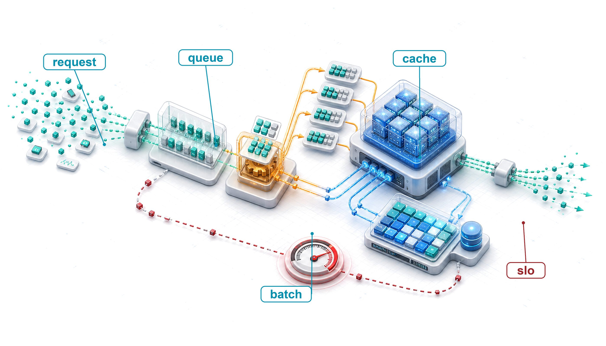
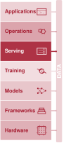
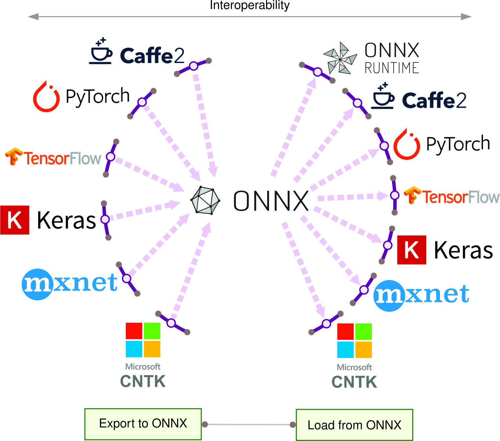

# Model Serving {#sec-model-serving}

::: {layout-narrow}
::: {.column-margin}

\chapterminitoc

:::

::: {.content-visible when-format="pdf"}
\noindent
{fig-alt="Isometric serving pipeline where variable requests become scheduled batches, occupy cache pages, run through inference workers, and return responses under latency pressure."}
:::

::: {.content-visible unless-format="pdf"}
{fig-alt="Isometric serving pipeline where variable requests become scheduled batches, occupy cache pages, run through inference workers, and return responses under latency pressure."}
:::

:::

## Purpose {.unnumbered .unlisted}

::: {.content-visible when-format="pdf"}
\begin{marginfigure}
\mlsysstack{35}{30}{25}{15}{90}{40}{20}{20}
\end{marginfigure}
:::

::: {.content-visible unless-format="pdf"}
::: {.column-margin}
{width="100%" fig-alt="Machine Learning Systems Architecture Stack"}

*Architecture stack focus for this chapter.*
:::
:::

_Why does serving change the optimization priorities that made training successful?_

Training and serving pursue opposing operating objectives. Training maximizes aggregate throughput across large, scheduled batches and long runs, whereas serving must answer individual, heterogeneous requests under strict latency deadlines. Training amortizes hardware initialization and weight streaming across millions of examples; serving pays its full fixed cost on every query, and small inefficiencies accumulate into machine time that must be provisioned. A system handling one billion requests a day recovers more than eleven days of machine time every day from a single millisecond saved per request. Each request also runs inside a fixed end-to-end latency budget, in which network ingress, serialization, preprocessing, queueing, and postprocessing all spend time the model cannot use. When those stages consume most of the budget, kernel optimizations barely reach the user, and a prediction that arrives after the client has timed out has no value however accurate it is. Serving is therefore a capacity problem under uncontrolled traffic as much as a latency problem. Arrival rates swing between daily peaks and troughs, so capacity provisioned for the average collapses at the peak, while capacity provisioned for the peak sits idle and costly the rest of the day. The question a serving system answers is not whether the model computes correct outputs in isolation but whether it sustains reliable, low-latency execution under production variability. In D·A·M terms, serving is where the trained algorithm meets unpredictable live data inside the machine's latency budget, and all three constraints bind on every request.

::: {.content-visible when-format="pdf"}

\newpage

:::

::: {.callout-learning-objectives}

- Explain serving inversion from training throughput to per-request latency, headroom, and tail behavior
- Decompose request latency across serialization, preprocessing, inference, queuing, postprocessing, and network overhead
- Apply queueing laws and simple queue models to plan capacity and admission control against percentile latency targets
- Select batching windows and inference runtimes that trade formation delay and precision for throughput within a latency budget
- Diagnose cold-start delays from weight transfer, runtime initialization, graph compilation, and warmup during model loading
- Evaluate LLM serving bottlenecks using token latency, KV-cache memory, and continuous batching constraints
- Calculate cost per inference from precision, hardware utilization, replica count, and runtime throughput
```{=latex}
\vspace*{-1ex}
```
:::

## The Serving Inversion {#sec-model-serving-serving-paradigm-9634}

When a user uploads a photograph and waits for its label, or a chat interface sends a prompt and waits for the first word of the reply, each request carries a strict deadline of tens to hundreds of milliseconds. Every stage between the network socket and the response draws on that single allowance: decoding the payload, waiting in a queue, moving tensors to the accelerator, running the model, and formatting the answer. Moving from offline training to live traffic triggers the **serving inversion**\index{Serving inversion!definition}, a reversal of engineering priorities: training is judged by how much work the machine completes per hour, whereas serving is judged by whether each individual request returns before its deadline.

The benchmarks of @sec-benchmarking measured models under a load generator that decided when each request arrived. Production traffic has no such scheduler. Model **serving**\index{Serving!production deployment}\index{Model serving!paradigm shift} must sustain the operating targets that benchmarking evaluated under specified conditions while live traffic tests that operating envelope continuously, so measurement remains part of the service's lifecycle. In offline training, systems maximize aggregate throughput by packing large batches to amortize weight transfers from high-bandwidth memory (HBM) and saturate matrix arithmetic units. In online serving, requests arrive stochastically from independent clients and must return within strict service-level objectives (SLOs). The primary engineering priority therefore inverts from long-run throughput to per-request latency. The inversion\index{Serving inversion!throughput-to-latency shift} restructures the balance of terms across both levels of the iron law of ML systems. Shrinking a task from a large training batch to small batches or individual inputs ($\BatchSize=1$) slashes the Data factor ($\text{Samples/Task}$ in @eq-intro-dam-iron-law) and inflates the Machine factor ($\text{Seconds/FLOP}$). The same shift appears across the unpacked terms of @eq-intro-iron-law ($\Time = \frac{\DataVolume}{\Bandwidth} + \frac{\Operations}{\PeakRate \cdot \EfficiencyHw} + \Latency$). For weight-dominated operations, small batches reduce arithmetic intensity and can shift execution from compute-bound matrix multiplications toward memory-bandwidth-bound transfers ($\DataVolume/\Bandwidth$). Simultaneously, the latency term $\Latency$\index{Latency!serving constraint} expands beyond microsecond accelerator kernel launches to include network transit, request serialization, and host orchestration, often becoming the binding constraint on end-to-end response time.

::: {.column-margin .margin-pointer}
↩ The multiplicative, additive, and pipelined formulations of the iron law of ML systems are established in @sec-introduction-iron-law-ml-systems-c32a.
:::

The inversion reshapes each D·A·M layer at once. In the data layer, the constraint shifts from total dataset volume to the arrival rate, payload freshness, and variable sequence dimensions of live queries. In the algorithm layer, execution becomes strictly forward-only: backpropagation state and optimizer memory vanish from the accelerator, even as dynamic input shapes introduce runtime execution variability into previously static operator graphs. In the machine layer, the operating target shifts from maximum hardware utilization to **headroom**\index{Headroom!tail latency}. Whereas offline training treats an idle accelerator as wasted capital, online serving treats near-saturation as an operational hazard, because stochastic request arrivals make queue lengths and waiting times diverge nonlinearly as utilization approaches 100 percent. Maintaining adequate headroom preserves the spare capacity needed to absorb transient traffic spikes without violating tail-latency percentiles, so serving optimizes completed requests under a strict latency deadline rather than steady-state hardware occupancy.

Meeting that latency deadline governs how engineering teams partition the end-to-end serving stack. A request's latency budget encompasses three sequential stages: host-side ingress and preprocessing (network termination, payload deserialization, and tokenization or feature transformation), accelerator kernel execution, and downstream postprocessing. Any millisecond consumed by unoptimized feature retrieval or queueing delays directly subtracts from the execution time allocated to the neural network itself. Consequently, the central engineering task in model serving is deciding which operations must remain on the synchronous request path, which tasks can be offloaded to asynchronous background pipelines, and how much headroom the system must reserve before tail-latency guarantees collapse under load. Three conditions therefore separate serving from the forward pass that a benchmark times: a per-request deadline, arrivals that no scheduler controls, and a stack in which the model is one stage among several.

::: {#dfn-model-serving-model-serving .callout-definition title="Model serving"}

***Model serving***\index{Model serving!definition} is the operational phase that provides model predictions to end-users or downstream systems under latency, throughput, availability, and cost constraints.

1.  **Significance**: Online serving turns training's priority on sustained hardware efficiency ($\EfficiencyHw$) into a request-latency constraint ($\EndToEndRequestLatency$), requiring a stack designed around the percentile named by its SLO.
2.  **Distinction**: Unlike model training, which commonly processes scheduled batches, serving may handle stochastic online requests, synchronized streams, or offline batches.
3.  **Common pitfall**: A frequent misconception is that serving is "just the forward pass." In reality, it is a systems problem: model execution is only one component of a stack that may include request routing, load balancing, and data transformation.

:::

The SLO[^fn-slo-sla-serving] defines the latency target that shapes every architectural decision in the serving stack, establishing the strict time budget within which all request handling must complete. When an inference server receives a request, model execution represents only one segment of an end-to-end pipeline: network ingress, payload deserialization, feature transformation, queue scheduling, and output serialization all consume time before and after the accelerator runs. The end-to-end request lifecycle partitions execution into three sequential stages (@fig-serving-inference-pipeline): input preprocessing (traditional computing), neural network evaluation (deep learning), and output postprocessing with safety validation (traditional computing). Any of these stages can become the binding latency bottleneck. @Sec-model-serving-latency-budget-ef40 quantifies where the time goes and finds that host preprocessing can take longer than the forward pass itself.

::: {.column-margin .margin-pointer}
↩ SLOs, service level agreements (SLAs), and the tail-latency percentiles they constrain are established in @sec-benchmarking-latency-tail-latency-5cde.
:::

[^fn-slo-sla-serving]: **SLOs in ML serving**\index{SLO!vs. SLA}\index{SLO!multidimensional targets}: An SLO is the internal target, as distinct from the contractual SLA. For ML serving, task quality and inference latency can both contribute to SLOs, creating multidimensional targets where improving one dimension (for example, deploying a larger model for accuracy) can violate another (latency).

::: {#fig-serving-inference-pipeline fig-env="figure" fig-pos="htb" fig-cap="**The Inference Pipeline**: ML serving systems transform raw inputs into final outputs through sequential stages: preprocessing, neural network computation, and postprocessing. The neural network represents just one component; preprocessing and postprocessing make end-to-end latency depend on more than neural-network execution." fig-alt="Left-to-right flow diagram of six connected boxes labeled Raw Data, Pre-processing, Neural Network, Raw Output, Post-processing, and Final Output. Outlined groups beneath the boxes identify Pre-processing, Deep Learning, and Post-processing."}

```{.tikz}
\begin{tikzpicture}[font=\small\sffamily, >=stealth]
\tikzset{
Box/.style={align=center, inner xsep=2pt,draw=GreenLine, line width=1pt,fill=none,
minimum width=24mm, minimum height=25mm,node distance=1.0},
LineA/.style={BrownLine!70,line width=4.0pt,{-{Triangle[width=1.5*6pt,length=2.0*5pt]}},shorten <=1pt,shorten >=1pt},
ALine/.style={black!50, line width=1.1pt,{{Triangle[width=0.9*6pt,length=1.2*6pt]}-}},
Larrow/.style={fill=violet!50, single arrow,  inner sep=2pt, single arrow head extend=3pt,
            single arrow head indent=0pt,minimum height=10mm, minimum width=3pt}
}
%inbox
\tikzset{%
 pics/inbox/.style = {
        code = {
        \pgfkeys{/channel/.cd, #1}
\begin{scope}[local bounding box=INBOX,scale=\scalefac, every node/.append style={transform shape}]
\node[line width=\Linewidth,draw=\drawcolor,fill=\filllcolor!50,
rectangle,rounded corners=3pt,minimum width=14mm,minimum height=10mm]at(0,0.3){};
\node[line width=\Linewidth,draw=\drawcolor,fill=\filllcolor,
rectangle,rounded corners=3pt,minimum width=15mm,minimum height=10mm]at(0,0.1){};
\node[line width=\Linewidth,draw=\drawcolor,fill=\filllcolor!50,
,rectangle,rounded corners=3pt,minimum width=17mm,minimum height=10mm]
at(0,-0.1){};
\draw[line width=\Linewidth,draw=\drawcolor,fill=\filllcirclecolor,,rounded corners=2pt](-0.92,0.05)--
(-0.92,-0.78)--(0.92,-0.78)--(0.92,0.05)--(0.40,0.05)--(0.32,-0.2)--(-0.29,-0.2)--(-0.40,0.05)--cycle;

\node[single arrow, line width=\Linewidth,draw=black,fill=cyan!90!black!30, rotate=270,
      minimum width = 15pt, single arrow head extend=6pt,
      minimum height=10mm]at(0,0.5) {}; % length of arrow
 \end{scope}
     }
  }
}
%brain
\tikzset{pics/brain/.style = {
        code = {
        \pgfkeys{/channel/.cd, #1}
\begin{scope}[local bounding box=BRAIN,scale=\scalefac, every node/.append style={transform shape}]
\fill[fill=\filllcolor!50](0.1,-0.5)to[out=0,in=180](0.33,-0.5)
to[out=0,in=270](0.45,-0.38)to(0.45,-0.18)
to[out=40,in=240](0.57,-0.13)to[out=110,in=310](0.52,-0.05)
to[out=130,in=290](0.44,0.15)to[out=90,in=340,distance=8](0.08,0.69)
to[out=160,in=80](-0.42,-0.15)to (-0.48,-0.7)to(0.07,-0.7)to(0.1,-0.5)
(-0.10,-0.42)to[out=310,in=180](0.1,-0.5);
\draw[draw=\drawcolor,line width=\Linewidth](0.1,-0.5)to[out=0,in=180](0.33,-0.5)
to[out=0,in=270](0.45,-0.38)to(0.45,-0.18)
to[out=40,in=240](0.57,-0.13)to[out=110,in=310](0.52,-0.05)
to[out=130,in=290](0.44,0.15)to[out=90,in=340,distance=8](0.08,0.69)
(-0.42,-0.15)to (-0.48,-0.7)
(0.07,-0.7)to(0.1,-0.5)
(-0.10,-0.42)to[out=310,in=180](0.1,-0.5);
\draw[fill=\filllcolor,line width=\Linewidth](-0.3,-0.10)to(0.08,0.60)
to[out=60,in=50,distance=3](-0.1,0.69)to[out=160,in=80](-0.26,0.59)to[out=170,in=90](-0.46,0.42)
to[out=170,in=110](-0.54,0.25)to[out=210,in=150](-0.54,0.04)
to[out=240,in=130](-0.52,-0.1)to[out=300,in=240]cycle;
\draw[fill=\filllcolor,line width=\Linewidth]
(-0.04,0.64)to[out=120,in=0](-0.1,0.69)(-0.19,0.52)to[out=120,in=330](-0.26,0.59)
(-0.4,0.33)to[out=150,in=280](-0.46,0.42)
%
(-0.44,-0.03)to[bend left=30](-0.34,-0.04)
(-0.33,0.08)to[bend left=40](-0.37,0.2) (-0.37,0.12)to[bend left=40](-0.45,0.14)
(-0.26,0.2)to[bend left=30](-0.24,0.13)
(-0.16,0.32)to[bend right=30](-0.27,0.3)to[bend right=30](-0.29,0.38)
(-0.13,0.49)to[bend left=30](-0.04,0.51);

\draw[rounded corners=0.8pt,\drawcircle,-{Circle[fill=\filllcirclecolor,length=2.5pt]}](-0.23,0.03)--(-0.15,-0.03)--(-0.19,-0.18)--(-0.04,-0.28);
\draw[rounded corners=0.8pt,\drawcircle,-{Circle[fill=\filllcirclecolor,length=2.5pt]}](-0.17,0.13)--(-0.04,0.05)--(-0.06,-0.06)--(0.14,-0.11);
\draw[rounded corners=0.8pt,\drawcircle,-{Circle[fill=\filllcirclecolor,length=2.5pt]}](-0.12,0.23)--(0.31,0.0);
\draw[rounded corners=0.8pt,\drawcircle,-{Circle[fill=\filllcirclecolor,length=2.5pt]}](-0.07,0.32)--(0.06,0.26)--(0.16,0.33)--(0.34,0.2);
\draw[rounded corners=0.8pt,\drawcircle,-{Circle[fill=\filllcirclecolor,length=2.5pt]}](-0.01,0.43)--(0.06,0.39)--(0.18,0.51)--(0.31,0.4);
\end{scope}
     }
  }
}
%llm
\tikzset{
pics/llm/.style = {
        code = {
        \pgfkeys{/channel/.cd, #1}
\begin{scope}[shift={($(0,0)+(0,0)$)},scale=\scalefac,every node/.append style={transform shape}]
\node[circle,minimum size=12mm,draw=\drawcolor, fill=\filllcolor!70,line width=0.5*\Linewidth](C\picname) at (0,0){};
\def\startangle{90}
\def\radius{1.15}
\def\radiusI{1.1}
\foreach \i [evaluate=\i as \j using \i+1] [count =\k] in {0,2,4,6,8} {
\pgfmathsetmacro{\angle}{\startangle - \i * (360/8)}
\draw[draw=black,-{Circle[black ,fill=\filllcirclecolor,length=5.5pt,line width=0.5*\Linewidth]},line width=1.5*\Linewidth](C\picname)--++(\startangle - \i*45:\radius) ;
\node[circle,draw=black,fill=\filllcirclecolor!80!red!50,inner sep=3pt,line width=0.5*\Linewidth](2C\k)at(\startangle - \j*45:\radiusI) {};
}
\draw[line width=1.5*\Linewidth](2C1)--++(-0.5,0)|-(2C2);
\draw[line width=1.5*\Linewidth](2C3)--++(0.5,0)|-(2C4);
\node[circle,,minimum size=12mm,draw=\drawcolor, fill=\filllcolor!70,line width=0.5*\Linewidth]at (0,0){};
\node[draw,rectangle,rounded corners=1pt,minimum width=7mm,minimum height=4mm,fill=orange!10](R1)at(0.1,0.1){};
\draw[BrownLine,shorten <=2pt,shorten >=2pt ]($(R1.north west)!0.35!(R1.south west)$)--($(R1.north east)!0.35!(R1.south east)$);
\draw[BrownLine,shorten <=2pt,shorten >=2pt ]($(R1.north west)!0.7!(R1.south west)$)--($(R1.north east)!0.7!(R1.south east)$);
\node[draw,rectangle,rounded corners=1pt,minimum width=6mm,minimum height=4mm,fill=orange!10](R2)at(-0.05,-0.15){};
\draw[BrownLine,shorten <=2pt,shorten >=2pt ]($(R2.north west)!0.35!(R2.south west)$)--($(R2.north east)!0.35!(R2.south east)$);
\draw[BrownLine,shorten <=2pt,shorten >=2pt ]($(R2.north west)!0.7!(R2.south west)$)--($(R2.north east)!0.7!(R2.south east)$);
\end{scope}
    }
  }
}
%funnel
\tikzset{%
 pics/funnel/.style = {
        code = {
        \pgfkeys{/channel/.cd, #1}
\begin{scope}[local bounding box=FUNNEL,scale=\scalefac, every node/.append style={transform shape}]
\draw[fill=\filllcolor,line width=\Linewidth,draw=\drawcolor](-0.12,-0.81)--(-0.19,-0.25)--(-0.7,0.41)--(0.7,0.41)--(0.19,-0.25)--(0.12,-0.81)--cycle;
\draw[fill=\filllcolor,line width=\Linewidth,draw=\drawcolor](-0.19,-0.25)--(0.08,-0.25);
\draw[fill=\filllcolor,line width=\Linewidth,draw=\drawcolor](0.16,-0.09)--(0.41,0.31);
%
\node[line width=\Linewidth,draw=\drawcolor,fill=\filllcolor,inner sep=1pt,
rectangle,rounded corners=2pt,minimum width=16mm,minimum height=5pt]at(0,0.5){};
%
\foreach \i in{-0.5,0,0.5}{
\node[single arrow, line width=0.8*\Linewidth,draw=black,fill=\filllcirclecolor, rotate=270,inner sep=1pt,
      minimum width =9pt, single arrow head extend=2pt,
      minimum height=5mm]at(\i,0.9) {}; % length of arrow
   }
\node[single arrow,line width=0.8*\Linewidth,draw=black,fill=\filllcirclecolor, rotate=270,inner sep=1pt,
      minimum width =11pt, single arrow head extend=2pt,
      minimum height=5mm]at(0,-1.1) {}; % length of arrow
 \end{scope}
     }
  }
}
\def\inset{2.0pt} %
\def\myshape{%
  (0,1.34) to[out=220,in=0] (-1.20,1.03) --
  (-1.20,-0.23) to[out=280,in=160] (0,-1.53) to[out=20,in=260] (1.20,-0.23) --
  (1.20,1.03)  to[out=180,in=320] cycle
}
\tikzset{
pics/stitC/.style = {
        code = {
        \pgfkeys{/channel/.cd, #1}
\begin{scope}[shift={($(0,0)+(0,0)$)},scale=\scalefac,every node/.append style={transform shape}]
\fill[fill=\filllcolor!60] \myshape;
%
\begin{scope}
  \clip \myshape;
  \draw[draw=\filllcolor!60, line width=3*\inset,fill=white] \myshape; % Color and thickness as desired
\end{scope}
\draw[red,line width=3pt](-0.7,-0.35)--++(320:0.5)--++(50:1.5);
\end{scope}
    }
  }
}
%gear-arrow
% #1 number of teeths
% #2 radius intern
% #3 radius extern
% #4 angle from start to end of the first arc
% #5 angle to decale the second arc from the first
% #6 inner radius to cut off
\tikzset{
  pics/gearAR/.style args={#1/#2/#3/#4/#5/#6/#7}{
   code={
           \pgfkeys{/channel/.cd, #7}
\begin{scope}[shift={($(0,0)+(0,0)$)},scale=\scalefac,every node/.append style={transform shape},
LinE/.style={\filllcirclecolor,line width=5.0pt,
{{Triangle[width=1.5*10pt,length=2.0*5pt]}-},shorten <=5pt,shorten >=1pt},
ELin/.style={\filllcirclecolor,line width=7.0pt,
{-{Triangle[width=1.15*10pt,length=2.0*5pt]}},shorten <=0pt,shorten >=0pt}]
    \pgfmathtruncatemacro{\N}{#1}%,
    \def\rin{#2}\def\rout{#3}\def\aA{#4}\def\aOff{#5}\def\rcut{#6}%
    \path[rounded corners=0.5pt,draw=\drawcolor,fill=\filllcolor]
      (0:\rin)
      \foreach \i [evaluate=\i as \n using (\i-1)*360/\N] in {1,...,\N}{%
        arc (\n:\n+\aA:\rin)
        -- (\n+\aA+\aOff:\rout)
        arc (\n+\aA+\aOff:\n+360/\N-\aOff:\rout)
        -- (\n+360/\N:\rin)
      } -- cycle;
      \draw[draw=none,fill=white](0,0) circle[radius=\rcut];
\draw[ELin](0,0)--++(0:2.5);
\end{scope}
  }}
}
%testing+pencil
\tikzset{
pics/testing/.style = {
        code = {
        \pgfkeys{/channel/.cd, #1}
\begin{scope}[local bounding box=TESTING1,shift={($(0,0)+(0,0)$)},scale=\scalefac,every node/.append style={transform shape}]
\newcommand{\tikzxmark}{%
\tikz[scale=0.18] {
    \draw[line width=0.7,line cap=round,RedLine] (0,0) to [bend left=6] (1,1);
    \draw[line width=0.7,line cap=round,RedLine] (0.2,0.95) to [bend right=3] (0.8,0.05);
}}
\newcommand{\tikzxcheck}{%
\tikz[scale=0.16] {
    \draw[line width=0.7,line cap=round,GreenLine] (0.5,0.75)--(0.85,-0.1) to [bend left=16] (1.5,1.55);

}}
 \node[draw, minimum width  =15mm, minimum height = 20mm, inner sep = 0pt,
        rounded corners,draw = \drawcolor, fill=\filllcolor!10, line width=\Linewidth](COM){};
\node[draw=GreenLine,inner sep=4pt,fill=white](CB1) at ($(COM.north west)!0.25!(COM.south west)+(0.3,0)$){};
\node[xshift=0pt]at(CB1){\tikzxcheck};
\node[draw=RedLine,inner sep=4pt,fill=white](CB2) at ($(COM.north west)!0.5!(COM.south west)+(0.3,0)$){};
\node[xshift=0pt]at(CB2){\tikzxmark};
\node[draw=RedLine,inner sep=4pt,fill=white](CB3) at ($(COM.north west)!0.75!(COM.south west)+(0.3,0)$){};
\node[xshift=0pt]at(CB3){\tikzxmark};
\draw[GreenLine,decoration={zigzag,segment length=4pt, amplitude=0.5pt},decorate]($(CB1)+(0.3,0.05)$)--++(0:0.8);
\draw[GreenLine,decoration={zigzag,segment length=4pt, amplitude=0.5pt},decorate]($(CB1)+(0.3,-0.12)$)--++(0:0.7);
\draw[RedLine,decoration={zigzag,segment length=4pt, amplitude=0.5pt},decorate]($(CB2)+(0.3,0.05)$)--++(0:0.8);
\draw[RedLine,decoration={zigzag,segment length=4pt, amplitude=0.5pt},decorate]($(CB2)+(0.3,-0.12)$)--++(0:0.6);
\draw[RedLine,decoration={zigzag,segment length=4pt, amplitude=0.5pt},decorate]($(CB3)+(0.3,0.05)$)--++(0:0.8);
\draw[RedLine,decoration={zigzag,segment length=4pt, amplitude=0.5pt},decorate]($(CB3)+(0.3,-0.12)$)--++(0:0.6);
\end{scope}
    }
  }
}
%pencil
\tikzset{
pics/pencil/.style = {
        code = {
        \pgfkeys{/channel/.cd, #1}
\begin{scope}[local bounding box=TESTING1,shift={($(0,0)+(0,0)$)},scale=\scalefac,every node/.append style={transform shape},rotate=340]
            \fill[fill=\filllcolor!70] (0,4) -- (0.4,4) -- (0.4,0) --(0.3,-0.15) -- (0.2,0) -- (0.1,-0.14) -- (0,0) -- cycle;
            \draw[color=white,thick] (0.2,4) -- (0.2,0);
            \fill[black] (0,3.5) -- (0.2,3.47) -- (0.4,3.5) -- (0.4,4) arc(30:150:0.23cm);
            \fill[fill=\filllcolor!40] (0,0) -- (0.2,-0.8)node[coordinate,pos=0.75](a){} -- (0.4,0)node[coordinate,pos=0.25](b){} -- (0.3,-0.15) -- (0.2,0) -- (0.1,-0.14) -- cycle;
            \fill[fill=\filllcolor] (a) -- (0.2,-0.8) -- (b) -- cycle;

\end{scope}
    }
  }
}
\pgfkeys{
  /channel/.cd,
   Depth/.store in=\Depth,
  Height/.store in=\Height,
  Width/.store in=\Width,
  filllcirclecolor/.store in=\filllcirclecolor,
  filllcolor/.store in=\filllcolor,
  drawcolor/.store in=\drawcolor,
  drawcircle/.store in=\drawcircle,
  scalefac/.store in=\scalefac,
  Linewidth/.store in=\Linewidth,
  picname/.store in=\picname,
  filllcolor=BrownLine,
  filllcirclecolor=violet!20,
  drawcolor=black,
  drawcircle=violet,
  scalefac=1,
  Linewidth=0.5pt,
  Depth=1.3,
  Height=0.8,
  Width=1.1,
  picname=C
}
%Raw Data
\node[Box](B1){};
\fill[cyan!07](B1.north west) rectangle ($(B1.north east)!0.6!(B1.south east)$)coordinate(B1DE);
\fill[cyan!20](B1.south east) rectangle ($(B1.north west)!0.6!(B1.south west)$)coordinate(B1LE);
\node[Box,draw=BlueD](){};
\tikzset{Text2/.style={font=\sffamily\bfseries\small,align=center}}
\node[Text2]at($(B1.south west)!0.5!(B1DE)$){Raw Data};
\coordinate(Q1)at($(B1.north west)!0.5!(B1DE)$);
\pic[shift={(0,0)}] at  (Q1){inbox={scalefac=0.7,picname=1,Linewidth=1.0pt,
 filllcolor=BrownL,drawcolor=black,filllcirclecolor=orange!70!yellow!80}};
%Pre-processing
\node[Box, right=0.75 of B1](B2){};
\fill[cyan!07](B2.north west) rectangle ($(B2.north east)!0.6!(B2.south east)$)coordinate(B2DE);
\fill[cyan!20](B2.south east) rectangle ($(B2.north west)!0.6!(B2.south west)$)coordinate(B2LE);
\node[Box, right=0.75 of B1,draw=BlueD](B2){};
\node[Text2]at($(B2.south west)!0.5!(B2DE)$){Pre-\\processing};
\coordinate(Q2)at($(B2.north west)!0.5!(B2DE)$);
\pic[shift={(0,0)}] at  (Q2){funnel={scalefac=0.53,picname=1,Linewidth=0.5pt,
 filllcolor=green!70!orange!70,drawcolor=black,filllcirclecolor=red!70!blue!80}};
%Neural Network
\node[Box, right=of B2](B3){};
\fill[green!07](B3.north west) rectangle ($(B3.north east)!0.6!(B3.south east)$)coordinate(B3DE);
\fill[green!20](B3.south east) rectangle ($(B3.north west)!0.6!(B3.south west)$)coordinate(B3LE);
\node[Box, right=of B2,draw=GreenD](B3){};
\node[Text2]at($(B3.south west)!0.5!(B3DE)$){Neural\\ Network};
\coordinate(Q3)at($(B3.north west)!0.5!(B3DE)$);
%\pic[shift={(0,0)}] at  (Q3){brain={scalefac=0.9,picname=1,filllcolor=orange!30!, Linewidth=0.95pt}};
\pic[shift={(0,0)}] at  (Q3){llm={scalefac=0.6,drawcolor=BlueLine,filllcolor=BlueLine!50!, Linewidth=1pt,filllcirclecolor=red}};
%Raw output
\node[Box, right=of B3](B4){};
\fill[violet!07](B4.north west) rectangle ($(B4.north east)!0.6!(B4.south east)$)coordinate(B4DE);
\fill[violet!20](B4.south east) rectangle ($(B4.north west)!0.6!(B4.south west)$)coordinate(B4LE);
\node[Box, right=of B3,draw=VioletLine](B4){};
\node[Text2]at($(B4.south west)!0.5!(B4DE)$){Raw\\ Output};
\coordinate(Q4)at($(B4.north west)!0.5!(B4DE)$);
 \pic[shift={(0,0)}] at (Q4) {gearAR={14/1.4/1.8/8/4/0.7/scalefac=0.35,drawcolor=BlueLine,filllcolor=BlueLine,filllcirclecolor=red}};
%Post-processing
\node[Box, right=0.75 of B4](B5){};
\fill[violet!05](B5.north west) rectangle ($(B5.north east)!0.6!(B5.south east)$)coordinate(B5DE);
\fill[violet!15](B5.south east) rectangle ($(B5.north west)!0.6!(B5.south west)$)coordinate(B5LE);
\node[Box, right=0.75 of B4,draw=VioletLine](B5){};
\node[Text2]at($(B5.south west)!0.5!(B5DE)$){Post-\\processing};
\coordinate(Q5)at($(B5.north west)!0.5!(B5DE)$);
\pic[shift={(0,0)}] at  (Q5){testing={scalefac=0.65,picname=1,drawcolor=myblue,filllcolor=myblue, Linewidth=1.0pt}};
\pic[shift={(0,-0.5)},rotate=-15] at  (Q5){pencil={scalefac=0.30,picname=1,filllcolor=mygreen, Linewidth=1.0pt}};
%%%%%%
%Final output
\node[Box, right=0.75 of B5](B6){};
\fill[violet!05](B6.north west) rectangle ($(B6.north east)!0.6!(B6.south east)$)coordinate(B6DE);
\fill[violet!15](B6.south east) rectangle ($(B6.north west)!0.6!(B6.south west)$)coordinate(B6LE);
\node[Box, right=0.75 of B5,draw=VioletLine]{};
\node[Text2]at($(B6.south west)!0.5!(B6DE)$){Final Output};
\coordinate(Q6)at($(B6.north west)!0.5!(B6DE)$);
\pic[shift={(0,0.05)}] at  (Q6){stitC={scalefac=0.45,drawcolor=orange,filllcolor=green!55!black}};
%arrows
\foreach \i in{1,2,3,4,5}{
\pgfmathtruncatemacro{\X}{\i + 1} %
\draw[LineA](B\i)--(B\X);
}
\node[draw=myblue,line width=0.75pt,fit=(B1)(B2),inner ysep=3mm,inner xsep=4mm,xshift=1mm](F1){};
\node[draw=none,fit=(B3),inner ysep=3mm,inner xsep=4mm](F2){};
\node[draw=mypurple,line width=0.75pt,fit=(B4)(B6),inner ysep=3mm,inner xsep=4mm,xshift=-1mm](F3){};
\node[below =0pt of F1,text=myblue]{Pre-processing};
\node[below =0pt of F2,text=GreenD]{Deep Learning};
\node[below =0pt of F3,text=mypurple]{Post-processing};

\end{tikzpicture}
```

:::

```{python}
#| echo: false
#| label: serving-lighthouses-calc
# ┌─────────────────────────────────────────────────────────────────────────────
# │ THE CHAPTER'S TWO SERVICES
# ├─────────────────────────────────────────────────────────────────────────────
# │ Context: Running-case paragraph of @sec-model-serving-serving-paradigm-9634.
# │
# │ Goal: Introduce each lighthouse with the quantity that sets its regime.
# │ Show: ResNet-50 arithmetic and FP32 weight bytes per forward pass; GPT-2 XL
# │       FP16 weight bytes and the time to stream them once on an H100.
# │ How: Registry model and hardware entries.
# └─────────────────────────────────────────────────────────────────────────────
from mlsysim import *  # chapter-wide names (units, formatters) used by later cells
from mlsysim.core.units import *
from mlsysim import Models, Hardware, BYTES_FP16, BYTES_FP32, GB, MB, TB, second, millisecond
from mlsysim.core.units import GFLOPs, TFLOPs
from mlsysim.fmt import check, fmt_flops, fmt_memory, fmt_time

class ServingLighthouses:
    """Regime-setting quantities for the ResNet-50 and GPT-2 XL services."""

    # ┌── 1. LOAD (Constants) ──────────────────────────────────────────────
    resnet = Models.Vision.ResNet50
    gpt2 = Models.Language.GPT2
    h100 = Hardware.Cloud.H100

    # ┌── 2. EXECUTE (The Compute) ────────────────────────────────────────
    resnet_flops = resnet.inference_flops
    resnet_weights = resnet.size_in_bytes(BYTES_FP32)
    gpt2_weights = gpt2.size_in_bytes(BYTES_FP16)
    gpt2_read = (gpt2_weights / h100.memory.bandwidth).to(millisecond)

    # ┌── 3. GUARD (Invariants) ───────────────────────────────────────────
    check(8.0 < resnet_flops.to("gigaflop").magnitude < 8.5, f"ResNet-50 should be ~8.2 GFLOP per image, got {resnet_flops}.")
    check(0.8 < gpt2_read.magnitude < 1.0, f"GPT-2 XL weight read should be ~0.9 ms on an H100, got {gpt2_read}.")

    # ┌── 4. OUTPUT (Formatting) ─────────────────────────────────────────────
    resnet_gflops_str = fmt_flops(resnet_flops, unit=GFLOPs, precision=1, commas=False)
    resnet_weights_mb_str = fmt_memory(resnet_weights, unit=MB, precision=1, commas=False)
    gpt2_weights_gb_str = fmt_memory(gpt2_weights, unit=GB, precision=0, commas=False)
    gpt2_read_ms_str = fmt_time(gpt2_read, unit="millisecond", precision=1, commas=False)
```

Two services carry the chapter, one per half, and each lighthouse arrives in the regime it represents. The first half follows a ResNet-50 image-classification service on one accelerator node. ResNet-50 is the book's compute-bound lighthouse. Each forward pass performs about `{python} ServingLighthouses.resnet_gflops_str` of arithmetic on `{python} ServingLighthouses.resnet_weights_mb_str` of FP32 weights, so a large training batch keeps the matrix units busy. A served request arrives alone, however, and at batch one the same forward pass spends most of its time on weight traffic and kernel launches rather than arithmetic. Recovering the efficiency that training enjoyed without breaking the deadline is the first half's problem, and the reference request profile introduced with the latency budget carries the service through queuing, batching, runtime selection, and replica startup. Large language model (LLM) serving then follows a GPT-2 XL chat service, the bandwidth-bound lighthouse whose decoding step @sec-network-architectures-inference-memory-bandwidth-wall-98d1 traced. Each generated token streams all `{python} ServingLighthouses.gpt2_weights_gb_str` of its FP16 weights from memory, about `{python} ServingLighthouses.gpt2_read_ms_str` on the book's reference H100, so memory bandwidth sets token latency and the memory each conversation holds sets concurrency. Llama 3 8B, a larger member of the same transformer family, extends that case where the per-conversation cache grows large enough to bound how many requests share the accelerator. DLRM, the capacity-bound lighthouse, appears once as a contrast in which embedding lookups rather than arithmetic dominate a request, and MobileNetV2 appears where the target device cannot hold ResNet-50 at all.

| **Section**                      | **What it decides**                                                           | **Running case**                            | **Iron law term or resource it targets**                    |
|:---------------------------------|:------------------------------------------------------------------------------|:--------------------------------------------|:------------------------------------------------------------|
| **Serving System Architecture**  | How a replica turns arriving requests into accelerator work                   | ResNet-50 service                           | Fixed overhead $\Latency$ (protocol, serialization, copies) |
| **Request Lifecycle**            | Where one request's latency budget goes                                       | ResNet-50 request; DLRM contrast            | Every term, stage by stage                                  |
| **Queuing Theory**               | How much headroom many concurrent requests need                               | ResNet-50 capacity plan                     | Queueing delay added to $\Latency$                          |
| **Throughput Optimization**      | How many requests share each weight read                                      | ResNet-50 batching sweep                    | $\DataVolume/\Bandwidth$ and $\Latency$ per request         |
| **Inference Runtime Selection**  | Which engine and number format execute a batch                                | ResNet-50 runtimes and precisions           | Hardware efficiency $\EfficiencyHw$ and bytes $\DataVolume$ |
| **Node-Level Optimization**      | What stalls the path between network socket and accelerator                   | ResNet-50 node profile                      | Host-side $\Latency$                                        |
| **Model Loading and Versioning** | How fast a new replica serves, and whether it computes what training computed | ResNet-50 cold start and preprocessing skew | Startup time and prediction accuracy                        |
| **LLM Serving**                  | How token streams share memory bandwidth and capacity                         | GPT-2 XL decode; Llama 3 8B cache           | $\DataVolume/\Bandwidth$ per token; memory capacity         |
| **Economics and Planning**       | How many accelerators, at what cost per completed request                     | ResNet-50 fleet; Llama 3 8B tokens          | Cost per request that meets the SLO                         |

: **Chapter Map**: Each section answers one serving decision on one of the running cases and names the iron law term or resource that decision most affects. The first four rows follow a single ResNet-50 replica from its architecture to batching; the remaining rows change what the replica executes, how it starts, what it produces, and what it costs. {#tbl-model-serving-chapter-spine tbl-colwidths="[22,32,22,24]"}

The architecture section (@tbl-model-serving-chapter-spine) examines the inference server that sits between the network and the accelerator. The request lifecycle then traces one ResNet-50 request through that server and finds that the model is one slice of its latency budget. Queuing theory lets many requests arrive at once and derives the headroom that keeps their tail latency bounded, and throughput optimization raises each replica's service rate by batching, where the chapter's first half ends. The second half changes what each replica runs and how it starts. Runtime and precision selection decide how fast a batch executes, node-level optimization removes the stalls between host and accelerator, and model loading decides how quickly a new replica can serve and whether it computes what training computed. LLM serving then replaces fixed outputs with token streams, and economics and planning converts the whole stack into accelerator count and cost per request. Two placement decisions precede all of these: the first is temporal, whether predictions are computed ahead of time or on demand, and the second is spatial, where the model physically runs.

### Static vs. dynamic inference {#sec-model-serving-static-vs-dynamic-inference-e864}

A nightly job that precomputes product recommendations for existing users can pack thousands of items into each accelerator batch, whereas a live content-moderation API must score an uploaded image within milliseconds of arrival. Deciding whether to generate predictions before or during a user request sets the trade-off between offline hardware efficiency and online responsiveness [@google2024staticdynamic]. It determines whether an accelerator runs in an unconstrained throughput regime or under the strict tail-latency deadlines of an interactive serving loop.

#### Static inference {#sec-model-serving-static-inference-35f4}

Static inference\index{Static inference!precomputed predictions} (also called offline or batch inference) precomputes predictions for anticipated inputs and stores them in a retrieval store. Moving model execution entirely out of the user request path alters the underlying hardware constraints. Because batch jobs have no millisecond-level deadlines, accelerators can use large batches ($\BatchSize\gg 1$) selected for throughput within memory limits. Reusing weights across samples raises arithmetic intensity for weight-dominated operations. A batch-size sweep identifies where throughput stops improving. When a client issues a request (for example, a user opening nightly generated recommendation rankings), the serving system performs a low-latency key-value lookup rather than executing a forward pass on an accelerator. The primary operational constraint shifts from accelerator latency to storage capacity and data freshness. Precomputing predictions across an entire input domain scales combinatorially ($\mathcal{O}(\RecommenderUserCount\times \RecommenderItemCount)$ for $\RecommenderUserCount$ users and $\RecommenderItemCount$ items in recommendation systems), and stale predictions persist until the next batch refresh.

#### Dynamic inference {#sec-model-serving-dynamic-inference-d2d5}

**Dynamic inference**\index{Dynamic inference!definition}\index{Online inference|see{Dynamic inference}} (also called online or real-time inference) evaluates inputs on demand as requests arrive. On-demand execution accommodates arbitrary, previously unseen inputs within the model schema and immediately reflects newly deployed model weights without requiring precomputation. However, executing the model directly within the user request path subjects inference to the strict end-to-end latency budget set by its SLO. Because user requests arrive stochastically, the serving runtime cannot delay execution indefinitely to accumulate large batches. Serving requests individually or in small batches ($\BatchSize=1$ to $\BatchSize=4$) can expose weight traffic or launch overhead that larger batches amortize. When these costs bind execution, the device completes fewer queries per unit time, increasing provisioned cost per query. This tension between interactive response time and hardware efficiency can make dynamic serving more expensive per query than offline batching (example \ref{exmp-cost-latency}).

```{python}
#| echo: false
#| label: cost-latency-calc
# ┌─────────────────────────────────────────────────────────────────────────────
# │ COST OF LATENCY CALCULATION
# ├─────────────────────────────────────────────────────────────────────────────
# │ Context: Callout "The Cost of Latency" (Serving Paradigm section)
# │
# │ Goal: Quantify the economic trade-off between response time and hardware bill.
# │ Show: That batch one costs several times more per query than batch eight
# │       for almost the same latency.
# │ How: ResNet-50 eager FP16 profile on the H100 at batch 1 and batch 8.
# │
# └─────────────────────────────────────────────────────────────────────────────
from mlsysim import Infrastructure
from mlsysim.engine.serving_profile import resnet50_h100_profile
from mlsysim.fmt import check, fmt, fmt_usd, fmt_time, fmt_rate

class CostLatencyCalc:
    """Quantifies the economic trade-off between latency and hardware cost per million queries."""

    # ┌── 1. LOAD (Constants) ──────────────────────────────────────────────
    gpu_cost_per_hour_value = Infrastructure.Pricing.Cloud.GpuTrainingPerHour.rate
    _p = resnet50_h100_profile()  # the chapter's ResNet-50 reference profile
    latency_a_ms_value = _p.eager_fp16(1).to(ms)
    throughput_a_rps_value = (1 * count / latency_a_ms_value).to(count / second)
    latency_b_ms_value = _p.eager_fp16(8).to(ms)
    throughput_b_rps_value = (8 * count / latency_b_ms_value).to(count / second)

    # ┌── 2. EXECUTE (The Compute) ────────────────────────────────────────
    queries_per_hour_a_value = (throughput_a_rps_value * hour).to(count)
    cost_per_million_a_value = (gpu_cost_per_hour_value * hour) / (queries_per_hour_a_value / (MILLION * count))
    queries_per_hour_b_value = (throughput_b_rps_value * hour).to(count)
    cost_per_million_b_value = (gpu_cost_per_hour_value * hour) / (queries_per_hour_b_value / (MILLION * count))
    cost_increase_pct_value = (cost_per_million_a_value / cost_per_million_b_value - 1) * 100
    cost_ratio_value = cost_per_million_a_value / cost_per_million_b_value

    # ┌── 3. GUARD (Invariants) ──────────────────────────────────────────
    check(cost_ratio_value > 1, "Scenario A (low latency) must cost more per query than Scenario B.")

    # ┌── 4. OUTPUT (Formatting) ─────────────────────────────────────────────
    gpu_cost_per_hour_str = fmt_usd(gpu_cost_per_hour_value, precision=0, commas=False, per="hour")
    latency_a_ms_str = fmt_time(latency_a_ms_value, 'millisecond', precision=1, commas=False)
    throughput_a_rps_str = fmt_rate(round(throughput_a_rps_value.magnitude) * (count / second), 'req/s', precision=0, commas=True)
    latency_b_ms_str = fmt_time(latency_b_ms_value, 'millisecond', precision=1, commas=False)
    throughput_b_rps_str = fmt_rate(round(throughput_b_rps_value.magnitude) * (count / second), 'req/s', precision=0, commas=True)
    cost_a_str = fmt_usd(cost_per_million_a_value, precision=2, commas=False)
    cost_b_str = fmt_usd(cost_per_million_b_value, precision=2, commas=False)
    cost_ratio_mult_str = fmt_multiple(round(cost_ratio_value), precision=0, commas=False)
```

::: {#exmp-cost-latency .callout-example title="The cost of latency"}

Latency constraints directly dictate infrastructure costs. The figures below come from the ResNet-50 reference profile that @sec-model-serving-batching-helps-f1dc later sweeps across batch sizes. Consider a GPU server renting for `{python} CostLatencyCalc.gpu_cost_per_hour_str`.

Scenario A (low latency): Batch size 1.

*   Latency: `{python} CostLatencyCalc.latency_a_ms_str`.
*   Throughput: `{python} CostLatencyCalc.throughput_a_rps_str`.
*   Cost per million queries: `{python} CostLatencyCalc.cost_a_str`.

Scenario B (high throughput): Batch size 8.

*   Latency: `{python} CostLatencyCalc.latency_b_ms_str`, barely above batch one, because the fixed launch cost dominates both.
*   Throughput: `{python} CostLatencyCalc.throughput_b_rps_str`.
*   Cost per million queries: `{python} CostLatencyCalc.cost_b_str`.

**Systems insight**: Serving one image at a time saves only the difference between `{python} CostLatencyCalc.latency_b_ms_str` and `{python} CostLatencyCalc.latency_a_ms_str` of latency, yet multiplies the hardware cost per million queries by `{python} CostLatencyCalc.cost_ratio_mult_str`. Engineers must quantify whether that speedup generates enough business value to justify the `{python} CostLatencyCalc.cost_ratio_mult_str` cost increase.

:::

```{python}
#| echo: false
#| label: resnet-h100-profile-calc
# ┌─────────────────────────────────────────────────────────────────────────────
# │ RESNET-50 SERVING PROFILE ON ONE H100
# ├─────────────────────────────────────────────────────────────────────────────
# │ Context: The chapter's reference profile; every later ResNet-50 serving
# │          cell (latency budget, queueing, capacity plan, batching sweep,
# │          runtime and precision comparisons, cost) reads it.
# │
# │ Goal: Model one ResNet-50 forward pass on the reference H100 per serving
# │       engine and batch size, from the iron law's additive terms.
# │ Show: Eager batch-one latency is overhead-bound; batching and compiled
# │       engines remove the overhead; INT8 matters at batch, not at batch one.
# │ How: time = kernels x host issue cost + kernels x per-kernel device floor
# │      + weight read + batch x per-image device time. Per-image FP16 time
# │      uses the training chapter's sustained fraction (the registry's A100
# │      ResNet-50 training rate); per-image INT8 time is the MLPerf Inference v5.0 measured rate.
# └─────────────────────────────────────────────────────────────────────────────
from mlsysim import Hardware, Models, Ops, Literature, BYTES_FP16, BYTES_INT8, BYTES_FP32
from mlsysim.core.units import flop, second, millisecond, microsecond
from mlsysim.engine.serving_profile import resnet50_h100_profile
from mlsysim.fmt import check, fmt, fmt_time, fmt_rate, fmt_percent, fmt_multiple, fmt_math

class ResNetH100Profile:
    """ResNet-50 on one H100: modeled forward-pass time per engine and batch size."""

    # ┌── 1. LOAD (Constants) ──────────────────────────────────────────────
    # The shared model (mlsysim.engine.serving_profile) is the single source; the
    # compression chapter's INT8 deployment profile calls the same function.
    _p = resnet50_h100_profile()
    resnet = Models.Vision.ResNet50
    h100 = Hardware.Cloud.H100
    python_dispatch = _p.python_dispatch
    kernel_launch = _p.kernel_launch
    kernel_floor = _p.kernel_floor
    eager_kernels = _p.eager_kernels
    fused_kernels = _p.fused_kernels
    int8_offline_img_s = _p.int8_offline_img_s

    # ┌── 2. EXECUTE (The Compute) ────────────────────────────────────────
    sustained_fraction = _p.sustained_fraction
    per_image_fp16 = _p.per_image_fp16
    per_image_int8 = _p.per_image_int8
    per_image_tf32 = _p.per_image_tf32
    weights_fp16 = resnet.size_in_bytes(BYTES_FP16)
    weights_int8 = resnet.size_in_bytes(BYTES_INT8)
    weight_read_fp16 = _p.weight_read_fp16
    weight_read_int8 = _p.weight_read_int8
    weight_read_fp32 = _p.weight_read_fp32
    eager_issue = (eager_kernels * (python_dispatch + kernel_launch)).to(millisecond)
    eager_b1 = _p.eager_fp16(1)
    eager_fixed = _p.eager_fp16(0)
    eager_per_image = per_image_fp16.to(millisecond)
    overhead_share_b1 = (eager_issue / eager_b1).to("").magnitude
    torchscript_b1 = _p.torchscript_fp16(1)
    onnx_b1 = _p.onnx_fp16(1)
    trt_fp32_b1 = _p.tensorrt("fp32", 1)
    trt_fp16_b1 = _p.tensorrt("fp16", 1)
    trt_int8_b1 = _p.tensorrt("int8", 1)
    trt_fp16_b16 = _p.tensorrt("fp16", 16)
    eager_ceiling_img_s = _p.large_batch_throughput("fp16")
    tf32_ceiling_img_s = _p.large_batch_throughput("fp32")
    int8_ceiling_img_s = int8_offline_img_s

    def eager_ms(batch, _fixed=eager_fixed, _per=eager_per_image):
        return (_fixed + batch * _per).to(millisecond)

    # ┌── 3. GUARD (Invariants) ───────────────────────────────────────────
    check(0.245 < sustained_fraction < 0.26, f"Sustained fraction must match the training chapter (~0.25), got {sustained_fraction:.3f}.")
    check(3.4 < eager_b1.magnitude < 3.7, f"Eager batch-one forward pass should be about 3.5 ms, got {eager_b1}.")
    check(overhead_share_b1 > 0.7, "Eager batch one must be overhead-bound: host issue dominates.")
    check(eager_b1 > torchscript_b1 > onnx_b1 > trt_fp16_b1 > trt_int8_b1, "Each engine must remove overhead the previous one paid.")
    check((trt_fp16_b1 - trt_int8_b1) / trt_fp16_b1 < 0.15, "At batch one INT8 should barely beat FP16: the kernel floor dominates.")

    # ┌── 4. OUTPUT (Formatting) ──────────────────────────────────────────
    eager_b1_ms_str = fmt_time(eager_b1, "millisecond", precision=1, commas=False)
    eager_issue_ms_str = fmt_time(eager_issue, "millisecond", precision=1, commas=False)
    overhead_share_pct_str = fmt_percent(round(overhead_share_b1, 2), precision=0, commas=False, style="prose")
    eager_kernels_str = fmt(eager_kernels, precision=0, commas=False)
    fused_kernels_str = fmt(fused_kernels, precision=0, commas=False)
    per_image_fp16_us_str = fmt_time(round(per_image_fp16.magnitude) * microsecond, "microsecond", precision=0, commas=False)
    per_image_int8_us_str = fmt_time(round(per_image_int8.magnitude) * microsecond, "microsecond", precision=0, commas=False)
    kernel_floor_us_str = fmt_time(kernel_floor, "microsecond", precision=0, commas=False)
    dispatch_us_str = fmt_time(python_dispatch, "microsecond", precision=0, commas=False)
    launch_us_str = fmt_time(kernel_launch, "microsecond", precision=0, commas=False)
    sustained_pct_str = fmt_percent(round(sustained_fraction, 2), precision=0, commas=False, style="prose")
    int8_offline_str = fmt_rate(round(int8_offline_img_s, -2), "images/s", precision=0, commas=True)
    eager_ceiling_str = fmt_rate(round(eager_ceiling_img_s, -2), "images/s", precision=0, commas=True)
    eager_fixed_ms_str = fmt_time(eager_fixed, "millisecond", precision=2, commas=False)
    eager_per_image_ms_str = fmt_time(eager_per_image, "millisecond", precision=3, commas=False)
    affine_math = fmt_math(
        rf"\BatchServiceTime(\BatchSize) = {eager_fixed.magnitude:.2f}\text{{ ms}} + ({eager_per_image.magnitude:.3f}\text{{ ms}})\,\BatchSize"
    )
```

```{python}
#| echo: false
#| label: static-batch-calc
# ┌─────────────────────────────────────────────────────────────────────────────
# │ STATIC VS DYNAMIC INFERENCE
# ├─────────────────────────────────────────────────────────────────────────────
# │ Context: Static vs Dynamic inference narrative (photo organization example)
# │
# │ Goal: Contrast the economics of static vs. dynamic inference.
# │ Show: That static precomputation is superior for predictable inputs.
# │ How: Compare total batch time to per-request latency for photo classification.
# │
# └─────────────────────────────────────────────────────────────────────────────
from mlsysim.fmt import fmt, fmt_count, fmt_time, check

class StaticBatchCalc:
    """Contrasts static vs. dynamic inference economics for photo classification."""

    # ┌── 1. LOAD (Constants) ──────────────────────────────────────────────
    n_photos_value = 10_000  # photos in user library
    inference_ms_value = ResNetH100Profile.eager_b1  # batch-one forward pass, reference profile
    offline_img_s = ResNetH100Profile.int8_offline_img_s  # measured large-batch rate
    dynamic_latency_budget_ms_value = 100 * ms  # scenario assumption: real-time latency budget

    # ┌── 2. EXECUTE (The Compute) ────────────────────────────────────────
    serial_total_s_value = (n_photos_value * inference_ms_value).to(second)
    batch_total_s_value = (n_photos_value / (offline_img_s / second)).to(second)
    speedup_value = (serial_total_s_value / batch_total_s_value).to("").magnitude

    # ┌── 3. GUARD (Invariants) ───────────────────────────────────────────
    check(batch_total_s_value < 1 * second < serial_total_s_value, "Batched pass must take under a second; one at a time, tens of seconds.")

    # ┌── 4. OUTPUT (Formatting) ─────────────────────────────────────────────
    n_photos_str = fmt_count(n_photos_value, label="photo")
    inference_ms_str = fmt_time(inference_ms_value, 'millisecond', precision=1, commas=False)
    serial_total_s_str = fmt_time(round(serial_total_s_value.magnitude) * second, 'second', precision=0, commas=False)
    batch_total_s_str = fmt_time(batch_total_s_value, 'second', precision=2, commas=False)
    speedup_mult_str = fmt_multiple(round(speedup_value, -1), precision=0, commas=True)
    dynamic_latency_budget_ms_str = fmt_time(dynamic_latency_budget_ms_value, 'millisecond', precision=0, commas=False)
```

Consider two contrasting deployment scenarios for a ResNet-50 image classifier. A static batch approach suits a photo management application that preclassifies every image in a user library overnight. Classifying `{python} StaticBatchCalc.n_photos_str` one at a time, at `{python} StaticBatchCalc.inference_ms_str` per batch-one forward pass on the reference H100, would take `{python} StaticBatchCalc.serial_total_s_str`. At the `{python} ResNetH100Profile.int8_offline_str` that MLPerf Inference [@reddi2020] measured for a compiled INT8 engine at large batch on the same accelerator, the same library takes `{python} StaticBatchCalc.batch_total_s_str`, about `{python} StaticBatchCalc.speedup_mult_str` faster. Clients then experience instantaneous retrieval upon browsing. Conversely, a dynamic online approach suits a content moderation service that must evaluate user-uploaded media in real time, where each image traverses the complete preprocessing, accelerator execution, and postprocessing pipeline within a `{python} StaticBatchCalc.dynamic_latency_budget_ms_str` service-level objective.

These two modes optimize for different operating regimes. Static inference maximizes accelerator utilization and amortizes memory transfers across large, offline batches, trading persistent storage capacity for zero serving latency at query time. Dynamic inference minimizes tail latency under stochastic, concurrent traffic, accepting lower compute efficiency and higher marginal cost per query to evaluate arbitrary, unpredictable inputs. Production architectures frequently combine both paradigms in a tiered design. Static precomputation populates key-value caches with predictions for high-frequency queries, such as catalog items or viral media, while dynamic serving clusters evaluate the long tail of novel or personalized requests. Deciding when predictions are computed resolves only the temporal dimension of serving, however. Equally binding is the spatial dimension, where the model physically executes, because physical placement dictates memory hierarchy limits, network boundaries, and the hardware budget available to the serving stack.

### The spectrum of serving architectures {#sec-model-serving-spectrum-serving-architectures-8966}

A cloud server can pool accelerators behind an HTTP endpoint at the cost of a network round trip and multi-second cold starts, whereas a hearing aid or industrial sensor microcontroller cannot afford a network hop or an operating system at all. Although "serving" often implies a networked server processing API requests, the four deployment paradigms (Cloud, Edge, Mobile, and TinyML) and the physical constraints that give rise to them—the light barrier, the power wall, and the memory wall—shape the serving stack into different forms. Serving spans a continuum. At the cloud end, **centralized networked microservices**\index{Microservice!cloud model serving} pool accelerators to optimize throughput and cost per query, at the expense of network round-trip overhead and cold-start latency. Further along, **application-embedded edge serving**\index{Edge serving!embedded function calls} runs models inside client processes via direct function calls, which eliminates network latency and preserves privacy at the expense of strict device memory and power limits. At the far end, **bare-metal firmware execution**\index{TinyML!bare-metal serving} runs on microcontrollers. Those hardware limits do not disappear at serving time; serving adds latency SLOs and cost pressure on top of limits that training could absorb through patience. The same model may therefore require different serving strategies depending on where it runs.

::: {.column-margin .margin-pointer}
↩ The light barrier, power wall, and memory wall that give rise to the four deployment paradigms are established in @sec-ml-systems-deployment-spectrum-71be.
:::

The three architectures differ in what binds. Networked serving\index{Serving!cloud/data center}\index{Microservice!model serving} runs the model as a standalone service behind HTTP or gRPC, so network transfer and serialization join model execution as candidate bottlenecks. Data-center accelerators support batching and concurrency, but a new replica's cold start\index{Cold start!cloud serving} can stretch from seconds to minutes because container startup, model loading, and warmup sit outside the steady-state request path. Application-embedded serving\index{Serving!mobile/edge}\index{Serving!edge inference, embedded serving} runs the model inside the user's application process on a phone or embedded board, behind a function call rather than a network interface. With no shared server to batch for, optimization targets energy and responsiveness (the shape that benchmarking calls SingleStream), and a passively cooled envelope of a few watts throttles sustained inference once the chassis heats. Bare-metal serving\index{Serving!TinyML} compiles the model into microcontroller firmware, often without an operating system or a dynamic allocator, so weights execute in place from flash memory and activations fit a preallocated tensor arena\index{Tensor arena!TinyML memory} of a few hundred kilobytes of SRAM. Batching is impossible on a single sensor stream.

::: {.column-margin .margin-pointer}
↩ The MLPerf SingleStream, MultiStream, Server, and Offline scenarios are established in @sec-benchmarking-mlperf-execution-scenarios-89f0.
:::

Embedded execution enables **zero-copy inference**\index{Inference!zero-copy, mobile optimization}. When data moves through a system, each copy consumes CPU cycles and memory bandwidth. In cloud serving, separate physical memory spaces force repeated transfers. A camera frame passes from a network socket buffer to user space, through a preprocessing buffer into page-locked host DRAM, and across PCIe into accelerator memory. A mobile pipeline can eliminate these intermediate copies when its camera, image signal processor (ISP), CPU, and NPU exchange shared buffer descriptors in unified system memory. In unified-memory system-on-chip (SoC) architectures, such as Apple A- and M-series processors or Qualcomm Snapdragon, all compute engines share a single physical DRAM pool. When software passes buffer handles rather than duplicating bytes, inference latency drops and memory bus power decreases, although format conversions may still require CPU or ISP intervention.

```{python}
#| echo: false
#| label: resnet-spectrum-calc
# ┌─────────────────────────────────────────────────────────────────────────────
# │ RESNET-50 ACROSS THE SERVING SPECTRUM
# ├─────────────────────────────────────────────────────────────────────────────
# │ Context: Callout "ResNet-50 Across the Serving Spectrum"
# │
# │ Goal: Contrast serving requirements across Cloud, Mobile, and TinyML.
# │ Show: That the same model requires different formats and architectures.
# │ How: Calculate model sizes and compare NPU vs. CPU efficiency.
# │
# └─────────────────────────────────────────────────────────────────────────────
from mlsysim import Models
from mlsysim import Systems
from mlsysim.fmt import MarkdownStr, check, fmt, fmt_time, fmt_rate, fmt_memory, fmt_memory_capacity, fmt_energy

# ┌── LEGO ───────────────────────────────────────────────
class ResNetServingSpectrum:
    """
    Namespace for ResNet-50 Serving Spectrum comparison.
    Scenario: Mapping the same architecture (or alternatives) to Cloud, Mobile, TinyML.
    """

    # ┌── 1. LOAD (Constants) ───────────────────────────────────────────────
    m_resnet = Models.Vision.ResNet50
    m_mobilenet = Models.Vision.MobileNetV2

    s_cloud = Platforms.Cloud
    s_mobile = Platforms.Mobile
    s_tiny = Platforms.Tiny

    # Cloud: TensorRT FP16 engine on the reference H100, from the chapter's profile
    P = ResNetH100Profile
    cloud_inf_b1_ms = P.trt_fp16_b1
    cloud_inf_b16_ms = P.trt_fp16_b16
    cloud_throughput = round(P.eager_ceiling_img_s, -2)  # FP16 large-batch ceiling at the sustained fraction
    cloud_vram = 2 * GB  # scenario assumption: batch-32 engine residency

    # Mobile (Smartphone) Performance
    mobile_inf_npu_ms = 12.0
    mobile_inf_cpu_ms = 45.0
    mobile_throughput = 80
    mobile_energy_npu = 0.8 * mJ  # scenario assumption: per-image mobile NPU energy
    mobile_energy_cpu = 4.2 * mJ  # scenario assumption: per-image mobile CPU energy

    # TinyML (Cortex-M7) Performance
    tiny_inf_ms = 120.0
    tiny_energy = 12.0 * mJ  # scenario assumption: per-image TinyML energy

    # ┌── 2. EXECUTE (The Compute) ─────────────────────────────────────────
    # Step 1: Calculate sizes using the Digital Twins
    cloud_size = m_resnet.size_in_bytes(BYTES_FP16)
    mobile_size = m_resnet.size_in_bytes(BYTES_INT8)
    tiny_original = m_resnet.size_in_bytes(BYTES_INT8)
    tiny_alt = m_mobilenet.size_in_bytes(BYTES_INT8)

    # Step 2: TinyML feasibility check
    tiny_feasibility = tiny_original < s_tiny.ram

    # ┌── 3. GUARD (Invariants) ───────────────────────────────────────────
    check(
        not tiny_feasibility,
        f"ResNet-50 ({fmt_memory(tiny_original, unit=MB, precision=1, commas=False)}) should NOT fit on TinyML (<{fmt_memory(s_tiny.ram, unit=MB, precision=1, commas=False)}).",
    )
    check(mobile_energy_cpu >= mobile_energy_npu * 3, "NPU should be significantly more energy efficient than CPU.")

    # ┌── 4. OUTPUT (Formatting) ──────────────────────────────────────────────
    # System names
    cloud_name_str = MarkdownStr(s_cloud.name)
    mobile_name_str = MarkdownStr(s_mobile.name)
    tiny_name_str = MarkdownStr(s_tiny.name)

    cloud_model_mb_str = fmt_memory(cloud_size, unit=MB, precision=1, commas=True)
    cloud_inf_b1_ms_str = fmt_time(cloud_inf_b1_ms, 'millisecond', precision=2, commas=False)
    cloud_inf_b16_ms_str = fmt_time(cloud_inf_b16_ms, 'millisecond', precision=2, commas=False)
    cloud_throughput_img_per_s_str = fmt_rate(cloud_throughput, 'img/s', precision=0, commas=True)
    cloud_vram_gb_str = fmt_memory(cloud_vram, unit=GB, precision=0, commas=False)

    mobile_model_mb_str = fmt_memory(mobile_size, unit=MB, precision=1, commas=True)
    mobile_inf_npu_ms_str = fmt_time(mobile_inf_npu_ms, 'millisecond', precision=0, commas=False)
    mobile_inf_cpu_ms_str = fmt_time(mobile_inf_cpu_ms, 'millisecond', precision=0, commas=False)
    mobile_throughput_img_per_s_str = fmt_rate(mobile_throughput, 'img/s', precision=0, commas=False)
    mobile_energy_npu_mj_str = fmt_energy(mobile_energy_npu, unit=mJ, precision=1, commas=False)
    mobile_energy_cpu_mj_str = fmt_energy(mobile_energy_cpu, unit=mJ, precision=1, commas=False)
    mobile_mem_mb_str = fmt_memory(150 * MB, unit=MB, precision=0, commas=False)

    tiny_model_mb_str = fmt_memory(tiny_original, unit=MB, precision=1, commas=True)
    tiny_alt_mb_str = fmt_memory(tiny_alt, unit=MB, precision=1, commas=True)
    tiny_inf_ms_str = fmt_time(tiny_inf_ms, 'millisecond', precision=0, commas=False)
    tiny_throughput_str = fmt_rate(8, "img/s", precision=0, commas=False)
    tiny_arena_kb_str = fmt_memory(320 * KB, unit=KB, precision=0, commas=False)
    tiny_sram_kb_str = fmt_memory_capacity(s_tiny.ram, unit=s_tiny.ram.units, precision=0, commas=True)
    tiny_energy_mj_str = fmt_energy(tiny_energy, unit=mJ, precision=0, commas=False)
```

The deployment tiers differ first in their operating envelopes (latency targets, memory, and power), which @sec-ml-systems-deployment-spectrum-71be derived and tabulated for each paradigm. What serving adds is the model each tier can actually run. Applying those envelopes to one image-classification workload, @tbl-resnet-serving-spectrum shows why cloud and mobile can adapt ResNet-50 while TinyML must substitute MobileNetV2. The cloud column runs the model through TensorRT, NVIDIA's ahead-of-time inference compiler,[^fn-tensorrt-gpu-serving] and the mobile column through the TensorFlow Lite runtime. The chapter uses these engines as given until @sec-model-serving-inference-runtime-selection-5eef examines what such runtimes do to a model.

[^fn-tensorrt-gpu-serving]: **TensorRT**\index{TensorRT!GPU optimization}: TensorRT builds its engine ahead of time for one microarchitecture (such as Hopper or Blackwell) [@nvidia2024tensorrt]. That target-specific build phase allows the compiler to generate fused kernels, select microarchitecture-specific Tensor Core execution paths, and optimize memory layouts (such as NC/32HW32). The resulting nonportable engine reduces per-request execution latency and minimizes the accelerator count needed to satisfy a target throughput.

```{=latex}
\begingroup
\renewcommand{\arraystretch}{1.65}
```

| **Dimension**           |                                  **`{python} ResNetServingSpectrum.cloud_name_str`**                                   |                                       **`{python} ResNetServingSpectrum.mobile_name_str`**                                       |                                                  **`{python} ResNetServingSpectrum.tiny_name_str`**                                                 |
|:------------------------|:----------------------------------------------------------------------------------------------------------------------:|:--------------------------------------------------------------------------------------------------------------------------------:|:---------------------------------------------------------------------------------------------------------------------------------------------------:|
| **Model format**        |                       TensorRT FP16 engine (`{python} ResNetServingSpectrum.cloud_model_mb_str`)                       |                           TensorFlow Lite INT8 (`{python} ResNetServingSpectrum.mobile_model_mb_str`)                            | Not feasible (`{python} ResNetServingSpectrum.tiny_model_mb_str`); alternative: MobileNetV2 INT8 (`{python} ResNetServingSpectrum.tiny_alt_mb_str`) |
| **Inference (batch-1)** | `{python} ResNetServingSpectrum.cloud_inf_b1_ms_str` (batch-16: `{python} ResNetServingSpectrum.cloud_inf_b16_ms_str`) |    `{python} ResNetServingSpectrum.mobile_inf_npu_ms_str` (NPU), `{python} ResNetServingSpectrum.mobile_inf_cpu_ms_str` (CPU)    |                                                   `{python} ResNetServingSpectrum.tiny_inf_ms_str`                                                  |
| **Throughput**          |                       `{python} ResNetServingSpectrum.cloud_throughput_img_per_s_str` (batched)                        |                        ~`{python} ResNetServingSpectrum.mobile_throughput_img_per_s_str` (single-stream)                         |                                                ~`{python} ResNetServingSpectrum.tiny_throughput_str`                                                |
| **Memory**              |                           `{python} ResNetServingSpectrum.cloud_vram_gb_str` VRAM (batch-32)                           |                            `{python} ResNetServingSpectrum.mobile_mem_mb_str` peak (shared with app)                             |              `{python} ResNetServingSpectrum.tiny_arena_kb_str` arena (fits in `{python} ResNetServingSpectrum.tiny_sram_kb_str` SRAM)              |
| **Energy/inference**    |                                                           —                                                            | `{python} ResNetServingSpectrum.mobile_energy_npu_mj_str` (NPU), `{python} ResNetServingSpectrum.mobile_energy_cpu_mj_str` (CPU) |                                                 `{python} ResNetServingSpectrum.tiny_energy_mj_str`                                                 |

: **Image Classification Across the Serving Spectrum**: Illustrative side-by-side comparison of cloud, mobile, and TinyML serving for the same image-classification task, showing how model format, latency, throughput, memory footprint, and energy budget differ across deployment contexts. {#tbl-resnet-serving-spectrum tbl-colwidths="[20,26,27,27]"}

```{=latex}
\endgroup
```

::: {#psp-resnet-serving .callout-perspective title="ResNet-50 across the serving spectrum"}

**Systems insight**: It is tempting to read @tbl-resnet-serving-spectrum as one model deployed three ways. That reading is misleading: the cloud and mobile tiers share the ResNet-50 graph but use different precision and runtimes, while the TinyML tier cannot run ResNet-50 at all and substitutes an architecture designed for its constraints. Treating these as one model hides the work that makes each deployment possible.

:::

Whichever tier hosts it, a networked deployment runs the model inside a server process, and each such replica must turn an irregular stream of requests into work its accelerator can execute efficiently. That conversion is the job of the inference server's internal architecture.

## Serving System Architecture {#sec-model-serving-serving-system-architecture-4879}

Inside each replica, user requests arrive in irregular bursts—milliseconds apart one moment and silent for seconds the next—whereas accelerator compute engines demand steady streams of uniform, dense batches to saturate memory bandwidth and arithmetic units. Reconciling these two incompatible rhythms at the system boundary requires a serving architecture that decouples network ingress from execution scheduling, absorbing arrival bursts and packing irregular inputs into dense batches without violating latency SLOs.

### Internal architecture and request flow {#sec-model-serving-anatomy-inference-server-f12e}

If a web server invoked the accelerator synchronously every time a socket read completed, slow client uploads would stall the GPU and concurrent connections would contend for device memory. An inference server\index{Inference server!architecture}[^fn-inference-server-serving] (such as NVIDIA Triton or TensorFlow Serving) avoids this by acting as a specialized runtime scheduler that manages concurrency, device memory, and data movement between host CPUs and accelerator devices. Rather than running the model directly on the network thread, the server pipelines incoming requests through dedicated subsystems that isolate client network handling from accelerator compute. Every request traverses a six-stage runtime pipeline (@fig-server-anatomy) from network ingress and request-buffering queues through the dynamic batcher to the inference runner and hardware accelerator.

[^fn-inference-server-serving]: **Inference server**\index{Inference server!serving architecture}: Google's TensorFlow Serving\index{TensorFlow Serving!inference server} [@olston2017tensorflow] helped establish the separation of model logic from serving infrastructure; NVIDIA's Triton\index{Triton!inference server} [@nvidia_triton] extends this pattern across multiple model frameworks and backends. The critical design insight is that a scheduler and dynamic batcher turn irregular single-request traffic into accelerator-friendly execution, improving utilization when latency budgets allow batching. Exact utilization gains depend on model, hardware, arrival rate, and the configured batching window.

::: {#fig-server-anatomy fig-env="figure" fig-pos="htb" fig-cap="**Inference Server Anatomy**: A modern inference server decouples network handling from accelerator execution through a staged pipeline. Each stage isolates a concern, from absorbing bursty traffic to forming efficient batches, so the hardware accelerator stays busy despite irregular arrival patterns." fig-alt="Flowchart showing a six-stage inference server pipeline: client to network ingress to request queue to dynamic batcher, then down to inference runner to accelerator. Arrows connect stages sequentially."}

```{.tikz}
\begin{tikzpicture}[font=\small\sffamily]
  \tikzset{
    Box/.style={draw=none,minimum width=20mm, minimum height=15mm, node distance=18mm},
    Arr/.style={-{Triangle[width=10pt,length=8pt]}, line width=5pt,cyan!40,shorten >=1pt, shorten <=2pt},
 Box2/.style={align=flush center, inner xsep=2pt,draw=OrangeLine,
  font=\fontsize{7pt}{9}\sffamily,
    line width=0.75pt, rounded corners,fill=OrangeL!30, text width=16mm,
    minimum width=16mm, minimum height=9mm},
LineA/.style = {violet!60,{Circle[line width=1.0pt,fill=white,length=5.5pt]}-,line width=1.5pt,shorten <=-3pt}
}
%laptop
\tikzset{
pics/laptop/.style = {
        code = {
        \pgfkeys{/channel/.cd, #1}
\begin{scope}[shift={($(0,0)+(0,0)$)},scale=\scalefac,every node/.append style={transform shape}]
\node[rounded corners=2pt,rectangle,minimum width=60,minimum height=37,
fill=\filllcolor!60,line width=\Linewidth,draw=black](EKV)at(0,0.53){};
%
\node[draw=black,rounded corners=2pt,rectangle,minimum width=53,minimum height=30,
fill=\filllcolor!10,line width=\Linewidth,](EK)at(0,0.53){};
\coordinate(SM1)at($(EK.south west)+(0.15,0.5)$);
\coordinate(SM2)at($(EK.south east)+(-1.1,0.5)$);
\coordinate(OK1)at($(EK.220)+(0,0.7)$);
\coordinate(OK2)at($(EK.240)+(0,0.7)$);
\node[fill=black,inner sep=0pt,ellipse,minimum width=2pt,minimum height=3pt](OKO1)at(OK1){};
\node[fill=black,inner sep=0pt,ellipse,minimum width=2pt,minimum height=3pt](OKO2)at(OK2){};
\draw[line width=1.4pt](SM1)to [bend right=45](SM2);
%%
\coordinate(4BL)at($(EK.south west)+(0.95,0.3)$);
    \def\n{5}          % broj boksova
    \def\w{0.12}        % širina boksa (mm)
    \def\h{0.5}       % visina boksa (mm)
    \def\gap{0.05}      % razmak između boksova (mm)
    % niz boksova
    \foreach \i in {0,...,4} {
      \pgfmathsetmacro{\x}{\i*(\w+\gap)}
      % popuna (klipujemo unutar ivica)
      \begin{scope}
        \clip[] ($(4BL)+(\x,0)$) rectangle ++(\w,\h);
        \fill[gray!10]($(4BL)+(\x,0)$) rectangle ++(\w,\h*1);
        \fill[fill=\filllcirclecolor]($(4BL)+(\x,0)$) rectangle ++(\w,\h*\Level);
      \end{scope}
      % kontura preko
      \draw[line width=0.6pt,draw=black]($(4BL)+(\x,0)$)  rectangle ++(\w,\h);
    }
%
\draw[fill=\filllcolor!60!black!30,line width=\Linewidth](-1.00,-0.1)--(1.0,-0.1)--(1.28,-0.6)--(-1.28,-0.6)--cycle;
\draw[fill=\filllcolor!60!black!30,line width=\Linewidth](1.28,-0.6)--(-1.28,-0.6)arc[start angle=180, end angle=270, radius=4pt]--(1.14,-0.73)
arc[start angle=270, end angle=355, radius=4pt]--cycle;
\draw[fill=\filllcolor!30!black!10,line width=\Linewidth](-0.95,-0.17)--(0.95,-0.17)--(1.03,-0.34)--(-1.03,-0.34)--cycle;
\draw[fill=\filllcolor!30!black!20,line width=\Linewidth](-0.16,-0.52)--(0.16,-0.52)--(0.14,-0.42)--(-0.14,-0.42)--cycle;
\end{scope}
    }
  }
}

\tikzset {
pics/gatewey/.style = {
        code = {
        \pgfkeys{/channel/.cd, #1}
\begin{scope}[local bounding box=GAT,scale=\scalefac, every node/.append style={transform shape}]
\def\rI{4mm}
\def\rII{2.8mm}
\def\rIII{1.6mm}
\draw[draw=\drawcolor,line width=0.8*\Linewidth](0,0)--(0,0.38)--(1.2,0.38)--(1.2,0)--cycle;
\draw[draw=\drawcolor,line width=\Linewidth](0.6,0.4)--(0.6,0.9);

 \draw[draw=\drawcolor, line width=\Linewidth] (0.6,0.9)+(60:\rI) arc[start angle=60, end angle=-60, radius=\rI];
\draw[draw=\drawcolor, line width=\Linewidth] (0.6,0.9)+(50:\rII) arc[start angle=50, end angle=-50, radius=\rII];
\draw[draw=\drawcolor, line width=\Linewidth] (0.6,0.9)+(30:\rIII) arc[start angle=30, end angle=-30, radius=\rIII];
%
 \draw[draw=\drawcolor, line width=\Linewidth] (0.6,0.9)+(120:\rI) arc[start angle=120, end angle=240, radius=\rI];
\draw[draw=\drawcolor, line width=\Linewidth] (0.6,0.9)+(130:\rII) arc[start angle=130, end angle=230, radius=\rII];
\draw[draw=\drawcolor, line width=\Linewidth] (0.6,0.9)+(150:\rIII) arc[start angle=150, end angle=210, radius=\rIII];
\fill[fill=\filllcolor](0.6,0.9)circle (1.5pt);

\foreach\i in{0.15,0.3,0.45,0.6}{
\fill[fill=\filllcolor](\i,0.19)circle (1.5pt);
}

\fill[fill=\filllcolor](1,0.19)circle (2pt);
\end{scope}
}
}
}
\tikzset {
pics/cpu/.style = {
        code = {
        \pgfkeys{/channel/.cd, #1}
\begin{scope}[local bounding box = CPU,scale=\scalefac, every node/.append style={transform shape}]
\node[fill=\filllcolor,minimum width=66, minimum height=66,
            rounded corners=2,outer sep=2pt] (C1) {};
\node[fill=\filllcirclecolor,minimum width=54, minimum height=54] (C2) {\bfseries\Large  GPU};

\foreach \x/\y in {0.11/1,0.26/2,0.41/3,0.56/4,0.71/5,0.85/6}{
\node[fill=\filllcolor,minimum width=4, minimum height=15,
           inner sep=0pt,anchor=south](GO\y)at($(C1.north west)!\x!(C1.north east)$){};
}
\foreach \x/\y in {0.11/1,0.26/2,0.41/3,0.56/4,0.71/5,0.85/6}{
\node[fill=\filllcolor,minimum width=4, minimum height=15,
           inner sep=0pt,anchor=north](DO\y)at($(C1.south west)!\x!(C1.south east)$){};
}
\foreach \x/\y in {0.11/1,0.26/2,0.41/3,0.56/4,0.71/5,0.85/6}{
\node[fill=\filllcolor,minimum width=15, minimum height=4,
           inner sep=0pt,anchor=east](LE\y)at($(C1.north west)!\x!(C1.south west)$){};
}
\foreach \x/\y in {0.11/1,0.26/2,0.41/3,0.56/4,0.71/5,0.85/6}{
\node[fill=\filllcolor,minimum width=15, minimum height=4,
           inner sep=0pt,anchor=west](DE\y)at($(C1.north east)!\x!(C1.south east)$){};
}
\end{scope}
    }
  }
}
\tikzset{pics/brain/.style = {
        code = {
        \pgfkeys{/channel/.cd, #1}
\begin{scope}[local bounding box=BRAIN,scale=\scalefac, every node/.append style={transform shape}]
\fill[fill=\filllcolor!50](0.1,-0.5)to[out=0,in=180](0.33,-0.5)
to[out=0,in=270](0.45,-0.38)to(0.45,-0.18)
to[out=40,in=240](0.57,-0.13)to[out=110,in=310](0.52,-0.05)
to[out=130,in=290](0.44,0.15)to[out=90,in=340,distance=8](0.08,0.69)
to[out=160,in=80](-0.42,-0.15)to(-0.48,-0.7)to(0.07,-0.7)to(0.1,-0.5)
to(-0.10,-0.42)to[out=310,in=180](0.1,-0.5);
\draw[draw=\drawcolor,line width=\Linewidth](0.1,-0.5)to[out=0,in=180](0.33,-0.5)
to[out=0,in=270](0.45,-0.38)to(0.45,-0.18)
to[out=40,in=240](0.57,-0.13)to[out=110,in=310](0.52,-0.05)
to[out=130,in=290](0.44,0.15)to[out=90,in=340,distance=8](0.08,0.69)
to(-0.42,-0.15)to(-0.48,-0.7)
(0.07,-0.7)to(0.1,-0.5)
(-0.10,-0.42)to[out=310,in=180](0.1,-0.5);
\draw[fill=\filllcolor,line width=\Linewidth](-0.3,-0.10)to(0.08,0.60)
to[out=60,in=50,distance=3](-0.1,0.69)to[out=160,in=80](-0.26,0.59)to[out=170,in=90](-0.46,0.42)
to[out=170,in=110](-0.54,0.25)to[out=210,in=150](-0.54,0.04)
to[out=240,in=130](-0.52,-0.1)to[out=300,in=240]cycle;
\draw[fill=\filllcolor,line width=\Linewidth]
(-0.04,0.64)to[out=120,in=0](-0.1,0.69)(-0.19,0.52)to[out=120,in=330](-0.26,0.59)
(-0.4,0.33)to[out=150,in=280](-0.46,0.42)
%
(-0.44,-0.03)to[bend left=30](-0.34,-0.04)
(-0.33,0.08)to[bend left=40](-0.37,0.2) (-0.37,0.12)to[bend left=40](-0.45,0.14)
(-0.26,0.2)to[bend left=30](-0.24,0.13)
(-0.16,0.32)to[bend right=30](-0.27,0.3)to[bend right=30](-0.29,0.38)
(-0.13,0.49)to[bend left=30](-0.04,0.51);

\draw[rounded corners=0.8pt,line width=\Linewidth,\drawcircle,-{Circle[fill=\filllcirclecolor,length=3.5pt]}](-0.23,0.03)--(-0.15,-0.03)--(-0.19,-0.18)--(-0.04,-0.28);
\draw[rounded corners=0.8pt,line width=\Linewidth,\drawcircle,-{Circle[fill=\filllcirclecolor,length=3.5pt]}](-0.17,0.13)--(-0.04,0.05)--(-0.06,-0.06)--(0.14,-0.11);
\draw[rounded corners=0.8pt,line width=\Linewidth,\drawcircle,-{Circle[fill=\filllcirclecolor,length=3.5pt]}](-0.12,0.23)--(0.31,0.0);
\draw[rounded corners=0.8pt,line width=\Linewidth,\drawcircle,-{Circle[fill=\filllcirclecolor,length=3.5pt]}](-0.07,0.32)--(0.06,0.26)--(0.16,0.33)--(0.34,0.2);
\draw[rounded corners=0.8pt,line width=\Linewidth,\drawcircle,-{Circle[fill=\filllcirclecolor,length=3.5pt]}](-0.01,0.43)--(0.06,0.39)--(0.18,0.51)--(0.31,0.4);
\end{scope}
     }
  }
}
%inbox
\tikzset{%
 pics/inbox/.style = {
        code = {
        \pgfkeys{/channel/.cd, #1}
\begin{scope}[local bounding box=INBOX,scale=\scalefac, every node/.append style={transform shape}]
\node[line width=\Linewidth,draw=\drawcolor,fill=\filllcolor!50,
rectangle,rounded corners=3pt,minimum width=14mm,minimum height=10mm]at(0,0.3){};
\node[line width=\Linewidth,draw=\drawcolor,fill=\filllcolor,
rectangle,rounded corners=3pt,minimum width=15mm,minimum height=10mm]at(0,0.1){};
\node[line width=\Linewidth,draw=\drawcolor,fill=\filllcolor!50,
rectangle,rounded corners=3pt,minimum width=17mm,minimum height=10mm]
at(0,-0.1){};
\draw[line width=\Linewidth,draw=\drawcolor,fill=\filllcirclecolor,rounded corners=2pt](-0.92,0.05)--
(-0.92,-0.78)--(0.92,-0.78)--(0.92,0.05)--(0.40,0.05)--(0.32,-0.2)--(-0.29,-0.2)--(-0.40,0.05)--cycle;

\node[single arrow, line width=\Linewidth,draw=black,fill=green!80!black!50, rotate=270,
      minimum width = 15pt, single arrow head extend=6pt,
      minimum height=10mm]at(0,0.5) {}; % length of arrow
 \end{scope}
     }
  }
}
%funnel
\tikzset{%
 pics/funnel/.style = {
        code = {
        \pgfkeys{/channel/.cd, #1}
\begin{scope}[local bounding box=FUNNEL,scale=\scalefac, every node/.append style={transform shape}]
\draw[fill=\filllcolor!50,line width=\Linewidth,draw=\drawcolor](-0.12,-0.81)--(-0.19,-0.25)--(-0.7,0.41)--(0.7,0.41)--(0.19,-0.25)--(0.12,-0.81)--cycle;
\draw[fill=\filllcolor!50,line width=\Linewidth,draw=\drawcolor](-0.19,-0.25)--(0.08,-0.25);
\draw[fill=\filllcolor!50,line width=\Linewidth,draw=\drawcolor](0.16,-0.09)--(0.41,0.31);
%
\node[line width=\Linewidth,draw=\drawcolor,fill=\filllcolor!50,inner sep=1pt,
rectangle,rounded corners=2pt,minimum width=16mm,minimum height=5pt]at(0,0.5){};
%
\foreach \i in{-0.5,0,0.5}{
\node[single arrow, line width=0.8*\Linewidth,draw=black,fill=cyan!90!black!30, rotate=270,inner sep=1pt,
      minimum width =9pt, single arrow head extend=2pt,
      minimum height=3.5mm]at(\i,0.83) {}; % length of arrow
   }
\node[single arrow,line width=0.8*\Linewidth,draw=black,fill=\filllcirclecolor, rotate=270,inner sep=1pt,
      minimum width =11pt, single arrow head extend=2pt,
      minimum height=4mm]at(0,-1.05) {}; % length of arrow
 \end{scope}
     }
  }
}
\pgfkeys{
  /channel/.cd,
   Depth/.store in=\Depth,
  Height/.store in=\Height,
  Width/.store in=\Width,
  Level/.store in=\Level,
  filllcirclecolor/.store in=\filllcirclecolor,
  filllcolor/.store in=\filllcolor,
  drawcolor/.store in=\drawcolor,
  drawcircle/.store in=\drawcircle,
  scalefac/.store in=\scalefac,
  Linewidth/.store in=\Linewidth,
  picname/.store in=\picname,
  filllcolor=BrownLine,
  filllcirclecolor=cyan!40,
  drawcolor=black,
  drawcircle=violet,
  scalefac=1,
  Level=0.52,
  Linewidth=0.5pt,
  Depth=1.3,
  Height=0.8,
  Width=1.1,
  picname=C
}

\node[Box, fill=white](B1){};
 \pic[shift={(0,-0.10)}] at  (B1){laptop={scalefac=0.67,picname=1,drawcolor=GreenD,
filllcolor=GreenD!70!,Linewidth=0.75pt, filllcirclecolor=red!80}};

\node[Box, fill=white,right=of B1,minimum width=16mm](B2){};
\pic[shift={(-0.68,-0.57)}] at  (B2){gatewey={scalefac=1.1,picname=1,drawcolor=green!50!black,
filllcolor=red!,Linewidth=1.5pt, filllcirclecolor=red!80}};

\node[Box, fill=white,right=of B2,minimum width=14mm](B3){};
\pic[shift={(0,0.07)}] at  (B3){brain={scalefac=1.0,picname=1,filllcolor=orange!30!, Linewidth=1pt}};

\node[Box, fill=white,right=of B3,minimum width=16mm](B4){};
\pic[shift={(0,-0.06)}] at  (B4){inbox={scalefac=0.7,picname=1,Linewidth=1.0pt,
 filllcolor=BrownL,drawcolor=black,filllcirclecolor=orange!70!yellow!80}};

\node[Box, fill=white,below=1 of B4,minimum width=17mm,minimum height=22mm](B5){};
 \pic[shift={(0,0.17)}] at  (B5){funnel={scalefac=0.9,picname=1,Linewidth=1.0pt,
 filllcolor=BrownL,drawcolor=black,filllcirclecolor=green!70!yellow!80}};

\node[Box, fill=white,below=0.8 of B5,minimum width=17mm](B6){};
\pic[shift={(0,0)}] at  (B6){cpu={scalefac=0.4,picname=1,drawcolor=GreenD,
filllcolor=BlueD!70!,Linewidth=0.75pt, filllcirclecolor=brown!20}};

\draw[Arr](B1)--(B2);
\draw[Arr](B2)--(B3);
\draw[Arr](B3)--(B4);
\draw[Arr,shorten <=5pt](B4)--(B5);
\draw[Arr](B5)--(B6);

\draw[violet,line width=1.5pt](B1.south west)--coordinate(S1)(B1.south east);
\draw[violet,line width=1.5pt](B2.south west)--coordinate(S2)(B2.south east);
\draw[violet,line width=1.5pt](B3.south west)--coordinate(S3)(B3.south east);
\draw[violet,line width=1.5pt](B4.south west)--coordinate(S4)(B4.south east);
\draw[violet,line width=1.5pt](B5.south west)--coordinate[pos=0.25](S5)(B5.north west);
\draw[violet,line width=1.5pt](B6.south west)--coordinate(S6)(B6.north west);

\node[Box2,anchor=north,below= 0.6of S1](CR){Client\\(Request)};
\draw[LineA](S1)--(CR);

\node[Box2,text width=25mm,right=0.75 of CR](NI){Network Ingress\\(HTTP/gRPC)};
\draw[LineA](S2)--(NI);

 \draw[LineA](S3)--++(210:1.15);
 \node[Box2,right=0.55 of NI](RQT){Request\\Queue};

\node[Box2,right=0.4 of RQT](DBT){Dynamic\\Batcher};
\draw[LineA](S4)--(DBT);

\node[Box2,left=of S5,text width=26mm](IRT){Inference Runner\\(TensorRT/ONNX)};
\draw[LineA](S5)--(IRT);

\draw[LineA](S6)--++(180:1.0)coordinate(AC);
\node[Box2,text width=26mm,left=of S6]{Accelerator\\(GPU/TPU)};
  % Labels
\node[above=0pt of B3, font=\scriptsize\sffamily, text=gray] {Request Buffering};
\node[above=0pt of B4, font=\scriptsize\sffamily, text=gray] {Throughput Opt.};
\node[right=12pt of B5.center, align=left,font=\scriptsize\sffamily, text=gray] {Execution\\ Opt.};
\end{tikzpicture}
```

:::

Across the stages in @fig-server-anatomy, the server handles concurrency management, request transformation, model lifecycle management, and execution scheduling. At network ingress, the server manages concurrency through asynchronous event loops (such as `epoll` or `kqueue`) and worker thread pools that handle thousands of concurrent client TCP connections without stalling accelerator execution pipelines. Decoupling network I/O from compute ensures that slow client transfers or network stalls do not starve the accelerator of ready work.

Once a payload arrives, the server transforms requests into tensors\index{Request transformation!tensor formats}, decoding serialized network bytes into contiguous, aligned memory buffers that match the tensor layout required by the underlying execution engine. For example, four-dimensional vision tensors typically adopt NCHW[^fn-nchw-nhwc-serving]\index{Tensor memory layout!NCHW} or NHWC\index{Tensor memory layout!NHWC} formats. On modern accelerators, matrix multiplication units (such as Tensor Cores) load 8- or 16-element channel vectors using coalesced memory transactions that favor channels-last (NHWC) layout. If the execution kernel requires a different physical layout, the server must materialize that layout. Calling `torch.permute` merely creates a view with reordered strides; an explicit memory copy or transpose kernel must physically reorder the data in memory. Because such materialization performs zero arithmetic ($\ArithmeticIntensity\approx 0$ FLOP/byte), memory traffic and launch overhead dominate its cost. A device-local conversion consumes device memory bandwidth, whereas conversions across the host-device boundary consume PCIe bandwidth.

[^fn-nchw-nhwc-serving]: **NCHW and NHWC (tensor memory layouts)**\index{Tensor layout!NCHW vs. NHWC}: These acronyms encode the dimension order of 4D image tensors: N (batch), C (channels), H (height), and W (width). In a contiguous NCHW tensor, each channel plane is contiguous; in NHWC, channels for one spatial position are adjacent. Optimized kernels may favor either layout, and a semantic mismatch can scramble values even when the element count is correct. Serving code should therefore make both dimension meaning and any physical-layout conversion explicit.

For those tensors to execute without startup stalls, the server also manages the model's local lifecycle. The runtime establishes the CUDA context before allocating device memory (VRAM) and streaming weights onto the accelerator. It also pins host memory buffers for direct memory access (DMA) transfers and executes representative warmup passes to trigger deferred compilation and memory allocation before admitting live client traffic. While enterprise model registries, canary rollouts, and rollback policies belong to cluster-level operations (@sec-ml-operations), the serving engine governs local state, validating that active model instances are warmed, resident in accelerator memory, and ready for dispatch.

Between request buffering and the warmed model sits the execution **scheduler**\index{Scheduler!inference server}, which coordinates accelerator dispatch by implementing dynamic batching (@sec-model-serving-throughput-optimization-18d1). For weight-dominated inference at batch size $\BatchSize=1$, streaming parameters from HBM can limit execution before the arithmetic units reach peak throughput. Grouping $\BatchSize$ requests into a concurrent batch amortizes the byte transfers of reading model weights across all $\BatchSize$ inputs, increasing the arithmetic intensity ($\ArithmeticIntensity= \Operations/\DataVolume$).

To balance individual request latency against batch compute efficiency, the scheduler tunes queue residency using a **batching window**\index{Batching!window, latency-throughput trade-off} (or timeout threshold). Setting the batching window to zero removes deliberate batch formation delay, but requests can still wait for an available worker. An immediately dispatched small batch may also expose too little work to use the accelerator efficiently. Conversely, setting a bounded window (such as 2 to 5 ms) allows the scheduler to buffer arriving requests until either the queue reaches a target batch size or the timeout expires. The window bounds deliberate formation delay; waiting for a busy worker is a separate resource-queue delay. Batching trades that formation time for greater weight reuse and potentially higher service capacity, while total latency includes both waits and execution.

### Interface protocols and serialization {#sec-model-serving-interface-protocols-serialization-5510}

As accelerator kernels undergo aggressive compilation (via TensorRT, TorchDynamo, or custom kernels), device execution time often drops below a single millisecond. The host-side cost of ingesting, transporting, and deserializing payloads then becomes the dominant term in end-to-end latency (the per-request overheads itemized in @sec-model-serving-serving-tax-bill-dc6c). Two interface choices—the wire serialization format and the network transport protocol—determine whether that host ingress path stays in microseconds or consumes the latency budget before inference begins.

#### The serialization bottleneck {#sec-model-serving-serialization-bottleneck-aaa0}

Machine learning payloads differ from conventional web API payloads. They consist of multi-dimensional arrays of floating-point numbers (such as image tensors, dense embedding vectors, or token sequence logits). While text-based JSON is ubiquitous in web services, serializing dense numerical arrays into text incurs severe CPU and memory penalties. Serialization overhead\index{Serialization!overhead} manifests because JSON parsers must scan every byte sequentially, validate syntax, allocate heap nodes, and invoke string-to-float conversion routines (such as `strtod`). Each 32-bit float expands from 4 raw bytes into 7 to 15 ASCII characters including punctuation. Furthermore, raw binary data (such as compressed JPEG or raw image bytes) requires Base64 encoding to travel within JSON strings, imposing a 33 percent size inflation before parsing begins.

::: {.column-margin .margin-pointer}
↩ Clipper's decomposition of serving latency, in which serialization rivals model execution, is established in @sec-benchmarking-endtoend-vs-component-latency-9952.
:::

Binary serialization formats, such as Protocol Buffers[^fn-protobuf-serialization-overhead] and FlatBuffers,[^fn-flatbuffers-zerocopy-deserialization] bypass this text conversion cost. Float arrays transmit directly as packed IEEE 754 byte streams with zero ASCII conversion and zero Base64 framing. Furthermore, FlatBuffers organizes serialized records with internal relative offsets, enabling zero-copy deserialization\index{FlatBuffers!zero-copy serialization}. The serving application reads tensor dimensions, data types, and byte offsets directly out of the network receive buffer without allocating an intermediate object graph on the heap.

[^fn-protobuf-serialization-overhead]: **Protocol Buffers (Protobuf)**\index{Protocol Buffers!serialization}: Protobuf uses a predefined schema (from a `.proto` file) to encode structured data into a compact binary format [@protobufDocs]. Because the schema carries field names and types, the wire payload need not repeat them as JSON does. Its wire format is still not identical to a C++ object's in-memory layout, so it requires a parsing step and does not provide the same direct zero-copy access pattern that FlatBuffers targets.

[^fn-flatbuffers-zerocopy-deserialization]: **FlatBuffers**\index{FlatBuffers!etymology}: The "flat" in the name describes the design: the binary buffer can serve as the serialized representation and the data structure being read, avoiding a separate parsing or unpacking phase for supported access patterns [@flatbuffersDocs]. For ML inference, this can enable zero-copy access\index{FlatBuffers!zero-copy serialization} to tensor metadata, because the serving system reads tensor shapes and offsets directly from the buffer rather than allocating a second object representation.

#### REST vs. gRPC {#sec-model-serving-rest-vs-grpc-c7b7}

Transport protocol selection governs connection life cycles and socket multiplexing. Conventional REST APIs typically deploy HTTP/1.1 with JSON payloads. HTTP/1.1 clients commonly use multiple persistent TCP connections for concurrency. Establishing each connection incurs handshake and, for HTTPS, TLS costs, but keep-alive reuse amortizes setup across requests. HTTP/1.1 also suffers from request-level head-of-line blocking, because responses on a single connection must return in request order. While REST APIs can adopt HTTP/2 or binary encodings, the combination of HTTP/1.1 and JSON creates significant socket overhead and CPU parsing contention when serving high-throughput tensor workloads.

In contrast, gRPC (gRPC Remote Procedure Call)[^fn-grpc-inference-protocol] pairs HTTP/2 transport with Protocol Buffers serialization. HTTP/2 establishes a single long-lived TCP connection and multiplexes hundreds of concurrent request and response streams simultaneously using binary framing. This architecture multiplexes concurrent streams over a persistent connection and removes HTTP-level response-order blocking (a lost TCP packet can still stall every stream on the connection, which HTTP/3 addresses by moving to QUIC). Protobuf, meanwhile, enforces strongly typed contracts and serializes binary tensor payloads efficiently. Consequently, gRPC is the standard protocol for internal microservice communication in model serving clusters, where low latency, compact wire payloads, and bidirectional token streaming are primary design criteria. Even a modest embedding payload shows the gap in wire footprint and host parsing time.

[^fn-grpc-inference-protocol]: **gRPC (gRPC remote procedure call)**\index{gRPC!inference protocol}: The gRPC framework pairs HTTP/2 transport with an interface definition language and message format, most commonly Protocol Buffers [@grpcDocs]. The size and latency benefit over REST/JSON depends on payload shape, client/server implementation, and whether serialization is a meaningful share of the end-to-end latency budget.

```{python}
#| echo: false
#| label: serialization-comparison-calc
# ┌─────────────────────────────────────────────────────────────────────────────
# │ JSON VS PROTOBUF SERIALIZATION
# ├─────────────────────────────────────────────────────────────────────────────
# │ Context: Callout "JSON vs Protobuf Serialization"
# │
# │ Goal: Quantify the serialization tax in high-throughput inference.
# │ Show: The 10× efficiency gain of Protobuf over JSON for vector data.
# │ How: Calculate parsing overhead and wire size for a 1000-float payload.
# │
# └─────────────────────────────────────────────────────────────────────────────
from mlsysim.fmt import fmt_int, MarkdownStr, check, fmt, fmt_time, fmt_memory, fmt_percent, fmt_multiple
from mlsysim.core.units import byte, KB, microsecond, second

# ┌── LEGO ───────────────────────────────────────────────
class SerializationEfficiency:
    """
    Namespace for Serialization Efficiency calculation.
    Scenario: Comparing JSON vs Protobuf for a 1000-float payload.
    """

    # ┌── 1. LOAD (Constants) ───────────────────────────────────────────────
    floats_count = 1000
    json_parse_us = 50.0
    proto_parse_us = 5.0
    json_bytes_per_float = 9  # scenario: ~9 ASCII chars/float incl. separators
    protobuf_bytes_per_float = int(BYTES_FP32.to(byte).magnitude)  # FP32 binary
    requests_per_sec = 10_000  # scenario throughput

    # ┌── 2. EXECUTE (The Compute) ─────────────────────────────────────────
    efficiency_gain = json_parse_us / proto_parse_us
    json_size = floats_count * json_bytes_per_float * byte
    protobuf_size = floats_count * protobuf_bytes_per_float * byte
    # Napkin chain: per-request saving -> CPU-seconds per second -> core fraction
    parse_saving_us = json_parse_us - proto_parse_us
    cpu_saving_per_s = requests_per_sec * parse_saving_us * microsecond  # CPU time saved per wall-clock second
    core_fraction = (cpu_saving_per_s / second).to("").magnitude

    # ┌── 3. GUARD (Invariants) ───────────────────────────────────────────
    check(efficiency_gain >= 5, f"Protobuf gain ({efficiency_gain:.1f}x) is too small to justify switching.")
    check(json_size > protobuf_size, "JSON wire size must exceed Protobuf.")
    check(0 < core_fraction < 1, "Per-second parse savings should stay below one full CPU core.")

    # ┌── 4. OUTPUT (Formatting) ──────────────────────────────────────────────
    serial_floats_str = fmt(floats_count, precision=0)
    json_size_str = fmt_memory(json_size, unit=KB, precision=0, commas=False)
    json_parse_us_str = fmt_time(round(json_parse_us), 'microsecond', precision=0, commas=False)
    protobuf_size_str = fmt_memory(protobuf_size, unit=KB, precision=0, commas=False)
    protobuf_parse_us_str = fmt_time(round(proto_parse_us), 'microsecond', precision=0, commas=False)
    requests_per_sec_str = fmt(requests_per_sec, precision=0)
    efficiency_gain_mult_str = fmt_multiple(round(efficiency_gain), precision=0, commas=False)
    parse_saving_us_str = fmt_time(round(parse_saving_us), 'microsecond', precision=0, commas=False)
    cpu_saving_s_str = fmt_time(cpu_saving_per_s, 'second', precision=2, commas=False)
    core_fraction_pct_str = fmt_percent(core_fraction, precision=0, commas=False, style='prose')
```

::: {#nbk-model-serving-json-vs-protobuf-serialization .callout-notebook title="JSON vs. Protobuf serialization"}

Consider a request payload containing `{python} SerializationEfficiency.serial_floats_str` floating point numbers (for example, an embedding vector).

*   **JSON**\index{JSON!serialization overhead}: Uses ~`{python} SerializationEfficiency.json_size_str` on the wire. Requires ~`{python} SerializationEfficiency.json_parse_us_str` to parse.
*   **Protobuf**: Uses ~`{python} SerializationEfficiency.protobuf_size_str` on the wire. Requires ~`{python} SerializationEfficiency.protobuf_parse_us_str` to parse.

**Math**: Switching one request to the binary payload saves `{python} SerializationEfficiency.json_parse_us_str` − `{python} SerializationEfficiency.protobuf_parse_us_str` = `{python} SerializationEfficiency.parse_saving_us_str` of parse time. For this illustrative system processing `{python} SerializationEfficiency.requests_per_sec_str` requests per second, the savings compound to `{python} SerializationEfficiency.requests_per_sec_str` $\times$ `{python} SerializationEfficiency.parse_saving_us_str` = `{python} SerializationEfficiency.cpu_saving_s_str` of CPU time reclaimed every wall-clock second, which is `{python} SerializationEfficiency.core_fraction_pct_str` of one core freed from serialization overhead alone.

**Systems insight**: This `{python} SerializationEfficiency.efficiency_gain_mult_str` scenario gain makes gRPC/Protobuf, FlatBuffers, or another binary protocol a strong candidate for high-throughput internal microservices when serialization is a visible part of the latency budget.

:::

Architectural selection is governed by system constraints. REST over HTTP/1.1 remains practical for public-facing edge gateways where broad client compatibility and human-readable debugging take precedence over raw wire efficiency. Within cluster boundaries, gRPC over HTTP/2 with binary serialization can reduce overhead when high query volume or tensor serialization consumes a significant share of the host CPU budget; its streaming support also suits incremental token responses.

### The load balancer layer {#sec-model-serving-load-balancer-layer-9c4d}

When traffic exceeds what a single machine can handle, adding model replicas does not prevent tail-latency spikes if requests still land on a replica that is mid-batch or still loading weights into GPU memory. Cloud and data center deployments therefore place a **load balancer**\index{Load balancer!serving infrastructure} between clients and model servers to route around busy or unready replicas. A serving load balancer protects the fleet by coupling request distribution with readiness checks and traffic shifting. It routes incoming requests across replicas using policies such as round-robin or least-connections, so that traffic steers around slow or saturated workers before queues build. It also backs that routing with health monitoring\index{Monitoring!health, replica readiness} that inspects both process liveness and model initialization state, confirming that weights are loaded and warmup passes are complete before a replica receives live queries. The same routing control also supports progressive rollouts, shifting traffic gradually between model versions rather than cutting over abruptly.

::: {.column-margin .margin-pointer}
↪ Shadow, canary, and blue-green release strategies that build on this traffic shifting are developed in @sec-ml-operations-model-deployment-b9b9.
:::

On a single machine running several model instances, such as several Open Neural Network Exchange (ONNX) Runtime sessions, the serving framework and the operating system queue requests without a separate balancer. A dedicated balancer becomes necessary once replicas span machines, and its distribution algorithms belong to that distributed setting. This chapter therefore plans capacity one node at a time. The unit of capacity is the sustained model throughput of one node. The queueing analysis in @sec-model-serving-queuing-theory-tail-latency-29a6 determines the utilization at which that node can no longer meet its latency target and a second replica must be added behind the balancer. Protocol selection, process architecture, and the balancer in front of the replicas establish the structural skeleton of a serving deployment. Evaluating actual operational performance requires tracing how latency accumulates as one request traverses each stage of a replica's runtime pipeline.

## Request Lifecycle {#sec-model-serving-request-lifecycle-d9c6}

A single HTTP request carrying a $224{\times}224$ JPEG image arrives at an inference server. Between the moment the first byte enters the network stack and the moment the classification payload departs, the request traverses a sequence of pipeline stages, grouped below into preprocessing, inference, and postprocessing, with data transfer between them. Each stage consumes a slice of the end-to-end latency budget, so targeted performance tuning requires decomposing the budget phase by phase.

### The latency budget {#sec-model-serving-latency-budget-ef40}

A serving system that completes thousands of inferences per second still fails its users if individual requests take two seconds to return and miss their interactive deadlines. For dynamic inference systems, the serving inversion established in @sec-model-serving-serving-paradigm-9634 therefore imposes a strict latency budget\index{Latency budget!optimization objectives} that shapes system design [@gujarati2020].

```{python}
#| echo: false
#| label: tail-latency-ratio-calc
# ┌─────────────────────────────────────────────────────────────────────────────
# │ TAIL LATENCY RATIO
# ├─────────────────────────────────────────────────────────────────────────────
# │ Context: Latency Budget introduction paragraph
# │
# │ Goal: Demonstrate why mean latency is a misleading metric for user experience.
# │ Show: That the p99 latency threshold can be 40× the mean.
# │ How: Calculate the ratio between mean latency and the p99 threshold.
# │
# └─────────────────────────────────────────────────────────────────────────────
from mlsysim.fmt import fmt, fmt_multiple, check

class TailLatencyRatioCalc:
    """Demonstrates why mean latency misleads by showing the p99-to-mean ratio."""

    # ┌── 1. LOAD (Constants) ──────────────────────────────────────────────
    mean_latency_ms_value = 50 * ms  # scenario assumption: mean latency
    p99_latency_ms_value = 2000 * ms  # scenario assumption: p99 latency

    # ┌── 2. EXECUTE (The Compute) ────────────────────────────────────────
    tail_ratio_value = p99_latency_ms_value / mean_latency_ms_value

    # ┌── 3. GUARD (Invariants) ───────────────────────────────────────────
    check(tail_ratio_value == 40, f"Expected p99/mean ratio 40x, got {tail_ratio_value}")

    # ┌── 4. OUTPUT (Formatting) ─────────────────────────────────────────────
    tail_ratio_mult_str = fmt_multiple(tail_ratio_value, precision=0, commas=False)
```

Relevant metrics expand from aggregate throughput and mean latency to the latency distribution. Mean and p50\index{Latency!p50, median response time} describe the center, while p95\index{Latency!p95, percentile target} and p99\index{Latency!percentiles (p50, p95, p99)} expose the slow tail. If mean latency is 50 ms but p99 is two seconds, the p99 threshold is `{python} TailLatencyRatioCalc.tail_ratio_mult_str` the mean, so about 1 percent of requests are at or beyond two seconds. Whether that tail matters depends on the service and its users, which is why percentile targets should come from the SLO rather than convention.[^fn-tail-latency-serving] Managing these percentile constraints requires decomposing the total allowed response time into a **latency budget**\index{Latency budget!request lifecycle breakdown} that allocates time across each processing phase, the serial accounting that the latency budget principle (\ref{pri-latency-budget}) states formally.

[^fn-tail-latency-serving]: **Tail latency**\index{Tail latency!revenue impact}: Unlike averages, percentile latencies reveal the performance impact of system outliers common in ML serving, such as model cache misses or garbage collection pauses. These rare, high-latency requests can disproportionately harm user satisfaction and business outcomes. Because the magnitude is workload-specific, services validate percentile targets (p95, p99) against their own users and SLOs.

::: {#dfn-model-serving-latency-budget .callout-definition title="Latency budget"}

***Latency budget***\index{Latency budget!definition} is the time allocated to request stages under an end-to-end deadline; the SLO also specifies the required completion quantile.

1.  **Significance**: It acts as a zero-sum constraint system where any milliseconds consumed by serialization or network overhead directly reduce the latency budget ($\EndToEndRequestLatency$) available for model inference.
2.  **Distinction**: The budget allocates time across stages, while the latency SLO of @sec-benchmarking-latency-tail-latency-5cde\index{SLO!latency budget} couples the deadline (for example, $<50\text{ ms}$) with a completion quantile ($\text{p99}$ or $\text{p99.9}$). A service-level indicator (**SLI**\index{SLI!definition}) is the measured quantity used to evaluate that objective. Tail latency spikes can stem from queueing, batch formation, cache state, interference, or data movement.
3.  **Common pitfall**: A frequent misconception is that the "model" has the entire budget. In the illustrative breakdown in @tbl-model-serving-resnet50-latency-budget, the remainder is consumed by host preprocessing and data movement (JPEG decode, resize, normalization, and PCIe transfer), while upstream network and serialization overheads (@tbl-serving-tax) consume further margin.

:::

::: {.column-margin}
{width="100%" fig-alt="Horizontal stacked bar of the request latency budget: a gray preprocessing segment on the left, an orange inference segment of about the same width in the middle, and a thin gray trailing segment on the right. Inference is one slice among equals rather than the whole budget."}

*Inference is one slice of the latency budget; preprocessing rivals it.*
:::

Every serving request traverses three sequential phases that share this latency budget. Preprocessing\index{Preprocessing!latency impact} converts raw input such as image bytes or text strings into model-ready tensors, inference\index{Inference!pipeline phase} executes the model computation over those tensors, and postprocessing\index{Postprocessing!response formatting} turns the resulting device outputs into user-facing responses. Accelerating model execution alone yields diminishing returns when host-side preprocessing and response formatting consume the majority of the latency budget, an immediate manifestation of Amdahl's law\index{Amdahl's law!preprocessing bottleneck}. As hardware compilers compress accelerator kernel runtimes into sub-millisecond durations, host-device coordination and memory transfers emerge as the primary latency bottlenecks.

### Stage-by-stage latency breakdown {#sec-model-serving-latency-distribution-analysis-b0f8}

An engineer who measures only total request duration in a vision service sees a single millisecond number that lumps together CPU-bound JPEG decompression, host-to-device PCIe transfers, accelerator kernel execution, and response formatting. It is then easy to spend weeks optimizing GPU kernels that account for less than half of total response time. Timing each pipeline boundary independently isolates the actual bottleneck before optimization begins.

```{python}
#| echo: false
#| label: latency-table-calc
# ┌─────────────────────────────────────────────────────────────────────────────
# │ LATENCY BUDGET BREAKDOWN TABLE
# ├─────────────────────────────────────────────────────────────────────────────
# │ Context: Callout "ResNet-50: Latency Budget Breakdown" table
# │
# │ Goal: Decompose the request lifecycle into processing phases.
# │ Show: That noninference tasks (JPEG decode, resize) take more of the budget than the forward pass.
# │ How: Sum millisecond-scale components for a standard vision inference request.
# │
# └─────────────────────────────────────────────────────────────────────────────

from mlsysim.fmt import fmt_int, MarkdownStr, fmt, fmt_percent, fmt_time, check

class LatencyTableCalc:
    """Decomposes the ResNet-50 request lifecycle into processing phases with percentages."""

    # ┌── 1. LOAD (Constants) ──────────────────────────────────────────────
    l_jpeg_value = 3.0 * ms  # scenario assumption: JPEG decode latency
    l_resize_value = 1.0 * ms  # scenario assumption: resize to 224×224 latency
    l_norm_value = 0.5 * ms  # scenario assumption: normalize latency
    l_transfer_value = 0.5 * ms  # scenario assumption: CPU→GPU transfer latency
    l_inf_value = ResNetH100Profile.eager_b1  # reference profile: eager batch-one forward pass on the H100
    l_post_value = 0.1 * ms  # scenario assumption: softmax + top-5 latency

    # ┌── 2. EXECUTE (The Compute) ────────────────────────────────────────
    l_total_value = l_jpeg_value + l_resize_value + l_norm_value + l_transfer_value + l_inf_value + l_post_value
    p_jpeg_value = l_jpeg_value / l_total_value * 100
    p_resize_value = l_resize_value / l_total_value * 100
    p_norm_value = l_norm_value / l_total_value * 100
    p_transfer_value = l_transfer_value / l_total_value * 100
    p_inf_value = l_inf_value / l_total_value * 100
    p_post_value = l_post_value / l_total_value * 100

    # ┌── 3. GUARD (Invariants) ───────────────────────────────────────────
    check(8 < l_total_value.to(ms).magnitude < 9, f"Expected about 8.6 ms total latency, got {l_total_value}")
    check(p_inf_value < 50, f"Prose and captions say the accelerator is busy for less than half the request, got {p_inf_value:.1f}%")
    check(p_jpeg_value + p_resize_value + p_norm_value > p_inf_value, "Preprocessing must exceed the forward pass.")

    # ┌── 4. OUTPUT (Formatting) ─────────────────────────────────────────────
    l_jpeg_ms_str = fmt_time(l_jpeg_value, 'millisecond', precision=0, commas=False)
    l_resize_ms_str = fmt_time(l_resize_value, 'millisecond', precision=0, commas=False)
    l_norm_ms_str = fmt_time(l_norm_value, 'millisecond', precision=1, commas=False)
    l_transfer_ms_str = fmt_time(l_transfer_value, 'millisecond', precision=1, commas=False)
    l_inf_ms_str = fmt_time(l_inf_value, 'millisecond', precision=1, commas=False)
    l_post_ms_str = fmt_time(l_post_value, 'millisecond', precision=1, commas=False)
    l_total_ms_str = fmt_time(l_total_value, 'millisecond', precision=1, commas=False)

    p_jpeg_str = fmt_percent(round(p_jpeg_value) / 100, precision=0, commas=False, style='symbol')
    p_resize_str = fmt_percent(round(p_resize_value) / 100, precision=0, commas=False, style='symbol')
    p_norm_str = fmt_percent(round(p_norm_value) / 100, precision=0, commas=False, style='symbol')
    p_transfer_str = fmt_percent(round(p_transfer_value) / 100, precision=0, commas=False, style='symbol')
    p_inf_str = fmt_percent(round(p_inf_value) / 100, precision=0, commas=False, style='symbol')
    p_post_str = fmt_percent(round(p_post_value) / 100, precision=0, commas=False, style='symbol')
    p_inf_prose_str = fmt_percent(round(p_inf_value) / 100, precision=0, commas=False, style='prose')
```

```{python}
#| echo: false
#| label: latency-budget-calc
# ┌─────────────────────────────────────────────────────────────────────────────
# │ PREPROCESSING SHARE OF LATENCY
# ├─────────────────────────────────────────────────────────────────────────────
# │ Context: Latency distribution narrative (key insight paragraph)
# │
# │ Goal: Demonstrate the shifting bottleneck from inference to preprocessing.
# │ Show: That a compiled engine (TensorRT) leaves preprocessing most of total latency.
# │ How: Compare phase durations before and after model acceleration.
# │
# └─────────────────────────────────────────────────────────────────────────────
from mlsysim.fmt import fmt, fmt_percent, fmt_time, check
from mlsysim.physics import calc_amdahls_speedup

class LatencyBudgetCalc:
    """Demonstrates the shifting bottleneck from inference to preprocessing after TensorRT optimization."""

    # ┌── 1. LOAD (Constants) ──────────────────────────────────────────────
    jpeg_decode_ms_value = 3.0 * ms  # scenario assumption: JPEG decode latency
    resize_ms_value = 1.0 * ms  # scenario assumption: resize latency
    normalize_ms_value = 0.5 * ms  # scenario assumption: normalize latency
    cpu_gpu_ms_value = 0.5 * ms  # scenario assumption: CPU→GPU transfer latency
    resnet_inference_ms_value = ResNetH100Profile.eager_b1  # reference profile: eager batch one
    postprocess_ms_value = 0.1 * ms  # scenario assumption: postprocessing latency
    tensorrt_inference_ms_value = ResNetH100Profile.trt_fp16_b1  # modeled TensorRT FP16 engine, batch one

    # ┌── 2. EXECUTE (The Compute) ────────────────────────────────────────
    preprocess_ms_value = jpeg_decode_ms_value + resize_ms_value + normalize_ms_value
    total_latency_ms_value = preprocess_ms_value + cpu_gpu_ms_value + resnet_inference_ms_value + postprocess_ms_value
    preprocess_pct_value = preprocess_ms_value / total_latency_ms_value * 100
    tensorrt_total_ms_value = preprocess_ms_value + cpu_gpu_ms_value + tensorrt_inference_ms_value + postprocess_ms_value
    tensorrt_preprocess_pct_value = preprocess_ms_value / tensorrt_total_ms_value * 100

    # ┌── 3. GUARD (Invariants) ───────────────────────────────────────────
    check(50 < preprocess_pct_value < 55, f"Expected about half the latency in preprocessing, got {preprocess_pct_value:.1f}%")
    check(tensorrt_preprocess_pct_value > 80, f"After TensorRT preprocessing should exceed 80%, got {tensorrt_preprocess_pct_value:.1f}%")

    # ┌── 4. OUTPUT (Formatting) ─────────────────────────────────────────────
    preprocess_ms_str = fmt_time(preprocess_ms_value, 'millisecond', precision=1, commas=False)
    cpu_gpu_ms_str = fmt_time(cpu_gpu_ms_value, 'millisecond', precision=1, commas=False)
    resnet_inference_ms_str = fmt_time(resnet_inference_ms_value, 'millisecond', precision=1, commas=False)
    tensorrt_inference_ms_str = fmt_time(tensorrt_inference_ms_value, 'millisecond', precision=2, commas=False)
    model_10x_ms_str = fmt_time(resnet_inference_ms_value / 10, 'millisecond', precision=2, commas=False)
    total_latency_ms_str = fmt_time(total_latency_ms_value, 'millisecond', precision=1, commas=False)
    preprocess_pct_str = fmt_percent(round(preprocess_pct_value) / 100, precision=0, commas=False, style='prose')
    tensorrt_preprocess_pct_str = fmt_percent(round(tensorrt_preprocess_pct_value) / 100, precision=0, commas=False, style='prose')
```

::: {#exmp-model-serving-resnet-50-latency-budget-breakdown .callout-example title="ResNet-50: Latency budget breakdown"}

@Tbl-model-serving-resnet50-latency-budget details the per-phase latency breakdown for one ResNet-50 serving request on the reference H100, with the forward pass taken from the chapter's modeled profile and the host phases as stated assumptions.

```{=latex}
\begingroup
\renewcommand{\arraystretch}{1.22}
```

| **Phase**          | **Operation**              |                    **Time**                    |               **Percentage**               |
|:-------------------|:---------------------------|:----------------------------------------------:|:------------------------------------------:|
| **Preprocessing**  | JPEG decode                |   `{python} LatencyTableCalc.l_jpeg_ms_str`    |   `{python} LatencyTableCalc.p_jpeg_str`   |
| **Preprocessing**  | Resize to $224{\times}224$ |  `{python} LatencyTableCalc.l_resize_ms_str`   |  `{python} LatencyTableCalc.p_resize_str`  |
| **Preprocessing**  | Normalize (mean/std)       |   `{python} LatencyTableCalc.l_norm_ms_str`    |   `{python} LatencyTableCalc.p_norm_str`   |
| **Data Transfer**  | CPU→GPU copy               | `{python} LatencyTableCalc.l_transfer_ms_str`  | `{python} LatencyTableCalc.p_transfer_str` |
| **Inference**      | ResNet-50 forward pass     |    `{python} LatencyTableCalc.l_inf_ms_str`    |   `{python} LatencyTableCalc.p_inf_str`    |
| **Postprocessing** | Softmax + top-5            |   `{python} LatencyTableCalc.l_post_ms_str`    |  ~`{python} LatencyTableCalc.p_post_str`   |
| **Total**          |                            | **`{python} LatencyTableCalc.l_total_ms_str`** |                  **100%**                  |

: **ResNet-50 latency budget**: Per-phase breakdown of a single serving request on the reference H100 (modeled forward pass, assumed host phases), showing that host preprocessing alone takes longer than the ResNet-50 forward pass. The percentages expose where engineering effort pays off in this scenario. Per-phase percentages are rounded to the nearest whole number and may not sum to exactly 100. {#tbl-model-serving-resnet50-latency-budget tbl-colwidths="[28,28,22,22]"}

```{=latex}
\vspace{-2ex}
\endgroup
```

**Systems insight**: In this ResNet-50\index{ResNet-50!latency budget} serving budget, preprocessing consumes `{python} LatencyBudgetCalc.preprocess_pct_str` of latency even though the forward pass performs nearly all of the arithmetic. If a compiled TensorRT engine reduces the forward pass to the modeled `{python} LatencyBudgetCalc.tensorrt_inference_ms_str`, preprocessing would dominate at `{python} LatencyBudgetCalc.tensorrt_preprocess_pct_str`.

:::

Laid on the node's hardware, the same budget occupies three resources in turn, and the accelerator is busy for less than half of the request (@fig-model-serving-request-timeline). While a host CPU core decompresses the JPEG, resizes the image, and normalizes pixel values before copying the tensor across PCIe, the GPU waits completely idle for work to arrive.

::: {#fig-model-serving-request-timeline fig-env="figure" fig-pos="htb" fig-cap="**One Request on One Node**: The reference ResNet-50 request drawn on the three resources it crosses. JPEG decode, resize, and normalization occupy a host CPU core, the input crosses PCIe, and the forward pass occupies the accelerator; softmax and top-5 selection are drawn on the host. Durations follow @tbl-model-serving-resnet50-latency-budget, so the accelerator is busy for `{python} LatencyTableCalc.p_inf_prose_str` of the `{python} LatencyTableCalc.l_total_ms_str` request and idle while the host prepares the input. Network transfer, serialization, and batching delay lie outside this budget and are not drawn." fig-alt="Three horizontal lanes labeled host CPU, PCIe, and GPU along a millisecond axis from 0 to about 9. The CPU lane holds consecutive bars for JPEG decode, resize, and normalize. A short bar on the PCIe lane follows, then a long forward-pass bar on the GPU lane, then a very short postprocessing bar back on the CPU lane. A hatched band on the GPU lane covers the time before the forward pass and is labeled accelerator idle."}

```{python}
#| echo: false
# ┌─────────────────────────────────────────────────────────────────────────────
# │ ONE RESNET-50 REQUEST ON ONE NODE (FIGURE)
# ├─────────────────────────────────────────────────────────────────────────────
# │ Context: @fig-model-serving-request-timeline in
# │          @sec-model-serving-latency-distribution-analysis-b0f8.
# │
# │ Goal: Show the latency budget as occupancy of the node's resources, so
# │       the accelerator's idle time during host preprocessing is visible.
# │ Show: CPU, PCIe, and GPU lanes on a millisecond axis with one bar per
# │       phase; a hatched idle band on the GPU lane.
# │ How:  Phase durations from LatencyTableCalc laid end to end;
# │       book_style.setup_plot().
# └─────────────────────────────────────────────────────────────────────────────
# ┌── 1. CANVAS ────────────────────────────────────────────────────────────────
from binder.tools.figures import style as book_style
from mlsysim.core.units import ms
from mlsysim.fmt import fmt_time

fig, ax, COLORS, plt = book_style.setup_plot(figsize=(6.2, 3.6))

# ┌── 2. ARRAYS ────────────────────────────────────────────────────────────────
L = LatencyTableCalc
lanes = {'Host CPU': 2, 'PCIe': 1, 'GPU': 0}
# (lane, duration, label, fill, line); phases run back to back in table order
phases = [
    ('Host CPU', L.l_jpeg_value, f'JPEG decode, {L.l_jpeg_ms_str}', COLORS['GreenL'], COLORS['GreenLine']),
    ('Host CPU', L.l_resize_value, f'resize\n{L.l_resize_ms_str}', COLORS['GreenL'], COLORS['GreenLine']),
    ('Host CPU', L.l_norm_value, f'normalize\n{L.l_norm_ms_str}', COLORS['GreenL'], COLORS['GreenLine']),
    ('PCIe', L.l_transfer_value, f'copy to GPU, {L.l_transfer_ms_str}', COLORS['VioletL'], COLORS['VioletLine']),
    ('GPU', L.l_inf_value, f'ResNet-50 forward pass\n(batch 1), {L.l_inf_ms_str}', COLORS['OrangeL'], COLORS['OrangeLine']),
    ('Host CPU', L.l_post_value, f'softmax + top-5, {L.l_post_ms_str}', COLORS['GreenL'], COLORS['GreenLine']),
]
total = L.l_total_value.to(ms).magnitude
bar_h = 0.56

# ┌── 3. RENDER ────────────────────────────────────────────────────────────────
for y in lanes.values():
    ax.axhspan(y - 0.38, y + 0.38, color=COLORS['grid'], alpha=0.25, zorder=0, linewidth=0)
t = 0.0
gpu_start = None
for lane, dur, label, fill, line in phases:
    d = dur.to(ms).magnitude
    y = lanes[lane]
    ax.broken_barh([(t, d)], (y - bar_h / 2, bar_h), facecolors=fill, edgecolors=line, linewidth=1.2, zorder=2)
    if lane == 'GPU' and gpu_start is None:
        gpu_start = t
    if d >= 2.5:
        ax.text(t + d / 2, y, label, ha='center', va='center', fontsize=9, zorder=3)
    elif d >= 0.9:
        ax.text(t + d / 2, y, label, ha='center', va='center', fontsize=9, zorder=3)
    elif t + d >= total:
        ax.text(t + d, y + bar_h / 2 + 0.06, label, ha='right', va='bottom', fontsize=9, zorder=3)
    else:
        ax.text(t + d / 2, y + bar_h / 2 + 0.06, label, ha='center', va='bottom', fontsize=9, linespacing=1.0, zorder=3)
    t += d

ax.broken_barh(
    [(0, gpu_start)], (lanes['GPU'] - bar_h / 2, bar_h), facecolors='white', edgecolors=COLORS['RedLine'], linewidth=1.0, hatch='///', zorder=1
)
ax.text(
    gpu_start / 2,
    lanes['GPU'],
    f"accelerator idle, {fmt_time(gpu_start * ms, 'millisecond', precision=0, commas=False)}",
    ha='center',
    va='center',
    fontsize=9,
    fontweight='bold',
    color=COLORS['RedLine'],
    zorder=3,
    bbox=dict(facecolor='white', edgecolor='none', pad=1.5),
)

# ┌── 4. DECORATE ──────────────────────────────────────────────────────────────
ax.set_yticks(list(lanes.values()))
ax.set_yticklabels(list(lanes.keys()))
ax.set_ylim(-0.55, 2.95)
ax.set_xlim(0, total * 1.04)
ax.set_xlabel('Time since the request reaches the server (ms)')
ax.grid(axis='y', visible=False)
ax.tick_params(axis='y', length=0)
fig.tight_layout()
plt.show()
plt.close()
```

:::

The `{python} LatencyTableCalc.l_inf_ms_str` batch-one forward pass in @tbl-model-serving-resnet50-latency-budget is the chapter's reference profile for ResNet-50: an eager framework running FP16 on the reference H100, modeled from the iron law's terms rather than measured, and the later ResNet-50 examples derive from it. The framework issues `{python} ResNetH100Profile.eager_kernels_str` kernels, one per operation, and each pays `{python} ResNetH100Profile.dispatch_us_str` of Python dispatch and `{python} ResNetH100Profile.launch_us_str` of driver launch, the per-operation costs of @sec-ml-frameworks-dispatch-tax. Each kernel also occupies the accelerator for at least an assumed `{python} ResNetH100Profile.kernel_floor_us_str`, and the arithmetic itself, at the `{python} ResNetH100Profile.sustained_pct_str` of peak that ResNet-50 sustains in @sec-model-training-data-pipeline-8e71, takes about `{python} ResNetH100Profile.per_image_fp16_us_str` per image. A compiled INT8 engine anchors the other end of the range: MLPerf Inference measured `{python} ResNetH100Profile.int8_offline_str` on one H100 at large batch [@reddi2020]. The capacity plan in @sec-model-serving-tail-latency-5376 uses the reference profile as the service time, the batching sweep in @sec-model-serving-batching-helps-f1dc starts from it at batch one, and the cold-start timeline in @sec-model-serving-model-loading-initialization-cc5a assumes its warm steady state. The runtime and precision comparisons in @sec-model-serving-inference-runtime-selection-5eef change one term of the same model at a time, so the effect of each change is visible.

In the ResNet-50 scenario, dense convolutional arithmetic dominates the model stage's work. That does not make the stage compute bound at every batch size. At batch size one on the reference H100, issuing the kernels takes `{python} ResNetH100Profile.eager_issue_ms_str`, `{python} ResNetH100Profile.overhead_share_pct_str` of the forward pass, so the stage is overhead-bound and runs far below peak arithmetic throughput. Batching amortizes that fixed cost and fills the machine (@sec-model-serving-batching-helps-f1dc). Changing the model architecture can move the dominant cost out of dense arithmetic entirely, and recommendation systems make this shift concrete.

```{python}
#| echo: false
from mlsysim.fmt import fmt_int

# ┌─────────────────────────────────────────────────────────────────────────────
# │ DLRM SERVING LATENCY (IO-BOUND EXAMPLE)
# ├─────────────────────────────────────────────────────────────────────────────
# │ Context: Lighthouse example "DLRM Serving"
# │
# │ Goal: Contrast compute-bound and I/O-bound serving bottlenecks.
# │ Show: That embedding lookups consume 67% of recommendation latency.
# │ How: Model DLRM latency across parsing, embedding, and MLP phases.
# │
# └─────────────────────────────────────────────────────────────────────────────

from mlsysim import Models
from mlsysim.core.units import GB
from mlsysim.fmt import MarkdownStr, fmt, fmt_memory, fmt_percent, fmt_time, check

class DlrmLatencyCalc:
    """Models DLRM serving latency to contrast I/O-bound vs. compute-bound bottlenecks."""

    # ┌── 1. LOAD (Constants) ──────────────────────────────────────────────
    dlrm_input_ms_value = 0.5 * ms  # scenario assumption: request parsing latency
    dlrm_embed_ms_value = 6.0 * ms  # scenario assumption: embedding lookup latency
    dlrm_mlp_ms_value = 1.5 * ms  # scenario assumption: MLP forward latency
    dlrm_post_ms_value = 1.0 * ms  # scenario assumption: ranking and filtering latency
    dlrm_model_size = Models.Recommendation.DLRM.model_size  # registry reference model (embedding-dominated)

    # ┌── 2. EXECUTE (The Compute) ────────────────────────────────────────
    dlrm_total_ms_value = dlrm_input_ms_value + dlrm_embed_ms_value + dlrm_mlp_ms_value + dlrm_post_ms_value
    dlrm_mlp_pct_value = dlrm_mlp_ms_value / dlrm_total_ms_value * 100

    # ┌── 3. GUARD (Invariants) ───────────────────────────────────────────
    check(dlrm_total_ms_value == 9.0 * ms, f"Expected 9.0 ms total DLRM latency, got {dlrm_total_ms_value}")
    check(round(dlrm_mlp_pct_value) == 17, f"Expected ~17% MLP share, got {dlrm_mlp_pct_value:.1f}%")

    # ┌── 4. OUTPUT (Formatting) ─────────────────────────────────────────────
    dlrm_input_ms_str = fmt_time(dlrm_input_ms_value, 'millisecond', precision=1, commas=False)
    dlrm_embed_ms_str = fmt_time(dlrm_embed_ms_value, 'millisecond', precision=0, commas=False)
    dlrm_mlp_ms_str = fmt_time(dlrm_mlp_ms_value, 'millisecond', precision=1, commas=False)
    dlrm_post_ms_str = fmt_time(dlrm_post_ms_value, 'millisecond', precision=0, commas=False)
    dlrm_total_ms_str = fmt_time(dlrm_total_ms_value, 'millisecond', precision=0, commas=False)
    dlrm_mlp_pct_str = fmt_percent(round(dlrm_mlp_pct_value) / 100, precision=0, commas=False, style='prose')
    dlrm_model_gb_str = fmt_memory(dlrm_model_size, unit=GB, precision=0, commas=False)
```

::: {#lhs-model-serving-lighthouse-example-dlrm-serving .callout-lighthouse title="Lighthouse example: DLRM serving"}

```{=latex}
\begin{minipage}{1\linewidth}
\setlength{\parskip}{2pt plus 1pt}%
\renewcommand{\arraystretch}{1.22}
```

**Scenario**: Serving DLRM\index{DLRM!I/O-bound serving} with a 10 ms p99 latency budget.

**Analysis**: While ResNet-50's model stage is dominated by convolutional neural network compute, DLRM's dominant model-stage cost is embedding-table memory access. End-to-end serving bottlenecks still require measuring the full path: preprocessing, inference, postprocessing, and data movement. @Tbl-model-serving-dlrm-latency-budget breaks the recommendation request down by phase.

| **Phase**            | **Operation**            |                     **Time**                     |  **Bottleneck**  |
|:---------------------|:-------------------------|:------------------------------------------------:|:----------------:|
| **Input Parsing**    | Request parsing          |   `{python} DlrmLatencyCalc.dlrm_input_ms_str`   |       CPU        |
| **Embedding Lookup** | Fetch 100+ dense vectors |   `{python} DlrmLatencyCalc.dlrm_embed_ms_str`   | memory bandwidth |
| **Inference**        | MLP forward pass         |    `{python} DlrmLatencyCalc.dlrm_mlp_ms_str`    |     Compute      |
| **Postprocessing**   | Ranking & Filtering      |   `{python} DlrmLatencyCalc.dlrm_post_ms_str`    |       CPU        |
| **Total**            |                          | **`{python} DlrmLatencyCalc.dlrm_total_ms_str`** |                  |

: **DLRM serving latency**: Illustrative per-phase breakdown of a recommendation request under a 10 ms p99 budget, contrasting DLRM's memory-bandwidth-bound embedding lookups against ResNet-50's convolution-dominated forward pass. Adding compute to the inference stage does not help once embedding-table bandwidth is the binding constraint. {#tbl-model-serving-dlrm-latency-budget tbl-colwidths="[28,28,22,22]"}

```{=latex}
\end{minipage}
\vspace{-3ex}
```
**Systems insight**: In DLRM, the "Inference" multilayer perceptron stage is only ~`{python} DlrmLatencyCalc.dlrm_mlp_pct_str` of the latency. The majority of time is spent in embedding lookups, retrieving 128-dimensional embedding vectors from tables that hold about `{python} DlrmLatencyCalc.dlrm_model_gb_str` in the reference model and reach terabytes in production. This is a memory-bandwidth and capacity-bound workload where adding more compute does not help unless the embedding tables can be served faster.

:::

Together, @tbl-model-serving-resnet50-latency-budget and @tbl-model-serving-dlrm-latency-budget expose the same general failure mode. Optimization effort goes where ML expertise applies (model quantization, pruning) while the binding constraint sits elsewhere (image decoding on CPU for ResNet-50, embedding-table memory bandwidth for DLRM). For an isolated serial request with other stage times held fixed, model-only optimization is bounded by the time spent outside the model, the Amdahl ceiling that @sec-benchmarking-endtoend-vs-component-latency-9952 derives for a request path. Serving modifies that familiar result in two ways. Accelerator progress tightens the ceiling, because each hardware generation shrinks the model term while the host stages stay where they were; the perspective below quantifies this for the reference request. Under load, a faster model also shortens the queue, an effect the fixed-fraction calculation cannot see and the first fallacy in @sec-model-serving-fallacies-pitfalls-336b develops.

```{python}
#| echo: false
#| label: amdahl-serving-calc
# ┌─────────────────────────────────────────────────────────────────────────────
# │ AMDAHL'S LAW IN SERVING
# ├─────────────────────────────────────────────────────────────────────────────
# │ Context: Callout "The Quantitative Approach to Serving"
# │
# │ Goal: Demonstrate why model-only optimization yields diminishing returns.
# │ Show: That a 10× model speedup produces only about 1.6× end-to-end improvement.
# │ How: Apply Amdahl's Law using the noninference latency share.
# │
# └─────────────────────────────────────────────────────────────────────────────
from mlsysim.fmt import fmt, fmt_percent, fmt_time, check

class AmdahlServingCalc:
    """Applies Amdahl's Law to show that 10× model speedup yields only ~1.6× end-to-end improvement."""

    # ┌── 1. LOAD (Constants) ──────────────────────────────────────────────
    # Re-derived from latency-budget-calc constants
    preprocess_ms_value = (3.0 + 1.0 + 0.5) * ms  # scenario assumption: JPEG decode + resize + normalize
    cpu_gpu_ms_value = 0.5 * ms  # scenario assumption: CPU→GPU transfer latency
    resnet_inference_ms_value = ResNetH100Profile.eager_b1  # reference profile: eager batch one
    postprocess_ms_value = 0.1 * ms  # scenario assumption: postprocessing latency

    # ┌── 2. EXECUTE (The Compute) ────────────────────────────────────────
    total_latency_ms_value = preprocess_ms_value + cpu_gpu_ms_value + resnet_inference_ms_value + postprocess_ms_value
    non_model_ms_value = preprocess_ms_value + cpu_gpu_ms_value
    non_model_pct_value = non_model_ms_value / total_latency_ms_value * 100
    model_speedup = 10
    model_fraction = resnet_inference_ms_value / total_latency_ms_value
    model_10x_ms_value = resnet_inference_ms_value / model_speedup
    amdahl_speedup_value = calc_amdahls_speedup(model_fraction, model_speedup)
    optimized_total_ms_value = total_latency_ms_value / amdahl_speedup_value

    # ┌── 3. GUARD (Invariants) ───────────────────────────────────────────
    check(1.5 < amdahl_speedup_value < 1.7, f"Expected ~1.6x Amdahl speedup, got {amdahl_speedup_value:.2f}")
    check(amdahl_speedup_value < model_speedup / 5, "A 10x faster model must buy far less than 10x end to end.")

    # ┌── 4. OUTPUT (Formatting) ─────────────────────────────────────────────
    non_model_pct_str = fmt_percent(round(non_model_pct_value) / 100, precision=0, commas=False, style='prose')
    optimized_total_ms_str = fmt_time(optimized_total_ms_value, 'millisecond', precision=1, commas=False)
    amdahl_speedup_mult_str = fmt_multiple(amdahl_speedup_value, precision=1, commas=False)
```

::: {#psp-model-serving-quantitative-approach-serving .callout-perspective title="The quantitative approach to serving"}

**Analysis**: Amdahl's law (principle \ref{pri-amdahl}) sets this ceiling (@sec-appdx-machine-foundations-strong-scaling-amdahls-law-c6c2 provides the formal derivation). Preprocessing (`{python} LatencyBudgetCalc.preprocess_ms_str`) and data transfer (`{python} LatencyBudgetCalc.cpu_gpu_ms_str`) consume `{python} AmdahlServingCalc.non_model_pct_str` of total latency. Optimizing the model 10$\times$ faster (`{python} LatencyBudgetCalc.resnet_inference_ms_str` → `{python} LatencyBudgetCalc.model_10x_ms_str`) yields only a `{python} AmdahlServingCalc.amdahl_speedup_mult_str` end-to-end speedup (reducing latency from `{python} LatencyBudgetCalc.total_latency_ms_str` to `{python} AmdahlServingCalc.optimized_total_ms_str`). Focusing exclusively on model optimizations like quantization or pruning yields diminishing returns when non-model stages dominate execution time.

**Mechanism**: Domain-specific accelerators, such as the Tensor Processing Unit (TPU) and Tensor Cores, replace complex control logic with dense multiply-accumulate arrays, which shrinks the model term. The host-side stages stay on general-purpose CPUs and I/O buses, so the faster the accelerator, the larger their share of end-to-end latency.

**Systems insight**: Profile before optimizing. If preprocessing dominates, GPU-accelerated pipelines (NVIDIA DALI) that move preprocessing next to the accelerator\index{Preprocessing!GPU, accelerated pipelines} may outperform model quantization\index{Model quantization|see{Quantization}}, although the end-to-end gain is pipeline-specific.

:::

#### Per-request overheads outside the model {#sec-model-serving-serving-tax-bill-dc6c}

Beyond model forward-pass execution, every request pays fixed overheads to the host system and network stack. When an inference query arrives, it traverses the network interface, moves across kernel and user space, deserializes from wire protocols into memory buffers, queues for batch assembly, and copies across the PCIe interconnect to accelerator device memory. These host-side operations run on general-purpose CPUs and I/O buses, which is why their share grows as the model term shrinks. Each overhead has a representative cost, a scaling behavior, and a design choice that reduces it (@tbl-serving-tax).

```{python}
#| echo: false
#| label: serving-tax-microseconds-calc

# ┌─────────────────────────────────────────────────────────────────────────────
# │ SERVING TAX MICROSECOND OVERHEADS
# ├─────────────────────────────────────────────────────────────────────────────
# │ Context: Killer microseconds discussion following tbl-serving-tax.
# │
# │ Goal: Quantify the share of the reference forward pass consumed by the
# │       named microsecond-scale overheads.
# │ Show: Serialization + dispatch + data copy range as a percentage of budget.
# │ How: Sum lower/upper bounds and divide by the reference forward-pass time.
# │
# └─────────────────────────────────────────────────────────────────────────────
from mlsysim.fmt import fmt, check, fmt_percent

# ┌── LEGO ───────────────────────────────────────────────
class ServingTaxMicrosecondsCalc:
    """Microsecond-scale per-request overheads as a share of the reference forward pass."""

    # ┌── 1. LOAD (Constants) ──────────────────────────────────────────────
    inference_budget_us = ResNetH100Profile.eager_b1.to(microsecond).magnitude  # reference profile, batch one
    serialization_min_us = 50
    serialization_max_us = 500
    dispatch_min_us = 10
    dispatch_max_us = 50
    data_copy_min_us = 100
    data_copy_max_us = 500

    # ┌── 2. EXECUTE (The Compute) ────────────────────────────────────────
    micro_tax_min_us = serialization_min_us + dispatch_min_us + data_copy_min_us
    micro_tax_max_us = serialization_max_us + dispatch_max_us + data_copy_max_us
    micro_tax_min_pct = micro_tax_min_us / inference_budget_us * 100
    micro_tax_max_pct = micro_tax_max_us / inference_budget_us * 100

    # ┌── 3. GUARD (Invariants) ───────────────────────────────────────────
    check(micro_tax_min_us == 160, "Minimum named microsecond tax should be 160 us.")
    check(micro_tax_max_us == 1050, "Maximum named microsecond tax should be 1050 us.")

    # ┌── 4. OUTPUT (Formatting) ─────────────────────────────────────────────
    micro_tax_min_pct_str = fmt_percent(round(micro_tax_min_pct) / 100, precision=0, commas=False, style='prose')
    micro_tax_max_pct_str = fmt_percent(round(micro_tax_max_pct) / 100, precision=0, commas=False, style='prose')
    inference_ms_str = fmt_time(ResNetH100Profile.eager_b1, 'millisecond', precision=1, commas=False)
```

```{=latex}
\begingroup
\renewcommand{\arraystretch}{1.18}
```

| **Overhead**      |          **Typical Cost**          | **Scaling Behavior**   | **Reduction Strategy**          |
|:------------------|:----------------------------------:|:-----------------------|:--------------------------------|
| **Network I/O**   |               1–5 ms               | Linear with payload    | Compression, Region Colocation  |
| **Serialization** | 50–500 $\MicroUnitPrefix\text{s}$  | Linear with payload    | gRPC/Protobuf (vs. JSON)        |
| **Queuing**       |             0.1–10 ms              | Diverges near capacity | Dynamic Batching, Autoscaling   |
| **Dispatch**      |  10–50 $\MicroUnitPrefix\text{s}$  | Constant per batch     | Kernel Fusion (reduce launches) |
| **Data Copy**     | 100–500 $\MicroUnitPrefix\text{s}$ | Linear with tensor     | Zero-Copy/Shared Memory         |

: **Per-Request Overheads Outside the Model**: A representative breakdown of noninference latency sources. While individual components like serialization can be below 1 ms, they compound. Under the upper ends of the displayed ranges, these overheads together can rival the reference ResNet-50 forward pass. The engineering goal is to measure the actual request path and reduce the binding costs through choices such as binary payloads, persistent connections, and fewer copies. {#tbl-serving-tax}

```{=latex}
\endgroup
```

#### The killer microseconds problem {#sec-model-serving-killer-microseconds-problem-bc00}

Barroso, Patterson, and colleagues identified a gap in how computer systems handle latency across time scales\index{Killer microseconds!latency gap} [@barroso2017]. Nanosecond-scale stalls (such as cache misses) are hidden by hardware instruction-level parallelism, while millisecond-scale delays (such as disk I/O or network RPCs) are hidden by operating system thread context switching. Operations in the microsecond range (1–100 $\MicroUnitPrefix\text{s}$) fall into the gap between these two mechanisms. They are too long to spin-wait on a CPU core without wasting compute cycles and power, yet too short for the operating system to context-switch to another thread without paying scheduling overheads that exceed the wait time itself.

Serving infrastructure operates directly in this killer microseconds regime. Using the representative ranges in @tbl-serving-tax, serialization at 50–500 $\MicroUnitPrefix\text{s}$, dispatch at 10–50 $\MicroUnitPrefix\text{s}$, and data copy at 100–500 $\MicroUnitPrefix\text{s}$ are each individually small. For the `{python} ServingTaxMicrosecondsCalc.inference_ms_str` reference forward pass, however, these named microsecond-scale overheads collectively add about `{python} ServingTaxMicrosecondsCalc.micro_tax_min_pct_str` to `{python} ServingTaxMicrosecondsCalc.micro_tax_max_pct_str` of the latency budget before network and queuing delays are counted. No single overhead justifies optimization in isolation, yet together they determine whether the system meets its SLO.

Reducing this compound overhead requires changing the architecture across the software-hardware interface. When microsecond delays accumulate across serialization, kernel dispatch, and memory copies, isolated optimizations to individual functions yield negligible improvements. Instead, high-performance serving runtimes remove the boundaries themselves. They use zero-copy memory buffers between networking and execution runtimes, maintain persistent CUDA streams to bypass driver dispatch latencies, and migrate preprocessing kernels directly onto the accelerator to avoid intermediate host-device transfers.

### Resolution and input size trade-offs {#sec-model-serving-resolution-input-size-tradeoffs-155d}

Bigger inputs cost more to decode and more to run, so input resolution is a serving control as well as a model property. Model architectures are often evaluated at fixed resolutions, but the serving runtime must ingest variable client inputs and rescale them before kernel execution. In convolution-dominated vision networks, floating-point operations scale quadratically with spatial dimensions ($\mathcal{O}(\ImageHeight \cdot \ImageWidth)$), whereas static costs (such as weight streaming from accelerator memory and kernel launch overheads) remain invariant. Varying input resolution therefore shifts the operational arithmetic intensity across the roofline boundary. Compute-bound\index{Compute-bound!resolution scaling} stages slow down quadratically as pixel count expands, whereas memory-bound\index{Memory-bound!activation tensors} stages scale with activation memory footprint.

::: {.column-margin .margin-pointer}
↩ The roofline boundary and arithmetic intensity ridge points that separate compute-bound from memory-bound stages are established in @sec-hardware-acceleration-roofline-model-42ff.
:::

For convolution-dominated, compute-bound models, @eq-resolution-throughput gives a first-order approximation in which throughput scales inversely with resolution squared, comparing two input resolutions $\InputResolution_1$ and $\InputResolution_2$ (image side lengths in pixels):
$$\frac{\text{Throughput}(\InputResolution_2)}{\text{Throughput}(\InputResolution_1)} = \left(\frac{\InputResolution_1}{\InputResolution_2}\right)^2$$ {#eq-resolution-throughput}

```{python}
#| echo: false
#| label: resolution-scaling-calc
# ┌─────────────────────────────────────────────────────────────────────────────
# │ RESOLUTION SCALING SLOWDOWN
# ├─────────────────────────────────────────────────────────────────────────────
# │ Context: Resolution and input size tradeoffs narrative
# │
# │ Goal: Quantify the relationship between input resolution and latency.
# │ Show: The quadratic relationship between resolution and computation time.
# │ How: Calculate theoretical slowdown for doubled resolution.
# │
# └─────────────────────────────────────────────────────────────────────────────
from mlsysim import Datasets
from mlsysim.fmt import fmt, fmt_multiple, check

class ResolutionScalingCalc:
    """Quantifies the quadratic relationship between input resolution and inference slowdown."""

    # ┌── 1. LOAD (Constants) ──────────────────────────────────────────────
    IMAGE_DIM_RESNET = Datasets.ImageNet.image_width
    r1_value = IMAGE_DIM_RESNET  # original resolution
    r2_value = 2 * IMAGE_DIM_RESNET  # doubled resolution
    measured_slowdown_factor_value = 3.6  # actual measured slowdown factor

    # ┌── 2. EXECUTE (The Compute) ────────────────────────────────────────
    theoretical_slowdown_value = (r2_value / r1_value) ** 2

    # ┌── 3. GUARD (Invariants) ───────────────────────────────────────────
    check(theoretical_slowdown_value == 4.0, f"Expected 4.0 theoretical slowdown, got {theoretical_slowdown_value}")

    # ┌── 4. OUTPUT (Formatting) ─────────────────────────────────────────────
    r1_str = fmt(r1_value, precision=0, commas=False)
    r2_str = fmt(r2_value, precision=0, commas=False)
    theoretical_slowdown_mult_str = fmt_multiple(round(theoretical_slowdown_value), precision=0, commas=False)
    measured_slowdown_mult_str = fmt_multiple(measured_slowdown_factor_value, precision=1, commas=False)
```

```{python}
#| echo: false
#| label: resolution-bottleneck-calc
# ┌─────────────────────────────────────────────────────────────────────────────
# │ RESOLUTION AND COMPUTE BOTTLENECK TABLE
# ├─────────────────────────────────────────────────────────────────────────────
# │ Context: @tbl-resolution-bottleneck (Resolution and Compute Bottleneck)
# │
# │ Goal: Quantify how input resolution shifts ResNet-50 arithmetic intensity.
# │ Show: FLOPs and activations grow quadratically while weight traffic is
# │       fixed, so intensity RISES with resolution (deeper into compute-bound).
# │ How: Scale registry FLOPs and a 224×224 activation footprint by (R/224)²;
# │      divide by total traffic (fixed weights + activation reads/writes).
# │
# └─────────────────────────────────────────────────────────────────────────────
from mlsysim import Hardware
from mlsysim.core.units import TFLOP, second, GB
from mlsysim.fmt import fmt_arithmetic_intensity, fmt_memory, fmt_flop_rate, fmt_bandwidth

class ResolutionBottleneckCalc:
    """Shows that higher resolution raises arithmetic intensity: quadratic FLOPs amortize the fixed weight traffic."""

    # ┌── 1. LOAD (Constants) ──────────────────────────────────────────────
    resnet = Models.Vision.ResNet50
    base_dim = Datasets.ImageNet.image_width
    base_flops = resnet.inference_flops
    weight_bytes = resnet.size_in_bytes(BYTES_FP32)
    act_224 = 12.5 * MB  # scenario assumption: 224×224 activation footprint
    act_rw_factor = 2  # scenario assumption: each activation written once, read once

    # ┌── 2. EXECUTE (The Compute) ────────────────────────────────────────
    # FLOPs and activation footprint both scale with (R/224)²; weight traffic
    # does not. 2026-06-07: replaces hand-typed intensities that DECREASED
    # with resolution — they implied constant FLOPs, inverting the physics.
    scale_384 = (384 / base_dim) ** 2
    scale_512 = (512 / base_dim) ** 2
    scale_640 = (640 / base_dim) ** 2
    act_384 = act_224 * scale_384
    act_512 = act_224 * scale_512
    act_640 = act_224 * scale_640
    ai_224_value = (base_flops / (weight_bytes + act_rw_factor * act_224)).to(flop / byte)
    ai_384_value = (base_flops * scale_384 / (weight_bytes + act_rw_factor * act_384)).to(flop / byte)
    ai_512_value = (base_flops * scale_512 / (weight_bytes + act_rw_factor * act_512)).to(flop / byte)
    ai_640_value = (base_flops * scale_640 / (weight_bytes + act_rw_factor * act_640)).to(flop / byte)

    # ┌── 3. GUARD (Invariants) ───────────────────────────────────────────
    check(ai_640_value > ai_224_value, "Intensity must rise with resolution: weights amortize over more spatial positions")

    # ┌── 4. OUTPUT (Formatting) ─────────────────────────────────────────────
    act_224_mb_str = fmt_memory(act_224, unit=MB, precision=1, commas=False)
    act_384_mb_str = fmt_memory(act_384, unit=MB, precision=1, commas=False)
    act_512_mb_str = fmt_memory(act_512, unit=MB, precision=1, commas=False)
    act_640_mb_str = fmt_memory(act_640, unit=MB, precision=1, commas=False)

    ai_224_flops_per_byte_str = fmt_arithmetic_intensity(ai_224_value, commas=False)
    ai_384_flops_per_byte_str = fmt_arithmetic_intensity(ai_384_value, commas=False)
    ai_512_flops_per_byte_str = fmt_arithmetic_intensity(ai_512_value, commas=False)
    ai_640_flops_per_byte_str = fmt_arithmetic_intensity(ai_640_value, commas=False)
```

Doubling resolution from `{python} ResolutionScalingCalc.r1_str` to `{python} ResolutionScalingCalc.r2_str` gives a `{python} ResolutionScalingCalc.theoretical_slowdown_mult_str` compute-scaling estimate, whereas the illustrative `{python} ResolutionScalingCalc.measured_slowdown_mult_str` scenario includes fixed overhead. @Tbl-resolution-bottleneck shows the mechanism behind that gap. Each step up in resolution reuses the same weights across more pixels, so the modeled arithmetic intensity rises and the fixed weight traffic becomes a smaller share of the work. That amortization is why the illustrative slowdown falls short of the pure compute estimate. The model counts only weights and one pass over a scaled activation term, so it establishes the direction of the effect. A profiler decides whether the executed kernels are compute or memory bound.

```{=latex}
\begingroup
\renewcommand{\arraystretch}{1.18}
```

| **Resolution**       |            **Assumed Activation Term**             |                  **Modeled Arith. Intensity**                 |
|:---------------------|:--------------------------------------------------:|:-------------------------------------------------------------:|
| **$224{\times}224$** | `{python} ResolutionBottleneckCalc.act_224_mb_str` | `{python} ResolutionBottleneckCalc.ai_224_flops_per_byte_str` |
| **$384{\times}384$** | `{python} ResolutionBottleneckCalc.act_384_mb_str` | `{python} ResolutionBottleneckCalc.ai_384_flops_per_byte_str` |
| **$512{\times}512$** | `{python} ResolutionBottleneckCalc.act_512_mb_str` | `{python} ResolutionBottleneckCalc.ai_512_flops_per_byte_str` |
| **$640{\times}640$** | `{python} ResolutionBottleneckCalc.act_640_mb_str` | `{python} ResolutionBottleneckCalc.ai_640_flops_per_byte_str` |

: **Resolution and Modeled Arithmetic Intensity**: This estimate divides FLOPs by weight bytes plus one assumed read/write of a scaled activation term. It omits aggregate intermediate-tensor, cache, and workspace traffic, so crossing a ridge point does not establish the executed-kernel bottleneck. {#tbl-resolution-bottleneck tbl-colwidths="[30,35,35]"}

```{=latex}
\endgroup
```

#### Resolution strategies in production {#sec-model-serving-deploymentspecific-resolution-decisions-1d76}

Different deployment contexts choose resolution according to which constraint binds first. A mobile application may accept $224{\times}224$ inputs because latency and battery life outweigh marginal accuracy gains, whereas medical-imaging workloads often step up to $512{\times}512$ or higher because diagnostic detail justifies the extra compute. Between those fixed choices, a perception pipeline may run a wide field at low resolution and reserve high-resolution crops for fine-grained recognition. A public API that receives arbitrary user uploads can either normalize every image to a single input size or route each request to one of several validated resolution profiles.

```{python}
#| echo: false
#| label: adaptive-resolution-calc
# ┌─────────────────────────────────────────────────────────────────────────────
# │ ADAPTIVE RESOLUTION
# ├─────────────────────────────────────────────────────────────────────────────
# │ Context: Adaptive Resolution paragraph (content-based selection)
# │
# │ Goal: Demonstrate the throughput gain from content-aware resolution.
# │ Show: A 1.4× throughput improvement while maintaining high accuracy.
# │ How: List benchmark results for adaptive vs. static high resolution.
# │
# └─────────────────────────────────────────────────────────────────────────────
from mlsysim.fmt import fmt, fmt_count, fmt_percent

class AdaptiveResolutionCalc:
    """Demonstrates 1.4× throughput gain from content-aware resolution selection."""

    # ┌── 1. LOAD (Constants) ──────────────────────────────────────────────
    adaptive_throughput_improvement_factor_value = 1.4  # throughput gain factor
    adaptive_accuracy_retention_pct_value = 99.2  # accuracy retention (%)

    # ┌── 4. OUTPUT (Formatting) ─────────────────────────────────────────────
    adaptive_throughput_improvement_mult_str = fmt_multiple(adaptive_throughput_improvement_factor_value, precision=1, commas=False)
    adaptive_accuracy_retention_str = fmt_percent(adaptive_accuracy_retention_pct_value / 100, precision=1, commas=False, style='prose')
```

#### Adaptive resolution {#sec-model-serving-adaptive-resolution-cb4e}

Adaptive resolution\index{Adaptive resolution!content-based selection} lets production systems select resolution dynamically based on content. One approach runs a lightweight classifier at $128{\times}128$ to categorize content type, then selects task-appropriate resolution with documents at $512{\times}512$, landscapes at $224{\times}224$, and faces at $384{\times}384$. In this illustrative scenario, the policy provides `{python} AdaptiveResolutionCalc.adaptive_throughput_improvement_mult_str` throughput improvement with `{python} AdaptiveResolutionCalc.adaptive_accuracy_retention_str` accuracy retention vs. fixed high resolution. This pattern trades preprocessing cost from running the lightweight classifier for inference savings on the main model. While resolution sets the cost of the stages before the model, the stage after it is usually far cheaper, though it still crosses the device boundary and spends host CPU time and therefore belongs on the same budget.

### Postprocessing {#sec-model-serving-postprocessing-3b24}

When a model finishes a forward pass, its raw output logits sit in accelerator memory that client applications cannot read directly; copying thousands of unreduced floats across the PCIe bus and formatting strings on the CPU can stall the worker thread between batches. Postprocessing\index{Postprocessing!logits to predictions} turns those device tensors into structured application responses across the physical boundary between the accelerator and the host CPU. How the serving engine splits computation across that boundary determines whether the final stage finishes in microseconds or blocks the pipeline.

#### From logits to predictions {#sec-model-serving-logits-predictions-09df}

Classification models emit unnormalized logits\index{Logits!classification output} across the label space, and turning those raw scores into application-ready predictions requires a chain of reduction, filtering, and calibration steps. When only the single most likely label matters, argmax selection\index{Argmax!prediction selection} extracts the index of the highest logit, whereas applications that present ranked alternatives use top-$\TopClassCount$ extraction to keep the $\TopClassCount$ largest scores alongside their class indices. Before returning those candidates, probability calibration (such as temperature scaling) rescales raw logits so that output confidences reflect empirical accuracy, allowing thresholding\index{Thresholding!confidence cutoff} to discard predictions that fall below a required certainty cutoff.

Executing reduction operations on the accelerator can reduce host-device transfer volume when the saved transfer cost outweighs the device execution and launch overhead. Performing softmax, argmax, or top-$\TopClassCount$ selection in device memory prunes the payload before it crosses the PCIe bus. In ResNet-50 classification, for example, running top-$\TopClassCount$ on the GPU reduces the transfer payload from 1,000 float32 logits (4,000 bytes) to five values and five integer indices. For ResNet-50 image classification, @lst-resnet-postprocessing traces this execution path from GPU tensor operations to host CPU label lookup and response formatting.

::: {#lst-resnet-postprocessing lst-cap="**ResNet-50 Postprocessing**: Normalizes raw logits into probabilities, extracts top-$\TopClassCount$ predictions, and formats the API response."}

```{.python}
# Normalize raw logits into probabilities
# Input: logits tensor of shape (1, 1000), one score per ImageNet
# class
probs = torch.softmax(logits, dim=-1)  # Normalize to sum=1 on GPU

# Extract top-5 predictions for multi-class response
# topk returns (values, indices) sorted by probability
top5_probs, top5_indices = probs.topk(5)  # GPU operation
top5_probs = top5_probs.squeeze(0).tolist()
top5_indices = top5_indices.squeeze(0).tolist()

# Map class indices to human-readable labels
# imagenet_labels: list of 1000 class names from synset mapping
labels = [imagenet_labels[i] for i in top5_indices]  # CPU lookup

# Format response with predictions and metadata for API contract
response = {
    "predictions": [
        {"label": label, "confidence": float(prob)}
        for label, prob in zip(labels, top5_probs)
    ],
    "model_version": "resnet50-v2.1",  # Client-side version tracking
    "inference_time_ms": 5.2,  # Observability for latency monitoring
}
```

:::

In @lst-resnet-postprocessing, total postprocessing time is approximately 0.1 ms, negligible compared with preprocessing and inference. The GPU handles the normalization and top-5 reduction, so the subsequent `.tolist()` call transfers only tens of bytes across PCIe. However, `.tolist()` forces a synchronous device-to-host copy, blocking the host thread until the GPU stream finishes. In high-throughput pipelined servers, such synchronization barriers must be scheduled carefully to avoid stalling the CPU thread while it feeds subsequent requests. Fitting a calibration mapping is an offline task; applying a simple fitted mapping online is usually inexpensive, but it is valuable only when downstream decisions require confidence scores whose empirical meaning has been validated.

#### Output formatting {#sec-model-serving-output-formatting-753f}

Production systems package predictions to satisfy application-level API contracts. These contracts govern JSON serialization schemas, floating-point formatting, error codes, and fallback defaults when thresholding rejects all candidates. In Python-based runtimes, repetitive JSON serialization and string allocation can consume unexpected host CPU cycles under heavy concurrency, turning a microsecond-scale formatting step into a CPU bottleneck. High-throughput servers address this by delegating serialization to native C++ runtimes or binary protocols like Protocol Buffers. Response metadata, including model version and inference execution time, completes the payload to enable downstream observability. Characterizing postprocessing closes the individual request's latency budget, though analyzing these stages strictly in isolation assumes sequential evaluation, where each transaction completes its entire lifecycle before subsequent work begins.

### Hardware utilization and request pipelining {#sec-model-serving-utilization-request-pipelining-c61c}

Executing each request in lockstep isolation leaves specialized accelerators heavily underutilized. Because network termination, payload preprocessing, neural network evaluation, and response serialization bind on distinct physical subsystems (host network interfaces, CPU cores, PCIe interconnects, and accelerator matrix units), strict serial processing forces the accelerator into idle bubbles while the host prepares incoming tensors. The central systems objective is to maximize the accelerator's **duty cycle**\index{Duty cycle!accelerator utilization}, the proportion of wall-clock time spent actively executing arithmetic kernels, without violating request tail-latency deadlines. Serving runtimes achieve this through **request pipelining**\index{Request pipelining!GPU utilization}, overlapping asynchronous host preprocessing of forthcoming queries with concurrent accelerator execution on previously staged batches.

::: {.column-margin .margin-pointer}
↩ Asynchronous host-accelerator transfer and double buffering mechanisms are established in @sec-hardware-acceleration-transfer-optimization-85a8.
:::

#### Overlapping I/O and compute {#sec-model-serving-overlapping-io-compute-966c}

@Fig-serving-pipeline-timing sequences execution across CPU preprocessing and GPU inference to demonstrate how request pipelining recovers lost compute capacity. In serial execution (A), each request must complete its entire lifecycle (Network $\rightarrow$ CPU Preprocessing $\rightarrow$ GPU Inference $\rightarrow$ Postprocessing) before the next request begins, leaving the GPU idle for more than 50 percent of wall-clock time. Pipelining concurrent requests (B) overlaps CPU preprocessing of upcoming requests with active GPU inference on earlier inputs, eliminating the idle bubbles and maximizing accelerator duty cycle.

::: {#fig-serving-pipeline-timing fig-env="figure" fig-pos="htb" fig-cap="**Request Pipelining**: Pipelining hides latency by overlapping independent operations across different hardware resources. In pipelined execution (B), the CPU processes the next request's data while the GPU executes the current request's inference. This can increase accelerator duty cycle and throughput without changing the model." fig-alt="Two timing diagrams. A (Serial): alternating CPU preprocessing, GPU inference, and idle blocks in sequence. B (Pipelined): two parallel rows where CPU preprocessing overlaps with GPU inference, eliminating idle time."}

```{.tikz}
\begin{tikzpicture}[font=\footnotesize\sffamily, scale=0.8]
  \definecolor{CPUColor}{RGB}{173,216,230}
  \definecolor{GPUColor}{RGB}{144,238,144}
  \definecolor{WaitColor}{RGB}{240,240,240}
  \tikzset{
 Pre/.style={align=flush center, draw=black,
    font=\footnotesize\sffamily, node distance=-1pt,
    line width=0.75pt, fill=cyan!20, text width=15mm,
    minimum width=16mm, minimum height=6mm},
 Gpu/.style={Pre,fill=GPUColor!60},
 Idle/.style={Pre,fill=WaitColor}
}
\node[Pre](R1){Pre};
\node[Gpu,right=of R1](R2){GPU};
\node[Idle,right=of R2](R3){Idle};
\node[Pre,right=of R3](R4){Pre};
\node[Gpu,right=of R4](R5){GPU};
%
\node[Pre,below=0.79 of R1](R11){Pre1};
\node[Pre,right=of R11](R12){Pre 2};
\node[Pre,right=of R12](R13){Pre 3};
\node[Pre,right=of R13](R14){Pre 4};
%
\node[Gpu,below=of R12](R21){GPU 1};
\node[Gpu,right=of R21](R22){GPU 2};
\node[Gpu,right=of R22](R23){GPU 3};
\node[Gpu,right=of R23](R24){GPU 4};
%
\node[draw=none,fit=(R1)(R5)](T1){};
\node[above=-5pt of T1]{\textbf{A. Serial Execution} (Low Utilization)};
\node[draw=none,fit=(R11)(R24)](T2){};
\node[above=-5pt of T2]{\textbf{B. Pipelined Execution} (High Utilization)};
\end{tikzpicture}
```

:::

Pipelining relies on non-blocking hardware queues and asynchronous execution streams. Instead of blocking until a GPU kernel completes, the host CPU thread enqueues memory transfers and kernel launches into an accelerator stream and immediately begins preprocessing the next incoming request. The accelerator's DMA engine and compute cores execute those queued operations independently, overlapping host preprocessing with device execution.

#### The systems metric: Hardware duty cycle {#sec-model-serving-systems-metric-hardware-duty-cycle-7530}

System efficiency\index{System efficiency!hardware duty cycle} here measures accelerator duty cycle rather than the fraction of peak arithmetic throughput or bandwidth achieved. In @eq-system-efficiency, compute time is the union of useful kernel-active intervals on each resource, summed across resources; overlapping kernels on one GPU are not counted twice.
$$\text{System Efficiency} = \frac{\sum \KernelActiveTime}{\text{Wall Clock Time} \times \text{Resource Count}}$$ {#eq-system-efficiency}

```{python}
#| echo: false
#| label: duty-cycle-calc
# ┌─────────────────────────────────────────────────────────────────────────────
# │ ACCELERATOR DUTY CYCLE, SERIAL VS PIPELINED
# ├─────────────────────────────────────────────────────────────────────────────
# │ Context: Hardware duty cycle paragraph after @eq-system-efficiency.
# │
# │ Goal: Show duty cycle for the reference request, serial and pipelined.
# │ Show: Serial execution keeps the accelerator busy under half the time;
# │       pipelining with one host worker is capped by the slower CPU stage.
# │ How: Stage times from LatencyTableCalc; pipelined duty = GPU stage / CPU stage.
# └─────────────────────────────────────────────────────────────────────────────
from mlsysim.fmt import check, fmt_time, fmt_percent

class DutyCycleCalc:
    """Accelerator duty cycle for the reference ResNet-50 request."""

    # ┌── 1. LOAD (Constants) ──────────────────────────────────────────────
    L = LatencyTableCalc
    cpu_stage = L.l_jpeg_value + L.l_resize_value + L.l_norm_value
    gpu_stage = L.l_inf_value

    # ┌── 2. EXECUTE (The Compute) ────────────────────────────────────────
    serial_duty = (gpu_stage / L.l_total_value).to("").magnitude
    pipelined_duty = min(1.0, (gpu_stage / cpu_stage).to("").magnitude)

    # ┌── 3. GUARD (Invariants) ───────────────────────────────────────────
    check(cpu_stage > gpu_stage, "Prose says the host stage is the slower one.")
    check(serial_duty < pipelined_duty < 1.0, "Pipelining must raise duty cycle but stay capped below 100%.")

    # ┌── 4. OUTPUT (Formatting) ──────────────────────────────────────────
    cpu_stage_ms_str = fmt_time(cpu_stage, "millisecond", precision=1, commas=False)
    gpu_stage_ms_str = fmt_time(gpu_stage, "millisecond", precision=1, commas=False)
    serial_pct_str = fmt_percent(round(serial_duty, 2), precision=0, commas=False, style="prose")
    pipelined_pct_str = fmt_percent(round(pipelined_duty, 2), precision=0, commas=False, style="prose")
```

The reference ResNet-50 request spends `{python} DutyCycleCalc.cpu_stage_ms_str` preprocessing on a host CPU core and `{python} DutyCycleCalc.gpu_stage_ms_str` on the accelerator, so a serial system keeps the accelerator busy only `{python} DutyCycleCalc.serial_pct_str` of the time. With at least two requests in flight in a sustained stream, the accelerator works on one request while the host prepares the next, and duty cycle rises to `{python} DutyCycleCalc.pipelined_pct_str` after pipeline fill. It cannot reach 100 percent with one preprocessing worker, because the host stage is the slower of the two; a second worker removes that cap. A finite pair still pays pipeline fill and drain time, and stochastic service must retain enough capacity headroom to meet its tail-latency objective. If the CPU is too slow to feed the GPU, the system becomes CPU-bound, and further model optimization provides zero throughput gain. This is the Amdahl ceiling of @sec-model-serving-latency-distribution-analysis-b0f8 seen from the throughput side. Hardware upgrades tighten it, because accelerator compute throughput has grown far faster than CPU single-thread performance across successive generations. A system that was compute-bound on an older accelerator may become CPU-bound after a hardware upgrade, not because preprocessing got slower but because the model got dramatically faster while the CPU did not.

::: {#chk-model-serving-resnet-50-latency-analysis .callout-checkpoint title="The latency budget"}

A request's latency is spent across every stage of its path, not only in the model. Use this checkpoint to locate where the budget goes before choosing an optimization.

- [ ] **Amdahl ceiling**: in the reference ResNet-50 request, why does a 10$\times$ faster model yield far less than a 10$\times$ faster response, and why does a faster accelerator make the ceiling tighter rather than looser?
- [ ] **Tail vs. mean**: can you explain why mean latency cannot demonstrate compliance with a p99 SLO?
- [ ] **Latency budget**: given a 50 ms request deadline and a combined upper bound of 18 ms for all other stages, including network transit, preprocessing, transfer, and postprocessing, how much remains for inference and queueing? Why would a measured 18 ms mean for those stages be insufficient to certify a p99 SLO?
- [ ] **Pipelining**: explain how overlapping CPU preprocessing with GPU inference raises accelerator duty cycle without changing the model, and what happens to throughput when the CPU stage is slower than the GPU stage.

:::

Tracing an isolated request reveals the intrinsic execution time of each pipeline phase. In production, however, multiple requests arrive concurrently and contend for shared accelerators, CPU cores, and memory buses, introducing queuing delays that dwarf raw computation time.

## Queuing Theory {#sec-model-serving-queuing-theory-tail-latency-29a6}

An inference service that responds in a few milliseconds at moderate load can suffer sudden, tenfold latency spikes when traffic climbs toward capacity, even though no hardware has failed and the model's execution time has not changed. Because requests arrive in irregular bursts and contend for shared accelerator queues, host-to-device PCIe links, and memory buses, queuing theory\index{Queuing theory!serving systems} governs how waiting times grow and why latency explodes nonlinearly as utilization approaches capacity.

### Little's Law {#sec-model-serving-littles-law-9352}

Before deciding how many accelerators to provision, an engineer must know how many requests will sit inside the server at the same time. Underestimating that in-flight population exhausts host request buffers, worker threads, and device activation memory under load. Given an expected arrival rate and mean response time, Little's Law\index{SLO!capacity planning} determines this average concurrency directly from throughput, while queuing models predict how response times climb as utilization nears saturation.

::: {.column-margin .margin-pointer}
↪ The derivation of Little's Law from conservation of requests is collected for reference in @sec-appdx-machine-foundations-littles-law-21a3.
:::

```{python}
#| echo: false
#| label: littles-law-calc
# ┌─────────────────────────────────────────────────────────────────────────────
# │ LITTLE'S LAW CALCULATION
# ├─────────────────────────────────────────────────────────────────────────────
# │ Context: Callout "Little's Law" (Capacity Planning section)
# │
# │ Goal: Connect observable request rates to hardware capacity requirements.
# │ Show: The average in-system population at 1000 QPS and 50 ms mean latency.
# │ How: Apply Little's Law to throughput and mean time in system.
# │
# └─────────────────────────────────────────────────────────────────────────────
from mlsysim.fmt import fmt_int, MarkdownStr, check, fmt, fmt_time, fmt_rate

# ┌── LEGO ───────────────────────────────────────────────
class CapacityPlanningAnchor:
    """
    Namespace for serving capacity anchor.
    """

    qps_target = 1000
    mean_latency_ms = 50

    # ┌── 4. OUTPUT (Formatting) ─────────────────────────────────────────────
    qps_str = fmt_rate(qps_target, "QPS", commas=False)
    qps_display_str = fmt_rate(qps_target, "QPS", commas=True)
    mean_latency_ms_str = fmt_time(mean_latency_ms, 'millisecond', precision=0, commas=False)

# ┌── LEGO ───────────────────────────────────────────────
```

::: {#psp-model-serving-notation-alert-l-vs-latency .callout-perspective title="Notation alert: L vs. latency"}

Classical queueing texts write Little's law with single letters for the in-system count and the time in system. This book writes $\RequestConcurrency$ for the count and $\RequestTimeInSystem$ for the time, because the classical count letter would collide with the loss $\LossFunction$ and with the iron law's fixed-latency term $\Latency$. In queuing theory, $\RequestTimeInSystem$ denotes the *response time* or *time in system per request*; queue-only waiting time is $\QueueWaitTime$. Here, $\RequestConcurrency$ denotes the average in-system request count, $\ArrivalRate$ the arrival rate, $\ServiceRate$ the service rate of a server that handles one request at a time, and $\ServingUtilization=\ArrivalRate/\ServiceRate$ the serving utilization. The subscripts distinguish queueing notation from the degradation equation's $\FittedSensitivity$ sensitivity parameter and keep serving utilization from occupying bare $\Glyph{\rho}$. @Sec-model-serving-batching-tax adds the few symbols that batching needs.

:::

Formulated by John D. C. Little [@little1961], **Little's law**\index{Little's law!concurrency calculation} establishes an exact relationship among three macroscopic metrics in any stable queuing system:
$$\RequestConcurrency = \ArrivalRate \cdot \RequestTimeInSystem$$ {#eq-littles-law}
where $\RequestConcurrency$ is the average number of requests residing in the system, $\ArrivalRate$ is the arrival rate (requests per second), and $\RequestTimeInSystem$ is the average time each request spends from arrival to completion.

Little's law holds regardless of the arrival distribution, service-time distribution, or scheduling discipline; it requires only that the system is stable and that requests are neither created nor destroyed internally. For an inference service targeting `{python} CapacityPlanningAnchor.qps_str` with a mean response time of `{python} CapacityPlanningAnchor.mean_latency_ms_str`, Little's law\index{Little's law!capacity planning} dictates the average in-flight request population that host memory buffers and worker threads must sustain.

::: {#nbk-model-serving-littles-law-capacity-sizing .callout-notebook title="Little's Law capacity sizing"}

**Problem**: How many requests are in the system on average at `{python} CapacityPlanningAnchor.qps_display_str`?

**Math**: Little's Law gives $\RequestConcurrency = \ArrivalRate \RequestTimeInSystem$, so average population equals throughput multiplied by mean time in system.

**Given**:
```{python}
#| echo: false
#| label: littles-law-capacity-planning
# ┌─────────────────────────────────────────────────────────────────────────────
# │ LITTLE'S LAW CALCULATION
# ├─────────────────────────────────────────────────────────────────────────────
# │ Context: Callout "Little's Law" (Capacity Planning section)
# │
# │ Goal: Connect observable request rates to hardware capacity requirements.
# │ Show: The average in-system population at 1000 QPS and 50 ms mean latency.
# │ How: Apply Little's Law to throughput and mean time in system.
# │
# └─────────────────────────────────────────────────────────────────────────────
from mlsysim.fmt import fmt_int, MarkdownStr, check, fmt, fmt_time, fmt_rate

# ┌── LEGO ───────────────────────────────────────────────
class CapacityPlanning:
    """
    Namespace for Little's Law Capacity calculation.
    Scenario: Determining average in-system population for a 1000 QPS target.
    """

    # ┌── 1. LOAD (Constants) ───────────────────────────────────────────────
    lambda_qps = 1000.0
    mean_latency_s = 0.050  # 50 ms mean time in system

    # ┌── 2. EXECUTE (The Compute) ─────────────────────────────────────────
    # Step 1: Q_req = lambda_arr * T_lat
    concurrency = lambda_qps * mean_latency_s

    # ┌── 3. GUARD (Invariants) ───────────────────────────────────────────
    check(concurrency == 50, f"Math broken: 1000 * 0.05 should be 50, got {concurrency}")

    # ┌── 4. OUTPUT (Formatting) ──────────────────────────────────────────────
    littles_lambda_qps_str = fmt_rate(lambda_qps, "QPS")
    littles_w_ms_str = fmt_time(round(mean_latency_s * MS_PER_SEC), 'millisecond', precision=0, commas=False)
    littles_w_s_str = fmt_time(mean_latency_s, 'second', precision=2, commas=False)
    littles_l_str = fmt_int(round(concurrency), commas=False)
```

* **Arrival rate $(\ArrivalRate)$**, equal to throughput in a stable system: `{python} CapacityPlanning.littles_lambda_qps_str`.
* **Mean time in system $(\RequestTimeInSystem)$**: `{python} CapacityPlanning.littles_w_ms_str` (`{python} CapacityPlanning.littles_w_s_str`).

**Math**: $\RequestConcurrency$ = `{python} CapacityPlanning.littles_lambda_qps_str` $\times$ `{python} CapacityPlanning.littles_w_s_str` = `{python} CapacityPlanning.littles_l_str` concurrent requests on average

**Systems insight**: The system holds `{python} CapacityPlanning.littles_l_str` requests on average across batch and queue state. That population is a memory and concurrency requirement, not a limit on the accelerator. A server whose GPU executes at most 32 requests per batch can still sustain this load, because the requests not currently executing wait in host memory. Service rate, queueing behavior, and the tail distribution, not the population itself, determine whether the load is feasible.

:::

Because @eq-littles-law binds these three variables, constraining any two dictates the third. If an inference service averages 10 ms per request $(\RequestTimeInSystem = 0.01 \text{ s})$ and holds 50 concurrent requests on average $(\RequestConcurrency = 50)$, the sustainable arrival rate must be $\ArrivalRate = \RequestConcurrency / \RequestTimeInSystem = 5000$ requests per second. Conversely, if host memory limits concurrency to an average of 10 requests while average time in system remains 10 ms, the system cannot exceed a throughput of 1,000 requests per second without dropping traffic.

### The utilization-latency relationship {#sec-model-serving-utilizationlatency-relationship-a2f0}

Little's Law describes average system inventory under steady-state conditions, but it does not reveal how latency behaves as traffic approaches system capacity. The M/M/1 queuing model (in Kendall's notation: Markovian, that is Poisson, arrivals; Markovian, that is exponential, service times; and one server) quantifies the headroom required to prevent latency collapse [@harchol-balter2013].[^fn-mm1-erlang-serving] For a system with Poisson arrivals\index{Poisson process!queuing model}[^fn-poisson-arrival-process] and exponential service times, @eq-mm1-wait gives the average time in system:
$$\RequestTimeInSystem = \frac{1}{\ServiceRate- \ArrivalRate} = \frac{\text{service time}}{1 - \ServingUtilization}$$ {#eq-mm1-wait}
where $\ArrivalRate$ is the arrival rate, $\ServiceRate$ is the service rate (requests per second the server can handle), and $\ServingUtilization = \ArrivalRate/\ServiceRate$ is the utilization\index{Utilization!latency relationship} (the fraction of time the server is busy).

[^fn-mm1-erlang-serving]: **M/M/1 queue**\index{M/M/1 queue!wait time formula}\index{M/M/1 queue!Erlang origin}: Queuing theory originated with Agner Krarup Erlang's 1909 analysis of the Copenhagen Telephone Exchange, where call arrivals were modeled as memoryless (Poisson).

[^fn-poisson-arrival-process]: **Poisson process**\index{Poisson process!serving arrivals}: Named after French mathematician Simeon Denis Poisson (1781--1840), this stochastic model describes events occurring continuously and independently at a constant average rate, so counts in disjoint intervals are independent.

Because the denominator contains $1 - \ServingUtilization$, latency grows nonlinearly\index{Queuing theory!utilization divergence} as utilization approaches unity, and small incremental increases in traffic near saturation trigger severe backpressure and queuing delays. The standard M/M/1 formulation assumes exponentially distributed service times. For compiled neural networks processing fixed-size batches and static tensor dimensions, execution times are nearly constant, making an M/D/1\index{M/D/1 queue!deterministic service} queue a tighter model of mean queuing delay. The analysis here retains the M/M/1 model because it yields closed-form solutions and predicts greater mean queueing delay than M/D/1 under matched arrival rate and mean service time. In production environments, variable input lengths, dynamic batch formation, CPU preprocessing, and key-value cache lookups introduce runtime variance that quickly breaks deterministic assumptions.[^fn-kendall-notation-serving] Under this model, average time in system multiplies rapidly as utilization approaches 100 percent (@tbl-utilization-latency).

[^fn-kendall-notation-serving]: **Kendall notation**\index{Kendall notation!queuing models}: Kendall's A/S/c (arrival/service/servers) shorthand [@kendall1953stochastic] is the one already used for $\KendallMarkovianCode/\KendallMarkovianCode/1$, where "M" signifies a Markovian (memoryless) process; the "D" in M/D/1 denotes deterministic service. Neither model replaces measurement of a production workload's arrival process, service-time variance, or tail behavior.

```{python}
#| echo: false
#| label: utilization-latency-calc
# ┌─────────────────────────────────────────────────────────────────────────────
# │ M/M/1 UTILIZATION-LATENCY RELATIONSHIP
# ├─────────────────────────────────────────────────────────────────────────────
# │ Context: @tbl-utilization-latency
# │
# │ Goal: Show how M/M/1 time-in-system grows as utilization approaches capacity.
# │ How: Latency multiple = 1/(1-rho); example latency = multiple x reference service time.
# │
# └─────────────────────────────────────────────────────────────────────────────
from mlsysim.fmt import fmt_percent, fmt_time, fmt_multiple, check
from mlsysim.core.units import ms

class UtilizationLatency:
    """M/M/1 time-in-system = service/(1-rho); example uses the reference batch-one service time."""

    # ┌── 1. LOAD (Constants) ──────────────────────────────────────────────
    rho_pct = [50, 70, 80, 90, 95]  # utilization points
    service_ms_value = ResNetH100Profile.eager_b1  # reference profile: ResNet-50 batch-one service time

    # ┌── 2. EXECUTE (The Compute) ────────────────────────────────────────
    latency_multiple_value = [1.0 / (1.0 - r / 100.0) for r in rho_pct]
    example_ms_value = []
    for _mult in latency_multiple_value:
        example_ms_value.append(_mult * service_ms_value)

    # ┌── 3. GUARD (Invariants) ───────────────────────────────────────────
    check(latency_multiple_value == sorted(latency_multiple_value), "Latency multiple must grow with utilization.")
    check(abs(latency_multiple_value[0] - 2.0) < 1e-9, "rho=50% must yield a 2x multiple.")

    # ┌── 4. OUTPUT (Formatting) ─────────────────────────────────────────────
    rho_str = [fmt_percent(r / 100, precision=0, commas=False, style='symbol') for r in rho_pct]
    rho_prose_str = [fmt_percent(r / 100, precision=0, commas=False, style='prose') for r in rho_pct]
    latency_multiple_mult_str = [fmt_multiple(m, precision=None, commas=False) for m in latency_multiple_value]
    example_ms_str = [fmt_time(round(e.to(ms).magnitude, 1) * ms, 'millisecond', precision=1, commas=False) for e in example_ms_value]
    service_ms_str = fmt_time(service_ms_value, 'millisecond', precision=1, commas=False)
```

| **Utilization $(\ServingUtilization)$**      |                    **Latency Multiple**                    | **Example (`{python} UtilizationLatency.service_ms_str` service)** |
|:---------------------------------------------|:----------------------------------------------------------:|:------------------------------------------------------------------:|
| **`{python} UtilizationLatency.rho_str[0]`** | `{python} UtilizationLatency.latency_multiple_mult_str[0]` |          `{python} UtilizationLatency.example_ms_str[0]`           |
| **`{python} UtilizationLatency.rho_str[1]`** | `{python} UtilizationLatency.latency_multiple_mult_str[1]` |          `{python} UtilizationLatency.example_ms_str[1]`           |
| **`{python} UtilizationLatency.rho_str[2]`** | `{python} UtilizationLatency.latency_multiple_mult_str[2]` |          `{python} UtilizationLatency.example_ms_str[2]`           |
| **`{python} UtilizationLatency.rho_str[3]`** | `{python} UtilizationLatency.latency_multiple_mult_str[3]` |          `{python} UtilizationLatency.example_ms_str[3]`           |
| **`{python} UtilizationLatency.rho_str[4]`** | `{python} UtilizationLatency.latency_multiple_mult_str[4]` |          `{python} UtilizationLatency.example_ms_str[4]`           |

: **Utilization-Latency Relationship**: Average time in system (wait + service) as a multiple of service time for an M/M/1 queue. At `{python} UtilizationLatency.rho_prose_str[0]` utilization, time in system is `{python} UtilizationLatency.latency_multiple_mult_str[0]` service time; at `{python} UtilizationLatency.rho_prose_str[3]`, it reaches `{python} UtilizationLatency.latency_multiple_mult_str[3]`. This nonlinear growth explains why systems that perform well at moderate load suddenly violate SLOs when traffic increases: moving from 80 percent to 90 percent utilization doubles latency. {#tbl-utilization-latency}

Plotted against the serving utilization $\ServingUtilization$, the fraction of time the server is busy, the same $\KendallMarkovianCode/\KendallMarkovianCode/1$ model shows why the knee matters (@fig-tail-latency-explosion). Latency stays nearly flat at low utilization and then climbs without bound as the server approaches 100 percent busy, because each new arrival is increasingly likely to find work already waiting. The 99th percentile curve rises even faster in absolute terms, staying a fixed multiple above the mean that @sec-model-serving-tail-latency-5376 derives next. The green zone below 50 percent utilization and the red zone above 70 percent illustrate a planning policy, not universal operating limits. This rapid compounding near saturation is why latency-sensitive systems reserve headroom rather than planning for permanently high accelerator occupancy\index{Tail latency!utilization threshold}.

::: {.column-margin .margin-pointer}
↪ Why long-tailed latency distributions make high percentiles, rather than the mean, govern what users experience is collected for reference in @sec-appdx-data-foundations-distributions-long-tail-901f.
:::

::: {#fig-tail-latency-explosion fig-env="figure" fig-pos="htb" fig-cap="**The Tail Latency Explosion**: Request latency vs. serving utilization $\ServingUtilization$. Mean latency (blue) and the p99 approximation (red) both grow nonlinearly as utilization approaches saturation; the 70 percent marker is an illustrative planning knee rather than a model-derived breakpoint. In an $\KendallMarkovianCode/\KendallMarkovianCode/1$ queue, the 99th percentile latency scales as $-\ln(0.01) \approx 4.6\times$ mean latency, illustrating why tail delays compound violently near saturation." fig-alt="Line plot of normalized request latency against serving utilization. A dashed blue mean-latency curve and a solid red p99 curve rise nonlinearly toward saturation, with the red curve remaining 4.6 times the blue curve. Green shading marks 0–50 percent as the Safe Zone, red shading marks 70–100 percent as the Danger Zone, and an arrow labels 70 percent ‘The Knee.’"}

```{python}
#| echo: false
# ┌─────────────────────────────────────────────────────────────────────────────
# │ TAIL LATENCY EXPLOSION FIGURE
# ├─────────────────────────────────────────────────────────────────────────────
# │ Context: @fig-tail-latency-explosion—illustrates why tail latency diverges
# │          from mean latency as system utilization approaches 100%
# │
# │ Goal: Visually demonstrate the nonlinear explosion of p99 latency near
# │       saturation using an M/M/1 queueing model approximation.
# │ Show: Mean vs. p99 latency curves, with Safe Zone and Danger Zone annotations.
# │ How: Compute mean = 1/(1-rho_serv) and p99 approx 4.6x mean; plot on shared axes.
# │
# └─────────────────────────────────────────────────────────────────────────────

# ┌── 1. CANVAS ────────────────────────────────────────────────────────────────
# │ Visually demonstrate the nonlinear explosion of p99 latency near
import numpy as np
from binder.tools.figures import style as book_style

fig, ax, COLORS, plt = book_style.setup_plot(figsize=(6.2, 4.3))
# =============================================================================
# PLOT: The Tail Latency Explosion
# =============================================================================

# ┌── 2. ARRAYS ────────────────────────────────────────────────────────────────
utilization = np.linspace(0, 0.95, 100)
mean_latency = 1 / (1 - utilization)
p99_latency = mean_latency * 4.6

# ┌── 3. RENDER ────────────────────────────────────────────────────────────────
ax.plot(utilization, mean_latency, '--', color=COLORS['BlueLine'], label='Mean Latency', linewidth=2)
ax.plot(utilization, p99_latency, '-', color=COLORS['RedLine'], label='Tail Latency (p99)', linewidth=2.5)

# ┌── 4. DECORATE ──────────────────────────────────────────────────────────────
ax.set_xlabel('System Utilization (%)')
ax.set_ylabel('Request Latency (normalized to service time)')
ax.set_xlim(0, 1.0)
ax.set_ylim(0, 50)

ax.axvspan(0, 0.5, color=COLORS['GreenL'], alpha=0.2)
ax.text(
    0.25,
    39,
    "Safe Zone",
    color=COLORS['GreenLine'],
    fontsize=9,
    fontweight='bold',
    va='center',
    ha='center',
    bbox=dict(facecolor='white', alpha=0.8, edgecolor='none', pad=0.5),
)
ax.axvspan(0.7, 1.0, color=COLORS['RedL'], alpha=0.3)
ax.text(
    0.78,
    39,
    "Danger Zone\n(Queue\nExplosion)",
    color=COLORS['RedLine'],
    fontweight='bold',
    va='center',
    ha='center',
    fontsize=9,
    linespacing=1.4,
    bbox=dict(facecolor='white', alpha=0.8, edgecolor='none', pad=0.5),
)

ax.annotate(
    "The Knee",
    xy=(0.7, 15),
    xytext=(0.59, 20),
    arrowprops=dict(facecolor=COLORS['primary'], arrowstyle='->', lw=1.0),
    fontsize=9,
    bbox=dict(facecolor='white', alpha=0.8, edgecolor='none', pad=0.5),
)

ax.set_xticks([0, 0.2, 0.4, 0.6, 0.8, 1.0])
ax.set_xticklabels(['0%', '20%', '40%', '60%', '80%', '100%'])
ax.legend(loc='upper left', fontsize=9, frameon=True, facecolor='white', framealpha=0.95, edgecolor='gray', fancybox=True, borderpad=0.6)
plt.show()
plt.close()
```

:::

### Tail latency {#sec-model-serving-tail-latency-5376}

A serving cluster running at 70 percent utilization can report a comfortable mean latency while its slowest 1 percent of requests wait more than four times as long in the queue. Because averages hide this tail contention, production SLOs\index{SLO!percentile targets} specify percentile targets (p95, p99) that bound experience for the slowest requests [@dean2013].

The M/M/1 model that produced the mean in @eq-mm1-wait also yields the full latency distribution, and the tail follows from it. Total request latency (queue wait plus service) is exponentially distributed with cumulative distribution function $\ResponseTimeDistributionFunction(\RequestResponseTime) = 1 - e^{-\RequestResponseTime/ \RequestTimeInSystem}$, where $\RequestTimeInSystem = \frac{\text{service time}}{1 - \ServingUtilization}$ is that mean response time. To derive the 99th percentile latency (p99), we solve for the time $\RequestResponseTime_{99}$ where 99 percent of requests have completed ($\ResponseTimeDistributionFunction(\RequestResponseTime_{99}) = 0.99$):
$$1 - e^{-\RequestResponseTime_{99}/\RequestTimeInSystem} = 0.99 \implies e^{-\RequestResponseTime_{99}/\RequestTimeInSystem} = 0.01 \implies -\frac{\RequestResponseTime_{99}}{\RequestTimeInSystem} = \ln(0.01) = -\ln(100) \approx -4.605$$
Solving for $\RequestResponseTime_{99}$ and substituting the mean latency $\RequestTimeInSystem$ yields the governing expression for tail latency:
$$\TailRequestLatency\approx \frac{\text{service time}}{1 - \ServingUtilization} \cdot \ln\left(\frac{1}{1 - 0.99}\right) \approx \frac{4.6 \cdot \text{service time}}{1 - \ServingUtilization}$$ {#eq-p99-latency}

At 70 percent utilization, average latency is only 3.3 times service time, while p99 latency reaches 15.3 times service time $(4.6/0.3 \approx 15.3)$. Evaluating a serving cluster by average latency therefore conceals severe tail degradation. Before exploring software mitigations like hedging, systems engineers must first provision sufficient accelerator capacity to satisfy tail-latency SLOs under peak load. For a ResNet-50 deployment, the M/M/1 tail-response-time model turns provisioning into a short sequence of steps.

```{python}
#| echo: false
#| label: capacity-planning-calc
# ┌─────────────────────────────────────────────────────────────────────────────
# │ RESNET-50 CAPACITY PLANNING
# ├─────────────────────────────────────────────────────────────────────────────
# │ Context: Callout "ResNet-50 Capacity Planning"
# │
# │ Goal: Demonstrate the complete capacity planning workflow.
# │ Show: How many H100s 5000 QPS needs under the reference batch-one service time, M/M/1 p99, and headroom.
# │ How: Apply the displayed M/M/1 p99 bound to find safe utilization and required service rate.
# │
# └─────────────────────────────────────────────────────────────────────────────
import math
from mlsysim.fmt import (
    fmt_int,
    fmt,
    fmt_count,
    fmt_math,
    fmt_ratio,
    check,
    fmt_percent,
    fmt_time,
    fmt_rate,
)

class CapacityPlanningCalc:
    """ResNet-50 capacity planning: GPUs needed for a 50 ms worker p99 subbudget with N+1 redundancy."""

    # ┌── 1. LOAD (Constants) ──────────────────────────────────────────────
    cp_peak_qps_value = 5000 * (count / second)  # scenario assumption: peak traffic
    cp_service_ms_value = ResNetH100Profile.eager_b1  # reference profile: batch-one service time on the H100
    cp_p99_target_ms_value = 50 * ms  # scenario assumption: queue-plus-GPU p99 subbudget
    cp_single_gpu_rate_value = (1 * count / cp_service_ms_value).to(count / second)
    cp_headroom_factor_value = 1.3  # 30% headroom for variance
    cp_fp32_bits_value = FP32_BITS  # FP32 bit width
    cp_int8_bits_value = INT8_BITS  # INT8 bit width
    mm1_p99_factor_value = 4.6  # p99 multiplier for M/M/1
    mm1_rho_example_util_value = 0.7  # example utilization

    # ┌── 2. EXECUTE (The Compute) ────────────────────────────────────────
    cp_rho_safe_value = 1 - (mm1_p99_factor_value * cp_service_ms_value) / cp_p99_target_ms_value
    cp_mu_required_value = cp_peak_qps_value / cp_rho_safe_value
    cp_gpus_raw_value = (cp_mu_required_value / cp_single_gpu_rate_value).to("").magnitude
    cp_gpus_ceil_value = math.ceil(cp_gpus_raw_value)
    cp_final_raw_value = cp_gpus_ceil_value * cp_headroom_factor_value
    cp_final_ceil_value = math.ceil(cp_final_raw_value)
    cp_gpus_after_fail_value = cp_final_ceil_value - 1
    cp_util_after_fail_value = (cp_peak_qps_value / (cp_single_gpu_rate_value * cp_gpus_after_fail_value)).to("").magnitude * 100
    cp_n_plus_2_min_value = cp_gpus_ceil_value + 2
    cp_n_plus_2_headroom_value = cp_final_ceil_value + 2
    cp_precision_ratio_value = cp_fp32_bits_value // cp_int8_bits_value
    mm1_wait_factor_value = mm1_p99_factor_value / (1 - mm1_rho_example_util_value)
    cp_headroom_pct_value = (cp_headroom_factor_value - 1) * 100

    # ┌── 3. GUARD (Invariants) ───────────────────────────────────────────
    check(0.6 < cp_rho_safe_value < 0.75, f"Safe utilization should be about two-thirds, got {cp_rho_safe_value:.3f}")
    check(25 <= cp_gpus_ceil_value <= 30, f"Expected about 27 GPUs before headroom, got {cp_gpus_ceil_value}")
    check(cp_util_after_fail_value / 100 < cp_rho_safe_value, "N+1 claim: after one failure utilization must stay below the safe threshold.")

    # ┌── 4. OUTPUT (Formatting) ─────────────────────────────────────────────
    cp_mu_required_req_per_s_str = fmt_rate(cp_mu_required_value, 'req/s', precision=1, commas=False)
    cp_gpus_raw_str = fmt(cp_gpus_raw_value, precision=1, commas=False)
    cp_gpus_ceil_str = fmt_count(cp_gpus_ceil_value, precision=0, commas=False)
    cp_final_raw_str = fmt(cp_final_raw_value, precision=1, commas=False)
    cp_final_ceil_str = fmt(cp_final_ceil_value, precision=0, commas=False)
    cp_gpus_after_fail_str = fmt(cp_gpus_after_fail_value, precision=0, commas=False)
    cp_util_after_fail_pct_math = fmt_math(rf"{cp_util_after_fail_value:.1f}\%")
    cp_n_plus_2_min_gpus_str = fmt_count(cp_n_plus_2_min_value, precision=0, commas=False, label="GPU")
    cp_n_plus_2_headroom_gpus_str = fmt_count(cp_n_plus_2_headroom_value, precision=0, commas=False, label="GPU")
    cp_peak_qps_str = fmt_rate(cp_peak_qps_value, 'QPS', precision=0)
    cp_single_gpu_rate_req_per_s_str = fmt_rate(round(cp_single_gpu_rate_value.magnitude) * (count / second), 'req/s', precision=0)
    _cp_mu_required_req_per_s_math_fragment = cp_mu_required_req_per_s_str.replace(" req/s", r"\,\mathrm{req}/\mathrm{s}")
    _cp_peak_qps_math_fragment = cp_peak_qps_str.replace(" QPS", r"\,\mathrm{QPS}")
    cp_service_ms_str = fmt_time(cp_service_ms_value, 'millisecond', precision=1, commas=False)
    cp_p99_target_ms_str = fmt_time(cp_p99_target_ms_value, 'millisecond', precision=0, commas=False)
    _cp_service_ms_math_fragment = cp_service_ms_str.replace(" ms", r"\,\mathrm{ms}")
    _cp_p99_target_ms_math_fragment = cp_p99_target_ms_str.replace(" ms", r"\,\mathrm{ms}")
    cp_rho_safe_str = fmt(cp_rho_safe_value, precision=2, commas=False)
    cp_rho_safe_pct_str = fmt_percent(round(cp_rho_safe_value, 2), precision=0, commas=False, style='prose')
    mm1_p99_factor_str = fmt_ratio(mm1_p99_factor_value, precision=1, commas=False)
    cp_rho_safe_math = fmt_math(
        f"\\ServingUtilization \\leq "
        f"1 - ({mm1_p99_factor_str} \\times {_cp_service_ms_math_fragment})/"
        f"{_cp_p99_target_ms_math_fragment} = {cp_rho_safe_str}"
    )
    cp_mu_required_math = fmt_math(
        f"\\RequiredServiceRate = " f"{_cp_peak_qps_math_fragment} / {cp_rho_safe_str} = " f"{_cp_mu_required_req_per_s_math_fragment}"
    )
    cp_headroom_pct_str = fmt_percent(cp_headroom_pct_value / 100, precision=0, commas=False, style='prose')
    cp_headroom_factor_str = fmt_ratio(cp_headroom_factor_value, precision=1, commas=False)

CapacityPlanningCalc.cp_mu_required_req_per_s_math_fragment = CapacityPlanningCalc._cp_mu_required_req_per_s_math_fragment
CapacityPlanningCalc.cp_peak_qps_math_fragment = CapacityPlanningCalc._cp_peak_qps_math_fragment
CapacityPlanningCalc.cp_service_ms_math_fragment = CapacityPlanningCalc._cp_service_ms_math_fragment
CapacityPlanningCalc.cp_p99_target_ms_math_fragment = CapacityPlanningCalc._cp_p99_target_ms_math_fragment
```

::: {#nbk-model-serving-resnet-50-capacity-planning .callout-notebook title="ResNet-50 capacity planning"}

Consider designing a ResNet-50 serving system with these requirements:

- **Queue-plus-GPU p99 subbudget**: `{python} CapacityPlanningCalc.cp_p99_target_ms_str`
- **Peak expected traffic**: `{python} CapacityPlanningCalc.cp_peak_qps_str`
- **GPU service time** (batch one, the chapter's reference ResNet-50 profile): `{python} CapacityPlanningCalc.cp_service_ms_str`

**Step 0**: Define the modeled request boundary.
The worker model covers waiting for the GPU and the GPU forward pass only. This scenario allocates `{python} CapacityPlanningCalc.cp_p99_target_ms_str` to that portion of the request and separately assumes a combined 18 ms upper bound for network transit, serialization, preprocessing, transfer, and postprocessing. The end-to-end deadline must accommodate both allowances. A 50 ms end-to-end deadline would instead require subtracting the outside-worker allowance before applying the queue model; the arithmetic below would no longer apply. An outside-stage mean or p99 cannot substitute for the stipulated combined upper bound.

**Step 1**: Find safe utilization.
From @eq-p99-latency, $\TailRequestLatency\approx$ `{python} CapacityPlanningCalc.mm1_p99_factor_str` $\times$ service time / $(1 - \ServingUtilization)$. Setting $\TailRequestLatency\leq$ `{python} CapacityPlanningCalc.cp_p99_target_ms_str` with `{python} CapacityPlanningCalc.cp_service_ms_str` service time gives `{python} CapacityPlanningCalc.cp_rho_safe_math` (`{python} CapacityPlanningCalc.cp_rho_safe_pct_str` maximum utilization). This is an M/M/1 p99 estimate under the stated arrival and service assumptions; a load test must validate the tail.

**Step 2**: Calculate required service rate.
`{python} CapacityPlanningCalc.cp_mu_required_math`

**Step 3**: Determine GPU count.
In this M/M/1 model, the single-GPU rate is `{python} CapacityPlanningCalc.cp_single_gpu_rate_req_per_s_str`.

GPUs needed = `{python} CapacityPlanningCalc.cp_mu_required_req_per_s_str` / `{python} CapacityPlanningCalc.cp_single_gpu_rate_req_per_s_str` = `{python} CapacityPlanningCalc.cp_gpus_raw_str` → `{python} CapacityPlanningCalc.cp_gpus_ceil_str` GPUs

This single-GPU rate is the batch-1 service rate. Each request holds the GPU for the full service time, which keeps the M/M/1 model closed-form. Dynamic batching (@sec-model-serving-throughput-optimization-18d1) amortizes fixed overhead across requests and raises the per-GPU rate several-fold, so a batched deployment may need fewer GPUs after its own latency distribution is validated. @Sec-model-serving-capacity-planning-96a3 compares the two regimes.

**Step 4**: Add headroom for variance.
This scenario adds `{python} CapacityPlanningCalc.cp_headroom_pct_str` headroom for traffic spikes and variance: final count = `{python} CapacityPlanningCalc.cp_gpus_ceil_str` $\times$ `{python} CapacityPlanningCalc.cp_headroom_factor_str` = `{python} CapacityPlanningCalc.cp_final_raw_str`, rounded up to `{python} CapacityPlanningCalc.cp_final_ceil_str`.

**Step 5**: Verify fault tolerance.
The `{python} CapacityPlanningCalc.cp_headroom_pct_str` headroom addresses traffic variance, but production systems also need fault tolerance. With `{python} CapacityPlanningCalc.cp_final_ceil_str` GPUs, losing one leaves `{python} CapacityPlanningCalc.cp_gpus_after_fail_str` GPUs handling `{python} CapacityPlanningCalc.cp_peak_qps_str`. The postfailure utilization is `{python} CapacityPlanningCalc.cp_peak_qps_str` / (`{python} CapacityPlanningCalc.cp_single_gpu_rate_req_per_s_str` $\times$ `{python} CapacityPlanningCalc.cp_gpus_after_fail_str`) = `{python} CapacityPlanningCalc.cp_util_after_fail_pct_math`.

This remains well below the `{python} CapacityPlanningCalc.cp_rho_safe_pct_str` safe utilization threshold, confirming N+1 redundancy is satisfied. For stricter fault tolerance requirements, N+2 redundancy (tolerating two simultaneous failures) would require `{python} CapacityPlanningCalc.cp_n_plus_2_min_gpus_str` under the same safe-utilization threshold, or about `{python} CapacityPlanningCalc.cp_n_plus_2_headroom_gpus_str` if the `{python} CapacityPlanningCalc.cp_headroom_pct_str` headroom must remain after two simultaneous failures.

**Result**: Under the batch-1 M/M/1 assumptions, `{python} CapacityPlanningCalc.cp_final_ceil_str` H100 GPUs supply the modeled queue-plus-GPU capacity for `{python} CapacityPlanningCalc.cp_peak_qps_str` within the `{python} CapacityPlanningCalc.cp_p99_target_ms_str` p99 subbudget, including one failed replica. End-to-end acceptance still requires validating the tail under load and the separately reserved outside-worker allowance.

:::

The queuing analysis explains the capacity planning approach detailed in @sec-model-serving-capacity-planning-96a3 and connects directly to the MLPerf Server scenario. The Server scenario (@sec-benchmarking-server-e69f) is defined as Poisson arrivals scored by throughput against a tail-latency target. A Server result is therefore valid only when the run satisfies its percentile-latency constraint; otherwise, the target QPS must be reduced and the run repeated.

### Tail-tolerant techniques {#sec-model-serving-tailtolerant-techniques-066e}

A capacity plan built on stationary Poisson arrivals holds only while traffic stays near the planned rate. Production traffic instead arrives in bursty, uncoordinated surges driven by user behavior, scheduled jobs, and daily cycles. When a surge pushes arrivals past the reserved headroom, accelerator service times cannot shrink to absorb the excess, so queries pile up in host and device queues and clients begin timing out.

```{python}
#| echo: false
from mlsysim import *
from mlsysim.core.units import *

# ┌─────────────────────────────────────────────────────────────────────────────
# │ BLACK FRIDAY TRAFFIC SPIKE
# ├─────────────────────────────────────────────────────────────────────────────
# │ Context: Callout "The 'Black Friday' Traffic Spike"
# │
# │ Goal: Demonstrate the nonlinear failure mode of serving systems under load.
# │ Show: That a 10× traffic spike causes system collapse, not just 10× latency.
# │ How: Model queue explosion using Little's Law parameters.
# │
# └─────────────────────────────────────────────────────────────────────────────

from mlsysim.fmt import fmt, fmt_rate

class BlackFridayCalc:
    """Models the nonlinear failure mode of serving systems under a 10× traffic spike."""

    # ┌── 1. LOAD (Constants) ──────────────────────────────────────────────
    bf_latency_ms_value = 50 * ms  # scenario assumption: normal operation latency
    bf_qps_normal_value = 1000  # normal queries per second
    bf_qps_spike_value = 10000  # Black Friday peak QPS
    bf_spike_factor_value = 10  # spike multiplier (10x)
    bf_collapse_latency_s_value = 10 * second  # scenario assumption: latency during collapse
    bf_full_util_pct_value = 100

    # ┌── 4. OUTPUT (Formatting) ─────────────────────────────────────────────
    bf_latency_ms_str = fmt_time(bf_latency_ms_value, 'millisecond', precision=0, commas=False)
    bf_qps_normal_str = fmt_rate(bf_qps_normal_value, "QPS")
    bf_qps_spike_str = fmt_rate(bf_qps_spike_value, "QPS")
    bf_spike_factor_mult_str = fmt_multiple(bf_spike_factor_value, precision=0, commas=False)
    bf_collapse_latency_s_str = fmt_time(bf_collapse_latency_s_value, 'second', precision=0, commas=False)
    bf_full_util_pct_str = fmt_percent(bf_full_util_pct_value / 100, precision=0, commas=False, style='prose')
```

::: {#exmp-model-serving-black-friday-traffic-spike .callout-example title="The 'Black Friday' traffic spike"}

**Scenario**: An e-commerce recommendation serving system experiences a `{python} BlackFridayCalc.bf_spike_factor_mult_str` traffic surge (`{python} BlackFridayCalc.bf_qps_spike_str`) during Black Friday sales events.

**Diagnosis**: A fleet sized for normal traffic now receives more requests per second than it can complete. Utilization pins at `{python} BlackFridayCalc.bf_full_util_pct_str`, and every second of the surge adds the excess arrivals to a queue that the servers cannot drain, so waiting time grows for as long as the surge lasts. In this scenario, latency reaches `{python} BlackFridayCalc.bf_collapse_latency_s_str` and clients time out. @Sec-model-serving-utilizationlatency-relationship-a2f0 showed why the queue starts growing sharply well before utilization reaches 100 percent.

**Systems lesson**: High average throughput does not prevent queueing collapse under traffic surges. Depending on the service, preserving a tail-latency objective may require load shedding, graceful degradation, or autoscaling before utilization reaches the workload's queueing knee.

:::

Eliminating all sources of latency variability is often impractical. Production systems instead use techniques that tolerate variability while still meeting SLOs [@dean2013; @dean2012rapid]. For one serving node, the first distinction is between an isolated straggler and overload. Racing an isolated slow request can reduce its latency when spare capacity exists. When the node is overloaded, however, racing requests injects duplicate work and deepens the queue, so the system must instead protect the latency of admitted requests through graceful degradation or admission control. **Graceful degradation**\index{Graceful degradation!overload handling} returns lower-fidelity results to preserve throughput: classification pipelines fall back to cached approximations, generative models truncate decoding lengths, and model ensembles evaluate only a subset of members. Dynamically reducing active ensemble members shortens the service time $\BatchServiceTime(\BatchSize)$ of each batch of $\BatchSize$ requests. That increases the effective service rate $\EffectiveServiceRate(\BatchSize) = \BatchSize/\BatchServiceTime(\BatchSize)$ and lowers utilization $\ServingUtilization = \ArrivalRate / \EffectiveServiceRate(\BatchSize)$ toward a workload-appropriate operating point with more headroom, as illustrated by @fig-tail-latency-explosion. The system trades a controlled accuracy reduction for SLO survival instead of an uncontrolled latency collapse. **Admission control**\index{Admission control!queue depth threshold} enforces an even stricter boundary. When the ingress queue exceeds a designated threshold, the server immediately rejects excess queries with HTTP 503 status codes rather than admitting work doomed to violate its latency deadline.

Setting this rejection threshold requires accounting for the work ahead of the arriving request. Consider a warmed, isolated worker that serves requests sequentially in first-in-first-out (FIFO) order, without batching or preemption. Assume known upper bounds on each request's service time and on every remaining stage outside the worker, including the response path. Subtract time already spent since the request began from its end-to-end latency allowance, then subtract the remaining outside-worker bound and the arriving request's service bound. The result is its waiting allowance. The worker's outstanding-work bound is the sum of the current request's residual service bound and the service bounds of queued requests. Admission passes the deadline screen only when that sum fits within the waiting allowance; a negative allowance rules out admission even to an idle worker. A request-count limit approximates this comparison only when service costs are sufficiently uniform. When they are, a practical starting point bounds the ingress queue at two or three requests per worker, the backlog a worker clears within two or three further service times. The deadline screen and measured tails then tighten or relax that bound.

Suppose the outstanding work exceeds the full model's waiting allowance but fits the allowance obtained with a validated, faster model that is already resident and warmed. The server can admit the request through that fallback if its prediction quality meets the application's minimum requirement. Shortening the new request's service time frees waiting allowance, but does not remove work already queued ahead of it. If neither acceptable model fits, rejection avoids spending accelerator time on a result that would arrive too late. Rejection reduces availability, while fallback can reduce prediction fidelity; both outcomes must be counted alongside latency so that shedding difficult requests does not make the service appear successful merely by shrinking its measurement population.

The deadline screen is a deterministic bound only under the stated service, isolation, and scheduling assumptions. Mean service time or a per-stage p99 cannot replace those upper bounds. Variable input lengths, batch formation, and shared memory-bus contention require empirical calibration against the joint request-latency distribution. Completed-request tails must be reported together with rejection rates and fallback quality over offered traffic. Adaptive admission control can tighten the admissible backlog as measured tail latency approaches the SLO, but neither a fixed queue count nor the simplified screen certifies a production p99 target.

### Scaling across multiple replicas {#sec-model-serving-multiserver-considerations-00fc}

Once traffic outgrows a single node's safe utilization knee, no single-machine tuning can prevent queue build-up. Higher aggregate volume requires **horizontal replication**, placing identical model replicas behind a load balancer so that each holds a complete model copy and serves disjoint queries without inter-node synchronization. (Model parallelism, which shards one large model across accelerators linked by a fabric such as NVLink, solves a different problem: fitting a model that exceeds one device's memory or latency budget.) The $\KendallMarkovianCode/\KendallMarkovianCode/\QueueServerCount$ queuing model\index{M/M/c queue!multi-server} extends the single-server analysis to $\QueueServerCount$ parallel workers. Pooling requests in one shared queue absorbs arrival bursts better than isolated single-server queues, provided dispatch is balanced (least-loaded routing, for example) and each replica keeps its own headroom.

#### The tail at scale problem {#sec-model-serving-tail-scale-problem-958d}

Dean and Barroso's analysis reveals why tail latency becomes critical as systems scale beyond single machines [@dean2013]. When requests fan out to $\FanoutBackendCount$ parallel backends (querying an ensemble of models, searching sharded embedding indices, or parallelizing pipeline stages), the overall user request completes only when the slowest sub-task finishes. If sub-task completion events are independent and each has a 99 percent probability of finishing within latency threshold $\LatencySlo$, the probability that all $\FanoutBackendCount$ backends finish within $\LatencySlo$ is $(0.99)^\FanoutBackendCount$. For a fan-out of $\FanoutBackendCount= 10$, only $0.99^{10} \approx 90.4\%$ of requests meet the target; at $\FanoutBackendCount= 100$, that probability drops to $0.99^{100} \approx 36.6\%$, meaning nearly two-thirds of user requests experience a tail delay. This "tail at scale"\index{Tail at scale!fan-out amplification} effect makes controlling single-node tail variance essential for overall system performance.

Hedging and tied requests limit the damage from a straggler replica. Under hedging,\index{Hedging!tail tolerance} a request that has not completed within the expected time is duplicated to another server, and the client keeps whichever response arrives first.[^fn-hedging-tail-tolerance] With a stable latency distribution, a threshold at the historical 95th percentile duplicates about 5 percent of requests; correlated slowdowns raise that fraction and can make hedging amplify overload instead of reducing the tail. Tied requests\index{Tied request!latency reduction} instead enter several server queues at once and cancel the other copies when one server begins processing, which avoids waiting to detect a slow response. Both techniques create duplicate work. Cancellation before dispatch prevents a losing copy from consuming accelerator time, whereas cancellation after dispatch only discards its result, so either needs spare capacity and an explicit duplicate-work budget. Canary requests\index{Canary request!fan-out protection} apply the same idea to fan-out, sending the request first to one or two servers and committing to the full fan-out only if they answer within the expected time.

[^fn-hedging-tail-tolerance]: **Hedging**\index{Hedging!tail tolerance}: The term is borrowed from finance, where an offsetting position reduces risk; here, the redundant request insures against a slow server. The insurance is not free. For ML systems, the losing hedged request may still occupy accelerator time if inference has already launched, because ordinary GPU kernels are not cheaply canceled mid-execution. Thus, a hedging policy must budget duplicate work as well as the latency benefit.

Replicas or streams on one machine can also race requests, but sharing an accelerator or memory bus can correlate their slowdowns and exhaust the same headroom. The local admission decision remains the foundation; fleet coordination is an extension of it. Retries across a fleet obey the same duplicate-work constraint, because load balancers that retry rejected requests at other overloaded replicas amplify the overload. Replicas should therefore share load information and shed the same fraction of requests rather than each rejecting independently. Production frameworks may use shortest-job-first or deadline-aware scheduling rather than FIFO, changing which queued work lies ahead of an arrival and requiring a corresponding admission analysis [@harchol-balter2013].

::: {#chk-model-serving-queuing-slo-headroom .callout-checkpoint title="Queuing and SLO headroom"}

Latency SLOs are not enforced by *fast inference* alone; they are enforced by *headroom*.

- [ ] **Little's Law**: at a fixed stable throughput, can you use $\RequestConcurrency = \ArrivalRate \RequestTimeInSystem$ to explain why a higher average in-system population implies a higher mean response time, even if per-request compute time is unchanged?
- [ ] **Utilization cliff**: can you explain why latency grows nonlinearly as utilization $\ServingUtilization$ approaches one, and why production systems target a conservative $\ServingUtilization$ rather than "100 percent busy"?
- [ ] **Queue behavior**: use the mean and p99 curves in @fig-tail-latency-explosion to explain nonlinear latency growth near saturation. Why is the marked 70 percent knee an illustrative planning choice rather than a model-derived breakpoint?
- [ ] **Capacity planning**: can you explain why a throughput number is only "real" if requests still meet the percentile latency SLO under load?
- [ ] **Admission decision**: for the isolated FIFO worker, how does increasing the arriving request's service bound change its waiting allowance? If a faster fallback fits behind the outstanding work, what quality and availability conditions distinguish admitting it from rejecting the request? Why would substituting measured mean times invalidate the deterministic bound?
- [ ] **Headroom estimate**: a stable service handles 2,000 requests per second and measures a 10 ms mean response time. Use $\RequestConcurrency = \ArrivalRate \RequestTimeInSystem$ to estimate its average in-flight population. Why does this result alone not establish compliance with a 50 ms p99 SLO?

:::

Headroom keeps the queue stable by leaving capacity idle, and adding replicas creates headroom by adding accelerators. The other way to keep utilization below the knee is to raise each replica's service rate, and for an accelerator that executes one request at a time the largest lever is to execute several at once.

## Throughput Optimization {#sec-model-serving-throughput-optimization-18d1}

```{python}
#| echo: false
#| label: batching-intro-calc
# ┌─────────────────────────────────────────────────────────────────────────────
# │ BATCH ONE VERSUS BATCH 32 ON THE REFERENCE PROFILE
# ├─────────────────────────────────────────────────────────────────────────────
# │ Context: Opening paragraph of the batching discussion.
# │ Goal: Contrast batch one and batch 32 throughput and fixed-cost share.
# │ How: ResNetH100Profile.eager_ms at batch 1 and 32.
# └─────────────────────────────────────────────────────────────────────────────
from mlsysim.fmt import check, fmt_rate, fmt_percent, fmt_multiple

class BatchingIntroCalc:
    """Batch one versus batch 32 for the reference profile."""

    # ┌── 1. LOAD (Constants) ──────────────────────────────────────────────
    P = ResNetH100Profile

    # ┌── 2. EXECUTE (The Compute) ────────────────────────────────────────
    t1, t32 = P.eager_ms(1), P.eager_ms(32)
    rate1 = (1 / t1.to(second)).magnitude
    rate32 = (32 / t32.to(second)).magnitude
    fixed1 = (P.eager_fixed / t1).to("").magnitude
    gain = rate32 / rate1

    # ┌── 3. GUARD (Invariants) ───────────────────────────────────────────
    check(fixed1 > 0.95, "Prose: nearly all of a batch-one pass is fixed cost.")
    check(gain > 15, "Prose: batch 32 multiplies throughput many times over.")

    # ┌── 4. OUTPUT (Formatting) ──────────────────────────────────────────
    rate1_str = fmt_rate(round(rate1, -1), "images/s", precision=0, commas=False)
    rate32_str = fmt_rate(round(rate32, -2), "images/s", precision=0, commas=True)
    rate1_rps_str = fmt_rate(round(rate1, -1), "requests/s", precision=0, commas=False)
    fixed1_pct_str = fmt_percent(round(fixed1, 2), precision=0, commas=False, style="prose")
    gain_mult_str = fmt_multiple(round(gain), precision=0, commas=False)
```

Consider the reference ResNet-50 classifier on an H100\index{H100!batching throughput} GPU\index{GPU!batching utilization} operating at batch size one. Each forward pass reads the model's weights from high-bandwidth memory to serve a single image and issues a long sequence of small kernels whose fixed launch cost is paid once per image, leaving neither weight traffic nor launch overhead shared across inputs. Processing requests continuously at `{python} BatchingIntroCalc.rate1_str`, each pass spends `{python} BatchingIntroCalc.fixed1_pct_str` of its time on those fixed costs. Processing 32 images at once delivers `{python} BatchingIntroCalc.rate32_str`, a `{python} BatchingIntroCalc.gain_mult_str` throughput improvement on identical hardware, because one kernel sequence and one weight read now serve thirty-two inputs. The fixed-cost share must not be confused with serving utilization. A single worker processing batch 1 at `{python} BatchingIntroCalc.rate1_rps_str` is 100 percent busy in queueing terms ($\ServingUtilization = 1.0$) with zero spare serving capacity, yet nearly all of its time goes to work that a larger batch would share. **Batching**\index{Batching!training vs. serving}[^fn-batch-serving-tradeoff] is the primary lever for improving serving economics, but its operational constraints differ sharply between training and serving [@crankshaw2017clipper]. *Training* batches maximize throughput by grouping hundreds or thousands of samples together with no constraint on individual sample latency. *Serving* batches must balance accelerator saturation against individual request deadlines, ensuring that no early-arriving input waits excessively for a batch to form. An inference server resolves this tension through **dynamic batching**\index{Dynamic batching!runtime batch sizing}, adjusting batch size at runtime to match incoming request arrivals.

[^fn-batch-serving-tradeoff]: **Batch**\index{Batching!etymology}: From Old French *bache* (a quantity baked at one time), entering computing in the 1950s for jobs processed together without human interaction. The ML serving usage preserves the original trade-off: grouping requests amortizes fixed costs (kernel launch, weight movement) across multiple inputs, but an online request may wait for a batch to form.

::: {#dfn-model-serving-dynamic-batching .callout-definition title="Dynamic batching"}

***Dynamic batching***\index{Dynamic batching!definition} is the ML serving optimization that trades latency for throughput under stochastic arrival patterns.

1.  **Significance**: By buffering requests into a batching window, the scheduler amortizes fixed overheads $(\Latency)$ across multiple inputs, pushing the system away from the bandwidth-bound regime $(\Bandwidth)$ toward the compute-bound regime $(\PeakRate)$.
2.  **Distinction**: Unlike fixed-size serving batches, dynamic batching adjusts the realized batch size at inference time according to arriving traffic, a timeout, and a maximum-batch limit.
3.  **Common pitfall**: A frequent misconception is that batching "always helps." In reality, there is a latency-throughput Pareto frontier: if the batching window is too large, the increased queuing delay may violate the system's SLO before the throughput gains are realized.

:::

### Why batching helps {#sec-model-serving-batching-helps-f1dc}

A single request often leaves an accelerator's compute units idle because its operations expose too little parallel work to hide kernel launch overhead or reuse weights streamed from memory (though large spatial inputs or smaller edge accelerators may already saturate at batch one). For workloads that underuse the device at small batches, increasing the batch size improves hardware efficiency\index{GPU utilization!batch size dependency} [@shen2019] by amortizing fixed costs across multiple requests and running inputs in parallel across the batch dimension.

```{python}
#| echo: false
#| label: batch-throughput-calc
# ┌─────────────────────────────────────────────────────────────────────────────
# │ BATCHING THROUGHPUT AND LATENCY
# ├─────────────────────────────────────────────────────────────────────────────
# │ Context: Callout "ResNet-50 Batching Efficiency" and its batching sweep table
# │
# │ Goal: Quantify the throughput-latency trade-off of batching.
# │ Show: That batch 32 multiplies throughput while adding little latency on the H100.
# │ How: Contrast batch-1 to batch-32 performance, with and without the full
# │      batching window added to inference time.
# │
# └─────────────────────────────────────────────────────────────────────────────
from mlsysim.fmt import fmt, fmt_time, fmt_rate, fmt_percent, check

class BatchThroughputCalc:
    """Batching sweep for the reference profile: fixed cost amortized across the batch."""

    # ┌── 1. LOAD (Constants) ──────────────────────────────────────────────
    P = ResNetH100Profile
    batch_sizes = [1, 4, 8, 16, 32]
    batch_window_ms_value = 10.0 * ms  # scenario assumption: batching window
    slo_ms_value = 20.0 * ms  # scenario assumption: request SLO for the batch-8 example

    # ┌── 2. EXECUTE (The Compute) ────────────────────────────────────────
    inference_ms_value = [ResNetH100Profile.eager_ms(b) for b in batch_sizes]
    per_image_ms_value = [(t / b).to(ms) for t, b in zip(inference_ms_value, batch_sizes)]
    throughput_value = [(b / t.to(second)).magnitude for b, t in zip(batch_sizes, inference_ms_value)]
    fixed_share_value = [(ResNetH100Profile.eager_fixed / t).to("").magnitude for t in inference_ms_value]
    throughput_ratio_value = throughput_value[-1] / throughput_value[0]
    batch8_vs_batch1_ratio_value = throughput_value[2] / throughput_value[0]
    batch32_total_ms_value = batch_window_ms_value + inference_ms_value[-1]
    window_total_ms_value = [w + t for w, t in zip([batch_window_ms_value] * len(batch_sizes), inference_ms_value)]
    batch8_budget_ms_value = batch_window_ms_value / 2 + inference_ms_value[2]
    batch8_headroom_ms_value = slo_ms_value - batch8_budget_ms_value
    serial_b1_rps_value = (1 / (batch_window_ms_value + inference_ms_value[0]).to(second)).magnitude
    # Serialized window model: per-image work equals the fixed part of the latency (window + fixed cost)
    knee_batch_value = ((batch_window_ms_value + P.eager_fixed) / P.eager_per_image).to("").magnitude

    # ┌── 3. GUARD (Invariants) ───────────────────────────────────────────
    check(throughput_value == sorted(throughput_value), "Throughput must increase monotonically with batch size.")
    check(throughput_ratio_value > 15, f"Batch 32 should multiply throughput by well over 10x, got {throughput_ratio_value:.1f}.")
    check(inference_ms_value[-1] < 2 * inference_ms_value[0], "Prose: batch 32 costs less than twice batch one's time.")
    check(batch8_headroom_ms_value > 0.4 * slo_ms_value, "Prose: the batch-8 budget leaves about half the SLO as headroom.")
    check(knee_batch_value > batch_sizes[-1], "Prose: the sweep stays below the knee.")

    # ┌── 4. OUTPUT (Formatting) ─────────────────────────────────────────────
    batch_size_str = [fmt(b, precision=0, commas=False) for b in batch_sizes]
    inference_ms_str = [fmt_time(t, 'millisecond', precision=2, commas=False) for t in inference_ms_value]
    per_image_ms_str = [fmt_time(p, 'millisecond', precision=2, commas=False) for p in per_image_ms_value]
    window_total_ms_str = [fmt_time(t, 'millisecond', precision=1, commas=False) for t in window_total_ms_value]
    throughput_img_per_s_str = [fmt_rate(round(t, -1), 'img/s', precision=0, commas=True) for t in throughput_value]
    fixed_share_str = [fmt_percent(round(u, 2), precision=0, commas=False, style='symbol') for u in fixed_share_value]
    fixed_share_prose_str = [fmt_percent(round(u, 2), precision=0, commas=False, style='prose') for u in fixed_share_value]
    throughput_ratio_mult_str = fmt_multiple(round(throughput_ratio_value), precision=0, commas=False)
    batch8_vs_batch1_mult_str = fmt_multiple(round(batch8_vs_batch1_ratio_value, 1), precision=None, commas=False)
    batch_window_ms_str = fmt_time(batch_window_ms_value, 'millisecond', precision=0, commas=False)
    half_window_ms_str = fmt_time(batch_window_ms_value / 2, 'millisecond', precision=0, commas=False)
    batch8_inference_ms_str = fmt_time(inference_ms_value[2], 'millisecond', precision=1, commas=False)
    batch8_budget_ms_str = fmt_time(batch8_budget_ms_value, 'millisecond', precision=1, commas=False)
    batch8_headroom_ms_str = fmt_time(batch8_headroom_ms_value, 'millisecond', precision=1, commas=False)
    slo_ms_str = fmt_time(slo_ms_value, 'millisecond', precision=0, commas=False)
    serial_b1_rps_str = fmt_rate(round(serial_b1_rps_value), 'requests/s', precision=0, commas=False)
    b1_rps_str = fmt_rate(round(throughput_value[0], -1), 'images/s', precision=0, commas=False)
    batch32_inference_ms_str = fmt_time(inference_ms_value[-1], 'millisecond', precision=1, commas=False)
    batch32_total_ms_str = fmt_time(batch32_total_ms_value, 'millisecond', precision=1, commas=False)
    batch1_inference_total_ms_str = fmt_time(inference_ms_value[0], 'millisecond', precision=1, commas=False)
    knee_batch_str = fmt_int(round(knee_batch_value, -1), commas=False)
    issue_ms_str = P.eager_issue_ms_str
    eager_kernels_str = P.eager_kernels_str
    host_per_kernel_us_str = fmt_time(P.python_dispatch + P.kernel_launch, 'microsecond', precision=0, commas=False)
```

Two fixed costs dominate at small batch sizes. Kernel launch overhead\index{Kernel launch!fixed overhead}\index{Kernel launch!serving overhead} is the time for the CPU to prepare and submit work to the GPU. The number of launches depends on graph lowering and fusion rather than the layer count. For each launch, the CPU must assemble kernel parameters, copy them to GPU-accessible memory, and signal the GPU to begin execution. The cost per kernel does not depend on batch size. The reference ResNet-50\index{ResNet-50!batching efficiency} profile issues `{python} BatchThroughputCalc.eager_kernels_str` kernels at `{python} BatchThroughputCalc.host_per_kernel_us_str` of host time each, `{python} BatchThroughputCalc.issue_ms_str` per forward pass. At batch size 1, this overhead far exceeds the actual compute time; at batch size 32, the same overhead is amortized across thirty-two images. Weight loading\index{Weight loading!memory efficiency} reads model parameters from GPU memory (VRAM) to the compute units. In a weight-streaming approximation, batch size 1 reads the weights for one image; batch size 32 reuses that weight stream across thirty-two images, increasing weight-only operational intensity by 32$\times$. Activation traffic, caches, and workspace determine the executed operation's full intensity.

::: {.column-margin .margin-pointer}
↩ Per-kernel launch overhead, and why fusion and graph execution attack it, are established in @sec-ml-frameworks-dispatch-overhead-law-9e0a.
:::

Larger batches improve hardware efficiency but inflate per-request latency. The engineering objective is to identify the operating point that maximizes sustainable throughput while satisfying the request deadline. For the reference ResNet-50 profile quantified in @tbl-model-serving-batching-throughput-tradeoff below, serving batch size 8 with a `{python} BatchThroughputCalc.batch_window_ms_str` batching window requires a mean formation-plus-inference budget of approximately `{python} BatchThroughputCalc.batch8_budget_ms_str`. An arriving request waits on average half the window (`{python} BatchThroughputCalc.half_window_ms_str`, as derived in @sec-model-serving-queue-waiting-time-analysis-8d5c) and requires `{python} BatchThroughputCalc.batch8_inference_ms_str` of inference. If the service must meet a `{python} BatchThroughputCalc.slo_ms_str` SLO, the remaining `{python} BatchThroughputCalc.batch8_headroom_ms_str` provides headroom for worker backlog and auxiliary pipeline stages, while delivering `{python} BatchThroughputCalc.batch8_vs_batch1_mult_str` higher service throughput than batch 1 on identical hardware. On this accelerator the batching window, not the computation, is most of the batch-8 budget. Batch size cannot grow indefinitely, and @fig-throughput-latency-knee shows why by modeling this relationship across batch sizes on a logarithmic axis. To isolate the planning knee under worst-case scheduling conditions, the figure assumes a strictly serialized single worker that waits out the full batching window before executing each batch, without pipelined overlap ($\text{Latency} = \BatchingWindow + \BatchServiceTime(\BatchSize)$). Under this unpipelined assumption, batch-1 throughput is `{python} BatchThroughputCalc.serial_b1_rps_str` rather than the `{python} BatchThroughputCalc.b1_rps_str` sustained when inference runs back to back. Throughput rises almost in proportion to batch size while the fixed overhead dominates each batch, because each added image costs only `{python} ResNetH100Profile.per_image_fp16_us_str` of device time. The planning knee sits where the batch's total per-image work equals the fixed part of its latency, the window plus the fixed cost, near batch `{python} BatchThroughputCalc.knee_batch_str`. There latency is twice that of batch one and throughput is half its ceiling. Beyond it, each doubling of the batch roughly doubles latency while throughput gains less and less. In this model throughput never declines; it saturates, so latency, not throughput, sets the largest useful batch.

::: {#fig-throughput-latency-knee fig-env="figure" fig-pos="htb" fig-cap="**The Throughput-Latency Knee**: Batch size vs. throughput (blue) and latency (orange) for the reference ResNet-50 profile on the H100. Throughput rises nearly in proportion to batch size while fixed overhead dominates, then flattens toward its ceiling. Latency grows slowly at first and roughly in proportion to batch size beyond the marked planning knee, where it is twice the batch-one latency and throughput reaches half its ceiling. Each throughput value is batch size divided by the plotted formation-plus-service latency, for a single worker that waits out a 10 ms window and then serves each batch; pipelined serving sustains higher throughput. Values are modeled, not measured." fig-alt="Dual-axis line chart on a log batch-size axis. Blue line (throughput) rises steeply and then flattens. Orange line (latency) stays nearly flat through batch 32 and then climbs. A vertical dashed line labeled Planning Knee marks batch size near 400."}

```{python}
#| echo: false
# ┌─────────────────────────────────────────────────────────────────────────────
# │ THROUGHPUT-LATENCY KNEE FIGURE
# ├─────────────────────────────────────────────────────────────────────────────
# │ Context: @fig-throughput-latency-knee—dual-axis plot preceding the
# │          dynamic batching section, illustrating the throughput/latency trade-off
# │
# │ Goal: Show that throughput saturates and latency spikes at the same batch
# │       size threshold, revealing the optimal operating point.
# │ Show: Throughput (req/s) and latency (ms) as a function of batch size on
# │       log-scale x-axis with an annotated optimal point.
# │ How: Plot tabular BATCHING_DATA on dual y-axes; mark optimal with axvline.
# │
# └─────────────────────────────────────────────────────────────────────────────

# ┌── 1. CANVAS ────────────────────────────────────────────────────────────────
# │ Show that throughput saturates and latency spikes at the same batch
import pandas as pd
from binder.tools.figures import style as book_style

fig, ax1, COLORS, plt = book_style.setup_plot(figsize=(6.2, 4.5))
# =============================================================================
# DATA
# =============================================================================

# ┌── 2. ARRAYS ────────────────────────────────────────────────────────────────
# One worker waits out the batching window, then serves the batch (reference profile).
_window = BatchThroughputCalc.batch_window_ms_value
BATCHING_DATA = []
for _b in [1, 2, 4, 8, 16, 32, 64, 128, 256, 512, 1024, 2048]:
    _lat = (_window + ResNetH100Profile.eager_ms(_b)).to(ms).magnitude
    BATCHING_DATA.append({'BatchSize': _b, 'Latency': _lat, 'Throughput': (_b * count / (_lat * ms)).to(count / second).magnitude})
check(
    all(a['Throughput'] < b['Throughput'] for a, b in zip(BATCHING_DATA, BATCHING_DATA[1:])),
    "In the affine model throughput saturates; it never declines.",
)
df = pd.DataFrame(BATCHING_DATA)

# =============================================================================
# PLOT: The Throughput-Latency Knee
# =============================================================================
color_tp, color_lat = COLORS['BlueLine'], COLORS['OrangeLine']

# ┌── 3. RENDER ────────────────────────────────────────────────────────────────

ax1.plot(df['BatchSize'], df['Throughput'], 'o-', color=color_tp, label='Throughput')
ax1.set_xlabel('Batch Size')
ax1.set_ylabel('Throughput (Requests/sec)', color=color_tp, fontweight='bold')
ax1.tick_params(axis='y', labelcolor=color_tp)
ax1.set_xscale('log', base=2)

ax2 = ax1.twinx()
ax2.plot(df['BatchSize'], df['Latency'], 's-', color=color_lat, label='Latency')
ax2.set_ylabel('Latency (ms)', color=color_lat, fontweight='bold', rotation=270, labelpad=15)
ax2.tick_params(axis='y', labelcolor=color_lat)
ax2.spines['right'].set_visible(True)
ax2.spines['top'].set_visible(False)

_knee = BatchThroughputCalc.knee_batch_value
ax1.axvline(_knee, color='gray', linestyle='--', alpha=0.5)
ax1.text(
    _knee * 0.92,
    df['Throughput'].max() * 0.62,
    " Planning\n Knee",
    ha='right',
    color='gray',
    fontsize=9,
    bbox=dict(facecolor='white', alpha=0.8, edgecolor='none', pad=0.5),
)
plt.show()
plt.close()

# ┌── 4. DECORATE ──────────────────────────────────────────────────────────────
```

:::

The vertical dashed marker near batch size `{python} BatchThroughputCalc.knee_batch_str` in @fig-throughput-latency-knee marks the point where per-image work equals the fixed part of a batch's latency. The knee illustrates a general systems trade-off rather than a fixed operating setting. Under unpipelined serial dispatch, throughput is bounded by $\BatchSize / (\BatchingWindow + \BatchServiceTime(\BatchSize))$. In contrast, when the serving runtime pipelines batch formation with accelerator execution, saturated throughput depends solely on accelerator service time ($\EffectiveServiceRate(\BatchSize) = \BatchSize / \BatchServiceTime(\BatchSize)$), achieving the higher capacities documented in @tbl-model-serving-batching-throughput-tradeoff.

::: {#nbk-model-serving-resnet-50-batching-efficiency .callout-notebook title="ResNet-50 batching efficiency"}

@Tbl-model-serving-batching-throughput-tradeoff illustrates the throughput-latency trade-off for the reference ResNet-50 profile on the H100 across batch sizes one through thirty-two. The last column is the *fixed-cost share*, the fraction of each batch's time spent on costs that do not grow with batch size: kernel issue, the per-kernel device floor, and the weight read. This share must be distinguished from the server's queueing utilization ($\ServingUtilization = \ArrivalRate/\ServiceRate$, @sec-model-serving-utilizationlatency-relationship-a2f0) and its wall-clock duty cycle (@eq-system-efficiency). For example, a dedicated worker executing batch size 1 continuously operates at 100 percent queueing utilization with zero idle time between requests, yet spends `{python} BatchThroughputCalc.fixed_share_prose_str[0]` of each forward pass on fixed costs that a larger batch would share.

**Math**: For the batch-`{python} BatchThroughputCalc.batch_size_str[2]` row, dividing batch latency by batch size yields per-image compute: `{python} BatchThroughputCalc.inference_ms_str[2]` ÷ `{python} BatchThroughputCalc.batch_size_str[2]` images ≈ `{python} BatchThroughputCalc.per_image_ms_str[2]` per image. Dividing batch size by batch latency yields throughput: `{python} BatchThroughputCalc.batch_size_str[2]` images ÷ `{python} BatchThroughputCalc.inference_ms_str[2]` ≈ `{python} BatchThroughputCalc.throughput_img_per_s_str[2]`. The same two relations apply to every derived row.

```{=latex}
\begingroup
%\renewcommand{\arraystretch}{1.3}
```

| **Batch Size**                                       |                 **Inference Time**                 |                 **Window + Inference**                |               **Per-Image Compute**                |                       **Throughput**                       |                **Fixed-Cost Share**               |
|:-----------------------------------------------------|:--------------------------------------------------:|:-----------------------------------------------------:|:--------------------------------------------------:|:----------------------------------------------------------:|:-------------------------------------------------:|
| **`{python} BatchThroughputCalc.batch_size_str[0]`** | `{python} BatchThroughputCalc.inference_ms_str[0]` | `{python} BatchThroughputCalc.window_total_ms_str[0]` | `{python} BatchThroughputCalc.per_image_ms_str[0]` | `{python} BatchThroughputCalc.throughput_img_per_s_str[0]` | `{python} BatchThroughputCalc.fixed_share_str[0]` |
| **`{python} BatchThroughputCalc.batch_size_str[1]`** | `{python} BatchThroughputCalc.inference_ms_str[1]` | `{python} BatchThroughputCalc.window_total_ms_str[1]` | `{python} BatchThroughputCalc.per_image_ms_str[1]` | `{python} BatchThroughputCalc.throughput_img_per_s_str[1]` | `{python} BatchThroughputCalc.fixed_share_str[1]` |
| **`{python} BatchThroughputCalc.batch_size_str[2]`** | `{python} BatchThroughputCalc.inference_ms_str[2]` | `{python} BatchThroughputCalc.window_total_ms_str[2]` | `{python} BatchThroughputCalc.per_image_ms_str[2]` | `{python} BatchThroughputCalc.throughput_img_per_s_str[2]` | `{python} BatchThroughputCalc.fixed_share_str[2]` |
| **`{python} BatchThroughputCalc.batch_size_str[3]`** | `{python} BatchThroughputCalc.inference_ms_str[3]` | `{python} BatchThroughputCalc.window_total_ms_str[3]` | `{python} BatchThroughputCalc.per_image_ms_str[3]` | `{python} BatchThroughputCalc.throughput_img_per_s_str[3]` | `{python} BatchThroughputCalc.fixed_share_str[3]` |
| **`{python} BatchThroughputCalc.batch_size_str[4]`** | `{python} BatchThroughputCalc.inference_ms_str[4]` | `{python} BatchThroughputCalc.window_total_ms_str[4]` | `{python} BatchThroughputCalc.per_image_ms_str[4]` | `{python} BatchThroughputCalc.throughput_img_per_s_str[4]` | `{python} BatchThroughputCalc.fixed_share_str[4]` |

: **ResNet-50 batching sweep**: Modeled per-image time, throughput, and fixed-cost share across batch sizes one through thirty-two for the reference profile on the H100. Throughput grows `{python} BatchThroughputCalc.throughput_ratio_mult_str` from batch one to batch thirty-two as the fixed-cost share falls from `{python} BatchThroughputCalc.fixed_share_prose_str[0]` to `{python} BatchThroughputCalc.fixed_share_prose_str[4]`, while pure inference time stretches only from `{python} BatchThroughputCalc.batch1_inference_total_ms_str` to `{python} BatchThroughputCalc.batch32_inference_ms_str`. The window-plus-inference column adds the full `{python} BatchThroughputCalc.batch_window_ms_str` batching window and excludes worker queueing; because the window and the fixed cost dominate it, it rises only modestly across the sweep. The fixed-cost share is distinct from server queueing utilization and wall-clock duty cycle. {#tbl-model-serving-batching-throughput-tradeoff}

```{=latex}
\endgroup
```

The inference times exclude queue wait. The window-plus-inference column is the unpipelined worst case for a request that waits out the whole window, and @sec-model-serving-queue-waiting-time-analysis-8d5c derives the average wait a request actually sees.

**Systems insight**: Batch size 32 achieves `{python} BatchThroughputCalc.throughput_ratio_mult_str` higher throughput than batch size 1. However, user-perceived latency includes both queue wait and inference time. With a `{python} BatchThroughputCalc.batch_window_ms_str` batching window and `{python} BatchThroughputCalc.batch32_inference_ms_str` inference, formation plus inference reaches `{python} BatchThroughputCalc.batch32_total_ms_str`, excluding resource backlog and other request stages, vs. `{python} BatchThroughputCalc.batch1_inference_total_ms_str` at batch size 1.

:::
```{python}
#| echo: false
#| label: resnet-batch-bytes-calc
# ┌─────────────────────────────────────────────────────────────────────────────
# │ RESNET-50 BYTES, INTENSITY, AND ENERGY PER IMAGE ACROSS BATCH SIZES
# ├─────────────────────────────────────────────────────────────────────────────
# │ Context: @tbl-model-serving-resnet-batch-bytes and the paragraph before it.
# │
# │ Goal: Show what a batch buys in bytes and joules, not only in seconds.
# │ Show: Weight and activation bytes per image, arithmetic intensity, and
# │       movement plus arithmetic energy per image at batch 1, 8, and 32.
# │ How: Registry ResNet-50 parameters and FLOPs; the same 12.5 MB activation
# │      assumption as the resolution estimate; the book's DRAM-byte and
# │      FP32-operation energy constants (per FLOP = mean of multiply and add).
# └─────────────────────────────────────────────────────────────────────────────
from mlsysim import Models, Hardware, BYTES_FP32, MB, byte, flop
from mlsysim.core.units import mJ as millijoule, pJ as picojoule
from mlsysim.fmt import check, fmt_memory, fmt_arithmetic_intensity, fmt_energy, fmt_energy_per_byte, fmt_energy_per_flop, fmt_percent

class ResnetBatchBytes:
    """Per-image bytes, intensity, and energy for batched ResNet-50 serving."""

    # ┌── 1. LOAD (Constants) ──────────────────────────────────────────────
    resnet = Models.Vision.ResNet50
    act_per_image = 12.5 * MB  # scenario assumption: 224×224 activation footprint (as in the resolution estimate)
    act_rw_factor = 2  # scenario assumption: each activation written once, read once
    dram_energy = Hardware.Tech.Memory.DRAM.energy_per_byte
    flop_energy = (Hardware.Tech.Op.FlopFp32.energy + Hardware.Tech.Op.AddFp32.energy) / 2
    batch_sizes = [1, 8, 32]

    # ┌── 2. EXECUTE (The Compute) ────────────────────────────────────────
    weights = resnet.size_in_bytes(BYTES_FP32)
    flops = resnet.inference_flops
    # for-loops avoid Python 3 class-scope comprehension issues
    act_bytes = act_rw_factor * act_per_image
    compute_energy = (flops * flop_energy).to(millijoule)
    weight_per_image, intensity, total_energy, move_share = [], [], [], []
    for _b in batch_sizes:
        _w = weights / _b
        _bytes = _w + act_bytes
        _move = (_bytes * dram_energy).to(millijoule)
        weight_per_image.append(_w)
        intensity.append((flops / _bytes).to(flop / byte))
        total_energy.append(_move + compute_energy)
        move_share.append(round((_move / (_move + compute_energy)).to("").magnitude, 2))

    # ┌── 3. GUARD (Invariants) ───────────────────────────────────────────
    check(abs(flop_energy.to(picojoule / flop).magnitude - 2.3) < 0.01, f"Per-FLOP energy should be 2.3 pJ, got {flop_energy}.")
    check(intensity[0] < intensity[1] < intensity[2], "Intensity must rise with batch size.")
    check(total_energy[2] < total_energy[0], "Batching must lower energy per image.")
    check(move_share[0] > 0.5 > move_share[2], f"Movement should dominate at batch 1 and not at batch 32, got {move_share}.")

    # ┌── 4. OUTPUT (Formatting) ─────────────────────────────────────────────
    weights_mb_str = fmt_memory(weights, unit=MB, precision=1, commas=False)
    weight_per_image_mb_str = [fmt_memory(w, unit=MB, precision=1, commas=False) for w in weight_per_image]
    act_bytes_mb_str = fmt_memory(act_bytes, unit=MB, precision=0, commas=False)
    intensity_str = [fmt_arithmetic_intensity(round(i.magnitude) * flop / byte, precision=0, commas=False) for i in intensity]
    energy_mj_str = [fmt_energy(e, unit=millijoule, precision=1, commas=False) for e in total_energy]
    move_share_str = [fmt_percent(s, precision=0, commas=False, style='prose') for s in move_share]
    move_share_sym_str = [fmt_percent(s, precision=0, commas=False, style='symbol') for s in move_share]
    dram_pj_str = fmt_energy_per_byte(dram_energy, precision=0, commas=False)
    flop_pj_str = fmt_energy_per_flop(flop_energy, precision=1, commas=False)
```

The sweep reports seconds; the same batches look different in bytes and joules. At batch one each image carries the entire `{python} ResnetBatchBytes.weights_mb_str` FP32 weight read by itself, and at batch thirty-two it carries one thirty-second of it, while the `{python} ResnetBatchBytes.act_bytes_mb_str` of activations each image writes and reads stays fixed (@tbl-model-serving-resnet-batch-bytes). Arithmetic intensity rises from `{python} ResnetBatchBytes.intensity_str[0]` to `{python} ResnetBatchBytes.intensity_str[2]`. With the energy constants that accompanied the iron law in @sec-introduction-iron-law-ml-systems-c32a, `{python} ResnetBatchBytes.dram_pj_str` of DRAM traffic and `{python} ResnetBatchBytes.flop_pj_str` of FP32 arithmetic, the energy of one classification falls from `{python} ResnetBatchBytes.energy_mj_str[0]` at batch one to `{python} ResnetBatchBytes.energy_mj_str[2]` at batch thirty-two. Data movement accounts for `{python} ResnetBatchBytes.move_share_str[0]` of that energy at batch one and `{python} ResnetBatchBytes.move_share_str[2]` at batch thirty-two. Past that point arithmetic dominates, and a larger batch saves almost nothing per image while still lengthening every request's wait.

| **Batch Size** |                             **Weight Bytes per Image** |               **Activation Bytes per Image** |                     **Arithmetic Intensity** |                         **Time per Image (Sweep)** |                         **Energy per Image** |                                **Movement Share** |
|:---------------|-------------------------------------------------------:|---------------------------------------------:|---------------------------------------------:|---------------------------------------------------:|---------------------------------------------:|--------------------------------------------------:|
| **1**          | `{python} ResnetBatchBytes.weight_per_image_mb_str[0]` | `{python} ResnetBatchBytes.act_bytes_mb_str` | `{python} ResnetBatchBytes.intensity_str[0]` | `{python} BatchThroughputCalc.per_image_ms_str[0]` | `{python} ResnetBatchBytes.energy_mj_str[0]` | `{python} ResnetBatchBytes.move_share_sym_str[0]` |
| **8**          | `{python} ResnetBatchBytes.weight_per_image_mb_str[1]` | `{python} ResnetBatchBytes.act_bytes_mb_str` | `{python} ResnetBatchBytes.intensity_str[1]` | `{python} BatchThroughputCalc.per_image_ms_str[2]` | `{python} ResnetBatchBytes.energy_mj_str[1]` | `{python} ResnetBatchBytes.move_share_sym_str[1]` |
| **32**         | `{python} ResnetBatchBytes.weight_per_image_mb_str[2]` | `{python} ResnetBatchBytes.act_bytes_mb_str` | `{python} ResnetBatchBytes.intensity_str[2]` | `{python} BatchThroughputCalc.per_image_ms_str[4]` | `{python} ResnetBatchBytes.energy_mj_str[2]` | `{python} ResnetBatchBytes.move_share_sym_str[2]` |

: **Memory and Compute per Image Across Batch Sizes**: ResNet-50 forward pass counted in FP32 bytes and FP32 operation energy, the precision of the book's energy constants. Weight bytes divide by the batch size while activation bytes do not, so arithmetic intensity and energy per image improve until activations and arithmetic dominate. Activation traffic uses the same assumed 12.5 MB footprint, written once and read once, as the resolution estimate; time per image comes from the FP16 reference profile of @tbl-model-serving-batching-throughput-tradeoff. {#tbl-model-serving-resnet-batch-bytes tbl-colwidths="[12,15,15,14,14,15,15]"}

```{python}
#| echo: false
#| label: batching-tax-calc
# ┌─────────────────────────────────────────────────────────────────────────────
# │ THE BATCHING TAX CALCULATION
# ├─────────────────────────────────────────────────────────────────────────────
# │ Context: "The Batching Tax" section
# │
# │ Goal: Quantify the wait-time cost of larger batches using queuing theory.
# │ Show: That batch-32 adds significant wait time compared to batch-1.
# │ How: Calculate formation delay given arrival rate and batch size.
# │
# └─────────────────────────────────────────────────────────────────────────────
from mlsysim.fmt import fmt_int, check, fmt, fmt_time, fmt_rate

# ┌── LEGO ───────────────────────────────────────────────
class BatchingTax:
    """
    Namespace for The Batching Tax calculation.
    Scenario: Comparing wait times for B=1 vs B=32 at 500 QPS.
    """

    # ┌── 1. LOAD (Constants) ───────────────────────────────────────────────
    lambda_qps = 500.0

    # Inference times (ms)
    t_inf_b1 = BatchThroughputCalc.inference_ms_value[0].to(ms).magnitude
    t_inf_b32 = BatchThroughputCalc.inference_ms_value[-1].to(ms).magnitude
    b1_rate = BatchThroughputCalc.throughput_value[0]  # req/s, batch one

    # ┌── 2. EXECUTE (The Compute) ─────────────────────────────────────────
    # Step 1: Batch 1
    w_form_b1 = ((1 - 1) / (2 * lambda_qps) * second).to(ms).magnitude  # 0 ms
    lat_b1 = w_form_b1 + t_inf_b1

    # Batch 32
    # Step 2: Formation Delay ~ (B-1) / (2 * lambda)
    w_form_b32 = ((32 - 1) / (2 * lambda_qps) * second).to(ms).magnitude  # ~31 ms
    lat_b32 = w_form_b32 + t_inf_b32

    penalty_ratio = lat_b32 / lat_b1

    # ┌── 3. GUARD (Invariants) ───────────────────────────────────────────
    check(lat_b32 > lat_b1 * 5, f"Batch-32 penalty ({lat_b32:.1f} ms) should be significant.")
    check(b1_rate < lambda_qps, "Prose: batch-one service cannot sustain the arrival rate.")

    # ┌── 4. OUTPUT (Formatting) ──────────────────────────────────────────────
    wait_time_b1_ms_str = fmt_time(round(w_form_b1), 'millisecond', precision=0, commas=False)
    wait_time_b32_ms_str = fmt_time(round(w_form_b32), 'millisecond', precision=0, commas=False)
    lat_b1_ms_str = fmt_time(round(lat_b1, 1), 'millisecond', precision=1, commas=False)
    b1_rate_rps_str = fmt_rate(round(b1_rate, -1), 'requests/s', precision=0, commas=False)
    lat_b32_ms_str = fmt_time(round(lat_b32), 'millisecond', precision=0, commas=False)
    penalty_ratio_mult_str = fmt_multiple(round(penalty_ratio), precision=0, commas=False)
```

### Formation delay and the latency-throughput frontier {#sec-model-serving-batching-tax}

The throughput gains demonstrated in @tbl-model-serving-batching-throughput-tradeoff incur a deliberate systems cost. Every request in a batch pays a latency penalty\index{Batching!latency penalty}, an engineered queueing delay introduced to elevate hardware utilization. The performance gain arises from parameter reuse across inputs. Evaluating $\BatchSize$ independent queries simultaneously converts memory-bound matrix-vector products into compute-dense general matrix multiplications (GEMM), raising arithmetic intensity toward the hardware roofline ceiling (Principle \ref{pri-arithmetic-intensity}). Conversely, the latency penalty accumulates in the queue, because assembling $\BatchSize$ distinct queries forces earlier arrivals to sit idle while waiting for subsequent requests to appear.

Formalizing this trade-off requires extending the single-server queuing notation. Let $\BatchServiceTime(\BatchSize)$ denote the execution duration for a batch of size $\BatchSize$. The unbatched service rate is $\ServiceRate= \EffectiveServiceRate(1) = 1/\BatchServiceTime(1)$, while batching $\BatchSize$ inputs yields an effective aggregate throughput of $\EffectiveServiceRate(\BatchSize) = \BatchSize/\BatchServiceTime(\BatchSize)$. In a request-triggered fixed-batching system, end-to-end response time decomposes into two distinct penalties. **Batch formation delay**\index{Batching!batch formation delay, definition} $(\BatchFormationDelay)$ is the time earlier requests wait while the batch accumulates to capacity. **Inference inflation**\index{Inference inflation!definition} is the modest increase in kernel execution duration $\BatchServiceTime(\BatchSize)$ as batch size expands from 1 to $\BatchSize$. Under stationary Poisson arrivals at rate $\ArrivalRate$, the first request in a batch waits an average of $(\BatchSize-1)/\ArrivalRate$ seconds while the final arrival waits zero, yielding an average formation delay of $(\BatchSize-1)/(2\ArrivalRate)$. Assuming an execution worker is immediately available upon batch assembly, @eq-batching-tax models the resulting latency-throughput Pareto frontier\index{Pareto Frontier!serving trade-offs}:
$$ \BatchedRequestLatency\approx \underbrace{ \frac{\BatchSize-1}{2\ArrivalRate} }_{\text{Formation delay}} + \underbrace{ \BatchServiceTime(\BatchSize) }_{\text{Inference time}} $$ {#eq-batching-tax}

@Eq-batching-tax formalizes the component trade-off between accelerator throughput and individual request latency, assuming an idle worker is immediately available upon batch assembly. Increasing $\BatchSize$ raises arithmetic intensity and amortizes memory bandwidth across inputs, but introduces formation delay for early arrivals. Evaluated as a formation-plus-service component comparison using the service times from @tbl-model-serving-batching-throughput-tradeoff at 500 QPS, moving from batch 1 to batch 32 increases formation wait from `{python} BatchingTax.wait_time_b1_ms_str` to `{python} BatchingTax.wait_time_b32_ms_str`. That is a `{python} BatchingTax.penalty_ratio_mult_str` increase in isolated stage latency (`{python} BatchingTax.lat_b1_ms_str` to `{python} BatchingTax.lat_b32_ms_str`). However, batch-one service cannot sustain 500 QPS on a single worker whose peak service rate is only `{python} BatchingTax.b1_rate_rps_str`. Without batching, worker backlog diverges toward infinity, so `{python} BatchingTax.lat_b1_ms_str` does not represent a viable steady-state response time at this arrival rate. Batching is what makes 500 QPS feasible on that hardware in the first place, demonstrating that grouping requests can lower loaded end-to-end response time even while adding formation delay. Sizing $\BatchSize$ is therefore an operational stability screen before it is an economic optimization. Operators first enforce queue stability ($\ArrivalRate < \EffectiveServiceRate(\BatchSize)$) and then select the batch size that maximizes throughput within the memory ceiling and latency SLO $(\LatencySlo)$. Because @eq-batching-tax assumes the batcher waits for a full count of $\BatchSize$ requests before launching, the two batching policies below differ in how they relax that count-only assumption when traffic fluctuates.

### Static vs. dynamic batching {#sec-model-serving-static-vs-dynamic-batching-fd0a}

If an inference server holds execution until its queue accumulates a fixed batch of $\BatchSize$ requests, a lull in traffic can leave early arrivals waiting indefinitely until enough subsequent queries arrive to fill the batch. **Static batching**\index{Static batching!fixed batch size} (where *static* describes the batch dimension rather than the precomputed predictions of static inference) fixes the batch size at compile time so compilers can allocate static memory buffers and emit specialized compute kernels. That is a natural fit for offline processing and model training, where inputs are already staged, but a liability when interactive requests arrive stochastically. Conversely, setting a small fixed batch size to cap waiting time leaves accelerator compute units underutilized and fails to amortize weight transfers from high-bandwidth memory when traffic spikes.

Dynamic batching\index{Dynamic batching!time window} decouples batch formation from arrival determinism by buffering incoming requests behind a dual-trigger scheduler [@olston2017tensorflow; @nvidia_triton]. Rather than waiting indefinitely for a fixed tensor shape, the serving runtime makes a batch eligible for dispatch when either of two thresholds is satisfied. Either the queue accumulates a maximum batch size $\MaxBatchSize$, or a timeout window $\BatchingWindow$ expires relative to the oldest buffered request. When traffic bursts, the queue fills to $\MaxBatchSize$ almost instantaneously, achieving high arithmetic intensity with minimal queuing delay. When arrival rates drop, the timeout window forces the dispatch of an undersized batch ($\BatchSize< \MaxBatchSize$), bounding formation time at the expense of per-request compute efficiency. If the accelerator is busy, the ready batch can still wait for service. The timeout window $\BatchingWindow$ and maximum batch size $\MaxBatchSize$ form the primary operational levers. Shorter windows limit formation delay, whereas longer windows allow larger batches when enough requests arrive. A longer window is useful only when the resulting throughput gain remains within the latency and memory constraints.

### Dynamic batching latency-throughput trade-offs {#sec-model-serving-dynamic-batching-latencythroughput-tradeoffs-986d}

Setting those two levers ($\BatchingWindow$ and $\MaxBatchSize$) requires accounting for what happens to the latency budget while the batcher waits. A wide window can spend a large share of the SLO accumulating requests before a single kernel launches. Because latency under load grows in the queue before it grows on the accelerator (@sec-model-serving-tailtolerant-techniques-066e), configuring a dynamic batcher starts by separating time spent waiting from time spent in service.

@Eq-batching-latency decomposes the modeled batching-and-service portion of request latency into two components. Its total excludes network transit and any host stages outside the service interval:
$$\BatchedRequestLatency= \BatchingQueueWait+ \BatchServiceTime(\BatchSize)$$ {#eq-batching-latency}
where $\BatchingQueueWait$ is the time spent waiting in the batching queue (corresponding to $\QueueingLatency$ in the latency budget of principle \ref{pri-latency-budget}) and $\BatchServiceTime(\BatchSize)$ is the service time for a batch of size $\BatchSize$ (encompassing $\InferenceLatency$ plus portions of $\PreprocessingLatency$ and $\PostprocessingLatency$). This wait includes formation and any subsequent wait for a worker. The batching window $\BatchingWindow$ bounds formation time alone; $\BatchingQueueWait\leq \BatchingWindow$ holds only when no additional resource backlog delays dispatch. Batch size affects service time through weight reuse, parallel work, and execution overhead.

#### Quantitative analysis of batching {#sec-model-serving-queue-waiting-time-analysis-8d5c}

Configuring a dynamic batching policy requires balancing batch formation delay against accelerator execution time and pending queue backlog. In a pure count-triggered batcher (@eq-batching-tax), average formation delay $(\BatchSize-1)/(2\ArrivalRate)$ contracts as arrival rate $\ArrivalRate$ grows, but diverges under light traffic. Conversely, a pure timer-triggered batcher dispatches on a periodic schedule of length $\BatchingWindow$, decoupling formation delay from instantaneous arrival fluctuations.

To evaluate how time-based batching impacts latency budgets, consider a baseline fixed calendar window where batches dispatch periodically every $\BatchingWindow$ seconds and an idle execution worker is available at the boundary. Under stationary Poisson arrivals, query arrival times distribute uniformly across the interval $[0, \BatchingWindow]$. A request arriving at offset $\WindowArrivalOffset$ within the window experiences a formation wait of $\BatchingWindow - \WindowArrivalOffset$. Integrating across the uniform distribution yields an expected waiting time equal to exactly half the batching window (@eq-avg-wait):
$$\mathbb{E}[\BatchingQueueWait] = \frac{\BatchingWindow}{2}$$ {#eq-avg-wait}

```{python}
#| echo: false
#| label: batching-budget-calc
# ┌─────────────────────────────────────────────────────────────────────────────
# │ BATCHING WINDOW LATENCY BUDGET
# ├─────────────────────────────────────────────────────────────────────────────
# │ Context: Batching window latency budget analysis
# │
# │ Goal: Demonstrate how batching windows consume the latency budget.
# │ Show: That a 20 ms window consumes 20% of a 50 ms SLO before computation.
# │ How: Calculate average wait time assuming uniform request arrival.
# │
# └─────────────────────────────────────────────────────────────────────────────
from mlsysim.fmt import fmt, fmt_percent, fmt_time, check

class BatchingBudgetCalc:
    """Shows that a 20 ms batching window consumes 20% of a 50 ms SLO before any computation."""

    # ┌── 1. LOAD (Constants) ──────────────────────────────────────────────
    batch_window_ms_value = 20 * ms  # scenario assumption: batching window
    slo_ms_value = 50 * ms  # scenario assumption: latency SLO
    inference_ms_value = ResNetH100Profile.eager_b1  # reference profile: batch-one inference

    # ┌── 2. EXECUTE (The Compute) ────────────────────────────────────────
    avg_wait_ms_value = batch_window_ms_value / 2
    max_wait_ms_value = batch_window_ms_value
    budget_pct_value = avg_wait_ms_value / slo_ms_value * 100

    # ┌── 3. GUARD (Invariants) ───────────────────────────────────────────
    check(avg_wait_ms_value == 10 * ms, f"Expected 10 ms average wait, got {avg_wait_ms_value}")
    check(budget_pct_value == 20, f"Expected 20% budget consumption, got {budget_pct_value}")

    # ┌── 4. OUTPUT (Formatting) ─────────────────────────────────────────────
    avg_wait_ms_str = fmt_time(avg_wait_ms_value, 'millisecond', precision=0, commas=False)
    max_wait_ms_str = fmt_time(max_wait_ms_value, 'millisecond', precision=0, commas=False)
    budget_pct_str = fmt_percent(budget_pct_value / 100, precision=0, commas=False, style='prose')
    slo_ms_str = fmt_time(slo_ms_value, 'millisecond', precision=0, commas=False)
    inference_ms_str = fmt_time(inference_ms_value, 'millisecond', precision=1, commas=False)
    wait_vs_inference_mult_str = fmt_multiple(round((avg_wait_ms_value / inference_ms_value).to('').magnitude), precision=0, commas=False)
```

A `{python} BatchingBudgetCalc.max_wait_ms_str` batching window adds `{python} BatchingBudgetCalc.avg_wait_ms_str` average wait (up to `{python} BatchingBudgetCalc.max_wait_ms_str` for the first arrival in a window; later arrivals wait less) regardless of batch size achieved. For a `{python} BatchingBudgetCalc.slo_ms_str` mean latency SLO with `{python} BatchingBudgetCalc.inference_ms_str` inference, the average wait consumes `{python} BatchingBudgetCalc.budget_pct_str` of the latency budget before any computation begins, about `{python} BatchingBudgetCalc.wait_vs_inference_mult_str` the forward pass itself; tail SLOs must budget the full window.

#### Batch size distribution {#sec-model-serving-batch-size-distribution-b3d3}

For fixed calendar windows, the number of requests collected during $\BatchingWindow$ follows a Poisson distribution with mean $\ArrivalRate \BatchingWindow$. @Eq-batch-distribution formalizes this relationship:
$$\Pr(\text{batch size} = \WindowArrivalCount) = \frac{(\ArrivalRate \BatchingWindow)^\WindowArrivalCount e^{-\ArrivalRate \BatchingWindow}}{\WindowArrivalCount!}$$ {#eq-batch-distribution}
where $\WindowArrivalCount$ is a nonnegative integer count of arrivals in the window.

```{python}
#| echo: false
#| label: batch-variability-calc
# ┌─────────────────────────────────────────────────────────────────────────────
# │ POISSON BATCH-SIZE VARIABILITY
# ├─────────────────────────────────────────────────────────────────────────────
# │ Context: Batch-size variability paragraph in
# │          @sec-model-serving-batch-size-distribution-b3d3
# │
# │ Goal: Show batch-size statistics under Poisson arrivals for a fixed window.
# │ How: mean = lambda*T; std = sqrt(mean); P(0) = e^-mean; survival P(X>=2*mean).
# │
# └─────────────────────────────────────────────────────────────────────────────
import math
from mlsysim.fmt import fmt, fmt_percent, fmt_time, check
from mlsysim.core.units import ms

class BatchVariability:
    """Poisson batch-size statistics for a fixed 10 ms window across traffic levels."""

    # ┌── 1. LOAD (Constants) ──────────────────────────────────────────────
    qps = [50, 200, 500, 1000]
    window_ms_value = 10 * ms

    # ┌── 2. EXECUTE (The Compute) ────────────────────────────────────────
    window_s = window_ms_value.to('second').magnitude
    mean_value = []
    for _q in qps:
        mean_value.append(_q * window_s)
    std_value = [math.sqrt(m) for m in mean_value]
    p0_value = [math.exp(-m) for m in mean_value]
    p_ge_value = []
    for _m in mean_value:
        _k = round(2 * _m)
        _cdf = 0.0
        for _i in range(_k):
            _cdf += math.exp(-_m) * _m**_i / math.factorial(_i)
        p_ge_value.append(1.0 - _cdf)

    # ┌── 3. GUARD (Invariants) ───────────────────────────────────────────
    check(mean_value == sorted(mean_value), "Mean batch must grow with arrival rate.")
    check(abs(mean_value[0] - 0.5) < 1e-9, "50 QPS x 10 ms must give a mean of 0.5.")

    # ┌── 4. OUTPUT (Formatting) ─────────────────────────────────────────────
    _p0_prec = [0, 0, 1, 3]  # display precision per traffic level
    _pge_prec = [0, 0, 0, 1]
    qps_str = [fmt(q, precision=0, commas=False) for q in qps]
    mean_str = [fmt(m, precision=None, commas=False) for m in mean_value]
    std_str = [fmt(s, precision=None, commas=False) for s in std_value]
    p_ge_prose_str = [fmt_percent(round(p * 100, pr) / 100, precision=pr, commas=False, style='prose') for p, pr in zip(p_ge_value, _pge_prec)]
    p0_prose_str = [fmt_percent(round(p * 100, pr) / 100, precision=pr, commas=False, style='prose') for p, pr in zip(p0_value, _p0_prec)]
    window_ms_str = fmt_time(window_ms_value, 'millisecond', precision=0, commas=False)

BatchVariability.p0_prec = BatchVariability._p0_prec
BatchVariability.pge_prec = BatchVariability._pge_prec
```

With a fixed `{python} BatchVariability.window_ms_str` window, the count a window collects fluctuates most at low traffic. At `{python} BatchVariability.qps_str[0]` QPS the mean batch is `{python} BatchVariability.mean_str[0]` with a standard deviation of `{python} BatchVariability.std_str[0]`, and `{python} BatchVariability.p0_prose_str[0]` of windows contain no request at all, so no GPU batch launches. At `{python} BatchVariability.qps_str[1]` QPS the mean is `{python} BatchVariability.mean_str[1]` and the standard deviation `{python} BatchVariability.std_str[1]`, so realized batches still swing widely around the mean. At `{python} BatchVariability.qps_str[3]` QPS the mean reaches `{python} BatchVariability.mean_str[3]` and the spread narrows relative to it. The probability that a window collects at least twice the mean falls from `{python} BatchVariability.p_ge_prose_str[0]` at the lowest traffic level to `{python} BatchVariability.p_ge_prose_str[3]` at the highest, the law of large numbers at work.

#### Throughput maximization strategy {#sec-model-serving-throughput-maximization-strategy-27f5}

Throughput optimization requires separating per-request latency from saturated service capacity. A request waits for batch formation, then pays the service time of the formed batch. Under sustained load, however, batch formation can overlap with the previous batch's execution, so capacity is governed by the ready-batch service time:
$$\EffectiveServiceRate(\BatchSize) \approx \frac{\BatchSize}{\BatchServiceTime(\BatchSize)}, \qquad \text{throughput} = \min(\ArrivalRate, \EffectiveServiceRate(\BatchSize))$$ {#eq-batch-throughput}

In @eq-batch-throughput, $\ArrivalRate$ is the offered arrival rate and $\EffectiveServiceRate(\BatchSize)$ is the saturated service capacity for batch size $\BatchSize$. The numerator increases linearly with batch size while service time often increases sublinearly over a useful range, because larger batches amortize fixed kernel-launch overheads and DRAM weight transfers. This shifts execution from memory-bandwidth-bound matrix-vector operations toward compute-bound matrix-matrix multiplication. The batching window still appears in request latency and in low-traffic regimes, where the expected batch size is limited by arrivals during the window, roughly $\ArrivalRate \BatchingWindow$.

To analytically evaluate batching strategies across arbitrary batch sizes without interpolating discrete benchmark tables, the reference ResNet-50 profile is affine in batch size, `{python} ResNetH100Profile.affine_math`. The model has `{python} ResNetH100Profile.eager_fixed_ms_str` of fixed kernel issue, per-kernel device floor, and weight read, plus `{python} ResNetH100Profile.eager_per_image_ms_str` of device work per image. It is the same model that produced the batching sweep (@tbl-model-serving-batching-throughput-tradeoff), so the sweep and the model describe one service. This analytical service model unifies the queueing, window screening, and dispatch calculations throughout the remainder of this section. The sweep's window-plus-inference column already evaluates it for a `{python} BatchThroughputCalc.batch_window_ms_str` batching window $\BatchingWindow$, pairing formation-plus-service latency with saturated pipelined capacity. The sweep's throughput gains trace directly back to the fixed-overhead term $\Latency$ of the iron law (principle \ref{pri-iron-law}), which batching amortizes across requests.

```{python}
#| echo: false
#| label: batching-analysis-calc
# ┌─────────────────────────────────────────────────────────────────────────────
# │ AFFINE SERVICE MODEL HELPERS
# ├─────────────────────────────────────────────────────────────────────────────
# │ Context: @sec-model-serving-throughput-maximization-strategy-27f5 and the
# │          latency-constrained, SLO-violation, and configuration cells below.
# │
# │ Goal: Share one service-time and throughput function across batching cells.
# │ Show: The reference profile's fixed cost plus per-image work, as functions.
# │ How: Module-scope helpers over ResNetH100Profile.eager_fixed and eager_per_image.
# │
# └─────────────────────────────────────────────────────────────────────────────
# Helper functions at module scope (used by the later batching cells);
# defaults are the reference profile's affine service model.
_FIXED = ResNetH100Profile.eager_fixed
_PER_IMAGE = ResNetH100Profile.eager_per_image

def service_time_value(b, _fixed=_FIXED, _per_image=_PER_IMAGE):
    return (_fixed + _per_image * b).to(ms)

def throughput_value(b, _fixed=_FIXED, _per_image=_PER_IMAGE):
    return (b * count / (_fixed + _per_image * b)).to(count / second)
```

The sweep, the formation wait, and the arrival statistics compose a calendar-window planning model. Average formation wait is half the window, Poisson arrivals make the window count fluctuate around $\ArrivalRate \BatchingWindow$, and saturated service capacity $\EffectiveServiceRate(\BatchSize)$ grows as batching amortizes fixed costs. An oldest-request timer, a maximum-batch trigger, or a busy worker changes the observed wait and batch distributions. Mean-latency screening can narrow candidate configurations; a percentile SLO requires their tail behavior under the intended dispatch policy and load.

#### Latency-constrained optimization {#sec-model-serving-latencyconstrained-optimization-8f66}

When latency is the binding constraint, a mean-latency approximation provides an initial screen of candidate batch sizes. For the portion of a mean latency SLO allocated to batching and service, $\BatchingLatencyBudget$, and average wait time $\BatchingWindow/2$, @eq-latency-constrained-batch defines the maximum allowable batch size $\LatencyBoundedBatchSize$ using a first-order average latency approximation. Other request stages require separate budget allocations. This is a feasibility bound, not a throughput optimum, and it screens a mean budget rather than certifying a p95 or p99 target:
$$\LatencyBoundedBatchSize= \max\left\{\BatchSize : \frac{\BatchingWindow}{2} + \BatchServiceTime(\BatchSize) \leq \BatchingLatencyBudget\right\}$$ {#eq-latency-constrained-batch}

<!-- Consider a 50 ms p95 latency SLO for ResNet-50 serving (using this mean-based approximation as a starting point): -->

```{python}
#| echo: false
#| label: latency-constrained-calc
# ┌─────────────────────────────────────────────────────────────────────────────
# │ LATENCY-CONSTRAINED OPTIMIZATION
# ├─────────────────────────────────────────────────────────────────────────────
# │ Context: Latency-constrained optimization narrative, comparing conservative
# │          vs aggressive batching window scenarios for a 50 ms p95 SLO
# │
# │ Goal: Demonstrate diminishing returns for large batching windows.
# │ Show: That a wider window adds wait without saturated capacity once the engine cap binds.
# │ How: Contrast throughput and average wait for conservative vs. long windows.
# │
# └─────────────────────────────────────────────────────────────────────────────
from mlsysim.fmt import fmt_int, MarkdownStr, check, fmt, fmt_percent, fmt_time, fmt_rate

# ┌── LEGO ───────────────────────────────────────────────
class BatchingOptimization:
    """
    Namespace for Latency-Constrained Batching Optimization.
    Scenario: Comparing 5 ms (Conservative) vs 25 ms (Aggressive) batching windows
    under a 50 ms mean budget, with the reference profile's affine service model.
    """

    # ┌── 1. LOAD (Constants) ───────────────────────────────────────────────
    slo = 50.0 * ms  # scenario assumption: mean latency budget for batching and service
    s1_window = 5.0 * ms  # conservative window
    s2_window = 25.0 * ms  # aggressive window
    engine_max_batch = 128  # scenario assumption: largest batch the deployed engine was built for

    # ┌── 2. EXECUTE (The Compute) ─────────────────────────────────────────
    s1_wait = s1_window / 2
    s2_wait = s2_window / 2
    s1_budget = slo - s1_wait
    s2_budget = slo - s2_wait
    # @eq-latency-constrained-batch on the affine model: largest B with wait + service <= budget
    s1_latency_batch = int(((s1_budget - _FIXED) / _PER_IMAGE).to("").magnitude)
    s2_latency_batch = int(((s2_budget - _FIXED) / _PER_IMAGE).to("").magnitude)
    s1_batch = min(s1_latency_batch, engine_max_batch)
    s2_batch = min(s2_latency_batch, engine_max_batch)
    s1_tput = throughput_value(s1_batch).magnitude
    s2_tput = throughput_value(s2_batch).magnitude
    tput_gain = ((s2_tput / s1_tput) - 1) * 100
    latency_increase = s2_wait - s1_wait

    # ┌── 3. GUARD (Invariants) ───────────────────────────────────────────
    check(s2_latency_batch > engine_max_batch, "Prose: even the aggressive window's budget admits more than the engine cap.")
    check(abs(tput_gain) < 1e-9, "Prose: the wider window buys no saturated capacity once the engine cap binds.")
    check(latency_increase >= 5 * ms, "Latency penalty is too small to be a concern.")

    # ┌── 4. OUTPUT (Formatting) ──────────────────────────────────────────────
    slo_ms_str = fmt_time(slo, 'millisecond', precision=0, commas=False)
    s1_window_ms_str = fmt_time(s1_window, 'millisecond', precision=0, commas=False)
    s1_wait_ms_str = fmt_time(s1_wait, 'millisecond', precision=1, commas=False)
    s1_budget_ms_str = fmt_time(s1_budget, 'millisecond', precision=1, commas=False)
    s1_latency_batch_str = fmt_int(round(s1_latency_batch, -1), commas=True)
    s1_batch_str = fmt_count(s1_batch, commas=False, label="image")
    s1_throughput_img_per_s_str = fmt_rate(round(s1_tput, -2), 'img/s', precision=0, commas=True)
    s2_window_ms_str = fmt_time(s2_window, 'millisecond', precision=0, commas=False)
    s2_wait_ms_str = fmt_time(s2_wait, 'millisecond', precision=1, commas=False)
    s2_budget_ms_str = fmt_time(s2_budget, 'millisecond', precision=1, commas=False)
    s2_latency_batch_str = fmt_int(round(s2_latency_batch, -1), commas=True)
    engine_max_batch_str = fmt(engine_max_batch, precision=0, commas=False)
    latency_avg_increase_ms_str = fmt_time(latency_increase, 'millisecond', precision=0, commas=False)
    window_increase_ms_str = fmt_time(s2_window - s1_window, 'millisecond', precision=0, commas=False)
```

Applying @eq-latency-constrained-batch to the affine service model for a `{python} BatchingOptimization.slo_ms_str` mean budget shows how the choice of batching window shapes the feasible configuration space. A conservative `{python} BatchingOptimization.s1_window_ms_str` window adds `{python} BatchingOptimization.s1_wait_ms_str` of average formation wait (up to the full `{python} BatchingOptimization.s1_window_ms_str` for the first request in a window) and leaves `{python} BatchingOptimization.s1_budget_ms_str` for inference, enough by @eq-latency-constrained-batch for a batch of about `{python} BatchingOptimization.s1_latency_batch_str` images. The configured engine maximum batch of `{python} BatchingOptimization.engine_max_batch_str`, an assumed setting, binds first, so the batch is capped at `{python} BatchingOptimization.s1_batch_str` and the worker sustains about `{python} BatchingOptimization.s1_throughput_img_per_s_str` when saturated. An aggressive `{python} BatchingOptimization.s2_window_ms_str` window adds `{python} BatchingOptimization.s2_wait_ms_str` of average wait and leaves `{python} BatchingOptimization.s2_budget_ms_str`, still enough for about `{python} BatchingOptimization.s2_latency_batch_str` images, so the same engine cap binds and saturated capacity does not change. A tail SLO, unlike this mean-latency plan, must budget the full window rather than its average.

This comparison quantifies the diminishing returns of expanding the batching window. Widening the window by `{python} BatchingOptimization.window_increase_ms_str` buys no saturated capacity while increasing average formation wait by `{python} BatchingOptimization.latency_avg_increase_ms_str`. On an accelerator this fast relative to its fixed cost, the latency budget stops being the binding constraint on batch size; the engine's maximum batch and the arrival rate are. However, this initial screen relies on mean formation wait and deterministic batch sizing. In production, stochastic arrivals introduce batch-size variance that can breach tail deadlines even when the mean latency appears well within the budget, requiring the percentile envelope analysis developed next.

#### SLO violation analysis {#sec-model-serving-slo-violation-analysis-6ebf}

```{python}
#| echo: false
#| label: slo-violation-calc
# ┌─────────────────────────────────────────────────────────────────────────────
# │ SLO VIOLATION ANALYSIS
# ├─────────────────────────────────────────────────────────────────────────────
# │ Context: SLO violation analysis narrative, estimating a conservative tail
# │          envelope from Poisson-driven batch size variability
# │
# │ Goal: Demonstrate why provisioning on mean latency causes SLO violations.
# │ Show: A conservative envelope above the mean due to wait and batch-size variance.
# │ How: Model request arrival and batch assembly to compare mean vs. envelope.
# │
# └─────────────────────────────────────────────────────────────────────────────
from mlsysim.fmt import fmt, fmt_time, check

class SloViolationCalc:
    """Compares mean latency with a conservative tail envelope under Poisson arrivals."""

    # ┌── 1. LOAD (Constants) ──────────────────────────────────────────────
    qps_value = 500 * (count / second)  # scenario assumption: request arrival rate
    T_slo_value = 10.0 * ms  # scenario assumption: batching window
    p99_batch_count_value = 12

    # ┌── 2. EXECUTE (The Compute) ────────────────────────────────────────
    # service_time_value is a module-level function from batching-analysis-calc
    mean_batch_value = 1 + (qps_value * T_slo_value).to(count).magnitude
    mean_wait_value = T_slo_value / 2
    mean_service_value = service_time_value(int(mean_batch_value))
    mean_latency_value = mean_wait_value + mean_service_value
    p99_service_value = service_time_value(p99_batch_count_value)
    tail_envelope_value = T_slo_value + p99_service_value
    envelope_to_mean_value = tail_envelope_value / mean_latency_value

    # ┌── 3. GUARD (Invariants) ───────────────────────────────────────────
    check(mean_batch_value == 6, f"Expected mean batch of 6, got {mean_batch_value}")
    check(1.3 < envelope_to_mean_value < 2.0, f"Prose: the envelope sits well above the mean, got {envelope_to_mean_value:.2f}x")

    # ┌── 4. OUTPUT (Formatting) ─────────────────────────────────────────────
    qps_str = fmt_rate(qps_value, "QPS", commas=False)
    T_slo_ms_str = fmt_time(T_slo_value, 'millisecond', precision=0, commas=False)
    mean_wait_ms_str = fmt_time(mean_wait_value, 'millisecond', precision=0, commas=False)
    mean_batch_str = fmt_int(round(mean_batch_value), commas=False)
    mean_service_ms_str = fmt_time(mean_service_value, 'millisecond', precision=1, commas=False)
    mean_latency_ms_str = fmt_time(mean_latency_value, 'millisecond', precision=1, commas=False)
    p99_service_ms_str = fmt_time(p99_service_value, 'millisecond', precision=1, commas=False)
    tail_envelope_ms_str = fmt_time(tail_envelope_value, 'millisecond', precision=1, commas=False)
    envelope_ratio_mult_str = fmt_multiple(round(envelope_to_mean_value.to('').magnitude, 1), precision=None, commas=False)
    p99_batch_str = fmt(p99_batch_count_value, precision=0, commas=False)
```

Batch size variability can cause SLO violations even when mean latency appears safe. A request in a fixed window sees itself plus the other arrivals, so $\RequestSeenBatchSize=1+\operatorname{Poisson}(\ArrivalRate \BatchingWindow)$. With an available worker at dispatch, combining the full window with the request-seen p99 batch size gives the conservative formation-plus-service envelope in @eq-p99-batch-latency:
$$\BatchLatencyEnvelope= \BatchingWindow+ \BatchServiceTime(\TailRequestSeenBatchSize)$$ {#eq-p99-batch-latency}
For $\ArrivalRate$ = `{python} SloViolationCalc.qps_str` and $\BatchingWindow$ = `{python} SloViolationCalc.T_slo_ms_str`, the mean request-seen batch size is `{python} SloViolationCalc.mean_batch_str` and its p99 is `{python} SloViolationCalc.p99_batch_str`. The mean latency is `{python} SloViolationCalc.mean_latency_ms_str`; the conservative envelope is `{python} SloViolationCalc.tail_envelope_ms_str`.

The envelope is `{python} SloViolationCalc.envelope_ratio_mult_str` the mean, and a configuration whose mean sits comfortably inside the SLO can still breach it when a full window coincides with an unusually large batch. Under the available-worker calendar-window assumptions, the envelope conservatively screens formation plus service because the longest window wait and largest batch need not hit the same request. A passing configuration clears only this screen; acceptance still requires evaluating worker backlog and the other request stages under the intended traffic and dispatch policy. A failing configuration can be rejected conservatively or investigated with a more faithful model and load test. Neither outcome alone establishes compliance with the end-to-end SLO.

#### Adaptive batching windows {#sec-model-serving-adaptive-batching-windows-c404}

Static batching windows impose a rigid trade-off that penalizes both traffic extremes. Under heavy traffic surges, a static timeout window holds early arrivals unnecessarily long after sufficient queries have already accumulated, consuming latency budget without enlarging the batch. Conversely, during off-peak periods, a fixed window frequently dispatches tiny, inefficient batches, failing to exploit accelerator arithmetic intensity. To navigate this tension, serving runtimes use **adaptive batching** policies that dynamically adjust the window duration based on instantaneous queue backlog, observed arrival rates, and the residual latency margin before the service-level objective expires. An adaptive window contracts during surges and expands during lulls, so it can lower average latency and raise realized batch size at the same time, within the remaining latency budget. @Lst-adaptive-batching implements one such heuristic.

::: {#lst-adaptive-batching lst-cap="**Adaptive Batching Window**: Heuristically adjusts batch timeout based on queue depth, arrival rate, and the remaining latency budget."}

```{.python}
def adaptive_batching_window(
    queue_depth, arrival_rate, slo_ms, service_ms, fixed_overhead_ms
):
    """Compute a heuristic batching window.

    Based on current system state.
    """
    target_batch_size = 16  # Deployment-tuned target batch

    # Fast path: batch ready, close immediately to minimize latency
    if queue_depth >= target_batch_size:
        return 0

    # Compute maximum allowable wait from the remaining p99 budget.
    max_wait_ms = max(0, slo_ms - service_ms - fixed_overhead_ms)

    # Estimate time to accumulate target batch at current arrival
    # rate.
    # arrival_rate is requests/second, so convert seconds to
    # milliseconds.
    if arrival_rate > 0:
        requests_needed = target_batch_size - queue_depth
        estimated_wait_ms = requests_needed / arrival_rate * 1000.0
        # Return minimum of estimated wait and SLO-constrained maximum
        return min(estimated_wait_ms, max_wait_ms)

    return max_wait_ms  # Low traffic: use remaining budget to accumulate batch
```

:::

The heuristic selects a candidate formation timer. Its inputs omit time already spent by the oldest request and work queued ahead of the batch, so the returned window does not establish a remaining deadline allowance. Deadline-aware dispatch must account for both quantities and validate the service and outside-worker budgets under load.

```{python}
#| echo: false
#| label: pareto-batching-calc
# ┌─────────────────────────────────────────────────────────────────────────────
# │ BATCHING PARETO FRONTIER
# ├─────────────────────────────────────────────────────────────────────────────
# │ Context: Pareto-frontier paragraph in
# │          @sec-model-serving-adaptive-batching-windows-c404
# │
# │ Goal: Tabulate the throughput-latency Pareto frontier across batching windows.
# │ How: each (window, max-batch) config runs saturated on the affine service
# │      model; avg = W/2 + service, p99 envelope = W + service.
# │
# └─────────────────────────────────────────────────────────────────────────────
from mlsysim.fmt import fmt, fmt_time, fmt_rate, fmt_percent, fmt_multiple, check
from mlsysim.core.units import ms

class ParetoBatching:
    """Batching Pareto frontier: five window/max-batch configurations on the reference profile."""

    # ┌── 1. LOAD (Constants) ──────────────────────────────────────────────
    # Each configuration runs saturated: batches fill to the cap. Average latency is half the
    # window plus service; the p99 column is the conservative envelope, full window plus service.
    window_ms = [2, 5, 10, 20, 50]
    max_batch = [8, 16, 32, 64, 128]

    # ┌── 2. EXECUTE (The Compute) ────────────────────────────────────────
    avg_ms = []
    p99_ms = []
    throughput_value = []
    for _w, _b in zip(window_ms, max_batch):
        _svc = service_time_value(_b).to(ms).magnitude
        avg_ms.append(_w / 2 + _svc)
        p99_ms.append(_w + _svc)
        throughput_value.append(_b / (_svc / 1000))  # images per second
    throughput_gain_value = throughput_value[-1] / throughput_value[0] - 1
    p99_ratio_value = p99_ms[-1] / p99_ms[0]

    # ┌── 3. GUARD (Invariants) ───────────────────────────────────────────
    check(throughput_value == sorted(throughput_value), "Throughput must rise across the frontier.")
    check(p99_ms == sorted(p99_ms), "p99 latency must rise across the frontier.")
    check(len(set(throughput_value)) == len(throughput_value), "Every configuration must be nondominated.")

    # ┌── 4. OUTPUT (Formatting) ─────────────────────────────────────────────
    window_ms_str = [fmt_time(w * ms, 'millisecond', precision=0, commas=False) for w in window_ms]
    max_batch_str = [fmt(b, precision=0, commas=False) for b in max_batch]
    avg_ms_str = [fmt_time(round(a, 1) * ms, 'millisecond', precision=None, commas=False) for a in avg_ms]
    p99_ms_str = [fmt_time(round(p, 1) * ms, 'millisecond', precision=None, commas=False) for p in p99_ms]
    throughput_str = [fmt_rate(round(t, -2), 'img/s', precision=0, commas=True) for t in throughput_value]
    throughput_gain_str = fmt_percent(round(throughput_gain_value, 1), precision=0, commas=True, style='prose', max_ratio=10)
    p99_ratio_mult_str = fmt_multiple(round(p99_ratio_value, 1), precision=None, commas=False)
```

The nondominated batching configurations form a Pareto frontier\index{Pareto frontier!throughput-latency} where improving throughput requires accepting higher latency. Across five window and batch-cap configurations on the reference profile, from a `{python} ParetoBatching.window_ms_str[0]` window capped at batch `{python} ParetoBatching.max_batch_str[0]` to a `{python} ParetoBatching.window_ms_str[4]` window capped at batch `{python} ParetoBatching.max_batch_str[4]`, modeled throughput rises from `{python} ParetoBatching.throughput_str[0]` to `{python} ParetoBatching.throughput_str[4]`, a gain of `{python} ParetoBatching.throughput_gain_str`. The modeled p99 envelope rises from `{python} ParetoBatching.p99_ms_str[0]` to `{python} ParetoBatching.p99_ms_str[4]`, `{python} ParetoBatching.p99_ratio_mult_str` its initial value. Average latency over the same range grows from `{python} ParetoBatching.avg_ms_str[0]` to `{python} ParetoBatching.avg_ms_str[4]`.

#### Practical configuration guidelines {#sec-model-serving-practical-configuration-guidelines-9791}

The frontier, like the knee of @fig-throughput-latency-knee, shows why configuration must work backward from the latency budget. Past the knee, widening the window buys diminishing throughput for sharply rising tail latency. In the worked scenario, reserving 30 percent of the SLO for batching wait gives $\BatchingWindow\leq 0.3 \times \LatencySlo$; another workload may allocate a different fraction after accounting for network, preprocessing, inference, and postprocessing. The traffic estimate should include peaks and burst duration rather than rely only on the mean. GPU memory supplies a separate ceiling on batch size through activations and runtime workspace. Finally, monitoring the realized batch-size and wait-time distributions reveals whether the assumed arrival model holds and whether a fixed or adaptive window is appropriate.

<!-- For ResNet-50 with 50 ms SLO and 500 QPS traffic: -->

```{python}
#| echo: false
#| label: practical-config-calc
# ┌─────────────────────────────────────────────────────────────────────────────
# │ PRACTICAL BATCHING CONFIGURATION
# ├─────────────────────────────────────────────────────────────────────────────
# │ Context: Practical configuration guidelines example—calculating optimal
# │          batch window and size for ResNet-50 with 50 ms SLO at 500 QPS
# │
# │ Goal: Outline the systematic procedure for deriving a production batching config.
# │ Show: How allocating 30% of the SLO budget to batching yields a safe 12 ms window.
# │ How: Calculate expected batch size from QPS and cap by memory limits.
# │
# └─────────────────────────────────────────────────────────────────────────────
import math
from mlsysim.fmt import fmt, check, fmt_time, fmt_rate

class PracticalConfigCalc:
    """Derives a production batching config: 30% SLO budget yields a 12 ms window for 500 QPS."""

    # ┌── 1. LOAD (Constants) ──────────────────────────────────────────────
    pc_slo_ms_value = 50 * ms  # scenario assumption: latency SLO
    pc_qps_value = 500 * (count / second)  # scenario assumption: arrival rate
    pc_budget_pct_value = 0.3
    pc_mem_limit_batch_count_value = 32
    pc_config_window_ms_value = 12 * ms  # scenario assumption: tuned batching window
    pc_config_batch_count_value = 32
    pc_base_service_ms_value = _FIXED  # reference profile: fixed service time
    pc_per_image_ms_value = _PER_IMAGE  # reference profile: per-image service time
    pc_throughput_efficiency_factor_value = 0.89

    # ┌── 2. EXECUTE (The Compute) ────────────────────────────────────────
    pc_batch_budget_ms_value = pc_slo_ms_value * pc_budget_pct_value
    pc_max_window_ms_value = pc_batch_budget_ms_value
    pc_arrivals_per_window_value = (pc_qps_value * pc_config_window_ms_value).to(count).magnitude
    pc_expected_batch_value = 1 + pc_arrivals_per_window_value

    poisson_term = math.exp(-pc_arrivals_per_window_value)
    poisson_cdf = poisson_term
    pc_p99_batch_count_value = 0
    while poisson_cdf < 0.99:
        pc_p99_batch_count_value += 1
        poisson_term *= pc_arrivals_per_window_value / pc_p99_batch_count_value
        poisson_cdf += poisson_term

    pc_p99_batch_count_value = min(1 + pc_p99_batch_count_value, pc_config_batch_count_value)
    pc_p99_service_ms_value = pc_base_service_ms_value + pc_per_image_ms_value * pc_p99_batch_count_value
    pc_tail_envelope_ms_value = pc_config_window_ms_value + pc_p99_service_ms_value

    pc_peak_service_ms_value = pc_base_service_ms_value + pc_per_image_ms_value * pc_config_batch_count_value
    pc_predicted_throughput_value = (pc_config_batch_count_value * count / pc_peak_service_ms_value * pc_throughput_efficiency_factor_value).to(
        count / second
    )

    # ┌── 3. GUARD (Invariants) ───────────────────────────────────────────
    check(pc_tail_envelope_ms_value < pc_slo_ms_value, "Conservative tail envelope should stay within the serving SLO.")

    # ┌── 4. OUTPUT (Formatting) ─────────────────────────────────────────────
    pc_slo_ms_str = fmt_time(pc_slo_ms_value, 'millisecond', precision=0, commas=False)
    pc_qps_img_per_s_str = fmt_rate(pc_qps_value, 'img/s', precision=0, commas=False)
    pc_batch_budget_ms_str = fmt_time(pc_batch_budget_ms_value, 'millisecond', precision=0, commas=False)
    pc_max_window_ms_str = fmt_time(pc_max_window_ms_value, 'millisecond', precision=0, commas=False)
    pc_expected_batch_str = fmt_int(round(pc_expected_batch_value), commas=False)
    pc_mem_limit_batch_str = fmt(pc_mem_limit_batch_count_value, precision=0, commas=False)
    pc_config_window_ms_str = fmt_time(pc_config_window_ms_value, 'millisecond', precision=0, commas=False)
    pc_config_batch_str = fmt(pc_config_batch_count_value, precision=0, commas=False)
    pc_p99_batch_str = fmt(pc_p99_batch_count_value, precision=0, commas=False)
    pc_tail_envelope_ms_str = fmt_time(pc_tail_envelope_ms_value, 'millisecond', precision=1, commas=False)
    pc_predicted_throughput_img_per_s_str = fmt_rate(
        round(pc_predicted_throughput_value.magnitude, -2) * (count / second), 'img/s', precision=0, commas=True
    )
    pc_throughput_efficiency_str = fmt(pc_throughput_efficiency_factor_value, precision=2, commas=False)
```

For an illustrative ResNet-50 serving system with a 50 ms SLO and 500 QPS traffic, the calculation provides starting estimates for two configuration knobs: the batching window and maximum batch size. @Tbl-practical-batching-config summarizes the resulting configuration and modeled operating point. The batch statistics and tail envelope use the calendar-window model without worker backlog; an oldest-request timer and maximum-batch trigger require a load test of their actual distributions. The saturated-capacity row of that table derates the ideal batch-32 rate by an assumed efficiency factor of `{python} PracticalConfigCalc.pc_throughput_efficiency_str`, standing in for scheduling gaps and batches that dispatch before they fill.

```{=latex}
\begingroup
\renewcommand{\arraystretch}{1.4}
```

| **Quantity**                        | **Value**                                                                                                                                        | **Engineering role**                                  |
|:------------------------------------|:-------------------------------------------------------------------------------------------------------------------------------------------------|:------------------------------------------------------|
| **Latency budget for batching**     | `{python} PracticalConfigCalc.pc_batch_budget_ms_str`                                                                                            | Portion allocated to batch formation.                 |
| **Maximum window**                  | `{python} PracticalConfigCalc.pc_max_window_ms_str`                                                                                              | Upper bound implied by the latency budget.            |
| **Expected request-seen batch**     | `{python} PracticalConfigCalc.pc_expected_batch_str`                                                                                             | Average batch seen by an arriving request.            |
| **Request-seen p99 batch**          | `{python} PracticalConfigCalc.pc_p99_batch_str`                                                                                                  | Tail batch size under Poisson arrivals.               |
| **Assumed memory-limited batch**    | `{python} PracticalConfigCalc.pc_mem_limit_batch_str`                                                                                            | Scenario cap for accelerator memory.                  |
| **Selected configuration**          | $\BatchingWindow$ = `{python} PracticalConfigCalc.pc_config_window_ms_str`, $\MaxBatchSize$ = `{python} PracticalConfigCalc.pc_config_batch_str` | Candidate knob setting for load testing.              |
| **Conservative tail envelope**      | `{python} PracticalConfigCalc.pc_tail_envelope_ms_str`                                                                                           | Full window plus request-seen p99 batch service time. |
| **Illustrative saturated capacity** | `{python} PracticalConfigCalc.pc_predicted_throughput_img_per_s_str`                                                                             | Ideal batch rate derated by the efficiency factor.    |
| **Offered throughput**              | `{python} PracticalConfigCalc.pc_qps_img_per_s_str`                                                                                              | Offered load; acceptance requires load validation.    |

: **Practical Batching Configuration**: A 30 percent allocation sets a 15 ms maximum window; this illustrative scenario selects a 12 ms window below that bound and assumes a batch-32 cap. The reported latency is a conservative envelope, not the request-latency p99. {#tbl-practical-batching-config tbl-colwidths="[30,25,45]"}

```{=latex}
\endgroup
```

```{python}
#| echo: false
#| label: batch-dispatch-calc
# ┌─────────────────────────────────────────────────────────────────────────────
# │ BATCH DISPATCH TRACE
# ├─────────────────────────────────────────────────────────────────────────────
# │ Context: Example "From a batching window to a dispatch decision".
# │
# │ Goal: Trace one dual-trigger batch from first arrival to completion.
# │ How: Selected window from PracticalConfigCalc; affine service model.
# └─────────────────────────────────────────────────────────────────────────────
class BatchDispatchCalc:
    """Oldest-request latency for a four-request batch under the selected window."""

    # ┌── 1. LOAD (Constants) ──────────────────────────────────────────────
    # Hypothetical trace: oldest request arrives at zero; three join before timeout.
    arrivals = [0 * ms, 2 * ms, 5 * ms, 9 * ms]
    worker_ready = 18 * ms
    outside_remaining = 4 * ms
    deadline = PracticalConfigCalc.pc_slo_ms_value
    window = PracticalConfigCalc.pc_config_window_ms_value

    # ┌── 2. EXECUTE (The Compute) ────────────────────────────────────────
    formation_end = arrivals[0] + window
    dispatch = max(formation_end, worker_ready)
    backlog_wait = dispatch - formation_end
    service = service_time_value(len(arrivals))
    response = dispatch + service + outside_remaining
    oldest_latency = response - arrivals[0]
    slack = deadline - oldest_latency

    # ┌── 3. GUARD (Invariants) ───────────────────────────────────────────
    check(arrivals[-1] < formation_end, "All four requests must join before timeout.")
    check(len(arrivals) < PracticalConfigCalc.pc_config_batch_count_value, "Timeout must trigger before the batch cap.")
    check(5 * ms < backlog_wait < 7 * ms, f"Prose says about 6 ms of resource-queue wait, got {backlog_wait}.")
    check(slack > 15 * ms, f"The four-request batch must meet the deadline with room to spare, got {slack}.")

    # ┌── 4. OUTPUT (Formatting) ──────────────────────────────────────────
    formation_ms_str = fmt_time(window, 'millisecond', precision=0, commas=False)
    dispatch_ms_str = fmt_time(dispatch, 'millisecond', precision=0, commas=False)
    backlog_ms_str = fmt_time(backlog_wait, 'millisecond', precision=0, commas=False)
    service_ms_str = fmt_time(service, 'millisecond', precision=1, commas=False)
    outside_ms_str = fmt_time(outside_remaining, 'millisecond', precision=0, commas=False)
    response_ms_str = fmt_time(oldest_latency, 'millisecond', precision=1, commas=False)
    slack_ms_str = fmt_time(slack, 'millisecond', precision=1, commas=False)
```

::: {#exmp-model-serving-batch-dispatch-decision .callout-example title="From a batching window to a dispatch decision"}

**Problem**: In a hypothetical trace of the selected dual-trigger configuration, four requests arrive at 0, 2, 5, and 9 ms. No further requests arrive before dispatch. The worker becomes available at `{python} BatchDispatchCalc.dispatch_ms_str`, and the remaining response path takes `{python} BatchDispatchCalc.outside_ms_str`. Does the oldest request meet the 50 ms deadline under the planning service-time model?

**Analysis**: The batch remains below the maximum count, so the oldest-request timer makes it eligible after `{python} BatchDispatchCalc.formation_ms_str`. The worker is still busy, adding `{python} BatchDispatchCalc.backlog_ms_str` of resource-queue wait. The four-request batch then takes `{python} BatchDispatchCalc.service_ms_str` under the same linear service model used for the window analysis. Adding the remaining response path gives `{python} BatchDispatchCalc.response_ms_str` from the oldest arrival to completion.

**Result**: Dispatching the four-request batch meets the oldest request's deadline with `{python} BatchDispatchCalc.slack_ms_str` of slack; the later arrivals finish with more slack. Waiting for the maximum batch would leave these requests stalled because the trace supplies no further arrivals. The timeout therefore determines eligibility, while worker availability determines actual dispatch.

**Systems insight**: The selected window passes this complete trace, including backlog and the response path. Establishing a percentile SLO requires repeating the accounting over the intended traffic, service-time variation, and input mix, with rejected requests and fallback quality reported alongside completed-request latency.

:::

Working backward from the budget can also conclude that the right window is zero, because schedulers and dynamic memory allocators add coordination and synchronization overhead that hurts latency-critical or resource-constrained deployments. Under an ultra-low p99 target, even a brief formation delay consumes an unacceptable fraction of the latency budget. In runtimes without ragged (variable-length) tensor support, batching variable-length inputs pads every sequence to the longest item in the batch, which wastes work that single-request execution avoids completely. Memory capacity can rule out batching as well: when model weights already occupy most of the accelerator's physical memory, concurrent batch activations and dynamic KV-cache allocations risk out-of-memory aborts, forcing the runtime to serve one request at a time.

### Traffic patterns and batching strategy {#sec-model-serving-traffic-patterns-batching-strategy-2e6b}

A timeout window tuned for independent web API calls will stall a multi-camera robotics rig whose frames arrive in synchronized bursts, and it is useless on a smartphone that processes one user photo at a time. Because the right batching policy depends on how requests arrive, the MLPerf inference benchmark\index{MLPerf Inference!serving scenarios} supplies four standardized scenarios that approximate common production arrival patterns.

#### Server traffic (Poisson arrivals) {#sec-model-serving-server-traffic-poisson-arrivals-5d26}

The MLPerf Server scenario\index{MLPerf Inference!server scenario} models cloud/API-like inference traffic with Poisson arrivals\index{Server traffic!Poisson process} [@reddi2020], the arrival model behind the window statistics of @sec-model-serving-batch-size-distribution-b3d3. A fixed calendar window collects $\ArrivalRate \BatchingWindow$ requests on average, and that count fluctuates most, relative to its mean, at low traffic. Higher traffic can fill a desired batch sooner, permitting a shorter formation window. An oldest-request timer also includes the request that starts the window. Increasing the arrival rate therefore allows the same expected batch count with less deliberate waiting. The scheduler may instead target a larger batch if the latency and memory budgets permit it. Neither choice creates service capacity. The formed batches must complete fast enough to keep up with sustained arrivals, or resource backlog grows despite the shorter window. Window tuning must jointly check the arrival count, the service rate at the realized batch sizes, and the full request-latency distribution.

#### Streaming traffic (correlated arrivals) {#sec-model-serving-streaming-traffic-correlated-arrivals-32b6}

Video analytics, robotics, and other multi-sensor systems\index{Streaming traffic!sensor synchronization} receive inputs from several synchronized sensors, so arrivals are correlated rather than independent. The batch size equals the number of sensors and the deadline equals the frame period, both fixed outside the server, and the binding quantity becomes arrival jitter. Inference cannot start until the last frame of a set lands, so jitter consumes the frame budget before any computation runs. Such pipelines bound latency with an explicit synchronization deadline, the latest batch start that still meets the frame deadline, and a fallback, such as reusing a sensor's previous frame, when a frame misses it. The MultiStream scenario (@sec-benchmarking-multistream-38d1) approximates this shape for benchmarking.

#### Single-user traffic (sequential arrivals) {#sec-model-serving-singleuser-traffic-sequential-arrivals-78da}

Synchronized sensors fix batch size and deadline outside the server. At the opposite end of the spectrum, interactive mobile and edge applications process one request stream at a time\index{Single-user traffic!mobile serving}, leaving no opportunity to batch independent queries. The MLPerf SingleStream scenario\index{MLPerf Inference!SingleStream scenario} captures this sequential-serving shape. Here, the optimization target shifts from a synchronization budget under a frame deadline to per-request latency and energy consumption under a rigid thermal envelope. For the smartphone vision pipeline modeled below, the primary engineering objective is not batch formation, but minimizing per-phase latency and energy dissipation.

```{python}
#| echo: false
from mlsysim.fmt import fmt_int

# ┌─────────────────────────────────────────────────────────────────────────────
# │ MOBILE SERVING LATENCY AND ENERGY
# ├─────────────────────────────────────────────────────────────────────────────
# │ Context: Callout "ResNet-50: Mobile Serving"—single-user traffic pattern
# │
# │ Goal: Contrast latency and energy costs for mobile inference.
# │ Show: That JPEG decode dominates the energy budget, exceeding NPU inference.
# │ How: Model latency and J per request for a complete vision pipeline.
# │
# └─────────────────────────────────────────────────────────────────────────────

from mlsysim.fmt import fmt, fmt_fps, fmt_int, fmt_time, fmt_memory, fmt_power, fmt_energy, fmt_count, check

class MobileServingCalc:
    """Mobile vision pipeline: JPEG decode dominates energy; NPU handles inference at 82% utilization."""

    # ┌── 1. LOAD (Constants) ──────────────────────────────────────────────
    m_cam_ms = 8 * ms  # scenario assumption: camera capture latency
    m_jpeg_ms = 15 * ms  # scenario assumption: JPEG decode latency
    m_resize_ms = 5 * ms  # scenario assumption: resize latency
    m_npu_ms = ResNetServingSpectrum.mobile_inf_npu_ms * ms  # same mobile NPU stage as the serving spectrum
    m_cpu_ms = ResNetServingSpectrum.mobile_inf_cpu_ms * ms  # CPU fallback for that stage
    m_ui_ms = 5 * ms  # scenario assumption: UI/postprocess latency
    peak_memory = 150 * MB  # scenario assumption: app-shared peak memory
    m_cam_mj = 0.08 * mJ  # scenario assumption: camera capture energy
    m_jpeg_mj = 1.5 * mJ  # scenario assumption: JPEG decode energy
    m_resize_mj = 0.4 * mJ  # scenario assumption: resize energy
    m_npu_mj = ResNetServingSpectrum.mobile_energy_npu  # same mobile NPU stage as the serving spectrum
    m_cpu_mj = ResNetServingSpectrum.mobile_energy_cpu
    m_ui_mj = 0.2 * mJ  # scenario assumption: UI/postprocess energy

    # ┌── 2. EXECUTE (The Compute) ────────────────────────────────────────
    m_total_ms = m_cam_ms + m_jpeg_ms + m_resize_ms + m_npu_ms + m_ui_ms
    m_total_mj = m_cam_mj + m_jpeg_mj + m_resize_mj + m_npu_mj + m_ui_mj
    battery_wh = 10 * Wh
    sustained_power = m_total_mj / m_total_ms
    inferences_per_battery_m = (battery_wh / m_total_mj).to(count).magnitude / MILLION
    sustained_power_display = round(sustained_power.to(mW).magnitude) * mW
    fallback_total_ms = m_total_ms - m_npu_ms + m_cpu_ms
    fallback_total_mj = m_total_mj - m_npu_mj + m_cpu_mj

    # ┌── 3. GUARD (Invariants) ───────────────────────────────────────────
    check(
        sustained_power > 50 * mW,
        "mobile pipeline sustained power should be ~60–70 mW",
    )
    check(
        fallback_total_ms > m_total_ms and fallback_total_mj > 2 * m_total_mj, "CPU fallback must lengthen the pipeline and roughly double its energy"
    )

    # ┌── 4. OUTPUT (Formatting) ─────────────────────────────────────────────
    m_cam_ms_str = fmt_time(m_cam_ms, ms, precision=0, commas=False)
    m_jpeg_ms_str = fmt_time(m_jpeg_ms, ms, precision=0, commas=False)
    m_resize_ms_str = fmt_time(m_resize_ms, ms, precision=0, commas=False)
    m_npu_ms_str = fmt_time(m_npu_ms, ms, precision=0, commas=False)
    m_ui_ms_str = fmt_time(m_ui_ms, ms, precision=0, commas=False)
    m_total_ms_str = fmt_time(m_total_ms, ms, precision=0, commas=False)
    m_cam_mj_str = fmt_energy(m_cam_mj, unit=mJ, precision=2, commas=False)
    m_jpeg_mj_str = fmt_energy(m_jpeg_mj, unit=mJ, precision=1, commas=False)
    m_resize_mj_str = fmt_energy(m_resize_mj, unit=mJ, precision=1, commas=False)
    m_npu_mj_str = fmt_energy(m_npu_mj, unit=mJ, precision=1, commas=False)
    m_ui_mj_str = fmt_energy(m_ui_mj, unit=mJ, precision=1, commas=False)
    m_total_mj_str = fmt_energy(m_total_mj, unit=mJ, precision=2, commas=False)
    battery_wh_str = fmt_energy(battery_wh, unit=Wh, precision=0, commas=False)
    sustained_mw_str = fmt_power(sustained_power_display, unit=mW, precision=0, commas=False)
    fps_str = fmt_fps(1000 / m_total_ms.to(ms).magnitude)
    inferences_per_battery_m_str = fmt_count(
        (battery_wh / m_total_mj).to(count).magnitude,
        scale="M",
        precision=1,
        commas=False,
    )
    peak_memory_mb_str = fmt_memory(peak_memory, unit=MB, precision=0, commas=False)
    m_cpu_ms_str = fmt_time(m_cpu_ms, ms, precision=0, commas=False)
    m_cpu_mj_str = fmt_energy(m_cpu_mj, unit=mJ, precision=1, commas=False)
    fallback_total_ms_str = fmt_time(fallback_total_ms, ms, precision=0, commas=False)
    fallback_total_mj_str = fmt_energy(fallback_total_mj, unit=mJ, precision=1, commas=False)
```

#### Mobile serving constraints {#sec-model-serving-mobile-serving-constraints-eb68}

Cloud services often emphasize fleet cost and latency; mobile serving adds three closely coupled constraints. The first is an energy budget\index{Energy!budget, mobile inference} that throughput alone does not capture, because each inference consumes battery. In the modeled pipeline, `{python} MobileServingCalc.m_total_mj_str` at `{python} MobileServingCalc.fps_str` draws about `{python} MobileServingCalc.sustained_mw_str` for the inference path alone, before camera, display, ISP, and OS overhead add to that total in a full photo app. Thermal throttling\index{Thermal throttling!mobile serving} can compound this limit when sustained system power reaches a device-specific thermal boundary. Memory constraints\index{Memory!constraints, mobile RAM} close the set because the model shares RAM with the application and operating system. Reload time depends on device storage, runtime, and model state; quantization and memory-mapped loading (@sec-model-serving-loading-strategies-eb38) can reduce footprint and startup work but do not eliminate those dependencies.

::: {#exmp-model-serving-resnet-50-mobile-serving .callout-example title="ResNet-50: Mobile serving"}

```{=latex}
\begin{minipage}{1\linewidth}
\renewcommand{\arraystretch}{1.35}
```

@Tbl-model-serving-mobile-pipeline-breakdown decomposes per-phase latency and energy for a single-user mobile vision inference:

| **Phase**              |                   **Duration**                  |                    **Energy**                   | **Notes**                                      |
|:-----------------------|:-----------------------------------------------:|:-----------------------------------------------:|:-----------------------------------------------|
| **Camera buffer read** |    `{python} MobileServingCalc.m_cam_ms_str`    |    `{python} MobileServingCalc.m_cam_mj_str`    | System API                                     |
| **JPEG decode (CPU)**  |    `{python} MobileServingCalc.m_jpeg_ms_str`   |    `{python} MobileServingCalc.m_jpeg_mj_str`   | Single-threaded                                |
| **Resize + Normalize** |   `{python} MobileServingCalc.m_resize_ms_str`  |   `{python} MobileServingCalc.m_resize_mj_str`  | CPU preprocessing                              |
| **NPU inference**      |    `{python} MobileServingCalc.m_npu_ms_str`    |    `{python} MobileServingCalc.m_npu_mj_str`    | 82% utilization                                |
| **Postprocess + UI**   |     `{python} MobileServingCalc.m_ui_ms_str`    |     `{python} MobileServingCalc.m_ui_mj_str`    | Result rendering                               |
| **Total**              | **`{python} MobileServingCalc.m_total_ms_str`** | **`{python} MobileServingCalc.m_total_mj_str`** | `{python} MobileServingCalc.fps_str` sustained |

: **Mobile ResNet-50 pipeline**: Illustrative per-phase latency and energy for a single-user mobile vision inference, showing that JPEG decode on the CPU dominates the energy budget even though the NPU inference stage carries the model's compute. Optimization targets shift from throughput to energy-per-inference at the edge. {#tbl-model-serving-mobile-pipeline-breakdown tbl-colwidths="[30,20,20,30]"}

```{=latex}
\end{minipage}
```

The mobile serving node is governed by four metrics:

- **Energy per inference**: `{python} MobileServingCalc.m_total_mj_str` enables ~`{python} MobileServingCalc.inferences_per_battery_m_str` inferences per `{python} MobileServingCalc.battery_wh_str` battery (typical smartphone)
- **Modeled inference power**: `{python} MobileServingCalc.m_total_mj_str` / `{python} MobileServingCalc.m_total_ms_str` = `{python} MobileServingCalc.sustained_mw_str`, excluding the rest of the device and therefore not a guarantee of indefinite operation
- **NPU vs. CPU trade-off**: CPU fallback replaces the `{python} MobileServingCalc.m_npu_ms_str`, `{python} MobileServingCalc.m_npu_mj_str` NPU inference stage with a `{python} MobileServingCalc.m_cpu_ms_str`, `{python} MobileServingCalc.m_cpu_mj_str` CPU stage; the full pipeline would rise from `{python} MobileServingCalc.m_total_ms_str` and `{python} MobileServingCalc.m_total_mj_str` to about `{python} MobileServingCalc.fallback_total_ms_str` and `{python} MobileServingCalc.fallback_total_mj_str` before additional system overhead.
- **Memory footprint**: `{python} MobileServingCalc.peak_memory_mb_str` peak (model + activations), competing with app memory

**Systems insight**: In this illustrative pipeline, the mobile NPU reaches 82 percent utilization at batch size one while the chapter's batch-one ResNet-50 request keeps the H100 busy only `{python} DutyCycleCalc.serial_pct_str` of the time even before its tiny per-image arithmetic is counted. The contrast is workload- and hardware-specific, but it shows why a mobile accelerator designed for single-stream execution can operate efficiently without the batches used to amortize a large server GPU.

:::

These physical constraints make edge serving optimization different from data-center optimization. Rather than maximizing aggregate batch throughput, the objective is to sustain real-time execution within a tight thermal and battery envelope without triggering hardware throttling or starving foreground applications of system memory.

#### Traffic pattern summary {#sec-model-serving-traffic-pattern-summary}

Traffic-adaptive batching\index{Traffic-adaptive batching!window tuning} adjusts the batching window as queue depth and request rate change. The four MLPerf inference scenarios that @sec-benchmarking-mlperf-execution-scenarios-89f0 defines map onto these traffic shapes and the batching strategy each favors (@tbl-traffic-patterns-summary). These scenarios are benchmark abstractions rather than deployment prescriptions, so the operative batching policy must still follow the service's current concurrency, deadline, and power constraints.

| **Scenario**     | **Context**                      | **Strategy**                  | **Focus**                                |
|:-----------------|:---------------------------------|:------------------------------|:-----------------------------------------|
| **Server**       | Cloud APIs, web services         | Dynamic batching with timeout | Window tuning, utilization-latency curve |
| **MultiStream**  | Grouped sensor-like inputs       | Joint query processing        | Group latency under benchmark rules      |
| **SingleStream** | Mobile apps, embedded devices    | No batching ($\BatchSize= 1$) | Preprocessing, power efficiency          |
| **Offline**      | Batch processing, data pipelines | Maximum batch size            | Throughput, hardware utilization         |

: **Traffic Patterns and Batching Strategies**: The four MLPerf inference scenarios approximate distinct deployment contexts. Server traffic (cloud APIs) uses dynamic batching with a timeout; MultiStream evaluates grouped queries under its version-specific latency rules, while a production sensor deadline requires separate validation; SingleStream processes requests individually; Offline uses large batches subject to memory capacity to maximize throughput. {#tbl-traffic-patterns-summary tbl-colwidths="[13,29,28,30]"}

The examples developed here (cloud API traffic under the Server scenario, grouped sensor inputs motivated by MultiStream\index{MLPerf Inference!MultiStream scenario}, and throughput-dominated pipelines under Offline inference\index{MLPerf Inference!offline scenario}) all decide how requests share the accelerator. Together with the latency budget and the queueing model, they complete one replica of the ResNet-50 service, which is where the chapter's first half ends. None of them decides how efficiently the accelerator executes each batch once it forms. The same batch of the same model can run several times faster or slower depending on the engine that compiles and schedules its kernels and on the number format it computes in, and those choices are the next lever.

::: {#chk-model-serving-batching-traffic-patterns .callout-checkpoint title="Batching and traffic patterns"}

Batching is the primary lever for serving economics, but the optimal strategy depends on context.

- [ ] **Throughput-latency trade-off**: Explain why batch size 32 achieves `{python} BatchThroughputCalc.throughput_ratio_mult_str` higher throughput than batch size 1, yet a production system with a 20 ms SLO might still choose batch size 8.
- [ ] **Wait vs. compute**: Given an end-to-end latency budget, can you separate batch formation, waiting for an available worker, and batch service time $\BatchServiceTime(\BatchSize)$? Which wait does a batching timeout control?
- [ ] **Dynamic vs. static batching**: Describe why static batching fails under variable traffic arrival rates, and how dynamic batching with an adaptive time window resolves queue starvation.
- [ ] **Traffic pattern matching**: Map deployment scenarios (cloud API, synchronized multi-camera stream, mobile app) to corresponding MLPerf scenarios, identifying the batching strategy suited to each operational constraint.
- [ ] **Adaptive windows**: For a desired expected batch count, explain why higher traffic permits a shorter formation window. How would you check whether the realized batches can keep up with arrivals, and what must a load test verify before accepting the configuration?
- [ ] **When not to batch**: Name a latency target, runtime limitation, or memory condition under which a batching window of zero is the right configuration.
- [ ] **Bytes and joules per image**: Using @tbl-model-serving-resnet-batch-bytes, explain why energy per image falls steeply from batch 1 to batch 8 but only slightly from batch 8 to batch 32.
- [ ] **The first half in one request**: For one ResNet-50 request arriving at 500 QPS, name the stage that sets its latency floor, the quantity that sizes the queue's headroom, and the two things the scheduler's batch changes, and explain how each depends on the one before it.

:::

## Inference Runtime Selection {#sec-model-serving-inference-runtime-selection-5eef}

Running an unchanged ResNet-50 model through a compiled C++ engine rather than an eager Python interpreter cuts batch-one latency on the reference H100 by more than fivefold, without altering a single weight. Dynamic batching and request scheduling govern how requests are grouped and queued, but an execution engine still has to map the resulting tensor operations onto physical execution units and memory hierarchies. The **inference runtime**\index{Inference runtime!execution engine}, the software layer that schedules tensor operations and manages device resources, therefore changes both latency and throughput for a fixed model architecture. Runtime engineering proceeds in two steps: selection chooses the execution engine that fits the deployment target, and configuration tunes that engine for the model, hardware, input shapes, and latency budget.

### Runtime constraint map {#sec-ml-frameworks-quantitative-framework-efficiency-comparison-3b77}

Attempting to deploy a Python-based server runtime onto a 256 KB microcontroller fails before the first request arrives, and exporting a model with custom operators to a mobile neural processing unit (NPU) delegate can silently push unsupported layers back onto the CPU. The deployment target\index{Deployment target!cloud to edge spectrum} narrows the viable runtime family before any speed comparison matters, and each tier in @tbl-resnet-serving-spectrum rules out entire classes of software. The keyword-spotting microcontroller in @sec-ml-frameworks-tinyml-micro-runtimes-2a1b requires a fixed memory arena and a compact C/C++ runtime. A smartphone, by contrast, can host an application runtime that routes supported operators to accelerator delegates and falls back to another path when an operator is missing. Within each target envelope, @tbl-framework-efficiency-matrix lists the candidate runtime families and the conversion or execution condition each candidate must pass before latency or memory numbers can be compared.

```{=latex}
\begingroup
\renewcommand{\arraystretch}{1.25}
```

| **Runtime family**              | **Where it fits**              | **Constraint anchor**                                             | **Optimization path**                         | **Constraint to test**                     |
|:--------------------------------|:-------------------------------|:------------------------------------------------------------------|:----------------------------------------------|:-------------------------------------------|
| **PyTorch eager**               | Research and iteration         | Baseline latency; full Python/runtime footprint                   | Dynamic graphs, eager debugging               | Dispatch overhead and missing graph view   |
| **Compiled PyTorch/TensorFlow** | Server training and serving    | Workload-dependent gains when graph capture is clean              | Graph capture, fusion, layout planning        | Operator coverage and graph breaks         |
| **TensorFlow Lite/Core ML**     | Mobile and edge inference      | Target-specific mobile latency and package-size budgets           | Quantization, static graphs, NPU delegates    | Target-specific conversion constraints     |
| **TF Lite Micro/microTVM**      | Microcontroller inference      | Target-specific microcontroller RAM and flash budgets             | Static allocation, INT8 kernels               | Selected operators and constrained memory  |
| **ONNX Runtime**                | Cross-framework serving        | Backend-dependent; can match native runtimes for supported graphs | Standard graph format, execution providers    | Export gaps and custom-operator fallbacks  |
| **TensorRT/TVM**                | Hardware-specialized inference | Target-dependent gains over untuned eager baselines               | Kernel fusion, precision lowering, autotuning | Narrower target and conversion assumptions |

: **Runtime Constraint Map**: Read each row left to right as one trade, in which a family gives up flexibility, gains an optimization path, and acquires a new way to fail. The middle column records where a family sits relative to an untuned eager baseline rather than a measured result, so latency, memory use, energy, and utilization still have to be measured for the specific model, hardware, precision, batch size, and compiler configuration. {#tbl-framework-efficiency-matrix tbl-colwidths="[17,18,25,19,21]"}

```{=latex}
\endgroup
```

A runtime can fit the device and still fail to execute the exported model. Specialized inference runtimes such as TensorRT\index{TensorRT!hardware utilization} and Apache TVM\index{Apache TVM!ML compiler} require compatible operators and conversion paths; a mobile delegate may support only part of a graph. Unsupported regions can introduce fallback execution and extra transfers. Portability therefore requires an agreement about the graph and operator semantics on both sides of the export boundary.

### Runtime ecosystem and configuration {#sec-model-serving-frameworknative-serving-da62}

Serving a model directly from the Python interpreter used to train it is the fastest path to a working endpoint, but under production load the interpreter itself becomes the bottleneck. Threads contend for the Global Interpreter Lock (GIL), operators launch one by one without whole-graph fusion, and dynamic allocations fragment memory. Engine selection therefore starts with the binding system constraint rather than the training framework. When rapid iteration and full support for dynamic Python control flow or custom operators matter most, PyTorch and TensorFlow models can serve directly through their native runtimes. When interpreter overhead limits throughput, serialized graph formats such as `torch.export` and TensorFlow SavedModel (with TorchScript supporting legacy deployments) capture a static operator graph for ahead-of-time optimization and multi-threaded C++ execution. Framework-native runtimes prioritize developer flexibility and broad operator coverage, whereas specialized inference engines trade that generality for whole-graph rewrites and lower launch overhead.

#### General-purpose optimization {#sec-model-serving-generalpurpose-optimization-9ec2}

The development framework and deployment runtime need not be the same system, but they must exchange a representation both can interpret. The **ONNX**\index{ONNX!definition}\index{ONNX!cross-framework portability} format addresses this fragmentation by standardizing model exchange across runtimes [@bai2019onnx]. A pipeline can train an architecture in PyTorch, export the computation graph to an ONNX intermediate representation, and execute the serialized graph in ONNX Runtime or compile it for a target accelerator. In contrast, TensorFlow Lite relies on its own conversion path, translating TensorFlow SavedModels into FlatBuffers rather than routing through ONNX. Although standard interchange formats reduce manual model conversion between development and production environments, they do not eliminate compatibility testing, operator coverage gaps, or custom-kernel fallback overhead.

The exchange is hub-and-spoke\index{ONNX!hub-and-spoke interoperability} around the common ONNX intermediate representation (@fig-onnx). Training frameworks such as PyTorch, TensorFlow, Keras, Caffe2, MXNet, and CNTK export inward to the shared representation, and ONNX Runtime and other target frameworks load the serialized computation graph outward without reimplementing model code.

::: {#fig-onnx fig-env="figure" fig-pos="htb" fig-cap="**Framework Interoperability**: The inward spokes represent exports into the shared ONNX format, while the outward spokes represent loads into compatible tools and runtimes; portability requires support on both sides of that boundary." fig-alt="Hub diagram with ONNX at center. Left side (export): PyTorch, TensorFlow, Keras, Caffe2, MXNet, Microsoft CNTK with arrows pointing inward. Right side (load): ONNX Runtime plus the same six frameworks with arrows pointing outward."}

{width=66%}

:::

Interchange formats mitigate framework fragmentation, but an export boundary cannot salvage an architecture that violates the target's physical limits. Converting a graph to ONNX or an embedded runtime after development completes cannot resolve an excessive memory footprint, missing hardware operators, or unsupported dynamic control flow. Treating deployment as an afterthought guarantees costly rewrites, which is why hardware and runtime trade-offs need evaluating before the first line of model code is written.

When cross-hardware portability is the binding constraint, ONNX Runtime[^fn-onnx-runtime-serving] provides an intermediate, hardware-agnostic execution layer [@onnxruntime2024]. Models export to the ONNX format, after which ONNX Runtime applies target-independent graph optimizations and delegates subgraphs to hardware-specific execution providers. This architecture enables single-format deployment across CPUs, GPUs, and custom accelerator application-specific integrated circuits (ASICs).

Portability still demands profiling operator placement across execution boundaries. If an operation is unsupported by the preferred execution provider, placement depends on the configured provider order and available implementations. A CPU fallback can introduce host-accelerator transfers and synchronization that erode the expected latency advantage; if no provider supports the operation, execution may fail. Profiling must therefore verify provider assignment and operator coverage across the entire graph, not merely confirm that the exported artifact executes without errors.

[^fn-onnx-runtime-serving]: **ONNX Runtime**\index{ONNX Runtime!cross-platform serving}: Microsoft's inference engine applies graph optimizations such as constant folding, redundant-node elimination, and kernel fusion before handing subgraphs to execution providers. Performance relative to a tuned target-specific engine such as TensorRT depends on the workload, execution provider, and hardware.

#### Specialized inference engines {#sec-model-serving-specialized-inference-engines-475f}

When latency budgets or serving costs bind more tightly than portability, specialized engines such as TensorRT\index{Inference!engine, specialized} for NVIDIA GPUs and OpenVINO[^fn-openvino-cpu-inference] for Intel hardware optimize graphs specifically for target microarchitectures [@nvidia2024tensorrt; @openvinoDocs; @chen2018tvm]. Rather than maintaining portable abstractions, these compilers specialize kernels directly to the hardware's register files, cache hierarchies, and matrix execution units. A specialized engine such as TensorRT or TVM offers no advantage unless its backend supports the target and its conversion path supports the model [@nvidia2024tensorrt; @chen2018tvm], and ONNX reduces the exchange burden without proving either condition [@bai2019onnx].

[^fn-openvino-cpu-inference]: **OpenVINO (open visual inference and neural network optimization)**\index{OpenVINO!Intel inference}: An Intel-oriented inference toolkit that converts, optimizes, and runs models across Intel CPU, GPU, and NPU targets [@openvinoDocs]. Specializing for direct hardware execution departs from the portable execution guarantees of general-purpose frameworks, enabling the compiler to emit architecture-tuned vector instructions (such as AVX-512 or AMX) and exploit low-precision integer execution units. While speedups depend on the specific operator mix and target processor, this specialization can make CPU or edge serving economically viable for latency-sensitive models.

Layer fusion[^fn-layer-fusion-serving]\index{Layer fusion|see{Kernel fusion}}\index{Kernel fusion!serving compilers} is kernel fusion (also called operator fusion) applied when the engine is built. For the convolution $\to$ batch normalization $\to$ ReLU block, whose folding @sec-model-compression-operator-fusion-ac1d derives, the serving compiler performs the fold once, at engine build time, because batch normalization is a fixed affine transform once training ends. It absorbs the normalization into the convolution weights and bias, then fuses the ReLU into the same kernel, so the input feature map is read from HBM once and only the activated result is written back.

::: {.column-margin .margin-pointer}
↩ Kernel fusion, which merges adjacent operations so intermediates stay in registers and on-chip memory instead of round-tripping through HBM, is established in @sec-ml-frameworks-execution-strategy-matters-memory-wall-1ce8.
:::

[^fn-layer-fusion-serving]: **Layer fusion**\index{Kernel fusion!layer fusion}: The term parallels loop fusion in compiler optimization, where adjacent loops over the same array are combined into one pass to reduce memory traffic.

Kernel auto-tuning\index{Kernel auto-tuning!algorithm selection} benchmarks and selects the optimal algorithm for each operation on the target microarchitecture. A single 2D convolution can be evaluated through direct convolution, GEMM transformation (im2col), Winograd minimal filtering (efficient for small $3 \times 3$ filters), or Fast Fourier Transforms (efficient for large spatial filters), alongside dozens of tile-size variations. Because the winning strategy depends on filter dimensions, batch size, and the accelerator's register and shared memory capacity, the compiler benchmarks candidate implementations against target hardware and caches the lowest-latency kernel, trading ahead-of-time compilation time for predictable serving latency. Together with operator fusion, these optimizations produce substantial speedups over an untuned framework-native baseline, though they require explicit graph compilation and may restrict dynamic tensor dimensions.

```{python}
#| echo: false
#| label: runtime-comparison-calc
# ┌─────────────────────────────────────────────────────────────────────────────
# │ RUNTIME COMPARISON
# ├─────────────────────────────────────────────────────────────────────────────
# │ Context: Callout "ResNet-50: Runtime Comparison"—specialized inference
# │          engines section
# │
# │ Goal: Demonstrate the speedup spectrum across inference runtimes.
# │ Show: That removing per-operation overhead, not precision, gives most of the batch-one speedup.
# │ How: ResNetH100Profile per engine: issue cost, kernel count, weight bytes, per-image time.
# │
# └─────────────────────────────────────────────────────────────────────────────
from mlsysim.fmt import fmt_int, fmt, fmt_time, check

class RuntimeComparisonCalc:
    """ResNet-50 runtime ladder at batch one on the H100: each engine removes one term of the profile."""

    # ┌── 1. LOAD (Constants) ──────────────────────────────────────────────
    P = ResNetH100Profile
    rt_pytorch_ms_value = P.eager_b1
    rt_torchscript_ms_value = P.torchscript_b1
    rt_onnx_ms_value = P.onnx_b1
    rt_trt_fp32_ms_value = P.trt_fp32_b1
    rt_trt_fp16_ms_value = P.trt_fp16_b1
    rt_trt_int8_ms_value = P.trt_int8_b1

    # ┌── 2. EXECUTE (The Compute) ────────────────────────────────────────
    rt_pytorch_speedup_value = 1.0
    rt_torchscript_speedup_value = (rt_pytorch_ms_value / rt_torchscript_ms_value).to("").magnitude
    rt_onnx_speedup_value = (rt_pytorch_ms_value / rt_onnx_ms_value).to("").magnitude
    rt_trt_fp32_speedup_value = (rt_pytorch_ms_value / rt_trt_fp32_ms_value).to("").magnitude
    rt_trt_fp16_speedup_value = (rt_pytorch_ms_value / rt_trt_fp16_ms_value).to("").magnitude
    rt_trt_int8_speedup_value = (rt_pytorch_ms_value / rt_trt_int8_ms_value).to("").magnitude
    int8_over_fp32_value = (rt_trt_fp32_ms_value / rt_trt_int8_ms_value).to("").magnitude

    # ┌── 3. GUARD (Invariants) ───────────────────────────────────────────
    check(rt_trt_fp32_speedup_value > 5, "Prose: removing per-operation overhead gives most of the speedup.")
    check(int8_over_fp32_value < 1.5, "Prose: at batch one, precision adds little once overhead is gone.")

    # ┌── 4. OUTPUT (Formatting) ─────────────────────────────────────────────
    rt_pytorch_ms_str = fmt_time(rt_pytorch_ms_value, 'millisecond', precision=2, commas=False)
    rt_torchscript_ms_str = fmt_time(rt_torchscript_ms_value, 'millisecond', precision=2, commas=False)
    rt_onnx_ms_str = fmt_time(rt_onnx_ms_value, 'millisecond', precision=2, commas=False)
    rt_trt_fp32_ms_str = fmt_time(rt_trt_fp32_ms_value, 'millisecond', precision=2, commas=False)
    rt_trt_fp16_ms_str = fmt_time(rt_trt_fp16_ms_value, 'millisecond', precision=2, commas=False)
    rt_trt_int8_ms_str = fmt_time(rt_trt_int8_ms_value, 'millisecond', precision=2, commas=False)
    rt_pytorch_speedup_mult_str = fmt_multiple(1, precision=0, commas=False)
    rt_torchscript_speedup_mult_str = fmt_multiple(round(rt_torchscript_speedup_value, 1), precision=None, commas=False)
    rt_onnx_speedup_mult_str = fmt_multiple(round(rt_onnx_speedup_value, 1), precision=None, commas=False)
    rt_trt_fp32_speedup_mult_str = fmt_multiple(round(rt_trt_fp32_speedup_value, 1), precision=None, commas=False)
    rt_trt_fp16_speedup_mult_str = fmt_multiple(round(rt_trt_fp16_speedup_value, 1), precision=None, commas=False)
    rt_trt_int8_speedup_mult_str = fmt_multiple(round(rt_trt_int8_speedup_value, 1), precision=None, commas=False)
    int8_over_fp32_mult_str = fmt_multiple(round(int8_over_fp32_value, 1), precision=None, commas=False)
```

::: {#exmp-model-serving-resnet-50-runtime-comparison .callout-example title="ResNet-50: Runtime comparison"}

@Tbl-model-serving-runtime-comparison applies the chapter's profile to each engine at batch one on the reference H100, changing one term at a time. The eager row is the reference profile. TorchScript runs the same kernels from a graph executor, removing the per-operation Python dispatch. ONNX Runtime also fuses each convolution with its normalization, activation, and residual add, cutting `{python} ResNetH100Profile.eager_kernels_str` kernels to `{python} ResNetH100Profile.fused_kernels_str`. TensorRT replays the whole fused pass as one captured graph and then varies only the number format.

```{=latex}
\begingroup
%\renewcommand{\arraystretch}{1.3}
```

| **Runtime**         |                      **Latency**                       |                           **Speedup**                            | **Notes**                 |
|:--------------------|:------------------------------------------------------:|:----------------------------------------------------------------:|:--------------------------|
| **PyTorch (eager)** |   `{python} RuntimeComparisonCalc.rt_pytorch_ms_str`   |   `{python} RuntimeComparisonCalc.rt_pytorch_speedup_mult_str`   | Reference profile         |
| **TorchScript**     | `{python} RuntimeComparisonCalc.rt_torchscript_ms_str` | `{python} RuntimeComparisonCalc.rt_torchscript_speedup_mult_str` | No per-op Python dispatch |
| **ONNX Runtime**    |    `{python} RuntimeComparisonCalc.rt_onnx_ms_str`     |    `{python} RuntimeComparisonCalc.rt_onnx_speedup_mult_str`     | Fused kernels             |
| **TensorRT FP32**   |  `{python} RuntimeComparisonCalc.rt_trt_fp32_ms_str`   |  `{python} RuntimeComparisonCalc.rt_trt_fp32_speedup_mult_str`   | One graph launch; TF32    |
| **TensorRT FP16**   |  `{python} RuntimeComparisonCalc.rt_trt_fp16_ms_str`   |  `{python} RuntimeComparisonCalc.rt_trt_fp16_speedup_mult_str`   | FP16 Tensor Cores         |
| **TensorRT INT8**   |  `{python} RuntimeComparisonCalc.rt_trt_int8_ms_str`   |  `{python} RuntimeComparisonCalc.rt_trt_int8_speedup_mult_str`   | Requires calibration      |

: **Inference runtime comparison**: Modeled batch-one latency and speedup for ResNet-50 on the reference H100 across PyTorch eager, TorchScript, ONNX Runtime, and TensorRT, from the chapter's serving profile. {#tbl-model-serving-runtime-comparison tbl-colwidths="[30,20,20,30]"}

```{=latex}
\endgroup
```

**Systems insight**: Removing per-operation overhead, not lowering precision, produces most of the batch-one speedup. TensorRT FP32 is already `{python} RuntimeComparisonCalc.rt_trt_fp32_speedup_mult_str` faster than eager execution, and INT8 adds only `{python} RuntimeComparisonCalc.int8_over_fp32_mult_str` over FP32, because once host overhead is gone the per-kernel floor dominates a single image. Precision pays at large batch, where per-image work dominates; INT8 also requires calibration data and NVIDIA-specific deployment.

:::

This optimization-compatibility trade-off governs engine selection. Higher specialization can improve hardware efficiency for supported operations and shapes but increases deployment complexity, restricts dynamic control flow, and may introduce numerical deviations from the training baseline. The engineering choice depends on latency budgets, operational constraints, and how frequently model architectures evolve.

Once an execution engine is selected, configuration tunes its resource allocation to the hardware envelope. For CPU inference, thread pool sizes must match physical core counts: too few threads leave execution units idle, while too many cause CPU cache thrashing, OS scheduling delays, and lock contention across non-uniform memory access (NUMA) domains. For accelerators, static memory preallocation reserves fixed-size activation workspaces during initialization, removing runtime memory allocations (`cudaMalloc`) and page-table faults from the latency-critical request path. Execution provider priority determines which hardware backend handles each operator subgraph, while graph optimization levels balance build times against constant folding and algebraic simplification. Production deployments must benchmark these configurations across full latency distributions (p50, p99) rather than relying on framework defaults.

### Precision selection for serving {#sec-model-serving-precision-selection-serving-55ba}

On the reference H100, Tensor Cores execute FP16, FP8, and INT8 matrix operations, and each halving of the bytes per value doubles the dense peak rate. For ResNet-50, moving from FP32 to INT8 multiplies large-batch throughput several times over while sacrificing less than 0.4 percentage points of top-1 accuracy. Numerical precision is therefore coupled directly to infrastructure economics. At the serving layer, precision engineering introduces operational constraints: calibration data fidelity, layer sensitivity under live inputs, and dynamic precision dispatch.

::: {.column-margin .margin-pointer}
↩ The quantization techniques this selection draws on, from numerical formats through calibration and quantization-aware training, are established in @sec-model-compression-quantization-precision-cd46.
:::

#### Precision-throughput relationship {#sec-model-serving-precisionthroughput-relationship-b503}

For memory-bandwidth-bound operations\index{Memory-bandwidth bound!precision impact}, reducing precision\index{Precision!throughput trade-off}\index{Quantization!serving precision} raises throughput by cutting the byte volume transferred across the memory bus. @Eq-precision-throughput gives the bandwidth-only upper bound from precision reduction:
$$
\frac{\text{Throughput}_{\text{INT8}}}{\text{Throughput}_{\text{FP32}}} = \frac{32}{8} = 4\times \text{ (theoretical maximum)}
$$ {#eq-precision-throughput}

Actual speedup depends on the compute-to-memory ratio, operator mix, hardware instruction throughput, and matrix alignment, falling below the bandwidth-only bound whenever arithmetic throughput or memory alignment binds. Low-precision kernels achieve peak arithmetic efficiency only when matrix dimensions align with the accelerator's warp-level execution tiles (for example, multiples of 8 or 16 elements). When dimensions do not align with hardware tiles, libraries such as cuBLAS and cuDNN pad tensors or fall back to slower execution paths.

::: {.column-margin .margin-pointer}
↩ Tensor Core tile architectures and their matrix-dimension alignment constraints are established in @sec-hardware-acceleration-tensor-cores-771f.
:::

```{python}
#| echo: false
#| label: precision-trade-off-calc
# ┌─────────────────────────────────────────────────────────────────────────────
# │ PRECISION TRADEOFFS
# ├─────────────────────────────────────────────────────────────────────────────
# │ Context: Callout "ResNet-50: Precision trade-offs on the H100"—precision-
# │          throughput relationship section
# │
# │ Goal: Quantify the three-way trade-off between latency, memory, and accuracy.
# │ Show: That precision barely moves batch-one latency but multiplies large-batch throughput.
# │ How: Profile engines at batch one; FP32/FP16 ceilings modeled, INT8 measured by MLPerf.
# │
# └─────────────────────────────────────────────────────────────────────────────
from mlsysim import BYTES_FP32
from mlsysim.fmt import check, fmt, fmt_multiple, fmt_percent, fmt_pp, fmt_time, fmt_memory, fmt_rate

class PrecisionTradeoffCalc:
    """ResNet-50 precision trade-offs on the H100: batch-one latency, large-batch throughput, weights, accuracy."""

    # ┌── 1. LOAD (Constants) ──────────────────────────────────────────────
    P = ResNetH100Profile
    pt_fp32_ms_value = P.trt_fp32_b1
    pt_fp16_ms_value = P.trt_fp16_b1
    pt_int8_ms_value = P.trt_int8_b1
    pt_fp32_tput = P.tf32_ceiling_img_s  # modeled, TF32 Tensor Cores at the sustained fraction
    pt_fp16_tput = P.eager_ceiling_img_s  # modeled, FP16 at the sustained fraction
    pt_int8_tput = P.int8_offline_img_s  # measured, MLPerf Inference v5.0 Offline
    pt_fp32_mem = P.resnet.size_in_bytes(BYTES_FP32)
    pt_fp16_mem = P.weights_fp16
    pt_int8_mem = P.weights_int8
    pt_fp32_acc_pct_value = 76.13  # scenario assumption: top-1 accuracy
    pt_fp16_acc_pct_value = 76.13  # scenario assumption: top-1 accuracy
    pt_int8_ptq_acc_pct_value = 75.80  # scenario assumption: top-1 accuracy after PTQ
    pt_int8_qat_acc_pct_value = 76.05  # scenario assumption: top-1 accuracy after QAT

    # ┌── 2. EXECUTE (The Compute) ────────────────────────────────────────
    pt_int8_b1_speedup_value = (pt_fp32_ms_value / pt_int8_ms_value).to("").magnitude
    pt_int8_tput_gain_value = pt_int8_tput / pt_fp32_tput
    pt_int8_acc_loss_value = pt_fp32_acc_pct_value - pt_int8_ptq_acc_pct_value
    pt_gpus_int8 = 10  # sizing example
    pt_gpus_fp32_equiv = round(pt_gpus_int8 * pt_int8_tput_gain_value)

    # ┌── 3. GUARD (Invariants) ───────────────────────────────────────────
    check(pt_int8_b1_speedup_value < 1.5, "Prose: at batch one INT8 barely beats FP32.")
    check(pt_int8_tput_gain_value > 4, "Prose: at large batch INT8 sustains several times FP32's throughput.")
    check(round(pt_int8_acc_loss_value, 2) == 0.33, f"Expected 0.33pp accuracy loss, got {pt_int8_acc_loss_value}")

    # ┌── 4. OUTPUT (Formatting) ─────────────────────────────────────────────
    pt_fp32_ms_str = fmt_time(pt_fp32_ms_value, 'millisecond', precision=2, commas=False)
    pt_fp16_ms_str = fmt_time(pt_fp16_ms_value, 'millisecond', precision=2, commas=False)
    pt_int8_ms_str = fmt_time(pt_int8_ms_value, 'millisecond', precision=2, commas=False)
    pt_fp32_tput_str = fmt_rate(round(pt_fp32_tput, -2), 'img/s', precision=0, commas=True)
    pt_fp16_tput_str = fmt_rate(round(pt_fp16_tput, -2), 'img/s', precision=0, commas=True)
    pt_int8_tput_str = fmt_rate(round(pt_int8_tput, -2), 'img/s', precision=0, commas=True)
    pt_fp32_mem_mb_str = fmt_memory(pt_fp32_mem, unit=MB, precision=1, commas=False)
    pt_fp16_mem_mb_str = fmt_memory(pt_fp16_mem, unit=MB, precision=1, commas=False)
    pt_int8_mem_mb_str = fmt_memory(pt_int8_mem, unit=MB, precision=1, commas=False)
    pt_fp32_acc_str = fmt_percent(pt_fp32_acc_pct_value / 100, precision=2, commas=False, style='symbol')
    pt_fp16_acc_str = fmt_percent(pt_fp16_acc_pct_value / 100, precision=2, commas=False, style='symbol')
    pt_int8_ptq_acc_str = fmt_percent(pt_int8_ptq_acc_pct_value / 100, precision=2, commas=False, style='symbol')
    pt_int8_qat_acc_str = fmt_percent(pt_int8_qat_acc_pct_value / 100, precision=2, commas=False, style='symbol')
    pt_int8_b1_speedup_mult_str = fmt_multiple(round(pt_int8_b1_speedup_value, 1), precision=None, commas=False)
    pt_int8_tput_gain_mult_str = fmt_multiple(round(pt_int8_tput_gain_value), precision=0, commas=False)
    pt_int8_acc_loss_str = fmt_pp(pt_int8_acc_loss_value, precision=2)
    pt_gpus_int8_str = fmt(pt_gpus_int8, precision=0, commas=False)
    pt_gpus_fp32_equiv_str = fmt(pt_gpus_fp32_equiv, precision=0, commas=False)
```

::: {#exmp-model-serving-resnet-50-precision-trade-offs-v100 .callout-example title="ResNet-50: Precision trade-offs on the H100"}

@Tbl-model-serving-precision-tradeoffs compares FP32, FP16, and two INT8 paths for ResNet-50 on the reference H100: batch-one latency for each TensorRT engine of the chapter's profile, throughput at large batch, weight bytes, and assumed accuracy:

| **Precision**  |               **Batch-1 Latency**               |             **Large-Batch Throughput**            |                     **Weights**                     |                     **Accuracy**                     | **Calibration**     |
|:---------------|:-----------------------------------------------:|:-------------------------------------------------:|:---------------------------------------------------:|:----------------------------------------------------:|:--------------------|
| **FP32**       | `{python} PrecisionTradeoffCalc.pt_fp32_ms_str` | `{python} PrecisionTradeoffCalc.pt_fp32_tput_str` | `{python} PrecisionTradeoffCalc.pt_fp32_mem_mb_str` |   `{python} PrecisionTradeoffCalc.pt_fp32_acc_str`   | None                |
| **FP16**       | `{python} PrecisionTradeoffCalc.pt_fp16_ms_str` | `{python} PrecisionTradeoffCalc.pt_fp16_tput_str` | `{python} PrecisionTradeoffCalc.pt_fp16_mem_mb_str` |   `{python} PrecisionTradeoffCalc.pt_fp16_acc_str`   | None                |
| **INT8 (PTQ)** | `{python} PrecisionTradeoffCalc.pt_int8_ms_str` | `{python} PrecisionTradeoffCalc.pt_int8_tput_str` | `{python} PrecisionTradeoffCalc.pt_int8_mem_mb_str` | `{python} PrecisionTradeoffCalc.pt_int8_ptq_acc_str` | 1,000 samples       |
| **INT8 (QAT)** | `{python} PrecisionTradeoffCalc.pt_int8_ms_str` | `{python} PrecisionTradeoffCalc.pt_int8_tput_str` | `{python} PrecisionTradeoffCalc.pt_int8_mem_mb_str` | `{python} PrecisionTradeoffCalc.pt_int8_qat_acc_str` | Additional training |

: **Precision trade-offs on the H100**: Modeled batch-one latency for each TensorRT engine of the chapter's profile; large-batch throughput modeled at the sustained fraction for FP32 (on TF32 Tensor Cores) and FP16, and measured by MLPerf Inference for INT8; weight bytes from the registry; assumed top-1 accuracy. {#tbl-model-serving-precision-tradeoffs tbl-colwidths="[16,16,18,14,16,20]"}

**Systems insight**: At batch one, INT8 is only `{python} PrecisionTradeoffCalc.pt_int8_b1_speedup_mult_str` faster than FP32, because the fixed per-kernel cost dominates a single image. At large batch it sustains about `{python} PrecisionTradeoffCalc.pt_int8_tput_gain_mult_str` FP32's throughput and loses `{python} PrecisionTradeoffCalc.pt_int8_acc_loss_str` of accuracy with PTQ. QAT recovers most of that loss but requires retraining.

:::

```{python}
#| echo: false
#| label: fp8-serving-calc
# ┌─────────────────────────────────────────────────────────────────────────────
# │ FP8 AS THE DEFAULT SERVING PRECISION ON AN H100
# ├─────────────────────────────────────────────────────────────────────────────
# │ Context: Paragraph after the ResNet-50 precision example in
# │          @sec-model-serving-precisionthroughput-relationship-b503.
# │
# │ Goal: Show that on the reference H100 an 8-bit float format doubles peak
# │       arithmetic and halves weight bytes relative to FP16.
# │ Show: FP16 and FP8 dense peaks; GPT-2 XL weight bytes and decode floor
# │       in each format.
# │ How: Registry H100 precision peaks and bandwidth; storage widths from the
# │      precision map (FP8 stores one byte per value).
# └─────────────────────────────────────────────────────────────────────────────
from mlsysim import Models, Hardware, GB, millisecond, second
from mlsysim.core.units import resolve_precision, TFLOPs
from mlsysim.fmt import check, fmt_flop_rate, fmt_memory, fmt_time, fmt_multiple

class Fp8Serving:
    """FP16 vs. FP8 peak arithmetic and GPT-2 XL decode floor on an H100."""

    # ┌── 1. LOAD (Constants) ──────────────────────────────────────────────
    h100 = Hardware.Cloud.H100
    gpt2 = Models.Language.GPT2
    _, bytes_fp16 = resolve_precision("fp16")
    _, bytes_fp8 = resolve_precision("fp8")

    # ┌── 2. EXECUTE (The Compute) ────────────────────────────────────────
    peak_fp16 = h100.compute.precision_flops["fp16_dense"]
    peak_fp8 = h100.compute.precision_flops["fp8"]
    peak_ratio = (peak_fp8 / peak_fp16).to("").magnitude
    weights_fp16 = gpt2.size_in_bytes(bytes_fp16).to(GB)
    weights_fp8 = gpt2.size_in_bytes(bytes_fp8).to(GB)
    floor_fp16 = (weights_fp16 / h100.memory.bandwidth).to(millisecond)
    floor_fp8 = (weights_fp8 / h100.memory.bandwidth).to(millisecond)

    # ┌── 3. GUARD (Invariants) ───────────────────────────────────────────
    check(abs(peak_ratio - 2.0) < 0.05, f"FP8 peak should be about twice FP16 on an H100, got {peak_ratio:.2f}x.")
    check(abs((floor_fp16 / floor_fp8).to("").magnitude - 2.0) < 1e-6, "FP8 must halve the weight-read floor.")

    # ┌── 4. OUTPUT (Formatting) ─────────────────────────────────────────────
    peak_fp16_str = fmt_flop_rate(peak_fp16, unit=TFLOPs / second, precision=0, commas=False)
    peak_fp8_str = fmt_flop_rate(peak_fp8, unit=TFLOPs / second, precision=0, commas=True)
    peak_ratio_mult_str = fmt_multiple(round(peak_ratio), precision=0, commas=False)
    weights_fp16_gb_str = fmt_memory(weights_fp16, unit=GB, precision=0, commas=False)
    weights_fp8_gb_str = fmt_memory(weights_fp8, unit=GB, precision=1, commas=False)
    floor_fp16_ms_str = fmt_time(floor_fp16, unit="millisecond", precision=1, commas=False)
    floor_fp8_ms_str = fmt_time(floor_fp8, unit="millisecond", precision=2, commas=False)
```

Integer formats are not the only 8-bit option. On the reference H100, an 8-bit floating-point format (FP8, whose E4M3 layout for weights and activations @sec-model-compression-quantization-precision-cd46 introduced) is the natural serving default for transformer workloads. The H100's dense FP8 peak of `{python} Fp8Serving.peak_fp8_str` is `{python} Fp8Serving.peak_ratio_mult_str` its FP16 peak of `{python} Fp8Serving.peak_fp16_str`, and each value occupies one byte instead of two. For the chapter's GPT-2 XL service, FP8 weights shrink from `{python} Fp8Serving.weights_fp16_gb_str` to `{python} Fp8Serving.weights_fp8_gb_str`, which lowers the bandwidth floor on a batch-one decode step from `{python} Fp8Serving.floor_fp16_ms_str` to `{python} Fp8Serving.floor_fp8_ms_str`. Because the format keeps a floating-point exponent, it tolerates the wide activation ranges of transformers better than INT8, though it still needs per-tensor scale factors and an accuracy check before deployment.

#### Precision selection constraints {#sec-model-serving-layer-sensitivity-6a31}

Quantizing every layer of a network to INT8 indiscriminately, or calibrating scale factors on daytime studio photos before serving nighttime camera feeds, can cost several percentage points of accuracy. Precision selection is constrained by layer sensitivity\index{Quantization!layer sensitivity}\index{Layer sensitivity!precision tolerance}, calibration data, and runtime policy. Not all layers tolerate reduced precision equally. The error bound of the uniform quantizer, half a quantization step inside the calibrated clipping range plus saturation error outside it (@sec-model-compression-quantization-precision-cd46, with the step from @eq-quant-scale), limits what each layer must absorb. Layer-level output or task error depends on activation distributions and downstream sensitivity, so it must be measured rather than inferred from a universal norm law. This mechanism explains why first convolutional and final classification layers are commonly retained at FP16, while intermediate layers tolerate INT8. Initial layers process low-dimensional raw inputs (such as 3 RGB channels) before representations expand into overcomplete feature spaces that can absorb quantization noise. Final classification layers, by contrast, produce raw logits where small numerical perturbations directly shift decision boundaries and alter top-$1$ predictions.

Post-training quantization\index{Post-training quantization!calibration} adds a data dependency. The calibration dataset\index{Calibration!dataset, representative traffic}\index{Calibration!INT8 quantization} determines the clipping thresholds $[\ClippingRangeLowerBound, \ClippingRangeUpperBound]$ and scale factors $\QuantizationScale$ used for INT8 conversion, requiring it to match the statistical profile of live serving traffic rather than arbitrary training or validation splits. A calibration-serving distribution mismatch causes excessive clipping or underflow, degrading end-to-end task accuracy, an operational pitfall analyzed in @sec-model-serving-fallacies-pitfalls-336b.

Production serving architectures can also turn precision\index{Precision!dynamic, adaptive quality} from a static compilation setting into a dynamic runtime policy. When request queues are shallow and the system operates with ample latency headroom against its service level objective (SLO), the engine can dispatch requests at FP16 to maximize task accuracy. During traffic spikes that threaten queue saturation, the engine can dynamically switch execution to INT8 to preserve latency bounds. Similarly, requests that yield low classification confidence under INT8 can be selectively re-evaluated at FP16, trading a small accuracy margin for lower latency when traffic spikes.

Precision selection carries direct infrastructure sizing consequences. Under the large-batch throughput gain of @tbl-model-serving-precision-tradeoffs, `{python} PrecisionTradeoffCalc.pt_gpus_int8_str` GPUs at INT8 offer the same aggregate saturated capacity as about `{python} PrecisionTradeoffCalc.pt_gpus_fp32_equiv_str` GPUs at FP32. Equal capacity does not establish equal queueing latency; service-time distributions, batching policy, and failure reserve must still satisfy the same SLO. Precision engineering is therefore an infrastructure sizing discipline, directly coupling numerical representation to cluster capital expense and energy consumption. Yet configuring the runtime and numerical bit width addresses only the model level; achieving low-latency serving in production requires optimizing the host-to-device boundaries within the physical server node itself.

## Node-Level Optimization {#sec-model-serving-nodelevel-optimization-3d9d}

The reference ResNet-50 request spends `{python} LatencyTableCalc.l_inf_ms_str` in the forward pass and `{python} LatencyTableCalc.l_total_ms_str` end to end. Once a compiled engine shrinks the forward pass to the modeled `{python} LatencyBudgetCalc.tensorrt_inference_ms_str`, preprocessing alone accounts for `{python} LatencyBudgetCalc.tensorrt_preprocess_pct_str` of what remains. An isolated model benchmark hides exactly these costs, because they sit on the host: JPEG decoding on CPU cores, copies across the PCIe bus, and the driver work that launches each kernel.

Runtime selection and precision tuning operate at the model level, determining what computation runs and what numerical format it uses. Between the model graph and the silicon, however, lies an execution layer encompassing graph compilation, bus transfers, and CPU-accelerator coordination. Node-level optimization targets this complete end-to-end request path on concrete hardware, eliminating overhead between the network socket and accelerator execution units across four primary physical boundaries:

- **Graph-to-kernel boundary**: Translating computation graphs\index{Graph compilation!optimization} into numerous fine-grained kernel launches incurs driver serialization overhead and forces intermediate tensors through device HBM. Graph compilers fuse adjacent operations into composite kernels that preserve intermediate activations in on-chip SRAM or register files.
- **Host-accelerator boundary**: Accelerators sit idle when the host processor fails to enqueue work ahead of execution. Unpipelined copies across host-device interconnects (such as PCIe) and blocking synchronization calls stall accelerator compute pipelines.
- **CPU execution boundary**: Host preprocessing pipelines and CPU-based inference degrade when executed through interpreted scalar code rather than vectorized single instruction, multiple data (SIMD) instruction units and NUMA-local memory allocations, and when operating-system noise preempts the threads that feed the accelerator.
- **Storage and deserialization boundary**: Initializing serving replicas requires streaming weight tensors from persistent storage into host memory. Formats requiring recursive object deserialization bottleneck CPU execution, creating cold-start latency spikes that impede autoscaling. This boundary governs how quickly a replica starts rather than how fast it serves, so @sec-model-serving-loading-strategies-eb38 develops it with the rest of model loading.

Each boundary represents a distinct physical constraint where execution stalls on memory bandwidth, bus transit, or control overhead rather than peak arithmetic throughput. The subsections that follow cross these boundaries from the accelerator outward—from runtime graph compilation and host-to-accelerator execution pipelines to CPU locality, model loading, and multi-model memory sharing.

### Runtime graph compilation {#sec-model-serving-runtime-graph-compilation-7a7e}

Crossing the first of those boundaries—the graph-to-kernel interface—without compilation leaves the host CPU submitting tiny kernels one operator at a time across a 32-layer transformer or 50-layer convnet, often spending more time in the driver than the GPU spends on the math. Specialized inference engines (@sec-model-serving-inference-runtime-selection-5eef) beat eager framework baselines because serving workloads run fixed operator graphs over bounded input shapes. When the operator sequence and tensor dimensions are known before live traffic arrives, compilers move graph optimization from the per-request critical path to offline deployment preparation.

The whole-graph rewrites that make this shift pay are the ones the specialized engines apply at build time. Kernel fusion\index{Kernel fusion!graph compilation} and the batch-normalization fold of @sec-model-serving-specialized-inference-engines-475f, the canonical case of compile-time constant folding\index{Constant folding!compile-time optimization}\index{Optimization!compile-time, constant folding}, remove launches and intermediate-memory traffic from every request. Static memory planning\index{Memory planning!tensor allocation} (@sec-hardware-acceleration-memory-planning-fb9f) reuses one preallocated arena for tensors whose lifetimes do not overlap, which keeps allocator calls off the request path. In a serving trace, repeated launch overhead and intermediate-memory traffic point to missing fusion, and allocation stalls on the request path point to a missing memory plan.

Beyond memory planning and kernel fusion, static execution paths can use CUDA Graphs\index{CUDA graphs!kernel launch elimination}\index{Kernel launch latency!driver overhead reduction}, the replay of a captured sequence of kernel launches that @sec-ml-frameworks-hybrid-approaches-jit-compilation-8954 developed. Each eager submission pays the 5–20 $\MicroUnitPrefix\text{s}$ of host launch work quantified in @sec-model-serving-batching-helps-f1dc, and total submission cost depends on the executed kernel count, not the number of layers. A decode step launching 8 to 10 sub-kernels across each of 32 transformer layers can accumulate several milliseconds of host submission work, longer than the accelerator needs for the tensor math at small batch sizes. Serving systems therefore capture the graph during warmup, once per supported batch size because replay requires static shapes and fixed buffer addresses. They dispatch it during live inference with a single driver invocation (illustratively $\sim 5\,\MicroUnitPrefix\text{s}$, depending on the graph, driver, and hardware). Replay removes repeated host submission work without eliminating device execution costs.

::: {#psp-model-serving-jit-vs-aot-compilation .callout-perspective title="Compilation timing trade-off"}

Just-in-time compilation\index{JIT compilation!runtime optimization} defers graph optimization until the runtime engine observes concrete input shapes and execution paths. This runtime visibility enables aggressive kernel specialization for dynamic control flow and variable sequence lengths, but it injects compilation overhead directly into the serving path, generating multi-second latency spikes on early requests.

Ahead-of-time compilation\index{Ahead-of-time compilation!predeployment} executes graph analysis, kernel fusion, and hardware-specific auto-tuning prior to deployment. Pre-building removes the covered compilation work from the request path, but weights, device contexts, allocations, and representative execution paths still require loading and warmup. The compiled engine remains constrained to its supported shape profiles and may require padding or multi-profile compilation to accommodate dynamic input sizes.

:::

### Deterministic latency and resource isolation {#sec-model-serving-deterministic-latency-resource-isolation-4d1c}

::: {.column-margin}
{width="100%" fig-alt="Three horizontal rows, each holding the same total length of blue work, under the label same pass. The top row is unbroken. The second row is split by one red gap and the third by two red gaps, so each row ends further right. A dashed gray line marks where the unbroken row ends, and a red bracket labeled jitter spans from that line to the end of the longest row."}

*Noisy neighbors stretch identical forward passes unevenly, widening the tail.*
:::

Compilation fixes what the accelerator executes; it does not control how steadily the host feeds it. The server shares its host with other work. On a single host, the operating system multiplexes hardware across background telemetry daemons, logging agents, and kernel worker threads. When these unisolated processes contend for execution resources, they intermittently preempt the inference pipeline. These noisy neighbors are a primary source of **latency jitter**\index{Latency jitter!resource contention}, where the physical time required to execute identical forward passes fluctuates unpredictably. This contention inflates 99th percentile (p99) tail latency even when average hardware utilization remains low. Resource contention thus widens tail latency through service-time variance, a physical degradation distinct from the queuing-delay accumulation along the saturation knee plotted in @fig-tail-latency-explosion.

Keeping latency predictable\index{Latency!deterministic}\index{Resource isolation!serving} requires isolating the serving process from the operating system's default time-sharing scheduler. Serving systems such as Clockwork demonstrate that deep neural network (DNN) inference execution times can be predictable down to sub-millisecond tolerances under their controlled workload and hardware conditions [@gujarati2020]. CPU affinity (thread pinning)\index{CPU affinity!latency reduction} establishes the baseline compute boundary by binding inference worker threads to designated physical cores. Without pinning, the OS scheduler periodically migrates threads between cores, losing access to warm private L1 and L2 cache contents and requiring lines to be refetched from shared L3 cache or DRAM. On multi-socket architectures, thread migration across NUMA boundaries is even more penalizing. Accesses to memory left on the previous socket cross inter-socket interconnects, adding tens of nanoseconds of latency per transaction. Pinning threads to specific cores and binding their memory allocations to local NUMA nodes reduces migration-related cache misses and remote-socket memory traffic.

Even with pinned CPU cores, memory access latency remains vulnerable to the virtual memory subsystem. Under host memory pressure, the kernel can page inactive address ranges out to disk. When the CPU touches a paged-out address, execution can stall for milliseconds while the page returns to DRAM. Host buffers used for PCIe DMA also need resident, registered backing pages during the transfer. Memory locking (`mlock`)\index{Memory!locking, mlock} instructs the kernel to pin specified virtual address ranges into physical host RAM, preventing page eviction for host-resident weights, input staging buffers, and offloaded key-value (KV) cache blocks. This removes eviction-related page faults at the cost of host memory flexibility; locked pages remain resident until unlocked, while cache misses and memory contention can still delay access. Because `mlock` operates strictly on host page tables, it does not apply to accelerator HBM, which is allocated directly by the accelerator driver.

Beyond scheduled processes, asynchronous hardware interrupts introduce another source of sub-millisecond preemption. When a network interface card (NIC) receives packet bursts, it triggers hardware interrupt requests (IRQs) that force the handling CPU core to immediately suspend user-space execution and process kernel interrupt handlers. If the OS routes these interrupts to cores running the inference engine's submission loop, the CPU pauses command dispatch to the accelerator. Because GPUs process short inference layers in microseconds, even brief CPU submission stalls drain the accelerator's hardware command ring buffer, causing pipeline bubbles where compute units sit idle waiting for the next kernel descriptor. Interrupt shielding\index{Interrupt shielding!latency isolation} restricts IRQ affinities to dedicated housekeeping cores, reducing preemption of the GPU dispatch thread by those device interrupts.

Isolating physical cores, locking host memory, and shielding interrupt lines reduce specific sources of operating system noise, though the resulting service-time distribution still needs measurement under the intended load. Thus far, isolation has treated the host as a predictable partner that feeds a discrete accelerator; when deployment constraints or workload profiles dispense with the accelerator altogether, the host CPU becomes the executor itself.

### CPU inference optimization {#sec-model-serving-cpu-inference-optimization-ae86}

For a small fraud-detection or ranking model evaluated at batch size one, copying a single request across PCIe and launching GPU kernels through the driver can take longer than running the forward pass directly on the host processor. Deploying inference on CPUs\index{CPU!inference optimization} therefore remains practical for lightweight models, sparse or bursty request streams that cannot saturate an accelerator, and services where host-to-device transfer time exceeds the math time. Yet an untuned Python CPU path leaves most of the processor's silicon idle. Modern server CPUs[^fn-simd-cpu-serving]\index{SIMD!CPU vectorization} (such as Intel Xeon and AMD EPYC) include wide SIMD vector registers and matrix units (AVX-512 and AMX), which specialized runtimes such as OpenVINO target by tiling matrix operations across L1/L2 caches and emitting packed fused multiply-add (FMA) instructions [@openvinoDocs].

[^fn-simd-cpu-serving]: **SIMD**\index{SIMD!CPU inference}: From Michael Flynn's 1966 taxonomy of computer architectures, SIMD enables one instruction to operate on multiple data elements simultaneously. Intel's AVX-512 can process sixteen FP32 values in a 512-bit vector, while AMX adds matrix tile operations. The attainable fraction of peak depends on data type, matrix shape, memory behavior, and implementation, but optimized vector kernels provide multiple-fold speedups over scalar execution.

The NUMA\index{NUMA!memory locality}\index{NUMA!inference latency} boundaries that thread pinning respects matter more when the CPU itself runs the model. Memory controllers are physically distributed across CPU sockets and linked by coherent interconnects (such as Intel UPI or AMD Infinity Fabric). Accessing memory attached to a remote socket incurs substantially higher latency and lower bandwidth than local channel access. An inference server must maintain NUMA awareness. Worker threads\index{Thread pinning!CPU affinity} must be pinned to dedicated physical cores, and the weight tensors and request buffers those threads touch must reside in memory nodes local to that socket. Because model weights, at hundreds of megabytes to tens of gigabytes, routinely exceed per-socket L3 cache capacities, every forward pass streams weights from main RAM. Mismatched socket allocations force continuous weight streaming across the slower inter-socket interconnect, creating severe tail-latency degradation.

For lightweight models evaluated at batch size one, a CPU frequently outperforms a discrete GPU\index{Batching!batch, small, CPU advantage}. When an accelerator processes an isolated request, the fixed overhead of transferring inputs across the host PCIe bus (several microseconds), driver queue serialization, and kernel launch overhead (5–20 $\MicroUnitPrefix\text{s}$ per kernel) can easily surpass the arithmetic execution time. The CPU processes the request directly in local cache without bus transfers or driver queue delays. Determining the operational crossover requires empirical measurement across model architecture, arithmetic intensity, batch size, and latency constraints.

### Profiling the serving node {#sec-model-serving-profiling-serving-node-1e99}

Finding that crossover—or diagnosing why an accelerator-backed node misses its p99 target while average GPU utilization sits below 30 percent—requires inspecting where each request actually waits across the host and device. The top-down profiling method of @sec-model-training-identifying-bottlenecks-f57f applies unchanged to a serving node, where the objective is useful throughput that meets the latency SLO. The duty-cycle metric defined in @eq-system-efficiency helps locate idle intervals, but active time alone does not measure arithmetic efficiency or prove adequate queueing headroom. Timeline profilers\index{Timeline profiling!serving optimization}, such as PyTorch Profiler\index{Framework profiler!timeline analysis} and NVIDIA Nsight Systems (`nsys`)\index{GPU profiler!timeline analysis}, record concurrent CPU threads, OS runtime calls, memory transfers, and GPU hardware queues along a synchronized timeline.

Serving traces show three recurring signatures:

- **Idle compute bubbles**: White space on the GPU execution track indicates hardware starvation. Compute warps idle while waiting for the host CPU to complete request preprocessing (e.g., tokenization or image decoding), page faults during on-demand weight paging, or blocking inter-thread synchronization.
- **Kernel launch fragmentation**: A sequence of micro-kernels, each executing in under 5–10 $\MicroUnitPrefix\text{s}$, suggests launch overhead as a candidate. Host launch timing and gaps between device kernels reveal whether submission starves the GPU; if so, graph capture or legal fusion may help.
- **Interconnect transfer stalls**: Synchronous `MemcpyHtoD` blocks on the primary CUDA stream indicate unpipelined host-to-device data movement. Overcoming this stall requires allocating page-locked (pinned) host memory and executing asynchronous transfers on dedicated copy streams to overlap bus transit with concurrent accelerator execution on preceding requests.

::: {#exmp-model-serving-profiling-loop .callout-example title="The profiling loop"}

**Scenario**: An inference serving node reports high p99 tail latency despite low average GPU compute utilization.

**Diagnosis**: Timeline profiling (Nsight Systems/PyTorch Profiler) reveals large idle gaps between tiny GPU kernels caused by CPU host-side preprocessing bottlenecks and kernel launch overhead.

**Systems lesson**: Serving node optimization requires empirical timeline profiling. Iteratively identifying trace bottlenecks (kernel launch overhead, host-device copy stalls) guides targeted optimizations like kernel fusion and pinned memory.

:::

@Tbl-optimization-impact summarizes representative node-level optimization techniques alongside their primary target metrics and engineering costs. The table serves as a decision matrix rather than an exhaustive checklist. Engineering effort should be directed exclusively to the row that addresses the binding bottleneck identified on the measured execution trace.

| **Technique**         | **Target Metric**    | **Illustrative Gain** | **Implement. Cost** | **Best For**           |
|:----------------------|:---------------------|:---------------------:|:--------------------|:-----------------------|
| **Kernel Fusion**     | Latency & Throughput |      2–5$\times$      | Medium (Compiler)   | Memory-bound layers    |
| **INT8 Quantization** | Throughput           |      3–4$\times$      | High (Calibration)  | Inference-heavy nodes  |
| **Graph Compilation** | Latency              |     1.5–3$\times$     | Low (One-line)      | Static graph models    |
| **Zero-Copy Loading** | Startup Time         |     10–50$\times$     | Low (File format)   | Autoscaling/Cold Start |
| **CPU Pinning**       | Tail Latency (p99)   |    20–50% reduction   | Low (Config)        | Latency-critical apps  |

: **Node-Level Optimization Impact**: Illustrative ranges for matching techniques to measured bottlenecks. Realized gains and implementation cost depend on the model, runtime, hardware, and workload. {#tbl-optimization-impact tbl-colwidths="[18,22,17,20,23]"}

This diagnostic hierarchy ensures engineering resources address structural bottlenecks along the entire request path rather than applying isolated micro-optimizations. A four-level audit checkpoint structures this prioritization from external service boundaries down to device kernels.

::: {#chk-model-serving-optimization-hierarchy .callout-checkpoint title="The optimization hierarchy"}

Optimizing inference follows the request path from the outside in across four structural levels:

- [ ] **System budget**: Partition the end-to-end latency budget between network transit, host application processing, queueing delay, and kernel execution using distributed tracing tools to verify compliance.
- [ ] **Application level**: Determine whether the arrival stream and latency budget permit batching, and test whether the gain in service capacity outweighs formation and resource-queue waiting.
- [ ] **Model level**: If dispatch or operator placement binds the request path, evaluate a compatible compiled engine or graph configuration and recheck quality across supported input shapes.
- [ ] **Kernel level**: Where intermediate traffic or launch overhead is measured, assess legal fusion candidates and verify their numerical behavior and end-to-end benefit.

:::

A node tuned this way runs each request near its physical limit, but only once it is running. The compiled engine that makes the steady state fast took tens of seconds to build, its weights must cross storage, host memory, and the PCIe bus before the first request arrives, and its preprocessing must match what training used. How a replica reaches that steady state, and whether it computes what training computed once there, decides whether the fast node is also a correct and available one.

## Model Loading and Versioning {#sec-model-serving-model-lifecycle-management-ff2e}

In a representative deployment, a newly provisioned replica needs 35 seconds before it can answer its first request, most of them spent compiling a TensorRT engine, while a subtle PIL-to-OpenCV preprocessing discrepancy silently costs five percentage points of classification accuracy. Every optimization so far assumed a replica that is already running and that computes the function training produced; both assumptions fail at the edges of a replica's life. Cold start delays the moment a new replica becomes useful, so it is controlled by how weights are loaded, cached, and shared across the models and versions that occupy one machine. Skew corrupts every prediction a correctly running replica makes, so it is prevented by keeping training and serving transformations identical; serving is where its symptom appears. The path below follows a replica from storage to a warmed engine, then to the several models and versions one machine may host, and ends with that symptom.

### Cold start and initialization dynamics {#sec-model-serving-model-loading-initialization-cc5a}

When an autoscaler spins up a new serving container during a traffic surge, that replica cannot answer a single request until its weights are loaded into memory, its execution graph is compiled, and its device buffers are initialized [@romero2021infaas]. This startup delay, known as cold start\index{Cold start!scaling events}, governs how quickly a service recovers from node failures or scales out into a spike.

::: {#dfn-model-serving-cold-start .callout-definition title="Cold start"}

***Cold start***\index{Cold start!definition} is the initialization latency incurred when starting a new model replica.

1.  **Significance**: It represents the fixed startup cost of loading weights, compiling graphs, and allocating buffers, which can take seconds or minutes and block elastic scaling during traffic bursts.
2.  **Distinction**: Unlike inference latency $(\InferenceLatency)$, which is a per-request cost, cold start is an initialization cost paid when a replica or model instance is created, including deployment, scale-out, recovery, and on-demand model loading.
3.  **Common pitfall**: A frequent misconception is that cold start is "just loading weights." In reality, it includes graph compilation and memory allocation, which can often take longer than the bandwidth-limited data transfer itself $(\DataVolume/\Bandwidth)$.

:::

Total cold-start latency compounds across four physical operations along the initialization path\index{Cold start!anatomy}. Weight loading\index{Weight loading!cold start} streams serialized parameters from persistent storage across the network or host I/O subsystem into host memory and then across the PCIe bus into GPU HBM. Graph compilation\index{Graph Compilation!JIT overhead} then lowers the framework computational graph into device-specific machine code by fusing operators and auto-tuning matrix multiplication kernels for the target accelerator. Once the compiled graph is ready, memory allocation reserves device arenas for activation scratchpads and intermediate buffers. Warmup\index{Warmup!cache population}[^fn-warmup-cold-start] execution then runs synthetic inferences to populate kernel caches, prime framework memory allocators, and complete any remaining lazy initialization before live traffic arrives.

[^fn-warmup-cold-start]: **Warmup**\index{Warmup!cold start mitigation}: Borrowed from just-in-time (JIT) compilation, where initial executions compile hot paths into optimized machine code; for ML serving, warmup inferences trigger CUDA kernel compilation, cuDNN algorithm auto-tuning, and memory pool allocation that frameworks defer until first use.

Establishing a CUDA context\index{CUDA!context, initialization overhead} is the first fixed cost on the device initialization timeline. Before launching any GPU kernel or allocating device memory, the runtime must instantiate a driver-level context: an internal control structure that manages virtual address spaces, loaded kernel binaries, and hardware event queues. Creating this context requires synchronous communication with the kernel-mode driver and allocates tens to hundreds of megabytes of device memory for bookkeeping. The 0.3–0.5 s range in @tbl-model-serving-resnet-coldstart reflects a typical data center environment. While CUDA lazy loading defers kernel module loading to shorten this initial pause, it merely defers that latency penalty to the first executed inference [@nvidiaCudaLazyLoading].

In multi-process serving deployments where multiple worker processes share a single accelerator, replicating individual CUDA contexts wastes both memory capacity and initialization time. CUDA Multi-Process Service (MPS)\index{CUDA MPS!context sharing} coordinates concurrent work from multiple client processes, reducing scheduling overhead when individual processes underuse the device [@nvidiaCudaMps]. Its isolation behavior depends on the architecture. Pre-Volta clients shared a GPU address space; Volta clients retain separate GPU address spaces and contexts while their kernels can execute concurrently. Separate address spaces do not provide hard fault containment. A fatal GPU fault can affect other clients sharing the affected GPU, so the serving design must budget for correlated replica failures.

```{python}
#| echo: false
#| label: cold-start-calc
# ┌─────────────────────────────────────────────────────────────────────────────
# │ COLD START TIMELINE
# ├─────────────────────────────────────────────────────────────────────────────
# │ Context: Callout "ResNet-50: Cold Start Timeline"
# │
# │ Goal: Decompose the cold start latency of serverless inference.
# │ Show: That precompiling models reduces cold start from ~35 s to ~1.5 s.
# │ How: Sum phase durations for data transfer, CUDA initialization, and model loading.
# │
# └─────────────────────────────────────────────────────────────────────────────

from mlsysim.fmt import fmt_time, fmt_time_range, check

class ColdStartCalc:
    """Decomposes cold start latency showing precompiled TensorRT reduces startup from ~35 s to ~1.5 s."""

    # ┌── 1. LOAD (Constants) ──────────────────────────────────────────────
    cs_ssd_value = 0.5 * second  # scenario assumption: weight loading from SSD
    cs_s3_value = 4.0 * second  # scenario assumption: weight loading from S3
    cs_cuda_value = 0.4 * second  # scenario assumption: CUDA context initialization
    cs_compile_value = 30.0 * second  # scenario assumption: TensorRT compilation
    cs_warmup_value = 0.2 * second  # scenario assumption: warmup inferences
    cs_runtime_overhead_value = 0.4 * second  # scenario assumption: runtime overhead

    # ┌── 2. EXECUTE (The Compute) ────────────────────────────────────────
    cs_local_total_value = cs_ssd_value + cs_cuda_value + cs_warmup_value + cs_runtime_overhead_value
    cs_cloud_total_value = cs_s3_value + cs_cuda_value + cs_compile_value + cs_warmup_value + cs_runtime_overhead_value

    # ┌── 3. GUARD (Invariants) ───────────────────────────────────────────
    check(cs_local_total_value == 1.5 * second, f"Expected 1.5s local cold start, got {cs_local_total_value}")
    check(cs_cloud_total_value == 35.0 * second, f"Expected 35.0s cloud cold start, got {cs_cloud_total_value}")

    # ┌── 4. OUTPUT (Formatting) ─────────────────────────────────────────────
    cs_local_s_str = fmt_time(cs_local_total_value, 'second', precision=1, commas=False, approx=True)
    cs_cloud_s_str = fmt_time(cs_cloud_total_value, 'second', precision=0, commas=False, approx=True)
    cs_ssd_s_str = fmt_time(cs_ssd_value, 'second', precision=1, commas=False)
    cs_s3_str = fmt_time_range(3 * second, 5 * second, "second", precision=0, commas=False)
    cs_cuda_str = fmt_time_range(0.3 * second, 0.5 * second, "second", precision=1, commas=False)
    cs_compile_str = fmt_time_range(15 * second, 30 * second, "second", precision=0, commas=False)
    cs_warmup_s_str = fmt_time(cs_warmup_value, 'second', precision=1, commas=False)
    cs_runtime_overhead_s_str = fmt_time(cs_runtime_overhead_value, 'second', precision=1, commas=False)
```

::: {#exmp-model-serving-resnet-50-cold-start-timeline .callout-example title="ResNet-50: Cold start timeline"}

@Tbl-model-serving-resnet-coldstart traces the per-phase duration of a ResNet-50 cold start:

```{=latex}
\begingroup
\renewcommand{\arraystretch}{1.4}
```

| **Phase**                       |                    **Duration**                    | **Notes**                                           |
|:--------------------------------|:--------------------------------------------------:|:----------------------------------------------------|
| **Weight loading (SSD)**        |       `{python} ColdStartCalc.cs_ssd_s_str`        | 98 MB FP32 weights from local storage               |
| **Weight loading (S3)**         |         `{python} ColdStartCalc.cs_s3_str`         | Network latency dominates for cloud storage         |
| **CUDA context**                |        `{python} ColdStartCalc.cs_cuda_str`        | GPU driver initialization and memory setup          |
| **TensorRT compilation**        |      `{python} ColdStartCalc.cs_compile_str`       | Converts PyTorch model to optimized engine          |
| **Warmup (10 inferences)**      |      `{python} ColdStartCalc.cs_warmup_s_str`      | Triggers remaining lazy initialization              |
| **Runtime overhead**            | `{python} ColdStartCalc.cs_runtime_overhead_s_str` | Process startup, framework hooks, and runtime setup |
| **Total (local, optimized)**    |    **`{python} ColdStartCalc.cs_local_s_str`**     | With precompiled TensorRT engine, warm container    |
| **Total (cloud, first deploy)** |    **`{python} ColdStartCalc.cs_cloud_s_str`**     | Including compilation from cold state               |

: **ResNet-50 cold start timeline**: Illustrative per-phase durations for weight loading, CUDA context creation, TensorRT compilation, and warmup, with totals for the optimized local case and the first-deploy cloud case showing where the dominant cost lives. {#tbl-model-serving-resnet-coldstart tbl-colwidths="[30,20,50]"}

```{=latex}
\endgroup
\vspace{-1.5ex}
```
**Systems insight**: Precompiling models and storing the optimized engine eliminates the 30-second compilation phase on subsequent deployments.

:::

Without warmup, the first live request absorbs deferred JIT compilation, driver memory allocation, and kernel launch overhead. A request whose steady-state forward pass takes `{python} ResNetH100Profile.eager_b1_ms_str` can stall for hundreds of milliseconds during an unmitigated cold start, violating strict SLOs. Controlling this initialization overhead requires systematic selection among storage, memory, and runtime loading strategies.

### Loading strategies and serialization formats {#sec-model-serving-loading-strategies-eb38}

Once precompilation removes the 30-second compiler step from @tbl-model-serving-resnet-coldstart, weight loading becomes the largest remaining term in the startup budget, and how the server schedules that read trades cold-start duration against first-request latency and memory footprint. The simplest approach, full loading\index{Model loading!full loading}, reads the entire model into memory before the server marks itself ready. This maximizes steady-state inference speed because all weights are resident in memory, but it stretches cold-start time and restricts model size to available memory. A second strategy, lazy initialization\index{Initialization!lazy, deferred compilation}, defers compilation and allocation until first use. This minimizes startup time but shifts latency to the first request, so production systems often combine lazy initialization with synthetic warmup requests to trigger initialization before real traffic arrives.

Autoscaling systems operate as closed-loop controllers that provision or deprovision serving replicas in response to traffic demand. During demand surges, cold-start latency governs how rapidly new replicas become ready to serve traffic. For multi-gigabyte models, cold-start duration is heavily dominated by streaming serialized model weights from persistent storage into host memory. The architectural choice of serialization format determines whether this stage is bounded by storage read bandwidth or by CPU parsing overhead.

```{python}
#| echo: false
#| label: safetensors-loading-speed-calc
# ┌─────────────────────────────────────────────────────────────────────────────
# │ SAFETENSORS LOADING SPEED
# ├─────────────────────────────────────────────────────────────────────────────
# │ Context: @exmp-model-serving-loading-speed-safetensors-vs-pickle and
# │          [^fn-safetensors-zerocopy-loading] in Node-Level Optimization.
# │
# │ Goal: Keep the checkpoint-size, load-time, and storage-bandwidth values in the
# │       loading-speed example traceable and consistently formatted.
# │ Show: Pickle vs. Safetensors load times for Stable Diffusion v1.5.
# │ How: Use the MLSysIM Stable Diffusion v1.5 model entry, the reusable
# │      cold-start loading scenario, and the Gen3 NVMe storage registry to
# │      compute the speedup.
# │
# └─────────────────────────────────────────────────────────────────────────────
from mlsysim import *

class SafetensorsLoadingSpeed:
    """Loading-speed comparison for Pickle vs. Safetensors model weights."""

    # ┌── 1. LOAD (Constants) ──────────────────────────────────────────────
    model = Models.GenerativeVision.StableDiffusion_v1_5
    loading_scenario = ReferenceStats.ModelLoading
    checkpoint_size = loading_scenario.StableDiffusionV15CheckpointSize
    pickle_load = loading_scenario.StableDiffusionV15PickleLoadTime
    safetensors_load = loading_scenario.StableDiffusionV15SafetensorsLoadTime
    nvme_bw = Systems.Storage.LocalNvmeGen3.bandwidth

    # ┌── 2. EXECUTE (The Compute) ────────────────────────────────────────
    load_speedup = pickle_load / safetensors_load

    # ┌── 3. GUARD (Invariants) ───────────────────────────────────────────
    check(safetensors_load < pickle_load, "Safetensors example should load faster than Pickle.")
    check(
        safetensors_load >= checkpoint_size / nvme_bw * 0.9,
        "Safetensors load time should respect NVMe bandwidth for the checkpoint size.",
    )
    check(load_speedup.to("").magnitude > 1, "Loading speedup must exceed 1x.")
    check(
        checkpoint_size >= model.size_in_bytes(BYTES_FP16),
        "Serialized checkpoint should be at least as large as raw FP16 model weights.",
    )

    # ┌── 4. OUTPUT (Formatting) ─────────────────────────────────────────────
    checkpoint_size_gb_str = fmt_memory(checkpoint_size, unit=GB, precision=0, commas=False)
    pickle_load_s_str = fmt_time(pickle_load, unit=second, precision=0, commas=False)
    safetensors_load_s_str = fmt_time(safetensors_load, unit=second, precision=1, commas=False)
    nvme_bw_gb_per_s_str = fmt_bandwidth(nvme_bw, unit=GB / second, precision=1, commas=False)
    load_speedup_mult_str = fmt_multiple(load_speedup, precision=0, commas=False)
```

Legacy PyTorch checkpoints loaded via `torch.load()` package weights within a zip archive containing pickle-encoded object metadata\index{Pickle!loading overhead}. Deserializing a pickle file forces the CPU to interpret a stream of serialization opcodes sequentially, allocating individual Python objects (dictionaries, metadata wrappers, and tensor headers) and potentially copying tensor bytes into newly allocated memory. Restricted loading modes reduce arbitrary code execution risks, while memory-mapped options can avoid some eager copies. Whether parsing or storage dominates depends on the checkpoint, loading path, and hardware.

A tensor-oriented format[^fn-safetensors-zerocopy-loading] bypasses interpreter-driven object construction. Safetensors\index{Safetensors!zero-copy loading} organizes checkpoints with a lightweight header containing tensor metadata followed by contiguous, uncompressed tensor byte buffers aligned to memory boundaries. Because the on-disk binary layout mirrors the in-memory array layout, the runtime can use memory mapping\index{Memory mapping!on-demand model loading}\index{mmap!model loading} (`mmap(2)`), which maps file blocks directly into the process's virtual address space. Virtual memory pages fault into host RAM on access or are prefetched sequentially by the operating system, reducing Python object reconstruction and avoiding eager user-space tensor copies on the mapped path. Mapping shortens apparent startup, but a dense model eventually touches nearly all of its weights, so deferred page faults can move loading latency into early requests. The benefit is greater for sparsely accessed components or model repositories that load subsets on demand; latency-sensitive services still prefault or warm the pages needed on the request path. On systems with discrete accelerators, transferring these tensors across PCIe or NVLink is still required before computation begins, so memory-mapped host loading reduces CPU reconstruction costs without eliminating page faults, storage reads, or device initialization.

[^fn-safetensors-zerocopy-loading]: **Safetensors**\index{Safetensors!secure model loading}: The name emphasizes safety: unlike unrestricted pickle deserialization, the format does not encode executable Python objects [@huggingface_safetensors]. It stores tensors as contiguous raw bytes with a small header and supports memory-mapped loading. In the local benchmark example, that path is `{python} SafetensorsLoadingSpeed.load_speedup_mult_str` faster than the compared PyTorch checkpoint path; the result is workload- and storage-specific and does not include transfer to a discrete accelerator.

::: {#exmp-model-serving-loading-speed-safetensors-vs-pickle .callout-example title="Loading speed: Safetensors vs. Pickle"}

**Scenario**: A serverless inference replica loads a `{python} SafetensorsLoadingSpeed.checkpoint_size_gb_str` model checkpoint during cold-start scaling events.

**Diagnosis**: PyTorch `torch.load()` (Pickle) requires CPU object reconstruction, taking `{python} SafetensorsLoadingSpeed.pickle_load_s_str` to initialize. Safetensors memory-mapping bypasses CPU parsing, loading weights in `{python} SafetensorsLoadingSpeed.safetensors_load_s_str` (`{python} SafetensorsLoadingSpeed.load_speedup_mult_str` faster).

**Systems lesson**: Tensor-oriented, memory-mapped formats can reduce CPU reconstruction and eager-copy overhead during cold start. Storage throughput, page faults, runtime initialization, and accelerator transfer still remain in the scale-out budget.

:::

### Model caching infrastructure {#sec-model-serving-model-caching-infrastructure-4f1a}

Production systems also cache model weights at the infrastructure level to shorten cold start, and the right cache follows how often the model changes. Embedding the weights in the container image\index{Model caching!container embedding} yields a single deployment artifact with no network fetch at startup, but images of 10–50 GB slow every container pull, so the approach suits models that rarely update. A shared filesystem of versioned weights lets many replicas read one copy without rebuilding images, at the price of network latency in every cold start and a new availability dependency. It still requires an explicit, atomic version switch so that files never change underneath a live replica. Node-local SSD caching\index{SSD cache!model loading} prepopulates Non-Volatile Memory Express (NVMe) drives on inference nodes with frequently used models and loads at several GB/s without the network, but it needs its own refresh policy as models update. Which versions those caches hold, and how a new version replaces an old one in production, belongs to the release process of @sec-ml-operations-model-deployment-b9b9.

### Multi-model serving {#sec-model-serving-multimodel-serving-a9c1}

Dedicating an entire GPU to each regional model, A/B candidate, or ensemble stage leaves most of the fleet idle whenever traffic to individual models is uneven, yet packing several models onto one GPU without coordination risks out-of-memory crashes and noisy-neighbor latency spikes. Production systems therefore share a single machine across multiple models\index{Multi-model serving!GPU memory management}, making GPU memory capacity and bandwidth isolation the primary constraints. How a server manages that shared memory depends on whether models fit in VRAM simultaneously. When the combined footprint exceeds device capacity, time-multiplexing\index{Time-multiplexing!model swapping} loads one model at a time and swaps weights on demand as routing changes, keeping implementation simple at the cost of swap latency. When several models fit together, memory sharing\index{Memory!sharing, GPU multi-model} partitions GPU memory among them so that more models remain resident without swapping, even though each model receives a smaller concurrency budget. Across both regimes, model virtualization\index{Model virtualization!lifecycle management}—as implemented by frameworks like Triton—decouples model lifecycle from application code by exposing repository and control APIs that load, unload, and version models dynamically [@nvidia_triton; @nvidiaTritonModelRepository; @nvidiaTritonModelManagement]. Which policy wins depends on the arrival mix. Steady traffic across models favors keeping them concurrently resident, whereas bursty, model-specific traffic favors time-multiplexing with explicit preloading to balance average latency against GPU utilization.

#### Partitioning one GPU across models {#sec-model-serving-multistream-execution-1b1f}

When multiple models or multiple instances of the same model must run concurrently on a single GPU, the hardware must partition resources between them. NVIDIA's Multi-Instance GPU[^fn-mig-gpu-partitioning]\index{MIG!hardware isolation} technology enables hardware-level isolation, dividing a data-center GPU such as the H100\index{H100!MIG partitioning} into up to seven independent GPU instances, each with dedicated memory and compute resources [@nvidiaMigUserGuide]. On GPUs without MIG, CUDA stream scheduling permits overlapping or time-multiplexed work without hardware partitioning. The choice depends on whether consistent latency with MIG or maximum utilization with shared streams is the priority.

[^fn-mig-gpu-partitioning]: **MIG (multi-instance GPU)**\index{MIG!multi-model serving}: Introduced with NVIDIA's A100 [@NVIDIA2020] and documented across supported data-center GPUs [@nvidiaMigUserGuide], MIG partitions a single physical GPU into independent instances, each with dedicated compute and memory resources; unlike software sharing (MPS or time-slicing), MIG provides hardware-level isolation between partitions. The trade-off is granularity, because partitions must follow fixed profiles, so resources cannot be divided arbitrarily. For multi-model serving, MIG reduces noisy-neighbor risk on shared hardware, while per-model SLO guarantees still depend on scheduler policy, load, and the selected partition profile.

#### Model swapping and host memory {#sec-model-serving-model-swapping-host-memory-c54f}

```{python}
#| echo: false
#| label: model-swap-calc
# ┌─────────────────────────────────────────────────────────────────────────────
# │ MODEL SWAP TIME
# ├─────────────────────────────────────────────────────────────────────────────
# │ Context: Model swapping and host memory discussion
# │
# │ Goal: Quantify the latency cost of model swapping.
# │ Show: That a reference model swap over PCIe takes hundreds of milliseconds.
# │ How: Load the reusable model-loading scenario and PCIe Gen4 bandwidth,
# │      then calculate transfer duration.
# │
# └─────────────────────────────────────────────────────────────────────────────
from mlsysim import *
from mlsysim.fmt import check

class ModelSwapCalc:
    """Quantifies the latency cost of swapping a reference model over PCIe Gen4."""

    # ┌── 1. LOAD (Constants) ──────────────────────────────────────────────
    loading_scenario = ReferenceStats.ModelLoading
    model_size = loading_scenario.PcieSwapReferenceModelSize
    pcie_bw = Hardware.Cloud.A100.interconnect.bandwidth  # PCIe Gen4 x16 bandwidth

    # ┌── 2. EXECUTE (The Compute) ────────────────────────────────────────
    model_swap = transfer_time(model_size, pcie_bw)

    # ┌── 3. GUARD (Invariants) ───────────────────────────────────────────
    check(round(model_swap.to(ms).magnitude, 1) == 312.5, f"Expected 312.5 ms model swap time, got {model_swap}")

    # ┌── 4. OUTPUT (Formatting) ─────────────────────────────────────────────
    model_size_gb_str = fmt_memory(model_size, unit=GB, precision=0, commas=False)
    pcie_bw_gb_per_s_str = fmt_bandwidth(pcie_bw, unit=GB / second, precision=0, commas=False)
    model_swap_ms_str = fmt_time(model_swap, 'millisecond', precision=1, commas=False)
```

When the aggregate size of all models exceeds GPU memory capacity, the serving system must swap models between host dynamic random-access memory (DRAM) and device memory (VRAM)\index{VRAM!device memory} on demand. This introduces a new latency component determined by the PCIe bus bandwidth\index{Bandwidth!PCIe, model swapping}. For a `{python} ModelSwapCalc.model_size_gb_str` model on PCIe Gen4 x16 (`{python} ModelSwapCalc.pcie_bw_gb_per_s_str` theoretical bandwidth), loading takes at least `{python} ModelSwapCalc.model_swap_ms_str` before deserialization, graph setup, or warmup. This raw transfer latency dwarfs a tight service-level objective such as a 50 ms deadline by more than $6\times$, rendering on-demand model swapping unviable on the interactive request path.

::: {.column-margin}
{width="100%" fig-alt="Horizontal millisecond scale with a dashed red 50 ms SLO marker far left of a red model-load dot labeled 312.5 ms, with the region past the SLO shaded light red."}

*Model loading lands far outside a tight serving SLO.*
:::

To accelerate this transfer path, systems keep the weights in pinned memory\index{Pinned memory!DMA transfer} (page-locked host RAM). The GPU's DMA copy engines require the source pages to stay at fixed physical addresses for the whole transfer, but ordinary heap memory is pageable, and the operating system may relocate or swap its pages at any time. A transfer from a pageable buffer therefore takes two stages: the CPU first copies the data into a pinned staging buffer, and the DMA engine then moves that buffer across PCIe. Allocating model weights with `cudaHostAlloc` removes the CPU staging copy; achieved bandwidth still depends on transfer size, memory locality, and contention. What serving adds is a capacity trade-off. Pinned memory cannot be paged out or reclaimed by the OS under memory pressure, so every pinned model holds its share of physical host RAM until it is released. High-throughput serving systems therefore pin active model weights and I/O ring buffers while leaving standby model checkpoints in pageable memory.

::: {.column-margin .margin-pointer}
↩ Pinned memory and the DMA staging copy it avoids are established in @sec-ml-frameworks-os-interface.
:::

### Training-serving skew {#sec-model-serving-trainingserving-skew-7b99}

::: {.column-margin .margin-pointer}
↩ Training-serving skew and the consistency imperative it violates are established in @sec-data-engineering-ensuring-trainingserving-consistency-c683.
:::

Loading the exact checkpoint that training produced still does not guarantee that the server computes the same function if the host pipeline transforms raw inputs differently before those weights ever run. A model that performed well during validation degrades silently in production whenever training-serving skew\index{Training-serving skew!silent accuracy degradation} causes the two paths to compute different features from the same raw input while every latency and error-rate dashboard stays green. The consistency requirement belongs to the data pipeline; serving is where a violation surfaces, and because the divergence is measurable on identical inputs without labels (principle \ref{pri-training-serving-skew}), it is also one of the most preventable failures. @Sec-ml-operations-trainingserving-skew-diagnosis-prevention-9dc1 catalogs the skew categories and the method that detects each. The serving-specific manifestation of skew is **preprocessing divergence**\index{Preprocessing!divergence, training vs. serving}: the real-time inference pipeline processes raw data differently than the batch training pipeline, a common failure mode when training uses Python/Pandas while serving uses C++/Java or optimized inference servers.

::: {#exmp-model-serving-resnet-50-image-preprocessing-skew .callout-example title="ResNet-50: Image preprocessing skew"}

**Scenario**: ResNet-50 vision serving models experience silent prediction accuracy degradation between offline training and online serving pipelines.

**Diagnosis**: The serving pipeline implemented C++/OpenCV preprocessing (`cv2.INTER_LINEAR`, BGR order) while training used Python/PIL (`PIL.BILINEAR`, RGB order, different normalization constants).

**Systems lesson**: Preprocessing divergence causes silent training-serving skew without raising runtime exceptions. Standardizing data transformation pipelines across training and serving environments prevents input distribution corruption.

:::

A replica that loads quickly, runs predictably, and computes what training computed completes fixed-output serving. Every workload so far, however, has treated a request as one completed prediction. The fastest-growing category of serving workloads violates this assumption entirely. Large language models generate outputs token by token, with each token depending on every previous one. A single request may produce hundreds or thousands of tokens over seconds of elapsed time, yet must feel responsive from the first token onward. The shift from *fixed-output* to *variable-length, streaming-output* serving reopens each tool developed so far, from the latency budget to the runtime.

## LLM Serving {#sec-model-serving-llm-serving-b8bf}

An image classifier returns a single class vector in a few milliseconds and immediately frees its activation buffers, whereas a conversational LLM streams hundreds of tokens over several seconds while holding a growing key-value cache in GPU memory. LLMs\index{LLM serving!token generation} make three properties far more prominent than in fixed-output serving. *Autoregressive generation*[^fn-autoregressive-decoding-serving] means that each token depends on all previous tokens, which makes output inherently sequential. *Variable-length output* means that response length is unknown at request time, which complicates fixed-batch assumptions. *Stateful memory* means that the key-value cache grows with each generated token, which creates dynamic memory pressure. Each property strains a different tool from the preceding sections: sequential generation splits the latency budget into phases, unknown output length breaks fixed-batch scheduling, and the growing cache makes memory capacity, not arithmetic, the limit on concurrency. The p50, p95, and p99 metrics used for classification serving still matter, but they apply separately to the initial prompt processing and to the subsequent token generation. The same principles of queuing theory, batching trade-offs, and latency budgets remain applicable; LLM serving adds domain-specific techniques atop them.

::: {.column-margin .margin-pointer}
↩ Prefill, small-batch autoregressive decode, and the KV cache that every decode step reads are established in @sec-network-architectures-inference-memory-bandwidth-wall-98d1.
:::

[^fn-autoregressive-decoding-serving]: **Autoregressive**\index{Autoregressive model!autoregressive, serial bottleneck}: From Greek *auto-* (self) and Latin *regressus* (a going back), since the output "regresses" on itself; George Udny Yule introduced autoregressive models in 1927 for analyzing sunspot cycles. In language modeling, each output token conditions on all previously generated tokens, creating a serial dependency that prevents the parallelism exploited during training. Decode is often weight-bandwidth-bound at small batches; larger batches amortize the weight stream and can shift the bottleneck toward compute or KV-cache traffic [@pope2023efficiently].

The chapter's second service carries the section. GPT-2 XL, the bandwidth-bound lighthouse, anchors the metrics, the decode floor, speculative decoding, and the energy per generated token, because its weight stream sets each of them. Llama 3 8B, introduced with the running cases, carries the cache budget, paging, and prefix reuse, because its longer contexts make memory capacity rather than bandwidth the constraint that binds first.

### Performance metrics: TTFT and TPOT {#sec-model-serving-performance-metrics-ttft-tpot-b009}

::: {.column-margin}
{width="100%" fig-alt="A roofline silhouette: a blue memory-bound slope rising to a dashed ridge, then a flat orange compute-bound ceiling. A prefill dot sits on the orange ceiling; a low-batch decode dot sits on the blue slope."}

*Prefill and low-batch decode often face different resource limits.*
:::

A single end-to-end latency number cannot distinguish a chat response that begins streaming in 100 ms and flows at reading speed from one that leaves the user staring at a blank screen for two and a half seconds before dumping the entire paragraph at once. Because generative models emit a stream of tokens rather than a single output tensor, serving systems split latency into time to first token (TTFT) and time per output token (TPOT). TPOT is the average of a request's inter-token latencies (ITL), as defined in @sec-benchmarking-token-latency-ttft-tpot-4e1a. In serving, each metric belongs to one phase. *Prefill* (processing the prompt and populating its KV cache) sets TTFT\index{Time to first token!prefill phase} and is often compute-bound, while *decode* (generating output) sets TPOT\index{Time per output token!decode phase} and is often bandwidth-bound at small batches. A low TTFT therefore does not mean a fast model. A model can have a fast TTFT but a sluggish TPOT (if the memory wall $(\Bandwidth)$ is the bottleneck), leading to a frustrating user experience where the answer starts quickly but "stutters" thereafter. Because these metrics capture distinct aspects of the user experience, interactive services set separate targets for TTFT, TPOT or ITL, and aggregate throughput.

::: {#psp-model-serving-llm-serving-latency-targets .callout-perspective title="LLM serving latency targets"}

Interactive LLM services usually need separate SLOs for responsiveness, generation fluidity, and fleet throughput. The following values are illustrative targets rather than universal requirements:

- **TTFT**: $<$ 500 ms (for a 1000-token prompt)
- **TPOT**: $<$ 50 ms (equivalent to ~20 tokens/s, faster than human reading speed)
- **Throughput**: $>$ 1000 tokens/s aggregate across active serving replicas

A single "latency" number therefore hides the prefill/decode split. TTFT is the blank-screen budget, TPOT is the reading-flow budget, and aggregate service throughput, measured as tokens/s summed across active serving replicas, determines whether those targets hold under shared load.

:::

### The decode floor {#sec-model-serving-decode-floor-7d3a}

```{python}
#| echo: false
#| label: gpt2-decode-floor-calc
# ┌─────────────────────────────────────────────────────────────────────────────
# │ GPT-2 XL CHAT SERVICE: PREFILL, DECODE FLOOR, AND BATCHED DECODE
# ├─────────────────────────────────────────────────────────────────────────────
# │ Context: @sec-model-serving-decode-floor-7d3a and @eq-token-generation-time.
# │
# │ Goal: Put numbers on TTFT and TPOT for the chapter's bandwidth-bound
# │       lighthouse on the book's reference H100.
# │ Show: Prefill time for a 512-token prompt; batch-one weight-read floor;
# │       eager host submission time; per-token KV bytes (no grouped-query
# │       sharing); bytes and time per decode step at batch 1 and 32.
# │ How: Registry GPT-2 XL shape and H100 compute/bandwidth; runtime
# │      overheads from the frameworks chapter's dispatch model.
# └─────────────────────────────────────────────────────────────────────────────
from mlsysim import Models, Hardware, Ops, BYTES_FP16, GB, MB, KB, TB, second, millisecond, microsecond, byte, flop
from mlsysim.fmt import check, fmt_memory, fmt_time, fmt_flops, fmt_arithmetic_intensity, fmt_multiple, fmt_percent, fmt_rate, fmt_count
from mlsysim.core.units import TFLOPs

class Gpt2DecodeFloor:
    """GPT-2 XL prefill and decode on one H100, eager vs. graph-captured."""

    # ┌── 1. LOAD (Constants) ──────────────────────────────────────────────
    gpt2 = Models.Language.GPT2
    h100 = Hardware.Cloud.H100
    kernel_launch = Ops.RuntimeOverheads.KernelLaunch
    python_dispatch = Ops.RuntimeOverheads.PythonDispatch
    kernels_per_block = 12  # scenario assumption: eager kernels per transformer block (frameworks chapter count)
    context_tokens = 1024  # GPT-2 context window (architecture constant)
    prompt_tokens = 512  # scenario assumption: chat prompt length
    prefill_efficiency = 0.4  # scenario assumption: fraction of FP16 peak sustained in prefill
    batch_large = 32  # scenario assumption: concurrent sequences in a full decode batch

    # ┌── 2. EXECUTE (The Compute) ────────────────────────────────────────
    weights = gpt2.size_in_bytes(BYTES_FP16)
    bw = h100.memory.bandwidth
    peak_fp16 = h100.compute.precision_flops["fp16_dense"]
    prefill_flops = gpt2.inference_flops * prompt_tokens
    ttft = (prefill_flops / (peak_fp16 * prefill_efficiency)).to(millisecond)
    floor_b1 = (weights / bw).to(millisecond)
    n_kernels = kernels_per_block * gpt2.layers
    host_time = (n_kernels * (kernel_launch + python_dispatch)).to(millisecond)
    host_ratio = (host_time / floor_b1).to("").magnitude
    intensity_b1 = (2 * flop / BYTES_FP16).to(flop / byte)
    ridge = (peak_fp16 / bw).to(flop / byte)
    kv_per_token = (2 * gpt2.layers * gpt2.hidden_dim * BYTES_FP16).to(byte)
    kv_per_seq = (kv_per_token * context_tokens).to(MB)
    step_bytes_b1 = (weights + kv_per_seq).to(GB)
    step_bytes_bn = (weights + batch_large * kv_per_seq).to(GB)
    step_b1 = (step_bytes_b1 / bw).to(millisecond)
    step_bn = (step_bytes_bn / bw).to(millisecond)
    rate_b1 = (1 / step_b1).to(1 / second).magnitude
    rate_bn = (batch_large / step_bn).to(1 / second).magnitude
    tpot_stretch = (step_bn / step_b1).to("").magnitude
    kv_share_bn = ((batch_large * kv_per_seq) / step_bytes_bn).to("").magnitude

    # ┌── 3. GUARD (Invariants) ───────────────────────────────────────────
    check(0.8 < floor_b1.magnitude < 1.0, f"GPT-2 XL weight read should be ~0.9 ms on an H100, got {floor_b1}.")
    check(n_kernels == 576, f"Expected 576 eager kernels per decode step, got {n_kernels}.")
    check(intensity_b1.magnitude < ridge.magnitude / 100, "Batch-one decode must sit two orders of magnitude below the ridge.")
    check(abs(kv_per_token.to(KB).magnitude - 307.2) < 0.1, f"GPT-2 XL KV should be 307.2 KB per token, got {kv_per_token}.")
    check(kv_share_bn > 0.5, f"At batch 32 with full context, caches should exceed half the step's bytes, got {kv_share_bn:.2f}.")
    check(rate_bn > 5 * rate_b1, "Batching must raise aggregate token throughput several-fold.")

    # ┌── 4. OUTPUT (Formatting) ─────────────────────────────────────────────
    weights_gb_str = fmt_memory(weights, unit=GB, precision=0, commas=False)
    prompt_tokens_str = fmt_count(prompt_tokens, commas=True)
    context_tokens_str = fmt_count(context_tokens, commas=True)
    prefill_tflop_str = fmt_flops(prefill_flops, unit=TFLOPs, precision=1, commas=False)
    prefill_eff_str = fmt_percent(prefill_efficiency, precision=0, commas=False, style='prose')
    ttft_ms_str = fmt_time(ttft, unit="millisecond", precision=1, commas=False)
    floor_b1_ms_str = fmt_time(floor_b1, unit="millisecond", precision=1, commas=False)
    n_kernels_str = fmt_count(n_kernels, commas=False)
    host_ms_str = fmt_time(host_time, unit="millisecond", precision=1, commas=False)
    host_mult_str = fmt_multiple(round(host_ratio), precision=0, commas=False)
    intensity_b1_str = fmt_arithmetic_intensity(intensity_b1, precision=0, commas=False)
    ridge_str = fmt_arithmetic_intensity(round(ridge.magnitude) * flop / byte, precision=0, commas=False)
    kv_per_token_kb_str = fmt_memory(kv_per_token, unit=KB, precision=1, commas=False)
    kv_per_seq_mb_str = fmt_memory(kv_per_seq, unit=MB, precision=None, commas=False)
    batch_large_str = fmt_count(batch_large, commas=False)
    step_bytes_b1_gb_str = fmt_memory(step_bytes_b1, unit=GB, precision=1, commas=False)
    step_bytes_bn_gb_str = fmt_memory(step_bytes_bn, unit=GB, precision=1, commas=False)
    step_b1_ms_str = fmt_time(step_b1, unit="millisecond", precision=1, commas=False)
    step_bn_ms_str = fmt_time(step_bn, unit="millisecond", precision=1, commas=False)
    rate_b1_str = fmt_rate(round(rate_b1, -1), "tokens/s", precision=0, commas=True)
    rate_bn_str = fmt_rate(round(rate_bn, -2), "tokens/s", precision=0, commas=True)
    tpot_stretch_mult_str = fmt_multiple(tpot_stretch, precision=1, commas=False)
    kv_share_bn_str = fmt_percent(round(kv_share_bn, 2), precision=0, commas=False, style='prose')
```

The chapter's bandwidth-bound lighthouse puts numbers on both phases. A GPT-2 XL chat request with a `{python} Gpt2DecodeFloor.prompt_tokens_str`-token prompt performs about `{python} Gpt2DecodeFloor.prefill_tflop_str` of prefill arithmetic, which an H100 sustaining `{python} Gpt2DecodeFloor.prefill_eff_str` of its FP16 peak completes in about `{python} Gpt2DecodeFloor.ttft_ms_str`, the model's share of TTFT. Each decode step then reads all `{python} Gpt2DecodeFloor.weights_gb_str` of FP16 weights to produce one token per active sequence. At batch one that read takes `{python} Gpt2DecodeFloor.floor_b1_ms_str`, so the model-side TPOT can be no shorter, however many arithmetic units the accelerator adds. The floor assumes the step is launched as one captured graph. Issued operation by operation from an eager framework, the same step spends about `{python} Gpt2DecodeFloor.host_ms_str` on the host submitting `{python} Gpt2DecodeFloor.n_kernels_str` kernels, roughly `{python} Gpt2DecodeFloor.host_mult_str` the weight read, which is why every decode floor in this chapter assumes the CUDA Graph capture that @sec-ml-frameworks-hybrid-approaches-jit-compilation-8954 developed.

Batch-one decode with FP16 weights runs at the weight-only arithmetic intensity of about `{python} Gpt2DecodeFloor.intensity_b1_str` that @sec-network-architectures-inference-memory-bandwidth-wall-98d1 derived. The H100's ridge point sits near `{python} Gpt2DecodeFloor.ridge_str`, so the step is memory-bandwidth bound by more than two orders of magnitude [@pope2023efficiently]. @Eq-token-generation-time gives its floor per token, where $\DataVolume$ is the bytes the step reads and $\AcceleratorMemoryBandwidth$ is the accelerator's memory bandwidth:
$$ \DecodeTokenTimeFloor\approx \frac{\DataVolume}{\AcceleratorMemoryBandwidth} $$ {#eq-token-generation-time}
While decode remains bandwidth bound, every step pays to move every weight, in energy as well as in time, and adding compute cores yields little latency improvement. Faster memory (Machine), fewer bytes per parameter or a smaller model (Algorithm), or better batching and cache management change the bound.

Batching changes which bytes dominate. Each sequence also reads its own KV cache on every step. GPT-2 XL's attention heads each keep their own keys and values, with no grouped-query sharing, so its cache holds `{python} Gpt2DecodeFloor.kv_per_token_kb_str` per token of context, or `{python} Gpt2DecodeFloor.kv_per_seq_mb_str` for a full `{python} Gpt2DecodeFloor.context_tokens_str`-token context. Batching shares the weight read across sequences but not the cache reads. At batch one with a full context, a step moves `{python} Gpt2DecodeFloor.step_bytes_b1_gb_str` and takes `{python} Gpt2DecodeFloor.step_b1_ms_str`. At batch `{python} Gpt2DecodeFloor.batch_large_str` it moves `{python} Gpt2DecodeFloor.step_bytes_bn_gb_str`, `{python} Gpt2DecodeFloor.kv_share_bn_str` of it cache, and takes `{python} Gpt2DecodeFloor.step_bn_ms_str`. Aggregate throughput rises from about `{python} Gpt2DecodeFloor.rate_b1_str` to `{python} Gpt2DecodeFloor.rate_bn_str`, while each sequence's TPOT stretches by `{python} Gpt2DecodeFloor.tpot_stretch_mult_str`. The same trade between per-sequence cadence and aggregate throughput governs every scheduling technique that follows.

### Decoding strategies {#sec-model-serving-decoding-strategies-afe8}

Switching a chat endpoint from greedy decoding to four-way beam search quadruples both the arithmetic per step and the KV-cache memory each active user holds. The sampling algorithm executed at each step therefore shapes serving cost directly. Greedy decoding\index{Greedy decoding!LLM generation} takes the highest-scoring token and needs one forward pass per token, though it can fall into repetitive output because it never revisits an early choice. Beam search\index{Beam search!decoding strategy} keeps several candidate sequences and multiplies both computational work and KV-cache footprint by the beam width. Stochastic sampling\index{Sampling!temperature, top-k, top-p} scales the logits by a temperature and truncates the vocabulary with top-$\TopTokenSampleCount$\index{Top-k!sampling} or top-$\NucleusProbabilityMass$ nucleus sampling\index{Nucleus sampling!top-p} before drawing a token [@holtzman2020curious]. For the serving system, beam width multiplies the state each request holds, while the sampling variants add only a small per-step reduction whose cost depends on its kernel implementation and on the sequence-length distribution that continuous batching must absorb.

Interactive LLM services commonly return tokens as they are produced rather than waiting for complete generation. This streaming response\index{Streaming response!LLM serving} transforms the user experience. A two-second total generation feels responsive when tokens stream continuously, but feels broken when users stare at a blank screen for two seconds. Streaming requires infrastructure support for incremental responses and client-side rendering. Once generation streams token by token, the serving unit changes from one fixed-output prediction to a stateful sequence whose length is unknown when it is admitted and whose memory footprint grows on every step. The unknown length breaks the fixed-batch scheduling developed for fixed-output models, and the growing state turns accelerator memory into the next constraint.

### Continuous batching {#sec-model-serving-continuous-batching-8bb6}

An autoregressive\index{Autoregressive model!token generation} request finishes only when it emits an end-of-sequence token, so its length is revealed one step at a time. Extending the request-level dynamic batching of @sec-model-serving-throughput-optimization-18d1 to an entire generation cycle keeps batch membership fixed until every sequence finishes. When sequence lengths vary, this static commitment degrades accelerator efficiency. If one sequence in a batch of eight finishes after ten tokens while others require 100 tokens, 90 percent of the compute and memory bandwidth allocated to that sequence slot is wasted on padding tokens or masked dummy operations while awaiting the slowest sequence\index{Sequence length variability!batch waste} [@yu2022orca].

**Continuous batching**\index{Continuous batching!LLM serving}[^fn-continuous-batching-llm] (also called iteration-level batching) eliminates this idle-slot waste by rescheduling batch composition at each decoding iteration [@yu2022orca; @kwon2023]. Rather than committing to a static batch that persists across hundreds of forward passes, the serving engine re-evaluates batch membership at every token-generation step. When a sequence emits its end-of-sequence token, the scheduler immediately reclaims that execution slot, admitting an arriving request into the batch for the subsequent forward pass. Active sequences continue decoding without interruption, maintaining high accelerator utilization across variable-length workloads.

[^fn-continuous-batching-llm]: **Continuous batching**\index{Continuous batching!scheduling granularity}: NVIDIA TensorRT-LLM calls the same technique "in-flight batching" [@nvidiaTensorRtLlm]. Request-level batching commits to a fixed batch for an entire generation sequence (potentially hundreds of iterations), while continuous batching reschedules at every token-generation step, a contrast that parallels preemptive OS process scheduling versus run-to-completion.

Serving runtimes such as vLLM[^fn-vllm-page-table] and TensorRT-LLM improve throughput via two mechanisms: reclaiming wasted compute from completed sequences and shortening queue wait times for new arrivals [@kwon2023; @nvidiaTensorRtLlm]. However, admitting new requests dynamically creates a systems collision between prompt prefill and token decoding. Long-prompt prefill often exposes high arithmetic intensity and can occupy the GPU for tens of milliseconds. Low-batch decoding often has less weight reuse and is memory-bandwidth bound, advancing one token per active sequence at a time. When an engine executes a prefill in the same iteration as active decodes, the ongoing decode streams stall, causing severe spikes in inter-token latency. Sarathi-Serve resolves this interference through chunked prefill and stall-free batching [@agrawal2024sarathi]. By splitting long prompts into fixed-size chunks (e.g., 512 tokens) and co-scheduling a single chunk alongside active decode requests per step, the scheduler limits the prefill work admitted per iteration, reducing interference with active decodes. Measured iteration times determine the resulting token cadence.

[^fn-vllm-page-table]: **vLLM (virtual large language model (LLM))**\index{vLLM!virtual memory analogy}: An open-source serving system that enables continuous batching via its PagedAttention algorithm [@kwon2023]. Keeping KV-cache waste low lets it serve larger effective batches on the same hardware.

#### Speculative decoding {#sec-model-serving-speculative-decoding-b52e}

```{python}
#| echo: false
#| label: speculative-decoding-calc
# ┌─────────────────────────────────────────────────────────────────────────────
# │ SPECULATIVE DECODING ON THE GPT-2 XL SERVICE
# ├─────────────────────────────────────────────────────────────────────────────
# │ Context: @sec-model-serving-speculative-decoding-b52e and @eq-speculative-tokens.
# │
# │ Goal: Quantify how many tokens one target weight stream yields when a small
# │       draft model proposes several tokens.
# │ Show: Expected tokens per verification pass, time per generated token,
# │       and the speedup over plain batch-one decode.
# │ How: Bandwidth-bound step times for GPT-2 XL (target) and GPT-2 Small
# │      (draft) on an H100; acceptance rate is a scenario assumption.
# └─────────────────────────────────────────────────────────────────────────────
from mlsysim import Models, Hardware, BYTES_FP16, MB, millisecond
from mlsysim.fmt import check, fmt_memory, fmt_time, fmt_multiple, fmt_count, fmt_percent

class SpeculativeDecoding:
    """Draft-and-verify decoding for GPT-2 XL with a GPT-2 Small draft on one H100."""

    # ┌── 1. LOAD (Constants) ──────────────────────────────────────────────
    target = Models.Language.GPT2
    draft = Models.Language.GPT2_Small
    h100 = Hardware.Cloud.H100
    draft_tokens = 4  # scenario assumption: tokens proposed per round
    acceptance = 0.7  # scenario assumption: per-token acceptance probability

    # ┌── 2. EXECUTE (The Compute) ────────────────────────────────────────
    bw = h100.memory.bandwidth
    target_step = (target.size_in_bytes(BYTES_FP16) / bw).to(millisecond)
    draft_weights = draft.size_in_bytes(BYTES_FP16)
    draft_step = (draft_weights / bw).to(millisecond)
    draft_cost = draft_tokens * draft_step
    expected_tokens = (1 - acceptance ** (draft_tokens + 1)) / (1 - acceptance)
    round_time = target_step + draft_cost
    per_token = round_time / expected_tokens
    speedup = (target_step / per_token).to("").magnitude

    # ┌── 3. GUARD (Invariants) ───────────────────────────────────────────
    check(1 < expected_tokens < draft_tokens + 1, f"Expected tokens must lie between 1 and k+1, got {expected_tokens:.2f}.")
    check(draft_cost < target_step, "The draft's reads must cost less than one target pass.")
    check(1.5 < speedup < 3.0, f"Speedup should be about 2x, got {speedup:.2f}.")

    # ┌── 4. OUTPUT (Formatting) ─────────────────────────────────────────────
    draft_tokens_str = fmt_count(draft_tokens, commas=False)
    acceptance_str = fmt_percent(acceptance, precision=0, commas=False, style='prose')
    draft_weights_mb_str = fmt_memory(draft_weights, unit=MB, precision=0, commas=False)
    target_step_ms_str = fmt_time(target_step, unit="millisecond", precision=2, commas=False)
    draft_cost_ms_str = fmt_time(draft_cost, unit="millisecond", precision=2, commas=False)
    expected_tokens_str = fmt_count(expected_tokens, precision=1, commas=False, allow_fractional=True)
    per_token_ms_str = fmt_time(per_token, unit="millisecond", precision=2, commas=False)
    speedup_mult_str = fmt_multiple(speedup, precision=1, commas=False)
```

Continuous batching and chunked prefill keep decode batches full and their cadence steady, but at small batch each generated token still pays for one full weight stream. Speculative decoding[^fn-speculative-decoding-verification]\index{Speculative decoding!latency reduction}\index{Speculative decoding!draft model verification} attacks that bound directly. A small draft model proposes several tokens, and the target model verifies the whole proposal in one parallel pass, so a single weight stream can yield more than one accepted token. Evaluated T5-XXL workloads achieved roughly 2--3$\times$ speedups [@leviathan2023speculative], though the gain depends on how often the target model accepts the draft.

[^fn-speculative-decoding-verification]: **Speculative decoding**\index{Speculative decoding!throughput}: Parallel verification is possible because the draft has already committed to all $\DraftTokenCount$ candidate tokens, so the target can score the whole block in one causal-attention forward pass, as it scores a prompt during prefill, rather than in $\DraftTokenCount$ sequential steps [@leviathan2023speculative]. The technique removes serial steps at the runtime layer without changing the model architecture.

If the draft proposes $\DraftTokenCount$ tokens and the target accepts each with probability $\DraftAcceptanceRate$, independently of the others [@leviathan2023speculative], one verification pass yields on average the number of tokens in @eq-speculative-tokens, which counts the accepted draft tokens plus the one token the target always contributes:
$$\mathbb{E}[\text{tokens per target pass}] = \frac{1-\DraftAcceptanceRate^{\DraftTokenCount+1}}{1-\DraftAcceptanceRate}$$ {#eq-speculative-tokens}

Verifying $\DraftTokenCount+1$ positions costs the target about one weight stream, because at batch one the pass remains bandwidth bound rather than compute bound. For the GPT-2 XL service, a GPT-2 Small draft with `{python} SpeculativeDecoding.draft_weights_mb_str` of FP16 weights proposes `{python} SpeculativeDecoding.draft_tokens_str` tokens per round, spending `{python} SpeculativeDecoding.draft_cost_ms_str` on draft reads against `{python} SpeculativeDecoding.target_step_ms_str` for the target's verification pass. At an assumed acceptance rate of `{python} SpeculativeDecoding.acceptance_str`, a round yields `{python} SpeculativeDecoding.expected_tokens_str` tokens on average, so the time per generated token falls from `{python} SpeculativeDecoding.target_step_ms_str` to `{python} SpeculativeDecoding.per_token_ms_str`, a `{python} SpeculativeDecoding.speedup_mult_str` speedup. The gain shrinks as acceptance falls or as the batch grows. A full batch already shares each weight stream across many sequences, and verifying several positions per sequence then consumes arithmetic that a batch-one step left idle but a full batch does not.

#### PagedAttention {#sec-model-serving-pagedattention-b8d4}

Keeping decode batches full, however, shifts the primary serving bottleneck to memory management. Because transformer generation appends attention states at every step, the KV cache for each active request grows dynamically in accelerator HBM. When sequences of varying lengths share memory, contiguous allocation produces severe external fragmentation. If a completed 100-token sequence releases its cache, an arriving 150-token request cannot occupy that freed memory because it requires a larger contiguous address range. Over time, physical memory fractures into small, noncontiguous gaps, preventing new sequences from launching even when total unallocated capacity appears sufficient. Together with the over-reservation of contiguous allocators, this memory fragmentation\index{Memory fragmentation!KV cache} can waste 60 to 80 percent of KV-cache memory in naive implementations [@kwon2023], severely limiting the concurrent batch size that determines serving throughput.

::: {.column-margin}
{width="100%" fig-alt="Two horizontal bars: the contiguous-allocation bar carries a wide red wasted segment; the paged-allocation bar below shows only a thin red sliver, the rest used."}

*PagedAttention recovers the KV-cache waste of contiguous allocation.*
:::

**PagedAttention**\index{PagedAttention!memory fragmentation solution},[^fn-paged-attention-memory] introduced in vLLM, resolves this fragmentation by applying operating system virtual memory paging to accelerator memory [@kwon2023]. In static contiguous allocation, reserving maximum sequence length memory up front causes internal waste, while freed regions may be too small or poorly placed to satisfy a new contiguous reservation. Instead of allocating one contiguous region per sequence, PagedAttention divides the KV cache into fixed-size blocks mapped through a block table. A sequence's cache can therefore occupy noncontiguous physical blocks. When a sequence completes, its blocks return to a free pool for reuse. Rather than copying noncontiguous blocks into a temporary contiguous buffer before computing attention, a specialized PagedAttention CUDA kernel traverses the block table directly, staging noncontiguous blocks into on-chip SRAM during query-key multiplication. By eliminating external fragmentation and bounding internal waste to each sequence's last, partially filled block, PagedAttention reduced KV-cache waste below 4 percent in the reported evaluation and enabled substantially higher batch concurrency on the same accelerator hardware [@kwon2023]. Paging decides where cache blocks live, however. It does not reduce how many blocks each sequence needs, and that number grows with every generated token.

[^fn-paged-attention-memory]: **PagedAttention**\index{PagedAttention!memory efficiency}: The name directly references OS virtual memory paging, first implemented on the Atlas computer at Manchester (1962) to solve the same class of allocation problem, in which programs needed more memory than physically available, and contiguous allocation wasted space [@kilburn1962onelevel]. Introduced at SOSP 2023, PagedAttention applies this six-decade-old abstraction to GPU KV-cache memory; in its evaluation, the recovered memory enabled 2--4$\times$ higher throughput on the same hardware [@kwon2023].

### Memory and KV cache {#sec-model-serving-memory-kv-cache-d1ea}

Even after PagedAttention eliminates fragmentation waste, thirty-two long-context conversations can exhaust an 80 GB GPU's memory when the quantized model weights themselves occupy less than half the device. The KV cache\index{KV cache!LLM memory}\index{KV cache!sequence length scaling}, the per-sequence store of attention keys and values defined in @sec-network-architectures-inference-memory-bandwidth-wall-98d1, grows linearly with sequence length. Prefill creates cache entries for every prompt token, and each decoded token appends another entry, so a request's footprint is set by its prompt length plus the tokens it has generated so far. Summed across concurrent variable-length sequences, this dynamic state can exceed the model weights and dominate available accelerator memory, which is why the remaining memory levers either reuse cache state across requests or move it off the accelerator.

#### KV budget {#sec-model-serving-kv-budget-e81c}

```{python}
#| echo: false
#| label: kv-budget-calc
# ┌─────────────────────────────────────────────────────────────────────────────
# │ KV-CACHE BUDGET ON ONE H100
# ├─────────────────────────────────────────────────────────────────────────────
# │ Context: @sec-model-serving-kv-budget-e81c and @fig-kv-cache-growth.
# │
# │ Goal: Show that cache, not weights, bounds concurrency once contexts grow.
# │ Show: Llama 3 8B FP16 KV bytes per token and per 8K-token conversation;
# │       resident conversations after FP16 weights on an 80 GiB H100; the
# │       70-billion-parameter scale-up (INT4 weights, batch 32 crossing).
# │ How: Registry layer, KV-head, and hidden dimensions; registry H100 capacity.
# └─────────────────────────────────────────────────────────────────────────────
from mlsysim import Models, Hardware, BYTES_FP16, BYTES_INT4, GB, GiB, KB, byte
from mlsysim.fmt import check, fmt_memory, fmt_memory_capacity, fmt_count, fmt_multiple

class KvBudget:
    """KV-cache budget for Llama 3 8B and a 70B-class model on one H100."""

    # ┌── 1. LOAD (Constants) ──────────────────────────────────────────────
    llama8 = Models.Language.Llama3_8B
    llama70 = Models.Language.Llama3_70B
    h100 = Hardware.Cloud.H100
    context_tokens = 8192  # scenario assumption: one long conversation (8K tokens)
    batch_large = 32  # scenario assumption: concurrent conversations for the 70B scale-up

    # ┌── 2. EXECUTE (The Compute) ────────────────────────────────────────
    capacity = h100.memory.capacity
    head_dim = llama8.hidden_dim // llama8.heads
    kv_per_token = (2 * llama8.layers * llama8.kv_heads * head_dim * BYTES_FP16).to(byte)
    kv_per_seq = (kv_per_token * context_tokens).to(GB)
    weights8 = llama8.size_in_bytes(BYTES_FP16).to(GB)
    free8 = (capacity - weights8).to(GB)
    n_seq = int((free8 / kv_per_seq).to("").magnitude)
    mha_ratio = llama8.heads // llama8.kv_heads
    kv70_per_token = (2 * llama70.layers * llama70.kv_heads * (llama70.hidden_dim // llama70.heads) * BYTES_FP16).to(byte)
    weights70 = llama70.size_in_bytes(BYTES_INT4).to(GB)
    free70 = (capacity - weights70).to(GB)
    crossing70 = (free70 / (batch_large * kv70_per_token)).to("").magnitude

    # ┌── 3. GUARD (Invariants) ───────────────────────────────────────────
    check(kv_per_token.magnitude == 131072, f"Llama 3 8B KV should be 131,072 B per token, got {kv_per_token}.")
    check(1.0 < kv_per_seq.magnitude < 1.1, f"An 8K conversation should hold ~1.07 GB, got {kv_per_seq}.")
    check(50 < n_seq < 80, f"Resident 8K conversations should be in the 60s, got {n_seq}.")
    check(4000 < crossing70 < 5500, f"Batch-32 70B crossing should be near 4.8K tokens, got {crossing70:.0f}.")

    # ┌── 4. OUTPUT (Formatting) ─────────────────────────────────────────────
    heads_str = fmt_count(llama8.heads, commas=False)
    mha_ratio_mult_str = fmt_multiple(mha_ratio, precision=0, commas=False)
    context_tokens_str = fmt_count(context_tokens, commas=True)
    kv_per_seq_gb_str = fmt_memory(kv_per_seq, unit=GB, precision=2, commas=False)
    weights8_gb_str = fmt_memory(weights8, unit=GB, precision=1, commas=False)
    capacity_gib_str = fmt_memory_capacity(capacity, unit=GiB, commas=False)
    capacity_gb_str = fmt_memory(capacity, unit=GB, precision=1, commas=False)
    free8_gb_str = fmt_memory(free8, unit=GB, precision=1, commas=False)
    n_seq_str = fmt_count(n_seq, commas=False)
    weights70_gb_str = fmt_memory(weights70, unit=GB, precision=1, commas=False)
    free70_gb_str = fmt_memory(free70, unit=GB, precision=1, commas=False)
    batch_large_str = fmt_count(batch_large, commas=False)
    crossing70_str = fmt_count(round(crossing70, -2), commas=True)
```

Once contexts grow, the cache rather than the weights sets how many conversations one accelerator can hold, and Llama 3 8B makes the budget concrete. Each token stores a key vector and a value vector in every layer for every key-value head. Storing 16-bit Key and Value tensors across $\LayerCount=32$ layers with $\KvHeadCount=8$ grouped-query attention heads of dimension $\AttentionHeadDimension=128$ requires $2 \times 32 \times 8 \times 128 \times 2\text{ bytes} = 131{,}072\text{ bytes} \approx 131\text{ KB}$ per token per sequence. Grouped-query attention [@dubey2024llama] lets the model's `{python} KvBudget.heads_str` query heads share those key-value heads, which cuts the cache by `{python} KvBudget.mha_ratio_mult_str` relative to full multi-head attention. An `{python} KvBudget.context_tokens_str`-token conversation therefore holds `{python} KvBudget.kv_per_seq_gb_str`. With `{python} KvBudget.weights8_gb_str` of FP16 weights resident on an H100 whose `{python} KvBudget.capacity_gib_str` datasheet capacity is `{python} KvBudget.capacity_gb_str` in the decimal units used for tensor footprints, about `{python} KvBudget.free8_gb_str` remains for caches before runtime workspace, room for about `{python} KvBudget.n_seq_str` such conversations at once. The weights are a fixed cost; every additional conversation, and every additional thousand tokens of context, draws on the same remainder.

Larger models make the cache the binding constraint sooner. For a 70-billion-parameter-class model with grouped-query attention, 4-bit weights consume `{python} KvBudget.weights70_gb_str` of the same H100, leaving `{python} KvBudget.free70_gb_str` for FP16 cache before runtime workspace. A batch of `{python} KvBudget.batch_large_str` conversations exhausts that budget at roughly `{python} KvBudget.crossing70_str` tokens of context, so serving engines trade concurrent batch size against context length to avoid out-of-memory failures (@fig-kv-cache-growth).

::: {#fig-kv-cache-growth fig-env="figure" fig-pos="htb" fig-cap="**The KV-Cache Explosion**: FP16 KV-cache usage vs. context length for a 70-billion-parameter-class model with GQA. On the modeled H100's 80 GB of HBM (85.9 GB decimal), 35.3 GB of INT4 weights leave 50.6 GB for KV cache before runtime overhead. Batch size 32 reaches that cache budget at roughly 4.8k tokens, forcing a trade-off between batch size and context length." fig-alt="Line chart of FP16 KV-cache size against context length for batch sizes 1, 4, 16, and 32. All four lines rise linearly, with steeper slopes for larger batches. A red dashed horizontal line marks the cache budget remaining after the INT4 weights on the modeled H100; batch size 32 crosses it near 4.8k tokens. The region above the budget line is shaded red and labeled Out of Memory (OOM) Zone."}

```{python}
#| echo: false
# ┌─────────────────────────────────────────────────────────────────────────────
# │ KV-CACHE GROWTH FIGURE
# ├─────────────────────────────────────────────────────────────────────────────
# │ Context: @fig-kv-cache-growth—introduces the KV-cache memory bottleneck
# │          for LLM serving with long contexts and large batch sizes
# │
# │ Goal: Demonstrate that KV-cache memory grows linearly with context length
# │       and batch size, exhausting the cache budget after resident weights.
# │ Show: KV-cache size (GB) vs. context length (tokens) for batch sizes 1, 4,
# │       16, 32; post-weight cache budget annotated; OOM zone shaded.
# │ How: Compute KV cache bytes = 2 × layers × d_model × seq × batch × bytes
# │      ÷ gqa_ratio; convert to GB; plot per-batch-size using book.tools.figures.style palette.
# │
# └─────────────────────────────────────────────────────────────────────────────

# ┌── 1. CANVAS ────────────────────────────────────────────────────────────────
# │ Demonstrate that KV-cache memory grows linearly with context length
import numpy as np
from binder.tools.figures import style as book_style

fig, ax, COLORS, plt = book_style.setup_plot(figsize=(6.2, 3.9))
# =============================================================================
# PLOT: The KV-Cache Explosion
# =============================================================================

# ┌── 2. ARRAYS ────────────────────────────────────────────────────────────────
seq_len = np.linspace(0, 32000, 100)
from mlsysim import Hardware, Models

_m70b = Models.Language.Llama3_70B  # 70-billion-parameter class, FP16
layers, d_model, bytes_per_param = _m70b.layers, _m70b.hidden_dim, BYTES_FP16.to(byte).magnitude
gqa_ratio = _m70b.heads // _m70b.kv_heads  # Grouped Query Attention (query heads / KV heads)

def get_kv_gb(batch, seq):
    # KV cache size = 2 * layers * d_model * seq * batch * bytes_per_param/gqa_ratio
    bytes_total = (2 * layers * d_model * seq * batch * bytes_per_param) / gqa_ratio
    return (bytes_total * byte).to(GB).magnitude

batches = [1, 4, 16, 32]
colors = [COLORS['BlueLine'], COLORS['GreenLine'], COLORS['OrangeLine'], COLORS['VioletLine']]

# ┌── 3. RENDER ────────────────────────────────────────────────────────────────
for b, c in zip(batches, colors):
    gb = get_kv_gb(b, seq_len)
    ax.plot(seq_len, gb, label=f'Batch Size {b}', color=c, linewidth=2)

device_capacity = Hardware.Cloud.H100.memory.capacity
int4_weights = _m70b.size_in_bytes(BYTES_INT4)
limit_gb = (device_capacity - int4_weights).to(GB).magnitude
ax.axhline(limit_gb, color=COLORS['RedLine'], linestyle='--', linewidth=2)

# ┌── 4. DECORATE ──────────────────────────────────────────────────────────────
ax.text(
    27000,
    limit_gb + 2,
    f"KV Budget after INT4 Weights ({limit_gb:.0f} GB)",
    color=COLORS['RedLine'],
    fontweight='bold',
    ha='center',
    fontsize=9,
    bbox=dict(facecolor='white', alpha=0.8, edgecolor='none', pad=0.5),
)
ax.axhspan(limit_gb, 140, color=COLORS['RedL'], alpha=0.2)
ax.text(
    27000,
    100,
    "Out of Memory\n(OOM) Zone",
    color=COLORS['RedLine'],
    ha='center',
    fontsize=10,
    fontweight='bold',
    bbox=dict(facecolor='white', alpha=0.8, edgecolor='none', pad=0.5),
)

ax.annotate(
    "Linear Growth",
    xy=(15000, get_kv_gb(4, 15000)),
    xytext=(11000, 34),
    arrowprops=dict(facecolor=COLORS['primary'], arrowstyle='->'),
    fontsize=9,
    bbox=dict(facecolor='white', alpha=0.8, edgecolor='none', pad=0.5),
)

ax.set_xlabel('Context Length (Tokens)')
ax.set_ylabel('KV Cache Size (GB) [FP16]')
ax.set_xlim(0, 32000)
ax.set_ylim(0, 120)
ax.set_xticks([0, 8000, 16000, 24000, 32000])
ax.set_xticklabels(['0', '8k', '16k', '24k', '32k'])
ax.legend(loc='upper left', fontsize=9, frameon=True, facecolor='white', framealpha=0.95, edgecolor='gray', fancybox=True, borderpad=0.6)
plt.show()
plt.close()
```

:::

A model whose weights and cache do not fit one accelerator, even at reduced precision, can still be served from one machine by splitting it across the node's accelerators with the model parallelism of @sec-model-training-model-parallelism-c97e. Serving usually favors tensor parallelism\index{Tensor parallelism!serving}. Pipeline stages also fit, but every decoded token must pass through each stage in turn, which adds latency to every step. Tensor parallelism instead puts every accelerator to work on every layer, and each accelerator holds a slice of the weights and of the KV cache. A 70-billion-parameter-class model at 16-bit precision, whose weights alone exceed one H100's memory, therefore fits across the accelerators of one node with room left for cache. The cost is a collective operation after each layer's matrix multiplications. On NVLink that exchange is small next to the layer's compute; over PCIe or a network it would dominate each decode step. A serving engine therefore keeps one model's tensor-parallel group inside a single node and meets higher volume by replicating whole groups across machines rather than stretching one group across them.

#### Prefix caching and memory offloading {#sec-model-serving-prefix-caching-offloading}

Many requests carry identical prefixes, and recomputing their cache entries wastes both prefill compute and memory. **Prefix caching**\index{Prefix caching!KV cache reuse} stores the KV states of common instruction prefixes (such as a 2,000-token system prompt or a shared retrieval-augmented generation (RAG) context), allowing independent requests to reuse the prefill result for an identical prefix. For $\SharedPrefixRequestCount$ requests sharing a prefix of $\SharedPrefixLength$ tokens, the avoided prefill work is roughly $(\SharedPrefixRequestCount-1)\SharedPrefixLength$ token steps, subject to cache hits, eviction, and implementation overhead. For multi-turn conversations, the same principle lets a subsequent turn process only the new suffix after reusing compatible prior state.

When the aggregate KV cache exceeds GPU VRAM, systems can use **KV cache offloading**\index{KV cache!offloading}. This strategy spills inactive or low-priority context windows to host CPU RAM or NVMe SSD, freeing VRAM for active generation. The reload cost is bounded below by bytes moved divided by PCIe or NVMe bandwidth, before software overhead and queueing are added. Offloading therefore prevents OOM failures and enables larger context windows, but it also creates affinity, invalidation, and hot-decode latency risks that must be budgeted explicitly.

### Session affinity constraints {#sec-model-serving-session-affinity-constraints-8b1f}

Prefix reuse and offloading both assume that the next turn of a conversation reaches the replica that holds its cache. Session affinity, routing successive requests from a client to the same physical replica, arises whenever serving state resides in local accelerator memory rather than being reconstructed on every invocation. In conversational models, this resident state is dominated by the KV cache\index{KV cache!session reuse}\index{KV cache!multi-turn conversations}. When turn $\ConversationTurnIndex$ executes on a replica, that replica's HBM retains the projected keys and values across all prior prompt and generation tokens. Routing turn $\ConversationTurnIndex+1$ to a different replica discards that local memory footprint, forcing the new node to recompute the entire prefix sequence from scratch. This redundant prefill consumes memory bandwidth and tensor-core cycles that would otherwise advance active decode iterations, directly inflating time-to-first-token.

A parallel physical constraint governs personalized serving using fine-tuned Low-Rank Adaptation (LoRA) modules\index{Personalized model!user adapters}: small per-user adapters, each a pair of low-rank matrices whose product is added to a frozen base weight matrix. While base-model weights remain pinned in device HBM, individual user adapters must be dynamically staged into memory. If incoming requests for a user scatter across multiple replicas, each node must repeatedly transfer adapter tensors over the host-to-device PCIe bus or fetch them across the network, displacing other active working sets in memory. Stateful preprocessing pipelines, such as tokenizer vocabularies and per-session normalization state, impose the same penalty, requiring redundant CPU-side allocations and cache rebuilds whenever execution moves across node boundaries.

::: {.column-margin .margin-pointer}
↩ Products of two low-rank matrices, and the storage and memory traffic they save relative to a full matrix, are established in @sec-model-compression-lowrank-factorization-955e.
:::

Strict affinity\index{Session affinity!sticky sessions} creates a direct conflict with dynamic batching. Continuous batch schedulers maximize accelerator throughput by packing concurrent requests into unified matrix multiplications, raising operational arithmetic intensity in proportion to batch size ($\ArithmeticIntensity\propto \BatchSize$). When requests are pinned to designated replicas, the scheduler's pool of batchable candidates fragments across the cluster. A replica assigned to an idle or low-concurrency user session must either process underfilled batches, collapsing arithmetic intensity back into the memory-bandwidth-bound regime, or stall waiting for affinity-matched tokens. To prevent this collapse in utilization, production routers use soft affinity\index{Soft affinity!load balancing}. Under soft affinity, the ingress gateway prioritizes the cache-holding replica when capacity allows, but sheds requests to alternate nodes when local queue delays exceed the physical latency required to transfer adapter weights or recompute prefix tokens.

::: {#psp-model-serving-llm-serving-beyond-fundamentals .callout-perspective title="LLM serving: Beyond the fundamentals"}

Each LLM serving technique answers one of two physical limits. The first is the decode bound, in which every generated token pays for a full weight stream at small batch. Continuous batching keeps decode batches full so each stream serves many sequences, chunked prefill keeps prompt processing from stalling that stream, and speculative decoding extracts more than one accepted token per stream. The second is the KV cache, which grows with sequence length and batch size and often exceeds the weights themselves; PagedAttention, prefix caching, offloading, and session affinity decide where it lives and how much of it can be reused. Weight-only quantization (such as INT4 weights with FP16 activations), the precision lever of @sec-model-serving-precision-selection-serving-55ba applied to the weight stream, addresses both at once, because it shrinks the bytes streamed per token and frees capacity for cache [@lin2023awq].

These LLM-specific optimizations build directly on core serving mechanics: queueing models govern scheduling timeouts, batching dynamics determine throughput-latency curves, and reduced precision bounds memory traffic. Advanced treatments extend these mechanics to multi-tenant prefix sharing across fleets and multi-node tensor-parallel execution.

:::

Every technique above changes how many sequences share each weight stream and how long each one holds its cache. Because an accelerator draws power whether a decode pass serves one sequence or a full batch, that same sharing directly governs the energy each generated token costs. Dividing node power by aggregate token throughput converts batching and prefix-caching gains into joules per token.

```{python}
#| echo: false
#| label: carbon-cost-h100-tdp
# ┌─────────────────────────────────────────────────────────────────────────────
# │ H100 TDP FOR CARBON COST OF CHAT
# ├─────────────────────────────────────────────────────────────────────────────
# │ Context: Callout "The Carbon Cost of a Chat" (~10 lines below)
# │
# │ Goal: Provide H100 TDP for the energy-per-token callout.
# │ Show: The power envelope of the H100 GPU.
# │ How: Retrieve TDP from Hardware Digital Twins.
# │
# └─────────────────────────────────────────────────────────────────────────────
from mlsysim import Hardware
from mlsysim.core.units import watt
from mlsysim.fmt import fmt_power

class CarbonCostH100Tdp:
    """H100 TDP anchor for the carbon-cost-of-chat callout."""

    # ┌── 1. LOAD (Constants) ──────────────────────────────────────────────
    h_h100 = Hardware.Cloud.H100

    # ┌── 4. OUTPUT (Formatting) ─────────────────────────────────────────────
    h100_tdp_w_str = fmt_power(h_h100.tdp, unit=watt, precision=0, commas=False)
```

```{python}
#| echo: false
#| label: carbon-cost-calc
# ┌─────────────────────────────────────────────────────────────────────────────
# │ CARBON COST OF CHAT
# ├─────────────────────────────────────────────────────────────────────────────
# │ Context: Callout "The Carbon Cost of a Chat" - energy footprint of LLM serving
# │
# │ Goal: Quantify the energy cost per LLM token.
# │ Show: That poor utilization causes about 6× higher energy consumption per token.
# │ How: Calculate J per token based on TDP and concurrent request volume.
# │
# └─────────────────────────────────────────────────────────────────────────────
from mlsysim import ReferenceStats
from mlsysim.fmt import fmt_int, fmt, fmt_count, check, fmt_percent, fmt_rate, fmt_power, fmt_energy, fmt_multiple

class CarbonCostCalc:
    """Energy cost per LLM token: poor utilization causes about 6× higher J/token."""

    # ┌── 1. LOAD (Constants) ──────────────────────────────────────────────
    # Energy anchors sourced from the mlsysim registry (ReferenceStats.EnergyAnchors).
    ENERGY_SMARTPHONE_CHARGE_J = ReferenceStats.EnergyAnchors.SmartphoneCharge
    ENERGY_BOILING_WATER_J = ReferenceStats.EnergyAnchors.BoilingWater
    cc_concurrent_requests_value = 114  # concurrent requests per H100
    cc_tokens_per_sec_req_value = 8 * (count / second)  # scenario assumption: decode tokens/s per request
    cc_host_overhead = 300 * watt  # scenario assumption: host server power overhead
    cc_response_tokens_value = 500  # typical response length
    cc_low_util_pct_value = 10  # poor utilization scenario (%)
    cc_idle_power = 300 * watt  # scenario assumption: GPU idle power

    # ┌── 2. EXECUTE (The Compute) ────────────────────────────────────────
    _h100_tdp = Hardware.Cloud.H100.tdp
    cc_total_tokens_sec = cc_concurrent_requests_value * cc_tokens_per_sec_req_value
    cc_total_power = _h100_tdp + cc_host_overhead
    cc_joules_per_token = cc_total_power / cc_total_tokens_sec
    cc_response_joules = cc_joules_per_token * cc_response_tokens_value * count
    cc_low_util_tokens_sec = cc_total_tokens_sec * (cc_low_util_pct_value / 100)
    cc_low_util_power = cc_idle_power + cc_host_overhead
    cc_low_util_joules = cc_low_util_power / cc_low_util_tokens_sec
    cc_low_util_ratio = (cc_low_util_joules / cc_joules_per_token).to("").magnitude

    # ┌── 3. GUARD (Invariants) ───────────────────────────────────────────
    check(
        cc_total_tokens_sec.to(count / second).magnitude == 912,
        f"114 concurrent requests × 8 tokens/s should be 912 tokens/s, got {cc_total_tokens_sec.to(count / second).magnitude:.0f}",
    )

    # ┌── 4. OUTPUT (Formatting) ─────────────────────────────────────────────
    cc_concurrent_str = fmt(cc_concurrent_requests_value, precision=0, commas=False)
    cc_tokens_req_tokens_per_s_str = fmt_rate(cc_tokens_per_sec_req_value, 'tokens/s', precision=0, commas=False)
    cc_total_tokens_per_s_str = fmt_rate(round(cc_total_tokens_sec.to(count / second).magnitude), 'tokens/s', precision=0, commas=False)
    cc_host_overhead_w_str = fmt_power(cc_host_overhead, unit=watt, precision=0, commas=False)
    cc_total_power_w_str = fmt_power(cc_total_power, unit=watt, precision=0, commas=False)
    cc_joules_token_j_str = fmt_energy(cc_joules_per_token, unit=joule, precision=4, commas=False, per='token')
    cc_response_tokens_str = fmt_count(cc_response_tokens_value, label="token", commas=False)
    cc_response_joules_j_str = fmt_energy(cc_response_joules, unit=joule, precision=1, commas=False)
    cc_smartphone_j_str = fmt_energy(ENERGY_SMARTPHONE_CHARGE_J, unit=joule, precision=0)
    cc_boiling_j_str = fmt_energy(ENERGY_BOILING_WATER_J, unit=joule, precision=0)
    cc_low_util_pct_str = fmt_percent(cc_low_util_pct_value / 100, precision=0, commas=False, style='prose')
    cc_idle_power_w_str = fmt_power(cc_idle_power, unit=watt, precision=0, commas=False)
    cc_low_util_joules_j_str = fmt_energy(cc_low_util_joules, unit=joule, precision=1, commas=False, per='token')
    cc_low_util_ratio_mult_str = fmt_multiple(round(cc_low_util_ratio), precision=0, commas=False)
```

```{python}
#| echo: false
#| label: chat-measured-anchor
# ┌─────────────────────────────────────────────────────────────────────────────
# │ MEASURED PRODUCTION PROMPT ENERGY (LEGO)
# ├─────────────────────────────────────────────────────────────────────────────
# │ Context: Systems insight of @nbk-carbon-chat below.
# │
# │ Goal: Set the scenario's per-response estimate beside a measured median.
# │ Show: 0.24 Wh ≈ 864 J for the median Gemini text prompt (full stack).
# │ How: Literature.Series.GeminiPromptEnergy (Table 1 full-stack total), in joules.
# │
# └─────────────────────────────────────────────────────────────────────────────
from mlsysim import Literature
from mlsysim.core.units import Wh, joule
from mlsysim.fmt import check, fmt_energy

class ChatMeasuredAnchor:
    """Measured full-stack energy of the median Gemini text prompt (Elsworth et al. 2025)."""

    # ┌── 1. LOAD ──────────────────────────────────────────────────────────
    _rows = Literature.Series.GeminiPromptEnergy.entries
    measured = sum(r["comprehensive_wh"] for r in _rows if r["comprehensive_counted"] == 1) * Wh

    # ┌── 3. GUARD ─────────────────────────────────────────────────────────
    _ratio = (measured / CarbonCostCalc.cc_response_joules).to("").magnitude
    check(0.1 < _ratio < 10, "Prose says the measured median is the same order of magnitude as the scenario.")

    # ┌── 4. OUTPUT ────────────────────────────────────────────────────────
    measured_j_str = fmt_energy(measured.to(joule), unit=joule, precision=0, commas=False)
    measured_wh_str = fmt_energy(measured, unit=Wh, precision=2, commas=False)
```

::: {#nbk-carbon-chat .callout-notebook title="The energy cost of a chat"}

**Problem**: How much energy does an H100-backed chat service spend per generated token and for a response with `{python} CarbonCostCalc.cc_response_tokens_str`?

As LLMs scale, joules per token becomes a first-class operational metric alongside latency. Assuming the H100 draws its `{python} CarbonCostH100Tdp.h100_tdp_w_str` thermal design power (TDP), this scenario estimate follows from throughput and power [@choquette2023]:

1.  **Throughput**: `{python} CarbonCostCalc.cc_concurrent_str` concurrent requests $\times$ `{python} CarbonCostCalc.cc_tokens_req_tokens_per_s_str` per request ≈ `{python} CarbonCostCalc.cc_total_tokens_per_s_str`.
2.  **Power**: `{python} CarbonCostH100Tdp.h100_tdp_w_str` (GPU) + `{python} CarbonCostCalc.cc_host_overhead_w_str` (Host/Overhead) = `{python} CarbonCostCalc.cc_total_power_w_str`.
3.  **Energy per token**:
    `{python} CarbonCostCalc.cc_total_power_w_str` / `{python} CarbonCostCalc.cc_total_tokens_per_s_str` ≈ `{python} CarbonCostCalc.cc_joules_token_j_str`

```{=latex}
\vspace*{-1.2ex}
```
**Systems insight**: Under these assumptions, a response of `{python} CarbonCostCalc.cc_response_tokens_str` consumes ≈ `{python} CarbonCostCalc.cc_response_joules_j_str`. A measured production figure is of the same order. Google reports ≈ `{python} ChatMeasuredAnchor.measured_j_str` (`{python} ChatMeasuredAnchor.measured_wh_str`) for the median Gemini text prompt, counting host, idle-reserve, and facility energy, although the study does not state how long that prompt was [@elsworth2025measuring].

- For comparison, charging a smartphone consumes ≈ `{python} CarbonCostCalc.cc_smartphone_j_str`.
- Boiling a cup of water consumes ≈ `{python} CarbonCostCalc.cc_boiling_j_str`.

```{=latex}
\vspace*{-0.7ex}
```
The primary way to reduce J/token is to increase hardware utilization and eliminate redundant compute. If the GPU sits at `{python} CarbonCostCalc.cc_low_util_pct_str` utilization due to poor batching, it still draws ~`{python} CarbonCostCalc.cc_idle_power_w_str` and the host adds `{python} CarbonCostCalc.cc_host_overhead_w_str`, causing energy per token to rise to `{python} CarbonCostCalc.cc_low_util_joules_j_str` (approximately `{python} CarbonCostCalc.cc_low_util_ratio_mult_str` the baseline). Architectural optimizations like prefix caching also skip the energy-intensive prefill phase for shared context, directly reducing the energy footprint of retrieval-augmented generation (RAG) and chat applications. The serving lesson is that efficiency is not only a latency or cost metric; it also determines how much energy each useful token consumes.

:::

::: {#psp-model-serving-looking-ahead-rise-inference-time-compute-system-2 .callout-perspective title="Looking ahead: Spending more compute per query"}

Every lever so far takes the number of tokens a request generates as given, and fixed-output serving minimizes latency ($\EndToEndRequestLatency \to 0$) for a fixed amount of work per request. Reasoning models and other inference-time-compute systems\index{Reasoning model!inference-time compute}\index{Inference-time compute!reasoning models} make that token count a choice: they deliberately spend more computation per query to improve answer quality, generating intermediate reasoning or search tokens before the visible answer. The optimization target then expands to include answer quality, and every extra reasoning token pays the decode costs this section derived. It adds one more step of decode work at the batch's cadence, holds one more KV-cache entry until the response ends, and takes its share of the joules per token. Answer quality now trades directly against TPOT, cache capacity, and energy per query.

:::

::: {#chk-model-serving-llm-serving-fundamentals .callout-checkpoint title="LLM serving fundamentals"}

LLM serving introduces constraints absent from traditional model serving.

- [ ] **TTFT vs. TPOT**: Contrast the distinct user experiences captured by TTFT and TPOT, explain why long-prompt prefill often exposes more arithmetic intensity than low-batch decode, and convert a 50 ms TPOT target into its tokens-per-second equivalent.
- [ ] **Continuous batching and PagedAttention**: Contrast static batching waste under variable sequence lengths against iteration-level scheduling, and explain how PagedAttention eliminates external fragmentation in the KV cache and bounds internal waste to a single partially filled block per sequence.
- [ ] **Memory wall**: Explain why adding compute units yields negligible latency improvement when token generation is bandwidth-bound, and identify how higher-bandwidth memory, model quantization, or batching alters the operating regime.
- [ ] **Prefix caching and offloading**: Explain how caching key-value activations for shared prompt prefixes eliminates redundant prefill compute, and evaluate the latency trade-offs that govern offloading KV caches to host system memory.
- [ ] **Joules per token**: Explain why energy consumption scales with generated sequence length, and how low hardware utilization inflates the energy cost per useful token.

:::

Every LLM serving optimization ultimately decides how many sequences share each weight stream and how much accelerator memory each sequence holds. The chat-energy calculation showed that the same sharing sets the joules spent per useful token, because each decode step streams the weights once for the whole active batch, so a well-filled batch divides that energy across sequences. Unlike fixed-output inference, LLM energy also grows with response length. Carbon accounting additionally requires an emissions factor and a defined boundary. These per-token bounds describe one accelerator. Deciding how many accelerators a service needs, and what each generated token costs, requires carrying them, together with the fixed-output results of the earlier sections, into capacity planning and unit economics.

## Economics and Planning {#sec-model-serving-economics-capacity-planning-3e7e}

A team that has raised an H100's ResNet-50 throughput several-fold through batching still faces a fleet-level question, namely whether serving a 5,000 QPS target within the same p99 latency SLO costs less on a few H100s or on several times as many lower-cost T4s. Batching, precision tuning, kernel fusion, graph compilation, and the LLM levers that share each weight stream across sequences all improve single-node performance, but production deployment requires choosing how many machines to rent, of what type, and at what total bill. Serving infrastructure cost grows continuously with request volume [@zhang2019mark], while training cost follows a one-time dataset, model, and optimization budget. The bitter lesson sharpens this asymmetry. The methods that win are the ones that scale, so successive models grow larger, and while training pays for that scale once, serving pays for it on every request.

::: {.column-margin .margin-pointer}
↩ The bitter lesson, that general methods which scale with computation keep outperforming hand-engineered ones, is established in @sec-introduction-bitter-lesson-79c7.
:::

Tail latency dictates the technical design of a serving system, but economics dictates its operational scale. As specialized accelerators and runtime optimizations reduce the compute cycles required per forward pass, the marginal cost per inference declines.[^fn-jevons-paradox-efficiency] Counterintuitively, reduced unit cost does not shrink aggregate serving expenditures. In accordance with Jevons paradox, lower marginal costs stimulate disproportionately higher query volumes, integrating model evaluation deeper into user-facing product loops. At hyperscale, recurring operational inference costs quickly eclipse one-time offline training investments, shifting the primary systems bottleneck toward sustained per-query efficiency.

[^fn-jevons-paradox-efficiency]: **Jevons paradox**\index{Jevons paradox!inference demand}: William Stanley Jevons observed in 1865 that efficiency improvements in coal-powered steam engines increased total coal consumption by making steam power economically viable for applications previously too costly [@jevons1865coal]; the same dynamic can apply to AI inference, where each 10$\times$ cost reduction opens application classes that were economically infeasible at the previous price point, expanding aggregate demand by more than the efficiency gain.

::: {#exmp-model-serving-facebook-inference-tax .callout-example title="Inference cost at Facebook"}

**Scenario**: Production ML serving systems at Meta execute tens of trillions of inferences daily across global user-facing services [@hazelwood2018].

**Diagnosis**: Recurring inference serving compute and energy costs dwarf initial offline model training expenses. Live request arrival patterns and strict latency bounds constrain GPU batching.

**Systems lesson**: Model architectures cheap to train can prove unviable to serve at fleet scale. Production serving infrastructure requires hardware-software co-design to balance tail latency, batch size, and recurring operational total cost of ownership.

:::

The same serving-economics pressure appears in public API prices. @Fig-intelligence-deflation tracks this cost collapse across representative public API list-price snapshots from 2023 through 2025 on a logarithmic scale. The steep downward trend line isolates how prompt token pricing fell by multiple orders of magnitude, from thirty dollars per million tokens for original GPT-4 down to several cents for Gemini 1.5 Flash and DeepSeek-V3. Vendor prices change frequently, so these points should be read as historical provenance for the trend rather than as current purchasing guidance [@openai2023chatgptwhisper; @openai2023gpt4web; @openaiCommunity2024gpt4oApi; @openai2024gpt4oMini; @anthropic2024claude3family; @google2024gemini15flashPricing; @deepseek2024v3]. Each order-of-magnitude drop changes which applications are economically viable, and a provider can sustain such prices only if its serving stack extracts more completed requests from each accelerator-hour. Converting engineering efficiency into unit cost draws on the latency, batching, and memory mechanisms of the preceding sections.

::: {#fig-intelligence-deflation fig-env="figure" fig-pos="htb" fig-cap="**Intelligence Deflation**: Representative public API input-token list prices per 1M tokens (\$) over time (Log Scale). Nine model-version list prices come from the launch and pricing announcements of OpenAI, Anthropic, Google, and DeepSeek between late 2022 and 2025; the dashed line is a log-linear fit through the price floor, the points that each set a new low. The series is intended as a market trend indicator, not a controlled or current-price comparison. API token-processing prices have collapsed by multiple orders of magnitude, transforming the economics of automated AI workflows." fig-alt="Log-scale scatter plot of nine public API input-token list prices from late 2022 to early 2025, ranging from 30 dollars to 0.075 dollars per million tokens. Blue points are labeled by model, and a red dashed trend line fitted through the cheapest price at each date slopes downward across the plot."}

```{python}
#| echo: false
# ┌─────────────────────────────────────────────────────────────────────────────
# │ INTELLIGENCE DEFLATION FIGURE
# ├─────────────────────────────────────────────────────────────────────────────
# │ Context: @fig-intelligence-deflation—log-scale scatter plot of representative
# │          public API input-token prices from 2023 to 2025, annotated with model names
# │
# │ Goal: Visualize the decline in inference token prices that is transforming AI
# │       serving economics.
# │ Show: Named input/prompt-token price points on a log scale with deflation trend line.
# │ How: Literature.Series.LlmApiInputPrices; log-linear fit through the price
# │      floor (each point that sets a new minimum); annotate each model.
# │
# └─────────────────────────────────────────────────────────────────────────────

# ┌── 1. CANVAS ────────────────────────────────────────────────────────────────
# │ Visualize the decline in inference token prices.
import numpy as np
from binder.tools.figures import style as book_style

fig, ax, COLORS, plt = book_style.setup_plot(figsize=(6.2, 4.4))
# =============================================================================
# DATA: Representative input-token pricing snapshots over time
# =============================================================================

# ┌── 2. ARRAYS ────────────────────────────────────────────────────────────────
from datetime import date as _date
from mlsysim import Literature

def _year(iso):
    d = _date.fromisoformat(iso)
    return d.year + (d.timetuple().tm_yday - 1) / 365.25

data = sorted((_year(r["date"]), r["usd_per_mtok_input"], r["model"]) for r in Literature.Series.LlmApiInputPrices.entries)

years = np.array([d[0] for d in data])
prices = np.array([d[1] for d in data])
labels = [d[2] for d in data]

# =============================================================================
# PLOT: Intelligence Deflation
# =============================================================================
# Trend: the cheapest list price available at each date (each point that sets a
# new minimum), fitted log-linear, so the line follows the price floor rather
# than mixing frontier and budget tiers.
floor = np.minimum.accumulate(prices)
on_floor = prices <= floor
trend_years, trend_prices = years[on_floor], prices[on_floor]
slope, intercept = np.polyfit(trend_years, np.log10(trend_prices), 1)
line_years = np.linspace(years.min(), 2025.5, 100)
line_prices = 10 ** (slope * line_years + intercept)

# -----------------------------------------------------------------------------
# RENDER
# -----------------------------------------------------------------------------
ax.plot(line_years, line_prices, linestyle='--', linewidth=1.5, color=COLORS['RedLine'])
ax.scatter(years, prices, s=45, color=COLORS['BlueLine'], edgecolors='white', zorder=3)

# -----------------------------------------------------------------------------
# Default label style
# -----------------------------------------------------------------------------
default_label_style = {
    "xytext": (6, 6),
    "textcoords": "offset points",
    "ha": "left",
    "va": "bottom",
    "fontsize": 9,
    "color": COLORS["primary"],
    "bbox": dict(boxstyle="round,pad=0.2", facecolor="white", edgecolor="none", alpha=0.8),
}

# -----------------------------------------------------------------------------
# Individual overrides by label
# -----------------------------------------------------------------------------
label_styles = {
    "Legacy GPT-3.5": {
        "xytext": (-4, -12),
        "ha": "left",
        "va": "center",
    },
    "GPT-3.5 Turbo": {
        "xytext": (0, -11),
        "ha": "center",
        "va": "center",
    },
    "GPT-4 (Original)": {
        "xytext": (0, 10),
        "ha": "center",
        "va": "center",
    },
    "Claude 3 Opus": {
        "xytext": (0, 10),
        "ha": "center",
        "va": "center",
    },
    "Claude 3 Haiku": {
        "xytext": (-8, 0),
        "ha": "right",
        "va": "center",
    },
    "GPT-4o": {
        "xytext": (0, -10),
        "ha": "center",
        "va": "center",
    },
    "Gemini 1.5 Flash": {
        "xytext": (-20, -20),
        "ha": "center",
        "va": "center",
        "arrowprops": dict(arrowstyle="-", shrinkB=5, color=COLORS["primary"], lw=0.8),
    },
    "GPT-4o-mini": {
        "xytext": (-8, -2),
        "ha": "right",
        "va": "center",
    },
    "DeepSeek-V3": {
        "xytext": (0, 10),
        "ha": "center",
        "va": "center",
    },
}

# -----------------------------------------------------------------------------
# Draw labels
# -----------------------------------------------------------------------------
for x, y, label in zip(years, prices, labels):
    style = default_label_style.copy()
    style.update(label_styles.get(label, {}))
    ax.annotate(label, (x, y), **style)
# ┌── 4. DECORATE ──────────────────────────────────────────────────────────────
ax.set_yscale('log')
ax.set_yticks([100, 10, 1, 0.1, 0.01])
ax.set_yticklabels(['$100', '$10', '$1', '$0.10', '$0.01'])
ax.set_xlabel('Year')
ax.set_ylabel('Price per 1M Tokens ($)')
ax.set_ylim(0.01, 500)
ax.set_xlim(2022.8, 2025.5)
ax.text(
    2023.5,
    0.05,
    "Prices Decline by\nOrders of Magnitude",
    color=COLORS['grid'],
    fontsize=9,
    ha='center',
    style='italic',
    bbox=dict(facecolor='white', alpha=0.8, edgecolor='none', pad=0.5),
)
plt.show()
plt.close()
```

:::

### Cost per inference across hardware {#sec-model-serving-cost-per-inference-27fc}

Choosing serving instances by hourly rental price alone, or by peak throughput alone, misleads whenever traffic fluctuates. An H100 that costs several times as much per hour as a T4 delivers the lowest cost per million images when traffic keeps it full, but becomes the more expensive option when overnight traffic drops and the GPU sits mostly idle. The **cost per inference**\index{Cost per inference!serving economics} divides the allocated serving cost by the number of completed inferences that satisfy the service objective. The numerator can include provisioned CPU or accelerator time, memory capacity, data transfer, storage, and orchestration. At high utilization, useful throughput spreads that provisioned cost across many requests. At low utilization, paid capacity sits idle, so the same hourly cost is divided among fewer successful inferences.

```{python}
#| echo: false
#| label: cost-analysis-calc
# ┌─────────────────────────────────────────────────────────────────────────────
# │ COST ANALYSIS
# ├─────────────────────────────────────────────────────────────────────────────
# │ Context: Callout "ResNet-50: Cost Analysis"—cost per inference section
# │
# │ Goal: Contrast the cost-per-million inferences across hardware tiers.
# │ Show: That the H100 has the lowest unit cost only while traffic keeps it saturated.
# │ How: Unit cost = hourly rate / images per hour; H100 rate from the registry, throughput from the sweep.
# │
# └─────────────────────────────────────────────────────────────────────────────
from mlsysim import Infrastructure
from mlsysim.fmt import check, fmt, fmt_multiple, fmt_rate, fmt_usd

class CostAnalysisCalc:
    """ResNet-50 cost analysis: unit cost per million images on CPU, T4, and H100 instances."""

    # ┌── 1. LOAD (Constants) ──────────────────────────────────────────────
    ca_cpu_cost_value = 0.17 * (USD / hour)  # scenario assumption: c5.xlarge hourly cost
    ca_cpu_throughput_value = 50 * (count / second)  # scenario assumption: CPU throughput
    ca_t4_cost_value = 0.53 * (USD / hour)  # scenario assumption: g4dn.xlarge hourly cost
    ca_t4_throughput_value = 400 * (count / second)  # scenario assumption: T4 throughput
    ca_h100_cost_value = Infrastructure.Pricing.Cloud.GpuTrainingPerHour.rate  # registry accelerator-hour rate
    # Saturated rate: the batch-32 point of the chapter's batching sweep (same eager engine class)
    ca_h100_throughput_value = round(BatchThroughputCalc.throughput_value[-1], -1) * (count / second)

    # ┌── 2. EXECUTE (The Compute) ────────────────────────────────────────
    ca_cpu_images_per_hour_value = (ca_cpu_throughput_value * hour).to(count)
    ca_t4_images_per_hour_value = (ca_t4_throughput_value * hour).to(count)
    ca_h100_images_per_hour_value = (ca_h100_throughput_value * hour).to(count)
    ca_cpu_cpm_value = (ca_cpu_cost_value * hour) / (ca_cpu_images_per_hour_value / (MILLION * count))
    ca_t4_cpm_value = (ca_t4_cost_value * hour) / (ca_t4_images_per_hour_value / (MILLION * count))
    ca_h100_cpm_value = (ca_h100_cost_value * hour) / (ca_h100_images_per_hour_value / (MILLION * count))
    ca_h100_price_increase_value = (ca_h100_cost_value / ca_t4_cost_value).to("").magnitude
    # Traffic below which one H100's hourly rate costs more per image than saturated T4 capacity
    ca_breakeven_value = (ca_h100_cost_value / ca_t4_cost_value * ca_t4_throughput_value).to(count / second)

    # ┌── 3. GUARD (Invariants) ───────────────────────────────────────────
    check(ca_h100_cpm_value < ca_t4_cpm_value < ca_cpu_cpm_value, "Prose: at full utilization the H100 has the lowest unit cost, then T4, then CPU.")
    check(ca_breakeven_value < ca_h100_throughput_value, "Break-even traffic must sit below the H100's saturated rate.")

    # ┌── 4. OUTPUT (Formatting) ─────────────────────────────────────────────
    ca_cpu_cost_str = fmt_usd(ca_cpu_cost_value * hour, precision=2, commas=False)
    ca_cpu_throughput_img_per_s_str = fmt_rate(ca_cpu_throughput_value, 'img/s', precision=0, commas=False)
    ca_cpu_cpm_usd_str = fmt_usd(ca_cpu_cpm_value, precision=2, commas=False)
    ca_t4_cost_str = fmt_usd(ca_t4_cost_value * hour, precision=2, commas=False)
    ca_t4_throughput_img_per_s_str = fmt_rate(ca_t4_throughput_value, 'img/s', precision=0, commas=False)
    ca_t4_cpm_usd_str = fmt_usd(ca_t4_cpm_value, precision=2, commas=False)
    ca_h100_cost_str = fmt_usd(ca_h100_cost_value * hour, precision=0, commas=False)
    ca_h100_throughput_img_per_s_str = fmt_rate(ca_h100_throughput_value, 'img/s', precision=0, commas=True)
    ca_h100_cpm_usd_str = fmt_usd(ca_h100_cpm_value, precision=2, commas=False)
    ca_h100_price_increase_mult_str = fmt_multiple(round(ca_h100_price_increase_value, 1), precision=None, commas=False)
    ca_breakeven_img_per_s_str = fmt_rate(round(ca_breakeven_value.magnitude, -2) * (count / second), 'img/s', precision=0, commas=True)
```

Hardware selection for model serving trades hourly rental price against parallel throughput\index{GPU vs. CPU!economics}. Although GPU instances cost several times as much per hour as commodity CPU instances, their matrix units can process enough requests per second to cut the cost per completed query by an order of magnitude. Whether CPUs or dedicated accelerators win economically depends on arithmetic intensity, batchability, and the latency deadline.

Host CPU execution is cheaper for small models, services with relaxed latency deadlines (hundreds of milliseconds), and sparse or unpredictable traffic that leaves dedicated accelerators idle. Conversely, GPU acceleration wins when models perform dense matrix operations, when service-level objectives require response times of tens of milliseconds or less, and when sustained traffic lets dynamic batching amortize kernel launch and memory transfer costs.

Beyond steady-state costs, startup time\index{Autoscaling!startup latency} affects scaling economics. Instance launch, image pull, driver initialization, model loading, compilation, and warmup can make accelerator replicas slower to become ready than CPU replicas, although exact times depend on the platform and deployment artifact. If traffic rises faster than useful capacity can come online, latency SLOs can fail despite sufficient eventual capacity.

When accelerator replicas have a long readiness delay, predictive scaling or a warm pool may be more reliable than purely reactive scaling. For a model that runs acceptably on both device types, a hybrid design\index{Scaling!hybrid, GPU+CPU} can use always-on accelerator capacity for baseline load and CPU overflow for spikes, trading a different unit cost and latency profile for faster reserve capacity. Whether this GPU+CPU hybrid works depends on model compatibility and identical output semantics across runtimes.

::: {#exmp-model-serving-resnet-50-cost-analysis .callout-example title="ResNet-50: Cost analysis"}

@Tbl-model-serving-resnet-cloud-cost gives an illustrative scenario for hourly cost, throughput, and per-million-image cost when serving ResNet-50; the H100 row uses the batch-32 rate of the chapter's batching sweep:

| **Instance Type**        |                **Cost/Hour**                 |                        **Throughput**                        |              **Cost per 1M Images**             |
|:-------------------------|:--------------------------------------------:|:------------------------------------------------------------:|:-----------------------------------------------:|
| **c5.xlarge (CPU)**      | `{python} CostAnalysisCalc.ca_cpu_cost_str`  | `{python} CostAnalysisCalc.ca_cpu_throughput_img_per_s_str`  |  `{python} CostAnalysisCalc.ca_cpu_cpm_usd_str` |
| **g4dn.xlarge (T4 GPU)** |  `{python} CostAnalysisCalc.ca_t4_cost_str`  |  `{python} CostAnalysisCalc.ca_t4_throughput_img_per_s_str`  |  `{python} CostAnalysisCalc.ca_t4_cpm_usd_str`  |
| **One H100 GPU**         | `{python} CostAnalysisCalc.ca_h100_cost_str` | `{python} CostAnalysisCalc.ca_h100_throughput_img_per_s_str` | `{python} CostAnalysisCalc.ca_h100_cpm_usd_str` |

: **Illustrative ResNet-50 cloud inference cost comparison**: Assumed hourly cost and saturated throughput, with derived cost per one million images for CPU, T4, and H100 instances. {#tbl-model-serving-resnet-cloud-cost tbl-colwidths="[31,22,22,25]"}

**Systems insight**: At full utilization the H100 has the lowest unit cost, but its hourly rate is `{python} CostAnalysisCalc.ca_h100_price_increase_mult_str` the T4's\index{T4!serving economics}, so it wins only while traffic keeps it busy. Below about `{python} CostAnalysisCalc.ca_breakeven_img_per_s_str` of sustained traffic, T4 capacity sized to the load costs less per image than one partly idle H100. Cloud pricing varies by region and changes over time; consult current pricing for production planning.

:::

### Capacity planning {#sec-model-serving-capacity-planning-96a3}

The unit-cost comparison in @tbl-model-serving-resnet-cloud-cost evaluates each instance at its saturated throughput, but a live fleet cannot run at 100 percent utilization without pushing every arrival burst past the knee of the latency curve (@fig-tail-latency-explosion). Determining how many replicas to provision therefore combines those per-device service rates with the queueing bounds from @sec-model-serving-queuing-theory-tail-latency-29a6. **Capacity planning**\index{Capacity planning!infrastructure sizing} translates three inputs into replica counts: traffic patterns (peak request rate, daily and weekly cycles, growth projections), latency SLOs (p50, p95, p99 targets), and model service times across batch sizes [@harchol-balter2013].

```{python}
#| echo: false
#| label: capacity-planning-recap
# ┌─────────────────────────────────────────────────────────────────────────────
# │ RESNET-50 CAPACITY PLANNING RECAP
# ├─────────────────────────────────────────────────────────────────────────────
# │ Context: Paragraph immediately below, recalling the ResNet-50 worked example.
# │
# │ Goal: Keep the ResNet-50 capacity-planning recap local to this section.
# │ Show: Safe utilization and final GPU count from the queuing-theory callout.
# │ How: Recompute the same ResNet-50 scenario from shared constants.
# │
# └─────────────────────────────────────────────────────────────────────────────
import math
from mlsysim.fmt import fmt, fmt_count, fmt_percent, fmt_rate, check

class CapacityPlanningRecap:
    """Local recap for the ResNet-50 capacity-planning worked example."""

    # ┌── 1. LOAD (Constants) ──────────────────────────────────────────────
    C = CapacityPlanningCalc  # the batch-one plan, not re-derived here
    cp_rho_safe_value = C.cp_rho_safe_value
    cp_peak_qps_value = C.cp_peak_qps_value
    cp_headroom_factor_value = C.cp_headroom_factor_value
    cp_gpus_ceil_value = C.cp_gpus_ceil_value
    cp_final_ceil_value = C.cp_final_ceil_value
    # Same sizing rule applied to the saturated batched H100 rate of @tbl-model-serving-resnet-cloud-cost
    cp_batched_rate_value = CostAnalysisCalc.ca_h100_throughput_value

    # ┌── 2. EXECUTE (The Compute) ────────────────────────────────────────
    cp_batched_gpus_ceil_value = math.ceil((cp_peak_qps_value / (cp_rho_safe_value * cp_batched_rate_value)).to("").magnitude)
    cp_batched_final_ceil_value = math.ceil(cp_batched_gpus_ceil_value * cp_headroom_factor_value)

    # ┌── 3. GUARD (Invariants) ───────────────────────────────────────────
    check(cp_batched_final_ceil_value < cp_final_ceil_value, "batched plan must need fewer GPUs than batch-1 plan")

    # ┌── 4. OUTPUT (Formatting) ─────────────────────────────────────────────
    cp_rho_safe_pct_str = C.cp_rho_safe_pct_str
    cp_final_ceil_str = fmt_count(cp_final_ceil_value, commas=False, label="H100")
    cp_gpus_ceil_str = fmt_count(cp_gpus_ceil_value, commas=False)
    cp_final_ceil_n_str = fmt_count(cp_final_ceil_value, commas=False)
    cp_batched_rate_img_per_s_str = fmt_rate(cp_batched_rate_value, 'img/s', precision=0, commas=True)
    cp_batched_gpus_ceil_str = fmt_count(cp_batched_gpus_ceil_value, commas=False)
    cp_batched_final_ceil_str = fmt_count(cp_batched_final_ceil_value, commas=False)
```

The ResNet-50 capacity notebook in @sec-model-serving-tail-latency-5376 ran this workflow for batch-one service, deriving an M/M/1 utilization threshold of `{python} CapacityPlanningRecap.cp_rho_safe_pct_str` from @eq-p99-latency and arriving at `{python} CapacityPlanningRecap.cp_final_ceil_str` with headroom for a 5,000 QPS target. The plan extends to batched service by the same arithmetic. Applying the same utilization factor to the saturated batched rate of `{python} CapacityPlanningRecap.cp_batched_rate_img_per_s_str` in @tbl-model-serving-resnet-cloud-cost gives `{python} CapacityPlanningRecap.cp_batched_gpus_ceil_str` H100 before headroom and `{python} CapacityPlanningRecap.cp_batched_final_ceil_str` after; the batch-1 plan needed `{python} CapacityPlanningRecap.cp_gpus_ceil_str` and `{python} CapacityPlanningRecap.cp_final_ceil_n_str`.

This arithmetic compares assumed capacities under different service models; it does not establish equal p99 latency. Batching changes service times, realized batch sizes, and waiting distributions, so the factor derived for unbatched M/M/1 service cannot by itself certify the batched plan. The throughput opportunity is the batching gain of @sec-model-serving-throughput-optimization-18d1; its usable capacity requires a load test including formation delay and worker backlog. This scenario provisions peak load plus 30 percent headroom; production margins depend on the workload and policy. Autoscaling can reduce costs during low-traffic periods while meeting latency objectives during peaks; @sec-ml-operations-infrastructure-management-bf8f develops the operational policy layer around these serving calculations. Capacity must be sized for requests that meet the SLO, not for raw request volume.

### Production case study: Serving 8-billion-parameter Llama 3 {#sec-model-serving-production-case-study-serving-llama38b-0499}

A team that deploys an 8-billion-parameter Llama 3 chat service on a single H100 under a 200 ms TTFT and 20 ms TPOT budget must determine whether GPU memory capacity, prefill compute, or decode bandwidth caps the number of requests per hour. It must also determine what each million tokens cost. The serving bounds of @sec-model-serving-llm-serving-b8bf become a dollar figure only when they meet a concrete workload, an SLO, and an hourly rental rate\index{LLM serving!production case study}. This case study costs out that single-H100 deployment\index{Llama 3!8-billion-parameter serving case study}\index{LLM serving!8-billion-parameter case study}, reusing the decode floor and the cache budget derived earlier rather than re-deriving them. Unlike the 70-billion-parameter scale-up in @fig-kv-cache-growth, the 8-billion-parameter model fits on one GPU with substantial memory headroom, so batching, prompt prefill, and autoregressive decoding can be balanced on a single device without multi-node sharding.

```{python}
#| echo: false
#| label: llm-case-study-hw-specs
# ┌─────────────────────────────────────────────────────────────────────────────
# │ LLM CASE STUDY HARDWARE SPECIFICATIONS
# ├─────────────────────────────────────────────────────────────────────────────
# │ Context: Workload profile and prefill paragraph of the 8-billion-parameter
# │          Llama 3 case study below.
# │
# │ Goal: Provide H100 memory capacity, INT4 weight footprint, and modeled TTFT
# │       for the case study's workload profile.
# │ Show: The H100 memory ceiling and the case study's model-side TTFT.
# │ How: Retrieve constants from Hardware Digital Twins.
# │
# └─────────────────────────────────────────────────────────────────────────────
from mlsysim import Hardware, Models
from mlsysim.solvers import ServingModel
from mlsysim.fmt import check, fmt, fmt_time, fmt_memory, fmt_memory_capacity, fmt_bandwidth

class LlmCaseStudyHwSpecs:
    """H100 memory, INT4 weights, and TTFT for the 8-billion-parameter Llama 3 case study."""

    # ┌── 1. LOAD (Constants) ──────────────────────────────────────────────
    h_h100 = Hardware.Cloud.H100
    m = Models.Language.Llama3_8B
    prompt_tokens = 1000
    decode_tokens = 256

    # ┌── 2. EXECUTE (The Compute) ────────────────────────────────────────
    _serving = ServingModel().solve(
        m,
        h_h100,
        seq_len=prompt_tokens,
        batch_size=1,
        precision="int4",
        efficiency=0.4,
    )
    case_study_model_weight = _serving.model_weights_size
    case_study_ttft = _serving.ttft

    # ┌── 3. GUARD (Invariants) ───────────────────────────────────────────
    check(round(case_study_ttft.to(ms).magnitude, 1) == 41.9, f"Expected 41.9 ms TTFT, got {case_study_ttft}")

    # ┌── 4. OUTPUT (Formatting) ─────────────────────────────────────────────
    h100_mem_gb_str = fmt_memory_capacity(h_h100.memory.capacity, unit=GiB, commas=False)
    h100_mem_decimal_gb_str = fmt_memory(h_h100.memory.capacity, unit=GB, precision=1, commas=False)
    case_study_model_weight_gb_str = fmt_memory(case_study_model_weight, unit=GB, commas=False)
    case_study_ttft_ms_str = fmt_time(case_study_ttft, 'millisecond', precision=1, commas=False)
```

```{python}
#| echo: false
#| label: llm-case-study-h100-bw-recap
# ┌─────────────────────────────────────────────────────────────────────────────
# │ H100 BANDWIDTH FOR LLAMA 3 CASE STUDY
# ├─────────────────────────────────────────────────────────────────────────────
# │ Context: Workload profile and decode-phase analysis immediately below
# │
# │ Goal: Keep H100 bandwidth local to the 8B Llama 3 case study.
# │ Show: The HBM bandwidth used in workload and token-latency calculations.
# │ How: Retrieve memory bandwidth from Hardware Digital Twins.
# │
# └─────────────────────────────────────────────────────────────────────────────
from mlsysim import Hardware
from mlsysim.fmt import check, fmt_bandwidth

class LlmCaseStudyH100BwRecap:
    """Local H100 bandwidth recap for the 8B Llama 3 case study."""

    # ┌── 1. LOAD (Constants) ──────────────────────────────────────────────
    h_h100 = Hardware.Cloud.H100

    # ┌── 2. EXECUTE (The Compute) ────────────────────────────────────────
    h100_bw = h_h100.memory.bandwidth

    # ┌── 3. GUARD (Invariants) ───────────────────────────────────────────
    check(round(h100_bw.to(TB / second).magnitude, 2) == 3.35, f"Expected 3.35 TB/s H100 bandwidth, got {h100_bw}")

    # ┌── 4. OUTPUT (Formatting) ─────────────────────────────────────────────
    h100_bw_tb_per_s_str = fmt_bandwidth(h100_bw, unit=TB / second, precision=2, commas=False)
```

#### Workload profile {#sec-model-serving-workload-profile-a380}

The following fixed workload assumptions define the reference case used throughout the latency, memory, and economics calculations; together, they bound the analyses that follow:

*   **Model**: 8-billion-parameter Llama 3 (quantized to 4-bit using activation-aware weight quantization (AWQ); see @sec-model-compression-quantization-precision-cd46 for quantization techniques) [@dubey2024llama; @lin2023awq].
*   **Hardware**: 1$\times$ NVIDIA H100 SXM5 GPU (`{python} LlmCaseStudyHwSpecs.h100_mem_gb_str` HBM3 device capacity, equivalent to `{python} LlmCaseStudyHwSpecs.h100_mem_decimal_gb_str` on the decimal basis used for tensor footprints, `{python} LlmCaseStudyH100BwRecap.h100_bw_tb_per_s_str` bandwidth) [@choquette2023].
*   **Request characteristics**: 1,000-token input prompt (Prefill), 256-token generated response (Decode).
*   **Target SLOs**: TTFT $<$ 200 ms, TPOT $<$ 20 ms.

#### Latency deconstruction {#sec-model-serving-latency-deconstruction-217e}

The end-to-end request latency is governed by the two-phase execution model of autoregressive transformers, applying the TTFT and TPOT metrics defined in @sec-model-serving-performance-metrics-ttft-tpot-b009. Prefill determines whether the user sees a prompt response quickly; decode determines whether the generated stream keeps moving after it starts.

##### Prefill phase (time to first token) {.unnumbered}

The model processes the 1,000-token prompt in parallel\index{Prefill phase!compute-bound}\index{Prefill phase!parallel processing}. Assuming 40 percent of peak compute efficiency during prefill, the model-side TTFT estimate is `{python} LlmCaseStudyHwSpecs.case_study_ttft_ms_str`, comfortably within the 200 ms SLO and leaving the remaining budget for network ingress, tokenization, and queueing.

##### Decode phase (time per output token) {.unnumbered}

The model generates 256 tokens sequentially. At batch one, this phase is memory-bandwidth bound\index{Decode phase!memory-bandwidth bound}\index{Memory bandwidth!LLM bottleneck}\index{Decode phase!sequential generation}: each step streams the `{python} LlmCaseStudyHwSpecs.case_study_model_weight_gb_str` weight tensor from VRAM. A batched step amortizes that stream across its active sequences.

```{python}
#| echo: false
#| label: llm-serving-calc
# ┌─────────────────────────────────────────────────────────────────────────────
# │ LLM SERVING ECONOMICS (8-BILLION-PARAMETER LLAMA 3 CASE STUDY)
# ├─────────────────────────────────────────────────────────────────────────────
# │ Context: 8-billion-parameter Llama 3 serving case study--token latency,
# │          throughput, and
# │          unit economics on H100 with INT4 quantization
# │
# │ Goal: Connect memory bandwidth, KV cache capacity, prefill throughput, and serving economics.
# │ Show: That KV capacity bounds concurrency, while prefill throughput can bound full-request throughput.
# │ How: Calculate TPOT, concurrent batch size, request throughput, and $/M
# │      tokens for 8-billion-parameter Llama 3 on H100.
# │
# └─────────────────────────────────────────────────────────────────────────────
from mlsysim.fmt import fmt_int, fmt_usd, check, fmt, fmt_count, fmt_time, fmt_rate, fmt_memory, fmt_memory_capacity
from mlsysim.physics import transfer_time

# ┌── LEGO ───────────────────────────────────────────────
class LlmServingCalc:
    """8-billion-parameter Llama 3 serving economics: capacity bounds residency, prefill/decode bound throughput."""

    # ┌── 1. LOAD (Constants) ──────────────────────────────────────────────
    from mlsysim import Models, Hardware
    from mlsysim.solvers import ServingModel

    m = Models.Language.Llama3_8B
    h = Hardware.Cloud.H100

    # Configuration
    decode_tokens_value = 256
    prompt_tokens_value = 1000
    total_tokens = prompt_tokens_value + decode_tokens_value

    # ┌── 2. EXECUTE (The Compute) ────────────────────────────────────────
    # Use the authoritative ServingModel for LLM physics
    res = ServingModel().solve(m, h, seq_len=total_tokens, batch_size=1, precision="int4", efficiency=0.4)  # realized efficiency

    model_weight = res.model_weights_size
    kv_per_token = m.get_kv_cache_size(seq_len=1, batch_size=1, precision=BYTES_FP16)
    kv_for_request = m.get_kv_cache_size(seq_len=total_tokens, batch_size=1, precision=BYTES_FP16)
    framework_tax = res.itl - transfer_time(res.total_memory_required, h.memory.bandwidth)
    realized_tpot = transfer_time(model_weight + kv_for_request, h.memory.bandwidth) + framework_tax

    # Theoretical weight-streaming floor (100% BW efficiency)
    token_time_theoretical = transfer_time(model_weight, h.memory.bandwidth)

    total_decode = decode_tokens_value * count * realized_tpot
    total_decode_s = total_decode.to(second)

    # KV Cache Sizing using library results
    kv_cache_reserved = 72 * GiB
    kv_capacity_tokens_value = int(round((kv_cache_reserved / kv_per_token).to(count).magnitude))

    concurrent_batch_value = int(kv_capacity_tokens_value / total_tokens)
    req_time_s = res.ttft + total_decode_s

    # Throughput scaling
    prefill_tokens_per_s_value = 10_000 * (count / second)  # scenario assumption: H100 prefill rate
    prefill_req_per_s_value = (prefill_tokens_per_s_value / (prompt_tokens_value * count) * count).to(count / second)
    decode_req_capacity_value = (concurrent_batch_value * count / req_time_s).to(count / second)

    serving_req_per_s_value = min(prefill_req_per_s_value, decode_req_capacity_value)
    sec_per_hr = SEC_PER_HOUR * second
    tokens_per_hour_value = (serving_req_per_s_value * sec_per_hr * total_tokens).to(count)

    hourly_cost_value = 3.00 * (USD / hour)  # scenario assumption: H100 SXM5 instance rental cost
    cost_per_m_tokens_value = (hourly_cost_value * hour) / (tokens_per_hour_value / (MILLION * count))
    remaining_vram = h.memory.capacity - model_weight

    # ┌── 3. GUARD (Invariants) ───────────────────────────────────────────
    check(
        abs((decode_tokens_value * count * realized_tpot - total_decode_s).to(second).magnitude) < 1e-6,
        "Decode latency must equal tokens × TPOT",
    )
    check(
        kv_capacity_tokens_value == 589_824,
        f"72 GiB / FP16 per-token KV should hold 589,824 tokens, got {kv_capacity_tokens_value:,}",
    )

    # ┌── 4. OUTPUT (Formatting) ─────────────────────────────────────────────
    model_weight_gb_str = fmt_memory(model_weight, unit=GB, commas=False)
    token_time_theoretical_ms_str = fmt_time(token_time_theoretical, 'millisecond', precision=1, commas=False)
    realized_tpot_ms_str = fmt_time(realized_tpot, ms, precision=2, commas=False)
    decode_tokens_str = fmt_count(decode_tokens_value, commas=False, label="token")
    total_decode_s_str = fmt_time(total_decode_s, second, precision=2, commas=False)
    kv_cache_gb_str = fmt_memory(kv_cache_reserved, unit=GB, precision=1, commas=False)  # decimal, so reserve / per-token KV reproduces
    kv_per_token_mb_str = fmt_memory(kv_per_token, unit=MB, precision=3, commas=False)
    kv_capacity_tokens_str = fmt_count(round(kv_capacity_tokens_value), scale="million", precision=1, commas=False, label="token")
    tokens_per_req_str = fmt_count(total_tokens, label="token")
    concurrent_batch_str = fmt_count(concurrent_batch_value, commas=False, label="request")
    hourly_cost_str = fmt_usd(hourly_cost_value, precision=0, commas=False, per="hour")
    m_tokens_per_hour_str = fmt_rate(tokens_per_hour_value, "tokens/hour", scale="million", precision=1, commas=False)
    cost_per_million_tokens_usd_str = fmt_usd(
        cost_per_m_tokens_value,
        precision=3,
        commas=False,
        per="million tokens",
    )
    remaining_vram_gb_str = fmt_memory_capacity(remaining_vram, unit=GB, precision=1, commas=False)
```

Dividing the `{python} LlmServingCalc.model_weight_gb_str` weight tensor by the `{python} LlmCaseStudyH100BwRecap.h100_bw_tb_per_s_str` bandwidth yields the theoretical floor: $\DecodeTokenTimeFloor\approx$ `{python} LlmServingCalc.token_time_theoretical_ms_str`. Adding an assumed residual per-layer dispatch cost after graph capture gives a modeled TPOT of `{python} LlmServingCalc.realized_tpot_ms_str`. This dispatch overhead reflects the cumulative cost of launching 8–10 discrete GPU kernels (RMSNorm, RoPE, projections, attention, multilayer perceptron (MLP)) across each of the model's 32 layers. At batch size one, launching $\sim$250–300 small kernels adds several milliseconds of CPU-GPU submission and driver overhead, which serving engines mitigate by capturing the decode graph into a single CUDA Graph. Generating all `{python} LlmServingCalc.decode_tokens_str` therefore takes `{python} LlmServingCalc.decode_tokens_str` $\times$ `{python} LlmServingCalc.realized_tpot_ms_str` = `{python} LlmServingCalc.total_decode_s_str`.

#### Memory and throughput {#sec-model-serving-memory-throughput-63dd}

With 4-bit weights occupying `{python} LlmServingCalc.model_weight_gb_str`, the remaining ~`{python} LlmServingCalc.remaining_vram_gb_str` is available for the KV cache and runtime workspace, and the case study sets aside the cache reserve below while leaving the rest as workspace headroom. AWQ compresses the weights to 4 bits but leaves the KV cache in 16-bit precision, so each token still costs the approximately `{python} LlmServingCalc.kv_per_token_mb_str` of FP16 cache derived for this model in @sec-model-serving-kv-budget-e81c. Dividing the `{python} LlmServingCalc.kv_cache_gb_str` reserve by that per-token cost yields capacity for ≈ `{python} LlmServingCalc.kv_capacity_tokens_str`, so at `{python} LlmServingCalc.tokens_per_req_str` the GPU can hold a concurrent batch size of ~`{python} LlmServingCalc.concurrent_batch_str`.

#### Unit economics {#sec-model-serving-unit-economics-b685}

Consider a representative H100 SXM5 rental cost of approximately `{python} LlmServingCalc.hourly_cost_str` and an assumed isolated prefill rate of 10,000 prompt tokens/s, deliberately below the rate implied by the model-side TTFT estimate above to allow for scheduling and kernel inefficiency. Dividing that rate by the 1,000-token prompt gives the prefill request capacity. For this calculation, each completed request counts both prompt and generated output tokens, totaling `{python} LlmServingCalc.tokens_per_req_str`. Multiplying the limiting request rate by this token count and the seconds in an hour gives `{python} LlmServingCalc.m_tokens_per_hour_str`; dividing the hourly rental cost by that throughput gives `{python} LlmServingCalc.cost_per_million_tokens_usd_str`.

The comparison also converts KV residency into a request rate by dividing the resident request count by the modeled time to complete prefill and decode. It assumes that all those resident requests can advance at the modeled per-request pace, which is an optimistic concurrency assumption rather than a measured decode capacity. Under these assumptions, isolated prefill supplies the smaller rate and sets the displayed cost floor. Shared prefill/decode contention, batched decode timing, runtime workspace, and SLO-qualified throughput determine whether the service realizes that rate; memory fit alone does not establish it. The resulting cost floor is a bound for this workload, and a load experiment must supply the missing service capacity before the same arithmetic can price an accepted deployment configuration.

::: {#chk-model-serving-llm-capacity-acceptance .callout-checkpoint title="Complete the LLM capacity decision"}

- [ ] **Define acceptance**: For the case study's 200 ms TTFT and 20 ms TPOT targets, state the required completion quantiles, availability requirement, and memory reserve before evaluating a configuration. Why do latency thresholds alone leave the SLO incomplete?
- [ ] **Measure the missing capacity**: Hold runtime, precision, hardware, and prompt/output lengths fixed. Increase offered request rate across several concurrency limits below the residency ceiling. For each warmed configuration, record TTFT and TPOT distributions, completed request rate, rejection rate, and peak allocated memory. Identify the configurations that satisfy all acceptance conditions.
- [ ] **Close the economic decision**: Recompute cost using each qualifying configuration's completed request rate and the case study's prompt-plus-output token convention. Select the lowest-cost qualifying setting for the required load. If none qualifies, identify whether lower offered load, a different batching/runtime policy, or different hardware is the next experiment. Explain why the KV-residency ceiling cannot supply the missing throughput observation.

:::

For large language models, memory capacity\index{Memory!capacity, LLM throughput}\index{KV cache!memory capacity} (the size of the unallocated VRAM dedicated to the KV cache) determines maximum concurrent residency, while prefill compute and decode bandwidth determine realized token throughput and cost under a specific traffic mix. Memory bandwidth\index{Memory bandwidth!LLM latency}\index{HBM!memory bandwidth} bounds low-batch decode latency; larger batches amortize parameter movement and shift the limit toward compute or KV-cache traffic. Physical constraints govern serving economics across the entire stack: latency budgets partition into prefill and decode phases, queueing theory dictates batch sizing and capacity headroom, and memory bandwidth bounds decode throughput. Misinterpreting these interactions leads directly to the operational fallacies and pitfalls that follow.

## Fallacies and Pitfalls {#sec-model-serving-fallacies-pitfalls-336b}

Serving inverts training priorities in ways that violate intuitions from batch processing. The nonlinear relationship between utilization and latency, the hidden costs of preprocessing, and the silent failure modes of training-serving skew cause violated SLOs, wasted optimization effort, and accuracy degradation invisible to standard monitoring.

```{python}
#| echo: false
#| label: fallacy-latency-calc
# ┌─────────────────────────────────────────────────────────────────────────────
# │ FALLACY: INFERENCE LATENCY ≠ USER LATENCY
# ├─────────────────────────────────────────────────────────────────────────────
# │ Context: Fallacy "Reducing model inference latency proportionally reduces
# │          user-perceived latency"
# │
# │ Goal: Demonstrate the nonlinear interaction between inference speed and queuing.
# │ Show: That collapsing queuing wait yields system-level speedups far exceeding model-level speedups.
# │ How: M/M/1 wait for the eager reference profile vs. the TorchScript engine.
# │
# └─────────────────────────────────────────────────────────────────────────────
from mlsysim.fmt import check, fmt, fmt_multiple, fmt_percent, fmt_time

class FallacyLatencyCalc:
    """Shows system-level speedup far exceeds model-level speedup due to nonlinear queuing dynamics."""

    # ┌── 1. LOAD (Constants) ──────────────────────────────────────────────
    fl_utilization_high_value = 0.8
    fl_service_slow_ms_value = ResNetH100Profile.eager_b1  # reference profile, eager
    fl_service_fast_ms_value = ResNetH100Profile.torchscript_b1  # same model without per-op Python dispatch

    # ┌── 2. EXECUTE (The Compute) ────────────────────────────────────────
    # M/M/1: wait = service * rho / (1 - rho)
    fl_wait_slow_ms_value = fl_service_slow_ms_value * fl_utilization_high_value / (1 - fl_utilization_high_value)
    fl_total_slow_ms_value = fl_wait_slow_ms_value + fl_service_slow_ms_value
    # New utilization: rho_new = rho_old * (service_new/service_old)
    fl_utilization_new_value = fl_utilization_high_value * (fl_service_fast_ms_value / fl_service_slow_ms_value)
    fl_wait_fast_ms_value = fl_service_fast_ms_value * fl_utilization_new_value / (1 - fl_utilization_new_value)
    fl_total_fast_ms_value = fl_wait_fast_ms_value + fl_service_fast_ms_value
    fl_model_speedup_value = fl_service_slow_ms_value / fl_service_fast_ms_value
    fl_system_speedup_value = fl_total_slow_ms_value / fl_total_fast_ms_value
    fl_queuing_improvement_value = fl_wait_slow_ms_value / fl_wait_fast_ms_value
    fl_inference_gain_ms_value = fl_service_slow_ms_value - fl_service_fast_ms_value

    # ┌── 3. GUARD (Invariants) ───────────────────────────────────────────
    check(fl_queuing_improvement_value > fl_model_speedup_value, "Prose: the queuing improvement must exceed the model speedup.")
    check(fl_wait_slow_ms_value - fl_wait_fast_ms_value > fl_inference_gain_ms_value, "Prose: the wait saved dwarfs the inference time saved.")

    # ┌── 4. OUTPUT (Formatting) ─────────────────────────────────────────────
    fl_utilization_high_pct_str = fmt_percent(fl_utilization_high_value, precision=0, commas=False, style='prose')
    fl_service_slow_ms_str = fmt_time(fl_service_slow_ms_value, 'millisecond', precision=1, commas=False)
    fl_wait_slow_ms_str = fmt_time(fl_wait_slow_ms_value, 'millisecond', precision=1, commas=False)
    fl_service_fast_ms_str = fmt_time(fl_service_fast_ms_value, 'millisecond', precision=1, commas=False)
    fl_utilization_new_pct_str = fmt_percent(round(fl_utilization_new_value.to('').magnitude, 2), precision=0, commas=False, style='prose')
    fl_wait_fast_ms_str = fmt_time(fl_wait_fast_ms_value, 'millisecond', precision=1, commas=False)
    fl_inference_gain_ms_str = fmt_time(fl_inference_gain_ms_value, 'millisecond', precision=1, commas=False)
    fl_queuing_improvement_mult_str = fmt_multiple(round(fl_queuing_improvement_value.to('').magnitude), precision=0, commas=False)
    fl_total_slow_ms_str = fmt_time(fl_total_slow_ms_value, 'millisecond', precision=1, commas=False)
    fl_total_fast_ms_str = fmt_time(fl_total_fast_ms_value, 'millisecond', precision=1, commas=False)
    fl_system_speedup_mult_str = fmt_multiple(round(fl_system_speedup_value.to('').magnitude), precision=0, commas=False)
    fl_model_speedup_mult_str = fmt_multiple(round(fl_model_speedup_value.to('').magnitude, 1), precision=None, commas=False)
```

::: {.fallacy-pitfall}

**Fallacy**: *Reducing model inference latency proportionally reduces user-perceived latency.*

Engineers who optimize model inference expect proportional improvement in user-perceived latency\index{Latency!inference vs. user-perceived}, but serving systems introduce latency sources absent from offline benchmarks. Under load, queuing delay dominates: @eq-mm1-wait shows that at `{python} FallacyLatencyCalc.fl_utilization_high_pct_str` utilization with `{python} FallacyLatencyCalc.fl_service_slow_ms_str` service time, average wait time is `{python} FallacyLatencyCalc.fl_wait_slow_ms_str` before inference even begins. Reducing inference from `{python} FallacyLatencyCalc.fl_service_slow_ms_str` to `{python} FallacyLatencyCalc.fl_service_fast_ms_str` changes service time but also shifts utilization from `{python} FallacyLatencyCalc.fl_utilization_high_pct_str` to `{python} FallacyLatencyCalc.fl_utilization_new_pct_str`, reducing queuing wait from `{python} FallacyLatencyCalc.fl_wait_slow_ms_str` to `{python} FallacyLatencyCalc.fl_wait_fast_ms_str`, a `{python} FallacyLatencyCalc.fl_queuing_improvement_mult_str` queuing improvement that dwarfs the `{python} FallacyLatencyCalc.fl_inference_gain_ms_str` inference gain.

This nonlinear interaction between inference speed and queuing behavior produces an apparent paradox. The system-level speedup (`{python} FallacyLatencyCalc.fl_total_slow_ms_str` → `{python} FallacyLatencyCalc.fl_total_fast_ms_str`, or `{python} FallacyLatencyCalc.fl_system_speedup_mult_str`) far exceeds the model-level speedup (`{python} FallacyLatencyCalc.fl_service_slow_ms_str` → `{python} FallacyLatencyCalc.fl_service_fast_ms_str`, or `{python} FallacyLatencyCalc.fl_model_speedup_mult_str`). At first glance, this superlinear improvement appears to contradict Amdahl's law, which states that total system speedup is strictly bounded by the enhanced execution fraction. However, the fixed-fraction Amdahl calculation holds other stage costs unchanged; serving is a dynamic queueing system. Average queue waiting time scales nonlinearly with server utilization: $\QueueWaitTime \propto \frac{\ServingUtilization}{1 - \ServingUtilization}$, where $\ServingUtilization = \ArrivalRate \cdot \BatchServiceTime(1)$ for unbatched service. When kernel optimization cuts service time $\BatchServiceTime(1)$, it both accelerates execution and lowers server utilization $\ServingUtilization$. Pulling utilization away from saturation collapses queue waiting times nonlinearly. A kernel optimization therefore shortens the request twice, once in the service time and again in the queue that the lower utilization drains. Conversely, profiling inference latency in isolation without modeling arrival load conceals the primary driver of user-perceived performance.

:::

```{python}
#| echo: false
#| label: fallacy-utilization-calc
# ┌─────────────────────────────────────────────────────────────────────────────
# │ PITFALL: HIGH UTILIZATION LATENCY DEGRADATION
# ├─────────────────────────────────────────────────────────────────────────────
# │ Context: Pitfall "Running serving infrastructure at high utilization to
# │          maximize cost efficiency"
# │
# │ Goal: Demonstrate the nonlinear latency explosion near system capacity.
# │ Show: That increasing utilization from 70% to 90% triples average latency.
# │ How: Model M/M/1 wait times to identify the practical utilization ceiling.
# │
# └─────────────────────────────────────────────────────────────────────────────
from mlsysim.fmt import check, fmt, fmt_int, fmt_multiple, fmt_percent, fmt_time

class FallacyUtilizationCalc:
    """Moving from 70% to 90% utilization cuts costs 22% but triples average latency."""

    # ┌── 1. LOAD (Constants) ──────────────────────────────────────────────
    fu_util_high_value = 0.9
    fu_util_mod_value = 0.7
    fu_service_ms_value = ResNetH100Profile.eager_b1.to(ms)  # the chapter's batch-one ResNet-50 service time

    # ┌── 2. EXECUTE (The Compute) ────────────────────────────────────────
    # M/M/1: wait factor = rho / (1 - rho); total time = service / (1 - rho)
    fu_wait_high_factor_value = fu_util_high_value / (1 - fu_util_high_value)
    fu_cost_reduction_pct_value = (1 - fu_util_mod_value / fu_util_high_value) * 100
    fu_avg_latency_mod_value = fu_service_ms_value / (1 - fu_util_mod_value)
    fu_avg_latency_high_value = fu_service_ms_value / (1 - fu_util_high_value)
    fu_latency_increase_factor_value = fu_avg_latency_high_value / fu_avg_latency_mod_value
    fu_p99_mod_value = 4.6 * fu_service_ms_value / (1 - fu_util_mod_value)
    fu_p99_high_value = 4.6 * fu_service_ms_value / (1 - fu_util_high_value)

    # ┌── 3. GUARD (Invariants) ───────────────────────────────────────────
    check(round(fu_wait_high_factor_value, 1) == 9.0, f"Expected 9.0 wait factor, got {fu_wait_high_factor_value}")
    check(round(fu_cost_reduction_pct_value, 1) == 22.2, f"Expected 22.2% cost reduction, got {fu_cost_reduction_pct_value}")
    check(round(fu_latency_increase_factor_value) == 3, f"Expected 3x latency increase, got {fu_latency_increase_factor_value}")

    # ┌── 4. OUTPUT (Formatting) ─────────────────────────────────────────────
    fu_util_high_pct_str = fmt_percent(fu_util_high_value, precision=0, commas=False, style='prose')
    fu_util_mod_pct_str = fmt_percent(fu_util_mod_value, precision=0, commas=False, style='prose')
    fu_wait_high_factor_mult_str = fmt_multiple(round(fu_wait_high_factor_value), precision=0, commas=False)
    fu_total_high_factor_mult_str = fmt_multiple(round(1 / (1 - fu_util_high_value)), precision=0, commas=False)
    fu_cost_reduction_str = fmt_percent(fu_cost_reduction_pct_value / 100, precision=1, commas=False, style='prose')
    fu_latency_increase_mult_str = fmt_multiple(round(fu_latency_increase_factor_value), precision=0, commas=False)
    fu_service_ms_str = fmt_time(fu_service_ms_value, 'millisecond', precision=1, commas=False)
    fu_p99_mod_ms_str = fmt_time(fu_p99_mod_value, 'millisecond', precision=1, commas=False)
    fu_p99_high_ms_str = fmt_time(round(fu_p99_high_value), 'millisecond', precision=0, commas=False)
```

::: {.fallacy-pitfall}

**Pitfall**: *Running serving infrastructure at high utilization to maximize cost efficiency.*

Teams target `{python} FallacyUtilizationCalc.fu_util_high_pct_str` utilization\index{Utilization!high utilization pitfall} to minimize idle capacity. In production, latency degrades nonlinearly as utilization approaches capacity. @Eq-mm1-wait shows that at `{python} FallacyUtilizationCalc.fu_util_high_pct_str` utilization, average time in system reaches `{python} FallacyUtilizationCalc.fu_total_high_factor_mult_str` service time. Moving from `{python} FallacyUtilizationCalc.fu_util_mod_pct_str` to `{python} FallacyUtilizationCalc.fu_util_high_pct_str` utilization cuts modeled infrastructure cost by `{python} FallacyUtilizationCalc.fu_cost_reduction_str` but triples average latency. For a `{python} FallacyUtilizationCalc.fu_service_ms_str` inference service, modeled p99 latency rises from ~`{python} FallacyUtilizationCalc.fu_p99_mod_ms_str` to ~`{python} FallacyUtilizationCalc.fu_p99_high_ms_str` under the M/M/1 assumptions. In this scenario, operating at 60 to 70 percent utilization preserves substantially more latency headroom than 90 percent. A production target must instead be selected from the measured arrival process, service-time distribution, SLO, failure reserve, and cost objective.

:::

```{python}
#| echo: false
#| label: fallacy-skew-calc
# ┌─────────────────────────────────────────────────────────────────────────────
# │ FALLACY: TRAINING-SERVING SKEW
# ├─────────────────────────────────────────────────────────────────────────────
# │ Context: Fallacy "Training accuracy guarantees serving accuracy"
# │
# │ Goal: Quantify the silent accuracy degradation from preprocessing mismatches.
# │ Show: A model at 95% validation accuracy drops to 90% in production from
# │       resize interpolation differences between training and serving pipelines.
# │ How: Model validation vs. production accuracy for a mismatched vision pipeline.
# │
# └─────────────────────────────────────────────────────────────────────────────
from mlsysim.fmt import check, fmt, fmt_percent, fmt_pp, fmt_range

class FallacySkewCalc:
    """Training-serving skew: 95% validation accuracy drops to 90% from preprocessing mismatches."""

    # ┌── 1. LOAD (Constants) ──────────────────────────────────────────────
    fs_val_acc_pct_value = 95.0
    fs_prod_acc_pct_value = 90.0
    fs_resize_drop_min_pct_value = 0.5
    fs_resize_drop_max_pct_value = 1.0

    # ┌── 2. EXECUTE (The Compute) ────────────────────────────────────────
    fs_acc_drop_value = fs_val_acc_pct_value - fs_prod_acc_pct_value

    # ┌── 3. GUARD (Invariants) ───────────────────────────────────────────
    check(fs_acc_drop_value == 5.0, f"Expected 5.0pp accuracy drop, got {fs_acc_drop_value}")

    # ┌── 4. OUTPUT (Formatting) ─────────────────────────────────────────────
    fs_val_acc_str = fmt_percent(fs_val_acc_pct_value / 100, precision=0, commas=False, style='prose')
    fs_prod_acc_str = fmt_percent(fs_prod_acc_pct_value / 100, precision=0, commas=False, style='prose')
    fs_acc_drop_str = fmt_pp(round(fs_acc_drop_value), precision=0, attributive=True)
    fs_resize_drop_str = fmt_range(fs_resize_drop_min_pct_value, fs_resize_drop_max_pct_value, precision=None, commas=False, unit="percentage points")
```

::: {.fallacy-pitfall}

**Fallacy**: *Training accuracy guarantees serving accuracy.*

Engineers assume identical model weights preserve validation-set performance\index{Training-serving skew!serving accuracy fallacy}. In production, preprocessing differences can shift inputs outside the training distribution. @Sec-model-serving-trainingserving-skew-7b99 explains how resize interpolation, numerical precision, and feature timing can create skew despite identical weights. Validation accuracy holds only over the population it sampled (principle \ref{pri-verification-gap}), and a serving path that transforms inputs differently presents the model with a different population. The illustrative scenario here drops from `{python} FallacySkewCalc.fs_val_acc_str` to `{python} FallacySkewCalc.fs_prod_acc_str`, a `{python} FallacySkewCalc.fs_acc_drop_str` loss; these values are not a reported production incident. Production systems require consistent preprocessing and task-quality monitoring because latency and exception checks cannot detect this failure.

:::

```{python}
#| echo: false
#| label: tail-latency-calc
# ┌─────────────────────────────────────────────────────────────────────────────
# │ PITFALL: TAIL LATENCY AMPLIFICATION
# ├─────────────────────────────────────────────────────────────────────────────
# │ Context: Pitfall "Using average latency to evaluate serving system
# │          performance"
# │
# │ Goal: Demonstrate the significant gap between mean and p99 latency in queuing systems.
# │ Show: At 70% utilization, average latency is ~17 ms but p99 reaches ~77 ms—
# │       a 4.6× gap invisible to mean-based monitoring.
# │ How: M/M/1 mean vs. p99 approximation at typical serving utilization.
# │
# └─────────────────────────────────────────────────────────────────────────────
from mlsysim.fmt import check, fmt, fmt_multiple, fmt_percent, fmt_time

class TailLatencyCalc:
    """At 70% utilization, p99 latency is 4.6× the mean—invisible to average-based monitoring."""

    # ┌── 1. LOAD (Constants) ──────────────────────────────────────────────
    tl_util_value = 0.7
    tl_service_ms_value = ResNetH100Profile.eager_b1.to(ms)  # the chapter's batch-one ResNet-50 service time

    # ┌── 2. EXECUTE (The Compute) ────────────────────────────────────────
    # M/M/1: avg time in system = service / (1 - rho)
    tl_avg_ms_value = tl_service_ms_value / (1 - tl_util_value)
    # M/M/1 p99 approximation: 4.6 * avg
    tl_p99_ms_value = 4.6 * tl_avg_ms_value
    tl_gap_value = tl_p99_ms_value / tl_avg_ms_value

    # ┌── 3. GUARD (Invariants) ───────────────────────────────────────────
    check(round(tl_gap_value, 1) == 4.6, f"Expected 4.6 gap, got {tl_gap_value}")
    check(tl_avg_ms_value > tl_service_ms_value, f"Queueing must add to the mean latency, got {tl_avg_ms_value}")

    # ┌── 4. OUTPUT (Formatting) ─────────────────────────────────────────────
    tl_util_pct_str = fmt_percent(tl_util_value, precision=0, commas=False, style='prose')
    tl_service_ms_str = fmt_time(tl_service_ms_value, 'millisecond', precision=1, commas=False)
    tl_avg_ms_str = fmt_time(tl_avg_ms_value, 'millisecond', precision=1, commas=False)
    tl_p99_ms_str = fmt_time(tl_p99_ms_value, 'millisecond', precision=1, commas=False)
    tl_gap_mult_str = fmt_multiple(tl_gap_value, precision=1, commas=False)
```

::: {.fallacy-pitfall}

**Pitfall**: *Using average latency to evaluate serving system performance.*

Engineers monitor average latency\index{Latency!mean, monitoring pitfall} because it trends smoothly and is simple to compute. An average, however, cannot show whether the percentile named by an SLO is failing. As @sec-model-serving-tail-latency-5376 demonstrates, at `{python} TailLatencyCalc.tl_util_pct_str` utilization with `{python} TailLatencyCalc.tl_service_ms_str` service time, average latency is `{python} TailLatencyCalc.tl_avg_ms_str` but the modeled p99 reaches `{python} TailLatencyCalc.tl_p99_ms_str`, a `{python} TailLatencyCalc.tl_gap_mult_str` gap invisible to mean-based monitoring. Services therefore report the relevant latency distribution and SLO percentile rather than the mean alone.

:::

```{python}
#| echo: false
#| label: fallacy-batching-calc
# ┌─────────────────────────────────────────────────────────────────────────────
# │ FALLACY: LARGER BATCHES ALWAYS IMPROVE THROUGHPUT
# ├─────────────────────────────────────────────────────────────────────────────
# │ Context: Fallacy "Larger serving batches always improve throughput without
# │          affecting latency SLOs"
# │
# │ Goal: Demonstrate the diminishing returns of increasing serving batch sizes.
# │ Show: Batch 16→32 raises throughput sharply but adds formation wait that
# │       dwarfs the added inference time; padding wastes 15-30% of compute.
# │ How: Compare throughput and inference time across two batch sizes.
# │
# └─────────────────────────────────────────────────────────────────────────────
from mlsysim.fmt import check, fmt_int, fmt, fmt_percent, fmt_time, fmt_rate

class FallacyBatchingCalc:
    """Batch 16 to 32 on the reference profile: large throughput gain, larger formation wait."""

    # ┌── 1. LOAD (Constants) ──────────────────────────────────────────────
    fb_batch_small_count_value = 16
    fb_batch_large_count_value = 32
    fb_qps = 500  # requests/s, the arrival rate of the batching analysis
    fb_padding_waste_min_pct_value = 15  # scenario assumption: padding waste, variable-size inputs
    fb_padding_waste_max_pct_value = 30

    # ┌── 2. EXECUTE (The Compute) ────────────────────────────────────────
    fb_inf_small_ms_value = ResNetH100Profile.eager_ms(fb_batch_small_count_value)
    fb_inf_large_ms_value = ResNetH100Profile.eager_ms(fb_batch_large_count_value)
    fb_throughput_small_value = fb_batch_small_count_value / fb_inf_small_ms_value.to(second).magnitude
    fb_throughput_large_value = fb_batch_large_count_value / fb_inf_large_ms_value.to(second).magnitude
    fb_throughput_gain_pct_value = (fb_throughput_large_value / fb_throughput_small_value - 1) * 100
    fb_wait_small_ms_value = (fb_batch_small_count_value - 1) / (2 * fb_qps) * 1000 * ms
    fb_wait_large_ms_value = (fb_batch_large_count_value - 1) / (2 * fb_qps) * 1000 * ms

    # ┌── 3. GUARD (Invariants) ───────────────────────────────────────────
    check(fb_throughput_gain_pct_value > 50, "Prose: doubling the batch raises saturated throughput substantially.")
    check(
        fb_wait_large_ms_value - fb_wait_small_ms_value > 5 * (fb_inf_large_ms_value - fb_inf_small_ms_value),
        "Prose: added formation wait dwarfs added inference time.",
    )

    # ┌── 4. OUTPUT (Formatting) ─────────────────────────────────────────────
    fb_batch_small_str = fmt(fb_batch_small_count_value, precision=0, commas=False)
    fb_batch_large_str = fmt(fb_batch_large_count_value, precision=0, commas=False)
    fb_throughput_gain_str = fmt_percent(round(fb_throughput_gain_pct_value) / 100, precision=0, commas=False, style='prose')
    fb_inf_small_ms_str = fmt_time(fb_inf_small_ms_value, 'millisecond', precision=1, commas=False)
    fb_inf_large_ms_str = fmt_time(fb_inf_large_ms_value, 'millisecond', precision=1, commas=False)
    fb_wait_small_ms_str = fmt_time(round(fb_wait_small_ms_value.magnitude) * ms, 'millisecond', precision=0, commas=False)
    fb_wait_large_ms_str = fmt_time(round(fb_wait_large_ms_value.magnitude) * ms, 'millisecond', precision=0, commas=False)
    fb_qps_str = fmt_rate(fb_qps * (count / second), 'QPS', precision=0, commas=False)
    fb_padding_waste_min_str = fmt_percent(fb_padding_waste_min_pct_value / 100, precision=0, commas=False, style='prose')
    fb_padding_waste_max_str = fmt_percent(fb_padding_waste_max_pct_value / 100, precision=0, commas=False, style='prose')
```

::: {.fallacy-pitfall}

**Fallacy**: *Larger serving batches always improve throughput without affecting latency SLOs.*

Engineers maximize batch size\index{Batching!fallacy of larger batches} assuming GPU saturation improves cost efficiency under production load. In serving systems, however, batching introduces a latency-throughput trade-off\index{Latency!throughput trade-off} governed by queuing dynamics absent from offline benchmarks. Accumulating requests into larger batches increases wait time for early arrivals. An oldest-request window of 10 ms can add up to 10 ms of formation wait if the batch-size trigger does not fire first. Waiting for an available worker can add further delay; the combined distribution determines p99 latency. For the chapter's ResNet-50 profile on the H100 (@sec-model-serving-traffic-patterns-batching-strategy-2e6b), increasing batch size from `{python} FallacyBatchingCalc.fb_batch_small_str` to `{python} FallacyBatchingCalc.fb_batch_large_str` raises saturated throughput by `{python} FallacyBatchingCalc.fb_throughput_gain_str` and per-batch inference time only from `{python} FallacyBatchingCalc.fb_inf_small_ms_str` to `{python} FallacyBatchingCalc.fb_inf_large_ms_str`. At `{python} FallacyBatchingCalc.fb_qps_str`, however, filling the larger batch raises mean formation wait from `{python} FallacyBatchingCalc.fb_wait_small_ms_str` to `{python} FallacyBatchingCalc.fb_wait_large_ms_str`. Variable input sizes within a batch can also create padding\index{Padding!batching overhead} overhead that wastes compute on padding tokens. @Sec-model-serving-dynamic-batching-latencythroughput-tradeoffs-986d shows why, for tight p99 targets, larger batch sizes can violate SLOs when batch formation delay plus increased per-batch inference time exceeds the latency budget. Serving batch optimization requires jointly tuning batch size, batch timeout, and concurrency against latency SLOs under realistic traffic patterns, not maximizing throughput in isolation.

:::

```{python}
#| echo: false
#| label: fallacy-calibration-calc
# ┌─────────────────────────────────────────────────────────────────────────────
# │ PITFALL: CALIBRATION DATA MISMATCH
# ├─────────────────────────────────────────────────────────────────────────────
# │ Context: Pitfall "Calibrating quantized models with training data rather
# │          than production traffic"
# │
# │ Goal: Quantify the accuracy loss from calibrating INT8 on mismatched data.
# │ Show: ResNet-50 INT8 drops 3.2pp (76.1%→72.9%) when calibrated on ImageNet
# │       but served on wildlife camera images—invisible to latency monitoring.
# │ How: Model validation vs. OOD accuracy for a calibration-mismatched system.
# │
# └─────────────────────────────────────────────────────────────────────────────
from mlsysim.fmt import check, fmt, fmt_percent, fmt_pp

class FallacyCalibrationCalc:
    """INT8 model calibrated on ImageNet drops 3.2pp when serving out-of-distribution wildlife images."""

    # ┌── 1. LOAD (Constants) ──────────────────────────────────────────────
    fc_acc_loss_pct_value = 3.2
    fc_imagenet_acc_pct_value = 76.1  # ResNet-50 INT8 on ImageNet

    # ┌── 2. EXECUTE (The Compute) ────────────────────────────────────────
    fc_ood_acc_pct_value = fc_imagenet_acc_pct_value - fc_acc_loss_pct_value

    # ┌── 3. GUARD (Invariants) ───────────────────────────────────────────
    check(round(fc_ood_acc_pct_value, 1) == 72.9, f"Expected 72.9% OOD accuracy, got {fc_ood_acc_pct_value}")

    # ┌── 4. OUTPUT (Formatting) ─────────────────────────────────────────────
    fc_acc_loss_str = fmt_pp(fc_acc_loss_pct_value, precision=1, attributive=True)
    fc_imagenet_acc_str = fmt_percent(fc_imagenet_acc_pct_value / 100, precision=1, commas=False, style='prose')
    fc_ood_acc_str = fmt_percent(fc_ood_acc_pct_value / 100, precision=1, commas=False, style='prose')
```

::: {.fallacy-pitfall}

**Pitfall**: *Calibrating quantization ranges with unrepresentative data.*

Teams may calibrate with a convenient sample\index{Calibration!production traffic mismatch} even when it does not represent the supported deployment distribution. Post-training quantization determines INT8 scale factors from activation ranges in calibration data, so representative coverage matters. The illustrative scenario here drops from `{python} FallacyCalibrationCalc.fc_imagenet_acc_str` to `{python} FallacyCalibrationCalc.fc_ood_acc_str`, a `{python} FallacyCalibrationCalc.fc_acc_loss_str` loss; it is not a reported production incident. Effective quantization requires calibration and validation on data representative of the inputs the service is expected to handle.

:::

```{python}
#| echo: false
#| label: fallacy-coldstart-calc
# ┌─────────────────────────────────────────────────────────────────────────────
# │ PITFALL: COLD START COMPOUNDING
# ├─────────────────────────────────────────────────────────────────────────────
# │ Context: Pitfall "Cold start latency only matters for the first request"
# │
# │ Goal: Demonstrate how cold starts compound during traffic spikes.
# │ Show: 10 new instances × 30 s TensorRT compilation = 300 instance-seconds;
# │       cold requests hit 100× latency vs. steady-state.
# │ How: Calculate aggregate cold-start work, parallel warm time, and latency multiplier.
# │
# └─────────────────────────────────────────────────────────────────────────────
from mlsysim.fmt import check, fmt, fmt_count, fmt_multiple, fmt_time

class FallacyColdstartCalc:
    """Cold starts compound: 10 new instances at 30 s compile time = 300 instance-seconds."""

    # ┌── 1. LOAD (Constants) ──────────────────────────────────────────────
    cs_new_instance_count_value = 10
    cs_compile_time_s_value = 30 * second  # scenario assumption: TensorRT compilation per instance
    cs_steady_latency_ms_value = 5 * ms  # scenario assumption: steady-state latency
    cs_cold_latency_ms_value = 500 * ms  # scenario assumption: first request during cold start

    # ┌── 2. EXECUTE (The Compute) ────────────────────────────────────────
    cs_aggregate_cold_s_value = cs_new_instance_count_value * cs_compile_time_s_value
    cs_parallel_warm_s_value = cs_compile_time_s_value
    cs_cold_multiplier_value = cs_cold_latency_ms_value / cs_steady_latency_ms_value

    # ┌── 3. GUARD (Invariants) ───────────────────────────────────────────
    check(cs_aggregate_cold_s_value == 300 * second, f"Expected 300 s aggregate cold time, got {cs_aggregate_cold_s_value}")
    check(cs_cold_multiplier_value == 100, f"Expected 100x cold multiplier, got {cs_cold_multiplier_value}")

    # ┌── 4. OUTPUT (Formatting) ─────────────────────────────────────────────
    cs_new_instances_str = fmt(cs_new_instance_count_value, precision=0, commas=False)
    cs_compile_time_s_str = fmt_time(cs_compile_time_s_value, 'second', precision=0, commas=False)
    cs_aggregate_cold_str = fmt_count(cs_aggregate_cold_s_value, precision=0, commas=False, label="instance-second", plural_label="instance-seconds")
    cs_parallel_warm_s_str = fmt_time(cs_parallel_warm_s_value, 'second', precision=0, commas=False)
    cs_steady_latency_ms_str = fmt_time(cs_steady_latency_ms_value, 'millisecond', precision=0, commas=False)
    cs_cold_latency_ms_str = fmt_time(cs_cold_latency_ms_value, 'millisecond', precision=0, commas=False)
    cs_cold_mult_str = fmt_multiple(cs_cold_multiplier_value, precision=0, commas=False)
```

::: {.fallacy-pitfall}

**Fallacy**: *Cold start latency only matters for the first request.*

Engineers optimize steady-state latency\index{Cold start!bursty traffic impact} assuming most requests hit warm instances. Cold starts compound during traffic spikes, deployments, and recovery, which is exactly when capacity is most needed. In this illustrative scenario, `{python} FallacyColdstartCalc.cs_new_instances_str` instances each require `{python} FallacyColdstartCalc.cs_compile_time_s_str` of compilation, totaling `{python} FallacyColdstartCalc.cs_aggregate_cold_str`. Parallel warming makes capacity useful after about `{python} FallacyColdstartCalc.cs_parallel_warm_s_str`, and a request that reaches a replica before warmup completes waits about `{python} FallacyColdstartCalc.cs_cold_latency_ms_str` instead of `{python} FallacyColdstartCalc.cs_steady_latency_ms_str`. Autoscaling policies that count only steady-state replicas therefore underestimate the capacity a spike requires. The scale-out budget must include compilation, weight loading, cache initialization, and health-check time (@sec-model-serving-model-loading-initialization-cc5a). Warm pools of pre-initialized spare replicas, precompiled engines, staged model loading, or admission control keep new replicas from becoming another source of tail latency.

:::

## Summary {#sec-model-serving-summary-9635}

Serving moves a validated model into an operating workload. Online requests add a latency distribution, queueing, traffic variability, and failure reserve to the throughput concerns familiar from training. Little's Law\index{Queuing Theory!serving foundations} relates stable long-run population, arrival rate, and response time; M/M/1 supplies an intentionally simple model of nonlinear latency growth near saturation. Neither replaces measurement, but together they turn headroom and capacity into explicit hypotheses that a load test can validate.

Effective serving optimization measures the complete request path rather than model inference alone. Protocol and serialization choices matter when transport is a visible fraction of the budget; preprocessing matters when it feeds an accelerator too slowly; batching matters only when arrivals and the SLO permit waiting. Training-serving skew adds a different failure mode. The service can remain fast and error-free while inconsistent transformations silently change its predictions.

The chosen deployment paradigm changes the feasible request path. A cloud API may use dynamic batching under a measured arrival process, synchronized sensors impose a frame deadline, and a single-stream mobile workload may choose batch one to protect responsiveness and energy. The MLPerf scenarios provide standardized approximations of these shapes; production design still begins with the service's own traffic, hardware, and objective.

Node-level optimization connects the model's operations to the machine that executes them. Profiling reveals whether compilation, kernel fusion, precision, locality, serialization, or loading actually binds the request path. Gains matter only when they survive production input shapes, accuracy checks, and latency variation. Token-streaming language models stretch the whole toolkit at once. On the chapter's GPT-2 XL service, a batch-one decode step can be no faster than the `{python} ServingLighthouses.gpt2_read_ms_str` an H100 needs to read the model's weights. Latency splits into time to first token and time per output token, batching must reschedule at every generated token, and the KV cache, not arithmetic, bounds how many requests can share an accelerator. Capacity planning converts that valid throughput into replica count and unit cost, while the Llama 3 case study in @sec-model-serving-production-case-study-serving-llama38b-0499 separates calculable capacity bounds from the load experiment needed to establish valid throughput. A faster kernel that neither reduces provisioned capacity nor improves the SLO has not produced an economic gain.

Every row of the chapter map (@tbl-model-serving-chapter-spine) reduces to a few counting rules, collected in @tbl-model-serving-key-equations. Each formula links an observable workload parameter—arrival rate, service time, batch window, weight volume, or hourly node rate—to the operational metric it governs. Together they let an engineer estimate a service's latency budget, headroom, batch size, decode floor, and cache budget before a load test confirms them.

| **Quantity**                      | **Formula**                                                                                        | **Where derived**                          |
|:----------------------------------|:---------------------------------------------------------------------------------------------------|:-------------------------------------------|
| **Requests in the system**        | $\RequestConcurrency = \ArrivalRate \cdot \RequestTimeInSystem$                                    | @eq-littles-law                            |
| **Mean time in system (M/M/1)**   | $\RequestTimeInSystem = \frac{\text{service time}}{1 - \ServingUtilization}$                       | @eq-mm1-wait                               |
| **p99 time in system (M/M/1)**    | $\TailRequestLatency\approx \frac{4.6 \cdot \text{service time}}{1 - \ServingUtilization}$         | @eq-p99-latency                            |
| **Count-triggered batch latency** | $\BatchedRequestLatency\approx \frac{\BatchSize-1}{2\ArrivalRate} + \BatchServiceTime(\BatchSize)$ | @eq-batching-tax                           |
| **Mean wait in a fixed window**   | $\mathbb{E}[\BatchingQueueWait] = \frac{\BatchingWindow}{2}$                                       | @eq-avg-wait                               |
| **Saturated batched capacity**    | $\EffectiveServiceRate(\BatchSize) \approx \frac{\BatchSize}{\BatchServiceTime(\BatchSize)}$       | @eq-batch-throughput                       |
| **Tail batch envelope**           | $\BatchLatencyEnvelope= \BatchingWindow+ \BatchServiceTime(\TailRequestSeenBatchSize)$             | @eq-p99-batch-latency                      |
| **Decode floor per token**        | $\DecodeTokenTimeFloor\approx \frac{\DataVolume}{\AcceleratorMemoryBandwidth}$                     | @eq-token-generation-time                  |
| **Tokens per speculative round**  | $\frac{1-\DraftAcceptanceRate^{\DraftTokenCount+1}}{1-\DraftAcceptanceRate}$                       | @eq-speculative-tokens                     |
| **KV cache per token**            | $2\,\LayerCount\,\KvHeadCount\,\AttentionHeadDimension\,\ElementStorageSize$ bytes                 | @sec-model-serving-kv-budget-e81c          |
| **Cost per inference**            | Allocated hourly cost divided by completed inferences per hour that meet the SLO                   | @sec-model-serving-cost-per-inference-27fc |

: **Key Equations**: The chapter's counting rules in the notation of the sections that derive them. The queueing rows assume Poisson arrivals and a single server, the batching rows assume an available worker at dispatch, and the decode floor assumes batch-one decode launched as one captured graph; each is a planning estimate that a load test must confirm. {#tbl-model-serving-key-equations tbl-colwidths="[24,52,24]"}

::: {.callout-takeaways title="Inverting every training priority"}

* **Serving is latency economics**: Training rewards throughput over long runs, but serving spends a fixed per-request budget across serialization, preprocessing, queuing, inference, postprocessing, and the network. Optimizing only model latency misses the stages users actually wait on.
* **Utilization turns into waiting**: In the chapter's M/M/1 approximation, average time in system rises from 5$\times$ service time at 80 percent utilization to 10$\times$ at 90 percent. Headroom keeps modest traffic surges from becoming SLO failures.
* **Fast models expose the rest of the pipeline**: Once inference is fast, image decode, tokenization, and other preprocessing can dominate total latency. The binding optimization becomes the request path, not the neural network kernel.
* **Batching follows traffic, not habit**: Poisson-modeled web arrivals can use dynamic batching, synchronized sensors need aligned batches, and single-stream mobile workloads may have little batching opportunity. A useful window converts available latency slack into throughput without violating the SLO.
* **Skew breaks accuracy without errors**: Resize methods, color-channel order, normalization constants, or feature definitions that differ between training and serving can change the model's effective input distribution. Shared transformations, parity tests, and production-slice monitoring reduce this risk.
* **Runtime choices become infrastructure cost**: Precision, graph compilation, kernel fusion, and serving runtime translate directly into replica count and cost per inference. Quantization and specialized runtimes can materially reduce required serving capacity when they preserve accuracy and fit the target hardware.
* **LLM serving is memory management**: Decode often reads weights from VRAM for every generated token, so token latency is bandwidth-bound unless batching changes the constraint. KV-cache layout, PagedAttention, continuous batching, precision, and runtime choice determine both concurrency and cost per token.

:::

Training is judged by useful work completed; an online service is judged by whether requests meet their latency objective. Each stage draws on the same latency envelope: serialization, preprocessing, the queue, the model, and the response. Data determines input size and arrival shape, the algorithm determines compute and state, and the machine determines service rate and movement costs. Queueing couples all three nonlinearly, so a system within budget at moderate traffic can breach it after a small surge. Serving engineering therefore allocates the budget across the request path, preserves headroom for variability and failure, and verifies that the required fraction of requests finishes before the deadline, which is the latency budget principle (\ref{pri-latency-budget}) in operational form.

::: {.callout-chapter-connection title="From fast to still correct"}

This chapter evaluates the request path under a specified workload: latency within budget, headroom preserved, and useful throughput converted into cost. Those performance checks do not establish whether the answers are still right. Training-serving skew showed that a service can stay fast and error-free while its predictions change, and drift produces the same silence when the world moves rather than the pipeline. @Sec-ml-operations widens the unit of concern from request-path performance to the model's operating lifetime. Monitoring tracks prediction quality alongside system health, feature stores and model registries keep serving aligned with training, and staged rollout with rollback lets a replacement model reach users without turning a bad release into an outage.

:::

<!-- This is here to make sure that quizzes are inserted properly before a part begins. -->

::: { .quiz-end }
:::
