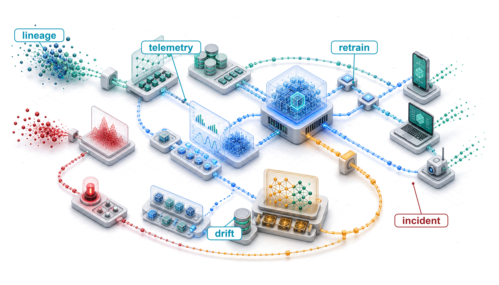
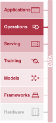
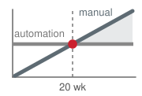
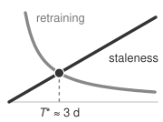

# ML Operations {#sec-ml-operations}

::: {layout-narrow}
::: {.column-margin}

\chapterminitoc

:::

::: {.content-visible when-format="pdf"}
\noindent
{fig-alt="Isometric operations loop around a deployed model service with telemetry, monitoring, drift response, retraining, and deployment updates."}
:::

::: {.content-visible unless-format="pdf"}
{fig-alt="Isometric operations loop around a deployed model service with telemetry, monitoring, drift response, retraining, and deployment updates."}
:::

:::

## Purpose {.unnumbered .unlisted}

::: {.content-visible when-format="pdf"}
\begin{marginfigure}
\mlsysstack{0}{15}{10}{20}{35}{90}{35}{30}
\end{marginfigure}
:::

::: {.content-visible unless-format="pdf"}
::: {.column-margin}
{width="100%" fig-alt="Machine Learning Systems Architecture Stack"}

*Architecture stack focus for this chapter.*
:::
:::

_Why can an ML system be perfectly available and perfectly wrong at the same time?_

Conventional monitoring often detects crashes, latency regressions, and availability failures quickly, but semantic errors can remain silent in any software system. ML systems add another silent failure mode. A model experiencing data drift can continue serving ordinary-looking predictions while accuracy degrades, triggering no alerts because every health check (latency, throughput, uptime) remains green. A fraud model can keep answering in milliseconds for months after the patterns it learned have moved elsewhere, and the first alarm may be the losses themselves. Model quality can degrade because the world changes. Customer behavior shifts, new product categories appear, seasonal patterns evolve, and the distribution the model learned from diverges from the one it now faces. Drift is not a certainty but a persistent risk for deployed models. Unlike latency or uptime, correctness may become observable only after labels or downstream outcomes arrive, so detecting degradation often requires imperfect signals and explicit investigation rather than a single threshold. Managing it requires continuous monitoring that tracks prediction quality alongside system health, drift signals that trigger investigation, retraining when outcome evidence supports it, and deployment strategies that validate new model versions against production traffic before full rollout. The gap between development and production is not a hurdle cleared once but a condition managed indefinitely, for as long as the model makes decisions that someone relies on. Machine learning operations exists because uptime without measured accuracy may still deliver wrong answers at scale. In D·A·M terms, operations makes co-design continuous, because the data environment can remain a moving target long after initial deployment.

::: {.content-visible when-format="pdf"}

\newpage

:::

::: {.callout-learning-objectives}

- Explain why ML systems can remain available while prediction quality silently degrades under distribution shift
- Diagnose technical debt across data-model, model-infrastructure, and production-monitoring interface boundaries
- Design feature stores, registries, and CI/CD pipelines that preserve training-serving consistency and reproducible rollback
- Compare canary, blue-green, shadow, and rollback strategies by the release risk they contain and the accelerator memory they hold
- Design layered monitoring and an incident-response workflow that trace drift, skew, and degradation to a data, model, or infrastructure cause
- Apply the retraining staleness model to choose cost-aware retraining triggers and intervals
- Evaluate operational maturity and investment using model criticality, operational risk, and organizational readiness

:::

## Silent Failure in Production {#sec-ml-operations-introduction-machine-learning-operations-04c6}

A **silent failure**\index{Silent failure!definition} is a production model that keeps answering every request on time, raises no error, and passes every health check while its answers grow worse. Any deployed model is exposed to it, because a model is a fit to the data it trained on and the world it serves keeps moving after training ends. @Sec-model-serving built the request path that delivers those answers, a service that meets its latency budget, holds headroom for bursts, and turns throughput into cost per inference. A benchmark establishes performance at a point in time, and serving infrastructure verifies that the required fraction of requests finishes within the latency budget. Neither check asks whether the answers are still right. Operations is the stage of the lifecycle (@sec-ml-workflow) that has no finish line. It keeps a model correct for as long as anyone relies on its decisions. The team deploys to production, and week one looks excellent. The challenge begins in week two.

Data distributions shift, user behavior changes, and the world moves on from the conditions under which the model was trained. ML models that succeed in development can fail to achieve sustained production use when postdeployment ownership and monitoring are absent. The root cause is an operational mismatch\index{Operational mismatch!ML vs. traditional software}: availability-focused monitoring tracks server uptime, request latency, and request success rates, while ML monitoring must also track statistical health, including accuracy over time, input-distribution shift, and per-segment prediction quality. A model can degrade substantially while throwing no exceptions, triggering no infrastructure alarms, and maintaining perfect uptime.

```{python}
#| echo: false
# ┌─────────────────────────────────────────────────────────────────────────────
# │ MEASURED TEMPORAL DECAY (LEGO)
# ├─────────────────────────────────────────────────────────────────────────────
# │ Context: Paragraph after the operational-mismatch paragraph and
# │          @fig-temporal-shift.
# │
# │ Goal: Show that accuracy loss over time is measured, not hypothetical.
# │ Show: Six Wild-Time datasets lose 4.0 to 18.5 points on later-period data.
# │ How: id_mean minus ood_mean per row of Literature.Series.TemporalShiftWildTime.
# │
# └─────────────────────────────────────────────────────────────────────────────
from mlsysim import Literature
from mlsysim.fmt import check, fmt

# ┌── LEGO ───────────────────────────────────────────────
class TemporalShiftDrop:
    """Performance drop from training-period to later-period test data."""

    # ┌── 1. LOAD (Constants) ───────────────────────────────────────────────
    rows = Literature.Series.TemporalShiftWildTime.entries

    # ┌── 2. EXECUTE (The Compute) ─────────────────────────────────────────
    drops = [r["id_mean"] - r["ood_mean"] for r in rows]
    min_drop, max_drop = min(drops), max(drops)
    dataset_count = len(rows)

    # ┌── 3. GUARD (Invariants) ───────────────────────────────────────────
    check(3 <= min_drop and max_drop <= 20, f"Prose quotes drops of ~4 to ~18.5 points, got {min_drop:.1f} to {max_drop:.1f}.")
    check(dataset_count == 6, "Prose says six datasets (Wild-Time Table 1).")

    # ┌── 4. OUTPUT (Formatting) ──────────────────────────────────────────────
    min_drop_str = fmt(min_drop, precision=0 if abs(min_drop - round(min_drop)) < 1e-9 else 1, commas=False)
    max_drop_str = fmt(max_drop, precision=1, commas=False)
```

The degradation is measurable. In the Wild-Time benchmark, @yao2022wildtime train a model on data from one period and test it both on held-out data from that period and on data from later years, across six real datasets that span yearbook portraits, satellite imagery, hospital records, news, and scientific papers. @Fig-temporal-shift shows the result. On every dataset the same model scores lower on the later data, by `{python} TemporalShiftDrop.min_drop_str` to `{python} TemporalShiftDrop.max_drop_str` points of accuracy or of area under the curve (AUC), although nothing about the model or its serving path changed. The loss comes entirely from the world moving away from the training data, and only monitoring that compares predictions against fresh outcomes can see it.

::: {#fig-temporal-shift fig-env="figure" fig-pos="htb" fig-cap="**Measured Accuracy Loss over Time**: For six datasets, performance of the same trained model on held-out test data from its training period (blue) and on data from a later period (red), with error bars showing one standard deviation over three training seeds. The label gives each drop in percentage points. MIMIC mortality is scored by AUC; the others by accuracy. Data from @yao2022wildtime." fig-alt="Dumbbell chart with six rows sorted by drop size: Yearbook portraits accuracy falls from 98.0 to 79.5 percent, MIMIC mortality AUC from 90.9 to 72.9, MIMIC readmission accuracy from 73.0 to 61.3, HuffPost news from 79.4 to 70.4, arXiv papers from 53.8 to 45.9, and FMoW satellite from 58.1 to 54.1. Blue dots mark training-period performance and red dots later-period performance, each with error bars, and each row is labeled with its drop in points."}

```{python}
#| echo: false
# ┌─────────────────────────────────────────────────────────────────────────────
# │ MEASURED TEMPORAL DECAY (FIGURE)
# ├─────────────────────────────────────────────────────────────────────────────
# │ Context: @fig-temporal-shift.
# │
# │ Goal: Compare training-period and later-period performance per dataset.
# │ Show: Dumbbells with seed error bars, sorted by drop.
# │ How: TemporalShiftDrop (above); book_style.setup_plot().
# │
# └─────────────────────────────────────────────────────────────────────────────
from binder.tools.figures import style as book_style

fig, ax, COLORS, plt = book_style.setup_plot(figsize=(10, 4.0))
_rows = sorted(TemporalShiftDrop.rows, key=lambda r: r["id_mean"] - r["ood_mean"])
for _i, _r in enumerate(_rows):
    _a, _b = _r["id_mean"], _r["ood_mean"]
    ax.plot([_b, _a], [_i, _i], color=COLORS["grid"], lw=2.5, zorder=1)
    ax.errorbar(_a, _i, xerr=_r["id_std"], fmt="o", color=COLORS["BlueLine"], ms=7, capsize=2, zorder=3, label="Test data from the training period" if _i == 0 else None)
    ax.errorbar(_b, _i, xerr=_r["ood_std"], fmt="o", color=COLORS["RedLine"], ms=7, capsize=2, zorder=3, label="Test data from a later period" if _i == 0 else None)
    ax.text(_a + _r["id_std"] + 1.5, _i, f"$-${_a - _b:.1f} pts", va="center", fontsize=8, color=COLORS["primary"])
ax.set_yticks(range(len(_rows)))
ax.set_yticklabels([f"{r['dataset']} ({r['metric']})" for r in _rows])
ax.set_xlim(40, 106); ax.set_xlabel("Performance (%)")
ax.legend(loc="lower right", fontsize=8, frameon=True, framealpha=0.95)
plt.show()
plt.close()
```

:::

The discipline that makes these invisible failures visible is **machine learning operations (MLOps)**\index{MLOps!emergence}\index{MLOps!production deployment challenges}. It inherits the automation and operations lineage of DevOps [@kreuzberger2023]\index{MLOps!DevOps comparison}\index{DevOps!MLOps extension}, but addresses a different failure mode. Conventional services can often be tested against deterministic code paths, while ML systems depend on training data distributions, learned parameters, and environmental conditions that shift continuously. Data distributions, learned parameters, slice-level evaluations, and runtime feedback loops therefore all function as release artifacts that govern production behavior, and a release extends far beyond an executable binary or code diff.

The operational mismatch connects directly to the book's analytical foundations. If benchmarking provides the *sensors* for the system, MLOps is the complete *control system*, and the degradation equation\index{Degradation equation!operational implementation} (@eq-degradation) names the quantity it controls. Accuracy falls by a fitted sensitivity $\FittedSensitivity$ times the divergence between the serving and training distributions, so operations must measure that divergence continuously and estimate $\FittedSensitivity$ from paired drift and outcome data, because divergence alone does not prove that accuracy will fall. MLOps also formalizes interfaces and responsibilities across traditionally isolated domains (data science, machine learning engineering, and systems operations [@amershi2019]) through continuous retraining, A/B evaluation, graduated rollout, and standardized artifact tracking that supports reproducibility and auditability.

::: {#dfn-ml-ops-mlops .callout-definition title="MLOps"}

***Machine learning operations (MLOps)***\index{MLOps!definition} is the engineering practice of productionizing ML systems through CI/CD, workflow orchestration, reproducibility, versioning, collaboration, continuous training and evaluation, monitoring, and feedback loops [@kreuzberger2023].

1.  **Significance**: Leaving the loop open shows up as stale predictions, silent accuracy degradation, and prolonged recovery times. Drift thresholds, retraining triggers, and mean time to recovery (MTTR) targets are deployment-specific, calibrated from prediction value, label delay, validation risk, and retraining compute expense. A retraining run is justified only when the expected accuracy gain outweighs its execution cost and rollout risk.
2.  **Distinction**: DevOps monitors functional correctness, throughput, and availability. MLOps adds statistical controls for *predictive correctness*, which can decay while uptime, latency, and HTTP status codes stay healthy.
3.  **Common pitfall**: A frequent misconception is that retraining on new data automatically resolves distribution shift. Retraining without diagnosing what shifted (the inputs the model receives, the relationship between those inputs and the correct answers, or both) preserves the underlying failure or amplifies collection bias. Reweighting the training data can correct a change in input mix, but only new outcome evidence shows whether a changed input-output relationship requires adaptation; @sec-ml-operations-model-infrastructure-monitoring-3988 separates the two cases formally.

:::

The loop has three stages (design, model development, and operations), but its defining feature is the return path. Runtime telemetry and retraining triggers carry live performance signals from operations back into requirements and data engineering, so deployment feeds the next design cycle instead of ending the project (@fig-mlops-diagram).

::: {#fig-mlops-diagram fig-env="figure" fig-pos="htb" fig-cap="**Iterative MLOps Loop**: Monitoring and triggering feed production evidence back into design and model development, turning requirements, engineering, testing, and deployment into a continuous operating cycle." fig-alt="Infinity-loop diagram with three phases. Design phase: requirements, use-case prioritization, data availability. Model development: data engineering, model engineering, testing. Operations: deployment, CI/CD pipeline, monitoring and triggering."}

```{.tikz}
\scalebox{0.6}{%
\begin{tikzpicture}[line join=round,font=\sffamily,outer sep=0pt,  radius=2, start angle=-90]
\tikzset{
arr node/.style={sloped, allow upside down, single arrow,
single arrow head extend=+.12cm, thick, minimum height=+.6cm, fill=white},
arr/.style ={  edge node={node[arr node, pos={#1}]{}}},
arr'/.style={insert path={node[arr node, pos={#1}]{}}},
}
\begin{scope}[shift={(0,0)},scale=1.1, every node/.append style={transform shape}]
\draw[line width=7mm, sloped, text=white,GreenD!60]
 (0, 2) edge[preaction={line cap=butt, line width=10mm, draw=white, overlay},
              out=0, in=180, arr=.1, arr=.8] (5, -2)
(5,-2)to[out=0, in=180, arr=.2, arr=.9](10,2)
arc[start angle=90, delta angle=-180][arr'=.5]
(10,-2)edge[preaction={line cap=butt, line width=10mm, draw=white, overlay},out=180, in=0, arr=.1, arr=.8](5,2)
(5,2)to[out=180, in=0, arr=.2, arr=.9](0,-2)
arc[start angle=-90, delta angle=-180][arr'=.5] ;
\end{scope}
\node[align=center,blue!50!black]at(0,0){DESIGN};
\node[align=center,BrownLine!50!black]at(5.5,0){MODEL\\ DEVELOPMENT};
\node[align=center,GreenD!80!black]at(11,0){OPERATIONS};
%
\node[align=left,anchor=north,blue!50!black]at(0,-3){$\bullet$ Requirements Engineering\\
$\bullet$ ML Use-Cases Prioritization\\
$\bullet$ Data Availability Check};
\node[align=left,anchor=north,BrownLine!50!black]at(5.75,-3){$\bullet$ Data Engineering\\
$\bullet$ ML Model Engineering\\
$\bullet$ Model Testing \& Validation};
\node[align=left,anchor=north,GreenD!80!black]at(11.25,-3){$\bullet$ ML Model Deployment\\
$\bullet$ CI/CD Pipeline\\
$\bullet$ Monitoring \& Triggering};
\end{tikzpicture}}
```

:::

The operations stage of that loop runs as five steps on every production model. It detects a change in inputs, outputs, or outcomes; diagnoses which layer of the system caused it; decides whether retraining, rollback, or waiting is worth its cost; releases a replacement under controlled exposure; and recovers to a known-good version when a release misbehaves. Each step is a control that a team must build and pay for, and each consumes a concrete machine resource: telemetry bytes for detection, logged requests for diagnosis, accelerator-hours for a retraining run, and a second resident copy of the model for a safe release.

Deploying, monitoring, and maintaining one production ML system defines the fundamental operational unit: the **ML node**\index{ML node!definition}, a complete system comprising data pipelines, feature computation, model training, serving infrastructure, and monitoring for a single machine learning application. Platform operations at larger scale (managing hundreds of models, cross-model dependencies, multi-region coordination, and organization-wide ML platform engineering) constitute advanced topics that build on these single-model foundations.

Keeping one ML node correct decomposes into three distinct interfaces. The **data-model interface**\index{Data-model interface!feature consistency} is the handoff between data infrastructure and model training; its goal is feature consistency\index{Feature consistency!training-serving alignment}, so training and serving pipelines compute features the same way. The **model-infrastructure interface**\index{Model-infrastructure interface!environment parity} is the transition from trained weights to scalable service; its challenge is environment parity\index{Environment parity!production deployment}, because a model that works in a notebook may fail in production due to version, dependency, or runtime mismatches. The **production-monitoring interface**\index{Production-monitoring interface!feedback loop} is the feedback loop that enables self-correction, returning statistical telemetry[^fn-telemetry-mlops-pipeline]\index{Statistical telemetry!ML observability} from production to training because ML systems can degrade through drift without crashing.

These interfaces determine how infrastructure components partition responsibility. Feature stores stabilize feature computation at the data-model boundary. Model registries and deployment pipelines preserve the model-infrastructure handoff. Drift monitors, retraining triggers, and governance policies connect production evidence to a controlled response, shortening the window in which degradation goes unaddressed.

[^fn-telemetry-mlops-pipeline]: **Telemetry**\index{Telemetry!ML observability}: The feedback path that can make model degradation visible before it becomes a business failure; crashes and error codes expose some software failures, but semantic errors can remain silent in any application. ML systems add distribution shift, which can go undetected without statistical telemetry such as feature distributions, prediction confidence, and drift indicators.

```{python}
#| echo: false
#| label: ops-running-cases-calc
# ┌─────────────────────────────────────────────────────────────────────────────
# │ THE CHAPTER'S TWO RUNNING CASES
# ├─────────────────────────────────────────────────────────────────────────────
# │ Context: Running-case paragraph of
# │          @sec-ml-operations-introduction-machine-learning-operations-04c6
# │          and the chapter map table.
# │
# │ Goal:    Show each running case in its home regime: DLRM capacity-bound on
# │          the reference accelerator, keyword spotting power-bound on a
# │          microcontroller.
# │ Show:    DLRM's 100 GB of tables need two 80 GiB H100s before throughput
# │          is considered; the INT8 KWS model is 200 KB of a 4 MiB flash.
# │ How:     Registry model sizes divided by registry device capacities.
# └─────────────────────────────────────────────────────────────────────────────
from math import ceil
from mlsysim import Models, Hardware, BYTES_INT8
from mlsysim.core.units import GB, GiB, KB, MiB
from mlsysim.fmt import check, fmt_memory

# ┌── LEGO ───────────────────────────────────────────────
class OpsRunningCases:
    """DLRM capacity footprint on the H100 and KWS footprint on a microcontroller."""

    # ┌── 1. LOAD (Constants) ──────────────────────────────────────────────
    dlrm = Models.Recommendation.DLRM
    h100 = Hardware.Cloud.H100
    kws = Models.Tiny.DS_CNN
    mcu = Hardware.Tiny.ESP32_S3

    # ┌── 2. EXECUTE (The Compute) ────────────────────────────────────────
    dlrm_bytes = dlrm.model_size
    hbm = h100.memory.capacity
    dlrm_accels = ceil((dlrm_bytes / hbm).to("").magnitude)
    kws_bytes = kws.size_in_bytes(BYTES_INT8)
    flash = mcu.memory.flash_capacity

    # ┌── 3. GUARD (Invariants) ───────────────────────────────────────────
    check(dlrm_bytes > hbm, "DLRM's tables must exceed one H100's memory for the capacity-bound framing.")
    check(dlrm_accels == 2, f"Prose says the tables span two accelerators, got {dlrm_accels}.")
    check(kws_bytes < flash, "The INT8 KWS model must fit the microcontroller's flash.")

    # ┌── 4. OUTPUT (Formatting) ─────────────────────────────────────────────
    dlrm_gb_str = fmt_memory(dlrm_bytes, unit=GB, precision=0, commas=False)
    hbm_gib_str = fmt_memory(hbm, unit=GiB, precision=0, commas=False)
    kws_kb_str = fmt_memory(kws_bytes, unit=KB, precision=0, commas=False)
    flash_mib_str = fmt_memory(flash, unit=MiB, precision=0, commas=False)
```

Two of the book's lighthouse workloads (@sec-introduction-lighthouse-models-9b1c) carry the chapter, one for each end of the deployment spectrum. The cloud half follows a ranking service built on DLRM, the recommendation model that @sec-model-serving set against ResNet-50's compute-bound service. DLRM's home regime is capacity-bound. Its `{python} OpsRunningCases.dlrm_gb_str` of embedding tables exceed the `{python} OpsRunningCases.hbm_gib_str` of one H100, so even its smallest deployment spans two accelerators before throughput enters the calculation, and every operational control that needs a second copy of the model pays for it in memory. A ranking model is also the workload whose world moves fastest. User interests and the item catalog change daily, click labels arrive within hours, and the model's own rankings shape the clicks it later trains on. The edge half follows the keyword spotter, whose home regime is power-bound. Its `{python} OpsRunningCases.kws_kb_str` INT8 model listens continuously on a microcontroller with `{python} OpsRunningCases.flash_mib_str` of flash, where every radio transmission and flash write draws on a small energy budget. @Sec-data-engineering-data-debt-hidden-liability-3335 left that spotter six months after launch with a detection rate four percentage points below its target, and the edge sections of this chapter pick up the drop. The device cannot be reached by hand, its audio cannot leave it, and a failed update must not disable it.

```{python}
#| echo: false
# ┌─────────────────────────────────────────────────────────────────────────────
# │ RANKING SERVICE DRIFT SCENARIO
# ├─────────────────────────────────────────────────────────────────────────────
# │ Context: The ranking-service story told in the opening, the degradation
# │          signatures, and the retraining-interval worked example.
# │ Goal:    One source for the observed accuracy slide and the exponential
# │          decay rate it implies, so the retraining math decays as fast as
# │          the story does.
# │ How:     Fit A(t) = A0 exp(-gamma t) to the launch and week-four readings.
# └─────────────────────────────────────────────────────────────────────────────
import math
from mlsysim.fmt import fmt, fmt_percent, check

class RankingDriftScenario:
    """Ranking service: observed accuracy slide and the implied daily decay rate."""

    # ┌── 1. LOAD (Constants) ──────────────────────────────────────────────
    acc_initial = 0.94  # scenario assumption: click-prediction accuracy at launch
    acc_week4 = 0.88  # scenario assumption: accuracy measured four weeks later
    days_to_reading = 28  # four weeks

    # ┌── 2. EXECUTE (The Compute) ────────────────────────────────────────
    gamma = math.log(acc_initial / acc_week4) / days_to_reading

    # ┌── 3. GUARD (Invariants) ───────────────────────────────────────────
    check(0.001 < gamma < 0.005, f"A six-point slide over four weeks is a slow drift, got gamma={gamma:.4f}/day.")

    # ┌── 4. OUTPUT (Formatting) ─────────────────────────────────────────────
    acc_initial_pct_str = fmt_percent(acc_initial, precision=0, commas=False, style='prose')
    acc_initial_num_str = fmt(acc_initial * 100, precision=0, commas=False)
    acc_week4_pct_str = fmt_percent(acc_week4, precision=0, commas=False, style='prose')
```

The week-two problem takes concrete shape on the ranking service in an illustrative scenario. Initial measurements show `{python} RankingDriftScenario.acc_initial_pct_str` click-prediction accuracy, p99 latency inside the service's budget, and strong performance across test segments. By week four, accuracy has dropped to `{python} RankingDriftScenario.acc_week4_pct_str`, but the infrastructure metrics show nothing wrong. By week eight, a product manager notices that recommended items convert poorly; investigation reveals the model has not adapted to a competitor's new promotion that shifted what users click. The model needed investigation six weeks ago, but no system was watching for this degradation. MLOps provides the framework to detect such changes, assess whether retraining addresses them, and validate replacement models while limiting the impact on users.

The chapter builds the operations loop in the order a team needs it (@tbl-ml-ops-chapter-spine). Technical debt explains why ML systems accumulate the hidden coupling that makes silent failure likely. Development infrastructure builds the pipeline that can rebuild and trace any model exactly, and releasing models moves a candidate onto live traffic with a tested path back. Production monitoring then watches the deployed model for the evidence the loop runs on, and retraining decisions turn that evidence into a choice to retrain, roll back, or wait. Incident response and governance handle the failures that monitoring surfaces, operational maturity decides which control a team should add next, and two case studies carry the loop to the edge and into the clinic.

| **Section**                          | **Loop step**        | **Question it answers**                                        | **Machine cost on the ranking service**                                                  |
|:-------------------------------------|:---------------------|:---------------------------------------------------------------|:-----------------------------------------------------------------------------------------|
| **Technical Debt**                   | Why the loop exists  | Where hidden coupling accumulates                              | Glue code and unused features that still move bytes                                      |
| **Development Infrastructure**       | Release (prepare)    | How a model is rebuilt and traced exactly                      | Versioned copies of data, features, and `{python} OpsRunningCases.dlrm_gb_str` of tables |
| **Releasing Models**                 | Release, recover     | How a candidate reaches traffic and how it is withdrawn        | A second resident copy of the tables for each release control                            |
| **Production Monitoring**            | Detect               | Whether predictions are still right                            | Telemetry bytes per second and their retention                                           |
| **Retraining Decisions**             | Decide               | Whether a new model is worth its run                           | Accelerator-hours that contend with serving                                              |
| **Incident Response and Governance** | Diagnose, recover    | Which layer failed, and who acts                               | Replay and slice queries over logged requests                                            |
| **Operational Maturity**             | All steps            | Which control to add next                                      | Operational spend matched to the model's value                                           |
| **Case Studies**                     | All steps            | How the loop changes at the edge and in the clinic             | Flash banks, radio energy, and clinician review time                                     |

: **Chapter Map**: Each section builds one step of the operations loop and names the machine resource that step consumes on the DLRM ranking service. {#tbl-ml-ops-chapter-spine tbl-colwidths="[24,16,30,30]"}

Operating this feedback path requires adding statistical controls to the release and reliability practices of DevOps. Technical debt accumulates wherever one of the three interface boundaries erodes. Feature stores, versioning, and CI/CD pipelines restore the reproducibility needed to isolate a fault at those boundaries, while monitoring, drift detection, and staged rollout protect predictive quality once inputs begin to shift. A small set of foundational principles decides which of these controls a given model needs and when each should act.

### Five operational principles {#sec-ml-operations-mlops-3ea3}

Each of the five principles is anchored to a measurable quantity, from a complete artifact hash for reproducibility to net retraining value for automation (@tbl-mlops-principles-summary). The sections that follow build the controls that enforce them.

```{=latex}
\begingroup
\renewcommand{\arraystretch}{1.35}
```

| **Principle**              | **Core Insight**            | **Key Metric**            |
|:---------------------------|:----------------------------|:--------------------------|
| **Reproducibility**        | Version all artifacts       | Complete artifact hash    |
| **Separation of concerns** | Independent layer evolution | Layers touched per change |
| **Consistency**            | Training equals serving     | Feature skew rate         |
| **Observable degradation** | Make failures visible       | Time to detection         |
| **Cost-aware automation**  | Optimize total cost         | Net retraining value      |

: **MLOps Principles Summary**: Quick reference for the five foundational principles that guide all MLOps tooling and practice decisions. {#tbl-mlops-principles-summary}

```{=latex}
\endgroup
```

#### Reproducibility {#sec-ml-operations-principle-1-reproducibility-d408}

Reproducibility\index{Reproducibility!versioning principle} requires every artifact\index{Artifact!versioning, reproducibility requirement}[^fn-artifact-reproducibility-hashing] that influences model behavior to be versioned and traceable. This principle extends beyond code repositories to encompass input datasets, feature schemas, hyperparameter configurations, and execution environments. @Eq-model-reproducibility expresses this dependency formally:
$$\text{Model Output} = \TrainingPipelineFunction(\text{Code}_\ArtifactVersion, \text{Data}_\ArtifactVersion, \text{Config}_\ArtifactVersion, \text{Environment}_\ArtifactVersion; \ExecutionNondeterminism)$$ {#eq-model-reproducibility}
where $\ArtifactVersion$ identifies an immutable version hash and $\ExecutionNondeterminism$ captures execution nondeterminism. Exact reproduction requires freezing all four versioned inputs alongside random seeds, dataloader sample ordering, deterministic GPU reduction kernels, and identical accelerator hardware architectures.

Fixing random seeds (such as `torch.manual_seed(42)`) still fails to guarantee bitwise reproducibility across training runs on accelerator hardware. The root cause is finite-precision arithmetic. In exact arithmetic, addition is associative, so $(\FirstFloatingPointAddend+ \SecondFloatingPointAddend) + \ThirdFloatingPointAddend= \FirstFloatingPointAddend+ (\SecondFloatingPointAddend+ \ThirdFloatingPointAddend)$. Floating-point formats such as FP32, FP16, and BF16 break associativity because each intermediate sum is rounded to fit a finite mantissa width. Because concurrent atomic updates on an accelerator reach memory in an order that varies from run to run, the rounded sums differ in their least significant bits, and these differences compound over thousands of optimization steps. Two runs with identical seeds and code can therefore diverge into measurably different weights unless deterministic reduction algorithms, which fix the summation tree at the cost of parallel throughput, are enabled (@sec-benchmarking-reproducibility-standardization-7ecf develops this trade-off between reproducibility and performance).

::: {.column-margin .margin-pointer}
↩ The floating-point formats, their dynamic ranges, and where accumulated rounding error matters in training are established in @sec-model-training-mixedprecision-training-9218.
:::

[^fn-artifact-reproducibility-hashing]: **Artifact**\index{Artifact!reproducibility}: Model weights are realized training outputs; the inputs and randomness that produced them cannot generally be inferred from the parameters. Versioning only code is therefore insufficient, and even versioning code, data, configuration, and environment may not guarantee exact replay when kernels or training are nondeterministic.

#### Separation of concerns {#sec-ml-operations-principle-2-separation-concerns-6f84}

Separation of concerns\index{Separation of concerns!MLOps layers} decomposes MLOps systems into distinct functional layers that can evolve independently, as @tbl-mlops-layers shows:

| **Layer**            | **Responsibility**                             | **Stability**                      |
|:---------------------|:-----------------------------------------------|:-----------------------------------|
| **Data Layer**       | Feature computation, storage, serving          | Changes with data schema evolution |
| **Training Layer**   | Model development, hyperparameter optimization | Changes with algorithm research    |
| **Serving Layer**    | Inference, scaling, latency management         | Changes with traffic patterns      |
| **Monitoring Layer** | Drift detection, performance tracking          | Changes with business requirements |

: **MLOps Separation of Concerns**: Each layer addresses a distinct responsibility and evolves at different rates across the data, training, serving, and monitoring layers. This separation enables independent scaling and updates, reducing blast radius when changes are required. {#tbl-mlops-layers}

#### Consistency imperative {#sec-ml-operations-principle-3-consistency-imperative-a292}

The architectural boundaries in @tbl-mlops-layers allow teams to upgrade serving runtimes without retraining models, adjust alert thresholds without redeployment, and modify data ingestion pipelines while preserving interface contracts. That architectural independence remains safe only when training and serving environments process features identically, establishing training-serving parity as the consistency imperative\index{Consistency imperative!training-serving parity} of @sec-data-engineering-ensuring-trainingserving-consistency-c683. A violation of that parity is training-serving skew, and the training-serving skew diagnostic (principle \ref{pri-training-serving-skew}) detects it without waiting for labels by comparing what the training and serving code paths compute, from features through model scores, for the same inputs. The financial consequence of this discrepancy is captured in @eq-skew-cost:
$$\text{Skew Cost} = \text{Rate}_{\text{skew}} \times \DailyQueryVolume\times \ErroneousPredictionCost$$ {#eq-skew-cost}
where $\text{Rate}_{\text{skew}}$ is the fraction of queries with erroneous predictions caused by training-serving skew, $\DailyQueryVolume$ is the daily query volume, and $\ErroneousPredictionCost$ is the average business cost incurred per erroneous prediction.

```{python}
#| echo: false
from mlsysim import *
from mlsysim.core.units import *

# ┌─────────────────────────────────────────────────────────────────────────────
# │ SKEW COST CALCULATION
# ├─────────────────────────────────────────────────────────────────────────────
# │ Context: The Consistency Imperative - quantifies annual cost
# │          of training-serving skew to motivate feature stores and validation.
# │
# │ Goal: Demonstrate the economic impact of training-serving skew.
# │ Show: That 1% skew error can waste $365,000 annually.
# │ How: Calculate annual lost revenue from a 1M daily query stream.
# │
# └─────────────────────────────────────────────────────────────────────────────
from mlsysim.fmt import fmt_int, fmt_rate, fmt_usd, fmt, check, MarkdownStr

class SkewEconomics:
    """
    Namespace for Training-Serving Skew Cost calculation.
    Scenario: The business impact of 1% skew-induced error on 1M daily queries.
    """

    # ┌── 1. LOAD (Constants) ───────────────────────────────────────────────
    queries_daily = MILLION
    skew_error_rate = 0.01
    cost_per_error = 0.10
    days_per_year = DAYS_PER_YEAR

    # ┌── 2. EXECUTE (The Compute) ─────────────────────────────────────────
    annual_cost = queries_daily * skew_error_rate * cost_per_error * days_per_year

    # ┌── 3. GUARD (Invariants) ───────────────────────────────────────────
    check(annual_cost == 365_000, f"Annual cost should be 365,000, got {annual_cost:.0f}")

    # ┌── 4. OUTPUT (Formatting) ──────────────────────────────────────────────
    queries_daily_str = fmt_rate(queries_daily, "queries/day", precision=0, commas=True)
    error_rate_pct_str = fmt_percent(round(skew_error_rate * 100) / 100, precision=0, commas=False, style='prose')
    error_cost_str = fmt_usd(cost_per_error, precision=2, commas=False)
    skew_cost_str = fmt_usd(annual_cost, precision=0, commas=True)
```

For a system serving `{python} SkewEconomics.queries_daily_str` with `{python} SkewEconomics.error_rate_pct_str` skew-induced errors costing `{python} SkewEconomics.error_cost_str` each, annual skew cost reaches `{python} SkewEconomics.skew_cost_str`. The loss recurs every year until consistency mechanisms remove its cause. Shared feature stores, unified C++ or Rust feature-extraction libraries invoked identically during offline training and online serving, and automated schema validation tests support consistency at the system boundary; matched-input tests must still verify feature values and semantics.

#### Observable degradation {#sec-ml-operations-principle-4-observable-degradation-87a9}

Observable degradation\index{Observable degradation!continuous measurement} requires ML systems to make silent failures\index{Silent failure!gradual degradation} visible through continuous measurement. Model accuracy degrades along a continuous statistical spectrum rather than failing as a discrete binary crash. An observed failure's time signature (an acute drop, gradual drift, or localized cohort decay) governs both the detection mechanism and the operational response. The ranking service's four-week slide from `{python} RankingDriftScenario.acc_initial_num_str` to `{python} RankingDriftScenario.acc_week4_pct_str` was a gradual signature, the kind that trend analysis on accuracy catches and that no uptime or latency alert can see. Making degradation observable therefore means pairing each failure signature with the telemetry that can see it and the countermeasure it calls for, as @tbl-degradation-types outlines.

```{=latex}
\begingroup
\renewcommand{\arraystretch}{1.35}
```

| **Degradation Type**     | **Detection Mechanism** | **Response Strategy**                  |
|:-------------------------|:------------------------|:---------------------------------------|
| **Sudden accuracy drop** | Threshold alerts        | Diagnose; roll back if release-related |
| **Gradual drift**        | Trend analysis          | Diagnose, then retrain if warranted    |
| **Subgroup degradation** | Cohort monitoring       | Targeted data collection               |
| **Latency increase**     | Percentile tracking     | Infrastructure scaling                 |

: **Degradation Detection Strategies**: Four failure signatures map to detectors and operational responses. Sudden drops require immediate diagnosis and may call for rollback, while gradual or subgroup degradation calls for diagnosis before retraining or targeted data collection. {#tbl-degradation-types}

```{=latex}
\endgroup
```

#### Cost-aware automation {#sec-ml-operations-principle-5-costaware-automation-631e}

Cost-aware automation\index{Cost-aware automation!retraining decisions} balances computational costs against accuracy improvements. Let $\FiniteChange\text{Accuracy}$ be the expected gain in accuracy percentage points, $\text{Value per Point}$ the monetary value of one percentage-point gain over the decision horizon, $\text{Training Cost}$ the compute and labor cost of a retraining run, and $\text{Deployment Risk}$ the expected cost of validation and rollout failure. @Eq-retrain-decision models this trade-off:
$$\text{Retrain if: } \FiniteChange\text{Accuracy} \times \text{Value per Point} > \text{Training Cost} + \text{Deployment Risk}$$ {#eq-retrain-decision}

The inequality acts as an operational decision gate rather than an unconstrained trigger. An automated pipeline should initiate retraining only when empirical evidence indicates that expected accuracy gains surpass execution cost and rollout risk. This economic trade-off governs retraining triggers, validation thresholds, and rollout gates; @sec-ml-operations-retraining-decisions-7d3a formalizes this model to calculate optimal retraining cadences. The margin by which the left side of @eq-retrain-decision exceeds the right is the *net retraining value*, the quantity that a retraining trigger should test.

How these principles manifest in practice depends on the workload. The ranking service drifts daily as user preferences shift, while the keyword spotter may run unchanged for months between updates. The monitoring strategy must match the workload's regime and, more decisively, the labels its deployment can observe.

::: {#lhs-ml-ops-monitoring-strategy-by-archetype .callout-lighthouse title="Monitoring strategy by archetype"}

```{=latex}
\begin{minipage}{1\linewidth}
```
The dominant failure modes and monitoring priorities differ across workload archetypes. @Tbl-monitoring-archetype-strategy compares four representative archetypes by drift pattern, monitoring metric, and example retraining trigger:

| **Archetype**                 | **Dominant Drift Pattern**                                       | **Primary Monitoring Metric**                       | **Example Retraining Trigger**                                                      |
|:------------------------------|:-----------------------------------------------------------------|:----------------------------------------------------|:------------------------------------------------------------------------------------|
| **Compute-bound (ResNet-50)** | Visual distribution shift (lighting, camera, new object classes) | Accuracy on holdout set (ground truth available)    | Accuracy drops > 2% from baseline  ($\sim$monthly for stable domains)               |
| **Bandwidth-bound (GPT-2)**   | Vocabulary drift, topic shift,  emerging entities                | Perplexity on live traffic (no ground truth needed) | Perplexity increases > 10%; new vocabulary detected ($\sim$weekly for news domains) |
| **Capacity-bound (DLRM)**     | User behavior shift, item catalog churn, cold-start items        | CTR/CVR delta vs. historical cohorts                | Engagement drops > 5%; catalog refresh ($\sim$daily for e-commerce)                 |
| **Power-bound (KWS DS-CNN)**  | Acoustic environment change  (noise floor shift)                 | Duty cycle (wakeups/hour) + false positive rate     | False wake rate > 1%; battery drain  exceeds spec ($\sim$quarterly OTA update)      |

: **Monitoring Strategy by Workload Archetype**: Illustrative starting points for monitoring strategy. Real thresholds must be calibrated to the deployment's label delay, traffic volume, business risk, and alert-fatigue budget. {#tbl-monitoring-archetype-strategy tbl-colwidths="[16,28,23,33]"}

```{=latex}
\end{minipage}
```

**Systems insight**: Ground-truth availability governs monitoring design. A workload's binding regime sets its cost and capacity but does not determine which quality signal is observable. Vision tasks with labels (ResNet-50) track holdout accuracy; language and recommendation services (GPT-2, DLRM) rely on perplexity or implicit clicks; microcontroller models without labels (the keyword spotter's DS-CNN) monitor duty cycles, while estimating false-wake rates requires a reference signal or reviewed examples. Retraining cadence is constrained by label delay, deployment access, validation cost, and the rate of observed change.

:::

These principles respond to three recurring operational failures: concept drift,[^fn-drift-adversarial-shift] data-quality defects [@schelter2018automating], and silent postdeployment degradation. Responding to them changes what a team must version and who must coordinate, not only what it monitors.

[^fn-drift-adversarial-shift]: **Concept drift**\index{Concept drift!adversarial evolution}: Concept-drift and data-stream research formalized the problem that a model's target relationship can change after deployment [@widmer1996; @gama2014]. In adversarial domains such as spam, fraud, and abuse detection, the distribution can actively adapt in response to the model, making continuous monitoring and retraining a structural requirement rather than an operational luxury.

MLOps coordinates a broader stakeholder ecosystem and introduces specialized practices such as data versioning,[^fn-dvc-data-versioning] model versioning, and continuous statistical monitoring that extend beyond traditional software engineering. By treating datasets and pipeline state as first-class versioned artifacts alongside source code, this expanded operational scope turns deployment from a linear release pipeline into a continuous, evidence-driven feedback loop.

[^fn-dvc-data-versioning]: **DVC (Data Version Control)**\index{DVC!data versioning}: DVC brings Git-like versioning to datasets and model artifacts [@dvc], solving the artifact gap that @eq-model-reproducibility formalizes: without data versioning, the $\text{Data}_\ArtifactVersion$ term is unrecoverable, and no combination of code commits can reconstruct the model that was deployed.

::: {#chk-ml-ops-mlops-loop .callout-checkpoint title="The MLOps loop"}

The operations loop feeds production evidence back into design.

**The feedback cycle**

- [ ] **Loop closure**: Explain how production telemetry returns evidence to the model lifecycle and why an alert does not by itself authorize retraining.
- [ ] **Retraining trigger**: Distinguish a distribution change from a measured quality regression, and explain why either requires diagnosis before selecting a remedy.

**The artifacts**

- [ ] **Artifact versioning**: Identify the data, code, configuration, weights, and environment versions needed to trace a deployed model, and explain why versioning alone does not guarantee exact replay.

:::

Each iteration through the operational loop introduces data dependencies, model interactions, and configuration state invisible to traditional compilation and testing. When left unmanaged, these hidden dependencies accumulate into systemic technical debt that erodes operational velocity and degrades predictive accuracy. Understanding the architectural patterns of this debt is the prerequisite for designing the infrastructure that pays it down.

## Technical Debt {#sec-ml-operations-technical-debt-system-complexity-2762}

In traditional software systems, technical debt[^fn-tech-debt-ml] represents the future rework created by choosing expedient shortcuts over disciplined architecture [@cunningham1992wycash]. In machine learning systems, that debt compounds through statistical coupling and data dependencies that code review and unit tests cannot detect [@sculley2015hidden]\index{Technical debt!ML system complexity}. A codebase can remain pristine while the external world shifts, rendering trained parameters obsolete and destabilizing downstream consumers. The ML Test Score rubric [@breck2017] quantifies this debt; it returns with the maturity audit near the end of the chapter.

[^fn-tech-debt-ml]: **Technical debt**\index{Technical debt!ML compounding}: Ward Cunningham's 1992 WyCash experience report introduced the debt metaphor for expedient code and delayed consolidation [@cunningham1992wycash]; in ML, debt can compound silently through data and model dependencies that code-focused unit tests and reviews may not detect. A pipeline can remain unchanged while the world it models changes.

::: {#dfn-ml-ops-technical-debt-ml .callout-definition title="Technical debt in ML"}

***Technical debt in machine learning***\index{Technical debt!definition} is the accumulating maintenance and change cost created by implicit data dependencies, entangled features, and undeclared consumers in ML systems, where the resulting liabilities may also appear as silent accuracy degradation.

1.  **Significance**: Google's analysis of production ML systems argues that model code is only a small fraction of the surrounding system; the larger operational surface includes data collection, feature extraction, configuration, serving infrastructure, monitoring, and process management [@sculley2015hidden]. ML-specific debt drivers compound this: changing one input feature can silently shift the learned representation of every other feature (entanglement), a model trained to correct another model's errors creates a fragile dependency chain (correction cascades), and downstream systems consuming model outputs without explicit contracts become undeclared consumers that break silently when the model is updated.
2.  **Distinction**: ML technical debt includes system- and data-level dependencies that code review and ordinary code-focused tests may miss. It can slow development and degrade prediction quality even while availability metrics remain healthy.
3.  **Common pitfall**: A frequent misconception is that "better code" solves technical debt in ML. In reality, it is a systems architecture problem: the debt accumulates when the assumptions of the training distribution (feature ranges, label meanings, data freshness) are not enforced as runtime contracts at the system boundary.

:::

A break-even calculation makes the cost dynamics of technical debt concrete. Teams often resist automation investment because manual processes seem faster in early development, but that advantage disappears once recurring manual interventions exceed the up-front automation cost.

::: {.column-margin}
{width="100%" fig-alt="Two strokes against weeks elapsed: a rising manual-work line crossing a flat one-time pipeline-investment line near week 20, with the area past the crossover shaded."}

*Cumulative manual work overtakes the one-time automation investment near week 20.*
:::

```{python}
#| echo: false
#| label: compound-cost-calc
# ┌─────────────────────────────────────────────────────────────────────────────
# │ COMPOUND COST OF MANUAL OPERATIONS
# ├─────────────────────────────────────────────────────────────────────────────
# │ Context: Callout "The Compound Cost of Manual Operations" - technical debt
# │          section showing why automation ROI compounds over time.
# │
# │ Goal: Demonstrates the break-even math for pipeline automation. Manual work
# │      (4 hrs/week) compounds while pipeline investment (80 hrs one-time)
# │      pays off in 20 weeks. After 1 year, manual teams drown in maintenance
# │      while automated teams have zero ongoing cost.
# │
# └─────────────────────────────────────────────────────────────────────────────
from mlsysim.fmt import fmt_int, fmt, check

# ┌── LEGO ───────────────────────────────────────────────
class AutomationROI:
    """
    Namespace for Automation ROI calculation.
    Scenario: Comparing manual retraining cost vs automated pipeline investment.
    """

    # ┌── 1. LOAD (Constants) ───────────────────────────────────────────────
    hrs_manual_week = 4.0
    hrs_automation_once = 80.0
    time_horizon_years = 1.0

    # ┌── 2. EXECUTE (The Compute) ─────────────────────────────────────────
    breakeven_weeks = hrs_automation_once / hrs_manual_week

    # ┌── 3. GUARD (Invariants) ───────────────────────────────────────────
    check(breakeven_weeks <= 26, f"Automation takes too long ({breakeven_weeks} weeks) to justify. Narrative implies fast ROI.")

    # ┌── 4. OUTPUT (Formatting) ──────────────────────────────────────────────
    mc_manual_hours_str = fmt_time(hrs_manual_week, "hour", precision=0, commas=False, style="word")
    mc_pipeline_hours_str = fmt_int(hrs_automation_once, commas=False)
    mc_breakeven_weeks_str = fmt_time(breakeven_weeks, "week", precision=0, commas=False, style="word")
    mc_time_horizon_years_str = fmt_time(time_horizon_years, "year", precision=0, commas=False, style="word")
    mc_pipeline_final_str = fmt(0, precision=0, commas=False)
```

::: {#nbk-ml-ops-compound-cost-manual-operations .callout-notebook title="The cumulative cost of manual operations"}

**Problem**: Why build automated pipelines when manual retraining is faster?

**Physics**: Manual work accumulates over time.

*   Manual retrain: `{python} AutomationROI.mc_manual_hours_str` of engineering per week.
*   Pipeline build: `{python} AutomationROI.mc_pipeline_hours_str` engineering hours (one-time).

**Math**:

*   **Result**: `{python} AutomationROI.mc_pipeline_hours_str` engineering hours $\div$ `{python} AutomationROI.mc_manual_hours_str` per week = `{python} AutomationROI.mc_breakeven_weeks_str`.
*   **Assumption**: This simplified calculation sets pipeline upkeep to zero, so automation removes the weekly task entirely.
*   **Upkeep**: Real pipelines need maintenance and new features. Each week then recovers only the difference between the manual load and the upkeep, which pushes break-even later; automation still pays back whenever its weekly upkeep stays below the manual work it replaces.
*   **Consequence**: After `{python} AutomationROI.mc_time_horizon_years_str`, manual teams still spend `{python} AutomationROI.mc_manual_hours_str` per week on maintenance, while pipeline teams spend only their upkeep (`{python} AutomationROI.mc_pipeline_final_str` recurring hours under this calculation's assumption).

**Context**: A central law of systems engineering is that the cost of *maintaining* a system over its lifetime can dominate the cost of *building* it. In ML, technical debt is especially dangerous because it is often *data-driven* rather than *code-driven*: a perfect piece of code can still fail if the data it processes shifts. Measurement is the management boundary: without telemetry, the team cannot tell whether maintenance work is reducing debt or merely hiding it.

**Systems insight**: A team that retrains by hand eventually has no time left to ship new models, provided automation upkeep stays below the manual load it removes. Without monitoring that makes silent failures visible, the team also accumulates debt in a system that grows harder to manage.

:::

The debt is larger than manual retraining alone, because modeling code constitutes only a small fraction of a real-world deployment. Core modeling code is one peripheral component among ten around the ML system, alongside nine supporting subsystems spanning data verification, feature extraction, configuration, and machine resource management (@fig-technical-debt). Their presence broadens the maintenance surface; the diagram does not measure each component's cost.

::: {#fig-technical-debt fig-env="figure" fig-pos="htb" fig-cap="**Hidden Infrastructure of ML Systems**: ML code is one of ten components arranged around the ML system at the center, alongside data collection, data verification, feature extraction, configuration, machine resource management, serving infrastructure, monitoring, analysis tools, and process management tools. Modeling occupies one circle and the remaining nine identify the operational surface a deployment must also carry; circle counts do not measure code volume or maintenance cost. Source: [@sculley2015hidden]." fig-alt="Hub-and-spoke diagram with the ML system at the center, connected by arrows to ten surrounding components: data collection, data verification, feature extraction, configuration, machine resource management, serving infrastructure, monitoring, analysis tools, process management tools, and ML code."}

```{.tikz}
\scalebox{0.73}{%
\begin{tikzpicture}[line join=round,font=\small\sffamily]
\tikzset{%
planet/.style = {circle, draw=none,
semithick, fill=blue!30,
                    font=\sffamily\bfseries, ball color=green!70!blue!70,shading angle=-15,
                    text width=27mm, inner sep=1mm,align=center},
satellite/.style = {circle, draw=#1, semithick, fill=#1!30,
                    text width=18mm, inner sep=1pt, align=flush center,minimum size=21mm},%<---
arr/.style = {-{Triangle[length=3mm,width=6mm]}, color=#1,
                    line width=3mm, shorten <=1mm, shorten >=1mm}
}
%planet
\node (p)   [planet]    {ML system};
%satellites
\foreach \i/\j [count=\k] in {red/{Machine Resource Management},
cyan/{Configuration},
purple/{Data Collection},
green/{Data Verification},
orange/{Serving Infrastructure},
yellow/{Monitoring},
Siva/{Feature Extraction},
magenta/{ML Code},
violet/{Analysis Tools},
teal/{Process Management Tools}
}
%connections
{
\node (s\k) [satellite=\i,font=\footnotesize\sffamily] at (\k*36:3.8) {\j};
\draw[arr=\i] (p) -- (s\k);
}
\end{tikzpicture}}
```

:::

While automation addresses the recurring operational overhead of manual retraining, it cannot prevent architectural decay. Deployed systems accumulate hidden complexity through systemic failure modes that emerge from statistical coupling rather than deterministic logic. The patterns group by where the coupling hides: in eroded boundaries and the correction cascades they invite, in interface dependencies that no import statement declares, in feedback and configuration that accumulate as the system evolves, and in the code and architecture around the model.

### Boundary erosion {#sec-ml-operations-boundary-erosion-8ef5}

Statistical software loses its modular boundaries\index{Boundary erosion!dissolution of modularity} more easily than conventional software does. In conventional software, modular encapsulation and typed APIs make dependencies explicit, though changes can still violate behavioral contracts. Machine learning systems blur these boundaries because component behavior depends on the empirical distribution of incoming data rather than syntactic interface definitions. An upstream formatting modification or normalization change can satisfy every unit test while silently shifting feature distributions and degrading downstream model accuracy. This implicit coupling through data pipelines creates unmonitored dependencies among feature engineering, training pipelines, and serving endpoints.

This erosion produces **entanglement**\index{Entanglement!ML system coupling}, where dependencies between features and components become so intertwined that local modifications demand global coordination. The resulting failure mode reflects the CACE\index{CACE principle!change propagation} principle: *Change Anything Changes Everything*. When systems lack strict distributional boundaries, adjusting a feature encoding or data filtering threshold can change learned weights throughout the model during retraining. With frozen weights, the same change leaves the learned parameters alone but alters the inputs the model sees, and potentially its predictions. For example, changing the binning strategy of a continuous feature shifts the feature's variance and covariance structure, causing a previously calibrated model to underperform and forcing downstream recalibrations that ripple across dependent services.

Defending against boundary erosion requires architectural modularity enforced at runtime. Components require explicit data contracts that govern statistical invariants, including allowed feature ranges, null tolerances, and drift thresholds. Enforcing separation between data ingestion, feature generation, and inference logic creates verification boundaries where data distributions can be validated before reaching model weights. Because boundary erosion remains silent during initial prototyping, schema contracts and invariant checks are the earliest point at which statistical coupling can be detected and managed.

### Correction cascades {#sec-ml-operations-correction-cascades-e309}

When boundary erosion goes unaddressed, engineering interventions frequently trigger a **correction cascade**\index{Correction cascade!sequential dependencies}: fixing a specific model defect with an auxiliary patch introduces secondary errors elsewhere, requiring further compensatory fixes that destabilize the entire pipeline. In ML systems, these cascades are severe because changes propagate through statistical dependencies rather than deterministic code branches. Retraining a model to correct a specific false-positive cluster may degrade accuracy across previously stable cohorts. Adding an auxiliary model to override edge-case predictions introduces uncalibrated residuals that distort downstream consumers. Repeated dependent patches can demand coordinated revalidation, with maintenance costs that may exceed those of revising the base model.

@Fig-correction-cascades-flowchart traces this failure propagation along a four-stage dependency chain (Models A through D), where each downstream component compensates for the residual errors of its predecessor. When an upstream patch alters Model A, dashed propagation arcs identify downstream corrections that require revalidation and may need retraining. The red arcs highlight how a local upstream fix propagates through subsequent stages, requiring coordinated checks of which learned corrections remain valid.

::: {#fig-correction-cascades-flowchart fig-env="figure" fig-pos="htb" fig-cap="**Correction Cascades**: Each model is trained to correct the errors of the model before it, forming a chain of dependencies. Changing an upstream model can invalidate downstream corrections, turning one local fix into revalidation across the chain and potentially several retraining cycles." fig-alt="Four model boxes in a left-to-right chain labeled Model A through Model D, each trained to correct the previous one. A red change badge on Model A and red dashed arcs reaching Model B, C, and D show an upstream change propagating downstream, with must revalidate labels beneath the downstream models."}

```{.tikz}
\begin{tikzpicture}[font=\small\sffamily, >=stealth]
\tikzset{
Line/.style={line width=0.5pt,black!50,text=black},
LineA/.style={-{Triangle[width=7pt,length=11pt]},line width=1pt,black!50,text=black},
LineD/.style={-{Triangle[width=7pt,length=11pt]},crimson,line width=1.5pt,rounded corners=15pt,
dashed,dash pattern=on 7pt off 5pt},
Box/.style={align=center, inner xsep=2pt,draw=none, line width=1pt,fill=none,
minimum width=30mm, minimum height=25mm,node distance=1.0},
Box1/.style={align=center, inner sep=5pt,draw=none, line width=1pt,fill=crimson,text=white,
 minimum width=18mm, minimum height=7mm,font=\small\sffamily\bfseries,rounded corners=7pt},
Text2/.style={font=\sffamily\bfseries\small,align=center},
Text3/.style={font=\sffamily\bfseries\small,align=center,redd},
}
\definecolor{redd}{HTML}{A31F34}
\definecolor{blueeD}{HTML}{4A90C4}
\definecolor{blueeL}{HTML}{CFE2F3}

%model
\tikzset{%
 pics/model/.style = {
        code = {
        \pgfkeys{/channel/.cd, #1}
\begin{scope}[local bounding box=MODEL,scale=\scalefac, every node/.append style={transform shape}]
\foreach \i in {1,...,3}{
  \pgfmathsetmacro{\y}{(-\i)*0.37}
  \node[circle,draw, minimum size=2.5mm,inner sep=0pt,fill=red](2K\i) at(0,\y){};
}
\foreach \i in {1,...,3}{
  \pgfmathsetmacro{\y}{(-\i)*0.37}
  \node[circle,draw, minimum size=2.5mm,inner sep=0pt,fill=brown](3K\i) at(0.6,\y){};
}
\foreach \i in {1,...,2}{
  \pgfmathsetmacro{\y}{-(3.5-\i)*0.37}
  \node[circle,draw, minimum size=2.5mm,inner sep=0pt,fill=cyan](1K\i) at(-0.6,\y){};
}
\foreach \i in {1}{
  \pgfmathsetmacro{\y}{-(3.0-\i)*0.37}
  \node[circle,draw, minimum size=2.5mm,inner sep=0pt,fill=green!40!black](4K\i) at(1.2,\y){};
}
\foreach \i in {1,...,2}{
  \foreach \j in {1,...,3}{
\draw[Line](1K\i)--(2K\j);
}}
\foreach \i in {1,...,3}{
  \foreach \j in {1,...,3}{
\draw[Line](2K\i)--(3K\j);
}}\foreach \i in {1,...,3}{
  \foreach \j in {1}{
\draw[Line](3K\i)--(4K\j);
}}
 \end{scope}
     }
  }
}
\pgfkeys{
  /channel/.cd,
  scalefac/.store in=\scalefac,
  scalefac=1,
}

\begin{scope}[local bounding box=mainfig]
%Models
\foreach \name/\x/\title/\subtitle/\picid in {
  B1/0/{Model A}/{base predictions}/1,
  B2/6/{Model B}/{corrects A}/2,
  B3/12/{Model C}/{corrects B}/3,
  B4/18/{Model D}/{corrects C}/4
}{
  % osnovni box
  \node[Box] (\name) at (\x,0) {};

  % gornji i donji fill
  \fill[cyan!07] (\name.north west)
    rectangle ($( \name.north east)!0.6!(\name.south east)$)
    coordinate (\name DE);

  \fill[cyan!20] (\name.south east)
    rectangle ($( \name.north west)!0.6!(\name.south west)$)
    coordinate (\name LE);

  % spoljašnja linija / border
  \node[Box,draw=blueeD] at (\name.center) {};

  % tekst u box-u
  \node[Text2] at ($(\name.south west)!0.5!(\name DE)$)
    {\title\\
    \textcolor{black!70}{\sffamily\subtitle}};

  % koordinata za ikonicu / pic
  \coordinate (\name Q) at ($(\name.north west)!0.5!(\name DE)$);

  % pic
  \pic[shift={(-0.3,0.73)}] at (\name Q)
    {model={scalefac=1.0}};
}
%%%
\foreach \x in {2,3,4}{
\node[below=3pt of B\x.south,Text3]{must revalidate};
}
%
\draw[LineD](B1.north)--++(0,17.8mm)-|(B4.north);
\draw[LineD](B1.north)--++(0,14.0mm)-|(B3.north);
\draw[LineD](B1.north)--++(0,10.5mm)-|(B2.north);
%
\node[Box1,above=5pt of B1.north]{change};
\end{scope}

\draw[LineA](B1)--(B2);
\draw[LineA](B2)--(B3);
\draw[LineA](B3)--(B4);
%
\node[below =8mm of mainfig.south,align=center,font=\small\sffamily\itshape,
black!70]{An upstream fix requires downstream revalidation;\\
some corrections may need revision.};

\coordinate(L1)at($(B2.south)+(-6mm,-11mm)$);

\begin{scope}[local bounding box=MC,shift={($(L1)+(0,0)$)}]
\node[](LT1) at(L1){correction dependency};
\draw[LineA](LT1.west)+(180:15mm)--(LT1.west);

\node[right=49mm of LT1](LT2) at(L1){change propagates downstream};
\draw[LineD](LT2.west)+(180:15mm)--(LT2.west);
\end{scope}
\end{tikzpicture}
```

:::

A local fix can force revalidation of every later model in the chain. A cascade requires dependent correction models; fine-tuning or reusing an established model does not create one by itself, although reuse does inherit representations and assumptions that require evaluation on the new task. Over time, those inherited properties become rigid architectural constraints that complicate future updates.

For example, fine-tuning an existing customer churn model for a new product line inherits the base model's feature encodings and calibration thresholds. If the new product exhibits different user engagement patterns, patching prediction errors with auxiliary post-processing rules creates a fragile multi-stage pipeline. When accuracy degrades, engineering teams discover that the root failure lies several layers upstream in the original labeling conventions.

Mitigating correction cascades requires balancing component reuse against redesign. While fine-tuning reduces initial compute and data collection costs, training a replacement base model can remove dependencies on a chain of auxiliary corrections, while data and labeling assumptions still require validation. The architectural decision depends on task similarity, covariate alignment, and the ongoing maintenance cost of chained models. Where dependent models are unavoidable, systems must decouple them through version-pinned model artifacts and frozen intermediate representations.

### Interface and dependency challenges {#sec-ml-operations-interface-dependency-challenges-7711}

Boundary erosion and correction cascades both stem from interface dependencies\index{Interface dependency!ML system challenge} that bypass formal software contracts. Traditional software dependencies are declared through import statements, package managers, and RPC schemas, allowing static analysis tools to map dependency graphs. In machine learning systems, dependencies hide inside data streams. When model A's output is logged to a data warehouse and later ingested as a training feature for model B, the coupling exists solely within the data pipeline, invisible to static code analysis.

Hidden coupling frequently manifests as **undeclared consumers**\index{Undeclared consumer!hidden model dependency}, where downstream services consume model predictions without formal registration or service-level agreements. When the upstream model is retrained or its output distribution shifts, these untracked consumers fail silently. For example, a credit risk score consumed by an automated marketing system can alter applicant pools, feeding shifted distributions back into future training runs, so the model increasingly trains on the applicants its own scores favored. This vulnerability is compounded by **data dependency debt**\index{Technical debt!data dependency debt, unstable inputs}, which accumulates when ML pipelines ingest unversioned tables, unstable upstream features, or signals with volatile distributions.

Eliminating interface debt requires infrastructure-enforced boundaries: strict authentication and registration for model prediction endpoints, machine-readable schema contracts for feature stores, and automated data lineage tracking that registers consumers before granting read access.

### System evolution challenges {#sec-ml-operations-system-evolution-challenges-ea51}

As an ML system evolves, even with documented interfaces, the most dangerous dynamic is the feedback loop\index{Feedback loop!self-reinforcing bias}, where a deployed model influences the data distribution that trains its successors. In the ranking service, suggested content dictates user engagement, clicks generate subsequent training sets, and the model reinforces its own historical selections while starving unselected content of exposure. In production, this failure mode often surfaces as a widening performance disparity across demographic cohorts: underrepresented groups receive suboptimal predictions, generating skewed engagement logs that further degrade cohort representation in subsequent retraining runs, the self-reinforcing loop that the bias feedback model (principle \ref{pri-bias-feedback}) describes. Detecting feedback loops requires cohort-stratified monitoring that tracks error distributions across user segments rather than relying on aggregate validation metrics.

::: {.column-margin .margin-pointer}
↪ A worked example that fits the bias feedback factor from two audits and treats fairness as a stability property of the retraining loop is developed in @sec-responsible-engineering-monitoring-incident-response-54f4.
:::

Evolution also degrades the workflows around the model. Over repeated deployment cycles, they accumulate **pipeline and configuration debt**\index{Pipeline!debt, workflow fragmentation}\index{Configuration debt!parameter sprawl}, growing into sprawling collections of ad hoc glue scripts and divergent hyperparameter files. When pipelines lack modular interfaces, teams copy existing scripts rather than refactor brittle data loaders, producing redundant pipelines that process the same raw inputs with subtle inconsistencies. Compounding this, rapid prototyping frequently embeds business logic directly into feature preparation scripts. Controlling pipeline evolution requires workflow orchestration engines with immutable directed acyclic graph (DAG) definitions, strict parameter validation, and configuration versioning managed under the same source control as model code.

### Code and architecture debt {#sec-ml-operations-code-architecture-debt-9140}

ML systems also accumulate code-level technical debt that makes infrastructure refactoring difficult [@sculley2015hidden].

At the implementation tier, **glue code**\index{Glue code!integration overhead} frequently dominates production repositories. Massive integration wrappers are written to shuttle tensors and records between general-purpose ML frameworks, specialized feature pipelines, and low-latency serving engines. @sculley2015hidden observe that a mature system can end up at most 5 percent machine learning code and at least 95 percent glue code. The proportion varies by system, but the asymmetry explains why integration code, not the model, dominates the maintenance surface. The resulting tight coupling to framework-specific APIs creates severe maintenance liabilities: minor upstream framework updates force extensive rewrites of the surrounding integration scaffolding. Isolating third-party libraries behind stable internal interfaces prevents external API churn from propagating throughout the serving stack.

Rapid experimentation further burdens codebases through **dead experimental codepaths**\index{Technical debt!dead code, experimental ML paths}. Research iterations leave behind legacy branches, alternative feature transforms, and abandoned scoring logic. Unlike traditional dead code that static analyzers flag and compilers prune, experimental ML codepaths often remain executable at runtime because they are guarded by dynamic configuration flags. These dormant branches expand the test matrix, complicate regression verification, and obscure the precise execution graph operating in production. Enforcing deprecation schedules and pruning retired feature flags prevents experimental residue from destabilizing the serving runtime.

Underlying both patterns is **abstraction debt**\index{Technical debt!abstraction debt, missing ML interfaces}: traditional software engineering relies on mature abstractions such as objects, interfaces, and modules, whereas ML engineering lacks universal abstractions for concepts such as a feature, a training dataset slice, or a model lifecycle state. Without standardized primitives, teams frequently reinvent bespoke abstractions or abandon encapsulation altogether. Infrastructure components such as feature stores, model registries, and standardized prediction services mitigate this debt by providing uniform abstractions for feature transformation, artifact lineage, and inference routing.

@sculley2015hidden also list three system smells that signal mounting debt: the *Plain-Old-Data Type Smell* (passing unvalidated raw floats and string arrays rather than domain types with invariant checks), the *Multiple-Language Smell* (stitching Python, SQL, C++, and shell scripts across the training-serving boundary), and the *Prototype Smell* (promoting throwaway research notebooks directly into production serving without re-engineering). Treating debt paydown as a routine operational discipline rather than an emergency intervention keeps these code smells from accumulating.

### Technical debt in practice {#sec-ml-operations-realworld-technical-debt-examples-8480}

These patterns show up in real outages. When statistical dependencies and undeclared data flows meet real operating environments, unmanaged technical debt becomes systemic outages and commercial failure.

#### Production debt patterns {#sec-ml-operations-production-debt-patterns-ffdc}

Four documented cases show these patterns in production. The first pair shows coupling through model behavior. YouTube's recommendation system\index{Feedback loop!YouTube case study} learns from noisy user-behavior signals, so its ranking objectives, per-user weighting, and live A/B evaluation are part of the system design rather than offline details [@covington2016]. Its own rankings shape what users watch, which makes today's recommendations tomorrow's training signal, the feedback loop that evaluation on fixed historical logs can miss. Zillow's iBuying venture\index{Correction cascade!Zillow case study} exposes the decision-coupling version of a cascade, in which a forecast drives purchases that cannot be undone when the forecast is later corrected (war story \ref{ws-ml-ops-zillow-offers-2021}).

::: {#ws-ml-ops-zillow-offers-2021 .callout-war-story title="The Zillow Offers wind-down (2021)"}

**Context**: Zillow, a real-estate marketplace, ran Zillow Offers\index{Zillow!coupled decisions}, an iBuying business that bought homes directly on the strength of forecasts of home prices and resale economics [@zillow2021offers].

**Mechanism**: The valuation forecast did not remain a prediction. It set purchase prices, purchases became inventory, and inventory carried the forecast's error onto the balance sheet. Zillow reported that it had bought homes at prices above its revised estimates of future selling prices, while resale-capacity constraints delayed some closings [@zillow2021offers]. Revising the forecast corrected the model's view of the market but could not reverse commitments made on the earlier view, so the correction propagated downstream as losses rather than as a repair.

**Impact**: In November 2021 Zillow announced that it would wind down Zillow Offers, reported a \$304 million third-quarter inventory write-down, and cut about 25 percent of its workforce [@zillow2021offers].

**Response**: A safer design caps the inventory exposure any one forecast can create, keeps manual override between prediction and purchase, and places circuit breakers that halt purchasing when forecast uncertainty exceeds the accepted risk budget.

**Systems lesson**: The case does not show a chain of residual-correction models, and retraining alone would not have removed the business risk. It shows the hazard that correction cascades share: a fix applied at one stage cannot undo the state that downstream stages already built on its earlier output. When predictions trigger irreversible actions, the dependency chain runs through the physical world, and the operational controls must sit on that chain.

:::

::: {.column-margin .margin-pointer}
↩ Zillow Offers as an example of predictions that drive irreversible actions is established in @sec-ml-systems-system-entropy-9c4e.
:::

The second pair exposes coupling through ownership and configuration. In safety-critical driving automation\index{Undeclared consumer!Tesla case study}, automated-control outputs, driver expectations, and subsystem responsibilities that are not specified clearly enough let operational failures cross component boundaries rather than stay local [@ntsb2017tesla]. Facebook's News Feed iterations\index{Configuration debt!Facebook case study} show the configuration version of the same problem, in which rapid ranking changes without traceable settings and explicit objectives become hard to audit after deployment [@facebook2016fblearner; @facebook2018newsfeed].

In every case the remedy is structural. Mitigating technical debt requires end-to-end MLOps infrastructure: feature registries that enforce runtime schemas, metadata stores that track model-data lineage, automated CI/CD pipelines that validate statistical properties, and observability platforms that detect distribution shift before silent errors propagate downstream.

Silent interface decay, untracked consumers, and unversioned pipeline dependencies can each make a model unsafe to serve while its offline validation metrics look acceptable. @Tbl-technical-debt-summary collects the debt patterns of this section with their root causes, failure symptoms, and mitigation strategies, the catalog of failure modes that a production-readiness rubric must detect.

| **Debt Pattern**         | **Primary Cause**                                      | **Key Symptoms**                                              | **Mitigation Strategies**                                            |
|:-------------------------|:-------------------------------------------------------|:--------------------------------------------------------------|:---------------------------------------------------------------------|
| **Boundary Erosion**     | Tightly coupled components, unclear interfaces         | Changes cascade unpredictably, CACE principle violations      | Enforce modular interfaces, design for encapsulation                 |
| **Correction Cascades**  | Sequential model dependencies, inherited assumptions   | Upstream fixes break downstream systems, escalating revisions | Careful reuse vs. redesign trade-offs, clear versioning              |
| **Undeclared Consumers** | Informal output sharing, untracked dependencies        | Silent breakage from model updates, hidden feedback loops     | Strict access controls, formal interface contracts, usage monitoring |
| **Data Dependency Debt** | Unstable or underutilized data inputs                  | Model failures from data changes, brittle feature pipelines   | Data versioning, lineage tracking, leave-one-out analysis            |
| **Feedback Loops**       | Model outputs influence future training data           | Self-reinforcing behavior, hidden performance degradation     | Cohort-based monitoring, canary deployments, architectural isolation |
| **Pipeline Debt**        | Ad hoc workflows, lack of standard interfaces          | Fragile execution, duplication, maintenance burden            | Modular design, workflow orchestration tools, shared libraries       |
| **Configuration Debt**   | Fragmented settings, poor versioning                   | Irreproducible results, silent failures, tuning opacity       | Version control, validation, structured formats, automation          |
| **Prototype Debt**       | Rapid prototyping shortcuts, tight code-logic coupling | Inflexibility as systems scale, difficult team collaboration  | Flexible foundations, intentional debt tracking, planned refactoring |

: **Technical Debt Patterns**: Machine learning systems accumulate distinct forms of technical debt from data dependencies, model interactions, and evolving operational contexts. Primary debt patterns, their causes, symptoms, and recommended mitigation strategies guide practitioners in recognizing and addressing these challenges systematically. {#tbl-technical-debt-summary tbl-colwidths="[21,22,28,29]"}

The mitigation column reads as a requirements list for the rest of the chapter. Shared feature definitions, versioned artifacts, and automated pipelines are development infrastructure; cohort monitoring belongs to production monitoring; and the rubric that scores a system against the whole catalog, the ML Test Score, is taken up with operational maturity (@sec-ml-operations-assessing-technical-debt-ml-test-score-0099), once the controls it audits have been built. Development infrastructure comes first, because a fault cannot be traced to a boundary that was never versioned.

## Development Infrastructure {#sec-ml-operations-development-infrastructure-automation-de41}

Development infrastructure turns the debt patterns diagnosed in @sec-ml-operations-technical-debt-system-complexity-2762 into enforcement points. A feature schema that drifts upstream cannot be repaired by a dashboard alone; it needs a shared contract, a versioned artifact, and a deployment path that rejects incompatible changes before they reach production. @Tbl-mlops-infrastructure-debt maps each component directly to a foundational principle (@sec-ml-operations-mlops-3ea3) and a specific failure mode. CI/CD pipelines also carry versioned artifacts, but the table assigns them cost-aware automation because the pipeline is where the retraining and promotion gates of @eq-retrain-decision actually execute, automating only the changes that pass them.

```{=latex}
\begingroup
\renewcommand{\arraystretch}{1.2}
```

| **Infrastructure Component** | **Principle Implemented** | **Debt Pattern Addressed**                  |
|:-----------------------------|:--------------------------|:--------------------------------------------|
| **Feature stores**           | Consistency               | Data dependency debt, training-serving skew |
| **Versioning systems**       | Reproducibility           | Configuration debt, correction cascades     |
| **CI/CD pipelines**          | Cost-aware automation     | Pipeline debt, boundary erosion             |
| **Monitoring systems**       | Observable degradation    | Feedback loops, silent failures             |

: **MLOps Infrastructure as Debt Remediation**: Each infrastructure component responds to a class of technical debt observed in production ML systems. Feature stores can reduce training-serving skew by reusing feature definitions and values; versioning systems support reproducibility; CI/CD pipelines automate rollout controls; monitoring systems can surface silent degradation before users do. {#tbl-mlops-infrastructure-debt}

```{=latex}
\endgroup
```

These operational components sit between the framework and the hardware: they know about data lineage and cluster state, which neither does. MLOps occupies the middle of the five-tier stack of @fig-ops-layers (ML models, frameworks, orchestration, infrastructure, and hardware). Model orchestration, which runs from data management to serving, and operational infrastructure, which runs from job scheduling to monitoring, together bridge mathematical frameworks and physical accelerator clusters and enforce the remediations of @tbl-mlops-infrastructure-debt. The tiers say *where* a component sits in the implementation stack, while the four layers of @tbl-mlops-layers say *who* owns an operational responsibility; the rest of the chapter reasons with the layers and the three interfaces.

Inside the orchestration and infrastructure tiers, four architectural mechanisms execute these operational responsibilities. First, a feature storage and retrieval layer serves a unified schema across two disparate access patterns: high-throughput analytical scans over immutable columnar files for offline training, and low-latency point lookups against key-value stores for online serving (@sec-ml-operations-feature-stores-c01c). Second, an artifact and lineage store records content-addressed hashes for dataset snapshots, code commits, container images, and model weights, ensuring any live prediction can be audited back to its exact training inputs (@sec-ml-operations-versioning-lineage-b1cf). Third, workflow orchestration sequences pipeline stages, from ingestion and validation through training and evaluation, as declared dependency graphs with retry semantics and automated triggers (@sec-ml-operations-cicd-pipelines-a9de). Fourth, a compute runtime schedules accelerator hardware, host memory, and processor cores across training jobs and serving endpoints under strict resource isolation (@sec-ml-operations-training-pipelines-2dcf). Specific frameworks implement pieces of this decomposition, but the underlying mechanisms and interface boundaries outlast any particular tool.

::: {#fig-ops-layers fig-env="figure" fig-pos="htb" fig-cap="**MLOps Stack Layers**: Five columns organize the ML system stack: ML Models/Applications, ML Frameworks/Platforms, Model Orchestration, Infrastructure, and Hardware. MLOps spans orchestration tasks from data management through model serving and infrastructure tasks from job scheduling through monitoring, supporting automation, reproducibility, and scalable deployment." fig-alt="Layered architecture diagram. Top row: ML models, frameworks, orchestration, infrastructure, hardware. MLOps section spans orchestration tasks (data management through model serving) and infrastructure tasks (job scheduling through monitoring)."}

```{.tikz}
\begin{tikzpicture}[line width=0.75pt,font=\small\sffamily]
%
\tikzset{%
   Line/.style={line width=1.0pt,GrayLine},
   Box/.style={align=flush center,
    inner xsep=2pt,
    node distance=0.9,
    draw=BlueLine,
    line width=0.75pt,
    fill=BlueFill,
    text width=31mm,
    minimum width=31mm, minimum height=10mm
  },
  Box2/.style={Box,text width=40mm,minimum width=40mm,fill=OrangeFill,draw=OrangeLine
  },
Box3/.style={Box, fill=GreenFill,draw=GreenLine},
Box31/.style={Box3, node distance=0.5, minimum height=9mm},
Box4/.style={Box, fill=RedFill,draw=RedLine,text width=34mm, minimum width=34mm},
Box41/.style={Box4, node distance=0.5, minimum height=9mm},
}
%
\node[Box,text width=37mm, minimum width=37mm](B1){\textbf{ML Models/Applications} (e.g., BERT)};
\node[Box2,right=0.35 of B1](B2){\textbf{ML Frameworks/Platforms} (e.g., PyTorch)};
\node[Box3,right=of B2](B3){\textbf{Model Orchestration} (e.g., Ray)};
\node[Box4,right=0.4of B3](B4){\textbf{Infrastructure}\\ (e.g., Kubernetes)};
\node[Box,right=of B4,fill=VioletFill,draw=VioletLine](B5){\textbf{Hardware}\\ (e.g., a GPU cluster)};
%
\node[Box31,below=of B3](B31){Data Management};
\node[Box31,below=of B31](B32){CI/CD};
\node[Box31,below=of B32](B33){Model Training};
\node[Box31,below=of B33](B34){Model Eval};
\node[Box31,below=of B34](B35){Deployment};
\node[Box31,below=of B35](B36){Model Serving};
%
\node[Box41,below=of B4](B41){Job Scheduling};
\node[Box41,below=of B41](B42){Resource Management};
\node[Box41,below=of B42](B43){Capacity Management};
\node[Box41,below=of B43](B44){Monitoring};
\node[Box41,draw=none,fill=none,below=of B44](B45){};
\scoped[on background layer]
\node[draw=BackLine,inner xsep=11,inner ysep=19,yshift=3mm,fill=BackColor!70,fit=(B3)(B44)(B36),line width=0.75pt](BB1){};
\node[below=3pt of BB1.north, anchor=north]{MLOps};
%
\foreach \y in{3,4}{
\foreach \x in{1,2,3,4}{
\pgfmathtruncatemacro{\newX}{\x + 1}
\draw[-latex,Line](B\y\x)--(B\y\newX);
}}
\foreach \y in{3,4}{
\draw[-latex,Line](B\y)--(B\y1);
}
\draw[-latex,Line](B35)--(B36);
\draw[-latex,Line](B44)--(B45)coordinate(T44);

\node[inner sep=0pt,below=0 of T44,rotate=90,align=center,font=\tiny\sffamily]{$\bullet$ $\bullet$ $\bullet$};
%
\foreach \y in{1,2,3,4}{
\pgfmathtruncatemacro{\newX}{\y + 1}
\draw[Line](B\y)--(B\newX);
}
\end{tikzpicture}
```

:::

### Data infrastructure and preparation {#sec-ml-operations-data-infrastructure-preparation-284a}

In an operational machine learning system, data is not a static compilation input; it is an active physical dependency that flows continuously from external ingestion to accelerator execution. From initial ingestion to online inference, data infrastructure must guarantee quality, mathematical consistency, and end-to-end traceability across both offline training and real-time serving.

#### Data management {#sec-ml-operations-data-management-93ed}

Machine learning technical debt stems largely from unmanaged data boundaries\index{Data management!MLOps lifecycle}: unversioned datasets erode system boundaries, inconsistent feature computation triggers correction cascades, and undocumented data dependencies create hidden downstream consumers. In operations, the collection, preprocessing, and feature transformation built by data engineering become versioned interfaces that the operations pipeline enforces. Where data engineering optimizes single-pipeline correctness and ingestion throughput, MLOps data management governs cross-pipeline consistency, ensuring that offline training and online serving compute mathematically identical features.

::: {.column-margin .margin-pointer}
↩ The collection, preprocessing, and feature-transformation pipelines that MLOps formalizes are established in @sec-data-engineering.
:::

Three principles organize the infrastructure that addresses these root causes: consistency, freshness, and quality. Each principle motivates specific tooling rather than the reverse.



The first principle, consistency, begins with reproducibility through versioned data. Every artifact influencing model behavior, from raw ingested records to engineered feature tables, must remain immutable and traceable. Without cryptographic versioning, teams cannot determine which dataset snapshot produced a given model checkpoint, making root-cause diagnosis and rollback impossible. Production implementations combine code repositories, content-addressed dataset versioning (DVC, Data Version Control\index{DVC!dataset versioning}\index{Data versioning!DVC tool} [@dvc], is one example), and durable object storage, but the systems invariant is that raw and processed artifacts must remain addressable by version (@sec-ml-operations-versioning-lineage-b1cf). At the feature level, consistency demands unified transformation logic across offline training and online serving to prevent training-serving skew, an invariant formalized in the dedicated feature store architectures examined next (@sec-ml-operations-feature-stores-c01c).

Consistency alone is insufficient if the underlying data is stale. Data freshness ensures that models train and serve on current data rather than outdated snapshots. Automated data pipelines\index{Data pipeline!automated workflows} maintain freshness by continuously transforming raw data into analysis-ready formats through structured stages: ingestion, schema validation, deduplication, transformation, and loading. Workflow orchestrators such as Apache Airflow\index{Apache Airflow!pipeline orchestration}\index{Workflow orchestration!pipeline automation} [@apache_airflow] make those stages explicit, schedulable, and reviewable as code. Once the pipeline is managed this way, data flows can evolve with model requirements without losing versioning, modularity, or CI/CD integration.

The third principle, data quality, governs whether the inputs reaching the model remain accurate, complete, and consistently labeled. In supervised learning systems, label errors and ambiguity can limit what training and evaluation establish, even with a larger model. Annotation platforms such as Label Studio\index{Label Studio!data quality} [@label_studio] support team-based annotation with integrated audit trails and version histories, providing the verification needed when labeling ontologies evolve or require correction across multiple training cycles.

On the ranking service, these three principles operate in concert. Click and session events are ingested and joined with the item catalog through a scheduled pipeline (freshness). The resulting features, such as session length and rolling click rates, are stored in a feature store for both offline retraining and low-latency online lookup (consistency). Schema validation, range checks, missingness tests, and label audits reject corrupted event records before they enter the training set (quality), while dataset versioning and model-registry integration maintain traceability from raw event logs to deployed predictions.

#### Feature stores {#sec-ml-operations-feature-stores-c01c}

The data dependency debt and training-serving skew analyzed in @sec-ml-operations-technical-debt-system-complexity-2762 share a common root cause, inconsistent feature computation across pipeline stages. Without a unified feature layer, feature definitions are typically implemented twice. On the ranking service, a data scientist computes `user_session_length` in Python using batch aggregations over historical logs, while a systems engineer reimplements the calculation in Java or C++ to satisfy real-time serving latencies. Subtle differences emerge. One uses wall-clock time between raw events, and the other tracks server processing time and filters idle timeouts. The model trains on one definition but serves with another, causing silent accuracy degradation in production. Feature stores\index{Feature store!training-serving consistency}[^fn-feature-store-ops] address this divergence by providing an abstraction layer between data engineering and machine learning, implementing the consistency imperative through a single source of truth for feature transformations. In pipelines lacking this abstraction, duplicated feature logic across environments introduces training-serving skew\index{Training-serving skew!accuracy impact}, temporal data leakage, and distribution drift.

::: {.column-margin .margin-pointer}
↩ The formal definition of training-serving skew as a violation of the consistency imperative is established in @sec-model-serving-trainingserving-skew-7b99.
:::

[^fn-feature-store-ops]: **Feature store**\index{Feature store!scale}: Uber's Michelangelo platform described a centralized feature store for sharing and serving features across production models [@hermann2017michelangelo]. At that scale, the consistency guarantee must hold under an online latency budget: what distinguishes a feature store from a shared library of feature code is that the shared feature path also has to serve fresh features fast enough for real-time inference.

Feature stores resolve the tension between batch throughput and online latency by keeping two synchronized storage tiers behind one API, an offline store for high-throughput training scans and an online store for point lookups under a tail-latency SLO, both reading from the same versioned transformation logic. Historical retrieval must also be point-in-time correct, so that each training example sees only the feature values that existed at its observation time. @Sec-data-engineering-feature-stores-bridging-training-serving-55c8 develops both mechanisms, including the as-of join that enforces point-in-time correctness. Operations depends on them because a ranking model trained on leaked features looks excellent offline and fails on live traffic.

::: {.column-margin .margin-pointer}
↩ The dual-storage architecture and temporal join semantics of feature stores are established in @sec-data-engineering-feature-stores-bridging-training-serving-55c8.
:::


Beyond consistency, feature stores support versioning, metadata management, and feature reuse across models. A ranking model and a fraud model built on the same user activity frequently depend on overlapping features that can be centrally maintained, validated, and shared. Integration with data pipelines and model registries preserves lineage: when an upstream feature definition is updated or deprecated, downstream models can be automatically identified and scheduled for retraining.

##### Training-serving skew: Diagnosis and prevention {#sec-ml-operations-trainingserving-skew-diagnosis-prevention-9dc1}

Training-serving skew\index{Training-serving skew!silent accuracy degradation}\index{Training-serving skew!diagnosis and prevention} manifests operationally through feature store inconsistencies and pipeline divergence. @Tbl-training-serving-skew summarizes common causes and their detection methods:

```{=latex}
\begingroup
\renewcommand{\arraystretch}{1.3}
```

| **Skew Type**               | **Example**                                   | **Detection Method**                          |
|:----------------------------|:----------------------------------------------|:----------------------------------------------|
| **Feature preprocessing**   | Normalization uses different statistics       | Same-input replay and value comparison        |
| **Missing data handling**   | Training fills NaN with mean; serving uses 0  | Schema validation with explicit null handling |
| **Time-dependent features** | Features computed with different time cutoffs | Timestamp validation in feature pipelines     |
| **Library version drift**   | NumPy or Pandas version differences           | Environment hash comparison                   |

: **Training-Serving Skew Categories**: Each category requires different detection and prevention strategies. Preprocessing and missing-data skew emerge from divergent transformation code and require parity validation, which shared feature logic, including a feature store where appropriate, can reduce. Time-dependent features need timestamp checks that both paths apply the same cutoff, and library version drift needs environment comparison because identical code can compute different values under different library versions. {#tbl-training-serving-skew tbl-colwidths="[23,39,38]"}

```{=latex}
\endgroup
```

##### Training-serving skew case study {#sec-ml-operations-trainingserving-skew-case-study-4d24}

The ranking service shows how feature divergence manifests in deployment. After a later release of the serving path, the model loses 8 percent of its accuracy despite zero alterations to model code or weights. Comparing feature distributions reveals that `user_session_length` has an empirical mean of 45 minutes in the training set but only 12 minutes in online inference. That difference starts the investigation; different user populations could produce it even with identical feature logic. Replaying the same recorded sessions through the versioned training and serving transformations, with the same available events and cutoff, reveals different durations for the same requests. Inspection of those artifacts then identifies feature-definition skew: the offline training pipeline calculated wall-clock duration from the initial event to the final event in a session, whereas the online serving path counted only foreground-active time after filtering idle periods. The model learned decision boundaries against a feature distribution that the serving infrastructure never delivers.

Feature stores resolve this discrepancy by centralizing feature logic into a single versioned definition, extending upstream data pipelines. @Lst-feature-store-consistency demonstrates the architecture: training materializes historical features with point-in-time correctness, serving performs real-time point lookups, and both pipelines bind to the identical versioned definition hash rather than independent code paths.

::: {#lst-feature-store-consistency lst-cap="**Feature Store Consistency**: Unified retrieval reduces training-serving skew by sharing versioned feature definitions across both pipelines."}

```{.python}
feature_definitions = registry.load(version="2026-06-01")

training_features = feature_definitions.materialize_historical(
    entities=training_entities,
    at_event_time=True,
    names=["user.session_length", "user.purchase_history"],
)

serving_features = feature_definitions.lookup_online(
    entities=[{"user_id": 12345}],
    names=["user.session_length", "user.purchase_history"],
)

assert training_features.schema == serving_features.schema
assert (
    training_features.definition_hash
    == serving_features.definition_hash
)
```

:::

By centralizing the definition of `session_length`, both offline and online pipelines execute identical transformation logic, though automated integration tests must still verify value parity. Centralized registries also record metadata and lineage, enabling rapid diagnosis when feature definitions evolve [@hermann2017michelangelo; @feast2019].

The consistency imperative (@sec-ml-operations-principle-3-consistency-imperative-a292) put a number on this failure. A `{python} SkewEconomics.error_rate_pct_str` skew error rate on `{python} SkewEconomics.queries_daily_str` already costs `{python} SkewEconomics.skew_cost_str` a year, while the `user_session_length` divergence above produced an 8 percent accuracy degradation. Centralized feature stores amortize the engineering cost of this infrastructure across multiple models and services, translating architectural consistency into measurable operational savings.

::: {#exmp-ml-ops-uber-michelangelo-feature-store .callout-example title="Uber Michelangelo feature store"}

**Scenario**: Uber's Michelangelo platform supported production models such as estimated time of arrival and used shared feature infrastructure across offline training and online prediction [@hermann2017michelangelo]. Separate implementations of the same feature logic would create training-serving skew.

**Diagnosis**: A shared feature contract reduces the chance that batch and online pipelines interpret a feature differently, while separate offline and online stores still require point-in-time and parity validation.

**Systems lesson**: Feature stores reduce one major source of training-serving skew by centralizing versioned feature definitions and access paths. They do not eliminate skew: point-in-time correctness, freshness, and online-offline parity still require explicit tests.

:::

##### Skew detection in CI/CD {#sec-ml-operations-skew-detection-cicd-e361}

Continuous integration pipelines must validate feature consistency before deployment. A parity test replays recorded inputs through the versioned training and serving transformations, aligns results by request identifier, and compares each feature using its declared semantics and numerical tolerance. Both paths must receive the same events available at the prediction cutoff; otherwise the test confounds implementation differences with differences in information. For a duration feature, the contract specifies the time unit and whether idle periods count. Categorical values and missingness must agree exactly; floating-point values may use a feature-specific tolerance.

A small counterexample shows why distributions cannot replace this check. Suppose the training transformation returns session durations of 12 and 45 minutes for requests A and B, respectively, while serving returns 45 and 12 minutes for those same requests. The marginal distributions are identical, so a KS comparison finds no difference, but request-keyed comparison detects both mismatches. Conversely, a new population of shorter sessions can shift the marginal distribution while both paths still agree for every replayed request. Point-in-time correctness remains a separate requirement; agreeing paths can both use information unavailable at prediction time.

@Lst-ops-validate-skew supplies a complementary distribution screen using the two-sample Kolmogorov-Smirnov (KS) test\index{Kolmogorov-Smirnov test!feature distribution} that the data pipeline already uses to watch for drift (@sec-data-engineering-quality-validation-monitoring-498f). The KS statistic is the largest vertical gap between the empirical cumulative distribution functions (eCDFs) of the training and serving samples. Setting the threshold to $0.1$ asserts that cumulative probabilities do not diverge by more than 10 percentage points at any value across the feature's support, providing a parameter-free divergence metric for continuous features without requiring empirical binning. In this illustrative release policy, exceeding the threshold pauses promotion for review rather than diagnosing skew. The threshold must be calibrated against sample size and feature sensitivity. Passing the screen establishes only limited marginal divergence at that threshold; it does not establish per-request parity.

::: {#lst-ops-validate-skew lst-cap="**Feature Distribution Screen**: This function compares training and serving feature distributions using the Kolmogorov-Smirnov test, pausing promotion for review under an illustrative threshold policy."}

```{.python}
def screen_feature_distributions(
    training_features, serving_features, threshold=0.1
):
    """Pause promotion for review if distributions diverge."""
    for feature in training_features.columns:
        ks_stat = ks_2samp(
            training_features[feature], serving_features[feature]
        )
        if ks_stat.statistic > threshold:
            raise DistributionReviewRequired(
                f"{feature}: KS={ks_stat.statistic:.3f}"
            )
```

:::

#### Versioning and lineage {#sec-ml-operations-versioning-lineage-b1cf}

Lineage tracking\index{Lineage tracking!model provenance} and versioning implement the reproducibility principle formalized in @sec-ml-operations-mlops-3ea3. Software artifact provenance already depends on source code, build tools, dependencies, and configuration. In machine learning systems, model behavior is the joint product of code, hyperparameter configuration, and the training dataset snapshot. Changing any single dependency produces an entirely distinct model artifact. Each artifact gets a content hash, so any model can be traced to its inputs.

Data versioning\index{Data versioning!reproducibility} addresses dataset mutability by retaining raw data snapshots and intermediate feature tables under content-addressable hashes, so the recorded inputs to historical runs remain retrievable. Hashes identify artifacts but cannot reconstruct missing content or remove execution nondeterminism. Model versioning\index{Model versioning!artifact tracking} registers trained weights as immutable artifacts\index{Immutable artifact!model registration} alongside training hyperparameters, evaluation metrics, and environment dependency manifests. Model registries[^fn-model-registry-ops]\index{Model registry!version promotion} manage lifecycle states (such as staging, production, or retired) for these artifacts and expose lineage graphs tracing the complete dependency chain from raw ingested records to deployed prediction endpoints [@mlflowModelRegistryDocs; @vertex_ai_model_registry].

[^fn-model-registry-ops]: **Model registry**\index{Model registry!version management}: Prevents "registry bypass," the failure mode where the undocumented production model diverges from the trained artifact through different preprocessing, stale serialization formats, or manual hotfixes applied directly to the serving endpoint. Without a registry enforcing versioned, immutable artifacts with queryable metadata and state, rollbacks require locating the correct weights from an ad-hoc artifact store under incident pressure.

The registry is also what lets the release machinery promote, hold, or roll back the exact artifact that was evaluated\index{Model registry!centralized artifact management}. It stores immutable version tags, links evaluation metrics to artifact hashes, and governs which checkpoint each serving tier runs [@vertex_ai_model_registry]. This distinguishes a registry from an exploratory model catalog, which indexes candidate architectures for experimentation; a model enters the registry only when it becomes a versioned candidate for deployment. Experiment tracking frameworks such as MLflow[^fn-mlflow-model-registry] [@mlflow_website] and unified distributed runtimes such as Ray[^fn-ray-distributed-ml] record the surrounding execution state, training parameters, and lineage. Together, registry governance and lineage tracking turn experimental validation into controlled release, so a tested candidate can be promoted to production, monitored under live traffic, and reversed without losing provenance.

[^fn-mlflow-model-registry]: **MLflow**\index{MLflow!experiment tracking}: An open-source MLOps framework that couples artifact storage (S3/GCS) with metadata DBs (PostgreSQL) to record hyperparameter runs, model binary hashes, and deployment stage transitions. The systems trade-off is centralizing lineage tracking vs. incurring database connection bottlenecks during massive parallel hyperparameter sweeps.

[^fn-ray-distributed-ml]: **Ray**\index{Ray!distributed ML}: A distributed computing framework from UC Berkeley [@moritz2018ray] that provides a unified task and actor interface, backed by a distributed scheduler and fault-tolerant store. The broader MLOps lesson is that fragmented infrastructure creates translation points where preprocessing logic, normalization constants, tokenizer versions, or artifact formats can diverge silently. Shared execution abstractions can reduce that fragmentation, but training-serving skew still requires explicit consistency checks across data, features, and serving code.

These mechanisms construct the lineage graph of the machine learning system. This graph establishes the audit trail required to diagnose production failures: determining whether an incoming request distribution diverged from training baselines, whether upstream feature calculations changed, or whether the serving environment loaded an unvalidated weight checkpoint. By recording provenance as a required, queryable artifact, systems engineering gives incident triage a verifiable record against which to test root-cause hypotheses.

### Continuous pipelines and automation {#sec-ml-operations-continuous-pipelines-automation-27a4}

Feature stores and versioning systems address data consistency statically: they ensure that features are computed correctly at a point in time. Automation enables these systems to evolve continuously, synchronizing data preprocessing, training, evaluation, and release into integrated workflows that respond to new data, shifting objectives, and operational constraints [@orr2021; @googleCloudMlopsPipelines].

#### CI/CD pipelines {#sec-ml-operations-cicd-pipelines-a9de}

CI/CD pipelines\index{CI/CD pipeline!ML-specific adaptation} carry that consistency from the *data* side to the *process* side, ensuring that changes flow through validated stages rather than ad hoc deployments. ML CI/CD pipelines must handle complexity absent from traditional software: data dependencies, model training workflows, and artifact versioning that couple code changes to statistical behavior changes.

A typical ML CI/CD pipeline consists of coordinated stages: checking out updated code, preprocessing input data, training a candidate model, validating performance, packaging the model, and deploying to a serving environment. In some cases, pipelines also include triggers for automatic retraining based on data drift or performance degradation. By codifying these steps, CI/CD pipelines[^fn-idempotency-ml-pipeline] reduce manual intervention, enforce quality checks, and support continuous improvement of deployed systems.

[^fn-idempotency-ml-pipeline]: **Idempotency**\index{Idempotency!ML pipelines}: This property ensures that retrying a pipeline stage does not create duplicate externally visible effects, conflicting registrations, or repeated deployment actions. Producing identical models from identical inputs is a separate property (determinism and reproducibility), and the `training` stage may violate it due to randomness such as weight initialization. Production systems therefore combine stable run identifiers and atomic publication for idempotency with fixed random seeds, deterministic kernels, fixed library versions, and controlled data ordering for reproducibility.

ML-focused CI/CD layers two tiers of tooling for one reason. A general-purpose CI/CD orchestrator (GitHub Actions [@github_actions], for example) manages version-control events and execution logic, but the ML layer must additionally version data, gate on model metrics, and trigger retraining. Teams therefore add an ML platform or workflow orchestrator (Kubeflow [@kubeflow], for example) that supplies higher-level abstractions for those tasks.

Without this automation, model deployment degrades into a manual, error-prone process: an engineer retrains locally, copies artifacts to a staging server, and promotes to production with no guarantee that the data, code, or hyperparameters match what was validated. The cost of such ad hoc workflows compounds with team size and deployment frequency, producing configuration drift and silent regressions that surface only after the model has served incorrect predictions.

A continuous training pipeline runs seven sequential stages, from dataset ingestion, data validation, and data transformation through training, evaluation, validation, and registry promotion (@fig-ops-cicd). Driven by dedicated processing, training, and evaluation engines beneath the pipeline, the workflow coordinates with surrounding dataset, model, and metadata repositories whenever an external trigger initiates retraining.

::: {#fig-ops-cicd fig-env="figure" fig-pos="htb" fig-cap="**ML CI/CD Pipeline**: Read the enclosed stages in execution order; the retraining trigger starts a new run, while connected repositories preserve the dataset, model, metadata, and artifacts needed to reproduce and govern it. Adapted from Google Cloud's MLOps continuous delivery and automation pipeline guidance [@googleCloudMlopsPipelines]." fig-alt="Pipeline diagram labeled Continuous training pipeline. Seven stages connect dataset ingestion, data validation, data transformation, model training/tuning, model evaluation, model validation, and model registration. A dataset and feature repository connects on the left, a model repository on the right, an ML metadata and artifact repository above, and a retraining trigger above the pipeline. Three boxes below are labeled model processing engine, model training engine, and model evaluation engine."}

```{.tikz}
\begin{tikzpicture}[line join=round,font=\small\sffamily]
\definecolor{Red}{RGB}{249,56,39}
\definecolor{Blue}{RGB}{0,97,168}
\definecolor{Violet}{RGB}{178,108,186}
\tikzset{%
helvetica/.style={align=flush center, font={\sffamily\small}},
cyl/.style={cylinder, draw=BrownLine,shape border rotate=90, aspect=1.8,inner ysep=0pt,
    minimum height=20mm,minimum width=21mm, cylinder uses custom fill,
 cylinder body fill=brown!10,cylinder end fill=brown!35},
Line/.style={line width=1.2pt,black!50},
LineB/.style={line width=1.5pt,BlueLine
   },
  Box/.style={align=flush center,
    inner xsep=2pt,
    node distance=0.9,
    draw=BlueLine,
    line width=0.75pt,
    fill=BlueL!80,
    text width=22mm,
    minimum width=22mm, minimum height=10mm
  },
Box2/.style={Box,fill=OrangeL,draw=OrangeLine},
Box3/.style={Box, fill=GreenL,draw=GreenLine},
Box4/.style={Box, fill=RedL,draw=RedLine},
}
\definecolor{CPU}{RGB}{0,120,176}

\node[Box](B1){Data validation};
\node[Box2,right=of B1](B2){Data transformation};
\node[Box3,right=of B2](B3){Model validation};
\node[Box4,right=of B3](B4){Model registration};
\node[Box,above=0.75 of B1](B11){Dataset ingestion};
\node[Box2,above=0.75 of B2](B21){Model training/tuning};
\node[Box3,above=0.75 of B3](B31){Model evaluation};
%fitting
\scoped[on background layer]
\node[draw=BackLine,inner xsep=11,inner ysep=19,yshift=3mm,
           fill=BackColor!70,fit=(B11)(B4),line width=0.75pt](BB1){};
\node[below=3pt of  BB1.north,anchor=north,helvetica]{\textbf{Continuous training pipeline}};

\draw[-latex,Line](B11)--(B1);
\draw[-latex,Line](B1)--(B2);
\draw[-latex,Line](B2)--(B21);
\draw[-latex,Line](B21)--(B31);
\draw[-latex,Line](B31)--(B3);
\draw[-latex,Line](B3)--(B4);
%cylinder left
\begin{scope}[local bounding box = CYL1,shift={($(BB1.west)+(-3.85,0)$)}]
\node (CA1) [cyl] {};
\node[align=center]at (CA1){Dataset \&\\ feature\\repository};
\end{scope}
%cylinder right
\begin{scope}[local bounding box = CYL2,shift={($(BB1.east)+(3.85,0)$)}]
\node (CA1) [cyl] {};
\node[align=center]at (CA1){Model\\repository};
\end{scope}
%cylinder top
\begin{scope}[local bounding box = CYL3,shift={($(BB1.north)+(0,2.4)$)}]
\node (CA1) [cyl] {};
\node[align=center]at (CA1){ML metadata\\\& artifact\\repository};
\end{scope}
% connect cube and fitting
\draw[{Circle[length=4.5pt]}-latex,LineB](CYL1.east)coordinate(CC1)--(CYL1.east-|BB1.west)coordinate(CC2);
\draw[latex-{Circle[length=4.5pt]},LineB](CYL2.west)coordinate(CD1)--(CYL2.west-|BB1.east)coordinate(CD2);
\draw[latex-latex,LineB](CYL3.south)coordinate(CE1)--(CYL3.south|-BB1.north)coordinate(CE2);
%cube left
\begin{scope}[local bounding box=CU1,shift={($(CC1)!0.35!(CC2)+(0,0.6)$)},scale=0.8,every node/.append style={transform shape}]
%cube coordinates
\newcommand{\Depth}{1.5}
\newcommand{\Height}{1.1}
\newcommand{\Width}{1.5}
\coordinate (O2) at (0,0,0);
\coordinate (A2) at (0,\Width,0);
\coordinate (B2) at (0,\Width,\Height);
\coordinate (C2) at (0,0,\Height);
\coordinate (D2) at (\Depth,0,0);
\coordinate (E2) at (\Depth,\Width,0);
\coordinate (F2) at (\Depth,\Width,\Height);
\coordinate (G2) at (\Depth,0,\Height);

\draw[fill=OrangeLine!80] (D2) -- (E2) -- (F2) -- (G2) -- cycle;% Right Face
\draw[fill=OrangeLine!50] (C2) -- (B2) -- (F2) -- (G2) -- (C2);% Front Face
\draw[fill=OrangeLine!20] (A2) -- (B2) -- (F2) -- (E2) -- cycle;% Top Face
%
\node[align=center]at($(B2)!0.5!(G2)$){Dataset};
\end{scope}
%cube right
\begin{scope}[local bounding box=CU2,shift={($(CD1)!0.65!(CD2)+(0,0.6)$)}, scale=0.8,every node/.append style={transform shape}]
%cube coordinates
\newcommand{\Depth}{1.5}
\newcommand{\Height}{1.1}
\newcommand{\Width}{1.5}
\coordinate (O2) at (0,0,0);
\coordinate (A2) at (0,\Width,0);
\coordinate (B2) at (0,\Width,\Height);
\coordinate (C2) at (0,0,\Height);
\coordinate (D2) at (\Depth,0,0);
\coordinate (E2) at (\Depth,\Width,0);
\coordinate (F2) at (\Depth,\Width,\Height);
\coordinate (G2) at (\Depth,0,\Height);

\draw[fill=OrangeLine!80] (D2) -- (E2) -- (F2) -- (G2) -- cycle;% Right Face
\draw[fill=OrangeLine!50] (C2) -- (B2) -- (F2) -- (G2) -- (C2);% Front Face
\draw[fill=OrangeLine!20] (A2) -- (B2) -- (F2) -- (E2) -- cycle;% Top Face
%
\node[align=center]at($(B2)!0.5!(G2)$){Trained\\Model};
\end{scope}
%cube top
\begin{scope}[local bounding box=CU3,shift={($(CE1)!0.71!(CE2)+(0.7,0)$)},scale=0.7,every node/.append style={transform shape}]
%cube coordinates
\newcommand{\Depth}{4.2}
\newcommand{\Height}{1.1}
\newcommand{\Width}{1.4}
\coordinate (O2) at (0,0,0);
\coordinate (A2) at (0,\Width,0);
\coordinate (B2) at (0,\Width,\Height);
\coordinate (C2) at (0,0,\Height);
\coordinate (D2) at (\Depth,0,0);
\coordinate (E2) at (\Depth,\Width,0);
\coordinate (F2) at (\Depth,\Width,\Height);
\coordinate (G2) at (\Depth,0,\Height);

\draw[fill=OrangeLine!80] (D2) -- (E2) -- (F2) -- (G2) -- cycle;% Right Face
\draw[fill=OrangeLine!50] (C2) -- (B2) -- (F2) -- (G2) -- (C2);% Front Face
\draw[fill=OrangeLine!20] (A2) -- (B2) -- (F2) -- (E2) -- cycle;% Top Face
%
\node[align=center]at($(B2)!0.5!(G2)$){Trained pipeline\\ metadata  \& artifacts};
\end{scope}
%above fitting
\node[Box,above=of BB1.153,fill=OliveL,draw=OliveLine](RT){Retraining trigger};
\draw[{Circle[length=4.5pt]}-latex,LineB](RT)--(RT|-BB1.north);
%%%
%cubes below center
\begin{scope}[local bounding box=CUS,shift={($(BB1.south west)!0.45!(BB1.south east)+(0,-1.45)$)},scale=0.8,every node/.append style={transform shape}]
%cube coordinates
\newcommand{\Depth}{3}
\newcommand{\Height}{0.7}
\newcommand{\Width}{1.2}
\coordinate (O2) at (0,0,0);
\coordinate (A2) at (0,\Width,0);
\coordinate (B2) at (0,\Width,\Height);
\coordinate (C2) at (0,0,\Height);
\coordinate (D2) at (\Depth,0,0);
\coordinate (E2) at (\Depth,\Width,0);
\coordinate (F2) at (\Depth,\Width,\Height);
\coordinate (G2) at (\Depth,0,\Height);
\colorlet{OrangeLine}{Blue}
\draw[fill=OrangeLine!80] (D2) -- (E2) -- (F2) -- (G2) -- cycle;% Right Face
\draw[fill=OrangeLine!50] (C2) -- (B2) -- (F2) -- (G2) -- (C2);% Front Face
\draw[fill=OrangeLine!20] (A2) -- (B2) -- (F2) -- (E2) -- cycle;% Top Face
%
\node[align=center]at($(B2)!0.5!(G2)$){Model\\ training engine};
\end{scope}
%left
\begin{scope}[local bounding box=CUL,shift={($(BB1.south west)!0.15!(BB1.south east)+(0,-1.45)$)},scale=0.8,every node/.append style={transform shape}]
%cube coordinates
\newcommand{\Depth}{3}
\newcommand{\Height}{0.7}
\newcommand{\Width}{1.2}
\coordinate (O2) at (0,0,0);
\coordinate (A2) at (0,\Width,0);
\coordinate (B2) at (0,\Width,\Height);
\coordinate (C2) at (0,0,\Height);
\coordinate (D2) at (\Depth,0,0);
\coordinate (E2) at (\Depth,\Width,0);
\coordinate (F2) at (\Depth,\Width,\Height);
\coordinate (G2) at (\Depth,0,\Height);
\colorlet{CubeColor}{VioletFill}
\draw[fill=CubeColor] (D2) -- (E2) -- (F2) -- (G2) -- cycle;% Right Face
\draw[fill=CubeColor!50] (C2) -- (B2) -- (F2) -- (G2) -- (C2);% Front Face
\draw[fill=CubeColor!20] (A2) -- (B2) -- (F2) -- (E2) -- cycle;% Top Face
%
\node[align=center]at($(B2)!0.5!(G2)$){Model processing\\ engine};
\end{scope}
%right
\begin{scope}[local bounding box=CUD,shift={($(BB1.south west)!0.75!(BB1.south east)+(0,-1.45)$)},scale=0.8,every node/.append style={transform shape}]
%cube coordinates
\newcommand{\Depth}{3}
\newcommand{\Height}{0.7}
\newcommand{\Width}{1.2}
\coordinate (O2) at (0,0,0);
\coordinate (A2) at (0,\Width,0);
\coordinate (B2) at (0,\Width,\Height);
\coordinate (C2) at (0,0,\Height);
\coordinate (D2) at (\Depth,0,0);
\coordinate (E2) at (\Depth,\Width,0);
\coordinate (F2) at (\Depth,\Width,\Height);
\coordinate (G2) at (\Depth,0,\Height);
\colorlet{OrangeLine}{Red}
\draw[fill=OrangeLine!80] (D2) -- (E2) -- (F2) -- (G2) -- cycle;% Right Face
\draw[fill=OrangeLine!50] (C2) -- (B2) -- (F2) -- (G2) -- (C2);% Front Face
\draw[fill=OrangeLine!20] (A2) -- (B2) -- (F2) -- (E2) -- cycle;% Top Face
%
\node[align=center]at($(B2)!0.5!(G2)$){Model evaluation\\ engine};
\end{scope}
%%
\draw[latex-,Line](CUL)--(CUL|-BB1.south);
\draw[latex-,Line](CUS)--(CUS|-BB1.south);
\draw[latex-,Line](CUD)--(CUD|-BB1.south);
\end{tikzpicture}
```

:::

Consider the ranking model under active development. When a developer commits code changes, the CI pipeline pulls the specified dataset version, performs feature preprocessing, and initiates model training. Experiments are tracked in a registry such as MLflow [@mlflow_website], which logs loss curves and registers model artifacts. After passing automated offline validation, the model is containerized and deployed to a staging cluster. If the candidate satisfies staging validation, the pipeline executes a canary rollout (@sec-ml-operations-model-deployment-b9b9), gradually shifting production query traffic to the new model while monitoring inference latency and error rates. If a performance regression emerges, traffic automatically rolls back to the previous model checkpoint.

CI/CD becomes foundational when systems release models repeatedly or carry meaningful production risk, turning ad hoc experimentation into structured, repeatable deployment. Scaling beyond one pipeline requires reusable components and explicitly specified artifact schemas.

::: {#exmp-ml-ops-google-tfx-production-ml-pipelines .callout-example title="Google TFX production ML pipelines"}

**Scenario**: Google's production experience motivated TensorFlow Extended (TFX), a set of reusable components for production ML pipelines [@baylor2017]. As pipelines multiply, ad hoc handoffs make validation, lineage, and reproducibility difficult.

**Diagnosis**: Each stage needs explicit validation and metadata so a deployed model can be traced to the data, transformations, code, and evaluation that produced it.

**Systems lesson**: Directed acyclic graph orchestration alone does not establish reproducibility. Standardized components and ML Metadata (MLMD), a store that records the inputs and outputs of every pipeline component run, preserve lineage through recorded inputs and transformations.

:::

#### Training pipelines {#sec-ml-operations-training-pipelines-2dcf}

CI/CD pipelines orchestrate the overall workflow, but training itself requires specialized compute infrastructure. Model training\index{Training pipeline!automated ML workflows} builds on the single-node parallel execution primitives that training systems already provide. Within MLOps, training activities become components of a reproducible pipeline supporting continual experimentation and production deployment.

::: {.column-margin .margin-pointer}
↩ The single-node data- and model-parallel execution that training pipelines schedule is established in @sec-model-training-singlenode-multigpu-training-c87f.
:::

Frameworks such as TensorFlow [@abadi2016tensorflow], PyTorch [@paszke2019pytorch], and Keras [@keras] supply modular components for model architectures and optimization routines. Operational discipline determines which exploratory training routines graduate into versioned, tested retraining jobs, and under what execution triggers.

::: {.column-margin .margin-pointer}
↩ The criteria for selecting a framework are established in @sec-ml-frameworks-model-requirements-2e01.
:::

Training scripts and environment configurations are version-controlled with Git [@git] and hosted on GitHub [@github]. Interactive Jupyter [@jupyter] notebooks accelerate prototyping by coupling code, inline visualizations, and execution state, but running them unaltered in production pipelines introduces severe operational liabilities.

##### Notebooks in production {#sec-ml-operations-notebooks-production-7016}

Automated CI/CD pipelines assume deterministic and reproducible code execution, but Jupyter notebooks\index{Jupyter Notebook!production risk} violate this assumption through persistent kernel state. In an interactive session, cells can be executed out of linear order, creating hidden memory dependencies that cannot be reproduced from a clean interpreter restart. A common production failure occurs when development relies on cells executed in sequence 1-3-2; a scheduled batch runner executing top-to-bottom (1-2-3) fails due to undefined variables or altered intermediate tensors.

Testing difficulties compound this state vulnerability. Standard unit-testing harnesses and mocking frameworks do not interface cleanly with interactive notebook documents. Cell-level assertions are rarely parameterized or wired into test runners, leaving notebooks significantly less tested than modular Python code.

Two tools help. Papermill\index{Papermill!notebook parameterization} enables parameterization and headless execution of notebooks, injecting runtime configurations and executing cells top-to-bottom as discrete pipeline stages [@papermillDocs]. nbconvert converts validated notebooks into static executable Python scripts for production environments [@nbconvertDocs], exposing exported code to linters and CI test runners. Teams must still select or refactor exploratory cells and verify clean, ordered execution.

Extracting code from notebooks into tested modules introduces refactoring overhead, but it prevents hidden state assumptions from causing training-serving skew in production, a silent failure whose cost grows with every day it goes undetected, as the silent-failure calculation in the monitoring discussion shows (notebook \ref{nbk-ml-ops-cost-silent-failures}).

Modular training logic also allows a pipeline to schedule repeatable experiments within the node's resource budget. Concurrent runs compete for accelerator memory, host preprocessing capacity, and storage bandwidth; enforcing resource limits recorded alongside each run's configuration keeps experiments within the capacity reserved for them. If execution can be interrupted, checkpoint-and-resume (@sec-model-training-training-state-checkpoints-5b3e) preserves completed training work without requiring the entire run to restart.

How often to run this pipeline depends on evidence that only production monitoring supplies, so @sec-ml-operations-retraining-decisions-7d3a takes up the decision after monitoring. A pipeline that can run on demand still produces only candidates, and validation decides which of them may ship.

#### Model validation {#sec-ml-operations-model-validation-a891}

Training pipelines produce model candidates; model validation\index{Model validation!candidate selection}\index{Model validation!predeployment assessment} determines which candidates merit production deployment. Unlike research evaluation, where a model that beats a benchmark on a static test set may be considered successful, production validation must assess operational readiness under representative conditions and establish the monitoring and rollback controls needed after the distribution changes. This is where MLOps manages the verification gap\index{Verification gap!MLOps management} (principle \ref{pri-verification-gap}) rather than closing it. No test suite covers the deployment population, so validation keeps re-estimating performance as that population changes.

The evaluation process begins with performance testing against a holdout test set\index{Holdout test set!performance evaluation} sampled to represent the current production population and refreshed as that population changes. Core metrics such as accuracy, AUC, precision, recall, and F1 score [@rainio2024] are computed and tracked longitudinally to detect degradation from data drift [@ibm_data_drift], the shift of the input distribution away from the one the model trained on. @Sec-ml-operations-model-infrastructure-monitoring-3988 shows how such drift appears in live telemetry.

Beyond static evaluation, production pipelines expose candidate weights to live traffic in controlled stages\index{Deployment!controlled, risk mitigation} (shadow, canary, and blue-green deployment) while bounding the blast radius, and @sec-ml-operations-model-deployment-b9b9 develops each. Validation defines the evidence every stage must produce before a candidate advances.

Evaluating candidates under identical operational conditions is the prerequisite for a sound promotion decision; a candidate that shows apparent metric gains simply because it was evaluated against a differing traffic slice or temporal window confounds model quality with data variance. Cloud ML platforms support controlled evaluation through request replay, shadow serving, and synthetic load testing. The comparison must also be recorded: experiment trackers such as Weights & Biases [@weights_biases_platform] log the data slice, time window, configuration, and metrics used for each candidate, so a promotion decision can be audited and repeated under the same conditions.

While automated validation gates protect against regressions on primary aggregate metrics, production validation also requires auditing slices and long-tail behavior. Automated test suites often mask severe performance drops on underrepresented subpopulations or safety-critical edge cases. Production architectures combine automated gating with policy reviews, particularly for models deployed in regulated domains. This multi-stage validation discipline bridges offline evaluation with live production monitoring, ensuring that candidate models satisfy accuracy, latency, and safety invariants before receiving unconstrained serving traffic.

### Infrastructure integration {#sec-ml-operations-infrastructure-integration-summary-cb2f}

Development infrastructure addresses two of the three critical system interfaces. Feature stores and data versioning reduce inconsistency at the data-model interface by centralizing and tracking feature access across training and serving. CI/CD pipelines, model registries, and validation gates stabilize the model-infrastructure interface by automating the transition from trained weights to containerized services with rollback capability.

These controls prepare an artifact for release. The third interface, production monitoring, closes the operational loop by tracking whether predictive quality holds as inputs and operating conditions change, but the release must come first.

## Releasing Models {#sec-ml-operations-production-operations-b76d}

A model that passes every offline gate has still not made a single production decision. Between the validated checkpoint and the first user-facing prediction lie packaging, conversion to a serving runtime, staged exposure to live traffic, and a path back if the new version misbehaves, and at each step the artifact users see can drift from the artifact that was evaluated. Deployment transforms a static checkpoint into a versioned, reproducible execution artifact. Serving then allocates accelerator memory, stages input batches, and schedules compute kernels to satisfy latency SLOs under dynamic request loads. Operations owns the seams between the two: proving that what ships is what was validated, limiting how much traffic a bad version can reach, and keeping rollback fast enough to use. On the ranking service each of those seams also costs memory, because any control that keeps two versions alive must hold two copies of the embedding tables.

### Infrastructure as code {#sec-ml-operations-infrastructure-management-bf8f}

Three failures show how an unmanaged environment drifts away from the one that was validated. A model works in staging but fails in production because someone manually provisioned a different GPU type. A training job crashes because a colleague's experiment consumed all available memory. An inference service cannot scale because its resource quotas were set through an informal message six months earlier. These failures share a root cause: infrastructure managed through manual processes rather than code.

**Infrastructure as code (IaC)**\index{Infrastructure as code!ML systems} treats infrastructure configuration as software (version-controlled, reviewed, tested, and automatically executed) rather than something configured through graphical interfaces or command-line tools. Changes are tracked, configurations can be tested before deployment, and environments can be reliably reproduced.

The specific tool matters less than the property it enforces. Infrastructure-as-code tools such as Terraform\index{Terraform!infrastructure as code} [@terraform] version infrastructure definitions alongside application code, so a team can reproduce the accelerator type, network policy, storage permissions, and scaling limits of a training or serving environment on any cloud provider or on-premises hardware, and can audit and test those definitions in the same CI/CD pipelines as the model. Containerization\index{Containerization!ML deployment} provides the same reproducibility boundary for runtime dependencies. Docker [@docker] packages the model, libraries, and serving code into an isolated unit, and orchestration systems such as Kubernetes\index{Kubernetes!ML orchestration} [@kubernetes_orchestration] deploy that unit repeatedly while keeping resource allocation, scaling, and health management explicit.

To absorb spikes during hyperparameter tuning and surges in prediction traffic, teams use autoscaling\index{Autoscaling!ML workloads}[^fn-autoscaling-ml-workloads] [@aws_autoscaling], which adjusts compute capacity from usage metrics to balance performance and cost. The same infrastructure definitions must also cover on-premises and edge targets when latency, privacy, or regulation keeps part of a deployment off the cloud.

[^fn-autoscaling-ml-workloads]: **ML autoscaling**\index{Autoscaling!ML cold-start trade-off}: Autoscaling adjusts capacity based on demand signals [@aws_autoscaling], but ML serving adds constraints absent from stateless web services. Autoscaling decisions must account for model loading time (cold-start overhead), GPU memory fragmentation, and batching behavior in addition to CPU utilization. Scaling up too slowly violates latency SLOs; scaling down too aggressively forces repeated cold starts that degrade p99 latency.

Infrastructure as code addresses how to provision resources reproducibly, but operators must still decide when and how much capacity to allocate. ML workloads break the assumptions of conventional web provisioning. Training jobs demand high-concurrency bursts across distributed accelerator topologies, creating friction between cluster utilization efficiency and time-to-solution. Inference services require sustained baseline allocations with rapid elastic scale-out to absorb request spikes under strict tail-latency SLOs. The utilization targets in @sec-ml-operations-hardware-utilization-patterns-5c10 turn these competing demands into measurable provisioning goals.

### Validating the serving artifact {#sec-ml-operations-model-format-optimization-c9d6}

The artifact that reaches the serving fleet is rarely the checkpoint that passed evaluation. Before deployment, the model is usually compiled from eager framework code into a static graph for a specific runtime and often lowered in precision. Each conversion trades portability for speed, and each can change what the model computes, so the operational obligation is to prove that the converted artifact still behaves like the model that was validated.

::: {.column-margin .margin-pointer}
↩ Inference runtimes and the precision choices they support for serving are established in @sec-model-serving-inference-runtime-selection-5eef.
:::

That proof must target the failure modes that conversion introduces silently\index{Model Optimization!conversion validation}. Consider a team that deploys an INT8-quantized model after verifying only throughput improvement: classification accuracy drops on rare but high-value edge cases, and the degradation goes undetected for weeks because aggregate metrics remain within SLO bounds. The first validation layer is numerical equivalence, comparing optimized outputs against the original model on a representative test set with application-specific divergence thresholds. That check is necessary but insufficient, because a static calibration slice is not live traffic: rare inputs, out-of-distribution examples, and subgroup-specific cases can expose quantization artifacts that aggregate test metrics hide, so the comparison must be disaggregated by the same cohorts that production monitoring tracks (@sec-ml-operations-production-monitoring-5e1b).

The second layer is operational validation. Memory footprint must be measured at peak runtime utilization, including dynamic allocations during inference, since some optimizations trade increased runtime memory for computational speed. Warm-up behavior varies by runtime: Accelerated Linear Algebra (XLA)\index{XLA!warm-up compilation} may JIT-compile kernels during initial execution, whereas TensorRT\index{TensorRT!model optimization} selects tactics and builds an engine before deployment; loading that engine can still add startup latency. Runtime version compatibility then closes the loop. Deployment configurations need explicit version pinning\index{Version pinning!inference runtime}, because even a minor runtime upgrade can change kernel selection, and with it both latency and numerical results, in an artifact whose weights never changed. An unpinned runtime is an untracked input to @eq-model-reproducibility.

### Model deployment {#sec-ml-operations-model-deployment-b9b9}

Consider a new version of the ranking model that beats its predecessor offline. An engineer exports the weights, copies them to a production server, and discovers that the model scores nearly every item the same, because the production server runs a different version of the feature extraction library and produces inputs the model has never seen. This scenario illustrates why deployment is a systems engineering problem rather than a simple file transfer. Packaging, testing, and tracking ML models\index{Model deployment!packaging and serving} for reliable production deployment requires treating the model weights, runtime dependencies, and preprocessing configuration as a single deployable unit. Containerizing the model artifact and serving runtime[^fn-containerization-ml-deploy] packages user-space dependencies, runtime libraries, and environment variables into an immutable image, enforcing environment parity between development and cluster nodes.

[^fn-containerization-ml-deploy]: **Containerization for ML deployment**\index{Containerization!environment parity}: Docker [@docker] packages code with dependencies into portable units; Kubernetes [@burns2016] orchestrates those units across clusters. Containerization addresses the $\text{Environment}_\ArtifactVersion$ term in @eq-model-reproducibility partially by capturing user-space dependencies as a versioned artifact; host kernels, drivers, and hardware remain external dependencies.

Production deployment requires frameworks that handle model packaging, versioning, and integration with serving infrastructure. Tools like MLflow and model registries manage these deployment artifacts [@chen2020], while serving-specific frameworks handle the runtime optimization and scaling requirements. Before full-scale rollout, teams deploy updated models to staging or QA environments[^fn-staging-validation-ops] to rigorously test performance.

[^fn-staging-validation-ops]: **Staging validation**\index{Staging validation!probabilistic adequacy}: ML staging adds probabilistic adequacy checks to conventional functional and operational validation. A model can pass unit tests and still fail in production because the test data does not reflect the deployment distribution, so rollout gates must compare prediction statistics, evaluation slices, and business guardrails against calibrated thresholds rather than rely on unit tests alone.

Three release strategies carry that staging validation into live traffic. **Shadow deployments**\index{Shadow deployment!production validation}[^fn-shadow-deploy-ml] duplicate live production traffic asynchronously to a candidate model without returning its inferences to users, enabling latency and output comparison without direct user exposure; accuracy still requires labels or another ground-truth reference. **Canary deployments**\index{Canary deployment!risk-controlled rollout}[^fn-canary-deploy-ml] route a small share of user traffic to the candidate and keep ramping that share toward full traffic as long as no regression appears under live load. **Blue-green deployments**\index{Blue-green deployment!zero-downtime updates}[^fn-bluegreen-deploy-ml] maintain parallel environments for router-level cutover and rapid rollback. Each strategy reduces a different release risk, but none removes the need for tested rollback procedures and production monitoring.

::: {.column-margin .margin-pointer}
↩ The shadow-then-canary staged rollout, and the evidence each stage contributes before full release, are established in @sec-ml-workflow-offline-online-evaluation-3a6b.
:::

[^fn-shadow-deploy-ml]: **Shadow deployment**\index{Shadow deployment!inference cost}: Economically justified when its expected reduction in rollout loss exceeds the cost of shadow infrastructure for duplicated inference without serving results.

[^fn-canary-deploy-ml]: **Canary deployment**\index{Canary deployment!statistical validation}: The ML-specific challenge is that a "failure" is statistical degradation, not a deterministic crash: detecting a small accuracy difference with high confidence can require thousands of inferences, creating a tension between decision speed and statistical power that determines minimum canary duration.

[^fn-bluegreen-deploy-ml]: **Blue-green deployment**\index{Blue-green deployment!duplicate capacity}: Maintains two comparable production environments, "blue" (serving current traffic) and "green" (running the candidate), then switches traffic in a routing change once the green environment passes validation. Because rollback is a traffic flip rather than a staged drain, recovery can be faster than a gradual canary for stateless services. The trade-off is extra infrastructure during the switch, so blue-green wins over canary when brief duplicate capacity is acceptable and per-segment statistical validation is expensive.

Release carries the canary stage of that staged rollout onto live traffic [@martin_fowler_canary]. During the limited rollout, telemetry pipelines monitor inference latency, system stability, and prediction distributions. On the ranking service, a candidate receives 5 percent of live queries while the team compares click-through rate, p99 latency, and prediction drift against the baseline model. Only after the candidate demonstrates statistical stability without latency regressions is it promoted to serve full production traffic.

::: {#ws-ml-ops-knight-capital-error-2012 .callout-war-story title="The Knight Capital error (2012)"}

**Context**: Knight Capital Group was a major market maker in US equities handling over 17 percent of NYSE volume. In August 2012, an operational deployment updated SMARS, the firm's automated order-routing software, on seven of eight production servers but omitted the eighth [@sec2013knight].

**Mechanism**: The deployment repurposed a binary feature flag that, on the un-updated eighth server, activated Power Peg, an obsolete order-handling routine that had been left in the code. The stale server entered an un-throttled loop, transmitting parent order requests at $\sim 1{,}400\text{ orders/sec}$.

**Impact**: In 45 minutes, the router executed over 4 million unauthorized transactions covering more than 397 million shares, incurring a \$460 million loss. The firm survived only on emergency rescue financing raised days later, and lost its independence in an acquisition within months.

**Response**: The incident motivates verifying that every production node runs the intended version before it receives traffic, explicit feature-flag lifecycle controls, and circuit breakers that limit the damage a faulty release can cause.

**Systems lesson**: One server running the wrong version was enough to cause a \$460 million loss. ML deployments share this vulnerability: a model registry version mismatch, un-synchronized feature schemas, or partial canary routing can flood production with corrupted inference requests before telemetry alerts fire.

:::

Knight Capital shows why every node must be verified to run the intended version before traffic reaches it. Staged rollouts add a complementary protection by limiting how much traffic a bad version sees, but they can also expose load-dependent behavior. When canary deployments reveal anomalies at elevated traffic shares (such as memory exhaustion, queue spillover, or p99 tail latency inflation appearing at 30 percent traffic that remained undetectable at 5 percent), isolation requires systematic debugging across the stack. Effective diagnosis requires correlating multiple signals: performance benchmarking metrics, data distribution analysis to detect drift, and feature importance shifts that might explain degradation. Teams maintain debug toolkits including A/B test analysis frameworks, feature attribution tools, and data slice analyzers that identify which subpopulations are experiencing degraded performance.

That diagnosis loop must connect directly to the release pipeline. CI/CD integration automates deployment and rollback, but only when rollback is designed as part of the rollout mechanism rather than treated as an emergency script.

#### Rollback strategies and safety mechanisms {#sec-ml-operations-rollback-strategies-safety-mechanisms-7707}

Without reliable rollback\index{Rollback!strategies, safety mechanisms}[^fn-rollback-ml-deploy] capability, teams become deployment-averse and slow their iteration velocity. Effective rollback requires planning for three distinct scenarios:

[^fn-rollback-ml-deploy]: **Rollback (from database transaction management)**\index{Rollback!model state management}: This "undo" action for deployments is complicated in ML by model-dependent state (for example, cached embeddings), which may be incompatible between model versions. This mismatch can prolong recovery and contribute to deployment aversion and slower iteration.

The fastest tier, **immediate rollback**\index{Rollback!immediate}, addresses critical failures detected right after deployment: serving errors, latency spikes, or obvious prediction failures. It requires keeping the previous model version loaded and warm so traffic can switch without cold-start delay. **Rapid rollback**\index{Rollback!rapid} handles performance degradation detected through canary metrics soon after deployment, which requires model registry integration that keeps previous versions deployable with minimal configuration changes. **Delayed rollback**\index{Rollback!delayed} addresses subtle issues detected through business metrics or user feedback after full deployment, where rollback must account for model-dependent data such as personalization state or cached embeddings accumulated during the new model's operation.

@Tbl-rollback-patterns summarizes implementation patterns for each rollback type:

| **Rollback Type** | **Trigger**               | **Implementation**                   | **State Handling**              |
|:------------------|:--------------------------|:-------------------------------------|:--------------------------------|
| **Immediate**     | Serving errors, crashes   | Hot standby with fast routing switch | Verify state compatibility      |
| **Rapid**         | Canary metric degradation | Registry-based redeployment          | Clear caches, restart sessions  |
| **Delayed**       | Business metric decline   | Full redeployment with migration     | Migrate state, replay if needed |

: **Rollback Patterns by Scenario**: Each rollback type requires different infrastructure support and state handling strategies. Immediate rollback demands always-warm standbys; delayed rollback may require data migration procedures. {#tbl-rollback-patterns}

##### Rollback testing {.unnumbered}

Rollback procedures that have never been tested may fail when needed, and the gap is often discovered during an active incident, when cognitive load and time pressure are highest. Failure can stem from configuration dependencies, incompatible state, or unclear ownership. Periodic rollback exercises expose these gaps before they matter. Automated rollback criteria can shorten reaction time, but thresholds must be calibrated to the service and include safeguards against flapping. The restored model must also produce consistent behavior rather than predictions corrupted by stale caches or incompatible feature state. Step-by-step runbooks ensure that the responder need not be the person who designed the deployment.

##### Stateful vs. stateless rollback {.unnumbered}

ML systems vary in statefulness, which directly governs rollback complexity. For stateless workloads like tabular classification and static regression, rollback requires only swapping model weights or routing traffic back to the prior container, because individual inferences share no execution context. In contrast, stateful models (including sequential recommenders, session-based search rankers, and conversational systems) accumulate transient user state. Reverting such workloads can demand session resets, schema shims for cached context vectors, or explicit state migration; capturing versioned checkpoints at deployment boundaries mitigates this friction, but clean restoration remains an architectural property that requires empirical validation rather than assumption. The ranking service is the stateful case. It precalculates dense user and item embeddings and holds them in low-latency caches, so if version 2 rotates the latent vector space or changes the embedding dimension, the cached vectors become meaningless to a rolled-back version 1. A stateful rollback must therefore orchestrate atomic cache invalidation or dual-version namespace switching alongside weight redeployment to prevent scoring queries against incompatible vector spaces. The most complex failure mode arises in systems with feedback loops: when bad predictions pollute downstream feature logs or clickstream training sets during the degraded window, reverting the serving binary leaves contaminated data in the retraining corpus that must be expunged or quarantined before previous behavior is restored.

#### A/B testing for model validation {#sec-ml-operations-ab-testing-model-validation-e480}

A/B testing\index{A/B testing!statistical model validation} provides the statistical foundation for deployment decisions by comparing model versions under controlled conditions. Unlike canary deployments (which validate operational stability), A/B tests measure whether a new model improves business outcomes with statistical confidence.

##### Experiment setup and decision rules {.unnumbered}

```{python}
#| echo: false
#| label: ab-sample-size-calc
# ┌─────────────────────────────────────────────────────────────────────────────
# │ A/B TEST SAMPLE SIZE
# ├─────────────────────────────────────────────────────────────────────────────
# │ Context: A/B testing experimental design prose and @eq-ab-sample-size in
# │          @sec-ml-operations-ab-testing-model-validation-e480.
# │
# │ Goal:    Size a two-arm A/B deployment test for a conversion-rate lift.
# │ Show:    Roughly 745K users per variant detect a 2 percent relative lift.
# │ How:     Apply the standard two-proportion sample-size formula with
# │          NormalDist quantiles for confidence and power.
# │
# └─────────────────────────────────────────────────────────────────────────────
from math import ceil, sqrt
from statistics import NormalDist
from mlsysim.physics import calc_two_proportion_sample_size
from mlsysim.fmt import fmt, check, fmt_percent, fmt_pp, fmt_rate, fmt_time

# ┌── LEGO ───────────────────────────────────────────────
class ABSampleSize:
    """Two-arm conversion-rate sample sizing for an A/B deployment test."""

    # ┌── 1. LOAD (Constants) ──────────────────────────────────────────────
    confidence = 0.95
    power = 0.80
    baseline_rate = 0.05
    relative_lift = 0.02
    comparison_users_per_variant = 25_000

    # ┌── 2. EXECUTE (The Compute) ────────────────────────────────────────
    alpha = 1 - confidence
    target_rate = baseline_rate * (1 + relative_lift)
    absolute_lift = target_rate - baseline_rate
    variance = baseline_rate * (1 - baseline_rate)
    z_alpha_2 = NormalDist().inv_cdf(1 - alpha / 2)
    z_beta = NormalDist().inv_cdf(power)
    users_per_variant = ceil(calc_two_proportion_sample_size(baseline_rate, absolute_lift, z_alpha=z_alpha_2, z_beta=z_beta))
    detectable_abs_lift = sqrt(2 * (z_alpha_2 + z_beta) ** 2 * variance / comparison_users_per_variant)
    detectable_pct_points = detectable_abs_lift * 100

    # ┌── 3. GUARD (Invariants) ───────────────────────────────────────────
    check(740_000 <= users_per_variant <= 750_000, f"Expected about 745K users/variant, got {users_per_variant:,}.")
    check(0.5 <= detectable_pct_points <= 0.6, f"Expected about 0.5-0.6 percentage points, got {detectable_pct_points:.2f}.")

    # ┌── 4. OUTPUT (Formatting) ─────────────────────────────────────────────
    confidence_pct_str = fmt_percent(confidence, precision=0, commas=False, style='prose')
    power_pct_str = fmt_percent(power, precision=0, commas=False, style='prose')
    baseline_pct_str = fmt_percent(baseline_rate, precision=0, commas=False, style='prose')
    target_pct_str = fmt_percent(target_rate, precision=1, commas=False, style='prose')
    relative_lift_pct_str = fmt_percent(relative_lift, precision=0, commas=False, style='prose')
    users_per_variant_str = fmt(users_per_variant, precision=0, commas=True)
    comparison_users_per_variant_str = fmt(comparison_users_per_variant, precision=0, commas=True)
    detectable_pct_points_str = fmt_pp(detectable_pct_points, precision=1, commas=False, style="prose")
```

A valid A/B test establishes four controls to ensure deployment decisions remain statistically sound:

First, the **randomization unit**\index{A/B testing!randomization unit} specifies whether traffic is split by user ID or individual request. User-level hashing preserves consistency across sessions at the expense of larger sample requirements, whereas request-level splitting maximizes sample throughput but risks exposing a single user to alternating model variants.

Second, the statistical power envelope determines the traffic volume required to resolve meaningful differences. Under a common-variance Normal approximation, let $\RequiredUsersPerVariant$ be the required users per variant, $\MinimumDetectableEffect$ the minimum detectable effect, $\OutcomeStandardDeviation$ the outcome standard deviation (for a conversion metric, each user's outcome is a yes-or-no event, so $\OutcomeStandardDeviation^2$ is the baseline conversion rate times one minus that rate), and $\ConfidenceCriticalQuantile$ and $\PowerCriticalQuantile$ the positive standard-Normal critical values for the chosen two-sided confidence and power. The worked scenario uses `{python} ABSampleSize.confidence_pct_str` confidence and `{python} ABSampleSize.power_pct_str` power. @Eq-ab-sample-size translates those design targets into required traffic before launch.
$$\RequiredUsersPerVariant= \frac{2(\ConfidenceCriticalQuantile+ \PowerCriticalQuantile)^2 \OutcomeStandardDeviation^2}{\MinimumDetectableEffect^2}$$ {#eq-ab-sample-size}
For a `{python} ABSampleSize.relative_lift_pct_str` relative lift on a `{python} ABSampleSize.baseline_pct_str` baseline conversion rate (`{python} ABSampleSize.baseline_pct_str` to `{python} ABSampleSize.target_pct_str`) and `{python} ABSampleSize.power_pct_str` power, the experiment requires roughly `{python} ABSampleSize.users_per_variant_str` users per variant. If traffic limits the test to `{python} ABSampleSize.comparison_users_per_variant_str` users per variant instead, solving @eq-ab-sample-size for $\MinimumDetectableEffect$ shows that the test can detect only a much larger lift, about `{python} ABSampleSize.detectable_pct_points_str` absolute.

Third, **guardrail metrics**\index{Guardrail metric!A/B test constraint} define operational and behavioral boundaries that must not degrade even if the primary metric improves. A recommendation model improving click-through rate by 10 percent while increasing p99 response latency by 500 ms violates system guardrails and risks cascading timeouts across downstream services.

Fourth, a fixed evaluation horizon runs the test until the preregistered sample size and a minimum duration covering weekly seasonality are reached. Stopping the moment significance first appears inflates false positive rates through repeated peeking; sequential designs permit early stopping but need specialized analysis.

Those controls establish the statistical envelope, but ML systems add failure modes that ordinary web experiments can hide. Conversion events may arrive days after prediction, creating delayed feedback\index{A/B testing!delayed feedback, A/B testing challenges}: a recommendation shown Monday can drive a purchase Friday, so the attribution window must be part of the test design. Novelty effects\index{Novelty Effect!A/B testing bias} can also inflate early performance as users engage with fresh recommendations, which is why mature experiments include a burn-in period before measurement.

Ranking systems add interference effects, because showing an item to one user can change what remains available to another, which violates the independence assumption behind standard A/B analysis. Segment heterogeneity creates a second problem, since an overall neutral result may hide opposite effects in different cohorts. Guardrails, segment analysis, and preregistered decisions therefore belong to the experiment design.

@Tbl-ab-test-decisions turns those constraints into a deployment decision:

```{=latex}
\begingroup
%\renewcommand{\arraystretch}{1.3}
```

| **Primary Metric**          | **Guardrails** | **Decision**                                                                                                             |
|:----------------------------|:---------------|:-------------------------------------------------------------------------------------------------------------------------|
| **Significant improvement** | All pass       | Ship new model                                                                                                           |
| **Significant improvement** | Some fail      | Investigate trade-offs, may need model iteration                                                                         |
| **No significant change**   | All pass       | Evidence inconclusive; retain current model unless a prespecified equivalence or noninferiority test supports the change |
| **Significant degradation** | N/A            | Do not ship; investigate root cause                                                                                      |

: **A/B Test Decision Matrix**: Deployment decisions should consider both primary metrics and guardrails. Improvements that come at the cost of guardrail violations require careful trade-off analysis rather than automatic deployment. {#tbl-ab-test-decisions tbl-colwidths="[25,15,60]"}

```{=latex}
\endgroup
```

The decision matrix is reliable only when the evaluation methodology is preregistered before launch. Teams must establish expected effect sizes, the randomization unit, attribution windows, guardrail thresholds, and minimum runtimes prior to observing production traffic.

Variance-reduction techniques such as CUPED (Controlled-experiment Using Pre-Experiment Data) [@deng2013improving] subtract the part of each user's outcome that pre-experiment behavior already predicts, shortening experiments without sacrificing power. Automated analysis pipelines protect the decision boundary from manual calculation errors, and archiving negative results discourages repeating unproductive architectures.

An A/B deployment decision is actionable only when the release machinery can promote, hold, or roll back the exact artifact that was evaluated, which is the guarantee the model registry of @sec-ml-operations-versioning-lineage-b1cf provides. The release path ends at the serving endpoint, whose internals belong to the serving system but whose stage timings operations relies on when a release misbehaves.

### Inference serving {#sec-ml-operations-inference-serving-3f9a}

Request scheduling, batching, and runtime selection belong to the serving system, and @sec-model-serving-latency-budget-ef40 shows that model inference is only one slice of end-to-end latency, and often not the largest (principle \ref{pri-latency-budget}). Operations uses that decomposition as a diagnostic instrument\index{Latency budget!end-to-end analysis}: when p99 regresses, per-stage timings for network, feature retrieval, parsing, inference, and serialization tell the on-call engineer which stage moved, and therefore which fix and which team the incident needs. Without stage-level tracing, every latency regression looks like a model problem, and the reflexive responses of rolling back or quantizing further cannot recover time lost in a feature store or a network hop (principle \ref{pri-amdahl}).

The endpoint contributes two of those stages, parsing and serialization, and its capacity model adds a third when it scales to zero. Protocol and serialization costs are developed in @sec-model-serving-interface-protocols-serialization-5510, and the cold start that scale-to-zero capacity pays after every idle period in @sec-model-serving-model-loading-initialization-cc5a. Operations inherits both as stages to trace, so that a regression in either is not mistaken for a model problem.


The keyword spotter keeps these operational goals (controlled rollout, fast rollback, stage-level telemetry) but changes the constraints under which they must be met, because its devices have limited power, memory, and connectivity.

### Edge AI deployment {#sec-ml-operations-edge-ai-deployment-patterns-dc1d}

Consider the keyword spotter after its detection drop. When its model degrades, an engineer cannot SSH into the device, roll back to a previous version, and restart. The device sits in someone's home on intermittent Wi-Fi, and its `{python} OpsRunningCases.kws_kb_str` model shares `{python} OpsRunningCases.flash_mib_str` of flash with the firmware that runs it. Every operational assumption from cloud MLOps (instant rollback, centralized logging, real-time monitoring) must be reimagined.

Edge AI\index{Edge AI!deployment patterns} runs machine learning inference at or near the data source rather than in centralized cloud infrastructure [@reddi2020]. Workloads governed by strict latency deadlines, bandwidth-constrained uplinks, data-privacy guarantees, or sub-watt power envelopes require executing inference directly on edge silicon. This operational paradigm introduces three interdependent systems constraints: resource limits, hierarchical tiered execution, and fail-safe over-the-air update mechanisms.

Resource constraints dominate edge deployment decisions. Edge devices require aggressive model optimization techniques (quantization, pruning, knowledge distillation) to meet the memory and power envelopes of microcontroller-class deployments [@warden2020tinyml; @david2021tensorflow]. Power budgets span four orders of magnitude, from milliwatts for IoT sensors to tens of watts in automotive systems, demanding power-aware inference scheduling and thermal management. Some hard real-time, safety-critical applications impose deterministic timing targets that require worst-case execution time\index{Worst-Case Execution Time!edge AI} (WCET) analysis under adverse conditions including thermal throttling and memory contention.

::: {.column-margin .margin-pointer}
↩ The quantization, pruning, and knowledge-distillation techniques that edge deployment relies on are established in @sec-model-compression.
:::

::: {.column-margin}
{width="100%" fig-alt="Vertical log-scale ladder of three orange bars, smallest at bottom: sensor at 1 mW, gateway at 1 W, automotive at tens of watts."}
:::

These constraints shape a natural deployment hierarchy across three tiers. Sensor-level processing handles immediate data filtering and feature extraction on microcontroller-class devices consuming 1–100&nbsp;mW. Edge gateway processing performs intermediate inference on application processors with 1–10&nbsp;W power budgets. Cloud coordination manages model distribution, aggregated learning, and complex reasoning requiring GPU-class resources. This hierarchy enables system-wide optimization, because computationally expensive operations migrate upward while latency-critical decisions remain local.

::: {.column-margin .margin-pointer}
↩ The memory and power envelopes that separate the edge, mobile, and TinyML tiers are established in @sec-ml-systems-tinyml-ubiquitous-sensing-scale-a67b.
:::

Two deployment contexts deserve specific attention. TinyML\index{TinyML!operational constraints} targets microcontroller-based inference under tight memory and milliwatt-class power constraints, requiring specialized engines such as TensorFlow Lite Micro and CMSIS-NN [@david2021tensorflow; @lai2018cmsis]. Model architectures must be co-designed with hardware constraints, favoring compact operators, quantization, and pruning strategies whose aggressiveness depends on the device and accuracy target. Mobile AI extends edge deployment to smartphones with moderate compute, using neural processing units (NPUs) and GPU compute shaders to meet interactive latency and battery-life constraints through power-aware scheduling.

Updates and monitoring complete the edge operational picture. Over-the-air (OTA) model updates\index{Over-the-air update!model distribution} enable maintenance for physically inaccessible systems. OTA pipelines need secure model distribution, artifact verification, and rollback mechanisms; delta or differential updates can reduce transfer volume when devices need not receive a complete model artifact. The keyword spotter's fail-safe OTA design uses dual-bank flash memory, a pattern common on microcontroller and embedded targets. The device keeps running from Bank A while it writes the candidate model and runtime to Bank B. After switching to Bank B, a hardware watchdog timer and a post-update self-test supervise the first inferences; if the new model triggers memory faults, hangs, or violates latency budgets, the bootloader automatically reverts execution to Bank A, preventing physically inaccessible devices from being bricked. Update scheduling must account for device connectivity patterns, power availability, and operational criticality.

Monitoring requires adaptation to resource-constrained environments: lightweight telemetry systems capture essential metrics (inference latency, power consumption, accuracy indicators) while minimizing overhead. Health monitoring tracks device-level conditions (thermal status, battery levels, connectivity quality) to predict maintenance needs. Edge-cloud coordination patterns enable adaptive offloading between tiers based on current load, network conditions, and latency requirements. Feature caching at edge gateways reduces redundant computation. Federated learning lets edge devices contribute model updates rather than raw training records, and secure aggregation and differential privacy limit what those updates reveal under an explicit threat model (@sec-responsible-engineering-technical-privacy-protection-methods-4a74 develops both).

Graceful degradation is a core operational pattern for edge AI. When thermal limits or battery depletion constrain hardware capacity, edge runtimes must dynamically shed load (downsampling input sample rates, bypassing speculative execution branches, or falling back to shallow heuristic models) within a fallback policy validated for the application's safety and quality requirements. Each of these controls, on the device and in the cloud, reserves resources for a version that serves little or no traffic, and the size of that reservation depends on the workload's regime.

### Memory and compute of release controls {#sec-ml-operations-release-control-footprint-c3e8}

```{python}
#| echo: false
#| label: release-control-footprint-calc
# ┌─────────────────────────────────────────────────────────────────────────────
# │ MEMORY AND COMPUTE HELD BY EACH RELEASE CONTROL
# ├─────────────────────────────────────────────────────────────────────────────
# │ Context: @tbl-ml-ops-release-control-footprint and the paragraph before it,
# │          closing @sec-ml-operations-production-operations-b76d.
# │
# │ Goal:    Show that release safety for a capacity-bound model is paid in
# │          memory: every server-side control holds a second copy of the
# │          DLRM tables whatever share of traffic it serves.
# │ Show:    One copy needs two H100s, two copies need four; two FP16
# │          ResNet-50 copies are a fraction of one H100; the KWS dual-bank
# │          update holds a second 200 KB bank in 4 MiB of flash.
# │ How:     Registry model sizes over registry device capacities.
# └─────────────────────────────────────────────────────────────────────────────
from math import ceil
from mlsysim import Models, Hardware, BYTES_INT8, BYTES_FP16
from mlsysim.core.units import GB, KB, MB, MiB
from mlsysim.fmt import check, fmt_int, fmt_memory, fmt_percent

# ┌── LEGO ───────────────────────────────────────────────
class ReleaseControlFootprint:
    """Extra resident memory each release control holds on the DLRM service and the KWS device."""

    # ┌── 1. LOAD (Constants) ──────────────────────────────────────────────
    dlrm = Models.Recommendation.DLRM
    h100 = Hardware.Cloud.H100
    resnet = Models.Vision.ResNet50
    kws = Models.Tiny.DS_CNN
    mcu = Hardware.Tiny.ESP32_S3
    canary_share = 0.05  # scenario: the 5 percent canary in the release-strategy prose

    # ┌── 2. EXECUTE (The Compute) ────────────────────────────────────────
    copy_bytes = dlrm.model_size
    accels_per_copy = ceil((copy_bytes / h100.memory.capacity).to("").magnitude)
    accels_two_copies = 2 * accels_per_copy
    resnet_bytes = resnet.size_in_bytes(BYTES_FP16)
    resnet_two_copy_fraction = (2 * resnet_bytes / h100.memory.capacity).to("").magnitude
    kws_bank = kws.size_in_bytes(BYTES_INT8)
    flash = mcu.memory.flash_capacity

    # ┌── 3. GUARD (Invariants) ───────────────────────────────────────────
    check(accels_per_copy == 2, f"Prose says one copy of the tables needs two H100s, got {accels_per_copy}.")
    check(accels_two_copies == 4, f"Prose says two copies need four H100s, got {accels_two_copies}.")
    check(resnet_two_copy_fraction < 0.01, "Two FP16 ResNet-50 copies should be a negligible fraction of one H100.")
    check(2 * kws_bank < flash, "Both KWS flash banks must fit the device's flash.")

    # ┌── 4. OUTPUT (Formatting) ─────────────────────────────────────────────
    copy_gb_str = fmt_memory(copy_bytes, unit=GB, precision=0, commas=False)
    accels_per_copy_str = fmt_int(accels_per_copy, commas=False)
    accels_two_copies_str = fmt_int(accels_two_copies, commas=False)
    canary_pct_str = fmt_percent(canary_share, precision=0, commas=False, style='prose')
    canary_pct_sym_str = fmt_percent(canary_share, precision=0, commas=False, style='symbol')
    resnet_mb_str = fmt_memory(resnet_bytes, unit=MB, precision=1, commas=False)
    kws_bank_kb_str = fmt_memory(kws_bank, unit=KB, precision=0, commas=False)
    two_banks_kb_str = fmt_memory(2 * kws_bank, unit=KB, precision=0, commas=False)
    flash_mib_str = fmt_memory(flash, unit=MiB, precision=0, commas=False)
```

Every control in this section keeps a second version of the model alive, and for a capacity-bound model that second version, not the extra arithmetic, is the dominant cost (@tbl-ml-ops-release-control-footprint). A shadow deployment scores every request twice. A canary, an A/B test, and a blue-green switch divert traffic rather than adding work, yet each must hold the candidate's full embedding tables in accelerator memory whatever share of traffic it serves, and a hot standby for immediate rollback holds the previous version for the same reason. The ranking service's `{python} ReleaseControlFootprint.canary_pct_str` canary therefore doubles the accelerators that hold tables, from two to four, while it carries a twentieth of the requests. A compute-bound ResNet-50 service pays the opposite way. Its `{python} ReleaseControlFootprint.resnet_mb_str` of FP16 weights fit beside the serving copy on one accelerator, so its canary costs almost no memory and only its share of compute. The keyword spotter's dual-bank update costs flash instead of accelerator memory, a second `{python} ReleaseControlFootprint.kws_bank_kb_str` bank that brings the model's share of the device's `{python} ReleaseControlFootprint.flash_mib_str` to `{python} ReleaseControlFootprint.two_banks_kb_str`.

| **Release control**                                                          | **Extra resident memory**                                                                                                                                                                  | **Extra inference work**                                                     | **What it buys**                                       |
|:-----------------------------------------------------------------------------|:-------------------------------------------------------------------------------------------------------------------------------------------------------------------------------------------|:-----------------------------------------------------------------------------|:-------------------------------------------------------|
| **Shadow deployment**                                                        | Second copy of the tables (`{python} ReleaseControlFootprint.copy_gb_str`); `{python} ReleaseControlFootprint.accels_per_copy_str` $\rightarrow$ `{python} ReleaseControlFootprint.accels_two_copies_str` H100s | Every request scored twice                                                   | Output and latency comparison with no user exposure    |
| **Canary (`{python} ReleaseControlFootprint.canary_pct_sym_str` of traffic)** | Second copy; `{python} ReleaseControlFootprint.accels_per_copy_str` $\rightarrow$ `{python} ReleaseControlFootprint.accels_two_copies_str` H100s                                            | None; a share of requests is diverted                                        | Live quality evidence on a bounded share of users      |
| **A/B test**                                                                 | Second copy; `{python} ReleaseControlFootprint.accels_per_copy_str` $\rightarrow$ `{python} ReleaseControlFootprint.accels_two_copies_str` H100s                                            | None; traffic is split between variants                                      | A statistically valid outcome comparison               |
| **Blue-green switch**                                                        | Full second environment; `{python} ReleaseControlFootprint.accels_per_copy_str` $\rightarrow$ `{python} ReleaseControlFootprint.accels_two_copies_str` H100s                                | Duplicate provisioned capacity during the switch                             | Rollback by a single routing change                    |
| **Hot standby**                                                              | Previous version resident; `{python} ReleaseControlFootprint.accels_per_copy_str` $\rightarrow$ `{python} ReleaseControlFootprint.accels_two_copies_str` H100s                              | None until rollback                                                          | Immediate rollback without a cold start                |
| **KWS dual-bank update**                                                     | Second flash bank (`{python} ReleaseControlFootprint.kws_bank_kb_str` in `{python} ReleaseControlFootprint.flash_mib_str` of flash)                                                         | None                                                                         | Automatic revert after a failed update                 |

: **Release Controls on a Capacity-Bound Model**: Extra resident memory and inference work that each release control adds to the DLRM ranking service on H100 accelerators, and to the keyword spotter's flash. Every server-side control holds a second full copy of the embedding tables regardless of the traffic share it serves, so release safety for this model is paid in memory rather than arithmetic. {#tbl-ml-ops-release-control-footprint tbl-colwidths="[20,34,22,24]"}

::: {#chk-ml-ops-release-evidence .callout-checkpoint title="Evidence for a release"}

- [ ] **Promotion evidence**: A shadow model has acceptable latency and similar output distributions, but outcome labels have not arrived. What has been established, and what quality evidence is still missing?
- [ ] **Recovery state**: A canary changes an embedding dimension. Which artifacts and cached state must a tested rollback restore together?
- [ ] **Converted artifact**: Explain why passing aggregate accuracy before quantization does not replace numerical, slice-level, and runtime checks after conversion.

:::

Getting a model into production, and back out again, is only half the operational challenge. A successfully released model can still degrade through distribution shift or corrupted upstream features without raising runtime errors, and none of the controls above will notice. Production monitoring supplies the evidence that tells the team a release, a rollback, or a retraining run is needed at all.

## Production Monitoring {#sec-ml-operations-production-monitoring-5e1b}

*A deployed model loses accuracy at a rate that must be measured rather than assumed.* Every decision left in the operations loop (retrain, roll back, or wait) rests on evidence that only production monitoring can supply, including the decay rate that the retraining economics of @sec-ml-operations-retraining-decisions-7d3a must fit. An ML service is correct only while its live inputs resemble the data it learned from, so as they change (the system entropy of @sec-ml-systems-system-entropy-9c4e), predictive quality may decline. Monitoring is where the third critical interface, production-monitoring, makes that risk observable. Staged rollout paired with input and outcome monitoring lets teams investigate failing versions and limit their impact, within the time needed to collect evidence.

### Infrastructure telemetry and hardware utilization {#sec-ml-operations-quantifying-drift-physics-psi-8c11}

Confirming whether predictive quality has changed, and by how much, requires ground-truth labels that often arrive with substantial delay, so monitoring cannot wait for outcomes alone. In production, serving failures span two fundamentally different physical regimes: immediate hardware execution bottlenecks and gradual distributional drift. Disentangling them requires two distinct telemetry layers: infrastructure metrics that reveal whether the serving system itself is compute-, memory-, or I/O-bound, and distribution and outcome metrics that connect data movement to model performance.

The first layer is infrastructure-level monitoring, which tracks indicators such as CPU and GPU utilization, memory bandwidth, disk consumption, network latency, and service availability. Measuring GPU utilization alone is incomplete; an accelerator reporting high execution time may still be stalled waiting for DRAM or PCIe transfers, while low utilization often signals host-side preprocessing bottlenecks. Correlating kernel execution times with memory bandwidth utilization and input pipeline queue depths distinguishes compute-, memory-, and I/O-bound behavior.

Power-efficiency metrics (such as inferences per joule or FLOP/s/W, depending on workload) add a cost-normalized view that enables mixed-workload scheduling. Thermal monitoring similarly informs operational scheduling, particularly under sustained high load where thermal throttling forces hardware clocks down, introducing tail-latency spikes that violate SLOs. An MLOps telemetry pipeline incorporates thermal headroom metrics to steer traffic across available accelerators before throttling occurs. Time-series engines such as Prometheus[^fn-prometheus-mlops-monitoring] [@prometheus], Grafana [@grafana], and Elastic [@elastic] collect and visualize these operational metrics across the serving fleet.

[^fn-prometheus-mlops-monitoring]: **Prometheus**\index{Prometheus!monitoring trade-off}: Prometheus periodically scrapes targets and stores time series for aggregation. Scrape and rule-evaluation intervals jointly affect alert latency and may miss short excursions. Monitoring per-accelerator thermals allows precise workload routing at higher data cost, while server-level aggregates can mask component-level throttling.

Alerts convert these signals into intervention before silent degradation reaches downstream consumers. A sustained drop in model accuracy triggers drift investigation; infrastructure alerts signal memory saturation, thermal throttling, or degraded network throughput. The latency of these alerts governs the window of undetected failure. Alerts must record the model version, affected input subpopulation, and triggering aggregation window so responders can isolate and reproduce the failure state.

::: {#exmp-ml-ops-recommender-monitoring-at-scale .callout-example title="Recommendation monitoring at scale"}

**Scenario**: Consider the ranking service at high throughput, its latency within the SLO while recommendation quality declined as user behavior changed.

**Diagnosis**: Traditional infrastructure metrics (CPU utilization, HTTP error rates) remained green while cohort-level CTR fell. The engagement decline motivates investigation of traffic, feature pipelines, and ranking behavior; it does not establish classification accuracy loss.

**Systems lesson**: Infrastructure telemetry alone cannot establish recommendation quality. Cohort-level outcome tracking exposes localized engagement changes, while matched comparisons and mature labels are needed to assess predictive-quality changes and their causes.

:::

#### Hardware utilization patterns {#sec-ml-operations-hardware-utilization-patterns-5c10}

Standard administrative GPU utilization metrics\index{GPU!utilization monitoring}, such as the reading from `nvidia-smi`, report the fraction of time a kernel is executing rather than the fraction of peak arithmetic throughput achieved, the distinction between busy time and model FLOPs utilization (MFU) drawn in @sec-model-training-identifying-bottlenecks-f57f. The ranking service's gathers of non-contiguous embedding vectors can therefore hold a high utilization reading while every resident warp stalls on memory, and a green gauge on the operations dashboard says nothing about compute efficiency.

::: {.column-margin .margin-pointer}
↩ The analytical model separating compute-bound execution from memory-bandwidth saturation across arithmetic intensities is established in @sec-hardware-acceleration-roofline-model-42ff.
:::

Distinguishing compute execution from memory or pipeline stalls requires evaluating streaming multiprocessor (SM) execution efficiency alongside memory bandwidth and I/O saturation. @Tbl-gpu-utilization-patterns gives illustrative screening patterns. Here GPU utilization is kernel-active time; measured FLOP rate, execution traces, and relevant stall counters are needed to test the proposed bottleneck:

| **Pattern**                  |   **GPU Util**   | **Memory bandwidth util.** | **Optimization Strategy**                                             |
|:-----------------------------|:----------------:|:--------------------------:|:----------------------------------------------------------------------|
| **Possible compute limit**   |       >85%       |            <70%            | Check achieved FLOP rate; evaluate faster kernels or compute capacity |
| **Possible bandwidth limit** |      50–85%      |            >85%            | Check traffic and stalls; evaluate quantization or memory access      |
| **Possible input limit**     |       <50%       |            <50%            | Trace input starvation before changing prefetch or storage            |
| **Batch-starved**            | Variable (spiky) |          Variable          | Dynamic batching, request queuing on single server                    |

: **GPU Utilization Patterns**: Illustrative utilization signatures suggest hypotheses, not unique diagnoses. High kernel-active time does not establish compute saturation. Confirm candidates with achieved arithmetic throughput, memory traffic, stall counters, and an execution trace before choosing an optimization. {#tbl-gpu-utilization-patterns tbl-colwidths="[15,15,23,47]"}

Each candidate maps to a term of the iron law of ML systems\index{Iron law of ML systems!production monitoring} (principle \ref{pri-iron-law}): the compute-bound signature to $\Operations/(\PeakRate \cdot \EfficiencyHw)$, the memory-bound signature to $\DataVolume/\Bandwidth$, and low utilization of both to the data pipeline, so the trace and counters guide which term to investigate when a latency SLO is violated.

Utilization targets differ by workload. Batch training and batch (static) inference\index{Batch inference!utilization targets}, which tolerates queuing and offline scheduling, can run above 80 to 85 percent kernel-active time while the team measures useful throughput. **Online inference**\index{Online inference!definition} instead targets 50--70 percent of measured sustainable capacity at median load, holding back headroom so that bursts do not cascade into p99 timeouts (@sec-model-serving-queuing-theory-tail-latency-29a6). These figures are diagnostic starting points rather than thresholds, because kernel-active time and demand relative to capacity have different denominators.

For large language model (LLM)\index{LLM!KV-cache serving} serving, KV-cache\index{KV cache!LLM serving bottleneck} utilization on each node, the per-request store of past attention state, is a capacity-planning signal, because near the limit the scheduler must queue or reject requests, shrink batches, or shorten the admissible context (@sec-model-serving-memory-kv-cache-d1ea sizes and schedules the cache).

Utilization and memory telemetry also feed the number the business sees. Cost per inference\index{Cost per inference!operational tracking}, the hourly accelerator bill divided by sustained throughput, is defined and worked out in @sec-model-serving-cost-per-inference-27fc; operationally it belongs on the same dashboard as the utilization signatures in @tbl-gpu-utilization-patterns, because a rising cost per thousand inferences at constant pricing is often the first visible symptom of efficiency erosion (smaller effective batches, a shift in traffic mix, or a regression that stays inside the latency SLO).

### Statistical monitoring and drift detection {#sec-ml-operations-model-infrastructure-monitoring-3988}

Infrastructure telemetry shows how the serving hardware behaves; statistical monitoring\index{Model monitoring!performance tracking}\index{Model monitoring!drift detection} shows whether the model's predictions remain correct. Unit tests can verify deterministic components but cannot by themselves establish population-level predictive performance, which must be estimated statistically. Monitoring implements observable degradation (@sec-ml-operations-mlops-3ea3), transforming this theoretical limitation into operational practice. Once monitoring surfaces a symptom (a latency SLO miss, throughput below target, or memory creep), @sec-appdx-dam-taxonomy-bottleneck-diagnostic-3fc9 maps that symptom to its dominant D·A·M term and tells the operator which optimizations will move the binding constraint and which will be wasted on serving infrastructure. Without continuous monitoring and the deeper **observability**\index{Observability!system state inference} it enables (the ability to infer internal state from outputs), teams lack the evidence needed to distinguish a healthy model from an unobserved regression.

Effective monitoring spans both infrastructure health and statistical model behavior. On the infrastructure side, metrics track hardware saturation, memory allocation, and latency distributions. On the model side, teams track evaluation metrics such as accuracy, precision, recall, and confusion matrix shifts [@scikit_learn_confusion_matrix] across live prediction streams.

Those quality metrics require joining predictions to outcomes under a fixed evaluation horizon. Consider a conversion model whose prediction log records a request identifier, prediction time, score, and the immutable version actually served. The outcome log records the same identifier, event time, and observation time. For an older request served by the previous version, a purchase event within the horizon supplies a positive label once observed; a completed observation window with no purchase supplies a negative label, provided outcome collection is complete. A recent request served by the candidate with no recorded purchase remains pending until its horizon and the permitted reporting delay have elapsed. The absence of a purchase record while that window is open is unknown, not a negative outcome. Joining by identifier and retaining the served version attributes each completed outcome to the model that made the prediction rather than to whichever model is deployed when the label arrives.

A quality comparison groups predictions by serving period and version, then evaluates cohorts whose outcome windows have matured under the same horizon and reporting policy, with comparable traffic conditions. Each metric and slice must report label coverage, the fraction of eligible predictions with resolved outcomes. An apparent drop caused by comparing the candidate's pending outcomes with the previous version's completed outcomes does not justify retraining; it calls for completing the window or repairing outcome collection. Even a mature window can contain selective labels if outcomes are observed only for exposed recommendations or reviewed transactions. Coverage and collection-policy checks must accompany uncertainty estimates before a quality regression supports diagnosis and a retraining decision.

Statistical monitoring has to separate two axes of distribution shift,[^fn-drift-types-ops] because they differ in what a monitor can observe. Write the input distribution as $\InputDistribution$ and the relationship between inputs and labels as $\ConditionalDistribution$. The degradation equation compares $\TrainingDistribution$ and $\CurrentDistribution$, the training-time and serving-time measurements of that same data distribution. Data drift is a change in $\InputDistribution$, of which covariate shift[^fn-drift-covariate-shift] is the special case in which $\ConditionalDistribution$ stays stable, and concept drift\index{Concept drift!changing relationships} is a change in $\ConditionalDistribution$ itself. The drift taxonomy is defined in @sec-data-engineering-detecting-responding-data-drift-509a, where the keyword spotter's microphone change is the worked case.

[^fn-drift-types-ops]: **Label-free vs. label-dependent detection**\index{Drift detection delay!label latency}: A change in $\InputDistribution$ can be estimated from sufficient input samples without labels, although detection is not immediate. A change in $\ConditionalDistribution$ generally requires labeled outcomes, which in high-stakes domains (medical diagnosis, fraud detection, legal decisions) can take days, weeks, or months. Proxy metrics such as prediction-confidence distributions and output entropy can provide imperfect early warnings that trade false-alarm rate for detection speed.

[^fn-drift-covariate-shift]: **Covariate shift**\index{Drift!covariate shift}: Importance-weighting corrections for covariate shift assume that the support of the training distribution covers the deployment distribution: every deployment input could have appeared in training, just with different probability. When deployment contains genuinely out-of-distribution inputs (new product categories, new demographics, adversarial inputs), the correction can fail and the model can produce confidently wrong outputs with no warning signal, making support coverage the hidden assumption that determines whether drift correction or full retraining may be required.

Operations adds one distinction that the definitions alone do not make. **Model decay**\index{Model decay!definition} is the observed decline in prediction quality over time while the model code stays unchanged, and data drift is only one possible cause of it, alongside concept drift and changes in the surrounding pipeline. Monitoring model outputs alone can miss input drift or mistake a benign output change for quality loss, so operations also tracks the input feature statistics behind the divergence $\StatisticalDivergence$, measured with PSI\index{Population stability index!drift detection}, KS tests\index{Kolmogorov-Smirnov test!continuous drift}, or the Wasserstein distance, also called earth mover's distance\index{Earth mover's distance!multi-dimensional drift} (the probability mass that must move, and how far, to turn one distribution into the other). These statistics can warn earlier than labeled performance because ground-truth feedback is often delayed.

The signature of data drift in live telemetry is a feature distribution that moves in step with a quality metric, and three synchronized telemetry tiers aligned over time expose how covariate shift erodes model performance (@fig-data-drift). Across the top panel, discrete request samples transition from predominantly green (online sales) to orange (in-store sales); the figure's "online store" and "offline store" labels name sales channels, not the feature-store tiers of @sec-ml-operations-feature-stores-c01c. The middle panel charts this shift as an expanding offline area in the sales_channel feature distribution, directly matching the steep decline of the model accuracy curve in the bottom panel. This temporal alignment motivates comparing input feature distributions with outcome metrics; their co-movement supplies a diagnostic hypothesis rather than establishing the cause by itself.

::: {#fig-data-drift fig-env="figure" fig-pos="htb" fig-cap="**Data Drift Impact**: In this illustrative scenario, incoming samples shift from predominantly online to increasingly offline sales while model accuracy declines over the same interval. Monitoring inputs and outcomes together helps determine whether the distribution shift is associated with the loss in accuracy." fig-alt="Three horizontally aligned panels over time. The top panel shows incoming samples as green and orange blocks. The middle panel shows the sales_channel feature distribution changing from a green Online store region to an expanding orange Offline store region. The bottom panel shows a green model-accuracy curve declining from left to right."}

```{.tikz}
\begin{tikzpicture}[line join=round,font=\sffamily,outer sep=0pt]
\tikzset{
  % Arrow style for connecting lines
  LineA/.style={line width=0.75pt,black,text=black,-{Triangle[width=0.7*6pt,length=1.5*6pt]}},
  % Style for green cells (default box style)
  styleBox/.style={draw=none, fill=green!60!black!40, minimum width=\cellsize,
                    minimum height=\cellheight, line width=0.5pt},
  % Style for orange cells (alternative box style)
  styleBox2/.style={styleBox, fill=orange},
}
% Define reusable dimensions
\def\cellsize{6mm}
\def\cellheight{8mm}
\def\columns{26}
\def\rows{1}
% Draw green cells at selected x positions
\foreach \x in {1,2,3,4,6,7,8,9,10,12,13,15,17,18,21,24}{
    \foreach \y in {1,...,\rows}{
        \node[styleBox] (C-\x-\y) at (\x*1.3*\cellsize,-\y*\cellheight) {};
    }
}
% Draw orange cells at other selected x positions
\foreach \x in {5,11,14,16,19,20,22,23,25,26}{
    \foreach \y in {1,...,\rows}{
        \node[styleBox2] (C-\x-\y) at (\x*1.3*\cellsize,-\y*\cellheight) {};
    }
}
% Add label above the first row of cells
\node[inner sep=0pt,above right=0.2 and 0of C-1-1.north west]{\textbf{Incoming data}};
% Draw horizontal arrow below the row of cells with "Time" label
\draw[LineA]($(C-1-1.south west)+(0,-0.4)$)--($(C-\columns-1.south east)+(0,-0.4)$)
node[below left=0.2 and 0]{Time};
% === Feature distribution box ===
% Define corners of the rectangle
\coordinate(GL)at($(C-1-1.south west)+(0,-1.6)$);
\coordinate(DD)at($(C-\columns-1.south east)+(0,-3.9)$);
% Filled green rectangle representing "Feature distribution"
\path[fill=green!60!black!40](GL)rectangle(DD);
% Define auxiliary coordinates for corners
\path[](GL)|-coordinate(DL)(DD);
\path[](DD)|-coordinate(GD)(GL);
% Add title label above rectangle
\node[inner sep=0pt,above right=0.2 and 0of GL]{\textbf{Feature distribution:} sales\_channel};
% Draw orange triangular shape inside rectangle
\path[fill=orange](DL)--(DD)--($(DD)!0.6!(GD)$)coordinate(SR)--cycle;
% Add text labels inside the distribution area
\node[align=center] at (barycentric cs:DL=1,GL=1,SR=0.1,GD=0.1) {Online store};
\node[align=center] at (barycentric cs:DL=0.2,DD=1,SR=1) {Offline store};
% === Accuracy graph area ===
% Define corners of the graph box
\coordinate(2GL)at($(C-1-1.south west)+(0,-5.0)$);
\coordinate(2DD)at($(C-\columns-1.south east)+(0,-7.1)$);
% Draw empty rectangle for graph
\path(2GL)rectangle(2DD);
% Define auxiliary coordinates for graph corners
\path(2GL)|-coordinate(2DL)(2DD);
\path(2DD)|-coordinate(2GD)(2GL);
% Add title label above graph
\node[inner sep=0pt,above right=0.2 and 0of 2GL]{\textbf{Model quality:} accuracy over time};
% Draw graph axes
\draw[line width=1pt](2GL)--(2DL)--(2DD);
% Draw accuracy curve (green line)
\draw[line width=2pt,green!50!black!80]($(2GL)!0.2!(2DL)$)to[out=0,in=170]($(2DD)!0.25!(2GD)$);
\end{tikzpicture}
```

:::

The **drift detection delay**\index{Drift detection delay!statistical monitoring}, how quickly a statistical test can confirm that predictive quality has degraded, limits statistical monitoring. The speed of confirmation is governed by sample arrival rates and statistical power requirements. Low-traffic services may wait days or weeks to accumulate enough labeled outcomes to distinguish genuine performance erosion from stochastic noise. No tooling removes this gap, because a change cannot be confirmed faster than labeled examples arrive. Monitoring architectures must therefore keep the two axes apart. Data drift can be estimated from sufficient unlabeled samples, while concept drift generally requires labeled outcomes. Neither statistical estimate is instantaneous.

```{python}
#| echo: false
#| label: drift-detection-delay-calc
# ┌─────────────────────────────────────────────────────────────────────────────
# │ DRIFT DETECTION DELAY CALCULATION
# ├─────────────────────────────────────────────────────────────────────────────
# │ Context: Callout "The Drift Detection Delay" - shows how traffic volume
# │          determines the minimum time to statistically confirm drift.
# │
# │ Goal: Illustrate how a labeled-example evidence budget limits detection speed.
# │ Show: That a low labeled-outcome rate can delay a decision.
# │ How: Calculate the time needed to collect an illustrative evidence budget.
# │
# └─────────────────────────────────────────────────────────────────────────────
from mlsysim.fmt import fmt, check

# ┌── LEGO ───────────────────────────────────────────────
class DriftDetectionDelay:
    """Illustrative labeled-example evidence budget for a five-point drop."""

    # ┌── 1. LOAD (Constants) ──────────────────────────────────────────────
    baseline_acc = 0.95  # original accuracy
    drop = 0.05  # 5-percentage-point drop to detect
    confidence = 0.95  # 95% statistical confidence
    qps_high = 1  # 1 labeled outcome per second
    # Illustrative evidence budget for this scenario
    samples_needed = 1000

    # ┌── 2. EXECUTE (The Compute) ────────────────────────────────────────
    target_acc = baseline_acc - drop
    seconds_needed_high = samples_needed / qps_high
    minutes_needed_high = seconds_needed_high / SECONDS_PER_MINUTE
    days_needed_low = samples_needed / 100  # 100 labeled outcomes per day

    # ┌── 3. GUARD (Invariants) ───────────────────────────────────────────
    check(round(minutes_needed_high) == 17, f"1 QPS detection latency should be about 17 minutes, got {minutes_needed_high:.1f}.")
    check(round(days_needed_low) == 10, f"100 labeled outcomes/day detection latency should be about 10 days, got {days_needed_low:.1f}.")

    # ┌── 4. OUTPUT (Formatting) ─────────────────────────────────────────────
    baseline_acc_pct_str = fmt_percent(baseline_acc, precision=0, commas=False, style='prose')
    drop_pp_attr_str = fmt_pp(round(drop * 100), precision=0, commas=False, style="prose", attributive=True)
    qps_high_str = fmt(qps_high, precision=0, commas=False)
    samples_needed_str = fmt(samples_needed, precision=0, commas=True)
    seconds_needed_high_str = fmt_time(seconds_needed_high, "second", precision=0, commas=True, style="word")
    minutes_needed_high_str = fmt_time(minutes_needed_high, "minute", precision=1, commas=False, style="word")
    requests_per_day_low_str = fmt(100, precision=0, commas=False)
    days_needed_low_str = fmt_time(days_needed_low, "day", precision=0, commas=False, style="word")
```

::: {.column-margin}
```{=latex}
\vspace*{-13mm}
```
{width="95%" fig-alt="Two-rung time ladder contrasting high-traffic drift detection at about 17 minutes with low-traffic drift detection at about 10 days."}

*Drift detection speed is bounded by the sample rate.*
:::

::: {#nbk-ml-ops-drift-detection-delay .callout-notebook title="The drift detection delay"}

**Problem**: A `{python} DriftDetectionDelay.baseline_acc_pct_str`-accurate model may fall by `{python} DriftDetectionDelay.drop_pp_attr_str`. The monitoring policy budgets `{python} DriftDetectionDelay.samples_needed_str` labeled examples. A power calculation of the same kind as @eq-ab-sample-size sets the minimum such a test needs; the budget is a policy choice above that floor, adding margin for label noise, dependence between outcomes, and per-slice checks. Calculate the collection duration required across high-rate and low-rate arrival scenarios.

**Math**:

1.  **Evidence budget**: `{python} DriftDetectionDelay.samples_needed_str` labeled examples.
2.  **High-rate case**: At `{python} DriftDetectionDelay.qps_high_str` labeled outcome per second, collection takes `{python} DriftDetectionDelay.seconds_needed_high_str` ≈ `{python} DriftDetectionDelay.minutes_needed_high_str`.
3.  **Low-rate case**: At `{python} DriftDetectionDelay.requests_per_day_low_str` labeled outcomes per day, collection takes `{python} DriftDetectionDelay.days_needed_low_str`.

**Systems insight**: Detection is bounded by labeled-outcome arrival, which may lag far behind traffic. Low-volume or delayed-label domains may need days or weeks, so high-stakes systems supplement statistical monitoring with proactive model audits\index{Model audit!high-stakes systems}.

:::

Detection delay has a direct cost. When a silent failure persists until the next review, every day of delay is lost revenue, which is the economic case for automated drift detection.

```{python}
#| echo: false
#| label: silent-failure-cost
# ┌─────────────────────────────────────────────────────────────────────────────
# │ SILENT FAILURE COST ANALYSIS
# ├─────────────────────────────────────────────────────────────────────────────
# │ Context: Callout "The Cost of Silent Failures" - quantifies the business
# │          impact of Time-to-Detection (TTD) for training-serving skew.
# │
# │ Goal: Demonstrate the economic return of automated drift detection.
# │ Show: That daily monitoring saves $740,000 annually over monthly reviews.
# │ How: Calculate lost revenue for incidents detected in 30 days vs. 1 day.
# │
# └─────────────────────────────────────────────────────────────────────────────
from mlsysim.fmt import fmt_int, fmt_rate, fmt_usd, fmt, check, MarkdownStr, fmt_percent, fmt_time

class SilentFailureCost:
    """
    Namespace for Silent Failure Cost analysis.
    Scenario: Comparing manual (monthly) vs. automated (daily) drift detection.
    """

    # ┌── 1. LOAD (Constants) ───────────────────────────────────────────────
    annual_revenue = 50_000_000  # $50M/year recommendation engine
    quality_drop = 0.05  # 5% conversion rate degradation
    days_manual = 28  # monthly review cycle (~4 weeks)
    days_auto = 1  # daily automated monitoring
    incidents_per_year = 4  # scenario assumption for a high-drift domain

    # ┌── 2. EXECUTE (The Compute) ─────────────────────────────────────────
    # Step 1: Per-incident loss = Revenue × Quality Drop × (Detection Days / 365)
    loss_manual = annual_revenue * quality_drop * (days_manual / DAYS_PER_YEAR)
    loss_auto = annual_revenue * quality_drop * (days_auto / DAYS_PER_YEAR)

    savings_per_incident = loss_manual - loss_auto
    annual_savings = savings_per_incident * incidents_per_year

    # ┌── 3. GUARD (Invariants) ───────────────────────────────────────────
    check(annual_savings >= 500_000, f"Annual savings (${annual_savings:,.0f}) too low to justify MLOps investment.")

    # ┌── 4. OUTPUT (Formatting) ──────────────────────────────────────────────
    annual_revenue_str = fmt_usd((annual_revenue // MILLION) * MILLION, commas=False, scale="M")
    quality_drop_pct_str = fmt_percent(round(quality_drop * 100) / 100, precision=0, commas=False, style='prose')
    quality_drop_str = fmt(quality_drop, precision=2, commas=False)
    manual_detect_days_str = fmt_time(days_manual, "day", precision=0, commas=False, style="word")
    manual_detect_weeks_str = fmt_time(round(days_manual / 7), "week", precision=0, commas=False, style="word")
    auto_detect_days_str = fmt_time(days_auto, "day", precision=0, commas=False, style="word")
    incidents_per_year_str = fmt_rate(incidents_per_year, "incidents/year", precision=0, commas=False)

    loss_manual_str = fmt_usd(loss_manual, precision=1, commas=True)
    loss_auto_str = fmt_usd(loss_auto, precision=1, commas=True)
    loss_diff_str = fmt_usd(savings_per_incident, precision=1, commas=True)
    annual_savings_str = fmt_usd(round(annual_savings), commas=True)
    days_per_year_str = fmt_time(DAYS_PER_YEAR, "day", precision=0, commas=False, style="word")
```

::: {#nbk-ml-ops-cost-silent-failures .callout-notebook title="The cost of silent failures"}

**Problem**: Is building an automated drift detection system worth the engineering effort?

**Scenario**: Consider a product recommendation engine generating `{python} SilentFailureCost.annual_revenue_str` in annual revenue.
**Failure mode**: A deployment bug causes training-serving skew, dropping recommendation quality by `{python} SilentFailureCost.quality_drop_pct_str`. This degrades conversion rate proportionally.

**Assumptions**: The incident begins immediately after a scheduled check, remains detectable at the next check, and ends with an effective repair immediately after detection. The calculation therefore compares nearly full review-interval delays, rather than expected detection times for incidents arriving throughout an interval. It excludes label delay and diagnosis or recovery time.

**Cost analysis**:

1.  **Manual ops (monthly review)**:
    *   **Detection time**: ~`{python} SilentFailureCost.manual_detect_weeks_str` (`{python} SilentFailureCost.manual_detect_days_str`).
    *   **Revenue loss**: `{python} SilentFailureCost.annual_revenue_str` $\times$ `{python} SilentFailureCost.quality_drop_str` $\times$ `{python} SilentFailureCost.manual_detect_days_str`/`{python} SilentFailureCost.days_per_year_str` ≈ `{python} SilentFailureCost.loss_manual_str`.
2.  **Automated MLOps (daily checks)**:
    *   **Detection time**: `{python} SilentFailureCost.auto_detect_days_str`.
    *   **Revenue loss**: `{python} SilentFailureCost.annual_revenue_str` $\times$ `{python} SilentFailureCost.quality_drop_str` $\times$ `{python} SilentFailureCost.auto_detect_days_str`/`{python} SilentFailureCost.days_per_year_str` ≈ `{python} SilentFailureCost.loss_auto_str`.

**Systems insight**: Under these timing and recovery assumptions, a single silent failure costs `{python} SilentFailureCost.loss_diff_str` more with monthly review. Across this scenario's `{python} SilentFailureCost.incidents_per_year_str`, daily checks avoid nearly `{python} SilentFailureCost.annual_savings_str` in annual loss. An operational budget must instead use the measured time from incident onset to effective recovery, including evidence collection, diagnosis, and mitigation. An earlier alert saves money only when it enables an earlier reduction in harm.

:::

Waiting for labels is not the only option. Many silent failures begin as defects in the inputs themselves, and those can be caught at the input boundary before a prediction is served.

#### Data quality monitoring {#sec-ml-operations-data-quality-monitoring-c6b6}

Drift statistics reveal shifted inputs, while outcome metrics establish whether prediction quality has declined. By the time downstream business metrics degrade, upstream data corruption may have persisted for days or weeks. Data quality monitoring\index{Data quality!monitoring} exposes these input defects before inference occurs, while output and outcome monitoring confirm whether distributional shifts impair prediction accuracy. The first input guardrail is executable validation: @lst-ops-schema-validation illustrates schema expectations that reject malformed batches before inference, turning implicit data assumptions into enforceable checks.

::: {#lst-ops-schema-validation lst-cap="**Input Data Validation**: Schema validation rules check column existence, data types, null values, and statistical bounds to catch data quality issues before they propagate to model inference."}

```{.python}
schema.require_column("user_id")
schema.require_type("timestamp", "datetime")
schema.require_non_null("feature_a")

schema.require_range("age", min_value=0, max_value=120)
schema.require_mean_between(
    "purchase_amount", min_value=10, max_value=1000
)
```

:::

##### Input data validation {#sec-ml-operations-input-data-validation-8471}

Schema validation\index{Schema validation!structural data checks}[^fn-schema-validation-ml] catches structural defects at ingest time. These checks enforce column existence, strict data typing, null-value limits, and numerical boundary invariants.

[^fn-schema-validation-ml]: **Schema validation**\index{Schema validation!data quality}: The rules in @lst-ops-schema-validation prevent silent data contract violations, such as a feature column changing from an integer to a float. Without this input-level guardrail, downstream model monitoring cannot distinguish a data quality error from a true performance regression, masking the root cause. A schema mismatch in a critical feature can invalidate an otherwise well-formed prediction batch.

##### Feature distribution monitoring {#sec-ml-operations-feature-distribution-monitoring-b8a0}

Schema validation catches structural corruption (missing columns, wrong types, null values) but cannot detect the subtler failure mode where data arrives in the correct format but from a shifted distribution. A feature representing user age can pass every schema check while its mean silently migrates from 32 to 45 over three months as marketing attracts an older demographic. This distributional shift can change model accuracy without producing a structural anomaly; labeled outcomes are needed to determine its effect.

Gradual long-term degradation evades coarse detection thresholds: small day-to-day changes in a quality metric compound into material degradation over a year without tripping monthly alerts. Seasonal patterns compound this complexity; a model trained in summer may perform well through autumn but fail in winter conditions it never observed. Detecting such gradual degradation requires multi-timescale monitoring: performance baselines across multiple time horizons (daily, weekly, quarterly), sliding window comparisons that detect slow trends, and seasonal profiles that account for cyclical variation.

Statistical distance measures quantify this divergence by comparing serving distributions against training baselines. Three are common: the population stability index (PSI) for categorical and binned features, the Kolmogorov-Smirnov (KS) statistic of the CI/CD distribution screen for continuous distributions, and Jensen-Shannon divergence\index{Jensen-Shannon divergence!distribution shift} for symmetric, bounded comparison of probability distributions. Each needs an alert threshold, and sample size makes that choice harder than it looks.

Feature-by-feature comparisons can miss changes in how inputs occur together. Consider two binary sensor flags. In the training population, equal groups have both flags off or both on; in the serving population, equal groups have one flag on and the other off. Each flag is still equally often on and off, so its individual histogram is unchanged, but the relationship between flags has reversed. Even perfect training-serving feature parity would not detect this population change. Monitoring selected feature combinations, relevant cohorts, or a joint-distribution statistic complements marginal screens; labeled outcomes are still needed to determine whether the change harms predictions.

In high-throughput production monitoring, statistical significance alone is an inadequate alert policy. With large samples, tests such as the two-sample KS test or the chi-square test (the standard test for differences in categorical frequencies) can detect small genuine differences that have little operational significance. The mechanism is the sample-size term in the test's critical value. The KS critical value $\KolmogorovSmirnovCriticalThreshold$ used in the data pipeline's drift test (@sec-data-engineering-quality-validation-monitoring-498f) scales with $\sqrt{(\DriftTestSampleSize_0 + \DriftTestSampleSize_t)/(\DriftTestSampleSize_0 \DriftTestSampleSize_t)}$, so it shrinks roughly as $1/\sqrt{\DriftTestSampleSize}$, and a monitor that compares millions of serving requests against a large training sample rejects equality for shifts far smaller than the 0.1 gate of @lst-ops-validate-skew. These detections are not necessarily statistical false positives, but paging on each one creates unnecessary alerts. Conversely, small-sample edge telemetry may lack power to detect a meaningful change. Monitoring must consider effect size, sampling uncertainty, and the cost of missed change together.

Production monitoring therefore combines distribution-distance measures with uncertainty and operational thresholds. A common measure is the population stability index (PSI)\index{Population stability index!drift quantification}[^fn-psi-statistic-origin] that @sec-data-engineering-detecting-responding-data-drift-509a defined for the data pipeline, the binned relative entropy between expected (training) and actual (serving) frequencies across fixed bins. A monitoring pipeline computes it over $\PopulationStabilityBinCount$ fixed bins, where $\text{expected}_i$ and $\text{actual}_i$ are aligned, strictly positive bin proportions that sum to one in each distribution, so @eq-psi restates the same index in that notation:
$$ \text{PSI} = \sum_{i=1}^{\PopulationStabilityBinCount} (\text{actual}_i - \text{expected}_i) \times \ln\left(\frac{\text{actual}_i}{\text{expected}_i}\right) $$ {#eq-psi}

Every bin's contribution is non-negative, so shifts in either direction raise the index, and the scorecard bands become an escalation policy. An illustrative policy is:

- $\text{PSI} < 0.1$: Below this policy's warning threshold; continue monitoring outcomes and critical slices.
- $0.1 \le \text{PSI} < 0.25$: Warning range; investigate population changes and upstream pipeline behavior.
- $\text{PSI} \ge 0.25$: Escalation range; notify the owning team under the service's calibrated severity policy. Diagnosis determines whether intervention is needed.

Production monitors require a documented zero-bin policy, such as Laplace smoothing, because any empty bin in the denominator yields an undefined logarithm. Monitors must also preserve fixed bin boundaries across comparison periods; PSI is a drift signal, not an automatic retraining trigger, because divergence alone does not establish that accuracy has changed (principle \ref{pri-statistical-drift}).

[^fn-psi-statistic-origin]: **PSI (population stability index)**\index{Population stability index!credit risk origin}: PSI is widely used in credit-risk scorecard monitoring to compare expected and observed binned populations; Yurdakul and Naranjo analyze its statistical properties [@yurdakul2020]. The common 0.1 and 0.25 bands are useful operational conventions, not universal statistical laws. ML operations adopted PSI because it works on binned categorical or continuous features and provides an interpretable drift score that non-specialists can review.

KL divergence\index{Kullback-Leibler divergence!distribution comparison} underlies two of them for binned distributions. It measures how far the serving distribution $\CurrentDistribution$ sits from the training reference $\TrainingDistribution$, the same pair that the degradation equation compares, and @sec-appdx-data-foundations-measuring-drift-divergence-a6dd defines it with a worked example. Two of its properties shape monitoring policy. KL divergence is asymmetric and becomes infinite wherever the serving distribution puts mass that the reference lacks, so monitors must preserve direction and smooth previously unseen bins. PSI is algebraically its symmetric (Jeffreys) form, $\KlDivergence(\text{actual} \lVert \text{expected}) + \KlDivergence(\text{expected} \lVert \text{actual})$, which is why shifts in either direction add to it, and Jensen-Shannon divergence\index{Jensen-Shannon divergence!distribution shift} avoids the infinite case by comparing both distributions against their average $\JensenShannonMixtureDistribution= \frac{1}{2}(\CurrentDistribution + \TrainingDistribution)$, which yields a symmetric value bounded between 0 and 1 with base-2 logarithms. A shift that is plainly visible on a histogram can still produce a small aggregate PSI, which is why thresholds must be calibrated per feature.

With the measures defined, @tbl-feature-distribution-thresholds collects representative starting thresholds for each.

```{=latex}
\begingroup
\renewcommand{\arraystretch}{1.35}
```

| **Metric**                                                | **Alert Threshold** | **Use Case**                     |
|:----------------------------------------------------------|:-------------------:|:---------------------------------|
| **PSI**\index{Population stability index!drift detection} |    0.25 or higher   | Categorical and binned features  |
| **Kolmogorov-Smirnov statistic**                          |       KS > 0.1      | Continuous feature distributions |
| **Jensen-Shannon divergence**                             |       JS > 0.1      | Probability distributions        |

: **Feature Distribution Thresholds**: Starting points for drift detection, calibrated in practice to each feature's sensitivity and business impact. PSI thresholds such as 0.1 and 0.25 are common scorecard-monitoring conventions, while KS and JS thresholds must be calibrated to the feature, sample size, and cost of missed drift. Higher thresholds reduce alert fatigue but risk missing gradual drift. {#tbl-feature-distribution-thresholds tbl-colwidths="[38,24,38]"}

```{=latex}
\endgroup
```

The ranking service monitors user age as an input feature, and a shift toward older cohorts produces the bin-by-bin PSI decomposition shown in @tbl-psi-age-example:

```{python}
#| echo: false

# ┌─────────────────────────────────────────────────────────────────────────────
# │ PSI AGE DISTRIBUTION EXAMPLE
# ├─────────────────────────────────────────────────────────────────────────────
# │ Context: @tbl-psi-age-example and the prose decomposing user-age drift
# │          bin by bin in the PSI worked example.
# │
# │ Goal:    Compute the Population Stability Index for a six-bin user-age
# │          distribution shift from training to serving.
# │ Show:    Total PSI of 0.029, well below the 0.1 warning threshold.
# │ How:     Sum (serving - training) * ln(serving / training) across bins.
# │
# └─────────────────────────────────────────────────────────────────────────────
import math
from mlsysim import Ops
from mlsysim.physics import calc_population_stability_index
from mlsysim.fmt import fmt, fmt_count, fmt_percent, check, MarkdownStr

# ┌── LEGO ───────────────────────────────────────────────
class PSIAgeExample:
    """Population Stability Index for a six-bin user-age distribution."""

    # ┌── 1. LOAD (Constants) ──────────────────────────────────────────────
    age_bins = ["18-25", "26-35", "36-45", "46-55", "56-65", "66+"]
    training = [0.15, 0.25, 0.20, 0.18, 0.12, 0.10]
    serving = [0.12, 0.22, 0.18, 0.20, 0.15, 0.13]
    warning_threshold = Ops.Monitoring.PsiWarnThreshold

    # ┌── 2. EXECUTE (The Compute) ────────────────────────────────────────
    differences = [actual - expected for expected, actual in zip(training, serving)]
    log_ratios = [math.log(actual / expected) for expected, actual in zip(training, serving)]
    contributions = [diff * log_ratio for diff, log_ratio in zip(differences, log_ratios)]
    total_psi = calc_population_stability_index(training, serving)

    # ┌── 3. GUARD (Invariants) ───────────────────────────────────────────
    check(abs(sum(training) - 1.0) < 1e-12, "Training proportions must sum to 1.")
    check(abs(sum(serving) - 1.0) < 1e-12, "Serving proportions must sum to 1.")
    check(abs(total_psi - 0.0293) < 0.0001, f"Expected PSI about 0.0293, got {total_psi:.4f}.")
    check(total_psi < warning_threshold, f"PSI should be below warning threshold, got {total_psi:.4f}.")

    # ┌── 4. OUTPUT (Formatting) ─────────────────────────────────────────────
    training_pct_str = [fmt_percent(value, precision=0, commas=False, style='symbol') for value in training]
    serving_pct_str = [fmt_percent(value, precision=0, commas=False, style='symbol') for value in serving]
    difference_str = [MarkdownStr(f"{value:+.2f}") for value in differences]
    log_ratio_str = [MarkdownStr(f"{value:+.3f}") for value in log_ratios]
    contribution_str = [fmt(value, precision=4, commas=False) for value in contributions]
    total_psi_str = fmt(total_psi, precision=3, commas=False)
    warning_threshold_str = fmt(warning_threshold, precision=1, commas=False)
```

```{=latex}
\begingroup
\renewcommand{\arraystretch}{1.35}
```

| **Age Bin** |                 **Training**                 |                 **Serving**                 |               **Difference**               |          **ln(Serving/Training)**         |               **Contribution**               |
|:-----------:|:--------------------------------------------:|:-------------------------------------------:|:------------------------------------------:|:-----------------------------------------:|:--------------------------------------------:|
|  **18–25**  | `{python} PSIAgeExample.training_pct_str[0]` | `{python} PSIAgeExample.serving_pct_str[0]` | `{python} PSIAgeExample.difference_str[0]` | `{python} PSIAgeExample.log_ratio_str[0]` | `{python} PSIAgeExample.contribution_str[0]` |
|  **26–35**  | `{python} PSIAgeExample.training_pct_str[1]` | `{python} PSIAgeExample.serving_pct_str[1]` | `{python} PSIAgeExample.difference_str[1]` | `{python} PSIAgeExample.log_ratio_str[1]` | `{python} PSIAgeExample.contribution_str[1]` |
|  **36–45**  | `{python} PSIAgeExample.training_pct_str[2]` | `{python} PSIAgeExample.serving_pct_str[2]` | `{python} PSIAgeExample.difference_str[2]` | `{python} PSIAgeExample.log_ratio_str[2]` | `{python} PSIAgeExample.contribution_str[2]` |
|  **46–55**  | `{python} PSIAgeExample.training_pct_str[3]` | `{python} PSIAgeExample.serving_pct_str[3]` | `{python} PSIAgeExample.difference_str[3]` | `{python} PSIAgeExample.log_ratio_str[3]` | `{python} PSIAgeExample.contribution_str[3]` |
|  **56–65**  | `{python} PSIAgeExample.training_pct_str[4]` | `{python} PSIAgeExample.serving_pct_str[4]` | `{python} PSIAgeExample.difference_str[4]` | `{python} PSIAgeExample.log_ratio_str[4]` | `{python} PSIAgeExample.contribution_str[4]` |
|   **66+**   | `{python} PSIAgeExample.training_pct_str[5]` | `{python} PSIAgeExample.serving_pct_str[5]` | `{python} PSIAgeExample.difference_str[5]` | `{python} PSIAgeExample.log_ratio_str[5]` | `{python} PSIAgeExample.contribution_str[5]` |

: **PSI Worked Example**: User age distribution drift from training to serving, decomposed across six age bins. The total PSI is `{python} PSIAgeExample.total_psi_str`, well below the `{python} PSIAgeExample.warning_threshold_str` warning threshold, even though several bins shifted by 3 percentage points. Aggregate PSI summarizes movement across bins; action depends on a calibrated threshold, sample size, and business cost. {#tbl-psi-age-example tbl-colwidths="[13,15,15,16,24,17]"}

```{=latex}
\endgroup
```

Summing the six bin contributions yields a total PSI of `{python} PSIAgeExample.total_psi_str`. The difference column is in proportion units, so a 3 percentage-point shift appears as $\pm 0.03$. Even with such shifts in several bins, the aggregate drift is well below the `{python} PSIAgeExample.warning_threshold_str` warning threshold. Operational action depends on a calibrated threshold, sample size, and business cost.

::: {.column-margin .margin-pointer}
↪ KL divergence, its asymmetry, and a worked drift example that computes both KL divergence and PSI are collected for reference in @sec-appdx-data-foundations-measuring-drift-divergence-a6dd.
:::

##### Data freshness monitoring {#sec-ml-operations-data-freshness-monitoring-cd9c}

Feature stores and data pipelines can become stale without triggering obvious errors. Data freshness monitoring\index{Data freshness!staleness detection} catches that failure mode, and @lst-ops-freshness-alert shows a configuration that monitors feature freshness and triggers fallback behavior when data becomes stale.

::: {#lst-ops-freshness-alert lst-cap="**Data Freshness Alert Configuration**: This configuration monitors the `user_purchase_history` feature for staleness, alerting operations teams via PagerDuty and Slack and falling back to default values when the feature exceeds the maximum allowed age."}

```{.yaml}
# Example freshness alert configuration
feature: user_purchase_history
max_staleness: 6h
alert_channels: [pagerduty, slack]
on_stale:
  action: fallback_to_default
  default_value: []
```

:::

A freshness policy turns staleness from a silent data defect into an explicit fallback; the same pairing of a detector with a response must cover every layer of the monitoring stack.

The same stack must monitor upstream dependencies feeding the ML system: database replication lag, feature-store ingestion watermarks, and pipeline completion status. In one representative incident, a recommendation service detected a material shift in its `user_lifetime_value` feature within two days, tracing the anomaly to a database migration that silently altered an aggregation window. Without input-layer distribution monitoring, such upstream corruption degrades model predictions for weeks before ground-truth outcome metrics expose the failure.

### Monitoring cost model {#sec-ml-operations-monitoring-cost-model-7fe3}

Every layer of that stack costs money to run, and the first cost is the telemetry itself. Collecting these signals at production scale introduces severe network and storage constraints, because capturing uncompressed telemetry for every request can saturate the very networking fabric that serves the model. These overheads force a deliberate trade-off between monitoring granularity and infrastructure operating expense.

```{python}
#| echo: false
#| label: observability-sampling-calc
# ┌─────────────────────────────────────────────────────────────────────────────
# │ OBSERVABILITY SAMPLING COST
# ├─────────────────────────────────────────────────────────────────────────────
# │ Context: Callout "The economics of observability" and
# │          @tbl-observability-sampling-cost contrasting trace policies.
# │
# │ Goal:    Quantify the data-volume swing between high- and low-frequency
# │          telemetry sampling at 1M requests per second.
# │ Show:    1 GB/s full fidelity vs. 16.7 MB/s at one trace in 60.
# │ How:     Apply the trace-sampling fraction; intervals only batch records.
# │
# └─────────────────────────────────────────────────────────────────────────────
from mlsysim.fmt import fmt, check, fmt_bandwidth, fmt_memory, fmt_percent, fmt_time, fmt_rate

# ┌── LEGO ───────────────────────────────────────────────
class ObservabilitySampling:
    """Average ingest volume for high- and low-frequency request sampling."""

    # ┌── 1. LOAD (Constants) ──────────────────────────────────────────────
    requests_per_second = MILLION / second
    telemetry_per_request = 1 * KB  # scenario assumption
    high_frequency_seconds = 1 * second  # batching interval, not a volume divisor
    low_frequency_seconds = 60 * second  # batching interval, not a volume divisor
    low_sample_fraction = 1 / 60  # retain one in every 60 request traces
    success_sample_fraction = 0.01
    error_sample_fraction = 1.0

    # ┌── 2. EXECUTE (The Compute) ────────────────────────────────────────
    high_bytes_per_second = requests_per_second * telemetry_per_request
    low_bytes_per_second = high_bytes_per_second * low_sample_fraction
    sampling_ratio = (high_bytes_per_second / low_bytes_per_second).to("").magnitude

    # ┌── 3. GUARD (Invariants) ───────────────────────────────────────────
    check(
        round(high_bytes_per_second.to(GB / second).magnitude, 1) == 1.0,
        f"Expected ~1 GB/s, got {high_bytes_per_second.to(GB/second).magnitude:.2f} GB/s.",
    )
    check(
        round(low_bytes_per_second.to(MB / second).magnitude, 1) == 16.7,
        f"Expected ~16.7 MB/s, got {low_bytes_per_second.to(MB/second).magnitude:.2f} MB/s.",
    )
    check(round(sampling_ratio) == 60, f"Expected 60x sampling ratio, got {sampling_ratio:.1f}x.")

    # ┌── 4. OUTPUT (Formatting) ─────────────────────────────────────────────
    request_rate_m_req_per_s_str = fmt_rate(round(requests_per_second.to(1 / second).magnitude), "req/s", scale="M", precision=0, commas=False)
    high_seconds_str = fmt_time(high_frequency_seconds, second, precision=0, commas=False)
    low_seconds_str = fmt_time(low_frequency_seconds, second, precision=0, commas=False)
    high_gb_per_s_str = fmt_bandwidth(high_bytes_per_second, unit=GB / second, precision=0, commas=False)
    low_mb_per_s_str = fmt_bandwidth(low_bytes_per_second, unit=MB / second, precision=1, commas=False)
    sampling_ratio_str = fmt_int(round(sampling_ratio), commas=False)
    sampling_ratio_mult_str = fmt_multiple(round(sampling_ratio), precision=0, commas=False)
    telemetry_kb_str = fmt_memory(telemetry_per_request, unit=KB, precision=0, commas=False)
    success_sample_pct_str = fmt_percent(success_sample_fraction, precision=0, commas=False, style='prose')
    error_sample_pct_str = fmt_percent(error_sample_fraction, precision=0, commas=False, style='prose')
```

::: {#nbk-ml-ops-economics-observability .callout-notebook title="The economics of observability"}

**Trade-off**: "Measure everything" is economically infeasible at scale. Let $\TelemetrySeriesCount$ be the expanded series count, $\TelemetrySamplingFrequency$ the sampling frequency per series, $\SampleStorageSize$ the bytes per sample, and $\TelemetryRetentionDuration$ the retention duration; $\IngestionPricePerSample$ and $\StorageCapacityPrice$ are provider-specific ingestion and storage prices. @Eq-observability-cost combines these terms into an operating cost rate:
$$ \text{Cost rate} \approx \TelemetrySeriesCount \TelemetrySamplingFrequency\left(\IngestionPricePerSample+ \SampleStorageSize \TelemetryRetentionDuration \StorageCapacityPrice\right) $$ {#eq-observability-cost}

The product is an operating cost rate, not a one-time setup cost.

Both data volumes follow from the same two-step arithmetic. At full fidelity, every request's telemetry enters the stream: `{python} ObservabilitySampling.request_rate_m_req_per_s_str` $\times$ `{python} ObservabilitySampling.telemetry_kb_str` per request = `{python} ObservabilitySampling.high_gb_per_s_str`. Retaining one in `{python} ObservabilitySampling.sampling_ratio_str` request traces reduces average ingest to `{python} ObservabilitySampling.low_mb_per_s_str`; batching sampled traces every `{python} ObservabilitySampling.low_seconds_str` changes delivery timing, not the average byte rate. @Tbl-observability-sampling-cost places the two regimes side by side with their cost impact.

| **Sampling**                                                        | **Granularity** | **Data Volume (`{python} ObservabilitySampling.request_rate_m_req_per_s_str`)** | **Cost Impact**                   |
|:--------------------------------------------------------------------|:----------------|:-------------------------------------------------------------------------------:|:----------------------------------|
| **All traces**                                                      | Micro-bursts    |               ~`{python} ObservabilitySampling.high_gb_per_s_str`               | High (Requires dedicated cluster) |
| **1-in-`{python} ObservabilitySampling.sampling_ratio_str` traces** | Trends          |                ~`{python} ObservabilitySampling.low_mb_per_s_str`               | Lower (Policy-dependent)          |

: **Trace Sampling vs. Observability Cost**: Retaining one in `{python} ObservabilitySampling.sampling_ratio_str` request traces yields a `{python} ObservabilitySampling.sampling_ratio_mult_str` data-volume difference at `{python} ObservabilitySampling.request_rate_m_req_per_s_str`, assuming `{python} ObservabilitySampling.telemetry_kb_str` per request. Batch intervals do not cause the reduction. {#tbl-observability-sampling-cost tbl-colwidths="[14,24,28,34]"}

**Systems insight**: Retain `{python} ObservabilitySampling.success_sample_pct_str` of successful requests and `{python} ObservabilitySampling.error_sample_pct_str` of errors. Monitor aggregate counters every `{python} ObservabilitySampling.high_seconds_str` and high-cardinality sketches every `{python} ObservabilitySampling.low_seconds_str`. The cost components below turn these choices into a monthly budget for one node.

:::

Sampling policy alone moves telemetry volume by `{python} ObservabilitySampling.sampling_ratio_mult_str` (notebook \ref{nbk-ml-ops-economics-observability}). A complete budget must also price storage, dashboard queries, and alert evaluation, and then weigh the total against the incidents that monitoring prevents.

#### Cost components {.unnumbered}

Monitoring costs break down into four categories, as @eq-monitoring-cost decomposes:
$$\text{Monitoring Cost} = \MonitoringIngestionCost+ \MonitoringStorageCost+ \MonitoringComputeCost+ \MonitoringAlertCost$$ {#eq-monitoring-cost}

The four $\MonitoringCostComponent$ terms are cost components over the same accounting window: data ingestion, retained storage, query or dashboard compute, and alert-rule evaluation. Separating them matters because each scales with a different control knob.

@Tbl-monitoring-cost-components provides representative unit-cost assumptions for each component. Translating these unit costs into a concrete budget estimate clarifies the real expense of monitoring even a single production model:

| **Component**        | **Illustrative Unit Cost**          | **Scaling Factor**                                           |
|:---------------------|:------------------------------------|:-------------------------------------------------------------|
| **Metric Ingestion** | \$0.10–0.50 per million data points | $\text{Number of metrics} \times \text{sample rate}$         |
| **Log Storage**      | \$0.50–2.00 per GB/month            | $\text{Log verbosity} \times \text{retention period}$        |
| **Query Compute**    | \$0.01–0.05 per query               | $\text{Dashboard refresh rate} \times \text{users}$          |
| **Alert Evaluation** | \$0.001–0.01 per evaluation         | $\text{Number of alert rules} \times \text{check frequency}$ |

: **Monitoring Cost Components**: Illustrative scenario unit costs used for the worked example. Costs scale differently across components: metric ingestion scales with cardinality (number of unique metric series), storage scales with retention, and query costs scale with dashboard usage patterns. {#tbl-monitoring-cost-components tbl-colwidths="[24,38,38]"}

```{python}
#| echo: false
#| label: monitoring-budget-calc
# ┌─────────────────────────────────────────────────────────────────────────────
# │ SINGLE-MODEL MONITORING BUDGET CALCULATION
# ├─────────────────────────────────────────────────────────────────────────────
# │ Context: Example "Single-Model Monitoring Budget" - detailed cost breakdown
# │          for monitoring infrastructure for a single ML Node.
# │
# │ Goal: Demonstrate a three-component monitoring-cost subtotal.
# │ Show: That ingestion, storage, and queries total about $261/month here.
# │ How: Sum ingestion, storage, and dashboard query costs for one ML node.
# │
# └─────────────────────────────────────────────────────────────────────────────
from mlsysim import Infrastructure, GB, USD, ureg
from mlsysim.fmt import fmt_int, fmt_usd, fmt, check, fmt_count, fmt_memory, fmt_rate, fmt_time

# ┌── LEGO ───────────────────────────────────────────────
class MonitoringBudget:
    """Monthly ingestion, storage, and query-cost subtotal for one ML node."""

    # ┌── 1. LOAD (Constants) ──────────────────────────────────────────────
    n_variants = 3  # prod, canary, staging
    metrics_per_variant = 50  # metrics per deployment
    samples_per_min = 4  # 15-second intervals
    sample_interval_s = SECONDS_PER_MINUTE / samples_per_min
    days = DAYS_PER_MONTH  # monthly retention
    hours_per_day = HOURS_PER_DAY
    mins_per_hour = MINUTES_PER_HOUR
    ingestion_cost_per_m = Infrastructure.Pricing.Monitoring.IngestionPerMillionDatapoints.rate.to(USD).magnitude
    bytes_per_point = 8  # compressed storage
    storage_cost_per_gb = Infrastructure.Pricing.Monitoring.StoragePerGbMonth.rate.to(USD / (GB * ureg.month)).magnitude
    n_dashboards = 2  # model health + infra
    n_users = 3  # team size
    queries_per_hr = 12  # 5-minute refresh
    work_hours = 8
    work_days = 22
    query_cost_per = Infrastructure.Pricing.Monitoring.QueryPerRequest.rate.to(USD).magnitude

    # ┌── 2. EXECUTE (The Compute) ────────────────────────────────────────
    datapoints_mo = n_variants * metrics_per_variant * (samples_per_min * mins_per_hour * hours_per_day * days)
    datapoints_mo_m = datapoints_mo / MILLION
    ingestion_cost = datapoints_mo_m * ingestion_cost_per_m
    storage_q = datapoints_mo * bytes_per_point * byte
    storage_cost = storage_q.to(GB).magnitude * storage_cost_per_gb
    queries_mo = n_dashboards * n_users * (queries_per_hr * work_hours * work_days)
    query_cost = queries_mo * query_cost_per
    total_cost = ingestion_cost + storage_cost + query_cost

    # ┌── 3. GUARD (Invariants) ───────────────────────────────────────────
    check(round(datapoints_mo_m) == 26, f"Expected about 26M monthly datapoints, got {datapoints_mo_m:.2f}M.")
    check(round(total_cost) == 261, f"Expected total monitoring cost about $261/month, got ${total_cost:.2f}.")

    # ┌── 4. OUTPUT (Formatting) ─────────────────────────────────────────────
    n_variants_str = fmt(n_variants, precision=0, commas=False)
    metrics_per_variant_str = fmt(metrics_per_variant, precision=0, commas=False)
    mins_per_hour_str = fmt(mins_per_hour, precision=0, commas=False)
    hours_per_day_str = fmt(hours_per_day, precision=0, commas=False)
    samples_per_min_str = fmt_rate(samples_per_min, "samples/min", precision=0, commas=False)
    sample_interval_s_str = fmt_time(sample_interval_s, "second", precision=0, commas=False, style="word")
    days_str = fmt_time(days, "day", precision=0, commas=False, style="word")
    ingestion_cost_per_m_str = fmt_usd(ingestion_cost_per_m, precision=2, commas=False, per="million")
    bytes_per_point_value_str = fmt(bytes_per_point, precision=0, commas=False)
    storage_cost_per_gb_str = fmt_usd(storage_cost_per_gb, precision=0, commas=False, per="GB")
    n_dashboards_str = fmt(n_dashboards, precision=0, commas=False)
    n_users_str = fmt(n_users, precision=0, commas=False)
    queries_per_hr_str = fmt_rate(queries_per_hr, "queries/hour", precision=0, commas=False)
    work_hours_str = fmt_time(work_hours, "hour", precision=0, commas=False, style="word", per="day")
    work_days_str = fmt_time(work_days, "day", precision=0, commas=False, style="word")
    query_cost_per_str = fmt_usd(query_cost_per, precision=2, commas=False, per="query")
    dp_m_str = fmt_count(datapoints_mo, scale="M", precision=1, commas=False)
    ingest_usd_str = fmt_usd(ingestion_cost, precision=1, commas=False, per="month")
    storage_gb_str = fmt_memory(storage_q, unit=GB, precision=1, commas=False)
    storage_cost_str = fmt_usd(storage_cost, precision=2, commas=False, per="month")
    queries_str = fmt_rate(queries_mo, "queries/month", precision=0, commas=True)
    query_cost_str = fmt_usd(query_cost, precision=1, commas=False, per="month")
    total_usd_str = fmt_usd(total_cost, precision=1, commas=False, per="month")
```

::: {#nbk-ml-ops-single-model-monitoring-budget .callout-notebook title="Single-model monitoring budget"}

**Problem**: Calculate the monthly metric ingestion, time-series storage, and query compute expenditure incurred to monitor a single ML serving node under production assumptions.

**Variables**:

- one model with `{python} MonitoringBudget.n_variants_str` deployment variants (production, canary, staging), each emitting `{python} MonitoringBudget.metrics_per_variant_str` metrics
- Metrics sampled every `{python} MonitoringBudget.sample_interval_s_str`
- Retention requirement: `{python} MonitoringBudget.days_str`
- `{python} MonitoringBudget.n_dashboards_str` dashboards (model health, infrastructure), `{python} MonitoringBudget.n_users_str` team members, five-minute refresh

**Metric ingestion**:

- Data points per month: `{python} MonitoringBudget.n_variants_str` $\times$ `{python} MonitoringBudget.metrics_per_variant_str` $\times$ (`{python} MonitoringBudget.samples_per_min_str` $\times$ `{python} MonitoringBudget.mins_per_hour_str` $\times$ `{python} MonitoringBudget.hours_per_day_str` $\times$ `{python} MonitoringBudget.days_str`) = `{python} MonitoringBudget.dp_m_str`
- Cost at `{python} MonitoringBudget.ingestion_cost_per_m_str`: `{python} MonitoringBudget.ingest_usd_str`

**Storage**:

- At `{python} MonitoringBudget.bytes_per_point_value_str` bytes/point compressed: `{python} MonitoringBudget.dp_m_str` $\times$ `{python} MonitoringBudget.bytes_per_point_value_str` bytes = `{python} MonitoringBudget.storage_gb_str`
- Cost at `{python} MonitoringBudget.storage_cost_per_gb_str`: `{python} MonitoringBudget.storage_cost_str`

**Query compute**:

- Queries per month: `{python} MonitoringBudget.n_dashboards_str` dashboards $\times$ `{python} MonitoringBudget.n_users_str` users $\times$ (`{python} MonitoringBudget.queries_per_hr_str` $\times$ `{python} MonitoringBudget.work_hours_str` $\times$ `{python} MonitoringBudget.work_days_str`) = `{python} MonitoringBudget.queries_str`
- Cost at `{python} MonitoringBudget.query_cost_per_str`: `{python} MonitoringBudget.query_cost_str`

**Total**: ~`{python} MonitoringBudget.total_usd_str` for a single ML node. Alert evaluation and platform overhead are excluded.

**Systems insight**: Under these assumptions, cost scales linearly with identical nodes; at platform scale, query-cost optimization becomes increasingly important.

:::

#### Cost optimization strategies {.unnumbered}

Each cost component in @eq-monitoring-cost maps to a distinct architectural mitigation. The primary driver of $\MonitoringIngestionCost$ and $\MonitoringStorageCost$ is metric cardinality: high-cardinality labels such as `user_id` or `request_id` cause combinatorial state explosion in time-series indexes, dwarfing raw compute costs. Dropping unnecessary labels or aggregating them into a bounded set of buckets reduces cardinality. Hashing each identifier to another distinct identifier alone does not reduce the number of series. The second driver of storage cost is temporal resolution: retaining raw 15-second metrics across 30 days is rarely justified. A tiered retention policy (high-resolution telemetry for recent incident debugging, downsampled rollups for historical trend analysis) preserves diagnostic fidelity while slashing retained volume. For $\MonitoringComputeCost$, dashboard query overhead accumulates through auto-refresh loops across dozens of unattended user sessions; setting conservative refresh intervals and auto-pausing inactive sessions bounds query load. Finally, $\MonitoringAlertCost$ scales with evaluation frequency: consolidating overlapping threshold checks into composite multi-condition rules can reduce redundant evaluation and notifications; thresholds, ownership, and actionability still determine alert fatigue.

#### Cost-benefit framework {.unnumbered}

Justify monitoring investments against incident costs using the monitoring benefit-cost ratio\index{Monitoring ROI!calculation} in @eq-monitoring-roi:
$$\text{Monitoring Benefit/Cost} = \frac{\text{Incidents Prevented} \times \text{Avg Incident Cost}}{\text{Annual Monitoring Cost}}$$ {#eq-monitoring-roi}

```{python}
#| echo: false
#| label: monitoring-roi-calc
# ┌─────────────────────────────────────────────────────────────────────────────
# │ MONITORING ROI CALCULATION
# ├─────────────────────────────────────────────────────────────────────────────
# │ Context: "Cost-Benefit Framework" section - justifies monitoring investments
# │          against incident prevention value.
# │
# │ Goal: Provide a quantitative framework for budgeting decisions.
# │ Show: That preventing five $50K incidents yields a 5× benefit-cost ratio.
# │ How: Calculate the return on investment for MLOps infrastructure.
# │
# └─────────────────────────────────────────────────────────────────────────────
from mlsysim.fmt import fmt, fmt_ratio, fmt_usd, check

# ┌── LEGO ───────────────────────────────────────────────
class MonitoringROI:
    """Benefit-cost ratio for a $50K monitoring spend."""

    # ┌── 1. LOAD (Constants) ──────────────────────────────────────────────
    incidents_prevented = 5
    avg_incident_cost = 50_000
    annual_monitoring_cost = 50_000

    # ┌── 2. EXECUTE (The Compute) ────────────────────────────────────────
    gross_benefit = incidents_prevented * avg_incident_cost
    benefit_cost_ratio = gross_benefit / annual_monitoring_cost

    # ┌── 3. GUARD (Invariants) ───────────────────────────────────────────
    check(benefit_cost_ratio == 5, f"Expected benefit-cost ratio of 5x, got {benefit_cost_ratio:.1f}x.")

    # ┌── 4. OUTPUT (Formatting) ─────────────────────────────────────────────
    incidents_prevented_str = fmt(incidents_prevented, precision=0, commas=False)
    avg_incident_cost_str = fmt_usd(avg_incident_cost, precision=0, commas=True)
    annual_monitoring_cost_str = fmt_usd(annual_monitoring_cost, precision=0, commas=True)
    # Inside display math: no bare comma grouping, and a bare ratio with \times in the equation.
    avg_incident_cost_k_str = fmt_usd(avg_incident_cost, precision=0, commas=False, scale="K")
    annual_monitoring_cost_k_str = fmt_usd(annual_monitoring_cost, precision=0, commas=False, scale="K")
    benefit_cost_ratio_str = fmt_ratio(benefit_cost_ratio, precision=0)
```

If average incident costs `{python} MonitoringROI.avg_incident_cost_str` (downtime + engineering time + reputation) and monitoring prevents `{python} MonitoringROI.incidents_prevented_str` incidents annually at `{python} MonitoringROI.annual_monitoring_cost_str` monitoring cost:

$$
\text{Benefit/Cost} = \frac{`{python} MonitoringROI.incidents_prevented_str` \times `{python} MonitoringROI.avg_incident_cost_k_str`}{`{python} MonitoringROI.annual_monitoring_cost_k_str`} = `{python} MonitoringROI.benefit_cost_ratio_str`\times
$$

This framework helps justify monitoring investments and prioritize which metrics deserve fine-grained observation vs. coarse sampling. The monitoring systems themselves require resilience planning to prevent operational blind spots. When primary monitoring infrastructure fails (Prometheus experiencing downtime or Grafana becoming unavailable), teams risk operating blind during critical periods. Production-grade MLOps implementations therefore maintain redundant monitoring pathways: secondary metric collectors that activate during primary system failures, local logging that persists when centralized systems fail, and heartbeat checks that detect monitoring system outages.

Robust deployments also monitor the monitor. An external watchdog checks the telemetry pipelines themselves, so a heartbeat check from an independent system catches a dead pipeline and alerts through an alternative notification path. This reduces the risk of undetected simultaneous model and telemetry failures, provided the alternative paths do not share the failed dependency.

::: {#chk-ml-ops-monitoring-stack .callout-checkpoint title="The monitoring stack"}

ML monitoring has several layers. The prompts in this checklist test whether each symptom can be traced to the responsible layer.

- [ ] **Infrastructure utilization**: Explain why a GPU reporting high kernel-active time can still be memory-bound, and which measurements (achieved FLOP rate, memory traffic, stall counters) would confirm it before choosing a remedy.
- [ ] **Telemetry sampling**: Explain what retaining one request trace in `{python} ObservabilitySampling.sampling_ratio_str` preserves for trend monitoring, and what short-lived anomalies it can miss.
- [ ] **Data freshness**: Detect stale feature ingestion pipelines before plausible predictions mask obsolete real-world states.
- [ ] **Data drift**: Evaluate population stability index (PSI) or KL divergence metrics to detect when serving inputs diverge from the training baseline.
- [ ] **Model accuracy**: Account for delayed ground-truth labels when interpreting real-time task performance alerts.
- [ ] **Cohort bias**: Apply stratified cohort analysis to detect subgroup degradation hidden by aggregate top-level accuracy.

:::

Layered monitoring converts silent degradation into signals. Infrastructure telemetry shows whether the serving path is compute-, memory-, or I/O-bound, drift statistics show that inputs have moved, and delayed outcome metrics confirm whether the movement cost accuracy. A signal is not yet a response, however. The first decision a quality signal forces is whether to retrain, a choice that weighs the value the drift is costing against the cost of a run. Alerts that point to a fault rather than to drift go to incident response, which follows that decision.

## Retraining Decisions {#sec-ml-operations-retraining-decisions-7d3a}

Retraining is the most expensive response the operations loop can choose, and the easiest to automate badly. Monitoring supplies two kinds of evidence, a divergence that a label-free monitor measures continuously and outcome metrics that arrive later, and the retraining decision turns them into one of three actions: retrain, roll back, or wait. The decision has three parts, taken in turn below: the candidate strategies and a gate that tests whether a run is worth its cost now, a cadence that sets how often runs should happen, and a policy comparison between a fixed schedule and an evidence trigger. On the ranking service every run is also paid in accelerator-hours on hardware that serves live traffic.

The degradation equation\index{Statistical drift risk!degradation equation} of @eq-degradation turns divergence into a forecast of accuracy when outcome evidence supports one:
$$\AccuracyAfterDeployment(\DeploymentAge) \approx \InitialAccuracy - \FittedSensitivity\cdot \DivergenceMeasure(\CurrentDistribution \lVert \TrainingDistribution)$$
where $\FittedSensitivity$ is fitted per deployment from historical degradation data, as the statistical drift diagnostic (principle \ref{pri-statistical-drift}) requires. While not a universal law, tracking distributional divergence $\DivergenceMeasure(\CurrentDistribution \lVert \TrainingDistribution)$ can provide an earlier warning than delayed outcomes; it does not establish the direction or size of a quality change.

### Retraining decision framework {#sec-ml-operations-retraining-decision-framework-e33d}

Automated training pipelines leave one operational decision open, their execution cadence. Deciding when to retrain a model\index{Retraining!decision framework}\index{Retraining!scheduled vs. triggered} requires balancing accuracy degradation against compute expenditure. Three common strategies exist, each presenting distinct systems trade-offs. @Tbl-retraining-schedules provides illustrative schedules across domains, from daily retraining for rapidly shifting ad click prediction to quarterly updates for stable medical imaging applications:

| **Domain**              | **Illustrative Schedule** | **Rationale**                       |
|:------------------------|:--------------------------|:------------------------------------|
| **Ad click prediction** | Daily                     | User interests shift rapidly        |
| **Fraud detection**     | Weekly                    | Attack patterns evolve continuously |
| **Demand forecasting**  | Monthly                   | Seasonal patterns change slowly     |
| **Medical imaging**     | Quarterly                 | Disease presentations are stable    |

: **Illustrative Retraining Schedules by Domain**: These represent starting points; actual cadences depend on observed drift rates and business impact, and organizations typically calibrate them through operational experience. {#tbl-retraining-schedules}

The ranking service sits between the table's first two rows: its users' interests shift daily, yet the economics below put its optimum at a few days. Those schedules are starting points, not invariant rules. In a *scheduled retraining*\index{Retraining!scheduled updates} policy, pipeline execution runs on a fixed calendar cadence (daily, weekly, or monthly) regardless of incoming performance telemetry. This strategy is simple to automate and guarantees that freshly accumulated training data is integrated periodically. However, it burns accelerator hours during quiescent periods and reacts sluggishly when distribution shifts strike between scheduled intervals.

A *triggered retraining*\index{Retraining!triggered updates} policy initiates pipeline execution when monitoring systems detect statistical drift or performance degradation exceeding predefined thresholds. This approach can conserve compute by responding to evidence rather than a fixed schedule, but it relies heavily on low-latency label streams or accurate proxy metrics to prevent delayed responses or false-alarm retraining runs.

A *continuous retraining*\index{Retraining!continuous updates} policy updates model weights incrementally as labeled records arrive, using streaming micro-batches or online learning algorithms. While this strategy minimizes staleness lag, it dramatically amplifies validation risk: corrupted, unrepresentative, or adversarial data can quickly poison model parameters before automated anomaly detectors or engineering teams can intervene.

The operating choice among these strategies depends on four physical and operational constraints: retraining compute cost, validation pipeline latency, automated rollback capability, and label arrival delay. Re-optimizing a model on multi-accelerator nodes incurs tangible energy and cluster costs; triggered policies require statistically reliable proxy signals when true labels arrive with long delays; and every continuous deployment pipeline demands robust canary and rollback mechanisms. The policy should follow from these costs and the label delay, not from habit.

The economic and validation constraints become executable in @lst-ops-triggered-retraining. The decision function schedules a run only when the estimated recovered value exceeds the total cost of a run (compute, validation, deployment, and the expected cost of a bad rollout, the four terms that @eq-retrain-cost formalizes below), and only when fresh validation data are available.

::: {#lst-ops-triggered-retraining lst-cap="**Triggered Retraining Decision**: The decision combines quality loss, feature drift, prediction shift, and the cost of a run so automatic retraining fires only when the expected benefit exceeds that total cost."}

```{.python}
quality_loss = baseline_accuracy - current_accuracy
feature_drift = max(population_stability_index(features))
prediction_shift = distribution_distance(
    baseline_predictions, live_predictions
)

benefit = estimate_value_recovered(
    quality_loss=quality_loss,
    feature_drift=feature_drift,
    prediction_shift=prediction_shift,
)
total_cost = (
    compute_cost + validation_cost + deployment_cost + rollout_risk
)

if benefit > total_cost and validation_data_is_fresh():
    schedule_retraining_run()
```

:::

The gate separates detecting drift from authorizing retraining. Drift contributes to estimated benefit, while fresh validation data and positive net value determine whether automation acts. Turning that gate into a cadence requires measuring how fast an unretrained model loses value.

### Quantitative retraining economics {#sec-ml-operations-quantitative-retraining-economics-1579}

The decision to retrain a model\index{Retraining!economics, cost-benefit optimization} balances the cost of accuracy decay against retraining expense. When outcome data support a locally exponential fit, the fitted decay rate gives a measurable timescale.[^fn-entropy-model-decay] Its **half-life**\index{Half-life!model decay},[^fn-half-life-model] the time for fitted accuracy to fall to half its initial value, states that timescale in intuitive units, although no production model is left to lose half its accuracy before retraining. The economically optimal interval is set by the cost of staleness and the cost of a run, and in the scenario worked below it is far shorter than the half-life. The derivation takes three steps: a staleness cost, a retraining cost, and the interval that minimizes their sum per unit time.

[^fn-entropy-model-decay]: **System entropy**\index{System entropy!model decay}: The fitted decay rate $\AccuracyDecayRate$ measures the system entropy defined in @sec-ml-systems-system-entropy-9c4e, the quality decay that sets in while code and weights stay unchanged. It can differ substantially across deployments and must be estimated from outcome data. A shorter decay timescale demands more responsive monitoring, but it does not by itself require continuous training; label delay, validation risk, retraining cost, and rollback capacity determine the operational cadence.

[^fn-half-life-model]: **Half-life**\index{Half-life!model decay} (from nuclear physics, where it measures the time for half of a radioactive sample to decay): In ML operations, the metaphor is a convenient approximation, not a universal law. For the exponential fit in @eq-accuracy-decay, derived below, the half-life is $\ln(2)/\AccuracyDecayRate$. Retraining cadence also depends on traffic, value, retraining cost, and risk; seasonal, abrupt, or adversarial change requires a richer drift process.

```{python}
#| echo: false
#| label: retraining-interval-calc
# ┌─────────────────────────────────────────────────────────────────────────────
# │ RETRAINING INTERVAL CALCULATION (HALF-LIFE OF A MODEL)
# ├─────────────────────────────────────────────────────────────────────────────
# │ Context: Notebook "The optimal retraining interval" on the DLRM ranking
# │          service - derives optimal retraining frequency from economics.
# │
# │ Goal: Derive the optimal retraining frequency for an ML model.
# │ Show: That for the ranking service, the optimal interval is ~1 day.
# │ How: Apply the square-root law using retraining costs and accuracy decay rates.
# │
# └─────────────────────────────────────────────────────────────────────────────
import math
from mlsysim.fmt import fmt, fmt_int, fmt_percent, fmt_usd, check, MarkdownStr

# ┌── LEGO ───────────────────────────────────────────────
class RetrainingInterval:
    """Optimal retraining interval via square-root law for the ranking service."""

    # ┌── 1. LOAD (Constants) ──────────────────────────────────────────────
    retrain_cost = 5000  # $5,000 per retraining run
    Q = 1_000_000  # ranking requests per day
    V = 0.50  # dollars/query for a unit change in accuracy fraction
    A0 = RankingDriftScenario.acc_initial  # the ranking service's launch accuracy
    gamma = RankingDriftScenario.gamma  # decay rate implied by its observed four-week slide

    # ┌── 2. EXECUTE (The Compute) ────────────────────────────────────────
    numerator = 2 * retrain_cost
    denominator = Q * V * A0 * gamma
    ratio = numerator / denominator
    T_star = math.sqrt(ratio)

    # ┌── 3. GUARD (Invariants) ───────────────────────────────────────────
    check(2.5 <= T_star <= 3.5, f"Prose says the ranking service lands at about three days, got {T_star:.2f} days.")
    T_star_4q = math.sqrt(numerator / (4 * Q * V * A0 * gamma))
    check(1.0 <= T_star_4q <= 2.0, f"Fourfold traffic should land near daily, got {T_star_4q:.2f} days.")

    # ┌── 4. OUTPUT (Formatting) ─────────────────────────────────────────────
    retrain_cost_str = fmt_usd(retrain_cost, precision=0, commas=True)
    Q_str = fmt(Q, precision=0, commas=True)
    V_usd_str = fmt_usd(V, precision=2, commas=False, per="query")
    A0_str = fmt(A0, precision=2, commas=False)
    gamma_str = fmt(gamma, precision=4, commas=False)
    gamma_pct_str = fmt_percent(gamma, precision=2, commas=False, style='symbol')
    gamma_pct_prose_str = fmt_percent(gamma, precision=2, commas=False, style='prose')
    T_star_days_str = fmt_int(round(T_star))
    T_star_4q_days_str = fmt(T_star_4q, precision=1, commas=False)
    # Display math (uses $$...$$) — wrap in MarkdownStr to preserve _math semantics.
    # Digit groups inside math use {,} so LaTeX does not set "5, 000".
    _retrain_cost_grp = format(int(retrain_cost), ',').replace(',', '{,}')
    _Q_grp = format(int(Q), ',').replace(',', '{,}')
    T_star_math = fmt_display_math(
        f" T^* \\approx \\sqrt{{\\frac{{2 \\times {_retrain_cost_grp}}}"
        f"{{{_Q_grp} \\times {V:.2f} \\times {A0:.2f} \\times {gamma:.4f}}}}}"
        f" \\approx \\mathbf{{{T_star:.0f}}}\\text{{ days}} "
    )

RetrainingInterval.retrain_cost_grp = RetrainingInterval._retrain_cost_grp
RetrainingInterval.Q_grp = RetrainingInterval._Q_grp
```

#### The staleness cost function {.unnumbered}

Model accuracy can degrade over time, creating a staleness cost\index{Staleness cost!accuracy decay model}. For economic planning, a team may fit the observable impact over a stable local regime as an exponential decay process. Here $\AccuracyDecayRate$ is a temporal decay rate under the assumption that measured degradation accumulates steadily; it is not determined by distribution divergence alone. The exponential model is a simplification that enables closed-form economic analysis. Let $\AccuracyAfterDeployment(\DeploymentAge)$ represent accuracy at time $\DeploymentAge$ since last training, and $\InitialAccuracy$ represent initial accuracy. @Eq-accuracy-decay captures this fitted scenario, where the rate $\AccuracyDecayRate$ depends on domain volatility and observed outcomes:
$$\AccuracyAfterDeployment(\DeploymentAge) = \InitialAccuracy \cdot e^{-\AccuracyDecayRate \DeploymentAge}$$ {#eq-accuracy-decay}

This temporal model is a time-domain summary of the degradation equation (@eq-degradation), which predicts accuracy from divergence, $\AccuracyAfterDeployment(\DeploymentAge) \approx \InitialAccuracy - \FittedSensitivity \cdot \StatisticalDivergence$. If divergence grows at a roughly steady rate over an interval, that equation makes accuracy fall linearly in time at rate $\FittedSensitivity$ times the growth rate of $\StatisticalDivergence$, while the exponential of @eq-accuracy-decay falls at rate $\InitialAccuracy\AccuracyDecayRate$ while $\AccuracyDecayRate \DeploymentAge$ is small. Matching the two slopes shows that $\AccuracyDecayRate$ is an empirical stand-in for how fast the input distribution moves, scaled by the fitted sensitivity $\FittedSensitivity$ and divided by $\InitialAccuracy$. The retraining interval derived here uses the time-domain $\AccuracyDecayRate$, because a schedule is set in days; the drift statistics of @sec-ml-operations-model-infrastructure-monitoring-3988 (the population stability index, the KS statistic, and KL divergence) estimate the divergence itself and alert on it directly. Steady divergence growth is an assumption rather than a law, so both forms must be checked against observed outcomes.

A longer-horizon fit would decay toward a floor, such as chance-level accuracy, rather than toward zero. The unshifted form in @eq-accuracy-decay suffices for the intervals that retraining exists to enforce, the early, small-loss regime ($\AccuracyDecayRate \DeploymentAge\ll 1$) on which the square-root approximation below also depends.

The cost of staleness accumulates based on the daily query volume $\DailyQueryVolume$ and the value impact $\AccuracyPayoffPerQuery$ of a unit change in accuracy fraction. Integrating the instantaneous accuracy loss $(\InitialAccuracy - \AccuracyAfterDeployment(\DeploymentAge))$ over the retraining interval $\RetrainingInterval$ yields @eq-staleness-cost:
$$
\begin{array}{>{\displaystyle}c}
\text{Staleness Cost}(\RetrainingInterval) = \int_0^T \DailyQueryVolume\cdot \AccuracyPayoffPerQuery\cdot (\InitialAccuracy - \AccuracyAfterDeployment(\DeploymentAge)) \, d\DeploymentAge=
\\
\DailyQueryVolume\cdot \AccuracyPayoffPerQuery\cdot \InitialAccuracy \cdot \left(\RetrainingInterval- \frac{1-e^{-\AccuracyDecayRate \RetrainingInterval}}{\AccuracyDecayRate}\right)
\end{array}$$ {#eq-staleness-cost}

The integral accumulates cost over time $\DeploymentAge$ from 0 to $\RetrainingInterval$, and the closed form follows from substituting @eq-accuracy-decay for $\AccuracyAfterDeployment(\DeploymentAge)$.

#### The retraining cost function {.unnumbered}

Each retraining incurs fixed costs including compute, validation, and deployment overhead. @Eq-retrain-cost decomposes these:
$$\text{Retraining Cost} = \RetrainingComputeCost+ \RetrainingValidationCost+ \RetrainingDeploymentCost+ \RetrainingRiskCost$$ {#eq-retrain-cost}
where $\RetrainingComputeCost$ is the cost of the training run itself, $\RetrainingValidationCost$ is the cost of evaluating the new model before release, $\RetrainingDeploymentCost$ is the cost of rolling it into production, and $\RetrainingRiskCost$ is the expected cost of potential regression from the new model. These are the four terms that `total_cost` sums in @lst-ops-triggered-retraining.

#### Optimal retraining interval {.unnumbered}

The optimal retraining interval $\RetrainingInterval^*$ minimizes total cost per unit time, as @eq-optimal-interval shows:
$$\RetrainingInterval^* = \operatorname{arg\,min}_\RetrainingInterval\frac{\text{Staleness Cost}(\RetrainingInterval) + \text{Retraining Cost}}{\RetrainingInterval}$$ {#eq-optimal-interval}

Under the assumption $\AccuracyDecayRate \RetrainingInterval\ll 1$, a Taylor expansion of the exponential yields a closed-form approximation. Specifically, the second-order Taylor approximation $e^{-\AccuracyDecayRate \RetrainingInterval} \approx 1 - \AccuracyDecayRate \RetrainingInterval+ \frac{1}{2}(\AccuracyDecayRate \RetrainingInterval)^2$ reduces the bracketed staleness term $\left(\RetrainingInterval- \frac{1-e^{-\AccuracyDecayRate \RetrainingInterval}}{\AccuracyDecayRate}\right)$ to $\frac{1}{2}\AccuracyDecayRate \RetrainingInterval^2$. Dividing total costs by $\RetrainingInterval$ yields an average cost rate of $\frac{1}{2} \DailyQueryVolume \AccuracyPayoffPerQuery\InitialAccuracy \AccuracyDecayRate \RetrainingInterval+ \frac{\RetrainingRunCost}{\RetrainingInterval}$, where $\RetrainingRunCost$ is the Retraining Cost of @eq-retrain-cost. Differentiating with respect to $\RetrainingInterval$ and setting the derivative to zero balances marginal staleness loss against amortized setup expense and yields the square-root economic interval of @eq-optimal-retrain:
$$ \RetrainingInterval^* \approx \sqrt{\frac{2 \cdot \RetrainingRunCost}{\DailyQueryVolume\cdot \AccuracyPayoffPerQuery\cdot \InitialAccuracy \cdot \AccuracyDecayRate}} $$ {#eq-optimal-retrain}
An exact optimum requires minimizing @eq-optimal-interval without the expansion. The interval grows with the cost of a run and shrinks with traffic, value, and decay rate, each under a square root.

::: {.column-margin}
{width="100%" fig-alt="A rising straight line and a falling curve cross at a single marked point labeled T star, about 1 day."}

*The best interval sits where amortized retraining meets accrued staleness.*
:::

::: {#nbk-ml-ops-half-life-model .callout-notebook title="The optimal retraining interval"}

**Problem**: How often should the team retrain the model to maximize profit?

**Physics**: In this fitted scenario, model accuracy $\AccuracyAfterDeployment(\DeploymentAge)$ decays exponentially at rate $\AccuracyDecayRate$. Each successful update is assumed to restore initial accuracy with negligible training and rollout delay; traffic and value remain constant.

*   $\DailyQueryVolume$: Daily Query Volume (Traffic).
*   $\AccuracyPayoffPerQuery$: Financial value per query for a unit change in accuracy fraction. With this convention, $\AccuracyPayoffPerQuery= \$0.50$ means 1 percentage point of accuracy is worth $\$0.005$ per query. The Value per Point of @eq-retrain-decision is the same quantity accumulated over a decision horizon, $\AccuracyPayoffPerQuery/100$ per query multiplied by the number of queries in that horizon.
*   $\RetrainingRunCost$: Fixed cost of a retraining run, including compute and operational overhead.

**Formula**: @Eq-optimal-retrain gives the interval $\RetrainingInterval^*$ that minimizes the sum of staleness losses and training costs per unit time.

**Math**: Consider the ranking service in an illustrative scenario ($\InitialAccuracy$ = `{python} RetrainingInterval.A0_str`):

*   **Traffic** $(\DailyQueryVolume)$: `{python} RetrainingInterval.Q_str` ranking requests/day.
*   **Utility** $(\AccuracyPayoffPerQuery)$: `{python} RetrainingInterval.V_usd_str` for a unit accuracy change.
*   **Retraining Cost** $(\RetrainingRunCost)$: `{python} RetrainingInterval.retrain_cost_str`.
*   **Drift Rate** $(\AccuracyDecayRate)$: `{python} RetrainingInterval.gamma_pct_prose_str` per day.
`{python} RetrainingInterval.T_star_math`

**Systems insight**: High traffic and valuable accuracy shorten $\RetrainingInterval^*$, so label availability, validation requirements, and achievable update delay become the binding limits. If $\RetrainingInterval^*$ is less than the team's manual deployment time, the proposed cadence exceeds its operational capacity, and the team must shorten the update path or reconsider the policy and its assumptions.

:::

With the parameters collected in @tbl-retraining-parameters, the approximation places the economic optimum near `{python} RetrainingInterval.T_star_days_str` days. The ranking service's drift, a `{python} RetrainingInterval.gamma_pct_prose_str` daily decay fitted to its observed four-week slide, is slow enough that a daily run would not yet pay for itself at this run cost. Four times the traffic would bring the optimum to about `{python} RetrainingInterval.T_star_4q_days_str` days, the daily cadence that @tbl-retraining-schedules lists for ad click prediction, while a slower-moving domain or a costlier run would push the same formula toward the table's weekly or monthly rows.

```{=latex}
\begingroup
\renewcommand{\arraystretch}{1.2}
```

| **Parameter**                 |                   **Value**                    | **Description**                                                        |
|:------------------------------|:----------------------------------------------:|:-----------------------------------------------------------------------|
| **$\DailyQueryVolume$**       |      `{python} RetrainingInterval.Q_str`       | Ranking requests per day                                               |
| **$\AccuracyPayoffPerQuery$** |    `{python} RetrainingInterval.V_usd_str`     | Value per query for a unit accuracy change                             |
| **$\InitialAccuracy$**        |      `{python} RetrainingInterval.A0_str`      | Initial accuracy                                                       |
| **$\AccuracyDecayRate$**      |    `{python} RetrainingInterval.gamma_str`     | Daily decay rate (`{python} RetrainingInterval.gamma_pct_str` per day) |
| **$\RetrainingRunCost$**      | `{python} RetrainingInterval.retrain_cost_str` | Total retraining expense                                               |

: **Retraining Decision Parameters**: Example values for the ranking service processing `{python} RetrainingInterval.Q_str` requests daily. {#tbl-retraining-parameters}

#### Sensitivity analysis {.unnumbered}

Under the square-root approximation, $\RetrainingInterval^*$ scales with the square root of these parameters. @Tbl-retraining-sensitivity shows that a fourfold change in retraining cost, query volume, or decay rate moves the approximated interval twofold.

| **Change**                    | **Effect on $\RetrainingInterval^*$** |
|:------------------------------|--------------------------------------:|
| **4$\times$ retraining cost** |             2$\times$ longer interval |
| **4$\times$ query volume**    |            2$\times$ shorter interval |
| **4$\times$ decay rate**      |            2$\times$ shorter interval |

: **Retraining Interval Sensitivity**: Under the square-root approximation a fourfold change in an input moves the interval only twofold, and the directions differ. More expensive retraining lengthens the interval, while higher query volume or a faster decay rate shortens it. {#tbl-retraining-sensitivity}

```{=latex}
\endgroup
```

#### Accelerator-hours and contention {.unnumbered}

```{python}
#| echo: false
#| label: retrain-contention-calc
# ┌─────────────────────────────────────────────────────────────────────────────
# │ RETRAINING ACCELERATOR-HOURS AND CONTENTION WITH SERVING
# ├─────────────────────────────────────────────────────────────────────────────
# │ Context: "Accelerator-hours and contention" in
# │          @sec-ml-operations-quantitative-retraining-economics-1579.
# │
# │ Goal:    Separate the accelerator term of the retraining run cost and show
# │          what a run takes away from the release controls on the same node.
# │ Show:    24 accelerator-hours cost about $96, under 2 percent of the
# │          $5,000 run; the run leaves room for one more copy of the tables.
# │ How:     Scenario run size times the registry training price; node
# │          accelerators minus the serving copy and the run.
# └─────────────────────────────────────────────────────────────────────────────
from mlsysim import Infrastructure
from mlsysim.core.units import hour, USD
from mlsysim.fmt import check, fmt_int, fmt_percent, fmt_time, fmt_usd

# ┌── LEGO ───────────────────────────────────────────────
class RetrainContention:
    """Accelerator share of one ranking-model retraining run and its contention with serving."""

    # ┌── 1. LOAD (Constants) ──────────────────────────────────────────────
    node_accels = 8  # scenario: one eight-accelerator H100 node
    retrain_accels = 4  # scenario: accelerators a retraining run occupies
    retrain_time = 6 * hour  # scenario: duration of a retraining run
    price = Infrastructure.Pricing.Cloud.GpuTrainingPerHour.rate
    run_cost = RetrainingInterval.retrain_cost * USD  # total run cost of the interval example
    serving_accels = ReleaseControlFootprint.accels_per_copy

    # ┌── 2. EXECUTE (The Compute) ────────────────────────────────────────
    accel_hours = retrain_accels * retrain_time
    compute_cost = (accel_hours * price).to(USD)
    compute_share = (compute_cost / run_cost).to("").magnitude
    free_accels = node_accels - serving_accels - retrain_accels

    # ┌── 3. GUARD (Invariants) ───────────────────────────────────────────
    check(accel_hours.to(hour).magnitude == 24, "Prose says twenty-four accelerator-hours.")
    check(compute_share < 0.05, f"Prose says compute is a small share of the run cost, got {compute_share:.3f}.")
    check(free_accels == ReleaseControlFootprint.accels_per_copy, "Prose says the run leaves room for exactly one more copy of the tables.")

    # ┌── 4. OUTPUT (Formatting) ─────────────────────────────────────────────
    compute_cost_str = fmt_usd(compute_cost, precision=0)
    compute_share_pct_str = fmt_percent(compute_share, precision=1, commas=False, style='prose')
    run_cost_str = fmt_usd(run_cost, precision=0, commas=True)
    retrain_accels_str = fmt_int(retrain_accels, commas=False)
    retrain_time_str = fmt_time(retrain_time, 'hour', precision=0, commas=False)
    accel_hours_str = fmt_int(round(accel_hours.to(hour).magnitude), commas=False)
```

The run cost $\RetrainingRunCost$ bundles the four terms of @eq-retrain-cost, and on the ranking service the accelerator term is the smallest of them. In an illustrative scenario, a run that retrains on the logs gathered since the previous run occupies four H100s for six hours. Those twenty-four accelerator-hours cost `{python} RetrainContention.compute_cost_str` at the registry's training rate, about `{python} RetrainContention.compute_share_pct_str` of the `{python} RetrainContention.run_cost_str` run. Validation, deployment, and rollout risk make up the rest, which is why automating the validation path (@sec-ml-operations-model-validation-a891) shortens the economic interval more than faster training would. The accelerator-hours matter instead as contention. The serving copy of the tables already holds two accelerators, so on an eight-accelerator node a run that holds its own copy and training state on four more leaves room for exactly one further copy of the tables while it executes (@fig-ml-ops-dlrm-node-day). That copy can be a canary, a shadow, or the hot standby of @tbl-ml-ops-release-control-footprint, but not more than one of them, so a team that releases and retrains on the same node must schedule the two so that a retraining run never evicts the copy that makes rollback immediate.

::: {#fig-ml-ops-dlrm-node-day fig-env="figure" fig-pos="htb" fig-cap="**One Ranking Node's Day**: Accelerator occupancy on an eight-accelerator H100 node over the day of a retraining run, under one schedule that keeps rollback immediate. The serving copy of the `{python} OpsRunningCases.dlrm_gb_str` tables holds `{python} ReleaseControlFootprint.accels_per_copy_str` accelerators and the hot standby holds `{python} ReleaseControlFootprint.accels_per_copy_str` more. The retraining run holds `{python} RetrainContention.retrain_accels_str` accelerators for `{python} RetrainContention.retrain_time_str`, so while it runs the standby is the only further copy of the tables that fits. After the run, the candidate it produces can go out as a canary on `{python} ReleaseControlFootprint.accels_per_copy_str` of the freed accelerators. The schedule is illustrative and built from the chapter's worked numbers." fig-alt="Eight horizontal accelerator lanes across a 24-hour axis. The top two lanes hold the serving copy of the tables all day and the next two hold a hot standby all day. The bottom four lanes hold a retraining run for the first six hours. After the run, two of those lanes hold a canary copy and the last two are drawn as a dashed outline marked free."}

```{python}
#| echo: false
# ┌─────────────────────────────────────────────────────────────────────────────
# │ ONE DLRM RANKING NODE'S DAY (FIGURE)
# ├─────────────────────────────────────────────────────────────────────────────
# │ Context: @fig-ml-ops-dlrm-node-day in
# │          @sec-ml-operations-quantitative-retraining-economics-1579.
# │
# │ Goal: Show that a retraining run and the release controls compete
# │       for the same accelerators on a capacity-bound model.
# │ Show: Eight accelerator lanes over 24 hours: serving copy, hot standby,
# │       retraining run, then a canary and free accelerators after the run.
# │ How:  Lane counts and run length from OpsRunningCases,
# │       ReleaseControlFootprint, and RetrainContention; the schedule order
# │       (run first, canary after) is the illustrative choice;
# │       book_style.setup_plot().
# └─────────────────────────────────────────────────────────────────────────────
# ┌── 1. CANVAS ────────────────────────────────────────────────────────────────
from binder.tools.figures import style as book_style
from mlsysim.core.units import hour
from mlsysim.fmt import check

fig, ax, COLORS, plt = book_style.setup_plot(figsize=(10, 3.6))

# ┌── 2. ARRAYS ────────────────────────────────────────────────────────────────
R, C = ReleaseControlFootprint, RetrainContention
day_h = (24 * hour).to(hour).magnitude
run_h = C.retrain_time.to(hour).magnitude
copy_n = R.accels_per_copy
check(copy_n + copy_n + C.retrain_accels == C.node_accels,
      "Figure shows serving, standby, and the run filling the node while the run executes.")
# (first lane, lane count, start hour, end hour, label, fill, line, dashed)
blocks = [
    (0, copy_n, 0, day_h, f"Serving copy of the tables ({OpsRunningCases.dlrm_gb_str} over {copy_n} × {OpsRunningCases.hbm_gib_str})",
     COLORS['BlueL'], COLORS['BlueLine'], False),
    (copy_n, copy_n, 0, day_h, "Hot standby (previous version, resident for rollback)",
     COLORS['GreenL'], COLORS['GreenLine'], False),
    (2 * copy_n, C.retrain_accels, 0, run_h,
     f"Retraining\nrun\n{C.retrain_accels} × {C.retrain_time_str}\n= {C.accel_hours_str} accelerator-hours",
     COLORS['OrangeL'], COLORS['OrangeLine'], False),
    (2 * copy_n, copy_n, run_h, day_h, "Canary of the new candidate",
     COLORS['VioletL'], COLORS['VioletLine'], False),
    (3 * copy_n, C.node_accels - 3 * copy_n, run_h, day_h, "Free after the run",
     'white', COLORS['secondary'], True),
]

# ┌── 3. RENDER ────────────────────────────────────────────────────────────────
for lane0, n, h0, h1, label, fill, line, dashed in blocks:
    ax.add_patch(plt.Rectangle((h0, lane0 + 0.06), h1 - h0, n - 0.12, facecolor=fill, edgecolor=line,
                               linewidth=1.3, linestyle='--' if dashed else '-', zorder=2))
    ax.text((h0 + h1) / 2, lane0 + n / 2, label, ha='center', va='center', fontsize=9,
            color=COLORS['secondary'] if dashed else COLORS['primary'], linespacing=1.15, zorder=3)

# ┌── 4. DECORATE ──────────────────────────────────────────────────────────────
ax.set_xlim(-0.3, day_h + 0.3)
ax.set_ylim(C.node_accels + 0.08, -0.08)
ax.set_yticks([i + 0.5 for i in range(C.node_accels)])
ax.set_yticklabels([f"GPU {i}" for i in range(C.node_accels)], fontsize=9)
ax.set_xticks(range(0, int(day_h) + 1, int(run_h)))
ax.set_xlabel('Hours from the start of the retraining run')
ax.grid(axis='y', visible=False)
ax.tick_params(axis='y', length=0)
fig.tight_layout()
plt.show()
plt.close()
```

:::

#### Model limitations {.unnumbered}

This closed-form framework provides a first-order approximation for operational planning, but its utility depends on several simplifying assumptions. First, the exponential decay formulation presumes gradual drift at a steady rate $\AccuracyDecayRate$; sudden covariate shifts or acute data outages require immediate statistical change-point detection rather than smooth decay models. Second, the formulation assumes a constant marginal value $\AccuracyPayoffPerQuery$ per accuracy point, whereas real-world utility often exhibits nonlinear thresholds or asymmetric penalties. Third, the model treats retraining events as independent resets to initial accuracy with negligible delay, setting aside update failures, time spent training and validating, and transfer learning across cycles. Finally, infrastructure costs are modeled as fixed sums, whereas cloud spot pricing, queue contention, and elastic compute availability introduce dynamic variations. Parameters improve through empirical calibration against historical telemetry as operational experience accumulates, and the framework implements cost-aware automation (@sec-ml-operations-mlops-3ea3) with thresholds grounded in measurable business impact.

### Scheduled versus triggered retraining {#sec-ml-operations-scheduled-triggered-retraining-b51e}

The interval above fixes a schedule, while the triggered policy of @sec-ml-operations-retraining-decision-framework-e33d lets evidence decide when to run. Over a 365-day deployment the two policies trace different sawtooths against a drift threshold of 0.88 accuracy (@fig-rotting-asset-curve)\index{Rotting asset curve!accuracy decay}. Under a scheduled policy (orange sawtooth), the model retrains at rigid 90-day intervals, repeatedly dipping below the quality floor before each reset. In contrast, a triggered policy (green sawtooth) initiates retraining the moment monitored accuracy touches the threshold, illustrating an idealized instantaneous reset; in practice the trigger is often a divergence or proxy signal calibrated against accuracy. Both curves are drawn from the temporal decay model of @eq-accuracy-decay. In deployment, sample collection, label arrival, training, validation, and rollout delays can carry accuracy below the trigger before recovery; the policy does not guarantee a performance floor.

::: {#fig-rotting-asset-curve fig-env="figure" fig-pos="htb" fig-cap="**The Rotting Asset Curve**: An illustrative exponential accuracy decay under two maintenance policies, both drawn as sawtooths. The scheduled policy resets every 90 days regardless of accuracy and dips below the drift threshold before each reset, while the triggered policy resets on crossing that threshold and holds a higher floor in this zero-delay model. Real response delays and update quality must be measured; neither cadence is universal." fig-alt="Line chart of model accuracy vs. days since deployment. An orange scheduled-retraining sawtooth resets every 90 days, a green trigger-based sawtooth resets when it crosses a red dashed drift-threshold line, and both begin at 0.94 accuracy, the ranking service at launch."}

```{python}
#| echo: false
# ┌─────────────────────────────────────────────────────────────────────────────
# │ THE ROTTING ASSET CURVE (FIGURE)
# ├─────────────────────────────────────────────────────────────────────────────
# │ Context: Figure showing accuracy decay over 365 days with two maintenance
# │          strategies: scheduled (orange sawtooth) vs. triggered (green).
# │
# │ Goal: Visualize the Statistical Drift Invariant.
# │ Show: That trigger-based retraining outperforms fixed schedules by responding to real decay.
# │ How: Plot model accuracy over time showing decay curves and retraining triggers.
# │
# └─────────────────────────────────────────────────────────────────────────────
# ┌── 1. CANVAS ────────────────────────────────────────────────────────────────
# │ Visualize the Statistical Drift Invariant.
import numpy as np
from binder.tools.figures import style as book_style
from mlsysim.fmt import check

fig, ax, COLORS, plt = book_style.setup_plot(figsize=(10, 3.7))

# —Parameters (illustrative decay scenario) ---

# ┌── 2. ARRAYS ────────────────────────────────────────────────────────────────
days = np.arange(0, 365, 1)  # 1-year simulation
baseline_acc = RankingDriftScenario.acc_initial  # the ranking service at launch
decay_rate = RankingDriftScenario.gamma  # fitted daily decay from its week-four reading
threshold = RankingDriftScenario.acc_week4  # drift alert threshold at the week-four value
retrain_interval = 90  # scheduled: every 90 days

# —Compute decay curves ---
decay = np.exp(-decay_rate * days) * baseline_acc
sawtooth = np.copy(decay)
triggered = np.copy(decay)

# Scheduled retraining: reset every 90 days

# ┌── 3. RENDER ────────────────────────────────────────────────────────────────
for i in range(retrain_interval, 365, retrain_interval):
    sawtooth[i:] = np.exp(-decay_rate * (days[i:] - i)) * baseline_acc

# Trigger-based retraining: reset when crossing threshold
last_trigger = 0
for i in range(1, len(days)):
    # Calculate accuracy based on time since last trigger
    acc = np.exp(-decay_rate * (days[i] - last_trigger)) * baseline_acc

    if acc < threshold:
        # Trigger retraining: restore to baseline
        last_trigger = i
        acc = baseline_acc

    triggered[i] = acc

check(triggered.min() > sawtooth.min(), "Triggered retraining should maintain a higher minimum accuracy than the scheduled baseline in this figure.")

# —Plot ---
ax.plot(days, sawtooth, '-', color=COLORS['OrangeLine'], label='Scheduled Retraining', linewidth=2)
ax.plot(days, triggered, '-', color=COLORS['GreenLine'], label='Trigger-based Retraining', linewidth=2)
ax.axhline(threshold, linestyle='--', color=COLORS['RedLine'], alpha=0.5, label='Drift threshold')

# ┌── 4. DECORATE ──────────────────────────────────────────────────────────────
ax.set_xlabel('Days Since Deployment')
ax.set_ylabel('Model Accuracy')
ax.set_ylim(0.70, 0.96)
ax.legend(loc='lower center', ncol=3, fontsize=8, frameon=True, facecolor='white', framealpha=0.95, edgecolor='gray', fancybox=True, borderpad=0.6)
plt.show()
plt.close()
```

:::

In this zero-delay model the scheduled policy dips below the floor each cycle and the triggered one does not. Scheduled retraining is easy to plan but can retrain too early or too late; trigger-based retraining requires stronger telemetry but aligns intervention with observed degradation.

Whichever policy fires, a retrained replacement or a rollback depends on the registry lineage of @sec-ml-operations-versioning-lineage-b1cf\index{Lineage tracking!model registry}, which links each version to the code, data, hyperparameters, and weights that produced it and so lets a responder return to a known-good checkpoint. Lineage identifies what to restore, but it still cannot guarantee bitwise replay if driver versions, CUDA libraries, or nondeterministic reduction kernels vary across the fleet.

Retraining answers gradual drift. A sudden drop with a cause inside the system, such as a broken feature transform, a bad release, or a corrupted upstream table, calls for a different response, because the failing layer must be found and contained, often by rollback, long before a retraining run could finish. That is the work of incident response.

## Incident Response and Governance {#sec-ml-operations-incident-response-governance-2c9f}

The ranking service from the opening of this chapter drew attention only in week eight, and a product manager noticed before any system did. Drift monitoring could have raised the alarm by week four, when accuracy had already fallen to `{python} RankingDriftScenario.acc_week4_pct_str`, but an alert only relocates the problem. Someone must then decide quickly whether the signal is real, which system caused it, and whether to roll back, and the organization must already have decided which models were allowed to ship and who owns them. Incident response supplies the first set of decisions, governance supplies the second, and the ML Test Score, taken up with operational maturity (@sec-ml-operations-assessing-technical-debt-ml-test-score-0099), audits whether both are in place before a failure tests them.

### Incident response and operational practices {#sec-ml-operations-incident-response-operational-practices-6891}

Incident response, debugging, and on-call rotation form the human half of the monitoring loop. They turn a statistical signal into an engineering action within a bounded time.

#### Incident response for ML systems {#sec-ml-operations-incident-response-ml-systems-c637}

At 2:00 AM, an on-call engineer receives an alert: the ranking service's click-through rate has dropped 12 percent over the past hour. There is no stack trace, no error log, no crashed process, just a statistical signal that something has changed. The responder must distinguish among four candidate root causes: an upstream data-pipeline failure, model drift, a seasonal traffic pattern, or statistical noise. This ambiguity is common in ML incidents\index{Incident response!ML-specific challenges}: symptoms may appear as degradation in outcome or predictive-quality metrics rather than explicit errors, so incident response\index{Incident response!structured processes} must account for statistical uncertainty.

Severity classification\index{Severity classification!incident prioritization} provides the foundation for prioritizing response in this ambiguous landscape. @Tbl-incident-severity gives one recommendation service's illustrative policy, with response deadlines from 15 minutes to 24 hours. Priority depends on affected traffic, consequences, and the need for containment. Click-through rate measures engagement rather than classification accuracy, and a population stability index value alone establishes neither quality loss nor incident severity.

| **Level** | **Criteria**                             | **Response Time** | **Example**                                                                                                          |
|:---------:|:-----------------------------------------|:-----------------:|:---------------------------------------------------------------------------------------------------------------------|
|   **P0**  | Service unavailable across live traffic  |     15 minutes    | Null predictions prevent recommendation delivery                                                                     |
|   **P1**  | Broad harmful impact needing containment |       1 hour      | CTR falls across major cohorts; replay confirms a broken feature contract, while longer-term outcomes remain pending |
|   **P2**  | Bounded impact with a validated fallback |      4 hours      | A localized feature defect is contained; the owner investigates remaining exposure and pending outcomes              |
|   **P3**  | No observed impact or immediate exposure |      24 hours     | Training is delayed while the current release remains within its measured operating limits                           |

: **Incident Severity Classification for ML Systems**: Illustrative response deadlines belong to this service's policy. Impact, evidence, and containment needs determine priority; drift magnitude alone does not. {#tbl-incident-severity tbl-colwidths="[7,41,16,36]"}

Once an incident is classified, responders execute a structured response workflow where urgent containment can proceed alongside evidence collection:

1. Detection identifies which monitoring signal, affected metric, and threshold triggered the alert.
2. Impact assessment quantifies the fraction of serving traffic, user cohorts, or downstream services exposed.
3. Change correlation audits recent deployments across model weights, serving runtimes, feature transforms, and upstream data pipelines.
4. Mitigation evaluates and executes containment options, including traffic shifting, fallback enablement, or rollback to a known-good checkpoint.
5. Root cause analysis isolates whether the defect originates in data pipelines, model representations, or serving infrastructure.

For P0 and P1 incidents, postmortem documentation\index{Postmortem documentation!incident analysis} is required. These postmortems analyze timelines, root causes, user impact, and preventive measures, specifically identifying which monitoring gap allowed the issue to reach production and what automated validation would have caught it earlier.

#### Model debugging: From detection to diagnosis {#sec-ml-operations-model-debugging-detection-diagnosis-4992}

Incident response triages and mitigates; model debugging\index{Model debugging!probabilistic failures}\index{Model debugging!root cause analysis} identifies root causes. Monitoring detects that something is wrong; debugging determines *why*. ML debugging must account for probabilistic and data-dependent failures in addition to conventional software defects. An incorrect prediction does not throw an exception or generate a stack trace, making systematic debugging essential for resolving ML incidents efficiently.

##### The debugging decision tree {#sec-ml-operations-debugging-decision-tree-5080}

When model performance degrades\index{Model debugging!decision tree}, the following five stages provide a starting workflow; recent changes and incident severity can alter their priority. @Sec-appdx-dam-taxonomy-production-troubleshooting-02fb supplies a systematic diagnostic matrix that maps symptoms to D·A·M (Data · Algorithm · Machine) axes.

::: {.column-margin}
{width="100%" fig-alt="A D·A·M triangle with vertices D, A, M; the Data vertex filled in green, the Algorithm and Machine vertices gray."}

*Production debugging starts on the data axis of D·A·M.*
:::

1. **Data pipeline integrity**: Inspect upstream data pipelines for schema changes, missing values, serialization errors, or input distribution shifts. Data integrity is an effective starting boundary because altered inputs, corrupted labels, and upstream feature changes can affect every downstream prediction.
2. **Training-serving skew**: Replay matched requests through the versioned offline and serving transformations and compare feature values, missingness, units, and time cutoffs. KS or PSI separately screen for population divergence; neither verifies that the two paths compute the same value for a given request.
3. **Subpopulation slicing**: Disaggregate performance across operational dimensions (such as geography, client hardware, or user cohorts). Localized degradation isolates data coverage gaps and slice-specific label noise that aggregate metrics conceal.
4. **Temporal degradation dynamics**: Evaluate performance trends across time. Abrupt drops prioritize recent release artifacts and upstream infrastructure outages, whereas gradual degradation motivates checking seasonality and changing predictive relationships.
5. **Model and representation attribution**: After verifying data pipeline integrity and ruling out serving skew, evaluate model-level failure modes through prediction confidence distributions, calibration curves, and feature attribution.

##### Slice analysis {#sec-ml-operations-slice-analysis-9fe6}

Slice analysis can guide pipeline and serving-skew investigations by testing whether the apparent system-wide problem is concentrated in a subpopulation. Performance metrics aggregated across all traffic can mask significant problems in subpopulations. **Slice analysis**\index{Slice analysis!subpopulation debugging} exposes that masking by computing the same metric separately for each segment, and @tbl-slice-analysis-example shows how a healthy overall accuracy can hide severe degradation in one of them.

```{python}
#| echo: false
#| label: slice-analysis-calc
# ┌─────────────────────────────────────────────────────────────────────────────
# │ SLICE ANALYSIS EXAMPLE (LEGO)
# ├─────────────────────────────────────────────────────────────────────────────
# │ Context: @tbl-slice-analysis-example — Overall row (traffic sum + weighted
# │   average accuracy).
# │
# │ Goal: Compute overall traffic % (sum) and overall accuracy (weighted avg)
# │   from component segment data.
# │ Show: Overall traffic = 100%, overall accuracy = 91% in table.
# │ How: Sum traffic percentages; compute weighted average of accuracy values.
# │
# └─────────────────────────────────────────────────────────────────────────────
from mlsysim.fmt import fmt_percent, check

class SliceAnalysisCalc:
    """Compute overall row from slice analysis segments."""

    # ┌── 1. LOAD (Constants) ──────────────────────────────────────────────
    traffic_pcts = [45, 30, 20, 5]  # Desktop, iOS, Android, Tablet
    accuracies = [94, 92, 88, 62]  # percent accuracy per segment

    # ┌── 2. EXECUTE (The Compute) ─────────────────────────────────────────
    total_traffic = sum(traffic_pcts)
    # Weighted average: sum(traffic_i/100 * accuracy_i)
    overall_accuracy = sum(t / 100 * a for t, a in zip(traffic_pcts, accuracies))

    # ┌── 3. GUARD (Invariants) ────────────────────────────────────────────
    check(
        total_traffic == 100,
        f"Traffic must sum to 100: {total_traffic}",
    )
    check(
        abs(overall_accuracy - 91.0) < 0.5,
        f"Overall accuracy mismatch: {overall_accuracy}",
    )

    # ┌── 4. OUTPUT (Formatting) ───────────────────────────────────────────
    total_traffic_pct_str = fmt_percent(round(total_traffic) / 100, precision=0, commas=False, style='symbol')
    overall_accuracy_pct_str = fmt_percent(round(overall_accuracy) / 100, precision=0, commas=False, style='prose')
    overall_accuracy_pct_tbl_str = fmt_percent(round(overall_accuracy) / 100, precision=0, commas=False, style='symbol')
    desktop_traffic_str = fmt_percent(traffic_pcts[0] / 100, precision=0, commas=False, style='symbol')
    desktop_accuracy_str = fmt_percent(accuracies[0] / 100, precision=0, commas=False, style='symbol')
    ios_traffic_str = fmt_percent(traffic_pcts[1] / 100, precision=0, commas=False, style='symbol')
    ios_accuracy_str = fmt_percent(accuracies[1] / 100, precision=0, commas=False, style='symbol')
    android_traffic_str = fmt_percent(traffic_pcts[2] / 100, precision=0, commas=False, style='symbol')
    android_accuracy_str = fmt_percent(accuracies[2] / 100, precision=0, commas=False, style='symbol')
    tablet_traffic_str = fmt_percent(traffic_pcts[3] / 100, precision=0, commas=False, style='symbol')
    tablet_accuracy_str = fmt_percent(accuracies[3] / 100, precision=0, commas=False, style='symbol')
    tablet_traffic_pct_str = fmt_percent(traffic_pcts[3] / 100, precision=0, commas=False, style='prose')
    tablet_accuracy_pct_str = fmt_percent(accuracies[3] / 100, precision=0, commas=False, style='prose')
    tablet_accuracy_pct_str = fmt_percent(accuracies[-1] / 100, precision=0, commas=False, style='prose')  # used in the fallacies
```

```{=latex}
\begingroup
\renewcommand{\arraystretch}{1.4}
```

| **User Segment**     |                     **Traffic %**                      |                          **Accuracy**                         | **Impact**               |
|:---------------------|:------------------------------------------------------:|:-------------------------------------------------------------:|:-------------------------|
| **Desktop users** | `{python} SliceAnalysisCalc.desktop_traffic_str` | `{python} SliceAnalysisCalc.desktop_accuracy_str` | Nominal |
| **Mobile (iOS)** | `{python} SliceAnalysisCalc.ios_traffic_str` | `{python} SliceAnalysisCalc.ios_accuracy_str` | Nominal |
| **Mobile (Android)** | `{python} SliceAnalysisCalc.android_traffic_str` | `{python} SliceAnalysisCalc.android_accuracy_str` | Minor degradation |
| **Tablet users** | `{python} SliceAnalysisCalc.tablet_traffic_str` | `{python} SliceAnalysisCalc.tablet_accuracy_str` | Severe, investigate |
| **Overall**          | **`{python} SliceAnalysisCalc.total_traffic_pct_str`** | **`{python} SliceAnalysisCalc.overall_accuracy_pct_tbl_str`** | **Masks tablet problem** |

: **Slice Analysis Example**: Overall accuracy of `{python} SliceAnalysisCalc.overall_accuracy_pct_str` appears acceptable, but tablet users (`{python} SliceAnalysisCalc.tablet_traffic_pct_str` of traffic) experience `{python} SliceAnalysisCalc.tablet_accuracy_pct_str` accuracy, a severe degradation masked by aggregation. Effective debugging requires systematic slice analysis across key dimensions. {#tbl-slice-analysis-example tbl-colwidths="[28,22,22,28]"}

```{=latex}
\endgroup
```

##### Feature attribution for debugging {#sec-ml-operations-feature-attribution-debugging-f4ab}

When slice analysis identifies a problematic segment, feature attribution techniques\index{Feature attribution!debugging techniques} help identify which features the model relies on within its incorrect predictions. The common choice is SHAP values\index{SHAP value!model debugging}, feature-attribution scores that estimate how much each input feature contributed to an individual prediction, computed over the mispredicted examples of the failing slice and summarized across them. Their cost and their limits as explanations belong to responsible engineering; for debugging, one caveat governs their use. An attribution summary identifies features the model relied on within the failing slice; it does not establish whether those features caused the errors. Diagnosing stale features, missing coverage, or semantic shift requires checking feature lineage and production distributions.

::: {.column-margin .margin-pointer}
↪ Post-hoc feature attribution methods, Shapley value computational costs, and model interpretability boundaries are developed in @sec-responsible-engineering-explainability-requirements-0b67.
:::

::: {#psp-ml-ops-zombie-feature .callout-perspective title="Zombie features"}

Long-lived production models often accumulate features whose original owners, semantics, or intended use have faded. A feature can be deprecated in application code while still flowing through a feature store, training dataset, or serialized model input contract. The model may learn to ignore it, split signal across a duplicate, or depend on a preprocessing artifact that nobody still owns. Removing such a feature is therefore no longer a local cleanup: it becomes a compatibility change that can affect retraining, serving, monitoring, and downstream analysis.

Features in ML systems do not disappear just because code owners stop thinking about them. Unused feature payload volume $\DataVolume$ inflates serialization overhead and consumes memory bandwidth $\Bandwidth$ without improving accuracy. Without explicit deprecation policies and feature-store governance, models accumulate "dead code" that degrades $\DataVolume/\Bandwidth$ and complicates debugging [@sculley2015hidden].

:::

Zombie features show that attribution can reveal what a model should no longer depend on. Counterfactual analysis asks the complementary question about one decision at a time.

##### Counterfactual analysis {#sec-ml-operations-counterfactual-analysis-39da}

For individual mispredictions, counterfactual analysis\index{Counterfactual analysis!prediction debugging} identifies the minimal change that would flip the prediction. If a churn prediction would flip to "engaged" when `user_session_length` rose from 12 minutes to 45, that sensitivity suggests checking for the definition mismatch illustrated in the skew case study (@sec-ml-operations-trainingserving-skew-case-study-4d24). Matched-input comparisons and feature lineage must establish whether the churn system has the same pipeline defect before the counterfactual can guide a repair. Counterfactuals reveal which feature boundaries drive decisions and whether those boundaries make semantic sense. Counterfactuals that require implausible changes ("user age would need to be -5 years") often indicate feature engineering problems.

These techniques (the debugging decision tree, slice analysis, feature attribution, and counterfactuals) form a debugging toolkit. To apply them consistently, teams codify the process.

##### Debugging checklist {#sec-ml-operations-debugging-checklist-8fbd}

The diagnostic lenses identify places to investigate; a six-phase checklist\index{Debugging checklist!runbook steps} organizes how to test a suspected cause. The ordering is deliberate because each phase narrows the search space for the next:

1. **Reproduce**: An ML failure that cannot be reproduced on held-out data is often data-dependent, an insight that redirects investigation toward the D·A·M taxonomy's data layer.
2. **Isolate**: Once reproduced, identifying the minimal input set that triggers the failure transforms a diffuse "the model is wrong" complaint into a specific, testable condition.
3. **Bisect**: If the failure correlates with a recent deployment, controlled comparisons of versioned model, feature-transform, and runtime artifacts help isolate which change introduced the regression.
4. **Attribute**: Feature attribution applies interpretability techniques to identify which input factors drive the erroneous behavior.
5. **Validate**: Confirming that the hypothesized root cause, when corrected, actually resolves the failure distinguishes genuine fixes from coincidental improvements.
6. **Prevent**: Converting each resolved incident into a monitoring rule or validation check systematically closes the gap between detection and recurrence. This cumulative hardening can reduce repeated failure modes over time because each incident strengthens the observability infrastructure.

The session-duration defect illustrates how these phases lead to a specific response. Suppose the CTR alert coincides with a serving-transform release on one of the ranking service's hosts. The model weights, runtime, and offline feature definition are unchanged. Request logs place the new transform on the affected sessions, and replaying those exact inputs reproduces the wall-clock versus foreground-active mismatch. Representative traces show unchanged feature-retrieval and model-execution durations, weakening a latency-regression explanation without ruling out every infrastructure fault. Mature recommendation outcomes for the new release are still pending, so the responder has established a feature-contract violation, not its eventual effect on accuracy or revenue.

The owning engineer restores the prior serving transform and its compatible feature-cache namespace, first checking the rollback on replayed requests and then exposing it through a bounded canary. Matched values agree again, and the same-input scores return to the prior artifact's outputs within the declared tolerance. Those observations demonstrate recovery of the feature contract; later comparable, mature outcome cohorts must establish whether user outcomes recover. A weights-only rollback leaves the changed feature computation in place, and immediate retraining would teach against the defect rather than repair the contract. The prevention step adds the affected idle-session inputs to parity validation and records the transform, cutoff, and cache versions needed for future replay.

#### On-call practices for ML systems {#sec-ml-operations-oncall-practices-ml-systems-5191}

The debugging techniques in @sec-ml-operations-model-debugging-detection-diagnosis-4992 assume an engineer investigating during business hours. Production systems fail at 3:00 AM on weekends, and the person responding may not be the one who built the model. On-call practices\index{On-call practice!ML systems} keep someone with the right expertise available and equipped, and ML adds two difficulties to an ordinary on-call rotation\index{On-call rotation!ML-specific requirements}. Its incidents are ambiguous. An engineer facing a 3 percent accuracy drop must decide whether it is statistical noise, a changed predictive relationship, or a failure that needs mitigation, which demands statistical context rather than log analysis. Its impact is also delayed. A ranking model that began serving slightly worse recommendations on Monday may not move revenue until Friday, by which time the window for easy diagnosis has closed, and the cause often lies in an upstream data system owned by another team.

These challenges motivate tiered escalation structures\index{Tiered escalation!incident response} that match expertise to incident complexity. @Tbl-oncall-structure illustrates one possible structure, where primary responders handle routine issues using standardized runbooks while escalation paths connect to specialists capable of deeper investigation. A parallel data on-call role can reduce time to resolution when the root cause lies in an upstream data system.

| **Tier**                    | **Responder**                     | **Responsibility**                                                    |
|:----------------------------|:----------------------------------|:----------------------------------------------------------------------|
| **Tier 1 (Primary)**        | ML Engineer                       | Initial triage, standard runbooks, escalation decisions               |
| **Tier 2 (Escalation)**     | Senior ML Engineer/Data Scientist | Complex debugging, cross-system  investigation, model-specific issues |
| **Tier 3 (Critical)**       | ML Platform Lead                  | Architecture decisions, major incidents, vendor escalation            |
| **Data On-Call (Parallel)** | Data Engineer                     | Data pipeline issues, feature store problems, upstream dependencies   |

: **ML On-Call Structure**: Tiered escalation with parallel data on-call enables efficient incident response. Tier 1 handles routine issues using runbooks; Tier 2 addresses complex debugging; Tier 3 manages critical incidents requiring architectural decisions. {#tbl-oncall-structure tbl-colwidths="[25,33,42]"}

Effective on-call depends on runbooks and on alert discipline. Each production model's runbook records its purpose, owner, and criticality; the latency, throughput, and accuracy ranges that define healthy behavior; past incidents and their resolutions; the diagnostic queries for recent predictions, feature distributions, and confidence scores; and the escalation and rollback criteria, including when to roll back without approval. Alert fatigue\index{Alert fatigue!operational risk}, the tendency to dismiss alerts after too many false positives, erodes all of it, so teams consolidate related alerts into one notification, use thresholds that follow weekly and seasonal patterns, retire alerts that are rarely actionable, and require a follow-up ticket before any alert is silenced. Structured shift handoffs\index{Shift handoff!context transfer} carry active incidents, recent deployments, scheduled changes, and suppressed alerts across rotations, while limits on consecutive on-call days, compensatory time off after severe incidents, and automation that removes toil keep the rotation sustainable over years of operation.



Dashboards fail if no one is responsible for acting on alerts, and runbooks languish if team structures do not support their use. Production ML operations therefore need organizational infrastructure alongside the technical, with clear governance, defined roles, and communication patterns that enable cross-functional coordination.

### Governance and team coordination {#sec-ml-operations-model-governance-team-coordination-d86f}

On-call runbooks address real-time operational failures, but production ML systems also require proactive governance\index{Model governance!proactive policies}\index{Model governance!transparency and compliance} to enforce behavioral and regulatory invariants. Model governance establishes the verification criteria that models must satisfy before receiving live inference traffic. Unchecked models risk producing biased inferences or uninterpretable decisions that violate statutory regulations and organizational policies. Within an operational pipeline, governance enforces three concrete objectives: transparency\index{Transparency!governance objective} through auditable training data lineage and verifiable model weights, fairness\index{Fairness!governance objective} through evaluation against the application's selected and justified criteria, and compliance\index{Model governance!compliance objective} through adherence to privacy, retention, and auditability mandates. While @sec-responsible-engineering details the statistical metrics and interpretability algorithms required for these properties, MLOps provides infrastructure to collect evidence and enforce specified checks across the deployment lifecycle, alongside accountable policy and domain review.

ML governance spans the full lifecycle of the artifact. During development, automated pipelines record feature schemas, training data provenance, and hyperparameter configurations. Prior to deployment, prerelease validation gates evaluate out-of-distribution robustness and the selected fairness criteria. Once in production, monitoring systems must track changes in the corresponding subgroup metrics alongside aggregate accuracy degradation. Encoding testable governance policies in CI/CD pipelines makes release checks repeatable; choices about acceptable risk, fairness criteria, and applicable obligations still require accountable review.

Concretely, a model registry promotion gate requires a signed feature contract, a recorded training-data lineage hash, subgroup metrics above policy thresholds, a canary SLO with automated rollback criteria, and a designated artifact owner before a model transitions from staging to production. That gate turns documented release requirements into assertions enforced by the deployment machinery. Passing those assertions establishes that the specified checks passed, not that every governance obligation has been satisfied.

Governance policies define the release criteria, but operational reliability depends on execution across organizational boundaries. Because machine learning systems span data engineering, statistical modeling, and distributed serving infrastructure, role handoffs represent the most failure-prone interfaces in the operational lifecycle. Versioned experiment stores and centralized model registries provide the shared substrate required for reproducible transitions between research and production engineering. At the data interface, formal schema specifications and lineage DAGs ensure that data scientists and platform engineers share identical assumptions regarding feature semantics, default null handling, and label arrival latency.

Titles and boundaries vary across organizations, but one common decomposition uses the five roles in @tbl-ml-roles-matrix. The table maps each role to a primary responsibility without implying that every organization needs five separate positions:

| **Role**              | **Primary Focus**                                                 | **Key Deliverables**                                        | **Collaboration Points**                                                     |
|:----------------------|:------------------------------------------------------------------|:------------------------------------------------------------|:-----------------------------------------------------------------------------|
| **Data Scientist**    | Model development, experimentation, algorithm selection           | Trained models, experiment results, performance benchmarks  | Hands off to ML Engineer for productionization                               |
| **ML Engineer**       | Production ML systems, training pipelines, serving infrastructure | Deployed models, training pipelines, serving systems        | Receives from Data Scientist; works with Platform Engineer on infrastructure |
| **Data Engineer**     | Data pipelines, feature engineering, data quality                 | Feature pipelines, data quality systems, feature stores     | Provides data to Data Scientist; maintains feature store for ML Engineer     |
| **Platform Engineer** | MLOps infrastructure, tooling, automation                         | CI/CD pipelines, monitoring systems, compute infrastructure | Enables ML Engineer; maintains shared infrastructure                         |
| **DevOps/SRE**        | Reliability, incident response, system health                     | SLOs/SLAs, on-call procedures, runbooks                     | Supports all roles; owns production health                                   |

: **ML Team Roles Matrix**: Clear role boundaries prevent gaps and overlaps. Data Scientists focus on model quality while ML Engineers handle productionization. Data Engineers own data pipelines while Platform Engineers own MLOps tooling. SREs ensure overall system reliability. {#tbl-ml-roles-matrix}

Clear role definitions matter most at handoff points\index{Notebook to production!handoff challenges}, where artifacts transition between specialists. The most failure-prone transition occurs between Data Scientists and ML Engineers: an exploratory notebook script frequently fails in production environments due to undocumented data preprocessing steps, hardcoded local file paths, hidden state execution orders, or unpinned library dependencies. Similarly, the handoff from ML Engineers to SREs [@beyer2016sre] requires verified monitoring dashboards, active alerting rules, documented runbooks, and tested rollback procedures. Data Engineers interface with model builders through feature contracts\index{Feature contract!schema specification}, formal specifications of data schema, freshness SLOs, and distribution invariants that prevent upstream pipeline modifications from surfacing as silent downstream prediction failures weeks later. Teams eliminate these interface risks by requiring standardized container images, hermetic build manifests, and automated reproducibility assertions before any artifact advances to the next stage.

#### Stakeholder communication {#sec-ml-operations-stakeholder-communication-215c}

While cross-functional handoffs govern internal engineering execution, stakeholder communication\index{Stakeholder communication!business alignment}\index{Stakeholder communication!technical translation} sets the shared expectations between technical teams and organizational decision-makers. Learned behavior adds dependence on the data and population, alongside latency-accuracy trade-offs and possible distribution drift. When stakeholders consider only service availability, misalignment can arise regarding expected predictive quality, latency budgets, and maintenance costs.

A frequent communication failure is the unconstrained request to "make the model more accurate." Model accuracy cannot be scaled independently of system costs: boosting validation accuracy by two percentage points often requires moving to a significantly larger model architecture, incurring higher FLOP counts per sample, increasing memory bandwidth demands, and violating strict inference latency SLOs. Grounding improvement discussions in the Pareto frontier (principle \ref{pri-pareto-frontier}) forces explicit decisions among model accuracy, inference latency budgets, training compute costs, and dataset acquisition expenses.

Translating statistical metrics into operational impact requires mapping errors to their consequences, which are rarely symmetric. Accuracy, ROC-AUC, and F1 treat errors symmetrically. The ranking service's errors differ in cost only mildly, so a separate illustrative case with a sharper asymmetry makes the point: in an automated fraud detection pipeline a false positive creates friction at checkout while a false negative allows unrecoverable theft. With missed fraud (\$500 per incident) five times as costly as a blocked legitimate user (\$100), the total cost across classification thresholds reaches its minimum near 0.34, well left of the symmetric 0.50 baseline (@fig-business-cost-curve).

::: {#fig-business-cost-curve fig-env="figure" fig-pos="htb" fig-cap="**The Business Cost Curve**: An equal-class-weighted illustrative cost index vs. classification threshold. Technical metrics like ROC curves hide the economic reality: errors have different costs. Here, a false negative (missed fraud) costs \$500, while a false positive (blocked user) costs \$100. The system flags a transaction as fraud when its score exceeds the threshold, so a lower threshold flags more transactions. Because missing fraud is $5\times$ more costly, the optimal threshold shifts left of center, making the system more aggressive at flagging suspicious transactions and accepting more false positives to minimize expensive misses. With equal costs the optimum would sit at threshold = 0.50; the asymmetry pulls it toward threshold $\approx 0.34$. A population expected cost would also weight each term by class prevalence. MLOps tunes thresholds as costs and prevalence change." fig-alt="Line chart showing an equal-class-weighted illustrative cost index vs. classification threshold from 0 to 1. Three curves are plotted: false positive cost index (dashed blue) decreasing sigmoidally from left to right, false negative cost index (dashed red) increasing sigmoidally from left to right, and total cost index (solid violet) as their sum forming a U-shape. The optimal threshold is marked with a green dot left of center where the total index is minimized."}

```{python}
#| echo: false
# ┌─────────────────────────────────────────────────────────────────────────────
# │ THE BUSINESS COST CURVE (FIGURE)
# ├─────────────────────────────────────────────────────────────────────────────
# │ Context: Figure showing Expected Cost vs. Classification Threshold for
# │          fraud detection with asymmetric error costs.
# │
# │ Goal: Demonstrate that the optimal operating point differs from highest accuracy.
# │ Show: How asymmetric error costs shift the threshold from the 0.5 center.
# │ How: Plot expected cost curves for False Positives vs. False Negatives.
# │
# └─────────────────────────────────────────────────────────────────────────────
# ┌── 1. CANVAS ────────────────────────────────────────────────────────────────
# │ Demonstrate that the optimal operating point differs from highest accuracy.
import numpy as np
from binder.tools.figures import style as book_style

fig, ax, COLORS, plt = book_style.setup_plot(figsize=(10, 4))

# —Parameters (fraud detection cost scenario) ---

# ┌── 2. ARRAYS ────────────────────────────────────────────────────────────────
threshold = np.linspace(0.01, 0.99, 200)  # classification thresholds
FP_cost, FN_cost = 100, 500  # asymmetric error costs
steepness = 8  # sigmoid steepness

# —Compute error rates (sigmoid model) ---
# FP_rate: Pr(flag legitimate)—high at low threshold, drops as threshold rises
# FN_rate: Pr(miss fraud)—low at low threshold, rises as threshold increases
FP_rate = 1 / (1 + np.exp(steepness * (threshold - 0.3)))
FN_rate = 1 / (1 + np.exp(-steepness * (threshold - 0.7)))
total_cost = FP_rate * FP_cost + FN_rate * FN_cost

# —Find optimal threshold ---
optimal_idx = np.argmin(total_cost)
opt_thresh = threshold[optimal_idx]
opt_cost = total_cost[optimal_idx]

# —Plot ---

# ┌── 3. RENDER ────────────────────────────────────────────────────────────────
ax.plot(threshold, FP_rate * FP_cost, '--', color=COLORS['BlueLine'], label=f'FP Cost (${FP_cost}/blocked user)')
ax.plot(threshold, FN_rate * FN_cost, '--', color=COLORS['RedLine'], label=f'FN Cost (${FN_cost}/missed fraud)')
ax.plot(threshold, total_cost, '-', color=COLORS['VioletLine'], linewidth=2.5, label='Total Cost')
ax.scatter([opt_thresh], [opt_cost], color=COLORS['GreenLine'], s=100, zorder=3, edgecolors='white')

# ┌── 4. DECORATE ──────────────────────────────────────────────────────────────
ax.annotate(
    f"Optimal threshold = {opt_thresh:.2f}",
    (opt_thresh, opt_cost),
    xytext=(opt_thresh, 150),
    arrowprops=dict(facecolor=COLORS['GreenLine'], shrinkB=5, linewidth=0.75, arrowstyle='->'),
    fontsize=10,
    fontweight='bold',
    color=COLORS['GreenLine'],
    bbox=dict(facecolor='white', alpha=0.8, edgecolor='none', pad=0.5),
)
ax.set_xlabel('Classification Threshold')
ax.set_ylabel('Illustrative Cost Index ($)')
ax.set_xlim(0, 1)
ax.legend(loc='upper left', fontsize=8, frameon=True, facecolor='white', framealpha=0.95, edgecolor='gray', fancybox=True, borderpad=0.6)
plt.show()
plt.close()
```

:::

```{=latex}
\vspace*{-2mm}
```

When monitoring detects distribution drift or an inference regression triggers an automated rollback, the status report must state the evidence directly: the statistical divergence metric, the demographic or tenant cohort affected, the canary rollback target, and the estimated recovery timeline. Dismissing an anomalous output distribution as noise without a hypothesis test lets a silent failure reach production decisions.

Justifying hardware requests likewise means connecting capability to development velocity: an 8-GPU node lets distributed data-parallel training runs finish in hours rather than days, which speeds model iteration and validation. Engineering schedules should also reflect real bottlenecks, since data extraction, feature engineering, and pipeline validation typically consume far more calendar time than hyperparameter optimization.

```{python}
#| echo: false
#| label: fraud-detection-improvement-calc
# ┌─────────────────────────────────────────────────────────────────────────────
# │ FRAUD DETECTION IMPROVEMENT CALCULATION
# ├─────────────────────────────────────────────────────────────────────────────
# │ Context: "Stakeholder Communication" section - demonstrates how to frame
# │          technical improvements in business terms.
# │
# │ Goal: Translate technical accuracy improvements into business communication.
# │ Show: How a 2% accuracy gain prevents $2M in annual fraud.
# │ How: Model financial impact based on transaction volume and asymmetric costs.
# │
# └─────────────────────────────────────────────────────────────────────────────
from mlsysim.fmt import check, fmt, fmt_percent, fmt_percent_range, fmt_pp, fmt_usd
from mlsysim.core.units import MILLION

# ┌── LEGO ───────────────────────────────────────────────
class FraudDetectionImprovement:
    """Business framing of a 92% → 94% fraud-dollar capture-rate improvement."""

    # ┌── 1. LOAD (Constants) ──────────────────────────────────────────────
    current_capture_rate = 0.92
    target_capture_rate = 0.94
    infra_cost_increase = 0.30  # 30% higher infrastructure cost
    annual_fraud_exposure = 100_000_000
    monthly_false_positive_alerts = 250_000
    false_positive_reduction = 0.20

    # ┌── 2. EXECUTE (The Compute) ────────────────────────────────────────
    capture_rate_gain = target_capture_rate - current_capture_rate
    annual_loss_prevented = capture_rate_gain * annual_fraud_exposure
    false_positives_reduced = monthly_false_positive_alerts * false_positive_reduction

    # ┌── 3. GUARD (Invariants) ───────────────────────────────────────────
    check(round(annual_loss_prevented) == 2_000_000, f"Expected $2M annual loss prevented, got ${annual_loss_prevented:,.0f}.")
    check(round(false_positives_reduced) == 50_000, f"Expected 50K fewer false positives, got {false_positives_reduced:,.0f}.")

    # ┌── 4. OUTPUT (Formatting) ─────────────────────────────────────────────
    current_rate_pct_str = fmt_percent(current_capture_rate, precision=0, commas=False, style='prose')
    target_rate_pct_str = fmt_percent(target_capture_rate, precision=0, commas=False, style='prose')
    infra_cost_increase_pct_str = fmt_percent(infra_cost_increase, precision=0, commas=False, style='prose')
    false_positive_reduction_pct_str = fmt_percent(false_positive_reduction, precision=0, commas=False, style='prose')
    annual_loss_prevented_str = fmt_usd(
        annual_loss_prevented,
        scale="million",
        precision=0,
        commas=False,
    )
    false_positives_reduced_str = fmt(false_positives_reduced, precision=0, commas=True)
```

In the same fraud detection case, consider a team evaluating a proposed model upgrade. When stakeholders request improved capture rates, the engineering team frames the initiative as a concrete systems trade-off: increasing the fraction of fraud dollars captured from `{python} FraudDetectionImprovement.current_rate_pct_str` to `{python} FraudDetectionImprovement.target_rate_pct_str` requires integrating external feature pipelines, extending training duration by two weeks, and accepting `{python} FraudDetectionImprovement.infra_cost_increase_pct_str` higher infrastructure costs. In return, the upgrade prevents an estimated `{python} FraudDetectionImprovement.annual_loss_prevented_str` in annual fraud losses while a separate assumption of a `{python} FraudDetectionImprovement.false_positive_reduction_pct_str` cut in false-positive alerts removes `{python} FraudDetectionImprovement.false_positives_reduced_str` of them per month.

Framing model improvements around financial impact, latency budgets, and compute expenditure keeps governance decisions tied to verifiable engineering trade-offs.



::: {#chk-ml-ops-response-readiness .callout-checkpoint title="From alert to accountable action"}

- [ ] **Diagnosis**: A cohort's accuracy drops while its feature distribution shifts. What additional evidence would distinguish a feature-pipeline defect from a changed predictive relationship?
- [ ] **Release authority**: Name an automated promotion check and a policy decision that its passing result cannot make on the team's behalf.

:::

## Operational Maturity {#sec-ml-operations-system-design-maturity-framework-9901}

An organization deploying its initial ML model might rely on a hand-run Jupyter notebook, a scheduled cron job, and minimal monitoring. A mature enterprise runs thousands of models through automated pipelines with drift detection, canary deployments, and continuous validation. Both are doing "MLOps," yet they differ greatly in reliability, cost efficiency, and deployment velocity. Empirical surveys of production deployments reveal that systems failures cluster around data dependencies, pipeline boundaries, and monitoring blind spots rather than core model architectures [@paleyes2022]. Operational maturity provides the systems framework for evaluating this progression. Organizations evolve from ad hoc experimentation toward fully automated operations, and locating a system on this continuum guides resource allocation better than adopting tooling indiscriminately. Placing a system on the continuum starts with an audit of its current practices and then raises three questions in turn: what architecture the next level requires, which organizational and failure-containment patterns keep that architecture working, and how much the move is worth.

### ML test score {#sec-ml-operations-assessing-technical-debt-ml-test-score-0099}

The debt patterns of @tbl-technical-debt-summary, and the controls this chapter has built to pay them down, can now be audited together. Qualitative awareness of failure modes does not prevent operational outages; deployment gates require a formal technical debt assessment rubric\index{Technical debt!assessment rubric} that converts subjective readiness debates into quantifiable engineering constraints. The ML Test Score\index{ML test score!production readiness} [@breck2017] structures this evaluation across four operational categories: data tests, model tests, infrastructure tests, and monitoring tests. The rubric specifies 28 tests, seven per category. A documented manual test whose results are distributed receives 0.5 points; an automated test run repeatedly receives 1 point, and an unperformed test receives 0. The composite score is the weakest category score, not an average:
$$\text{ML Test Score} = \min(\text{Score}_{\text{data}}, \text{Score}_{\text{model}}, \text{Score}_{\text{infra}}, \text{Score}_{\text{mon}})$$
where each category score $\text{Score}_{\text{cat}} \in [0, 7]$. A deployment with exhaustive offline model validation ($\text{Score}_{\text{model}} = 7$) but absent production telemetry ($\text{Score}_{\text{mon}} = 0$) receives an overall score of 0. This min-operator reflects the reality of machine learning systems: an unmonitored serving path can deliver corrupted predictions despite strong offline benchmark accuracy.

Three of the four suites partition production risk along the D·A·M axes\index{DAM taxonomy@D·A·M taxonomy!ML test score}, and the fourth watches all three. The data suite (D) verifies that feature distributions conform to declared schemas, privacy boundaries remain unviolated, and each feature justifies its inference latency and memory footprint. The model suite (A) confirms that architectures and hyperparameter configurations are version-controlled, staleness bounds are enforced, and offline benchmark improvements translate into live metric gains. The infrastructure suite (M) tests training reproducibility under documented execution conditions, serving-path parity between training and inference pipelines, and automated rollback mechanisms. The monitoring suite is the feedback layer across all three axes; it verifies that schema changes, invariant violations, training-serving skew, and stale weights generate actionable alerts that help limit downstream impact. @Tbl-ml-test-score summarizes representative tests across each category:

```{=latex}
\begingroup
\renewcommand{\arraystretch}{1.25}
```

| **Category**             | **Test**                                                   | **Implementation Example**                       |
|:-------------------------|:-----------------------------------------------------------|:-------------------------------------------------|
| **Data Tests**           | Feature expectations are captured in schema                | Great Expectations, TFX Data Validation          |
|                          | All features are beneficial (no unused features)           | Feature importance analysis, ablation studies    |
|                          | No feature's cost exceeds its benefit                      | Latency/accuracy trade-off analysis              |
|                          | Data pipeline has appropriate privacy controls             | PII detection, access logging                    |
| **Model Tests**          | Model spec is reviewed and checked into version control    | Git-tracked model configs                        |
|                          | Offline and online metrics are correlated                  | A/B test validation of offline improvements      |
|                          | All hyperparameters are tuned                              | Automated HPO with tracked results               |
|                          | Model staleness is measured and bounded                    | Performance decay monitoring                     |
| **Infrastructure Tests** | Training is reproducible                                   | Fixed seeds, versioned data, locked dependencies |
|                          | Model can be rolled back to previous version               | Model registry with versioning                   |
|                          | Training and serving code paths are tested for consistency | Feature store integration tests                  |
|                          | Model quality is validated before serving                  | Automated validation gates in CI/CD              |
| **Monitoring Tests**     | Dependency changes result in alerts                        | Data schema monitoring                           |
|                          | Data invariants hold in training and serving               | Distribution comparison tests                    |
|                          | Training and serving features are not skewed               | Training-serving skew detection                  |
|                          | Model staleness is monitored                               | Alerts and evidence-based retraining review      |

: **ML Test Score Checklist**: Representative production-readiness tests from the ML Test Score rubric. The original rubric contains 28 tests grouped into four sections of seven tests each; section scores expose whether production risk comes from data validation, model validation, infrastructure, or monitoring rather than hiding the weakness in a single total. Based on @breck2017. {#tbl-ml-test-score tbl-colwidths="[17,42,41]"}

```{=latex}
\endgroup
```

Because the composite score is bounded by the minimum category, reliability audits must prioritize the bottleneck subsystem limiting the system score. Expanding a model test suite from 5 to 6 points while monitoring remains at 1 leaves the composite score unchanged, but can still improve actual coverage. The score highlights the weakest category without quantifying every reliability gain. Regular audits against this rubric reveal whether reliability risks stem from unvalidated input pipelines, offline-online distribution divergence, or uninstrumented serving paths, and so direct refactoring effort toward the debt that most threatens production. Each low category score also names the infrastructure that pays the debt down. A weak data score calls for schema contracts and shared feature definitions, a weak infrastructure score for versioned and reproducible pipelines, and a weak monitoring score for production telemetry.

### Maturity levels {#sec-ml-operations-maturity-levels-71f8}

While the ML Test Score assesses individual technical practices, **operational maturity**\index{Operational maturity!system integration} measures their systemic integration. Lifecycle tools such as MLflow address isolated pipeline stages [@zaharia2018accelerating], but maturity reflects how cohesively data, algorithms, and execution hardware interface across training and serving. Although operational maturity exists on a continuum, categorizing systems into distinct maturity levels\index{Maturity level!evolutionary stage} clarifies how workflows transition from exploratory prototypes to production-grade infrastructure.

At the lowest level, workflows are ad hoc: training runs manually on local workstations, feature extraction is embedded in ephemeral scripts, and deployment relies on manual file transfers. As maturity increases, workflows become repeatable: teams introduce version-controlled pipelines, centralized artifact registries, and scheduled batch jobs. At the highest level, systems become scalable: declarative infrastructure-as-code, continuous validation pipelines, and real-time observability decouple model iteration from production serving.

@Tbl-maturity-levels summarizes this architectural progression from disconnected execution toward unified lifecycle management.

| **Maturity Level** | **System Characteristics**                                                              | **Typical Outcomes**                                   |
|:-------------------|:----------------------------------------------------------------------------------------|:-------------------------------------------------------|
| **Ad Hoc**         | Manual data processing, local training, no version control, unclear ownership           | Fragile workflows, difficult to reproduce or debug     |
| **Repeatable**     | Automated training pipelines, basic CI/CD, centralized model storage, some monitoring   | Improved reproducibility, limited scalability          |
| **Scalable**       | Fully automated workflows, integrated observability, infrastructure-as-code, governance | High reliability, rapid iteration, production-grade ML |

: **Maturity Progression**: Machine learning operational practices evolve from manual, fragile workflows toward fully integrated, automated systems, impacting reproducibility and scalability. Key characteristics and outcomes at each maturity level emphasize architectural cohesion and lifecycle integration for building maintainable learning systems. {#tbl-maturity-levels tbl-colwidths="[25,42,33]"}

Consider how the ranking service evolves across these maturity levels:

- **Ad hoc**: A data scientist trains a model in a Jupyter notebook, exports it as a pickle file, and hands it to an engineer who deploys it to a single server. When accuracy drops, the data scientist retrains manually by running the notebook again with fresh data. Debugging requires the original data scientist because no one else understands the preprocessing steps.
- **Repeatable**: The training script is version-controlled, with a scheduled Jenkins job that retrains monthly. Features are computed in a SQL script that engineering maintains separately. The model is deployed via container, with basic accuracy monitoring. When the feature SQL changes, the data scientist must manually verify the model still works.
- **Scalable**: Training and serving use the same feature store, reducing skew. A CI/CD pipeline investigates drift when PSI exceeds 0.25, retrains when evidence supports it, validates the new model against the baseline, and deploys via canary release. Monitoring tracks per-cohort click-through rate, triggering investigation when specific segments degrade. The entire lineage from raw data to production prediction is auditable.

Moving between maturity levels takes substantial engineering investment, and its return is a lower mean time to recovery (MTTR) and fewer silent failures, which matters most for mission-critical services. Evaluating an organization against this spectrum isolates specific architectural bottlenecks (such as manual data transfers or unversioned preprocessing logic) before they compound into production outages.

### System design implications {#sec-ml-operations-system-design-implications-05a1}

The repeatable ranking service above already automates training and deployment, yet a change to its separately maintained feature SQL still requires manual validation. More frequent retraining would increase the manual validation burden without removing the mismatch risk. A versioned feature contract and matched-request parity tests address the failure boundary first; a shared feature store becomes useful when maintaining that contract across pipelines warrants the additional infrastructure. Maturity assessment therefore selects the next missing control for each system.

@Fig-uptime-iceberg provides a coverage map for that assessment. Service uptime is visible at the tip, while data- and model-health failures can remain hidden below the waterline. For each failure mode, the assessment must identify the evidence that exposes it and the action that contains it.

::: {#fig-uptime-iceberg fig-env="figure" fig-pos="htb" fig-cap="**Uptime Dependency Stack**: The waterline separates visible service uptime from data- and model-health failures that can remain hidden while the service stays available; the surrounding labels organize the monitoring surface into data, model, and service health." fig-alt="Iceberg diagram with uptime visible above waterline. Hidden below: model accuracy, data drift, concept drift, broken pipelines, schema changes, model bias, data outages, underperforming segments. Labels indicate data, model, and service health."}

```{.tikz}
\scalebox{0.65}{%
\begin{tikzpicture}[line join=round,font=\sffamily\small]
\tikzset{Line/.style={line width=1.5pt,BlueD},
 mysnake/.style={postaction={line width=2.5pt,BlueD,draw,decorate,
 decoration={snake,amplitude=1.8pt,segment length=18pt}}},
pics/flag/.style = {
        code = {
        \pgfkeys{/channel/.cd, #1}
\begin{scope}[local bounding box=FLAG,scale=\scalefac, every node/.append style={transform shape}]
\draw[draw=\drawchannelcolor,fill=\channelcolor](0.15,1.07)to[out=30,in=220](1.51,1.07)to(1.51,2.02)
           to[out=210,in=40](0.15,2.04)--cycle;
\draw[draw=none,fill=\channelcolor](0.05,0)rectangle (-0.05,2.1);
\fill[fill=\channelcolor](0,2.1)circle(3pt);
\end{scope}
     }
  }
}
\pgfkeys{
  /channel/.cd,
  channelcolor/.store in=\channelcolor,
  drawchannelcolor/.store in=\drawchannelcolor,
  scalefac/.store in=\scalefac,
  Linewidth/.store in=\Linewidth,
  picname/.store in=\picname,
  channelcolor=BrownLine,
  drawchannelcolor=BrownLine,
  scalefac=1,
  Linewidth=1.6pt,
  picname=C
}
\colorlet{BlueD}{GreenD}

\begin{scope}[local bounding box=FLAG1,shift={($(0,0)+(0,0)$)},
scale=1, every node/.append style={transform shape}]
\pic[shift={(0,0)}] at  (0,0){flag={scalefac=0.45,picname=1,drawchannelcolor=none,channelcolor=GreenD, Linewidth=1.0pt}};
 \end{scope}
%
\path[top color=GreenD!60,bottom color=GreenD](-1.69,-1.69)--(-2,-2)--(-2.5,-2.06)--(-3.1,-3.0)--(-4,-3.84)--(-3.72,-4.33) --(-3.95,-4.5)
 --(-2.85,-5.92)--(-3,-6.059)--(-1.84,-7.341)-- (1.9,-7.341)--(3.58,-5.45)--(3.35,-4.56)--(3.91,-3.5)--(3.5,-3.18)
 --(2.82,-2.11)--(2.25,-2.05)--(1.85,-1.69)--cycle;
  \draw[Line](-1.13,-1.14)--(-2,-2)--(-2.5,-2.06)--(-3.1,-3.0)--(-4,-3.84)--(-3.72,-4.33) --(-3.95,-4.5)
 --(-2.85,-5.92)--(-3,-6.059)--(-1.84,-7.341)-- (1.9,-7.341)--(3.58,-5.45)--(3.35,-4.56)--(3.91,-3.5)--(3.5,-3.18)
 --(2.82,-2.11)--(2.25,-2.05)--(1.2,-1.14);
 \node[draw=none,rectangle,minimum width=140mm,inner sep=0pt, minimum height=2mm](TA)at(0,-1.7){};
\path[mysnake](TA.west)--(TA.east);
\draw[Line](0,0)--(-0.6,-0.63);
\draw[Line](-0.45,-0.65)--(-0.84,-0.60)--(-1.26,-1.41);
\draw[Line](0,0)--(0.57,-0.55);
 \draw[Line](0.45,-0.61)--(0.84,-0.37)--(1.38,-1.51);
 %
\node[BlueD]at(0,-1.2){UPTIME};
\node[white]at(1.2,-2.4){MODEL ACCURACY};
\node[white]at(-1.34,-2.75){DATA DRIFT};
\node[white]at(2.1,-3.35){CONCEPT DRIFT};
\node[white]at(-1.85,-3.75){BROKEN PIPELINES};
\node[white]at(-0.05,-4.5){SCHEMA CHANGE};
\node[white]at(1.8,-5.2){MODEL BIAS};
\node[white]at(-1.5,-5.4){DATA OUTAGE};
\node[white,align=center]at(0.15,-6.4){UNDERPERFORMING\\ SEGMENTS};
%
\node[BlueD]at(-5,-2.65){Data health};
\node[BlueD]at(5,-2.6){Model health};
\node[BlueD]at(2.8,0.1){Service health};
\end{tikzpicture}}
```

:::

A system that logs all three health domains can still lack a response path. If stale features are detected but no validated fallback exists, containment is the next investment. If quality outcomes are recorded without the served model version, attribution must be repaired before automatic promotion can rely on them. If a canary can exhaust the production worker's memory, resource isolation takes priority over another dashboard. Each finding identifies a specific capability to add and a failure against which to test it.

### Design patterns and anti-patterns {#sec-ml-operations-design-patterns-antipatterns-82ad}

Once the assessment names a missing control, containment depends on an owner with the authority to change the affected system\index{MLOps!anti-patterns, organizational failures}. A centralized MLOps team\index{MLOps!centralized mlops team, organizational pattern} can maintain shared controls across models, while a federated model\index{MLOps!federated, embedded engineers} places engineers within product teams under shared architectural standards. Either arrangement must resolve the same handoff: who validates a fallback, who can activate it, and who confirms recovery. Buying a feature store or alerting platform before settling that handoff is the tool-first anti-pattern\index{Tool-first anti-pattern!fragmented responsibilities}.

Once ownership is explicit, the residual failure determines the technical protection. Broken inputs require a way to stop harmful predictions; competing model versions require resource isolation. The cost of these controls is justified by the exposure they contain, and their effectiveness must be tested against that specific failure.

A circuit breaker\index{Circuit breaker pattern!cascade failure prevention}[^fn-circuit-breaker-ops] automatically routes traffic away from a failing service when its error rate exceeds a threshold, and in ML serving it needs ML-specific trip conditions. Conventional circuit breakers trip when RPC timeouts or HTTP 5xx error rates exceed a set threshold. In an ML serving context, circuit breakers must also monitor invariants whose violation signals broken inputs rather than gradual drift: sudden shifts in feature bounds, missing-feature rates, or output distribution collapse. Gradual drift scores such as PSI open a diagnosis instead of tripping the breaker. When triggered, the circuit breaker bypasses the model to serve predictions from a deterministic heuristic fallback, a cached lookup table, or a simpler baseline model, preventing corrupted inferences from cascading into downstream transactional systems.

[^fn-circuit-breaker-ops]: **Circuit breaker pattern**\index{Circuit breaker pattern!ML adaptation}: Automatic failure detection that "opens" when error rates exceed configured thresholds, routing traffic away from failing services. In ML systems, the pattern requires a critical adaptation: prediction accuracy degradation demands different thresholds than service availability failures, because a model returning plausible but incorrect predictions triggers no error signal, leaving the circuit breaker blind to the most dangerous failure mode.

Similarly, bulkhead patterns\index{Bulkhead pattern!resource isolation}[^fn-bulkhead-ml-isolation] isolate candidate or canary models from primary serving paths. For the ranking service, the bulkhead must reserve a canary's full copy of the tables, `{python} ReleaseControlFootprint.copy_gb_str` across two accelerators (@tbl-ml-ops-release-control-footprint), rather than a slice proportional to its traffic share. On multi-tenant accelerator hardware, an unconstrained experimental model suffering an out-of-memory abort, memory leak, or thread-pool exhaustion can crash the shared serving runtime or stall the PCIe bus. Containerized memory limits, isolated worker queues, and supported hardware partitions can contain specific resource failures. Shared memory bandwidth, interconnects, and device-level faults still require explicit isolation analysis and testing.

[^fn-bulkhead-ml-isolation]: **Bulkhead pattern**\index{Bulkhead pattern!failure containment}: This pattern partitions system resources to contain failures within isolated zones. In ML serving, a bulkhead allocates fixed accelerator memory, host RAM, and worker thread pools to experimental model versions, so a canary's resource exhaustion is less likely to terminate the primary serving path; the protection depends on the process and hardware isolation actually enforced.

Redundancy has a hard limit in ML serving. Replicating a model across workers or voting across ensemble members protects against crash faults, and agreement protocols can keep replicas consistent with one another, but agreement is not correctness. When every replica shares the same inductive biases or training-distribution blind spots, the replicas fail together and silently, and no amount of voting reveals the error before delayed ground truth arrives. Circuit breakers, bulkheads, and replication therefore strengthen an MLOps implementation only when each is applied to the failure class it can actually detect.

### Maturity under constraints {#sec-ml-operations-contextualizing-mlops-194a}

Standard operational patterns must adapt to physical, regulatory, and organizational constraints. A standard CI/CD pipeline may be infeasible without direct host access, monitoring may require indirect signals or on-device anomaly detection, and privacy regulations may limit data collection; these adaptations apply the same principles under constraint. Organizations operating many ML nodes consolidate into platform architectures with shared infrastructure and centralized governance, which raises challenges beyond single-node operations (cross-model resource allocation, system-level observability, and fault tolerance across interdependent pipelines). Sound single-model practices remain prerequisites, because gaps in monitoring, testing, or deployment multiply across the model portfolio.

### MLOps investment economics {#sec-ml-operations-investment-return-investment-8571}

MLOps pays off when the investment matches the model's production value. This chapter has already put a number on each control separately. Training-serving skew cost a fixed fraction of daily queries (@eq-skew-cost); automation paid back once manual hours overtook its build cost (notebook \ref{nbk-ml-ops-compound-cost-manual-operations}); retraining was worth a run only when recovered accuracy outweighed run cost and rollout risk (@eq-retrain-decision), with @eq-optimal-retrain setting its cadence; detection delay measured the cost of the gap between monthly and daily review (notebook \ref{nbk-ml-ops-cost-silent-failures}); and monitoring earned its keep through the incidents it prevented (@eq-monitoring-roi). An investment decision combines these separate estimates within a single accounting boundary rather than naively summing them. Because an unmitigated skew event manifests simultaneously as lost prediction value, an extended silent failure, and a production incident, adding those estimates directly would count the same underlying damage multiple times. Rigorous accounting establishes a common baseline and evaluation horizon, counts each prevented loss exactly once within a primary category, and separates routine deployment labor savings from emergency response hours already captured in incident costs. For a single ML node, the resulting accounting determines whether deployment speed, incident reduction, and monitoring coverage justify the operational spend; for a portfolio, the same discipline scales to justify platform investment.

#### Single-model MLOps investment {#sec-ml-operations-singlemodel-mlops-investment-9026}

For a single production ML system, the first threshold is the annual cost of making the node observable, deployable, and recoverable. @Tbl-mlops-single-model-investment summarizes the main cost categories:

| **Component**               | **Illustrative Assumption** | **Justification**                           |
|:----------------------------|:---------------------------:|:--------------------------------------------|
| **CI/CD pipeline setup**    |      \$10–30K one-time      | Reduces deployment time from days to hours  |
| **Monitoring and alerting** |         \$2–10K/year        | Shortens detection and response delays      |
| **Feature store (basic)**   |         \$5–20K/year        | Reduces one source of training-serving skew |
| **Model registry**          |         \$0–5K/year         | Enables rollback, audit trails              |
| **Engineering time**        |     1–2 FTE-months setup    | Initial automation and integration          |

: **Single-Model MLOps Investment**: Illustrative planning inputs for operationalizing one production ML system. Open-source tooling (MLflow, Feast) can reduce software costs; cloud-managed services trade higher unit costs for reduced engineering overhead. {#tbl-mlops-single-model-investment}

#### Single-model ROI calculation {#sec-ml-operations-singlemodel-roi-calculation-e70f}

The return threshold then depends on model criticality: a revenue-facing model can justify more operational spend because avoided incidents and deployment-time savings have measurable value. @Eq-mlops-roi formalizes that single-node calculation by extending the monitoring benefit-cost ratio of @eq-monitoring-roi with a second benefit term, the engineering labor that automation recovers:
$$\text{Annual Benefit/Cost} = \frac{\text{Incidents Avoided} \times \text{Avg Incident Cost} + \text{Time Savings} \times \text{Hourly Cost}}{\text{Annual MLOps Investment}}$$ {#eq-mlops-roi}
where Incidents Avoided is the count of production failures the tooling prevents per year and Avg Incident Cost is the total loss per failure, so their product is the value of avoided incidents; Time Savings is the engineer-hours that automation reclaims per year from routine release and maintenance tasks (strictly distinct from emergency triage labor already subsumed under Avg Incident Cost), and Hourly Cost is the loaded labor rate, so their product is the value of recovered deployment labor; the denominator is the annualized investment, including recurring tooling and engineering costs plus setup costs amortized over the chosen planning horizon. The worked investment below applies this non-overlapping accounting boundary. The ratio expresses benefit per dollar invested, not net profit per dollar.

```{python}
#| echo: false
#| label: single-model-roi-calc
# ┌─────────────────────────────────────────────────────────────────────────────
# │ SINGLE-MODEL ROI CALCULATION
# ├─────────────────────────────────────────────────────────────────────────────
# │ Context: "Strategic Value of MLOps" section - calculates ROI for investing
# │          in MLOps infrastructure for a single production model.
# │
# │ Goal: Calculate the ROI for investing in MLOps infrastructure.
# │ Show: A 4.53× benefit-cost ratio.
# │ How: Contrast incident costs and labor savings against infrastructure spend.
# │
# └─────────────────────────────────────────────────────────────────────────────
from mlsysim.fmt import fmt, fmt_multiple, fmt_ratio, fmt_time, fmt_usd, check

# ┌── LEGO ───────────────────────────────────────────────
class SingleModelROI:
    """Annual benefit-cost ratio for a $30K MLOps investment."""

    # ┌── 1. LOAD (Constants) ──────────────────────────────────────────────
    incidents_avoided = 4  # incidents/year prevented
    incident_cost = 25_000  # $25K per incident
    hours_saved_monthly = 20  # deployment time saved per month
    hourly_cost = 150  # $150/hr engineering cost
    mlops_investment = 30_000  # $30K/year MLOps spend

    # ┌── 2. EXECUTE (The Compute) ────────────────────────────────────────
    incident_savings = incidents_avoided * incident_cost
    time_savings = hours_saved_monthly * 12 * hourly_cost
    gross_benefit = incident_savings + time_savings
    benefit_cost_ratio = gross_benefit / mlops_investment

    # ┌── 3. GUARD (Invariants) ───────────────────────────────────────────
    check(round(benefit_cost_ratio, 2) == 4.53, f"Expected benefit-cost ratio of 4.53x, got {benefit_cost_ratio:.2f}x.")

    # ┌── 4. OUTPUT (Formatting) ─────────────────────────────────────────────
    incidents_avoided_str = fmt(incidents_avoided, precision=0, commas=False)
    incident_cost_str = fmt_usd(incident_cost, precision=0, commas=False, scale="K")
    hours_saved_monthly_str = fmt_time(hours_saved_monthly, "hour", precision=0, commas=False, style="word")
    hourly_cost_str = fmt_usd(hourly_cost, precision=0, commas=False, per="hr")
    incident_savings_k_str = fmt_usd(incident_savings, precision=0, commas=False, scale="K")
    time_savings_k_str = fmt_usd(time_savings, precision=0, commas=False, scale="K")
    mlops_investment_k_str = fmt_usd(mlops_investment, precision=0, commas=False, scale="K")
    mlops_investment_k_year_str = fmt_usd(mlops_investment, precision=0, commas=False, scale="K", per="year")
    benefit_cost_ratio_mult_str = fmt_multiple(benefit_cost_ratio, precision=2, commas=False)
    # Inside display math: a bare ratio, with \times kept in the equation.
    benefit_cost_ratio_str = fmt_ratio(benefit_cost_ratio, precision=2)
```

Consider a revenue-facing model with the following annual figures:

- `{python} SingleModelROI.incidents_avoided_str` incidents/year avoided (at `{python} SingleModelROI.incident_cost_str` each) = `{python} SingleModelROI.incident_savings_k_str` saved
- `{python} SingleModelROI.hours_saved_monthly_str`/month deployment time saved (at `{python} SingleModelROI.hourly_cost_str`) = `{python} SingleModelROI.time_savings_k_str` saved
- MLOps investment of `{python} SingleModelROI.mlops_investment_k_year_str`

$$
\text{Benefit/Cost} = \frac{`{python} SingleModelROI.incident_savings_k_str` + `{python} SingleModelROI.time_savings_k_str`}{`{python} SingleModelROI.mlops_investment_k_str`} = `{python} SingleModelROI.benefit_cost_ratio_str`\times
$$

#### When to invest more {#sec-ml-operations-invest-14a2}

The `{python} SingleModelROI.benefit_cost_ratio_mult_str` benefit-cost ratio holds because the model is expensive enough that preventing incidents and shortening deployments outweigh the annual platform spend. The returns from single-model MLOps practices compound when teams add additional models. The transition from operating several independent ML nodes to building a centralized platform involves different economics entirely, including shared infrastructure amortization, platform team overhead, and cross-model coordination costs.

For single-model operations, invest in MLOps in proportion to model criticality. A model driving \$10M in annual revenue justifies more operational rigor than an internal analytics model. Monitoring, lineage, and repeatable deployment are often the first investments. Add a feature store when shared feature definitions and online-offline parity become material problems, and automate retraining only when evidence supports the trigger and the validation loop can contain a bad update.

The choice of operational controls also depends on what a deployment can measure and change. The case studies in @sec-ml-operations-case-studies-641d follow the keyword spotter's edge deployment and a proposed clinical framework. Battery limits and clinical authority reshape how each system preserves evidence, validates updates, and responds to failure.

::: {#chk-ml-ops-investment-boundary .callout-checkpoint title="Choosing the next investment"}

- [ ] **Accounting boundary**: Identify the setup, recurring tooling, and engineering costs needed to interpret an annual benefit-cost ratio.
- [ ] **Readiness score**: Explain how adding a useful model test can improve coverage while leaving the minimum-category ML Test Score unchanged.
- [ ] **Priority**: For a single model with unowned alerts and a tested deployment pipeline, justify the next operational investment before selecting additional tools.

:::

## Case Studies {#sec-ml-operations-case-studies-641d}

Operational constraints in machine learning systems are governed by the physical envelope of the serving hardware and the failure consequences of the application. The chapter's keyword spotter operates under a milliwatt-scale power budget, kilobytes of on-device memory, and telemetry that must leave the device as aggregates rather than audio. In contrast, regulated AI-enabled medical devices require evidence and change controls appropriate to their intended use. FDA guidance for predetermined change control plans describes planned modifications, validation methods, and impact assessment [@fda2025pccp]. These disparate environments dictate how engineering teams manage data pipelines, model artifacts, and hardware execution across the lifecycle. Edge architectures devote most engineering effort to bridging the hardware asymmetry between high-throughput cloud training clusters and microcontrollers, whereas clinical systems devote it to provenance tracking, cohort monitoring, and human-in-the-loop validation gates.

The edge case in @sec-ml-operations-oura-ring-case-study-2444 follows the keyword spotter from its detection drop through deployment and monitoring, reusing the three-tier partition that a published wearable design makes concrete. The clinical case, ClinAIOps, places clinicians inside the operations loop. Despite their contrasting operating regimes, both deployments must satisfy the same core MLOps disciplines. @Tbl-ml-ops-principle-mapping maps these foundational principles across the two environments, demonstrating how physical hardware limits and regulatory mandates alter implementation mechanisms without altering the underlying operational requirements.

| **Principle**              | **Keyword-spotting edge design**                                                       | **ClinAIOps**                                                                               |
|:---------------------------|:---------------------------------------------------------------------------------------|:--------------------------------------------------------------------------------------------|
| **Reproducibility**        | Versioned audio datasets, DSP front end, and firmware alongside model weights          | Audit trails, decision provenance                                                           |
| **Separation of concerns** | Independent data, training, and serving layers with an edge-specific OTA pipeline      | Distinct clinical validation and deployment stages with regulatory compliance isolation     |
| **Consistency**            | One feature-extraction kernel shared by training and on-device inference               | Standardized clinical data pipelines ensuring training-serving parity                       |
| **Observable degradation** | Aggregate on-device proxies (wake rate, false-wake reports, duty cycle)                | Cohort-specific monitoring, outcome tracking                                                |
| **Cost-aware automation**  | Updates gated on accuracy gain against radio energy, flash wear, and rollout risk      | Automated model updates with human-in-the-loop gates balancing update cost and patient risk |

: **MLOps Principles by Case Study**: Side-by-side mapping of the five foundational MLOps principles to the keyword-spotting edge design and the ClinAIOps framework, showing how domain constraints reshape implementation without changing which principles apply. {#tbl-ml-ops-principle-mapping tbl-colwidths="[16,41,43]"}

### Keyword spotting at the edge {#sec-ml-operations-oura-ring-case-study-2444}

The keyword spotter is the chapter's power-bound case. Six months after launch, @sec-data-engineering-data-debt-hidden-liability-3335 found its detection rate four percentage points below target and traced the drop to three silent changes: a new microphone revision with a different frequency response, evaluation labels revised under new guidelines, and an unannounced change to the device metadata schema. Operations inherits that failure. The fix must reach devices that no one can touch, the evidence must be gathered without uploading audio, and a bad update must be reversible without disabling the device.

#### Context and motivation {#sec-ml-operations-context-motivation-df0a}

Keyword spotting partitions its computation across three tiers. The microcontroller runs the audio front end and the `{python} OpsRunningCases.kws_kb_str` INT8 DS-CNN continuously in its always-on island, a companion device or hub runs a heavier verification model when the detector fires, and the cloud aggregates fleet statistics and retrains. The partition is not peculiar to keyword spotting. A published sleep-staging wearable, the Oura Ring\index{Oura Ring!wearable ML case study}\index{Edge AI!Oura Ring case study}, uses the same three tiers, and its published evaluation makes the work of each tier concrete [@altini2021promise]. The ring captures accelerometry, optical photoplethysmography (PPG) for pulse rate and heart-rate variability, and skin temperature, and its 15–22 mAh battery rules out continuous Bluetooth Low Energy (BLE) streaming. Sensor preprocessing and lightweight activity classification run in the ring's microcontroller firmware, the heavier multi-sensor sleep-stage sequence model runs on the companion phone during periodic synchronization, and historical aggregation and retraining run in the cloud. The versioning, telemetry, over-the-air, and lifecycle controls described below are a design for the keyword spotter informed by that partition, not a reported account of any vendor's production system.

```{python}
#| echo: false
#| label: oura-validation-gap-calc
# ┌─────────────────────────────────────────────────────────────────────────────
# │ OURA SLEEP-STAGE VALIDATION GAP
# ├─────────────────────────────────────────────────────────────────────────────
# │ Context: Oura case study context and motivation prose plus the PSG ground
# │          truth footnote.
# │
# │ Goal:    Quantify the Oura sleep-stage accuracy gain and how much of the
# │          PSG inter-scorer-agreement ceiling it closes.
# │ Show:    22 percentage-point gain closes about 85-88 percent of the gap.
# │ How:     Compare accelerometer-only and enhanced model accuracies against
# │          the published 82-83 percent human inter-scorer agreement band.
# │
# └─────────────────────────────────────────────────────────────────────────────
from mlsysim import ReferenceStats
from mlsysim.core.units import hour
from mlsysim.fmt import (
    check,
    fmt_count,
    fmt_int,
    fmt_percent,
    fmt_percent_range,
    fmt_pp,
    fmt_time,
)

# ┌── LEGO ───────────────────────────────────────────────
class OuraValidationGap:
    """Oura sleep-stage accuracy relative to PSG inter-scorer agreement."""

    # ┌── 1. LOAD (Constants) ──────────────────────────────────────────────
    study = ReferenceStats.OuraSleepStudy
    participants = study.Participants
    recording_nights = study.RecordingNights
    recording_hours = study.RecordingHours
    cross_validation_folds = study.CrossValidationFolds
    accel_only_accuracy = study.AccelOnlyAccuracy
    enhanced_accuracy = study.EnhancedAccuracy
    scorer_agreement_low = study.PsgScorerAgreementLow
    scorer_agreement_high = study.PsgScorerAgreementHigh

    # ┌── 2. EXECUTE (The Compute) ────────────────────────────────────────
    accuracy_gain = enhanced_accuracy - accel_only_accuracy
    gap_closed_high_ceiling = accuracy_gain / (scorer_agreement_high - accel_only_accuracy)
    gap_closed_low_ceiling = accuracy_gain / (scorer_agreement_low - accel_only_accuracy)

    # ┌── 3. GUARD (Invariants) ───────────────────────────────────────────
    check(round(accuracy_gain * 100) == 22, f"Expected 22 percentage-point gain, got {accuracy_gain * 100:.1f}.")
    check(
        0.84 <= gap_closed_high_ceiling <= gap_closed_low_ceiling <= 0.89, "Oura enhanced model should close about 85-88% of the PSG agreement gap."
    )

    # ┌── 4. OUTPUT (Formatting) ─────────────────────────────────────────────
    participants_str = fmt_count(participants, label="participant")
    recording_nights_str = fmt_count(recording_nights, label="night")
    recording_hr_str = fmt_time(recording_hours, unit=hour, precision=0, commas=True, style="word")
    cross_validation_fold_count_str = fmt_int(cross_validation_folds, commas=False)
    accel_only_pct_str = fmt_percent(accel_only_accuracy, precision=0, commas=False, style='prose')
    enhanced_pct_str = fmt_percent(enhanced_accuracy, precision=0, commas=False, style='prose')
    scorer_low_pct_str = fmt_percent(scorer_agreement_low, precision=0, commas=False, style='prose')
    scorer_high_pct_str = fmt_percent(scorer_agreement_high, precision=0, commas=False, style='prose')
    gain_pp_attr_str = fmt_pp(round(accuracy_gain * 100), precision=0, commas=False, style="prose", attributive=True)
    gap_closed_pct_range_str = fmt_percent_range(
        gap_closed_high_ceiling,
        gap_closed_low_ceiling,
        precision=(1, 0),
        commas=False,
        style="prose",
    )
```

#### Model development and evaluation {#sec-ml-operations-oura-model-development-9791}

The wearable study also shows how an edge model is evaluated against a reference standard, the step on which the keyword spotter's monitoring depends. The ring's reference labels come from polysomnography (PSG),[^fn-psg-ground-truth] the laboratory-grade multichannel physiological recording used as the clinical reference for sleep staging. Accelerometer-only models achieved `{python} OuraValidationGap.accel_only_pct_str` four-stage sleep classification accuracy because movement alone cannot separate quiet wakefulness from light or REM sleep. Adding heart rate, heart-rate variability, and circadian temperature features lifted accuracy to `{python} OuraValidationGap.enhanced_pct_str`. The resulting `{python} OuraValidationGap.gain_pp_attr_str` gain closes roughly `{python} OuraValidationGap.gap_closed_pct_range_str` of the gap between the baseline and human PSG scorers, who agree with each other at only about `{python} OuraValidationGap.scorer_low_pct_str` to `{python} OuraValidationGap.scorer_high_pct_str`.

[^fn-psg-ground-truth]: **Polysomnography (PSG)**\index{Polysomnography!label uncertainty}: A multi-parameter sleep study that provides the clinical ground truth data for this classification task. This "truth" is inherently noisy; expert human scorers interpreting the same PSG recordings agree with each other at about `{python} OuraValidationGap.scorer_low_pct_str`–`{python} OuraValidationGap.scorer_high_pct_str` reliability [@altini2021promise]. Inter-scorer agreement indicates label uncertainty but does not impose an accuracy ceiling against a fixed or adjudicated reference.

The evaluation paired the ring with simultaneous laboratory PSG for `{python} OuraValidationGap.participants_str` and `{python} OuraValidationGap.recording_nights_str` of data [@altini2021promise]. Across `{python} OuraValidationGap.cross_validation_fold_count_str`-fold cross-validation, each added sensing modality raised four-stage accuracy, which is the evidence that justified the ring's heavier phone-tier model.

The keyword spotter faces the same evaluation problem with a weaker reference. Its labels come from reviewed recordings, and because the device uploads audio only when it wakes, a spoken wake word that the detector misses leaves no recording at all (@sec-data-engineering-detecting-responding-data-drift-509a). Measuring the false rejections behind the four-point drop therefore takes a separate, consented collection, and the evaluation set must be versioned by microphone revision so that a hardware change appears as a slice rather than being averaged away. Deploying the retrained model across the tiers then adds requirements that no offline study covers: reproducible quantization, numerical validation of the converted model on the device, and a runtime energy budget.

#### Key operational insights {#sec-ml-operations-oura-operational-insights-b335}

Following offline validation, the systems challenge shifts from statistical accuracy to deployment safety and runtime efficiency. The toolchain for the keyword spotter needs an automated quantization pipeline that converts FP32 weights to INT8 with calibrated scale factors, deterministic cross-compilation for the firmware that runs the model, cryptographically signed release packages for each hardware revision, and fault-tolerant OTA[^fn-ota-edge-deploy] delivery through the dual-bank scheme of @sec-ml-operations-edge-ai-deployment-patterns-dc1d, whose cost is a second `{python} ReleaseControlFootprint.kws_bank_kb_str` flash bank (@tbl-ml-ops-release-control-footprint).

[^fn-ota-edge-deploy]: **Over-the-Air (OTA) Updates**\index{Over-the-air update!edge deployment}: The mechanism used to deploy optimized models to devices already in the field without physical access. Minimizing artifact footprint through quantization and pruning directly reduces Bluetooth transfer energy and radio transmission time. Atomic update staging and rollback routines ensure that an interrupted wireless transfer or checksum mismatch cannot corrupt on-device flash or leave the device in an unrecoverable state.

Edge MLOps operates under physical constraints distinct from server-side pipelines. Model accuracy must be co-designed with battery life, radio bandwidth, and on-device storage, and real-time ground-truth labels are nearly absent. In the power-bound row of @tbl-monitoring-archetype-strategy, health monitoring relies on operational proxies\index{DS-CNN!monitoring strategy} (wake rate, duty cycle, false-wake reports, and confidence distributions) rather than verified outcomes. Recovering the four-point detection drop in the field requires configuration management across every execution target (the microphone hardware revision, the DSP front end, the firmware, and the quantized model weights) so that each fielded device's combination can be traced and receive the right update.

These constraints map directly onto the five principles of @tbl-ml-ops-principle-mapping. Versioned audio datasets provide reproducibility by linking every deployed model to the recordings, labeling guidelines, and microphone revisions that trained it. Tiered software architecture enforces separation of concerns, isolating the device's audio drivers and feature extractor from the hub's verification model and the cloud's aggregation, so that firmware, model, and fallback behavior can be updated independently. A feature-extraction kernel shared between training and the device reduces implementation divergence, while parity tests verify numerical agreement between the Python pipeline and the device's DSP routine across firmware versions. Privacy-preserving telemetry keeps degradation observable by sending aggregate diagnostics (per-band energy histograms, wake counts, duty cycle, and battery drain) without streaming audio off the device. Finally, cost-aware automation applies to the over-the-air update, because every update must show that its accuracy gain outweighs the radio energy of reception, the flash rewrite cycles, and the risk of altering software on a device that is always listening.

The keyword spotter shows how milliwatts, kilobytes, and radio bandwidth dictate MLOps design. When machine learning moves from consumer devices into regulated healthcare, the primary constraint shifts from hardware physics to patient safety, clinical validation, and algorithmic accountability, the operational domain of ClinAIOps.

### ClinAIOps case study {#sec-ml-operations-clinaiops-case-study-5d5d}

On an always-listening consumer device, the engineering envelope is bounded by milliwatts, memory footprint, and radio bandwidth. When machine learning transitions from consumer devices to regulated medical care, the governing constraint shifts from hardware physics to patient safety and clinical liability. In continuous therapeutic monitoring (CTM)\index{Continuous therapeutic monitoring!healthcare AI},[^fn-ctm-clinical-ops] wearable sensors stream physiological telemetry to guide personalized medical interventions. General-purpose MLOps frameworks provide lifecycle automation (orchestrating pipelines, tracking artifacts, and monitoring availability). Clinical use adds intended-use-specific evidence, oversight, and authorization requirements because predictions may influence treatment. General-purpose MLOps can incorporate human gates; the clinical framework makes their responsibilities explicit. The case is read here as an operations loop with clinicians inside it: who may change a model, on what evidence, and how a change is reversed. Whether the objectives such a system pursues, and their effects on patients, are the right ones is a question of responsibility that @sec-responsible-engineering develops.

[^fn-ctm-clinical-ops]: **Continuous therapeutic monitoring (CTM)**\index{Continuous therapeutic monitoring!human oversight}: Healthcare approach using wearable sensors for real-time physiological data collection and personalized treatment adjustments. CTM forces MLOps to confront constraints absent in typical deployments: feedback loops require oversight appropriate to the intended use, training labels need clinical validation, and model changes must follow applicable authorization and change-control requirements. These constraints reshape every MLOps principle, making CTM a stress test for operational maturity.

The proposed ClinAIOps\index{ClinAIOps!healthcare ML operations} framework [@chen2023] adapts MLOps principles to these constraints by formalizing the boundaries between algorithmic inference and clinical authority. Rather than treating human oversight as an external impediment, ClinAIOps integrates multi-stakeholder feedback loops directly into the serving architecture. The framework partitions operational control across three actors (patients, clinicians, and machine learning engineers), each operating on distinct timescales with explicit safety gates.

#### Feedback loops {#sec-ml-operations-feedback-loops-3cdd}

Three interlocking feedback loops organize the proposed integration of machine learning into clinical practice; their effectiveness and safety require validation in the intended setting. @Fig-clinaiops models these three interlocking feedback loops as a triangular protocol among the patient, clinician, and AI developer. Each pair of actors exchanges different information in both directions: the patient streams wearable sensor telemetry and receives clinician-approved therapy alerts; the AI developer provides longitudinal monitoring summaries while accepting physician-defined dosing bounds; and the clinician directly governs patient therapy regimens while establishing safety boundaries for algorithmic actuation. The outer cycle connecting all three nodes forms the overarching clinical governance framework.

::: {#fig-clinaiops fig-env="figure" fig-pos="htb" fig-cap="**ClinAIOps Feedback Loops**: The cyclical framework coordinates patients, clinicians, and AI developers to support continuous model improvement and safe clinical integration. Patients and clinicians use AI outputs in care workflows, while AI developers receive feedback from both groups to refine models and operations. Source: [@chen2023]." fig-alt="Circular three-node diagram with Patient at top, Clinician at lower left, and AI developer at lower right. Paired arrows connect every stakeholder pair. Labels identify continuous monitoring data and health reports paired with alerts for clinician-approved therapy updates, therapy regimens paired with health challenges and goals, and therapy-modification alerts and monitoring summaries paired with limits and approvals for therapy regimens."}

```{.tikz}
\scalebox{0.85}{%
\begin{tikzpicture}[line join=round,font=\small\sffamily]
%radius
\def\ra{53mm}
\newcommand{\gear}[6]{%
  (0:#2)
  \foreach \i [evaluate=\i as \n using {(\i-1)*360/#1}] in {1,...,#1}{%
    arc (\n:\n+#4:#2) {[rounded corners=1.5pt] -- (\n+#4+#5:#3)
    arc (\n+#4+#5:\n+360/#1-#5:#3)} --  (\n+360/#1:#2)
  }%
  (0,0) circle[radius=#6];
  \scoped[on background layer]
}

\tikzset{
  man/.pic={
  \pgfkeys{/man/.cd, #1}
     % tie
    \draw[draw=\tiecolor,fill=\tiecolor] (0.0,-1.1)--(0.16,-0.87)--(0.09,-0.46)--(0.13,-0.37)--(0.0,-0.28)--(-0.13,-0.37)--(-0.09,-0.46)--(-0.16,-0.87)--cycle;
    % ears
    \draw[fill=black,draw=none] (0.74,0.95) to[out=20,in=80](0.86,0.80) to[out=250,in=330](0.65,0.65) to[out=70,in=260] cycle;
    \draw[fill=black,draw=none] (-0.76,0.96) to[out=170,in=110](-0.85,0.80) to[out=290,in=190](-0.65,0.65) to[out=110,in=290] cycle;

    % head
    \draw[fill=black,draw=none] (0,0) to[out=180,in=290](-0.72,0.84) to[out=110,in=190](-0.56,1.67)
               to[out=70,in=110](0.68,1.58) to[out=320,in=80](0.72,0.84) to[out=250,in=0] cycle;
    % face
    \draw[fill=white,draw=none] (0,0.11) to[out=175,in=290](-0.53,0.65) to[out=110,in=265](-0.61,1.22)
                      to[out=80,in=235](-0.50,1.45) to[out=340,in=215](0.50,1.47)
                      to[out=310,in=85](0.60,0.92) to[out=260,in=2] cycle;
    \draw[fill=black,draw=none] (-0.50,1.45) to[out=315,in=195](0.40,1.25) to[out=340,in=10](0.37,1.32)
                      to[out=190,in=310](-0.40,1.49) -- cycle;
    % neck
    \draw[line width=1.5pt] (-0.62,-0.2) to[out=50,in=290] (-0.5,0.42);
    \draw[line width=1.5pt] (0.62,-0.2) to[out=130,in=250] (0.5,0.42);
    % body
    \draw[draw=\bodycolor,fill=\bodycolor] (0.0,-1.0) to[out=150,in=290](-0.48,-0.14) to[out=200,in=50](-1.28,-0.44)
                   to[out=240,in=80](-1.55,-2.06) -- (1.55,-2.06)
                   to[out=100,in=300](1.28,-0.44) to[out=130,in=340](0.49,-0.14)
                   to[out=245,in=30] cycle;
    % right stet
    \draw[line width=2pt,\stetcolor] (0.8,-0.21) to[bend left=7](0.78,-0.64)
         to[out=350,in=80](0.98,-1.35) to[out=250,in=330](0.72,-1.60);
    \draw[line width=2pt,\stetcolor] (0.43,-1.53) to[out=180,in=240](0.3,-1.15)
         to[out=60,in=170](0.78,-0.64);
    % left stet
    \draw[line width=2pt,\stetcolor] (-0.75,-0.21) to[bend right=20](-0.65,-1.45);
    \node[fill=\stetcolor,circle,minimum size=5pt] at (-0.65,-1.45) {};
    % eyes
    \node[circle,fill=black,inner sep=2pt] at (0.28,0.94) {};
    \node[circle,fill=black,inner sep=2pt] at (-0.28,0.94) {};
     % mouth
    \draw[line width=1.0pt] (-0.25,0.5) to[bend right=40](0.25,0.5);
  },
}
\pgfkeys{
  /man/.cd,
  tiecolor/.store in=\tiecolor,
  bodycolor/.store in=\bodycolor,
  stetcolor/.store in=\stetcolor,
  tiecolor=red,      % default tie color
  bodycolor=blue!30, % default body color
  stetcolor=green    % default stet color
}

\begin{scope}[local bounding box=PAC,
shift={($(90: 0.5*\ra)+(0,0.3)$)},
scale=0.5, every node/.append style={transform shape}]
\pic[scale=1] {man={tiecolor=red!50!yellow, bodycolor=green!50!blue,stetcolor=green!50!blue}};
\end{scope}

\begin{scope}[local bounding box=DOC,
shift={($(210: 0.5*\ra)+(-0.4,0.1)$)},
scale=0.5, every node/.append style={transform shape}]
\pic at (0,0) {man={tiecolor=red, bodycolor=VioletLine2,stetcolor=yellow}};
\end{scope}

\begin{scope}[local bounding box=GEAR,
shift={($(330: 0.5*\ra)+(0.5,0)$)},
scale=0.7, every node/.append style={transform shape}]
\fill[draw=none,fill=green!50!red,even odd rule] \gear{14}{1.2}{1.4}{10}{2}{0.9}coordinate(2GER1);
\end{scope}

\definecolor{CPU}{RGB}{0,120,176}
\begin{scope}[local bounding box = CPU,scale=0.3, every node/.append style={transform shape},
shift={($(GEAR)+(0,0)$)}]
\node[fill=CPU,minimum width=66, minimum height=66,
            rounded corners=2,outer sep=2pt] (C1) {};
\node[fill=white,minimum width=54, minimum height=54] (C2) {};
\node[fill=CPU!40,minimum width=44, minimum height=44,align=center,inner sep=0pt] (C3) {\huge AI};

\foreach \x/\y in {0.11/1,0.26/2,0.41/3,0.56/4,0.71/5,0.85/6}{
\node[fill=CPU,minimum width=3, minimum height=12,
           inner sep=0pt,anchor=south](GO\y)at($(C1.north west)!\x!(C1.north east)$){};
}
\foreach \x/\y in {0.11/1,0.26/2,0.41/3,0.56/4,0.71/5,0.85/6}{
\node[fill=CPU,minimum width=3, minimum height=12,
           inner sep=0pt,anchor=north](DO\y)at($(C1.south west)!\x!(C1.south east)$){};
}
\foreach \x/\y in {0.11/1,0.26/2,0.41/3,0.56/4,0.71/5,0.85/6}{
\node[fill=CPU,minimum width=12, minimum height=3,
           inner sep=0pt,anchor=east](LE\y)at($(C1.north west)!\x!(C1.south west)$){};
}
\foreach \x/\y in {0.11/1,0.26/2,0.41/3,0.56/4,0.71/5,0.85/6}{
\node[fill=CPU,minimum width=12, minimum height=3,
           inner sep=0pt,anchor=west](DE\y)at($(C1.north east)!\x!(C1.south east)$){};
}
\end{scope}
\draw[{Triangle[width=12pt,length=8pt]}-, line width=5pt,violet!80] (355:0.5*\ra)
                arc[radius=0.5*\ra, start angle=-5, end angle= 67]node[left,pos=0.3,
                align=center,font=\footnotesize\sffamily,text=black]{Continuous \\monitoring data\\ and health report};
\draw[{Triangle[width=12pt,length=8pt]}-, line width=5pt,CPU] (110:0.5*\ra)
arc[radius=0.5*\ra, start angle=110, end angle= 181]node[right=0.3,pos=0.66,
                align=center,font=\footnotesize\sffamily,text=black]{Therapy\\ regimen};
\draw[{Triangle[width=12pt,length=8pt]}-, line width=5pt,red!70] (233:0.5*\ra)
arc[radius=0.5*\ra, start angle=233, end angle= 311]node[above=0.4,pos=0.5,
                align=center,font=\footnotesize\sffamily,text=black]{
Alerts for therapy\\ modifications and\\ monitor summaries};
%%bigger circle
%radius
\def\ra{68mm}
\draw[-{Triangle[width=12pt,length=8pt]}, line width=5pt,violet!40] (353:0.5*\ra)
                arc[radius=0.5*\ra, start angle=-7, end angle= 77]node[right=0.21,pos=0.5,
                align=center,font=\footnotesize\sffamily,text=black]{Alerts for\\ clinician-approved\\
                therapy updates};
\draw[-{Triangle[width=12pt,length=8pt]}, line width=5pt,CPU!40] (105:0.5*\ra)
arc[radius=0.5*\ra, start angle=105, end angle= 185]node[left=0.2,pos=0.5,
                align=center,font=\footnotesize\sffamily,text=black]{Health challenges\\ and goals};
\draw[-{Triangle[width=12pt,length=8pt]}, line width=5pt,red!40] (232:0.5*\ra)
arc[radius=0.5*\ra, start angle=232, end angle= 305]node[below=0.11,pos=0.5,
                align=center,font=\footnotesize\sffamily,text=black]{
Limits and approvals \\of therapy regimens};
%
\node[below=0.1of PAC]{\textbf{Patient}};
\node[below=0.1of DOC]{\textbf{Clinician}};
\node[below=0.48of CPU]{\textbf{AI developer}};
\end{tikzpicture}}
```

:::

Each feedback loop operates on a distinct timescale to balance responsiveness against clinical verification. The **patient treatment loop**\index{Patient treatment loop} executes continuously in real time, capturing sensor telemetry and delivering bounded adjustments for patient self-management. At an asynchronous supervisory cadence, the **clinician oversight loop**\index{Clinician oversight loop} reviews aggregated trends, sets operational boundaries, and validates treatment recommendations before interventions occur. Finally, the **developer feedback loop**\index{Developer feedback loop} aggregates telemetry and clinician override patterns back to engineering teams, driving offline retraining and interface calibration.

##### Patient treatment loop {#sec-ml-operations-patientai-loop-09c1}

The patient treatment loop executes localized inference over high-frequency physiological streams captured by wearable devices, such as continuous glucose monitors or optical pulse sensors. The edge serving runtime evaluates these incoming feature vectors against recent patient history from electronic health records.

In this proposed design, recommendations follow a tiered execution model as one safety control. Minor adjustments that fall strictly within clinician-defined bounds are surfaced directly to the patient. Significant changes, and recommendations generated when model uncertainty exceeds an acceptable margin, are blocked from automated delivery and escalated to the clinician. This structure enables rapid adaptation to dynamic physiological states within validated, authorized operating limits; those limits and the escalation mechanism must be tested.

##### Clinician oversight loop {#sec-ml-operations-clinicianai-loop-8d56}

The clinician oversight loop provides supervisory control over automated inference. Rather than burdening medical staff with continuous raw sensor telemetry, batch aggregation pipelines distill time-series streams into longitudinal summaries, such as circadian variance, multi-day trends, and signal-quality metrics.

When the system generates a therapy recommendation, such as adjusting an antihypertensive dosage for a patient with persistent hypotensive readings, the clinician evaluates the proposal alongside diagnostic factors unobserved by the wearable model. The clinician may approve, modify, or reject the recommendation. This decision is written to an audited event log, serving an operational dual role: it enforces clinical accountability at the point of care and records expert feedback for later review. Approval or override is not by itself a verified patient outcome; using it as training supervision requires a defined label interpretation and validation. Clinicians also update the operational thresholds that govern the patient treatment loop, recalibrating the boundary between automated guidance and mandatory review.

##### Developer feedback and patient-clinician coordination {#sec-ml-operations-patientclinician-loop-3f3a}

Offloading continuous data logging and low-level trend detection to the AI pipeline changes the patient-clinician relationship itself. Consultations shift from routine measurement gathering to targeted clinical evaluation and goal setting, an outcome the patient and clinician loops produce together. The third loop, developer feedback, links that clinical practice back to engineering infrastructure.

Operational telemetry generated during these interactions provides engineering teams with direct visibility into production behavior. Overrides, rejection frequencies, and reported adverse events motivate investigation of model behavior, workflow fit, patient mix, and sensor quality. They do not uniquely diagnose covariate shift. Engineers use the resulting evidence to evaluate targeted retraining, refine data validation schemas, and eliminate usability failure modes that induce alert fatigue in clinical staff.

#### Hypertension case example {#sec-ml-operations-hypertension-case-example-7b1f}

Hypertension management\index{Hypertension!ClinAIOps case study} illustrates how these three operational loops could coordinate care in the proposed framework. Blood pressure fluctuates continuously under exertion, stress, and circadian cycles, requiring individualized, long-term pharmacological adjustments that benefit from continuous therapeutic monitoring.

##### Data infrastructure {#sec-ml-operations-data-infrastructure-b481}

Research systems estimate systolic blood pressure indirectly from electrocardiography (ECG), photoplethysmography (PPG)\index{Photoplethysmography!wearable sensing},[^fn-ppg-signal-quality] pulse-transit time, and heart-rate features [@zhang2017]. In the illustrative workflow, these signals are augmented by accelerometer streams to identify motion artifacts and self-reported medication logs. Clinical use requires rigorous calibration and prospective validation for the intended task, together with any applicable regulatory authorization; authorization alone does not establish accuracy for every cohort. When properly validated for the target cohort, this multimodal data stream is merged with electronic health records to supply feature context for inference.

[^fn-ppg-signal-quality]: **Photoplethysmography (PPG)**\index{Photoplethysmography!data quality challenge}: Optical technique that infers blood-volume changes from variations in detected light after illuminating tissue. For ML operations, PPG introduces a data quality challenge absent in controlled environments: motion artifacts from wrist movement corrupt the signal, creating a data drift pattern where the same physiological state produces different input distributions depending on user activity. Models must either filter corrupted windows before inference or learn to be robust to motion noise, and monitoring must distinguish genuine physiological changes from artifact-induced distribution shift.

##### Loop implementation {#sec-ml-operations-loop-implementation-2556}

The hypertension workflow labels each of its three panels by the two parties in the exchange (@fig-interactive-loop), so the panels do not line up one-to-one with the three loops of @fig-clinaiops. The patient-AI panel is the patient treatment loop, the clinical-AI panel is the clinician oversight loop, and the patient-clinical panel is the coordination those two loops produce together; the developer feedback loop operates out of band, as described in @sec-ml-operations-feedback-loops-3cdd, and does not appear. Across the top of the figure, the two AI-assisted loops operate concurrently: the patient-AI panel (upper left) captures continuous blood-pressure telemetry and issues recommendations for bounded dose titrations, while the clinical-AI panel (upper right) alerts the physician to severe hypertensive excursions and accepts updated titration boundaries. Below them, the patient-clinical panel captures the resulting clinical relationship, where routine telemetry offloaded to the AI loop frees consultation appointments for longitudinal trend review, adverse-event evaluation, and shared lifestyle goal setting.

::: {#fig-interactive-loop fig-env="figure" fig-pos="htb" fig-cap="**Hypertension Management Loops**: The three panels, labeled patient-AI, clinical-AI, and patient-clinical, each carry a two-way exchange. In this proposed workflow, the AI issues bounded dose recommendations within validated, authorized clinician-set limits and escalates severe readings, which leaves the patient-clinical panel for trend review, adverse-event checks, and treatment decisions. The developer feedback loop of ClinAIOps is not among them and is discussed in the prose. Source: [@chen2023]." fig-alt="Three-panel diagram arranged with Patient-AI and Clinical-AI loops across the top and a Patient-clinical loop below. Each panel shows paired arrows between two icons and text boxes describing blood-pressure monitoring, dose recommendations, clinician limits, risk alerts, trend review, adverse-event checks, and lifestyle factors."}

```{.tikz}
\begin{tikzpicture}[line join=round,font=\small\sffamily]
%radius
\newcommand{\gear}[6]{%
  (0:#2)
  \foreach \i [evaluate=\i as \n using {(\i-1)*360/#1}] in {1,...,#1}{%
    arc (\n:\n+#4:#2) {[rounded corners=1.5pt] -- (\n+#4+#5:#3)
    arc (\n+#4+#5:\n+360/#1-#5:#3)} --  (\n+360/#1:#2)
  }%
  (0,0) circle[radius=#6];
  \scoped[on background layer]
  %\pic (a) at (0,0.2) {pers={scalefac=1.3,headcolor=BlueLine,bodyycolor=BlueLine}};
}

\tikzset{
  helvetica/.style={align=flush center, font={\sffamily\small}},
  man/.pic={
  \pgfkeys{/man/.cd, #1}
     % tie
    \draw[draw=\tiecolor,fill=\tiecolor] (0.0,-1.1)--(0.16,-0.87)--(0.09,-0.46)--(0.13,-0.37)--(0.0,-0.28)--(-0.13,-0.37)--(-0.09,-0.46)--(-0.16,-0.87)--cycle;
    % ears
    \draw[fill=black,draw=none] (0.74,0.95) to[out=20,in=80](0.86,0.80) to[out=250,in=330](0.65,0.65) to[out=70,in=260] cycle;
    \draw[fill=black,draw=none] (-0.76,0.96) to[out=170,in=110](-0.85,0.80) to[out=290,in=190](-0.65,0.65) to[out=110,in=290] cycle;

    % head
    \draw[fill=black,draw=none] (0,0) to[out=180,in=290](-0.72,0.84) to[out=110,in=190](-0.56,1.67)
             to[out=70,in=110](0.68,1.58) to[out=320,in=80](0.72,0.84) to[out=250,in=0] cycle;
    % face
    \draw[fill=white,draw=none] (0,0.11) to[out=175,in=290](-0.53,0.65) to[out=110,in=265](-0.61,1.22)
                      to[out=80,in=235](-0.50,1.45) to[out=340,in=215](0.50,1.47)
                      to[out=310,in=85](0.60,0.92) to[out=260,in=2] cycle;
    \draw[fill=black,draw=none] (-0.50,1.45) to[out=315,in=195](0.40,1.25) to[out=340,in=10](0.37,1.32)to[out=190,in=310](-0.40,1.49) -- cycle;
    % neck
    \draw[line width=1.5pt] (-0.62,-0.2) to[out=50,in=290] (-0.5,0.42);
    \draw[line width=1.5pt] (0.62,-0.2) to[out=130,in=250] (0.5,0.42);
    % body
    \draw[draw=\bodycolor,fill=\bodycolor] (0.0,-1.0) to[out=150,in=290](-0.48,-0.14) to[out=200,in=50](-1.28,-0.44)
                   to[out=240,in=80](-1.55,-2.06) -- (1.55,-2.06)
                   to[out=100,in=300](1.28,-0.44) to[out=130,in=340](0.49,-0.14)
                   to[out=245,in=30] cycle;
    % right stet
    \draw[line width=2pt,\stetcolor] (0.8,-0.21) to[bend left=7](0.78,-0.64)
         to[out=350,in=80](0.98,-1.35) to[out=250,in=330](0.72,-1.60);
    \draw[line width=2pt,\stetcolor] (0.43,-1.53) to[out=180,in=240](0.3,-1.15)
         to[out=60,in=170](0.78,-0.64);
    % left stet
    \draw[line width=2pt,\stetcolor] (-0.75,-0.21) to[bend right=20](-0.65,-1.45);
    \node[fill=\stetcolor,circle,minimum size=5pt] at (-0.65,-1.45) {};
    % eyes
    \node[circle,fill=black,inner sep=2pt] at (0.28,0.94) {};
    \node[circle,fill=black,inner sep=2pt] at (-0.28,0.94) {};
     % mouth
    \draw[line width=1.0pt] (-0.25,0.5) to[bend right=40](0.25,0.5);
  },
}
\pgfkeys{
  /man/.cd,
  tiecolor/.store in=\tiecolor,
  bodycolor/.store in=\bodycolor,
  stetcolor/.store in=\stetcolor,
  tiecolor=red,      % default tie color
  bodycolor=blue!30, % default body color
  stetcolor=green    % default stet color
}
\definecolor{CPU}{RGB}{0,120,176}

%left patient-AI
\begin{scope}[local bounding box=PAC1,
%shift={($(90: 0.5*\ra)+(0,0.3)$)},
scale=0.5, every node/.append style={transform shape}]
\pic[scale=1] {man={tiecolor=red!50!yellow, bodycolor=green!50!blue,stetcolor=green!50!blue}};
\end{scope}
%%%%
%AI left
\begin{scope}[local bounding box=AI1,shift={($(PAC1)+(3.0,-0.1)$)}]
\begin{scope}[local bounding box=GEAR,
%shift={($(330: 0.5*\ra)+(0.5,0)$)},
scale=0.7, every node/.append style={transform shape}]
\fill[draw=none,fill=green!50!red,even odd rule] \gear{14}{1.2}{1.4}{10}{2}{0.9}coordinate(2GER1);
\end{scope}
\begin{scope}[local bounding box = CPU,scale=0.3, every node/.append style={transform shape},
shift={($(GEAR)+(0,0)$)}]
\node[fill=CPU,minimum width=66, minimum height=66,
            rounded corners=2,outer sep=2pt] (C1) {};
\node[fill=white,minimum width=54, minimum height=54] (C2) {};
\node[fill=CPU!40,minimum width=44, minimum height=44,align=center,inner sep=0pt] (C3) {\Huge AI};

\foreach \x/\y in {0.11/1,0.26/2,0.41/3,0.56/4,0.71/5,0.85/6}{
\node[fill=CPU,minimum width=4, minimum height=12,
           inner sep=0pt,anchor=south](GO\y)at($(C1.north west)!\x!(C1.north east)$){};
}
\foreach \x/\y in {0.11/1,0.26/2,0.41/3,0.56/4,0.71/5,0.85/6}{
\node[fill=CPU,minimum width=4, minimum height=12,
           inner sep=0pt,anchor=north](DO\y)at($(C1.south west)!\x!(C1.south east)$){};
}
\foreach \x/\y in {0.11/1,0.26/2,0.41/3,0.56/4,0.71/5,0.85/6}{
\node[fill=CPU,minimum width=12, minimum height=4,
           inner sep=0pt,anchor=east](LE\y)at($(C1.north west)!\x!(C1.south west)$){};
}
\foreach \x/\y in {0.11/1,0.26/2,0.41/3,0.56/4,0.71/5,0.85/6}{
\node[fill=CPU,minimum width=12, minimum height=4,
           inner sep=0pt,anchor=west](DE\y)at($(C1.north east)!\x!(C1.south east)$){};
}
\end{scope}
\end{scope}
%circle1 left
\begin{scope}[local bounding box=CIRC1,
shift={($(PAC1)!0.45!(AI1)+(0,0.3)$)},
scale=0.5, every node/.append style={transform shape}]
\def\ra{15mm}
\draw[latex-, line width=1.25pt,red] (10:0.5*\ra) arc[radius=0.5*\ra, start angle=10, end angle= 170];
\draw[latex-, line width=1.25pt,CPU] (190:0.5*\ra)arc[radius=0.5*\ra, start angle=190, end angle= 350];
\end{scope}
%%%%%%%%%%%%%%%
%right Doctor-AI
%%%%%%%%%%%%%
\begin{scope}[local bounding box=DOC1,shift={($(PAC1)+(11.5,0)$)},
scale=0.5, every node/.append style={transform shape}]
\pic at (0,0) {man={tiecolor=red, bodycolor=VioletLine2,stetcolor=yellow}};
\end{scope}
%%%%
%AI left
\begin{scope}[local bounding box=AI2,shift={($(DOC1)+(3.0,-0.1)$)}]
\begin{scope}[local bounding box=GEAR,
%shift={($(330: 0.5*\ra)+(0.5,0)$)},
scale=0.7, every node/.append style={transform shape}]
\fill[draw=none,fill=green!50!red,even odd rule] \gear{14}{1.2}{1.4}{10}{2}{0.9}coordinate(2GER1);
\end{scope}
\begin{scope}[local bounding box = CPU,scale=0.3, every node/.append style={transform shape},
shift={($(GEAR)+(0,0)$)}]
\node[fill=CPU,minimum width=66, minimum height=66,
            rounded corners=2,outer sep=2pt] (C1) {};
\node[fill=white,minimum width=54, minimum height=54] (C2) {};
\node[fill=CPU!40,minimum width=44, minimum height=44,align=center,inner sep=0pt] (C3) {\Huge AI};

\foreach \x/\y in {0.11/1,0.26/2,0.41/3,0.56/4,0.71/5,0.85/6}{
\node[fill=CPU,minimum width=4, minimum height=12,
           inner sep=0pt,anchor=south](GO\y)at($(C1.north west)!\x!(C1.north east)$){};
}
\foreach \x/\y in {0.11/1,0.26/2,0.41/3,0.56/4,0.71/5,0.85/6}{
\node[fill=CPU,minimum width=4, minimum height=12,
           inner sep=0pt,anchor=north](DO\y)at($(C1.south west)!\x!(C1.south east)$){};
}
\foreach \x/\y in {0.11/1,0.26/2,0.41/3,0.56/4,0.71/5,0.85/6}{
\node[fill=CPU,minimum width=12, minimum height=4,
           inner sep=0pt,anchor=east](LE\y)at($(C1.north west)!\x!(C1.south west)$){};
}
\foreach \x/\y in {0.11/1,0.26/2,0.41/3,0.56/4,0.71/5,0.85/6}{
\node[fill=CPU,minimum width=12, minimum height=4,
           inner sep=0pt,anchor=west](DE\y)at($(C1.north east)!\x!(C1.south east)$){};
}
\end{scope}
\end{scope}
%circle2 right
\begin{scope}[local bounding box=CIRC2,
shift={($(DOC1)!0.45!(AI2)+(0,0.3)$)},
scale=0.5, every node/.append style={transform shape}]
\def\ra{15mm}
\draw[latex-, line width=1.25pt,red] (10:0.5*\ra) arc[radius=0.5*\ra, start angle=10, end angle= 170];
\draw[latex-, line width=1.25pt,CPU] (190:0.5*\ra)arc[radius=0.5*\ra, start angle=190, end angle= 350];
\end{scope}
%%%%%%%%%%%%%%%
%below Patient-Doctor
%%%%%%%%%%%%%
\begin{scope}[local bounding box=PAC3,shift={($(PAC1)+(5.9,-3.3)$)},
scale=0.5, every node/.append style={transform shape}]
\pic[scale=1] {man={tiecolor=red!50!yellow, bodycolor=green!50!blue,stetcolor=green!50!blue}};
\end{scope}
%%%%
\begin{scope}[local bounding box=DOC2,shift={($(PAC3)+(3.0,-0)$)},
scale=0.5, every node/.append style={transform shape}]
\pic at (0,0) {man={tiecolor=red, bodycolor=VioletLine2,stetcolor=yellow}};
\end{scope}
%circle3 down
\begin{scope}[local bounding box=CIRC2,
shift={($(PAC3)!0.45!(DOC2)+(0,0.3)$)},
scale=0.5, every node/.append style={transform shape}]
\def\ra{15mm}
\draw[latex-, line width=1.25pt,red] (10:0.5*\ra) arc[radius=0.5*\ra, start angle=10, end angle= 170];
\draw[latex-, line width=1.25pt,CPU] (190:0.5*\ra)arc[radius=0.5*\ra, start angle=190, end angle= 350];
\end{scope}
%
%fitting
\scoped[on background layer]
\node[draw=BackLine,inner xsep=4,inner ysep=10,yshift=-2mm,
           fill=BackColor!50,fit=(PAC1)(AI1),line width=0.75pt](BB1){};
\node[above=0.5pt of  BB1.south,anchor=south,helvetica]{\textbf{Patient-AI loop}};
\scoped[on background layer]
\node[draw=BackLine,inner xsep=4,inner ysep=10,yshift=-2mm,
           fill=BackColor!50,fit=(DOC1)(AI2),line width=0.75pt](BB2){};
\node[above=0.5pt of  BB2.south,anchor=south,helvetica]{\textbf{Clinical-AI loop}};
\scoped[on background layer]
\node[draw=BackLine,inner xsep=4,inner ysep=10,yshift=-2mm,
           fill=BackColor!50,fit=(DOC2)(PAC3),line width=0.75pt](BB3){};
\node[above=0.5pt of  BB3.south,anchor=south,helvetica]{\textbf{Patient-clinical loop}};
%
\node[align=flush right,left=0.1 of BB1.west, text width=30mm]{The patient wears a passive continuous blood-pressure monitor, and reports antihypertensive administrations.};
 \node[align=flush left,right=0.1 of BB1.east, text width=28mm]{AI generates
                 recommendation for antihypertensive dose titrations.};
\node[align=flush right,left=0.1 of BB2.west, text width=26mm]{The clinician sets and updates the AI's limits for the titration of the antihypertensive dose.};
 \node[align=flush left,right=0.1 of BB2.east, text width=30mm]{The AI alerts of severe hypertension or hypotension, prompting follow-up or emergency medical services.};
%
\node[align=flush right,left=0.1 of BB3.west, text width=38mm]{The patient discusses the AI-generated summary of their blood-pressure trend, and the effectiveness of the therapy.};
 \node[align=flush left,right=0.1 of BB3.east, text width=35mm]{The clinician checks for adverse events and identifies patient-specific modifiers (such as diet and exercise).};
\end{tikzpicture}
```

:::

The three panels illustrate a proposed boundary for clinical automation, not an established treatment protocol: routine monitoring and bounded dose recommendations operate within validated, authorized clinician-defined thresholds, while acute escalations, adverse events, and regimen changes require explicit human authorization. That boundary is the point where ordinary MLOps practices require the additional clinical coordination summarized next.

#### MLOps vs. ClinAIOps comparison {#sec-ml-operations-mlops-vs-clinaiops-comparison-94be}

The hypertension case illustrates the operational contrasts between standard software pipelines and healthcare deployments\index{ClinAIOps!MLOps comparison}. General-purpose MLOps provides technical lifecycle controls such as automated testing, continuous integration, model registries, and drift monitoring. ClinAIOps extends this foundation into regulated sociotechnical environments where outputs directly influence medical interventions. @Tbl-clinical_ops compares the two approaches across eight operational dimensions.

|                         | **General-purpose MLOps emphasis**               | **ClinAIOps extension**                                 |
|:------------------------|:-------------------------------------------------|:--------------------------------------------------------|
| **Focus**               | Technical model lifecycle                        | Human and AI decision-making                            |
| **Stakeholders**        | ML, data, platform, and operations teams         | Adds patients, clinicians, and clinical governance      |
| **Feedback loops**      | Monitoring, retraining, and release              | Adds treatment, clinician, and developer feedback       |
| **Objective**           | Reliable, governed ML operations                 | Safe, effective, and accountable care support           |
| **Processes**           | Automated pipelines and operational controls     | Integrates clinical workflows and human gates           |
| **Data considerations** | Lineage, quality, freshness, and access control  | Adds consent, clinical provenance, and protected data   |
| **Model validation**    | Predictive, operational, and slice-level metrics | Adds clinical utility, safety, and cohort outcomes      |
| **Implementation**      | Technical integration and operational ownership  | Adds clinical accountability and stakeholder incentives |

: **Clinical AI Operations**: General-purpose MLOps supplies technical lifecycle controls; ClinAIOps extends them with clinical workflows, evidence, human oversight, and accountability. {#tbl-clinical_ops tbl-colwidths="[18,39,43]"}

The table's central distinction is that clinical deployment alters risk ownership. Statistical accuracy is a prerequisite, but it does not protect against liability when an erroneous prediction drives a medical intervention. The ClinAIOps framework therefore changes the governing constraint from device efficiency to clinical accountability. The model participates in care delivery, but it cannot own clinical decisions. Every recommendation and subsequent clinician action must be traceable to the underlying sensor inputs, model version, and inference metadata; otherwise the system cannot support regulatory audit or retrospective incident analysis. Separation of concerns shifts from an architectural preference to a safety invariant: sensor ingestion, inference scoring, clinical diagnosis, and parameter updates must be decoupled by explicit software interfaces and human approval gates.

The same accountability requirement transforms monitoring. Standardized clinical data pipelines support training-serving parity, but clinical validation requires evaluating model recommendations against standard-of-care outcomes and cohort-specific effects. Observable degradation extends beyond statistical loss and latency to clinical metrics: blood pressure control rates, adverse events, clinician overrides, and subgroup disparities. In this regime, multi-tier feedback loops are not unwanted operational latency; they are deliberate architectural controls that balance automated edge adaptation against legal and ethical accountability. Cost-aware automation operates strictly inside those gates: model refreshes occur only when validated clinical benefits outweigh validation costs and patient risks, and low-confidence predictions trigger deterministic fallback to human clinical review.

### Case study synthesis {#sec-ml-operations-case-study-synthesis}

The keyword spotter and ClinAIOps cases separate stable MLOps principles from the deployment constraints that reshape their implementation. The keyword spotter is a resource-envelope case. Its operations must preserve reproducibility, consistency, and observable degradation while battery, telemetry, and weak ground truth limit what can be measured and updated on the device. ClinAIOps is an accountability-envelope case. The same principles apply, but validation, audit trails, and human gates dominate because the model influences clinical action.

The shared engineering lesson is that MLOps maturity is not tool accumulation. It is the ability to identify the governing constraint, choose the operational controls that match it, and preserve evidence when the model changes. Production ML systems fail when teams apply code-focused operational intuitions without accounting for statistical behavior and shifting distributions, exposing common fallacies and operational pitfalls.

::: {#chk-ml-ops-case-transfer .callout-checkpoint title="Transferring the operational principles"}

- [ ] **Evidence and design**: Separate the wearable study's reported offline accuracy from the keyword spotter's deployment and monitoring design, and name two proxy signals the spotter can report without uploading audio.
- [ ] **Feedback quality**: Explain why human scorer agreement is not a strict accuracy ceiling and why a clinician override is not automatically a verified patient outcome.
- [ ] **Shared principle**: Choose one MLOps principle and explain how battery limits and clinical accountability lead to different implementations of it.

:::

## Fallacies and Pitfalls {#sec-ml-operations-fallacies-pitfalls-e4e0}

Operating production machine learning systems under conventional software assumptions creates distinct failure modes. The following fallacies and pitfalls highlight where standard software engineering intuitions break down against the statistical realities of deployed models.

::: {.fallacy-pitfall}

**Fallacy**: *MLOps is just applying traditional DevOps practices to machine learning models.*

Engineers often assume that standard CI/CD pipelines transfer directly to machine learning\index{MLOps fallacies!DevOps equivalence}. Traditional DevOps automates code builds, testing, and artifact deployment with controls for dependencies and execution environments. In an ML system, code represents only one axis of the D·A·M triad. Model execution depends jointly on code, large evolving datasets, and accelerator compute budgets. As detailed in @sec-ml-operations-cicd-pipelines-a9de, ML pipelines introduce stateful retraining, multi-metric validation gates, and immutable artifact registration. Standard CI/CD engines cannot natively track data lineage, orchestrate feature stores, or detect distribution drift. When teams apply DevOps without ML-specific adaptations, they maximize the computational availability of their serving cluster while leaving statistical behavior unmonitored. The system achieves high uptime and low latency, yet silently serves degraded predictions due to unvalidated data shifts and training-serving skew. The cost is concrete. A `{python} SkewEconomics.error_rate_pct_str` skew rate on `{python} SkewEconomics.queries_daily_str` costs `{python} SkewEconomics.skew_cost_str` a year (@eq-skew-cost) while every DevOps health check stays green.

:::

::: {.fallacy-pitfall}

**Pitfall**: *Treating model deployment as a one-time event rather than an ongoing process.*

Treating deployment as a terminal milestone\index{MLOps pitfalls!one-time deployment} assumes that deployed weights remain permanently aligned with the production input distribution. Unlike compiled binaries whose execution semantics remain fixed, model quality can change as real-world distributions shift. Monitoring statistical indicators such as PSI (@sec-ml-operations-data-quality-monitoring-c6b6) provides an early signal of feature drift, distinguishing benign variance from actionable distribution change. Crossing a warning threshold requires operational diagnosis rather than unvalidated retraining. As established in @sec-ml-operations-quantitative-retraining-economics-1579, scheduling updates is an economic balancing problem: the optimal retraining interval $\RetrainingInterval^* \approx \sqrt{\frac{2\RetrainingRunCost}{\DailyQueryVolume\cdot \AccuracyPayoffPerQuery\cdot \InitialAccuracy \cdot \AccuracyDecayRate}}$ weighs the fixed compute and engineering cost $\RetrainingRunCost$ against the business losses accumulated from daily query volume $\DailyQueryVolume$, unit accuracy value $\AccuracyPayoffPerQuery$, and staleness decay rate $\AccuracyDecayRate$. For the ranking service, a `{python} RetrainingInterval.gamma_pct_prose_str` daily decay on `{python} RetrainingInterval.Q_str` requests a day puts that optimum near `{python} RetrainingInterval.T_star_days_str` days (notebook \ref{nbk-ml-ops-half-life-model}), a cadence no one-time deployment can meet. Operating a production model demands treating deployment as a continuous control loop that balances monitoring signals against retraining economics.

:::

::: {.fallacy-pitfall}

**Fallacy**: *Automated retraining ensures optimal model performance without human oversight.*

Automating pipeline execution does not eliminate the need for operational governance\index{MLOps fallacies!automated retraining sufficiency}. Closed-loop retraining pipelines operate without semantic awareness; if upstream data ingestion suffers schema anomalies, corrupted labels, or sudden sensor drift, automated retraining bakes those errors directly into updated model weights. Furthermore, automated validation gates typically evaluate aggregate loss across a held-out test split, which easily conceals severe performance regressions on critical slices or low-frequency edge cases. For instance, retraining a ranking model on weekend traffic can degrade performance across latency-sensitive weekday workloads where user query distributions diverge, and an aggregate gate would pass it, just as the `{python} SliceAnalysisCalc.overall_accuracy_pct_str` overall accuracy in @tbl-slice-analysis-example conceals a tablet slice at `{python} SliceAnalysisCalc.tablet_accuracy_pct_str`. Resilient MLOps architectures decouple automated pipeline execution from automated production promotion, enforcing canary deployments, slice-level regression gates, and human sign-off when validation metrics deviate from expected historical envelopes.

:::

::: {.fallacy-pitfall}

**Pitfall**: *Focusing on technical infrastructure while neglecting organizational and process alignment.*

Investing in MLOps tooling without defining organizational interfaces leads to fragmented operational ownership\index{MLOps pitfalls!organizational neglect}. Machine learning systems bridge two distinct engineering cultures: model developers optimizing offline accuracy metrics and platform engineers managing host-level latency, memory capacity, and throughput budgets. When organizations treat deployment as a handoff between isolated teams, root-cause triage stalls during production incidents. Infrastructure engineers inspect container health and GPU utilization without insight into model prediction distributions, while model authors inspect offline training curves without understanding runtime serving constraints. The ML Test Score (@sec-ml-operations-assessing-technical-debt-ml-test-score-0099) makes the gap measurable, because a deployment with a perfect model suite and no production monitoring scores 0 under its minimum-category rule. Tools such as feature stores and registries provide technical scaffolding, but reliability requires institutional alignment: unified SLOs spanning statistical accuracy and serving latency, joint on-call runbooks, and shared accountability for production regressions.

:::

::: {.fallacy-pitfall}

**Fallacy**: *Training and serving environments automatically remain consistent once pipelines are established.*

Establishing an initial end-to-end pipeline does not guarantee permanent parity between training and serving\index{MLOps fallacies!automatic consistency}. Training-serving skew arises from fundamental architectural divergences between offline and online execution paths. Training typically runs as an offline batch workflow (such as distributed SQL queries or Spark pipelines) optimized for high-throughput scans over historical logs, whereas online serving runs in low-latency microservices under millisecond latency constraints. Maintaining dual implementations of feature transformations across these environments risks numerical disparities, differing missing-value semantics, or lookahead bias in historical joins. On the ranking service, the two paths computed `user_session_length` with means of 45 and 12 minutes and cost 8 percent of accuracy with no change to model code (@sec-ml-operations-trainingserving-skew-case-study-4d24). As demonstrated in @sec-ml-operations-feature-stores-c01c, feature stores alleviate this divergence by unifying transformation logic and synchronizing batch and point-lookup stores. However, software pipelines alone cannot guarantee consistency; operational verification requires request-keyed value comparisons and schema assertions between offline replays and online inference inputs, alongside separate distribution monitoring to catch divergence before it degrades downstream decisions.

:::

::: {.fallacy-pitfall}

**Pitfall**: *Assuming comprehensive monitoring prevents all production incidents.*

Dashboards and alert thresholds cannot prevent production outages caused by silent data failures\index{MLOps pitfalls!monitoring overconfidence}. Monitoring supplies evidence; reducing harm also requires a response. Input-boundary checks can catch some defects before inference, while statistical quality estimates may arrive after affected predictions have been served. Furthermore, tracking output metrics alone leaves critical blind spots along the data pipeline. As shown in @sec-ml-operations-data-quality-monitoring-c6b6, measuring service latency and prediction distributions fails to detect input anomalies such as feature staleness. An inference service can maintain nominal p99 response times and normal prediction ranges while consuming stale user embeddings caused by upstream database replication lag or cache eviction failures. By the time downstream business metrics degrade, corrupted predictions have already impacted users; an input-boundary check acts on the first malformed request, without waiting for labeled outcomes to accumulate. Production reliability requires defensive boundary controls alongside passive observability: strict input schema enforcement, feature freshness assertions, and circuit breakers that fall back to deterministic heuristics when input quality slips below operational tolerances.

:::

::: {.fallacy-pitfall}
**Fallacy**: *Accuracy is the first production signal to monitor, so leading indicators can wait on a dashboard.*

Teams often configure accuracy dashboards as their primary operational tripwire, assuming degradation will register there first. When outcome labels arrive late, ground-truth accuracy is a lagging indicator. In production environments such as fraud detection, ad conversion, or credit underwriting, ground-truth labels arrive with substantial latency, often requiring weeks or months to accumulate through chargebacks or repayment histories. Relying solely on accuracy dashboards leaves the system operating blind throughout this label-delay window. Furthermore, aggregate accuracy can remain deceptively stable even as input distributions diverge across critical sub-populations. As detailed in @sec-ml-operations-data-quality-monitoring-c6b6, monitoring input feature distributions with metrics like PSI or Kullback-Leibler (KL) divergence supplies indicators that can be estimated from sufficient input samples without labels. These statistical signals detect distribution shifts without waiting for labels, often enabling investigation before delayed outcome metrics are available, without guaranteeing that prediction errors have not already occurred. The delay is large. The same evidence budget that one labeled outcome per second fills in about `{python} DriftDetectionDelay.minutes_needed_high_str` takes `{python} DriftDetectionDelay.days_needed_low_str` at `{python} DriftDetectionDelay.requests_per_day_low_str` outcomes a day, and in the silent-failure scenario each incident detected at monthly rather than daily review costs `{python} SilentFailureCost.loss_diff_str` more (notebook \ref{nbk-ml-ops-cost-silent-failures}). A leading indicator recovers that time only when it is routed to an owner\index{MLOps pitfalls!alert routing} with a response deadline, an escalation rule, and a diagnostic runbook; drift and freshness warnings parked on an informational dashboard accumulate unnoticed until an emergency forces a response.

:::

Observability in production machine learning extends far beyond passive dashboard telemetry. It requires closed operational loops across the entire D·A·M architecture: enforcing input data integrity and feature stability, bounding model behavior through automated validation gates, and routing leading indicators directly to engineers empowered with diagnostic runbooks to investigate changes and limit harm.

## Summary {#sec-ml-operations-summary-ac43}

MLOps extends software reliability with controls for learned behavior, data dependencies, and statistical uncertainty. A crashed server or network timeout turns availability dashboards red immediately, alerting operators to take corrective action. A degraded model introduces a silent statistical failure mode: the serving infrastructure returns 200 OK responses within latency deadlines, yet prediction quality can deteriorate undetected. Machine learning operations keeps that decay observable by treating model quality as a dynamic runtime variable rather than a static deployment artifact.

The five principles of @tbl-mlops-principles-summary provide an evaluation framework that applies regardless of scale or domain, and each now has a home in the operations loop. Reproducibility lives in versioned artifacts and the model registry, separation of concerns in the boundaries that releases and incidents respect, consistency in shared feature definitions checked by request-keyed parity tests, observable degradation in layered monitoring, and cost-aware automation in the retraining gate and the interval it implies.

Infrastructure components implement these principles across three critical operational boundaries. Feature stores and data versioning govern the data-model interface by reducing training-serving inconsistency. CI/CD pipelines and model registries govern the model-infrastructure interface by enforcing reproducibility and enabling rollback. Monitoring systems, incident response frameworks, and on-call practices govern the production-monitoring interface by making degradation observable and actionable. The retraining decision framework enables cost-aware automation by connecting measured degradation to economic thresholds. Domain constraints reshape *how* these principles are implemented without changing *which* principles matter. The capacity-bound ranking service pays for safe releases in memory, a second resident copy of its embedding tables for every shadow, canary, or standby, and pays for retraining in accelerator-hours that contend with those copies. The power-bound keyword spotter pays in flash, radio energy, and evidence it cannot upload. Similarly, ClinAIOps demonstrates why high-stakes clinical deployments require graceful-degradation and human-oversight controls, with three feedback loops functioning as architectural patterns rather than operational overhead.

The chapter's operating rules fit on one page (@tbl-ml-ops-key-equations). Together they let an engineer estimate, before an incident forces the question, what a control costs and when it pays for itself.

| **Quantity**                    | **Formula**                                                                                                                                                                      | **Where derived**                             |
|:--------------------------------|:---------------------------------------------------------------------------------------------------------------------------------------------------------------------------------|:----------------------------------------------|
| **Skew cost**                   | $\text{Skew Cost} = \text{Rate}_{\text{skew}} \times \DailyQueryVolume\times \ErroneousPredictionCost$                                                                           | @eq-skew-cost                                 |
| **Retraining gate**             | $\text{Retrain if: } \FiniteChange\text{Accuracy} \times \text{Value per Point} > \text{Training Cost} + \text{Deployment Risk}$                                                   | @eq-retrain-decision                          |
| **A/B sample size**             | $\RequiredUsersPerVariant= \frac{2(\ConfidenceCriticalQuantile+ \PowerCriticalQuantile)^2 \OutcomeStandardDeviation^2}{\MinimumDetectableEffect^2}$                                   | @eq-ab-sample-size                            |
| **Detection delay**             | Evidence budget in labeled examples divided by the labeled-outcome arrival rate                                                                                                  | Notebook \ref{nbk-ml-ops-drift-detection-delay} |
| **Population stability index**  | $\text{PSI} = \sum_{i=1}^{\PopulationStabilityBinCount} (\text{actual}_i - \text{expected}_i) \times \ln\left(\frac{\text{actual}_i}{\text{expected}_i}\right)$                   | @eq-psi                                       |
| **Telemetry cost rate**         | $\text{Cost rate} \approx \TelemetrySeriesCount \TelemetrySamplingFrequency\left(\IngestionPricePerSample+ \SampleStorageSize \TelemetryRetentionDuration \StorageCapacityPrice\right)$ | @eq-observability-cost                        |
| **Monitoring benefit and cost** | $\text{Monitoring Benefit/Cost} = \frac{\text{Incidents Prevented} \times \text{Avg Incident Cost}}{\text{Annual Monitoring Cost}}$                                                 | @eq-monitoring-roi                            |
| **Accuracy decay**              | $\AccuracyAfterDeployment(\DeploymentAge) = \InitialAccuracy \cdot e^{-\AccuracyDecayRate \DeploymentAge}$                                                                        | @eq-accuracy-decay                            |
| **Optimal retraining interval** | $\RetrainingInterval^* \approx \sqrt{\frac{2 \cdot \RetrainingRunCost}{\DailyQueryVolume\cdot \AccuracyPayoffPerQuery\cdot \InitialAccuracy \cdot \AccuracyDecayRate}}$            | @eq-optimal-retrain                           |

: **Key Equations**: The chapter's operating rules in the notation of the sections that derive them, in chapter order. The skew cost and retraining gate are stated with the principles, the sample size with A/B testing, the delay, PSI, and cost rules with monitoring, and the decay and interval with the retraining decision; the interval is the square-root approximation valid while decay over one interval is small. {#tbl-ml-ops-key-equations tbl-colwidths="[22,58,20]"}

::: {.callout-takeaways title="Perfectly available, perfectly wrong"}

* **ML systems fail silently without outcome monitoring**: Model quality may degrade as distributional divergence $\DivergenceMeasure(\CurrentDistribution \lVert \TrainingDistribution)$ grows, although divergence alone does not determine accuracy loss. Because a serving node can maintain perfect uptime while predictions fail, tracking ground-truth outcomes is essential rather than relying on server health checks alone.
* **Training-serving skew corrupts inference without crashing**: Feature stores mitigate skew by unifying feature definitions and transformations across environments, but maintaining parity still requires continuous validation across online and offline data pipelines.
* **Deploy through graduated rollout with pretested rollback**: Canary, blue-green, and shadow deployments partition release risk across production traffic, backed by tiered rollback procedures that must be verified through regular operational drills. For a capacity-bound model, each of these controls holds a full second copy of the model in memory, whatever share of traffic it serves.
* **Retraining is an engineering optimization, not a guess**: The fitted staleness cost model $(\RetrainingInterval^* \approx \sqrt{2\RetrainingRunCost/(\DailyQueryVolume\cdot \AccuracyPayoffPerQuery\cdot \InitialAccuracy \cdot \AccuracyDecayRate)})$ balances retraining compute against prediction quality decay, connecting update cadence to quantitative economics under its stated assumptions.
* **Stage infrastructure investments by system risk**: Instrumentation and continuous deployment form the initial operational baseline. High-consequence systems justify greater operational rigor; feature stores and automated retraining should be added as skew and scale demand.
* **The five principles transfer across domains**: Reproducibility, separation of concerns, consistency, observable degradation, and cost-aware automation remain invariants across applications; domain constraints reshape only their concrete mechanisms and tool implementations.
* **Operational maturity is organizational as well as architectural**: Managing a single model differs qualitatively from governing a production fleet. While the core principles scale, operational complexity grows with fleet size, making unified incentives and shared on-call rotations as essential as tooling.

:::

This operational discipline distinguishes production ML engineering from development experimentation. When a deployed model degrades, systematic instrumentation enables practitioners to isolate the failure mode: identifying data drift through distribution divergence checked against labeled outcomes (principle \ref{pri-statistical-drift}), training-serving skew through preprocessing parity audits (principle \ref{pri-training-serving-skew}), configuration debt through artifact provenance, and feedback loops through temporal output tracking. Treating production ML as a "deploy and forget" exercise ignores these distinct dynamics.

This operational reality roots ML engineering in the D·A·M taxonomy. In an ML system, code, weights, and accelerator hardware can remain unchanged while the data axis moves beneath them, changing the predictive behavior that the system must validate. That exposure is the other side of the bitter lesson. Behavior learned from data rather than written by hand is what lets these systems outperform hand-built rules, and it is also what lets their behavior change whenever the data does, with no line of code recording the change. The match between model and world is not an engineering state reached once at deployment, but an ongoing cost paid continuously through telemetry, validation gates, and cost-calibrated retraining. System reliability must therefore measure prediction outcomes rather than server uptime alone, because the most dangerous failure mode in production is a green dashboard masking a drifting model. That machinery keeps a model faithful to its objective; whether the objective itself was right, and for whom, is the next question.

::: {.callout-chapter-connection title="From reliability to responsibility"}

What if the model never drifts and still does harm? Operations keeps a model faithful to its objective as the world shifts, but it cannot tell whether that objective was the right one. A system that tracks its training target perfectly can still reproduce historical bias, misallocate errors across groups, or mishandle personal data, while every reliability check and aggregate accuracy metric stays green. @Sec-responsible-engineering takes up that specification gap, extending the monitoring discipline of this chapter from predictive quality to the outcomes a system produces for the people it affects.

:::

::: { .quiz-end }
:::
