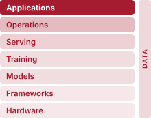
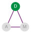
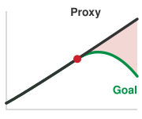
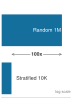
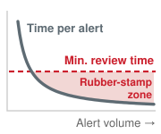
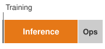
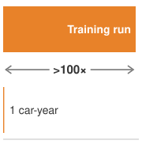
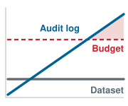

# Responsible Engineering {#sec-responsible-engineering}

::: {layout-narrow}
::: {.column-margin}

\chapterminitoc

:::

::: {.content-visible when-format="pdf"}
\noindent
{fig-alt="Isometric governed ML system chamber with fairness checks, safety rails, audit records, privacy boundaries, and incident response paths around a deployed pipeline."}
:::

::: {.content-visible unless-format="pdf"}
{fig-alt="Isometric governed ML system chamber with fairness checks, safety rails, audit records, privacy boundaries, and incident response paths around a deployed pipeline."}
:::

:::

## Purpose {.unnumbered .unlisted}

::: {.content-visible when-format="pdf"}
\begin{marginfigure}
\mlsysstack{0}{0}{10}{10}{20}{40}{90}{15}
\end{marginfigure}
:::

::: {.content-visible unless-format="pdf"}
::: {.column-margin}
{width="100%" fig-alt="Machine Learning Systems Architecture Stack"}

*Architecture stack focus for this chapter.*
:::
:::

_Why can a system that does exactly what it was told to do still cause harm?_

Latency, availability, and accuracy targets do not say whether they describe the right behavior, whom the system serves, or which costs its specification leaves unmeasured. An ML system can satisfy latency, throughput, and aggregate accuracy requirements while reproducing historical discrimination, rewarding harmful engagement, consuming unjustified energy, or using data without adequate privacy and accountability controls. Such a system has not malfunctioned; it is efficiently optimizing an incomplete specification. The omitted constraints appear as uneven outcomes across populations, lifetime cost and emissions, decisions people cannot understand or contest, and evidence that cannot be reconstructed after harm occurs. If those consequences are not defined as requirements before deployment and monitored afterward, conventional health checks can remain green while harm accumulates. A credit model that treats groups unevenly can repeat that decision millions of times before anyone aggregates the outcomes, while its dashboards report healthy latency and accuracy throughout. Responsible engineering treats such outcomes as system failures to be diagnosed, measured, and mitigated with the same rigor as latency or accuracy regressions. That work requires translating broad obligations into testable bounds, documented assumptions, traceable data, and response paths that remain enforceable in production, so that a harm found after launch can be traced and corrected. In D·A·M terms, responsibility broadens the definition of correctness: data must be examined for encoded harms and lawful use, algorithms must be bounded by defensible outcome and efficiency requirements, and machine infrastructure must monitor, document, and enforce those boundaries throughout the system lifecycle.

::: {.content-visible when-format="pdf"}

\newpage

:::

::: {.callout-learning-objectives}

- Explain how optimized ML systems can amplify harm through proxies, feedback loops, and distribution shift
- Apply data-algorithm-machine diagnosis to localize responsibility failures in data, algorithm objectives, or monitoring infrastructure
- Calculate fairness metrics from confusion matrices and compare trade-offs on the fairness-accuracy Pareto frontier
- Design disaggregated evaluation, stress testing, and monitoring to expose subgroup-specific failures before deployment
- Analyze total cost, inference dominance, and carbon impact as measurable responsibility constraints
- Construct model cards, datasheets, lineage records, and audit trails for accountability
- Evaluate privacy, access-control, and compliance designs against regulatory and human-review requirements

:::

## Responsibility as Systems Engineering {#sec-responsible-engineering-responsibility-systems-engineering-5cfd}

**Responsible engineering**\index{Responsible engineering!definition} is systems engineering applied to the consequences that a model's objective leaves unstated: whose errors the system makes, how much energy and money each decision draws, and whether a harmful decision can later be explained, traced, and corrected. Every deployed model settles these questions, whether or not anyone wrote them down. A credit model decides whose applications are approved, a ranking model decides which items millions of people see, and a voice assistant decides when audio from a private room leaves the device. None of these outcomes appears in a loss curve or a latency dashboard, yet each is fixed by engineering choices about data, objectives, and infrastructure.

@Sec-ml-operations built the machinery that keeps a deployed model faithful to its objective as data and traffic change, and that machinery assumes the objective was the right one. If MLOps is the control loop for *reliability*, then responsible engineering\index{Responsible engineering!safety control loop} is the control loop for *safety*\index{Safety!responsible engineering}. Where MLOps monitors runtime health and predictive quality to guide operational response, responsible engineering monitors outcome distributions to guide intervention when systems generate harm. In systems engineering terms, a model can pass *verification* (conforming exactly to its specified training objective) while failing *validation* (failing to satisfy operational, safety, or legal requirements) [@nasa2016systemsengineering]. The verification gap (principle \ref{pri-verification-gap}) concerns the first of these activities. It bounds how much any finite test can establish about conformance to a specification, whereas validation asks whether the specification was the right one. The failure stems from an incomplete specification rather than a fault in compiler execution or numerical optimization.

::: {.column-margin .margin-pointer}
↩ Continuous telemetry and automated retraining control loops for operational reliability are established in @sec-ml-operations-mlops-3ea3.
:::

Traditional software engineering isolates defects within modules, though shared dependencies can still propagate faults. Machine learning systems introduce data-dependent coupling: data flows through shared representations, so corrupted or biased inputs alter the dense parameter matrices that serve every subsequent inference. A biased training dataset does not trigger a compile-time assertion or runtime crash; it silently shifts decision boundaries across the entire system. Read for responsibility rather than performance, the D·A·M taxonomy isolates where such failures originate: unrepresentative or biased inputs (Data), misaligned loss formulations (Algorithm), or telemetry blind spots and unjustified resource footprints in the serving infrastructure (Machine). Responsibility therefore has to be designed in rather than patched on after deployment.

::: {.column-margin .margin-pointer}
↩ The D·A·M taxonomy, which classifies a system bottleneck along its data, algorithm, and machine axes, is established in @sec-introduction-defining-ml-systems-d4af.
:::

Responsible engineering expands the definition of correctness for machine learning systems. Traditional correctness (numerical stability, bounded latency, and high service availability) remains necessary, but insufficient. A production system must satisfy broader operational bounds: bounded error disparities across demographic slices, defensible energy expenditure, and verifiable data lineage. This expanded correctness applies engineering discipline to failure modes that aggregate performance metrics ignore. A p99 latency spike triggers automated alerts on an operational dashboard; a demographic fairness regression remains invisible to aggregate loss metrics until real-world harm occurs, and when the model's decisions shape its own future training data, the hidden disparity can grow with every retraining cycle (principle \ref{pri-bias-feedback}). Both demand rigorous telemetry and automated regression testing. The optimizations of the preceding chapters inherit the same blind spot, because each was judged by the cost terms its benchmark measured.

::: {#psp-responsible-engr-full-cost-iron-law .callout-perspective title="The full cost of the iron law"}

The iron law of ML systems (principle \ref{pri-iron-law}) decomposes execution time into data movement, computation, and fixed overhead. Compressing models, accelerating hardware, and automating operations each optimize these terms. Yet an optimization can create or shift costs that its benchmark omits.

A model quantized for edge deployment can consume less energy, but its accuracy loss need not fall evenly across demographic groups, so the compressed model must be revalidated on the same subgroup slices as the original. A ranking model such as the DLRM service, optimized for engagement, maximizes a business metric but may amplify harmful content. Responsible engineering extends this accounting to include broader impacts: the carbon cost of computation, the fairness cost of optimization choices, and the societal cost of deployment at scale. The iron law accounts for how fast a system runs and says nothing about whom it serves well.

:::

```{python}
#| label: responsible-engr-cases-calc
#| echo: false
# ┌─────────────────────────────────────────────────────────────────────────────
# │ RUNNING CASES AND THEIR HOME REGIMES
# ├─────────────────────────────────────────────────────────────────────────────
# │ Context: Running-case paragraph of
# │          @sec-responsible-engineering-responsibility-systems-engineering-5cfd.
# │
# │ Goal:    Place the DLRM ranking service in its capacity-bound home regime
# │          with registry values before the chapter uses it.
# │ Show:    DLRM's 100 GB model exceeds one H100's 80 GB of memory.
# │ How:     Compare the registry model size with the H100 memory capacity.
# │
# └─────────────────────────────────────────────────────────────────────────────
from mlsysim import Hardware, Models
from mlsysim.fmt import check, fmt_memory, fmt_memory_capacity

class ResponsibleCases:
    """Registry facts that place each running case in its home regime."""

    # ┌── 1. LOAD (Constants) ──────────────────────────────────────────────
    dlrm = Models.Recommendation.DLRM
    h100 = Hardware.Cloud.H100

    # ┌── 2. EXECUTE (The Compute) ────────────────────────────────────────
    dlrm_size = dlrm.model_size
    h100_capacity = h100.memory.capacity
    dlrm_to_h100_ratio = (dlrm_size / h100_capacity).to("").magnitude

    # ┌── 3. GUARD (Invariants) ───────────────────────────────────────────
    check(dlrm_to_h100_ratio > 1, "DLRM should exceed one H100's memory (capacity-bound home regime).")

    # ┌── 4. OUTPUT (Formatting) ─────────────────────────────────────────────
    dlrm_size_str = fmt_memory(dlrm_size, precision=0)
    h100_capacity_str = fmt_memory_capacity(h100_capacity)
```

Three running cases carry the chapter, each chosen because it exposes a different kind of responsibility failure. The first is a credit service, a labeled composite rather than a documented deployment: a classifier that approves or rejects loan applications, constructed so that every fairness criterion in the chapter can be computed from its confusion matrices. Fairness criteria need labeled decisions about people, which none of the lighthouse models makes, so the composite carries the stages that specify, measure, explain, and monitor such decisions. The second is the DLRM ranking service, the capacity-bound lighthouse, whose model alone occupies `{python} ResponsibleCases.dlrm_size_str` in its registry entry, more than the `{python} ResponsibleCases.h100_capacity_str` of memory on one H100. Its rankings decide what people see, so the clicks it trains on are shaped by its own earlier outputs, and its request volume makes it the chapter's case for feedback, exposure, cost, and carbon. The third is the keyword spotting (KWS) system, the power-bound lighthouse, an always-listening microphone in private homes whose design must decide what audio may leave the device, which makes it the case for privacy, lineage, and audit.

The chapter follows those cases through the lifecycle stages at which each failure is still cheap to prevent (@tbl-responsible-engr-chapter-spine). @Sec-responsible-engineering-engineering-responsibility-gap-6f6f explains why optimization can succeed while the system fails, through proxy targets, feedback loops, and distribution shift that leave every health check green. @Sec-responsible-engineering-responsible-engineering-checklist-a038 then works through four chained stages on the credit service: specifying requirements before training, measuring fairness criteria as release gates, explaining decisions and documenting models, and operating the deployed model so that its disparity stays bounded under feedback. @Sec-responsible-engineering-environmental-cost-awareness-0f3e measures the energy, carbon, and money that every stage consumes on the DLRM service. @Sec-responsible-engineering-data-governance-compliance-bd1a builds, on the KWS system, the governance infrastructure (access control, privacy, regulatory capabilities, lineage, and audit) that makes each earlier guarantee provable to someone outside the team.

| **Section or Stage**                       | **Failure It Addresses**                                                      | **What It Costs the Machine**                                                                     | **Running Case**             |
|:-------------------------------------------|:------------------------------------------------------------------------------|:--------------------------------------------------------------------------------------------------|:-----------------------------|
| **Engineering Responsibility Gap**         | Proxy targets, feedback loops, and shift that leave health checks green       | Nothing yet; the diagnosis locates the failure on the data, algorithm, or machine axis            | Credit service, DLRM         |
| **Lifecycle: Specify**                     | Requirements nobody wrote down: target, populations, human oversight          | Labeled evaluation data for every named subgroup; reviewer hours per escalated decision            | Credit service               |
| **Lifecycle: Measure**                     | Disparities hidden by aggregate accuracy                                      | Per-slice evaluation; mitigation training with a second network head and a larger search          | Credit service               |
| **Lifecycle: Explain and document**        | Decisions no one can contest; models reused outside their envelope            | Explanation compute on the serving path, exponential in feature count for exact attribution       | Credit service, MobileNetV2  |
| **Lifecycle: Operate**                     | Disparity that grows through retraining feedback                              | Per-group telemetry; randomized exploration traffic served at lower expected value                | Credit service, DLRM         |
| **Environmental and Cost Awareness**       | Energy, emissions, and cost the task does not justify                         | Accelerator-hours, kilowatt-hours, and kilograms of CO~2~ over the service lifetime                | DLRM                         |
| **Data Governance and Compliance**         | Evidence that cannot be reconstructed after harm                              | Audit-log bytes, lineage storage, privacy noise and its memory cost, retraining for erasure        | KWS                          |

: **Chapter Map**: Each section addresses one class of responsibility failure at the lifecycle stage where it is still cheap to prevent, and names the machine resources that the remedy consumes. {#tbl-responsible-engr-chapter-spine tbl-colwidths="[22,28,34,16]"}

## Engineering Responsibility Gap {#sec-responsible-engineering-engineering-responsibility-gap-6f6f}

The credit service can approve 90 percent of qualified majority-group applicants but only 60 percent of equally qualified minority-group applicants and still report high aggregate accuracy, because the minority group contributes only a small share of the evaluated applicants. The worked example in @sec-responsible-engineering-worked-example-fairness-analysis-loan-approval-2c72 computes exactly this outcome from its confusion matrices. The **responsibility gap**\index{Responsibility gap!definition} between this *technical correctness* and *responsible outcomes* is the distance that conventional testing does not measure. The gap manifests through concrete mechanisms: proxy variables, feedback loops, and distribution shift, each producing harm through a distinct pathway that conventional monitoring leaves invisible.

### When optimization succeeds but systems fail {#sec-responsible-engineering-optimization-succeeds-systems-fail-1a22}

Amazon's experimental recruiting tool (a war story in @sec-ml-workflow-balancing-competing-constraints-b92a), which learned to downgrade resumes that mentioned women's organizations or women's colleges, places this gap on the data axis of the D·A·M taxonomy, because its failure stemmed from historical training signal rather than an algorithmic or software defect. A model trained on a decade of historical hiring data\index{Bias!historical data encoding} optimized faithfully for the objective it was given, but those historical patterns encoded gender bias\index{Bias!gender discrimination} that the system reproduced in candidate ratings [@dastin2018].

::: {.column-margin}
{width="100%" fig-alt="D·A·M locator triangle with three nodes: D (Data) at top filled solid green, A (Algorithm) and M (Machine) at the lower corners shown gray, connected by violet edges. The Data node is highlighted."}

*The Amazon failure turns on the data axis, not the algorithm.*
:::

Under empirical risk minimization, the model minimized classification loss by identifying token-level correlations across the resume corpus. Because historical technical hires were predominantly men, tokens associated with women's colleges, organizations, or activities exhibited negative statistical correlations with positive hiring labels. The optimization algorithm accurately extracted the empirical distribution of the training data, but that distribution reflected historical hiring practices rather than candidate competence. High-dimensional text representations encode and amplify these statistical regularities, embedding societal biases directly into downstream vector representations [@bolukbasi2016].

Amazon attempted remediation by removing explicit gender indicators and gendered terms from the training pipeline. This intervention failed to ensure unbiased recommendations because high-dimensional feature spaces contain **proxy variables**\index{Proxy variable!definition}\index{Bias!proxy variables} that retain demographic signal.[^fn-proxy-variable-bias] Scrubbing isolated attributes leaves correlated features intact: ZIP codes correlate with race through residential segregation, applicant names correlate with ethnicity, and healthcare utilization correlates with socioeconomic conditions. In Amazon's resume pipeline, even after explicit gender terms were excised, remaining vocabulary (attendance at specific colleges or participation in particular student organizations) continued to encode sex-correlated patterns [@dastin2018]. Removing protected attributes from training data is therefore insufficient to guarantee fairness.

[^fn-proxy-variable-bias]: **Proxy variable**\index{Proxy variable!bias detection}: Removing one proxy may have little effect when other correlated features retain similar signal. Conversely, correlation alone does not prove discrimination or identify the appropriate intervention. Protected-attribute removal, subgroup evaluation, counterfactual tests, causal analysis, and review of the full decision process provide complementary evidence; no single diagnostic is a complete defense.

Effective remediation requires architectural interventions across the full system lifecycle rather than a surface-level data filter. At the evaluation layer, disaggregated testing across demographic subgroups quantifies disparate scoring distributions before deployment. At the algorithm layer, training-time mitigations such as adversarial debiasing (developed with the credit-service worked example in @sec-responsible-engineering-worked-example-fairness-analysis-loan-approval-2c72) can suppress protected-attribute signal in learned representations, though they still require continuous subgroup validation. At the operational layer, human review for borderline scores provides a safeguard only when reviewers are trained, empowered, and audited rather than used to rubber-stamp model outputs. Finally, at the monitoring layer, tracking downstream hiring outcomes over time detects disparate impact that offline loss metrics conceal. Because retrofitting these defenses onto an existing pipeline proved technically intractable, Amazon scrapped the project [@dastin2018].

The same outcome can originate on the algorithm axis instead, in the choice of target rather than in the data. When the target itself reflects historical inequities, the training objective encodes those disparities into the model's decision boundaries, and the harm lands on the subgroup the target mismeasures. Curating the data would not repair such a failure, because the data faithfully record the wrong quantity. That algorithm-axis version appeared with life-threatening consequences in clinical care management.

::: {#ws-responsible-engr-proxy-variable-trap .callout-war-story title="The proxy variable trap (2019)"}

**Context**: In 2019, Ziad Obermeyer and colleagues at UC Berkeley audited a commercial Optum\index{Optum} algorithm used by health systems to enroll patients with complex needs into high-risk care management programs, examining roughly fifty thousand patients across one large academic hospital [@obermeyer2019].

**Mechanism**: The model predicted "future healthcare cost" as a proxy for "future health need." Because the US healthcare system spends less on Black patients than on White patients with the same illness level, the algorithm learned this pattern and assigned lower risk scores to Black patients.

**Impact**: At any given risk score, Black patients carried substantially more chronic conditions than White patients, reducing the share of Black patients enrolled in specialized care.

**Response**: The study showed that replacing cost with a direct measure of health need would raise the share of Black patients identified for additional care from 17.7 percent to 46.5 percent at the analyzed threshold.

**Systems lesson**: Optimizing for a proxy inherits the biases of the system that generated the proxy. The proxy-target relationship must be audited across every demographic subgroup the system serves.

:::

The recruiting tool and the care-management algorithm show that optimization success can coexist with system failure. Neither disparity requires a software bug or hardware malfunction to explain why a technically functioning model can fail its intended use. The architectural question is whether the problem specification captures acceptable outcomes. When the *technical objective* (such as minimizing empirical prediction error) diverges from the *system specification* (fair, defensible outcomes across user populations), improving the training objective can preserve or amplify harm.

Standard production telemetry cannot detect specification failures. Monitoring pipelines track operational invariants such as inference latency, memory utilization, throughput, and aggregate validation loss, all of which remain green while a model systematically misallocates errors across subgroups. Preventing silent specification failures requires making responsibility metrics part of the primary test harness: verifying whether the loss function acts as a defensible proxy for the true system goal, and enforcing the justified, application-specific fairness criterion before deployment.

::: {#chk-responsible-engr-responsible-design .callout-checkpoint title="Responsible design"}

Responsibility is a system property, not a model property.

**Failure modes**

- [ ] **Alignment**: test whether the loss function is a defensible proxy for the system's true goal.
- [ ] **Disparate impact**: compare error rates across subgroups rather than relying on aggregate accuracy.

```{=latex}
\vspace*{-1.5ex}
```
**Check**

- [ ] **Pre-mortem**: before deploying, ask: "If this system causes a scandal in six months, what likely went wrong?"
```{=latex}
\vspace*{-1ex}
```
:::

### Silent failure modes {#sec-responsible-engineering-silent-failure-modes-e219}

::: {.column-margin}
{width="100%" fig-alt="A red square source on the left with five arrows fanning out to five identical blue circles on the right, representing one upstream fault propagating to many downstream consumers."}

*One upstream change; many silently affected.*
:::

Consider the credit service after a change to its online application form alters how self-employed applicants' income is recorded. The model begins declining applicants it would have approved a week earlier, and a single upstream modification propagates across the system's blast radius (the set of downstream decisions, and the applicants behind them, that one upstream change reaches) without raising an alert. The model's confidence scores remain high, its inference latency stays within its service level agreement, and all system health checks pass green. The failure is silent: the input data distribution has shifted, but the service's pipeline monitors only service health and carries no drift monitors.

::: {.column-margin .margin-pointer}
↩ Drift monitors that quantify distributional divergence between serving and training data are established in @sec-ml-operations-model-infrastructure-monitoring-3988.
:::

This scenario illustrates a class of failure that availability-focused monitoring cannot detect. Some software failures are loud: a null pointer exception terminates execution, a segmentation fault halts the process, or an exhausted socket pool returns a network timeout. Other software defects can silently produce incorrect results. ML systems introduce statistical failure modes\index{Silent failure!detection challenges} in which corrupted or degraded outputs look indistinguishable from valid predictions. Floating-point tensors continue to flow through matrix multiplication kernels, accelerator execution completes within latency budgets, and downstream services receive structurally well-formed responses.

Distribution shift\index{Distribution shift!causes of model degradation}\index{Distribution shift!responsibility lens}, a deployment input distribution that differs from the one used to develop and evaluate the model, represents the first major mechanism behind this silent degradation. Its covariate, label, and concept forms, and the divergence statistics that detect them, are developed with data engineering (see the margin). The failure is environmental. The physical distribution of inputs changed after training, yet the model has no internal telemetry to detect the discrepancy. Through the responsibility lens the pitfall sharpens, because shift often lands on one subgroup first, where a population-wide divergence statistic barely moves, and concept drift on that slice stays invisible until its outcomes are labeled. A monitor that is adequate for the population can therefore be blind to the people the shift reaches first.

::: {.column-margin .margin-pointer}
↩ Covariate, label, and concept drift, with the divergence statistics that detect them, are established in @sec-data-engineering-detecting-responding-data-drift-509a.
:::

Retraining on fresh data can partially restore accuracy under distribution shift. However, retraining cannot resolve a second, more fundamental mechanism of silent failure that persists even when the data distribution is perfectly stationary: metric misalignment.

Metric misalignment occurs when the objective function optimizes an observable proxy metric that diverges from the unobserved outcome the system is intended to deliver. Goodhart's Law\index{Goodhart's law!metric optimization}, the benchmark trap in which a measure optimized as a target stops measuring the goal, applies with more force here than in benchmarking, because the training objective is the target and gradient descent searches it far more exhaustively than a team tuning against a benchmark. Up to a point the proxy and the goal improve together; past that point further optimization buys proxy gains at the goal's expense.

::: {.column-margin .margin-pointer}
↩ Goodhart's law, under which a benchmark metric optimized as a target ceases to measure the goal, is established in @sec-benchmarking-machine-learning-benchmarking-framework-70b8.
:::

::: {.column-margin}
{width="100%" fig-alt="Two lines labeled Proxy and Goal rise together to a red knee dot; past the knee the Proxy line keeps rising while the green Goal line turns down, and the widening gap between them is shaded red."}

*Past the knee, the proxy decouples from the goal.*
:::

::: {#psp-responsible-engr-alignment-gap .callout-perspective title="The alignment gap"}

The DLRM ranking service optimizes a proxy metric (Clicks) because the true metric (User Satisfaction) is unobservable, and the two can diverge sharply. In an illustrative version of the service, $\text{Correlation}(\text{Clicks}, \text{Satisfaction})$ might begin at 0.8; once ranking maximizes clicks, it may find clickbait with high clicks but low satisfaction, and the correlation could fall to 0.2.

The falling correlation is the symptom. The quantity that matters is how far the proxy's movement overstates the goal's, which @eq-alignment-gap captures for metrics normalized to a common scale:
$$ \text{Gap} = \mathbb{E}[\text{Proxy}] - \mathbb{E}[\text{True}] $$ {#eq-alignment-gap}

Suppose both metrics start at the same normalized value $\NormalizedMetricBaseline$, so the gap is zero. A ranking change that raises Clicks by 20 percent and lowers Satisfaction by 5 percent moves them to $1.20\NormalizedMetricBaseline$ and $0.95\NormalizedMetricBaseline$, opening a gap of $0.25\NormalizedMetricBaseline$. Every dashboard that reports Clicks shows a 20 percent win, while the goal the system exists to serve has moved the other way.

**Systems insight**: Engineers cannot directly optimize an unobserved goal. They need defensible proxy validation. A randomized holdout, a small random slice of users served without the new ranking, can estimate the ranking's causal effect on the gap, but only when the holdout's measured outcome reflects the goal or a justified surrogate for it.

:::

The alignment gap\index{Alignment gap!proxy metric divergence} illustrates a failure originating in the algorithm axis: the loss function optimizes a misspecified objective, so even a model that generalizes with zero test error drives outcomes that conflict with organizational or societal goals. Distribution shift, by contrast, originates in the data axis: the model logic remains intact, but the input distribution departs from the training distribution. Both failures can be silent, but they suggest different first interventions: objective redesign for a misspecified target, or pipeline investigation and possible adaptation for shifted inputs. These remedies can be complementary when both mechanisms are present. Isolating the root cause is the job the D·A·M taxonomy\index{DAM taxonomy@D·A·M taxonomy!responsibility diagnosis} already performs for performance bottlenecks, and perspective \ref{psp-responsible-engr-d-m-taxonomy} reads the same three axes for responsibility failures.

::: {.column-margin .margin-pointer}
↪ The performance-bottleneck form of the D·A·M diagnosis, from profiler symptom to binding axis, is collected for reference in @sec-appdx-dam-taxonomy.
:::

::: {#psp-responsible-engr-d-m-taxonomy .callout-perspective title="Diagnosing responsibility failures with D·A·M"}

When a system causes harm, use the D·A·M taxonomy to identify the root cause. Responsibility failures are rarely "algorithm bugs"; they are structural flaws along one of the three axes:

*   **Data (information)**: The training corpus reflects historical bias or unrepresentative sampling (such as Amazon's recruiting tool learning from biased historical applicant data).
*   **Algorithm (logic)**: The objective function optimizes an unconstrained proxy metric that amplifies harm (such as engagement optimization driving polarization).
*   **Machine (physics)**: The serving and governance infrastructure cannot see or bound the harm, through telemetry that never slices outcomes by subgroup, missing lineage and audit records, or an energy and carbon footprint that exceeds the societal benefit of deployment (such as an overparameterized foundation model serving a low-complexity task).

Locating the dominant failure in the taxonomy identifies the first remediation to test: better curation (Data), safer objectives (Algorithm), or better instrumented and more efficient infrastructure (Machine). Real failures can span axes, so the intervention must still be evaluated end to end.

:::

While the D·A·M taxonomy isolates *where* failures originate, production telemetry must also catch *when* they manifest. Crashes and throughput bottlenecks trigger alerts within seconds or minutes, whereas statistical failures (data-quality defects, distribution shift, and fairness violations) can persist for days or months while technical health checks remain green; @sec-ml-operations-production-monitoring-5e1b develops the monitoring that shortens that detection delay. A fairness violation is the slowest of these to surface, because it is visible only on a subpopulation and only once outcomes are labeled.

A third mechanism is the feedback loop, in which model predictions actively reshape the user behavior that generates future training data. The YouTube recommendation feedback loop\index{Feedback loop!recommendation amplification} illustrates this dynamic at scale [@ribeiro2020].[^fn-goodhart-law-proxy] @ribeiro2020 audited radicalization pathways on YouTube, finding migration from milder to more extreme channel categories and recommendation reachability between those categories. The broader systems lesson is that feedback loops can work exactly as designed while producing outcomes that conflict with societal values. Recommendation objectives must therefore be tested against downstream harms, not only against engagement proxies.

::: {.column-margin .margin-pointer}
↩ The YouTube feedback loop as a production technical-debt pattern is established in @sec-ml-operations-production-debt-patterns-ffdc.
:::

[^fn-goodhart-law-proxy]: **Goodhart's law in feedback loops**\index{Goodhart's law!proxy decoupling}: Recommendation feedback loops are the canonical ML manifestation of Goodhart's law. Gradient descent optimizes watch-time proxies at a speed no human curator can match, and the system's own outputs reshape the training distribution. Users who consume extreme content generate data that can reinforce extremity and can decouple the proxy from user welfare faster than manual editorial processes would.

Facebook's 2018 change to News Feed ranking shows the converse decision. The team moved the ranking objective from short-term engagement proxies (clicks, watch time) toward meaningful social interactions between people, accepting lower short-term engagement to arrest the proxy's decoupling from user welfare [@facebook2018newsfeed]. The DLRM ranking service faces the same choice whenever its objective is set, because the clicks it can observe are a proxy for the value it is meant to deliver.

Silent failure modes change what verification can establish. Traditional software verification relies on deterministic assertions: a unit test asserts that an output matches an exact value, memory bounds checkers assert that buffer allocations do not overflow, and watchdog timers ensure RPC latencies do not breach service level agreements. In an ML system, correctness cannot be verified by deterministic invariants alone, because, as the credit service's form change showed, every such invariant can hold while the model serves biased, uncalibrated, or harmful predictions. What can be verified is the statistical bound of the verification gap (principle \ref{pri-verification-gap}), which holds only over a named deployment population, task distance, and tolerance. A bound stated over the aggregate population says nothing about a subgroup that the aggregate averages away, so a responsible specification names each consequential subgroup as a population in its own right. Converting responsibility goals into structured engineering practice requires operationalizing statistical verification: continuously monitoring covariate shift across demographic slices, auditing proxy-to-target correlations, and bounding closed-loop feedback before silent errors propagate through production.

### The testing challenge {#sec-responsible-engineering-testing-challenge-77b0}

Traditional software testing evaluates behavior against unambiguous specifications: an arithmetic function must return the exact sum of its operands, and a relational database must preserve foreign-key integrity. Such deterministic properties map directly to executable assertions.

Responsible ML properties resist simple formalization. **Fairness**\index{Fairness!mathematical definitions} has multiple mathematical definitions that can conflict under conditions such as unequal base rates and imperfect prediction [@chouldechova2017; @kleinberg2016inherent]. What counts as fair depends on context, values, and trade-offs that technical systems cannot resolve alone. Individual fairness\index{Fairness!individual vs. group} requires that similar individuals receive similar treatment, while group fairness requires equitable outcomes across demographic categories. These criteria can conflict, and choosing between them requires value judgments beyond the scope of optimization.

Fairness constraints and predictive performance can also trade off, by an amount that depends on the application. The Pareto frontier (principle \ref{pri-pareto-frontier}) carries over unchanged, and @sec-responsible-engineering-quantifying-fairnessaccuracy-tradeoff-ce4a measures one such trade-off once the criteria have been defined. Choosing criteria is only half of the testing problem. Aggregate metrics cannot show which groups a model fails, so testing also requires deciding which slices to evaluate, which invariances to demand, and which stresses to apply, choices that @sec-responsible-engineering-testing-across-populations-9f20 turns into release gates.

These testing choices complement traditional software testing rather than replacing it, and no single group can make them alone. Legal specialists cannot specify which demographic slices matter for a healthcare algorithm, and product managers cannot determine appropriate invariance tests for a loan model. Domain experts, affected stakeholders, policy specialists, and engineers must define the relevant harms together; engineers then encode those requirements as measurable tests and production controls. Responsibility therefore needs clear ownership within engineering as well as independent oversight outside it.

### When responsible engineering succeeds {#sec-responsible-engineering-responsible-engineering-succeeds-29e0}

Where teams have closed the gap, each documented success did the same thing. A vague responsibility goal became an engineering constraint that can be specified, tested, communicated, and, when necessary, used to stop deployment. Following the findings of Gender Shades, a 2018 audit that exposed severe error-rate disparities in commercial gender classification [@buolamwini2018gender], Microsoft invested in improving gender-classification\index{Gender classification!demographic disparities} performance across demographic groups\index{Bias!mitigation strategies}. Targeted data collection, model changes, and systematic disaggregated evaluation gave the team an explicit error-rate target, bringing audited error rates for darker-skinned subjects below 2 percent [@raji2019]. Publishing these disaggregated benchmarks established a verifiable baseline and turned external audit findings into an operational release gate.

::: {.column-margin .margin-pointer}
↩ Gender Shades, and the way aggregate benchmark metrics conceal subgroup disparities, are established in @sec-benchmarking-accuracy-metrics-blind-spots-4dcd.
:::

Twitter's automatic image cropping system\index{Image cropping!racial bias} shows the same discipline under a different constraint. In 2020, users raised concerns about racial and gender bias in preview thumbnails. Twitter audited the system, reported measured disparities and limitations, and shifted toward uncropped previews that gave users more control [@yee2021]. In that case, responsible engineering changed the product design rather than relying on an incremental adjustment to an automated ranking threshold.

Differential privacy\index{Differential privacy!mathematical guarantees} applies the same move to privacy. It turns a privacy requirement into a mathematical bound on how much any one record can change a system's outputs, a bound that can be budgeted and audited rather than asserted [@dwork2008]. Its mechanism and systems cost are developed with the privacy protections in @sec-responsible-engineering-technical-privacy-protection-methods-4a74.

In each case the constraint sat on a D·A·M axis, whether in curated training data, a bounded loss function, or a privacy budget tracked in the runtime. Enforcing such constraints requires the operational authority to halt deployment or retire components that violate specified bounds, and that authority has to sit with the people who can still change the design.

### Engineering leadership on responsibility {#sec-responsible-engineering-engineering-leadership-responsibility-e03c}

Earlier design choices narrow the available fixes. By the time an outside audit exposes a flawed target, correcting it means changing what the model predicts, not tuning a threshold. Responsible AI engineering cannot be delegated exclusively to ethics boards or legal departments. These groups provide essential oversight but lack the technical access required to identify problems early in the development process.

Legal or ethics review can identify a problem near deployment, but it cannot recover design options the system has already foreclosed. If the team trained the model without fairness constraints, chose an architecture that cannot support interpretability requirements, or built a data pipeline without the demographic attributes needed for monitoring, review can only accept, reject, or demand expensive redesign. Engineers therefore occupy a critical position in the ML development lifecycle because their choices define the solution space for all subsequent interventions: architecture determines which fairness constraints can apply, the optimization objective determines which patterns the system learns, and the data pipeline determines whether disaggregated evaluation is possible.

::: {#dfn-responsible-engr-responsible-ai-engineering .callout-definition title="Responsible AI engineering"}

***Responsible AI engineering***\index{Responsible AI engineering!definition} is the engineering discipline of designing, deploying, and maintaining systems with probabilistic outputs by operationalizing societal and regulatory requirements as testable constraints on the D·A·M axes: permissible data contents, provenance, and composition; allowable model behavior and robustness properties; and infrastructure bounds such as latency, energy, compute budget, carbon emissions, and audit-log retention.

1.  **Significance**: Each D·A·M axis acquires concrete governance constraints: the data axis is bounded by privacy regulations such as the General Data Protection Regulation (GDPR), which limits which records, fields, and features can be collected; the algorithm axis is bounded by fairness and robustness metrics (for example, positive prediction rates that differ across protected groups by no more than 5 percentage points, or accuracy that degrades by less than 2 percent when an adversary may shift every normalized input feature by at most 0.01); and the machine axis is bounded by resource and infrastructure budgets such as latency, energy per inference, carbon emissions, and audit-log retention. Violating these bounds is a system failure, not a research shortcoming.
2.  **Distinction**: Unlike AI ethics (which articulates aspirational values), responsible AI engineering translates those values into measurable, testable invariants that can be verified through automated testing and continuous monitoring, using the same lifecycle practices that enforce latency SLOs.
3.  **Common pitfall**: Stating a bound the system cannot measure. A disparity limit is an intention when the pipeline never collected the demographic attribute needed to check it, and a retention rule is an intention when no storage was provisioned to hold the evidence. Late-stage remediation may remain possible, but it is often narrower, slower, and more expensive.

:::

An engineering-centered approach does not diminish the importance of diverse perspectives in identifying potential harms. Product managers, user researchers, affected communities, and policy experts contribute essential knowledge about how systems fail socially despite technical success. Engineers translate these concerns into measurable requirements and testable properties that can be verified throughout the development lifecycle.

Organizations also need a reason to fund that work, and three reasons recur. Systematic disaggregated evaluation, documentation, and monitoring reduce the legal and financial exposure\index{Risk mitigation!responsible engineering value} that ML system failures create, and they preserve evidence of the engineering process if problems emerge. Regulation\index{Regulatory compliance!business value} attaches risk-management, data-governance, transparency, and human-oversight duties to high-risk applications\index{High-risk AI!EU classification}, and controls built in from the start are cheaper than evidence reconstructed after deployment (@sec-responsible-engineering-regulatory-landscape-1ec1). Demonstrated practice also differentiates\index{Trust!competitive differentiation}: organizations that can show model cards, audit trails, and published disaggregated results may qualify for deployments that competitors cannot. Each reason pays off only through repeatable workflows (checklists, documentation standards, and testing protocols) that embed responsibility constraints in the engineering lifecycle itself.

## Responsible Engineering Across the Lifecycle {#sec-responsible-engineering-responsible-engineering-checklist-a038}

The recruiting tool and the care-management algorithm were both found to fail after the design options that could have addressed them were closed, so the lesson concerns timing more than vigilance. Each responsibility failure in this chapter has a point in the ML lifecycle before which it is cheap to prevent and after which it becomes expensive or impossible to repair, so responsible engineering\index{Responsible engineering!lifecycle methodology} is organized around that lifecycle rather than around a list of concerns.

Six stages follow from that premise, and the first four form a chain in which each stage depends on the output of the one before it. *Specify* comes first because a system cannot be tested against a requirement nobody wrote down; the target, the populations that matter, the evaluation data those populations demand, and the boundary of human oversight must all be fixed before training forecloses the alternatives. *Measure* turns those written requirements into release gates, evaluating each named population separately and quantifying the trade-offs among fairness criteria. Evidence that lives only in an engineer's notebook cannot be contested, audited, or reused, so *Explain and document* makes individual decisions legible to the people they affect and whole models legible to the teams that inherit them. The documented operating envelope then tells *Operate* what to watch after launch, when feedback loops and distribution shift erode a model that passed every gate. The last two stages span the whole lifecycle rather than following it, so each receives its own section, while the four chained stages structure the subsections of this one, each worked on the credit service. *Resource* accounts for the energy, carbon, and money that every stage consumes (@sec-responsible-engineering-environmental-cost-awareness-0f3e), and *Govern* supplies the regulatory obligations and the data infrastructure of access control, privacy, lineage, and audit that make each earlier stage provable to someone outside the team that built it (@sec-responsible-engineering-data-governance-compliance-bd1a). The four chained stages and the two that span them form one loop (@fig-responsible-lifecycle).

::: {#fig-responsible-lifecycle fig-env="figure" fig-pos="htb" fig-cap="**The Responsible Engineering Lifecycle**: Four chained stages carry the credit service from requirement to production. Specify fixes the target, the named populations, and the oversight boundary; Measure turns them into release gates; Explain and document makes decisions and models legible; Operate watches the deployed model and feeds what it observes back into the next specification. Resource and Govern span every stage: each stage consumes accelerator-hours, energy, and money, and each must leave evidence that someone outside the team can audit. The machine cost under each stage names what the remedy consumes." fig-alt="Four boxes left to right labeled Specify, Measure, Explain and document, and Operate, joined by arrows, with a return arrow from Operate back to Specify labeled feedback and retraining. Under each box a short gray line names its machine cost: labeled evaluation data per named group and reviewer hours, per-slice evaluation and mitigation training, explanation compute on the serving path, and per-group telemetry and exploration traffic. Two long bars beneath all four boxes are labeled Resource: energy, carbon, and cost of every stage, and Govern: access control, privacy, lineage, and audit evidence for every stage."}

```{.tikz}
\scalebox{0.8}{%
\begin{tikzpicture}[line join=round,font=\sffamily\small]
\tikzset{
  Stage/.style={draw=BlueLine,line width=0.75pt,fill=BlueL!60,rounded corners=2pt,
    align=center,minimum width=30mm,minimum height=12mm,font=\sffamily\small\bfseries},
  Cost/.style={align=center,text width=30mm,font=\sffamily\scriptsize,text=black!65},
  Span/.style={draw=#1Line,line width=0.75pt,fill=#1L!50,rounded corners=2pt,
    minimum height=7mm,align=center,font=\sffamily\small},
  Arr/.style={-{Triangle[width=5pt,length=6pt]},line width=1.0pt,black!60},
}
\node[Stage](S){Specify};
\node[Stage,right=8mm of S](M){Measure};
\node[Stage,right=8mm of M](E){Explain and\\ document};
\node[Stage,right=8mm of E](O){Operate};
\draw[Arr](S)--(M);
\draw[Arr](M)--(E);
\draw[Arr](E)--(O);
\draw[Arr,RedLine](O.north) -- ++(0,7mm) -| node[pos=0.25,above,font=\sffamily\scriptsize,text=RedLine]
  {feedback and retraining: what operation observes changes the next specification} (S.north);
\node[Cost,below=2mm of S](CS){labeled evaluation data per named group; reviewer hours};
\node[Cost,below=2mm of M](CM){per-slice evaluation; mitigation training};
\node[Cost,below=2mm of E](CE){explanation compute on the serving path};
\node[Cost,below=2mm of O](CO){per-group telemetry;\\ exploration traffic};
\path (CS.south -| S.west) ++(0,-4mm) coordinate (L1);
\path (CS.south -| O.east) ++(0,-4mm) coordinate (R1);
\draw[draw=GreenLine,fill=GreenL!50,line width=0.75pt,rounded corners=2pt]
  (L1) rectangle ($(R1)+(0,-7mm)$);
\node[font=\sffamily\small] at ($(L1)!0.5!(R1)+(0,-3.5mm)$)
  {\textbf{Resource}: energy, carbon, and cost of every stage};
\draw[draw=BrownLine,fill=BrownL!50,line width=0.75pt,rounded corners=2pt]
  ($(L1)+(0,-9mm)$) rectangle ($(R1)+(0,-16mm)$);
\node[font=\sffamily\small] at ($(L1)!0.5!(R1)+(0,-12.5mm)$)
  {\textbf{Govern}: access control, privacy, lineage, and audit evidence for every stage};
\end{tikzpicture}}
```

:::

### Specify: Requirements before training {#sec-responsible-engineering-predeployment-assessment-2324}

The proxy variable trap (war story \ref{ws-responsible-engr-proxy-variable-trap}) was a specification failure. The care-management model predicted exactly what it was asked to predict, and the request was wrong. Specification is the stage with the most leverage and the least visibility, because its errors surface only after the model has learned them. Before the credit service reaches production, its team must therefore determine the provenance of the training data, identify who is represented and who is missing, anticipate failure modes, and define recourse for affected users. @Tbl-predeployment-assessment organizes these questions by pipeline phase, distinguishing critical-path blockers from high-priority items that can proceed with documented risk acceptance. Its rows follow the pipeline rather than the six stages because specification must anticipate every phase in advance. The Evaluation row fixes what *Measure* will gate, and the Deployment and Monitoring rows fix what *Operate* will watch and how it will respond.

| **Phase**      | **Priority**  | **Key Questions**                                                                                                       | **Documentation Required**                                                                           |
|:---------------|:--------------|:------------------------------------------------------------------------------------------------------------------------|:-----------------------------------------------------------------------------------------------------|
| **Data**       | Critical Path | Where did this data come from? Who is represented? Who is missing? What historical biases might be encoded?             | Data provenance records, demographic composition analysis, collection methodology documentation      |
| **Training**   | High Priority | What is the system optimizing for? What does the loss implicitly penalize? How do architecture choices affect outcomes? | Objective function specification, regularization choices, hyperparameter selection rationale         |
| **Evaluation** | Critical Path | Does performance hold across different user groups? What edge cases exist? How were test sets constructed?              | Disaggregated metrics by demographic group, edge case testing results, test set composition analysis |
| **Deployment** | Critical Path | Who will this system affect? What happens when it fails? What recourse do affected users have?                          | Impact assessment, stakeholder identification, rollback procedures, user notification protocols      |
| **Monitoring** | High Priority | How are anomalies detected? Who reviews system behavior? What triggers intervention?                                    | Monitoring dashboard specifications, alert thresholds, review schedules, escalation procedures       |

: **Predeployment Assessment Framework**: Critical Path items block deployment until addressed. High Priority refinements may follow launch under documented risk acceptance; a specified objective and tested monitoring and response paths remain prerequisites. Systematic coverage of responsibility concerns throughout the ML lifecycle reduces the chance that risks are overlooked. {#tbl-predeployment-assessment tbl-colwidths="[15,15,35,35]"}

The Training and Monitoring rows mix release prerequisites with later refinements. Teams must specify the objective and test the minimum monitoring and response controls before launch, and the remaining refinements may proceed with documented risk acceptance and a remediation timeline.

The Evaluation row in @tbl-predeployment-assessment belongs to specification rather than to testing because naming the groups that matter also fixes a data budget. Showing that performance holds for each group requires a statistically valid test set per group, and the cost of that set grows with the group's rarity.

```{python}
#| label: representation-stats-calc
#| echo: false
# ┌─────────────────────────────────────────────────────────────────────────────
# │ STATISTICS OF REPRESENTATION
# ├─────────────────────────────────────────────────────────────────────────────
# │ Context: "The Statistics of Representation" callout (Pre-Deployment section)
# │
# │ Goal: Demonstrate why fairness evaluation requires intentional data engineering.
# │ Show: The 100× data requirement for minority groups under random sampling.
# │ How: Calculate total dataset size needed to capture a 1% minority subgroup.
# │
# └─────────────────────────────────────────────────────────────────────────────
from mlsysim.fmt import check, fmt, fmt_count, fmt_int, fmt_multiple, fmt_percent, fmt_pp

# ┌── LEGO ───────────────────────────────────────────────
class RepresentationStats:
    """
    Namespace for Statistics of Representation.
    Scenario: Random vs Stratified sampling for a 1% minority group.
    """

    # ┌── 1. LOAD (Constants) ───────────────────────────────────────────────
    target_imgs = 10_000
    minority_fraction = 0.01
    target_margin_pp = 1
    confidence = 0.95

    # ┌── 2. EXECUTE (The Compute) ─────────────────────────────────────────
    random_total = target_imgs / minority_fraction
    multiplier = random_total / target_imgs

    # ┌── 3. GUARD (Invariants) ───────────────────────────────────────────
    check(multiplier == 100, "Multiplier should be 100.")

    # ┌── 4. OUTPUT (Formatting) ──────────────────────────────────────────────
    repr_target_images_str = fmt_count(target_imgs, label="image")
    repr_group_fraction_pct_str = fmt_percent(round(int(minority_fraction * 100)) / 100, precision=0, commas=False, style='prose')
    repr_target_margin_pp_str = fmt_pp(target_margin_pp, precision=0)
    repr_confidence_pct_str = fmt_percent(confidence, precision=0, commas=False, style='prose')
    repr_group_fraction_str = fmt(minority_fraction, precision=2, commas=False)
    repr_random_total_str = fmt_count(int(random_total), label="image")
    repr_mult_str = fmt_multiple(int(multiplier), commas=False, precision=0)
```

::: {.column-margin}
{width="100%" fig-alt="Two bars on a log scale: random sampling needs 1M images, stratified sampling 10K, with a 100× bracket between their ends."}

*Random sampling needs 100× more images to reach a 1 percent subgroup.*
:::

:::: {#nbk-responsible-engr-statistics-representation .callout-notebook title="The statistics of representation"}

**Problem**: An engineering team needs to verify that a Face ID model works for a minority group representing `{python} RepresentationStats.repr_group_fraction_pct_str` of the user base. The group's error rate must be known to within `{python} RepresentationStats.repr_target_margin_pp_str` at `{python} RepresentationStats.repr_confidence_pct_str` confidence. The binomial standard error behind the statistical confidence trap of @sec-benchmarking-statistical-methodological-issues-7aa5 is largest at an error rate of 0.5, so the worst-case margin of error on $\SubgroupSampleSize$ images is $1.96\sqrt{0.25/\SubgroupSampleSize}$, which falls to one percentage point near $\SubgroupSampleSize$ = `{python} RepresentationStats.repr_target_images_str` for this group.

**Random sampling**\index{Random sampling!minority representation cost}: To get `{python} RepresentationStats.repr_target_images_str` of a `{python} RepresentationStats.repr_group_fraction_pct_str` group in expectation via independent random sampling, the team must collect and label:
$\RandomSampleCollectionSize$ = `{python} RepresentationStats.repr_target_images_str` / `{python} RepresentationStats.repr_group_fraction_str` = `{python} RepresentationStats.repr_random_total_str`

**Stratified sampling**\index{Stratified sampling!fairness evaluation}: Recruiting a representative, independently sampled evaluation set within this group requires `{python} RepresentationStats.repr_target_images_str`.

**Systems insight**: Under these assumptions, natural-population sampling requires `{python} RepresentationStats.repr_mult_str` as much total collection as direct subgroup recruitment, in expectation rather than as a guaranteed quota. Targeted recruitment must still represent the deployment subgroup; active selection of difficult cases cannot be treated as an unbiased evaluation sample without accounting for its sampling design. Fairness requires intentional data engineering\index{Intentional data engineering!fairness evaluation} rather than uncurated volume.

::::

The representation cost derived in napkin math \ref{nbk-responsible-engr-statistics-representation} settles what the evaluation must contain, but even a representative evaluation cannot prevent harm at deployment when human oversight is inadequate. The Deployment row of @tbl-predeployment-assessment forces a second decision that cannot be deferred to launch: where people sit in the decision loop once the model is live, and what that arrangement must be designed to withstand.

::: {#ws-responsible-engr-automation-paradox .callout-war-story title="The automation paradox (2018)"}

**Context**: Uber's Advanced Technologies Group (ATG) was testing self-driving cars in Arizona, relying on a human safety driver to intervene if the autonomous perception system failed [@ntsb2019uber].

**Mechanism**: The perception system detected a pedestrian crossing the road but repeatedly toggled its classification between vehicle, bicycle, and unknown, resetting its trajectory prediction while automatic emergency braking was intentionally disabled.

**Impact**: The safety driver was visually distracted by a personal phone and failed to take control, resulting in a fatal collision.

**Fix**: Uber retrofitted the fleet with driver-monitoring cameras, re-enabled automatic emergency braking, and established dual-operator staffing during autonomous road testing.

**Systems lesson**: Adding a human backup creates a new system with its own failure modes. High automation reliability can encourage complacency and reduce vigilance, so an effective fallback requires workload design, attention monitoring, and a safety case for the combined human-machine system.

:::

::: {.column-margin}
{width="100%" fig-alt="Schematic with no numbers. A slate curve labeled Time per alert falls as Alert volume grows and crosses a red dashed line labeled Min. review time. Past the crossing, the region between the line and the curve is shaded red and labeled Rubber-stamp zone."}

*If reviewer hours stay fixed, rising alert volume eventually leaves too little time per alert for real review.*
:::

For high-stakes applications, the specification should state where human oversight\index{Safety!human oversight requirements} is required. Human-in-the-loop (HITL) systems\index{Human-in-the-loop!decision oversight} route uncertain, high-consequence, or flagged decisions to human reviewers rather than acting autonomously; the clinician approval gates of ClinAIOps (@sec-ml-operations-clinaiops-case-study-5d5d) are one proposed design. Effective HITL design must specify four requirements: the review scope (which decisions require human review), the confidence thresholds that trigger escalation, the training reviewers receive, and the mechanisms for monitoring reviewer performance. HITL is not a catch-all solution: human reviewers can rubber-stamp automated decisions, introduce their own biases, or become overwhelmed by alert volume. Effective HITL design requires calibrating the human-machine boundary to the specific application risks and reviewer capabilities.

::: {.column-margin .margin-pointer}
↩ The ClinAIOps clinician oversight loop, in which a clinician approves, modifies, or rejects each therapy recommendation, is established in @sec-ml-operations-clinicianai-loop-8d56.
:::

Like an aviation preflight checklist, the assessment standardizes the questions a team must answer under schedule pressure, but answering them does not show that the system is safe. That evidence comes from measuring the model against the populations the specification named, which turns each written requirement into a gate the release must pass.

### Measure: Fairness criteria as release gates {#sec-responsible-engineering-testing-across-populations-9f20}

Measurement turns the populations that specification named into release gates, which means selecting the slices, metrics, and thresholds that decide whether the credit service may deploy. The stage begins with what disaggregated measurement reveals in published audits, defines the fairness criteria on the credit service itself, and ends by quantifying what closing a disparity costs.

```{python}
#| label: gender-shades-disparity-calc
#| echo: false
# ┌─────────────────────────────────────────────────────────────────────────────
# │ GENDER SHADES ERROR DISPARITY
# ├─────────────────────────────────────────────────────────────────────────────
# │ Context: @tbl-gender-shades-results and surrounding prose
# │
# │ Goal: Quantify error rate disparities across demographic groups.
# │ Show: The 43.4× dark-female/light-male ratio in the Face++ results.
# │ How: Calculate error multiples between intersectional subgroups.
# │
# └─────────────────────────────────────────────────────────────────────────────
from mlsysim import Literature
from mlsysim.fmt import fmt, fmt_int, fmt_multiple, check, fmt_percent

# ┌── LEGO ───────────────────────────────────────────────
class GenderShadesDisparity:
    """
    Namespace for Gender Shades Error Disparity analysis.
    Scenario: Quantifying bias across demographic groups in gender classification.
    """

    # ┌── 1. LOAD (Constants) ───────────────────────────────────────────────
    err_light_male = Literature.Fairness.GenderShadesErrLightMale
    err_light_female = Literature.Fairness.GenderShadesErrLightFemale
    err_dark_male = Literature.Fairness.GenderShadesErrDarkMale
    err_dark_female = Literature.Fairness.GenderShadesErrDarkFemale

    # ┌── 2. EXECUTE (The Compute) ─────────────────────────────────────────
    disparity_fold = err_dark_female / err_light_male
    disparity_light_female = err_light_female / err_light_male
    disparity_dark_male = err_dark_male / err_light_male

    acc_light_male = 100.0 - err_light_male
    acc_dark_female = 100.0 - err_dark_female

    # ┌── 3. GUARD (Invariants) ───────────────────────────────────────────
    check(disparity_fold >= 40, f"Disparity ({disparity_fold:.1f}x) is too low.")

    # ┌── 4. OUTPUT (Formatting) ──────────────────────────────────────────────
    # Prose style outputs
    error_light_male_str = fmt_percent(err_light_male / 100, precision=1, commas=False, style='prose')
    error_dark_female_str = fmt_percent(err_dark_female / 100, precision=1, commas=False, style='prose')

    # Table symbol style outputs
    error_light_male_tbl_str = fmt_percent(err_light_male / 100, precision=1, commas=False, style='symbol')
    error_light_female_tbl_str = fmt_percent(err_light_female / 100, precision=1, commas=False, style='symbol')
    error_dark_male_tbl_str = fmt_percent(err_dark_male / 100, precision=1, commas=False, style='symbol')
    error_dark_female_tbl_str = fmt_percent(err_dark_female / 100, precision=1, commas=False, style='symbol')

    disparity_factor_mult_str = fmt_multiple(disparity_fold, precision=1, commas=False)
    disparity_light_female_factor_mult_str = fmt_multiple(disparity_light_female, precision=1, commas=False)
    disparity_dark_male_factor_mult_str = fmt_multiple(disparity_dark_male, precision=1, commas=False)
    acc_light_str = fmt_percent(acc_light_male / 100, precision=1, commas=False, style='prose')
    acc_dark_str = fmt_percent(acc_dark_female / 100, precision=1, commas=False, style='prose')
```

Responsible properties become testable once engineers and stakeholders define criteria appropriate to the application and measure performance per subgroup. The Gender Shades audit\index{Gender Shades!algorithmic audit methodology}[^fn-gender-shades-audit], introduced in @sec-responsible-engineering-responsible-engineering-succeeds-29e0, demonstrated how **disaggregated evaluation**\index{Disaggregated evaluation!definition}\index{Disaggregated evaluation!demographic stratification} across demographic categories reveals disparities invisible in aggregate metrics [@buolamwini2018gender], exposing the subgroup failures that responsibility monitoring must catch before deployment. @Tbl-gender-shades-results shows the error-rate differences that commercial gender-classification systems produced across demographic groups. Measuring such slices carries the representation cost that specification budgeted (napkin math \ref{nbk-responsible-engr-statistics-representation}), because small subgroups contribute few samples to a randomly drawn test set.

[^fn-gender-shades-audit]: **Gender Shades**\index{Gender Shades!disaggregated evaluation}: A 2018 study by Joy Buolamwini (MIT Media Lab) and Timnit Gebru (Microsoft Research) that audited commercial gender-classification systems from Microsoft, IBM, and Face++ using the Fitzpatrick skin type scale, a dermatological classification developed in 1975 for UV sensitivity [@fitzpatrick1988] and repurposed here as a demographic benchmark for algorithmic auditing. @Tbl-gender-shades-results reproduces the Face++ results.

| **Demographic Group**     |                      **Error Rate (%)**                     |                   **Relative to Light-Skinned Males**                   |
|:--------------------------|:-----------------------------------------------------------:|:-----------------------------------------------------------------------:|
| **Light-skinned males**   |  `{python} GenderShadesDisparity.error_light_male_tbl_str`  |                          Baseline (1.0$\times$)                         |
| **Light-skinned females** | `{python} GenderShadesDisparity.error_light_female_tbl_str` | `{python} GenderShadesDisparity.disparity_light_female_factor_mult_str` |
| **Dark-skinned males**    |   `{python} GenderShadesDisparity.error_dark_male_tbl_str`  |   `{python} GenderShadesDisparity.disparity_dark_male_factor_mult_str`  |
| **Dark-skinned females**  |  `{python} GenderShadesDisparity.error_dark_female_tbl_str` |        `{python} GenderShadesDisparity.disparity_factor_mult_str`       |

: **Gender Shades Face++ Error Rates**: The dark-female error rate is `{python} GenderShadesDisparity.disparity_factor_mult_str` the light-male rate. Source: [@buolamwini2018gender]. {#tbl-gender-shades-results tbl-colwidths="[34,33,33]"}

As @tbl-gender-shades-results quantifies, disaggregated evaluation revealed what an aggregate score concealed. The audit measured Face++ error rates of `{python} GenderShadesDisparity.error_light_male_str` for light-skinned males and `{python} GenderShadesDisparity.error_dark_female_str` for dark-skinned females (accuracies of `{python} GenderShadesDisparity.acc_light_str` and `{python} GenderShadesDisparity.acc_dark_str`). The aggregate metric gave no indication that the dark-female error rate was `{python} GenderShadesDisparity.disparity_factor_mult_str` the light-male rate.

No universal threshold defines acceptable disparity, but teams should establish explicit, justified bounds before deployment. A team might adopt an error-rate ratio below 1.25$\times$ or a false-positive-rate difference under 5 percentage points as an application-specific release policy. In US employment law, the disparate impact doctrine[^fn-disparate-impact-law] shapes regulatory oversight, while the four-fifths rule[^fn-four-fifths-threshold] provides a separate, non-dispositive selection-rate diagnostic. Criteria must fit the application and its governing law, and one domain's threshold should not be borrowed for another.

[^fn-disparate-impact-law]: **Disparate impact**\index{Disparate impact!legal doctrine}: In *Griggs v. Duke Power Co.* (1971), the US Supreme Court held under Title VII that an employment practice may be unlawful because of its operation even without discriminatory intent [@griggs1971dukePower]. Disparate impact is a legal claim with statute- and context-specific elements, not a synonym for any statistical disparity. Model outcomes and proxies can supply relevant evidence, but metrics alone do not establish liability.

[^fn-four-fifths-threshold]: **Four-fifths rule**\index{Four-fifths rule!adverse impact threshold}: The 1978 Uniform Guidelines on Employee Selection Procedures use the four-fifths rule as a practical employment-selection diagnostic [@uniformguidelines1978]. A selection rate below 80 percent of the rate for the group with the highest rate is generally regarded as evidence of adverse impact, but the Guidelines also recognize that smaller differences may matter and that the ratio is not dispositive.

::: {#psp-responsible-engr-flaw-averages .callout-perspective title="The flaw of averages"}

A bridge that is "safe on average" but collapses under a heavy truck illustrates the **flaw of averages**\index{Flaw of averages} [@savage2009flaw]. An ML system that is "accurate on average" but fails for a specific demographic cohort presents the same design mistake. As with tail latency (p99), a release gate must test the conditions its aggregate metric conceals; disaggregated evaluation\index{Disaggregated evaluation!fairness testing} makes cohort-specific failures visible.

:::

Selecting those conditions requires application knowledge. A vision classifier fails differently from a recommendation engine or an audio wake-word detector, so fairness metrics and evaluation slices must reflect the application domain. In healthcare diagnostics, demographic cohorts such as age and biological sex govern slice definitions. In content moderation, dialect and linguistic context dominate. In financial underwriting, credit regulations mandate auditing legally protected categories.

Three verification regimes expose latent responsibility failures that a uniform validation set hides.

Slice-based evaluation partitions evaluation data into demographic and operational cohorts, computing metrics independently for each slice. A model may achieve 95 percent accuracy overall while dropping to 78 percent on low-income applicants or rural cohorts, a disparity that aggregate reporting never shows.

Invariance testing\index{Invariance testing!fairness verification} verifies that model decisions remain stable across semantically irrelevant feature substitutions. Swapping candidate names such as "John" and "Jamal" in a loan application must not alter approval probabilities when demographic features are legally and technically irrelevant to creditworthiness. Behavioral testing frameworks such as CheckList\index{CheckList} operationalize this principle by organizing validation suites around behavioral capabilities and perturbation invariances rather than static validation loss [@ribeiro2020beyond].

Boundary and stress testing probe input regimes where empirical validation data is sparse or unrepresentative. Boundary evaluation maps behavior at distributional margins (extreme age distributions, rare transaction amounts, or sparse geographic categories), where prediction variance explodes. Stress testing extends these margins into adversarial conditions: corrupted feature pipelines, sudden covariate shift, and synthetic edge cases designed to test safety margins under degradation. Stakeholder red-teaming\index{Red teaming!stakeholder engagement} complements automated suites by introducing adversarial domain probes from affected communities, surfacing failure modes that statistical benchmarks overlook.

The testing infrastructure needs four capabilities to run these evaluations. Stratified evaluation\index{Stratified evaluation!population-based testing} computes performance metrics separately for each cohort to expose error-rate disparities across populations. Intersectional analysis\index{Intersectional analysis!combined attribute testing} evaluates combinations of attributes, catching compounding failure modes that remain invisible in single-factor slices. Confidence intervals quantify statistical uncertainty when sparse subgroup sample sizes yield noisy point estimates. The binomial resolution limit that the statistical confidence trap of @sec-benchmarking-statistical-methodological-issues-7aa5 exposed for an aggregate test set binds hardest here, because each slice holds only a fraction of the evaluation data. Temporal monitoring tracks cohort performance continuously across deployment, detecting distribution drift that degrades minority slices before impacting aggregate health checks.

Open-source evaluation suites such as Fairlearn [@bird2020fairlearn], AI Fairness 360 [@bellamy2019], and the What-If Tool [@wexler2020whatif] compute stratified and intersectional metrics once the team has specified the metrics, slices, and alert thresholds. They compute whichever metric an engineer queries; they cannot decide which demographic boundaries matter, calibrate paging thresholds for on-call engineers, or select the legally appropriate fairness constraint.

An operational release gate must distinguish absence of evidence from evidence of parity. If a slice lacks sufficient labeled validation data to bound the error rate with statistical confidence, the CI/CD gate must report insufficient data rather than a false pass, which triggers targeted data acquisition or restricts deployment scope. Every population test therefore returns one of three results (pass, fail, or insufficient evidence), and only a pass permits release.

::: {#lhs-responsible-engr-fairness-concerns-by-archetype .callout-lighthouse title="Fairness concerns by lighthouse"}

The lighthouse workloads of @sec-ml-systems-workload-archetypes-fd10 were defined by the resource that binds each one, but their fairness risks come from somewhere else, from the data each learns from and the context each serves. @Tbl-fairness-archetype maps each lighthouse's data source and deployment context to a primary risk and metric.

Architecture alone does not determine fairness; each row identifies a deployment-specific risk to test first, not a universal property of the model family or its bottleneck.

```{=latex}
\vspace*{-1.5ex}
```

| **Lighthouse (Home Regime)**  | **Primary Fairness Risk**                                                                       | **Key Evaluation Metric**                                                          | **Real-World Example**                                                                                              |
|:------------------------------|:------------------------------------------------------------------------------------------------|:-----------------------------------------------------------------------------------|:--------------------------------------------------------------------------------------------------------------------|
| **ResNet-50 (compute-bound)** | Training data bias (underrepresentation of deployment-relevant groups)                          | Disaggregated accuracy by demographic group                                        | Commercial face classifiers erred most on darker-skinned women (Gender Shades audited those systems, not ResNet-50) |
| **GPT-2 (bandwidth-bound)**   | Corpus bias (overrepresentation of majority viewpoints in web text)                             | Toxicity rate by demographic prompt context; stereotype score                      | LLMs produce more toxic completions for prompts mentioning minority groups                                          |
| **DLRM (capacity-bound)**     | Feedback-loop amplification (popular items get more data)                                       | Share of recommendation impressions by item category and supplier or creator group | Filter bubbles: the system recommends similar content to similar users, reducing discovery of niche creators        |
| **KWS DS-CNN (power-bound)**  | Deployment-context mismatch (trained on clean audio, deployed in noisy real-world environments) | False positive rate by acoustic environment and speaker accent                     | Voice assistants perform worse on accented speech; wake-word triggers on TV audio in some languages                 |

: **Fairness Risk by Lighthouse**: Fairness risks follow each lighthouse's data source and deployment context, not the resource that binds it. {#tbl-fairness-archetype tbl-colwidths="[14,30,22,34]"}

```{=latex}
\vspace*{1.5ex}
```

**Systems insight**: Fairness evaluation must match each lighthouse's failure mode. Vision models require stratified demographic accuracy; large language models (LLMs) need toxicity and stereotype probes; recommenders need exposure audits; TinyML needs acoustic-environment tests. The KWS lighthouse faces exactly this challenge for its depthwise-separable convolutional neural network (DS-CNN). Trained on clean studio audio, it must perform equitably across accents, background noise levels, and speaker demographics in production homes, so its release gate needs accent and acoustic-environment slices with the per-slice confidence intervals that the testing infrastructure computes.

:::

#### Worked example: Fairness analysis of the credit service {#sec-responsible-engineering-worked-example-fairness-analysis-loan-approval-2c72}

```{python}
#| label: fairness-metrics-calc
#| echo: false
# ┌─────────────────────────────────────────────────────────────────────────────
# │ LOAN APPROVAL FAIRNESS METRICS
# ├─────────────────────────────────────────────────────────────────────────────
# │ Context: @tbl-confusion-group-a, @tbl-confusion-group-b, @tbl-fairness-metrics-summary
# │
# │ Goal: Demonstrate the calculation of standard fairness metrics.
# │ Show: How TPR disparities (Equal Opportunity) reveal hidden discrimination.
# │ How: Compute metrics from confusion matrices for two demographic groups.
# │
# └─────────────────────────────────────────────────────────────────────────────
from mlsysim.fmt import fmt, check, fmt_math, fmt_percent, fmt_pp

def _math_int(n):
    """Group digits with {,} so TeX sets no space after the comma inside math."""
    return format(n, ',').replace(',', '{,}')

# ┌── LEGO ───────────────────────────────────────────────
class LoanFairness:
    """
    Namespace for Loan Approval Fairness analysis.
    Scenario: Comparing approval rates and TPR across Majority/Minority groups.
    """

    # ┌── 1. LOAD (Constants) ───────────────────────────────────────────────
    a_tp, a_fn = 4500, 500
    a_fp, a_tn = 1000, 4000
    b_tp, b_fn = 600, 400
    b_fp, b_tn = 200, 800

    # ┌── 2. EXECUTE (The Compute) ─────────────────────────────────────────
    a_total = a_tp + a_fn + a_fp + a_tn
    b_total = b_tp + b_fn + b_fp + b_tn

    a_app_pct = (a_tp + a_fp) / a_total * 100
    b_app_pct = (b_tp + b_fp) / b_total * 100
    dp_disparity = a_app_pct - b_app_pct

    a_tpr_pct = a_tp / (a_tp + a_fn) * 100
    b_tpr_pct = b_tp / (b_tp + b_fn) * 100
    tpr_disparity = a_tpr_pct - b_tpr_pct

    a_fpr_pct = a_fp / (a_fp + a_tn) * 100
    b_fpr_pct = b_fp / (b_fp + b_tn) * 100
    a_fnr_pct = a_fn / (a_tp + a_fn) * 100
    b_fnr_pct = b_fn / (b_tp + b_fn) * 100

    fpr_disparity = a_fpr_pct - b_fpr_pct
    a_qualified = a_tp + a_fn
    b_qualified = b_tp + b_fn
    majority_acc_pct = (a_tp + a_tn) / a_total * 100
    overall_acc_pct = (a_tp + a_tn + b_tp + b_tn) / (a_total + b_total) * 100

    # ┌── 3. GUARD (Invariants) ───────────────────────────────────────────
    check(tpr_disparity >= 25, f"TPR Disparity ({tpr_disparity:.1f}%) is too low.")
    # Prose claims equal base rates, so the impossibility results do not bind.
    check(a_qualified * b_total == b_qualified * a_total, "Loan groups should share one base rate.")

    # ┌── 4. OUTPUT (Formatting) ──────────────────────────────────────────────
    a_approval_tbl_str = fmt_percent(round(a_app_pct) / 100, precision=0, commas=False, style='symbol')
    b_approval_tbl_str = fmt_percent(round(b_app_pct) / 100, precision=0, commas=False, style='symbol')
    dp_disparity_str = fmt_pp(dp_disparity, precision=0, attributive=True)
    dp_disparity_tbl_str = fmt_pp(dp_disparity, precision=0, style="symbol")
    a_tpr_str = fmt_percent(round(a_tpr_pct) / 100, precision=0, commas=False, style='prose')
    a_tpr_tbl_str = fmt_percent(round(a_tpr_pct) / 100, precision=0, commas=False, style='symbol')
    b_tpr_str = fmt_percent(round(b_tpr_pct) / 100, precision=0, commas=False, style='prose')
    b_tpr_tbl_str = fmt_percent(round(b_tpr_pct) / 100, precision=0, commas=False, style='symbol')
    tpr_disparity_str = fmt_pp(tpr_disparity, precision=0, attributive=True)
    tpr_disparity_tbl_str = fmt_pp(tpr_disparity, precision=0, style="symbol")
    a_fpr_str = fmt_percent(round(a_fpr_pct) / 100, precision=0, commas=False, style='prose')
    a_fpr_tbl_str = fmt_percent(round(a_fpr_pct) / 100, precision=0, commas=False, style='symbol')
    b_fpr_tbl_str = fmt_percent(round(b_fpr_pct) / 100, precision=0, commas=False, style='symbol')
    a_fnr_str = fmt_percent(round(a_fnr_pct) / 100, precision=0, commas=False, style='prose')
    b_fnr_str = fmt_percent(round(b_fnr_pct) / 100, precision=0, commas=False, style='prose')

    a_tp_str = fmt(a_tp, precision=0)
    a_fn_str = fmt(a_fn, precision=0)
    a_fp_str = fmt(a_fp, precision=0)
    a_tn_str = fmt(a_tn, precision=0)
    b_tp_str = fmt(b_tp, precision=0)
    b_fn_str = fmt(b_fn, precision=0)
    b_fp_str = fmt(b_fp, precision=0)
    b_tn_str = fmt(b_tn, precision=0)
    a_total_str = fmt(a_total, precision=0)
    b_total_str = fmt(b_total, precision=0)
    a_qualified_str = fmt(a_qualified, precision=0)
    b_qualified_str = fmt(b_qualified, precision=0)
    a_approval_math = fmt_math(rf"({_math_int(a_tp)} + {_math_int(a_fp)}) / {_math_int(a_total)} = {a_app_pct:.0f}\%")
    b_approval_math = fmt_math(rf"({_math_int(b_tp)} + {_math_int(b_fp)}) / {_math_int(b_total)} = {b_app_pct:.0f}\%")
    a_tpr_math = fmt_math(rf"{_math_int(a_tp)} / ({_math_int(a_tp)} + {_math_int(a_fn)}) = {a_tpr_pct:.0f}\%")
    b_tpr_math = fmt_math(rf"{_math_int(b_tp)} / ({_math_int(b_tp)} + {_math_int(b_fn)}) = {b_tpr_pct:.0f}\%")
    a_fpr_math = fmt_math(rf"{_math_int(a_fp)} / ({_math_int(a_fp)} + {_math_int(a_tn)}) = {a_fpr_pct:.0f}\%")
    b_fpr_math = fmt_math(rf"{_math_int(b_fp)} / ({_math_int(b_fp)} + {_math_int(b_tn)}) = {b_fpr_pct:.0f}\%")
    fpr_disparity_str = fmt_pp(fpr_disparity, precision=0, style="symbol")
    majority_acc_str = fmt_percent(round(majority_acc_pct) / 100, precision=0, commas=False, style='prose')
    overall_acc_str = fmt_percent(overall_acc_pct / 100, precision=1, commas=False, style='prose')
```

The credit service\index{Fairness metrics!loan approval case study}, the chapter's labeled composite, reports `{python} LoanFairness.majority_acc_str` accuracy on the majority group and `{python} LoanFairness.overall_acc_str` overall accuracy across the evaluated applicants, numbers that may satisfy a coarse aggregate dashboard. Evaluating the model separately across demographic cohorts exposes how aggregate metrics conceal severe disparities. This constructed evaluation assumes observed repayment outcomes for every applicant, independent of the model's approval predictions; those predictions are not the lending actions that produced the labels. The two cohorts' outcomes appear side by side, the majority cohort (Group A) in @tbl-confusion-group-a and the minority cohort (Group B) in @tbl-confusion-group-b.

|                        |          **Approved (pred)**          |          **Rejected (pred)**          |
|:-----------------------|:-------------------------------------:|:-------------------------------------:|
| **Repaid (actual)**    | `{python} LoanFairness.a_tp_str` (TP) | `{python} LoanFairness.a_fn_str` (FN) |
| **Defaulted (actual)** | `{python} LoanFairness.a_fp_str` (FP) | `{python} LoanFairness.a_tn_str` (TN) |

: **Confusion Matrix for Group A (Majority)**: In this constructed scenario, loan approval outcomes for `{python} LoanFairness.a_total_str` applicants from the majority demographic group. The `{python} LoanFairness.a_tpr_str` true positive rate (`{python} LoanFairness.a_tp_str` approved of `{python} LoanFairness.a_qualified_str` qualified) and `{python} LoanFairness.a_fpr_str` false positive rate establish the baseline for fairness comparison. {#tbl-confusion-group-a}

|                        |          **Approved (pred)**          |          **Rejected (pred)**          |
|:-----------------------|:-------------------------------------:|:-------------------------------------:|
| **Repaid (actual)**    | `{python} LoanFairness.b_tp_str` (TP) | `{python} LoanFairness.b_fn_str` (FN) |
| **Defaulted (actual)** | `{python} LoanFairness.b_fp_str` (FP) | `{python} LoanFairness.b_tn_str` (TN) |

: **Confusion Matrix for Group B (Minority)**: In the same constructed scenario, loan approval outcomes for `{python} LoanFairness.b_total_str` applicants from the minority demographic group. The `{python} LoanFairness.b_tpr_str` true positive rate (`{python} LoanFairness.b_tp_str` approved of `{python} LoanFairness.b_qualified_str` qualified) reveals a `{python} LoanFairness.tpr_disparity_str` disparity compared with Group A; the confusion matrices alone do not identify its cause. {#tbl-confusion-group-b}

Every rate in the calculations that follow can be reconstructed from the approved/rejected and repaid/defaulted cells of these two matrices. Three standard criteria for equitable treatment capture distinct operational objectives:[^fn-fairness-metric-incompatibility]

[^fn-fairness-metric-incompatibility]: **Fairness metric incompatibility**\index{Fairness metrics!impossibility theorem}: The measured disparities in this worked example show how one set of confusion matrices\index{Confusion matrix!fairness analysis} can violate demographic parity, equal opportunity, and equalized odds. A separate impossibility result, taken up after the three criteria, limits which criteria can hold together [@chouldechova2017].

**Demographic parity**\index{Demographic parity!definition}\index{Fairness metrics!demographic parity} [@dwork2012] requires equal positive selection rates across groups regardless of underlying qualification ($\Pr(\PredictedDecision=1 \mid \ProtectedGroupMembership=\text{A}) = \Pr(\PredictedDecision=1 \mid \ProtectedGroupMembership=\text{B})$). Group A receives approval at `{python} LoanFairness.a_approval_math`, whereas Group B receives approval at `{python} LoanFairness.b_approval_math`. The resulting `{python} LoanFairness.dp_disparity_str` disparity indicates unequal selection outcomes between cohorts.

**Equal opportunity**\index{Equal opportunity!definition}\index{Fairness metrics!equal opportunity} requires equal true positive rates\index{True positive rate!fairness computation} among qualified applicants ($\Pr(\PredictedDecision=1 \mid \TrueOutcome=1, \ProtectedGroupMembership=\text{A}) = \Pr(\PredictedDecision=1 \mid \TrueOutcome=1, \ProtectedGroupMembership=\text{B})$). Group A achieves a TPR of `{python} LoanFairness.a_tpr_math`, meaning `{python} LoanFairness.a_tpr_str` of creditworthy applicants secure loans. Group B achieves only `{python} LoanFairness.b_tpr_math`. This `{python} LoanFairness.tpr_disparity_str` disparity reveals that qualified applicants in Group B suffer disproportionate rejection relative to equally qualified peers in Group A.

**Equalized odds**\index{Equalized odds!definition}\index{Fairness metrics!equalized odds} tightens the constraint, demanding parity in both true positive and false positive rates ($\Pr(\PredictedDecision=1 \mid \TrueOutcome=\TrueOutcomeLevel, \ProtectedGroupMembership=\text{A}) = \Pr(\PredictedDecision=1 \mid \TrueOutcome=\TrueOutcomeLevel, \ProtectedGroupMembership=\text{B})$ for $\TrueOutcomeLevel\in \{0,1\}$).[^fn-equalized-odds-postprocessing] Neither group may then bear a disproportionate share of unjustified rejections (false negatives) or unjustified approvals (false positives). Group A yields an FPR of `{python} LoanFairness.a_fpr_math`, matching Group B at `{python} LoanFairness.b_fpr_math`. Although false positive rates align, the substantial true positive rate deficit violates equalized odds.

[^fn-equalized-odds-postprocessing]: **Equalized odds**\index{Equalized odds!postprocessing}: Formalized by @hardt2016equality, requiring that both TPR and FPR be equal across protected groups; the weaker "equal opportunity" relaxes this to TPR alone. Equalized-odds postprocessing may require randomized, group-dependent decisions rather than deterministic thresholds alone. It also requires protected-group information at decision time and must be evaluated under applicable law; for example, US credit regulation generally restricts using protected bases to assess creditworthiness.

Both groups in this scenario have the same base rate (`{python} LoanFairness.a_qualified_str` of `{python} LoanFairness.a_total_str` and `{python} LoanFairness.b_qualified_str` of `{python} LoanFairness.b_total_str` applicants repaid), so the impossibility results for unequal base rates do not bind here. Remediation remains possible in principle, but these matrices do not identify the cause of the disparity or which intervention would close it. Those results involve a fourth criterion, calibration within groups, which applies the probability calibration that evaluation already checks to each group separately: among applicants in group $\SubgroupIndex$ who receive score $\ModelScore$, the fraction who repay should be $\ModelScore$, that is, $\Pr(\TrueOutcome=1 \mid \text{score}=\ModelScore, \ProtectedGroupMembership=\SubgroupIndex) = \ModelScore$ for every group. Real populations often have unequal base rates, and with unequal base rates and imperfect prediction, calibration-style criteria and error-rate balance can conflict [@chouldechova2017; @kleinberg2016inherent]. A score calibrated within each group then generally assigns the groups different false positive or false negative rates, so the operational guarantee must be selected and defended for the application rather than deduced from aggregate accuracy or calibration.

These metrics disagree because they encode different policy choices about which error rates matter most. In this scenario, the model rejects qualified applicants from Group B at a much higher rate (`{python} LoanFairness.b_fnr_str` false negative rate\index{False negative rate!fairness impact} vs. `{python} LoanFairness.a_fnr_str`) while maintaining similar false positive rates. These confusion matrices establish an operational disparity, not whether it arose from classification thresholds, labeling bias, omitted features, sampling skew, or historical discrimination.

The COMPAS risk assessment system[^fn-compas-recidivism-score] shows the same disagreement in a deployed system whose groups had unequal base rates.

::: {#ws-responsible-engr-compas-recidivism-algorithm-audit .callout-war-story title="The COMPAS recidivism algorithm audit (2016)"}

**Context**: COMPAS\index{COMPAS!recidivism algorithm audit} is a risk assessment tool used in US courtrooms to predict re-offending for bail and sentencing decisions [@angwin2016].

**Mechanism**: The audited scores combined approximate calibration across racial groups (a given score corresponded to about the same observed re-offense rate in every group) with unequal error rates. These observations expose a policy choice about acceptable errors; they do not establish which objective the original optimizer used.

**Impact**: Black defendants who did not re-offend were incorrectly flagged as high-risk at nearly twice the rate of White defendants (44.9 percent vs. 23.5 percent), while White recidivists were far more often mislabeled low-risk.

**Response**: The audit exposed why calibration alone could not settle whether the error distribution was acceptable. Any jurisdiction using such scores needs an explicit policy for which fairness criteria matter, independent validation across groups, and review of how the score enters the decision workflow.

**Systems lesson**: The scores were approximately calibrated by race but violated equalized odds, the criterion that requires equal true positive and false positive rates across groups. The credit service's confusion matrices show the error-rate side of the conflict, and COMPAS adds the calibration side, which is why the team must explicitly choose which fairness constraint governs.

:::

[^fn-compas-recidivism-score]: **COMPAS**\index{COMPAS!calibration and error rates}: Correctional Offender Management Profiling for Alternative Sanctions.

Where collection and use of protected attributes are lawful and justified, production systems can automate these calculations and trigger review when disparities exceed predefined thresholds. @Lst-fairness-metrics-code handles the failure case explicitly, reporting undefined group rates as insufficient data rather than comparing them against a threshold. These denominator checks establish arithmetic validity only. A production release gate also needs minimum labeled sample counts and uncertainty checks for each relevant slice; a defined rate from one observation is not sufficient evidence.

::: {#lst-fairness-metrics-code lst-cap="**Automated Fairness Monitoring**: The core pattern computes per-group metrics from confusion matrices and alerts when disparities exceed application-specific thresholds. Production use requires sufficient data and lawful, justified handling of group attributes."}

```{.python}
def compute_fairness_metrics(confusion_matrix):
    tp, fp, tn, fn = (
        confusion_matrix[k] for k in ["TP", "FP", "TN", "FN"]
    )
    total = tp + fp + tn + fn
    return {
        # Demographic parity
        "approval_rate": (tp + fp) / total if total else None,
        # Equal opportunity
        "tpr": tp / (tp + fn) if (tp + fn) else None,
        # Equalized odds (with TPR)
        "fpr": fp / (fp + tn) if (fp + tn) else None,
    }


# Compare groups and flag disparities exceeding threshold
for metric in ["approval_rate", "tpr", "fpr"]:
    if metrics_a[metric] is None or metrics_b[metric] is None:
        report_insufficient_data(metric)
        continue
    disparity = abs(metrics_a[metric] - metrics_b[metric])
    # e.g., 0.05 for high-stakes applications
    if disparity > FAIRNESS_THRESHOLD:
        trigger_alert(metric, disparity)
```

:::

Automated monitoring achieves what manual auditing cannot at scale: repeated tracking of fairness metrics and alerts when sufficient labeled evidence reveals a disparity. Label availability and the time needed to accumulate observations bound detection speed. The `{python} LoanFairness.tpr_disparity_str` TPR disparity far exceeds this scenario's 5-percentage-point release threshold, indicating the model requires fairness intervention before deployment. @Tbl-fairness-metrics-summary summarizes the computed metrics and resulting disparities across both cohorts.

| **Metric**              |                **Group A**                 |                **Group B**                 | **Disparity**                                 |
|:------------------------|:------------------------------------------:|:------------------------------------------:|:----------------------------------------------|
| **Approval Rate**       | `{python} LoanFairness.a_approval_tbl_str` | `{python} LoanFairness.b_approval_tbl_str` | `{python} LoanFairness.dp_disparity_tbl_str`  |
| **True Positive Rate**  |   `{python} LoanFairness.a_tpr_tbl_str`    |   `{python} LoanFairness.b_tpr_tbl_str`    | `{python} LoanFairness.tpr_disparity_tbl_str` |
| **False Positive Rate** |   `{python} LoanFairness.a_fpr_tbl_str`    |   `{python} LoanFairness.b_fpr_tbl_str`    | `{python} LoanFairness.fpr_disparity_str`     |

: **Fairness Metrics Summary**: In the constructed credit-service scenario, approval rate and true positive rate differ across groups, while false positive rates match; the table establishes disparity but not its cause. {#tbl-fairness-metrics-summary tbl-colwidths="[40,20,20,20]"}

Shared classification thresholds applied to differing score distributions illustrate how aggregate performance masks severe subgroup divergence [@barocas2016]. Shifting between the two candidate decision boundaries (@fig-fairness-threshold) lifts overall accuracy from 75 percent to 81.25 percent by achieving perfect separation in Subgroup A, yet simultaneously triples the misclassifications in Subgroup B. Because the two subgroups' scores are distributed differently, one shared boundary cannot sit at the best point for both, and the move that raises the global metric does so by trading away Subgroup B's outcomes. Aggregate accuracy alone cannot determine whether those outcomes are equitable for either cohort.

::: {#fig-fairness-threshold fig-env="figure" fig-pos="htb" fig-cap="**Threshold Effects on Subgroup Outcomes**: Two candidate classification thresholds intersect different score distributions for Subgroups A and B. Circles mark positive outcomes (loan repayment), plus markers mark negative outcomes (default), and color distinguishes subgroup; each boundary approves the markers to its left. Each dashed line carries the overall accuracy that boundary achieves, not a score cutoff. Moving to the higher-accuracy boundary lifts overall accuracy from 75 percent to 81.25 percent, but the whole gain falls in Subgroup A, which becomes perfectly separated, while Subgroup B goes from one misclassification to three." fig-alt="Two horizontal rows labeled Subgroup A and Subgroup B contain colored circle and plus markers at different positions. Dashed vertical lines labeled 75 percent and 81.25 percent cross both rows. Circles denote positive outcomes, plus signs denote negative outcomes, and color identifies subgroup."}

```{.tikz}
\scalebox{0.7}{%
\begin{tikzpicture}[line join=round,font=\sffamily]
\tikzset{%
LineA/.style={line width=2.5pt,black!50,text=black},
LineD/.style={line width=1.5pt,black!50,text=black,dashed,dash pattern=on 4pt off 3pt},
circR/.style={draw=red, fill=white,line width=2.5pt,circle, minimum size=5mm, inner sep=0pt},
circB/.style={draw=blue!70!black, fill=white,line width=2.5pt,circle, minimum size=5mm, inner sep=0pt},
}
\newcommand{\fplus}[1][black]--($(D7D)+(0,-0.37)$);
\draw[LineD]($(D8G)+(0,1)$)node[above]{81.25\%}--($(D8D)+(0,-0.37)$)coordinate(DO);

\foreach \x in{0.25,0.35,0.42,0.49}{
\node[circB,yshift=4mm]at($(A1)!\x!(A2)$){};
 }

\foreach \x in{0.68,0.75,0.82,0.89}{
\node[yshift=4mm]at($(A1)!\x!(A2)$){\fplus[blue!70!black]};
 }

\foreach \x in{0.05,0.12,0.19,0.42}{
\node[circR,yshift=4mm]at($(B1)!\x!(B2)$){};
 }

\foreach \x in{0.35,0.49,0.56,0.75}{
\node[yshift=4mm]at($(B1)!\x!(B2)$){\fplus[red]};
 }
\node[draw=none,fit=(SA)(A2)(SE)(DO)](FI){};

\node[circB,below left =-2pt and 1pt of FI.210](CI1){};
\node[circR,right=5pt of CI1](CI2){};
\node[right=0pt of CI2]{Positive outcome};

\node[below right=-7pt and 0pt of FI.300](CI3){\fplus[blue!70!black]};
\node[right= -6pt of CI3](CI4){\fplus[red]};
\node[right=0pt of CI4]{Negative outcome};

\node[below=17pt of FI.south]{\footnotesize Color indicates subgroup; marker shape indicates outcome.};
\end{tikzpicture}}
```

:::

Mitigating these disparities means intervening before, during, or after training, and each stage imposes its own systems trade-offs:

Preprocessing via sample reweighting\index{Reweighting!bias mitigation} fixes a weight for every training instance before training begins; the training loss then scales each Group B instance's penalty by its weight, amplifying gradient signal for underrepresented cohorts without discarding data.[^fn-reweighting-sample-bias] The trade-off appears across the broader loss surface, where reweighting can degrade accuracy on majority slices.

In-processing via adversarial debiasing\index{Adversarial debiasing!fairness constraints} turns the training loop into a minimax game between two neural networks. A primary model (encoder and predictor) transforms input features $\InputFeatureVector$ (such as qualifications or income) into an intermediate latent representation $\EncoderLatentRepresentation$, which a task head uses to predict the target label $\ModelPrediction$ under a loss $\TaskLoss(\ModelPrediction, \ExampleLabel)$ rewarding high predictive accuracy. Concurrently, an adversary head taps directly into the latent vector $\EncoderLatentRepresentation$ and attempts to predict the protected attribute $\ProtectedAttribute$ (such as demographic group) by minimizing an adversarial loss $\AdversaryLoss(\PredictedProtectedAttribute, \ProtectedAttribute)$. During backpropagation, the adversary's gradient is negated as it flows into the shared feature encoder:
$$\DebiasingTotalLoss = \TaskLoss - \AdversarialPenaltyWeight\AdversaryLoss$$

Here $\AdversarialPenaltyWeight$ weights the adversarial penalty against the task loss. The adversary head minimizes $\AdversaryLoss$ alone, trying to recover $\ProtectedAttribute$ from $\EncoderLatentRepresentation$, while the encoder and task head minimize $\DebiasingTotalLoss$, so the encoder lowers its objective only by making the adversary's task harder. It is therefore forced to purge latent features that correlate with the protected attribute, producing representations that remain informative for the task while suppressing, not eliminating, protected-attribute signal under the evaluated distribution.[^fn-adversarial-debiasing-cost] The systems cost is real: a second (adversary) head to train, adversarial gradients that destabilize convergence, and a larger hyperparameter search.

Postprocessing via threshold adjustment\index{Threshold adjustment!fairness mitigation} decouples the decision boundary across groups, lowering the approval cutoff for Group B to equalize TPR. The operational trade-off is an increase in false positives within that cohort, admitting applicants who may subsequently default. The lever is also legally constrained. In the US, group-specific cutoffs are prohibited in employment selection and restricted in credit, so this intervention often exists only in principle, and teams move instead to reweighting, feature and label repair, or objective changes.

Selecting among these interventions requires stakeholder alignment on acceptable trade-offs for the specific deployment domain. Whichever intervention is chosen, its trade-off should be stated as a number that stakeholders can argue about.

[^fn-reweighting-sample-bias]: **Reweighting**\index{Reweighting!importance sampling}: A preprocessing technique rooted in importance sampling from statistics: samples from an underrepresented group receive higher loss weights during training, amplifying their influence on gradient updates without removing any data. @kamiran2011 showed that appropriately chosen weights can reduce disparate impact from training data. The systems trade-off is application-specific: reweighting shifts the loss landscape and may reduce performance on other slices, so the cost must be evaluated against the Pareto frontier for the application.

[^fn-adversarial-debiasing-cost]: **Adversarial debiasing**\index{Adversarial debiasing!training cost}: The key differentiating property is representation pressure: the adversary discourages the primary model from encoding protected-attribute information, which can reduce protected-attribute leakage and help satisfy selected fairness criteria under the evaluated distribution [@zhang2018mitigating]; it does not provide a general fairness guarantee under arbitrary deployment shift; guarantees depend on assumptions about invariance, labels, causal structure, and the type of shift. Postprocessing methods such as threshold adjustment may also be appropriate under different assumptions but must be revalidated when deployment demographics or label processes change. The cost is additional training, hyperparameter tuning, and slice-level validation rather than a universal percentage overhead.

::: {#chk-responsible-engr-fairness-criteria .callout-checkpoint title="Fairness criteria"}

Fairness is not a single metric; it is a constrained design choice.

- [ ] **Metric definitions**: can you distinguish demographic parity, equal opportunity, equalized odds, and calibration in terms of which rates must match across groups?
- [ ] **Impossibility trade-off**: can you explain (at a high level) why base-rate differences make it impossible to satisfy all fairness criteria simultaneously?
- [ ] **Systems interpretation**: given the confusion matrices in @tbl-confusion-group-a and @tbl-confusion-group-b, can you identify which disparity matters operationally (TPR vs. FPR vs. approval rate) and what kind of harm it represents?
- [ ] **Engineering decision**: for a concrete high-stakes domain (credit, hiring, criminal justice), can you justify which fairness constraint you would prioritize and why?

:::

#### Quantifying the fairness-accuracy trade-off {#sec-responsible-engineering-quantifying-fairnessaccuracy-tradeoff-ce4a}

The worked example showed that fairness criteria can conflict. A separate question is how a chosen engineering constraint changes predictive utility. The Pareto frontier (principle \ref{pri-pareto-frontier}) collects the configurations for which one plotted objective cannot improve without degrading another. @Fig-fairness-frontier plots a hypothetical fairness-accuracy Pareto frontier\index{Pareto frontier!fairness-accuracy trade-off}\index{Fairness!accuracy trade-off} against demographic disparity, measured as the difference between two groups' positive-prediction (approval) rates, the demographic parity gap defined in @sec-responsible-engineering-worked-example-fairness-analysis-loan-approval-2c72. The disparity axis is inverted so that fairer configurations lie to the right. The figure contrasts an unconstrained maximum-accuracy operating point (A) against a balanced compromise (B) and a steep accuracy collapse under strict demographic equality (C). These annotated configurations illustrate candidate policy choices along the frontier; they do not imply that unconstrained training always maximizes accuracy at high disparity, that zero disparity must reduce accuracy, or that every application has a sweet spot.

::: {#fig-fairness-frontier fig-env="figure" fig-pos="htb" fig-cap="**An Illustrative Fairness-Accuracy Pareto Frontier**: A hypothetical relationship between model accuracy and demographic disparity. The x-axis is inverted so lower disparity lies to the right. Points A, B, and C illustrate three possible operating choices along this constructed frontier; B's label of 3.6 times fairer means its disparity (0.05) is 3.6 times smaller than A's (0.18). The curve is not an empirical or universal law." fig-alt="Hypothetical curve relating accuracy and disparity, with three labeled operating points A, B, and C. The x-axis is inverted so lower disparity lies to the right."}

```{python}
#| echo: false
# ┌─────────────────────────────────────────────────────────────────────────────
# │ FAIRNESS-ACCURACY PARETO FRONTIER (FIGURE)
# ├─────────────────────────────────────────────────────────────────────────────
# │ Context: @fig-fairness-frontier—Fairness-Accuracy trade-off section
# │
# │ Goal: Visualize Pareto frontier: accuracy vs demographic disparity; show
# │       Points A (unconstrained), B (balanced compromise), C (strict equality).
# │ Show: Curve with three annotated points; exponential decay shape.
# │ How: accuracy = 0.85 + 0.10*(1-exp(-20*disparity)); scatter + labels.
# │
# └─────────────────────────────────────────────────────────────────────────────
# ┌── 1. CANVAS ────────────────────────────────────────────────────────────────
# │ Visualize Pareto frontier: accuracy vs demographic disparity; show
import numpy as np
from binder.tools.figures import style as book_style

fig, ax, COLORS, plt = book_style.setup_plot(figsize=(10, 4.0))

# =============================================================================
# PLOT: The Fairness-Accuracy Pareto Frontier
# =============================================================================

# ┌── 2. ARRAYS ────────────────────────────────────────────────────────────────
disparity = np.linspace(0.0, 0.18, 100)
accuracy = 0.85 + 0.10 * (1 - np.exp(-20 * disparity))

# ┌── 3. RENDER ────────────────────────────────────────────────────────────────
ax.plot(disparity, accuracy, color=COLORS['primary'], linewidth=2, linestyle='--')

ax.plot(0.18, 0.947, 'o', color=COLORS['RedLine'], markersize=8)

# ┌── 4. DECORATE ──────────────────────────────────────────────────────────────
ax.text(
    0.18,
    0.943,
    "A: Unconstrained\n(Max Accuracy)",
    ha='center',
    va='top',
    fontsize=8,
    bbox=dict(facecolor='white', alpha=0.8, edgecolor='none', pad=0.5),
)

ax.plot(0.05, 0.913, 'o', color=COLORS['GreenLine'], markersize=8)
ax.text(
    0.053,
    0.905,
    "B: Balanced Compromise\n(91 percent Acc, 3.6 times Fairer)",
    ha='right',
    va='bottom',
    fontsize=8,
    bbox=dict(facecolor='white', alpha=0.8, edgecolor='none', pad=0.5),
)

ax.plot(0.0, 0.85, 'o', color=COLORS['BlueLine'], markersize=8)
ax.annotate(
    "C: Strict Equality\n(Large Drop)",
    xy=(0.95, 0.05),
    xycoords=ax.transAxes,
    xytext=(0.82, 0.17),
    textcoords=ax.transAxes,
    ha='center',
    va='center',
    fontsize=8,
    bbox=dict(facecolor='white', alpha=0.8, edgecolor='none', pad=0.5),
    arrowprops=dict(arrowstyle='->', color='black', lw=0.75),
)

ax.set_xlabel('Demographic Disparity (Lower is Fairer)')
ax.set_ylabel('Model Accuracy')
ax.set_xlim(-0.01, 0.21)  # keep the frame wide enough for point A's label
ax.invert_xaxis()
plt.show()
plt.close()
```

:::

The hypothetical frontier in @fig-fairness-frontier illustrates possible operating choices from A toward C; the deployment's measured candidate configurations, rather than that illustrative curve, determine its actual trade-offs. Quantifying this trade-off requires evaluating economic costs for the specific application. An automated hiring pipeline makes the resulting penalty concrete because each outcome carries an explicit value, a successful hire on one side and a bad hire on the other. The hiring model that follows is a separate scenario with its own rates, not the credit service of @sec-responsible-engineering-worked-example-fairness-analysis-loan-approval-2c72.

```{python}
#| label: fairness-price-calc
#| echo: false
# ┌─────────────────────────────────────────────────────────────────────────────
# │ THE PRICE OF FAIRNESS
# ├─────────────────────────────────────────────────────────────────────────────
# │ Context: "The Price of Fairness" callout (Pareto Frontier section)
# │
# │ Goal: Quantify the economic cost of achieving mathematical fairness.
# │ Show: The NET utility loss (value of extra qualified hires MINUS cost of
# │       extra bad hires) when equalizing TPR via threshold adjustment.
# │ How: Two-sided accounting against a baseline near the utility-optimal
# │      threshold; a tax exists only when the marginal admits skew unqualified.
# │
# └─────────────────────────────────────────────────────────────────────────────

from mlsysim.fmt import fmt, fmt_usd, check, fmt_math, fmt_percent, fmt_pp
from mlsysim.core.units import USD

class FairnessPrice:
    """Utility cost of closing a TPR gap via threshold adjustment in a hiring model."""

    # ┌── 1. LOAD (Constants) ──────────────────────────────────────────────
    hire_value = 100_000 * USD  # scenario assumption: value of a successful hire
    bad_hire_cost = 50_000 * USD  # scenario assumption: cost of a bad hire
    fp_increase_pp = 15  # scenario assumption: FPR increase to close the TPR gap (pp)
    group_a_tpr = 0.90  # scenario baseline
    group_b_tpr = 0.70  # scenario baseline
    group_b_fpr = 0.10  # scenario baseline FPR for the disadvantaged group
    minority_group_share = 0.30  # Disadvantaged group as fraction of applicant pool
    positive_base_rate = 0.20  # Fraction of applicants who would be successful hires

    # ┌── 2. EXECUTE (The Compute) ────────────────────────────────────────
    # Two-sided accounting (2026-06-07: the earlier version counted only the
    # extra bad-hire cost and ignored the value of the additional qualified
    # hires; under those parameters the intervention was net-POSITIVE, so the
    # claimed "utility tax" did not follow). The intervention raises TPR by
    # tpr_gap_pp among qualified applicants (+value) and FPR by
    # fp_increase_pp among unqualified applicants (-cost), for the
    # disadvantaged group only:
    tpr_gap_pp = (group_a_tpr - group_b_tpr) * 100
    extra_tp_value = (tpr_gap_pp / 100.0) * positive_base_rate * hire_value
    extra_fp_cost = (fp_increase_pp / 100.0) * (1 - positive_base_rate) * bad_hire_cost
    net_change_per_applicant = extra_tp_value - extra_fp_cost
    baseline_utility_per_applicant = group_b_tpr * positive_base_rate * hire_value - group_b_fpr * (1 - positive_base_rate) * bad_hire_cost
    loss_fraction_within_group = (-net_change_per_applicant / baseline_utility_per_applicant).to("").magnitude
    population_average_loss = -net_change_per_applicant * minority_group_share

    # ┌── 3. GUARD (Invariants) ───────────────────────────────────────────
    check(net_change_per_applicant < 0 * USD, "The fairness tax only exists when extra bad-hire cost exceeds extra hire value")
    check(abs(loss_fraction_within_group - 0.20) < 1e-9, "Within-group utility loss should be 20% under the stated assumptions.")

    # ┌── 4. OUTPUT (Formatting) ─────────────────────────────────────────────
    # Typed formatters own currency, percent, and percentage-point display.
    hire_value_k_str = fmt_usd(hire_value, precision=0)  # e.g. "$100,000"
    bad_hire_cost_k_str = fmt_usd(bad_hire_cost, precision=0)  # e.g. "$50,000"
    fp_increase_pp_str = fmt_pp(fp_increase_pp, precision=0, attributive=True)  # absolute FPR change
    tpr_gap_pp_str = fmt_pp(tpr_gap_pp, precision=0, attributive=True)
    group_a_tpr_pct_str = fmt_percent(group_a_tpr, precision=0, commas=False, style='prose')
    group_b_tpr_pct_str = fmt_percent(group_b_tpr, precision=0, commas=False, style='prose')
    extra_tp_value_str = fmt_usd(extra_tp_value, precision=0, commas=True)
    extra_fp_cost_str = fmt_usd(extra_fp_cost, precision=0, commas=True)
    net_loss_str = fmt_usd(round(-net_change_per_applicant), precision=0, commas=True)
    within_group_loss_str = fmt_percent(loss_fraction_within_group, precision=0, commas=False, style='prose')
    population_average_loss_str = fmt_usd(population_average_loss, precision=0, commas=True)
    group_b_fpr_pct_str = fmt_percent(group_b_fpr, precision=0, commas=False, style='prose')
    baseline_utility_str = fmt_usd(baseline_utility_per_applicant, precision=0, commas=True)
    _grp = lambda v: format(int(round(v.to(USD).magnitude)), ',').replace(',', '{,}')
    baseline_utility_math = fmt_math(
        f"{group_b_tpr:.2f} \\times {positive_base_rate:.2f} \\times \\${_grp(hire_value)}"
        f" - {group_b_fpr:.2f} \\times {1 - positive_base_rate:.2f} \\times \\${_grp(bad_hire_cost)}"
        f" = \\${_grp(baseline_utility_per_applicant)}"
    )
    minority_share_str = fmt_percent(minority_group_share, precision=0, commas=False, style='prose')
    positive_base_rate_str = fmt_percent(positive_base_rate, precision=0, commas=False, style='prose')
```

::: {#nbk-responsible-engr-price-fairness .callout-notebook title="The price of fairness"}

**Problem**: Stakeholders demand elimination of a `{python} FairnessPrice.tpr_gap_pp_str` true positive rate (TPR) disparity in a hiring model, a second illustrative scenario outside the credit service. What is the "Price of Fairness" in terms of hiring quality?

**Physics**: TPRs can be equalized by adjusting the classification threshold $(\ClassificationThreshold)$ for the disadvantaged group.

*   **Original state**: Group A ($\text{TPR} =$ `{python} FairnessPrice.group_a_tpr_pct_str`), Group B ($\text{TPR} =$ `{python} FairnessPrice.group_b_tpr_pct_str`, $\text{FPR} =$ `{python} FairnessPrice.group_b_fpr_pct_str`).
*   **Intervention**: Lower $\DisadvantagedGroupClassificationThreshold$ until $\text{TPR}_{\SubgroupIndex=\text{B}} =$ `{python} FairnessPrice.group_a_tpr_pct_str`. (In US hiring, race- or sex-specific cutoffs are prohibited, so the calculation quantifies the trade-off rather than a deployable intervention.)
*   **The cost**: Lowering the threshold increases false positives (hiring candidates who do not meet the bar).

```{=latex}
\vspace*{-1ex}
```
**Math**:

1.  Under the scenario's assumed threshold response, closing the `{python} FairnessPrice.tpr_gap_pp_str` TPR gap produces a `{python} FairnessPrice.fp_increase_pp_str` increase in false positives for the disadvantaged group.
2.  If the positive base rate is `{python} FairnessPrice.positive_base_rate_str`, the value of a successful hire is `{python} FairnessPrice.hire_value_k_str`, and the cost of a bad hire is `{python} FairnessPrice.bad_hire_cost_k_str`, both sides of the intervention must be counted:
    - Group B baseline utility evaluates the original expected payoff: `{python} FairnessPrice.baseline_utility_math` per applicant.
    - Evaluating the intervention requires counting both marginal terms: $\FiniteChange\text{Utility} = \FiniteChange\text{TPR} \times \text{Base Rate} \times \text{Hire Value} - \FiniteChange\text{FPR} \times (1 - \text{Base Rate}) \times \text{Bad Hire Cost}$.
    - The added true-positive value is `{python} FairnessPrice.extra_tp_value_str` per Group B applicant, while the added false-positive cost is `{python} FairnessPrice.extra_fp_cost_str`, producing a net loss of `{python} FairnessPrice.net_loss_str`.
    - Dividing this `{python} FairnessPrice.net_loss_str` net loss by the `{python} FairnessPrice.baseline_utility_str` baseline yields a `{python} FairnessPrice.within_group_loss_str` within-group utility loss. With Group B at `{python} FairnessPrice.minority_share_str` of applicants, the population-average loss is `{python} FairnessPrice.population_average_loss_str` per applicant; calculating an aggregate percentage also requires the other group's baseline utility.

```{=latex}
\vspace*{-1.5ex}
```
**Systems insight**: The "Price of Fairness"\index{Price of fairness!utility trade-off}, the fairness literature's name for the utility a system gives up to satisfy a fairness constraint, in this scenario is a `{python} FairnessPrice.within_group_loss_str` within-group utility loss, not a derivable aggregate percentage. The loss is not automatic: when a TPR gap reflects a miscalibrated threshold, closing it can raise net utility. It appears when the baseline threshold is near the utility optimum and marginal admissions skew unqualified. Engineering teams owe stakeholders both the Pareto frontier and the operational assumptions that produced it.

:::

The calculation gives stakeholders a way to choose a point on the fairness-accuracy frontier, but it still does not explain any particular decision. When a credit-service applicant receives a rejection, stating that "the model's true positive rate for this demographic group is `{python} LoanFairness.b_tpr_str` compared to `{python} LoanFairness.a_tpr_str` for other groups" provides no actionable information. The applicant needs to know *why* the application was rejected and *what* could be changed. These questions require explainability, which is the ability to articulate which input features drove specific predictions.

### Explain and document: Decisions and models made legible {#sec-responsible-engineering-explanation-documentation-5d2e}

Explanation and documentation answer one demand at two timescales. An explanation makes a single decision legible, at the moment it is made, to the person it affects. Documentation makes the model legible across its lifetime to the engineers, auditors, and downstream teams who inherit it: what it was trained on, where it was validated, and what it must not be used for. Both exist for the same systems reason, since a guarantee that no one outside the team can inspect cannot be contested, audited, or safely reused.

#### Explainability requirements {#sec-responsible-engineering-explainability-requirements-0b67}

An applicant whom the credit service denies may be entitled under applicable law to reasons or specific adverse-action factors, not merely aggregate statistics. **Explainability**\index{Explainability!definition and purposes}[^fn-explainability-interpretability-tradeoff] supports this capability: it enables human oversight of automated decisions, supports debugging when problems emerge, and can satisfy applicable requirements for decision transparency\index{Transparency!regulatory requirements}.

[^fn-explainability-interpretability-tradeoff]: **Explainability and interpretability**\index{Explainability!architecture trade-off}: *Interpretability* usually describes how readily a person can understand a model or its behavior, often through a constrained structure such as a short rule list or sparse linear model. *Explainability* is broader and includes post-hoc methods such as LIME and SHAP. Neither property is automatic: a linear model with opaque features can be difficult to interpret, and a feature attribution is not a causal account of a decision. The systems implication is that intrinsic constraints affect model selection, while post-hoc methods add a computation and validation path whose cost depends on the method, model, and serving workflow. GDPR access and automated-decision provisions use the phrase "meaningful information about the logic involved" for covered processing [@gdpr2016], leaving the appropriate technical approach dependent on the decision and governing law.

The level of explainability required varies by application context and regulatory environment, and the requirement constrains architecture rather than logging. When a rule requires specific reasons for an adverse action, a team can choose an inherently interpretable model, such as a sparse linear model, and accept whatever predictive capacity that structure gives up on the task. Alternatively, it can deploy a higher-capacity model with a post-hoc attribution method such as Shapley additive explanations (SHAP) or local interpretable model-agnostic explanations (LIME). The SHAP values that localized mispredictions during incident debugging now face an outside reader, which raises the bar. The explanation path adds serving latency, its fidelity to the model must be measured, and it yields a feature attribution rather than a causal account of the decision. Either way, the choice belongs in the design, because it determines which model family is trained and what the serving path must carry. @Tbl-explainability-requirements maps common deployment scenarios to their explainability needs.

::: {.column-margin .margin-pointer}
↩ SHAP values, which estimate how much each input feature contributed to one prediction, are established as a debugging tool in @sec-ml-operations-feature-attribution-debugging-f4ab.
:::

```{=latex}
\begingroup
\renewcommand{\arraystretch}{1.3}
```

| **Application Domain** | **Explainability Level**             | **Typical Requirements**                                        |
|:-----------------------|:-------------------------------------|:----------------------------------------------------------------|
| **Credit decisions**   | Specific reasons for covered actions | Principal reasons may have to be disclosed to the applicant     |
| **Medical diagnosis**  | Decision support                     | Support clinical review and applicable documentation            |
| **Content moderation** | Context-dependent                    | Support notices or appeals where required                       |
| **Recommendation**     | Context-dependent                    | Provide transparency appropriate to the use and governing rules |
| **Fraud detection**    | Controlled disclosure                | Balance applicable notice duties with adversarial-gaming risk   |

: **Explainability Considerations by Domain**: Requirements vary by decision, actor, jurisdiction, and governing rules. The engineering challenge is matching explanation mechanisms to applicable requirements while managing risks such as gaming. {#tbl-explainability-requirements tbl-colwidths="[18,25,57]"}

```{=latex}
\endgroup
```

Selecting an explainability strategy requires balancing explanation fidelity, serving latency, and architectural flexibility across three distinct design paradigms:

Post-hoc explanation methods\index{Explainability!post-hoc methods (SHAP, LIME)}\index{SHAP!feature attribution}\index{LIME!local explanations}, including SHAP and LIME, generate feature importance scores\index{Feature importance!prediction attribution} for individual predictions without modifying model internals.[^fn-lime-shap-cost] Model-agnostic explainers evaluate perturbed inputs or sampled feature subsets, introducing additional computation and approximation. Model-specific SHAP algorithms can exploit internal structure instead; the explanation method and where it runs determine latency and fidelity.

```{python}
#| label: attribution-cost-calc
#| echo: false
# ┌─────────────────────────────────────────────────────────────────────────────
# │ EXPLANATION COST ON THE SERVING PATH
# ├─────────────────────────────────────────────────────────────────────────────
# │ Context: Explainability requirements, post-hoc methods paragraph
# │          (@sec-responsible-engineering-explainability-requirements-0b67).
# │
# │ Goal:    Count the model evaluations needed to attribute one credit decision.
# │ Show:    Exact Shapley attribution over 20 features needs 2^20 evaluations;
# │          a 1,000-sample approximation still multiplies serving compute.
# │ How:     Exact cost = 2^F feature subsets; sampled cost = sample count.
# │
# └─────────────────────────────────────────────────────────────────────────────
from mlsysim.fmt import check, fmt_count, fmt_int

class AttributionCost:
    """Model evaluations needed to explain one credit-service decision."""

    # ┌── 1. LOAD (Constants) ──────────────────────────────────────────────
    credit_features = 20  # scenario assumption: input features of the credit service
    sampled_coalitions = 1_000  # scenario assumption: feature subsets a sampling explainer evaluates

    # ┌── 2. EXECUTE (The Compute) ────────────────────────────────────────
    exact_evaluations = 2**credit_features

    # ┌── 3. GUARD (Invariants) ───────────────────────────────────────────
    check(exact_evaluations > 1_000_000, "Exact attribution over 20 features should need over a million evaluations.")
    check(sampled_coalitions < exact_evaluations, "Sampling must evaluate fewer subsets than exact attribution.")

    # ┌── 4. OUTPUT (Formatting) ─────────────────────────────────────────────
    credit_features_str = fmt_int(credit_features, commas=False)
    exact_evaluations_str = fmt_count(exact_evaluations, commas=True)
    sampled_coalitions_str = fmt_count(sampled_coalitions, commas=True)
```

The explanation path has a measurable serving cost. For the credit service's `{python} AttributionCost.credit_features_str` input features, exact Shapley attribution evaluates the model on every feature subset, `{python} AttributionCost.exact_evaluations_str` evaluations to explain a decision that took one evaluation to make. Sampling explainers bound that work by evaluating a fixed number of subsets, but even `{python} AttributionCost.sampled_coalitions_str` samples multiply the compute of every explained decision by the sample count, so the explanation path rather than the model can set the service's accelerator budget and its tail latency.

For the rejected credit application, a LIME explanation is dependable only if its local surrogate agrees with the model near the applicant and stays stable across resampling. The check fits the surrogate on perturbed applications drawn from a neighborhood of plausible applications (valid feature ranges, with dependencies such as income and debt-to-income ratio preserved). It then measures the surrogate's prediction error and approval agreement against the model on an independent set from the same neighborhood, and repeats the fit across sampling seeds and neighborhood widths to see whether the leading features and their signs persist. Acceptable error and stability must be specified before the check, and even a faithful surrogate describes model behavior without supplying a causal explanation or a legally sufficient reason.

Inherently interpretable models\index{Interpretable model!transparency by design} enforce transparency through structural constraints, using shallow decision trees, sparse linear models, or generalized additive models with inspectable feature effects. Interpretability still depends on model size and meaningful features; structural simplicity can limit expressive capacity on high-dimensional inputs. Internal representations such as attention weights do not constitute faithful post-hoc explanations of causal decision logic.

Concept-based explanations\index{Concept-based explanation!human-understandable feature} project internal activations onto directions learned from labeled examples of a human concept, such as a "striped texture" direction in a vision model. The projection shows whether a representation encodes the concept; whether the prediction uses it requires a further test of how the output changes along that direction, and every concept needs its own annotated example set.

::: {#exmp-responsible-engr-hospital-shortcut .callout-example title="The hospital shortcut"}

**Scenario**: Pneumonia detection vision models trained at Mount Sinai achieved high internal accuracy but failed on external hospital datasets [@zech2018variable].

**Diagnosis**: The neural network learned shortcut features (hospital-specific scanner artifacts and text tags) rather than true biological lung pathology.

**Systems lesson**: A model can learn whichever feature predicts the label most easily, including one unrelated to the disease. External validation is essential for detecting shortcut learning. Saliency maps, per-pixel heat maps of how strongly each input region influences the output, can provide supporting evidence but do not establish that the model learned the intended mechanism.

:::

[^fn-lime-shap-cost]: **LIME (local interpretable model-agnostic explanations) and SHAP (SHapley additive explanations)**\index{SHAP!inference latency}: LIME [@ribeiro2016] fits a local interpretable surrogate around each prediction; SHAP [@lundberg2017unified] adapts Shapley values\index{Shapley value!feature attribution} from cooperative game theory to compute feature contributions under a unified additive framework. Exact Shapley computation requires evaluating a feature's marginal contribution across all possible feature subsets, scaling exponentially with the feature count $\AttributionFeatureCount$ ($\mathcal{O}(2^{\AttributionFeatureCount})$); practical production deployments therefore rely on polynomial-time model-specific algorithms (such as TreeSHAP for decision trees) or sampling approximations (such as KernelSHAP) to avoid unacceptable serving latency. The systems trade-off is that explanation fidelity, latency, and implementation complexity must be budgeted explicitly rather than treated as free.

The hospital shortcut shows why interpretability is a systems requirement rather than presentation polish: teams need sufficient transparency to detect and isolate spurious correlations before deployment. @Fig-interpretability-spectrum partitions model families along a gradient continuum from intrinsic interpretability to post-hoc explanation. On the left, small trees and sparse linear or logistic models with meaningful features can expose decision logic to human inspection. Large trees or opaque engineered features can defeat that advantage. On the right, high-capacity representations, such as random forests, deep neural networks, and convolutional neural networks (CNNs) or transformers, often need supplementary explanation methods. LIME and SHAP require fidelity checks; attention maps alone do not establish faithful explanations. The spectrum organizes candidate approaches, not a categorical guarantee for any model family.

::: {#fig-interpretability-spectrum fig-env="figure" fig-pos="htb" fig-cap="**Model Interpretability Spectrum**: A horizontal continuum groups decision trees, linear regression, and logistic regression as intrinsically interpretable, while random forests, neural networks, and CNNs/transformers require post-hoc explanation. The grouping is schematic: interpretability depends on model size and feature semantics, and any attribution method requires fidelity validation. It frames an auditability trade-off rather than a universal ranking of model quality." fig-alt="Horizontal green-to-red spectrum labeled More Interpretable on the left and Less Interpretable on the right. Six positions are labeled Decision Trees, Linear Regression, Logistic Regression, Random Forest, Neural Network, and CNN/Transformer. Braces group the first three as intrinsically interpretable and the last three as requiring post-hoc explanation; notes below say to inspect decision logic directly on the left and evaluate LIME or SHAP fidelity on the right."}

```{.tikz}
\begin{tikzpicture}[line join=round,font=\sffamily\small]
\tikzset{%
  Box/.style={align=flush center,
    inner xsep=2pt,
    node distance=0.4,
    draw=mygreen,
    line width=0.75pt,
    fill=mygreen!06,
    minimum width=24mm, minimum height=10mm
  },
  Box2/.style={Box, draw=myred, fill=magenta!03 },
  Txt/.style={,font=\sffamily\itshape\footnotesize,black!50},
  LineA/.style={black!50,line width=1.25pt,
  {{Triangle[width=1.0*5pt,length=1.0*8pt]}-{Triangle[width=1.0*5pt,length=1.0*8pt]}},
  shorten <=0pt,shorten >=0pt},
}

\ExplSyntaxOn

\fp_new:N \l__ctr_rect_width_fp
\fp_new:N \l__ctr_rect_height_fp
\fp_new:N \l__ctr_rect_angle_fp
\tl_new:N \l__ctr_rect_spec_tl
\tl_new:N \l__ctr_rect_name_tl
\int_new:N \g__ctr_rect_shading_int

\keys_define:nn { colour_transition_rectangle }
  {
    width  .fp_set:N  = \l__ctr_rect_width_fp,
    width  .initial:n = {6},
    height .fp_set:N  = \l__ctr_rect_height_fp,
    height .initial:n = {3},
    angle  .fp_set:N  = \l__ctr_rect_angle_fp,
    angle  .initial:n = {0},
  }

\NewDocumentCommand \ColourTransitionRectangle { O{} m }
  {
    \group_begin:
      \keys_set:nn { colour_transition_rectangle } {#1}
      \clist_set:Nn \l_tmpa_clist {#2}

      \int_compare:nNnTF { \clist_count:N \l_tmpa_clist } = {1}
        {
          % only a color
          \path[fill=\clist_item:Nn \l_tmpa_clist {1}]
            ({\fp_eval:n{-\l__ctr_rect_width_fp/2}}, {\fp_eval:n{-\l__ctr_rect_height_fp/2}})
            rectangle
            ({\fp_eval:n{ \l__ctr_rect_width_fp/2}}, {\fp_eval:n{ \l__ctr_rect_height_fp/2}});
        }
        {
          %Multiple colors -> one unique shading across the entire rectangle
          \__ctr_rect_build_shading:V \l_tmpa_clist

          \shade[
            shading=\tl_use:N \l__ctr_rect_name_tl,
            shading~angle=\fp_eval:n { -\l__ctr_rect_angle_fp }
          ]
            ({\fp_eval:n{-\l__ctr_rect_width_fp/2}}, {\fp_eval:n{-\l__ctr_rect_height_fp/2}})
            rectangle
            ({\fp_eval:n{ \l__ctr_rect_width_fp/2}}, {\fp_eval:n{ \l__ctr_rect_height_fp/2}});
        }
    \group_end:
  }

\cs_new_protected:Npn \__ctr_rect_build_shading:n #1
  {
    \tl_clear:N \l__ctr_rect_spec_tl

    \int_step_inline:nn { \clist_count:n {#1} }
      {
        \tl_put_right:Nx \l__ctr_rect_spec_tl
          {
            color(\fp_eval:n {100*(##1-1)/(\clist_count:n {#1}-1)}bp)=(\clist_item:nn {#1}{##1})
          }
        % Add ; only between items, not at the end
        \int_compare:nNnF {##1} = {\clist_count:n {#1}}
          {
            \tl_put_right:Nn \l__ctr_rect_spec_tl {;}
          }
      }

    \int_gincr:N \g__ctr_rect_shading_int
    \tl_set:Nx \l__ctr_rect_name_tl
      { colourtransitionrect\int_use:N \g__ctr_rect_shading_int }

    \use:e
      {
        \exp_not:N \pgfdeclarehorizontalshading
          { \tl_use:N \l__ctr_rect_name_tl }
          { 100bp }
          { \tl_use:N \l__ctr_rect_spec_tl }
      }
  }

\cs_generate_variant:Nn \__ctr_rect_build_shading:n { V }

\ExplSyntaxOff

\tikzset {
pics/DT/.style = {
        code = {
        \pgfkeys{/channel/.cd, #1}
\begin{scope}[local bounding box=CLO,scale=\scalefac,, every node/.append style={transform shape}]
\node[draw=\drawcolor,line width=\Linewidth,inner sep=1pt,
circle,minimum size=5mm]at(0,0.6)(CX1){};
\node[draw=\drawcolor,line width=\Linewidth,inner sep=1pt,
circle,minimum size=4mm]at(-0.7,-0.6)(CX2){};
\node[draw=\drawcolor,line width=\Linewidth,inner sep=1pt,
circle,minimum size=4mm]at(0.7,-0.6)(CX3){};
\draw[draw=\drawcolor,line width=0.7*\Linewidth](CX2)--(CX1)--(CX3);
\end{scope}
  }
 }
}
\tikzset {
pics/LR/.style = {
        code = {
        \pgfkeys{/channel/.cd, #1}
\begin{scope}[local bounding box=CLO,scale=\scalefac,, every node/.append style={transform shape}]
\node[draw=\drawcolor,line width=\Linewidth,inner sep=1pt,
circle,minimum size=3.5mm]at(-0.7,-0.6)(2CX1){};
\node[draw=\drawcolor,line width=\Linewidth,inner sep=1pt,
circle,minimum size=3.5mm]at(0.5,0.6)(2CX4){};
\draw[draw=\drawcolor,line width=0.7*\Linewidth](2CX1)--(2CX4);
\node[draw=\drawcolor,line width=\Linewidth,inner sep=1pt,fill=white,
circle,minimum size=3.5mm]at(-0.3,-0.2)(2CX2){};
\node[draw=\drawcolor,line width=\Linewidth,inner sep=1pt,fill=white,
circle,minimum size=3.5mm]at(0.1,0.2)(2CX3){};
\end{scope}
  }
 }
}

\tikzset {
pics/LRL/.style = {
        code = {
        \pgfkeys{/channel/.cd, #1}
\begin{scope}[local bounding box=CLO,scale=\scalefac,, every node/.append style={transform shape}]
\draw[draw=\drawcolor,line width=\Linewidth]
(-0.8,-0.7)to[bend right=35](-0.1,0)to[bend left=35](0.6,0.7);
\end{scope}
  }
 }
}

\tikzset {
pics/RF/.style = {
        code = {
        \pgfkeys{/channel/.cd, #1}
\begin{scope}[local bounding box=CLO,scale=\scalefac,, every node/.append style={transform shape}]
\draw[-{Circle[fill=white,length=6.5pt]},draw=\drawcolor,line width=\Linewidth]
(0,-0.7)to(0,0.7);
\draw[-{Circle[fill=white,length=5.5pt]},draw=\drawcolor,line width=\Linewidth]
(-0.7,-0.7)to(-0.7,0.6);
\draw[-{Circle[fill=white,length=5.5pt]},draw=\drawcolor,line width=\Linewidth]
(0.7,-0.7)to(0.7,0.6);
\end{scope}
  }
 }
}
\tikzset {
pics/NN/.style = {
        code = {
        \pgfkeys{/channel/.cd, #1}
\begin{scope}[local bounding box=CLO,scale=\scalefac,, every node/.append style={transform shape}]
\node[draw=\drawcolor,line width=\Linewidth,inner sep=1pt,fill=\drawcolor!10,
circle,minimum size=5mm]at(1,0)(CD1){};
\node[draw=\drawcolor,line width=\Linewidth,inner sep=1pt,fill=\drawcolor!10,
circle,minimum size=5mm]at(0,0.4)(CD2){};
\node[draw=\drawcolor,line width=\Linewidth,inner sep=1pt,fill=\drawcolor!10,
circle,minimum size=5mm]at(0,-0.4)(CD3){};
\node[draw=\drawcolor,line width=\Linewidth,inner sep=1pt,fill=\drawcolor!10,
circle,minimum size=5mm]at(-1,0.7)(CD4){};
\node[draw=\drawcolor,line width=\Linewidth,inner sep=1pt,fill=\drawcolor!10,
circle,minimum size=5mm]at(-1,-0.7)(CD5){};
\draw[draw=\drawcolor,line width=0.7*\Linewidth](CD5)--(CD3);
\draw[draw=\drawcolor,line width=0.7*\Linewidth](CD5)--(CD2);
\draw[draw=\drawcolor,line width=0.7*\Linewidth](CD4)--(CD3);
\draw[draw=\drawcolor,line width=0.7*\Linewidth](CD4)--(CD2);
\draw[draw=\drawcolor,line width=0.7*\Linewidth](CD1)--(CD3);
\draw[draw=\drawcolor,line width=0.7*\Linewidth](CD1)--(CD2);
\end{scope}
  }
 }
}
\tikzset {
pics/CNN/.style = {
        code = {
        \pgfkeys{/channel/.cd, #1}
\begin{scope}[local bounding box=CLO,scale=\scalefac,, every node/.append style={transform shape}]
\node[draw=\drawcolor,line width=\Linewidth,inner sep=1pt,fill=\drawcolor!10,
circle,minimum size=4.5mm]at(1.3,0)(CD1){};
\node[draw=\drawcolor,line width=\Linewidth,inner sep=1pt,fill=\drawcolor!10,
circle,minimum size=4.5mm]at(0.3,0.4)(CD2){};
\node[draw=\drawcolor,line width=\Linewidth,inner sep=1pt,fill=\drawcolor!10,
circle,minimum size=4.5mm]at(0.3,-0.4)(CD3){};
%
\node[draw=\drawcolor,line width=\Linewidth,inner sep=1pt,fill=\drawcolor!10,
circle,minimum size=4.5mm]at(-0.7,0.7)(CD4){};
\node[draw=\drawcolor,line width=\Linewidth,inner sep=1pt,fill=\drawcolor!10,
circle,minimum size=4.5mm]at(-0.7,-0.7)(CD6){};
\node[draw=\drawcolor,line width=\Linewidth,inner sep=1pt,fill=\drawcolor!10,
circle,minimum size=4.5mm]at(-0.7,0)(CD5){};
%
\node[draw=\drawcolor,line width=\Linewidth,inner sep=1pt,fill=\drawcolor!10,
circle,minimum size=4.5mm]at(-1.7,0.7)(CD7){};
\node[draw=\drawcolor,line width=\Linewidth,inner sep=1pt,fill=\drawcolor!10,
circle,minimum size=4.5mm]at(-1.7,-0.7)(CD9){};
\node[draw=\drawcolor,line width=\Linewidth,inner sep=1pt,fill=\drawcolor!10,
circle,minimum size=4.5mm]at(-1.7,0)(CD8){};

\draw[draw=\drawcolor,line width=0.7*\Linewidth](CD7)--(CD4);
\draw[draw=\drawcolor,line width=0.7*\Linewidth](CD7)--(CD5);
\draw[draw=\drawcolor,line width=0.7*\Linewidth](CD8)--(CD4);
\draw[draw=\drawcolor,line width=0.7*\Linewidth](CD8)--(CD6);
\draw[draw=\drawcolor,line width=0.7*\Linewidth](CD9)--(CD5);
\draw[draw=\drawcolor,line width=0.7*\Linewidth](CD9)--(CD6);
%
\draw[draw=\drawcolor,line width=0.7*\Linewidth](CD4)--(CD3);
\draw[draw=\drawcolor,line width=0.7*\Linewidth](CD4)--(CD2);
\draw[draw=\drawcolor,line width=0.7*\Linewidth](CD3)--(CD3);
%
\draw[draw=\drawcolor,line width=0.7*\Linewidth](CD6)--(CD3);
\draw[draw=\drawcolor,line width=0.7*\Linewidth](CD6)--(CD2);
%
\draw[draw=\drawcolor,line width=0.7*\Linewidth](CD1)--(CD3);
\draw[draw=\drawcolor,line width=0.7*\Linewidth](CD1)--(CD2);
\end{scope}
  }
 }
}
\pgfkeys{
  /channel/.cd,
   Depth/.store in=\Depth,
  Height/.store in=\Height,
  Width/.store in=\Width,
  filllcirclecolor/.store in=\filllcirclecolor,
  filllcolor/.store in=\filllcolor,
  drawcolor/.store in=\drawcolor,
  drawcircle/.store in=\drawcircle,
  scalefac/.store in=\scalefac,
  Linewidth/.store in=\Linewidth,
  picname/.store in=\picname,
  filllcolor=BrownLine,
  filllcirclecolor=violet!20,
  drawcolor=red,
  drawcircle=violet,
  scalefac=1,
  Linewidth=0.5pt,
  Depth=0.2,
  Height=0.5,
  Width=0.25,
  picname=C
}

\definecolor{color2}{RGB}{36,140,106}
\definecolor{color4}{RGB}{58,105,158}
\definecolor{color5}{RGB}{110,83,117}

 \ColourTransitionRectangle[
    width=12,
    height=0.2,
    angle=0
  ]{mygreen,mygreen,myblue,myred,myred}
 \path[thick] (-60mm,-1.0mm) rectangle (60mm,1.0mm);
\coordinate(POG)at(-60mm,1.0mm);
\coordinate(POD)at(-60mm,-1.0mm);
\coordinate(KRG)at(60mm,1.0mm);
\coordinate(KRD)at(60mm,-1.0mm);
\coordinate(SRG)at(0mm,1.0mm);

 \draw[LineA]($(POD)+(0,-4mm)$)coordinate(LE)--($(KRD)+(0,-4mm)$)
 coordinate(DE);

  \foreach \i [count=\x, evaluate=\i as \t using \i/12] in {1,3,5,7,9,11}{
  \coordinate(T\x)at($(LE)!\t!(DE)$);
}

\foreach \i/\col in {1/mygreen,
2/color2,
3/myblue,
4/color4,
5/color5,
6/myred}{
\fill[\col](T\i)circle(3.75pt);
}

\foreach \i [count=\x] in {{Decision\\ Trees},
{Linear\\ Regression},
Logistic\\ Regression,
Random\\ Forest,
Neural\\ Network,
CNN/\\Transformer}{
\node[align=flush center,font=\sffamily\footnotesize,below=5pt of T\x]{\i};
}

\node[Box,left=of LE](B1){More \\Interpretable};
\node[Box2,right=of DE](B2){Less \\Interpretable};
 %\foreach \i [evaluate=\i as \t using \i/12] in {1,3,5,7,9,11}
  %\fill[red] ($(LE)!\t!(DE)$) circle (2.75pt);

\pic[shift={(0,0)}] at  ($(T1)+(0,-16mm)$){DT={scalefac=0.35,picname=1,drawcolor=mygreen, Linewidth=1pt}};
\pic[shift={(0,0)}] at  ($(T2)+(0,-16mm)$){LR={scalefac=0.35,picname=1,drawcolor=color2, Linewidth=1pt}};
\pic[shift={(0,0)}] at  ($(T3)+(0,-16mm)$){LRL={scalefac=0.35,picname=1,drawcolor=myblue, Linewidth=1.5pt}};
\pic[shift={(0,0)}] at  ($(T4)+(0,-16mm)$){RF={scalefac=0.35,picname=1,drawcolor=color4, Linewidth=1.0pt}};
\pic[shift={(0.08,0)}] at  ($(T5)+(0,-16mm)$){NN={scalefac=0.35,picname=1,drawcolor=color5, Linewidth=1.0pt}};
\pic[shift={(0.2,0)}] at  ($(T6)+(0,-16mm)$){CNN={scalefac=0.35,picname=1,drawcolor=myred, Linewidth=1.0pt}};
%
\draw[mybrown,line width=0.75pt,decoration={brace,amplitude=7pt},decorate]
($(POG)+(0,2mm)$)--($(SRG)+(-2mm,2mm)$)
node [text=black,midway,above=2mm] {Intrinsically Interpretable};
%
\draw[mybrown,line width=0.75pt,decoration={brace,amplitude=7pt},decorate]
($(SRG)+(2mm,2mm)$)--($(KRG)+(0mm,2mm)$)
node [text=black,midway,above=2mm] {Requires Post-Hoc Explanation};
%
\node[below=21mm of T2,Txt]{Inspect decision logic directly};
\node[below=21mm of T5,Txt]{Evaluate LIME or SHAP fidelity};
\end{tikzpicture}

```

:::

The choice depends on the application's accountability requirements. Credit law requires specific reasons for covered decisions but does not mandate a particular model architecture, and other applications face different transparency, safety, or contestability duties; @sec-responsible-engineering-regulatory-landscape-1ec1 maps those duties to the capabilities they demand. The spectrum does not imply "simple is always better," because a highly interpretable model that makes inaccurate predictions may also cause harm. An explanation, however, covers one decision at a time. The assumptions behind every decision the model makes need a durable record of their own, one that travels with the artifact.

#### Model documentation standards {#sec-responsible-engineering-model-documentation-standards-bef6}

Consider inheriting a production model without metadata: the model achieves 94 percent accuracy on a designated test set, but the origin of that test set, the composition of the training data, and the demographic or environmental slices evaluated are unrecorded. Without those baselines, updating or redeploying the model risks unmeasured regressions under distribution shift. **Model cards**\index{Model card!standardized documentation} provide standardized documentation for trained models[^fn-model-card-transparency] [@mitchell2019]. Analogous to component datasheets in computer engineering, model cards document operational boundaries, evaluation conditions, and intended operating regimes alongside the model artifact.

[^fn-model-card-transparency]: **Model cards**\index{Model card!documentation standard}: The primary failure mode model cards address is scope creep\index{Scope creep!model cards}, the gradual expansion from "it worked for case A" to "try it for case B" without revalidating intended use. In practice, cards are often written after deployment decisions are made, documenting observed behavior rather than constraining it. The companion "Datasheets for Datasets" [@gebru2021] applies the same principle to training data. Without both, the card becomes a historical record rather than an engineering guardrail.

A complete model card covers seven core sections that together formalize the model's operational envelope. It begins with technical details (architecture, training procedures, and hyperparameters) that enable reproducibility and auditing. It specifies *intended use* alongside explicit out-of-scope applications, preventing scope creep where models trained for consumer photo indexing get repurposed for high-stakes surveillance. The card then documents which *factors* (demographic groups, environmental conditions, or sensor variations) affect performance, guiding both evaluation slicing and production monitoring.

The remaining sections quantify and bound empirical behavior. Performance metrics must report disaggregated results across the operational factors identified in @sec-responsible-engineering-testing-across-populations-9f20, because aggregate accuracy conceals systematic subpopulation disparities. Documenting the training and evaluation datasets isolates potential sampling biases and defines the distribution over which the reported metrics hold. Finally, ethical considerations, caveats, and recommendations make deployment trade-offs explicit by recording known failure modes, unmodeled edge cases, and operational mitigations.

Applying this schema to MobileNetV2\index{MobileNetV2} illustrates how these categories translate into concrete deployment constraints. @Tbl-model-card-example fills five of the seven sections for an edge classification service, and its accuracy entries reuse the illustrative FP32 and INT8 values of the compression validation in @sec-benchmarking-compression-validation-efficiencyquality-frontier-e9c4.

```{python}
#| label: model-card-calc
#| echo: false
# ┌─────────────────────────────────────────────────────────────────────────────
# │ MOBILENETV2 MODEL CARD SPECS
# ├─────────────────────────────────────────────────────────────────────────────
# │ Context: @tbl-model-card-example
# │
# │ Goal: Format MobileNetV2 parameter count from registry for model card example.
# │ Show: Parameter count formatted as 3.5M.
# │ How: Load parameters from Models.Vision.MobileNetV2 and format with fmt_params.
# └─────────────────────────────────────────────────────────────────────────────
from mlsysim import Models
from mlsysim.fmt import fmt_params

class ModelCardExample:
    mv2_params = Models.Vision.MobileNetV2.parameters
    mv2_params_m_str = fmt_params(mv2_params, scale='M', precision=1, commas=False)
```

```{=latex}
\begingroup
\renewcommand{\arraystretch}{1.35}
```

| **Section**                | **Content**                                                                                                                                                                                                                               |
|:---------------------------|:------------------------------------------------------------------------------------------------------------------------------------------------------------------------------------------------------------------------------------------|
| **Model Details**          | MobileNetV2 architecture with `{python} ModelCardExample.mv2_params_m_str` parameters, trained on ImageNet using depthwise separable convolutions. INT8 quantized for edge deployment.                                                    |
| **Intended Use**           | Real-time image classification on mobile devices with less than 50 ms latency requirement. Suitable for consumer applications including photo organization and accessibility features.                                                    |
| **Factors**                | Performance varies with image quality (blur, lighting), object size in frame, and categories outside ImageNet distribution.                                                                                                               |
| **Metrics**                | 70.9% top-1 accuracy on ImageNet validation after INT8 quantization (full precision: 71.8%). Accuracy varies by category: 85% on common objects, 45% on fine-grained distinctions.                                                        |
| **Ethical Considerations** | Training data reflects ImageNet biases in geographic and demographic representation. Not validated for high-stakes applications (medical diagnosis, security screening). Performance may degrade on images from underrepresented regions. |

: **Illustrative Model Card: MobileNetV2 for Edge Deployment**: Abstract model card categories translate to practical documentation that guides responsible deployment decisions. The numerical entries are scenario assumptions, not reported benchmark results. {#tbl-model-card-example tbl-colwidths="[22,78]"}

```{=latex}
\endgroup
```

Datasheets for datasets\index{Datasheets for datasets!training data documentation} provide the complementary record for the data tier [@gebru2021], capturing provenance, collection methodology, curation filters, and demographic composition. In D·A·M terms, a model card specifies the algorithmic and machine boundaries (including quantization precision and inference latency budgets), and a datasheet specifies the data that produced them. Together they state what the system is designed to tolerate and preserve the evidence that measurement produced, but both describe the system at the moment of release. Operation is the stage that keeps that description true once the model meets live traffic.

::: {.column-margin .margin-pointer}
↩ Datasheets, as part of the governance pillar of a data pipeline, are established in @sec-data-engineering-four-foundational-pillars-c119.
:::

### Operate: Fairness as loop stability {#sec-responsible-engineering-monitoring-incident-response-54f4}

A release gate measures a disparity at one instant, and the credit service then meets live traffic it was never tested on. Operating it responsibly requires the incident-response sequence that operations already runs (detection, assessment, mitigation, communication, and remediation) to treat a fairness violation or a slice-level regression as an incident in its own right\index{Incident response!ML system failures}, and to verify each control before launch: an alert threshold tested against historical replay, a rollback path exercised under load, and an on-call rotation with documented escalation. A requirement without a verified control is an intention rather than a safeguard, so monitoring\index{Monitoring!responsible operations} and response must exist before the model takes production traffic, not after harm accumulates.

::: {.column-margin .margin-pointer}
↩ The ML incident-response sequence of severity classification, detection, impact assessment, mitigation, and root-cause analysis is established in @sec-ml-operations-incident-response-ml-systems-c637.
:::

Service-health monitoring detects failures such as process crashes, out-of-memory errors, network timeouts, and HTTP 5xx responses. ML systems also accumulate technical debt\index{Technical debt!ML systems} that manifests as silent degradation [@sculley2015hidden]. An inference service can maintain sub-millisecond p99 latency with zero process exceptions while serving predictions computed over corrupted input schemas or uncalibrated weights. Furthermore, feedback loops\index{Feedback loop!problem amplification} can reinforce early erroneous predictions, amplifying small initial shifts into cascading errors across the user population. Incident response planning must account for these silent, ML-specific failure modes by deploying telemetry for input changes and outcome disparities, with response plans that account for label delay and the evidence needed to detect harm.

Production monitoring infrastructure already tracks performance stability, input distributions, and delayed outcomes. The responsibility lens adds two requirements to that telemetry surface. Subgroup parity becomes a first-class monitor, with false-negative and false-positive rates tracked per cohort over time, because aggregate accuracy masks localized regressions. User complaints, contested decisions, and appeals feed the same surface, because statistical aggregation over millions of queries smooths away the rare harms that affected people report first. Parity monitoring matters most where the system's decisions shape its own future training data. In that regime the bias feedback model (principle \ref{pri-bias-feedback}) describes a disparity that evolves as $\GroupDisparity(\FeedbackIntervalCount) \approx \GroupDisparity(0) \cdot \BiasFeedbackFactor^\FeedbackIntervalCount$ across feedback intervals rather than staying fixed. The credit service shows what that recurrence implies for a release gate.

::: {.column-margin .margin-pointer}
↩ Production monitoring architectures for performance stability and distribution drift are established in @sec-ml-operations-production-monitoring-5e1b.
:::

```{python}
#| label: bias-feedback-loop-calc
#| echo: false
# ┌─────────────────────────────────────────────────────────────────────────────
# │ BIAS FEEDBACK LOOP OVER RETRAINING CYCLES
# ├─────────────────────────────────────────────────────────────────────────────
# │ Context: "Fairness as loop stability" notebook in
# │          @sec-responsible-engineering-monitoring-incident-response-54f4.
# │
# │ Goal:    Work principle pri-bias-feedback on the loan example: fit the
# │          feedback factor from two audits and find when the gate trips.
# │ Show:    Fitted alpha 1.10, breach after 6 quarterly cycles at 5.3 pp,
# │          unmitigated 30 pp gap growing to 43.9 pp in 4 cycles, and a
# │          sampled-outcome loop (alpha 0.90) damping 3 pp to 1.6 pp.
# │ How:     Delta(k) = Delta(0) * alpha^k; breach k = ceil(ln(gate/Delta0)/ln(alpha)).
# │
# │ Note:    Reads LoanFairness.tpr_disparity from fairness-metrics-calc.
# └─────────────────────────────────────────────────────────────────────────────
import math
from mlsysim.fmt import fmt, fmt_pp, fmt_count, check

class BiasFeedbackLoop:
    """Loan-model disparity iterated over quarterly retraining cycles."""

    # ┌── 1. LOAD (Constants) ──────────────────────────────────────────────
    gate_pp = 5.0  # release threshold used in the loan example
    launch_gap_pp = 3.0  # scenario assumption: residual TPR gap after mitigation
    next_audit_gap_pp = 3.3  # scenario assumption: gap at the next quarterly audit
    alpha_sampled = 0.90  # scenario assumption: fitted factor once outcomes of marginal denials are sampled
    unmitigated_gap_pp = LoanFairness.tpr_disparity  # pre-mitigation TPR gap from the worked example
    horizon_cycles = 4  # one year of quarterly retraining

    # ┌── 2. EXECUTE (The Compute) ────────────────────────────────────────
    alpha_fb = next_audit_gap_pp / launch_gap_pp
    breach_cycles = math.ceil(math.log(gate_pp / launch_gap_pp) / math.log(alpha_fb))
    gap_at_breach_pp = launch_gap_pp * alpha_fb**breach_cycles
    gap_before_breach_pp = launch_gap_pp * alpha_fb ** (breach_cycles - 1)
    unmitigated_horizon_pp = unmitigated_gap_pp * alpha_fb**horizon_cycles
    sampled_gap_pp = launch_gap_pp * alpha_sampled**breach_cycles

    # ┌── 3. GUARD (Invariants) ───────────────────────────────────────────
    check(abs(alpha_fb - 1.10) < 1e-9, f"Fitted feedback factor should be 1.10, got {alpha_fb:.3f}.")
    check(breach_cycles == 6, f"Gate should trip on the sixth cycle, got {breach_cycles}.")
    check(gap_before_breach_pp <= gate_pp < gap_at_breach_pp, "Breach cycle must be the first cycle above the gate.")
    check(launch_gap_pp < gate_pp, "The mitigated model must pass the gate at launch.")
    check(sampled_gap_pp < launch_gap_pp, "Outcome sampling (alpha < 1) should damp the gap.")

    # ┌── 4. OUTPUT (Formatting) ─────────────────────────────────────────────
    gate_pp_str = fmt_pp(gate_pp, precision=0, attributive=True)
    launch_gap_pp_str = fmt_pp(launch_gap_pp, precision=0)
    next_audit_gap_pp_str = fmt_pp(next_audit_gap_pp, precision=1)
    alpha_fb_str = fmt(alpha_fb, precision=2, commas=False)
    alpha_sampled_str = fmt(alpha_sampled, precision=2, commas=False)
    breach_cycles_str = fmt_count(breach_cycles, label="quarterly retraining cycle")
    gap_at_breach_pp_str = fmt_pp(gap_at_breach_pp, precision=1)
    unmitigated_gap_pp_str = fmt_pp(unmitigated_gap_pp, precision=0, attributive=True)
    unmitigated_horizon_pp_str = fmt_pp(unmitigated_horizon_pp, precision=1)
    horizon_cycles_str = fmt_count(horizon_cycles, label="cycle")
    sampled_gap_pp_str = fmt_pp(sampled_gap_pp, precision=1)
```

::: {#nbk-responsible-engr-fairness-loop-stability .callout-notebook title="Fairness as loop stability"}

**Problem**: After mitigation, the credit service from @sec-responsible-engineering-worked-example-fairness-analysis-loan-approval-2c72 ships with a residual TPR gap of `{python} BiasFeedbackLoop.launch_gap_pp_str`, inside the scenario's `{python} BiasFeedbackLoop.gate_pp_str` release gate. Denied applicants generate no repayment labels in the routine training stream, so each quarterly retraining learns from a population the previous model selected. For this illustration, an independent audit sample provides observed repayment outcomes across both groups, including applicants not approved by the production policy. Without such outcome evidence or a justified missing-outcome correction, the all-qualified-applicant TPR gap would not be directly measurable. The next quarterly audit measures a gap of `{python} BiasFeedbackLoop.next_audit_gap_pp_str`. If the locally fitted growth factor persisted, when would the gap breach the release threshold?

**Math**:

1.  **Fit the feedback factor**: $\BiasFeedbackFactor= \GroupDisparity(1)/\GroupDisparity(0) =$ `{python} BiasFeedbackLoop.alpha_fb_str` per quarter.
2.  **Time to breach under the fitted model**: The projected gap exceeds the gate once $\GroupDisparity(0)\,\BiasFeedbackFactor^\FeedbackIntervalCount$ passes it, that is, for $\FeedbackIntervalCount> \ln(\text{gate}/\GroupDisparity(0)) / \ln \BiasFeedbackFactor$. The model projects a breach after `{python} BiasFeedbackLoop.breach_cycles_str`, when the gap reaches `{python} BiasFeedbackLoop.gap_at_breach_pp_str`.
3.  **Without mitigation**: The same factor would grow the original `{python} BiasFeedbackLoop.unmitigated_gap_pp_str` gap to `{python} BiasFeedbackLoop.unmitigated_horizon_pp_str` within `{python} BiasFeedbackLoop.horizon_cycles_str`, one year of retraining.
4.  **Changing the loop**: If the team approves a small randomized sample of marginal applicants and observes their repayment, the loop again sees outcomes it previously censored. Suppose the refitted factor falls to `{python} BiasFeedbackLoop.alpha_sampled_str`; the same launch gap then decays to `{python} BiasFeedbackLoop.sampled_gap_pp_str` over the same number of cycles.

**Systems insight**: A release gate passed at launch is a statement about $\FeedbackIntervalCount= 0$. Under feedback, fairness is a stability property of the retraining loop. The projected breach time motivates a shorter audit interval, but two observations do not validate future dynamics. An intervention can change $\BiasFeedbackFactor$ (through what data the loop collects) as well as $\GroupDisparity(0)$. The fitted factor is a local model; it must be refitted at every audit because intervention, saturation, or a shifting applicant pool changes the dynamics.

:::

```{python}
#| label: dlrm-exposure-calc
#| echo: false
# ┌─────────────────────────────────────────────────────────────────────────────
# │ DLRM EXPOSURE FEEDBACK
# ├─────────────────────────────────────────────────────────────────────────────
# │ Context: DLRM exposure paragraph in
# │          @sec-responsible-engineering-monitoring-incident-response-54f4;
# │          traffic inputs are reused by the TCO cells later in the chapter.
# │
# │ Goal:    Show how little of the catalog the ranking service's logs can label
# │          and what a randomized exploration slice yields per day.
# │ Show:    200 million impressions/day; 0.002% catalog coverage per user;
# │          2 million exploration impressions/day at a 1% exploration share.
# │ How:     impressions = users x slots; coverage = slots / catalog.
# │
# └─────────────────────────────────────────────────────────────────────────────
from mlsysim.fmt import check, fmt_count, fmt_percent

class DLRMExposure:
    """Exposure feedback in the DLRM ranking service."""

    # ┌── 1. LOAD (Constants) ──────────────────────────────────────────────
    users_daily = 10_000_000  # scenario assumption: daily active users of the ranking service
    slots_per_user = 20  # scenario assumption: ranked items shown to each user per day
    catalog_items = 1_000_000  # scenario assumption: items eligible for ranking
    explore_fraction = 0.01  # scenario assumption: share of slots served by randomized exploration

    # ┌── 2. EXECUTE (The Compute) ────────────────────────────────────────
    impressions_daily = users_daily * slots_per_user
    catalog_coverage = slots_per_user / catalog_items
    explore_impressions_daily = impressions_daily * explore_fraction

    # ┌── 3. GUARD (Invariants) ───────────────────────────────────────────
    check(catalog_coverage < 1e-4, "Each user should see a tiny fraction of the catalog.")
    check(explore_impressions_daily >= 1_000_000, "Exploration should yield at least a million impressions a day.")

    # ┌── 4. OUTPUT (Formatting) ─────────────────────────────────────────────
    users_daily_str = fmt_count(users_daily, scale="M", scale_style="word")
    slots_per_user_str = fmt_count(slots_per_user, commas=False)
    catalog_items_str = fmt_count(catalog_items, scale="M", scale_style="word")
    impressions_daily_str = fmt_count(impressions_daily, scale="M", scale_style="word")
    catalog_coverage_pct_str = fmt_percent(catalog_coverage, precision=3, commas=False, style="prose")
    explore_pct_str = fmt_percent(explore_fraction, precision=0, commas=False, style="prose")
    explore_impressions_str = fmt_count(explore_impressions_daily, scale="M", scale_style="word")
```

The DLRM ranking service runs the same loop with far more severe censoring. With `{python} DLRMExposure.users_daily_str` daily users each shown `{python} DLRMExposure.slots_per_user_str` ranked items from a catalog of `{python} DLRMExposure.catalog_items_str` items, the service logs `{python} DLRMExposure.impressions_daily_str` impressions a day, yet each user's feedback covers only `{python} DLRMExposure.catalog_coverage_pct_str` of the catalog, and the previous model chose every item in it. Items and creators the ranker stops showing generate no clicks and therefore no evidence that they deserved to be shown, which is the exposure form of the bias feedback model. The remedy mirrors the credit service's randomized approvals. Reserving `{python} DLRMExposure.explore_pct_str` of slots for randomized exploration yields `{python} DLRMExposure.explore_impressions_str` impressions a day that the previous model did not select, a sample from which each creator group's exposure share and engagement can be estimated against an unbiased baseline. The cost is measurable like any other serving change, because that share of slots is served at lower expected engagement, and it is what keeping the feedback factor below one costs.

Telemetry infrastructure provides protection only when coupled with disciplined operational response. Automated dashboards require defined review cadences, clear on-call ownership, and explicit escalation procedures to ensure emerging anomalies trigger corrective engineering action rather than passive observation.

::: {#chk-responsible-engr-ethical-deployment .callout-checkpoint title="Ethical deployment"}

Deployment is where safeguards must become operational.

**Safety net**

- [ ] **Rollback**: Verify that the previous model can be restored within the incident-response target.
- [ ] **Human-in-the-loop**: Verify that an operational routing path exists for human review of low-confidence predictions.

**Monitoring plan**

- [ ] **Silent failure**: Specify the subgroup metrics that will expose postdeployment bias.

:::

Equitable performance across demographic cohorts addresses only one dimension of responsible engineering. The resource stage of the lifecycle addresses another, because every training run, inference request, and monitoring pipeline draws electrical power that converts to carbon emissions and operating expenditure. A pipeline can exhibit demographic parity while consuming orders of magnitude more compute than the task warrants, so responsible engineering must govern both whom the system serves and the physical resources consumed in serving them.

```{=latex}
\newpage
```

## Environmental and Cost Awareness {#sec-responsible-engineering-environmental-cost-awareness-0f3e}

In 2019, researchers estimated that development-scale training and architecture search for a large natural language processing (NLP) model could emit as much carbon as five cars over their entire lifetimes [@strubell2019]. Later analysis showed that the most quoted architecture-search estimate was highly sensitive to proxy-task, hardware, data-center efficiency, and grid carbon-intensity assumptions [@patterson2021carbon]. The correction narrows the estimate without removing the point. Training runs consume megawatt-hours of electricity, inference at scale multiplies per-request inefficiencies into measurable environmental impact\index{Environmental impact!ML systems}, and resource-intensive models exclude organizations that lack large compute budgets. The techniques that improve efficiency therefore also serve as instruments of responsible engineering, tying computational efficiency to environmental sustainability\index{Sustainability!environmental responsibility} and economic accessibility. The section measures that cost on the DLRM ranking service, whose request volume makes serving rather than training the term that dominates both its bill and its emissions.

### Efficiency as responsibility {#sec-responsible-engineering-efficiency-responsibility-fb99}

Training a single large language model\index{LLM} consumes thousands of GPU\index{GPU} hours and energy measured in megawatt-hours\index{Energy consumption!training costs}. The bitter lesson predicts that this footprint will keep growing, because the methods that win are the ones that convert additional compute into capability. Much of this expense, however, is not intrinsic to the learning task but represents *accidental complexity*: training from scratch when fine-tuning would suffice, deploying larger architectures than tasks require, and running hyperparameter searches that explore redundant configurations. Computational cost depends on engineering choices as well as model physics. Green AI\index{Green AI!efficiency as metric} treats that efficiency as a primary metric rather than an afterthought.[^fn-green-ai-efficiency]

::: {.column-margin .margin-pointer}
↩ The bitter lesson, the historical pattern in which methods that scale with compute overtake hand-built knowledge, is established in @sec-introduction-bitter-lesson-79c7.
:::

```{python}
#| echo: false
# ┌─────────────────────────────────────────────────────────────────────────────
# │ FRONTIER TRAINING COST (LEGO)
# ├─────────────────────────────────────────────────────────────────────────────
# │ Context: Cost-of-access paragraph in efficiency as responsibility and
# │          @fig-frontier-training-cost.
# │
# │ Goal: Quantify how fast the cost of a frontier training run grows.
# │ Show: ~2.9× per year across Epoch's frontier-flagged models since 2016;
# │       the most expensive run near $390M (2023 US$).
# │ How: Least-squares fit of log10(cost) on publication date over frontier
# │      rows of Literature.Series.NotableModels.
# │
# └─────────────────────────────────────────────────────────────────────────────
import datetime as dt
import numpy as np
from mlsysim import Literature
from mlsysim.fmt import check, fmt_int, fmt_multiple, fmt_text, fmt_usd

def _decimal_year(s):
    d = dt.date.fromisoformat(s)
    return d.year + (d.timetuple().tm_yday - 1) / 365.25

# ┌── LEGO ───────────────────────────────────────────────
class FrontierTrainingCost:
    """Training compute cost of notable and frontier models over time."""

    # ┌── 1. LOAD (Constants) ───────────────────────────────────────────────
    start_year = 2016
    rows = [r for r in Literature.Series.NotableModels.entries if r["training_cost_2023usd"] and r["date"][:4] >= "2016"]

    # ┌── 2. EXECUTE (The Compute) ─────────────────────────────────────────
    frontier = [r for r in rows if r["frontier"] == 1]
    fit_slope, fit_intercept = np.polyfit([_decimal_year(r["date"]) for r in frontier], np.log10([r["training_cost_2023usd"] for r in frontier]), 1)
    growth_per_year = 10 ** fit_slope
    priciest = max(frontier, key=lambda r: r["training_cost_2023usd"])

    # ┌── 3. GUARD (Invariants) ───────────────────────────────────────────
    check(2 <= growth_per_year <= 4, f"Expected ~2.9x per year, got {growth_per_year:.2f}.")
    check(priciest["training_cost_2023usd"] > 1e8, "The priciest frontier run exceeds $100M.")

    # ┌── 4. OUTPUT (Formatting) ──────────────────────────────────────────────
    growth_mult_str = fmt_multiple(round(growth_per_year, 1), precision=1)
    priciest_usd_str = fmt_usd(priciest["training_cost_2023usd"], precision=0, scale="M")
    priciest_model_str = fmt_text(priciest["model"])
    priciest_year_str = fmt_int(int(priciest["date"][:4]), commas=False)
```

The growth in training compute carries a price, and the price decides who can take part. @Fig-frontier-training-cost plots the estimated compute cost of training notable models since 2016 in constant 2023 dollars. Across the models that Epoch AI flags as frontier at release, the cost of a training run rose about `{python} FrontierTrainingCost.growth_mult_str` per year, and the most expensive run in the data, `{python} FrontierTrainingCost.priciest_model_str` in `{python} FrontierTrainingCost.priciest_year_str`, cost about `{python} FrontierTrainingCost.priciest_usd_str` [@epochai2026notable]. @cottier2024rising, using their own selection of frontier runs, estimate 2.4$\times$ per year. Either rate concentrates frontier training in the few organizations able to fund it, so efficiency is a question of access as well as of energy. For a frontier model the training run dominates the cost; for a high-traffic service such as DLRM, as @sec-responsible-engineering-total-cost-ownership-35c1 shows, serving does.

::: {#fig-frontier-training-cost fig-env="figure" fig-pos="htb" fig-cap="**Cost of Training Notable Models**: Estimated compute cost of the final training run of notable models since 2016, in constant 2023 U.S. dollars on a logarithmic axis. Red points are models flagged as frontier at release; the dashed line is a least-squares fit to them. Costs follow the amortized hardware and energy method of @cottier2024rising. Data from @epochai2026notable." fig-alt="Scatter plot of training cost on a logarithmic axis from about 10 dollars to several hundred million dollars against publication dates from 2016 to 2026. Gray points mark notable models and red points frontier models. A dashed fitted line rises through the red points from about 3,000 dollars in 2016 to about 100 million dollars in 2025. GPT-3 175B, PaLM, GPT-4, Gemini 1.0 Ultra, Llama 3.1-405B, and Grok 4, the costliest run, are labeled."}

```{python}
#| echo: false
# ┌─────────────────────────────────────────────────────────────────────────────
# │ FRONTIER TRAINING COST (FIGURE)
# ├─────────────────────────────────────────────────────────────────────────────
# │ Context: @fig-frontier-training-cost.
# │
# │ Goal: Plot training cost of notable models with a frontier fit.
# │ Show: Gray notable points, red frontier points, fitted growth line.
# │ How: FrontierTrainingCost (above); book_style.setup_plot().
# │
# └─────────────────────────────────────────────────────────────────────────────
from binder.tools.figures import style as book_style

fig, ax, COLORS, plt = book_style.setup_plot(figsize=(10, 4.4))
_C = FrontierTrainingCost
_yr = _decimal_year
_oth = [r for r in _C.rows if r["frontier"] != 1]
ax.scatter([_yr(r["date"]) for r in _oth], [r["training_cost_2023usd"] for r in _oth], s=14, color=COLORS["grid"], label="Notable model", zorder=2)
ax.scatter([_yr(r["date"]) for r in _C.frontier], [r["training_cost_2023usd"] for r in _C.frontier], s=22, color=COLORS["RedLine"], label="Frontier model", zorder=3)
_xs = [_yr(r["date"]) for r in _C.frontier]
_xx = np.linspace(min(_xs), max(_xs), 50)
ax.plot(_xx, 10 ** (_C.fit_slope * _xx + _C.fit_intercept), "--", color=COLORS["primary"], lw=1.2,
        label=f"Fit to frontier models ({_C.growth_per_year:.1f}$\\times$ per year)")
_off = {"GPT-3 175B (davinci)": (8, 0, "left", "center"), "PaLM (540B)": (8, 0, "left", "center"), "GPT-4 (Mar 2023)": (-8, 0, "right", "center"),
        "Gemini 1.0 Ultra": (0, 9, "center", "bottom"), "Llama 3.1-405B": (8, -10, "left", "center"), FrontierTrainingCost.priciest["model"]: (0, 9, "center", "bottom")}
for _r in _C.frontier:
    if _r["model"] in _off:
        _dx, _dy, _ha, _va = _off[_r["model"]]
        ax.annotate(_r["model"].replace(" (davinci)", "").replace(" (Mar 2023)", ""), (_yr(_r["date"]), _r["training_cost_2023usd"]),
                    xytext=(_dx, _dy), textcoords="offset points", ha=_ha, va=_va,
                    bbox=dict(facecolor="white", alpha=0.85, edgecolor="none", pad=0.3), zorder=5)
ax.set_yscale("log"); ax.set_ylim(top=3e9); ax.set_xlabel("Publication date"); ax.set_ylabel("Training compute cost (2023 US\\$, log scale)")
ax.legend(loc="upper left", fontsize=8, frameon=True, framealpha=0.95)
plt.show()
plt.close()
```

:::

[^fn-green-ai-efficiency]: **Green AI**\index{Green AI!compute reporting}: @schwartz2020 contrasted "Red AI\index{Red AI!performance at any cost}" (performance at any cost) with "Green AI" (efficiency as primary metric). The compute-growth anchor comes from AI and Compute's 2012--2018 trend analysis (the fit that gives a 3.4-month doubling time), which reported a 300,000$\times$ increase in compute used in the largest AI training runs over that six-year window [@amodei2018aicompute]; comparisons that extend to later frontier models span a longer window and report larger factors. The Green AI proposal (reporting FLOPs alongside accuracy for every published result) reframes efficiency from an engineering preference into a scientific reporting obligation, making the resource cost of marginal accuracy gains visible and comparable across research groups.

At the hardware level, environmental impact scales with total electrical energy draw across the machine lifecycle, mediated by accelerator utilization, data-center cooling overhead (power usage effectiveness), and local electrical grid carbon intensity. Within the accelerator package, data movement can dominate energy dissipation. In the 45 nm reference behind the energy-movement principle (\ref{pri-energy-movement}), a single off-chip DRAM access costs two to three orders of magnitude more energy than a 32-bit floating-point operation, although total energy also depends on access width, event counts, reuse, and the device. Algorithmic and runtime optimizations reduce environmental burden only when they reduce measured watt-hours for a verified quality target under production load, curbing this physical dissipation at the silicon level.

::: {.column-margin .margin-pointer}
↩ The physical energy disparity between off-chip memory access and arithmetic execution is established in @sec-hardware-acceleration-machine-learning-hardware-specialization-09c5.
:::

Physical resource demands also dictate deployment accessibility. Overparameterized models that require multi-accelerator nodes interconnected by high-bandwidth fabrics (such as NVLink) to host their memory footprints restrict operational control to centralized cloud facilities. Compressing models so their working sets fit within commodity DRAM or the unified memory of edge processors expands the deployment envelope. This local execution eliminates reliance on persistent, high-bandwidth network connectivity and recurring cloud API expenditures, enabling low-latency, privacy-preserving inference directly on client devices where data originates.

At production scale, where serving systems process millions of requests daily, per-query inefficiencies compound rapidly across accelerator fleets. Under the iron law of ML systems ($\Time = \DataVolume / \Bandwidth + \Operations / (\PeakRate \cdot \EfficiencyHw) + \Latency$), per-query execution latency dictates the request throughput that an individual accelerator can sustain before violating service-level latency objectives. Reducing execution time allows a smaller provisioned cluster to support the same aggregate traffic, and capacity planning can turn that reduced service demand into lower provisioned-capacity costs. A fixed fleet may also save dynamic energy, although idle and baseline power remain. A valid comparison therefore measures total energy over the same traffic and quality target and distinguishes that result from savings on a capacity-based bill.

Each optimization developed earlier in this book attacks a specific term of these equations, and each reduces environmental burden only under the conditions its own chapter states. Quantization\index{Quantization!environmental benefits} and pruning\index{Pruning!carbon reduction} shrink the bytes moved $\DataVolume$ and the operation count $\Operations$ when supported kernels retain the smaller representation, and knowledge distillation\index{Knowledge distillation!efficiency gains} moves a large model's behavior into a smaller one (@sec-model-compression). Selecting the data a model trains on removes training operations before they run (@sec-data-selection), and specialized datapaths and fused kernels raise hardware efficiency $\EfficiencyHw$ (@sec-hardware-acceleration).

Responsible engineering treats these optimizations as design constraints established before training and deployment, rather than post-hoc remedies applied to an oversized model. System requirements specify explicit upper bounds on latency, memory capacity, and energy consumption alongside target predictive quality, and the task is to find the most compact architecture and execution strategy that satisfies them. In practice this begins by establishing bounded machine envelopes (thermal design power, battery capacity, and peak latency) before choosing or training an architecture. Model selection prioritizes the most compact architecture that satisfies predictive quality, followed by targeted optimizations such as quantization or kernel fusion to minimize memory traffic and energy consumption.

```{python}
#| label: edge-efficiency-calc
#| echo: false
# ┌─────────────────────────────────────────────────────────────────────────────
# │ WEARABLE POWER ENVELOPE
# ├─────────────────────────────────────────────────────────────────────────────
# │ Context: Edge-envelope paragraph in
# │          @sec-responsible-engineering-efficiency-responsibility-fb99.
# │
# │ Goal:    Compare the KWS DS-CNN and MobileNetV2 against one wearable budget.
# │ Show:    DS-CNN leaves a 10x power margin; MobileNetV2 exceeds it by 2.4x.
# │ How:     Ratio of the budget to each model's assumed active power.
# │
# └─────────────────────────────────────────────────────────────────────────────
from mlsysim.core.units import watt, milliwatt
from mlsysim.fmt import check, fmt_multiple, fmt_params, fmt_power
from mlsysim import Models

class EdgeEfficiencyCalc:
    # ┌── 1. LOAD (Constants) ──────────────────────────────────────────────
    wear_power = 500 * milliwatt  # scenario assumption: wearable inference power budget
    mv2_params = Models.Vision.MobileNetV2.parameters
    mv2_power = 1.2 * watt  # scenario assumption: active inference power
    tiny_params = Models.Tiny.DS_CNN.parameters
    tiny_power = 50 * milliwatt  # scenario assumption: active inference power

    # ┌── 2. EXECUTE (The Compute) ────────────────────────────────────────
    tiny_wear_power_margin = (wear_power / tiny_power).to("").magnitude
    mv2_wear_power_overage = (mv2_power / wear_power).to("").magnitude

    # ┌── 3. GUARD (Invariants) ───────────────────────────────────────────
    check(tiny_power <= wear_power, "The DS-CNN should fit the wearable power budget.")
    check(mv2_power > wear_power, "MobileNetV2 should exceed the wearable power budget.")

    # ┌── 4. OUTPUT (Formatting) ─────────────────────────────────────────────
    wear_power_mw_str = fmt_power(wear_power, unit=milliwatt, precision=0, commas=False)
    mv2_params_m_str = fmt_params(mv2_params, scale='M', precision=1, commas=False)
    mv2_power_w_str = fmt_power(mv2_power, unit=watt, precision=1, commas=False)
    tiny_params_k_str = fmt_params(tiny_params, scale='K', precision=0, commas=False)
    tiny_power_mw_str = fmt_power(tiny_power, unit=milliwatt, precision=0, commas=False)
    tiny_wear_power_margin_factor_mult_str = fmt_multiple(tiny_wear_power_margin, precision=0, commas=False)
    mv2_wear_power_overage_factor_mult_str = fmt_multiple(mv2_wear_power_overage, precision=1, commas=False)
```

Edge deployment\index{Edge deployment!power constraints} makes these limits immediate, because passive thermal dissipation and battery capacity enforce power budgets\index{Power budget!edge devices} that cannot be relaxed after the fact. A wearable with an illustrative `{python} EdgeEfficiencyCalc.wear_power_mw_str` inference budget shows the consequence for model choice. Under the active-power profiles assumed here, the KWS lighthouse's DS-CNN (`{python} EdgeEfficiencyCalc.tiny_params_k_str` parameters at `{python} EdgeEfficiencyCalc.tiny_power_mw_str`) leaves a `{python} EdgeEfficiencyCalc.tiny_wear_power_margin_factor_mult_str` power margin, while MobileNetV2 (`{python} EdgeEfficiencyCalc.mv2_params_m_str` parameters at `{python} EdgeEfficiencyCalc.mv2_power_w_str`) exceeds the same budget by `{python} EdgeEfficiencyCalc.mv2_wear_power_overage_factor_mult_str` before sustained thermals are considered. Fitting the envelope is necessary but not sufficient: a keyword detector does not substitute for a vision model merely because it fits, and per-inference energy compounds into aggregate emissions and operating cost once the model is deployed at scale. Techniques that lower measured energy per inference reduce lifecycle energy only when their savings outweigh any added training, preprocessing, or other workload costs, while cloud and cluster financial savings depend directly on provisioning and hardware utilization.

::: {.column-margin .margin-pointer}
↩ The power, memory, and latency envelopes that separate cloud, edge, mobile, and TinyML deployment are established in @sec-ml-systems-deployment-spectrum-71be.
:::

### Total cost of ownership {#sec-responsible-engineering-total-cost-ownership-35c1}

```{python}
#| label: inference-cost-calc
#| echo: false
# ┌─────────────────────────────────────────────────────────────────────────────
# │ INFERENCE COST DOMINANCE
# ├─────────────────────────────────────────────────────────────────────────────
# │ Context: DLRM ranking-service TCO walk-through (prose before @tbl-tco-summary)
# │
# │ Goal: Demonstrate why inference costs dominate production systems.
# │ Show: The massive TCO disparity between single training runs and daily inference.
# │ How: Calculate daily GPU-hours for a high-traffic recommendation service.
# │
# └─────────────────────────────────────────────────────────────────────────────

from mlsysim.fmt import fmt, fmt_count, fmt_usd, fmt_time, fmt_int, fmt_ratio, check
from mlsysim import Infrastructure
from mlsysim.core.units import (
    MILLION,
    SEC_PER_HOUR,
    hour,
    ms,
    second,
    USD,
)

class InferenceCostCalc:
    """Training vs. inference TCO comparison for the DLRM ranking service."""

    # ┌── 1. LOAD (Constants) ──────────────────────────────────────────────
    gpu_rate = Infrastructure.Pricing.Cloud.GpuTrainingPerHour.rate
    data_prep_hours = 100 * hour  # scenario assumption: data preparation GPU-hours
    hyperparam_hours = 500 * hour  # scenario assumption: hyperparameter search GPU-hours
    train_hours = 200 * hour  # scenario assumption: final training GPU-hours
    retrain_cycles = 12  # dimensionless quarterly retraining cycles over 3 years

    users_daily_value = DLRMExposure.users_daily  # traffic from dlrm-exposure-calc
    recs_per_user_count = DLRMExposure.slots_per_user  # ranked items per user per day
    inference_latency = 10 * ms  # scenario assumption: unbatched, non-overlapped accelerator service demand
    gpu_inf_rate = Infrastructure.Pricing.Cloud.GpuInferencePerHour.rate

    # ┌── 2. EXECUTE (The Compute) ────────────────────────────────────────
    data_prep_cost = data_prep_hours * gpu_rate
    hyperparam_cost = hyperparam_hours * gpu_rate
    train_cost = train_hours * gpu_rate
    total_train_cost = data_prep_cost + hyperparam_cost + train_cost

    inferences_daily_value = users_daily_value * recs_per_user_count
    gpu_time_daily = inferences_daily_value * inference_latency
    gpus_needed = gpu_time_daily.to(hour) / (24 * hour)
    annual_inf_cost = gpus_needed * 24 * 365 * hour * gpu_inf_rate

    lifecycle_inf_cost = annual_inf_cost * 3
    lifecycle_train_cost = total_train_cost * retrain_cycles
    inf_train_ratio = lifecycle_inf_cost / lifecycle_train_cost

    # ┌── 3. GUARD (Invariants) ───────────────────────────────────────────
    total_train_cost_usd = total_train_cost.to(USD).magnitude
    inf_train_ratio_scalar = inf_train_ratio.to("").magnitude
    check(abs(total_train_cost_usd - 3_200) < 1e-9, f"Training cycle cost changed to ${total_train_cost_usd:,.0f}.")
    check(inf_train_ratio_scalar >= 35, f"Inference ratio {inf_train_ratio_scalar:.1f}:1 should dominate training.")

    # ┌── 4. OUTPUT (Formatting) ─────────────────────────────────────────────
    data_prep_usd_str = fmt_usd(data_prep_cost, precision=0, commas=True)
    hyperparam_usd_str = fmt_usd(hyperparam_cost, precision=0, commas=True)
    train_cost_str = fmt_usd(train_cost, precision=0, commas=True)
    total_train_usd_str = fmt_usd(total_train_cost, precision=0, commas=True)
    lifecycle_train_usd_str = fmt_usd(lifecycle_train_cost, precision=0, commas=True)
    inferences_m_str = fmt_count(inferences_daily_value, scale="M", scale_style="word")
    gpus_str = fmt_count(gpus_needed, precision=1, commas=False, label="GPU", allow_fractional=True)
    annual_inf_usd_str = fmt_usd(annual_inf_cost, precision=0, commas=True)
    # Opener anecdote rounds to the nearest $100,000 so the hook reads as an estimate.
    annual_inf_usd_round_str = fmt_usd(round(annual_inf_cost.to(USD).magnitude, -5), precision=0, commas=True)
    lifecycle_inf_usd_str = fmt_usd(lifecycle_inf_cost, precision=1, commas=False, scale="M")
    ratio_str = fmt_ratio(round(inf_train_ratio_scalar), precision=0, commas=False)
    gpu_rate_input_str = fmt_usd(gpu_rate, precision=0, commas=False, per="hour")
    data_prep_hrs_str = fmt_count(data_prep_hours.to(hour).magnitude, precision=0, label="GPU-hour", plural_label="GPU-hours")
    hyperparam_hrs_str = fmt_count(hyperparam_hours.to(hour).magnitude, precision=0, label="GPU-hour", plural_label="GPU-hours")
    train_hrs_str = fmt_count(train_hours.to(hour).magnitude, precision=0, label="GPU-hour", plural_label="GPU-hours")
    users_daily_m_str = fmt_count(users_daily_value, scale="M", scale_style="word")
    recs_per_user_str = fmt(recs_per_user_count, precision=0, commas=False)
    inference_ms_str = fmt_time(inference_latency, "millisecond", precision=0, commas=False, style="word")
    gpu_inf_rate_str = fmt_usd(gpu_inf_rate.to(USD / hour).magnitude, precision=2, commas=False, per="GPU-hour")
```

A team spends `{python} InferenceCostCalc.total_train_usd_str` training the DLRM ranking model and celebrates the modest cost. Six months later, they discover they are spending about `{python} InferenceCostCalc.annual_inf_usd_round_str` per year serving it. The surprise shows how total cost of ownership\index{Total cost of ownership!definition}[^fn-tco-inference-dominance] can be dominated by recurring inference at high traffic. Other systems may be dominated by training, data, staffing, or idle capacity, so measurement determines where optimization should focus.

::: {.column-margin}
{width="100%" fig-alt="Horizontal stacked bar of three-year total cost of ownership: a thin gray training sliver on the left, a wide orange inference segment dominating the middle, and a gray operations segment on the right. Training is a sliver; inference is most of the total."}

*At production scale, recurring inference can dominate lifetime cost.*
:::

[^fn-tco-inference-dominance]: [offset=-20mm] **TCO (total cost of ownership)**\index{Total cost of ownership!inference dominance}: ML TCO includes labeling, monitoring, retraining, remediation, energy, audits, and compliance. At sufficient traffic, recurring inference can dominate a one-time training cost; utilization and update cadence determine the balance.

Consider the DLRM ranking service serving `{python} InferenceCostCalc.users_daily_m_str` users daily. Training costs appear considerable: data preparation consumes `{python} InferenceCostCalc.data_prep_hrs_str` at approximately `{python} InferenceCostCalc.gpu_rate_input_str` (`{python} InferenceCostCalc.data_prep_usd_str`), hyperparameter search across multiple configurations requires `{python} InferenceCostCalc.hyperparam_hrs_str` (`{python} InferenceCostCalc.hyperparam_usd_str`), and the final training run uses `{python} InferenceCostCalc.train_hrs_str` (`{python} InferenceCostCalc.train_cost_str`). Total training cost reaches approximately `{python} InferenceCostCalc.total_train_usd_str`.

Inference costs dominate in this scenario. With `{python} InferenceCostCalc.users_daily_m_str` users each receiving `{python} InferenceCostCalc.recs_per_user_str` recommendations per day, the service runs `{python} InferenceCostCalc.inferences_m_str` inferences daily. Treating `{python} InferenceCostCalc.inference_ms_str` per inference as unbatched, non-overlapped dedicated GPU service demand yields approximately `{python} InferenceCostCalc.gpus_str` running continuously. At `{python} InferenceCostCalc.gpu_inf_rate_str`, the scenario's annual GPU cost reaches `{python} InferenceCostCalc.annual_inf_usd_str`.

Over a three-year operational period, twelve total quarterly training cycles, including the initial cycle, produce training costs of approximately `{python} InferenceCostCalc.lifecycle_train_usd_str`, while inference costs over the same period total `{python} InferenceCostCalc.lifecycle_inf_usd_str`. The resulting `{python} InferenceCostCalc.ratio_str`:1 ratio is specific to these assumptions, but it dictates where optimization effort yields the highest return: inference latency and serving efficiency.

::: {.column-margin .margin-pointer}
↩ Cost per inference, the serving cost that capacity planning divides among requests, is established in @sec-model-serving-cost-per-inference-27fc.
:::

Per-query optimization\index{Optimization!inference, per-query cost} becomes important when serving billions of requests. Shaving a fifth off the per-query accelerator service demand can reduce required hardware when other workload assumptions remain fixed. Hardware selection among CPUs, GPUs, and Tensor Processing Units\index{TPU} changes costs and carbon footprint in workload- and deployment-dependent ways. Model compression through quantization and pruning can reduce high-volume inference costs when it lowers measured service demand without unacceptable quality loss.

Total cost of ownership (TCO)\index{Total cost of ownership!operational costs} encompasses additional dimensions beyond computation. Operational costs include monitoring, maintenance, retraining, and incident response, all of which scale with system complexity and the rate of distribution shift in the application domain. Opportunity costs reflect that resources consumed by ML systems cannot be used for other purposes. Wasteful resource consumption in one project constrains what other projects can attempt.

Engineers should evaluate return on investment (ROI)\index{Return on investment!ML systems}: whether the value an ML system delivers justifies its resource consumption. A recommendation system that increases engagement by 1 percent might not justify millions of dollars in computational costs, while a medical diagnosis system that saves lives does. Explicit trade-offs enable responsible resource allocation.[^fn-ml-roi-heuristic]

[^fn-ml-roi-heuristic]: **ML ROI (return on investment)**\index{Return on investment!ML systems, heuristic baseline}: Deployment-to-training cost ratios vary with traffic, utilization, hardware, update cadence, staffing, and incident burden. The appropriate model choice depends on measured lifecycle cost and task value rather than a fixed ratio.

#### Accounting for cost and carbon {#sec-responsible-engineering-tco-calculation-methodology-7cb0}

Converting the same scenario into carbon requires measured or estimated energy use, facility overhead, and applicable grid carbon intensity\index{Carbon footprint!energy to emissions conversion}. The accounting keeps the walk-through's traffic, service demand, and training budget, adds the operations work that the walk-through left unquantified, and converts every accelerator-hour into emissions with one conversion factor. Training recurs with each retraining cycle, inference recurs with every request, and operations accumulate through telemetry, on-call engineering, and incident response, so each enters the three-year total on its own basis.

```{python}
#| label: carbon-factor-calc
#| echo: false
# ┌─────────────────────────────────────────────────────────────────────────────
# │ CARBON FACTOR—GPU-HOUR BASELINE
# ├─────────────────────────────────────────────────────────────────────────────
# │ Context: @sec-responsible-engineering-tco-calculation-methodology-7cb0
# │          "The carbon cost of compute" callout-perspective bullets.
# │
# │ Goal:    Establish the scenario baseline that converts GPU-hours into
# │          kg CO2e for downstream TCO calculations.
# │ Show:    A 400 W GPU emitting 0.16 kg CO2e per hour implies a grid
# │          intensity of 0.4 kg/kWh.
# │ How:     Derive carbon intensity from per-GPU-hour emissions and TDP power.
# │
# │
# │ Note:    Referenced by tco-calc cell to keep the carbon factor consistent.
# └─────────────────────────────────────────────────────────────────────────────
from mlsysim.core.units import watt, kilowatt, hour, kg, kWh
from mlsysim import Hardware, Infrastructure
from mlsysim.fmt import check, fmt_carbon_intensity, fmt_emissions, fmt_power, fmt_time

class CarbonFactor:
    """Scenario baseline for converting GPU-hours into carbon emissions."""

    # ┌── 1. LOAD (Constants) ──────────────────────────────────────────────
    gpu_power = Hardware.Cloud.A100.tdp
    carbon_per_gpu_hr = Infrastructure.Pricing.Fleet.CarbonPerGpuHr.rate

    # ┌── 2. EXECUTE (The Compute) ────────────────────────────────────────
    energy_per_gpu_hr = gpu_power * hour
    carbon_intensity = (carbon_per_gpu_hr / energy_per_gpu_hr).to(kg / kWh)

    # ┌── 3. GUARD (Invariants) ───────────────────────────────────────────
    check(abs(gpu_power.to(watt).magnitude - 400) < 1e-9, "A100 baseline power should be 400 W.")
    check(abs(carbon_per_gpu_hr.to(kg).magnitude - 0.16) < 1e-9, "GPU-hour carbon factor should be 0.16 kg.")

    # ┌── 4. OUTPUT (Formatting) ─────────────────────────────────────────────
    gpu_power_w_str = fmt_power(gpu_power, unit=watt, precision=0, commas=False)
    gpu_power_kw_str = fmt_power(gpu_power, unit=kilowatt, precision=1, commas=False)
    carbon_intensity_str = fmt_carbon_intensity(carbon_intensity, unit=kg / kWh, precision=1, commas=False)
    carbon_per_gpu_hr_kg_str = fmt_emissions(carbon_per_gpu_hr, unit=kg, precision=2, commas=False)
    gpu_hour_str = fmt_time(1 * hour, hour, precision=0, commas=False, style='word')
```

::: {#nbk-responsible-engr-carbon-cost-compute .callout-notebook title="The carbon cost of compute"}

**Problem**: The cost accounting must convert GPU-only electrical energy into "kg CO~2~eq." What carbon factor does one GPU-hour carry under the scenario baseline, excluding host, facility, and embodied impacts?

**Variables**:

*   **Power**: `{python} CarbonFactor.gpu_power_w_str` per GPU (scenario baseline).
*   **Intensity**: `{python} CarbonFactor.carbon_intensity_str` CO~2~eq (rounded grid baseline).

**Math**: @Eq-carbon-footprint captures the standard conversion:
$$ \text{Carbon} = \text{Energy (kWh)} \times \text{Carbon Intensity (kg/kWh)} $$ {#eq-carbon-footprint}
Applying the baseline assumptions:
\begin{gather*}
\left(\text{`{python} CarbonFactor.gpu_power_kw_str`} \times \text{`{python} CarbonFactor.gpu_hour_str`}\right) \times \text{`{python} CarbonFactor.carbon_intensity_str`} = \text{`{python} CarbonFactor.carbon_per_gpu_hr_kg_str` CO}_2\text{eq per GPU-hour}
\end{gather*}
**Systems insight**: This GPU-only conversion factor lets the accounting track a modeled accelerator-carbon subtotal alongside dollar cost. Whole-system and facility emissions require incorporating the host, facility overhead, and embodied energy boundaries.

:::

```{python}
#| label: tco-calc
#| echo: false
# ┌─────────────────────────────────────────────────────────────────────────────
# │ TCO CALCULATION—TRAINING, INFERENCE, AND OPERATIONS
# ├─────────────────────────────────────────────────────────────────────────────
# │ Context: @tbl-tco-summary and surrounding prose in
# │          @sec-responsible-engineering-tco-calculation-methodology-7cb0
# │
# │ Goal: Compute three-year TCO for the DLRM ranking service across training,
# │       inference, and operational dimensions with carbon accounting.
# │ Show: Training 2% vs inference 73% vs operations 25% of three-year TCO.
# │ How: LEGO class TCOCalc; all outputs are class attributes.
# │
# └─────────────────────────────────────────────────────────────────────────────
from mlsysim.fmt import fmt, fmt_count, fmt_emissions, fmt_int, fmt_text, fmt_usd, check, fmt_percent
from mlsysim import Infrastructure
from mlsysim.core.units import (
    THOUSAND,
    DAYS_PER_YEAR,
    hour,
    ms,
    USD,
    kg,
)
from mlsysim.core.units import metric_ton

class TCOCalc:
    # ┌── 1. LOAD (Constants) ──────────────────────────────────────────────
    train_gpu_rate = Infrastructure.Pricing.Cloud.GpuTrainingPerHour.rate
    inf_gpu_rate = Infrastructure.Pricing.Cloud.GpuInferencePerHour.rate
    carbon_per_gpu_hour = Infrastructure.Pricing.Fleet.CarbonPerGpuHr.rate / hour
    t_data_prep_time = 100 * hour  # scenario assumption
    t_hparam_exps = 50
    t_hparam_cost_exp = 40.0 * USD  # scenario assumption
    t_final_time = 200 * hour  # scenario assumption
    t_cycles_3yr = 12
    i_users = DLRMExposure.users_daily  # traffic from dlrm-exposure-calc
    i_recs_per_user = DLRMExposure.slots_per_user
    i_latency = 10 * ms  # dedicated accelerator service demand; illustrative unbatched, non-overlapped scenario
    o_monitor_yr = 50000.0 * USD  # scenario assumption
    o_oncall_yr = 100000.0 * USD  # scenario assumption
    o_incident_yr = 20000.0 * USD  # scenario assumption

    # ┌── 2. EXECUTE (The Compute) ────────────────────────────────────────
    train_cost_cycle = (t_data_prep_time * train_gpu_rate) + (t_hparam_exps * t_hparam_cost_exp) + (t_final_time * train_gpu_rate)
    train_tco_3yr = train_cost_cycle * t_cycles_3yr

    hparam_gpu_time = (t_hparam_exps * t_hparam_cost_exp / train_gpu_rate).to(hour)
    train_gpu_time_cycle = t_data_prep_time + t_final_time + hparam_gpu_time
    train_carbon_cycle = (train_gpu_time_cycle * carbon_per_gpu_hour).to(kg)
    train_carbon_3yr = train_carbon_cycle * t_cycles_3yr

    # B. Inference
    inf_daily_total = i_users * i_recs_per_user
    inf_gpu_time_day = (inf_daily_total * i_latency).to(hour)
    inf_cost_day = (inf_gpu_time_day * inf_gpu_rate).to(USD)
    inf_tco_3yr = inf_cost_day * DAYS_PER_YEAR * 3
    inf_carbon_day = (inf_gpu_time_day * carbon_per_gpu_hour).to(kg)
    inf_carbon_3yr = inf_carbon_day * DAYS_PER_YEAR * 3

    # C. Operations
    o_annual = o_monitor_yr + o_oncall_yr + o_incident_yr
    o_total_3yr = o_annual * 3

    # D. Totals
    total_tco = train_tco_3yr + inf_tco_3yr + o_total_3yr
    total_carbon_kg = train_carbon_3yr + inf_carbon_3yr

    # E. Percentages
    p_train = (train_tco_3yr / total_tco).to("").magnitude * 100
    p_inf = (inf_tco_3yr / total_tco).to("").magnitude * 100
    p_ops = (o_total_3yr / total_tco).to("").magnitude * 100
    p_total = p_train + p_inf + p_ops

    # ┌── 3. GUARD (Invariants) ───────────────────────────────────────────
    check(inf_tco_3yr >= train_tco_3yr * 5, "Inference TCO does not dominate Training.")
    check(abs((carbon_per_gpu_hour * hour).to(kg).magnitude - 0.16) < 1e-9, "TCO carbon factor should match the scenario baseline.")

    # ┌── 4. OUTPUT (Formatting) ──────────────────────────────────────────────
    # Basis column: composed Markdown text with typed scalar formatters.
    t_basis_str = fmt_text(
        fmt_int(t_cycles_3yr, commas=False),
        " cycles $\\times$ ",
        fmt_usd(train_cost_cycle, precision=0, commas=True),
        " per cycle",
    )
    i_basis_str = fmt_text(
        fmt_int(inf_gpu_time_day.to(hour).magnitude, commas=False),
        " GPU-hours/day $\\times$ ",
        fmt_int(DAYS_PER_YEAR, commas=False),
        " $\\times$ 3 years $\\times$ ",
        fmt_usd(inf_gpu_rate.to(USD / hour).magnitude, precision=2, commas=False, per="GPU-hour"),
    )
    o_basis_str = fmt_text(
        fmt_usd(o_annual.to(USD).magnitude, precision=0, commas=False, scale="K", per="year"),
        " $\\times$ 3 years",
    )
    t_total_k_usd_str = fmt_usd((round(train_tco_3yr.to(USD).magnitude / THOUSAND)) * THOUSAND * USD, commas=False, scale="K")
    t_cycles_str = fmt(t_cycles_3yr, precision=0, commas=False)
    t_total_carbon_t_str = fmt_emissions(train_carbon_3yr, unit=metric_ton, precision=1, commas=False)
    i_total_usd_str = fmt_usd(inf_tco_3yr, precision=2, commas=False, scale="M")
    i_carbon_t_str = fmt_emissions(inf_carbon_3yr, unit=metric_ton, precision=1, commas=False)
    o_total_usd_str = fmt_usd(o_total_3yr, precision=0, commas=False, scale="K")

    # Summary strings.
    total_tco_str = fmt_usd(total_tco, precision=2, commas=False, scale="M")
    total_carbon_t_str = fmt_emissions(total_carbon_kg, unit=metric_ton, commas=False, approx=True)
    p_train_str = fmt_percent(p_train / 100, precision=1, commas=False, style='prose')
    p_train_tbl_str = fmt_percent(p_train / 100, precision=1, commas=False, style='symbol')
    p_inf_str = fmt_percent(p_inf / 100, precision=1, commas=False, style='prose')
    p_inf_tbl_str = fmt_percent(p_inf / 100, precision=1, commas=False, style='symbol')
    p_ops_str = fmt_percent(p_ops / 100, precision=1, commas=False, style='prose')
    p_ops_tbl_str = fmt_percent(p_ops / 100, precision=1, commas=False, style='symbol')
    p_total_str = fmt_percent(round(p_total) / 100, precision=0, commas=False, style='symbol')
    train_gpu_rate_str = fmt_usd(train_gpu_rate, precision=0, commas=False, per="hour")

# Bridge exports for TCOSummary in the next cell
inf_tco_3yr = TCOCalc.inf_tco_3yr
train_tco_3yr = TCOCalc.train_tco_3yr
inf_carbon_3yr = TCOCalc.inf_carbon_3yr
train_carbon_3yr = TCOCalc.train_carbon_3yr
```

```{python}
#| label: tco-summary-calc
#| echo: false
# ┌─────────────────────────────────────────────────────────────────────────────
# │ TCO SUMMARY AND QUANTIZATION ROI
# ├─────────────────────────────────────────────────────────────────────────────
# │ Context: @tbl-tco-summary caption and Summary section reuse
# │
# │ Goal: Summarize 3-year lifecycle costs and quantization ROI.
# │ Show: How small latency gains translate into massive dollar and carbon savings.
# │ How: Apply a 20% reduction factor to total inference TCO.
# │
# │ Note: Uses the bridge exports of the tco-calc cell.
# └─────────────────────────────────────────────────────────────────────────────
from mlsysim.fmt import fmt_multiple, fmt_ratio, fmt_usd, check, fmt_percent, fmt_qty_int
from mlsysim.core.units import THOUSAND, USD
from mlsysim.core.units import metric_ton

# ┌── LEGO ───────────────────────────────────────────────
class TCOSummary:
    """
    Namespace for TCO Summary and Quantization ROI.
    Scenario: Quantifying savings from a 20% accelerator-service-demand reduction.
    """

    # ┌── 1. LOAD (Constants) ───────────────────────────────────────────────
    quant_reduction_pct = 0.20  # 20%
    training_time_reduction_pct = 0.50

    # Load from module-level variables computed in the previous cell
    inf_tco_3yr = inf_tco_3yr
    train_tco_3yr = train_tco_3yr
    inf_carbon_3yr = inf_carbon_3yr
    train_carbon_3yr = train_carbon_3yr

    # ┌── 2. EXECUTE (The Compute) ─────────────────────────────────────────
    inf_train_ratio = (inf_tco_3yr / train_tco_3yr).to("").magnitude
    carbon_train_ratio = (inf_carbon_3yr / train_carbon_3yr).to("").magnitude

    # Step 1: Savings
    savings_dollars = inf_tco_3yr * quant_reduction_pct
    savings_carbon = inf_carbon_3yr * quant_reduction_pct

    # ┌── 3. GUARD (Invariants) ───────────────────────────────────────────
    check(savings_dollars >= 100_000 * USD, f"Savings ({fmt_usd(savings_dollars, precision=0, commas=True)}) too small to justify optimization.")
    check(carbon_train_ratio > 40, "Inference carbon should dominate training carbon in this scenario.")

    # ┌── 4. OUTPUT (Formatting) ──────────────────────────────────────────────
    inf_train_ratio_str = fmt_ratio(round(inf_train_ratio), precision=0, commas=False)
    quant_savings_str = fmt_usd((round(savings_dollars.to(USD).magnitude / THOUSAND)) * THOUSAND * USD, commas=False, scale="K")
    quant_carbon_tonnes_str = fmt_qty_int(savings_carbon, metric_ton, commas=False)
    quant_reduction_pct_str = fmt_percent(round(int(quant_reduction_pct * 100)) / 100, precision=0, commas=False, style='prose')
    training_time_reduction_pct_str = fmt_percent(training_time_reduction_pct, precision=0, commas=False, style='prose')
    carbon_train_mult_str = fmt_multiple(round(carbon_train_ratio), precision=0, commas=False)
```

In @tbl-tco-summary, inference accounts for `{python} TCOCalc.p_inf_str` of the three-year cost, operations for `{python} TCOCalc.p_ops_str`, and training for only `{python} TCOCalc.p_train_str`.

| **Category**   | **Basis**                          | **3-Year Cost**                      | **Share**                          | **Modeled Accelerator Carbon**                             |
|:---------------|:-----------------------------------|:------------------------------------:|:----------------------------------:|:----------------------------------------------------------:|
| **Training**   | `{python} TCOCalc.t_basis_str`     | `{python} TCOCalc.t_total_k_usd_str` | `{python} TCOCalc.p_train_tbl_str` |          `{python} TCOCalc.t_total_carbon_t_str`           |
| **Inference**  | `{python} TCOCalc.i_basis_str`     |  `{python} TCOCalc.i_total_usd_str`  |  `{python} TCOCalc.p_inf_tbl_str`  |             `{python} TCOCalc.i_carbon_t_str`              |
| **Operations** | `{python} TCOCalc.o_basis_str`     |  `{python} TCOCalc.o_total_usd_str`  |  `{python} TCOCalc.p_ops_tbl_str`  |                       Not estimated                        |
| **Total TCO**  |                                    | **`{python} TCOCalc.total_tco_str`** | **`{python} TCOCalc.p_total_str`** | **`{python} TCOCalc.total_carbon_t_str` modeled subtotal** |

: **Three-Year Cost and Carbon of the DLRM Ranking Service**: Training repeats data preparation, hyperparameter search, and final training at `{python} TCOCalc.train_gpu_rate_str` for every cycle; inference converts daily requests into accelerator-hours under an unbatched, non-overlapped service model, which real batching and utilization change; operations cover monitoring, 0.5 FTE of on-call engineering, and incident response. The inference-to-training cost ratio is `{python} TCOSummary.inf_train_ratio_str`:1, and a `{python} TCOSummary.quant_reduction_pct_str` reduction in per-query accelerator demand saves about `{python} TCOSummary.quant_savings_str` and `{python} TCOSummary.quant_carbon_tonnes_str` of modeled accelerator CO~2~ under the same assumptions. The carbon column excludes operations, facility overhead, and embodied impacts. {#tbl-tco-summary tbl-colwidths="[13,33,16,12,26]"}

Those proportions turn efficiency from a tuning preference into a responsibility check.

::: {#chk-responsible-engr-efficiency-as-responsibility .callout-checkpoint title="Efficiency as responsibility"}

Total cost of ownership reveals where responsible optimization has the most leverage.

- [ ] **Inference dominance**: under this scenario's assumptions, can you compare a `{python} TCOSummary.quant_reduction_pct_str` reduction in total inference cost with a `{python} TCOSummary.training_time_reduction_pct_str` reduction in total training cost, and explain why reducing only final-run time does not establish the latter saving?
- [ ] **Carbon accounting**: can you convert GPU-hours into kg CO~2~eq using power draw and carbon intensity, and explain how workload design, hardware, scheduling, and region affect the result?
- [ ] **Sufficiency test**: for a given ML system, can you justify that the model size is appropriate for the task, or identify where a simpler model would deliver comparable accuracy at a fraction of the cost?

:::

### Environmental impact {#sec-responsible-engineering-environmental-impact-0292}

The total-cost-of-ownership analysis in @sec-responsible-engineering-total-cost-ownership-35c1 captures costs that someone pays directly, but computational resources also impose costs that no one is billed for. Operational emissions\index{Environmental impact!carbon accounting} depend on measured energy, facility power usage effectiveness (PUE)\index{PUE!power usage effectiveness}, and regional grid carbon intensity ($\text{gCO}_2\text{e}/\text{kWh}$)\index{Carbon intensity!grid emissions}; embodied manufacturing impacts require separate accounting. In power benchmarking, PUE separates server-plug energy from facility overhead; in carbon accounting, the same ratio, total facility energy divided by IT-equipment energy, becomes the multiplier that converts measured IT energy into the energy the facility actually draws. The same measurement boundary keeps server fans inside the IT term so that their energy is not counted twice.

::: {.column-margin .margin-pointer}
↩ The power measurement boundary that separates server-plug energy from facility overhead is established in @sec-benchmarking-power-measurement-boundaries-982c.
:::

A first-order operational emissions estimate is $\text{Energy}_{\text{hardware}} \times \text{PUE} \times \text{Carbon Intensity}$, where the hardware term covers the full IT-equipment boundary over the accounting window, not GPU-only energy. Operational carbon includes electricity consumed by both active work and idle provisioned equipment. In contrast, embodied carbon\index{Embodied carbon!hardware manufacturing} encompasses the greenhouse gases emitted across the hardware supply chain (silicon wafer fabrication, packaging, transport, and facility construction) before a chip executes its first cycle. Embodied carbon can account for a large share of lifetime emissions, and on low-carbon grids a majority [@gupta2022chasing], so prematurely replacing older servers for slight operational efficiency gains can paradoxically increase net lifetime emissions. Per-request energy is measured in joules per inference, whereas joules per FLOP characterizes hardware work efficiency. An optimization that reduces TCO may not reduce energy or emissions if it changes utilization, hardware, or workload placement. Data-center electricity use\index{Data center!energy consumption} makes workload design, hardware, cloud region, and timing part of responsible engineering [@henderson2020towards].

The DLRM accounting in @tbl-tco-summary shows how lopsided the carbon split can be. Under its service-demand assumptions, inference emits `{python} TCOSummary.carbon_train_mult_str` as much modeled accelerator CO~2~ as all `{python} TCOCalc.t_cycles_str` training cycles combined, so for a service of this kind the serving path, not the training run, is where carbon reductions have leverage.

Efficiency optimization and environmental responsibility align when measured lifecycle energy and emissions fall for the required workload and quality target. More granular carbon accounting methodologies build on this foundation: lifecycle assessment tracks impacts across the system's full life, scope 1/2/3 emissions separate direct emissions, purchased electricity, and supply-chain or use-phase emissions, and carbon-aware scheduling\index{Carbon-aware scheduling!lower-carbon times and regions} shifts work toward lower-carbon times or regions.

The same physical quantities that govern performance also affect responsibility. Data movement and computation contribute to chip-level energy, while data-center emissions additionally depend on utilization, facility overhead, grid intensity, and embodied impacts. Pareto analysis applies to fairness, latency, and carbon alike, and the first question is always whether the current design lies on the frontier, because a dominated design can improve several objectives at once. *Responsible engineering extends the constrained optimization problem this book has been teaching to objectives that include societal impact alongside throughput and latency.* The magnitude of the carbon term becomes clearer in a scale calculation for training a large foundation model; under the grid assumption of napkin math \ref{nbk-responsible-engr-carbon-cost-scale}, one such run exceeds a hundred passenger-car years of emissions (see the margin).

::: {.column-margin}
{width="100%" fig-alt="Two bars: one passenger-car year as a thin sliver beside a training-run bar more than 100 times longer."}

*This training scenario exceeds 100 passenger-car years of emissions.*
:::

```{python}
#| label: carbon-scale-calc
#| echo: false
# ┌─────────────────────────────────────────────────────────────────────────────
# │ CARBON COST OF SCALE
# ├─────────────────────────────────────────────────────────────────────────────
# │ Context: "The Carbon Cost of Scale" callout (Environmental Impact section)
# │
# │ Goal: Relate large-scale training energy to real-world emissions.
# │ Show: That GPT-3 training is equivalent to over 100 passenger cars per year.
# │ How: Convert training MWh into CO2e tonnage and automotive equivalence.
# │
# └─────────────────────────────────────────────────────────────────────────────

from mlsysim.fmt import fmt, fmt_carbon_intensity, fmt_count, fmt_emissions, fmt_energy, fmt_int, check, fmt_qty_int
from mlsysim.core.units import THOUSAND
from mlsysim.core.units import MWh, kWh, gram, kg, metric_ton
from mlsysim import Models, Infrastructure
from mlsysim.physics import carbon_from_energy

class CarbonScaleCalc:
    """GPT-3 scale training carbon footprint in tonnes CO2e and passenger-car equivalents."""

    # ┌── 1. LOAD (Constants) ──────────────────────────────────────────────
    train_energy = Models.Language.GPT3.training_energy_mwh
    carbon_intensity = Infrastructure.Grids.US_Avg.carbon_intensity_g_kwh * (gram / kWh)
    car_annual_emissions = 4.6 * metric_ton  # scenario assumption: passenger car annual emissions

    # ┌── 2. EXECUTE (The Compute) ────────────────────────────────────────
    train_energy_kwh_q = train_energy.to(kWh)
    total_emissions = carbon_from_energy(train_energy_kwh_q, carbon_intensity)
    cars_equivalent = (total_emissions / car_annual_emissions).to("").magnitude
    one_pct_cars_equivalent = cars_equivalent * 0.01

    # ┌── 3. GUARD (Invariants) ───────────────────────────────────────────
    check(total_emissions > 500 * metric_ton, "GPT-3-scale training should exceed 500 metric tons CO2e.")
    check(cars_equivalent > 100, "Passenger-car equivalent should exceed 100 cars.")
    check(one_pct_cars_equivalent > 1, "A one percent energy reduction should exceed one car-year in this scenario.")

    # ┌── 4. OUTPUT (Formatting) ─────────────────────────────────────────────
    train_energy_mwh_str = fmt_energy(train_energy, unit=MWh, precision=0, commas=True)
    train_energy_kwh_str = fmt_energy(train_energy_kwh_q, unit=kWh, precision=0, commas=True)
    carbon_intensity_g_kwh_str = fmt_carbon_intensity(carbon_intensity, unit=gram / kWh, precision=0, commas=False)
    carbon_intensity_str = fmt_carbon_intensity(carbon_intensity, unit=kg / kWh, precision=3, commas=False)
    total_emissions_kg_str = fmt_emissions(total_emissions, unit=kg, commas=True)
    total_emissions_tons_str = fmt_qty_int(total_emissions, metric_ton, commas=False)
    cars_eq_str = fmt_int(round(cars_equivalent), commas=False)
    one_percent_improvement_cars_str = fmt_count(one_pct_cars_equivalent, precision=1, commas=False, label="car", allow_fractional=True)
    car_annual_tons_str = fmt_emissions(car_annual_emissions, unit=metric_ton, precision=1, commas=False)
```

:::: {#nbk-responsible-engr-carbon-cost-scale .callout-notebook title="The carbon cost of scale"}

**Problem**: A foundation model is being trained at the scale of GPT-3\index{GPT-3}, consuming `{python} CarbonScaleCalc.train_energy_mwh_str` of electricity [@patterson2021carbon]. What is the operational carbon impact under the stated grid-intensity assumption?

**Math**:

1.  **Energy consumption**: `{python} CarbonScaleCalc.train_energy_mwh_str` = `{python} CarbonScaleCalc.train_energy_kwh_str`.
2.  **Carbon intensity**\index{Carbon intensity!definition}: This scenario uses $\approx$ `{python} CarbonScaleCalc.carbon_intensity_g_kwh_str` CO~2~ (`{python} CarbonScaleCalc.carbon_intensity_str`) [@patterson2021carbon], a US grid-average figure slightly above the rounded `{python} CarbonFactor.carbon_intensity_str` baseline of the cost accounting. Each calculation states its own grid assumption, and the difference changes the result by less than a tenth.
3.  **Total emissions**: `{python} CarbonScaleCalc.train_energy_kwh_str` $\times$ `{python} CarbonScaleCalc.carbon_intensity_str` = `{python} CarbonScaleCalc.total_emissions_kg_str` CO~2~ (`{python} CarbonScaleCalc.total_emissions_tons_str`).
4.  **Comparison**: The scenario assumes `{python} CarbonScaleCalc.car_annual_tons_str` CO~2~ per passenger-car year. This per-year basis differs from the lifetime-car basis of the 2019 five-car estimate, so the two car comparisons are not directly comparable.

**Systems insight**: Under this training-energy scenario, the operational emissions equal the assumed annual emissions of `{python} CarbonScaleCalc.cars_eq_str` passenger cars. A 1 percent reduction in total training energy under the same grid mix would remove the equivalent of about `{python} CarbonScaleCalc.one_percent_improvement_cars_str` taken off the road for a year from the calculation.

::::

Specification, measurement, documentation, and resource accounting define what a system must satisfy. The Govern stage of the lifecycle makes those guarantees provable to someone outside the team, which requires infrastructure that records validation results, preserves audit evidence, and enforces operational bounds in production.

## Data Governance and Compliance {#sec-responsible-engineering-data-governance-compliance-bd1a}

The keyword spotting system makes the governance problem physical. An always-listening voice assistant samples audio continuously in private homes, stores enrolled speaker profiles, and periodically syncs with cloud pipelines that retrain on population-wide audio, so every guarantee the earlier stages established now depends on what data the system may hold, who may touch it, and what evidence survives. **Data governance**\index{Data governance!definition}, the engineering discipline that turns regulatory and ethical obligations into verifiable technical controls, is the enforcement layer that makes accountability operational. Fairness metrics, model cards, and impact assessments have practical force only if the system can prove what data it ingested, which principals accessed it, which legal basis authorized processing, and whether applicable deletion or contestability requests were executed. The legal-basis question alone can decide an enforcement outcome. In 2023, Ireland's Data Protection Commission found that Meta had relied on an invalid legal basis for personalized advertising and had violated transparency and fairness requirements, a governance failure that involved no security breach at all [@dpc2023metaIreland].

Storage architectures also serve as governance enforcement mechanisms\index{Data governance!enforcement mechanisms} that determine which principals access data, how queries are tracked, and whether pipelines satisfy statutory requirements. Every architectural decision, from ingestion strategies through extract, transform, load (ETL) pipelines to persistent storage layout, carries governance implications that surface during regulatory audits, privacy investigations, or model recalls. Data governance translates abstract policy into concrete systems engineering through authenticated access controls on training partitions, immutable audit infrastructure that logs dataset access, privacy-preserving transformations during feature extraction, and deterministic lineage systems that trace training snapshots to deployed model checkpoints.

::: {.column-margin .margin-pointer}
↩ The database, warehouse, and data-lake storage architectures, and the access patterns each one serves, are established in @sec-data-engineering-ml-storage-systems-architecture-options-67fa.
:::

::: {#pri-responsible-engr-compliance-engineering .callout-principle .unnumbered title="Compliance as engineering constraint"}

**Invariant**: Data governance obligations are engineering requirements, not optional policy overlays.

**Implication**: Systems that process regulated data must map applicable duties to technical and organizational controls. Access control, erasure, contestability, audit, and lineage may be required or useful depending on the jurisdiction, data, actor, and use case. The General Data Protection Regulation (GDPR), California Consumer Privacy Act (CCPA), Brazil's General Data Protection Law (LGPD, *Lei Geral de Proteção de Dados*), and China's Personal Information Protection Law (PIPL) differ in scope and duties, so no single control checklist establishes compliance across them.

:::

Data governance operationalizes security, privacy, compliance, and lineage as mutually dependent engineering constraints across four functional domains.

Security infrastructure protects raw features, training partitions, and model artifacts through mutual authentication, role-based authorization, encryption at rest and in transit, and hardware-rooted key management across the ingestion lifecycle.

Privacy mechanisms regulate information exposure even among authenticated consumers. Techniques such as differential privacy, k-anonymity, and automated feature redaction protect individual record subjects while preserving statistical signal for downstream model training.

Compliance frameworks translate jurisdiction-specific statutes (such as GDPR, CCPA, and LGPD) into hard architectural constraints that govern pipeline retention windows, consent verification, and cross-border data replication.

Lineage and audit systems construct the trails that render the entire data lifecycle inspectable. Retained lineage linking deployed weights through training snapshots to authorized source records supports verification of security claims and applicable obligations; its required detail depends on the use case and evidence that must be reconstructed.

For the KWS system, continuous capture, enrolled profiles, and fleet-wide retraining create obligations across consent management, data minimization, access auditing, and deletion rights.

In the KWS architecture, these four domains map directly to hardware and pipeline enforcement points. Security protects data across the edge-to-cloud boundary: hardware keystores on edge microcontrollers protect stored speaker templates, mutual TLS authenticates telemetry in transit, and role-based access controls gate access to centralized training audio in cloud storage. Privacy governs what leaves the device: a circular SRAM buffer holds ambient audio only until an on-device trigger, as the privacy methods below detail, while differential privacy limits information leakage during fleet-wide acoustic model retraining. Compliance begins by determining the applicable legal basis and the scope of a revocation or erasure request. Authorized workflows then remove or restrict in-scope voice profiles and acoustic data according to documented retention and backup policies, with evidence of completion. Lineage and audit establish provenance: content hashes and signed manifests link each deployed DS-CNN binary back through specific training splits and acoustic augmentation seeds to the original raw recordings.

Governance works as an operating model rather than a single control. The framework in @fig-data-governance-pillars arranges eight elements, from organizational oversight and compliance policies to data catalogs, sourcing, quality metrics, runtime operations, and security, around a central governance hub. Technical mechanisms and organizational processes must function as mutually reinforcing subsystems: encrypted storage without identity-mapped access controls remains vulnerable to unauthorized exfiltration, and compliant storage without verifiable audit trails cannot survive regulatory inspection. Within the D·A·M taxonomy, data governance is the control plane of the Data axis. It enforces lawful provenance, privacy bounds, and lifecycle integrity for the data that feeds the Algorithm, and it runs on Machine-axis infrastructure such as encrypted storage, access control, and audit logs.

::: {#fig-data-governance-pillars fig-env="figure" fig-pos="htb" fig-cap="**Data Governance Framework**: Eight operating elements surround Data Governance as a central hub: policies, organization, security, operations, data quality and master data, sourcing, catalogs, and shared analytic definitions. The circular arrangement presents governance as a coordinated operating model rather than a single control, spanning organizational functions such as catalogs, sourcing, and analytic definitions alongside technical controls such as data security. Adapted from standard enterprise data governance frameworks." fig-alt="Circular diagram with 'Data Governance' at center, surrounded by eight topical elements: Organization, Policies, Data catalogs, Data & analytic definitions, Data Sourcing, Data quality & master Data, Data Operations, Data Security."}

```{.tikz}
\resizebox{.85\textwidth}{!}{
\begin{tikzpicture}[line join=round,font=\sffamily]
%Gear style
% #1 number of teeths
% #2 radius intern
% #3 radius extern
% #4 angle from start to end of the first arc
% #5 angle to decale the second arc from the first
% #6 inner radius to cut off
\tikzset{
  pics/gear/.style args={#1/#2/#3/#4/#5/#6/#7}{
   code={
           \pgfkeys{/channel/.cd, #7}
\begin{scope}[shift={($(0,0)+(0,0)$)},scale=\scalefac,every node/.append style={transform shape}]
    \pgfmathtruncatemacro{\N}{#1}%
    \def\rin{#2}\def\rout{#3}\def\aA{#4}\def\aOff{#5}\def\rcut{#6}%
    \path[rounded corners=1.5pt,draw=\drawcolor,fill=\filllcolor]
      (0:\rin)
      \foreach \i [evaluate=\i as \n using (\i-1)*360/\N] in {1,...,\N}{%
        arc (\n:\n+\aA:\rin)
        -- (\n+\aA+\aOff:\rout)
        arc (\n+\aA+\aOff:\n+360/\N-\aOff:\rout)
        -- (\n+360/\N:\rin)
      } -- cycle;
      \draw[draw=none,fill=white](0,0) circle[radius=\rcut];
\end{scope}
  }}
}
%Data style
\tikzset{mycylinder/.style={cylinder, shape border rotate=90, aspect=1.3, draw, fill=white,
minimum width=25mm,minimum height=11mm,line width=\Linewidth,node distance=-0.15},
pics/data/.style = {
        code = {
        \pgfkeys{/channel/.cd, #1}
\begin{scope}[local bounding box=STREAMING,scale=\scalefac, every node/.append style={transform shape}]
\node[mycylinder,fill=\filllcolor!50] (A) {};
\node[mycylinder, above=of A,fill=\filllcolor!30] (B) {};
\node[mycylinder, above=of B,fill=\filllcolor!10] (C) {};
 \end{scope}
     }
  }
}
%cloud style
\tikzset {
pics/cloud/.style = {
        code = {
 \pgfkeys{/channel/.cd, #1}
\begin{scope}[local bounding box=CLO,scale=\scalefac, every node/.append style={transform shape}]
\draw[draw=\drawcolor,line width=\Linewidth](0,0)to[out=170,in=180,distance=11](0.1,0.61)
to[out=90,in=105,distance=17](1.07,0.71)
to[out=20,in=75,distance=7](1.48,0.36)
to[out=350,in=0,distance=7](1.48,0)--(0,0);
\draw[draw=\drawcolor,line width=\Linewidth](0.27,0.71)to[bend left=25](0.49,0.96);
\draw[draw=\drawcolor,line width=\Linewidth](0.67,1.21)to[out=55,in=90,distance=13](1.5,0.96)
to[out=360,in=30,distance=9](1.68,0.42);
\end{scope}
     }
  }
}
%person style
\tikzset {
pics/person/.style = {
        code = {
 \pgfkeys{/channel/.cd, #1}
\begin{scope}[local bounding box=PER,scale=\scalefac, every node/.append style={transform shape}]
\coordinate (head-center) at (0,0);
\coordinate (top) at ([yshift=-2mm]head-center);
\coordinate (left) at ([yshift=-10mm,xshift=-7mm]head-center);
\coordinate (right) at ([yshift=-10mm,xshift=7mm]head-center);
\draw[rounded corners=1.5mm,line width=\Linewidth,fill=\filllcolor]
  (top) to [out=-10,in=100]
  (right) to [bend left=15]
  (left) to [out=80,in=190]
  (top);
 \draw[fill=\filllcirclecolor,line width=\Linewidth] (head-center) circle (0.35);
\end{scope}
     }
  }
}
%padlock
\tikzset{
pics/lokot/.style = {
        code = {
        \pgfkeys{/channel/.cd, #1}
\begin{scope}[shift={($(0,0)+(0,0)$)},scale=\scalefac,every node/.append style={transform shape}]
\fill[fill=\filllcolor](0,0)--(2.7,0)--++(270:1.6)to[out=270,in=0](1.85,-2.45)--++(180:1.1)to[out=180,in=270](0,-1.3)--cycle;
\fill[fill=white](1.32,-0.9)+(230:0.3)arc[start angle=230, end angle=-50, radius=0.3]--++(280:0.75)--++(180:0.62)--cycle;
\path[](0.27,0)circle(1pt)coordinate(K1);
\path[](0.57,0)circle(1pt)coordinate(K2);
\path[](2.10,0)circle(1pt)coordinate(K3);
\path[](2.4,0)circle(1pt)coordinate(K4);
\path[](K1)--++(90:0.6)coordinate(KK1);
\path[](K2)--++(90:0.5)coordinate(KK2);
\path[](K4)--++(90:0.6)coordinate(KK4);
\path[](K3)--++(90:0.5)coordinate(KK3);
\fill[fill=\filllcolor](K1)--(KK1)to[out=90,in=90,distance=37](KK4)--(K4)--(K3)--(KK3)to[out=90,in=90,distance=29](KK2)--(K2)--cycle;
\end{scope}
    }
  }
}
%testing
\tikzset{
pics/testing/.style = {
        code = {
        \pgfkeys{/channel/.cd, #1}
\begin{scope}[local bounding box=TESTING1,shift={($(0,0)+(0,0)$)},scale=\scalefac,every node/.append style={transform shape}]
\newcommand{\tikzxmark}{%
\tikz[scale=0.18] {
    \draw[line width=0.7,line cap=round,GreenLine] (0,0) to [bend left=6] (1,1);
    \draw[line width=0.7,line cap=round,GreenLine] (0.2,0.95) to [bend right=3] (0.8,0.05);
}}
\newcommand{\tikzxcheck}{%
\tikz[scale=0.16] {
    \draw[line width=0.7,line cap=round,GreenLine] (0.5,0.75)--(0.85,-0.1) to [bend left=16] (1.5,1.55);
}}
 \node[draw, minimum width  =15mm, minimum height = 20mm, inner sep = 0pt,
        rounded corners,draw = \drawcolor, fill=\filllcolor!10, line width=\Linewidth](COM){};
\node[draw=GreenLine,inner sep=4pt,fill=white](CB1) at ($(COM.north west)!0.25!(COM.south west)+(0.3,0)$){};
\node[xshift=0pt]at(CB1){\tikzxcheck};
\node[draw=GreenLine,inner sep=4pt,fill=white](CB2) at ($(COM.north west)!0.5!(COM.south west)+(0.3,0)$){};
\node[xshift=0pt]at(CB2){\tikzxmark};
\node[draw=GreenLine,inner sep=4pt,fill=white](CB3) at ($(COM.north west)!0.75!(COM.south west)+(0.3,0)$){};
\node[xshift=0pt]at(CB3){\tikzxmark};
\draw[GreenLine,decoration={zigzag,segment length=4pt, amplitude=0.5pt},decorate]($(CB1)+(0.3,0.05)$)--++(0:0.8);
\draw[GreenLine,decoration={zigzag,segment length=4pt, amplitude=0.5pt},decorate]($(CB1)+(0.3,-0.12)$)--++(0:0.7);
\draw[GreenLine,decoration={zigzag,segment length=4pt, amplitude=0.5pt},decorate]($(CB2)+(0.3,0.05)$)--++(0:0.8);
\draw[GreenLine,decoration={zigzag,segment length=4pt, amplitude=0.5pt},decorate]($(CB2)+(0.3,-0.12)$)--++(0:0.6);
\draw[GreenLine,decoration={zigzag,segment length=4pt, amplitude=0.5pt},decorate]($(CB3)+(0.3,0.05)$)--++(0:0.8);
\draw[GreenLine,decoration={zigzag,segment length=4pt, amplitude=0.5pt},decorate]($(CB3)+(0.3,-0.12)$)--++(0:0.6);
\end{scope}
    }
  }
}
%quality
\tikzset{
pics/quality/.style = {
        code = {
        \pgfkeys{/channel/.cd, #1}
\begin{scope}[local bounding box=QUALITY1,shift={($(0,0)+(0,0)$)},scale=\scalefac,every node/.append style={transform shape}]
 \node[draw=\drawcolor, minimum width  =20mm, minimum height = 12mm, inner sep      = 0pt,
        rounded corners,fill=\filllcolor, line width=2.0pt](COM){};
 \draw[draw = \drawcolor,line width=1.0pt]
 ($(COM.north west)!0.85!(COM.south west)$)-- ($(COM.north east)!0.85!(COM.south east)$);
\node[GreenLine](CB1) at ($(COM.north west)!0.25!(COM.south west)+(0.3,0)$){
\mbox{\ooalign{$\checkmark$\cr\hidewidth$\square$\hidewidth\cr}}};
\node[GreenLine](CB2) at ($(COM.north west)!0.6!(COM.south west)+(0.3,0)$){
\makebox[0pt][l]{$\square$}\raisebox{.15ex}{\hspace{0.1em}$\checkmark$}};
 \draw[GreenLine,decoration={zigzag,segment length=4pt, amplitude=0.5pt},decorate]($(CB1)+(0.3,0.05)$)--++(0:1.3);
\draw[GreenLine,decoration={zigzag,segment length=4pt, amplitude=0.5pt},decorate]($(CB1)+(0.3,-0.12)$)--++(0:1.0);
\draw[GreenLine,decoration={zigzag,segment length=4pt, amplitude=0.5pt},decorate]($(CB2)+(0.3,0.05)$)--++(0:1.3);
\draw[GreenLine,decoration={zigzag,segment length=4pt, amplitude=0.5pt},decorate]($(CB2)+(0.3,-0.12)$)--++(0:1.0);
\end{scope}
    }
  }
}
%graph
\tikzset{pics/graph/.style = {
        code = {
        \pgfkeys{/channel/.cd, #1}
\begin{scope}[local bounding box=GRAPH,scale=\scalefac, every node/.append style={transform shape}]
\draw[line width=2*\Linewidth,draw = \drawcolor](-0.20,0)--(2,0);
\draw[line width=2*\Linewidth,draw = \drawcolor](-0.20,0)--(-0.20,2);
\foreach \i/\vi in {0/10,0.5/17,1/9,1.5/5}{
\node[draw, minimum width  =4mm, minimum height = \vi mm, inner sep = 0pt,
      draw = \drawcolor, fill=\filllcolor!20, line width=\Linewidth,anchor=south west](COM)at(\i,0.2){};
}
 \end{scope}
     }
  }
}
\pgfkeys{
  /channel/.cd,
   Depth/.store in=\Depth,
  Height/.store in=\Height,
  Width/.store in=\Width,
  filllcirclecolor/.store in=\filllcirclecolor,
  filllcolor/.store in=\filllcolor,
  drawcolor/.store in=\drawcolor,
  drawcircle/.store in=\drawcircle,
  scalefac/.store in=\scalefac,
  Linewidth/.store in=\Linewidth,
  picname/.store in=\picname,
  filllcolor=BrownLine,
  filllcirclecolor=violet!20,
  drawcolor=black,
  drawcircle=violet,
  scalefac=1,
  Linewidth=0.5pt,
  Depth=1.3,
  Height=0.8,
  Width=1.1,
  picname=C
}
% Styles for planets, satellites, and arrows
\tikzset{%
planet/.style = {circle, draw=none,semithick, fill=blue!30,fill=cyan!80!black!30,text width=27mm, inner sep=1mm,align=center},
satellite/.style = {circle, draw=none, semithick, fill=#1!20,text width=18mm, inner sep=1pt, align=flush center,minimum size=21mm},
arr/.style = {-{Triangle[length=3mm,width=6mm]}, color=#1,line width=3mm, shorten <=1mm, shorten >=1mm}
}
% Outer circle and central planet
\node[draw=BackLine!50,line width=5pt,circle,minimum size=216.8]{};
\node (p) [planet] {\bfseries Data\\ Governance };
% Satellites around the planet
\foreach \i [count=\k] in {red,cyan, purple, green!80!black!70!, orange, yellow,brown!80!,violet}
{
\node (s\k) [satellite=\i] at (\k*45:3.6) {};
}
% Arcs around satellites
\def\ra{24mm}
\foreach \i [count=\k] in{-45,0,45,90,135,180,225,270}{
\pgfmathtruncatemacro{\newX}{\i + 180}
\draw[BrownLine, line width=0.75pt,{Circle[BrownLine,length=4pt]}-{Circle[BrownLine,length=4pt]}]
   (s\k)+(\i:0.5*\ra) arc[start angle=\i, end angle=\newX, radius=0.5*\ra];
}
%Gears decoration
\pic[shift={(0.33,0.23)}] at (s4) {gear={10/1.45/1.9/10/2/0.7/scalefac=0.22,drawcolor=RedLine,filllcolor=RedLine}};
\pic[shift={(-0.4,-0.2)}] at (s4) {gear={10/1.45/1.9/8/2/0.75/scalefac=0.25,drawcolor=RedLine,filllcolor=RedLine}};
% Persons icons
\pic[shift={(0.1,0.45)}] at (s2) {person={scalefac=0.7,drawcolor=RedLine,filllcolor=Green!70,Linewidth=1pt,filllcirclecolor=yellow}};
\pic[shift={(-0.1,0.3)}] at (s2) {person={scalefac=0.7,drawcolor=RedLine,filllcolor=Green!70,Linewidth=1pt,filllcirclecolor=yellow}};
% Padlock icon
\pic[shift={(-0.5,0.15)}] at  (s3){lokot={scalefac=0.35,picname=1,drawcolor=violet!,filllcolor=violet,Linewidth=0.7pt}};
% Cloud icon
\pic[shift={(-0.6,-0.49)}] at (s6) {cloud={scalefac=0.75,drawcolor=red,filllcolor=red,Linewidth=1.75pt}};
% Data quality block
\pic[shift={(0,-0.0)}] at (s5) {quality={scalefac=0.70,drawcolor=BlueLine,filllcolor=cyan!10,Linewidth=1.75pt}};
% Data element placement
\pic[shift={(0.03,-0.43)}] at  (s8){data={scalefac=0.4,picname=1,drawcolor=BlueLine, filllcolor=BlueLine,Linewidth=0.7pt}};
% Policies block with checkmarks
\pic[shift={(0.04,0.0)}] at  (s1){testing={scalefac=0.7,picname=1,drawcolor= BrownLine,filllcolor=BrownL!80!, Linewidth=0.75pt}};
% Bar chart icon
\pic[shift={(-0.35,-0.51)}] at  (s7){graph={scalefac=0.5,picname=1,drawcolor=RedLine, filllcolor=RedL!40!,Linewidth=1.0pt}};
% Labels for satellites
\node[above=5pt of s2]{Organization};
\node[left=5pt of s3]{Data Security};
\node[left=5pt of s4]{Data Operations};
\node[left=5pt of s5,align=center]{Data quality \&\\ master data};
\node[below=5pt of s6]{Data Sourcing};
\node[right=5pt of s7,align=center]{Data  \& \\ analytic definitions};
\node[right=5pt of s8]{Data  catalogs};
\node[right=5pt of s1]{Policies};
\end{tikzpicture}
}
```

:::

Engineering teams do not operate in isolation. Team-level technical practices such as audit logging, bias testing, and explainable interfaces sit at the core of expanding organizational, industry, and regulatory structures, with requirements and legal mandates flowing inward across each boundary and the technical controls at the center supplying the evidence that external compliance rests on (@fig-governance-layers). The rest of this section works at that innermost ring, starting with who may reach the data at all.

::: {#fig-governance-layers fig-env="figure" fig-pos="htb" fig-cap="**Responsible AI Governance Layers**: Four nested ovals place team-level safeguards at the center, surrounded by organizational safety culture, industry certification and review, and government regulation. The nesting distinguishes implementation at the center from oversight outside it; the annotation states that requirements flow inward and technical practices enable compliance. Adapted from @shneiderman2022human." fig-alt="Four nested ovals labeled, from center outward: Team—Reliable Systems, Organization—Safety culture and organization design, Industry—Trustworthy certification and external reviews, and Government Regulation—laws, executive orders, regulatory agencies. The team layer lists audit trails, verification and bias testing, explainable interfaces, and software-engineering workflows. A bottom annotation reads, “Requirements flow inward; technical practices enable compliance.”"}

```{.tikz}
\scalebox{0.9}{%
\begin{tikzpicture}[line join=round,font=\sffamily\small]
\definecolor{col1}{RGB}{249,240,241}
\definecolor{col2}{RGB}{246,231,233}
\definecolor{col3}{RGB}{229,220,228}
\definecolor{col4}{RGB}{211,212,214}
\definecolor{blue1}{RGB}{0,76,151}
\definecolor{green1}{RGB}{46,139,87}
\tikzset{%
  EL1/.style={align=flush center,
    ellipse,
    inner xsep=2pt,
    %node distance=0.4,
    draw=crimson,%mygreen,
    line width=0.75pt,
    fill=col1,%mygreen!06,
    minimum width=134mm, minimum height=73mm
  },
  Box2/.style={Box, draw=myred, fill=magenta!03 },
  Txt/.style={crimson,align=center,font=\sffamily\bfseries\fontsize{8pt}{8}\selectfont},
  Txt1/.style={black!60,align=center,font=\sffamily\fontsize{6pt}{7}\selectfont},
  LineA/.style={black!50,line width=1.25pt,
  {{Triangle[width=1.0*5pt,length=1.0*8pt]}-{Triangle[width=1.0*5pt,length=1.0*8pt]}},
  shorten <=0pt,shorten >=0pt},
}

\node[EL1](E1){};
\node[below=3pt of E1.north,Txt]{GOVERNMENT REGULATION\\
{\color{black!70}\sffamily\itshape\fontsize{6pt}{6}\selectfont Laws, executive orders, regulatory agencies}};

\node[EL1,minimum width=105mm, minimum height=61.5mm,fill=col2](E2)
at(0,-0.28){};
\node[below=2pt of E2.north,Txt]{Industry\\
{\color{black!70}\sffamily\itshape\fontsize{6pt}{6}\selectfont
Trustworthy certification and external reviews}};

\node[EL1,minimum width=77mm, minimum height=49mm,
draw=blue1,fill=col3](E3)
at(-0.35,-0.44){};
\node[below=4pt of E3.north,Txt,blue1]{Organization\\
{\color{black!70}\sffamily\itshape\fontsize{6pt}{6}\selectfont
Safety culture and organization design}};

\node[EL1,minimum width=49mm, minimum height=33mm,
draw=green1,fill=col4](E4)
at(-0.85,-0.87){};

\node[below=18pt of E4.north,Txt,green1](T1){Team\\ Reliable Systems};

\node[below=1pt of T1,Txt1]{%
Audit trails\\ Verification \& bias testing\\
Explainable interfaces\\ SE workflows};

\node[left=6pt of E3.east,anchor=east,Txt1]{%
Leadership\\ commitment
\\[1ex]
Hiring \& training
\\[1ex]
Internal reviews};

\node[left=6pt of E2.east,anchor=east,Txt1]{%
Auditing firms
\\[1ex]
Certification\\ bodies
\\[1ex]
Professional \\ societies};
%line below
\coordinate(L)at ($(E1.south)+(-45mm,-2mm)$);
\coordinate(D)at ($(E1.south)+(45mm,-2mm)$);

\draw[Txt1](L)--node[below=1pt]{Requirements flow inward; technical practices enable compliance}(D);
\end{tikzpicture}}
```

:::

### Security and access control architecture {#sec-responsible-engineering-security-access-control-architecture-982a}

Consider a data scientist querying a feature store for training data. She can read aggregated voice features but cannot access the raw audio recordings from which they were derived. The serving pipeline can read online features for inference but cannot write to the training dataset. Neither can modify source data. The separation is intentional: it reflects a layered security architecture\index{Security!access control architecture} where governance requirements translate into enforceable technical controls at each pipeline stage. Feature stores enforce role-based access control (RBAC)\index{Role-based access control!data governance} by mapping organizational policies to authenticated identities and database permissions. These controls operate across distinct storage tiers: object storage enforces bucket-level access policies, data warehouses implement column-level security and dynamic masking for sensitive fields, and feature stores maintain isolated read and write paths that separate low-latency online inference key-value lookups from high-throughput offline batch training extracts.

::: {.column-margin .margin-pointer}
↩ The dual-storage architecture of offline columnar stores and online key-value caches is established in @sec-data-engineering-feature-stores-bridging-training-serving-55c8.
:::

Access control mechanisms remain incomplete without encryption\index{Encryption!data lifecycle protection}, which protects data at rest and in transit but does not prevent misuse after decryption or authorized access. Training corpora in data lakes use envelope encryption with keys held in a dedicated key management service\index{Key management!encryption infrastructure}, feature stores encrypt tables at rest and authenticate every service-to-service transfer, and KWS edge devices combine transport encryption for payload confidentiality with asymmetric code signing to verify model-update integrity. Each of these controls is only as strong as its key management and update authorization.

Protecting data while it is being computed on is a further layer, **confidential computing**\index{Confidential computing!hardware secure enclaves}. Hardware secure enclaves\index{Secure enclaves!trusted execution environment} and trusted execution environments isolate protected memory and execution from host software outside their trust boundary, and attestation lets a client verify the approved configuration before releasing keys or data to it. The guarantee covers only the declared attacker boundary and supported configuration, and it does not protect data from the application authorized to process it; the technique matters most when training and serving run on infrastructure that the data owner does not control.

Serialized weights and checkpoints require the same protection as training data. Deserializing an unverified checkpoint in a format that can embed executable objects (Python `pickle` archives are the common case) gives an attacker arbitrary code execution on training nodes and inference workers. Restricted serialization formats that store only tensors avoid that mechanism, and write-protected promotion gates with cryptographic signatures verify artifact integrity and authorized provenance before loading. These controls do not establish that a model is free of backdoors or that every parser and runtime is secure.

Authorized loading also leaves the model's behavior to be evaluated. Poisoned training samples\index{Data poisoning!training pipeline security} can induce backdoors, perturbed inference inputs can induce misclassification (evasion attacks\index{Evasion attack!inference adversarial perturbation}), and systematic queries can extract model functionality\index{Model extraction!model artifact security} [@tramer2016stealing]. For privacy, the relevant exposure is membership inference: prediction APIs or raw weights can reveal whether a particular record was present in training [@shokri2017membership]. Artifact integrity and limits on this information exposure require distinct controls.

Access control and cryptographic enclaves establish *who* can reach data and *how* it is protected across storage, transit, and execution. Controlling access is only half the problem: even authorized users can compromise individual privacy if the data itself is insufficiently protected.

### Technical privacy protection methods {#sec-responsible-engineering-technical-privacy-protection-methods-4a74}

A data scientist with legitimate access to training data does not need, and should not see, individual user records when aggregate statistics suffice. Privacy-preserving techniques\index{Privacy!technical protection methods}[^fn-privacy-techniques-hierarchy] address this gap by determining what information systems expose even to authorized users, adding a second layer of protection beyond access control. Differential privacy\index{Differential privacy!formal guarantees} bounds changes in an exported output distribution under a specified neighboring-dataset relation.[^fn-differential-privacy-tradeoff] One training mechanism is Differentially Private Stochastic Gradient Descent (DP-SGD) [@abadi2016deep]. It clips each sample gradient to an $\ell_2$ norm threshold $\GradientClippingNorm$, then adds calibrated Gaussian noise\index{Differential privacy!noise injection} with distribution $\GaussianDistribution(0, \PrivacyNoiseMultiplier^2 \GradientClippingNorm^2 \IdentityMatrix)$ to the sum of clipped gradients, where $\PrivacyNoiseMultiplier$ is the noise multiplier. A privacy accountant tracks the privacy loss composed across the sampled training steps and checks it against the chosen epsilon budget\index{Differential privacy!epsilon budget}.

[^fn-differential-privacy-tradeoff]: **Differential privacy**\index{Differential privacy!epsilon trade-off}: Introduced by @dwork2006calibrating, a randomized mechanism $\RandomizedMechanism$ satisfies $(\PrivacyBudget, \PrivacyAdditiveSlack)$-differential privacy if for all neighboring datasets $\NeighboringDataset, \AdjacentNeighboringDataset$ differing by one record and output sets $\MechanismOutputSet$, $\Pr(\RandomizedMechanism(\NeighboringDataset) \in \MechanismOutputSet) \leq e^\PrivacyBudget\cdot \Pr(\RandomizedMechanism(\AdjacentNeighboringDataset) \in \MechanismOutputSet) + \PrivacyAdditiveSlack$. Here $\PrivacyBudget$ controls the multiplicative bound and $\PrivacyAdditiveSlack$ is additive slack in the inequality; their acceptable values depend on the neighboring-dataset relation, release, and policy. The systems trade-off is utility rather than mere implementation complexity: stronger privacy often requires more noise or tighter sampling, and privacy loss composes across repeated queries or training steps. Engineers must therefore track cumulative privacy loss with a valid accountant and report the assumptions behind the chosen budget.

```{python}
#| label: dp-sgd-memory-calc
#| echo: false
# ┌─────────────────────────────────────────────────────────────────────────────
# │ DP-SGD PER-SAMPLE GRADIENT MEMORY
# ├─────────────────────────────────────────────────────────────────────────────
# │ Context: DP-SGD implementation paragraph in
# │          @sec-responsible-engineering-technical-privacy-protection-methods-4a74.
# │
# │ Goal:    Show why naive per-sample clipping is a memory problem.
# │ Show:    KWS DS-CNN: 800 KB gradient, 205 MB at batch 256; GPT-2 (1.5B):
# │          1.5 TB at batch 256, beyond one H100.
# │ How:     Per-sample storage = FP32 gradient bytes x batch size.
# │
# └─────────────────────────────────────────────────────────────────────────────
from mlsysim import Hardware, Models
from mlsysim.core.units import BYTES_FP32
from mlsysim.fmt import check, fmt_int, fmt_memory, fmt_params

class DPSGDMemory:
    """Per-sample gradient storage under naive DP-SGD clipping."""

    # ┌── 1. LOAD (Constants) ──────────────────────────────────────────────
    kws_model = Models.Tiny.DS_CNN
    gpt2_model = Models.Language.GPT2
    h100_capacity = Hardware.Cloud.H100.memory.capacity
    batch_size = 256  # scenario assumption: DP-SGD batch size

    # ┌── 2. EXECUTE (The Compute) ────────────────────────────────────────
    kws_grad = kws_model.size_in_bytes(BYTES_FP32)
    kws_per_sample = kws_grad * batch_size
    gpt2_per_sample = gpt2_model.size_in_bytes(BYTES_FP32) * batch_size

    # ┌── 3. GUARD (Invariants) ───────────────────────────────────────────
    check(kws_per_sample < h100_capacity, "KWS per-sample gradients should fit easily.")
    check(gpt2_per_sample > 10 * h100_capacity, "GPT-2 per-sample gradients should far exceed one H100.")

    # ┌── 4. OUTPUT (Formatting) ─────────────────────────────────────────────
    batch_size_str = fmt_int(batch_size, commas=False)
    kws_params_str = fmt_params(kws_model.parameters, scale='K', precision=0, commas=False)
    kws_grad_str = fmt_memory(kws_grad, precision=0)
    kws_per_sample_str = fmt_memory(kws_per_sample, precision=1)
    gpt2_params_str = fmt_params(gpt2_model.parameters, scale='B', precision=1, commas=False)
    gpt2_per_sample_str = fmt_memory(gpt2_per_sample, precision=1)
```

Clipping needs each sample's gradient norm, and the direct way to obtain it materializes one full gradient per sample, so gradient storage grows by the batch size. For the KWS acoustic model (`{python} DPSGDMemory.kws_params_str` parameters), one FP32 gradient occupies `{python} DPSGDMemory.kws_grad_str` and a batch of `{python} DPSGDMemory.batch_size_str` per-sample gradients `{python} DPSGDMemory.kws_per_sample_str`; the same approach for the `{python} DPSGDMemory.gpt2_params_str`-parameter GPT-2 would need `{python} DPSGDMemory.gpt2_per_sample_str`, far beyond the `{python} ResponsibleCases.h100_capacity_str` of one H100. Specialized clipping implementations obtain the clipping factors without retaining every per-sample gradient, and small sequential microbatches trade the memory back for lost parallelism, so the cost of DP-SGD must be measured for the chosen implementation with its clipping, noise, sampling, and accounting assumptions intact.

Empirical attacks complement these formal checks. Membership inference attacks\index{Membership inference attack!privacy testing} measure whether an observer can tell that a specific record was in the training set, and model inversion attacks\index{Model inversion attack!feature reconstruction} use confidence outputs to reconstruct sensitive feature values or a training subject's likeness [@fredrikson2015]. A successful attack reveals practical leakage, but no empirical attack can prove that an $(\PrivacyBudget, \PrivacyAdditiveSlack)$ bound holds.[^fn-membership-inference-privacy] Reducing confidence-score precision or restricting outputs to top-$\TopClassCount$ classes reduces what some APIs expose, but neither is a complete defense; their value depends on the attacker's access and auxiliary information, while differential privacy provides a separate bound under its stated mechanism and accounting assumptions.

[^fn-privacy-techniques-hierarchy]: **Privacy-preserving techniques**\index{Privacy!technique hierarchy}: K-anonymity\index{k-anonymity!privacy technique} [@sweeney2002] ensures each record is indistinguishable from at least $\AnonymitySetSize-1$ others with respect to chosen quasi-identifiers, l-diversity\index{l-diversity!privacy technique} adds attribute variety within equivalence classes [@machanavajjhala2007ldiversity], and t-closeness\index{t-closeness!privacy technique} bounds distribution distance [@li2007tcloseness]. These syntactic guarantees address different threats from differential privacy and do not by themselves protect against all ML-specific leakage: a model trained on de-identified data can still memorize examples or reveal membership signal under some conditions [@shokri2017membership]. Differential privacy instead bounds the influence of one record under a specified mechanism and privacy budget, offering a semantic guarantee designed to remain meaningful in the presence of side information; the methods are therefore not a simple strength hierarchy, and the appropriate protection depends on the release, threat model, and utility requirements.

[^fn-membership-inference-privacy]: **Membership inference attack**\index{Membership inference attack!privacy validation}: The attack uses model behavior to infer whether a record appeared in training; overfitting can increase the signal [@shokri2017membership]. In practice, higher confidence on training samples can help distinguish members from nonmembers. Its measured success depends on model access, data distribution, and defense assumptions.

While differential privacy bounds information leakage from model outputs, collecting continuous raw sensor streams creates an immediate vulnerability if raw data leaves the capture device. Always-listening edge architectures, such as the lighthouse KWS system, operate under severe privacy constraints because continuous ambient microphone sampling must coexist with strict minimization and retention boundaries\index{Privacy!always-listening devices}. To reduce routine transmission exposure, this design confines acoustic feature extraction and wake-word detection to local low-power microcontrollers or digital signal processors (DSPs). Incoming audio samples stream through a small volatile circular buffer in on-chip SRAM, where older frames are continuously overwritten by newly sampled pulse-code modulation (PCM) data. The intended policy permits persistence or transmission only after an on-device trigger. Because detection can produce false wakes, validation must cover both the detector and the buffer and egress controls, including which pre-trigger audio becomes accessible after activation.

Confining raw audio to the device enforces data minimization but starves centralized training of the acoustic variety that improves accuracy. Federated learning\index{Federated learning!privacy preservation} addresses that on training-capable clients such as paired phones or home hubs, which train on authorized local examples and send model updates instead of raw audio.[^fn-federated-learning-minimization] The constrained KWS microcontroller only runs the result. The approach exchanges centralization risk for physical bottlenecks: every round moves parameter updates over constrained wireless uplinks, battery-powered clients drop out mid-round, data that differ from home to home make local updates diverge, and raw updates can still leak training examples through reconstruction attacks [@zhu2019deep]. Compression of those updates reduces communication but provides no privacy guarantee by itself.

Secure aggregation lets the coordinator learn only the aggregate of participating clients' updates, under the protocol's participation, dropout, and collusion assumptions [@bonawitz2017]. What that aggregate and the final model reveal remains outside its protection; differential privacy bounds that release by limiting the effect of any one record or client, provided the training mechanism and privacy accountant support the chosen neighboring relation. A design that needs both must account separately for what a curious coordinator observes during training and what recipients can infer from released checkpoints.

When triggered audio recordings or aggregated model checkpoints must be retained on centralized infrastructure for verification or downstream training, privacy protection shifts to automated lifecycle management. Automated retention workflows apply time-to-live policies across primary stores, caches, training partitions, and backups. Cryptographic erasure destroys the keys needed to decrypt covered copies; physical overwrite is a distinct storage-sanitization mechanism. Neither removes every copy automatically. The workflow must inventory replicas, key copies, and backups, define applicable retention exceptions, and verify that in-scope data is no longer recoverable under the chosen threat model.

[^fn-federated-learning-minimization]: **Federated learning**\index{Federated learning!data minimization}: @mcmahan2017communication introduced Federated Averaging\index{Federated averaging!data minimization} (FedAvg), in which each device trains locally and shares model updates rather than raw records. This architecture can limit routine transfer of raw data, but it is not a privacy guarantee: model updates can leak training information through reconstruction attacks\index{Reconstruction attack!federated learning vulnerability} [@zhu2019deep]. Federated learning may therefore be combined with secure aggregation, differential privacy, and retention controls in a defense-in-depth design whose guarantees depend on the complete protocol.

### Regulation as architecture {#sec-responsible-engineering-regulatory-landscape-1ec1}

Retention and erasure pipelines exist to satisfy legal obligations as much as engineering preferences. Regulation more broadly changes responsible engineering from a best-practice argument into architecture constraints. Suppose the credit service denies an applicant, and the applicant asks why, contests the decision, and later requests access to the data used about her. The system must do more than report an accuracy score. It must produce an explanation tied to the specific decision, preserve the model and data lineage that led to that output, route the dispute to a substantive human review path, retain audit logs, and support deletion or access workflows where data rights apply. Responsible engineering now operates within explicit regulatory frameworks\index{Regulatory compliance!AI governance} that turn transparency, oversight, and accountability into technical requirements.

Regulation first enters the architecture through risk classification. The EU AI Act\index{EU AI Act!risk classification}\index{Regulatory compliance!EU AI Act} establishes a comprehensive framework, classifying AI systems by risk level and mandating requirements accordingly.[^fn-eu-ai-act] The Act entered into force on August 1, 2024 and applies in phases: prohibited-practice rules began applying in 2025, while high-risk and other operator obligations phase in by system category and implementation guidance [@euaiact2024].

For systems engineers, compliance hinges on architectural capabilities rather than fine schedules. Covered high-risk systems[^fn-high-risk-ai] must implement risk management, data governance, technical documentation, transparency, human oversight, and accuracy, robustness, and security requirements. A covered credit-decision system therefore needs auditability from inception: model versions, training data provenance, validation evidence, human-oversight design, logging, and postdeployment monitoring must be part of the architecture rather than documents assembled after launch.

[^fn-eu-ai-act]: **EU AI Act (Regulation 2024/1689)**\index{EU AI Act!systems requirements}: The first comprehensive AI legal framework, defining four risk tiers with penalties that vary by infringement category. The Act has extraterritorial reach: non-EU organizations may need to comply when they place systems on the EU market or when system outputs are used in the EU. Systems engineering implications are concrete: high-risk AI requires logging infrastructure for audit trails, human oversight mechanisms built into the architecture, and CE marking, all capabilities that must be designed in from inception, not retrofitted after deployment.

[^fn-high-risk-ai]: **High-risk AI (EU AI Act Annex III)**\index{High-risk AI!classification criteria}: Annex III enumerates specified use cases in areas including biometrics, critical infrastructure, education, employment, essential services, law enforcement, migration, and justice. Classification depends on intended use and the Article 6 criteria, including exclusions for some systems that do not materially influence decisions or pose significant risk; profiling systems within Annex III remain high-risk. Model architecture alone does not determine classification.

```{python}
#| label: gdpr-review-load-calc
#| echo: false
# ┌─────────────────────────────────────────────────────────────────────────────
# │ GDPR ARTICLE 22 REVIEW LOAD
# ├─────────────────────────────────────────────────────────────────────────────
# │ Context: [^fn-gdpr-automated-decisions] footnote on GDPR Article 22 substantive
# │          human review requirements.
# │
# │ Goal:    Quantify the daily operational load of substantive human review.
# │ Show:    One million daily decisions at a 0.1 percent appeal rate yield 1,000
# │          review cases per day.
# │ How:     Multiply daily decision volume by the review-rate fraction.
# │
# └─────────────────────────────────────────────────────────────────────────────
from mlsysim.core.units import MILLION
from mlsysim.fmt import fmt, fmt_count, fmt_rate, check, fmt_percent

class GDPRReviewLoad:
    """Operational load from substantive review of automated decisions."""

    # ┌── 1. LOAD (Constants) ──────────────────────────────────────────────
    daily_decisions = 1 * MILLION
    review_rate_pct = 0.1

    # ┌── 2. EXECUTE (The Compute) ────────────────────────────────────────
    review_cases = daily_decisions * (review_rate_pct / 100.0)

    # ┌── 3. GUARD (Invariants) ───────────────────────────────────────────
    check(review_cases == 1_000, f"Review load expected 1,000 cases/day, got {review_cases:.0f}.")

    # ┌── 4. OUTPUT (Formatting) ─────────────────────────────────────────────
    daily_decisions_str = fmt_count(daily_decisions, scale="M", commas=False)
    review_rate_str = fmt_percent(review_rate_pct / 100, precision=1, commas=False, style='prose')
    review_cases_str = fmt_rate(review_cases, "cases/day", precision=0, commas=True)
```

Contestability adds a second architectural requirement. GDPR\index{GDPR!Article 22 automated decisions} moves the same applicant workflow into data-subject rights. Article 22 grants EU data subjects the right not to be subject to decisions based solely on automated processing that produce legal or similarly significant effects, subject to specified exceptions and safeguards.[^fn-gdpr-automated-decisions] Article 15(1)(h) separately gives data subjects access to meaningful information about the logic involved in automated decision-making referred to in Article 22. Engineering teams should determine which decisions are covered and design the required explanation and human-review capabilities accordingly. Where a substantive review path is required, it must be operationally staffed and supported by summaries, provenance, and audit tools. That staffing scales with decision volume. If `{python} GDPRReviewLoad.review_rate_str` of `{python} GDPRReviewLoad.daily_decisions_str` daily decisions are appealed or escalated, trained reviewers must work through `{python} GDPRReviewLoad.review_cases_str`, a workload assumption rather than a model-error rate, and the review tooling must surface each case's explanation, lineage, and model version fast enough for that queue to clear.

[^fn-gdpr-automated-decisions]: **GDPR (General Data Protection Regulation) articles 15 and 22**\index{GDPR!Article 22 requirements}: Article 22 restricts certain solely automated decisions with legal or similarly significant effects and, for specified exceptions, requires safeguards including human intervention, the ability to express a point of view, and the ability to contest the decision; article 15(1)(h) contains the access right to meaningful information about the logic involved in such automated decision-making [@gdpr2016]. The European Data Protection Board's guidance emphasizes that required human oversight must be substantive and not merely a "rubber-stamping" exercise [@edpb2018automatedProfiling].

US sectoral law reaches similar capabilities through domain-specific evidence requirements, less unified than the EU AI Act. In the credit example, the Equal Credit Opportunity Act (ECOA) and its implementing Regulation B require specific principal reasons for covered adverse actions, and those reasons must accurately describe the factors actually considered or scored [@cfpb2023regb]. Healthcare regulation, including the Health Insurance Portability and Accountability Act (HIPAA)[^fn-hipaa-ml-constraints] and Food and Drug Administration (FDA) guidance, imposes the same pattern with different artifacts: protected-health-information controls, validation records, audit logs, and incident response. Across domains, the task is to translate each obligation into a concrete capability: explanation, human review, lineage, access control, deletion, monitoring, or incident response. Because the same safeguards recur across regimes, @tbl-responsible-engr-regulatory-capabilities organizes them by capability rather than by jurisdiction.

[^fn-hipaa-ml-constraints]: **HIPAA (Health Insurance Portability and Accountability Act)**\index{HIPAA!ML system constraints}: Enacted in 1996, with Privacy Rule and Security Rule requirements establishing standards for protected health information [@hipaa1996; @hhs2003hipaaprivacy; @hhs2005hipaasecurity]; PHI may be used for training under applicable authorization or another permitted pathway, such as an IRB or Privacy Board waiver; de-identified data and limited data sets with data-use agreements provide additional pathways. Model outputs may remain PHI when they identify or can reasonably identify individuals, and security-rule documentation retention must be reflected in audit and evidence design.

| **Obligation (Example Source)**                                           | **Capability the System Must Provide**                                                    | **Machine Cost**                                    |
|:---------------------------------------------------------------------------|:-------------------------------------------------------------------------------------------|:----------------------------------------------------|
| **Risk management and record keeping for high-risk systems (EU AI Act)**   | Versioned models, data provenance, validation evidence, automatic event logs               | Log storage and lineage-graph maintenance           |
| **Contestable automated decisions (GDPR Article 22)**                      | Substantive human-review path with case summaries, explanations, and provenance            | Reviewer hours that scale with decision volume      |
| **Reasons for a decision (GDPR Article 15; ECOA adverse-action notices)**  | Per-decision explanation or reason codes tied to the factors actually used                 | Explanation compute on the serving path             |
| **Data minimization and erasure (GDPR)**                                   | Retention limits, lineage-driven deletion, retraining or unlearning when weights are in scope | Retraining accelerator-hours; deletion workflows |
| **Protected health information (HIPAA)**                                   | Access control, encryption, audit logs, retained documentation                             | Audit-log bytes over the retention window           |
| **Nondiscrimination (employment, credit, and housing law)**                | Disaggregated evaluation and monitoring against justified thresholds                       | Labeled per-group evaluation data; parity telemetry |

: **Regulatory Obligations as System Capabilities**: Each obligation, named with an example source, maps to a capability the architecture must provide and to the resource that capability consumes. The mapping is illustrative rather than a legal checklist; applicability depends on jurisdiction, actor, data, and use. {#tbl-responsible-engr-regulatory-capabilities tbl-colwidths="[32,40,28]"}

Data-protection law reaches deeper into the pipeline than decision-level duties do, because its obligations attach to the data itself rather than to a decision. When a European user invokes an applicable right to erasure\index{Right to erasure!data lineage requirement} under GDPR, the voice assistant must determine which personal data and downstream artifacts are in scope and execute the appropriate workflow within the regulation's response deadlines [@gdpr2016]. These obligations become architecture constraints\index{Regulatory compliance!architecture constraints} in pipeline design, storage choices, and operational procedures. GDPR's data minimization principle\index{GDPR!data minimization principle}\index{Data minimization!privacy by design} requires limiting collection and retention to what is necessary for stated purposes. Article 15 access rights cover personal data undergoing processing and specified information about that processing, not every artifact merely associated with a user.

Voice assistants operating globally face overlapping regulatory regimes because requirements vary by jurisdiction and apply differently based on user age and data sensitivity. GDPR cross-border-transfer rules\index{Data localization!cross-border transfer} permit transfers through adequacy decisions, appropriate safeguards, or limited derogations rather than imposing categorical data localization. These rules can still drive regional storage, replication, and processing choices. A structured data card\index{Data card!compliance documentation} turns these operational metadata requirements into reviewable fields. The card in @fig-data-card, adapted from the Open Images Extended (MIAP) specification [@pushkarna2022], partitions authorship, primary motivations, explicit safety prohibitions (such as forbidding age or gender classification), and methodological caveats. Although documenting these boundaries does not alone guarantee statutory compliance, it provides the verifiable baseline necessary for pipeline ingestion checks.

::: {#fig-data-card fig-env="figure" fig-pos="t!" fig-cap="**Data Governance Documentation**: The populated Open Images Extended—More Inclusively Annotated People card organizes authorship, motivation, intended and unsafe uses, conjunctional use, and method caveats in one artifact. Recording permitted and prohibited uses makes the card reviewable governance evidence, though it does not establish compliance by itself. Adapted from the Open Images Extended—MIAP Data Card in @pushkarna2022." fig-alt="Structured data card for the Open Images Extended—More Inclusively Annotated People dataset. The card contains a dataset description and links, authorship and funding fields, motivations and intended-use fields, safety and unsafe-use warnings, conjunctional-use guidance, and method summaries with known caveats for object detection and fairness evaluation."}

```{.tikz}
\begin{tikzpicture}[font=\footnotesize\sffamily,line width=0.75pt]
\newcommand\Warning[1][1.4]{%
 \makebox[#1em][c]{%
 \makebox[0pt][c]{\raisebox{.3em}{\fontsize{7pt}{7}\selectfont\bfseries !}}%
 \makebox[0pt][c]{\color{red}\LARGE$\bigtriangleup$}}}%

\colorlet{BlueD}{blue!50!black}

\newcommand\barrow{%
\begin{tikzpicture}
\begin{scope}[local bounding box=BARROW,scale=0.6, every node/.append style={transform shape}]
\node[fill=white,draw=BlueD,line width=0.75pt,rectangle,minimum width=4mm,
minimum height=4mm,inner sep=0pt](RS1){};
\draw[shorten >=1pt,shorten <=-1.5pt,draw=BlueD,line width=0.75pt,
-{Latex[length=2pt, width=3pt]}](RS1.center)--(RS1.north east);
\end{scope}
\end{tikzpicture}
     }
 \tikzset{%
    Text/.style={align=flush left},
    TextB1/.style={align=flush left,font=\fontsize{11pt}{13}\selectfont\sffamily\bfseries},
    TextB2/.style={align=flush left,font=\fontsize{10pt}{11}\selectfont\sffamily\bfseries},
    TextB3/.style={align=flush left,font=\fontsize{9pt}{10}\selectfont\sffamily\bfseries},
    TextBLUE/.style={BlueD},
    TextF/.style={align=flush left,font=\fontsize{6.5pt}{8}\selectfont\sffamily},
  Box/.style={%
    draw=BrownLine,
    line width=0.75pt,
    rounded corners=3pt,
    fill=BrownL!40,
    minimum height=5mm
  },
}

\node[TextB1](N11){Open Images Extended - More \\ Inclusively Annotated People (MIAP)};
\node[TextBLUE,below=1mm of N11.south west,anchor=north west](N12){
Dataset Download~\barrow • Related Publication~\barrow};
\node[TextF,text width=92mm,right=14mm of N12.south east,anchor=south west](N13){This dataset was created for
fairness research and fairness evaluations
in person detection. This dataset contains 100,000 images sampled from
Open Images V6 with additional annotations added. Annotations include the
image coordinates of bounding boxes for each visible person. Each box is annotated
with attributes for perceived gender presentation and
age range presentation. It can be used in conjunction with Open Images V6.};
%
\scoped[on background layer]
\node[draw=none,fit=(N11)(N13)](BB1){};
%%%%%%%2
\node[TextB2,below=8mm of N11.south west,anchor=north west](N21){Authorship};
\node[TextBLUE,below=0mm of N21.south west,anchor=north west](N22){PUBLISHER(S)};
\node[TextB3,below=0mm of N22.south west,anchor=north west](N23){Google LLC};
\node[TextBLUE,right=16mm of N22.east,anchor=west](N24){INDUSTRY TYPE};
\node[TextF,below=0mm of N24.south west,anchor=north west](N25){Corporate - Tech};
\node[TextBLUE,right=32mm of N24.east,anchor=west](N26){DATASET AUTHORS};
\node[TextF,below=0mm of N26.south west,anchor=north west](N27){Candice Schumann, Google, 2021 \\
Susanna Ricco, Google, 2021 \\ Utsav Prabhu, Google, 2021 \\ Vittorio Ferrari, Google, 2021\\
Caroline Pantofaru, Google, 2021};
%
\node[TextBLUE,below=15mm of N22.south west,anchor=north west](N28){PUBLISHER(S)};
\node[TextB3,below=0mm of N28.south west,anchor=north west](N29){Google LLC};
\path[red](N28)-|coordinate(S21)(N25.south west);
\node[TextBLUE,anchor=west](N24)at(S21){FUNDING TYPE};
\node[TextF,below=0mm of N24.south west,anchor=north west](N210){Private Funding};
\path[red](N28)-|coordinate(S22)(N26);
\node[TextBLUE](N211)at(S22){DATASET CONTACT};
\node[TextF,Box,text=BlueD,below=0mm of N211.south west,anchor=north west,
xshift=1.5mm](N212){open-images-extended@google.com};
%
%%%% 3
\node[TextB2,below=34mm of N21.south west,anchor=north west](N31){Motivations};
\node[TextBLUE,below=0mm of N31.south west,anchor=north west](N32){DATASET PURPOSE(S)};
\node[TextB3,below=0mm of N32.south west,anchor=north west](N33){Research Purposes\\[1ex]
Machine Learning};
\node[TextF,below=0mm of N33.south west,anchor=north west](N33a){Training, testing, and validation};
\path[red](N32)-|coordinate(S30)(N24.south west);
\node[TextBLUE,anchor=west](N34)at(S30){KEY APPLICATION(S)};
\node[TextF,Box,below=0mm of N34.south west,anchor=north west,xshift=1.5mm](N3212){Machine Learning};
\node[TextF,Box,right=2mm of N3212.east,anchor=west,xshift=1.5mm](N3213){Object Recognition};
\node[TextF,Box,below=8mm of N34.south west,anchor=north west,xshift=1.5mm](N3212){Machine Learning Fairness};
%
\path[red](N32)-|coordinate(S300)(N211.south west);
\node[TextBLUE,anchor=west](N36)at(S300){PROBLEM SPACE};
\node[TextF,below=0mm of N36.south west,anchor=north west](N37){This dataset was created for fairness research
and\\ fairness evaluation with respect   to person detection.};
\node[TextBLUE,below=0mm of N37.south west,anchor=north west](N35){
See accompanying article~\barrow};
%
\node[TextBLUE,below=17mm of N32.south west,anchor=north west](N38){};
\node[TextB3,below=0mm of N38.south west,anchor=north west](N39){};
\path[red](N38)-|coordinate(S31)(N34.south west);
\node[TextBLUE,anchor=west](N39)at(S31){PRIMARY MOTIVATION(S)};
\node[TextF,below=-1mm of N39.south west,anchor=north west,text width=50mm, align=flush left](N310){%
\leftmargini=9pt\vspace*{-4mm}
\begin{itemize} \itemsep=-3pt
\item Provide more complete ground-truth for bounding boxes around people.
\item Provide a standard fairness evaluation set for the broader fairness community.
\end{itemize}};
%
\path[red](N38)-|coordinate(S32)(N35.south west);
\node[TextBLUE,anchor=west](N34)at(S32){INTENDED AND/OR SUITABLE USE CASE(S)};
\node[TextF,below=-1mm of N34.south west,anchor=north west,text width=75mm, align=flush left](N310){%
\leftmargini=9pt\vspace*{-4mm}
\begin{itemize} \itemsep=-3pt
\item \textbf{ML Model Evaluation for:} person detection, fairness evaluation
\item \textbf{ML Model Training for:} person detection, Object detection
\end{itemize}\vspace*{-2mm}
Also: \\\vspace*{-2mm}
\leftmargini=9pt
\begin{itemize}\itemsep=-3pt\vspace*{-1mm}
\item \textbf{Person detection:} Without specifying gender or age presentations\\
\item \textbf{Fairness evaluations:} Over gender and age presentations\\
\item \textbf{Fairness research:} Without building gender presentation or age classifiers
\end{itemize}
};
\path[red](N38)-|coordinate(S32)(N36);
%%%%%%%%%%4
\node[TextB2,below=52mm of N31.south west,anchor=north west](N41){Use of Dataset};
\node[TextBLUE,below=0mm of N41.south west,anchor=north west](N42){SAFETY OF USE};
\node[TextB3,below=0mm of N42.south west,anchor=north west](N43){Conditional Use};
\node[TextF,below=0mm of N43.south west,anchor=north west](N431){There are some known\\ unsafe applications.};
%
\path[red](N42)-|coordinate(S40)(N39.south west);
\node[TextBLUE,anchor=west](N44)at(S40){UNSAFE APPLICATION(S)};
\node[TextF,below=0mm of N44.south west,anchor=north west,xshift=1.0mm,yshift=1mm](N441){
\Warning};
\node[TextF,Box,right=-1mm of N441.east,anchor=west,xshift=1.5mm](N442){Gender classification};
\node[TextF,Box,right=0mm of N442.east,anchor=west,xshift=1.5mm](N443){Age classification};
%
\path[red](N42)-|coordinate(S401)(N310.south west);
\node[TextBLUE,anchor=west](N46)at(S401){UNSAFE USE CASE(S)};
\node[TextF,below=0mm of N46.south west,anchor=north west,text width=72mm](N47){This dataset should not be used to create gender or age classifiers. The intention of perceived gender and age labels is to capture gender and age presentation as assessed by a third party based on visual cues alone, rather than an individual's self-identified gender or actual age.};
%
\node[TextBLUE,below=14mm of N42.south west,anchor=north west](N48){CONJUNCTIONAL USE};
\node[TextB3,below=0mm of N48.south west,anchor=north west](N49){Safe to use with\\ other datasets};
\path[red](N48)-|coordinate(S41)(N44.south west);
\node[TextBLUE,anchor=west](N44)at(S41){KNOWN CONJUNCTIONAL DATASET(S)};
\node[TextF,below=0mm of N44.south west,anchor=north west,text width=55mm](N410){%
\leftmargini=9pt\vspace*{-4mm}
\begin{itemize} \itemsep=-3pt
\item The data in this dataset can be combined with \textcolor{BlueD}{Open Images V6}
\end{itemize}};
\path[red](N48)-|coordinate(S42)(N46.south west);
\node[TextBLUE,anchor=west](N411)at(S42){KNOWN CONJUNCTIONAL USES};
\node[TextF,below=0mm of N411.south west,anchor=north west,
](N412){Analyzing bounding box annotations not annotated under\\ the Open Images V6 procedure.};
%%%%%%%%%%%%%%%%5
\node[TextBLUE,below=35mm of N41.south west,anchor=north west](N52){METHOD};
\node[TextB3,below=0mm of N52.south west,anchor=north west](N53){Object Detection};
%
\path[red](N52)-|coordinate(S50)(N44.south west);
\node[TextBLUE,anchor=west](N54)at(S50){SUMMARY};
\node[TextF,below=0mm of N54.south west,anchor=north west](N510){A person object detector can be trained using\\ the Object Detection API in TensorFlow.};
%
\path[red](N52)-|coordinate(S501)(N411.south west);
\node[TextBLUE,anchor=west](N56)at(S501){KNOWN CAVEATS};
\node[TextF,below=0mm of N56.south west,anchor=north west,text width=74mm](N57){
If this dataset is used in conjunction with the original Open Images dataset, negative examples
of people should only be pulled from images with an explicit negative person image level label.\\
\smallskip
The dataset does not contain any examples not annotated as containing at least one person
by the original Open Images annotation procedure.};
%
\node[TextBLUE,below=17mm of N52.south west,anchor=north west](N58){METHOD};
\node[TextB3,below=0mm of N58.south west,anchor=north west](N59){Fairness Evaluation};
\path[red](N58)-|coordinate(S51)(N54.south west);
\node[TextBLUE,anchor=west](N54)at(S51){SUMMARY};
\node[TextF,below=0mm of N54.south west,anchor=north west](N510){Fairness evaluations can be run over the splits \\
of gender presentation and age presentation.};
\path[red](N58)-|coordinate(S52)(N56.south west);
\node[TextBLUE,anchor=west](N511)at(S52){KNOWN CAVEATS};
\node[TextF,below=0mm of N511.south west,anchor=north west,text width=74mm](N512){There still
exists a gender presentation skew towards unknown and predominantly masculine, as well as an
age presentation range skew towards middle.};
%
\node[draw=none,fit=(N52)(N512)](BB5){};
\scoped[on background layer]
\node[draw=BrownLine,inner xsep=0mm,inner ysep=0mm,yshift=0mm,
      fill=BrownL!10,fit=(BB1)(BB5),line width=0.75pt](BB){};
\foreach \i in{0.303,0.595,0.80}{
\draw[BrownLine,line width=0.75pt]($(BB.north west)!\i!(BB.south west)$)--($(BB.north east)!\i!(BB.south east)$);
}
\foreach \i in{0.097}{
\draw[BrownLine,line width=2.75pt]($(BB.north west)!\i!(BB.south west)$)--($(BB.north east)!\i!(BB.south east)$);
}
\end{tikzpicture}
```

:::

The engineering response to these regulatory requirements is proactive architectural design. Teams that build documentation, monitoring, explainability, and human oversight into systems from inception demonstrate compliance efficiently. Teams that must retrofit these capabilities face expensive pipeline redesigns or deployment blocks. Nearly every regulatory obligation eventually asks the infrastructure the same two questions: which data produced this model, and who touched that data under what authority. Lineage and audit systems answer them.

### Building data lineage infrastructure {#sec-responsible-engineering-building-data-lineage-infrastructure-3128}

When a regulator audits which training data produced a deployed model, or a user invokes an applicable right to erasure, the organization must answer from infrastructure rather than manual investigation. Data lineage provides this capability, and it also lets the use boundaries declared on a data card (@fig-data-card) decide which training jobs may consume which feature partitions. The lineage graph built for reproducibility in @sec-data-engineering-tracking-data-transformation-lineage-3b09 and @sec-ml-operations-versioning-lineage-b1cf, a directed acyclic graph (DAG) of artifact versions and transformation tasks, is the same structure an audit queries, which turns static documentation into queryable infrastructure. Lineage systems[^fn-data-lineage-compliance] integrate with the pipeline orchestrator to capture these relationships automatically. When a pipeline task reads audio files from object storage and transforms them into spectrograms, the lineage system records the step and can trace every feature tensor back to its source audio file. Lineage tracking also enables downstream impact analysis. When an erasure request arrives, traversing the lineage graph identifies candidate derived artifacts (cached spectrograms, feature embeddings, and checkpoint weights) for scope determination and possible invalidation, retraining, or legal review.

::: {.column-margin .margin-pointer}
↩ The lineage graph that traces raw records through versioned data, code, and model artifacts to deployed endpoints is established in @sec-ml-operations-versioning-lineage-b1cf.
:::

[^fn-data-lineage-compliance]: **Data lineage systems**\index{Data lineage!GDPR compliance}: Systems such as Apache Atlas\index{Apache Atlas!data lineage} and DataHub\index{DataHub!data lineage} capture metadata about data flows from pipeline execution, creating graphs in which nodes are datasets and edges are transformations. GDPR Article 30 requires records of processing activities [@gdpr2016], not automated model-level lineage specifically. Lineage nevertheless helps identify candidate derived artifacts for deletion, restriction, retraining, or legal review when an applicable request arrives.

A production KWS system implements lineage tracking across the data engineering lifecycle. Source audio ingestion creates lineage records linking each audio file to its acquisition method, supporting verification of consent requirements. Processing pipeline execution extends lineage graphs as audio becomes features and embeddings, and each transformation records code versions and hyperparameters. Training jobs create lineage edges from feature collections to model artifacts, recording which data versions trained which model versions. When a voice assistant device downloads a model update, lineage tracking records the deployment, supporting recall if training data is later discovered to have quality or compliance issues. Lineage captures provenance, but accountable operation also requires access history: who touched the data, when, and under which authority.

::: {.column-margin .margin-pointer}
↩ Transformation lineage, which records the code version, parameters, and processing history behind each dataset, is established in @sec-data-engineering-tracking-data-transformation-lineage-3b09.
:::

### Audit infrastructure and accountability {#sec-responsible-engineering-audit-infrastructure-accountability-669d}

::: {.column-margin}
{width="100%" fig-alt="A flat gray line labeled Dataset, a straight blue line labeled Audit log that rises from near zero, crosses the dataset line, and then crosses a red dashed line labeled Budget, with the overrun shaded red."}

*Audit volume can outgrow the storage budget while the dataset stays flat.*
:::

Accountability trails\index{Audit trail!accountability logging}[^fn-audit-trail-scale] record access events to satisfy statutory obligations such as HIPAA\index{HIPAA!audit requirements} and the Sarbanes-Oxley Act (SOX). In production machine learning systems, however, capturing every access event creates a write-amplification bottleneck. For a fixed event schema, retained volume depends on recorded events per unit time, bytes per event, and the retention window. More accesses or instrumented stages can increase the event count, while logging full feature payloads and intermediate activation tensors greatly increases bytes per event. This workload can exceed ingestion or storage budgets even when the source dataset is unchanged. Separating audit metadata from payload data controls one major multiplier.

[^fn-audit-trail-scale]: **Audit trail**\index{Audit trail!storage scale}: Audit integrity requires controls against unauthorized alteration, but retention and deletion duties vary by record type and law; append-only object storage with retention controls, or cryptographic hash chains, can provide tamper evidence without creating a universal rule that records are never deleted. A large platform may log billions of events daily; HIPAA's Security Rule also imposes multi-year documentation-retention obligations for required policies and procedures [@hhs2005hipaasecurity]. Retention planning must distinguish records that must be preserved from personal data that must be minimized or deleted.

Production keyword spotting architectures resolve this trade-off through a tiered audit topology\index{Audit trail!multi-tier logging} that reconciles capture fidelity with storage overhead and edge bandwidth limits.

At the edge tier, microcontrollers operating within strict SRAM budgets log local state transitions, wakeup timestamps, and power states to volatile circular ring buffers. To conserve radio energy and uplink bandwidth, devices batch telemetry over secure transport rather than streaming it continuously. Scheduled maintenance windows or charging cycles can provide upload opportunities only if the required evidence survives until then.

The retention requirement determines which events can use this volatile path. Dividing usable buffer capacity by the encoded telemetry byte rate gives the time to fill an empty buffer; the upload schedule must leave room for bursts and retries. Summaries may discard detail only when the retained fields still answer the specified audit questions. Events that must survive power loss require durable local storage until central storage acknowledges durable receipt, adding write energy and storage wear to the device budget. Sequence numbers and restart markers expose missing intervals after reconnection; an incomplete interval cannot establish that no incident occurred. If retention requirements exceed the available storage or uplink budget, the design must reduce optional telemetry or provision additional capacity before deployment.

Once telemetry reaches centralized infrastructure, auditing shifts from bandwidth-constrained edge devices to high-throughput feature stores. At this feature tier, offline and online feature stores emit append-only audit events for every read and write transaction. Rather than duplicating high-dimensional feature vectors, these events record requesting service identities, authorized subject pseudonyms, feature group hashes, and read timestamps. This metadata-only logging strategy enables fine-grained access verification while keeping log volume proportional to access transactions rather than payload sizes.

From feature stores, data flows into training pipelines running across accelerator clusters. At this training tier, cluster schedulers record deterministic manifests mapping training jobs directly to immutable data partition hashes, git commit SHAs, and hyperparameter configurations. While these manifests support checks of pipeline integrity and reproducibility, they reveal an inherent systems boundary: access logs confirm which records were processed, but they cannot demonstrate whether deleted user data persists within learned model weights. If the applicable erasure obligation covers a deployed model artifact, teams must evaluate retraining, validated **machine unlearning**\index{Machine unlearning!definition} (removing a training record's influence from learned weights without retraining from scratch [@cao2015; @bourtoule2021]), or other legally appropriate controls; database access logs alone cannot establish removal of the training contribution.

Regulatory requirements extend audit responsibility from data access to prediction-time inference behavior. Reconstructing why the credit service denied a specific applicant in @sec-responsible-engineering-worked-example-fairness-analysis-loan-approval-2c72, or why an edge voice assistant triggered a false wake-word activation, requires auditing the exact operational state at inference time. Without inference-time logging\index{Audit trail!inference-time logging}, an audit trail may confirm database access without capturing which model checkpoint, decision threshold, and runtime features produced a given decision. Archiving raw input tensors for every inference request would impose unsustainable storage write burdens; production serving systems instead record compact, purpose-limited decision manifests. These manifests capture the active model version hash, runtime decision threshold, output confidence scores or reason codes, and cryptographic hashes of input features, supporting indexed retrieval of decision evidence. An input hash identifies content but cannot reconstruct it; replay also requires an appropriately retained source or an authorized recoverable representation, along with the relevant execution artifacts.

In short, governance uses Machine-axis logging and access control to prove Data-axis promises. Comprehensive infrastructure still does not protect a team from its own intuitions, which the following fallacies and pitfalls collect.

## Fallacies and Pitfalls {#sec-responsible-engineering-fallacies-pitfalls-61b9}

Teams can still fail after assembling assessment frameworks, fairness metrics, explainability mechanisms, efficiency analyses, and governance infrastructure. A team may retrofit fairness after benchmark success, trust aggregate accuracy, or treat compliance evidence as paperwork rather than system behavior, drawing on intuitions from traditional software engineering where bugs are local and testing is deterministic.

::: {.fallacy-pitfall}

**Fallacy**: *Responsibility can be addressed after the system achieves technical objectives.*

Teams assume fairness constraints can be retrofitted once models demonstrate strong benchmark performance. In production, early architectural decisions constrain what interventions remain feasible. Amazon's recruiting tool, abandoned after remediation failed (@sec-responsible-engineering-optimization-succeeds-systems-fail-1a22), is the case in point. Integrating fairness constraints early can be less costly than retrofitting them after data contracts, monitoring, and release gates are fixed.

:::

```{python}
#| label: fairness-pitfall-summary-anchor
#| echo: false
# ┌─────────────────────────────────────────────────────────────────────────────
# │ FAIRNESS PITFALL SUMMARY ANCHOR
# ├─────────────────────────────────────────────────────────────────────────────
# │ Context: Fallacy on aggregate metrics below.
# │
# │ Goal: Keep the loan-approval TPR gap and rejection-rate ratio local to the pitfall.
# │ Show: 90% vs 60% TPR is a 30 percentage-point gap; 40% vs 10% FNR is 4x.
# │ How: Recompute from the confusion matrices in the worked example.
# │
# └─────────────────────────────────────────────────────────────────────────────
from mlsysim.fmt import fmt, check, fmt_pp

# ┌── LEGO ───────────────────────────────────────────────
class FairnessPitfallAnchor:
    """Local fairness metric recap for the aggregate-metrics pitfall."""

    # ┌── 1. LOAD (Confusion Matrices) ───────────────────────────────────────
    a_tp, a_fn = 4500, 500
    b_tp, b_fn = 600, 400

    # ┌── 2. EXECUTE (The Compute) ─────────────────────────────────────────
    a_tpr_pct = a_tp / (a_tp + a_fn) * 100
    b_tpr_pct = b_tp / (b_tp + b_fn) * 100
    tpr_disparity = a_tpr_pct - b_tpr_pct
    a_fnr_pct = a_fn / (a_tp + a_fn) * 100
    b_fnr_pct = b_fn / (b_tp + b_fn) * 100
    fnr_ratio = b_fnr_pct / a_fnr_pct

    # ┌── 3. GUARD (Invariants) ───────────────────────────────────────────
    check(tpr_disparity == 30, "Loan example should have a 30 percentage-point TPR gap.")
    check(fnr_ratio == 4, "Minority-group false-negative rate should be 4x the majority rate.")

    # ┌── 4. OUTPUT (Formatting) ─────────────────────────────────────────────
    tpr_disparity_str = fmt_pp(tpr_disparity, precision=0, attributive=True)
    fnr_ratio_mult_str = fmt_multiple(fnr_ratio, precision=0, commas=False)
```

::: {.fallacy-pitfall}

**Pitfall**: *Relying on aggregate metrics to assess fairness.*

Engineers assume high overall accuracy indicates the system works well for all users. The flaw of averages (@sec-responsible-engineering-testing-across-populations-9f20) reveals this intuition fails: aggregate metrics can conceal large subgroup disparities. The credit-service analysis in @sec-responsible-engineering-worked-example-fairness-analysis-loan-approval-2c72 showed a `{python} FairnessPitfallAnchor.tpr_disparity_str` TPR gap, with qualified minority applicants rejected at `{python} FairnessPitfallAnchor.fnr_ratio_mult_str` the majority-group rate. These disparities can persist undetected when standard monitoring tracks only aggregates. Production systems require disaggregated evaluation with application-specific thresholds, such as the 5-percentage-point TPR threshold used for the credit service.

:::

::: {.fallacy-pitfall}

**Fallacy**: *Removing sensitive attributes from training data eliminates bias.*

Teams remove gender, race, and protected attributes\index{Bias!attribute removal fallacy} expecting this ensures fairness. Other features can act as proxy variables\index{Proxy variable!bias reconstruction} when they correlate with sensitive characteristics. ZIP codes, purchase patterns, browsing history, college names, and language choices can carry indirect demographic signal. Amazon's recruiting tool kept encoding sex through college and organization names after explicit gender terms were removed (@sec-responsible-engineering-optimization-succeeds-systems-fail-1a22), and the care-management algorithm (war story \ref{ws-responsible-engr-proxy-variable-trap}) reproduced racial disparity through its cost target, a proxy that no attribute filter would remove. Removing protected attributes does not by itself establish fairness.

:::

::: {.fallacy-pitfall}

**Pitfall**: *Treating documentation as sufficient accountability.*

Teams invest effort in model cards, then consider responsibility requirements satisfied. Documentation provides transparency (@sec-responsible-engineering-model-documentation-standards-bef6) but not enforcement. A model card specifying "not validated for high-stakes decisions" has no effect when the system is repurposed for loan approvals without technical restrictions. Accountability requires operational integration: monitoring dashboards, documented subgroup-disparity alert thresholds, incident response procedures, and access controls preventing deployment beyond validated use cases.

:::

::: {.fallacy-pitfall}

**Fallacy**: *Responsible AI is primarily a legal compliance issue.*

Teams treat responsibility as external oversight rather than engineering practice. Engineering decisions made months before legal review constrain the solution space more than any compliance assessment. Architecture selection determines what fairness interventions are feasible, while data pipeline design establishes whether disaggregated evaluation is even possible. As @sec-responsible-engineering-engineering-leadership-responsibility-e03c establishes, systems designed with responsibility as an engineering objective enable efficient validation; systems where responsibility is added at late-stage review face redesign or deployment with documented risks.

:::

```{python}
#| echo: false
# ┌── LEGO ───────────────────────────────────────────────
# │ Context: Fallacy/pitfall recap and chapter summary TCO prose.
from mlsysim import Infrastructure
from mlsysim.core.units import DAYS_PER_YEAR, MILLION, THOUSAND, hour, ms, USD
from mlsysim.core.units import metric_ton
from mlsysim.fmt import fmt_ratio, fmt_usd, check, fmt_percent, fmt_qty_int

class ResponsibleTcoRecap:
    # ┌── 1. LOAD (Constants) ──────────────────────────────────────────────
    train_gpu_rate = Infrastructure.Pricing.Cloud.GpuTrainingPerHour.rate
    inf_gpu_rate = Infrastructure.Pricing.Cloud.GpuInferencePerHour.rate
    carbon_per_gpu_hour = Infrastructure.Pricing.Fleet.CarbonPerGpuHr.rate / hour
    t_data_prep_time = 100 * hour  # scenario assumption
    t_hparam_exps = 50
    t_hparam_cost_exp = 40.0 * USD  # scenario assumption
    t_final_time = 200 * hour  # scenario assumption
    t_cycles_3yr = 12
    i_users = 10_000_000
    i_recs_per_user = 20
    i_latency = 10 * ms  # dedicated accelerator service demand; illustrative unbatched, non-overlapped scenario
    o_monitor_yr = 50000.0 * USD  # scenario assumption
    o_oncall_yr = 100000.0 * USD  # scenario assumption
    o_incident_yr = 20000.0 * USD  # scenario assumption
    quant_reduction_pct = 0.20

    # ┌── 2. EXECUTE (The Compute) ────────────────────────────────────────
    train_cost_cycle = (t_data_prep_time * train_gpu_rate) + (t_hparam_exps * t_hparam_cost_exp) + (t_final_time * train_gpu_rate)
    train_tco_3yr = train_cost_cycle * t_cycles_3yr
    hparam_gpu_time = (t_hparam_exps * t_hparam_cost_exp / train_gpu_rate).to(hour)
    train_gpu_time_cycle = t_data_prep_time + t_final_time + hparam_gpu_time
    train_carbon_3yr = train_gpu_time_cycle * carbon_per_gpu_hour * t_cycles_3yr

    inf_daily_total = i_users * i_recs_per_user
    inf_gpu_time_day = (inf_daily_total * i_latency).to(hour)
    inf_tco_3yr = inf_gpu_time_day * inf_gpu_rate * DAYS_PER_YEAR * 3
    inf_carbon_3yr = inf_gpu_time_day * carbon_per_gpu_hour * DAYS_PER_YEAR * 3
    o_total_3yr = (o_monitor_yr + o_oncall_yr + o_incident_yr) * 3
    total_tco = train_tco_3yr + inf_tco_3yr + o_total_3yr

    p_train = (train_tco_3yr / total_tco).to("").magnitude * 100
    p_inf = (inf_tco_3yr / total_tco).to("").magnitude * 100
    carbon_train_ratio = (inf_carbon_3yr / train_carbon_3yr).to("").magnitude
    savings_dollars = inf_tco_3yr * quant_reduction_pct
    savings_carbon = inf_carbon_3yr * quant_reduction_pct

    # ┌── 3. GUARD (Invariants) ───────────────────────────────────────────
    check(round((inf_tco_3yr / train_tco_3yr).to("").magnitude) >= 40, "Inference should round to at least 40x training TCO in this scenario.")
    check(carbon_train_ratio > 40, "Inference carbon should dominate training carbon in this scenario.")

    # ┌── 4. OUTPUT (Formatting) ─────────────────────────────────────────────
    p_train_str = fmt_percent(p_train / 100, precision=1, commas=False, style='prose')
    p_inf_str = fmt_percent(p_inf / 100, precision=1, commas=False, style='prose')
    carbon_train_mult_str = fmt_multiple(round(carbon_train_ratio), precision=0, commas=False)
    inf_train_ratio_str = fmt_ratio(round((inf_tco_3yr / train_tco_3yr).to("").magnitude), precision=0, commas=False)
    quant_reduction_pct_str = fmt_percent(round(int(quant_reduction_pct * 100)) / 100, precision=0, commas=False, style='prose')
    quant_savings_str = fmt_usd((round(savings_dollars.to(USD).magnitude / THOUSAND)) * THOUSAND * USD, commas=False, scale="K")
    quant_carbon_tonnes_str = fmt_qty_int(savings_carbon, metric_ton, commas=False)
```

::: {.fallacy-pitfall}

**Pitfall**: *Measuring the environmental impact of training but not inference.*

Public discourse focuses on training-run carbon, and engineers often follow this framing when assessing environmental responsibility. The illustrative TCO analysis in @sec-responsible-engineering-total-cost-ownership-35c1 shows why this focus is incomplete: under its unbatched service-demand assumptions for the DLRM ranking service (@tbl-tco-summary), the inference-to-training cost ratio is about `{python} ResponsibleTcoRecap.inf_train_ratio_str`:1, and inference emits about `{python} ResponsibleTcoRecap.carbon_train_mult_str` as much CO~2~ as training. A model trained periodically but served millions of times daily can have a lifecycle footprint dominated by inference rather than training. These values are scenario-dependent, but they show why lifecycle accounting must include both terms.

:::

::: {.fallacy-pitfall}

**Fallacy**: *Model weights are exempt from data governance and deletion requests.*

Teams often assume that once training data has been compiled into model weights\index{Model weights!data governance obligations}\index{Data governance!model artifact compliance}, the data is gone and compliance obligations cannot reach the artifact. In reality, models can memorize training data, and membership inference attacks can reveal whether a sensitive record appeared in the training set [@shokri2017membership]. Unlike a database delete, a neural network diffuses each training point's statistical influence across its parameters through gradient updates, so verifiably purging that influence forces systems trade-offs. Exact retraining from scratch on a cleaned dataset provides a reference for removing the excluded records' contribution, but it re-expends the training budget (potentially thousands of accelerator-hours) and its carbon emissions, and it does not erase other copies or facts inferable from retained data. Machine unlearning\index{Machine unlearning!systems trade-offs}, introduced with audit infrastructure (@sec-responsible-engineering-audit-infrastructure-accountability-669d), aims to bound that cost, but verifying that an intervention removes statistical influence without degrading model utility remains an open systems challenge. Engineering teams must track data-to-model lineage and evaluate retraining, machine unlearning, or compensating controls with legal and privacy specialists whenever an erasure request affects deployed artifacts.

:::

Across these failures, the recurring mistake is to treat responsibility as something added after the system is built rather than as a system property. Measurable constraints, continuous monitoring, and enforceable governance carry responsibility through the full lifecycle.

## Summary {#sec-responsible-engineering-summary-45cf}

Responsible engineering is ML systems engineering done completely, not a separate discipline. The chapter traced a path from failure diagnosis through prevention to enforcement, beginning with the responsibility gap (the distance between technical performance and responsible outcomes) and demonstrating how proxy variables, feedback loops, and distribution shift can harm users while conventional metrics remain acceptable. The engineering response follows the model's lifecycle: specification that fixes targets, populations, and oversight before training forecloses them, fairness metrics that make disparities measurable, explanation and documentation selected for applicable stakeholder and regulatory requirements, and monitoring infrastructure that can surface silent failures and connect signals to response.

Translating responsibility concerns into measurable properties\index{Measurable property!responsibility requirements} makes them tractable. A justified, application-specific bound on disparity is testable; "be fair" is not. This translation extends beyond fairness: in the chapter's illustrative TCO scenario, a `{python} ResponsibleTcoRecap.quant_reduction_pct_str` accelerator-service-demand reduction saves `{python} ResponsibleTcoRecap.quant_savings_str` and is modeled to avoid `{python} ResponsibleTcoRecap.quant_carbon_tonnes_str` of CO~2~ under the stated assumptions. Documentation becomes model cards with explicit intended use and known limitations. Governance becomes access control, lineage tracking, and audit infrastructure that makes compliance evidence available rather than merely aspirational. Across these cases, abstract ethical obligations become concrete engineering requirements that can be specified, tested, monitored, and enforced.

Every row of the chapter map (@tbl-responsible-engr-chapter-spine) now carries a measured machine cost: labeled evaluation data in proportion to how rare each named population is, a second network head for mitigation, explanation compute that grows exponentially with feature count for exact attribution, randomized exploration traffic to keep feedback in check, accelerator-hours and tonnes of CO~2~ for the DLRM service, and log bytes, privacy noise, and retraining hours for governance.

These practices share one principle. A responsibility property can be enforced only at a lifecycle stage that still has the freedom to change it. Measurement can gate only the populations that specification named, documentation can record only what measurement produced, and governance can prove only what the pipeline retained. A system that defers fairness, efficiency, transparency, or governance to a late review is therefore incomplete in the same sense as a system shipped without a latency budget. The requirement exists, but nothing in the architecture can meet it.

The chapter's quantitative tools fit in one table (@tbl-responsible-engr-key-equations). Each turns a responsibility requirement into a number a team can compute before launch and monitor after it.

| **Quantity**                   | **Formula**                                                                                                                                                                       | **Where Derived**                                                               |
|:-------------------------------|:----------------------------------------------------------------------------------------------------------------------------------------------------------------------------------|:--------------------------------------------------------------------------------|
| **Alignment gap**              | $\text{Gap} = \mathbb{E}[\text{Proxy}] - \mathbb{E}[\text{True}]$ for metrics on a common scale                                                                                  | @eq-alignment-gap                                                               |
| **Demographic parity**         | $\Pr(\PredictedDecision=1 \mid \ProtectedGroupMembership=\text{A}) = \Pr(\PredictedDecision=1 \mid \ProtectedGroupMembership=\text{B})$, gated on the difference                 | @sec-responsible-engineering-worked-example-fairness-analysis-loan-approval-2c72 |
| **Equal opportunity**          | $\Pr(\PredictedDecision=1 \mid \TrueOutcome=1, \ProtectedGroupMembership=\text{A}) = \Pr(\PredictedDecision=1 \mid \TrueOutcome=1, \ProtectedGroupMembership=\text{B})$          | @sec-responsible-engineering-worked-example-fairness-analysis-loan-approval-2c72 |
| **Equalized odds**             | Equal opportunity for both $\TrueOutcomeLevel\in \{0,1\}$, so true and false positive rates both match                                                                           | @sec-responsible-engineering-worked-example-fairness-analysis-loan-approval-2c72 |
| **Slice sample size**          | Worst-case margin $1.96\sqrt{0.25/\SubgroupSampleSize}$; random collection $\RandomSampleCollectionSize$ = per-group target divided by the group's share                       | @sec-responsible-engineering-predeployment-assessment-2324                     |
| **Exact attribution cost**     | $\mathcal{O}(2^{\AttributionFeatureCount})$ model evaluations per explained decision                                                                                             | @sec-responsible-engineering-explainability-requirements-0b67                  |
| **Bias feedback**              | $\GroupDisparity(\FeedbackIntervalCount) \approx \GroupDisparity(0) \cdot \BiasFeedbackFactor^\FeedbackIntervalCount$                                                             | @sec-responsible-engineering-monitoring-incident-response-54f4                 |
| **Operational carbon**         | $\text{Energy}_{\text{hardware}} \times \text{PUE} \times \text{Carbon Intensity}$                                                                                               | @sec-responsible-engineering-environmental-impact-0292                         |
| **Audit log volume**           | Recorded events per unit time, times bytes per event, times the retention window                                                                                                  | @sec-responsible-engineering-audit-infrastructure-accountability-669d          |

: **Key Equations**: The chapter's responsibility quantities in the notation of the sections that derive them. Each converts a requirement (a fairness criterion, an evaluation budget, an explanation path, a feedback horizon, a carbon footprint, or an audit trail) into a value that can be computed before launch and monitored after it. {#tbl-responsible-engr-key-equations tbl-colwidths="[18,56,26]"}

::: {.callout-takeaways title="Reliable for whom?"}

* **Aggregate correctness hides harm**: A model can look accurate in aggregate while one subgroup's error rate is `{python} GenderShadesDisparity.disparity_factor_mult_str` another subgroup's rate, as in the Face++ Gender Shades audit. Responsible evaluation therefore starts with disaggregated and intersectional slices, not aggregate accuracy alone.
* **Responsibility becomes testable through thresholds**: "Be fair" is not testable, but bounded disparity, documented intended use, and explainability requirements are. Translating values into measurable constraints lets teams review trade-offs among fairness, accuracy, latency, and cost.
* **Efficiency is a social constraint**: An efficient model can reduce energy and cost and broaden who can deploy it. In the chapter's illustrative scenario, the inference-to-training cost ratio is `{python} ResponsibleTcoRecap.inf_train_ratio_str`:1, making per-query optimization responsible engineering.
* **Monitoring must watch outcomes**: Bias and privacy failures can continue with green uptime dashboards because harmful predictions look operationally normal. Production monitoring must track subgroup outcomes, data lineage, feedback loops, and incident paths with the same rigor as latency regressions.
* **Governance has to be built in**: Model cards, datasheets, access controls, erasure workflows, human-review paths, and audit trails are technical infrastructure, not optional policy overlays. Regulations such as GDPR require capabilities that should be designed into the pipeline; later remediation may remain possible but can be narrower and costlier once the system is serving decisions.

:::

A system that does exactly what it was told is dangerous precisely because the telling is never complete. Every objective a model is given is a specification with gaps, and an optimizer is a machine for finding them. It can reproduce the bias latent in its data, chase the proxy instead of the goal, and call the result success because nothing in the objective said otherwise. Responsible engineering is the discipline of writing back in what the specification left out. Constraints and monitoring reduce the risk that optimization amplifies harms encoded in the data. The constraint is the same kind the rest of the book imposed in latency and memory, except that here it protects people the objective never named, and a model that is fast and accurate while wrong about whom it serves has not failed less than one that crashes, only more quietly.

::: {.callout-chapter-connection title="From local targets to the whole system"}

Responsibility was the last constraint this book added, and it behaves like the ones before it. A disparity bound, a carbon budget, or a lineage requirement can be met only if every upstream stage preserved the freedom to meet it, exactly as a latency budget can. Every constraint so far has been taught one layer at a time, yet the costliest failures arise where layers interact, when each component meets its own target and the system still misses its goal. @Sec-conclusion returns to the voice-assistant request that opened the book, follows it across every layer the chapters built, and gathers their quantitative principles, from the iron law (principle \ref{pri-iron-law}) onward, into one framework for reasoning across the whole stack.

:::

::: { .quiz-end }
:::

```{=latex}
\part{key:synthesis}
```
