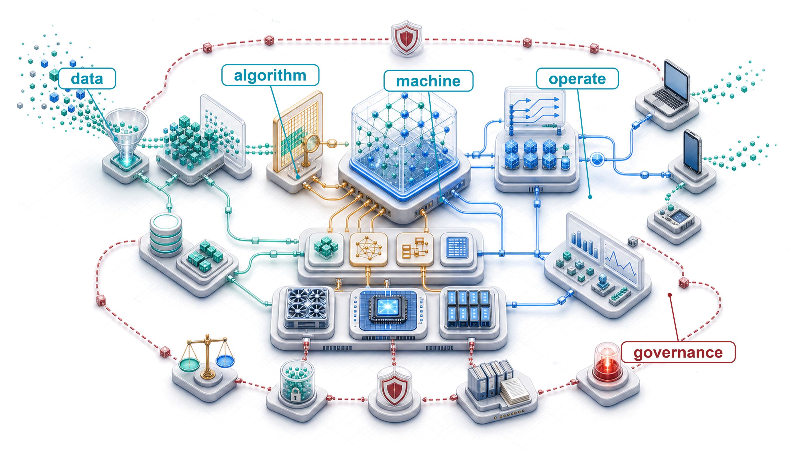

# Conclusion {#sec-conclusion}

::: {layout-narrow}
::: {.column-margin}

\chapterminitoc

:::

::: {.content-visible when-format="pdf"}
\noindent
{fig-alt="Complete single-node ML systems atlas connecting data, model computation, framework lowering, accelerator execution, serving, operations feedback, and governance boundary."}
:::

::: {.content-visible unless-format="pdf"}
{fig-alt="Complete single-node ML systems atlas connecting data, model computation, framework lowering, accelerator execution, serving, operations feedback, and governance boundary."}
:::

:::

## Purpose {.unnumbered .unlisted}

::: {.content-visible when-format="pdf"}
\begin{marginfigure}
\mlsysstack{30}{30}{30}{30}{30}{30}{30}{30}
\end{marginfigure}
:::

::: {.content-visible unless-format="pdf"}
::: {.column-margin}
{width="100%" fig-alt="Machine Learning Systems Architecture Stack"}

*Architecture stack focus for this chapter.*
:::
:::

_What does mastering the full stack enable that expertise in any single layer cannot?_

A single production decision travels through the entire stack. A data pipeline decides which events count as training signal. That signal shapes the architecture, which in turn fixes memory footprint and arithmetic intensity. Those properties constrain hardware choice, quantization strategy, serving latency, drift monitoring, and governance obligations. Mastered individually, each layer represents a valuable skill; mastered together, they confer the ability to reason across boundaries that no single specialty sees in full. An engineer who understands only compression can shrink a model, but cannot predict whether the accuracy loss matters for the deployment context. An engineer who understands only serving can optimize latency, but cannot trace a performance regression to a data pipeline change three stages upstream. Many of the costliest production failures arise at these boundaries, where every component passes its local tests yet the system as a whole misses its target. In D·A·M terms, what endures is the ability to analyze a system before it is built, reasoning about how data, algorithm, and machine constraints will interact, where bottlenecks will emerge, and which architectural commitments will prove irreversible. The constraints that govern these interactions outlive any specific framework, hardware generation, or model family, because the cost of moving data, the speed of light, and the gap between an assumed and a measured bottleneck do not turn over with them. Thinking in systems rather than components separates an engineer who can build a part from one who can build the whole.

::: {.content-visible when-format="pdf"}

\newpage

:::

::: {.callout-learning-objectives}

- Trace how data, architecture, compression, hardware, serving, operations, and governance decisions propagate constraints across an ML system
- Apply lighthouse-model reasoning to diagnose bottlenecks across cloud, mobile, edge, recommendation, and TinyML deployments
- Synthesize core ML systems principles into a framework for reasoning across Data, Algorithm, and Machine constraints
- Evaluate deployment trade-offs using latency budgets, memory and energy movement, drift, and responsibility constraints
- Justify an engineering approach for emerging contexts such as embodied, composed, and multi-node systems, using cross-layer evidence to identify where single-node reasoning must widen its boundary

:::

## The System Is the Model {#sec-synthesizing-ml-systems-ee10}

**The system is the model**\index{System is the model, The!definition}, meaning that the behavior a user receives from a machine learning service is produced by the data pipeline, the trained weights, the execution stack, the serving path, and the monitoring loop together, never by the weights alone. The request that opened the introduction shows the claim in miniature. When a user asks a smartphone voice assistant a question, learned components convert speech to text, interpret intent, retrieve information, and generate a response within seconds (@sec-introduction-ai-moment-37f1), and every chapter since has given one stage of that request a mechanism and a cost. @Sec-responsible-engineering added the last constraint the book imposes, the obligations a system owes the people it affects, and showed that it behaves like the latency and memory budgets before it, because it can be met only where every upstream stage preserved the freedom to meet it. Each constraint was taught one layer at a time. The costliest failures arise where the layers meet.

A composite scenario, extending the calibration pitfall analyzed in @sec-model-serving-fallacies-pitfalls-336b rather than reporting any one incident, shows such a failure. A team deploys an image classification model to a fleet of mobile devices. The architecture team chose depthwise separable convolutions to factorize spatial filtering from channel projection, reducing arithmetic operations. The compression team quantized weights and activations to INT8 to cut memory traffic and fit within on-chip static RAM (SRAM). The serving team met a p99 latency target of 50 ms. Each team succeeded by its local metric, yet within weeks, accuracy dropped by four percentage points on specific firmware and device cohorts. INT8 quantization fixes its clipping ranges during quantization-range calibration, permanently encoding the statistical distribution of the calibration images. A firmware-specific preprocessing routine interpolated images differently and presented an altered input distribution to the quantized model on those cohorts. No component failed in isolation, and nothing crashed. Each team validated its component against standard inputs, and while latency was evaluated end to end along the deployed request path, accuracy was measured only as an aggregate scalar over an offline evaluation set, so users on the affected cohorts simply received worse predictions that the system's monitoring was never built to see. Heterogeneous edge environments require disaggregated cohort monitoring from day one.

::: {.column-margin}
{width="100%" fig-alt="Vertical causal chain: INT8 calibration, then the firmware preprocessing path, then an input shift on one device cohort, ending in an accuracy drop marked in red."}

*A calibration choice surfaces as a cohort accuracy drop three stages downstream.*
:::

Most failures of this kind start at an interface between components, so the main task is to test the interfaces before they fail. Traditional software engineering treats functional correctness as decoupled from the underlying hardware; in machine learning systems, statistical behavior is physically inseparable from the pipelines, memory hierarchies, and accelerators that train, serve, and monitor the model. The bitter lesson teaches that general methods scaling with computation outrun hand-encoded heuristics (@sec-introduction-bitter-lesson-79c7).

Affording that scale is the job of the iron law of ML systems\index{Iron law of ML systems!synthesis} (principle \ref{pri-iron-law}), which sits at the center of this discipline. Its three terms (data movement, compute, and overhead) serve as the primary engineering levers for quantitative analysis. Building intelligence requires both statistical algorithms and adherence to the silicon contract\index{Silicon contract!constraint propagation} (principle \ref{pri-silicon-contract}), the requirement that the resource a model saturates first be the one the executing machine supplies in abundance. Arithmetic intensity and roofline modeling convert qualitative performance intuitions into quantitative upper bounds [@williams2009].

System capabilities emerge from co-design across the Data, Algorithm, and Machine (D·A·M) triad rather than from isolated algorithmic breakthroughs, and success and failure arise from the same mechanism, cross-layer coupling. The transformer architecture [@vaswani2017] scaled into models such as GPT-3 and Llama 2 [@brown2020language; @touvron2023llama2] only because decisions in other layers made attention affordable: IO-aware attention kernels that keep intermediate scores in on-chip memory, low-precision tensor units that raise the peak arithmetic rate, and partitioning of tensor state across accelerators.

::: {.column-margin .margin-pointer}
↩ IO-aware attention tiling, which keeps attention scores in on-chip memory, is established in @sec-model-training-flash-attention-ioaware-attention-optimization-3da0.
:::

Integration has concrete consequences. Software engineering often treats the "model" as a weights checkpoint, a single file of floating-point numbers. In a production environment, however, the weights are only one component of the true model, and often not the most fragile. A model that produces high benchmark accuracy fails if it ingests corrupted features, and a model that converges cleanly during training fails if it cannot satisfy deployment latency constraints.

::: {.column-margin .margin-pointer}
↩ The finding that model code is a small fraction of a production ML system, whose surrounding pipelines, serving, and monitoring are larger and more enduring, is established in @sec-introduction-datacentric-paradigm-shift-4eca.
:::

::: {#chk-conclusion-systems-thinking .callout-checkpoint title="Systems thinking"}

The system's dependencies, feedback loops, and request path make its boundaries testable.

**The integration**

- [ ] **Dependencies**: can you trace a data-pipeline change through training and serving to identify its latency effect?
- [ ] **Feedback loops**: have you mapped how the model's predictions influence its future training data?

**The holism**

- [ ] **End-to-end**: can you trace a user request from the user interface, through the network, preprocessing, model, postprocessing, and back to the user interface?

:::

Tracing a request end to end shows the structure behind this. Every layer of the stack enforces physical and statistical constraints on the next. Data curation and selection bound what the learner sees; architectures, training systems, and frameworks lower the resulting computation onto hardware; compression, acceleration, and benchmarking move the physical boundaries; and serving, operations, and responsible engineering hold the result to tail-latency budgets, drift, and subgroup outcomes in production. Because these stages form a tightly coupled system rather than a sequence of isolated handoffs, engineering decisions never remain localized, and an engineer who optimizes a single layer in isolation cannot predict how the change will propagate.

The rest of the chapter makes that claim quantitative. The five lighthouse models come first, each traced from its home regime to the lever that paid off and the lever that was wasted. The thirteen quantitative principles follow, regrouped by the three questions the introduction asked of every ML system: what shapes its predictions, what limits its execution, and what evidence supports its deployment. The dual mandate is then measured on two lighthouses, DLRM for trustworthy behavior and the GPT-2 family for physical deliverability. The same principles then forecast where constraints bind next, from microcontrollers to composed services and fleets. The chapter closes on the responsibility that follows from building such systems, the cross-boundary forms of the book's recurring mistakes, and a final trace of the voice-assistant request through every layer.

## Lighthouse Models: Constraint Propagation {#sec-conclusion-lighthouse-constraint-propagation}

```{=latex}
\newpage
```

The five lighthouse models\index{Lighthouse model!bottleneck probe} each have a home regime, the binding resource it exposes under its typical operating conditions. ResNet-50 is compute-bound, GPT-2 and Llama decode is bandwidth-bound, DLRM is capacity-bound, MobileNetV2 is compute-bound in its efficient regime, and keyword spotting (KWS) is power-bound. Across the book, each lighthouse rewarded the lever aimed at its binding term and wasted the effort aimed anywhere else (@tbl-lighthouse-trace).

::: {.column-margin .margin-pointer}
↩ The five lighthouse models and their diagnostic execution regimes are established in @sec-introduction-lighthouse-models-9b1c.
:::

| **Lighthouse**             | **Home Regime**                       | **Binding Term**                                                                   | **Lever That Paid**                                                                         | **Lever Wasted**                                                                              |
|:---------------------------|:--------------------------------------|:-----------------------------------------------------------------------------------|:--------------------------------------------------------------------------------------------|:----------------------------------------------------------------------------------------------|
| **ResNet-50**              | Compute-bound                         | Compute, $\Operations/(\PeakRate \cdot \EfficiencyHw)$                             | Batching that reuses filter weights across inputs; reduced-precision tensor arithmetic      | More memory bandwidth once batched convolutions sit right of the ridge point                  |
| **GPT-2/Llama decode**     | Bandwidth-bound                       | Data movement, $\DataVolume/\Bandwidth$                                            | Batching across requests; fewer bytes per weight; managing the per-request key-value cache  | More peak arithmetic throughput, or compute-only kernel tuning at batch one                   |
| **DLRM**                   | Capacity-bound                        | Memory capacity, a precondition before any term applies                            | Placing and sharding embedding tables across memory tiers; caching frequently accessed rows | Faster dense arithmetic for the small fully connected layers                                  |
| **MobileNetV2**            | Compute-bound in its efficient regime | Compute within a phone's power envelope; depthwise layers cross to bandwidth-bound | Depthwise separable convolutions, then INT8 once depthwise layers became bandwidth-bound    | Further operation cuts on layers already bound by bandwidth                                   |
| **Keyword spotting (KWS)** | Power-bound                           | Energy per inference within a milliwatt budget                                     | A sub-megabyte INT8 model with a tensor arena planned at build time                         | Streaming audio to the cloud, whose radio transmission costs more energy than local inference |

: **Lighthouse Constraint Traces**: Each lighthouse probes one home regime, and the lever that paid off was the one aimed at that regime's binding term. A regime describes a workload on a machine rather than a model name, so a lighthouse crosses regimes when batch size, phase, or precision changes. {#tbl-lighthouse-trace tbl-colwidths="[13,15,22,27,23]"}

The regime belongs to the workload on a machine, so the same model can change regime, and the regime has to be checked before an optimization is chosen. GPT-2\index{GPT-2!memory bandwidth} training is compute-bound even though its decode is bandwidth-bound, because a training step reuses each weight across every token in the batch. ResNet-50\index{ResNet-50!batching efficiency} became input-bound in @sec-model-training when the data pipeline could not keep the accelerator fed, and INT8 arithmetic, which doubles the H100's peak rate without raising its memory bandwidth, doubles the ridge point, which leaves some ResNet-50 layers below it and bandwidth-bound. DLRM\index{DLRM!capacity-bound workload} shows the same pattern at the large end of the deployment spectrum, where embedding capacity decides which term binds; MobileNetV2\index{MobileNetV2!efficiency under constraint} and keyword spotting\index{Keyword spotting!sub-megabyte models} show it at the small end, where thermal and power envelopes do. A larger recommendation model, a larger decoder, or a faster vision network differs from its lighthouse in scale, not in which term binds, so the diagnosis carries forward to models that do not yet exist.

```{python}
#| echo: false
#| output: false
from mlsysim import *
from mlsysim.core.units import *

# ┌─────────────────────────────────────────────────────────────────────────────
# │ MOBILENET JOURNEY MATH
# ├─────────────────────────────────────────────────────────────────────────────
# │ Context: @tbl-lighthouse-journey-mobilenet (Architecture and Compression rows)
# │          in the Lighthouse Models section.
# │
# │ Goal:    Compute the FLOP and byte ratios that quantify MobileNetV2's
# │          efficiency wins across the architecture/compression journey.
# │ Show:    Depthwise-separable FLOP reduction, ResNet-50 vs. MobileNetV2
# │          operation ratio, and INT8 byte ratios versus FP32/FP16.
# │ How:     Apply the depthwise-separable FLOP formula at a representative
# │          3x3, 256-channel layer; divide ResNet-50/MobileNetV2 inference
# │          FLOPs; divide FP32/FP16 byte widths by INT8 byte width.
# │
# └─────────────────────────────────────────────────────────────────────────────
from mlsysim import Models
from mlsysim.fmt import fmt, check

class MobileNetJourneyMath:
    # LOAD
    resnet = Models.Vision.ResNet50
    mobilenet = Models.Vision.MobileNetV2
    kernel_size = 3
    representative_output_channels = 256

    # EXECUTE
    standard_to_depthwise = (kernel_size**2 * representative_output_channels) / (kernel_size**2 + representative_output_channels)
    resnet_to_mobilenet = resnet.inference_flops / mobilenet.inference_flops
    int8_vs_fp32 = BYTES_FP32 / BYTES_INT8
    int8_vs_fp16 = BYTES_FP16 / BYTES_INT8

    # GUARD
    check(8 <= standard_to_depthwise <= 9, "Depthwise separable example should land near 8--9x.")
    check(13 <= resnet_to_mobilenet.to("").magnitude <= 15, "ResNet-50/MobileNetV2 ratio drifted.")
    check(int8_vs_fp32.to("").magnitude == 4 and int8_vs_fp16.to("").magnitude == 2, "INT8 byte ratios changed.")

    # OUTPUT
    depthwise_reduction_mult_str = fmt_multiple(standard_to_depthwise, precision=1, commas=False)
    resnet_ops_reduction_mult_str = fmt_multiple(resnet_to_mobilenet.to("").magnitude, precision=1, commas=False)
    int8_fp32_reduction_mult_str = fmt_multiple(int8_vs_fp32.to("").magnitude, precision=0, commas=False)
    int8_fp16_reduction_mult_str = fmt_multiple(int8_vs_fp16.to("").magnitude, precision=0, commas=False)
```

Applying each phase of the book to MobileNetV2 shows how cross-layer constraints converge on a single engineering artifact (@tbl-lighthouse-journey-mobilenet). Across nine phases, from the deployment tier's envelope through architecture, training, data selection, compression, acceleration, benchmarking, serving, and runtime operations, each engineering decision narrows the options available downstream.

| **Journey Phase**                             | **System Lens**                | **MobileNetV2 Implementation**                                                                                                                                                                                                                                                       |
|:----------------------------------------------|:-------------------------------|:-------------------------------------------------------------------------------------------------------------------------------------------------------------------------------------------------------------------------------------------------------------------------------------|
| **Foundations (@sec-ml-systems)**             | Deployment Tier Constraints    | Mobile tier sets a watt-scale power, thermal, and battery envelope that every later phase must respect                                                                                                                                                                               |
| **Architecture (@sec-network-architectures)** | Algorithmic Efficiency         | Depthwise Separable Convolutions: `{python} MobileNetJourneyMath.depthwise_reduction_mult_str` fewer FLOPs for a representative 3-by-3, 256-output-channel layer and `{python} MobileNetJourneyMath.resnet_ops_reduction_mult_str` fewer operations than ResNet-50 at ImageNet scale |
| **Training (@sec-model-training)**            | Throughput vs. Latency         | Trained at high-throughput batch sizes for a model that will serve single requests at low latency                                                                                                                                                                                    |
| **Data Selection (@sec-data-selection)**      | Capacity-Matched Augmentation  | Milder augmentation matched to a compact network's limited capacity, validated against deployment invariances such as device and lighting variation, at no inference cost                                                                                                            |
| **Compression (@sec-model-compression)**      | Navigating the Pareto Frontier | INT8 Quantization: FP32 uses `{python} MobileNetJourneyMath.int8_fp32_reduction_mult_str` and FP16 uses `{python} MobileNetJourneyMath.int8_fp16_reduction_mult_str` the per-value storage of INT8, with accuracy revalidated per deployment                                         |
| **Acceleration (@sec-hardware-acceleration)** | Honoring the Silicon Contract  | Mapping kernels to mobile neural processing units (NPUs) (for example, Apple Neural Engine) to maximize hardware execution efficiency                                                                                                                                                |
| **Benchmarking (@sec-benchmarking)**          | Component vs. End-to-End       | Confirming that compression and accelerator gains survive the full pipeline by separating accelerator latency from preprocessing and transfer, and rechecking INT8 accuracy on edge cases such as unusual lighting                                                                   |
| **Serving (@sec-model-serving)**              | Respecting the Latency Budget  | $\text{p99} < 50$ ms constraint; optimizing preprocessing (resize/normalize) to avoid CPU bottlenecks                                                                                                                                                                                |
| **Operations (@sec-ml-operations)**           | Managing System Entropy        | Drift Monitoring: Detecting distribution shifts and tracking cohort-level accuracy across heterogeneous device populations and lighting conditions                                                                                                                                   |

: **The Lighthouse Journey (MobileNetV2)**: Applying the book's nine phases to one model shows how decisions in one domain (for example, architecture) propagate constraints and opportunities into downstream domains (for example, hardware acceleration and monitoring). {#tbl-lighthouse-journey-mobilenet tbl-colwidths="[17,22,61]"}

Decisions in one row constrain options in the next. Depthwise separable convolutions cut the operation count, but depthwise filtering reduces cross-channel reuse and often leaves these layers bandwidth-bound on mobile hardware. When profiling confirms that regime, a further cut in operations buys little, and the compression row's reduction in bytes per value becomes the next lever. That lever pays only if the acceleration row confirms that the mobile NPU executes those INT8 operators, and only if the benchmarking row shows the gain surviving preprocessing and transfer. The same propagation runs through every lighthouse, and reasoning about it before profiling requires the quantitative principles the book accumulated part by part.

## Thirteen Quantitative Principles {#sec-thirteen-quantitative-invariants-0dd2}

When an engineer alters an embedding table layout, doubles batch size, or quantizes an attention layer from FP16 to INT8, the performance outcome is not random; it is governed by physical bounds, empirical trade-offs, and operational feedback. Reasoning quantitatively about this behavior across the entire stack requires analytical tools with stated assumptions, and the book accumulated **thirteen quantitative principles**\index{Thirteen quantitative principles!framework} for that purpose across its four parts (@tbl-thirteen-principles). They are not all the same kind of statement. Three are hard bounds (the Pareto frontier, the arithmetic intensity law, and Amdahl's Law), two are decompositions (the iron law and the energy-movement principle), two are fitted models (statistical drift and bias feedback), two are policies whose parameters a product decision sets (the verification gap and the latency budget), and four are heuristics (data-as-code, data gravity, the silicon contract, and training-serving skew). The heuristic label marks the silicon contract as a prediction about which resource an architecture saturates first, a prediction that the arithmetic intensity bound then tests. Each principle box on the part pages names its kind, and each principle is reliable only within its stated assumptions.

```{python}
#| echo: false
#| label: conclusion-energy-movement-math
#| output: false
# ┌─────────────────────────────────────────────────────────────────────────────
# │ ENERGY-MOVEMENT PRINCIPLE RATIOS
# ├─────────────────────────────────────────────────────────────────────────────
# │ Context: @tbl-thirteen-principles (energy-movement principle row) and the
# │          adjacent diagnostic-chain paragraph in the Thirteen Quantitative
# │          Invariants section.
# │
# │ Goal:    Quantify the energy cost of a DRAM access relative to a single
# │          FP32 or FP16 floating-point operation.
# │ Show:    DRAM-vs-FP32 and DRAM-vs-FP16 energy ratios used to anchor the
# │          "100--1,000x" energy-movement claim in prose.
# │ How:     Divide the reference DRAM access energy by the per-FLOP energy
# │          constants for FP32 and FP16 from mlsysim.core.units.
# │
# └─────────────────────────────────────────────────────────────────────────────
from mlsysim.core.units import flop
from mlsysim.fmt import fmt_int, fmt, fmt_multiple, fmt_multiple_range, check

class EnergyMovementMath:
    # LOAD
    ENERGY_DRAM_ACCESS_PJ = Hardware.Tech.Memory.DRAM.energy_per_access
    ENERGY_FLOP_FP32_PJ = Hardware.Tech.Op.FlopFp32.energy
    ENERGY_FLOP_FP16_PJ = Hardware.Tech.Op.FlopFp16.energy
    dram_access = ENERGY_DRAM_ACCESS_PJ
    fp32_flop_energy = ENERGY_FLOP_FP32_PJ * flop
    fp16_flop_energy = ENERGY_FLOP_FP16_PJ * flop

    # EXECUTE
    dram_vs_fp32 = (dram_access / fp32_flop_energy).to("").magnitude
    dram_vs_fp16 = (dram_access / fp16_flop_energy).to("").magnitude

    # GUARD
    check(100 <= dram_vs_fp32 <= 1000, "DRAM/FP32 energy ratio left expected range.")
    check(100 <= dram_vs_fp16 <= 1000, "DRAM/FP16 energy ratio left expected range.")

    # OUTPUT
    dram_vs_fp32_display = round(dram_vs_fp32)
    dram_vs_fp16_display = round(dram_vs_fp16)
    dram_vs_fp32_mult_str = fmt_multiple(dram_vs_fp32_display, precision=0, commas=False)
    dram_vs_fp16_mult_str = fmt_multiple(dram_vs_fp16_display, precision=0, commas=False)
    dram_vs_range_mult_str = fmt_multiple_range(
        dram_vs_fp32_display,
        dram_vs_fp16_display,
        precision=0,
        commas=False,
    )
```

| **#**                           | **Principle**                    | **Part**          | **Core Equation/Statement**                                                                                                                                                                    | **What It Predicts**                                                                       |
|:--------------------------------|:---------------------------------|:------------------|:-----------------------------------------------------------------------------------------------------------------------------------------------------------------------------------------------|:-------------------------------------------------------------------------------------------|
| \ref{pri-data-as-code}          | Data-as-Code Principle           | I: Foundations    | Learned behavior $\approx\text{Train}$(training data, training procedure)                                                                                                                      | Data changes behavior; other inputs also matter                                            |
| \ref{pri-data-gravity}          | Data-Gravity Principle           | I: Foundations    | Move compute toward data when repeated transfer costs exceed placement costs                                                                                                                   | Depends on volume, reuse, network, and compute mobility                                    |
| \ref{pri-iron-law}              | Iron Law of ML Systems           | II: Development   | $\Time=\DataVolume/\Bandwidth+\Operations/(\PeakRate \cdot \EfficiencyHw)+\Latency$; overlap ranges from max to sum                                                                            | Stages may add or overlap                                                                  |
| \ref{pri-silicon-contract}      | Silicon Contract                 | II: Development   | Each architecture saturates one resource (compute, bandwidth, or capacity) first                                                                                                               | Design must target the resource saturated first                                            |
| \ref{pri-pareto-frontier}       | Pareto Frontier                  | III: Optimization | No feasible point is at least as good on every objective and strictly better on one                                                                                                            | Along the frontier, improving one objective worsens another                                |
| \ref{pri-arithmetic-intensity}  | Arithmetic Intensity Law         | III: Optimization | $\AttainableComputeRate \le \min(\PeakRate,\; \ArithmeticIntensity \times \Bandwidth)$                                                                                                         | More compute cannot raise a bandwidth ceiling                                              |
| \ref{pri-energy-movement}       | Energy-Movement Principle        | III: Optimization | $\TotalEnergy\approx \DataVolume\times \EnergyPerByteMoved+\Operations\times \EnergyPerOperation$; dynamic RAM (DRAM) to FLOP cost ratio: `{python} EnergyMovementMath.dram_vs_range_mult_str` | Total energy depends on bytes moved, operations, and per-event costs                       |
| \ref{pri-amdahl}                | Amdahl's Law                     | III: Optimization | $\text{Speedup} = \frac{1}{(1-\ParallelFraction) + \frac{\ParallelFraction}{\AcceleratedFractionSpeedup}}$                                                                                     | For fixed work, the serial fraction caps parallelism gains                                 |
| \ref{pri-verification-gap}      | Verification Gap                 | IV: Deployment    | Deployment-population success probability must meet the specified target at the stated task-error tolerance                                                                                    | Specify distance, tolerance, population, and required success probability                  |
| \ref{pri-statistical-drift}     | Statistical Drift Diagnostic     | IV: Deployment    | $\AccuracyAfterDeployment(\DeploymentAge)\approx\InitialAccuracy-\FittedSensitivity\cdot\StatisticalDivergence$                                                                                | A local fit; drift need not lower quality                                                  |
| \ref{pri-training-serving-skew} | Training-Serving Skew Diagnostic | IV: Deployment    | $\TrainingServingSkew=\mathbb{E}[\lvert \ServingPathPredictor(\ModelInput)-\TrainingPathPredictor(\ModelInput)\rvert]$                                                                         | Output mismatch signals risk, not accuracy loss                                            |
| \ref{pri-latency-budget}        | Latency Budget Principle         | IV: Deployment    | $\Pr[\EndToEndRequestLatency\le \CompletionDeadline]\ge \TargetCompletionQuantile$, where $\EndToEndRequestLatency$ sums the request-path delays                                               | The product SLO selects $\TargetCompletionQuantile$ and the deadline $\CompletionDeadline$ |
| \ref{pri-bias-feedback}         | Bias Feedback Model              | IV: Deployment    | $\GroupDisparity(\FeedbackIntervalCount)\approx\GroupDisparity(0)\BiasFeedbackFactor^\FeedbackIntervalCount$ with fitted $\BiasFeedbackFactor$                                                 | Feedback may amplify harm; measure and intervene                                           |

: **Thirteen Quantitative Principles**: Each tool appears in the part where its governing constraint or diagnostic use first becomes visible. The collection combines bounds, decompositions, fitted models, policy requirements, and heuristics. Each row holds under its stated assumptions; together they provide a shared analytical vocabulary for system design, optimization, and deployment. {#tbl-thirteen-principles tbl-colwidths="[3,15,13,39,30]"}

*Notation Guide for @tbl-thirteen-principles*: In deployment models, $\TaskDistance$ is the task-specific distance metric, $\TaskErrorTolerance$ is the acceptable error tolerance threshold, $\TargetCompletionQuantile$ is the target success probability for latency deadline $\CompletionDeadline$, and $\BiasFeedbackFactor$ is the amplification factor compounding disparity $\GroupDisparity$ at step $\FeedbackIntervalCount$. The drift row restates the degradation equation (@eq-degradation), in which $\FittedSensitivity$ is the sensitivity fitted from labeled outcomes and $\StatisticalDivergence$ measures how far the current input distribution has moved from the training distribution. $\TrainingServingSkew$ is the expected absolute difference between serving-path and training-path outputs on the same input. In efficiency bounds, $\AcceleratedFractionSpeedup$ is the speedup factor applied to the parallelizable fraction $\ParallelFraction$. Finite tests estimate the deployment success probability with uncertainty; an evaluation must separately state the statistical confidence level of its interval or bound.

The thirteen principles are not independent axioms. The conservation-of-complexity heuristic\index{Conservation of complexity!meta-principle}[^fn-conservation-complexity-heuristic] introduced in Part I connects them into an integrated framework. In Part III, model compression demonstrated this trade-off at the scale of a single model: pruning sacrifices capacity, quantization sacrifices precision, and distillation expends training compute. At the scale of the entire system, the engineering discipline remains identical: following any local simplification, trace where the displaced complexity has migrated. The heuristic serves as a diagnostic rather than a physical conservation law. While thoughtful design can eliminate accidental complexity outright, systemic complexity often shifts elsewhere, as when quantizing a model moves it into validation.

[^fn-conservation-complexity-heuristic]: **Conservation-of-complexity heuristic**\index{Conservation of complexity!heuristic limits}: Tesler's Law\index{Tesler's law!conservation of complexity}, a design aphorism, says that an application's irreducible complexity must be handled somewhere in the interaction among user, application, and platform [@tesler1984complexity]; extending it to all ML-system complexity is an analogy, not a physical law. Quantization may add validation burden, and abstraction may move implementation detail behind an interface, but good design can also remove accidental complexity outright. Large language model application pipelines illustrate a possible shift: simplifying the user-facing interface with shorter or vaguer prompts may move work into system prompts, retrieval, or output verification. Use the heuristic to search for displaced costs, not to assume that an equal compensating cost must exist.

The part pages introduced the principles in the order the book needed them. Read together, they sort more usefully by the three questions the introduction asked of every ML system (@sec-introduction-summary-385d): what shapes its predictions, what limits its execution, and what evidence supports its deployment. The three groupings that follow keep each principle's number, so every principle can still be found on its part page.

### What shapes predictions (principles 1 and 13) {.unnumbered}

The data-as-code principle\index{Data-as-code principle!logical program} (\ref{pri-data-as-code}) answers the first question directly. The training dataset dictates learned behavior, so a modification to data curation is a behavioral change requiring the same rigorous versioning, code review, and regression testing applied to source code. The bias feedback model\index{Bias feedback model!disparity amplification} (principle \ref{pri-bias-feedback}) extends that answer past launch, because a deployed model's predictions shape the data its successor trains on. It treats disparity as a quantity that compounds across retraining cycles at a fitted rate, which turns fairness into a stability question about the deployment loop. An automated credit model may satisfy throughput and convergence targets while systematically compounding disparities against underserved groups, so the feedback loop must be intercepted by disaggregated monitoring rather than discovered in aggregate accuracy.

::: {.column-margin .margin-pointer}
↩ The bias feedback model, with the fitted factor that projects when a disparity that passed its release gate will breach it, is established in @sec-responsible-engineering-monitoring-incident-response-54f4.
:::

### What limits execution (principles 2–8) {.unnumbered}

The data-gravity principle\index{Data gravity principle!physical anchor} (\ref{pri-data-gravity}) opens the second question, because data volume dictates where computation must execute. Moving a petabyte-scale dataset between cloud regions costs days of transfer time and substantial egress fees, which readily justifies moving compute to the data rather than the reverse.

::: {.column-margin .margin-pointer}
↩ The transfer time and egress cost that make a large dataset the gravitational center of an architecture are established in @sec-data-engineering-data-gravity-adcb.
:::

The lighthouse models carry the same placement constraint into execution. In DLRM, embedding tables that outgrow a single accelerator's memory make memory capacity a binding design constraint, requiring the execution system to be engineered around where the parameters physically reside. Compute-to-data placement recurs across deployment environments precisely because moving large, low-reuse datasets saturates interconnects.

The iron law (principle \ref{pri-iron-law}) and the silicon contract (principle \ref{pri-silicon-contract}) govern execution efficiency. The iron law's three-term decomposition isolates data movement, computation, and overhead; the silicon contract reveals which term limits performance on a given architecture-hardware pair. Actual shapes, kernels, and runtime conditions determine which regime of @tbl-lighthouse-trace applies. Diagnosing whether an execution path is compute-bound, bandwidth-bound, or capacity-bound determines which optimizations yield speedup and which waste engineering effort. Execution time drops most when engineers target the binding term directly rather than distributing effort uniformly.

::: {.column-margin .margin-pointer}
↪ The bottleneck diagnostic that pairs each binding iron-law term with the optimizations that work and those that are wasted is collected for reference in @sec-appdx-dam-taxonomy-bottleneck-diagnostic-3fc9.
:::

The remaining four principles of the second question form a tightly coupled diagnostic chain. The Pareto frontier\index{Pareto frontier!multi-objective optimization} (principle \ref{pri-pareto-frontier}) identifies the designs that no alternative beats on every objective at once, and once a design lies on that frontier, improving one objective requires a trade-off against another within the same feasible design set. The arithmetic intensity law\index{Arithmetic intensity!bottleneck diagnosis} (principle \ref{pri-arithmetic-intensity}) diagnoses whether compute or bandwidth sets the ideal ceiling. The energy-movement principle\index{Energy-movement principle!data locality} (principle \ref{pri-energy-movement}) combines per-event costs with event counts. Under the reference energy constants, one DRAM access costs about `{python} EnergyMovementMath.dram_vs_range_mult_str` as much as one arithmetic operation. The lower end is the DRAM-versus-FP32 ratio that anchored hardware acceleration (@sec-hardware-acceleration), and the upper end substitutes the cheaper FP16 operation. Which cost dominates a whole workload still depends on how many of each event occur. Amdahl's Law\index{Amdahl's law!preprocessing bottleneck} (principle \ref{pri-amdahl}) sets the ceiling on any parallelism gain, explaining why data loading and preprocessing can become bottlenecks in highly optimized systems.

::: {.column-margin .margin-pointer}
↩ The compute-versus-bandwidth-boundary and hardware balance ($\RooflineRidgePoint$) are established in @sec-hardware-acceleration-hardware-balance.
:::

MobileNetV2 touches all four. Depthwise separable convolutions reshape the Pareto frontier [@sandler2018]. INT8 quantization\index{INT8 quantization!bandwidth trade-off} exploits the arithmetic intensity law by raising arithmetic intensity through reduced memory traffic [@jacob2018]. Measured energy savings, where the reduced traffic and supported execution lower total consumption, align with the energy-movement principle, while Amdahl's Law bounds end-to-end speedup when host-side preprocessing remains unaccelerated. Microcontroller workloads such as KWS compress these trade-offs further, operating under sub-megabyte memories that leave little room for avoidable overhead.

::: {.column-margin .margin-pointer}
↩ Compression moves a model along the accuracy-efficiency frontier, as established in @sec-model-compression-balancing-tradeoffs-6ae3.
:::

### What evidence supports deployment (principles 9–12) {.unnumbered}

The third question concerns failures that bench testing cannot rule out, because a system can work correctly on the bench yet fail silently in production. The verification gap\index{Verification gap!statistical testing} (principle \ref{pri-verification-gap}) specifies the required success probability over a stated deployment population and error tolerance. Testing estimates whether the system meets that requirement, with a separately stated statistical confidence level; it cannot establish correctness for every future input. The statistical drift diagnostic\index{Statistical drift risk!accuracy erosion} (principle \ref{pri-statistical-drift}) detects that the population has changed, and labeled outcomes fit how much that change costs in accuracy. The training-serving skew diagnostic\index{Training-serving skew!accuracy impact} (principle \ref{pri-training-serving-skew}) flags training and serving paths that compute the same features differently. The latency budget\index{Latency budget!tail latency constraint} (principle \ref{pri-latency-budget}) holds serving to the tail quantile the product selects.

::: {.column-margin .margin-pointer}
↩ Reusing training-time transformation parameters at serving time, the consistency imperative that prevents skew, is established in @sec-data-engineering-ensuring-trainingserving-consistency-c683.
:::

Monitoring infrastructure, drift detection, feature stores, and disaggregated subgroup metrics exist to make these principles measurable and to trigger corrective action. A recommendation system that achieves high offline accuracy still requires parity checks when training-serving skew corrupts feature pipelines (principle \ref{pri-training-serving-skew}) and outcome auditing when user behavior shifts seasonally (principle \ref{pri-statistical-drift}).

::: {.column-margin .margin-pointer}
↩ The monitoring infrastructure and drift quantification that surface these silent failures are established in @sec-ml-operations-production-monitoring-5e1b.
:::

### The integrated framework {.unnumbered}

The thirteen principles are not a sequence to apply in order. They constrain one another, and a single decision activates several of them in turn.

Quantizing a model from FP16 to INT8 illustrates these mutual constraints in action. This single intervention navigates the Pareto frontier (principle \ref{pri-pareto-frontier}), trading numerical precision for memory traffic, and its consequences spread across the stack. Quantization alters the model's silicon contract (principle \ref{pri-silicon-contract}), shifting its operating point on the arithmetic intensity curve (principle \ref{pri-arithmetic-intensity}) and transforming its energy profile (principle \ref{pri-energy-movement}). In deployment, the latency budget (principle \ref{pri-latency-budget}) dictates whether the resulting speedup meets the service-level objective (SLO), while the verification gap (principle \ref{pri-verification-gap}) demands verifying that the lowered serving graph preserves the empirical accuracy measured during compression testing. The opening fleet failure escaped at exactly this step. Compression testing accepted the quantized model on images from the evaluation pipeline, while the firmware path presented a different population. The training-serving skew diagnostic (principle \ref{pri-training-serving-skew}), comparing model outputs from the two preprocessing paths on the same captured inputs, is the measurement that would have exposed the mismatch before the affected cohort did. In that comparison the evaluation pipeline, which produced the calibration images, plays the role the diagnostic assigns to the training path, and the firmware path plays the serving path. The verification gap names why the failure escaped; the skew diagnostic names how to catch it.

The trace touched seven of the thirteen principles, and which seven depended on the decision. Had the same model moved off the device to a cloud endpoint, data placement (principle \ref{pri-data-gravity}) would have entered, because every input image would then cross the network. Had preprocessing stayed on the host CPU while the NPU ran the faster INT8 kernels, Amdahl's Law (principle \ref{pri-amdahl}) would have bounded how much of that speedup the request path could see. The principles activate in turn as a decision moves from model representation to hardware execution to production validation.

A deployment proposal can be checked against the same principles before anyone writes code.

::: {#chk-conclusion-applying-invariants .callout-checkpoint title="Applying the principles"}

A colleague proposes quantizing your model from FP16 to INT8 to reduce serving costs.

**Trace the principles**

- [ ] **Pareto frontier** (principle \ref{pri-pareto-frontier}): What accuracy are you trading for the bandwidth gain?
- [ ] **Silicon contract** (principle \ref{pri-silicon-contract}): Does the target hardware efficiently accelerate the required INT8 operators?
- [ ] **Verification gap** (principle \ref{pri-verification-gap}): Does the quantized serving artifact preserve the behavior accepted during compression testing?
- [ ] **Training-serving skew** (principle \ref{pri-training-serving-skew}): Do the calibration images pass through the same preprocessing path that every serving device uses?
- [ ] **Latency budget** (principle \ref{pri-latency-budget}): Does the speedup bring you within SLO, or create headroom for batching?

:::

Regrouped by the four parts in which they were introduced, the principles form a cycle rather than a pipeline (@fig-invariants-cycle). The deployment principles (9–13) turn runtime telemetry into evidence that sends work back to the data foundations, so each production lesson becomes the starting condition of the next design pass. The conservation-of-complexity heuristic sits at the center of that cycle because every pass around it asks where the complexity displaced by the previous decision has landed.

That feedback loop is central to production engineering. Principles 9 through 13 expose signals that trigger targeted remediations such as canary rollbacks, fallback heuristics, dataset augmentation, model retraining, or kernel retuning, and the point is to see failures coming before they compound.

::: {#fig-invariants-cycle fig-env="figure" fig-pos="htb" fig-cap="**The Cycle of ML Systems (13 Principles)**: A four-phase systems engineering lifecycle organized around the conservation-of-complexity heuristic. The phases connect in a feedback cycle, and the thirteen principles sit along the transitions by the part that develops them, spanning bounds, decompositions, fitted models, policy requirements, and design heuristics whose assumptions must be checked. Icons mark the phases: bricks for the data foundations, a neural network for model development, a battery for the efficiency budget of optimization, and a rocket for launch into deployment." fig-alt="Clockwise circular diagram with four phases: Foundations (Data), Development (Model), Optimization (Efficiency), and Deployment (Operations). Arrows connect Foundations to Development, Development to Optimization, Optimization to Deployment, and Deployment back to Foundations. The transitions are labeled 1–2 Data as Code and data gravity; 3–4 iron law and Silicon Contract; 5–8 Pareto Frontier, Arithmetic Intensity, Energy-Movement, and Amdahl’s Law; and 9–13 verification gap, Statistical Drift, Skew Diagnostic, Latency Budget, and Bias Feedback. A dashed center circle is labeled Conservation of Complexity."}

```{.tikz}
\begin{tikzpicture}[line join=round,font=\sffamily]

\tikzset{
Box/.style={align=flush center,
    inner sep=4pt,
    node distance=1.4,
    draw=OrangeLine,
    line width=0.75pt,
    rounded corners,
    fill=OrangeL!30,
    text width=25mm,
    minimum width=25mm, minimum height=10mm
  },
Box2/.style={Box, draw=VioletLine, fill=VioletL2!70,align=left,
    text width=36mm, minimum width=36mm, minimum height=10mm
  },
  }

\tikzset{%
planet/.style = {circle, draw=yellow!50!red!90,semithick, fill=yellow!30,line width=1.5pt,
                    font=\sffamily\bfseries,
                    minimum size=24mm, inner sep=1mm,align=flush center},
satellite/.style = {circle, draw=none, semithick, fill=#1!10,
                    text width=26mm, inner sep=1pt, align=flush center,minimum size=20mm,minimum height=12mm},
TxtC/.style = {font=\small\sffamily,text width=44mm,align=flush center},
arr/.style = {-{Triangle[length=3mm,width=6mm]}, color=#1!60,
                    line width=3mm, shorten <=1mm, shorten >=1mm},
LineA/.style = {violet!60,{Circle[line width=1.5pt,fill=white,length=7.5pt]}-,line width=2.0pt,shorten <=-4pt},
LineAA/.style={violet!30,dashed, line width=1.0pt,{-{Triangle[width=1.0*6pt,length=1.6*6pt]}},shorten <=3pt,shorten >=2pt}
}

\tikzset{pics/brain/.style = {
        code = {
        \pgfkeys{/channel/.cd, #1}
\begin{scope}[local bounding box=BRAIN,scale=\scalefac, every node/.append style={transform shape}]
\draw[fill=\filllcolor,line width=\Linewidth](-0.3,-0.10)to(0.08,0.60)
to[out=60,in=50,distance=3](-0.1,0.69)to[out=160,in=80](-0.26,0.59)to[out=170,in=90](-0.46,0.42)
to[out=170,in=110](-0.54,0.25)to[out=210,in=150](-0.54,0.04)
to[out=240,in=130](-0.52,-0.1)to[out=300,in=240]cycle;
\draw[fill=\filllcolor,line width=\Linewidth]
(-0.04,0.64)to[out=120,in=0](-0.1,0.69)(-0.19,0.52)to[out=120,in=330](-0.26,0.59)
(-0.4,0.33)to[out=150,in=280](-0.46,0.42)
%
(-0.44,-0.03)to[bend left=30](-0.34,-0.04)
(-0.33,0.08)to[bend left=40](-0.37,0.2) (-0.37,0.12)to[bend left=40](-0.45,0.14)
(-0.26,0.2)to[bend left=30](-0.24,0.13)
(-0.16,0.32)to[bend right=30](-0.27,0.3)to[bend right=30](-0.29,0.38)
(-0.13,0.49)to[bend left=30](-0.04,0.51);
\draw[rounded corners=0.8pt,line width=1.5*\Linewidth,\drawcircle,-{Circle[fill=\filllcolor,length=4.15pt]}](-0.23,0.03)--(-0.15,-0.03)--(-0.19,-0.18)--(-0.04,-0.28);
\draw[rounded corners=0.8pt,line width=1.5*\Linewidth,\drawcircle,-{Circle[fill=\filllcolor,length=4.15pt]}](-0.17,0.13)--(-0.04,0.05)--(-0.06,-0.06)--(0.14,-0.11);
\draw[rounded corners=0.8pt,line width=1.5*\Linewidth,\drawcircle,-{Circle[fill=\filllcolor,length=4.15pt]}](-0.12,0.23)--(0.31,0.0);
\draw[rounded corners=0.8pt,line width=1.5*\Linewidth,\drawcircle,-{Circle[fill=\filllcolor,length=4.15pt]}](-0.07,0.32)--(0.06,0.26)--(0.16,0.33)--(0.34,0.2);
\draw[rounded corners=0.8pt,line width=1.5*\Linewidth,\drawcircle,-{Circle[fill=\filllcolor,length=4.15pt]}](-0.01,0.43)--(0.06,0.39)--(0.18,0.51)--(0.31,0.4);
\end{scope}
     }
  }
}

%brick
\tikzset{
  cigla/.style={ inner sep=0pt,anchor=west,
    node distance=1.4pt,
    draw=none,
    line width=0.1pt,
    rounded corners=1pt,
    fill=\filllcolor,
    minimum width=4mm, minimum height=2mm
  },
    cigla1/.style={cigla,fill=\filllcirclecolor},
pics/brick/.style = {
        code = {
        \pgfkeys{/channel/.cd, #1}
\begin{scope}[shift={($(0,0)+(0,0)$)},scale=\scalefac,every node/.append style={transform shape}]
\path[clip] (-1.05,-0.52)rectangle (0.71,0.45);
\node[cigla](C1) at (-1.03,-0.4){};
\node[cigla1,right= of C1](C2){};
\node[cigla,right= of C2](C3){};
\node[cigla1,right= of C3](C4){};
%
\node[cigla,above right= of C1,anchor=south](C11){};
\node[cigla1,right= of C11](C12){};
\node[cigla,right= of C12](C13){};
\node[cigla1,right= of C13](C14){};
%
\node[cigla,above right= of C11,anchor=south](C21){};
\node[cigla1,right= of C21](C22){};
\node[cigla,right= of C22](C23){};
%
\node[cigla,above right= of C21,anchor=south](C31){};
\node[cigla1,right= of C31](C32){};
\node[cigla,right= of C32](C33){};
\end{scope}
    }
  }
}
%vaga
\tikzset{
pics/vaga/.style = {
        code = {
        \pgfkeys{/channel/.cd, #1}
\begin{scope}[shift={($(0,0)+(0,0)$)},scale=\scalefac,every node/.append style={transform shape}]
\node[rectangle,minimum width=2mm,minimum height=22mm,
draw=none, fill=\filllcolor,line width=\Linewidth](1R) at (0,-0.95){};
\fill[fill=\filllcolor!60!black](230:2.8)arc(230:310:2.8)--cycle;%circle(2.9);
%LT
\node [semicircle, shape border rotate=180,  anchor=chord center,
      minimum size=11mm, draw=none, fill=\filllcirclecolor](LT) at (-2,-0.5) {};
\node [circle,  minimum size=4mm, draw=none, fill=\filllcirclecolor](T1) at (-2,1.25) {};
\draw[draw=\drawcolor,line width=1.2*\Linewidth,shorten <=3pt,shorten >=3pt](T1)--(LT);
\draw[draw=\drawcolor,line width=1.2*\Linewidth,shorten <=3pt,shorten >=3pt](T1)--(LT.30);
\draw[draw=\drawcolor,line width=1.2*\Linewidth,shorten <=3pt,shorten >=3pt](T1)--(LT.150);
%DT
\node [semicircle, shape border rotate=180,  anchor=chord center,
      minimum size=11mm, draw=none, fill=\filllcirclecolor!70!black](DT) at (2,-0.5) {};
\node [circle,  minimum size=4mm, draw=none, fill=\filllcirclecolor!70!black](T2) at (2,1.25) {};
\draw[draw=\drawcolor,line width=1.2*\Linewidth,shorten <=3pt,shorten >=3pt](T2)--(DT);
\draw[draw=\drawcolor,line width=1.2*\Linewidth,shorten <=3pt,shorten >=3pt](T2)--(DT.30);
\draw[draw=\drawcolor,line width=1.2*\Linewidth,shorten <=3pt,shorten >=3pt](T2)--(DT.150);
%
\node[draw=none,rectangle,minimum width=32mm,minimum height=1.5mm,inner sep=0pt,
fill=\filllcolor!60!black]at(0,1.25){};
\node[draw=white,fill=\filllcolor,line width=2*\Linewidth,ellipse,minimum width=9mm,  minimum height=15mm](EL)at(0,0.85){};
\node[draw=white,fill=\filllcolor!60!black,line width=2*\Linewidth,circle,minimum size=10mm](2C)at(0,2.05){};
\end{scope}
    }
  }
}
%llm
\tikzset{
pics/llm/.style = {
        code = {
        \pgfkeys{/channel/.cd, #1}
\begin{scope}[shift={($(0,0)+(0,0)$)},scale=\scalefac,every node/.append style={transform shape}]
\node[circle,minimum size=12mm,draw=\drawcolor, fill=\filllcolor!70,line width=0.5*\Linewidth](C\picname) at (0,0){};
\def\startangle{90}
\def\radius{1.15}
\def\radiusI{1.1}
\foreach \i [evaluate=\i as \j using \i+1] [count =\k] in {0,2,4,6,8} {
\pgfmathsetmacro{\angle}{\startangle - \i * (360/8)}
\draw[draw=black,-{Circle[black ,fill=\filllcirclecolor,length=5.5pt,line width=0.5*\Linewidth]},line width=1.5*\Linewidth](C\picname)--++(\startangle - \i*45:\radius) ;
\node[circle,draw=black,fill=\filllcirclecolor!80!red!50,inner sep=3pt,line width=0.5*\Linewidth](2C\k)at(\startangle - \j*45:\radiusI) {};
}
\draw[line width=1.5*\Linewidth](2C1)--++(-0.5,0)|-(2C2);
\draw[line width=1.5*\Linewidth](2C3)--++(0.5,0)|-(2C4);
\node[circle,minimum size=12mm,draw=\drawcolor, fill=\filllcolor!70,line width=0.5*\Linewidth]at (0,0){};
\end{scope}
    }
  }
}
%battery
\tikzset{
pics/battery/.style = {
        code = {
        \pgfkeys{/channel/.cd, #1}
\begin{scope}[shift={($(0,0)+(0,0)$)},scale=\scalefac,every node/.append style={transform shape}]
\node[rectangle,minimum width=35mm,minimum height=8mm,draw=\drawcolor,
rounded corners=4pt,fill=\filllcirclecolor,line width=\Linewidth](2R\picname) at (1,0){};
\node[rectangle,minimum width=45mm,minimum height=22mm,draw=\drawcolor,
rounded corners=4pt,fill=\filllcolor,line width=\Linewidth](R\picname) at (0,0){};
\node[rectangle,minimum width=5mm,minimum height=18mm,draw=none,
fill=green,line width=\Linewidth](3R\picname) at ($(R\picname.west)!0.5!(R\picname.east)$){};
\node[rectangle,minimum width=5mm,minimum height=18mm,draw=none,
fill=green,line width=\Linewidth](3R\picname) at ($(R\picname.west)!0.33!(R\picname.east)$){};
\node[rectangle,minimum width=5mm,minimum height=18mm,draw=none,
fill=green,line width=\Linewidth](3R\picname) at ($(R\picname.west)!0.16!(R\picname.east)$){};

\end{scope}
    }
  }
}
%rocket
\tikzset{
pics/rocket/.style = {
        code = {
        \pgfkeys{/channel/.cd, #1}
\begin{scope}[shift={($(0,0)+(0,0)$)},scale=\scalefac,every node/.append style={transform shape},line cap = round]
%vrh
\draw[fill=\filllcolor,draw=\drawcolor,line width=\Linewidth](-0.26,0.5)to[bend right=12](0.26,0.5)to[bend right=7] (0,0.85)to[bend right=7] cycle;
%krila
\draw[fill=\filllcolor!70!red,draw=\drawcolor,line width=\Linewidth,rounded corners=1pt](-0.2,-0.7)--(-0.45,-0.9)--(-0.567,-0.4)--(-0.3,-0.17)--cycle;
\draw[fill=\filllcolor!70!red,draw=\drawcolor,line width=\Linewidth,rounded corners=1pt](0.2,-0.7)--(0.45,-0.9)--(0.567,-0.4)--(0.3,-0.17)--cycle;
%rep
\draw[fill=\filllcolor!70!green,draw=\drawcolor,line width=\Linewidth](0.16,-0.76)--(0.22,-0.9)--(-0.2,-0.9)--(-0.15,-0.76)--cycle;
%body
\draw[fill=\filllcolor,draw=\drawcolor,line width=\Linewidth](-0.2,-0.7)--(0.2,-0.7)to[out=75,in=320](0,0.85)to[out=220,in=105] cycle;
%krug
\node[circle,draw=\drawcolor,minimum size=4mm,fill=\filllcirclecolor,line width=\Linewidth]{};
\draw[draw=\drawcolor,line width=1.5*\Linewidth](0,-0.99)--(0,-1.3);
\draw[draw=\drawcolor,line width=1.5*\Linewidth](-0.11,-0.99)--(-0.11,-1.2);
\draw[draw=\drawcolor,line width=1.5*\Linewidth](0.11,-0.99)--(0.11,-1.2);
\end{scope}
    }
  }
}
\pgfkeys{
  /channel/.cd,
   Depth/.store in=\Depth,
  Height/.store in=\Height,
  Width/.store in=\Width,
  filllcirclecolor/.store in=\filllcirclecolor,
  filllcolor/.store in=\filllcolor,
  drawcolor/.store in=\drawcolor,
  drawcircle/.store in=\drawcircle,
  scalefac/.store in=\scalefac,
  Linewidth/.store in=\Linewidth,
  picname/.store in=\picname,
  filllcolor=BrownLine,
  filllcirclecolor=violet!20,
  drawcolor=black,
  drawcircle=violet,
  scalefac=1,
  Linewidth=0.5pt,
  Depth=1.3,
  Height=0.8,
  Width=1.1,
  picname=C
}

\def\radius{3.9}
\def\startangle{90}

\foreach \i/\j/\sho [count=\k from 0] in {
%green!79!black
white/{\textbf{}\\ }/15pt,
%magenta!60!
white/{\textbf{}\\ }/15pt,
%gray
white/{\textbf{}\\}/15pt,
%cyan
white/{\textbf{}\\ }/15pt
}
{
%Satelit
\pgfmathsetmacro{\angle}{\startangle - \k * (360/4)}
\node (s\k) [satellite=\i, font=\footnotesize\sffamily] at (\angle:\radius) {};
 \node[TxtC,below=0pt of s\k]{\j};
}
%logos
%brick
\pic[shift={(0.15,0.15)}] at  (s3) {brick={scalefac=1.1,picname=1,filllcolor=red!70!black!80,Linewidth=1.0pt,filllcirclecolor=red!90!black!50}};
%llm
\pic[shift={(0,0)}] at  (s0){llm={scalefac=0.9,drawcolor=BlueLine,filllcolor=BlueLine!10!, Linewidth=1.25pt,filllcirclecolor=red}};
%brain
\pic[shift={(0.1,-0.16)}] at  (s0){brain={scalefac=0.8,picname=1,filllcolor=orange!30!, filllcirclecolor=cyan!55!black!60, Linewidth=0.5pt}};
%battery
\pic[shift={(0,0)}] at  (s1){battery={scalefac=0.38,picname=1, drawcolor=BrownLine,filllcolor=BrownLine!10!, Linewidth=1.5pt,filllcirclecolor=BrownLine}};
%rocket
\pic[shift={(0,0.2)}] at  (s2){rocket={scalefac=1.1,picname=1, drawcolor=black,filllcolor=cyan!10!, Linewidth=1.0pt,filllcirclecolor=red}};
%center
\node[circle, draw=BrownLine, dashed,thick, fill=none,minimum size=26mm](CE)at(0,0){};
 \node[TxtC,below=0pt of CE]{Conservation\\ of Complexity};
 \pic[shift={(0,0)}] at  (0,0){vaga={scalefac=0.35,picname=1,filllcolor=BlueLine,  Linewidth=1.0pt,filllcirclecolor=orange}};
\def\ra{26mm}
\foreach \i [count=\k from 0] in{360,320,140,135}{
\pgfmathtruncatemacro{\newX}{\i + 90} %
\draw[line width=2.6pt,violet]
   (s\k)+(\i:0.5*\ra) arc[start angle=\i, end angle=\newX, radius=0.5*\ra];
}
 \draw[LineA](s0.35)--++(0:1)coordinate(MA);
 \node[Box,anchor=west](FO)at(MA){\textbf{Development}\\ (Model)};
 \draw[LineA](s1.355)--++(345:1)coordinate(ST);
 \node[Box,anchor=west](PR)at(ST){\textbf{Optimization}\\ (Efficiency)};
 \draw[LineA](s2.185)--++(200:3.25)coordinate(DE);
 \node[Box,anchor=west](DEP)at(DE){\textbf{Deployment}\\(Operations)};
 \draw[LineA](s3.180)--++(180:3.9)coordinate(FO);
 \node[Box,anchor=west](FND)at(FO){\textbf{Foundations}\\(Data)};
%
\draw[-{Triangle[width=18pt,length=8pt]}, line width=10pt,cyan!40] (60:\radius)
arc[radius=\radius, start angle=60, end angle= 16];
\coordinate (AR1) at (38:\radius);
\draw[-{Triangle[width=18pt,length=8pt]}, line width=10pt,cyan!40] (340:\radius)
arc[radius=\radius, start angle=340, end angle= 290];
\coordinate (AR2) at (315:\radius);
\draw[-{Triangle[width=18pt,length=8pt]}, line width=10pt,cyan!40] (240:\radius)
arc[radius=\radius, start angle=240, end angle= 200];
\coordinate (AR3) at (225:\radius);
\draw[-{Triangle[width=18pt,length=8pt]}, line width=10pt,cyan!40] (160:\radius)
arc[radius=\radius, start angle=160, end angle= 114];
\coordinate (AR4) at (137:\radius);
%
 \draw[LineA](AR1)--++(0:1.3)coordinate(MA);
 \node[Box2,anchor=west]at(MA){3. Iron Law\\
4. Silicon Contract};
 \draw[LineA](AR2)--++(340:1.6)coordinate(MA1);
 \node[Box2,anchor=west]at(MA1){5. Pareto Frontier\\
6. Arith. Intensity\\
7. Energy-Movement\\
8. Amdahl’s Law};
 \draw[LineA](AR3)--++(180:6.5)coordinate(MA2);
 \node[Box2,anchor=west]at(MA2){9. Verification Gap\\
10. Stat. Drift\\
11. Skew Diagnostic\\
12. Latency Budget\\
13. Bias Feedback};
 \draw[LineA](AR4)--++(180:6.5)coordinate(MA3);
 \node[Box2,anchor=west]at(MA3){1. Data as Code\\
2. Data Gravity};
 \end{tikzpicture}
```

:::

The diagnostic framework is collected for reference in @sec-appdx-dam-taxonomy, and the reference constants for back-of-the-envelope calculations appear in @sec-appdx-system-assumptions.

Tracing a quantization proposal through the principles it touches is one diagnostic pass. The introduction posed a larger obligation that the same principles must serve, and two lighthouses can now measure it end to end.

## The Dual Mandate Revisited {#sec-principles-practice-1005}

A recommendation model that ranks well on launch day can, six months later, be serving a population that its own rankings shaped, on hardware whose cost per query decides whether the service survives. The introduction named this pair of demands the dual mandate: learned behavior must remain trustworthy, and the machine must deliver that behavior within physical and economic limits. The thirteen principles are the book's tools for both halves, and each half can be traced end to end on a single lighthouse.

::: {.column-margin .margin-pointer}
↩ The dual mandate, trustworthy learned behavior delivered within the available time, memory, energy, and cost, is established in @sec-introduction-ai-moment-37f1.
:::

### Trustworthy learned behavior {.unnumbered}

DLRM carries the first half, because several mechanisms can erode trust in its learned behavior. The degradation equation (@eq-degradation) introduced a local fit relating distribution shift to observed accuracy change; the statistical drift diagnostic (principle \ref{pri-statistical-drift}) turns that idea into production telemetry, with divergence over user and item features as the early signal and delayed click and conversion outcomes as the confirmation. Training-serving skew (principle \ref{pri-training-serving-skew}) attacks the same model from inside, when the online embedding lookup and the offline training pipeline compute a feature differently. The bias feedback model (principle \ref{pri-bias-feedback}) closes the loop, since items and creators that receive exposure generate the engagement data that earns them more exposure, and the resulting disparity can amplify or diminish across retraining cycles according to a fitted factor $\BiasFeedbackFactor$. The verification gap (principle \ref{pri-verification-gap}) bounds what the launch evaluation actually established. Trust therefore has to be measured continuously, with alarms and a response plan, rather than certified once at launch.

### Physical deliverability {.unnumbered}

```{python}
#| echo: false
#| label: conclusion-roofline-setup
#| output: false
# ┌─────────────────────────────────────────────────────────────────────────────
# │ CONCLUSION CHAPTER ROOFLINE ANALYSIS
# ├─────────────────────────────────────────────────────────────────────────────
# │ Context: Cost-of-a-token callout demonstrating Iron Law in practice
# │
# │ Goal: Illustrate the memory-compute trade-off for LLM inference.
# │ Scope: chapter-anchor — the summary reuses this chapter-level result.
# │ Show: The ratio between idealized memory-transfer and peak-compute bounds
# │       for batch-one Llama 2 70B decode on two balanced H100 shards.
# │ How:  Aggregate H100 bandwidth and peak FP16 throughput across two shards;
# │       divide Llama 2 70B parameters by GPT-2's to state the family scale.
# │
# └─────────────────────────────────────────────────────────────────────────────
from mlsysim import Hardware, Models
from mlsysim.physics import calc_transformer_decode_flops
from mlsysim.fmt import fmt, fmt_math, MarkdownStr, check, fmt_params, fmt_flops, fmt_time, fmt_bandwidth, fmt_flop_rate, fmt_memory, fmt_multiple

# ┌── LEGO ───────────────────────────────────────────────
class ConclusionRoofline:
    """
    Namespace for Conclusion Roofline Analysis.
    Scenario: 70-billion-parameter Llama 2 inference sharded across two H100s.
    """

    # ┌── 1. LOAD (Constants) ───────────────────────────────────────────────
    gpu = Hardware.Cloud.H100
    gpu_count = 2
    model = Models.Language.Llama2_70B
    gpt2 = Models.Language.GPT2  # the lighthouse this model scales up
    precision_bytes = BYTES_FP16

    # ┌── 2. EXECUTE (The Compute) ─────────────────────────────────────────
    d_vol = model.size_in_bytes(precision_bytes)
    compute_req = calc_transformer_decode_flops(model.parameters)
    aggregate_memory_bandwidth = gpu.memory.bandwidth * gpu_count
    aggregate_peak_flops = gpu.compute.peak_flops * gpu_count

    t_mem = d_vol / aggregate_memory_bandwidth
    t_comp = compute_req / aggregate_peak_flops

    ratio = t_mem / t_comp
    family_scale = (model.parameters / gpt2.parameters).to("").magnitude

    # ┌── 3. GUARD (Invariants) ───────────────────────────────────────────
    check(d_vol <= gpu.memory.capacity * gpu_count, "FP16 weights must fit across the H100 shards.")
    check(ratio >= 10, f"Batch-one decode should be bandwidth bound in this model. Ratio is only {ratio:.1f}x")
    check(30 <= family_scale <= 60, f"Llama 2 70B / GPT-2 parameter ratio drifted: {family_scale:.1f}x")

    # ┌── 4. OUTPUT (Formatting) ──────────────────────────────────────────────
    llama_params_count_str = fmt_params(model.parameters, scale_style="word", precision=0)
    llama_params_modifier_str = fmt_params(
        model.parameters,
        scale_style="word",
        precision=0,
        attributive=True,
    )
    llama_dvol_gb_str = fmt_memory(d_vol, unit=GB, precision=0, commas=False)
    llama_compute_gflop_str = fmt_flops(compute_req, unit=GFLOPs, precision=0, commas=False)

    h100_bw_tb_per_s_str = fmt_bandwidth(aggregate_memory_bandwidth, unit=TB / second, precision=2, commas=False)
    h100_peak_tflop_per_s_str = fmt_flop_rate(aggregate_peak_flops, unit=TFLOP / second, precision=0, commas=False)

    t_mem_ms_str = fmt_time(t_mem, unit=ms, precision=1, commas=False)
    t_comp_ms_str = fmt_time(t_comp, unit=ms, precision=2, commas=False)
    ratio_mult_str = fmt_multiple(ratio.to("").magnitude, precision=1, commas=False)
    family_scale_mult_str = fmt_multiple(round(family_scale), precision=0, commas=False)
    gpt2_params_modifier_str = fmt_params(gpt2.parameters, scale_style="word", precision=1, attributive=True)

    # LaTeX equations — use raw magnitudes, not suffixed _str exports
    _dvol_gb_val = d_vol.to(GB).magnitude
    _h100_bw_gb_val = aggregate_memory_bandwidth.to(GB / second).magnitude
    _compute_gflops_val = compute_req.to(GFLOPs).magnitude
    _h100_peak_tflops_val = aggregate_peak_flops.to(TFLOP / second).magnitude
    _t_mem_ms_val = t_mem.to(ms).magnitude
    _t_comp_ms_val = t_comp.to(ms).magnitude

    t_mem_math = fmt_math(
        f"\\IronLawMemoryTime = \\frac{{{_dvol_gb_val:.0f} \\text{{ GB}}}}{{{_h100_bw_gb_val:.0f} \\text{{ GB/s}}}} \\approx {_t_mem_ms_val:.1f} \\text{{ ms}}"
    )
    t_comp_math = fmt_math(
        f"\\IronLawComputeTime = \\frac{{{_compute_gflops_val:.0f} \\times 10^9 \\text{{ FLOPs}}}}{{{_h100_peak_tflops_val:.0f} \\times 10^{{12}} \\text{{ FLOP/s}}}} \\approx {_t_comp_ms_val:.2f} \\text{{ ms}}"
    )

ConclusionRoofline.dvol_gb_val = ConclusionRoofline._dvol_gb_val
ConclusionRoofline.h100_bw_gb_val = ConclusionRoofline._h100_bw_gb_val
ConclusionRoofline.compute_gflops_val = ConclusionRoofline._compute_gflops_val
ConclusionRoofline.h100_peak_tflops_val = ConclusionRoofline._h100_peak_tflops_val
ConclusionRoofline.t_mem_ms_val = ConclusionRoofline._t_mem_ms_val
ConclusionRoofline.t_comp_ms_val = ConclusionRoofline._t_comp_ms_val
```

GPT-2 carries the second half, and its family at scale shows the physics most sharply. Llama 2 70B is a decoder-only transformer of the same design with about `{python} ConclusionRoofline.family_scale_mult_str` as many parameters as GPT-2's `{python} ConclusionRoofline.gpt2_params_modifier_str`-parameter release. The larger scale does not move batch-one decode off the bandwidth side of the ridge point, because every generated token still reads every weight once. Serving one Llama 2 70B token on two H100s makes that cost concrete.

::: {.column-margin .margin-pointer}
↩ The intensity of batch-one decode, about 1 FLOP/byte in FP16 because each weight read feeds a single multiply-accumulate, is established in @sec-network-architectures-inference-memory-bandwidth-wall-98d1.
:::

:::: {#nbk-conclusion-cost-token .callout-notebook title="The cost of a token"}

**Problem**: Applying the iron law (principle \ref{pri-iron-law}) and the arithmetic intensity law (principle \ref{pri-arithmetic-intensity}) to serving one token from a `{python} ConclusionRoofline.llama_params_modifier_str`-parameter model like Llama 2 70B\index{Llama 2!70-billion-parameter bandwidth-bound workload}, with its FP16 weights sharded evenly across two NVIDIA H100s, which idealized lower bound is larger: memory transfer or peak compute? @Sec-appdx-assumptions-h100-reference-machine-2b6f supplies the H100 specifications. This calculation excludes KV-cache traffic, activations, context-dependent attention-over-KV FLOPs, interconnect communication, and dispatch overhead.

**Physics**:

- **Model-weight byte volume moved** $(\DataVolume)$: `{python} ConclusionRoofline.llama_params_count_str` parameters $\times$ 2 bytes (FP16) = `{python} ConclusionRoofline.llama_dvol_gb_str`.
- **Compute** $(\Operations)$: $\Operations \approx 2 \times \Parameters =$ `{python} ConclusionRoofline.llama_compute_gflop_str` per token, where $\Parameters$ is the parameter count.
- **Hardware**: Two H100s with aggregate $\Bandwidth$ = `{python} ConclusionRoofline.h100_bw_tb_per_s_str`, $\PeakRate \approx$ `{python} ConclusionRoofline.h100_peak_tflop_per_s_str` FP16.

**Math**:

- **Time to move data**: `{python} ConclusionRoofline.t_mem_math`
- **Time to compute**: `{python} ConclusionRoofline.t_comp_math`

**Systems insight**:

The idealized memory-transfer lower bound $\IronLawMemoryTime$ is `{python} ConclusionRoofline.ratio_mult_str` larger than the peak-compute lower bound $\IronLawComputeTime$. Under this batch-one model, decode is heavily bandwidth-bound (arithmetic intensity $\approx 1$ FLOP/byte), falling far to the left of the ridge point as shown in the margin. Because each 2-byte FP16 weight is fetched from high-bandwidth memory to perform a single multiply-accumulate ($2\text{ FLOPs}$) with the active token activation, the arithmetic intensity is $\frac{2\text{ FLOPs}}{2\text{ bytes}} = 1\text{ FLOP/byte}$, far below the H100 ridge point of $\approx 295\text{ FLOP/byte}$, which is why the time ratio above is numerically the ridge point. Sharding across two GPUs does not move that ridge, because it doubles peak rate and bandwidth together. Under this traffic model, attainable arithmetic throughput is less than 1 percent of the stated peak. That bound does not measure tensor-core busy or stalled cycles; profiling is needed to characterize realized execution. Batching can increase reuse, while quantization can reduce weight traffic. Optimizing only compute execution can reduce realized compute time toward the `{python} ConclusionRoofline.t_comp_ms_str` lower bound, but it cannot reduce the `{python} ConclusionRoofline.t_mem_ms_str` memory-transfer lower bound.

::::

::: {.column-margin}
```{=latex}
\vspace*{-15mm}
```
{width="100%" fig-alt="Idealized batch-one Llama decode point plotted to the left of the roofline ridge on an H100 chart."}

*In this batch-one lower-bound model, decode sits left of the roofline ridge in the bandwidth-bound regime.*
:::

The estimate turns a physical bound into a diagnosis. The silicon contract (principle \ref{pri-silicon-contract}) exposes the architectural consequence. Accelerators are provisioned and purchased by peak arithmetic throughput, yet this workload saturates memory bandwidth first, so deliverable token generation speed is governed by bytes per second transferred from memory rather than by peak FLOP/s. The energy-movement principle (\ref{pri-energy-movement}) highlights the same weight traffic. Because a reference DRAM access consumes approximately `{python} EnergyMovementMath.dram_vs_range_mult_str` as much energy as an arithmetic operation, and this workload performs only about one operation per byte fetched, moving weights dominates the energy expenditure of each token. The ratio compares single access events with single operations, and because DRAM moves data in multi-byte bursts, an exact per-byte figure depends on transfer width and is settled by hardware telemetry.

::: {.column-margin .margin-pointer}
↩ The energy ladder from registers to off-chip memory, which sets the per-access cost of moving a weight, is established in @sec-hardware-acceleration-evolution-hardware-specialization-fdb7.
:::

```{python}
#| echo: false
#| label: conclusion-tail-latency-ratio
#| output: false
# ┌─────────────────────────────────────────────────────────────────────────────
# │ TAIL LATENCY RATIO CALCULATION
# ├─────────────────────────────────────────────────────────────────────────────
# │ Context: "Physical deliverability" subsection of
# │          @sec-principles-practice-1005 and the chapter takeaways.
# │
# │ Goal: Demonstrate why mean latency is a misleading metric for user experience.
# │ Show: That p99 time to first token is 40× the mean in an illustrative LLM chat endpoint.
# │ How: Divide the scenario's p99 latency by its mean latency.
# │ Scope: chapter-anchor
# │
# └─────────────────────────────────────────────────────────────────────────────
from mlsysim.fmt import fmt, check, fmt_multiple, fmt_latency
from mlsysim.core.units import ms

# ┌── LEGO ───────────────────────────────────────────────
class TailLatencyRatio:
    """
    Namespace for Tail Latency Ratio Calculation.
    Scenario: LLM chat endpoint, mean vs. P99 time to first token (long prompts, queueing).
    """

    # ┌── 1. LOAD (Constants) ───────────────────────────────────────────────
    mean_latency_ms = 50.0  # scenario assumption: mean time to first token
    p99_latency_ms = 2000.0  # scenario assumption: p99 driven by long prompts and queueing

    # ┌── 2. EXECUTE (The Compute) ─────────────────────────────────────────
    ratio = p99_latency_ms / mean_latency_ms

    # ┌── 3. GUARD (Invariants) ───────────────────────────────────────────
    check(abs(ratio - 40) < 1e-9, f"P99/mean ratio should be 40x, got {ratio:.1f}x.")

    # ┌── 4. OUTPUT (Formatting) ──────────────────────────────────────────────
    mean_latency_ms_str = fmt_latency(mean_latency_ms * ms, unit=ms, precision=0, commas=False)
    p99_latency_ms_str = fmt_latency(p99_latency_ms * ms, unit=ms, precision=0, commas=True)
    conclusion_tail_ratio_mult_str = fmt_multiple(ratio, precision=0, commas=False)
```

Batching can amortize weight traffic across requests, and supported quantization can reduce bytes per weight. At the service level, the latency budget (principle \ref{pri-latency-budget}) limits how far batching may go. The relevant delay now includes prompt processing and request waiting, not only token decoding. Consider an illustrative large language model (LLM) chat endpoint whose mean time to first token is `{python} TailLatencyRatio.mean_latency_ms_str` but whose p99, driven by long prompts and by queueing behind long generations, reaches `{python} TailLatencyRatio.p99_latency_ms_str`, a tail `{python} TailLatencyRatio.conclusion_tail_ratio_mult_str` the mean (illustrated in the margin). Both values are scenario assumptions rather than outputs of a queueing model. The actual tail depends on the request mix and scheduling policy and must be measured; the general importance of tail latency is established in @dean2013. The product commits to the tail quantile, so the batching that improves throughput must stop where it pushes that quantile past its deadline.

::: {.column-margin}
```{=latex}
\vspace*{-15mm}
```
{width="100%" fig-alt="Two time bars on a linear scale: mean time to first token 50 ms is a sliver beside a p99 of 2,000 ms, a 40x tail."}

*Mean latency hides the tail; the selected tail quantile governs the SLO.*
:::

::: {.column-margin .margin-pointer}
↩ The queueing model that relates utilization to tail latency, and the service-time assumptions under which its p99 estimate holds, is established in @sec-model-serving-tail-latency-5376.
:::

The two traces use different principles, but they share one discipline: name the binding term, measure it, and budget for it. Scale keeps working only if the system can afford it and its results can still be trusted. The remaining question is where these constraints bind next, as ML systems spread across heterogeneous deployment targets, confront adversarial conditions, take on societal applications with public consequences, and grow into compositions of many components.

## Future Directions {#sec-future-directions-01df}

An autonomous vehicle navigating an unfamiliar intersection cannot wait for a cloud round-trip, and its sensor streams compete with the model for the same local bus; nor can a clinical assistant afford an uncalibrated diagnostic response under distribution shift. The framework is most useful when it forecasts where such physical and statistical constraints bind next. Three areas put the same physics under increasing pressure: deployment across diverse contexts, robustness under adversarial conditions, including deliberately crafted inputs [@goodfellow2015explaining], and societal applications whose failures carry public consequences. A fourth horizon, systems that compose multiple models, tools, and verifiers or grow beyond one machine, extends the same reasoning rather than replacing it.

### Applying principles to emerging deployment contexts {.unnumbered}

Deployment diversity tests whether one quantitative framework can explain systems with contrasting resource regimes. The cloud offers abundant power and centralized hardware, edge and mobile devices operate under latency and battery budgets, and TinyML and embedded systems compress the same design problem into kilobytes and milliwatts.

::: {.column-margin .margin-pointer}
↩ The four deployment paradigms, and the physical constraints of power, latency, and memory that separate them, are established in @sec-ml-systems-deployment-paradigm-framework-0d25.
:::

In the cloud regime, the binding decision is how to turn abundant hardware into useful throughput, which for ResNet-50 means keeping batched kernels near the compute ceiling and for DLRM means placing embedding tables that exceed one accelerator's memory. Toward the small end of the spectrum, the MobileNetV2 and keyword-spotting lighthouses carry the forecast.

```{python}
#| echo: false
#| label: conclusion-edge-reference-ratios
#| output: false
# ┌─────────────────────────────────────────────────────────────────────────────
# │ EDGE-VS-H100 REFERENCE RATIOS
# ├─────────────────────────────────────────────────────────────────────────────
# │ Context: Cross-domain applications section, mobile/edge paragraph
# │          contrasting a reference mobile platform against an H100 accelerator.
# │
# │ Goal:    Quantify the memory-capacity and TDP gaps between the reference
# │          mobile platform and an H100.
# │ Show:    Memory-capacity and TDP ratios between H100 and the book's
# │          reference mobile platform.
# │ How:     Divide H100 TDP and memory capacity by phone TDP and RAM.
# │
# └─────────────────────────────────────────────────────────────────────────────
from mlsysim import Hardware
from mlsysim.fmt import fmt, check

class EdgeReferenceRatios:
    # LOAD
    h_h100 = Hardware.Cloud.H100
    mobile_power = Hardware.Mobile.iPhone15Pro.tdp
    phone_ram = Platforms.Mobile.ram

    # EXECUTE
    power_ratio = h_h100.tdp / mobile_power
    memory_ratio = h_h100.memory.capacity / phone_ram

    # GUARD
    check(memory_ratio.to("").magnitude > 5, "Mobile edge example should have meaningfully less memory capacity.")
    check(power_ratio.to("").magnitude > 100, "Mobile edge example should have a much smaller power envelope.")

    # OUTPUT
    power_ratio_mult_str = fmt_multiple(power_ratio.to("").magnitude, precision=0, commas=False)
    memory_ratio_mult_str = fmt_multiple(memory_ratio.to("").magnitude, commas=False)
```

In contrast to the cloud, mobile and edge devices, the regime of the MobileNetV2 lighthouse, operate under strict power, thermal, and memory bounds that necessitate hardware-software co-design\index{Hardware-software co-design!edge deployment}. Efficient network architectures combined with model compression enable deployment on platforms where a reference mobile device has about `{python} EdgeReferenceRatios.memory_ratio_mult_str` smaller memory capacity and about `{python} EdgeReferenceRatios.power_ratio_mult_str` smaller power envelope than an H100-class accelerator. Edge deployment is mandatory when latency, privacy, intermittent connectivity, or egress bandwidth make centralized cloud inference infeasible. On these devices, efficiency decides whether a model runs at all.

::: {.column-margin .margin-pointer}
↩ The per-device memory and power envelopes that separate the mobile tier from a data-center accelerator are established in @sec-ml-systems-matching-workloads-hardware-bf91.
:::

At the opposite extreme, TinyML and embedded systems, the domain of the keyword spotting lighthouse, operate within kilobyte SRAM budgets, milliwatt power envelopes, and multi-year operational lifecycles. At these extremes, profiling isolates memory traffic bottlenecks, custom operator lowering reduces particular dispatch and interpretation costs, and a fixed tensor arena, planned at build time from tensor lifetimes, replaces dynamic allocation so that peak memory is known before the device ships. Severe resource limitations historically catalyzed efficient architecture families such as MobileNets [@howard2017mobilenets; @sandler2018] and EfficientNets [@tan2019efficientnet], proving that physical machine constraints actively drive algorithmic innovation.

::: {.column-margin .margin-pointer}
↩ The physical memory and latency envelopes that mandate compression for microcontroller and edge deployment are established in @sec-model-compression-deployment-scenarios-70c9.
:::

A related frontier is embodied AI\index{Physical AI!real-time control constraints} and robotics, where models execute inside closed-loop sensorimotor control cycles. In this regime, the deadline $\CompletionDeadline$ of the latency budget (principle \ref{pri-latency-budget}) becomes a hard real-time safety constraint, because a tail-latency spike can cause mechanical instability or collision, and continuous high-bandwidth sensor streaming competes directly with model weight traffic across constrained on-device memory buses.

Generative AI stresses all of these regimes at once. Autoregressive decode of the GPT-2/Llama family is bandwidth-bound at low batch, as the token estimate showed, and the serving responses to that bound each move the binding term in a different way. Batching raises weight reuse, and speculative decoding spends surplus compute on a small draft model to shorten the sequential path of the target model. Sufficiently long prompts shift the prefill phase toward the compute ceiling instead, so the same model crosses regimes within a single request.

::: {.column-margin .margin-pointer}
↩ Continuous batching, key-value cache management, and speculative decoding for language model serving are established in @sec-model-serving-llm-serving-b8bf.
:::

The same physical bounds apply across these paradigms, while fitted statistical models and SLO policies remain deployment-specific. Success depends on checking those distinctions and applying the principles together rather than pursuing isolated optimizations. The more deployment contexts a system spans, the more failure surfaces it creates. Robustness, not coverage alone, therefore becomes a binding constraint at the next frontier.

### Building robust AI systems {.unnumbered}

Machine learning systems can respond confidently and incorrectly while conventional infrastructure health checks remain green, allowing silent failures to persist undetected for weeks. Distribution shifts alter accuracy without code modifications, adversarial inputs (small, deliberately crafted perturbations that flip a prediction while leaving the input looking unchanged to a person) exploit vulnerabilities invisible to standard testing, and edge cases expose training-data boundaries that debugging alone cannot fix.

Finite testing estimates behavior on a defined population with uncertainty; it cannot prove correctness for every future input. Drift signals show when that population may have changed, while labeled outcomes determine whether quality changed. Together they motivate continuous monitoring as a design requirement, along with fallback policies and periodic revalidation, without claiming that every distribution shift causes degradation. The operational question is whether a failure will be detected and diagnosed before its impact spreads.

Robustness therefore demands designing for graceful degradation\index{Graceful degradation!triggers}, not only prevention. At the single-system scale, that discipline appears as fallback paths, uncertainty thresholds, version-specific rollback policies, and monitoring hooks, with rollback reserved for a bad release rather than for external drift. At larger scale, the same logic extends to hardware redundancy and ensemble-style diversity. As AI systems assume increasingly autonomous roles in healthcare, transportation, and finance, the cost of an undetected failure grows.

::: {.column-margin .margin-pointer}
↩ Incident response procedures, including the choice among rollback, fallback, and traffic reduction, are established in @sec-ml-operations-incident-response-ml-systems-c637.
:::

### AI for societal benefit {.unnumbered}

Robust systems are the prerequisite for deploying AI in domains where technical failures carry public consequences. The diabetic retinopathy screening case from @sec-ml-workflow shows why. A model that reaches expert-level performance on high-quality images from standardized research cameras can fail on blurry, poorly lit images from older clinic cameras, not because the algorithm is wrong but because the deployment population has moved outside the training envelope. In verification-gap terms (principle \ref{pri-verification-gap}), the launch evaluation certified the model on the wrong population. Each societal domain stresses a different principle.

::: {.column-margin .margin-pointer}
↩ The lab-to-field gap in the diabetic retinopathy screening case, where field images fall outside the training distribution, is established in @sec-ml-workflow-bridging-laboratory-realworld-data-e5b6.
:::

Scientific discovery workloads such as protein structure prediction, drug-interaction modeling, and materials screening can demand sustained training or inference throughput, so the iron law (principle \ref{pri-iron-law}) and the silicon contract (principle \ref{pri-silicon-contract}) decide how much of a search space a fixed compute budget can explore. Healthcare stresses the deployment principles instead. Calibrated uncertainty, external validation at each new site, clinical review, and continuous monitoring become safety requirements, because a diagnostic model trained on one hospital's population may degrade at another with different demographics, disease prevalence, or imaging equipment. Personalized education stresses data governance and the data-as-code principle (\ref{pri-data-as-code}), since the student-interaction records that drive personalization are both sensitive and, in effect, the program the model learns from; an interactive tutor must also meet its latency budget. A climate model that produces confident but uncalibrated projections carries the same verification problem into policy, where an overconfident forecast can steer decisions that are slow and costly to reverse.

In each of these domains the D·A·M taxonomy, the thirteen principles, and roofline analysis supply the systems questions, but the acceptable answers come from domain evidence such as clinical studies, educational outcome measurements, and physical validation, which no generic systems analysis provides. These applications also share a property that keeps their constraints tractable, because their task boundaries are fixed in advance. A diagnostic model classifies within a defined label set, and a structure predictor answers a defined kind of query. The next stress test removes that boundary.

### System composition as a stress test {.unnumbered}

The most ambitious test of these principles is a system whose task boundaries are not fixed in advance. A task-general assistant or multi-component ML service may route one request through several components: retrieval, which fetches relevant documents from an index; a planner, a model that decides which steps to take; tool execution, which calls external programs such as a search engine or a calculator; generation of the answer; and a verifier, which checks the output against rules or with a second model. The governing challenge is systems engineering as much as algorithm design, because the surrounding system must bound latency, reliability, cost, safety, and observability as work fans out across components.

System composition\index{System composition} puts four of the principles under new load at once. The iron law must budget the computation each component performs as work fans out across retrieval, planning, tool execution, generation, and verification. The silicon contract fragments, because each component saturates a different resource. An index lookup leans on memory capacity and bandwidth, generation on the weight traffic of decode, and a tool call on network round trips, so no single accelerator suits the whole request. The Pareto frontier expands from two or three metrics, such as accuracy, latency, and memory, to a larger surface that also includes safety, fairness, factuality, privacy, and cost. Statistical drift applies not only to the final output but also to retrieved documents, tool responses, and intermediate decisions.

The systems cost is visible in a single request. If an assistant fans out to retrieval, a planner, two tools, a generator, and a verifier, its realized latency follows the request's critical path\index{Critical path!composed request}. That path is the retrieval time, plus the planner's time, plus the slower of the two tool calls if they run in parallel, plus generation, verification, and the orchestration overhead between steps, and the latency budget (principle \ref{pri-latency-budget}) must hold that sum at the selected quantile. Its reliability analysis must also account for each component, because every additional component creates another timeout, schema mismatch, stale index, or verifier false negative to monitor. Conventional microservices already face interface failures across process boundaries. Composed ML systems add probabilistic interfaces in which a large language model planner may invent a tool name that does not exist or produce JSON that deviates from the declared schema (the agreed format of each call), requiring defensive parsing, retry logic, and output validation at each interface boundary.

A composed system therefore cannot rely on a single model-quality claim; it needs interfaces whose behavior can be measured, because each interface is where one component's assumptions about another become testable [@lampson1983hints]. Composed systems trade monolithic simplicity for explicit coordination. Each step can be independently updated, monitored, and debugged, but each also adds an interface whose behavior must be specified and tested. The decomposition gives up latency and architectural simplicity in exchange for control and observability, a move along a Pareto frontier rather than a free gain. It also opens opportunities. Modular components can be compressed and accelerated on targeted back ends, each with its own silicon contract (principle \ref{pri-silicon-contract}) and arithmetic intensity profile, and the interfaces between them are natural observation points for drift, skew, and numerical degradation.

::: {#psp-conclusion-new-golden-age .callout-perspective title="A new golden age"}

@hennessy2019 declared a "New Golden Age for Computer Architecture," driven by the end of Dennard scaling, the slowdown of Moore's Law, and new opportunities from domain-specific architectures, open instruction sets that any designer may implement without a license, and agile chip development with short, iterative hardware design cycles. Large-scale AI workloads are one domain where those pressures are visible. Building more capable AI services will not be a matter of writing a better loss function alone; it will be a systems engineering challenge involving energy efficiency, high-bandwidth interconnects, memory hierarchy design, and software stacks that keep heterogeneous hardware useful rather than idle. The thirteen principles provide a quantitative vocabulary for navigating that regime while preserving the distinction between physical bounds and deployment-specific assumptions.

:::

```{python}
#| echo: false
#| label: conclusion-fleet-failure-math
#| output: false
# ┌─────────────────────────────────────────────────────────────────────────────
# │ FLEET FAILURE MATH (HORIZON NOTE)
# ├─────────────────────────────────────────────────────────────────────────────
# │ Context: "A horizon note: from node to fleet" paragraph that keeps
# │          fleet-scale reliability as an extension of the single-system lens.
# │
# │ Goal:    Show that independent failures across a thousand-GPU pool collapse
# │          a multi-year component MTTF into an approximately two-day cluster MTBF.
# │ Show:    Reference GPU MTTF in years, GPU count, and cluster MTBF in hours.
# │ How:     Convert Systems.Reliability.Gpu.mttf_hours to years via HOURS_PER_DAY * DAYS_PER_YEAR;
# │          call calc_mtbf_cluster for the independent-failure cluster MTBF.
# │
# └─────────────────────────────────────────────────────────────────────────────
from mlsysim.physics import calc_mtbf_cluster
from mlsysim.fmt import fmt, check, fmt_time

class FleetFailureMath:
    # LOAD
    gpu_count = Systems.Clusters.Training_1K.total_accelerators
    gpu_mtbf = float(Systems.Reliability.Gpu.mttf_hours) * ureg.hour

    # EXECUTE
    gpu_mtbf_years = gpu_mtbf.to(hour).magnitude / (HOURS_PER_DAY * DAYS_PER_YEAR)
    cluster_mtbf = calc_mtbf_cluster(gpu_mtbf, gpu_count)

    # GUARD
    check(gpu_mtbf_years > 1, "Component MTTF should read as years.")
    check(cluster_mtbf.to(hour).magnitude < 100, "Thousand-GPU MTBF should read as hours.")

    # OUTPUT
    gpu_count_str = fmt(gpu_count, precision=0)
    gpu_mtbf_years_str = fmt_time(gpu_mtbf_years, 'year', precision=1, commas=False, style='word')
    cluster_mtbf_hours_str = fmt_time(cluster_mtbf.to(hour).magnitude, 'hour', precision=1, commas=False, style='word')
```

### A horizon note: From node to fleet {.unnumbered}

When workloads exceed a single node, the resource boundary moves outward, but bottleneck reasoning remains invariant. Local memory capacity constraints remain, while bisection bandwidth adds another limit; local exception handling expands into fleet-level fault tolerance, and training throughput becomes a distributed coordination problem. As the margin ladder illustrates, under a model in which every GPU fails independently at the same constant rate, regardless of its age, and any GPU failure halts the pool, a reference component mean time to failure (MTTF)\index{Mean time to failure!component reliability} of `{python} FleetFailureMath.gpu_mtbf_years_str` collapses into a cluster mean time between failures (MTBF)\index{Mean time between failures!fleet-scale reliability} of about `{python} FleetFailureMath.cluster_mtbf_hours_str` across a `{python} FleetFailureMath.gpu_count_str`-GPU pool, before accounting for correlated network or power outages. Under this model, a multi-week training run is highly likely to encounter component failures. Such a run needs a fault-tolerance strategy\index{Fault tolerance!training checkpoint strategy}, and checkpoint scheduling and recovery scope should follow the measured failure and recovery costs. At fleet scale, the analysis does not abandon single-node principles; it widens their boundary. The engineer still identifies the binding constraint, quantifies the governing cost terms in the iron law, and traces where displaced latency propagates.

::: {.column-margin}
```{=latex}
\vspace*{-29mm}
```
{width="100%" fig-alt="Margin ladder showing one GPU with about 5.7 years mean time to failure versus a 1024 GPU pool with about 48.8 hours mean time between failures."}

*Fleet scale turns rare component failures into routine system events.*
:::

This discipline rewards engineers who use bounds to guide benchmarks and measurements to test the assumptions behind those bounds. The same habit governs the last question this book raises, which is what the engineer owes the people a system affects.

## The Engineering Responsibility {#sec-journey-forward-6453}

Ethical considerations cannot be separated from physical and algorithmic design, because the same decisions set both. Hardware requirements limit access, because a model demanding an array of high-end data-center accelerators for inference excludes organizations unable to procure specialized capital.[^fn-ai-democratization-accessibility] Upstream training data encodes historical sampling skews that distort downstream model predictions. Sustained accelerator power draw directly drives facility thermal dissipation and regional grid carbon emissions. System design choices, from arithmetic precision to data curation, distribute operational costs and societal consequences far beyond the engineering team.

[^fn-ai-democratization-accessibility]: **AI democratization**\index{AI democratization}: Making AI accessible beyond a small number of well-resourced organizations through efficient systems engineering. Mobile-optimized models and cloud APIs can widen access, but doing so sustainably requires systematic optimization across hardware, algorithms, and infrastructure to maintain quality at scale.

Systems engineering extends beyond maximizing raw capability to operating deployments responsibly within societal and physical bounds. Production systems must achieve the arithmetic efficiency needed to run on accessible hardware, maintain fault tolerance against hardware anomalies, operate within strict thermal and power envelopes, and meet justified, application-specific fairness requirements across relevant demographic groups. Applications such as planetary climate monitoring and clinical diagnostic assistants make governance criteria first-class physical and operational constraints.

::: {.column-margin .margin-pointer}
↩ The lifecycle that turns responsibility into written requirements, release gates, documentation, and operational monitoring is established in @sec-responsible-engineering-responsible-engineering-checklist-a038.
:::

Systems engineering rests on three habits that outlast any model family or hardware generation: measuring hidden dependencies, bounding trade-offs against physical hardware limits, and holding production deployments to real operational constraints.

The same responsibility demands continuous skepticism toward local wins. Optimizing a component in isolation is the most common way a system acquires failure modes that no team owns, and the benchmark win that does not survive production is its most familiar form. The recurring versions of that mistake are worth naming explicitly, because recognizing them early is far cheaper than a redeployment.

## Fallacies and Pitfalls {#sec-fallacies-pitfalls-12ef}

Fallacies and pitfalls in ML systems arise from one common source, which is treating the system as decomposable into independent parts. Each item below is the cross-boundary form of a mistake an earlier chapter met inside one layer, where optimizing one dimension, one metric, or one stage looks sufficient until that assumption meets production reality.

::: {.fallacy-pitfall}

**Fallacy**: *Systems engineering complexity disappears with better tools and abstractions.*

Tools abstract complexity; they do not eliminate physical constraints. A high-level framework that hides memory management still consumes memory. An AutoML system that tunes hyperparameters still faces the Pareto frontier. Simplifying one interface may shift burden to another.
:::

::: {.fallacy-pitfall}

**Pitfall**: *Optimizing one metric without tracing displaced costs.*

When an optimization reduces latency by 50 percent, systems analysis demands asking what changed elsewhere. Quantization may add validation burden. Caching may trade memory capacity for serving speed. Some simplifications remove accidental complexity; others displace cost. Engineers who celebrate gains in one metric without tracing cross-stack effects build systems that fail in unexpected ways. Rigorous profiling decides which occurred.

:::

::: {.fallacy-pitfall}

**Fallacy**: *Mastering individual components equals mastering the system.*

Component expertise is necessary but insufficient. An engineer who understands data pipelines, training, serving, and operations as isolated domains will still struggle with systems where a data schema change cascades through training, breaks quantization assumptions, and triggers silent accuracy degradation in production. Integration can create more complexity than the components reveal in isolation because interfaces multiply failure modes.

:::

::: {.fallacy-pitfall}

**Pitfall**: *Scaling data collection without tracing its costs into the layers that absorb them.*

A data team that grows its collection judges the result by model quality, yet the costs land in other layers. Storage and preprocessing grow with every sample, each training epoch reads more bytes through the input pipeline, and repeatedly moving or scanning a larger dataset can exceed the cost of moving compute toward it, as the data-gravity principle (\ref{pri-data-gravity}) predicts. Within a fitted scaling regime, additional data can yield diminishing improvements (@sec-data-selection-icr-frontier) while those costs continue to grow, and coverage, data quality, model capacity, and distribution determine whether that fit remains useful for the next collection increment. If a team judges collection only by its own metric, it gathers data whose costs other teams absorb, so the marginal information value per sample has to be weighed against those downstream costs.

:::

::: {.fallacy-pitfall}

**Fallacy**: *A single accuracy metric captures model quality.*

A model evaluated solely on top-line accuracy ignores the boundaries it must cross. The composite fleet scenario that opened this chapter passed its aggregate offline evaluation while accuracy on specific firmware and device cohorts fell by four percentage points. The serving boundary imposes its own test. Under a 100 ms tail-latency SLO, a 95 percent-accurate model executing in 500 ms is infeasible, whereas a 93 percent-accurate model with a measured 50 ms tail meets that latency requirement. It is a feasible deployment only if its accuracy, subgroup behavior, resource costs, and other acceptance criteria also pass. Pareto analysis (principle \ref{pri-pareto-frontier}) evaluates latency, throughput, memory footprint, energy, fairness, and serving cost together, and disaggregated evaluation exposes the subgroup disparities that an aggregate conceals.

:::

::: {.column-margin .margin-pointer}
↩ Disaggregated evaluation, which tests each relevant subgroup separately as a release gate, is established in @sec-responsible-engineering-testing-across-populations-9f20.
:::

::: {.fallacy-pitfall}

**Pitfall**: *Treating every drift alarm as an automated rollback trigger.*

The alarm fires in the monitoring layer, but its cause may sit in another layer entirely, and the response must follow the cause. Rollback is appropriate when a regression is traced to a flawed binary or pipeline release. External covariate drift, however, is not repaired by redeploying an older, equally stale checkpoint, and a shift introduced upstream, such as the firmware preprocessing path in the opening scenario, is repaired at the boundary where it entered. Safe operational responses include canary traffic shedding, fallback heuristics, prediction quarantine, or scheduled retraining once ground-truth labels confirm degradation.

:::

```{python}
#| echo: false
#| label: conclusion-amdahl-pitfall
#| output: false
# ┌─────────────────────────────────────────────────────────────────────────────
# │ AMDAHL'S LAW PITFALL CALCULATION
# ├─────────────────────────────────────────────────────────────────────────────
# │ Context: Fallacies and Pitfalls, the "A single optimized pipeline stage
# │          makes the system fast" fallacy that immediately follows this cell.
# │
# │ Goal:    Quantify how Amdahl's Law caps end-to-end speedup when only a
# │          small fraction of the pipeline is being optimized.
# │ Show:    Local speedup factor, serial-fraction percent, and resulting
# │          system-level speedup for the worked pitfall example.
# │ How:     Apply calc_amdahls_speedup with optimized_fraction=0.10 and a
# │          10x local speedup, then format each value for prose inlining.
# │
# └─────────────────────────────────────────────────────────────────────────────
from mlsysim.physics import calc_amdahls_speedup
from mlsysim.fmt import fmt, check

class AmdahlPitfallMath:
    # LOAD
    optimized_fraction = 0.10
    serial_fraction = 1 - optimized_fraction
    local_speedup = 10.0

    # EXECUTE
    system_speedup = calc_amdahls_speedup(optimized_fraction, local_speedup)

    # GUARD
    check(system_speedup < 1.2, "Amdahl example should remain bottlenecked by preprocessing.")

    # OUTPUT
    local_speedup_mult_str = fmt_multiple(local_speedup, precision=0, commas=False)
    serial_pct_str = fmt_percent(serial_fraction, precision=0, commas=False, style='prose')
    system_speedup_mult_str = fmt_multiple(system_speedup, precision=1, commas=False)
```

::: {.fallacy-pitfall}

**Fallacy**: *Optimizing the stage one team owns makes the system fast.*

Teams tend to profile the stage they own, and the model kernel is the one most visible, instrumented, and owned by the ML team, while the surrounding data path is split across storage, preprocessing, networking, and application code. Amdahl's Law (principle \ref{pri-amdahl}) shows what that division costs. Optimizing accelerator inference latency by `{python} AmdahlPitfallMath.local_speedup_mult_str` yields only `{python} AmdahlPitfallMath.system_speedup_mult_str` system speedup if CPU-bound preprocessing accounts for `{python} AmdahlPitfallMath.serial_pct_str` of end-to-end latency. Serial fractions of that size can arise from host-side image augmentation, synchronous feature-store lookups, or tokenization that remains host bound in some implementations. End-to-end profiling across team boundaries keeps the target honest, because the stage to improve is the one that limits the system, not the one with the cleanest benchmark harness.

:::

::: {.column-margin .margin-pointer}
↩ The ceiling this fallacy runs into, set by the share of request time the optimized stage never touches, is established as Amdahl's law in @sec-hardware-acceleration-ai-hardware-acceleration-fundamentals-9b28.
:::

These fallacies and pitfalls share one root, local optimization that ignores the coupling of the system that executes it.

::: {.column-margin .margin-pointer}
↪ A diagnostic matrix that maps common production symptoms to candidate D·A·M axes and the measurements that confirm them is collected for reference in @sec-appdx-dam-taxonomy-production-troubleshooting-02fb.
:::

## Summary {#sec-summary-2ef7}

ML systems engineering differs from isolated component optimization by reasoning across boundaries. Because decisions couple across data, algorithm, and machine, the deployed system rather than the weights checkpoint is the model, and its costliest failures live at interfaces that no component test exercises. The thirteen principles, the conservation-of-complexity heuristic, and the lighthouse traces that carried them through the stack are the tools for reasoning about that system as a whole. Their stated assumptions distinguish exact bounds from fitted models, SLO policies, and design heuristics, allowing the tools to remain useful as frameworks, hardware generations, and model families change.

::: {.callout-takeaways title="Reasoning across boundaries"}

* **Decisions couple across layers**: In the composite fleet scenario every team met its local metric while accuracy on specific device and firmware cohorts fell by four percentage points, because quantization calibration and a firmware preprocessing path met only in production. Isolated component tests miss such cross-layer interactions; cross-path parity checks, integration tests, and cohort-level outcome tracking test the governing assumptions at the interfaces.
* **Each lighthouse rewards the lever aimed at its binding term**: ResNet-50 is compute-bound, GPT-2 and Llama decode bandwidth-bound, DLRM capacity-bound, MobileNetV2 compute-bound in its efficient regime, and keyword spotting power-bound. The regime belongs to the workload on a machine, so batch size, phase, and precision can move a lighthouse across regimes, and the diagnosis carries forward to larger models of the same kind.
* **Assumptions matter across implementations**: The thirteen principles turn framework-specific craft into measurable reasoning by combining physical bounds, decompositions, fitted models, requirements, and heuristics. Apply each only within its stated scope.
* **Trace displaced costs without assuming conservation**: Compression, batching, monitoring, and governance can relocate burdens across data, algorithm, and machine. Measurement shows where each burden went.
* **Boundaries reveal the bottleneck**: In the idealized batch-one, two-H100 model, the memory-transfer lower bound for a Llama 2 70B token is about `{python} ConclusionRoofline.ratio_mult_str` the peak-compute lower bound, and in the illustrative LLM chat endpoint the p99 time to first token is `{python} TailLatencyRatio.conclusion_tail_ratio_mult_str` the mean. Systems thinking means measuring where physics, traffic, and users bind.
* **Both halves of the dual mandate are measurable**: Trustworthy behavior is tracked through drift, skew, and fitted feedback factors; physical deliverability through the iron law, the roofline, and energy per event. Neither is certified once at launch; both are budgets the system must keep meeting.

:::

Hennessy and Patterson's *Computer Architecture: A Quantitative Approach* gave processor designers a shared analytical discipline by decomposing CPU time into instruction count, cycles per instruction (CPI), and clock period, so that any proposed improvement could be judged by which factor it changed [@hennessy2011computer; @patterson2017hardware]. The iron law plays the same role for machine learning systems, and the thirteen principles around it extend that discipline from execution time to energy, trade-offs, and deployed behavior. Together they give a shared analytical baseline for evaluating trade-offs across data, algorithms, and machines.

```{python}
#| echo: false
#| label: conclusion-voice-request-trace
#| output: false
# ┌─────────────────────────────────────────────────────────────────────────────
# │ VOICE-ASSISTANT REQUEST TRACE
# ├─────────────────────────────────────────────────────────────────────────────
# │ Context: Summary paragraph that retraces the introduction's voice-assistant
# │          request through the lighthouses as a labeled composite.
# │
# │ Goal:    Put one registry number on each stage of the request so that each
# │          stage's binding term is visible.
# │ Show:    KWS model bytes and work against microcontroller flash; MobileNetV2
# │          work and INT8 bytes inside a phone power envelope; GPT-2 decode
# │          weight bytes, memory floor, and memory/compute ratio on an H100;
# │          DLRM embedding bytes against one H100's memory capacity.
# │ How:     size_in_bytes at INT8/FP16; bytes / bandwidth and FLOPs / peak rate
# │          for the decode floors; embedding bytes / device capacity.
# │
# └─────────────────────────────────────────────────────────────────────────────
from mlsysim import Hardware, Models
from mlsysim.fmt import check, fmt_params, fmt_memory, fmt_flops, fmt_time, fmt_multiple, fmt_power, fmt_memory_capacity

class VoiceRequestTrace:
    # LOAD
    kws = Models.Tiny.DS_CNN
    mcu = Hardware.Tiny.STM32F4
    phone_model = Models.Vision.MobileNetV2
    phone = Hardware.Mobile.iPhone15Pro
    decoder = Models.Language.GPT2
    ranker = Models.Recommendation.DLRM
    gpu = Hardware.Cloud.H100

    # EXECUTE
    kws_bytes = kws.size_in_bytes(BYTES_INT8)
    kws_flash_share = (kws_bytes / mcu.memory.flash_capacity).to("").magnitude
    phone_bytes = phone_model.size_in_bytes(BYTES_INT8)
    decode_bytes = decoder.size_in_bytes(BYTES_FP16)
    decode_t_mem = (decode_bytes / gpu.memory.bandwidth).to(ms)
    decode_t_comp = (decoder.inference_flops / gpu.compute.peak_flops).to(ms)
    decode_ratio = (decode_t_mem / decode_t_comp).to("").magnitude
    ranker_overflow = (ranker.model_size / gpu.memory.capacity).to("").magnitude

    # GUARD
    check(kws_flash_share < 0.5, "KWS INT8 weights should fit comfortably in microcontroller flash.")
    check(decode_ratio > 10, "GPT-2 batch-one decode should be bandwidth bound on the H100.")
    check(ranker_overflow > 1, "DLRM embedding tables should exceed one H100's memory.")

    # OUTPUT
    kws_params_str = fmt_params(kws.parameters, scale_style="word", precision=0)
    kws_bytes_str = fmt_memory(kws_bytes, unit=KB, precision=0)
    kws_flops_str = fmt_flops(kws.inference_flops, unit=MFLOPs, precision=0)
    mcu_flash_str = fmt_memory_capacity(mcu.memory.flash_capacity, unit=MiB, precision=0)
    phone_flops_str = fmt_flops(phone_model.inference_flops, unit=MFLOPs, precision=0)
    phone_bytes_str = fmt_memory(phone_bytes, unit=MB, precision=1)
    phone_tdp_str = fmt_power(phone.tdp, unit=watt, precision=0)
    decode_bytes_str = fmt_memory(decode_bytes, unit=GB, precision=0)
    decode_t_mem_str = fmt_time(decode_t_mem, unit=ms, precision=1)
    decode_ratio_mult_str = fmt_multiple(round(decode_ratio), precision=0, commas=False)
    ranker_bytes_str = fmt_memory(ranker.model_size, unit=GB, precision=0)
    gpu_capacity_str = fmt_memory_capacity(gpu.memory.capacity, unit=GiB, precision=0)
```

The voice-assistant request that opened the introduction can now be traced through every layer, as a composite assembled from the book's lighthouses rather than from any one product's design. A keyword-spotting model of about `{python} VoiceRequestTrace.kws_params_str` parameters listens for the wake word on a microcontroller, its `{python} VoiceRequestTrace.kws_bytes_str` of INT8 weights held in `{python} VoiceRequestTrace.mcu_flash_str` of flash and its `{python} VoiceRequestTrace.kws_flops_str` per inference repeated around the clock under a milliwatt power budget. An on-device speech front end, an efficient convolutional network sized like MobileNetV2, runs on the phone's neural processing unit, performing `{python} VoiceRequestTrace.phone_flops_str` of work on `{python} VoiceRequestTrace.phone_bytes_str` of INT8 weights within a `{python} VoiceRequestTrace.phone_tdp_str` envelope. Ranking the retrieved results falls to DLRM, whose `{python} VoiceRequestTrace.ranker_bytes_str` of embedding tables exceed one H100's `{python} VoiceRequestTrace.gpu_capacity_str` before any arithmetic begins. A GPT-2 decoder generates the response on an H100, where every token reads `{python} VoiceRequestTrace.decode_bytes_str` of FP16 weights, a memory floor of about `{python} VoiceRequestTrace.decode_t_mem_str` per token that exceeds the compute floor by `{python} VoiceRequestTrace.decode_ratio_mult_str`, assuming graph capture hides dispatch overhead (@sec-ml-frameworks-hybrid-approaches-jit-compilation-8954). Power, compute, capacity, and bandwidth bind in turn along one request, so an engineer who knows only one layer sees one of those four limits and misses the other three. The introduction's three questions take a different answer at each stage. Wake-word recordings and ranking logs shape the predictions, a different iron-law term limits each stage's execution, and cohort-level monitoring across devices and users supplies the evidence that the whole request still deserves deployment.

What endures is the method: start from empirical evidence and physical bounds, quantify trade-offs, and treat system design as constrained optimization. This is the engineering corollary of the bitter lesson drawn from seven decades of AI research. Because general methods that scale with computation repeatedly outrun hand-crafted expertise, the durable advantage belongs to systems engineering that can absorb that computation, not to any single clever architecture [@sutton2019bitter]. Frameworks, chips, and architectures will change; measuring against physical limits will not.

*The world is rushing to build AI systems. Our task is to engineer them.*

```{=latex}
\vspace{5mm}
\begingroup
\raggedleft
```

*Prof. Vijay Janapa Reddi, Harvard University*

```{=latex}
\vspace{10mm}
\endgroup
```

::: { .quiz-end }
:::

```{=latex}
\part{key:backmatter}
```
