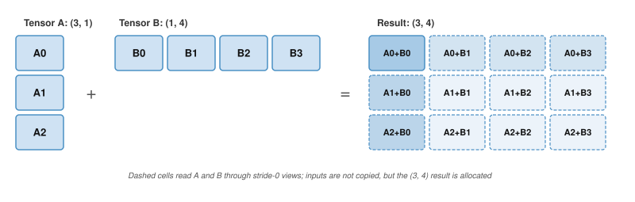

# Algorithm Foundations {#sec-appdx-algorithm-foundations dropcap="chapter-opening"}

A profile showing low utilization is often misdiagnosed as a hardware limit when the cause is algorithmic: a matrix multiply shape that wastes Tensor Cores, a layout that breaks contiguity, or activation memory held for backpropagation. This appendix collects the computational complexity models, memory footprint derivations, numerical-stability rules, and proofs that the book's performance chapters lean on, enabling readers to evaluate algorithmic trade-offs before committing code to accelerators. It assumes familiarity with linear algebra and with the iron law introduced early in the book.

## How to Use This Appendix {.unnumbered}

This appendix is designed as a reference. Reach for it when translating a profiler symptom ("slow matmul," "shape mismatch," "OOM during training") into a concrete computational or memory cause. Each symptom or need maps to one section (@tbl-appdx-algorithm-lookup). Every section names the chapter that teaches its concept in context; the chapter carries the argument, and this appendix carries the derivation or the reference formula.

Conventions used here follow the book-wide notation (for example, $\BatchSize$ is reserved for batch size and $\Bandwidth$ denotes bandwidth).

| **Symptom or need**                                                   | **Section**                                                        |
|:----------------------------------------------------------------------|:-------------------------------------------------------------------|
| A general matrix multiply (GEMM) runs far below peak throughput        | @sec-appdx-algorithm-foundations-general-matrix-multiply-gemm-b55d  |
| Sparsity is proposed to save memory or compute                         | @sec-appdx-algorithm-foundations-sparse-matrix-formats-0bd0         |
| A layer's parameters and FLOPs are needed before hardware is chosen    | @sec-appdx-algorithm-foundations-computational-complexity-cheat-sheet-0c6c |
| Tensor code fails on shape or contiguity, or a copy dominates a loop   | @sec-appdx-algorithm-foundations-shapes-strides-1aea                |
| A broadcast allocates a much larger tensor than intended               | @sec-appdx-algorithm-foundations-broadcasting-ec16                  |
| Gradients look wrong, or the backward pass costs more than expected    | @sec-appdx-algorithm-foundations-backpropagation-algorithm-93f7     |
| Training runs out of memory                                            | @sec-appdx-algorithm-foundations-true-cost-training-memory-e54e     |
| A chain of elementwise operations is memory bound                      | @sec-appdx-algorithm-foundations-operator-fusion-5d73               |
| Softmax overflows, or the loss becomes NaN in reduced precision        | @sec-appdx-data-foundations-logits-numerical-stability-13e2         |
| A bound on gradient cost relative to the forward pass                  | @sec-appdx-algorithm-baur-strassen                                  |
| Attention memory or traffic grows with sequence length                 | @sec-appdx-algorithm-flash-attention                                |
| A compute budget must be split between parameters and training tokens  | @sec-appdx-algorithm-chinchilla-derivation                          |

: **Where to Look**: Each row pairs a profiler symptom or a design question with the section that carries its derivation or reference formula. {#tbl-appdx-algorithm-lookup tbl-colwidths="[55,45]"}

```{=latex}
\vspace*{-0.5ex}
```
These foundations support the deep learning treatment in @sec-neural-computation, the framework internals in @sec-ml-frameworks, and the training strategies in @sec-model-training.

```{=latex}
\vspace*{-1ex}
```

## Linear Algebra {#sec-appdx-algorithm-foundations-linear-algebra-c937}

Most of the compute in a deep learning system is matrix multiplication. Frameworks such as PyTorch hide the raw math, but performance engineering still depends on the underlying linear algebra. Building on how numbers are stored in @sec-appdx-machine-foundations-numerical-representations-c889, this section focuses on how they are manipulated.

```{=latex}
\vspace*{-1ex}
```
::: {#psp-appendix-algorithm-linear-algebra-matters .callout-perspective title="Why this matters"}

Many dense neural networks, especially transformers and large convolutional neural networks, spend most compute in matrix multiplication or GEMM-like kernels. A self-attention block performs the Q, K, V, and output projection GEMMs plus two attention matrix multiplications: one for the attention scores and one for the attention-weighted values. The layer's feed-forward block adds more GEMMs. Understanding GEMM performance characteristics explains why batch size affects throughput, why certain layer dimensions are "better" than others, and how to interpret profiler output. Reasoning about matrix dimensions and arithmetic intensity predicts whether a dense workload is compute bound or memory bound before any profiler trace runs.

:::

### Tensor operations and einsum notation {#sec-appdx-algorithm-foundations-tensor-operations-notation-2758}

Einstein summation[^fn-einsum-tensor-contraction] notation makes tensor contractions explicit throughout this book (implemented as `torch.einsum` in PyTorch and `np.einsum` in NumPy). Matrix multiplication $\GemmOutputMatrix= \GemmLeftOperand\GemmRightOperand$ becomes:
$$ \GemmOutputEntry = \sum_k \GemmLeftOperandEntry \GemmRightOperandEntry $$

[^fn-einsum-tensor-contraction]: **Einstein summation convention**\index{Einstein summation convention!definition}: Repeated indices in a product are implicitly summed over, eliminating explicit summation signs. ML frameworks adopted the convention because it concisely expresses arbitrary tensor contractions in a single string.

In einsum notation, this is `ik,kj->ij`. The same notation handles batched multi-head attention, `bhid,bhjd->bhij` (batch $\BatchAxisLabel$, head $\HeadAxisLabel$, query sequence $\QueryAxisLabel$, key sequence $\KeyAxisLabel$, and head dimension $\HeadDimensionAxisLabel$). The head dimension $\HeadDimensionAxisLabel$ appears in both inputs but not in the output, so it is the index that is summed.

### The dot product as similarity {#sec-appdx-algorithm-foundations-dot-product-similarity-7957}

The dot product\index{Dot product!appendix refresher} $\InnerProductLeftVector\cdot \InnerProductRightVector= \sum \InnerProductLeftComponent_i \InnerProductRightComponent_i$ is geometrically equivalent to $\|\InnerProductLeftVector\| \|\InnerProductRightVector\| \cos \VectorAngle$, which makes it a natural measure of similarity between two vectors: for nonzero vectors, its sign distinguishes acute, right, and obtuse angles, while its magnitude also depends on both vector norms.

In attention mechanisms, query ($\AttentionQueryMatrix$) and key ($\AttentionKeyMatrix$) vectors are dot-produced to compute a similarity score that determines how much each token attends to every other token. The resulting attention weights are then used to form a weighted combination of value ($\AttentionValuesMatrix$) vectors, so every token can draw on every other token. @Sec-network-architectures-attention-mechanisms-dynamic-pattern-processing-22df develops attention itself, including the cost of computing one score for every query-key pair.

### General matrix multiply (GEMM) {#sec-appdx-algorithm-foundations-general-matrix-multiply-gemm-b55d}

Most training and inference FLOPs are GEMMs[^fn-gemm-blas-routines]. For matrices of size $\GemmRowDimension{\times}\GemmInnerDimension$ and $\GemmInnerDimension{\times}\GemmColumnDimension$, GEMM performs $2\GemmRowDimension \GemmColumnDimension \GemmInnerDimension$ floating-point operations (multiply-accumulate counts as two operations).

[^fn-gemm-blas-routines]: **General matrix multiply (GEMM)**\index{GEMM!appendix refresher}: The BLAS (Basic Linear Algebra Subprograms) family began with vector routines standardized in 1979 [@lawson1979]; GEMM was standardized later as a Level 3 routine [@dongarra1988]. The "GE" prefix stands for "general," as opposed to symmetric or triangular forms. GEMM computes $\GemmOutputMatrix= \GemmProductScale\GemmLeftOperand\GemmRightOperand+ \GemmAccumulatorScale\GemmOutputMatrix$ and is a performance-critical routine in deep learning. @Sec-model-training-matrix-operations-1f21 explains how GEMM shapes determine training throughput.

```{python}
#| echo: false
from mlsysim import *
from mlsysim.core.units import *

# ┌── LEGO ───────────────────────────────────────────────
# │ Context: @sec-appdx-algorithm-foundations-general-matrix-multiply-gemm-b55d
# │ Goal: GEMM intensity formula and small-matrix roofline example
from mlsysim.fmt import fmt_int, fmt, check, fmt_arithmetic_intensity, fmt_display_math

class GemmIntensityExample:
    # ┌── 1. LOAD (Constants) ──────────────────────────────────────────────
    n_small = 64

    # ┌── 2. EXECUTE (The Compute) ────────────────────────────────────────
    bytes_fp16 = int(BYTES_FP16.to(byte).magnitude)
    small_intensity = n_small / 3
    h100_ridge = int(
        Hardware.Cloud.H100.compute.peak_flops.to(TFLOPs / second).magnitude / Hardware.Cloud.H100.memory.bandwidth.to(TB / second).magnitude
    )
    small_efficiency_pct = small_intensity / h100_ridge * 100

    # ┌── 3. GUARD (Invariants) ──────────────────────────────────────────
    check(h100_ridge > 150, f"H100 ridge point ({h100_ridge}) unexpectedly low.")

    # ┌── 4. OUTPUT (Formatting) ─────────────────────────────────────────────
    bytes_fp16_value_str = fmt_int(bytes_fp16, commas=False)
    n_small_str = fmt(n_small, precision=0, commas=False)
    small_intensity_str = fmt_arithmetic_intensity(small_intensity * flop / byte, unit=flop / byte, precision=1, commas=False)
    small_efficiency_pct_str = fmt_percent(small_efficiency_pct / 100, precision=1, commas=False, style='prose')
    h100_ridge_str = fmt_arithmetic_intensity(Hardware.Cloud.H100.ridge_point(), unit=flop / byte, precision=1, commas=False)
    intensity_formula_math = fmt_display_math(
        rf"\text{{Intensity}} = \frac{{\Operations}}{{\DataVolume}} = "
        rf"\frac{{2\SquareGemmDimension^3}}{{3\SquareGemmDimension^2 \times {bytes_fp16_value_str}}} = "
        rf"\frac{{\SquareGemmDimension}}{{3}}\text{{ FLOP/byte}}"
    )
```

The arithmetic intensity\index{Arithmetic intensity!appendix refresher} of GEMM scales linearly with matrix dimension. For square $\SquareGemmDimension{\times}\SquareGemmDimension$ matrices in FP16 (`{python} GemmIntensityExample.bytes_fp16_value_str` bytes/element), the ideal $\GemmAccumulatorScale=0$ bound reads $\GemmLeftOperand$ and $\GemmRightOperand$ once and writes $\GemmOutputMatrix$ once:
`{python} GemmIntensityExample.intensity_formula_math`

Reading the old $\GemmOutputMatrix$ when $\GemmAccumulatorScale\ne 0$ changes the intensity to $\SquareGemmDimension/4$ FLOP/byte. Three consequences follow for GEMM execution:

- **Larger batches can improve efficiency**: Batching increases effective matrix dimensions when it forms larger GEMMs or enables reuse; merely queuing independent small GEMMs does not raise intensity.
- **Aligned dimensions help**: Hardware Tensor Cores are optimized for precision- and architecture-specific tile multiples. Dimensions that align with these multiples avoid padding overhead and improve kernel efficiency, but they do not need to be powers of two.
- **Small matrices are inefficient**: A square GEMM with $\SquareGemmDimension =$ `{python} GemmIntensityExample.n_small_str` has intensity `{python} GemmIntensityExample.n_small_str`/3 ≈ `{python} GemmIntensityExample.small_intensity_str`, well below the ridge point of the book's reference accelerator, the H100 (`{python} GemmIntensityExample.h100_ridge_str`). Its roofline cap is ~`{python} GemmIntensityExample.small_efficiency_pct_str` of peak; launch and tiling overhead can lower realized throughput. @Sec-hardware-acceleration-roofline-model-42ff derives the ridge point and the compute-bound and bandwidth-bound regimes on either side of it, which is the comparison each of these consequences relies on.

### Sparse matrix formats {#sec-appdx-algorithm-foundations-sparse-matrix-formats-0bd0}

When most elements in a matrix are zero, specialized storage formats avoid wasting memory on zeros and enable computations that skip them entirely. The **compressed sparse row (CSR)**\index{Compressed sparse row!appendix refresher} format uses three arrays:

- `Values`: The nonzero elements, stored in row order
- `Col_Idx`: The column index of each nonzero element
- `Row_Ptr`: The starting position in `Values` for each row (length = num_rows + 1)

CSR is useful for sparse feature matrices in recommendation pipelines and for pruned model weights. For a matrix with $\SparseMatrixEntryCount$ elements, $\SparseMatrixRowCount$ rows, and $\NonzeroCount$ nonzeros, CSR uses $\mathcal{O}(\NonzeroCount+ \SparseMatrixRowCount)$ storage instead of $\mathcal{O}(\SparseMatrixEntryCount)$; when $\NonzeroCount$ is large relative to $\SparseMatrixRowCount$, this is often summarized as $\mathcal{O}(\NonzeroCount)$.

```{python}
#| echo: false
#| label: sparse-embedding-example
# ┌── LEGO ───────────────────────────────────────────────
# │ Context: @sec-appdx-algorithm-foundations-sparse-matrix-formats-0bd0 embedding example
# │ Goal: Dense vs sparse vocabulary embedding footprint at 1% density
from mlsysim.fmt import fmt_int, fmt, fmt_count, fmt_magnitude, fmt_memory, fmt_percent

class SparseEmbeddingExample:
    # ┌── 1. LOAD (Constants) ──────────────────────────────────────────────
    vocab_size = 100 * THOUSAND
    embed_dim = 10 * THOUSAND
    sparsity_pct = 1

    # ┌── 2. EXECUTE (The Compute) ────────────────────────────────────────
    total_elements = vocab_size * embed_dim
    dense_bytes_q = total_elements * BYTES_FP32
    dense_bytes = dense_bytes_q.to(byte).magnitude
    nonzeros = int(total_elements * sparsity_pct / 100)
    csr_bytes_per_nonzero_q = BYTES_FP32 + BYTES_INT32
    csr_bytes_per_nonzero = csr_bytes_per_nonzero_q.to(byte).magnitude
    sparse_bytes_q = nonzeros * csr_bytes_per_nonzero_q + (vocab_size + 1) * BYTES_INT32
    sparse_bytes = sparse_bytes_q.to(byte).magnitude
    reduction_factor = round(dense_bytes / sparse_bytes)

    # ┌── 3. GUARD (Invariants) ──────────────────────────────────────────
    check(sparse_bytes == 80_400_004, f"CSR footprint should include row pointers, got {sparse_bytes} bytes.")

    # ┌── 4. OUTPUT (Formatting) ─────────────────────────────────────────────
    vocab_size_str = fmt(vocab_size, precision=0)
    embed_dim_str = fmt(embed_dim, precision=0)
    total_elements_str = fmt_count(total_elements, scale="B", commas=False)
    dense_gb_str = fmt_memory(dense_bytes_q, unit=GB, precision=0, commas=False)
    nonzeros_str = fmt_count(nonzeros, scale="M", commas=False)
    sparse_mb_str = fmt_memory(sparse_bytes_q, unit=MB, precision=1, commas=False)
    bytes_fp32_value_str = fmt_magnitude(BYTES_FP32, unit=byte, precision=0, commas=False)
    bytes_int32_value_str = fmt_magnitude(BYTES_INT32, unit=byte, precision=0, commas=False)
    sparsity_pct_str = fmt_percent(sparsity_pct / 100, precision=0, commas=False, style='prose')
    reduction_factor_mult_str = fmt_multiple(reduction_factor, precision=0, commas=False)
```

To see the trade-off concretely, consider a vocabulary embedding matrix with `{python} SparseEmbeddingExample.vocab_size_str` rows and `{python} SparseEmbeddingExample.embed_dim_str` columns (`{python} SparseEmbeddingExample.total_elements_str` parameters):

*   **Dense (FP32)**: `{python} SparseEmbeddingExample.total_elements_str` parameters $\times$ `{python} SparseEmbeddingExample.bytes_fp32_value_str` bytes each = `{python} SparseEmbeddingExample.dense_gb_str`.
*   **Sparse** (`{python} SparseEmbeddingExample.sparsity_pct_str` density): CSR stores roughly `{python} SparseEmbeddingExample.nonzeros_str` entries $\times$ (`{python} SparseEmbeddingExample.bytes_fp32_value_str`-byte value + `{python} SparseEmbeddingExample.bytes_int32_value_str`-byte column index), plus one row pointer per row and a final pointer, totaling ≈ `{python} SparseEmbeddingExample.sparse_mb_str`.
*   **Result**: A `{python} SparseEmbeddingExample.reduction_factor_mult_str` reduction in memory footprint, fitting a model that would otherwise trigger an out-of-memory (OOM) error.

The saving holds only at low density. Each stored nonzero carries its index, so at high density CSR occupies more memory than the dense tensor it replaces. @Sec-model-compression-sparse-break-even-7e4a finds that break-even density for pruned weights, and @sec-hardware-acceleration-nm-structured-sparsity-mechanics-9a71 shows the fixed pattern of two nonzeros in every four that an accelerator datapath decodes without a general index.

### Operation cost reference {#sec-appdx-algorithm-foundations-computational-complexity-cheat-sheet-0c6c}

Each common layer type reduces to the GEMMs and elementwise operations above, so its parameter count and forward-pass FLOPs follow from its shapes (@tbl-tensor-op-ref). Given layer dimensions and input shapes, the formulas give first-order estimates of model size and compute before hardware is provisioned. The attention row is the one to watch. Sequence length contributes an $\SequenceLength^2$ term, while hidden dimension contributes $\HiddenDimension^2$ projection work, so long-context models can shift the dominant cost without changing the parameter count.

```{=latex}
\begingroup
\renewcommand{\arraystretch}{1.6}
```

| **Layer type**                |                                  **Output shape**                                  |                                      **Parameters ($\Parameters$)**                                     |                                                               **FLOPs (per forward pass)**                                                              |
|:------------------------------|:----------------------------------------------------------------------------------:|:-------------------------------------------------------------------------------------------------------:|:-------------------------------------------------------------------------------------------------------------------------------------------------------:|
| **Linear**                    |                         $(\BatchSize, \LayerOutputWidth)$                          |            $\LayerInputWidth \times \LayerOutputWidth + \LayerOutputWidth$ if bias is enabled           |                                          $2 \times \BatchSize\times \LayerInputWidth \times \LayerOutputWidth$                                          |
| **Conv2D**                    | $(\BatchSize, \LayerOutputWidth, \OutputFeatureMapHeight, \OutputFeatureMapWidth)$ | $\KernelSize^2 \times \LayerInputWidth \times \LayerOutputWidth + \LayerOutputWidth$ if bias is enabled | $2 \times \BatchSize\times \OutputFeatureMapHeight \times \OutputFeatureMapWidth \times \KernelSize^2 \times \LayerInputWidth \times \LayerOutputWidth$ |
| **Multi-head self-attention** |                 $(\BatchSize, \SequenceLength, \HiddenDimension)$                  |     $4 \times \HiddenDimension^2$, plus $4 \times \HiddenDimension$ if projection biases are enabled    |                             $\BatchSize\times (4 \SequenceLength^2 \HiddenDimension+ 8 \SequenceLength \HiddenDimension^2)$                             |
| **LayerNorm**                 |                 $(\BatchSize, \SequenceLength, \HiddenDimension)$                  |                     $2 \times \HiddenDimension$ if affine scale and bias are enabled                    |                                          $\mathcal{O}(\BatchSize\times \SequenceLength\times \HiddenDimension)$                                         |

: **Deep Learning Tensor Primitives**: Summary of shapes, parameters, and FLOP counts. Note: $\BatchSize$ is batch size, $\SequenceLength$ is sequence length, and $\KernelSize$ is kernel size. The attention FLOPs include QKV projections and score interactions. The $\SequenceLength^2$ term applies to full-sequence training and prefill, while KV-cached generation is linear per token in cached context; $\HiddenDimension^2$ projection work dominates at large hidden dimensions. {#tbl-tensor-op-ref tbl-colwidths="[13,18,36,33]"}

```{=latex}
\endgroup
```

Linear algebra specifies *what* to compute; the next question is *how* to express those computations in code.

## Tensor Programming Primitives {#sec-appdx-algorithm-foundations-tensor-programming-primitives-1400}

A shape mismatch crash, a silently wrong broadcast, and a kernel running at 5 percent of peak because of a noncontiguous tensor are common ML engineering failures, and all three trace back to the same layer of abstraction. *Tensor programming* translates the abstract math of linear algebra into concrete array manipulations that run on hardware.

### Shapes, strides, and memory layout {#sec-appdx-algorithm-foundations-shapes-strides-1aea}

A tensor\index{Tensor!appendix refresher} is a view over an underlying storage buffer, described by shape, stride, dtype, and offset metadata. Its shape specifies the dimensions of the tensor (for example, `(3, 4)`), while its stride defines the number of elements to skip in memory to move to the next element along each dimension. Only contiguous tensors lay their logical elements out as one adjacent block.

Operations like `transpose()` or `view()` often just change the strides, not the data in memory. This is fast ($\mathcal{O}(1)$) but can lead to noncontiguous tensors that fail in kernels requiring contiguous data. In such cases, calling `contiguous()` on a tensor of $\TensorElementCount$ elements forces an $\mathcal{O}(\TensorElementCount)$ memory copy that can dominate runtime if triggered repeatedly inside a loop.

The order of the strides is the tensor's memory layout. Row-major and column-major layouts of the same matrix differ only in which dimension has stride 1, and that choice directly affects cache efficiency: iterating along the stride-1 dimension touches contiguous memory locations, which is dramatically faster than strided access.

A common optimization pattern is to materialize a transposed tensor once before repeated operations to ensure contiguous access in the hot loop. The one-time copy cost is amortized across many subsequent operations. @Sec-ml-frameworks-tensor-structure-dimensions-4a14 introduces strides and layouts in the framework that manages them, and @sec-hardware-acceleration-memoryefficient-tensor-layouts-e250 shows how the layout choice (channels-last versus channels-first) changes accelerator throughput for convolutions.

### Broadcasting {#sec-appdx-algorithm-foundations-broadcasting-ec16}

**Broadcasting**\index{Broadcasting!definition} allows arithmetic operations on tensors of different shapes by comparing dimensions from right to left. Two dimensions are compatible when they are equal or when one of them is 1.

Adding a $(3, 1)$ column tensor ($\BroadcastColumnTensor$) to a $(1, 4)$ row tensor ($\BroadcastRowTensor$) expands both virtually across their complementary singleton dimensions and generates a $(3, 4)$ matrix of pairwise sums $\BroadcastColumnElement_i + \BroadcastRowElement_j$ (@fig-broadcasting-rules). Dashed cell boundaries mark result elements whose operands are read through stride-0 views, so neither input is copied; only the $(3, 4)$ output is allocated, and hardware repeatedly accesses identical input buffer addresses.

::: {#fig-broadcasting-rules fig-env="figure" fig-pos="htb" fig-cap="**Tensor Broadcasting Rules**: A (3,1) column and a (1,4) row broadcast across complementary dimensions, producing the pairwise sums in a (3,4) result." fig-alt="Tensor A, a three-cell column labeled A0 through A2 with shape (3,1), plus tensor B, a four-cell row labeled B0 through B3 with shape (1,4), equals a (3,4) grid whose cells contain every Ai+Bj pair. Dashed cells and an annotation indicate that A and B are read through stride-0 views, so the inputs are not copied while the (3,4) result is allocated."}

:::

Consider a concrete case: tensor A has shape `(32, 1, 64)` and tensor B has shape `(1, 128, 64)`. Comparing dimensions right to left, 64 matches 64, then 1 stretches to 128, then 1 stretches to 32, yielding result shape `(32, 128, 64)`. Writing out the expanded shape before running catches silent logic bugs that accidentally allocate a large tensor (for example, a `(Batch, Batch)` matrix instead of an element-wise `(Batch)` vector).

Shapes, strides, and broadcasting govern how tensors flow through a model's forward pass. Training adds a second requirement, computing how much each parameter contributed to the error. Backpropagation meets that requirement and imposes the memory costs quantified in the training-memory decomposition below.

## Mechanics of Learning {#sec-appdx-algorithm-foundations-mechanics-learning-24f6}

This section follows the resulting gradient signal from the chain rule through backpropagation to the memory it holds, the graphs that compilers optimize, and the numerically stable softmax at the loss.

::: {#psp-appendix-algorithm-backpropagation-matters .callout-perspective title="Why this matters"}

When training fails (loss goes to NaN, gradients explode, or memory runs out), understanding what backpropagation actually does is essential for diagnosing the problem. The backward graph supplies the mental model for reasoning about gradient flow and memory usage during training.

:::

### The chain rule and automatic differentiation {#sec-appdx-algorithm-foundations-chain-rule-automatic-differentiation-e0eb}

For a composed function $\ComposedFunctionOutput= \LayerFunction(\InnerLayerFunction(\ComposedFunctionInput))$, the derivative is $\frac{d\ComposedFunctionOutput}{d\ComposedFunctionInput} = \frac{d\ComposedFunctionOutput}{d\InnerLayerFunction} \cdot \frac{d\InnerLayerFunction}{d\ComposedFunctionInput}$. In a neural network, $\LayerFunction$ and $\InnerLayerFunction$ are layers, and the composition can be many levels deep. For a three-layer network $\ComposedFunctionOutput= \LayerFunction_3(\LayerFunction_2(\LayerFunction_1(\ComposedFunctionInput)))$, the chain rule\index{Chain rule!appendix refresher} extends to:
$$ \frac{\partial \ComposedFunctionOutput}{\partial \ComposedFunctionInput} = \frac{\partial \LayerFunction_3}{\partial \LayerFunction_2} \cdot \frac{\partial \LayerFunction_2}{\partial \LayerFunction_1} \cdot \frac{\partial \LayerFunction_1}{\partial \ComposedFunctionInput} $$

Each factor in this product is a local derivative, computed at one layer using only that layer's inputs and outputs. This locality keeps the bookkeeping cheap: the entire network never needs to be differentiated as a monolithic function. Instead, each layer computes its own local derivative during the backward pass and multiplies it by the gradient flowing in from the layer above.

Modern frameworks use reverse-mode automatic differentiation\index{Automatic differentiation!appendix refresher}, which computes gradients for all $\Parameters$ parameters in a single backward pass. Starting from the output and working backward (reverse mode) requires one pass regardless of the number of parameters, whereas starting from each input and working forward (forward mode) would require $\Parameters$ passes, one per parameter. This is why a training step is a small constant multiple of inference, commonly about 2–3$\times$ a forward pass for dense networks, rather than $\Parameters$ passes. @Sec-ml-frameworks-forward-reverse-mode-differentiation-f70a shows how frameworks implement both modes and why training uses reverse mode.

### The backpropagation algorithm {#sec-appdx-algorithm-foundations-backpropagation-algorithm-93f7}

Backpropagation[^fn-backprop-chain-rule] implements the chain rule efficiently through two passes: forward to compute outputs, backward to compute gradients. The gradient edges retrace forward dependencies, meaning each backward step requires intermediate activations retained from the corresponding forward operation. @Fig-backprop-graph traces these dual dataflow passes across a two-layer network: solid gray arrows stage forward activations ($\InputFeatureVector\to \HiddenActivation\to \PredictedOutput$) through weight parameters $\WeightMatrix_1$ and $\WeightMatrix_2$ to evaluate loss $\LossFunction$, while curved dashed red arrows propagate intermediate adjoints ($\frac{\partial \LossFunction}{\partial \PredictedOutput}, \frac{\partial \LossFunction}{\partial \HiddenActivation}, \frac{\partial \LossFunction}{\partial \InputFeatureVector}$) in reverse order.

[^fn-backprop-chain-rule]: **Backpropagation**\index{Backpropagation!appendix refresher}: Short for "backward propagation of errors." The algorithm was independently discovered multiple times, by @werbos1974beyond and @linnainmaa1970representation for reverse-mode differentiation and by @rumelhart1986 for neural network training. Its key insight is that computing gradients for all parameters requires one backward pass through the graph rather than one pass per parameter. @Sec-appdx-algorithm-baur-strassen derives the constant-factor work bound and a representative dense-layer cost.

::: {#fig-backprop-graph fig-env="figure" fig-pos="htb" fig-cap="**Backpropagation Computational Graph**: Solid gray arrows carry the forward computation from input $\InputFeatureVector$ to loss $\LossFunction$, while dashed red arrows carry gradients backward along the same dependencies." fig-alt="A computational graph with four nodes labeled x, h, y-hat, and a calligraphic L denoting loss, connected left to right. Solid gray arrows show the forward pass with weights W1 and W2. Dashed red arrows curve backward showing gradient flow with partial derivative notation."}
```{.tikz}
\begin{tikzpicture}[font=\small\sffamily, node distance=3cm, auto, >=stealth, thick]
  \tikzset{
    Node/.style={circle, draw=BlueLine, fill=BlueFill, line width=0.8pt, minimum size=0.9cm, text=TextBlack},
    Edge/.style={->, draw=GrayLine, line width=0.8pt},
    BackEdge/.style={->, dashed, draw=RedLine, line width=0.8pt, bend right=30},
    Label/.style={font=\footnotesize\sffamily, text=TextBlack}
  }
  \node[Node] (x) {$\mathbf{x}$};
  \node[Node, right of=x] (h) {$\mathbf{h}$};
  \node[Node, right of=h] (y) {$\hat{\mathbf{y}}$};
  \node[Node, right of=y, fill=RedLine!10, draw=RedLine] (L) {$\mathcal{L}$};
  \draw[Edge] (x) -- node[below, Label] {$\mathbf{W}_1$} (h);
  \draw[Edge] (h) -- node[below, Label] {$\mathbf{W}_2$} (y);
  \draw[Edge] (y) -- node[below, Label] {Loss} (L);
  \draw[BackEdge,overlay] (L) to node[above, Label, text=RedLine] {$\frac{\partial \mathcal{L}}{\partial \hat{\mathbf{y}}}$} (y);
  \draw[BackEdge,overlay] (y) to node[above, Label, text=RedLine] {$\frac{\partial \mathcal{L}}{\partial \mathbf{h}}$} (h);
  \draw[BackEdge,overlay] (h) to node[above, Label, text=RedLine] {$\frac{\partial \mathcal{L}}{\partial \mathbf{x}}$} (x);
 \path[use as bounding box] (-0.5,-0.55) rectangle (9.5,1.21);
\end{tikzpicture}
```
:::

#### Forward pass {.unnumbered}

Using row-vector activations, omitting biases, and retaining intermediate activations for backward execution, computation begins at input $\InputFeatureVector$. Multiplying $\InputFeatureVector$ by weight matrix $\WeightMatrix_1$ yields hidden activation $\HiddenActivation$, which the execution runtime caches for backward differentiation. Multiplying $\HiddenActivation$ by $\WeightMatrix_2$ produces network output $\PredictedOutput$, which is similarly cached. Finally, comparing $\PredictedOutput$ to the target label produces scalar loss $\LossFunction$.

At this point, forward evaluation is complete, and memory holds input $\InputFeatureVector$, cached activation $\HiddenActivation$, cached prediction $\PredictedOutput$, and loss $\LossFunction$. For large models, these retained activation tensors frequently dominate overall memory consumption.

#### Backward pass {.unnumbered}

Gradient propagation begins backward from scalar loss $\LossFunction$. The loss function evaluates $\frac{\partial \LossFunction}{\partial \PredictedOutput}$, the error gradient with respect to the network prediction, which starts the backward pass.

Because $\PredictedOutput = \HiddenActivation\cdot \WeightMatrix_2$, the matrix chain rule yields two gradients at this layer:
$$ \frac{\partial \LossFunction}{\partial \WeightMatrix_2} = \HiddenActivation^T \cdot \frac{\partial \LossFunction}{\partial \PredictedOutput} \qquad \text{(weight gradient—used to update } \WeightMatrix_2\text{)} $$
$$ \frac{\partial \LossFunction}{\partial \HiddenActivation} = \frac{\partial \LossFunction}{\partial \PredictedOutput} \cdot \WeightMatrix_2^T \qquad \text{(input gradient—passed backward to the previous layer)} $$

Computing $\frac{\partial \LossFunction}{\partial \WeightMatrix_2}$ requires cached activation $\HiddenActivation$ from the forward pass. Activations must remain resident in memory because every layer's weight gradient depends directly on that layer's input.

Continuing backward to the first layer, the linear relationship $\HiddenActivation= \InputFeatureVector\cdot \WeightMatrix_1$ produces:
$$ \frac{\partial \LossFunction}{\partial \WeightMatrix_1} = \InputFeatureVector^T \cdot \frac{\partial \LossFunction}{\partial \HiddenActivation} $$

Each backward step requires two operands: the gradient flowing in from downstream layers $\left(\frac{\partial \LossFunction}{\partial \HiddenActivation}\right)$ and that layer's cached input ($\InputFeatureVector$). Consequently, the backward pass requires roughly 2$\times$ the forward pass FLOPs: each layer executes two matrix multiplications (one for the parameter gradient, one for the upstream activation gradient) rather than one. @Sec-neural-computation-gradient-computation-backpropagation-dacf teaches the algorithm step by step on a running network. The cached inputs that every backward step needs are the reason training memory exceeds model size, which the next section quantifies.

### Training memory {#sec-appdx-algorithm-foundations-true-cost-training-memory-e54e}

A common mistake is to assume that training memory equals model size. This assumption leads to immediate OOM errors because weights are only one of four components. Training memory\index{Training!memory decomposition} comprises weights, gradients, optimizer state, and retained activations:
$$ \TotalMemoryFootprint = \WeightMemory + \GradientMemory + \OptimizerStateMemory + \ActivationMemory $$

For a standard Adaptive Moment Estimation (Adam) optimizer [@kingma2014adam] in mixed precision [@micikevicius2017mixed]:

```{python}
#| echo: false
#| label: training-memory-bytes
# ┌── LEGO ───────────────────────────────────────────────
# │ Context: @sec-appdx-algorithm-foundations-true-cost-training-memory-e54e
# │ Goal: Per-parameter byte counts for mixed-precision Adam training
from mlsysim.fmt import fmt_int, fmt, fmt_memory, fmt_range

class TrainingMemoryBytes:
    # ┌── 4. OUTPUT (Formatting) ─────────────────────────────────────────────
    bytes_fp16_str = fmt_memory(BYTES_FP16, unit=byte, precision=0, commas=False)
    bytes_fp32_str = fmt_memory(BYTES_FP32, unit=byte, precision=0, commas=False)
    _optimizer_overhead_min = int(BYTES_ADAM_STATE.to(byte).magnitude)
    _optimizer_overhead_max = _optimizer_overhead_min + int(BYTES_FP32.to(byte).magnitude)
    optimizer_overhead_min_str = fmt(_optimizer_overhead_min, precision=0, commas=False)
    optimizer_overhead_str = fmt_range(_optimizer_overhead_min, _optimizer_overhead_max, precision=0, commas=False)

TrainingMemoryBytes.optimizer_overhead_min = TrainingMemoryBytes._optimizer_overhead_min
TrainingMemoryBytes.optimizer_overhead_max = TrainingMemoryBytes._optimizer_overhead_max
```

*   **Weights**: `{python} TrainingMemoryBytes.bytes_fp16_str` (FP16/BF16) or `{python} TrainingMemoryBytes.bytes_fp32_str` (FP32).
*   **Gradients**: Same size as weights.
*   **Optimizer State**: Adam moments require `{python} TrainingMemoryBytes.optimizer_overhead_min_str` bytes per parameter; an FP32 master copy adds another `{python} TrainingMemoryBytes.bytes_fp32_str`, giving `{python} TrainingMemoryBytes.optimizer_overhead_str` bytes per parameter.
*   **Activations**: Activations typically dominate the dynamic memory footprint during training. A recomputation- or tiled-attention-friendly estimate scales as $\mathcal{O}(\BatchSize\times \SequenceLength\times \LayerCount \times \HiddenDimension)$; a full no-recompute attention implementation also materializes attention-score tensors that scale with $\SequenceLength^2$.

To see how these components interact in practice, consider a concrete model.

```{python}
#| echo: false
#| label: gpt2-training-memory
# ┌─────────────────────────────────────────────────────────────────────────────
# │ GPT-2 XL TRAINING MEMORY BREAKDOWN
# ├─────────────────────────────────────────────────────────────────────────────
# │ Context: Callout "Worked Example: GPT-2 (1.5B) Training Memory",
# │          @sec-appdx-algorithm-foundations-true-cost-training-memory-e54e
# │
# │ Goal:    Compute memory breakdown (weights, gradients, optimizer, activations).
# │ Show:    Per-component GB and total for two batch sizes.
# │ How:     Scalar arithmetic from pint constants.
# │
# └─────────────────────────────────────────────────────────────────────────────
from mlsysim.fmt import fmt_int, fmt, fmt_ratio, check, sci_latex, fmt_math, fmt_display_math, fmt_percent, fmt_memory, fmt_memory_capacity
from mlsysim.core.units import GiB, GB
from mlsysim.physics import calc_activation_memory

class GPT2TrainingMem:
    # ┌── 1. LOAD ──────────────────────────────────────────
    P = Models.Language.GPT2.parameters.to(param).magnitude
    layers = Models.Language.GPT2.layers
    d = Models.Language.GPT2.hidden_dim
    bf16 = int(BYTES_FP16.to(byte).magnitude)
    fp32 = int(BYTES_FP32.to(byte).magnitude)
    accel_q = Hardware.Cloud.H100.memory.capacity
    batch_small = 8
    batch_large = 64
    seq_len = 1024
    optimizer_bytes_per_param = int((BYTES_ADAM_STATE + BYTES_FP32).to(byte).magnitude)  # FP32 master + momentum + variance

    # ┌── 2. EXECUTE ───────────────────────────────────────
    weights_q = P * bf16 * byte
    grads_q = P * bf16 * byte
    optim_q = P * optimizer_bytes_per_param * byte
    model_state_q = weights_q + grads_q + optim_q
    remaining_q = accel_q - model_state_q

    # Per-layer retained activation estimate excluding full S^2 attention-score storage:
    # input(1d) + QKV(3d) + attn_out(1d) + FFN(4d) + output(1d) + norms/masks(2d)
    act_factor = 12
    act_small_q = layers * act_factor * batch_small * seq_len * d * bf16 * byte
    total_small_q = model_state_q + act_small_q

    act_large_q = layers * act_factor * batch_large * seq_len * d * bf16 * byte
    act_per_sample_q = layers * act_factor * seq_len * d * bf16 * byte
    max_batch = int((remaining_q / act_per_sample_q).to("").magnitude)
    # Full per-layer count (Korthikanti et al.), the same model the training chapter uses
    full_per_sample_q = calc_activation_memory(layers, seq_len, 1, d, Models.Language.GPT2.heads, bf16, "selective")
    full_max_batch = int((remaining_q / full_per_sample_q).to("").magnitude)

    # ┌── 3. GUARD ─────────────────────────────────────────
    check(model_state_q < accel_q, "Model state must fit on accelerator")
    check(total_small_q < accel_q, "Small batch must fit on the accelerator")
    check(act_large_q > remaining_q, "Large batch should exceed remaining capacity")
    check(batch_small < max_batch < batch_large, "Crossover batch must sit between the two examples")
    check(20 <= full_max_batch < 32, f"Full count must match the training chapter's resident limit (20-31), got {full_max_batch}.")

    # ┌── 4. OUTPUT ────────────────────────────────────────
    P_math = fmt_math(sci_latex(P, precision=1))  # LaTeX-safe: 1.5 \times 10^{9} (avoids 1.5e+09)
    layers_str = fmt(layers, precision=0, commas=False)
    d_str = fmt(d, precision=0, commas=False)
    bf16_bytes_value_str = fmt(bf16, precision=0, commas=False)
    weights_gb_str = fmt_memory(weights_q, unit=GB, precision=0, commas=False)
    grads_gb_str = fmt_memory(grads_q, unit=GB, precision=0, commas=False)
    optim_bytes_value_str = fmt(optimizer_bytes_per_param, precision=0, commas=False)
    optim_gb_str = fmt_memory(optim_q, unit=GB, precision=0, commas=False)
    model_state_gb_str = fmt_memory(model_state_q, unit=GB, precision=0, commas=False)
    # the sentence glosses this as "in decimal units", so it must be the
    # honest decimal conversion, not the branded nameplate
    accel_gb_str = fmt_memory(accel_q, unit=GB, precision=1, commas=False)
    remaining_gb_str = fmt_memory(remaining_q, unit=GB, precision=1, commas=False)
    batch_small_str = fmt(batch_small, precision=0, commas=False)
    seq_len_str = fmt(seq_len, precision=0, commas=False)
    act_small_gb_str = fmt_memory(act_small_q, unit=GB, precision=1, commas=False)
    act_small_gb_value_str = fmt(act_small_q.to(GB).magnitude, precision=1, commas=False)
    total_small_gb_str = fmt_memory(total_small_q, unit=GB, precision=1, commas=False, approx=True)
    batch_large_str = fmt(batch_large, precision=0, commas=False)
    act_large_gb_str = fmt_memory(act_large_q, unit=GB, precision=1, commas=False, approx=True)
    act_factor_str = fmt_ratio(act_factor, precision=0, commas=False)
    act_per_sample_gb_str = fmt_memory(act_per_sample_q, unit=GB, precision=1, commas=False, approx=True)
    max_batch_str = fmt(max_batch, precision=0, commas=False)
    full_max_batch_str = fmt(full_max_batch, precision=0, commas=False)
    accel_class_gb_str = fmt_memory_capacity(accel_q, unit=GiB, precision=0, commas=False)
    grad_ckpt_overhead_pct_str = fmt_percent(33 / 100, precision=0, commas=False, style='prose')
    act_small_display_math = fmt_display_math(
        rf"{layers_str} \times {act_factor_str} \times {batch_small_str} \times {seq_len_str} \times "
        rf"{d_str} \times {bf16_bytes_value_str}\text{{ bytes }} \approx {act_small_gb_value_str}\text{{ GB}}"
    )
```

::: {#nbk-appendix-algorithm-gpt-2-training-memory .callout-notebook title="Worked example: GPT-2 (1.5B) training memory"}

**The model**: GPT-2 XL has $\Parameters=$ `{python} GPT2TrainingMem.P_math` parameters, `{python} GPT2TrainingMem.layers_str` layers, hidden dimension $\HiddenDimension=$ `{python} GPT2TrainingMem.d_str`.

**Model state (fixed per step)**:

- **Weights (BF16)**: `{python} GPT2TrainingMem.P_math` $\times$ `{python} GPT2TrainingMem.bf16_bytes_value_str` bytes = `{python} GPT2TrainingMem.weights_gb_str`
- **Gradients (BF16)**: `{python} GPT2TrainingMem.P_math` $\times$ `{python} GPT2TrainingMem.bf16_bytes_value_str` bytes = `{python} GPT2TrainingMem.grads_gb_str`
- **Optimizer (FP32 master + momentum + variance)**: `{python} GPT2TrainingMem.P_math` $\times$ `{python} GPT2TrainingMem.optim_bytes_value_str` bytes = `{python} GPT2TrainingMem.optim_gb_str`
- **Total model state**: `{python} GPT2TrainingMem.model_state_gb_str`, which fits on an `{python} GPT2TrainingMem.accel_class_gb_str`-class H100 (`{python} GPT2TrainingMem.accel_gb_str` in decimal units) but leaves only `{python} GPT2TrainingMem.remaining_gb_str` for activations.

**Activations (scale with batch)**:

Per-layer retained activations for this quick estimate are approximately $12 \times \BatchSize\times \SequenceLength\times \HiddenDimension$ BF16 elements, or $12 \times \BatchSize\times \SequenceLength\times \HiddenDimension\times 2$ bytes, where $\BatchSize$ is batch size and $\SequenceLength$ is sequence length. The factor twelve accounts for the major intermediate tensors retained for backpropagation: input activations, QKV projections ($3\HiddenDimension$), attention output, FFN intermediate ($4\HiddenDimension$), and layer norm/dropout masks. This estimate assumes the implementation does not retain the full $\BatchSize\times \AttentionHeadCount \times \SequenceLength^2$ attention-score tensor, as in recomputation- or tiled-attention-friendly accounting. With `{python} GPT2TrainingMem.layers_str` layers, batch size `{python} GPT2TrainingMem.batch_small_str`, and sequence length `{python} GPT2TrainingMem.seq_len_str`:

`{python} GPT2TrainingMem.act_small_display_math`

**Systems insight**: Total memory reaches `{python} GPT2TrainingMem.total_small_gb_str` under this activation-accounting convention, which fits on one `{python} GPT2TrainingMem.accel_gb_str` accelerator. Each additional sample adds `{python} GPT2TrainingMem.act_per_sample_gb_str` of activations, so under this quick estimate the remaining capacity fills near batch `{python} GPT2TrainingMem.max_batch_str`; at batch `{python} GPT2TrainingMem.batch_large_str`, activations grow to `{python} GPT2TrainingMem.act_large_gb_str`, well beyond it. The estimate omits smaller retained tensors such as dropout masks and softmax inputs. The full per-layer count of 34 bytes per token per hidden unit [@korthikanti2023activation] fills the same room near batch `{python} GPT2TrainingMem.full_max_batch_str`, the limit @sec-model-training-putting-together-gpt2-optimization-walkthrough-def7 works from. That crossover is the threshold where gradient checkpointing or another memory-saving method becomes necessary; its savings and recomputation overhead depend on checkpoint placement and implementation.

:::

#### Activation explosion {#sec-appdx-algorithm-foundations-activation-explosion-1da5}

While weights are fixed ($\mathcal{O}(\Parameters)$), activations grow linearly with batch size and at least linearly with sequence length; implementations that materialize attention scores add an $\mathcal{O}(\SequenceLength^2)$ component. Gradient checkpointing[^fn-gradient-checkpointing-memory] reduces this pressure by storing only selected activations and recomputing the rest during backpropagation [@chen2016training]; techniques such as FlashAttention address related attention-memory bottlenecks by tiling attention to reduce memory round-trips [@dao2022]. The same decomposition provides a quick feasibility check: sum the per-parameter model state, add the activation term implied by batch size and sequence length, and compare the total against the accelerator's capacity. @Sec-model-training-optimization-algorithms-c6a9 applies the model-state terms to optimizer choice, and @sec-model-training-backpropagation-mechanics-0b64 develops the activation term and the recomputation trade-off for the training loop.

[^fn-gradient-checkpointing-memory]: **Gradient checkpointing**\index{Gradient checkpointing!appendix refresher}: Trades compute for memory. Instead of storing all activations, only a subset (checkpoints) is kept, and the missing ones are recomputed during the backward pass. This reduces memory usage from storing every layer activation to roughly the square root of the layer count at the cost of ~33 percent more compute [@chen2016training].

### Computational graphs and optimization {#sec-appdx-algorithm-foundations-computational-graphs-optimization-ab43}

The dependency structure exposed by backpropagation also gives compilers something to optimize. ML compilers represent models as directed acyclic graphs (DAGs), and that representation enables hardware-independent transformations.

#### Static single assignment {#sec-appdx-algorithm-foundations-static-single-assignment-9e88}

Compilers transform graphs into static single-assignment (SSA) form\index{Static single assignment!appendix refresher}, where each variable is assigned exactly once. This makes data dependencies explicit, enabling safe optimizations, most notably operator fusion\index{Operator fusion!appendix refresher}.

#### Operator fusion {#sec-appdx-algorithm-foundations-operator-fusion-5d73}

Without fusion, each operation in a chain like `MatMul → Add (bias) → ReLU` produces an intermediate tensor that is written to HBM and then read back for the next operation. For elementwise operations like `Add` and `ReLU`, the compute is trivial (one FLOP per element) but the memory traffic is not (read the tensor, write it back). The arithmetic intensity of unfused elementwise operations is therefore close to zero, which makes them strongly memory bound.

Fusion combines consecutive operations into a single kernel that reads the input once, applies all operations in registers or shared memory, and writes the final result once. For a sequence of $\ChainedOperationCount$ elementwise operations on a tensor of $\TensorElementCount$ elements of $\ElementStorageSize$ bytes each, fusion reduces memory traffic from $2\ChainedOperationCount \TensorElementCount\ElementStorageSize$ bytes (each operation reads and writes) to $2\TensorElementCount\ElementStorageSize$ bytes (one read, one write), a $\ChainedOperationCount\times$ reduction. @Sec-ml-frameworks-execution-strategy-matters-memory-wall-1ce8 develops fusion as a framework decision, and @sec-hardware-acceleration-kernel-fusion-7faf shows the accelerator-side limits on how much a single kernel can fuse.

FlashAttention\index{FlashAttention!appendix refresher} is an I/O-aware tiled attention algorithm: it computes the score, softmax, and value-product stages in SRAM tiles without materializing the full attention matrix in HBM, reducing auxiliary attention memory from $\mathcal{O}(\SequenceLength^2)$ to $\mathcal{O}(\SequenceLength)$ for a fixed head dimension. HBM traffic also falls, with its reduction depending on head dimension and available SRAM capacity. The original work reports up to 3$\times$ wall-clock speedups on its evaluated workloads [@dao2022]; realized gains depend on shape and hardware. @Sec-appdx-algorithm-flash-attention derives the traffic bound step by step.

Fused and tiled kernels keep results exact while moving fewer bytes. The softmax at the end of the forward pass raises a different question, whether its results stay finite at all.

### Logits and numerical stability {#sec-appdx-data-foundations-logits-numerical-stability-13e2}

A classifier's forward pass ends in a softmax over the final layer's outputs, and the cross-entropy loss is computed from that softmax. The softmax exponentiates those outputs, and the exponential of a large output exceeds the range of every reduced-precision format, so the softmax is a common overflow site in reduced-precision training.

```{python}
#| echo: false
#| label: logit-overflow-example
# ┌── LEGO ───────────────────────────────────────────────
# │ Context: @sec-appdx-data-foundations-logits-numerical-stability-13e2
# │ Goal: Example logit value that overflows naive softmax
from mlsysim.fmt import fmt

class LogitOverflowExample:
    # ┌── 1. LOAD (Constants) ──────────────────────────────
    logit_val = 100

    # ┌── 4. OUTPUT (Formatting) ───────────────────────────
    logit_val_str = fmt(logit_val, precision=0, commas=False)
```

Neural-network classifiers commonly output a vector of *logits*\index{Logits!appendix refresher}[^fn-logit-unnormalized-score] $\LogitVector$ (unnormalized scores). For class index $\ClassIndex$, softmax\index{Softmax!appendix refresher} normalizes $\OutputLogit_{\ClassIndex}$ over all class indices $\NormalizingClassIndex$ to produce a probability:

$$ \text{Softmax}(\OutputLogit_{\ClassIndex}) = \frac{e^{\OutputLogit_{\ClassIndex}}}{\sum_{\NormalizingClassIndex} e^{\OutputLogit_{\NormalizingClassIndex}}} $$

[^fn-logit-unnormalized-score]: **Logit**\index{Logits!logit function}: Joseph Berkson\index{Berkson, Joseph|seealso{Logits}} coined the term in 1944 by analogy with *probit*. The logit function is the inverse of the logistic (sigmoid) function: $\text{logit}(\LogisticProbability) = \log(\LogisticProbability/(1-\LogisticProbability))$. In deep learning, "logits" refers more loosely to the raw, unnormalized output of the final linear layer before any activation function is applied.

The problem is that if $\OutputLogit_{\ClassIndex}$ is large (for example, `{python} LogitOverflowExample.logit_val_str`), the exponential $e^{\OutputLogit_{\ClassIndex}}$ overflows common training and inference formats such as FP32, BF16, and FP16. FP64 can represent this specific value, but production ML kernels rarely use FP64 for softmax. The fix is to subtract the largest logit before exponentiating, the log-sum-exp trick\index{Log-sum-exp trick!appendix refresher}. The shift leaves the result mathematically unchanged and keeps every exponent at or below zero.[^fn-logsumexp-numerical-stability]

[^fn-logsumexp-numerical-stability]: **Log-sum-exp**\index{Log-sum-exp trick!appendix refresher}: Implemented as `torch.logsumexp` in PyTorch and `scipy.special.logsumexp` in SciPy. It relies on the identity $\log\left(\sum e^{\OutputLogit_{\NormalizingClassIndex}}\right) = \SoftmaxRowMaximum + \log\left(\sum e^{\OutputLogit_{\NormalizingClassIndex} - \SoftmaxRowMaximum}\right)$, where $\SoftmaxRowMaximum = \max(\OutputLogit_{\NormalizingClassIndex})$. Shifted values $\OutputLogit_{\NormalizingClassIndex} - \SoftmaxRowMaximum$ are $\le 0$, ensuring exponentials never overflow.

A small worked example shows why this trick matters in practice, even for large but realistic logit values:

```{python}
#| echo: false
#| label: logsumexp-example
# ┌─────────────────────────────────────────────────────────────────────────────
# │ LOG-SUM-EXP NUMERICAL STABILITY
# ├─────────────────────────────────────────────────────────────────────────────
# │ Context: Callout "Worked Example: Log-Sum-Exp in Action",
# │          @sec-appdx-data-foundations-logits-numerical-stability-13e2 narrative.
# │
# │ Goal:    Demonstrate naive vs stable softmax via the Log-Sum-Exp trick.
# │ Show:    Naive overflow risk, shifted exponentials, stable softmax values.
# │ How:     Subtract max logit before exponentiation; compare to naive path.
# │
# └─────────────────────────────────────────────────────────────────────────────
import math
from mlsysim.fmt import fmt, check, fmt_math

class LogSumExp:
    # ┌── 1. LOAD ──────────────────────────────────────────
    z = [100, 101, 102]

    # ┌── 2. EXECUTE ───────────────────────────────────────
    # Naive exponentials
    naive_exp = [math.exp(zi) for zi in z]

    # Stable version: shift by max (for-loop avoids Python 3 class-scope comprehension issue)
    a = max(z)
    shifted = []
    for zi in z:
        shifted.append(zi - a)
    stable_exp = [math.exp(s) for s in shifted]
    stable_sum = sum(stable_exp)
    lse = a + math.log(stable_sum)

    # Softmax from stable exponentials (for-loop avoids Python 3 class-scope comprehension issue)
    softmax = []
    for e in stable_exp:
        softmax.append(e / stable_sum)

    # ┌── 3. GUARD ─────────────────────────────────────────
    check(abs(sum(softmax) - 1.0) < 1e-10, "Softmax must sum to 1")
    check(all(0 <= s <= 1 for s in softmax), "Softmax values must be in [0,1]")

    # ┌── 4. OUTPUT ────────────────────────────────────────
    # fmt_math wraps in $...$ so prose needs no extra delimiters
    # Renamed from z_str → z_math (canonical _math suffix for fmt_math result)
    z_math = fmt_math(f"[{z[0]}, {z[1]}, {z[2]}]")
    a_str = fmt(a, precision=0, commas=False)

    # Naive exponentials in scientific notation
    def _sci(v):
        exp = int(math.floor(math.log10(v)))
        mantissa = v / 10**exp
        return f"{mantissa:.1f} \\times 10^{{{exp}}}"

    # Internal helpers (no _str suffix — only the *_eq exports below are referenced in prose).
    _naive0 = fmt_math(_sci(naive_exp[0]))
    _naive1 = fmt_math(_sci(naive_exp[1]))
    _naive2 = fmt_math(_sci(naive_exp[2]))

    # Shifted logits; fmt_math wraps in $...$
    # Renamed from shifted_str → shifted_math (canonical _math suffix for fmt_math result)
    shifted_math = fmt_math(f"[{shifted[0]}, {shifted[1]}, {shifted[2]}]")

    # Stable exponentials — internal interpolation helpers only (drop _str suffix).
    _sexp0 = f"{stable_exp[0]:.3f}"
    _sexp1 = f"{stable_exp[1]:.3f}"
    _sexp2 = f"{stable_exp[2]:.1f}"

    sum_str = fmt(stable_sum, precision=3, commas=False)
    _lse = f"{lse:.3f}"
    _log_sum = f"{math.log(stable_sum):.3f}"

    # Softmax values — internal interpolation helpers only (sm_eq below is the prose export).
    _sm0 = f"{softmax[0]:.3f}"
    _sm1 = f"{softmax[1]:.3f}"
    _sm2 = f"{softmax[2]:.3f}"

    # Pre-formatted exp() expressions (each is a complete $...$ block to avoid split-delimiter LaTeX errors)
    # Renamed *_expr → *_math (canonical _math suffix for fmt_math equation results)
    naive_exp0_math = fmt_math(f"\\exp({z[0]}) \\approx {_sci(naive_exp[0])}")
    naive_exp1_math = fmt_math(f"\\exp({z[1]}) \\approx {_sci(naive_exp[1])}")
    naive_exp2_math = fmt_math(f"\\exp({z[2]}) \\approx {_sci(naive_exp[2])}")

    stable_exp0_math = fmt_math(f"\\exp({shifted[0]}) \\approx {stable_exp[0]:.3f}")
    stable_exp1_math = fmt_math(f"\\exp({shifted[1]}) \\approx {stable_exp[1]:.3f}")
    stable_exp2_math = fmt_math(f"\\exp({shifted[2]}) = {stable_exp[2]:.1f}")

    log_sum_math = fmt_math(f"+ \\log({stable_sum:.3f}) = {lse:.3f}")

    sm_math = fmt_math(
        f"[{stable_exp[0]:.3f}/{stable_sum:.3f},\\; "
        f"{stable_exp[1]:.3f}/{stable_sum:.3f},\\; "
        f"{stable_exp[2]:.1f}/{stable_sum:.3f}] = "
        f"[{softmax[0]:.3f},\\; {softmax[1]:.3f},\\; {softmax[2]:.3f}]"
    )
```

::: {#nbk-appendix-algorithm-log-sum-exp-action .callout-notebook title="Log-sum-exp in action"}

**Setup**: A three-class classifier outputs logits $\LogitVector=$ `{python} LogSumExp.z_math`.

**Without the trick (naive softmax)**:
$$\text{
`{python} LogSumExp.naive_exp0_math`, `{python} LogSumExp.naive_exp1_math`, `{python} LogSumExp.naive_exp2_math`}$$

These numbers are representable in FP64 but overflow FP32 (max $\approx 3.4 \times 10^{38}$). With FP16 (max $\approx 65{,}504$), even $e^{12}$ overflows. Raw logits rarely reach magnitude 100, but large intermediate values do arise (for example, unscaled attention scores or overconfident outputs), and because FP16 and BF16 are the standard training precisions, a naive softmax risks overflow often enough that the stable form is used by default.

**With the trick**: Subtract $\SoftmaxRowMaximum = \max(\LogitVector) =$ `{python} LogSumExp.a_str`:

Shifted logits: $\LogitVector- \SoftmaxRowMaximum =$ `{python} LogSumExp.shifted_math`

Exponentials: `{python} LogSumExp.stable_exp0_math`, `{python} LogSumExp.stable_exp1_math`, `{python} LogSumExp.stable_exp2_math`

Sum = `{python} LogSumExp.sum_str`. LogSumExp = `{python} LogSumExp.a_str` `{python} LogSumExp.log_sum_math`.

Softmax: `{python} LogSumExp.sm_math`

**Systems insight**: The exponentiated shifted values and the resulting softmax probabilities are in $[0, 1]$, so nothing overflows, even in FP16.

:::

@Sec-neural-computation-crossentropy-classification-loss-functions-7def builds the cross-entropy loss on this stable softmax. The same maximum subtraction reappears, generalized to tiles of a long sequence, in the tiled-attention derivation of @sec-appdx-algorithm-flash-attention, one of the three proofs that close this appendix.

## Derivations {#sec-appdx-algorithm-foundations-derivations-4b1d}

Three results recur across the book as stated facts: a full gradient costs a small constant multiple of the forward pass, tiled attention cuts memory traffic without changing its output, and a fixed compute budget has a best split between parameters and training tokens. Each subsection states one result, proves it, and closes on the systems consequence that the chapters rely on, so a reader can check the derivation without interrupting a chapter's argument.

### Cost of reverse-mode differentiation {#sec-appdx-algorithm-baur-strassen}

Evaluating the full gradient vector $\nabla \ScalarGraphFunction(\FunctionInputVector)$ of a scalar loss function $\ScalarGraphFunction: \mathbb{R}^\FunctionInputDimension\to \mathbb{R}$ requires compute proportional to evaluating $\ScalarGraphFunction(\FunctionInputVector)$ itself, with a constant-factor bound independent of the input dimension $\FunctionInputDimension$. Baur and Strassen proved this complexity result in 1983 [@baur1983complexity].

#### Statement {#sec-appdx-algorithm-baur-strassen-statement}

Let $\ScalarGraphFunction: \mathbb{R}^\FunctionInputDimension\to \mathbb{R}$ be a multivariate scalar-valued function represented as a computational graph $\ComputationalGraph= (\GraphNodeSet, \GraphEdgeSet)$ consisting of $\ElementaryOperationCount(\ScalarGraphFunction)$ elementary operations (additions, subtractions, multiplications, divisions, and unary functions such as $\exp, \ln, \sin, \sqrt{\cdot}$).

::: {#thrm-appendix-algorithm-baur-strassen .callout-theorem title="Baur–Strassen complexity theorem"}
If a scalar function $\ScalarGraphFunction: \mathbb{R}^\FunctionInputDimension\to \mathbb{R}$ can be computed in $\ElementaryOperationCount(\ScalarGraphFunction)$ elementary operations, then the full gradient vector $\nabla \ScalarGraphFunction(\FunctionInputVector) = \left(\frac{\partial \ScalarGraphFunction}{\partial \FunctionInputElement_1}, \frac{\partial \ScalarGraphFunction}{\partial \FunctionInputElement_2}, \dots, \frac{\partial \ScalarGraphFunction}{\partial \LastFunctionInputComponent}\right)^T \in \mathbb{R}^\FunctionInputDimension$ can be evaluated in total work $\text{Work}_{\text{Reverse}}(\ScalarGraphFunction, \nabla \ScalarGraphFunction)$ satisfying:
$$ \text{Work}_{\text{Reverse}}(\ScalarGraphFunction, \nabla \ScalarGraphFunction) \le \ReverseModeWorkConstant\cdot \ElementaryOperationCount(\ScalarGraphFunction) $$
where $\ReverseModeWorkConstant\le 5$ is a universal constant independent of the input dimension $\FunctionInputDimension$. Furthermore, the backward pass alone requires work $\text{Work}_{\text{Backward}}(\nabla \ScalarGraphFunction) \le 4 \cdot \ElementaryOperationCount(\ScalarGraphFunction)$.
:::

#### Proof {#sec-appdx-algorithm-baur-strassen-proof}

Let the computational graph $\ComputationalGraph= (\GraphNodeSet, \GraphEdgeSet)$ be topologically ordered with nodes $\FirstInputNodePrimal, \dots, \TraceIntermediateVariable_0, \TraceIntermediateVariable_1$, $\TraceIntermediateVariable_2, \dots, \OutputNodePrimal$, where input variables are $\FunctionInputElement_{\InputVariableIndex} = \InputNodePrimal$ for $\InputVariableIndex\in \{1, \dots, \FunctionInputDimension\}$ and the final output is $\ScalarGraphFunction(\FunctionInputVector) = \OutputNodePrimal$. Each intermediate node $\TraceIntermediateVariable_j$ is evaluated via a primitive operation:
$$ \TraceIntermediateVariable_j = \PrimitiveOperation_j\left( \{ \TraceIntermediateVariable_k \mid \ParentNodeIndex\in \text{Parents}(\CurrentNodeIndex) \} \right) $$

Define the *adjoint variable* $\TraceIntermediateAdjoint_i$ for every node $\TraceIntermediateVariable_i$ as the partial derivative of the scalar output $\OutputNodePrimal$ with respect to $\TraceIntermediateVariable_i$:
$$ \TraceIntermediateAdjoint_i \triangleq \frac{\partial \ScalarGraphFunction}{\partial \TraceIntermediateVariable_i} = \frac{\partial \OutputNodePrimal}{\partial \TraceIntermediateVariable_i} $$

By the multivariate chain rule, the adjoint $\TraceIntermediateAdjoint_i$ is the sum of partial derivatives propagated from all successor nodes (children) that consume $\TraceIntermediateVariable_i$:
$$ \TraceIntermediateAdjoint_i = \sum_{j \in \text{Children}(i)} \TraceIntermediateAdjoint_j \cdot \frac{\partial \TraceIntermediateVariable_j}{\partial \TraceIntermediateVariable_i} $$

Reverse-mode automatic differentiation initializes $\OutputNodeAdjoint = 1$ and $\TraceIntermediateAdjoint_i = 0$ for all $\GraphNodeIndex< \ElementaryOperationCount$, then traverses the nodes in reverse topological order from $\OutputNodePrimal$ down to $\TraceIntermediateVariable_1$. For each primitive node $\TraceIntermediateVariable_j$, its fully accumulated adjoint $\TraceIntermediateAdjoint_j$ propagates error signals to its parent nodes $\TraceIntermediateVariable_k$ ($\ParentNodeIndex\in \text{Parents}(\CurrentNodeIndex)$) via:
$$ \TraceIntermediateAdjoint_k \gets \TraceIntermediateAdjoint_k + \TraceIntermediateAdjoint_j \cdot \frac{\partial \TraceIntermediateVariable_j}{\partial \TraceIntermediateVariable_k} $$

We bound the backward cost one operation type at a time:

1. **Addition/Subtraction ($\TraceIntermediateVariable_j = \TraceIntermediateVariable_i \pm \TraceIntermediateVariable_k$)**:
   - Local derivatives: $\frac{\partial \TraceIntermediateVariable_j}{\partial \TraceIntermediateVariable_i} = 1$, $\frac{\partial \TraceIntermediateVariable_j}{\partial \TraceIntermediateVariable_k} = \pm 1$.
   - Backward updates: $\TraceIntermediateAdjoint_i \gets \TraceIntermediateAdjoint_i + \TraceIntermediateAdjoint_j$ and $\TraceIntermediateAdjoint_k \gets \TraceIntermediateAdjoint_k \pm \TraceIntermediateAdjoint_j$.
   - Cost: 2 additions in backward pass for 1 forward operation. Work ratio: $\text{Fwd}(1) + \text{Bwd}(2) = 3 \text{ OPs} \le 5 \cdot 1$.
2. **Multiplication ($\TraceIntermediateVariable_j = \TraceIntermediateVariable_i \cdot \TraceIntermediateVariable_k$)**:
   - Local derivatives: $\frac{\partial \TraceIntermediateVariable_j}{\partial \TraceIntermediateVariable_i} = \TraceIntermediateVariable_k$, $\frac{\partial \TraceIntermediateVariable_j}{\partial \TraceIntermediateVariable_k} = \TraceIntermediateVariable_i$.
   - Backward updates: $\TraceIntermediateAdjoint_i \gets \TraceIntermediateAdjoint_i + \TraceIntermediateAdjoint_j \cdot \TraceIntermediateVariable_k$ and $\TraceIntermediateAdjoint_k \gets \TraceIntermediateAdjoint_k + \TraceIntermediateAdjoint_j \cdot \TraceIntermediateVariable_i$.
   - Cost: 2 multiplications + 2 additions = 4 operations in backward pass for 1 forward operation. Work ratio: $\text{Fwd}(1) + \text{Bwd}(4) = 5 \text{ OPs} \le 5 \cdot 1$.
3. **Division ($\TraceIntermediateVariable_j = \TraceIntermediateVariable_i/\TraceIntermediateVariable_k$)**:
   - Local derivatives: $\frac{\partial \TraceIntermediateVariable_j}{\partial \TraceIntermediateVariable_i} = \frac{1}{\TraceIntermediateVariable_k}$, $\frac{\partial \TraceIntermediateVariable_j}{\partial \TraceIntermediateVariable_k} = -\frac{\TraceIntermediateVariable_i}{\TraceIntermediateVariable_k^2} = -\frac{\TraceIntermediateVariable_j}{\TraceIntermediateVariable_k}$.
   - Backward updates: $\TraceIntermediateAdjoint_i \gets \TraceIntermediateAdjoint_i + \frac{\TraceIntermediateAdjoint_j}{\TraceIntermediateVariable_k}$ and $\TraceIntermediateAdjoint_k \gets \TraceIntermediateAdjoint_k - \frac{\TraceIntermediateAdjoint_j \cdot \TraceIntermediateVariable_j}{\TraceIntermediateVariable_k}$.
   - Cost: Compute the quotient of the incoming adjoint and the denominator once, then reuse it in both updates: add it to the numerator adjoint, and multiply it by the cached forward output before subtracting from the denominator adjoint. This requires 2 multiplications/divisions + 2 additions = 4 operations in backward pass for 1 forward operation. Work ratio: $\text{Fwd}(1) + \text{Bwd}(4) = 5 \text{ OPs} \le 5 \cdot 1$.
4. **Unary transcendental operations ($\TraceIntermediateVariable_j = \PrimitiveOperation(\TraceIntermediateVariable_i)$)**:
   - Local derivative: $\frac{\partial \TraceIntermediateVariable_j}{\partial \TraceIntermediateVariable_i} = \PrimitiveOperation'(\TraceIntermediateVariable_i)$.
   - Backward update: $\TraceIntermediateAdjoint_i \gets \TraceIntermediateAdjoint_i + \TraceIntermediateAdjoint_j \cdot \PrimitiveOperation'(\TraceIntermediateVariable_i)$.
   - For $\TraceIntermediateVariable_j = \exp(\TraceIntermediateVariable_i)$, $\PrimitiveOperation'(\TraceIntermediateVariable_i) = \TraceIntermediateVariable_j$, requiring 1 multiplication + 1 addition = 2 OPs.
   - For $\TraceIntermediateVariable_j = \ln(\TraceIntermediateVariable_i)$, $\PrimitiveOperation'(\TraceIntermediateVariable_i) = 1/\TraceIntermediateVariable_i$, requiring 1 division + 1 addition = 2 OPs.

Summing across all primitive nodes in $\ComputationalGraph$, every forward operation generates at most 4 backward operations:
$$ \text{Work}_{\text{Backward}}(\nabla \ScalarGraphFunction) \le 4 \cdot \ElementaryOperationCount(\ScalarGraphFunction) $$

Adding the forward pass work $\ElementaryOperationCount(\ScalarGraphFunction)$ yields the total work bound:
$$ \text{Work}_{\text{Reverse}}(\ScalarGraphFunction, \nabla \ScalarGraphFunction) = \ElementaryOperationCount(\ScalarGraphFunction) + \text{Work}_{\text{Backward}}(\nabla \ScalarGraphFunction) \le 5 \cdot \ElementaryOperationCount(\ScalarGraphFunction) \qquad\blacksquare$$

::: {#psp-appendix-algorithm-baur-strassen-llm-scaling .callout-perspective title="Why 175B-parameter large language models can be trained"}

The independence of $\ReverseModeWorkConstant\le 5$ from input dimension $\FunctionInputDimension$ is the mathematical reason deep learning works. Consider training a transformer model with $\Parameters= 175 \times 10^9$ parameters:

* **Forward pass**: Matrix multiplications $\LayerOutputMatrix= \LayerInputMatrix\WeightMatrix$ require $2\Parameters$ FLOPs per token.
* **Reverse-mode backward pass**: Computes both weight gradients $\frac{\partial \LossFunction}{\partial \WeightMatrix} = \LayerInputMatrix^T \frac{\partial \LossFunction}{\partial \LayerOutputMatrix}$ ($2\Parameters$ FLOPs) and input activation gradients $\frac{\partial \LossFunction}{\partial \LayerInputMatrix} = \frac{\partial \LossFunction}{\partial \LayerOutputMatrix} \WeightMatrix^T$ ($2\Parameters$ FLOPs), totaling $4\Parameters$ FLOPs per token.
* **Total training work**: $2\Parameters(\text{fwd}) + 4\Parameters(\text{bwd}) = 6\Parameters$ FLOPs per token. The backward compute factor is exactly $\frac{4\Parameters}{2\Parameters} = 2$, well within the Baur–Strassen theoretical bound of $\ReverseModeWorkConstant\le 5$.

If we instead used forward-mode AD or finite differences to compute $\nabla \ScalarGraphFunction\in \mathbb{R}^\Parameters$, evaluating each partial derivative separately would require $\Parameters$ forward passes: $\text{Work}_{\text{ForwardMode}}(\nabla \ScalarGraphFunction) = \mathcal{O}(\Parameters\cdot \ElementaryOperationCount) = \mathcal{O}(\Parameters^2)$ FLOPs. For $\Parameters= 175 \times 10^9$, that method would require $2 \times (175 \times 10^9)^2 \approx 6.1 \times 10^{22}$ FLOPs per token, $\Parameters$ times the forward-pass work and therefore prohibitive at this scale. Reverse-mode AD replaces this $\mathcal{O}(\Parameters)$ factor with a constant multiplier of 2 for the dense-layer accounting above.

:::

Reverse mode achieves this constant factor by keeping the forward pass's intermediate values for the backward sweep, which is why the training-memory decomposition in @sec-appdx-algorithm-foundations-true-cost-training-memory-e54e carries an activation term. Attention adds an intermediate whose size grows with the square of the sequence length, the subject of the next derivation.

### Tiled attention and online softmax {#sec-appdx-algorithm-flash-attention}

Standard self-attention in transformers requires materializing an $\SequenceLength\times \SequenceLength$ attention score matrix in HBM, creating an $\mathcal{O}(\SequenceLength^2)$ memory bandwidth bottleneck. FlashAttention [@dao2022] reduces this bottleneck by tiling query, key, and value matrices and recomputing attention using an online softmax recurrence without materializing intermediate scores to HBM. @Sec-model-training-flash-attention-ioaware-attention-optimization-3da0 applies the algorithm to training; this subsection proves the online softmax recurrence it relies on and then its memory-traffic bound.

#### Memory traffic of standard attention {#sec-appdx-algorithm-flash-attention-hbm-bottleneck}

Given queries $\AttentionQueryMatrix\in \mathbb{R}^{\SequenceLength\times \AttentionHeadDimension}$, keys $\AttentionKeyMatrix\in \mathbb{R}^{\SequenceLength\times \AttentionHeadDimension}$, and values $\AttentionValuesMatrix\in \mathbb{R}^{\SequenceLength\times \AttentionHeadDimension}$ for sequence length $\SequenceLength$ and head dimension $\AttentionHeadDimension$, standard attention evaluates:
$$ \AttentionScoreMatrix= \AttentionQueryMatrix\AttentionKeyMatrix^T \in \mathbb{R}^{\SequenceLength\times \SequenceLength}, \qquad \AttentionWeightMatrix= \text{softmax}(\AttentionScoreMatrix) \in \mathbb{R}^{\SequenceLength\times \SequenceLength}, \qquad \AttentionHeadOutput= \AttentionWeightMatrix\AttentionValuesMatrix\in \mathbb{R}^{\SequenceLength\times \AttentionHeadDimension} $$

To prevent numerical overflow, row-wise softmax subtracts the row maximum (the log-sum-exp shift of @sec-appdx-data-foundations-logits-numerical-stability-13e2) $\SoftmaxRowMaximum_i = \max_{1 \le j \le \SequenceLength} \AttentionScoreEntry$:
$$ \AttentionWeightEntry = \frac{\exp(\AttentionScoreEntry - \SoftmaxRowMaximum_i)}{\sum_{k=1}^\SequenceLength\exp(\AttentionScoreSummand - \SoftmaxRowMaximum_i)} $$

Standard GPU implementations execute this in three discrete kernel launches:

1. Compute $\AttentionScoreMatrix= \AttentionQueryMatrix\AttentionKeyMatrix^T$ in SRAM, then write $\AttentionScoreMatrix\in \mathbb{R}^{\SequenceLength\times \SequenceLength}$ to HBM ($\AsymptoticTightBound(\SequenceLength^2)$ writes).
2. Read $\AttentionScoreMatrix$ from HBM, compute row max $\SoftmaxRowMaximum$ and row sum $\SoftmaxNormalizer$, compute $\AttentionWeightMatrix= \text{softmax}(\AttentionScoreMatrix)$, write $\AttentionWeightMatrix\in \mathbb{R}^{\SequenceLength\times \SequenceLength}$ to HBM ($\AsymptoticTightBound(\SequenceLength^2)$ reads + writes).
3. Read $\AttentionWeightMatrix$ and $\AttentionValuesMatrix$ from HBM, compute $\AttentionHeadOutput= \AttentionWeightMatrix\AttentionValuesMatrix$, write $\AttentionHeadOutput\in \mathbb{R}^{\SequenceLength\times \AttentionHeadDimension}$ to HBM ($\AsymptoticTightBound(\SequenceLength^2 + \SequenceLength\AttentionHeadDimension)$ reads + writes).

Total HBM memory traffic is $\AsymptoticTightBound(\SequenceLength^2 + \SequenceLength\AttentionHeadDimension)$ elements. For $\SequenceLength= 8192$, $\AttentionHeadDimension = 128$ in FP16, $\AttentionScoreMatrix$ requires $8192^2 \times 2 \text{ B} = 134 \text{ MB}$ per head per layer. Because modern GPUs feature massive compute throughput relative to HBM bandwidth, repeatedly reading and writing intermediate matrices $\AttentionScoreMatrix$ and $\AttentionWeightMatrix$ leaves GPU execution units memory-bound.

#### Online softmax recurrence {#sec-appdx-algorithm-flash-attention-online-softmax-proof}

Tiling softmax is difficult because computing $\SoftmaxNormalizer_i = \sum_{k=1}^{\SequenceLength} \exp(\AttentionScoreSummand - \SoftmaxRowMaximum_i)$ requires the global maximum $\SoftmaxRowMaximum_i$ across all $\SequenceLength$ keys. The online softmax recurrence solves this by incrementally updating normalization statistics as sub-blocks arrive.

::: {#thrm-appendix-algorithm-online-softmax .callout-theorem title="Online softmax recurrence theorem"}
Let a vector $\SoftmaxInputVector\in \mathbb{R}^\SoftmaxVectorLength$ be partitioned into two sub-vectors $\SoftmaxInputVector^{(1)} \in \mathbb{R}^{\SoftmaxVectorLength_1}$ and $\SoftmaxInputVector^{(2)} \in \mathbb{R}^{\SoftmaxVectorLength_2}$ with $\SoftmaxVectorLength= \SoftmaxVectorLength_1 + \SoftmaxVectorLength_2$. Let the local statistics for block 1 be:
$$ \SoftmaxRowMaximum^{(1)} = \max_{1 \le j \le \SoftmaxVectorLength_1} \SoftmaxInputScore_j^{(1)}, \qquad \SoftmaxNormalizer^{(1)} = \sum_{j=1}^{\SoftmaxVectorLength_1} \exp\left(\SoftmaxInputScore_j^{(1)} - \SoftmaxRowMaximum^{(1)}\right) $$
and for block 2 be:
$$ \SoftmaxRowMaximum^{(2)} = \max_{1 \le j \le \SoftmaxVectorLength_2} \SoftmaxInputScore_j^{(2)}, \qquad \SoftmaxNormalizer^{(2)} = \sum_{j=1}^{\SoftmaxVectorLength_2} \exp\left(\SoftmaxInputScore_j^{(2)} - \SoftmaxRowMaximum^{(2)}\right) $$

Then the combined maximum $\MergedSoftmaxMaximum$, normalization sum $\MergedSoftmaxNormalizer$, and accumulated output vector $\MergedAttentionOutput$ satisfy the exact recurrence relations:
$$ \begin{aligned}
\MergedSoftmaxMaximum &= \max\left(\SoftmaxRowMaximum^{(1)}, \SoftmaxRowMaximum^{(2)}\right), \\
\MergedSoftmaxNormalizer &= \SoftmaxNormalizer^{(1)} e^{\SoftmaxRowMaximum^{(1)} - \MergedSoftmaxMaximum} + \SoftmaxNormalizer^{(2)} e^{\SoftmaxRowMaximum^{(2)} - \MergedSoftmaxMaximum}, \\
\MergedAttentionOutput &= \frac{\SoftmaxNormalizer^{(1)} e^{\SoftmaxRowMaximum^{(1)} - \MergedSoftmaxMaximum}}{\MergedSoftmaxNormalizer} \AttentionHeadOutput^{(1)} + \frac{e^{\SoftmaxRowMaximum^{(2)} - \MergedSoftmaxMaximum}}{\MergedSoftmaxNormalizer} \sum_{j=1}^{\SoftmaxVectorLength_2} e^{\SoftmaxInputScore_j^{(2)} - \SoftmaxRowMaximum^{(2)}} \AttentionValuesMatrix_j^{(2)},
\end{aligned} $$
where $\AttentionHeadOutput^{(1)} = \frac{1}{\SoftmaxNormalizer^{(1)}} \sum_{j=1}^{\SoftmaxVectorLength_1} e^{\SoftmaxInputScore_j^{(1)} - \SoftmaxRowMaximum^{(1)}} \AttentionValuesMatrix_j^{(1)}$ is the partial output accumulated from block 1.
:::

##### Denominator recurrence {.unnumbered}

Expanding the combined sum $\MergedSoftmaxNormalizer = \sum_{j=1}^\SoftmaxVectorLength e^{\SoftmaxInputScore_j - \MergedSoftmaxMaximum}$:
$$ \begin{aligned} \MergedSoftmaxNormalizer &= \sum_{j=1}^{\SoftmaxVectorLength_1} e^{\SoftmaxInputScore_j^{(1)} - \MergedSoftmaxMaximum} + \sum_{j=1}^{\SoftmaxVectorLength_2} e^{\SoftmaxInputScore_j^{(2)} - \MergedSoftmaxMaximum} \\ &= \sum_{j=1}^{\SoftmaxVectorLength_1} e^{\left(\SoftmaxInputScore_j^{(1)} - \SoftmaxRowMaximum^{(1)}\right) + \left(\SoftmaxRowMaximum^{(1)} - \MergedSoftmaxMaximum\right)} + \sum_{j=1}^{\SoftmaxVectorLength_2} e^{\left(\SoftmaxInputScore_j^{(2)} - \SoftmaxRowMaximum^{(2)}\right) + \left(\SoftmaxRowMaximum^{(2)} - \MergedSoftmaxMaximum\right)} \\ &= e^{\SoftmaxRowMaximum^{(1)} - \MergedSoftmaxMaximum} \underbrace{\sum_{j=1}^{\SoftmaxVectorLength_1} e^{\SoftmaxInputScore_j^{(1)} - \SoftmaxRowMaximum^{(1)}}}_{\SoftmaxNormalizer^{(1)}} + e^{\SoftmaxRowMaximum^{(2)} - \MergedSoftmaxMaximum} \underbrace{\sum_{j=1}^{\SoftmaxVectorLength_2} e^{\SoftmaxInputScore_j^{(2)} - \SoftmaxRowMaximum^{(2)}}}_{\SoftmaxNormalizer^{(2)}} \\ &= \SoftmaxNormalizer^{(1)} e^{\SoftmaxRowMaximum^{(1)} - \MergedSoftmaxMaximum} + \SoftmaxNormalizer^{(2)} e^{\SoftmaxRowMaximum^{(2)} - \MergedSoftmaxMaximum}. \quad \blacksquare \end{aligned} $$

##### Output rescaling recurrence {.unnumbered}

The true normalized output over the concatenated sequence is $\MergedAttentionOutput = \frac{1}{\MergedSoftmaxNormalizer} \sum_{j=1}^\SoftmaxVectorLength e^{\SoftmaxInputScore_j - \MergedSoftmaxMaximum} \AttentionValuesMatrix_j$:
$$ \begin{aligned} \MergedAttentionOutput &= \frac{1}{\MergedSoftmaxNormalizer} \left[ \sum_{j=1}^{\SoftmaxVectorLength_1} e^{\SoftmaxInputScore_j^{(1)} - \MergedSoftmaxMaximum} \AttentionValuesMatrix_j^{(1)} + \sum_{j=1}^{\SoftmaxVectorLength_2} e^{\SoftmaxInputScore_j^{(2)} - \MergedSoftmaxMaximum} \AttentionValuesMatrix_j^{(2)} \right] \\ &= \frac{1}{\MergedSoftmaxNormalizer} \left[ e^{\SoftmaxRowMaximum^{(1)} - \MergedSoftmaxMaximum} \sum_{j=1}^{\SoftmaxVectorLength_1} e^{\SoftmaxInputScore_j^{(1)} - \SoftmaxRowMaximum^{(1)}} \AttentionValuesMatrix_j^{(1)} + e^{\SoftmaxRowMaximum^{(2)} - \MergedSoftmaxMaximum} \sum_{j=1}^{\SoftmaxVectorLength_2} e^{\SoftmaxInputScore_j^{(2)} - \SoftmaxRowMaximum^{(2)}} \AttentionValuesMatrix_j^{(2)} \right] \end{aligned} $$

Noting that $\SoftmaxNormalizer^{(1)} \AttentionHeadOutput^{(1)} = \sum_{j=1}^{\SoftmaxVectorLength_1} e^{\SoftmaxInputScore_j^{(1)} - \SoftmaxRowMaximum^{(1)}} \AttentionValuesMatrix_j^{(1)}$, we substitute this directly:
$$ \MergedAttentionOutput = \frac{\SoftmaxNormalizer^{(1)} e^{\SoftmaxRowMaximum^{(1)} - \MergedSoftmaxMaximum}}{\MergedSoftmaxNormalizer} \AttentionHeadOutput^{(1)} + \frac{e^{\SoftmaxRowMaximum^{(2)} - \MergedSoftmaxMaximum}}{\MergedSoftmaxNormalizer} \sum_{j=1}^{\SoftmaxVectorLength_2} e^{\SoftmaxInputScore_j^{(2)} - \SoftmaxRowMaximum^{(2)}} \AttentionValuesMatrix_j^{(2)}. \quad \blacksquare $$

#### Memory traffic of tiled attention {#sec-appdx-algorithm-flash-attention-complexity-proof}

The recurrence lets each query tile be combined with one key-value tile at a time, so score tiles never need to leave SRAM. The remaining question is how many bytes then cross the HBM boundary.

Let $\SramCapacity$ be the fast SRAM capacity (in words). Following Algorithm 1 of @dao2022, FlashAttention sets $\KvTileSize = \lfloor \SramCapacity/(4\AttentionHeadDimension) \rfloor$ and $\QueryBlockSize = \min(\lfloor \SramCapacity/(4\AttentionHeadDimension) \rfloor,\AttentionHeadDimension)$. The proof abstracts constant factors and buffer reuse, using $\KvTileSize=\AsymptoticTightBound(\SramCapacity/\AttentionHeadDimension)$, $\QueryBlockSize=\AsymptoticTightBound(\min(\SramCapacity/\AttentionHeadDimension,\AttentionHeadDimension))$, and $\QueryBlockSize\KvTileSize=\mathcal{O}(\SramCapacity)$ for the on-chip working set.

The algorithm partitions $\AttentionQueryMatrix$ into $\QueryBlockCount = \lceil \SequenceLength/\QueryBlockSize \rceil$ blocks of size $\QueryBlockSize \times \AttentionHeadDimension$, and partitions $\AttentionKeyMatrix, \AttentionValuesMatrix$ into $\KvTileCount = \lceil \SequenceLength/\KvTileSize \rceil$ blocks of size $\KvTileSize \times \AttentionHeadDimension$. It executes two nested loops:

- **Outer loop** over $\KvTileIndex= 1, \dots, \KvTileCount$: Load $\AttentionKeyMatrix_j$ and $\AttentionValuesMatrix_j$ into SRAM.
- **Inner loop** over $\QueryBlockIndex= 1, \dots, \QueryBlockCount$: Load $\AttentionQueryMatrix_i$, $\AttentionHeadOutput_i$, and its softmax statistics; compute $\AttentionScoreTile = \AttentionQueryMatrix_i \AttentionKeyMatrix_j^T$ in SRAM; then update and write $\AttentionHeadOutput_i$ and the statistics without materializing $\AttentionScoreTile$ in HBM.

This loop order is the source of the I/O reduction. A key-value tile remains resident while the algorithm visits every query tile, so each element of $\AttentionKeyMatrix$ and $\AttentionValuesMatrix$ crosses the HBM boundary once. The query and output tiles must be revisited for each key-value block, but the $\QueryBlockSize\times \KvTileSize$ score tile is consumed on chip and discarded. Standard attention instead writes and rereads the full $\SequenceLength\times \SequenceLength$ score and probability matrices.

##### Total memory access accounting {.unnumbered}

Total HBM accesses comprise two components: key and value reads, where each element of $\AttentionKeyMatrix$ and $\AttentionValuesMatrix$ is loaded once (contributing $2\SequenceLength\AttentionHeadDimension$ accesses); and query, output, and statistics passes, where each of the $\KvTileCount$ column blocks reads all of $\AttentionQueryMatrix$, reads and writes $\AttentionHeadOutput$, and updates $\mathcal{O}(\SequenceLength)$ softmax statistics. The matrices dominate the statistics for head dimension $\AttentionHeadDimension\geq 1$, so each pass contributes $\AsymptoticTightBound(\SequenceLength\AttentionHeadDimension)$ accesses and all passes contribute $\AsymptoticTightBound(\SequenceLength\AttentionHeadDimension \KvTileCount)$.

Because $\KvTileCount=\lceil \SequenceLength/\KvTileSize\rceil=\AsymptoticTightBound(\SequenceLength\AttentionHeadDimension/\SramCapacity)$, the total is
$$ \text{HBM}_{\text{Flash}} = \AsymptoticTightBound\left(\SequenceLength\AttentionHeadDimension + \SequenceLength\AttentionHeadDimension \KvTileCount\right) = \AsymptoticTightBound\left(\SequenceLength\AttentionHeadDimension + \frac{\SequenceLength^2 \AttentionHeadDimension^2}{\SramCapacity}\right) = \AsymptoticTightBound\left(\frac{\SequenceLength^2 \AttentionHeadDimension^2}{\SramCapacity}\right), $$
where the final equality follows for $\AttentionHeadDimension \leq \SramCapacity\leq \SequenceLength\AttentionHeadDimension$.

The bound counts communication rather than arithmetic. FlashAttention still evaluates the same dense score blocks and may recompute intermediate quantities during backpropagation; its advantage comes from keeping those intermediates out of HBM.

##### I/O reduction ratio {.unnumbered}

Comparing standard attention I/O to FlashAttention I/O:
$$ \frac{\text{HBM}_{\text{Standard}}}{\text{HBM}_{\text{Flash}}} = \frac{\AsymptoticTightBound(\SequenceLength^2 + \SequenceLength\AttentionHeadDimension)}{\AsymptoticTightBound\left(\SequenceLength\AttentionHeadDimension + \frac{\SequenceLength^2 \AttentionHeadDimension^2}{\SramCapacity}\right)} = \AsymptoticTightBound\left(\frac{\SramCapacity}{\AttentionHeadDimension^2}\right) \quad \text{for } \SequenceLength\gg \max\left(\AttentionHeadDimension,\frac{\SramCapacity}{\AttentionHeadDimension}\right) $$

::: {#psp-appendix-algorithm-flash-attention-io-reduction .callout-perspective title="A100 I/O reduction"}

The asymptotic ratio $\SramCapacity/\AttentionHeadDimension^2$ predicts how greater SRAM capacity can reduce HBM traffic, but hidden constants and kernel details prevent it from serving as an exact transfer count. In an NVIDIA A100 measurement, @dao2022 report the effect for a forward-and-backward attention workload with sequence length 1,024, head dimension 64, 16 heads, batch size 64, a key-padding mask, and no dropout:

* **Standard attention**: 35.3 GB of HBM reads and writes; 35.1 ms runtime.
* **FlashAttention**: 4.4 GB of HBM reads and writes; 11.7 ms runtime.

The measurements show the systems consequence of the I/O bound: substantially less HBM traffic coincides with lower runtime even though FlashAttention performs additional recomputation. They do not imply that every configuration becomes compute bound; tile size, sequence length, and kernel implementation determine the realized regime.
:::

Tiling changes how many bytes cross the memory boundary for a fixed model. The last derivation applies the same accounting one level up and asks how large the model and its training set should be for a fixed compute budget.

### Compute-optimal scaling laws {#sec-appdx-algorithm-chinchilla-derivation}

Determining the compute-optimal allocation between model parameters and training dataset tokens for a given floating-point budget $\Operations$ sets how large a language model and its training set should be. This subsection derives the compute-optimal allocation using Lagrange multipliers and contrasts the original findings of @kaplan2020scaling with the compute-optimal corrections of @hoffmann2022chinchilla. @Sec-data-selection-computeoptimal-frontier-24ba uses the result to test whether a training strategy is limited by data or by compute.

**Notation note**: This derivation writes model parameters as $\Parameters$, dataset size in tokens as $\DatasetSize$, and the training compute budget as $\Operations$ total FLOPs; Kaplan et al. [-@kaplan2020scaling] and Hoffmann et al. [-@hoffmann2022chinchilla] write $\Glyph{N}$ for parameters and $\Glyph{C}$ for compute. The fitted constants $\ChinchillaIrreducibleLoss$, $\ParameterScaleCoefficient$, $\DataScaleCoefficient$, $\ParameterScalingExponent$, and $\DataScalingExponent$ and the Lagrange multiplier $\ComputeConstraintMultiplier$ keep the papers' letters and are local to this section, so $\ChinchillaIrreducibleLoss$ is a loss rather than an energy and $\DataScaleCoefficient$ is a fitted constant rather than batch size.

#### Parametric loss surface {#sec-appdx-algorithm-chinchilla-loss-surface}

The cross-entropy evaluation loss $\LossFunction(\Parameters, \DatasetSize)$ of an autoregressive transformer language model trained with $\Parameters$ non-embedding parameters on $\DatasetSize$ tokens is modeled by the power-law formulation:
$$ \LossFunction(\Parameters, \DatasetSize) = \ChinchillaIrreducibleLoss+ \frac{\ParameterScaleCoefficient}{\Parameters^\ParameterScalingExponent} + \frac{\DataScaleCoefficient}{\DatasetSize^\DataScalingExponent} $$
where:

* $\ChinchillaIrreducibleLoss$: Irreducible loss representing the entropy of natural language data.
* $\frac{\ParameterScaleCoefficient}{\Parameters^\ParameterScalingExponent}$: Capacity bottleneck loss resulting from finite model parameters $\Parameters$.
* $\frac{\DataScaleCoefficient}{\DatasetSize^\DataScalingExponent}$: Dataset size bottleneck loss resulting from finite training tokens $\DatasetSize$.
* $\ParameterScaleCoefficient, \DataScaleCoefficient> 0$: Empirical scaling constants.
* $\ParameterScalingExponent, \DataScalingExponent> 0$: Power-law scaling exponents for model size and dataset size, respectively.

#### Constrained optimization {#sec-appdx-algorithm-chinchilla-lagrange}

The total floating-point operations required to train a transformer with $\Parameters$ non-embedding parameters for $\DatasetSize$ tokens is given by
$$ \Operations= 6 \Parameters \DatasetSize\text{ FLOPs}, $$
where $2 \Parameters \DatasetSize$ accounts for the forward pass and $4 \Parameters \DatasetSize$ accounts for the backward pass.

Given a fixed training compute budget $\Operations_0$, we formulate the constrained optimization problem to minimize the reducible loss $\ReducibleLoss(\Parameters, \DatasetSize) = \frac{\ParameterScaleCoefficient}{\Parameters^\ParameterScalingExponent} + \frac{\DataScaleCoefficient}{\DatasetSize^\DataScalingExponent}$:
$$ \min_{\Parameters, \DatasetSize} \left( \frac{\ParameterScaleCoefficient}{\Parameters^\ParameterScalingExponent} + \frac{\DataScaleCoefficient}{\DatasetSize^\DataScalingExponent} \right) \quad \text{subject to} \quad \ComputeBudgetConstraint(\Parameters, \DatasetSize) = 6 \Parameters \DatasetSize- \Operations_0 = 0 $$

We construct the Lagrangian function $\ComputeConstrainedLagrangian(\Parameters, \DatasetSize, \ComputeConstraintMultiplier)$:
$$ \ComputeConstrainedLagrangian(\Parameters, \DatasetSize, \ComputeConstraintMultiplier) = \frac{\ParameterScaleCoefficient}{\Parameters^\ParameterScalingExponent} + \frac{\DataScaleCoefficient}{\DatasetSize^\DataScalingExponent} + \ComputeConstraintMultiplier(6 \Parameters \DatasetSize- \Operations_0) $$

Taking partial derivatives with respect to $\Parameters, \DatasetSize$, and $\ComputeConstraintMultiplier$ and setting them to zero yields:
$$ \frac{\partial \ComputeConstrainedLagrangian}{\partial \Parameters} = -\ParameterScalingExponent \ParameterScaleCoefficient \Parameters^{-\ParameterScalingExponent- 1} + 6 \ComputeConstraintMultiplier \DatasetSize= 0 \implies \ParameterScalingExponent \ParameterScaleCoefficient \Parameters^{-\ParameterScalingExponent- 1} = 6 \ComputeConstraintMultiplier \DatasetSize, \tag{1} $$
$$ \frac{\partial \ComputeConstrainedLagrangian}{\partial \DatasetSize} = -\DataScalingExponent \DataScaleCoefficient \DatasetSize^{-\DataScalingExponent- 1} + 6 \ComputeConstraintMultiplier \Parameters= 0 \implies \DataScalingExponent \DataScaleCoefficient \DatasetSize^{-\DataScalingExponent- 1} = 6 \ComputeConstraintMultiplier \Parameters, \tag{2} $$
$$ \frac{\partial \ComputeConstrainedLagrangian}{\partial \ComputeConstraintMultiplier} = 6 \Parameters \DatasetSize- \Operations_0 = 0. \tag{3} $$

Multiplying Equation (1) by $\Parameters$ and Equation (2) by $\DatasetSize$ gives:
$$ \ParameterScalingExponent \ParameterScaleCoefficient \Parameters^{-\ParameterScalingExponent} = 6 \ComputeConstraintMultiplier \Parameters \DatasetSize, $$
$$ \DataScalingExponent \DataScaleCoefficient \DatasetSize^{-\DataScalingExponent} = 6 \ComputeConstraintMultiplier \Parameters \DatasetSize. $$

Equating these expressions yields the fundamental power-law optimality condition:
$$ \ParameterScalingExponent \ParameterScaleCoefficient \Parameters^{-\ParameterScalingExponent} = \DataScalingExponent \DataScaleCoefficient \DatasetSize^{-\DataScalingExponent}. $$

This condition states that at the compute-optimal allocation, the marginal loss reduction per fractional increase in parameter count must equal the marginal loss reduction per fractional increase in dataset tokens.

#### Compute-optimal exponents {#sec-appdx-algorithm-chinchilla-exponents}

From $\ParameterScalingExponent \ParameterScaleCoefficient \Parameters^{-\ParameterScalingExponent} = \DataScalingExponent \DataScaleCoefficient \DatasetSize^{-\DataScalingExponent}$, solving for $\DatasetSize$ in terms of $\Parameters$ yields:
$$ \DatasetSize^\DataScalingExponent= \left(\frac{\DataScalingExponent \DataScaleCoefficient}{\ParameterScalingExponent \ParameterScaleCoefficient}\right) \Parameters^\ParameterScalingExponent\implies \DatasetSize= \left(\frac{\DataScalingExponent \DataScaleCoefficient}{\ParameterScalingExponent \ParameterScaleCoefficient}\right)^{1/\DataScalingExponent} \Parameters^{\ParameterScalingExponent/\DataScalingExponent}. $$

Substituting $\DatasetSize$ into the compute constraint $\Operations= 6 \Parameters \DatasetSize$ gives:
$$ \Operations= 6 \Parameters\left(\frac{\DataScalingExponent \DataScaleCoefficient}{\ParameterScalingExponent \ParameterScaleCoefficient}\right)^{1/\DataScalingExponent} \Parameters^{\ParameterScalingExponent/\DataScalingExponent} = 6 \left(\frac{\DataScalingExponent \DataScaleCoefficient}{\ParameterScalingExponent \ParameterScaleCoefficient}\right)^{1/\DataScalingExponent} \Parameters^{\frac{\ParameterScalingExponent+ \DataScalingExponent}{\DataScalingExponent}}. $$

Solving explicitly for the compute-optimal parameter count $\Parameters^*(\Operations)$:
$$ \Parameters^*(\Operations) = \left( \frac{\ParameterScalingExponent \ParameterScaleCoefficient}{\DataScalingExponent \DataScaleCoefficient} \right)^{\frac{1}{\ParameterScalingExponent+ \DataScalingExponent}} \left( \frac{\Operations}{6} \right)^{\frac{\DataScalingExponent}{\ParameterScalingExponent+ \DataScalingExponent}} \propto \Operations^{\frac{\DataScalingExponent}{\ParameterScalingExponent+ \DataScalingExponent}}. $$

By symmetry, solving for the compute-optimal token count $\DatasetSize^*(\Operations)$ yields:
$$ \DatasetSize^*(\Operations) = \left( \frac{\DataScalingExponent \DataScaleCoefficient}{\ParameterScalingExponent \ParameterScaleCoefficient} \right)^{\frac{1}{\ParameterScalingExponent+ \DataScalingExponent}} \left( \frac{\Operations}{6} \right)^{\frac{\ParameterScalingExponent}{\ParameterScalingExponent+ \DataScalingExponent}} \propto \Operations^{\frac{\ParameterScalingExponent}{\ParameterScalingExponent+ \DataScalingExponent}}. $$

##### Empirical exponents and the $\DatasetSize/\Parameters\approx 20$ rule {.unnumbered}

Fitting the parametric loss surface to over 400 experimental runs, @hoffmann2022chinchilla estimated $\ParameterScalingExponent\approx 0.34$ and $\DataScalingExponent\approx 0.28$. Substituting these values gives exponents close to the paper's parametric-model result:

$$ \frac{\DataScalingExponent}{\ParameterScalingExponent+ \DataScalingExponent} \approx 0.45, \qquad \frac{\ParameterScalingExponent}{\ParameterScalingExponent+ \DataScalingExponent} \approx 0.55 $$

Thus the parametric model predicts:
$$ \Parameters^*(\Operations) \propto \Operations^{0.45}, \qquad \DatasetSize^*(\Operations) \propto \Operations^{0.55} $$

The paper's two direct empirical approaches report near-balanced exponents of $(0.50, 0.50)$ and $(0.49, 0.51)$, which motivate the common square-root shorthand. Under the parametric fit, however, $\DatasetSize^*/\Parameters^*$ grows slowly with compute rather than remaining strictly constant. Across the regime studied, roughly 20 training tokens per parameter is a useful Chinchilla heuristic, not a universal invariant.

::: {#psp-appendix-algorithm-kaplan-vs-chinchilla .callout-perspective title="Kaplan vs. Chinchilla scaling"}

The difference between @kaplan2020scaling and @hoffmann2022chinchilla shows how the training schedule used in empirical fits can alter system design conclusions:

* **Kaplan scaling model**: @kaplan2020scaling fit a different loss form with its own exponents and reported compute-optimal growth of $\Parameters\propto \Operations^{0.73}$ and $\DatasetSize\propto \Operations^{0.27}$; this split does not follow from substituting exponents into the two-term surface above. This led the field to scale model sizes aggressively while holding training dataset sizes relatively small (e.g., GPT-3 175B trained on 300B tokens, giving $\DatasetSize/\Parameters= 1.71$).
* **Methodological divergence**: @kaplan2020scaling used a fixed token budget and learning-rate schedule across models. @hoffmann2022chinchilla matched the schedule to each training horizon and found that the earlier setup understated the value of training smaller models on more data.
* **Chinchilla revision**: @hoffmann2022chinchilla found near-balanced parameter and token scaling: its three approaches report exponent pairs of $(0.50, 0.50)$, $(0.49, 0.51)$, and $(0.46, 0.54)$ rather than one exact universal ratio.
* **Practical impact**: Chinchilla (70B parameters trained on 1.4T tokens, $\DatasetSize/\Parameters= 20$) outperformed GPT-3 (175B parameters trained on 300B tokens) across downstream benchmarks while requiring $2.5\times$ less compute during inference (inference cost scales with parameter count) and $2.5\times$ lower weight memory at the same precision [@hoffmann2022chinchilla].

:::

## Summary {.unnumbered}

An algorithm becomes a systems workload through its shapes, operation graph, data dependencies, and numerical representation. Linear-algebra primitives, memory layouts, broadcasting, and sparse formats determine work, traffic, locality, and usable parallelism. Automatic differentiation and backpropagation add saved activations and backward computation; computational graphs then expose opportunities for fusion and recomputation, and the log-sum-exp shift keeps the softmax at the loss finite in reduced precision. Among the derivations, the Baur–Strassen result bounds reverse-mode overhead, while FlashAttention shows how tiling and an online recurrence can reduce HBM traffic without changing attention semantics.

The same accounting connects kernels to scaling decisions. Compute-optimal scaling turns a fixed budget into a model-data allocation, but the fitted exponents remain empirical rather than universal. Before selecting an optimization, count the operations, the bytes moved, and the state saved for the backward pass.
