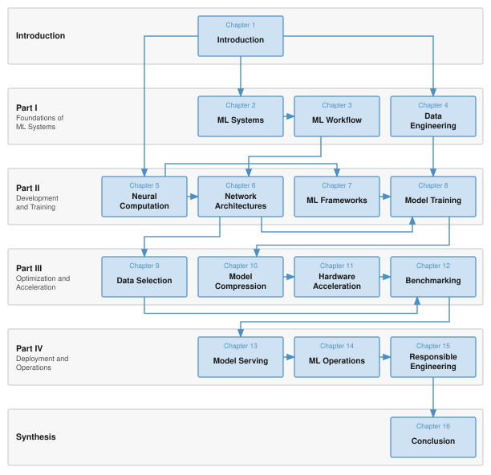
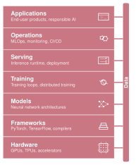
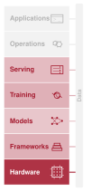
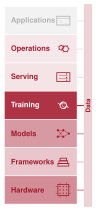
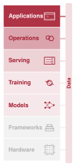
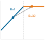

---
format:
  html:
    number-sections: false
---

# Preface {#sec-about .unnumbered}

## Who This Book Is For {#sec-book-book-74a2 .unlisted}

This book is for anyone who wants to understand *how* machine learning systems work, from the mathematics that define a neural network to the hardware that executes it and the engineering decisions that make it run efficiently.

Most readers will not become ML hardware architects or compiler engineers. Yet every practitioner who builds, trains, optimizes, or deploys a model makes decisions that depend on understanding the system beneath the code. This book provides that systems foundation for engineers encountering ML systems for the first time, practicing professionals deepening their understanding, and researchers who need to reason about performance and deployment.

## Prerequisites {#sec-book-prerequisites-1a4b .unlisted}

Readers should bring two prerequisites:

- **Programming**: Fluency in Python, including functions, classes, and basic data manipulation with NumPy.
- **Mathematics**: Comfort with linear algebra, basic calculus, and probability at the foundational university level.

Two additional areas are helpful but not required:

- **Computer systems**: Familiarity with memory hierarchies and basic computer architecture is helpful, though the optimization and hardware chapters develop all necessary physical mechanisms from first principles.
- **Machine learning basics**: Prior exposure to supervised learning provides useful context, but Part II establishes the required modeling foundations from first principles.

## Why a Systems Textbook {#sec-book-systems-textbook-76ff .unlisted}

In 1968, a NATO conference in Garmisch, Germany, helped establish *software engineering* as a distinct discipline amid concern that software systems had become too complex for ad hoc programming [@naur1969softwareengineering]. Reliable software required its own principles, methods, and rigor. Decades later, Hennessy and Patterson made quantitative analysis central to computer architecture education, systematizing how engineers measure, predict, and optimize processor performance [@patterson2017hardware]. Both examples show how shared methods make complex engineering work systematic and teachable.

Machine learning faces its own Garmisch moment. For the past decade, ML research has been dominated by *model-centric* thinking focused on discovering new algorithms and architectures. That focus matters, but a model is not a system. A neural network that performs well in a research notebook is useless if it cannot meet latency constraints, if its data pipeline cannot handle the required volume, or if its energy cost exceeds its economic value. The gap between a working model and a production system is not merely an implementation gap; it is a gap in fundamental engineering principles.

This book treats ML systems engineering not as a collection of tools, such as Kubernetes, PyTorch, and CUDA, but as a discipline grounded in quantitative bounds, models, and design principles. Just as civil engineers rely on foundational physics and structural principles, ML systems engineers must make the governing principles explicit. Four ideas anchor this book:

- **The D·A·M taxonomy**: Every bottleneck lives in the data, the algorithm, or the machine, and relieving one can expose another.
- **The iron law of ML systems**: Total latency decomposes into movement, computation, and overhead; where operations run concurrently (such as transferring the next batch while computing the current one), elapsed time is governed by the critical path.
- **The bitter lesson**: General methods that exploit growing computation outpace hand-encoded expertise, which makes systems efficiency a lever of progress.
- **The energy-movement principle**: Fetching a value from off-chip memory can cost far more energy than computing with it, so per-event costs and event counts determine whether movement or computation dominates.

Each part adds its own governing principles, such as data gravity and Amdahl's law, at the point where they first bind.

Computer science studies what is computable. ML research studies what is learnable. AI engineering studies what is buildable, given the physics of real hardware and real data.

I wrote this book to help build that foundation and to do for ML systems what @patterson2017hardware did for computer architecture: replace intuition with measurement, and art with engineering. The goal is to teach system-level reasoning before implementation, treating data, algorithms, and hardware not as separate silos but as a single, coupled optimization problem.

Consider a box of LEGO bricks. The same interlocking pieces build a spaceship, a castle, or an entire city. The sets change; the bricks do not. ML systems work the same way. A convolutional network for image classification, a transformer for language generation, and a reinforcement learning agent for robotics are vastly different applications, but beneath them sit the same building blocks: computational graphs, memory hierarchies, data pipelines, optimization loops, and the trade-offs between latency, throughput, and energy. Mastery of those building blocks makes unfamiliar systems legible.

That is why this book teaches enduring principles rather than current tools. Dominant frameworks have shifted from Theano to TensorFlow to PyTorch in under a decade. Hardware has evolved from repurposed graphics processors to purpose-built tensor accelerators, with new architectures emerging every year. Tool-specific guidance ages as frameworks and hardware change. The building blocks endure.

## What This Book Covers {#sec-book-book-covers-180b .unlisted}

This book centers on the *single compute node*: one host with one to eight accelerators, each with discrete device memory connected across a local interconnect such as PCIe or NVLink. Production AI systems certainly extend to warehouse-scale clusters spanning thousands of accelerators and complex networks; those fleet-scale architectures form the broader horizon of the field. Yet every distributed cluster is fundamentally an array of individual nodes. An engineer cannot optimize a cluster of a thousand accelerators without first understanding how a single node orchestrates memory, manages pipelines, and feeds its execution units. Node-level mastery is the prerequisite for reasoning about systems at any scale. Execution across multiple nodes appears only where it shapes the design of one node. Scaling beyond one node adds problems in communication, coordination, and failure recovery, and the foundations developed here are the starting point for studying them.

The content is organized into four parts. Each part answers one question and hands the next part a concrete result:

- **Part I: Foundations of ML Systems** asks what is being built, under which constraints, and from what inputs. It develops the vocabulary, mental models, and end-to-end workflow that guide every ML project, from the characteristics that distinguish ML systems from traditional software through the data engineering pipelines that feed them. It hands forward a design envelope and trustworthy data.
- **Part II: Development and Training** asks how a model computes, how it is structured, and how it is trained. It connects mathematical foundations to working systems through deep learning computation, neural architectures, frameworks, and training procedures. It hands forward a trained model whose memory, compute, and time costs are known.
- **Part III: Optimization and Acceleration** asks how to make that model cheaper and how to prove the gain. Its chapters follow the D·A·M taxonomy in order. Data selection reduces the data a run must consume, model compression reduces the cost of the algorithm, hardware acceleration maps the result onto the machine, and benchmarking measures whether the gains are real. It hands forward measured evidence for a deployment claim.
- **Part IV: Deployment and Operations** asks whether the system survives real users, changing data, and its obligations. It covers serving infrastructure, operational practices, and responsible engineering for systems that must be fair, transparent, and trustworthy in production. It hands forward the ability to justify a systems decision.

Each part builds on the previous one, so the book follows a single system through its life: problem → constraints → data → model → training → optimization → benchmarking → deployment → operations.

## Suggested Reading Paths {#sec-book-suggested-reading-paths-773b .unlisted}

While sequential reading provides the most comprehensive foundation, readers with different backgrounds and goals may follow tailored paths through the material:

- **The Complete Path** (all chapters, in order): For engineers and researchers new to ML systems. Start with @sec-introduction, then read the four parts in order. This path develops every concept from first principles.
- **The ML Engineer's Path** (systems depth for practitioners): For engineers who already train and deploy models but want to understand the systems underneath. Skim Part I for vocabulary, then focus on @sec-ml-frameworks, @sec-model-training, @sec-hardware-acceleration, @sec-benchmarking, and @sec-model-serving.
- **The Optimization Path** (efficiency-focused): For engineers working on model efficiency, edge deployment, or resource-constrained systems. After Part I, review Part II's treatment of forward and backward computation, architecture costs, framework execution, and training bottlenecks before proceeding to Part III. Readers who already understand these mechanisms may proceed directly to optimization.

Whichever path a reader takes, @fig-vol1-chapter-dependencies shows which earlier chapters each chapter builds on. Readers who already understand the prerequisite concepts may skip the corresponding chapters; others should follow the arrows back to establish that foundation. Model training is the hub, drawing on both data engineering and ML frameworks and feeding both data selection and model compression. The longest chain runs through Part III, where compression hands its results to acceleration and benchmarking then closes the loop before deployment, drawing on data selection as well.

::: {#fig-vol1-chapter-dependencies data-explore="guided-figure" data-explore-key="vol1:fig-vol1-chapter-dependencies" fig-env="figure" fig-pos="htb" fig-cap="**Chapter Dependency Map**: Each arrow points from a chapter to a later chapter that builds on its results, derived from the book's cross-references with transitive links omitted. The introduction frames every chapter; arrows from it mark the chapters that draw on it directly." fig-alt="Dependency diagram arranged in six horizontal bands: Introduction, Part I, Part II, Part III, Part IV, and Synthesis. Chapter 1 points to Chapter 2. In Part I, Chapter 2 points to Chapter 3, which points to Chapter 4; Chapter 2 also points to Chapter 5. In Part II, Chapters 5, 6, 7, and 8 form a chain, and Chapter 4 also points to Chapter 8. Chapter 8 points to Chapters 9 and 10. In Part III, Chapters 10, 11, and 12 form a chain and Chapter 9 also points to Chapter 12. Chapter 12 points to Chapter 13, which leads through Chapters 14 and 15 to Chapter 16, the conclusion."}

:::

## How to Read This Book {#sec-book-how-to-read-9d2e .unlisted}

The parts follow the lifecycle of a model rather than climbing the ML systems stack from the bottom, so each chapter touches several layers of that stack at once. The stack is a layered abstraction modeled on the classical computer systems stack. Each layer provides an abstraction to the layer above and consumes the layer below: from hardware at the bottom through frameworks, models, training, and serving, up to operations and applications at the top. Data flows through all layers as a cross-cutting interconnect, much like a data bus in computer architecture.

Throughout the book, a margin figure highlights which layers each chapter addresses, providing a recurring map of the stack.

```{=latex}
\begin{center}
\scalebox{0.8}{%
\mlsysstackfull{60}{60}{60}{60}{60}{60}{60}{60}%
}
\end{center}
```

::: {.content-visible when-format="html"}

```{=html}

```

:::

The data bar alongside the stack is not merely decorative. Its uniform shading reflects how central data is to each chapter's concerns, a separate dimension from the layer intensities. The connecting wires between each layer and the data bar show which layers interact with data in that chapter's context. Three chapters illustrate how the lens shifts.

```{=latex}
\begin{center}
\begin{minipage}[t]{0.30\textwidth}
\centering
{\usefont{T1}{phv}{b}{n}\fontsize{8}{9}\selectfont HW Acceleration}\\[4pt]
\mlsysstack{90}{35}{25}{35}{30}{0}{0}{0}
\end{minipage}%
\hfill
\begin{minipage}[t]{0.30\textwidth}
\centering
{\usefont{T1}{phv}{b}{n}\fontsize{8}{9}\selectfont Training}\\[4pt]
\mlsysstack{50}{25}{45}{90}{12}{10}{0}{20}
\end{minipage}%
\hfill
\begin{minipage}[t]{0.30\textwidth}
\centering
{\usefont{T1}{phv}{b}{n}\fontsize{8}{9}\selectfont Responsible Engr.}\\[4pt]
\mlsysstack{0}{0}{10}{10}{20}{40}{90}{15}
\end{minipage}
\end{center}
```

::: {.content-visible when-format="html"}

```{=html}
<div style="display:flex;flex-wrap:wrap;justify-content:center;gap:1.5rem;margin:1rem 0;">
  <figure style="width:180px;max-width:100%;margin:0;">
    <figcaption style="text-align:center;font-weight:600;margin-bottom:0.5rem;">HW Acceleration</figcaption>
    
  </figure>
  <figure style="width:180px;max-width:100%;margin:0;">
    <figcaption style="text-align:center;font-weight:600;margin-bottom:0.5rem;">Training</figcaption>
    
  </figure>
  <figure style="width:180px;max-width:100%;margin:0;">
    <figcaption style="text-align:center;font-weight:600;margin-bottom:0.5rem;">Responsible Engr.</figcaption>
    
  </figure>
</div>
```

:::

In @sec-hardware-acceleration, the layer intensity concentrates at the bottom of the stack while the data bar is faint: the chapter focuses on hardware mechanisms rather than dataset construction. In @sec-model-training, the middle layers glow and the data bar is moderately lit, reflecting that training consumes data but is fundamentally about optimization. In @sec-responsible-engineering, the top layers dominate and the data bar carries a moderate tint, because biased training data surfaces as biased applications even though several layers sit between them. The same stack tells three different stories, with data as an independent dimension.

The margins also carry small visual notes at the point where a relationship is
easiest to understand by sight. These are not numbered figures to cite later;
they are reading aids. A ladder makes an energy or latency scale gap visible, a trend sketch shows direction, a roofline thumbnail shows whether memory bandwidth or compute throughput bounds performance, and a dominance bar shows which term controls total runtime. When a miniature uses a log scale, it says so inside the image.

::: {layout-ncol=4}
{width="100%" fig-alt="Margin visual example: three horizontal orange bars on a log scale compare DRAM access at 640 pJ, FP32 multiplication at 3.7 pJ, and SRAM access at 0.5 pJ."}

{width="100%" fig-alt="Margin visual example: two rising curves showing data debt diverging as the accumulation rate increases."}

{width="100%" fig-alt="Margin visual example: a roofline thumbnail showing a batch-size operating point moving toward the compute roof."}

{width="100%" fig-alt="Margin visual example: two stacked latency bars showing that component speedup only partly improves end-to-end latency."}
:::

Alongside these visual notes, unnumbered **marginal navigation pointers** connect an idea to the chapter that establishes it or builds on it, without interrupting the prose:

- **`↩` Backward pointer:** Directs the reader back to the earlier chapter where a principle, constraint, or cost model was established.
- **`↪` Forward pointer:** Directs the reader ahead to the later chapter, or to the appendix, where the current idea is developed, measured, or enforced.
- **`⇄` Contrast:** Marks a place where two chapters treat the same problem differently, so the comparison is visible at a glance.

A pointer only orients. When a sentence depends on another chapter, the reference stays in the text.



::: {.content-visible when-format="html"}

## A Learning Platform {#sec-about-platform .unlisted}

Whichever path readers follow, this book is one component of a broader learning ecosystem. The complete text, interactive notebooks, lecture slides, exercises, hands-on labs, and supplementary materials are freely available at [mlsysbook.ai](https://mlsysbook.ai).

## An Open-Source Textbook {#sec-about-open-source .unlisted}

This book is open source. The full text, figures, and build system are available at [mlsysbook.ai/git](https://mlsysbook.ai/git), and I invite every reader to contribute. That openness is deliberate. If AI engineering is to become a shared discipline rather than a collection of isolated practices, its foundational texts must be accessible to everyone. ML systems is a field shaped by practitioners across industry, academia, and the open-source community worldwide. A textbook covering this field should reflect that breadth and be available to all, regardless of geography or institutional affiliation.

Contributions from readers, whether fixing an error, suggesting a clearer explanation, adding a worked example, or proposing new content, have materially improved every chapter. Issues and pull requests provide the mechanism for that collaboration. This book improves because its readers participate in building it.

:::

::: {.content-visible when-format="pdf"}

## Companion Resources {#sec-about-companion-resources .unlisted}

Whichever path readers follow, this book is part of a broader learning ecosystem. The complete text, interactive notebooks, lecture slides, exercises, hands-on labs, and supplementary materials are available online at **mlsysbook.ai**.

This book is open source. The full text, figures, and build system are publicly available, and contributions from readers worldwide have materially improved every chapter. Visit **mlsysbook.ai/git** to report issues, suggest improvements, or contribute directly.

:::

## Using This Book in a Course {#sec-book-using-book-course-f71c .unlisted}

This book grew out of CS249r at Harvard University and the [TinyML edX professional certificate](https://www.edx.org/professional-certificate/harvardx-tiny-machine-learning) program. The TinyML course taught ML systems at the most constrained end of the spectrum: microcontrollers running on milliwatts with kilobytes of memory. That work demonstrated that the physical constraints governing embedded devices (memory bandwidth, compute density, and energy per operation) are the same constraints that govern data center accelerators. *The physics scales; only the numbers change.* That insight shaped this book. These systems fundamentals provide a foundation for studying larger systems.

A first course can retain the complete chapter sequence while selecting depth within chapters. The following core route emphasizes decisions that every ML systems engineer must justify. Chapter purposes, learning objectives, fallacies, and summaries frame the selected material; worked examples and checkpoints test whether the underlying mechanisms are understood.

1. Establish the systems argument with the iron law in @sec-introduction-iron-law-ml-systems-c32a, then connect workload requirements to deployment choice through @sec-ml-systems-analyzing-workloads-cbb8 and @sec-ml-systems-comparative-analysis-paradigm-selection-bf66. Follow the lifecycle stages in @sec-ml-workflow-six-core-lifecycle-stages-00b0 into problem definition and independent evaluation. In the data chapter, prioritize acquisition, pipelines, processing, labeling, storage, and operational health so that the dataset contract becomes an executable system.
2. Build the learning and execution foundation from neural fundamentals in @sec-neural-computation-neural-network-fundamentals-07e4 through learning and inference in @sec-neural-computation-inference-pipeline-5372. Read the architecture families for their operations, state, and dependencies before the comparative analysis. Framework execution, differentiation, tensor abstraction, and the training-step trace in @sec-ml-frameworks-putting-together-anatomy-training-step-c7f1 connect those costs to software. Training fundamentals, bottleneck diagnosis, pipeline optimizations, and @sec-model-training-singlenode-multigpu-training-c87f carry that reasoning through a complete training run.
3. Optimize against measured constraints. Start with selection measurement, static pruning, local-worker coordination, and the acceptance decision in @sec-data-selection-decision-framework-0261; compare dynamic or generated-data alternatives when the workload calls for them. Compression requires structural changes, quantization, executable hardware support, and efficiency measurement. In acceleration, retain compute primitives, execution units, memory systems, @sec-hardware-acceleration-roofline-model-42ff, mapping, and dataflow. Read compiler and runtime treatments for graph mapping, fusion, tensor lifetimes, and scheduling; backend-specific implementation details support selective depth. Benchmark components, training and inference protocols, power boundaries, and @sec-benchmarking-model-data-benchmarking-e0ca establish whether an intervention improves the useful system.
4. Close the lifecycle with request execution, queuing, batching, runtime selection, and capacity economics. Operations foundations, controlled deployment, monitoring, and incident response sustain the measured behavior. The requirements, population testing, explanation, and operational controls in @sec-responsible-engineering-responsible-engineering-checklist-a038 belong alongside environmental costs, security, privacy, and accountability. Finish with the coupled-budget synthesis in @sec-synthesizing-ml-systems-ee10 and the quantitative principles that connect the parts.

Cross-node training in @sec-model-training-scaling-beyond-single-node-a671 is an optional extension beyond the core node. Neural architecture search in @sec-model-compression-neural-architecture-search-cf12 and the clinical transfer case in @sec-ml-operations-clinaiops-case-study-5d5d offer selective depth, alongside specialist appendix derivations and vendor comparisons. Single-node communication, memory budgeting, measurement validity, and responsible deployment remain core, even when their mechanisms require more study.

This core route supports a one-semester sequence covering the full ML systems stack, with specialist depth selected for assignments or further study. Instructors may also select individual parts for shorter modules:

- **Parts I–II** form an introductory half-semester on ML systems foundations and how such systems are built and trained.
- **Parts III–IV** form an applied half-semester on optimizing, deploying, and operating them, assuming the foundations covered in Parts I–II.

For survey courses or executive programs, the four part introductions alone provide a condensed overview of the quantitative principles that govern ML systems.

::: {.content-visible when-format="html"}
Lecture slides, assignments, and instructor resources are available at [mlsysbook.ai](https://mlsysbook.ai).
:::

::: {.content-visible when-format="pdf"}
Lecture slides, assignments, and instructor resources are available at **mlsysbook.ai**.
:::

<!--

## Copyright and Licensing {#sec-book-copyright-licensing-2538 .unlisted}

::: {.content-visible when-format="html"}
© Vijay Janapa Reddi and MIT Press. This work is distributed under the [Creative Commons Attribution-NonCommercial-NoDerivatives 4.0 International License (CC BY-NC-ND 4.0)](https://creativecommons.org/licenses/by-nc-nd/4.0). The source is available at [mlsysbook.ai/git](https://mlsysbook.ai/git).
:::

::: {.content-visible when-format="pdf"}
© Vijay Janapa Reddi and MIT Press. This work is distributed under the Creative Commons Attribution-NonCommercial-NoDerivatives 4.0 International License (CC BY-NC-ND 4.0). The source is available at **mlsysbook.ai/git**.
:::
-->
