# Introduction {#sec-vol2-introduction}

::: {layout-narrow}
::: {.column-margin}

\chapterminitoc

:::

::: {.content-visible when-format="pdf"}
\noindent
{fig-alt="Isometric fleet-scale blueprint showing a single ML system expanding into racks, network fabric, coordination layers, scaling constraints, and failure domains."}
:::

::: {.content-visible unless-format="pdf"}
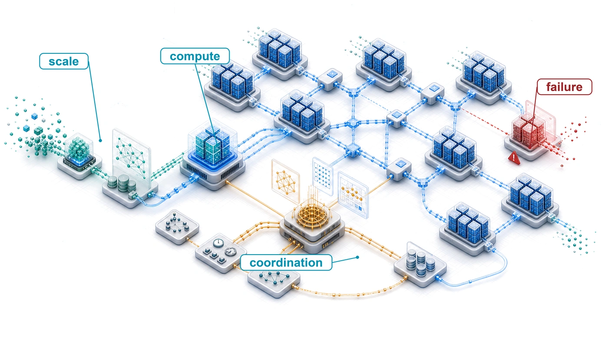{fig-alt="Isometric fleet-scale blueprint showing a single ML system expanding into racks, network fabric, coordination layers, scaling constraints, and failure domains."}
:::

:::

## Purpose {.unnumbered .unlisted}

\begin{marginfigure}
\mlfleetstack{30}{30}{30}{30}{30}{30}{30}{30}
\end{marginfigure}

_Why are single-machine engineering principles insufficient for machine learning at fleet scale?_

Machine learning at scale has a physics of its own. On one node, performance is often governed by the memory wall: data must reach the accelerator fast enough to keep the math busy. Scaling laws explain why one node stops being enough, because model quality improves predictably but sublinearly with compute, data, and parameters, so each further gain demands a larger fleet. In a distributed cluster, the memory problem stretches across machines. Data must move through network links between racks, and the slowest shared crossing can limit the entire job. Hardware failures also change character. A failure that stops one local training run can stall a whole distributed job when thousands of workers must advance together. This discontinuity explains why mastery of single-machine ML is no longer sufficient. A faster device may finish its local work sooner yet spend the saved time waiting for other machines. Adding devices can increase capacity while creating more shared work to coordinate and more components to recover. Serving introduces another consequence: spare capacity is useful only if requests can reach it within their deadlines. The engineering decision must therefore account for the behavior of the whole fleet. That wider boundary also amplifies societal impact because these systems may serve billions of users. Bias in any model can cause harm, but bias in a widely reused foundation model can propagate across many downstream systems. In C³ terms, the discipline this book builds is the physics of distribution, in which compute, communication, and coordination turn algorithmic choices into questions of physical topology, fault tolerance, security, and governance.

::: {.content-visible when-format="pdf"}

\newpage

:::

::: {.callout-learning-objectives}

- Explain how empirical scaling laws drive fleet growth and where breakdown conditions bound compute-optimal allocation
- Diagnose fleet-scale distribution risks using reliability gaps, consistency-availability trade-offs, communication intensity, and routine failure rates
- Explain how Compute, Communication, and Coordination extend the Data-Algorithm-Machine lens for production fleets
- Apply the Fleet Law to separate a training budget's useful compute from its communication and coordination overhead
- Explain how the fleet stack connects infrastructure decisions to deployment and governance constraints

:::

```{python}
#| echo: false
from mlsysim import *
from mlsysim.core.units import *

# ┌─────────────────────────────────────────────────────────────────────────────
# │ INTRODUCTION: SCALE AND DISTRIBUTION CONSTANTS
# ├─────────────────────────────────────────────────────────────────────────────
# │ Context: @sec-vol2-introduction-scale-moment and the fleet stack overview;
# │          inline values used throughout the Scale Moment and
# │          Law of Distributed Efficiency sections.
# │
# │ Goal: Provide scale constants (cluster sizes, communication volumes) for
# │       this introduction to anchor the "why distributed?" argument
# │       quantitatively—computing GPT-3 gradient transfer size
# │       (Models.Language.GPT3.parameters × 4 bytes), cluster MTBF for 25 k A100s at the canonical
# │       50,000-hour per-GPU MTBF (Systems.Reliability.Gpu.mttf_hours),
# │       and accelerator peak throughput (Hardware.Cloud.A100.compute.peak_flops,
# │       Hardware.Cloud.H100.compute.precision_flops["fp8"], Hardware.Cloud.TPUv4.compute.peak_flops) to show scale forces
# │       distribution.
# │ Show: "312" TFLOPs A100, "2,039" GB/s memory bandwidth, "700" GB gradient
# │       per GPT-3 step, "~2" hours MTBF at 25 k GPUs—inline in the Scale
# │       Moment narrative paragraphs and GPT-4 failure rate callout.
# │ How: .to(unit).magnitude for all unit extractions; scalar arithmetic for cluster stats.
# │
# └─────────────────────────────────────────────────────────────────────────────
from mlsysim.fmt import check, fmt, fmt_sci
```

## The Scale Moment {#sec-vol2-introduction-scale-moment}

Machine learning on a single accelerator is governed by local memory hierarchy and arithmetic intensity: the physics of silicon. The boundary of single-machine systems appears when that local machine is no longer the system. As models move from research prototypes to global services, the binding constraints move outward into racks, networks, power delivery, and recovery machinery. That change is not a smooth extrapolation; it is the **scale moment**\index{Scale Moment!definition}.

A synchronous distributed training step gives this change a concrete form. Each worker computes part of the update, exchanges model information with other workers, and waits until the required participants can advance together. These activities give the book its C$^3$ lens: Compute is local execution, Communication moves data between workers, and Coordination keeps their progress and state consistent, including after failures. The Fleet Law expresses the corresponding time budget. Dividing a fixed workload across more devices can shorten local computation, but the step also pays for communication and coordination, less whatever work can overlap. Faster accelerators help only when the remaining costs allow the saved compute time to shorten the whole step.

This book assumes familiarity with single-machine training, inference, and accelerator memory. Readers who want to refresh that foundation should begin with @sec-appdx-dam-taxonomy, which restates it in reference form: the Data · Algorithm · Machine (D·A·M) lens that organizes single-machine diagnosis, the iron law, the roofline and its arithmetic-intensity boundary, the accelerator memory hierarchy, the memory cost of training state per parameter, and the arithmetic of transformer layers. The book's aim is to develop engineering judgment across infrastructure, distributed execution, deployment, and governance, so that a local improvement can be evaluated against the behavior of the whole fleet. This chapter builds that judgment in the order a fleet engineer meets the problem. It first traces how far training compute and cluster size have grown and what changes when a job leaves one machine. It then turns to the empirical scaling laws that keep driving that growth, the physical, logical, and societal constraints that distribution imposes, and the C$^3$ taxonomy and Fleet Law that diagnose where a distributed step loses time. It closes with the fleet stack, an eight-row layered map of the fleet that locates each cost in the architecture, and three recurring workloads that test how the dominant cost changes. Parallelism, communication, and recovery techniques appear here only by name. The task in this chapter is to identify the constraint each one must address, and later chapters develop the mechanisms.

The scale moment is the physical and operational transformation that occurs when models encounter three recurring walls\index{Scale Moment!canonical triad}: memory, network, and energy. They describe resource limits that the C$^3$ lens helps diagnose. On one accelerator the memory wall often binds; after distributing a communication-intensive workload across thousands of nodes, the network wall\index{Scale Moment!processor-to-network shift}\index{Network wall!bisection bandwidth bound} can replace local memory as the primary performance bottleneck. Its hard limits include bisection bandwidth,[^fn-bisection-bandwidth-etymology] the aggregate bandwidth across the narrowest cut that splits the fleet, and speed-of-light latency. Serving billions of users can then encounter the energy wall\index{Scale Moment!output-to-impact shift}\index{Energy wall!thermodynamic limit}, making thermodynamic efficiency a first-order engineering requirement. Crossing those walls also opens a reliability gap\index{Scale Moment!failure certainty}, making hardware failure a routine event rather than a rare exception.

[^fn-bisection-bandwidth-etymology]: **Bisection bandwidth**\index{Bisection bandwidth!etymology} (from graph theory): The minimum aggregate bandwidth of all links that, if cut, would partition the network into two equal-sized sets of nodes. In distributed ML, this "worst-case" cut bounds any collective whose traffic must cross it, such as a gradient exchange among all workers, and adding workers on either side does not raise that bound.

```{python}
#| echo: false
#| label: training-compute-landmarks
# ┌─────────────────────────────────────────────────────────────────────────────
# │ TRAINING COMPUTE LANDMARKS (LEGO)
# ├─────────────────────────────────────────────────────────────────────────────
# │ Context: @sec-vol2-introduction-scale-moment opening paragraph and the
# │          FLOPs column of @tbl-training-compute-evolution.
# │
# │ Goal: Pin the order-of-magnitude training-compute anchors to MLSysIM.
# │ Show: ~10^18 FLOPs (AlexNet), ~10^24 (PaLM), ~10^25 (GPT-4-class
# │       estimate), and the seven-order span between the first and last.
# │ How: round(log10(flops)) of Literature.ComputeTrend entries.
# │
# │ Note: BERT-Large is deliberately NOT read from ComputeTrend here; its
# │       registry entry (3e21) exceeds 64 TPU v2 chips x 4 days at peak.
# └─────────────────────────────────────────────────────────────────────────────
from math import floor, log10
from mlsysim import Literature
from mlsysim.fmt import check, fmt_math

class TrainingComputeLandmarks:
    """Order-of-magnitude training-compute anchors from Literature.ComputeTrend."""

    # ┌── 1. LOAD (Constants) ──────────────────────────────────────────────
    _trend = {e["model"]: e["flops"] for e in Literature.ComputeTrend.entries}
    alexnet_flops = _trend["AlexNet"]
    palm_flops = _trend["PaLM"]
    gpt4_class_flops = _trend["GPT-4-class"]

    # ┌── 2. EXECUTE (The Compute) ────────────────────────────────────────
    alexnet_exp = round(log10(alexnet_flops))
    palm_exp = floor(log10(palm_flops))
    gpt4_class_exp = round(log10(gpt4_class_flops))
    span_orders = gpt4_class_exp - alexnet_exp

    # ┌── 3. GUARD (Invariants) ──────────────────────────────────────────
    check(alexnet_exp == 18, f"AlexNet should be ~10^18 FLOPs, got 10^{alexnet_exp}")
    check(palm_exp == 24, f"PaLM should be ~10^24 FLOPs, got 10^{palm_exp}")
    check(gpt4_class_exp == 25, f"GPT-4-class estimate should be ~10^25 FLOPs, got 10^{gpt4_class_exp}")
    check(span_orders == 7, f"Prose says 'roughly seven orders of magnitude', got {span_orders}")

    # ┌── 4. OUTPUT (Formatting) ──────────────────────────────────────────
    alexnet_flops_oom_math = fmt_math(f"10^{{{alexnet_exp}}}")
    palm_flops_oom_math = fmt_math(f"10^{{{palm_exp}}}")
    gpt4_class_flops_oom_math = fmt_math(f"10^{{{gpt4_class_exp}}}")
```

Between 2012 and the mid-2020s, public and third-party estimates place training compute growth from roughly `{python} TrainingComputeLandmarks.alexnet_flops_oom_math` FLOPs for AlexNet to approaching `{python} TrainingComputeLandmarks.gpt4_class_flops_oom_math` FLOPs for leading large models, seven to eight orders of magnitude. The difference is qualitative, not merely quantitative. A workload that once fit on two GPUs now spans tens of thousands of accelerators. Recent capability leaps have repeatedly come from applying computation at previously impractical scales, and the empirical scaling laws examined in @sec-vol2-intro-ai-scaling-laws-a043 explain why organizations keep paying for each further order of magnitude.

```{python}
#| echo: false
#| label: gpt4-training-scenario
# ┌─────────────────────────────────────────────────────────────────────────────
# │ GPT-4 TRAINING AND RELIABILITY (LEGO)
# ├─────────────────────────────────────────────────────────────────────────────
# │ Context: @sec-vol2-introduction-scale-moment
# │
# │ Goal: Quantify GPT-4 training scale and failure frequency.
# │ Show: illustrative ~25k-GPU, 100-day scenario; ~1 failure every 2 hours.
# │ How: cluster_mtbf_hours = calc_mtbf_cluster(gpu_mtbf_hours, num_gpus).
# │
# └─────────────────────────────────────────────────────────────────────────────
from mlsysim import Models, Systems
from mlsysim.fmt import MarkdownStr, check, fmt, fmt_count, fmt_int, fmt_time
from mlsysim.physics import calc_mtbf_cluster

class Gpt4TrainingScenario:
    """Namespace for GPT-4 cluster reliability statistics."""

    # ┌── 1. LOAD (Constants) ──────────────────────────────────────────────
    num_gpus = Models.Language.GPT4.training_accelerators_ref.to(count).magnitude
    gpu_days = Models.Language.GPT4.training_days_ref.to(day).magnitude
    hours_per_year = HOURS_PER_YEAR

    # Systems.Reliability.Gpu.mttf_hours is the legacy constant name; use it as per-GPU MTBF here.
    gpu_mtbf_hours = Systems.Reliability.Gpu.mttf_hours

    # ┌── 2. EXECUTE (The Compute) ────────────────────────────────────────
    # calc_mtbf_cluster returns a Pint quantity; this cell works in scalar hours.
    cluster_mtbf_hours = calc_mtbf_cluster(gpu_mtbf_hours, num_gpus).to("hour").magnitude
    cluster_failures_per_day = HOURS_PER_DAY / cluster_mtbf_hours
    annual_failures = num_gpus * (hours_per_year / gpu_mtbf_hours)

    # ┌── 3. GUARD (Invariants) ──────────────────────────────────────────
    check(cluster_mtbf_hours < 3, f"MTBF should be < 3 hours for 25k GPUs, got {cluster_mtbf_hours:.1f}")

    # ┌── 4. OUTPUT (Formatting) ──────────────────────────────────────────────
    gpt4_gpus_str = fmt_count(num_gpus, label="GPU")
    gpt4_gpus_approx_str = fmt_count(num_gpus, label="GPU", approx=True)
    gpt4_gpus_count_str = fmt_count(num_gpus)  # prose attaches "-GPU" as a modifier
    gpt4_days_str = fmt_time(gpu_days, 'day', precision=0, style='word')
    gpt4_days_approx_str = fmt_time(gpu_days, 'day', precision=0, style='word', approx=True)
    hours_per_day_str = fmt_int(HOURS_PER_DAY)
    cluster_fail_day_str = fmt_int(cluster_failures_per_day)
    mtbf_hours_str = fmt_time(cluster_mtbf_hours, 'hour', precision=0, commas=True, style='word')
    gpu_mtbf_hours_str = fmt_time(gpu_mtbf_hours, 'hour', precision=0, commas=True, style='word')
    hw_name_str = MarkdownStr(Models.Language.GPT4.training_hardware_label)
```

```{python}
#| echo: false
#| label: landmark-training-runs
# ┌─────────────────────────────────────────────────────────────────────────────
# │ LANDMARK TRAINING RUNS (LEGO)
# ├─────────────────────────────────────────────────────────────────────────────
# │ Context: AlexNet/BERT paragraph, GPT-3/PaLM paragraph, and
# │          @tbl-training-compute-evolution.
# │
# │ Goal: Pin published accelerator counts and durations of landmark runs.
# │ Show: AlexNet 2 GPUs for 5--6 days; BERT-Large 64 TPU chips for 4 days
# │       (6,144 chip hours); PaLM 6,144 TPU v4 chips; ~10,000-GPU
# │       Microsoft/OpenAI machine.
# │ How: Literature.TrainingRuns + Models.Language training_* fields;
# │      chip hours = chips x days x 24.
# │
# └─────────────────────────────────────────────────────────────────────────────
from mlsysim import Literature, Models
from mlsysim.fmt import check, fmt_count, fmt_time, fmt_time_range

class LandmarkTrainingRuns:
    """Published accelerator counts and durations for landmark training runs."""

    # ┌── 1. LOAD (Constants) ──────────────────────────────────────────────
    alexnet_gpus = float(Literature.TrainingRuns.AlexNetGpus)
    alexnet_days_low = float(Literature.TrainingRuns.AlexNetTrainingDaysLow) * day
    alexnet_days_high = float(Literature.TrainingRuns.AlexNetTrainingDaysHigh) * day
    bert_chips = Models.Language.BERT_Large.training_accelerators_ref.to(count).magnitude
    bert_days_q = Models.Language.BERT_Large.training_days_ref
    palm_chips = Models.Language.PaLM_540B.training_accelerators_ref.to(count).magnitude
    palm_hw_label = Models.Language.PaLM_540B.training_hardware_label
    msft_openai_gpus = float(Literature.TrainingRuns.MicrosoftOpenAI2020Gpus)

    # ┌── 2. EXECUTE (The Compute) ────────────────────────────────────────
    bert_chip_hours = bert_chips * bert_days_q.to(hour).magnitude

    # ┌── 3. GUARD (Invariants) ──────────────────────────────────────────
    check(alexnet_gpus == 2, "Prose spells out 'two GTX 580 GPUs'")
    check(abs(bert_chip_hours - 6144) < 1, f"BERT chip hours should be 6,144, got {bert_chip_hours}")
    check(palm_hw_label == "TPU v4", f"Prose names TPU v4 chips, got {palm_hw_label}")

    # ┌── 4. OUTPUT (Formatting) ──────────────────────────────────────────
    alexnet_gpus_str = fmt_count(alexnet_gpus, label="GPU")
    alexnet_days_range_str = fmt_time_range(alexnet_days_low, alexnet_days_high, day, precision=0, style='word')
    bert_chips_str = fmt_count(bert_chips)
    bert_tpus_str = fmt_count(bert_chips, label="TPU")
    bert_days_str = fmt_time(bert_days_q, day, precision=0, style='word')
    bert_chip_hours_str = fmt_count(bert_chip_hours)
    palm_chips_str = fmt_count(palm_chips)
    palm_tpus_str = fmt_count(palm_chips, label="TPU")
    msft_openai_gpus_str = fmt_count(msft_openai_gpus, label="GPU")
```

Compute requirements have grown exponentially. AlexNet\index{AlexNet!two-GPU training} trained on two GTX 580 GPUs for approximately `{python} LandmarkTrainingRuns.alexnet_days_range_str` [@krizhevsky2012imagenet]. BERT\index{BERT!TPU cluster training} required `{python} LandmarkTrainingRuns.bert_chips_str` Tensor Processing Unit (TPU)[^fn-tpu-systolic-array] chips for `{python} LandmarkTrainingRuns.bert_days_str`, roughly `{python} LandmarkTrainingRuns.bert_chip_hours_str` chip hours [@devlin2019].

```{python}
#| echo: false
#| label: tpuv4-pod-scenario
# ┌─────────────────────────────────────────────────────────────────────────────
# │ TPU V4 POD SCALE (LEGO)
# ├─────────────────────────────────────────────────────────────────────────────
# │ Context: @sec-vol2-introduction-scale-moment
# │ Scope: chapter-anchor — TPU pod envelope appears in the early TPU footnote
# │        and later infrastructure-scale paragraph.
# │
# │ Goal: Source TPU v4 pod chip count and aggregate peak compute from MLSysIM.
# │ Show: 4,096 TPU v4 chips; ~1.1 EFLOP/s aggregate peak.
# │ How: Systems.Pods.TPUv4_4096.chips × Hardware.Cloud.TPUv4.compute.peak_flops.
# │
# └─────────────────────────────────────────────────────────────────────────────
from mlsysim import Hardware, Systems
from mlsysim.fmt import check, fmt_count, fmt_flop_rate

class TpuV4PodScenario:
    """TPU v4 pod envelope sourced from the systems and hardware registries."""

    # ┌── 1. LOAD (Constants) ──────────────────────────────────────────────
    pod = Systems.Pods.TPUv4_4096
    chip = Hardware.Cloud.TPUv4
    chips = pod.chips
    per_chip_peak_q = chip.compute.peak_flops

    # ┌── 2. EXECUTE (The Compute) ────────────────────────────────────────
    aggregate_peak_q = chips * per_chip_peak_q

    # ┌── 3. GUARD (Invariants) ──────────────────────────────────────────
    check(chips == 4096, f"TPU v4 pod should contain 4096 chips, got {chips}")
    check(1.0 < aggregate_peak_q.to(EFLOP / second).magnitude < 1.2, "TPU v4 pod peak should be ~1.1 EFLOP/s")

    # ┌── 4. OUTPUT (Formatting) ──────────────────────────────────────────
    tpuv4_pod_chips_str = fmt_count(chips, label="chip")
    tpuv4_pod_peak_str = fmt_flop_rate(aggregate_peak_q, unit=EFLOP / second, precision=1, commas=False)
```

[^fn-tpu-systolic-array]: **Tensor processing unit (TPU)**\index{TPU!definition}\index{Tensor processing unit|see{TPU}}: Google's custom application-specific integrated circuit (ASIC) for machine learning, whose matrix units are systolic arrays\index{TPU!systolic array}, grids of multiply-accumulate cells that pass data between neighboring cells [@jouppi2017]. At fleet scale, the inter-chip network matters as much as the array: TPU v4 joins its chips with an optically reconfigurable interconnect, so the topology of the network, not only the speed of each chip, determines how well many accelerators cooperate [@jouppi2023].

```{python}
#| echo: false
#| label: gpt3-training-scenario
# ┌─────────────────────────────────────────────────────────────────────────────
# │ GPT-3 TRAINING STATS (LEGO)
# ├─────────────────────────────────────────────────────────────────────────────
# │ Context: @sec-vol2-introduction-scale-moment
# │
# │ Goal: Provide GPT-3 training compute and model size statistics.
# │ Show: ~175B parameters; ~3.14e23 FLOPs; reported V100 count and duration
# │       (Patterson et al. 2021); achieved per-GPU rate.
# │ How: pulling model constants from MLSysIM and deriving the achieved rate
# │      from training FLOPs / (accelerators × days).
# │
# └─────────────────────────────────────────────────────────────────────────────
from mlsysim import Hardware
from mlsysim.fmt import check, fmt, fmt_count, fmt_flop_rate, fmt_memory, fmt_params, fmt_percent, fmt_sci_flops, fmt_time

class Gpt3TrainingScenario:
    """GPT-3 training and model statistics."""

    # ┌── 1. LOAD (Constants) ──────────────────────────────────────────────
    params_q = Models.Language.GPT3.parameters
    params = params_q.to(param).magnitude
    ops = Models.Language.GPT3.training_ops.to(Models.Language.GPT3.training_ops.units).magnitude
    training_accelerators_q = Models.Language.GPT3.training_accelerators_ref
    training_days_q = Models.Language.GPT3.training_days_ref
    hw_label = Models.Language.GPT3.training_hardware_label

    # ┌── 2. EXECUTE (The Compute) ────────────────────────────────────────
    params_b = params / BILLION
    gradient_q = params * BYTES_FP32  # FP32 gradients
    training_accelerators = training_accelerators_q.to(count).magnitude
    achieved_rate_q = (Models.Language.GPT3.training_ops / (training_accelerators * training_days_q)).to(TFLOPs / second)
    mfu = (achieved_rate_q / Hardware.Cloud.V100.compute.peak_flops).to('').magnitude

    # ┌── 3. GUARD (Invariants) ──────────────────────────────────────────
    check(params_b == 175, f"GPT-3 should be 175B params, got {params_b}")
    check(training_accelerators == 10000, f"GPT-3 training reference should be 10,000 accelerators, got {training_accelerators}")
    check(24 < achieved_rate_q.magnitude < 25.5, f"must reproduce Patterson's measured 24.6 TFLOP/s per GPU, got {achieved_rate_q.magnitude:.1f}")
    check(mfu < 1, f"reference run cannot exceed V100 peak, got MFU {mfu:.2f}")

    # ┌── 4. OUTPUT (Formatting) ──────────────────────────────────────────────
    gpt3_params_b_str = fmt_params(params_q, scale="B", precision=0, commas=False)
    gpt3_training_ops_str = fmt_sci_flops(ops * flop)
    gpt3_gradient_gb_str = fmt_memory(gradient_q, unit=GB, precision=0, commas=False)
    gpt3_accelerators_str = fmt_count(training_accelerators, label=f"{hw_label} GPU", plural_label=f"{hw_label} GPUs")
    gpt3_days_str = fmt_time(round(training_days_q.to(day).magnitude), day, precision=0, style='word')
    gpt3_rate_str = fmt_flop_rate(achieved_rate_q, unit=TFLOPs / second, precision=1, commas=False)
    gpt3_peak_pct_str = fmt_percent(round(mfu, 2), precision=0, style='prose')  # achieved / V100 peak
```

```{python}
#| echo: false
#| label: gpt3-single-accelerator
# ┌─────────────────────────────────────────────────────────────────────────────
# │ GPT-3 ON ONE ACCELERATOR (LEGO)
# ├─────────────────────────────────────────────────────────────────────────────
# │ Context: GPT-3/PaLM paragraph in @sec-vol2-introduction-scale-moment and
# │          footnote fn-flops-work-rate.
# │
# │ Goal: Show why one node cannot train GPT-3 by dividing its training
# │       work by one accelerator's peak rate.
# │ Show: ~3.14e23 FLOPs / 312 TFLOP/s (A100 dense FP16) ≈ 32 years at
# │       perfect utilization.
# │ How: Models.Language.GPT3.training_ops / Hardware.Cloud.A100 peak_flops.
# │
# └─────────────────────────────────────────────────────────────────────────────
from mlsysim import Hardware, Models
from mlsysim.fmt import check, fmt_flop_rate, fmt_int

class Gpt3SingleAccelerator:
    """Ideal wall-clock time for GPT-3's training work on one A100."""

    # ┌── 1. LOAD (Constants) ──────────────────────────────────────────────
    work_q = Models.Language.GPT3.training_ops
    a100_peak_q = Hardware.Cloud.A100.compute.peak_flops

    # ┌── 2. EXECUTE (The Compute) ────────────────────────────────────────
    ideal_years = (work_q / a100_peak_q).to(year).magnitude

    # ┌── 3. GUARD (Invariants) ──────────────────────────────────────────
    check(25 < ideal_years < 40, f"Prose says about three decades, got {ideal_years:.1f} years")

    # ┌── 4. OUTPUT (Formatting) ──────────────────────────────────────────
    a100_peak_str = fmt_flop_rate(a100_peak_q, unit=TFLOPs / second, precision=0, commas=False)
    ideal_years_str = fmt_int(ideal_years)
```

GPT-3\index{GPT-3!training compute} consumed an estimated `{python} Gpt3TrainingScenario.gpt3_training_ops_str` during training [@brown2020language]. A single A100, a generation newer than the V100 GPUs that trained it, would need about `{python} Gpt3SingleAccelerator.ideal_years_str` years to perform that work even at its full `{python} Gpt3SingleAccelerator.a100_peak_str` peak, which is the plainest answer to why one node is no longer enough. A later carbon accounting instead pairs the budget with `{python} Gpt3TrainingScenario.gpt3_accelerators_str` sustaining about `{python} Gpt3TrainingScenario.gpt3_rate_str` each (roughly `{python} Gpt3TrainingScenario.gpt3_peak_pct_str` of the V100's peak arithmetic rate) for roughly `{python} Gpt3TrainingScenario.gpt3_days_str` of training [@patterson2021carbon]. The gap between that delivered rate and the datasheet peak raises a question this book keeps returning to, namely how much of each accelerator a fleet actually puts to use. PaLM\index{PaLM!TPU scale} trained on `{python} LandmarkTrainingRuns.palm_chips_str` TPU v4 chips for roughly 60 days, consuming approximately `{python} TrainingComputeLandmarks.palm_flops_oom_math` FLOPs [@chowdhery2022palm]. OpenAI's GPT-4\index{GPT-4!training compute scenario} report did not disclose model size, training hardware, or training compute, so the GPT-4-class scenario in this section should be read as illustrative rather than a published configuration [@openai2023gpt4]. These examples sit within the rapid training-compute growth trend\index{Training!compute evolution} documented by earlier compute-trend studies [@amodei2018ai; @sevilla2022]. Collected in @tbl-training-compute-evolution, they show training budgets moving from single-machine experiments into distributed systems where hardware count, wall-clock time, and operational coordination are part of the model design.

| **Model**                | **Year** |                            **GPUs/TPUs**                            |                          **Training Time**                          |                           **Estimated FLOPs**                           |
|:-------------------------|:--------:|:-------------------------------------------------------------------:|:-------------------------------------------------------------------:|:-----------------------------------------------------------------------:|
| **AlexNet**              |   2012   |           `{python} LandmarkTrainingRuns.alexnet_gpus_str`          |        `{python} LandmarkTrainingRuns.alexnet_days_range_str`       |       ~`{python} TrainingComputeLandmarks.alexnet_flops_oom_math`       |
| **BERT-Large**           |   2018   |            `{python} LandmarkTrainingRuns.bert_tpus_str`            |            `{python} LandmarkTrainingRuns.bert_days_str`            |                                ~$10^{20}$                               |
| **GPT-3**                |   2020   |   `{python} Gpt3TrainingScenario.gpt3_accelerators_str` (run est.)  |            ~`{python} Gpt3TrainingScenario.gpt3_days_str`           |          `{python} Gpt3TrainingScenario.gpt3_training_ops_str`          |
| **PaLM**                 |   2022   |            `{python} LandmarkTrainingRuns.palm_tpus_str`            |                               ~60 days                              |         ~`{python} TrainingComputeLandmarks.palm_flops_oom_math`        |
| **GPT-4-class scenario** |   2023   | `{python} Gpt4TrainingScenario.gpt4_gpus_approx_str` (illustrative) | `{python} Gpt4TrainingScenario.gpt4_days_approx_str` (illustrative) | ~`{python} TrainingComputeLandmarks.gpt4_class_flops_oom_math` scenario |

: **Training compute evolution**: Growth in hardware scale and training duration across published landmarks and an illustrative GPT-4-class scenario, showing why distributed systems become central as training budgets move from `{python} TrainingComputeLandmarks.alexnet_flops_oom_math`-scale to the largest training runs. {#tbl-training-compute-evolution}

Plotted run by run from AlexNet to Llama 3 405B, the climb is steady on a logarithmic scale, and it separates early single-node vision models from multi-node transformer training (@fig-training-compute-trend).

::: {#fig-training-compute-trend fig-env="figure" fig-pos="htb" fig-cap="**Training compute trends (2012–2024)**: The exponential growth of training compute for landmark ML models. The training compute (measured in FLOPs) has grown by roughly seven to eight orders of magnitude, highlighting the shift from single-node experimentation to massive-scale distributed fleets." fig-alt="Log-scale scatter of training compute in FLOPs by year from 2012 to 2024, separated into vision and language models with a fitted trend line, spanning roughly seven to eight orders of magnitude."}

```{python}
#| echo: false
# ┌─────────────────────────────────────────────────────────────────────────────
# │ TRAINING COMPUTE EXPLOSION (FIGURE)
# ├─────────────────────────────────────────────────────────────────────────────
import pandas as pd
import numpy as np
from binder.tools.figures import style as book_style

fig, ax, COLORS, plt = book_style.setup_plot(figsize=(8, 5))

# ┌── 1. LOAD DATA ─────────────────────────────────────────────────────────────
df = pd.read_csv("vol2/01_introduction/data/training_compute.csv")

# ┌── 2. PLOT POINTS ───────────────────────────────────────────────────────────
vision = df[df['Domain'] == 'Vision']
language = df[df['Domain'] == 'Language']

ax.scatter(vision['Year'], vision['FLOPs'], color=COLORS["BlueLine"], s=70, zorder=5, label="Vision")
ax.scatter(language['Year'], language['FLOPs'], color=COLORS["OrangeLine"], s=70, zorder=5, marker="^", label="Language")

# ┌── 3. TREND LINE ────────────────────────────────────────────────────────────
coeffs = np.polyfit(df['Year'], np.log10(df['FLOPs']), 1)
trend_x = np.linspace(2011, 2025.5, 200)
trend_y = 10 ** np.polyval(coeffs, trend_x)
ax.plot(trend_x, trend_y, "--", color=COLORS["RedLine"], alpha=0.5, linewidth=1.5, label="Trend")

# ┌── 4. ANNOTATE ──────────────────────────────────────────────────────────────
offsets = {
    "AlexNet": (8, -12),
    "VGG-19": (-45, 10),
    "ResNet-50": (8, -15),
    "Transformer": (-75, 10),
    "BERT-Large": (8, -15),
    "Megatron-LM": (-80, 10),
    "GPT-3": (8, -15),
    "PaLM": (-40, 12),
    "GPT-4 (Est.)": (8, -15),
    "Llama-3 (405B)": (-90, 10),
}

for _, row in df.iterrows():
    m = row['Model']
    offset = offsets.get(m, (8, 8))
    color = COLORS["BlueLine"] if row['Domain'] == 'Vision' else COLORS["OrangeLine"]
    ax.annotate(
        m,
        (row['Year'], row['FLOPs']),
        textcoords="offset points",
        xytext=offset,
        fontsize=8,
        color=color,
        arrowprops=dict(arrowstyle="-", color=color, lw=0.5) if abs(offset[0]) > 30 else None,
    )

# ┌── 5. DECORATE ──────────────────────────────────────────────────────────────
ax.set_yscale("log")
ax.set_ylim(1e17, 1e27)
ax.set_xlim(2011, 2025.5)
ax.set_xlabel("Year")
ax.set_ylabel("Training Compute (FLOPs)")
ax.legend(loc="lower right", frameon=True, fancybox=True, framealpha=0.9)
ax.set_title("")
plt.show()
plt.close()
```

:::
The language-model points pull away from the vision points because compute demands escalated sharply as transformer architectures replaced convolutional pipelines. Raw arithmetic volume is only one dimension of scale, however. The number of accelerators allocated to a single run has roughly doubled every year over the same period (@fig-cluster-size-explosion), a rate that quickly outpaced what any single node could host.

```{python}
#| echo: false
#| label: cluster-size-landmarks
# ┌─────────────────────────────────────────────────────────────────────────────
# │ CLUSTER SIZE LANDMARKS (LEGO)
# ├─────────────────────────────────────────────────────────────────────────────
# │ Context: @fig-cluster-size-explosion data and the paragraph after it.
# │
# │ Goal: Source every accelerator count in the cluster-size figure from
# │       MLSysIM and guard the "four orders of magnitude" claim.
# │ Show: AlexNet 2 GPUs to Llama 3 16,384 H100s (~10^4 growth).
# │ How: Literature.TrainingRuns + Models.Language training_accelerators_ref.
# │
# │ Note: the former ResNet "8 GPUs" row had no verifiable source and was
# │       dropped; the GPT-3 point is the Microsoft/OpenAI 2020 machine size.
# └─────────────────────────────────────────────────────────────────────────────
from math import log10
from mlsysim import Literature, Models
from mlsysim.fmt import check, fmt_count

class ClusterSizeLandmarks:
    """Accelerator counts for landmark training runs, 2012 to 2024."""

    # ┌── 1. LOAD (Constants) ──────────────────────────────────────────────
    _runs = Literature.TrainingRuns
    rows = [
        # (label, year, accelerators, estimated)
        ("AlexNet", 2012, float(_runs.AlexNetGpus), False),
        ("Megatron-LM", 2019, float(_runs.MegatronLm2019Gpus), False),
        ("GPT-3", 2020, float(_runs.MicrosoftOpenAI2020Gpus), True),
        ("PaLM", 2022, Models.Language.PaLM_540B.training_accelerators_ref.to(count).magnitude, False),
        ("LLaMA 1", 2023, float(_runs.Llama1_65B_Gpus), False),
        ("DeepSeek-V3", 2024, float(_runs.DeepSeekV3Gpus), False),
        ("Llama 3", 2024, Models.Language.Llama3_405B.training_accelerators_ref.to(count).magnitude, False),
    ]
    first_gpus = rows[0][2]
    last_gpus = rows[-1][2]

    # ┌── 2. EXECUTE (The Compute) ────────────────────────────────────────
    growth_orders = log10(last_gpus / first_gpus)

    # ┌── 3. GUARD (Invariants) ──────────────────────────────────────────
    check(first_gpus == 2, "Prose spells out 'two GPUs for AlexNet'")
    check(3.5 < growth_orders < 4.5, f"Prose says roughly four orders of magnitude, got {growth_orders:.2f}")

    # ┌── 4. OUTPUT (Formatting) ──────────────────────────────────────────
    llama3_gpus_str = fmt_count(last_gpus, label="H100 GPU", plural_label="H100 GPUs")
```

::: {#fig-cluster-size-explosion fig-env="figure" fig-pos="htb" fig-cap="**The cluster size explosion**: Number of accelerators used to train landmark models, 2012--2024. Verified counts from published papers are shown as filled circles; the GPT-3 estimate (hollow marker) reflects approximate cluster size from Microsoft infrastructure announcements rather than a precise published count. The dashed trend line indicates approximately 2$\times$ annual growth in cluster size, a rate that outpaces Moore's Law and motivates the infrastructure challenges developed throughout the book." fig-alt="Scatter plot with log-scale y-axis showing accelerator count vs. year from 2012 to 2024. Points rise from 2 GPUs for AlexNet in 2012 to 16384 for Llama 3 in 2024."}

```{python}
#| echo: false
# ┌─────────────────────────────────────────────────────────────────────────────
# │ CLUSTER SIZE EXPLOSION (FIGURE)
# ├─────────────────────────────────────────────────────────────────────────────
# │ Context: @fig-cluster-size-explosion—accelerator count growth
# │
# │ Goal: Scatter accelerator count vs year for AlexNet→Llama 3; show ~2×
# │       annual growth; verified vs estimated markers.
# │ Show: Log-scale y; scatter; trend line; model annotations.
# │ How: ClusterSizeLandmarks.rows (MLSysIM); polyfit log-linear;
# │      book_style.setup_plot().
# │
# └─────────────────────────────────────────────────────────────────────────────
# ┌── 1. CANVAS ────────────────────────────────────────────────────────────────
# │ Scatter accelerator count vs year for AlexNet→Llama 3; show ~2×
import numpy as np
from binder.tools.figures import style as book_style

fig, ax, COLORS, plt = book_style.setup_plot(figsize=(8, 5))

# —Verified data points ---

# ┌── 2. ARRAYS ────────────────────────────────────────────────────────────────
models = [r[0] for r in ClusterSizeLandmarks.rows]
years = [r[1] for r in ClusterSizeLandmarks.rows]
gpus = [r[2] for r in ClusterSizeLandmarks.rows]
estimated = [r[3] for r in ClusterSizeLandmarks.rows]

years_arr = np.array(years, dtype=float)
gpus_arr = np.array(gpus, dtype=float)

# —Separate verified vs estimated ---
v_idx = [i for i, e in enumerate(estimated) if not e]
e_idx = [i for i, e in enumerate(estimated) if e]

# ┌── 3. RENDER ────────────────────────────────────────────────────────────────
ax.scatter([years[i] for i in v_idx], [gpus[i] for i in v_idx], color=COLORS["BlueLine"], s=70, zorder=5, label="Verified")
ax.scatter(
    [years[i] for i in e_idx],
    [gpus[i] for i in e_idx],
    facecolors="none",
    edgecolors=COLORS["OrangeLine"],
    s=70,
    linewidths=2,
    zorder=5,
    label="Estimated",
)

# —Exponential trend line (log-linear fit on verified points) ---
v_years = np.array([years[i] for i in v_idx], dtype=float)
v_gpus = np.array([gpus[i] for i in v_idx], dtype=float)
coeffs = np.polyfit(v_years, np.log10(v_gpus), 1)
trend_x = np.linspace(2011, 2025.5, 200)
trend_y = 10 ** np.polyval(coeffs, trend_x)
ax.plot(trend_x, trend_y, "--", color=COLORS["RedLine"], alpha=0.5, linewidth=1.5, label="Trend")

# —Annotate each model ---
offsets = {
    "AlexNet": (8, 6),
    "Megatron-LM": (-75, 12),
    "GPT-3": (8, -18),
    "PaLM": (8, 10),
    "LLaMA 1": (-48, -20),
    "DeepSeek-V3": (-12, -20),
    "Llama 3": (-55, 12),
}
for i, m in enumerate(models):
    color = COLORS["OrangeLine"] if estimated[i] else COLORS["BlueLine"]
    ax.annotate(
        m,
        (years[i], gpus[i]),
        textcoords="offset points",
        xytext=offsets[m],
        fontsize=8,
        color=color,
        bbox=dict(boxstyle="square,pad=0.1", fc="white", ec="none", alpha=0.85),
        arrowprops=dict(arrowstyle="-", color=color, lw=0.5) if abs(offsets[m][0]) > 30 else None,
    )

# —Growth rate annotation ---
growth_factor = 10 ** (coeffs[0])  # per year

# ┌── 4. DECORATE ──────────────────────────────────────────────────────────────
ax.text(
    0.03,
    0.92,
    f"~{growth_factor:.0f}$\\times$ per year",
    transform=ax.transAxes,
    fontsize=10,
    color=COLORS["RedLine"],
    fontstyle="italic",
    bbox=dict(boxstyle="round,pad=0.3", fc="white", ec=COLORS["RedLine"], alpha=0.7),
)

ax.set_yscale("log")
ax.set_ylim(1, 100_000)
ax.set_xlim(2011, 2025.5)
ax.set_xlabel("Year")
ax.set_ylabel("Accelerators Used for Training")
ax.legend(loc="lower right", frameon=True, fancybox=True, framealpha=0.9)
ax.set_title("")
plt.show()
plt.close()
```

:::

Across the four-order-of-magnitude climb charted in @fig-cluster-size-explosion, accelerator counts rise from two GPUs for AlexNet to `{python} ClusterSizeLandmarks.llama3_gpus_str` for Llama 3 along an annual doubling trajectory ($\sim 2\times$ per year). The one estimated point is GPT-3's, placed at the size of the Microsoft supercomputer built for OpenAI in 2020, more than `{python} LandmarkTrainingRuns.msft_openai_gpus_str` [@microsoft2020openaiSupercomputer]. This empirical trajectory is the foundation of the scale moment, because leading models have required far larger accelerator fleets than earlier deep-learning landmarks. The curve alone, however, does not explain which constraint breaks first. Large language-model training, recommendation serving, and federated mobile learning all encounter fleet scale, but each stresses a different part of the system.

::: {#lhs-introduction-lighthouse-archetypes-at-scale .callout-lighthouse title="Lighthouse archetypes at scale"}

**Lighthouse archetypes**\index{Lighthouse archetype!definition} are the canonical workloads that keep the scale moment concrete throughout this book. At this point, their role is to show that "more machines" is not one engineering problem: the dominant constraint depends on what must cross the fleet boundary. The full roster with the C$^3$ taxonomy mapping and binding-constraint analysis appears at @sec-vol2-introduction-archetypes.

- **Archetype A (GPT-4/Llama-3)**: Very large language models move from memory bounds on one device to multi-node model parallelism\index{Model parallelism!multi-node partitioning}, which splits one model across devices, either within each layer (tensor parallelism) or by assigning consecutive groups of layers to different devices as pipeline stages (pipeline parallelism\index{Pipeline parallelism!multi-node partitioning}), so communication can become the bottleneck for communication-intensive partitions.
- **Archetype B (DLRM at Scale)**: Deep learning recommendation model (DLRM) workloads move from fitting embedding tables in local memory to **embedding sharding**\index{Embedding sharding!definition} across hundreds of nodes, so coordinating sparse feature routing, shard placement, and request scheduling can become the bottleneck.
- **Archetype C (Federated MobileNet)**: Mobile inference and on-device adaptation move from one smartphone-class device to federated learning across millions of devices, so local work must respect per-device compute and power budgets, while communication and participation can limit the federated round.

:::

These archetypes turn the growth curve into an engineering question. The same increase in accelerator count can produce a network wall, a sparse-routing coordination bottleneck, or a per-device compute ceiling. The fleet stack, the layered map of the fleet developed at the end of this chapter, locates those constraints in the architecture, while C$^3$ identifies the execution cost they impose. That diversity of constraint regimes, which federated learning extends beyond the data center, has made systems engineering central to ML at scale. A sophisticated algorithm that cannot scale often provides less practical value than a simpler algorithm deployed efficiently across scalable infrastructure.

::: {.column-margin .margin-pointer}
↪ Data, tensor, and pipeline parallelism, and the traffic each places on the fabric, are developed in @sec-distributed-training-systems.
:::

::: {.column-margin .margin-pointer}
↪ Federated rounds across millions of devices, where dropouts, stragglers, and per-device budgets bind, are developed in @sec-edge-intelligence-federated-systems.
:::

Moving from one machine to many changes the governing physics of the system, not merely its device count. A single node is bound locally by the memory wall between its accelerators and their high-bandwidth memory, and it has no peers to wait for. A fleet executes across a shared network fabric under a scheduler that places and recovers the job, which exposes the workload to the network wall, to stragglers, and to routine node failures (@fig-scale-moment-discontinuity).

::: {#fig-scale-moment-discontinuity fig-env="figure" fig-pos="htb" fig-cap="**The scale discontinuity**: On a single machine (left), the usual binding constraint is the memory wall between the accelerators and their high-bandwidth memory, and there are no peers to wait for. In a fleet (right), nodes exchange state over a shared network fabric under a scheduler that places the job and recovers it, so the three C$^3$ roles appear as separate components. The fabric can become the binding network wall, and failed and slow nodes become routine events that hold back the whole job." fig-alt="Two panels. Left, labeled single machine: one node box containing an accelerators box joined to an HBM box by a thick link labeled memory wall. Right, labeled fleet: a scheduler and recovery box above a dashed enclosure holding eight node boxes in two rows, all connected to a central network fabric bar labeled network wall; one node is marked failed and one is marked slow with a dashed border. A legend maps blue to compute C1, amber to communication C2, and violet to coordination C3."}
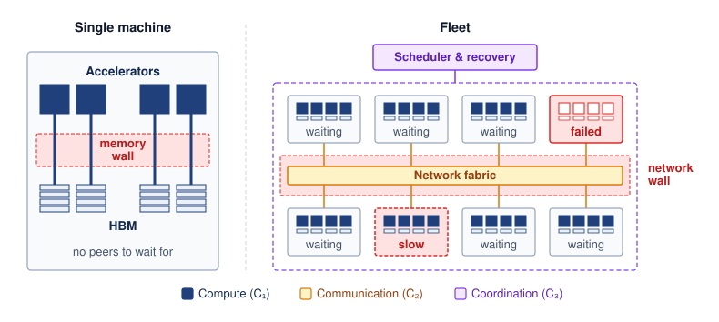
:::

At fleet scale, the binding constraint may shift from local silicon to the network fabric, while resilience joins optimization as a primary concern. The unit of compute is no longer a single server but a **machine learning fleet**\index{Machine Learning Fleet!definition}, an interconnected distributed system designed to act as a coherent engine.

::: {#dfn-introduction-machine-learning-fleet .callout-definition title="Machine learning fleet"}

***Machine learning fleet*** is a distributed collection of compute devices, storage, and networks managed together to train or serve machine learning models.

1.  **Significance**: In tightly coupled synchronous training, the total time $T$ can be governed by the slowest worker (straggler)\index{Straggler!synchronization delay}. Sustaining that workload requires balancing bisection bandwidth ($\Bandwidth_{\text{bisect}}$) against aggregate compute capacity ($\PeakRate$). Serving fleets and heterogeneous edge fleets impose different communication and coordination requirements.
2.  **Distinction**: The fleet is the unit of engineering, but its workers need not all advance together. Synchronous tight coupling\index{Synchronous tight coupling!ML fleet distinction} makes a training job depend on a shared step barrier; serving replicas can process separate requests, and federated devices can participate intermittently. The workload determines the required coupling and recovery behavior.
3.  **Common pitfall**: Treating an ML fleet as "just more servers" overlooks shared network, placement, and recovery constraints. A tightly coupled data-center fleet behaves as one machine, the warehouse-scale computer of @sec-introduction-shift-warehousescale-computer-2ccd; an edge fleet extends the engineering boundary to devices outside that managed facility.

:::

For a tightly coupled job, the network wall of the scale moment is set by the fleet's bisection bandwidth, which limits how fast data can cross the network midpoint; adding workers does not raise it. That bound is the **bisection bandwidth wall**\index{Bisection bandwidth wall!definition}, and at fleet scale it often determines model throughput more than compute does.

At the scale of thousands of GPUs, failure modes appear that a single GPU never exhibits. A network partition can leave a synchronous job hung at a collective (an operation, such as a gradient exchange, that every worker must join) until a timeout aborts it, and in loosely synchronized designs it can let groups of workers drift apart. Stragglers\index{Straggler!thermal throttling} (workers that process data slower than peers due to hardware variation or thermal throttling) can bottleneck entire training runs. Even infrequent component failures accumulate across a large fleet, so long training jobs must expect interruptions.[^fn-failure-rates-fleet] Systems must preserve recoverable state frequently enough to bound the work lost at each interruption.

[^fn-failure-rates-fleet]: **Hardware failure rates at scale**\index{Failure rate!fleet scale}: Notebook \ref{nbk-introduction-scale-reliability} uses an assumed per-GPU mean time between failures and independent failures to illustrate how interruption frequency grows with fleet size. Production job interruptions include software, networking, and maintenance as well as accelerator faults. Meta's Llama 3 report provides an observed example of this broader interruption category [@dubey2024llama]; it does not establish a universal annual GPU failure rate.

::: {.column-margin}
{width="100%" fig-alt="Two horizontal slate bars on a log scale: one GPU with a mean time between failures of 50,000 hours and a 25,000-GPU job with 2 hours."}

*A 25,000-GPU job fails 25,000 times as often as one GPU.*
:::

The interruption cadence follows from simple arithmetic. Consider a GPT-4-class training scenario using a hypothetical `{python} Gpt4TrainingScenario.hw_name_str` cluster of `{python} Gpt4TrainingScenario.gpt4_gpus_str` running for `{python} Gpt4TrainingScenario.gpt4_days_str`. These values follow a third-party estimate [@semianalysisGPT4] rather than an OpenAI disclosure [@openai2023gpt4]. In a cluster of this size, the probability of at least one failure over an interval $t$ becomes a binding constraint. With independent, exponentially distributed failures and system mean time between failures (MTBF) $\MeanTimeBetweenFailures_{\text{system}}$, that probability is $\Pr(\text{failure before } t) = 1 - e^{-t/\MeanTimeBetweenFailures_{\text{system}}}$. The worked example in notebook \ref{nbk-introduction-scale-reliability} establishes the arithmetic for one cluster, and that arithmetic, the MTBF cascade\index{MTBF!cascade}, predicts the interruption cadence for any fleet size.

::: {.column-margin .margin-pointer}
↪ The MTBF cascade, which sums component failure rates into node and cluster MTBF for multi-thousand-GPU fleets, is developed in @sec-appdx-reliability-foundations-mtbf-cascade.
:::

```{python}
#| echo: false
#| label: scale-reliability-run
# ┌─────────────────────────────────────────────────────────────────────────────
# │ SCALE AND RELIABILITY OVER ONE RUN (LEGO)
# ├─────────────────────────────────────────────────────────────────────────────
# │ Context: notebook nbk-introduction-scale-reliability.
# │
# │ Goal: Carry the cluster MTBF through the stated run length and through the
# │       exponential survival formula in the preceding paragraph.
# │ Show: ~1,200 interruptions over a 100-day run; ~61 percent chance of a
# │       1-hour stretch without failure; ~14 percent for 4 hours.
# │ How: run failures = run hours / cluster MTBF;
# │      Pr(no failure in t) = exp(-t / MTBF_system).
# │
# └─────────────────────────────────────────────────────────────────────────────
from math import exp
from mlsysim.fmt import check, fmt_int, fmt_percent, fmt_time

class ScaleReliabilityRun:
    """Interruptions over the GPT-4-class scenario run and short-window survival."""

    # ┌── 1. LOAD (Constants) ──────────────────────────────────────────────
    mtbf_hours = Gpt4TrainingScenario.cluster_mtbf_hours
    run_days = Gpt4TrainingScenario.gpu_days
    window_short_h = 1  # scenario input: a short checkpoint interval
    window_long_h = 4  # scenario input: a longer checkpoint interval

    # ┌── 2. EXECUTE (The Compute) ────────────────────────────────────────
    run_failures = run_days * HOURS_PER_DAY / mtbf_hours
    survive_short = exp(-window_short_h / mtbf_hours)
    survive_long = exp(-window_long_h / mtbf_hours)

    # ┌── 3. GUARD (Invariants) ──────────────────────────────────────────
    check(run_failures > 500, f"Prose says interruptions number in the hundreds or more, got {run_failures:.0f}")
    check(survive_long < 0.25 < survive_short, "Prose contrasts a likely 1-hour stretch with an unlikely 4-hour one")

    # ┌── 4. OUTPUT (Formatting) ──────────────────────────────────────────
    run_failures_str = fmt_int(run_failures, commas=True)
    window_short_str = fmt_time(window_short_h, 'hour', precision=0, style='word')
    window_long_str = fmt_time(window_long_h, 'hour', precision=0, style='word')
    survive_short_pct_str = fmt_percent(round(survive_short, 2), precision=0, style='prose')
    survive_long_pct_str = fmt_percent(round(survive_long, 2), precision=0, style='prose')
```

::: {#nbk-introduction-scale-reliability .callout-notebook title="Scale and reliability"}

**Problem**: A training run for a GPT-4-class model uses `{python} Gpt4TrainingScenario.gpt4_gpus_str`. If each individual GPU has an MTBF of `{python} Gpt4TrainingScenario.gpu_mtbf_hours_str` (the modeling assumption used in this example, not a measured fleet-wide failure rate), how often will the training job be interrupted by hardware failure?

**Math**:

1. System MTBF\index{MTBF!system}: The system MTBF is the component MTBF divided by the number of independent GPUs. With this scenario's values, `{python} Gpt4TrainingScenario.gpu_mtbf_hours_str` divided by `{python} Gpt4TrainingScenario.gpt4_gpus_str` is about `{python} Gpt4TrainingScenario.mtbf_hours_str`.
2. Daily failure rate\index{Failure Rate!daily}: `{python} Gpt4TrainingScenario.hours_per_day_str` hours divided by `{python} Gpt4TrainingScenario.mtbf_hours_str` is about `{python} Gpt4TrainingScenario.cluster_fail_day_str` failures per day.
3. Failures over the run\index{Failure Rate!per training run}: `{python} Gpt4TrainingScenario.gpt4_days_str` at about `{python} Gpt4TrainingScenario.cluster_fail_day_str` failures per day is about `{python} ScaleReliabilityRun.run_failures_str` interruptions before the run completes.
4. Uninterrupted stretches: with $\Pr(\text{no failure in } t) = e^{-t/\MeanTimeBetweenFailures_{\text{system}}}$, a stretch of `{python} ScaleReliabilityRun.window_short_str` completes without failure with probability of about `{python} ScaleReliabilityRun.survive_short_pct_str`, and a stretch of `{python} ScaleReliabilityRun.window_long_str` only about `{python} ScaleReliabilityRun.survive_long_pct_str` of the time.

**Systems insight**: In this regime, component failures recur throughout a long run, and a job that saved its state only every few hours would usually be interrupted before reaching the next save. Manual restart does not scale; the system must be architected for fault tolerance from the outset. Hardware can no longer be treated as an infallible abstraction, so automated state preservation and recovery become operational requirements.

:::

Meta's published Llama 3 training run illustrates the operational consequence in a real large-scale system, where interruptions have several causes.

```{python}
#| echo: false
#| label: llama3-pretraining-record
# ┌─────────────────────────────────────────────────────────────────────────────
# │ LLAMA 3 405B PRETRAINING RECORD (LEGO)
# ├─────────────────────────────────────────────────────────────────────────────
# │ Context: war story "The training run that failed every few hours".
# │
# │ Goal: Pin Meta's reported Llama 3 405B run statistics to MLSysIM.
# │ Show: 16,384 H100 GPUs; 54-day snapshot; 419 unexpected interruptions;
# │       >90 percent effective training time; three manual interventions.
# │ How: Models.Language.Llama3_405B + Literature.TrainingRuns (Dubey 2024).
# │
# └─────────────────────────────────────────────────────────────────────────────
from mlsysim import Literature, Models
from mlsysim.fmt import check, fmt_count, fmt_percent, fmt_time

class Llama3PretrainingRecord:
    """Reported Llama 3 405B pretraining statistics (Dubey et al. 2024)."""

    # ┌── 1. LOAD (Constants) ──────────────────────────────────────────────
    gpus = Models.Language.Llama3_405B.training_accelerators_ref.to(count).magnitude
    hw_label = Models.Language.Llama3_405B.training_hardware_label
    snapshot_days = float(Literature.TrainingRuns.Llama3_405B_SnapshotDays)
    unexpected_interruptions = float(Literature.TrainingRuns.Llama3_405B_UnexpectedInterruptions)
    effective_time_fraction = float(Literature.TrainingRuns.Llama3_405B_EffectiveTrainingTimeFraction)
    manual_interventions = float(Literature.TrainingRuns.Llama3_405B_ManualInterventions)

    # ┌── 2. EXECUTE (The Compute) ────────────────────────────────────────
    hours_per_interruption = snapshot_days * HOURS_PER_DAY / unexpected_interruptions

    # ┌── 3. GUARD (Invariants) ──────────────────────────────────────────
    check(gpus == 16384, f"Llama 3 405B ran on 16,384 GPUs, got {gpus}")
    check(hw_label.startswith("H100"), f"Prose names H100 GPUs, got {hw_label}")
    check(manual_interventions == 3, "Prose spells out 'only three times'")
    check(2.5 < hours_per_interruption < 3.5, f"Title claims an interruption every few hours, got {hours_per_interruption:.1f} h")

    # ┌── 4. OUTPUT (Formatting) ──────────────────────────────────────────
    llama3_gpus_str = fmt_count(gpus, label="H100 GPU", plural_label="H100 GPUs")
    snapshot_days_str = fmt_time(snapshot_days, day, precision=0, style='word', attributive=True)
    unexpected_interruptions_str = fmt_count(unexpected_interruptions)
    effective_time_pct_str = fmt_percent(effective_time_fraction, precision=0, style='prose')
```

::: {#ws-vol2-introduction-llama3-failure-cadence .callout-war-story title="The training run that failed every few hours (2024)"}

**Context**: Meta reports training Llama 3\index{Llama-3!training failure cadence} 405B on `{python} Llama3PretrainingRecord.llama3_gpus_str` during a `{python} Llama3PretrainingRecord.snapshot_days_str` snapshot of pretraining [@dubey2024llama].

**Mechanism**: The cluster experienced `{python} Llama3PretrainingRecord.unexpected_interruptions_str` unexpected interruptions during that snapshot. GPU faults and memory errors were major contributors; the report also records software, network, and host issues. These job interruptions are not equivalent to permanent GPU failures.

**Impact**: Meta nevertheless reported more than `{python} Llama3PretrainingRecord.effective_time_pct_str` effective training time, measured as useful training time divided by elapsed time. Significant manual intervention was required only three times.

**Fix**: Meta reduced job startup and checkpointing\index{Checkpointing!automated recovery} time and developed automated diagnosis and recovery tools. Communication traces helped locate stalled collectives and slow workers before restarting useful work.

**Systems lesson**: The scale moment turns reliability from a hardware specification into a distributed-systems design requirement. A fleet-scale model is trained by the recovery machinery as much as by the optimizer.

:::

```{python}
#| echo: false
#| label: infiniband-scenario
# ┌─────────────────────────────────────────────────────────────────────────────
# │ INFINIBAND NETWORKING SPECS (LEGO)
# ├─────────────────────────────────────────────────────────────────────────────
# │ Context: @sec-vol2-introduction-scale-moment
# │
# │ Goal: Provide InfiniBand HDR and NDR bandwidth statistics.
# │ Show: ~200 Gbps HDR; ~400 Gbps NDR.
# │ How: pulling constants from mlsysim.core.units.
# │
# └─────────────────────────────────────────────────────────────────────────────

class InfiniBandScenario:
    """InfiniBand HDR/NDR bandwidth for the scale-moment prose below."""

    # ┌── 1. LOAD (Constants) ──────────────────────────────────────────────
    hdr = Systems.Fabrics.InfiniBand_HDR.bandwidth
    ndr = Systems.Fabrics.InfiniBand_NDR.bandwidth

    # ┌── 2. EXECUTE (The Compute) ────────────────────────────────────────
    hdr_gbps = hdr.to(Gbps).magnitude
    ndr_gbps = ndr.to(Gbps).magnitude
    hdr_gbs = hdr_gbps / BITS_PER_BYTE
    ndr_gbs = ndr_gbps / BITS_PER_BYTE

    # ┌── 3. GUARD (Invariants) ──────────────────────────────────────────
    from mlsysim.fmt import check, fmt_bandwidth

    check(ndr_gbps > hdr_gbps, "NDR bandwidth must be greater than HDR bandwidth")

    # ┌── 4. OUTPUT (Formatting) ──────────────────────────────────────────────
    ib_hdr_gbit_per_s_str = fmt_bandwidth(hdr, unit=Gbps, precision=0, commas=False)
    ib_hdr_gb_per_s_str = fmt_bandwidth(hdr, unit=GB / second, precision=0, commas=False)
    ib_ndr_gb_per_s_str = fmt_bandwidth(ndr, unit=GB / second, precision=0, commas=False)
```

```{python}
#| echo: false
#| label: fleet-investment-anchors
# ┌─────────────────────────────────────────────────────────────────────────────
# │ FLEET INVESTMENT ANCHORS (LEGO)
# ├─────────────────────────────────────────────────────────────────────────────
# │ Context: infrastructure-investment paragraph in
# │          @sec-vol2-introduction-scale-moment.
# │
# │ Goal: Source the named production fleets from MLSysIM.
# │ Show: Meta RSC 16,000 A100 GPUs on HDR InfiniBand; Microsoft/OpenAI
# │       2020 machine with more than 10,000 GPUs.
# │ How: Systems.Clusters.Meta_RSC_A100_16K; Literature.TrainingRuns.
# │
# └─────────────────────────────────────────────────────────────────────────────
from mlsysim import Literature, Systems
from mlsysim.fmt import check, fmt_count

class FleetInvestmentAnchors:
    """Named production fleets cited in the scale-moment narrative."""

    # ┌── 1. LOAD (Constants) ──────────────────────────────────────────────
    rsc = Systems.Clusters.Meta_RSC_A100_16K
    rsc_gpus = rsc.total_accelerators
    msft_openai_gpus = float(Literature.TrainingRuns.MicrosoftOpenAI2020Gpus)

    # ┌── 2. EXECUTE (The Compute) ────────────────────────────────────────
    rsc_fabric_matches_hdr = rsc.fabric.bandwidth == Systems.Fabrics.InfiniBand_HDR.bandwidth

    # ┌── 3. GUARD (Invariants) ──────────────────────────────────────────
    check(rsc.node.accelerator.name == "NVIDIA A100", "Prose names NVIDIA A100 GPUs")
    check(rsc_fabric_matches_hdr, "Prose quotes the HDR InfiniBand line rate for RSC")

    # ┌── 4. OUTPUT (Formatting) ──────────────────────────────────────────
    rsc_gpus_str = fmt_count(rsc_gpus)
    msft_openai_gpus_str = fmt_count(msft_openai_gpus, label="GPU")
```

Organizations answered these challenges with purpose-built fleets whose defining component is the network as much as the accelerator. Meta's Research SuperCluster, announced in 2022, was designed to reach `{python} FleetInvestmentAnchors.rsc_gpus_str` NVIDIA A100 GPUs connected by `{python} InfiniBandScenario.ib_hdr_gbit_per_s_str` InfiniBand[^fn-infiniband-rdma-v2] links [@meta2022rsc], and Google's TPU v4 pods join `{python} TpuV4PodScenario.tpuv4_pod_chips_str` delivering `{python} TpuV4PodScenario.tpuv4_pod_peak_str` of aggregate peak compute [@zu2024tpuv4]. Later Azure AI data center announcements describe training fabrics of tens of thousands of GPUs [@microsoft2025fairwater]. Each accelerator's share of that aggregate compute must exchange its results through links of a few hundred gigabits per second.

[^fn-infiniband-rdma-v2]: **InfiniBand**: A data-center interconnect whose defining feature for ML is remote direct memory access (RDMA)\index{InfiniBand!RDMA}, which bypasses the OS kernel to move data directly between application memory on different machines at microsecond-scale latency. HDR InfiniBand provides about `{python} InfiniBandScenario.ib_hdr_gb_per_s_str` line-rate bandwidth per link and NDR about `{python} InfiniBandScenario.ib_ndr_gb_per_s_str`; that per-link bandwidth, relative to the computation each worker performs between exchanges, decides whether large-model training is compute-bound or communication-bound. RDMA-capable Ethernet (RoCE) now offers comparable line rates.

The scale moment establishes why exponential growth in compute demand forces some ML systems beyond any single machine, making the network fabric a potential bottleneck and component failure routine over long runs. The next question is how to organize the engineering response. Established distributed-systems techniques remain essential, but global barriers and large shared model state change their costs and determine which recovery and consistency mechanisms apply. Tracing how the layers of one machine map onto a fleet, starting with how sharply the links between servers fall below the bandwidth inside one, makes those dependencies explicit.

## From Single Node to Fleet {#sec-vol2-introduction-engineering-crux}

```{python}
#| echo: false
#| label: node-to-fleet-bandwidth
# ┌─────────────────────────────────────────────────────────────────────────────
# │ NODE-TO-FLEET BANDWIDTH STEP (LEGO)
# ├─────────────────────────────────────────────────────────────────────────────
# │ Context: @sec-vol2-introduction-engineering-crux opening paragraph.
# │
# │ Goal: Quantify the bandwidth step an accelerator sees when its traffic
# │       leaves the NVLink domain for one InfiniBand NDR port.
# │ Show: 450 GB/s NVLink per direction (H100) vs 400 Gbps (50 GB/s) NDR per
# │       port; ~9x step down, like-with-like per direction.
# │ How: Hardware.Cloud.H100.nvlink.bandwidth_per_direction /
# │      Systems.Fabrics.InfiniBand_NDR.bandwidth.
# │
# └─────────────────────────────────────────────────────────────────────────────
from mlsysim import Hardware, Systems
from mlsysim.fmt import check, fmt_bandwidth, fmt_multiple

class InfiniBandStackRecap:
    """NVLink (intra-node) vs. InfiniBand NDR (per port) bandwidth step."""

    # ┌── 1. LOAD (Constants) ──────────────────────────────────────────────
    nvlink_h100_perdir = Hardware.Cloud.H100.nvlink.bandwidth_per_direction  # 450 GB/s one-way
    ndr = Systems.Fabrics.InfiniBand_NDR.bandwidth  # 400 Gb/s per port, per direction

    # ┌── 2. EXECUTE (The Compute) ────────────────────────────────────────
    # Like-with-like: both rates per direction. Dividing the 900 GB/s
    # bidirectional NVLink total by a per-direction port rate would double-count.
    step_down = (nvlink_h100_perdir / ndr).to("").magnitude

    # ┌── 3. GUARD (Invariants) ──────────────────────────────────────────
    check(6 < step_down < 15, f"Prose says roughly an order of magnitude, got {step_down:.1f}")

    # ┌── 4. OUTPUT (Formatting) ──────────────────────────────────────────
    nvlink_h100_perdir_gb_per_s_str = fmt_bandwidth(nvlink_h100_perdir, unit=GB / second, precision=0, commas=False)
    ib_ndr_gbit_per_s_str = fmt_bandwidth(ndr, unit=Gbps, precision=0, commas=False)
    ib_ndr_gb_per_s_str = fmt_bandwidth(ndr, unit=GB / second, precision=0, commas=False)
    step_down_mult_str = fmt_multiple(step_down, precision=0)
```

Inside one H100 server, NVLink moves tensors between accelerators at `{python} InfiniBandStackRecap.nvlink_h100_perdir_gb_per_s_str` in each direction per accelerator. Once a training job spans racks, the same tensors leave through an InfiniBand NDR port at `{python} InfiniBandStackRecap.ib_ndr_gbit_per_s_str` (`{python} InfiniBandStackRecap.ib_ndr_gb_per_s_str`) in each direction, a bandwidth step down of roughly `{python} InfiniBandStackRecap.step_down_mult_str` for an accelerator served by one such port. That step illustrates a general pattern. The layered structure of an ML system persists across scale, while the physics at each layer changes. The fleet stack names the fleet's layers by grouping them into four bands, Infrastructure at the bottom, then Distribution, Serving, and Governance at the top, with two rows in each (@fig-fleet-stack). At the bottom, the hardware substrate of one node becomes the Infrastructure band, an RDMA fabric spanning racks, and the binding constraint can shift from the memory wall\index{Memory wall!intra-node bound} to the bisection bandwidth wall as network congestion and message-passing latency consume a growing share of step time. One layer up, system software (a single CUDA runtime managing PCIe direct memory access (DMA)) becomes the Distribution band, which holds the NVIDIA Collective Communications Library (NCCL) and RDMA libraries that coordinate thousands of processes across the fabric, together with the schedulers that place distributed jobs and the recovery machinery that restarts them. Efficient data movement inside each node remains a prerequisite, because a fleet of poorly utilized nodes only multiplies the waste.

The upper bands add responsibilities rather than replace the familiar software layers. The ML framework\index{ML framework!single-node stack} (PyTorch or JAX executing a training loop on one node) remains part of model execution. The Serving band adds request handling and deployment pipelines that manage rolling releases across the fleet. Applications also remain, while the Governance band sets security, robustness, sustainability, and responsible AI requirements for their operation. @Sec-vol2-introduction-foundational-concepts returns to the full stack and the eight rows within it as the map that organizes the rest of this book. The stack identifies where a design decision belongs; C$^3$ identifies how that decision affects execution time.

A map of layers does not by itself explain why the same decision behaves differently once it spans a fleet. Three changes separate a fleet from a larger server: synchronous coupling turns independent tasks into a shared step, the facility itself becomes the computer, and communication can dominate the step. A fourth change, routine failure, was quantified at the scale moment; its availability model returns with the other constraints of scale in @sec-vol2-introduction-reliability-gap. Archetype A (GPT-4/Llama-3)\index{Archetype!A (GPT-4/Llama-3)}, the large-language-model workload of the book's canonical roster (@sec-vol2-introduction-archetypes), runs on a reference cluster of NVIDIA H100 accelerators and makes each change concrete where a chapter needs it.

### Independent tasks vs. synchronous fleet dynamics {#sec-introduction-traditional-vs-ml-fleet-dynamics-c43e}

Many distributed systems isolate work into tasks or requests so that one failure need not stop unrelated work. **MapReduce**\index{MapReduce!definition} [@dean2004mapreduce] partitions an input into tasks and can re-execute failed or slow work, Apache Spark [@zaharia2016] processes data-parallel tasks with explicit shuffle boundaries, and a web microservice handles requests whose failures can be isolated. Search engines and banking databases use other forms of replication, partitioning, and coordination; they are not uniformly independent or asynchronous. The useful contrast is therefore between failure domains\index{Failure domain!coupling patterns} and coupling patterns, not between "traditional" and ML systems.

Large synchronous training jobs operate under **synchronous tight coupling**\index{Synchronous tight coupling!definition}. Parameter-server architectures [@li2014] and collective runtimes manage distributed state, but synchronous optimization updates a large shared model state across thousands of accelerators every few hundred milliseconds rather than completing independent one-shot tasks. At each synchronization point\index{Barrier synchronization!slowest worker dependence}, progress can depend on the slowest participating worker, so a persistent 10 percent slowdown on one worker can approach a 10 percent step-time penalty when that worker lies on the critical path. Communication-heavy partitions can also become bisection-bandwidth bound because large gradient or activation tensors cross the network every step. These properties do not invalidate established recovery techniques; they increase recovery cost and restrict which replication, re-execution, and consistency strategies preserve useful training progress.

The two execution pathways differ at the point of failure (@fig-traditional-vs-ml-fleet). In MapReduce, a failed map task is retried on its own while its peers complete. In synchronous data-parallel training, where every worker holds a full copy of the model and processes a different slice of each batch, every worker must contribute its gradient to an AllReduce, a collective operation that combines the gradients of all workers and returns the result to each of them, before the shared parameter update can occur. A slow map task can delay downstream reduction and job completion, but other map tasks finish without waiting; in synchronous training, by contrast, healthy workers sit idle whenever a straggler delays the collective.

::: {#fig-traditional-vs-ml-fleet fig-env="figure" fig-pos="htb" fig-cap="**Retryable tasks vs. shared training steps**: Map tasks (left) deliver their outputs independently, so a failed task is re-run on its own while the others finish; its missing output delays only the reducers that need it. In synchronous data-parallel training (right), the AllReduce needs every worker's gradient before the shared update can proceed, so a slow worker on the critical path holds the whole step and the healthy workers wait. How much the step stretches depends on overlap and the other costs of the step." fig-alt="Two panels. Left, MapReduce: map tasks 1 and 2 send arrows to an intermediate outputs box; map task 3 is marked failed, and a dashed arrow labeled retry alone leads to a re-run of task 3 that also sends its output to the box. Right, synchronous training: workers 0 and 1 send arrows to an AllReduce box labeled needs all three; worker 2 is marked slow and sends a dashed arrow; a note says workers 0 and 1 wait; the AllReduce feeds a shared update box."}
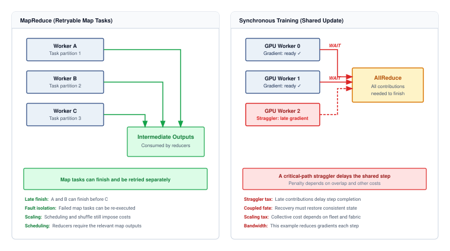
:::

The collective barrier dependency diagrammed in @fig-traditional-vs-ml-fleet explains why MapReduce-style localized task re-execution cannot be transferred directly to tightly coupled training: when all workers advance a single shared parameter step, recovery must restore mutually consistent model, optimizer, and input state across every participating node before coordinated execution can resume.

::: {#chk-introduction-fleet-mindset .callout-checkpoint title="The fleet mindset"}

These questions check whether the fleet mindset is clear:

- [ ] **Straggler impact**: compare how a slow map task can delay job completion with how a persistent straggler can delay repeated synchronous training steps.
- [ ] **Bisection bottleneck**: explain when frequent cross-rack tensor exchanges would make synchronous training more bandwidth-sensitive than a service handling mostly independent requests.
- [ ] **Tight coupling**: explain synchronous tight coupling and connect it to the need for all participating contributions before a shared training update completes.
- [ ] **Linear speedup myth**: using the barrier argument above, explain why doubling the GPUs in a synchronous training job need not halve its step time.

:::

### The shift to the warehouse-scale computer {#sec-introduction-shift-warehousescale-computer-2ccd}

```{python}
#| echo: false
#| label: warehouse-scale-anchor
# ┌─────────────────────────────────────────────────────────────────────────────
# │ WAREHOUSE-SCALE FACILITY ANCHOR (LEGO)
# ├─────────────────────────────────────────────────────────────────────────────
# │ Context: footnote fn-wsc-barroso-datacenter.
# │
# │ Goal: Source the hyperscale campus power envelope from MLSysIM.
# │ Show: 100 MW facility.
# │ How: ReferenceStats.FacilityScaleAnchors.HyperscaleCampusPower.
# │
# └─────────────────────────────────────────────────────────────────────────────
from mlsysim import ReferenceStats
from mlsysim.fmt import check, fmt_power

class WarehouseScaleAnchor:
    """Hyperscale campus power envelope."""

    # ┌── 1. LOAD (Constants) ──────────────────────────────────────────────
    campus_power = ReferenceStats.FacilityScaleAnchors.HyperscaleCampusPower

    # ┌── 2. EXECUTE (The Compute) ────────────────────────────────────────
    campus_power_mw = campus_power.to(MW).magnitude

    # ┌── 3. GUARD (Invariants) ──────────────────────────────────────────
    check(campus_power_mw == 100, f"Footnote cites a 100 MW facility, got {campus_power_mw}")

    # ┌── 4. OUTPUT (Formatting) ──────────────────────────────────────────
    campus_power_mw_str = fmt_power(campus_power, unit=MW, precision=0)
```

A tightly coupled data-center fleet demands the **warehouse-scale computer (WSC)**\index{Warehouse-scale computer!definition}[^fn-wsc-barroso-datacenter] perspective. A machine-centric view treats the data center as a building that houses many computers; the warehouse-scale view treats the data center itself as the computer. In this paradigm, single-node abstractions map directly onto distributed infrastructure: the network fabric\index{Network fabric!as system bus} functions as the system bus, distributed storage\index{Storage!distributed} serves as the local disk, and the fleet orchestrator\index{Fleet orchestrator!as operating system} acts as the operating system.

For this data-center regime, the engineering boundary extends from local execution to the shared power, network, and recovery systems that sustain the entire facility. The warehouse-scale computer is a common paradigm for large models, while alternative architectures like **wafer-scale engines**\index{Wafer-scale engine!definition}, single processors built from an entire silicon wafer rather than one reticle-sized die, attempt to collapse this entire hierarchy back into a single piece of silicon, trading the modularity of a distributed cluster for the extreme bandwidth of on-chip communication. Both designs answer the same constraint, the cost of moving data between chips, from opposite directions.

[^fn-wsc-barroso-datacenter]: [offset=-60mm] **Warehouse-scale computer (WSC)**\index{Warehouse-scale computer!Barroso}: Barroso and Hölzle, later with Clidaras, framed the data center itself as the computer. For ML fleets, power delivery, cooling topology, optical network layout, and bisection bandwidth become first-order constraints; a `{python} WarehouseScaleAnchor.campus_power_mw_str` facility can limit training throughput more than any single accelerator's TFLOP/s.

### Communication dominance and the network wall {#sec-introduction-communication-becomes-dominant-e1b6}

Distributing these workloads beyond one machine can make communication the dominant cost, the network wall of the scale moment. On one GPU, a dense training workload may spend most of its time performing matrix multiplications and incur no inter-node communication. Distribution introduces communication whose share depends on the model, partitioning strategy, collective algorithm, topology, precision, and overlap with computation.

```{python}
#| echo: false
#| label: gpt3-communication-scenario
# ┌─────────────────────────────────────────────────────────────────────────────
# │ GPT-3 COMMUNICATION STATS (LEGO)
# ├─────────────────────────────────────────────────────────────────────────────
# │ Context: @sec-introduction-communication-becomes-dominant-e1b6
# │
# │ Goal: Quantify GPT-3 gradient synchronization overhead.
# │ Show: ~175B parameters; ~700 GB gradient (FP32).
# │ How: pulling constants from mlsysim.core.units.
# │
# └─────────────────────────────────────────────────────────────────────────────
from mlsysim.fmt import assert_qty_close, check, fmt, fmt_memory, fmt_params

class Gpt3CommunicationScenario:
    """GPT-3 gradient sync statistics."""

    # ┌── 1. LOAD (Constants) ──────────────────────────────────────────────
    params_q = Models.Language.GPT3.parameters
    params = params_q.to(param).magnitude

    # ┌── 2. EXECUTE (The Compute) ────────────────────────────────────────
    params_b = params / BILLION
    gradient_q = params * BYTES_FP32  # FP32 gradients

    # ┌── 3. GUARD (Invariants) ──────────────────────────────────────────
    check(params_b == 175, f"GPT-3 should be 175B params, got {params_b}")
    assert_qty_close(gradient_q, 700, GB, message="GPT-3 gradient size should be 700 GB")

    # ┌── 4. OUTPUT (Formatting) ──────────────────────────────────────────────
    gpt3_params_b_str = fmt_params(params_q, scale="B", precision=0, commas=False)
    gpt3_gradient_gb_str = fmt_memory(gradient_q, unit=GB, precision=0, commas=False)
```

::: {.column-margin}
{width="100%" fig-alt="Two horizontal blue bars: a 700 GB GPT-3 FP32 gradient and about 1.4 TB of ring AllReduce traffic, twice as long."}

*Ring AllReduce moves about twice the gradient per worker each step.*
:::

At large scale, communication can dominate communication-intensive partitions. Distributed data-parallel training synchronizes gradients across workers after each batch. For a model with `{python} Gpt3CommunicationScenario.gpt3_params_b_str` parameters, FP32 gradients occupy about `{python} Gpt3CommunicationScenario.gpt3_gradient_gb_str` before any collective algorithm is applied. Ring AllReduce arranges the AllReduce exchange among neighbors in a logical ring; with $N$ workers, each worker sends roughly $2(N-1)/N$ times the gradient tensor size and receives the same amount across the reduction and distribution phases (@sec-communication-collective-operations-collective-operations-ring-allreduce-ffce derives this factor). For large $N$ the factor approaches two, so each worker moves about twice the FP32 gradient per step, and half that when mixed-precision training exchanges 16-bit gradients. Network traffic therefore depends on precision, worker count, collective implementation, and partitioning. On slower interconnects or partitions with little computation per communicated byte, it can consume a large fraction of each iteration rather than a negligible one; notebook \ref{nbk-introduction-coordination-energy-tax} later converts the 16-bit volume into seconds of exposed transfer per step.

::: {.column-margin .margin-pointer}
↪ The $\alpha$-$\beta$ communication model, with the per-interconnect latency and bandwidth parameters that turn a link's specifications into a predicted transfer cost, is developed in @sec-appdx-comm-foundations-alpha-beta.
:::

This exposed transfer cost explains why distributed training systems optimize communication so aggressively, and their many mechanisms answer one problem. Distributing work also distributes state that must move or be kept consistent. Horovod\index{Horovod!collective communication}, for example, runs Ring AllReduce and fuses many small gradient tensors into fewer large transfers, so that the fixed cost of starting each exchange is paid fewer times [@sergeev2018horovod]. Splitting each layer across devices, as Megatron-LM\index{Megatron-LM!model parallelism} does with tensor parallelism [@shoeybi2019megatron], and sharding optimizer state across workers, as ZeRO\index{ZeRO!memory redundancy reduction} does [@rajbhandari2020], trade per-device memory for different traffic patterns; @sec-distributed-training-systems develops both. The design decision at this stage is which cost prevents progress; selecting a particular mechanism requires the workload and fabric models developed later.

Routine failure, the other consequence of distribution, was already quantified at the scale moment. Under that example's assumptions the job meets a hardware failure every few hours, so checkpointing, replacement capacity, and automated recovery must keep each interruption short; @sec-vol2-introduction-reliability-gap develops the availability model behind that cadence. Communication and recovery costs describe how a fleet executes work. Neither explains what drives the relentless growth in fleet size, or how much work a model should receive. Both answers lie in empirical relationships between model quality and resource investment, relationships that have made warehouse-scale infrastructure an economic necessity rather than an engineering luxury.

## AI Scaling Laws {#sec-vol2-intro-ai-scaling-laws-a043}

The seven to eight orders of magnitude of training compute traced at the scale moment, from AlexNet to GPT-4-class estimates near `{python} TrainingComputeLandmarks.gpt4_class_flops_oom_math` FLOPs, were not an accident of ambition. Each order-of-magnitude increase in compute demanded a corresponding expansion of the machine learning fleet, and organizations paid for those expansions because the return on them had become predictable. Predictable is not the same as free. Measured learning curves estimate the quality a training budget buys, while device throughput, execution efficiency, and the completion deadline determine how much fleet capacity that budget requires.

Rich Sutton's "bitter lesson" articulated the underlying principle: performance in machine learning is primarily driven by applying general methods at massive scale rather than encoding human knowledge into algorithms [@sutton2019bitter]. Scaling laws\index{Scaling laws!power-law formulation} formalize this observation quantitatively: model loss improves sublinearly as a power-law function of compute, dataset size, and parameters, $\mathcal{L}(X) \propto X^{-\ScalingExponentScale}$ for a resource $X$ (stated in full, with its irreducible floor, in theorem \ref{thrm-introduction-power-law-scaling-formulation}) [@kaplan2020scaling; @hoffmann2022chinchilla]. Each equal-sized loss improvement therefore requires disproportionately more resources, a systems consequence this book later names as the universal scaling law\index{Universal scaling law!resource requirements}. Each scaling dimension (parameters, data, and compute) interacts with infrastructure constraints differently, making multi-dimensional efficiency optimization essential at production scale.

### Empirical evidence for scaling laws {#sec-vol2-intro-empirical-evidence-scaling-laws-0105}

```{python}
#| echo: false
#| label: gpt3-stats-scenario
# ┌─────────────────────────────────────────────────────────────────────────────
# │ GPT-3 SCALE AND HARDWARE THROUGHPUT (LEGO)
# ├─────────────────────────────────────────────────────────────────────────────
# │ Context: @sec-vol2-intro-ai-scaling-laws-a043
# │
# │ Goal: Provide GPT-3 scale and hardware performance statistics.
# │ Show: ~175B parameters; ~3.14e23 FLOPs; ~312 TFLOP/s (A100 FP16).
# │ How: pulling constants from mlsysim.core.units.
# │
# └─────────────────────────────────────────────────────────────────────────────
from mlsysim.fmt import check, fmt, fmt_count, fmt_flop_rate, fmt_params, fmt_sci_flops

class Gpt3StatsScenario:
    """GPT-3 scale and hardware reference."""

    # ┌── 1. LOAD (Constants) ──────────────────────────────────────────────
    params = Models.Language.GPT3.parameters.to(param).magnitude
    ops = Models.Language.GPT3.training_ops.to(Models.Language.GPT3.training_ops.units).magnitude
    a100_throughput_q = Hardware.Cloud.A100.compute.peak_flops
    a100_throughput = a100_throughput_q.to(TFLOPs / second).magnitude
    vocab_size = Models.Language.GPT3.vocab_size

    # ┌── 2. EXECUTE (The Compute) ────────────────────────────────────────
    params_b = params / BILLION

    # ┌── 3. GUARD (Invariants) ──────────────────────────────────────────
    check(params_b == 175, f"GPT-3 should be 175B params, got {params_b}")
    check(vocab_size < 100_000, "Footnote contrasts GPT-3's vocabulary with newer 100K+ vocabularies")

    # ┌── 4. OUTPUT (Formatting) ──────────────────────────────────────────────
    gpt3_params_b_str = fmt_params(Models.Language.GPT3.parameters, scale="B", precision=0, commas=False)
    gpt3_training_ops_str = fmt_sci_flops(ops * flop)
    a100_fp16_tflop_per_s_str = fmt_flop_rate(a100_throughput_q, unit=TFLOPs / second, precision=0, commas=False)
    gpt3_vocab_str = fmt_count(vocab_size)  # prose attaches "-token" as a modifier
```

The growth trajectory establishes demand for larger fleets; empirical scaling laws guide how that demand should be allocated. At the budgets traced at the scale moment, estimating the return on additional resources is an engineering necessity rather than a research curiosity. Over the longer history of AI, the fitted growth rate of training compute itself changed around 2010, from about 1.4$\times$ per year, close to Moore's Law, to about 4$\times$ per year in the deep learning era [@sevilla2022] (@fig-compute-trends). A fourfold annual rise is two doublings a year, while accelerators per run doubled about once a year over the period traced at the scale moment. Training compute is the product of accelerator count, per-accelerator throughput, and run duration, so faster accelerators and longer runs supply the other doubling. A demand curve that steep makes misallocation expensive, which is why the model-loss measurements that follow matter.

::: {#fig-compute-trends fig-env="figure" fig-pos="htb" fig-cap="**Model training compute trends**: Training compute has grown exponentially, accelerating dramatically in the deep learning era. The fitted trends shift from roughly 1.4$\times$ per year before 2010, close to Moore's Law (a doubling about every 2 years), to roughly 4$\times$ per year inside the deep learning era, far steeper than Moore's Law. The fastest stretch was steeper still. Within the 2012--2019 frontier subset measured by an earlier study [@amodei2018ai], compute doubled approximately every 3.4 months. This trajectory explains why efficiency has become a strategic imperative rather than an optional optimization." fig-alt="Scatter plot of training compute from 1950 to 2025 on log scale. Points show exponential growth accelerating after 2012, with a fitted trend of about 1.4x per year before 2010, close to Moore's Law at about 2 years per doubling, and about 4x per year in the deep learning era, far steeper than Moore's Law."}

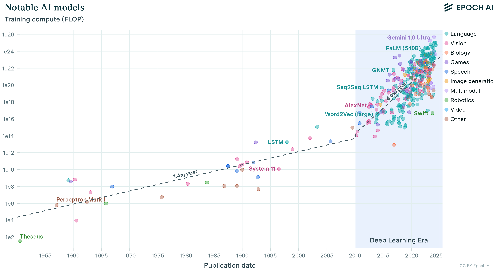

:::

Because each equal loss improvement costs disproportionately more, allocation grows more consequential as budgets grow. The question is how to divide a budget between the size of the model and the training data it consumes.

### Compute-optimal resource allocation {#sec-vol2-intro-computeoptimal-resource-allocation-541a}

Empirical studies of large language models (LLMs) show that, for a fixed computational budget and within the studied scaling regime, balancing model size and dataset size (measured in tokens[^fn-tokens-bpe-tokenizer]) can minimize training loss.

[^fn-tokens-bpe-tokenizer]: **Tokens**\index{Token!vocabulary size trade-off}: Subword units produced by algorithms like byte-pair encoding\index{Byte-pair encoding!subword tokenization}, which iteratively merges the most frequent character pairs in a corpus. Token vocabulary size creates a direct systems trade-off: larger vocabularies can reduce sequence length for some languages and domains, but they expand the embedding table roughly in proportion to vocabulary size. GPT-3 used a `{python} Gpt3StatsScenario.gpt3_vocab_str`-token vocabulary; moving to 100K+ tokens in newer models therefore trades tokenization efficiency against additional embedding memory.

@Fig-compute-optimal decomposes this compute-optimal allocation across three empirical views. In the left panel, U-shaped IsoFLOP contours\index{IsoFLOP curve!optimal model size} plot training loss against parameter counts for fixed compute budgets, with each curve's valley minimum identifying the optimal model capacity for that FLOP ceiling. The center and right panels track how optimal parameters and training tokens scale along coordinated power-law trajectories as compute expands, confirming that compute-optimal training\index{Compute-optimal training!resource allocation} requires advancing model size and token volume in tandem. The highlighted projection markers extrapolate these fits to larger budgets, for example 63B parameters trained on 1.4T tokens for a total of a little over $5 \times 10^{23}$ FLOPs,[^fn-flops-work-rate] illustrating how compute-optimal frontiers guide resource allocation before cluster execution begins.

[^fn-flops-work-rate]: **FLOPs vs. FLOP/s**\index{FLOP/s vs. FLOPs}: A critical distinction: FLOPs denotes total computational work (operations performed), while FLOP/s denotes hardware throughput (operations per second)\index{FLOP/s!work vs. throughput}; confusing the two leads to incorrect cost estimates. GPT-3 required `{python} Gpt3StatsScenario.gpt3_training_ops_str` of work; an A100 delivers `{python} Gpt3StatsScenario.a100_fp16_tflop_per_s_str` of throughput. Dividing work by peak throughput gives ideal wall-clock time, the roughly `{python} Gpt3SingleAccelerator.ideal_years_str` years on one A100 computed at the scale moment. Actual time is approximately $\text{work}/(\EfficiencyHw \PeakRate)$, where the hardware utilization $\EfficiencyHw$ is the achieved fraction of peak throughput, so utilization below one multiplies ideal time by $1/\EfficiencyHw$.

::: {#fig-compute-optimal fig-env="figure" fig-pos="htb" fig-cap="**Optimal compute allocation**: For fixed computational budgets, language model performance depends on balancing model size and training data size; the left panel maps training loss across parameter counts, identifying an efficiency sweet spot for each FLOP level. The center and right panels quantify how optimal parameter counts and token requirements scale predictably as compute increases, demonstrating the need to scale model size and data together to use large training budgets efficiently." fig-alt="Three-panel figure. Left: IsoFLOP curves with U-shaped valleys identifying optimal model sizes. Center: optimal parameters scaling with compute. Right: optimal tokens scaling with compute. Both follow power-law relationships."}

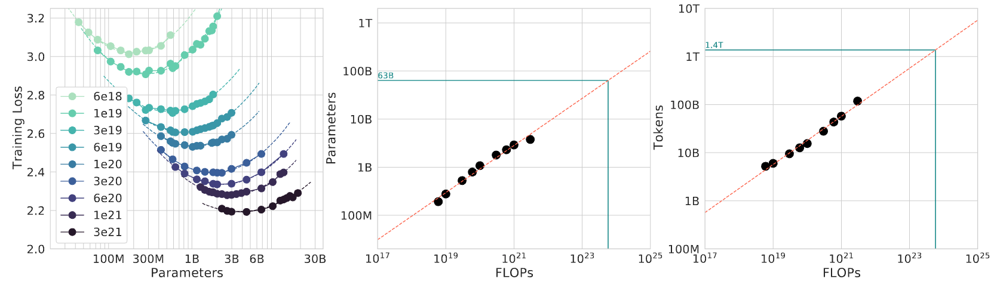

:::

@kaplan2020scaling demonstrated that transformer-based language-model loss follows predictable power-law relationships with model parameters, dataset size (measured in tokens), and total computational budget. The result was not a license to increase every dimension blindly; it showed that model quality depends on coordinated allocation across those resources, a point later sharpened by Chinchilla's compute-optimal scaling analysis [@hoffmann2022chinchilla].

Two further results appear in Kaplan's measurements across parameter scales from $10^3$ to $10^9$ (@fig-kaplan-scaling). Larger models are more sample-efficient, reaching a target loss with substantially fewer training tokens. Compute-efficient training therefore stops far short of full convergence, because an early-stopped larger model attains the target loss with less total compute than a smaller model trained to its plateau.

::: {#fig-kaplan-scaling fig-env="figure" fig-pos="htb" fig-cap="**Scaling laws and compute optimality**: Larger models consistently achieve better performance with increased training data and compute, but diminishing returns necessitate careful resource allocation during training. Optimal model size and training duration depend on the available compute budget, as evidenced by the convergence of loss curves at different parameter scales and training token counts." fig-alt="Two log-scale plots. Left: test loss vs. tokens processed for models from 10^3 to 10^9 parameters, showing larger models achieve lower loss. Right: loss vs. compute, showing convergence at different parameter scales."}

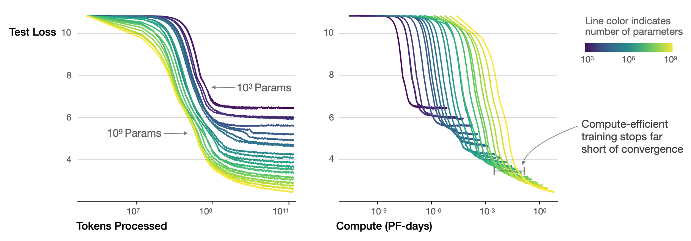

:::

```{python}
#| echo: false
#| label: compute-allocation-anchors
# ┌─────────────────────────────────────────────────────────────────────────────
# │ COMPUTE ALLOCATION AND UTILIZATION ANCHORS (LEGO)
# ├─────────────────────────────────────────────────────────────────────────────
# │ Context: @sec-vol2-intro-computeoptimal-resource-allocation-541a, the
# │          Chinchilla and Megatron-LM paragraphs.
# │
# │ Goal: Source the compute-optimal token ratio and the Megatron-LM
# │       utilization result from MLSysIM.
# │ Show: ~20 tokens per parameter; 3,072 A100 GPUs at 52 percent of peak.
# │ How: Literature.Chinchilla.TokensPerParam; Literature.TrainingRuns.
# │
# └─────────────────────────────────────────────────────────────────────────────
from mlsysim import Literature
from mlsysim.fmt import check, fmt_count, fmt_percent, fmt_ratio

class ComputeAllocationAnchors:
    """Chinchilla token ratio and Megatron-LM (2021) utilization anchors."""

    # ┌── 1. LOAD (Constants) ──────────────────────────────────────────────
    tokens_per_param = float(Literature.Chinchilla.TokensPerParam)
    megatron_gpus = float(Literature.TrainingRuns.MegatronLm2021Gpus)
    megatron_peak_fraction = float(Literature.TrainingRuns.MegatronLm2021PeakFraction)

    # ┌── 2. EXECUTE (The Compute) ────────────────────────────────────────
    # (no derived values; both anchors are quoted directly)

    # ┌── 3. GUARD (Invariants) ──────────────────────────────────────────
    check(tokens_per_param == 20, f"Prose quotes ~20 tokens per parameter, got {tokens_per_param}")
    check(megatron_gpus == 3072, f"Prose quotes 3,072 GPUs, got {megatron_gpus}")
    check(abs(megatron_peak_fraction - 0.52) < 0.005, f"Prose quotes 52 percent of peak, got {megatron_peak_fraction}")

    # ┌── 4. OUTPUT (Formatting) ──────────────────────────────────────────
    tokens_per_param_str = fmt_ratio(tokens_per_param, precision=0)
    megatron_gpus_str = fmt_count(megatron_gpus, label="A100 GPU", plural_label="A100 GPUs")
    megatron_peak_pct_str = fmt_percent(megatron_peak_fraction, precision=0, style='prose')
```

Within the studied regime, the Chinchilla result indicates that model size and training tokens should scale approximately proportionally for compute-optimal training, with a ratio on the order of `{python} ComputeAllocationAnchors.tokens_per_param_str` training tokens per parameter [@hoffmann2022chinchilla]. The projection marker of @fig-compute-optimal, 1.4T tokens for 63B parameters, sits at that ratio. This corrected earlier guidance that favored making models larger while training them on comparatively fewer tokens. The objective is loss at a fixed training-compute budget. A deployment that serves the model repeatedly must also account for inference cost; its preferred allocation need not minimize training compute alone.

A compute-optimal allocation specifies useful computational work; converting that work into elapsed time requires a separate systems model. Communication can grow relative to per-worker computation as a fixed workload is split more finely, creating bandwidth bottlenecks that reduce effective utilization\index{Utilization!distributed training overhead}. At multi-thousand-GPU scale, utilization depends on partitioning and interconnect: @narayanan2021 report Megatron-LM runs on `{python} ComputeAllocationAnchors.megatron_gpus_str` at `{python} ComputeAllocationAnchors.megatron_peak_pct_str` of peak device throughput and note that slower interconnects or communication-heavy partitions hinder scaling.

### Mathematical foundations and operational regimes {#sec-vol2-intro-mathematical-foundations-operational-regimes-9afe}

The power-law proportionality stated with the bitter lesson has a full form that includes an irreducible floor. That form explains why the same fleet can enter different operational regimes, and the subsections below take three cuts through them, each with its own fleet consequence: how compute and data are allocated (which resource to buy next), where diminishing returns set in with dataset size (when storage and data pipelines matter more than accelerators), and when in the model's lifecycle computation is spent (which part of the fleet, training or serving, carries the load).

::: {#thrm-introduction-power-law-scaling-formulation .callout-theorem title="Power-law scaling formulation"}

Scaling laws are expressed formally as power-law relationships. The general formulation is:

$$
\mathcal{L}(X) = \ScaleCoefficient X^{-\ScalingExponentScale} + \IrreducibleLoss
$$

where loss $\mathcal{L}$ decreases as resource quantity $X$ increases, following a power-law decay with rate $\ScalingExponentScale$, plus a baseline constant $\IrreducibleLoss$, the irreducible loss (a constant of the fit, not one of the C$^3$ labels). Here, $\mathcal{L}(X)$ represents the loss achieved with a resource quantity such as parameters, tokens, or compute; $\ScaleCoefficient$ and $\IrreducibleLoss$ are task-dependent constants; and $\ScalingExponentScale$ is the scaling exponent that characterizes the rate of performance improvement. A larger value of $\ScalingExponentScale$ signifies more efficient performance improvements with respect to scaling.

:::

For a fleet, the exponent is the price list. Halving the reducible term $\ScaleCoefficient X^{-\ScalingExponentScale}$ requires multiplying the resource $X$ by $2^{1/\ScalingExponentScale}$, so the smaller the exponent, the larger the multiple of accelerators, tokens, or training time that each further step in quality demands.

These power-law predictions find empirical validation in the family of learning curves plotted in @fig-loss-vs-n-d: across six model scales spanning from 393.2K to 708M parameters, test loss\index{Scaling Laws!loss curves} descends predictably as dataset size grows from $10^7$ toward $3\times 10^{10}$ tokens, with smaller architectures flattening into parameter-capacity plateaus while larger models sustain power-law error reduction.

#### Resource-constrained scaling regimes {#sec-vol2-intro-resourceconstrained-scaling-regimes-062d}

Applying scaling laws in practice is a scarcity diagnosis: the useful question is which resource prevents balanced growth first. Compute budget, data availability, and model size create three regimes with different optimal responses.

In a compute-limited regime\index{Compute-limited regime!resource allocation}, compute scarcity restricts scaling potential despite abundant training data; measured learning curves guide the allocation between model size and training tokens within that budget. In a data-limited regime\index{Data!limited regime}, computational resources exceed what the available dataset can support, meaning that increasing model size is useful only if validation measurements show that the available data can support additional capacity. Between these extremes lies the optimal regime\index{Optimal regime!Chinchilla frontier}, where compute and data grow in balance following compute-optimal scaling laws, as DeepMind demonstrated with Chinchilla by outperforming much larger models through proportional scaling of model size and training data [@hoffmann2022chinchilla]. Recognizing which regime governs a given project prevents common inefficiencies: over-parameterized models with insufficient training data, or under-parameterized models that waste available compute. For the fleet, the diagnosis decides where the next investment goes. A compute-limited project needs accelerator-hours, while a data-limited one gains more from the storage and data pipelines of @sec-data-storage than from additional accelerators.

::: {#fig-loss-vs-n-d fig-env="figure" fig-pos="htb" fig-cap="**Loss vs. dataset size across model scales**: Test loss curves show how models of different sizes (393K to 708M parameters) benefit from increased training data. Larger models achieve lower loss, but all curves exhibit diminishing returns at high token counts." fig-alt="Log-scale scatter plot of loss vs. tokens in dataset. Six curves for model sizes from 393K to 708M parameters. Larger models achieve lower loss, and all curves plateau at high token counts."}

```{python}
#| echo: false
from binder.tools.figures import style as book_style

fig, ax, COLORS, plt = book_style.setup_plot(figsize=(8, 4.5))

models = [
    {
        "name": "393.2K",
        "color": COLORS["BlueLine"],
        "scatter": [(3.05e7, 4.645), (3.05e7, 4.48), (5.9e7, 4.415), (1.14e8, 4.34), (8.3e8, 4.29), (2.3e10, 4.28)],
        "trend": [(1.5e7, 4.595), (3.05e7, 4.47), (5.9e7, 4.395), (1.14e8, 4.35), (8.3e8, 4.3), (3e10, 4.290)],
    },
    {
        "name": "3M",
        "color": COLORS["secondary"],
        "scatter": [(3.05e7, 4.25), (5.9e7, 4.1), (1.14e8, 3.93), (2.2e8, 3.867), (4.3e8, 3.837), (8.3e8, 3.8), (2.3e10, 3.77)],
        "trend": [(1.5e7, 4.46), (3.05e7, 4.25), (5.9e7, 4.08), (1.14e8, 3.96), (2.2e8, 3.867), (4.3e8, 3.814), (8.3e8, 3.789), (3e10, 3.756)],
    },
    {
        "name": "25M",
        "color": COLORS["BrownLine"],
        "scatter": [(3.05e7, 4.25), (5.9e7, 3.941), (1.14e8, 3.735), (2.2e8, 3.567), (4.3e8, 3.415), (8.3e8, 3.325), (2.3e10, 3.27)],
        "trend": [
            (1.5e7, 4.42),
            (3.05e7, 4.17),
            (5.9e7, 3.95),
            (1.14e8, 3.75),
            (2.2e8, 3.58),
            (4.3e8, 3.444),
            (8.3e8, 3.345),
            (3e9, 3.253),
            (3e10, 3.213),
        ],
    },
    {
        "name": "85M",
        "color": COLORS["GreenLine"],
        "scatter": [(3.05e7, 4.21), (5.9e7, 3.941), (1.14e8, 3.69), (2.2e8, 3.472), (4.3e8, 3.31), (8.3e8, 3.12), (1.61e9, 3.04), (2.3e10, 2.97)],
        "trend": [
            (1.5e7, 4.42),
            (3.05e7, 4.17),
            (5.9e7, 3.93),
            (1.14e8, 3.7),
            (2.2e8, 3.499),
            (4.3e8, 3.32),
            (8.3e8, 3.17),
            (1.61e9, 3.064),
            (5e9, 2.955),
            (1e10, 2.92),
            (3e10, 2.913),
        ],
    },
    {
        "name": "302M",
        "color": COLORS["VioletLine"],
        "scatter": [(3.05e7, 4.21), (5.9e7, 3.941), (1.14e8, 3.69), (2.2e8, 3.46), (4.3e8, 3.28), (8.3e8, 3.01), (1.61e9, 2.84), (2.3e10, 2.62)],
        "trend": [
            (1.5e7, 4.42),
            (3.05e7, 4.17),
            (5.9e7, 3.93),
            (1.14e8, 3.7),
            (2.2e8, 3.467),
            (4.3e8, 3.25),
            (8.3e8, 3.054),
            (1.61e9, 2.89),
            (4e9, 2.73),
            (1e10, 2.64),
            (3e10, 2.59),
        ],
    },
    {
        "name": "708M",
        "color": COLORS["OrangeLine"],
        "scatter": [(3.05e7, 4.31), (5.9e7, 3.941), (1.14e8, 3.69), (2.2e8, 3.46), (4.3e8, 3.28), (8.3e8, 3.05), (1.61e9, 2.80), (2.3e10, 2.42)],
        "trend": [
            (1.5e7, 4.42),
            (3.05e7, 4.17),
            (5.9e7, 3.93),
            (1.14e8, 3.7),
            (2.2e8, 3.456),
            (4.3e8, 3.223),
            (8.3e8, 3.013),
            (1.61e9, 2.82),
            (4e9, 2.61),
            (1e10, 2.47),
            (3e10, 2.39),
        ],
    },
]

for m in models:
    sx, sy = zip(*m["scatter"])
    tx, ty = zip(*m["trend"])
    ax.scatter(sx, sy, color=m["color"], s=28, alpha=0.9, zorder=4)
    ax.plot(tx, ty, color=m["color"], linestyle='--', linewidth=1.4, label=m["name"], zorder=3)

ax.set_xscale('log')
ax.set_xlim(1e7, 4e10)
ax.set_ylim(2.2, 4.8)
ax.set_xlabel('Tokens in Dataset')
ax.set_ylabel('Test Loss')
ax.legend(
    title="Model Scale", loc="lower left", frameon=True, framealpha=0.95, facecolor='white', edgecolor='#CBD5E1', fontsize=8.5, title_fontsize=9
)
plt.tight_layout()
plt.show()
plt.close()
```

:::

The second cut follows the return on additional data as a dataset grows, which decides when buying data stops paying. The third follows lifecycle stage, because additional compute can be spent on the foundation run, on adapting the model afterward, or on each request in deployment.

@Fig-data-scaling-regimes partitions dataset scaling into three distinct empirical regimes on log-log coordinates. In the initial Small Data Region, generalization error lingers near the upper Best Guess Error ceiling; as data volume expands into the central Power-Law Region, error drops sharply along a constant slope where data investment yields predictable returns; finally, in the Irreducible Error Region, the curve flattens asymptotically against the Bayes noise floor where further dataset expansion provides negligible gain. The systems consequence is that finite high-quality data, not compute, becomes the binding constraint once a model enters the saturation regime, which is why data efficiency complements brute-force scaling. An observed plateau does not by itself establish that the irreducible floor has been reached, however. Limited coverage, insufficient model capacity, and incomplete optimization can also flatten a learning curve, so the engineering task is to rule out these remediable limits before purchasing more data or compute.

::: {.column-margin .margin-pointer}
↪ The data wall, and the storage traffic a fleet incurs when it generates, filters, and versions synthetic training data, are developed in @sec-storage-synthetic-fuel.
:::

::: {#fig-data-scaling-regimes fig-env="figure" fig-pos="htb" fig-cap="**Data scaling regimes**: Generalization error as a function of dataset size exhibits three distinct phases. In the small-data regime, error stays near the best-guess ceiling; the power-law regime demonstrates predictable error reduction; the irreducible-error regime represents the fundamental noise floor." fig-alt="Log-scale plot of generalization error vs. dataset size with three shaded regions: small data, power law, and irreducible error. Curve shows transition between regimes."}

```{python}
#| echo: false
import numpy as np
from binder.tools.figures import style as book_style

fig, ax, COLORS, plt = book_style.setup_plot(figsize=(8, 4.2))

x = np.linspace(0, 10, 300)
# Sigmoid transition from Best Guess (approx 4.0) to Irreducible Error (approx 1.0)
y = 1.0 + 3.0 / (1.0 + np.exp(1.2 * (x - 4.5)))

# Vertical regions
ax.axvspan(0, 2.8, color=COLORS['OrangeL'], alpha=0.5)
ax.axvspan(2.8, 7.2, color=COLORS['GreenL'], alpha=0.5)
ax.axvspan(7.2, 10, color=COLORS['BlueL'], alpha=0.5)

# Horizontal reference lines
ax.axhline(4.0, color=COLORS['RedLine'], linestyle='--', linewidth=1.2, alpha=0.85)
ax.text(0.3, 4.15, 'Best Guess Error', color=COLORS['RedLine'], fontweight='bold', fontsize=9)

ax.axhline(1.0, color=COLORS['VioletLine'], linestyle='--', linewidth=1.2, alpha=0.85)
ax.text(7.5, 1.22, 'Irreducible Error', color=COLORS['VioletLine'], fontweight='bold', fontsize=9)

# Main curve
ax.plot(x, y, color=COLORS['BlueLine'], linewidth=2.5, zorder=5)

# Region titles at top
ax.text(1.4, 4.65, 'Small Data\nRegion', ha='center', va='center', fontsize=9.5, fontweight='bold', color=COLORS['OrangeLine'])
ax.text(5.0, 4.65, 'Power-Law\nRegion', ha='center', va='center', fontsize=9.5, fontweight='bold', color=COLORS['GreenLine'])
ax.text(8.6, 4.65, 'Irreducible Error\nRegion', ha='center', va='center', fontsize=9.5, fontweight='bold', color=COLORS['BlueLine'])

ax.set_xlim(0, 10)
ax.set_ylim(0.2, 5.2)
ax.set_xlabel('Training Dataset Size (Log-Scale)')
ax.set_ylabel('Generalization Error (Log-Scale)')
ax.set_xticks([])
ax.set_yticks([])
ax.grid(False)
plt.tight_layout()
plt.show()
plt.close()
```

:::

@Fig-scaling-regimes distinguishes three points in the lifecycle where additional computation can change model behavior. Pretraining scaling (orange curve) increases the resource investment in the foundation run. Posttraining scaling (blue curve) adapts an existing model through fine-tuning or preference optimization. Test-time scaling (green callout, "long thinking") spends additional computation on a particular request through intermediate generation, search, or sampling, trading serving latency and throughput for a possible quality gain. Each phase stresses a different part of the fleet. Pretraining is one long, failure-sensitive foundation run whose scaling-law gains must be realized in wall-clock time; posttraining replaces that single massive job with many smaller, coordination-heavy runs; test-time scaling moves computation into the serving path, where it competes with latency targets. The schematic curves do not establish a universal efficiency ranking among these choices, so the full treatments belong with their workloads; test-time compute at serving is treated in @sec-inference-logic-wall. A resource plan must compare measured task improvements and costs before choosing where to spend the next increment of compute.

::: {.column-margin .margin-pointer}
↪ The multi-model coordination that posttraining alignment runs require is developed in @sec-distributed-training-rlhf-coordination.
:::

::: {#fig-scaling-regimes fig-env="figure" fig-pos="htb" fig-cap="**The three scaling phases**: Intelligence (capability) improves through successive scaling regimes. Pretraining scales with compute and data. Posttraining (reinforcement learning from human feedback, instruction tuning) refines behavior. Test-time scaling (chain-of-thought, search) extracts additional capability at inference." fig-alt="Plot of intelligence vs. compute with ascending curve through three labeled phases: pretraining, posttraining, and test-time scaling. Dashed lines extend beyond each phase."}

```{python}
#| echo: false
import numpy as np
from binder.tools.figures import style as book_style

fig, ax, COLORS, plt = book_style.setup_plot(figsize=(8, 4.5))

# Curve stages:
# Pretraining: 0.2 to 3.5
x_pre = np.linspace(0.2, 3.5, 100)
y_pre = 1.0 * np.log(x_pre + 1.0)
ax.plot(x_pre, y_pre, color=COLORS['OrangeLine'], linewidth=2.4, zorder=4)

# Pretraining dashed tangent projection
x_pre_proj = np.linspace(3.5, 7.0, 80)
slope_pre = (y_pre[-1] - y_pre[-10]) / (x_pre[-1] - x_pre[-10])
y_pre_proj = y_pre[-1] + slope_pre * (x_pre_proj - x_pre[-1]) * 0.7
ax.plot(x_pre_proj, y_pre_proj, color=COLORS['OrangeLine'], linestyle='--', linewidth=1.4, alpha=0.5)

# Posttraining: 3.5 to 6.5
x_post = np.linspace(3.5, 6.5, 100)
y_post = y_pre[-1] + 0.6 * (x_post - 3.5) ** 0.85
ax.plot(x_post, y_post, color=COLORS['BlueLine'], linewidth=2.4, zorder=4)

# Posttraining dashed projection
x_post_proj = np.linspace(6.5, 9.2, 60)
slope_post = (y_post[-1] - y_post[-10]) / (x_post[-1] - x_post[-10])
y_post_proj = y_post[-1] + slope_post * (x_post_proj - x_post[-1]) * 0.7
ax.plot(x_post_proj, y_post_proj, color=COLORS['BlueLine'], linestyle='--', linewidth=1.4, alpha=0.5)

# Test-time scaling: 6.5 to 8.8
x_tt = np.linspace(6.5, 8.8, 100)
y_tt = y_post[-1] + 0.75 * (x_tt - 6.5) ** 0.88
ax.plot(x_tt, y_tt, color=COLORS['GreenLine'], linewidth=2.4, zorder=4)

# Test-time projection
x_tt_proj = np.linspace(8.8, 10.2, 40)
slope_tt = (y_tt[-1] - y_tt[-10]) / (x_tt[-1] - x_tt[-10])
y_tt_proj = y_tt[-1] + slope_tt * (x_tt_proj - x_tt[-1]) * 0.75
ax.plot(x_tt_proj, y_tt_proj, color=COLORS['GreenLine'], linestyle='--', linewidth=1.4, alpha=0.5)

# Annotations
ax.annotate(
    'Pretraining scaling',
    xy=(2.2, y_pre[50]),
    xytext=(2.6, 0.4),
    arrowprops=dict(arrowstyle="->", color=COLORS['OrangeLine'], lw=1.2),
    fontsize=9,
    fontweight='bold',
    color=COLORS['OrangeLine'],
)

ax.annotate(
    'Posttraining scaling',
    xy=(5.0, y_post[50]),
    xytext=(5.3, 1.5),
    arrowprops=dict(arrowstyle="->", color=COLORS['BlueLine'], lw=1.2),
    fontsize=9,
    fontweight='bold',
    color=COLORS['BlueLine'],
)

ax.annotate(
    'Test-time scaling\n("long thinking")',
    xy=(7.8, y_tt[50]),
    xytext=(8.3, 3.8),
    arrowprops=dict(arrowstyle="->", color=COLORS['GreenLine'], lw=1.2),
    bbox=dict(boxstyle="round,pad=0.25", fc="white", ec=COLORS['GreenLine'], lw=0.7),
    fontsize=8.5,
    fontweight='bold',
    color=COLORS['GreenLine'],
)

ax.set_xlim(0, 11)
ax.set_ylim(0, 5.8)
ax.set_xlabel('Compute')
ax.set_ylabel('Intelligence')
ax.set_xticks([])
ax.set_yticks([])
ax.grid(False)
plt.tight_layout()
plt.show()
plt.close()
```

:::

### Practical applications in system design {#sec-vol2-intro-practical-applications-system-design-5c97}

```{python}
#| echo: false
#| label: gpt3-optimal-scenario
# ┌─────────────────────────────────────────────────────────────────────────────
# │ GPT-3 COMPUTE-OPTIMAL SCALE (LEGO)
# ├─────────────────────────────────────────────────────────────────────────────
# │ Context: @sec-vol2-intro-practical-applications-system-design-5c97
# │
# │ Goal: Provide GPT-3 scale statistics for compute-optimal discussion.
# │ Show: ~175B parameters.
# │ How: pulling Models.Language.GPT3.parameters from mlsysim.core.units.
# │
# └─────────────────────────────────────────────────────────────────────────────
from mlsysim import Literature, Models
from mlsysim.fmt import check, fmt, fmt_count, fmt_params, fmt_ratio

class Gpt3OptimalScenario:
    """GPT-3 scale reference."""

    # ┌── 1. LOAD (Constants) ──────────────────────────────────────────────
    params = Models.Language.GPT3.parameters.to(param).magnitude
    training_tokens = Models.Language.GPT3.training_tokens.to(count).magnitude
    chinchilla_tokens_per_param = float(Literature.Chinchilla.TokensPerParam)

    # ┌── 2. EXECUTE (The Compute) ────────────────────────────────────────
    params_b = params / BILLION
    tokens_per_param = training_tokens / params

    # ┌── 3. GUARD (Invariants) ──────────────────────────────────────────
    check(params_b == 175, f"GPT-3 should be 175B params, got {params_b}")
    check(tokens_per_param < chinchilla_tokens_per_param / 5, "Prose says GPT-3 was undertrained relative to Chinchilla")

    # ┌── 4. OUTPUT (Formatting) ──────────────────────────────────────────────
    gpt3_params_b_str = fmt_params(Models.Language.GPT3.parameters, scale="B", precision=0, commas=False)
    gpt3_training_tokens_billion_str = fmt_count(training_tokens, scale="billion", precision=0)
    gpt3_tokens_per_param_str = fmt_ratio(tokens_per_param, precision=1)
```

When sizing GPT-3, the authors used scaling-law extrapolations to choose model size and training data [@brown2020language; @kaplan2020scaling]. They trained an established transformer architecture with `{python} Gpt3OptimalScenario.gpt3_params_b_str` parameters and approximately `{python} Gpt3OptimalScenario.gpt3_training_tokens_billion_str` tokens, about `{python} Gpt3OptimalScenario.gpt3_tokens_per_param_str` tokens per parameter. Against the roughly `{python} ComputeAllocationAnchors.tokens_per_param_str` tokens per parameter of the later Chinchilla results, that point was undertrained relative to compute-optimal token allocation [@hoffmann2022chinchilla].

The practical decision is how to divide a fixed budget among model size, data, and training duration. Empirical curves estimate the quality attainable with that allocation; measurements of the chosen workload and fleet establish its execution cost. A plan needs both estimates before it can connect a target capability to a completion deadline or operating budget.

### Sustainability and cost implications {#sec-vol2-intro-sustainability-cost-implications-0473}

```{python}
#| echo: false
#| label: gpt3-run-resources
# ┌─────────────────────────────────────────────────────────────────────────────
# │ GPT-3 RUN RESOURCES (LEGO)
# ├─────────────────────────────────────────────────────────────────────────────
# │ Context: opening paragraph of
# │          @sec-vol2-intro-sustainability-cost-implications-0473.
# │
# │ Goal: Quantify the accelerator time and electricity of one landmark run.
# │ Show: ~148,000 V100 GPU-days (10,000 GPUs x ~14.8 days); ~1,287 MWh.
# │ How: Models.Language.GPT3 training_accelerators_ref x training_days_ref;
# │      Models.Language.GPT3.training_energy_mwh (Patterson et al. 2021).
# │
# └─────────────────────────────────────────────────────────────────────────────
from mlsysim import Models
from mlsysim.fmt import check, fmt_count, fmt_energy

class Gpt3RunResources:
    """Accelerator-days and electricity for the GPT-3 training run."""

    # ┌── 1. LOAD (Constants) ──────────────────────────────────────────────
    accelerators = Models.Language.GPT3.training_accelerators_ref.to(count).magnitude
    days = Models.Language.GPT3.training_days_ref.to(day).magnitude
    energy_q = Models.Language.GPT3.training_energy_mwh

    # ┌── 2. EXECUTE (The Compute) ────────────────────────────────────────
    gpu_days = accelerators * days

    # ┌── 3. GUARD (Invariants) ──────────────────────────────────────────
    check(1e5 < gpu_days < 2e5, f"GPT-3 should be about 148,000 GPU-days, got {gpu_days:.0f}")
    check(1000 < energy_q.to(MWh).magnitude < 2000, "GPT-3 training energy should be about 1,287 MWh")

    # ┌── 4. OUTPUT (Formatting) ──────────────────────────────────────────
    gpu_days_str = fmt_count(round(gpu_days, -3))
    energy_mwh_str = fmt_energy(energy_q, unit=MWh, precision=0, commas=True)
```

Scaling laws reveal performance pathways while exposing rapidly escalating resource demands. As models expand, training and deployment costs grow disproportionately, creating tension between performance gains and system efficiency. GPT-3's run alone occupied about `{python} Gpt3RunResources.gpu_days_str` GPU-days and drew an estimated `{python} Gpt3RunResources.energy_mwh_str` of electricity [@patterson2021carbon], and later frontier runs use more accelerators for longer.

```{python}
#| echo: false
#| label: grid-siting-contrast
# ┌─────────────────────────────────────────────────────────────────────────────
# │ GRID SITING CONTRAST (LEGO)
# ├─────────────────────────────────────────────────────────────────────────────
# │ Context: @sec-vol2-intro-sustainability-cost-implications-0473 and
# │          footnote fn-carbon-grid-intensity.
# │
# │ Goal: Show how grid choice alone scales training emissions.
# │ Show: Quebec ~20 g/kWh vs Poland ~820 g/kWh (~41x); GPT-3's reported
# │       552 t CO2 training footprint.
# │ How: Infrastructure.Grids carbon intensities; ratio at fixed energy;
# │      Models.Language.GPT3.training_co2e (Patterson et al. 2021).
# │
# └─────────────────────────────────────────────────────────────────────────────
from mlsysim import Infrastructure, Models
from mlsysim.fmt import check, fmt_carbon_intensity, fmt_emissions, fmt_multiple

class GridSitingContrast:
    """Carbon-intensity contrast between a hydro grid and a coal grid."""

    # ┌── 1. LOAD (Constants) ──────────────────────────────────────────────
    intensity_quebec = Infrastructure.Grids.Quebec.carbon_intensity_g_kwh * (gram / kWh)
    intensity_poland = Infrastructure.Grids.Poland.carbon_intensity_g_kwh * (gram / kWh)
    gpt3_co2e = Models.Language.GPT3.training_co2e

    # ┌── 2. EXECUTE (The Compute) ────────────────────────────────────────
    # Same energy on both grids, so the emissions ratio is the intensity ratio.
    siting_ratio = (intensity_poland / intensity_quebec).to("").magnitude

    # ┌── 3. GUARD (Invariants) ──────────────────────────────────────────
    check(35 < siting_ratio < 45, f"Prose says roughly 40x; got {siting_ratio:.1f}")
    check(100 <= gpt3_co2e.to(metric_ton).magnitude <= 1000, "Footnote places GPT-3 inside the 10^2 to 10^3 t range")

    # ┌── 4. OUTPUT (Formatting) ──────────────────────────────────────────
    quebec_g_per_kwh_str = fmt_carbon_intensity(intensity_quebec, unit=gram / kWh, precision=0)
    poland_g_per_kwh_str = fmt_carbon_intensity(intensity_poland, unit=gram / kWh, precision=0)
    siting_ratio_mult_str = fmt_multiple(siting_ratio, precision=0)
    gpt3_co2e_tonnes_str = fmt_emissions(gpt3_co2e, unit=metric_ton, precision=0)
```

The sharpest of these costs is environmental, and it turns on a decision the fleet operator controls, the siting of the cluster. The same training run can differ by roughly `{python} GridSitingContrast.siting_ratio_mult_str` in CO~2~ emissions depending on grid location\index{Carbon emissions!grid intensity}, with grid carbon intensity ranging from about `{python} GridSitingContrast.quebec_g_per_kwh_str` of CO~2~ for Quebec hydropower to about `{python} GridSitingContrast.poland_g_per_kwh_str` for Poland coal.[^fn-carbon-grid-intensity] That single placement choice, together with job scheduling that shifts workloads to low-carbon hours, makes data-center siting a first-order infrastructure decision rather than an afterthought. Financial cost scales with the same accelerator-days and megawatt-hours, which limits who can do large-scale research at all.

::: {.column-margin .margin-pointer}
↪ How site selection and grid carbon intensity set the emissions of the same training run is developed in @sec-sustainable-ai-scale-environmental-impact-ac9a.
:::

[^fn-carbon-grid-intensity]: **Carbon intensity of training**\index{Training!carbon intensity}: GPT-3 training emitted an estimated `{python} GridSitingContrast.gpt3_co2e_tonnes_str` of CO~2~, and published estimates place large-language-model training in the $10^2$ to $10^3$ ton range, though figures vary widely with hardware, utilization, and electricity mix [@patterson2021carbon].

Scaling laws do not guarantee unbounded improvement. Each incremental performance gain must be weighed against its resource cost. As systems approach practical scaling limits, the emphasis shifts from scaling alone to efficient scaling: balancing performance, cost, energy consumption, and environmental impact.[^fn-scaling-saturation-qualifier]

[^fn-scaling-saturation-qualifier]: **Scaling law saturation**\index{Scaling Laws!saturation}: Power-law relationships\index{Power-law relationship!scaling empirical basis} with a baseline loss term approach that floor rather than predict unbounded loss reduction. Downstream utility may also improve little even while the fitted loss decreases, which this book calls **semantic saturation**\index{Semantic saturation!definition}. That distinction motivates testing data efficiency\index{Data efficiency!scaling saturation mitigation} or model compression against task utility and resource cost; neither technique guarantees that a genuine information limit can be overcome.

### Scaling law breakdown conditions {#sec-vol2-intro-scaling-law-breakdown-conditions-1f8c}

A resource plan must also identify where its empirical fit ceases to apply, because scaling laws are fitted within the regimes in which they were measured and need not hold beyond them. Most breakdowns at those boundaries share one root cause, growth in one dimension that outpaces the others. @hoffmann2022chinchilla show that many large language models were undertrained because model size grew faster than training-token budgets, and that compute-optimal training requires scaling parameters and tokens together. Hardware ceilings belong to the same family, because memory bandwidth, interconnect capacity, and I/O throughput cap how far a larger model can be distributed at all. Each imbalance requires different evidence. Training measurements can reveal an unsuitable optimization schedule; held-out evaluation can distinguish improved generalization from memorization; and execution traces can reveal whether bandwidth or I/O prevents the fleet from completing the planned work. A lower benchmark loss also does not establish robustness to adversarial or out-of-distribution inputs. @Tbl-scaling-breakdown organizes these possible failure modes, mapping each breakdown type\index{Scaling!breakdown type} to a candidate cause and a representative scenario. The table guides investigation rather than inferring a cause from a plateau alone.

| **Dimension Scaled**   |  **Type of Breakdown**  | **Underlying Cause**                           | **Example Scenario**                          |
|:-----------------------|:-----------------------:|:-----------------------------------------------|:----------------------------------------------|
| **Model Size**         |       Overfitting       | Model capacity exceeds available data          | Billion-parameter model on limited dataset    |
| **Training Data Size** |   Diminishing Returns   | Saturation of new or diverse information       | Scaling web text beyond useful threshold      |
| **Compute Budget**     | Underutilized Resources | Insufficient training steps or inefficient use | Large model with truncated training duration  |
| **Imbalanced Scaling** |       Inefficiency      | Uncoordinated increase in model/data/compute   | Doubling model size without more data or time |
| **All Dimensions**     |   Semantic Saturation   | Exhaustion of learnable patterns in the domain | No further gains despite scaling all inputs   |

: **Possible scaling breakdowns**: The rows describe risks and representative scenarios, not inevitable consequences of increasing one resource. Training and validation measurements establish which failure mode, if any, applies to a particular allocation. {#tbl-scaling-breakdown}

::: {#chk-introduction-applying-scaling-laws .callout-checkpoint title="Applying scaling laws"}

These questions check whether scaling laws are being used as resource-allocation tools:

- [ ] **Compute vs. data regime**: identify the learning-curve evidence needed to choose between a larger model trained for fewer steps and a smaller model trained for more steps under fixed compute and limited data.
- [ ] **Scaling breakdown**: explain the risks of doubling model parameters at fixed dataset size, and what training and validation evidence would distinguish undertraining from overfitting.
- [ ] **Chinchilla optimality**: explain why Chinchilla optimality serves as a resource-allocation target and identify the minimized quantity.
- [ ] **Compute vs. capability**: classify the claim as true or false: scaling laws predict that doubling compute always yields a doubling of model capability.

:::

### Integrating efficiency with scaling {#sec-vol2-intro-integrating-efficiency-scaling-a513}

Scaling laws reveal the walls; efficiency engineering builds the paths around them. Data saturation, infrastructure bottlenecks, and diminishing returns set hard limits on what brute-force scaling can achieve. The same constraints, however, point toward solutions along three interconnected dimensions. Algorithmic efficiency relies on techniques such as sparsity and distillation to extract more capability per FLOP. Data efficiency uses curriculum learning and active selection to extract more information per training example. Systems efficiency uses communication hiding and pipeline overlap to extract more utilization per accelerator. Each dimension addresses a different breakdown condition from @tbl-scaling-breakdown, so identifying the limiting resource determines whether efficiency work should target the algorithm, the data, or the execution system. Systems efficiency is the subject of @sec-distributed-training-systems and @sec-collective-communication, algorithmic levers such as reduced precision and sparse mixture-of-experts execution appear in @sec-performance-engineering, and data efficiency under device budgets returns in @sec-edge-intelligence-data-efficiency-c701.

Scaling laws and efficiency techniques determine how much computation large models require and how well the fleet uses it. They do not, however, address the physical and logical constraints that the fleet itself imposes. Hardware fails, bandwidth saturates, distributed systems face fundamental impossibility results, and societal impact at scale demands governance. These constraints cannot be optimized away; they must be engineered around.

## Constraints of Scale {#sec-vol2-introduction-constraints-scale}

Scaling laws set how much work the fleet must perform; the three walls of the scale moment describe where performing it binds. The constraints behind those walls are broader. The machine learning fleet operates under three categories of irreducible constraint: physical (the memory, network, and energy walls themselves, plus the reliability gap that opens as fleet size grows), logical (distributed systems face impossibility results like the CAP theorem), and societal (scale amplifies the impact of every technical decision). For an initial C$^3$ diagnosis, the distinctions matter because a slow step may reflect a communication limit or coordination loss, while an otherwise fast design may exceed its energy or governance budget. The formal time decomposition follows after these examples establish what it must account for.

### The reliability gap {#sec-vol2-introduction-reliability-gap}

High individual-component availability does not guarantee high availability for a tightly coupled fleet. This distinction opens the **reliability gap**\index{Reliability gap!definition}: components that are reliable in isolation do not imply that every component required by an unreplicated job will be available simultaneously. Notebook \ref{nbk-introduction-scale-reliability} measured the gap as a rate, how often the job is interrupted; availability measures it as a probability, how likely it is that every required component is up at a given instant. Both views rest on the same independence assumption and degrade the same way as the job grows. For a `{python} Gpt4TrainingScenario.gpt4_gpus_count_str`-GPU job that can make progress only while every GPU is available, @eq-reliability-gap multiplies the component availabilities under an independence assumption to give the probability that all required components are available at the same instant ($A_{\text{all}}$):

$$ A_{\text{all}} = (A_{\text{component}})^N $$ {#eq-reliability-gap}

Here, $N$ is the number of independent components that the job requires simultaneously, and $A_{\text{component}}$ is the availability of one component. The engineering implication is the exponent: every added required component lowers the probability that the full set is available, so reliability engineering becomes a scaling problem rather than a cleanup task.

```{python}
#| echo: false
from mlsysim.fmt import fmt_int

# ┌─────────────────────────────────────────────────────────────────────────────
# │ RELIABILITY GAP CALCULATION
# ├─────────────────────────────────────────────────────────────────────────────
# │ Context: "The Reliability Gap" section
# │
# │ Goal: Quantify why massive scale makes all-required-node availability low.
# │ Show: Four-nines annual downtime and near-zero all-node availability.
# │ How: (1 - 0.9999) × 365 days; (0.999)^N for N=1000 and N=10000.
# │
# └─────────────────────────────────────────────────────────────────────────────
from mlsysim.fmt import fmt, check, fmt_count, fmt_percent, fmt_time

# ┌── LEGO ───────────────────────────────────────────────
class ReliabilityGap:
    """
    Calculates simultaneous availability for all nodes required by a job.
    """

    # ┌── 1. LOAD (Constants) ───────────────────────────────────────────────
    a_node = 0.999  # scenario assumption: illustrative per-node availability
    a_four_nines = 0.9999  # scenario assumption: comparison level, not a typical-server claim
    calendar_year = 365 * day  # Explicit accounting interval
    n_small = 1000  # scenario assumption: smaller job size (required nodes)
    n_large = 10000  # scenario assumption: larger job size (required nodes)

    # ┌── 2. EXECUTE (The Compute) ─────────────────────────────────────────
    four_nines_downtime = ((1 - a_four_nines) * calendar_year).to(minute)
    a_all_small = (a_node**n_small) * 100
    a_all_large = (a_node**n_large) * 100
    a_all_large_four_nines = (a_four_nines**n_large) * 100

    # ┌── 3. GUARD (Invariants) ───────────────────────────────────────────
    check(52.55 < four_nines_downtime.magnitude < 52.57, "Four-nines downtime must be about 52.56 minutes per 365-day year")
    check(a_all_large < 1.0, f"All-required-node availability ({a_all_large:.2f}%) should be near zero.")
    check(abs(a_all_small - a_all_large_four_nines) < 0.1, "Caption says both highlighted points sit at the same all-node availability")

    # ┌── 4. OUTPUT (Formatting) ──────────────────────────────────────────────
    four_nines_downtime_str = fmt_time(four_nines_downtime, minute, precision=2, style='word')
    node_availability_str = fmt_percent(a_node, precision=1, commas=False, style='prose')
    availability_1k_str = fmt_percent(a_all_small / 100, precision=1, style='prose')
    availability_10k_str = fmt_percent(a_all_large / 100, precision=4, style='prose')
    availability_four_nines_10k_str = fmt_percent(a_all_large_four_nines / 100, precision=1, style='prose')
    four_nines_pct_str = fmt_percent(a_four_nines, precision=2, style='prose')
    n_small_str = fmt_count(n_small)
    n_large_str = fmt_count(n_large)
```

For a single component, `{python} ReliabilityGap.four_nines_pct_str` availability corresponds to `{python} ReliabilityGap.four_nines_downtime_str` of unavailability per 365-day year. This is a time fraction, not a count of failures.

If each node has an illustrative `{python} ReliabilityGap.node_availability_str` availability and an unreplicated job requires every node, the probability that all `{python} ReliabilityGap.n_small_str` required nodes are available simultaneously is only `{python} ReliabilityGap.availability_1k_str`. Scale that job to `{python} ReliabilityGap.n_large_str` required nodes, and this probability drops to `{python} ReliabilityGap.availability_10k_str`. Adding a nine to every node only postpones the collapse, because the exponent $N$ eventually overwhelms any per-node availability below one (@fig-reliability-gap-collapse).

::: {#fig-reliability-gap-collapse fig-env="figure" fig-pos="htb" fig-cap="**The reliability collapse**: The simultaneous availability of every node required by an unreplicated job, shown as a function of job size for two per-node availability levels under an independence assumption. At `{python} ReliabilityGap.node_availability_str` per-node availability (blue), all-node availability is only `{python} ReliabilityGap.availability_1k_str` for a `{python} ReliabilityGap.n_small_str`-GPU job and approaches zero for a `{python} ReliabilityGap.n_large_str`-GPU job. Even `{python} ReliabilityGap.four_nines_pct_str` per-node availability (green) yields `{python} ReliabilityGap.availability_four_nines_10k_str` at `{python} ReliabilityGap.n_large_str`-GPU scale." fig-alt="Line chart with log-scale x-axis showing simultaneous all-node availability vs. job size from 1 to 10000 GPUs. Two curves decline from 100 percent, with the 99.9 percent per-node availability curve dropping steeply."}

```{python}
#| echo: false
import numpy as np
from binder.tools.figures import style as book_style

fig, ax, COLORS, plt = book_style.setup_plot(figsize=(8, 4.5))

# Scenario inputs come from the ReliabilityGap LEGO cell above.
r_lo = ReliabilityGap.a_node
r_hi = ReliabilityGap.a_four_nines
n_small = ReliabilityGap.n_small
n_large = ReliabilityGap.n_large
pct_lo = 100 * r_lo
pct_hi = 100 * r_hi

N = np.logspace(0, np.log10(n_large), 500)
a_999 = (r_lo**N) * 100
a_9999 = (r_hi**N) * 100

# Danger collapse zone (N >= n_small at the lower availability)
mask = N >= n_small
ax.fill_between(N[mask], 0, a_999[mask], color=COLORS['RedL'], alpha=0.5, label='Collapse Zone')

# Curves
ax.plot(N, a_999, color=COLORS['BlueLine'], linewidth=2.3, label=f'{pct_lo:g}% Per-Node Availability ($r = {r_lo:g}$)')
ax.plot(N, a_9999, color=COLORS['GreenLine'], linewidth=2.3, label=f'{pct_hi:g}% Per-Node Availability ($r = {r_hi:g}$)')

# Key reference line at the smaller job size
ax.axvline(n_small, color=COLORS['grid'], linestyle='--', linewidth=1.2)
ax.text(n_small, 102.5, f'N = {n_small:,}', ha='center', va='bottom', fontsize=8.5, fontstyle='italic', color=COLORS['primary'])

# Highlight points
y_small_lo = r_lo**n_small * 100
y_large_hi = r_hi**n_large * 100
y_large_lo = r_lo**n_large * 100
ax.scatter([n_small], [y_small_lo], color=COLORS['BlueLine'], s=38, zorder=5)
ax.scatter([n_large], [y_large_hi], color=COLORS['GreenLine'], s=38, zorder=5)
ax.scatter([n_large], [y_large_lo], color=COLORS['RedLine'], s=38, zorder=5)

# Annotations with breathing room
ax.annotate(
    f'{pct_lo:g}% / Node\nN={n_small:,} → {y_small_lo:.1f}%',
    xy=(n_small, y_small_lo),
    xytext=(200, 24),
    arrowprops=dict(arrowstyle="->", color=COLORS['BlueLine'], lw=1.2),
    bbox=dict(boxstyle="round,pad=0.35", fc="white", ec=COLORS['BlueLine'], lw=0.8),
    fontsize=8,
    fontweight='bold',
    color=COLORS['BlueLine'],
)

ax.annotate(
    f'{pct_hi:g}% / Node\nN={n_large:,} → {y_large_hi:.1f}%',
    xy=(n_large, y_large_hi),
    xytext=(1300, 38),
    arrowprops=dict(arrowstyle="->", color=COLORS['GreenLine'], lw=1.2),
    bbox=dict(boxstyle="round,pad=0.35", fc="white", ec=COLORS['GreenLine'], lw=0.8),
    fontsize=8,
    fontweight='bold',
    color=COLORS['GreenLine'],
)

ax.annotate(
    f'N={n_large:,} Collapse\n{pct_lo:g}% → {y_large_lo:.4f}%',
    xy=(n_large, y_large_lo),
    xytext=(2300, 14),
    arrowprops=dict(arrowstyle="->", color=COLORS['RedLine'], lw=1.2),
    bbox=dict(boxstyle="round,pad=0.35", fc=COLORS['RedL'], ec=COLORS['RedLine'], lw=0.8),
    fontsize=8,
    fontweight='bold',
    color=COLORS['RedLine'],
)

ax.set_xscale('log')
ax.set_xlim(1, n_large * 1.3)
ax.set_ylim(-2, 110)
_ticks = [10**k for k in range(int(np.log10(n_large)) + 1)]
ax.set_xticks(_ticks)
ax.set_xticklabels([f'{t:,}' for t in _ticks])
ax.set_yticks([0, 20, 40, 60, 80, 100])
ax.set_yticklabels(['0%', '20%', '40%', '60%', '80%', '100%'])
ax.set_xlabel('Fleet Size (Nodes / Accelerators), Log Scale')
ax.set_ylabel('Fleet Availability $A = r^N$ (%)')
ax.legend(loc='lower left', frameon=True, framealpha=0.95, facecolor='white', edgecolor='#CBD5E1', fontsize=8.5)
plt.tight_layout()
plt.show()
plt.close()
```

:::

The collapse zone isolated in @fig-reliability-gap-collapse makes the architectural consequence clear: because simultaneous all-node availability drops precipitously toward zero as job size expands into the thousands, an unreplicated synchronous workload cannot rely on unbroken component uptime. @Sec-appdx-reliability-foundations-failure-probability replaces this single per-node availability figure with the full failure-probability model, from component failure rates to the chance that a job fails before it finishes. The engineering lesson is that failure is the common case. At scale, resilience\index{Resilience!fleet-scale objective} replaces prevention as the governing objective: the system trades absolute uptime for recovery speed, checkpoint quality, and automated repair.

::: {.column-margin .margin-pointer}
↪ The shift from keeping every component running to a fleet that recovers automatically when components fail is developed in @sec-fault-tolerance-reliability.
:::

### Communication intensity (the CI ratio) {#sec-vol2-introduction-ci-ratio}

If arithmetic intensity governs where a single accelerator stalls, **communication intensity (CI)**\index{Communication intensity!definition} governs where a fleet stalls. On a single accelerator, the roofline model\index{Roofline model!compute vs. memory bound} determines whether a kernel is compute-bound or memory-bound. At fleet scale, this analysis elevates to the network.

@Eq-ci-ratio defines communication intensity as the ratio of data moved across the network to the operations performed locally. The numerator counts bytes and the denominator counts operations for the same worker and interval, such as one training step; the ratio therefore has units of bytes per operation. A comparison must also state whether it counts sent bytes, received bytes, or both:

$$\CommunicationIntensity = \frac{M}{O}$$ {#eq-ci-ratio}

where $M$ is the number of bytes the worker moves across the network and $O$ is the number of operations it performs locally in the same interval.

::: {.column-margin}
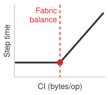{width="100%" fig-alt="A curve that stays flat at low communication intensity then bends sharply upward past a dashed red threshold line labeled CI, marking the bandwidth-saturation point where adding accelerators stops helping."}

*Past the communication-intensity cliff, adding GPUs stops helping.*
:::

Low communication intensity describes compute-heavy workloads whose accelerators spend most of their time doing math, so scaling is comparatively easy. High communication intensity describes workloads whose network demand approaches the available fabric balance; in that regime, bisection bandwidth can bind and adding more accelerators can slow training rather than speed it up. The boundary is configuration-specific because it depends on both local compute throughput and effective network bandwidth.

Communication and scaling optimizations, from gradient sparsification (sending fewer gradient bytes) to 3D parallelism\index{3D parallelism!communication intensity reduction} (partitioning data, tensor, and pipeline dimensions across different fabric tiers), change how much data moves and where it moves. Overlapping a transfer with independent computation can instead reduce exposed waiting time without changing bytes per operation. The ratio describes workload demand; the fabric and execution schedule determine how much of that demand delays progress.

::: {.column-margin .margin-pointer}
↪ The communication-computation ratio, and the threshold beyond which communication can no longer hide behind computation, are developed in @sec-appdx-fleet-foundations-comm-compute-ratio.
:::

::: {#chk-introduction-scale-mandate .callout-checkpoint title="The scale mandate"}

These questions check whether the scale mindset has shifted from local execution to distributed constraints:

- [ ] **Communication intensity**: explain in CI-ratio terms why adding more nodes ($N$) to a high-CI workload can slow training rather than speed it up.
- [ ] **Reliability gap**: explain the reliability gap that prevents a 10,000-GPU cluster from remaining "perfectly healthy."
- [ ] **Arithmetic vs. communication**: distinguish arithmetic intensity\index{Arithmetic intensity!vs. communication intensity} (local memory) from communication intensity (global network).

:::

### Distribution complexity and physical boundaries {#sec-vol2-introduction-why-distribution-hard}

Scale forces distribution: no single machine provides the compute required for the largest models, and no centralized system can collect every data source that global user bases generate. Coordinating computation across physically separated machines connected by finite-bandwidth networks, however, creates constraints that no engineering can eliminate.

The first stressor appears inside data centers, where synchronous training must choose how much consistency to preserve under partitions and failures. The second appears at the edge, where the devices themselves are unreliable, power-limited, and policy-constrained.

#### The CAP theorem reality {#sec-introduction-cap-theorem-reality-f3b0}

The **CAP theorem**\index{CAP theorem!definition}[^fn-cap-theorem-ml] establishes that an asynchronous distributed system subject to a network partition cannot guarantee both atomic **consistency**\index{Consistency!definition} and **availability**\index{Availability!definition}. **Partition tolerance**\index{Partition tolerance!definition} describes the network condition under which that trade-off applies, not a third interchangeable property that a system can simply discard.

[^fn-cap-theorem-ml]: **CAP (Consistency, Availability, Partition Tolerance) Theorem** (Brewer's Theorem): Brewer formulated the conjecture [@brewer2000], and Gilbert and Lynch proved that an asynchronous system cannot guarantee both atomic consistency and availability when the network may partition [@gilbert2002]. Synchronous and asynchronous training provide a useful analogy for this trade-off, but gradient freshness is not the atomic consistency property in the theorem.

Training is not a replicated database, and gradient freshness is not the theorem's atomic consistency, yet training faces the same forced choice when a worker becomes unreachable, whether to wait for it or proceed without it. Synchronous training favors a shared current model state but can halt when a required worker becomes unreachable. Asynchronous training can continue through stragglers or unavailable workers but may use stale model versions. Federated learning similarly accepts temporarily divergent local models so that intermittent edge devices can participate without continuous connectivity.

#### Edge distribution complexity {#sec-introduction-edge-distribution-complexity-71e9}

The coordination challenges discussed so far assume data-center distribution, where machines run in managed facilities. At the network edge, these challenges intensify along every dimension.

Billions of smartphones and IoT devices operate in uncontrolled environments with unreliable connectivity and limited power. Privacy, consent, or policy constraints may prevent raw data from leaving the device, making federated learning a natural architecture [@mcmahan2017communication]. Intermittent connectivity requires a participation policy, which may select currently available devices for a round or admit delayed updates under stated rules. Keeping raw data local does not by itself protect information exposed through model updates. Device budgets and the threat model determine whether additional compression, privacy mechanisms, or local execution are appropriate.

### Governance and systemic risk at scale {#sec-vol2-introduction-why-governance-matters}

::: {.column-margin}
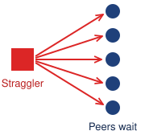{width="100%" fig-alt="One technical bug fanning out to user or system nodes."}

*At fleet scale, a technical bug becomes societal risk.*
:::

Scale and distribution amplify impact beyond engineering. When a system serves billions of users, a technical bug becomes a societal risk. This amplification increases the reach of governance failures; smaller deployments still require controls appropriate to their uses and potential harms. Governance functions as the **control plane**\index{Control Plane!definition} of the machine learning fleet, not as a set of external rules.

That control plane first has to defend the fleet. ML systems face unique security threats that intensify at production scale. Model extraction\index{Model extraction!preview} attacks steal proprietary intellectual property through API queries. Data poisoning\index{Data poisoning!preview} manipulates training data to alter learned behavior; one objective is a backdoor that activates on a chosen input. At fleet scale, these threats become economically attractive targets for sophisticated attackers. Defending the fleet requires systematic approaches: access controls, differential privacy (calibrated noise that bounds how much any single training record can influence what the model reveals), and continuous behavioral monitoring that go far beyond traditional perimeter security.

::: {.column-margin .margin-pointer}
↪ Defenses against data poisoning, model extraction, and gradient inversion across distributed fabrics are developed in @sec-security-privacy.
:::

The same control plane must make the fleet auditable. Systems operating at scale attract regulatory attention. Regimes such as the EU AI Act\index{EU AI Act!auditability requirement} and local privacy laws make **auditability**\index{Auditability!definition}, the ability to reconstruct after the fact which data, code, and decisions produced a model's behavior, an architectural requirement for many deployments. Auditing whether a model trained on 10,000 GPUs ingested prohibited data requires end-to-end data lineage tracking, supported by controls that capture ingestion and subsequent transformations. A lineage record cannot establish the absence of inputs that were never recorded. Generating a human-interpretable explanation for a recommendation served within a tail-latency budget of tens of milliseconds demands techniques designed into the serving architecture. Meeting these requirements calls for technical capabilities (audit trails, bias testing, and consent management) built into the infrastructure from day one.

Beyond legal compliance, the machine learning fleet carries ethical obligations. Recommendation algorithms shape public discourse; hiring algorithms affect livelihoods. These systems rarely fail loudly; harm accumulates silently through bias and polarization, without a crash log. Responsible AI\index{Responsible AI!at scale} turns fairness, transparency, and accountability requirements into operational invariants\index{Invariant!responsible AI} with defined evidence, owners, and responses. A violation may require withholding a release, routing affected decisions to review, or suspending an unsafe operation; the response must contain the relevant harm. Together, these physical, logical, and societal constraints define the operating envelope of the fleet. Turning them into actionable systems decisions requires a diagnostic taxonomy that can isolate whether execution time is lost to local arithmetic, wire transit, or orchestration overhead.

## The C$^3$ Taxonomy and Foundations of Scale {#sec-vol2-introduction-c-cube}

An idle accelerator does not identify its own bottleneck. It may be waiting for local operands, a gradient transfer, or a failed peer. The C$^3$ lens introduced at the scale moment separates these explanations and gives the preceding examples a common diagnostic language. On a single machine, diagnosing performance follows the **Data · Algorithm · Machine (D·A·M) taxonomy**\index{D·A·M taxonomy!definition}. In that framework, Data\index{D·A·M taxonomy!data} governs what information the model learns from; the Algorithm\index{D·A·M taxonomy!algorithm}\index{Algorithm!D·A·M taxonomy} defines the mathematical operations to execute; and the Machine\index{D·A·M taxonomy!machine} supplies the silicon and memory hierarchy executing those operations.

::: {.column-margin .margin-pointer}
↪ The D·A·M taxonomy as a complete single-node framework, with its diagnostic summary, roofline bound, and scorecard, is developed in @sec-appdx-dam-taxonomy.
:::

When workloads stretch across thousands of interconnected nodes, the execution bottleneck shifts. Datacenter hardware is procured and cabled around three physical pillars: Compute, Network, and Storage. At runtime, however, distributed execution spends wall-clock time in three distinct operational dimensions: Compute ($C_1$), Communication ($C_2$), and Coordination ($C_3$). Together, they form the C$^3$ taxonomy\index{C³ taxonomy!operational dimensions}.

Storage is not absent from this runtime model; rather, storage serves as the persistent physical substrate spanning all three dimensions. It acts as an extension of the node memory hierarchy in Compute ($C_1$), a high-throughput streaming pipeline across Communication ($C_2$), and the durable checkpointing engine required for fault-tolerant Coordination ($C_3$).

Each dimension leaves different evidence. Suppose a training job's step time grows by half after its cluster doubles. If time inside each node's kernels grew while their **model FLOPs utilization (MFU)**\index{Model FLOPs Utilization!definition}, the fraction of peak arithmetic throughput spent on the model's own operations, fell and memory-bandwidth counters saturated, local execution is responsible; if link utilization and collective timing rose, transfers are; if barrier waiting and recovery records grew, coordination is. The three diagnoses call for different interventions, and optimizing the wrong mechanism leaves the end-to-end bottleneck in place.

As in single-machine systems, the governing limit is the *binding constraint*: the bottleneck whose relaxation yields an end-to-end reduction in training time or serving latency. The C$^3$ taxonomy is therefore an operational diagnostic loop: identify the binding axis, apply the appropriate systems intervention, and remeasure, because relaxing one limit frequently shifts the bottleneck to another.

::: {#dfn-introduction-c3-taxonomy .callout-definition title="The C³ taxonomy"}

***C$^3$ taxonomy***\index{C³ taxonomy!definition} is a diagnostic framework that classifies distributed machine learning execution time and system bottlenecks along three operational dimensions: Compute ($C_1$, the math), Communication ($C_2$, the wire), and Coordination ($C_3$, the logic). The goal is to identify which dimension binds fleet-scale performance.

1.  **Significance**: The diagnostic power is concrete even before inspecting complex distributed traces. If accelerators are computing at low MFU because tensor cores starve for local operands or un-fused kernels, the binding axis is Compute ($C_1$). If accelerators sit idle waiting for AllReduce gradient transfers or activation tensors across the network fabric, the binding axis is Communication ($C_2$). If progress halts due to straggler-induced barrier waiting, node recovery rollbacks, or gang scheduling preemptions, the binding axis is Coordination ($C_3$).
2.  **Distinction**: Unlike data center procurement categories (Compute, Network, Storage), which classify physical hardware assets, the C$^3$ taxonomy classifies runtime execution cost. Storage does not execute model arithmetic; rather, it serves as the persistent physical substrate across all three dimensions (local NVMe in $C_1$, remote dataset streaming in $C_2$, and durable checkpointing in $C_3$).
3.  **Common pitfall**: Treating the three dimensions as independent variables. Upgrading to faster accelerators ($C_1$) often converts a compute-bound job into a communication-bound job ($C_2$). Sharding model states to eliminate memory redundancy ($C_1$) increases collective communication volume ($C_2$) and state coordination complexity ($C_3$). The dimensions move together.

:::

The three dimensions specify what to measure before selecting an intervention. Their descriptions below locate familiar local costs alongside the new costs of distribution.

### The three dimensions of the fleet {#sec-vol2-introduction-three-dimensions}

#### Node compute substrate ($C_1$) {#sec-vol2-introduction-dim-compute}

Compute ($C_1$, the math)\index{C³ taxonomy!compute} captures execution within the server node, including arithmetic units, memory, and local Non-Volatile Memory Express (NVMe) storage.

The memory wall\index{Memory wall!in compute axis} binds this axis when operands cannot reach arithmetic units fast enough. Improving MFU then requires reducing local data movement, for example through operator fusion, rather than merely increasing peak arithmetic throughput.

::: {.column-margin .margin-pointer}
↪ The memory wall, from high-bandwidth memory (HBM) bandwidth to the roofline model that locates it for one accelerator, is developed in @sec-compute-memory-wall.
:::

#### Network communication backbone ($C_2$) {#sec-vol2-introduction-dim-comm}

Communication ($C_2$, the wire)\index{C³ taxonomy!communication} captures data movement between worker devices, both within and across nodes. It includes scale-up fabrics inside a server and scale-out networks between servers.

This traffic includes gradients, activations, and dataset shards. Finite bisection bandwidth\index{Bisection bandwidth!in communication axis} can expose a communication tax ($T_{\text{comm}}$) that leaves accelerators waiting for remote data. Reducing bytes transferred or overlapping transfers with useful work can reduce that tax.

#### Orchestration coordination layer ($C_3$) {#sec-vol2-introduction-dim-coord}

Coordination ($C_3$, the logic)\index{C³ taxonomy!coordination} captures the orchestration software (schedulers, synchronization protocols, and state-management mechanisms) that binds thousands of separate, failing machines into a coherent distributed computer.

Thread synchronization and kernel launches already impose local coordination costs; distribution adds network and failure boundaries. Schedulers, barriers, and checkpointing must manage reliability collapse\index{Reliability collapse!in coordination axis} ($A_{\text{all}} = (A_{\text{component}})^N$) and **straggler amplification**\index{Straggler amplification!definition}, where a synchronous job waits for its slowest required participant. The objective is **goodput**\index{Goodput!definition}, the rate of useful training progress after wasted and repeated work are accounted for. Overlap where dependencies permit and bounded recovery rollback improve that rate.

### Projection from D·A·M to C$^3$ {#sec-vol2-introduction-projection}

The single-machine D·A·M taxonomy and the fleet-scale C$^3$ taxonomy operate in tandem. D·A·M describes the workload: the *nouns* of the system (the training data, the executed algorithm, the hardware substrate). The C$^3$ taxonomy describes the execution tax: the *verbs* of the fleet (computing the math, communicating the results, coordinating the state). The C$^3$ taxonomy projects\index{C³ taxonomy!projection from D·A·M}\index{D·A·M taxonomy!workload projection} that workload onto a distributed fleet.

Stretching an algorithm across nodes creates communication ($C_2$), such as the activation and gradient exchanges that tensor and pipeline parallelism add between partitions of one model. Stretching data across nodes also moves shards and gradients over the fabric ($C_2$), as when AllReduce synchronizes data-parallel replicas, and it requires coordination ($C_3$) through distributed samplers, gradient-aggregation barriers, and non-blocking checkpointing. Finally, managing hardware faults across a warehouse-scale machine requires orchestration and dynamic node recovery ($C_3$). Fleet-scale ML systems engineering requires solving the cross-products of D·A·M and C$^3$ rather than addressing each dimension in isolation.

### The C$^3$ intersection landscape {#sec-vol2-introduction-c3-landscape}

The dimensions interact at their pairwise intersections\index{C³ taxonomy!pairwise intersections}, where an intervention along one axis alters costs across another. At the intersection of compute and communication ($C_1 \cap C_2$), overlapping transfers with arithmetic can hide network latency, but only while independent computation remains available. Between compute and coordination ($C_1 \cap C_3$), checkpointing preserves progress against failure to maximize fleet goodput, yet it consumes execution resources; its frequency and placement trade present overhead against future recovery loss. Across communication and coordination ($C_2 \cap C_3$), collective synchronization depends jointly on transfer completion and participant readiness, so faster physical links alone cannot eliminate straggler waiting.

At the center ($C_1 \cap C_2 \cap C_3$), all three constraints converge simultaneously. Partitioning a model determines both which device computes each operation and what information must cross the network; recovering a failed partition requires restoring the corresponding shared state. These dependencies explain why parallelism, state sharding, and serving policies must be designed together.

Each dimension contributes one term to the distributed step time, and each pairwise overlap names an interface where the dimensions trade costs: hiding latency, preserving goodput, and synchronizing collectives (@fig-c3-taxonomy).

::: {#fig-c3-taxonomy fig-env="figure" fig-pos="htb" fig-cap="**The C$^3$ Intersection Landscape**: Each circle is one operational dimension (Compute, $C_1$, the node substrate; Communication, $C_2$, the network backbone; Coordination, $C_3$, the orchestration layer), labeled with the Fleet Law term it contributes to step time. Each pairwise lens names the interaction between two dimensions: hiding network latency behind computation, maximizing fleet goodput against failure, and synchronizing collectives. At the center, where all three meet, is fleet ML systems engineering. @Tbl-c3-intersections lists the techniques and chapters for each region." fig-alt="Three overlapping circles labeled Compute C1 (node substrate, T compute over N), Communication C2 (network backbone, T comm of N), and Coordination C3 (orchestration layer, T sync of N). The pairwise overlaps are labeled hiding network latency (C1 and C2), maximizing fleet goodput (C1 and C3), and collective synchronization (C2 and C3). A box at the center, where all three overlap, reads fleet ML systems engineering."}
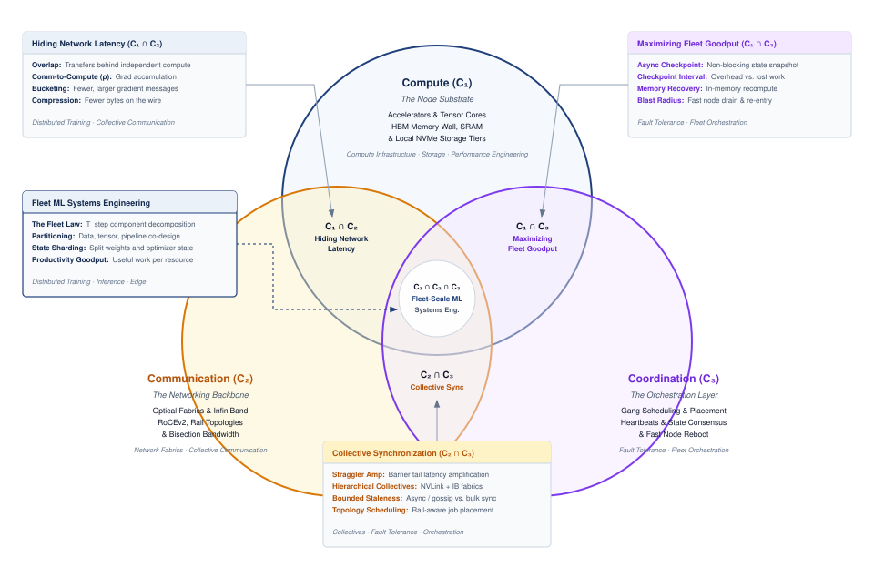{width="90%"}
:::

The diagram organizes competing explanations for the same observed delay. A diagnosis may begin with one dimension or with a coupled mechanism, such as checkpoint traffic delaying a collective. The evidence determines which interaction to investigate; the diagram does not prescribe an order in which the dimensions must be optimized.

Surrounding these three operational dimensions are the non-negotiable operating invariants developed across Part IV: the thermodynamic energy and cooling limits that constrain data centers, the adversarial security and differential privacy guarantees required of distributed pipelines, the robustness against silent corruption and distribution shift, and the systemic governance, auditing, and safety invariants essential when operating at societal scale. Every chapter ahead uses the C$^3$ figure the same way, diagnosing which intersection binds before intervening.

### The Fleet Law {#sec-vol2-introduction-fleet-law}

The C$^3$ intersection landscape defines *where* distributed execution spends time and where trade-offs bite. The Fleet Law turns that diagnostic map into a first estimate of distributed step time. Its terms are a simplified accounting model, so a prediction must state how work is divided and which costs overlap. On a single machine, execution time is governed by the iron law of performance, $T = \DataVolume/\Bandwidth + O/(\PeakRate \cdot \EfficiencyHw) + \Latency$, decomposing into data movement, computation, and overhead. At fleet scale, that single-machine view no longer suffices. @Eq-fleet-law establishes the **Fleet Law**\index{Fleet law!definition}\index{Iron law of scale|see{Fleet law}}, which decomposes the idealized distributed training step into the terms of the C$^3$ engine:

$$ \DistributedStepTime = \frac{\IronlawTermTimesCompute}{N} + \CommunicationTime + \SynchronizationTime - \OverlappedTime $$ {#eq-fleet-law}

The arithmetic idealization used below assumes that local memory can supply operands fast enough to sustain the modeled compute rate. A measured local-execution reference can instead include local memory stalls and dispatch costs in the Compute term, provided those costs divide with the work as assumed. The interpretation of the compute-time fraction follows that convention, measuring local execution time for the measured reference and useful math for the arithmetic idealization. Each term in the Fleet Law maps directly onto a region of the C$^3$ landscape in @fig-c3-taxonomy:

*   $\frac{\IronlawTermTimesCompute}{N}$ is the Compute ($C_1$) term, assuming ideally divisible local arithmetic for a fixed workload distributed across $N$ devices.
*   $\CommunicationTime$ is the Communication ($C_2$) term, capturing the wire transit time moving gradients, activations, and parameter shards across the network fabric.
*   $\SynchronizationTime$ is the Coordination ($C_3$) term, capturing time consumed by barrier semantics, straggler waiting, cluster scheduling decisions, and failure recovery.
*   $\OverlappedTime$ is the Co-Design ($C_1 \cap C_2$, $C_1 \cap C_3$, $C_2 \cap C_3$) term, representing communication or coordination hidden behind useful compute via techniques such as interleaving forward and backward work across pipeline stages, running transfers on separate execution streams, and writing checkpoints asynchronously.

Doubling the device count shows why the subtraction matters. The local compute term falls to $\IronlawTermTimesCompute/2N$, but communication and barrier synchronization persist, and the shorter compute window leaves less room to hide transfers, so $\OverlappedTime$ shrinks as well. The step on $2N$ devices therefore takes well over half as long as the step on $N$ (@fig-fleet-law-step).

::: {#fig-fleet-law-step fig-env="figure" fig-pos="htb" fig-cap="**Anatomy of a Fleet Law step**: Each row is one training step for the same workload, with local computation on the upper lane and communication and synchronization on the lower lane. Read the step length from the bracket, not from any single bar: overlap (gray band) removes only the transfer time that runs beneath compute, so doubling the devices halves $\IronlawTermTimesCompute/N$ yet leaves $T_{\text{step}}(2N)$ well short of the ideal half-length step (dashed line). Bar lengths are illustrative, not measured." fig-alt="Two timelines. Top, N devices: a long blue compute bar, and on a second lane an amber communication bar that starts under the end of the compute bar, followed by a violet synchronization bar; a bracket spans the whole step. Bottom, 2N devices: a compute bar half as long, a slightly longer communication bar, a longer synchronization bar, and a shorter bracket that ends well to the right of a dashed line marking half the original step."}
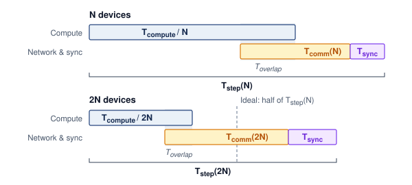
:::

Weak scaling, load imbalance, memory-capacity changes, and algorithmic changes require modifying these terms rather than treating $\IronlawTermTimesCompute/N$ as invariant. Measurements must also separate transfer from coordination time: a barrier interval that includes an unfinished transfer cannot be charged in full to both terms. Subtract only overlap supported by the execution timeline. @Eq-fleet-efficiency rewrites this decomposition as the compute-time fraction. It measures useful arithmetic under the arithmetic idealization and local execution under the measured-reference convention:

$$ \UsefulComputetimeFraction = \frac{\IronlawTermTimesCompute/N}{\DistributedStepTime} $$ {#eq-fleet-efficiency}

This decomposition is a diagnostic instrument. When $\UsefulComputetimeFraction$ drops below 0.5, more than half the step lies outside the modeled Compute term; under the arithmetic idealization, that means outside useful local arithmetic. The C$^3$ taxonomy identifies where the time goes: if $\CommunicationTime$ dominates, upgrade interconnects or overlap communication with computation; if $\SynchronizationTime$ dominates, consider asynchronous methods or reduce barrier frequency; if $\IronlawTermTimesCompute/N$ dominates, the modeled local execution sets the step time. The **displacement of overhead**\index{Displacement of overhead!definition} is a diagnostic heuristic: reducing one overhead can relocate cost among the three dimensions. Asynchronous training removes some coordination barriers but introduces gradient staleness, in which workers apply updates computed from an older copy of the model; pipeline parallelism can reduce some communication exposure but adds bubble time, the intervals in which pipeline stages sit idle waiting for work.

The compute-time fraction describes one configuration. A production team also needs a scalar that says whether extra devices are shortening the training step or merely increasing coordination overhead. The scaling efficiency\index{Scaling efficiency!fleet evaluation} ($\ScalingEfficiency$) of the fleet is the ratio of ideal parallel step time to actual step time:
$$ \ScalingEfficiency = \frac{\SingledeviceTimeOne}{N \times \NdeviceTime} $$
where $\SingledeviceTimeOne$ is the single-device time for the same work and $\NdeviceTime = \DistributedStepTime$ is the step time on $N$ devices.

::: {.column-margin .margin-pointer}
↪ The component decomposition that maps each term of $\DistributedStepTime$ to measurable activities is developed in @sec-appdx-c3-taxonomy-component-decomposition.
:::

::: {#psp-introduction-amdahls-distributed-pitfall .callout-perspective title="Amdahl's distributed pitfall"}

The Fleet Law applies Amdahl's reasoning [@amdahl1967] to a strong-scaling experiment: a fixed amount of useful work is divided across more devices while communication and coordination terms are measured for that configuration. A common shortcut reads a measured 20 percent network share as a 5$\times$ speedup ceiling, but Amdahl's bound applies only if that 20 percent of the original workload remains irreducibly serial as compute is accelerated. A network share measured at one device count is not automatically invariant; changing the partition, topology, collective algorithm, or overlap can change both its absolute time and its fraction of the step. The Fleet Law therefore diagnoses the scaling limit of a stated workload and configuration rather than asserting a universal network fraction.

:::

Several efficiency measures have now appeared, and each answers a different question. Percent of peak, and its model-specific form MFU, compares achieved arithmetic throughput with peak throughput over a stated measurement interval; GPT-3's roughly `{python} Gpt3TrainingScenario.gpt3_peak_pct_str` and Megatron-LM's `{python} ComputeAllocationAnchors.megatron_peak_pct_str` are measures of this kind. GPT-3's estimate averages over the training run, so it includes idle time within that interval; a measurement restricted to active kernels uses a different denominator. The compute-time fraction asks how much of one step belongs to the modeled local-execution term, and scaling efficiency asks how close $N$ devices come to an $N$-fold speedup over one. Goodput widens the window from one step to the whole run by discounting work lost to failures and repeated after restarts; Meta's report of more than `{python} Llama3PretrainingRecord.effective_time_pct_str` effective training time for Llama 3 is a measure of this last kind. A fleet can score well on one measure and poorly on another, so a claim about fleet efficiency must name the measure and measurement interval it uses.

Google's ML Productivity Goodput\index{Goodput!ML productivity metric} provides a complementary view of fleet efficiency [@wongpanich2025fleet]. Despite the shared name, ML Productivity Goodput\index{Goodput!productivity decomposition} is a normalized productivity measure composed of three multiplicative factors, rather than the useful-progress rate defined with the Coordination dimension. **Program goodput**\index{Program Goodput!definition} ($\MlProductivityGoodputFactorsProgram$) measures execution efficiency during productive work; **runtime goodput**\index{Runtime Goodput!definition} ($\MlProductivityGoodputFactorsRuntime$) measures productive progress retained from allocated resources after runtime overhead and lost work; and **scheduling goodput**\index{Scheduling Goodput!definition} ($\MlProductivityGoodputFactorsScheduling$) measures whether a workload has its required resources available together. These factors cut across C$^3$ rather than extending the Fleet Law. Communication overlap can improve program goodput, while checkpointing and recovery affect runtime goodput but belong to Coordination in the Fleet Law. Productivity factors locate losses across the execution lifecycle; C$^3$ identifies the mechanisms responsible for them.

The Fleet Law, the compute-time fraction, and scaling efficiency together describe the time side of fleet efficiency\index{Efficiency!distributed}. They separate modeled local execution from exposed communication and synchronization costs and compare the resulting step time with the single-device baseline. Fleet efficiency also has an energy side\index{Energy!fleet consumption metric}\index{Efficiency!energy dimension}, because every exposed transfer and every idle accelerator still draws power.

### The energy-scale invariant {#sec-introduction-energyscale-invariant-a0d6}

While the Fleet Law accounts for time, the **energy-scale invariant**\index{Energy-scale invariant!definition} requires a consistent energy-accounting boundary when comparing fleet designs. What the invariant holds fixed is the accounting boundary, not any particular efficiency value. @Eq-energy-scale-invariant defines **fleet energy productivity**\index{Fleet energy productivity!definition} ($\FleetEnergyProductivity$), measured in FLOP/J, within a simplified operational boundary:

$$ \FleetEnergyProductivity = \frac{\UsefulModelFlops}{E_{\text{device}} + E_{\text{cooling}} + E_{\text{network}}} $$ {#eq-energy-scale-invariant}

where $\UsefulModelFlops$ is useful work in FLOPs. The three energy terms cover compute devices, attributable cooling, and the network fabric, without counting the same consumption twice. Host, storage, and other facility loads must be added explicitly for a complete operational estimate; embodied impacts lie outside this boundary. Comparisons must use the same boundary and useful-work definition. The resulting Pareto frontier\index{Pareto frontier!time-energy trade-off} balances minimizing $T_{\text{step}}$ with maximizing $\FleetEnergyProductivity$.

::: {.column-margin .margin-pointer}
↪ Power usage effectiveness, the ratio of total facility energy (including cooling and power conversion) to IT energy, is developed across data-center generations and cooling technologies in @sec-appdx-fleet-foundations-energy-hierarchy.
:::

An illustrative, communication-heavy GPT-3-class synchronization scenario connects the time and energy accounts: exposed Ring AllReduce traffic delays computation and consumes network energy.

::: {.column-margin}
{width="100%" fig-alt="A single horizontal bar of one training step, 96 percent filled by an amber communication segment, with a thin gray compute sliver of 4 percent at the left."}

*Communication dominates this illustrative step with fixed local compute time and no overlap.*
:::

```{python}
#| echo: false
#| label: gpt3-sync-tax
# ┌─────────────────────────────────────────────────────────────────────────────
# │ GPT-3 SYNCHRONIZATION AND ENERGY TAX (LEGO)
# ├─────────────────────────────────────────────────────────────────────────────
# │ Context: @sec-vol2-introduction-scale-moment; worked example for
# │          the fleet law and Energy-Scale Invariant.
# │
# │ Goal: Quantify the Coordination Tax (time) and Energy Tax (joules)
# │       for GPT-3 synchronization across IB HDR vs 100 Gb/s Ethernet.
# │ Show: "~700" GB per-endpoint sync size, "~4%" IB efficiency,
# │       "~2%" Ethernet efficiency, "~196" J per endpoint synchronization,
# │       and "~196" MJ for 1M endpoint synchronizations.
# │ How: sync_size = 2 × params × 2 bytes; energy = sync_bits ×
# │      Systems.NetworkEnergy.InfiniBandEnergyPerBit.
# │
# └─────────────────────────────────────────────────────────────────────────────
from mlsysim.fmt import check, fmt, fmt_bandwidth, fmt_energy, fmt_energy_per_bit, fmt_memory, fmt_params, fmt_percent, fmt_time

class GPT3SyncTax:
    """
    Namespace for the 'Coordination and Energy Tax' calculation.
    Scenario: Synchronizing 175B parameters (FP16) across a fleet.
    """

    # ┌── 1. LOAD (Constants) ───────────────────────────────────────────────
    model_params = Models.Language.GPT3.parameters
    params = model_params.to(param).magnitude
    bw_ib = Systems.Fabrics.InfiniBand_HDR.bandwidth  # HDR InfiniBand
    bw_eth = Systems.Fabrics.Ethernet_100G.bandwidth
    t_compute_iter = 1.2 * second  # illustrative per-worker compute time, not a measured GPT-3 step
    productivity_window = 100 * second  # scenario assumption: easy comparison window
    million_steps = 1_000_000

    # Physics: energy cost of moving one bit across the InfiniBand fabric
    energy_per_bit = Systems.NetworkEnergy.InfiniBandEnergyPerBit

    # ┌── 2. EXECUTE (The Compute) ─────────────────────────────────────────
    # Ring AllReduce transfers ~2 * Params.
    sync_size = 2 * params * BYTES_FP16
    sync_bits = sync_size.to(bit)

    # Time Tax
    t_comm_ib = (sync_size / bw_ib).to(second)
    t_comm_eth = (sync_size / bw_eth).to(second)

    # Compute-time fraction = (T_compute/N) / (T_compute/N + T_comm)
    compute_fraction_ib = (t_compute_iter / (t_compute_iter + t_comm_ib)).to("").magnitude * 100
    compute_fraction_eth = (t_compute_iter / (t_compute_iter + t_comm_eth)).to("").magnitude * 100

    # Energy Tax (per step)
    # Total Energy = bits * (Joules/bit)
    # 1 pJ = 1e-12 J
    sync_energy = (sync_bits * energy_per_bit).to(joule)
    sync_energy_total = sync_energy * million_steps
    sync_energy_expected = 196.0 * MJ
    sync_energy_delta = abs((sync_energy_total - sync_energy_expected).to(MJ))

    # ┌── 3. GUARD (Invariants) ───────────────────────────────────────────
    check(compute_fraction_ib > compute_fraction_eth, "InfiniBand must expose a larger compute-time fraction than Ethernet")
    check(abs(sync_energy.to(joule).magnitude - 196.0) < 0.1, f"Expected 196 J sync energy, got {sync_energy.to(joule).magnitude}")
    check(sync_energy_delta < 0.5 * MJ, f"Expected about 196 MJ for 1M syncs, got {sync_energy_total.to(MJ).magnitude}")

    # ┌── 4. OUTPUT (Formatting) ──────────────────────────────────────────────
    t_compute_iter_str = fmt_time(t_compute_iter, second, precision=1, commas=False, style='word')
    sync_size_gb_str = fmt_memory(sync_size, unit=GB, precision=0, commas=True)
    model_params_b_str = fmt_params(model_params, scale="B", precision=0, commas=False)
    ib_bw_gbit_per_s_str = fmt_bandwidth(bw_ib, unit=Gbps, precision=0, commas=False)
    eth_bw_gbit_per_s_str = fmt_bandwidth(bw_eth, unit=Gbps, precision=0, commas=False)
    energy_per_bit_pj_per_bit_str = fmt_energy_per_bit(energy_per_bit, unit=pJ / bit, precision=0, commas=False)
    ib_compute_fraction_pct_str = fmt_percent(compute_fraction_ib / 100, precision=1, style='prose')
    eth_compute_fraction_pct_str = fmt_percent(compute_fraction_eth / 100, precision=1, style='prose')
    ib_productive_time_s_str = fmt_time(compute_fraction_ib / 100 * productivity_window, second, precision=1, commas=False, style='word')
    eth_productive_time_s_str = fmt_time(compute_fraction_eth / 100 * productivity_window, second, precision=1, commas=False, style='word')
    productivity_window_s_str = fmt_time(productivity_window, second, precision=0, commas=False, style='word')
    # Formatting energy in Joules (J) for scale impact
    sync_energy_j_str = fmt_energy(sync_energy, unit=joule, precision=0)
    million_steps_str = fmt(million_steps, precision=0)
    sync_energy_mj_str = fmt_energy(sync_energy_total, unit=MJ, precision=0)
    t_comm_ib_str = fmt_time(t_comm_ib, second, precision=0, commas=False, style='word')
    t_comm_eth_str = fmt_time(t_comm_eth, second, precision=0, commas=False, style='word')
```

::: {#nbk-introduction-coordination-energy-tax .callout-notebook title="The communication and energy tax"}

**Problem**: What compute-time fraction and endpoint network-energy cost result in an illustrative GPT-3 synchronization scenario using `{python} GPT3SyncTax.eth_bw_gbit_per_s_str` Ethernet versus `{python} GPT3SyncTax.ib_bw_gbit_per_s_str` InfiniBand? Assume `{python} GPT3SyncTax.t_compute_iter_str` of local computation per worker per iteration, with no communication overlap. This chosen input defines the scenario; it is not a measured GPT-3 training-step time.

**Physics**:
To synchronize `{python} GPT3SyncTax.model_params_b_str` parameters (FP16), a Ring AllReduce\index{Ring AllReduce!parameter synchronization} with many workers transmits approximately `{python} GPT3SyncTax.sync_size_gb_str` of data per participating accelerator endpoint per iteration, using the large-worker-count approximation of twice the FP16 gradient size. This is the 16-bit case of the ring traffic described in @sec-introduction-communication-becomes-dominant-e1b6, so it is half the ring traffic of FP32 gradients and numerically equal to the FP32 gradient size quoted there.

**Analysis**: The Fleet Law exposes the communication tax across interconnect choices. Over `{python} GPT3SyncTax.ib_bw_gbit_per_s_str` InfiniBand, an optimistic line-rate transfer of that volume takes about `{python} GPT3SyncTax.t_comm_ib_str`, against `{python} GPT3SyncTax.t_compute_iter_str` of computation, which yields a compute-time fraction of only `{python} GPT3SyncTax.ib_compute_fraction_pct_str`, meaning accelerators compute for `{python} GPT3SyncTax.ib_productive_time_s_str` out of every `{python} GPT3SyncTax.productivity_window_s_str` while the remainder is exposed communication time. Across `{python} GPT3SyncTax.eth_bw_gbit_per_s_str` Ethernet, the transfer stretches to about `{python} GPT3SyncTax.t_comm_eth_str` and the compute-time fraction falls further to `{python} GPT3SyncTax.eth_compute_fraction_pct_str`, leaving the devices productive for roughly `{python} GPT3SyncTax.eth_productive_time_s_str` out of every `{python} GPT3SyncTax.productivity_window_s_str`.

**Energy**: The energy wall is the thermodynamic cost of the same synchronization. Charging each transmitted bit once at the InfiniBand fabric energy cost, each endpoint's gradient synchronization consumes approximately `{python} GPT3SyncTax.sync_energy_j_str` across the network fabric (at `{python} GPT3SyncTax.energy_per_bit_pj_per_bit_str`). In a training run of `{python} GPT3SyncTax.million_steps_str` steps, the endpoint network movement alone accounts for about `{python} GPT3SyncTax.sync_energy_mj_str` of energy before multiplying by the number of participating accelerators.

**Systems insight**: Advertised line rate gives an optimistic transfer estimate that excludes latency, software overhead, and contention. Conversely, omitting overlap exposes all communication, so the summed step time is not a lower bound for an implementation that hides transfers. The compute-time fraction changes with local workload, partitioning, and overlap; the small fraction here diagnoses the chosen scenario, not every large fleet.

:::

## Foundational Concepts {#sec-vol2-introduction-foundational-concepts}

Three architectural maps organize this book: the fleet stack locates system responsibility, C$^3$ and the Fleet Law diagnose execution cost, and the lighthouse archetypes test those costs across representative production workloads. The **fleet stack**\index{Fleet Stack!definition} arranges the fleet into eight rows grouped into four ascending bands (@fig-fleet-stack). Capabilities fixed in the lower rows, from facility cooling and RDMA fabrics up through distributed execution, constrain the serving runtimes and governance mechanisms above them.

::: {#fig-fleet-stack fig-env="figure" fig-pos="htb" fig-cap="**The Fleet Stack**: The organizing framework for this book, eight rows grouped into four bands, one band per part. Each band is labeled with its part number and a short functional name for that part, and the right column lists what each row holds; the Reliability & Control row, for example, is where orchestration, scheduling, and recovery live. Capabilities decided in a lower band constrain the choices available in the bands above it. The same stack, shaded to show each chapter's focus, appears beside the Purpose of every chapter." fig-alt="Stack of eight rows in four bands, labeled on the left Part I Infrastructure, Part II Distribution, Part III Serving, and Part IV Governance from bottom to top. Rows from bottom: Facility and Accelerators, Fabric and Storage, Distributed Execution, Reliability and Control, Runtime and Serving, Operations, Assurance, and Governance and Sustainability, each followed by a short list of what it holds. An upward arrow on the left is labeled lower bands constrain upper ones."}
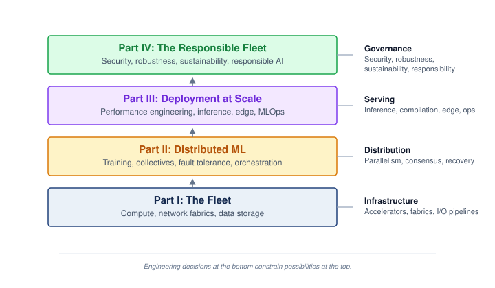{width="100%"}
:::

The four bands correspond to the book's four parts: the physical substrate, distribution, deployment, and the responsible fleet. The chapter map at @sec-vol2-introduction-structure follows that dependency order.

Six **engineering practices**\index{Engineering practices!fleet scale} guide decisions at every band of the stack: instrument first, reserve headroom for recovery and tail latency, expect bottlenecks to migrate, treat failure as steady state, compound small efficiency gains across the fleet, and co-design hardware with algorithms. For example, faster accelerators can expose a network bottleneck; instrumentation identifies that migration, and hardware co-design\index{Hardware-software co-design!engineering practice} aligns the fabric with the workload. The practices describe how a fleet engineer works. The principles of distributed ML systems describe what the physics of the fleet makes true, whatever the practice. Each part of this book establishes its share of those principles; @sec-conclusion-six-principles-distributed-ml-systems-746a gathers them into six, one or two for each part, and pairs each with the practice it demands.

### Three systems archetypes {#sec-vol2-introduction-archetypes}

Abstract frameworks become concrete through specific workloads. Three lighthouse archetypes at scale\index{Lighthouse archetype!at scale} recur where they illuminate a chapter's central constraint; no chapter must force all three into its argument. Together they sample distinct C$^3$ regimes by stressing communication, coordination, or compute in different ways.

#### Archetype A (GPT-4/Llama-3) {#sec-introduction-archetype-gpt4llama3-b02f}

GPT-4 and Llama-3 are autoregressive transformer architectures that generate text one token at a time. At single-accelerator scale, autoregressive language models are memory-bandwidth probes; at the scale of hundreds of billions of parameters, and in some proprietary systems potentially more, training demands ExaFLOP/s of sustained compute distributed across thousands to tens of thousands of accelerators, while serving requires memory bandwidth sufficient to load billions of weights for every generated token. The fleet challenge is partitioning very large models across accelerator fleets using 3D parallelism (data, tensor, and pipeline) without exposing enough gradient or activation traffic to make the network the binding bottleneck. Archetype A therefore probes the communication dimension of C$^3$, although its actual dominant term depends on the model, partition, topology, and degree of overlap.

```{python}
#| echo: false
#| label: archetype-a-reference
# ┌─────────────────────────────────────────────────────────────────────────────
# │ ARCHETYPE A RUNNING INSTANCE (LEGO)
# ├─────────────────────────────────────────────────────────────────────────────
# │ Context: @sec-introduction-archetype-gpt4llama3-b02f
# │
# │ Goal: Fix the reference model and cluster that later chapters vary.
# │ Show: 175B params; 16 bytes/param training state = 2.8 TB;
# │       14 bytes/param resumable checkpoint = 2.45 TB; 1,024 H100 GPUs
# │       as 128 nodes of 8.
# │ How: Scenarios.DenseLLMPretrainingReference (GPT3 on Training_1K) ×
# │      ReferenceStats.MixedPrecisionAdam bytes per parameter.
# │
# └─────────────────────────────────────────────────────────────────────────────
from mlsysim import ReferenceStats, Scenarios
from mlsysim.fmt import check, fmt_count, fmt_memory, fmt_params

class ArchetypeAReference:
    """Archetype A running instance: GPT-3-class dense transformer, mixed precision + Adam."""

    # ┌── 1. LOAD (Constants) ──────────────────────────────────────────────
    scenario = Scenarios.DenseLLMPretrainingReference
    params_q = scenario.workload.parameters
    params = params_q.to(param).magnitude
    # BF16 weights + BF16 gradients + FP32 master weights + two FP32 Adam moments
    state_bytes_per_param = ReferenceStats.MixedPrecisionAdam.TrainingStateBytesPerParameter
    # the same state without gradients
    ckpt_bytes_per_param = ReferenceStats.MixedPrecisionAdam.CheckpointBytesPerParameter
    gpus_per_node = scenario.system.node.accelerators_per_node
    num_nodes = scenario.system.count
    num_gpus = scenario.system.total_accelerators
    accelerator_name = scenario.system.node.accelerator.name

    # ┌── 2. EXECUTE (The Compute) ────────────────────────────────────────
    train_state_q = (params_q * state_bytes_per_param).to(TB)
    ckpt_q = (params_q * ckpt_bytes_per_param).to(TB)

    # ┌── 3. GUARD (Invariants) ──────────────────────────────────────────
    check(state_bytes_per_param.to(byte / param).magnitude == 16, "Training state should be 16 bytes/param")
    check(ckpt_bytes_per_param.to(byte / param).magnitude == 14, "Resumable checkpoint should be 14 bytes/param")
    check(abs(train_state_q.magnitude - 2.8) < 0.01, f"Training state should be ~2.8 TB, got {train_state_q}")
    check(abs(ckpt_q.magnitude - 2.45) < 0.01, f"Checkpoint should be ~2.45 TB, got {ckpt_q}")
    check(num_gpus == gpus_per_node * num_nodes, "Cluster size must equal nodes × accelerators per node")
    check(num_gpus == 1024, f"Reference cluster should be 1,024 GPUs, got {num_gpus}")
    check("H100" in accelerator_name, f"Prose names H100 GPUs, got {accelerator_name}")

    # ┌── 4. OUTPUT (Formatting) ──────────────────────────────────────────
    params_b_str = fmt_params(params_q, scale="B", precision=0, commas=False)
    state_bytes_str = fmt_count(state_bytes_per_param.to(byte / param).magnitude)
    ckpt_bytes_str = fmt_count(ckpt_bytes_per_param.to(byte / param).magnitude)
    train_state_tb_str = fmt_memory(train_state_q, unit=TB, precision=1)
    ckpt_tb_str = fmt_memory(ckpt_q, unit=TB, precision=2)
    num_gpus_str = fmt_count(num_gpus, label="H100 GPU", plural_label="H100 GPUs")
    num_nodes_str = fmt_count(num_nodes)
    gpus_per_node_str = fmt_count(gpus_per_node)
```

Where a chapter needs a concrete instance, Archetype A is a `{python} ArchetypeAReference.params_b_str`-parameter dense transformer of the GPT-3 class, chosen because its configuration is published while GPT-4's is not, trained with mixed precision and the Adaptive Moment Estimation (Adam) optimizer. Its training state occupies `{python} ArchetypeAReference.state_bytes_str` bytes per parameter (BF16 weights and gradients, FP32 master weights, and two FP32 Adam moments), or `{python} ArchetypeAReference.train_state_tb_str`; a resumable checkpoint omits the gradients and needs `{python} ArchetypeAReference.ckpt_bytes_str` bytes per parameter, or `{python} ArchetypeAReference.ckpt_tb_str`. The reference cluster is `{python} ArchetypeAReference.num_gpus_str`, arranged as `{python} ArchetypeAReference.num_nodes_str` nodes of `{python} ArchetypeAReference.gpus_per_node_str` accelerators each. A chapter that studies a larger cluster or a different model says explicitly how it varies this reference.

#### Archetype B (DLRM at Scale) {#sec-introduction-archetype-b-dlrm-scale-fa6d}

```{python}
#| echo: false
#| label: archetype-b-reference
# ┌─────────────────────────────────────────────────────────────────────────────
# │ ARCHETYPE B SERVING PROFILE (LEGO)
# ├─────────────────────────────────────────────────────────────────────────────
# │ Context: @sec-introduction-archetype-b-dlrm-scale-fa6d and
# │          @tbl-vol2-lighthouse-archetypes.
# │
# │ Goal: Pin the recommender-at-scale profile to MLSysIM.
# │ Show: 10 TB+ embedding tables; ~10 million QPS; 100 ms P99 SLO.
# │ How: ReferenceStats.RecommenderAtScaleProfile (DLRM-class teaching profile).
# │
# └─────────────────────────────────────────────────────────────────────────────
from mlsysim import ReferenceStats
from mlsysim.fmt import check, fmt_count, fmt_memory, fmt_time

class ArchetypeBReference:
    """Archetype B serving profile: DLRM-class recommender at platform scale."""

    # ┌── 1. LOAD (Constants) ──────────────────────────────────────────────
    profile = ReferenceStats.RecommenderAtScaleProfile
    embedding_table = profile.EmbeddingTableSize
    platform_qps = profile.PlatformQps
    p99_slo = profile.P99LatencySlo

    # ┌── 2. EXECUTE (The Compute) ────────────────────────────────────────
    qps = platform_qps.to(count / second).magnitude

    # ┌── 3. GUARD (Invariants) ──────────────────────────────────────────
    check(1e6 <= qps < 1e8, f"Prose describes millions of queries per second, got {qps:.3g}")
    check(embedding_table.to(TB).magnitude >= 1, "Prose says the tables exceed any single accelerator's memory")

    # ┌── 4. OUTPUT (Formatting) ──────────────────────────────────────────
    embedding_table_tb_str = fmt_memory(embedding_table, unit=TB, precision=0)
    platform_qps_million_str = fmt_count(qps, scale="million", precision=0)
    p99_slo_ms_str = fmt_time(p99_slo, ms, precision=0)
```

DLRM\index{DLRM!lighthouse archetype} is the deep learning recommendation model that Meta published as a reference architecture for personalized content ranking. Unlike LLMs, which are dominated by dense matrix multiplications, recommendation models derive their capacity from massive embedding tables, sparse lookup structures that map billions of user and item features into dense vectors. A single production DLRM-style model may hold `{python} ArchetypeBReference.embedding_table_tb_str` or more of embedding-table parameters, far exceeding any single accelerator's memory. The fleet challenge is sharding these embedding tables across hundreds of nodes while processing on the order of `{python} ArchetypeBReference.platform_qps_million_str` queries per second (QPS) with <`{python} ArchetypeBReference.p99_slo_ms_str` tail latency, all while coordinating all-to-all exchanges between embedding shards and dense layers. There are $\mathcal{O}(N^2)$ potential communicating pairs, but byte volume and contention depend on the request batch, partitioning, and network topology. In the C$^3$ taxonomy, Archetype B stresses coordination: sparse feature routing, shard placement, request scheduling, and embedding-update consistency determine whether the all-to-all traffic can be served within tail-latency limits.

#### Archetype C (Federated MobileNet) {#sec-introduction-archetype-c-federated-mobilenet-65a3}

```{python}
#| echo: false
#| label: archetype-c-reference
# ┌─────────────────────────────────────────────────────────────────────────────
# │ ARCHETYPE C DEVICE ENVELOPE (LEGO)
# ├─────────────────────────────────────────────────────────────────────────────
# │ Context: @sec-introduction-archetype-c-federated-mobilenet-65a3.
# │
# │ Goal: Pin the smartphone-class power envelope to MLSysIM.
# │ Show: 2 to 10 W (a few watts sustained, bursts toward 10 W).
# │ How: ReferenceStats.MobilePower sustained low and burst high;
# │      Scenarios.FederatedMobileVision.power_budget is the sustained ceiling.
# │
# └─────────────────────────────────────────────────────────────────────────────
from mlsysim import ReferenceStats, Scenarios
from mlsysim.fmt import check, fmt_power

class ArchetypeCReference:
    """Archetype C device envelope: MobileNet on a smartphone-class device."""

    # ┌── 1. LOAD (Constants) ──────────────────────────────────────────────
    scenario = Scenarios.FederatedMobileVision
    sustained_low = ReferenceStats.MobilePower.MobileMlSustainedLow
    sustained_high = scenario.power_budget
    burst_high = ReferenceStats.MobilePower.MobileMlBurstHigh

    # ┌── 2. EXECUTE (The Compute) ────────────────────────────────────────
    burst_headroom = (burst_high / sustained_high).to("").magnitude

    # ┌── 3. GUARD (Invariants) ──────────────────────────────────────────
    check(sustained_high.to(watt).magnitude <= 5, "Prose says a few watts sustained")
    check(burst_headroom > 2, "Prose frames bursts as well above the sustained budget")

    # ┌── 4. OUTPUT (Formatting) ──────────────────────────────────────────
    sustained_low_w_str = fmt_power(sustained_low, unit=watt, precision=0)
    burst_high_w_str = fmt_power(burst_high, unit=watt, precision=0)
```

MobileNet is a family of efficient convolutional neural networks designed for on-device inference under tight power and memory budgets. In a federated learning\index{Federated Learning!introduction} setting, MobileNet instances train locally on millions of heterogeneous smartphone-class devices, whose power budgets span roughly `{python} ArchetypeCReference.sustained_low_w_str` to `{python} ArchetypeCReference.burst_high_w_str` (a few watts sustained, with brief bursts toward `{python} ArchetypeCReference.burst_high_w_str`), while raw training data remains on the device. Microcontroller-class sensors that run on hundreds of kilobytes of memory and milliwatts of power lie at an extreme below this archetype. The constraint regime is qualitatively different from the data-center archetypes: power budgets are measured in watts rather than megawatts, and privacy or policy constraints can prohibit centralized data aggregation. In the C$^3$ taxonomy, Archetype C probes the per-device compute envelope: local execution must fit within the device's power, memory, and thermal limits. That local constraint does not determine the bottleneck of a federated round. Uploading updates can expose communication limits, while selecting available participants and waiting for their results can expose coordination limits. The fleet challenge is coordinating model updates across millions of such compute-constrained, unreliable devices using federated averaging, which periodically averages device updates at a coordinator. Data distributions that are not independent and identically distributed (i.i.d.) and intermittent participation affect the resulting learning process; convergence claims must state the assumptions under which they hold.

Read the three archetypes as constraint probes, not as a catalog of model families. The LLM case asks whether dense synchronization can keep thousands of accelerators useful, the DLRM case asks whether sparse feature routing can meet tail-latency budgets, and the federated MobileNet case asks whether local device constraints can be coordinated into a statistically coherent update. @Tbl-vol2-lighthouse-archetypes summarizes the three canonical workloads tracked throughout this book.

| **Archetype**                                                               | **C$^3$ Diagnostic Regime**          | **Fleet Challenge**                                                                                                                                                                                                                                                                                              |
|:----------------------------------------------------------------------------|:-------------------------------------|:-----------------------------------------------------------------------------------------------------------------------------------------------------------------------------------------------------------------------------------------------------------------------------------------------------------------|
| **Archetype A (GPT-4/Llama-3)**\index{Llama-3!lighthouse archetype}         | Communication (fleet-wide)           | Partition hundreds of billions of parameters, and potentially larger proprietary models, across thousands to tens of thousands of GPUs using 3D parallelism without the network becoming the bottleneck.                                                                                                         |
| **Archetype B (DLRM at Scale)**                                             | Coordination (routing and placement) | Shard `{python} ArchetypeBReference.embedding_table_tb_str`+ embedding tables across hundreds of nodes; process millions of QPS with <`{python} ArchetypeBReference.p99_slo_ms_str` tail latency while managing sparse feature routing, shard placement, and exchanges among $\mathcal{O}(N^2)$ potential pairs. |
| **Archetype C (Federated MobileNet)**\index{MobileNet!lighthouse archetype} | Compute (per-device envelope)        | Coordinate learning across millions of compute-constrained, unreliable edge devices using federated updates; raw data cannot leave the device.                                                                                                                                                                   |

: **Lighthouse archetypes at scale**: The three canonical workloads in representative diagnostic regimes, with the fleet-scale challenge each raises. These are constraint probes, not invariant bottleneck assignments; workload, partitioning, topology, and overlap determine the binding cost. The MobileNet row describes the local device envelope, not the bottleneck of a complete federated round. {#tbl-vol2-lighthouse-archetypes}

## The Structure of This Textbook {#sec-vol2-introduction-structure}

This textbook organizes around the fleet stack\index{Fleet Stack!textbook structure}, progressing from the physical substrate through the logic of distribution to societal governance. The chapter sequence is a dependency map rather than a topic inventory. Silicon, cooling, and network limits constrain training partitioning; partitioned algorithms create fault-tolerance and orchestration obligations; and those mechanisms support production operation. Requirements also flow in the other direction: security, governance, and service targets constrain which lower-layer designs are acceptable. Part I builds the physical cluster substrate, Part II coordinates distributed execution and fault recovery, Part III optimizes deployment and inference at scale, and Part IV enforces governance, security, and sustainability invariants (@fig-vol2-roadmap).

::: {#fig-vol2-roadmap fig-env="figure" fig-pos="htb" fig-cap="**The chapter roadmap**: The chapters in reading order, top to bottom. The introduction frames the book; the four parts then climb the fleet stack of @fig-fleet-stack from physical infrastructure through distribution and deployment to governance; the conclusion gathers the principles of all four parts." fig-alt="Chapter map read from top to bottom. Chapter 1, Introduction, spans the top. Part I, The Fleet: chapters 2 Compute Infrastructure, 3 Network Fabrics, and 4 Data Storage. Part II, Distributed ML: chapters 5 Distributed Training, 6 Collective Communication, 7 Fault Tolerance, and 8 Fleet Orchestration. Part III, Deployment at Scale: chapters 9 Performance Engineering, 10 Inference at Scale, 11 Edge Intelligence, and 12 ML Operations at Scale. Part IV, The Responsible Fleet: chapters 13 Security and Privacy, 14 Robust AI, 15 Sustainable AI, and 16 Responsible AI. Chapter 17, Conclusion, spans the bottom."}
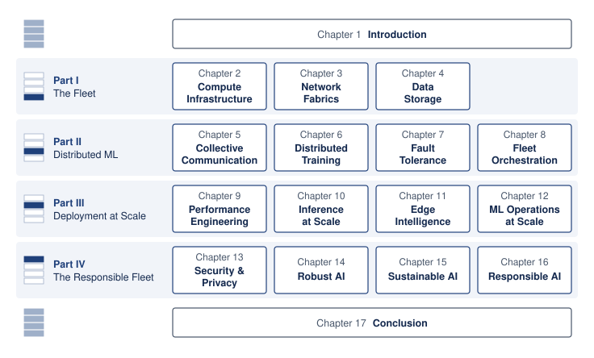{width="100%"}
:::

The infrastructure arc begins with the impediment no algorithm can ignore: no single server has enough memory, power, cooling, or I/O to train the largest models. @Sec-compute-infrastructure therefore starts with high-density silicon and facility physics, @sec-network-fabrics turns isolated machines into a cluster-scale gradient bus, and @sec-data-storage completes the substrate by keeping accelerators fed without letting storage become the hidden bottleneck.

The distribution arc begins once the physical fleet exists and the coordination tax becomes unavoidable. Splitting math across machines creates two new problems: replicas must exchange state fast enough to behave like one optimizer, and failures become routine rather than exceptional. @Sec-distributed-training-systems develops partitioning strategies for models with hundreds of billions to trillions of parameters, @sec-collective-communication explains the communication primitives that bind independent nodes into a coherent computer, @sec-fault-tolerance-reliability treats recovery speed as more important than individual-node uptime, and @sec-fleet-orchestration manages the multi-tenant cluster where those jobs must be placed, isolated, and rescheduled.

The deployment arc shifts from training a model to serving it economically. Once a model reaches production, the binding question is no longer only time-to-train; it is whether latency, utilization, and lifetime serving cost stay inside the operating envelope. @Sec-performance-engineering measures which execution term limits a replica before applying fusion, precision, and compilation, @sec-inference-scale turns that measured envelope into admission, batching, and routing policy for millions of users, @sec-edge-intelligence moves learning onto phone-class devices whose memory, battery, and thermal budgets decide what adaptation they can afford, and @sec-ops-scale develops the shared controls (registries, release gates, monitoring, and cost ledgers) that govern hundreds of models as one fleet.

The governance arc treats responsibility as an engineering layer rather than an afterword. At global scale, technical bugs become societal hazards: adversaries can poison data or extract weights, open-world inputs can break brittle models, energy use becomes a fleet constraint, and governance failures can turn technical capability into social harm. @Sec-security-privacy, @sec-robust-ai, @sec-sustainable-ai, and @sec-responsible-ai develop those obligations as system properties that must be designed, measured, and operated.

## Fallacies and Pitfalls {#sec-vol2-intro-fallacies-pitfalls-f804}

The following fallacies and pitfalls capture architectural mistakes that waste development resources, miss performance targets, or deploy systems critically mismatched to their operating constraints. Each represents a pattern observed repeatedly in the transition from single-machine ML to the machine learning fleet.

::: {.fallacy-pitfall}

**Fallacy**: *Faster accelerators always shorten the training step.*

```{python}
#| echo: false
#| label: faster-accelerator-fallacy
# ┌─────────────────────────────────────────────────────────────────────────────
# │ FASTER ACCELERATOR FALLACY (LEGO)
# ├─────────────────────────────────────────────────────────────────────────────
# │ Context: @sec-vol2-intro-fallacies-pitfalls-f804; reuses the GPT3SyncTax
# │          scenario from the communication and energy tax notebook.
# │
# │ Goal: Show that an accelerator upgrade shrinks only the compute term.
# │ Show: 2× faster accelerators shorten the scenario step by ~2 percent.
# │ How: step = t_compute / speedup + t_comm (no overlap).
# │
# └─────────────────────────────────────────────────────────────────────────────
from mlsysim.fmt import check, fmt_multiple, fmt_percent, fmt_time

class FasterAcceleratorFallacy:
    """Step-time change when only the compute term shrinks."""

    # ┌── 1. LOAD (Constants) ──────────────────────────────────────────────
    t_compute_iter = GPT3SyncTax.t_compute_iter
    t_comm = GPT3SyncTax.t_comm_ib
    accel_speedup = 2.0  # scenario input: accelerator generation upgrade

    # ┌── 2. EXECUTE (The Compute) ────────────────────────────────────────
    step_before = t_compute_iter + t_comm
    step_after = t_compute_iter / accel_speedup + t_comm
    step_reduction = 1 - (step_after / step_before).to("").magnitude

    # ┌── 3. GUARD (Invariants) ──────────────────────────────────────────
    check(0 < step_reduction < 0.05, f"Step reduction should be small, got {step_reduction:.3f}")

    # ┌── 4. OUTPUT (Formatting) ──────────────────────────────────────────
    t_compute_str = GPT3SyncTax.t_compute_iter_str
    t_comm_str = fmt_time(t_comm, second, precision=0, commas=False, style='word')
    ib_bw_str = GPT3SyncTax.ib_bw_gbit_per_s_str
    accel_speedup_mult_str = fmt_multiple(accel_speedup, precision=0)
    step_reduction_pct_str = fmt_percent(step_reduction, precision=1, style='prose')
```

An accelerator upgrade that changes only arithmetic throughput shrinks the $\IronlawTermTimesCompute/N$ term of the Fleet Law while leaving the other costs unchanged. In the no-overlap scenario of notebook \ref{nbk-introduction-coordination-energy-tax}, local computation takes `{python} FasterAcceleratorFallacy.t_compute_str` per iteration while the exposed Ring AllReduce over `{python} FasterAcceleratorFallacy.ib_bw_str` InfiniBand takes about `{python} FasterAcceleratorFallacy.t_comm_str`. Accelerators `{python} FasterAcceleratorFallacy.accel_speedup_mult_str` faster shorten that step by only `{python} FasterAcceleratorFallacy.step_reduction_pct_str`. The scenario is deliberately communication-heavy, but the direction of the effect is general: relieving the Compute axis tends to expose Communication or Coordination as the binding cost, the displacement of overhead described with the Fleet Law. A real upgrade may also change memory capacity, transfer rates, or available overlap. An accelerator purchase must therefore be judged against the fleet's measured step decomposition, not against the datasheet ratio.

:::

::: {.fallacy-pitfall}

**Pitfall**: *Assuming that reliable components make a reliable job.*

A per-GPU MTBF of `{python} Gpt4TrainingScenario.gpu_mtbf_hours_str` describes a part that rarely fails. A synchronous job, however, needs all of its parts at once. Notebook \ref{nbk-introduction-scale-reliability} shows that a job spanning `{python} Gpt4TrainingScenario.gpt4_gpus_str` has an MTBF of about `{python} Gpt4TrainingScenario.mtbf_hours_str`, or roughly `{python} Gpt4TrainingScenario.cluster_fail_day_str` interruptions per day. Component reliability characterizes one part; the reliability gap (@sec-vol2-introduction-reliability-gap) characterizes the job, whose availability decays exponentially with the number of parts it requires simultaneously. Recovery practices that suit a single machine, such as manual restart and infrequent checkpoints, fail at fleet scale even though no individual part has become less reliable.

:::

::: {.fallacy-pitfall}

**Fallacy**: *Edge deployment efficiency requirements are simply scaled-down versions of cloud requirements.*

```{python}
#| echo: false
#| label: edge-latency-distance
# ┌─────────────────────────────────────────────────────────────────────────────
# │ EDGE LATENCY DISTANCE (LEGO)
# ├─────────────────────────────────────────────────────────────────────────────
# │ Context: "Cloud-Lite" fallacy in edge deployment.
# │
# │ Goal: Convert autonomous-vehicle speed and inference delay into distance.
# │ Show: 120 km/h and 100 ms correspond to 3.33 meters.
# │ How: speed_m_s = km/h × 1000 / 3600; distance = speed_m_s × delay_s.
# │
# └─────────────────────────────────────────────────────────────────────────────
from mlsysim.fmt import check, fmt_length, fmt_rate, fmt_time
from mlsysim.core.units import meter

class EdgeLatencyDistance:
    """Distance traveled during an edge inference delay."""

    # ┌── 1. LOAD (Constants) ───────────────────────────────────────────────
    speed_kmh = 120
    delay_ms = 100
    meters_per_km = 1000
    seconds_per_hour = 3600
    ms_per_second = 1000

    # ┌── 2. EXECUTE (The Compute) ─────────────────────────────────────────
    speed_m_s = speed_kmh * meters_per_km / seconds_per_hour
    delay_s = delay_ms / ms_per_second
    distance_m = speed_m_s * delay_s

    # ┌── 3. GUARD (Invariants) ───────────────────────────────────────────
    check(abs(distance_m - 3.3333) < 0.01, f"Expected about 3.33 m, got {distance_m}")

    # ┌── 4. OUTPUT (Formatting) ──────────────────────────────────────────────
    speed_kmh_str = fmt_rate(speed_kmh, "km/h", precision=0, commas=False)
    delay_ms_str = fmt_time(delay_ms, 'millisecond', precision=0, commas=True)
    distance_m_str = fmt_length(distance_m * meter, unit=meter, precision=2, commas=False)
```

This **"Cloud-Lite" fallacy**\index{Cloud-Lite fallacy!definition} treats edge systems as resource-constrained cloud systems. Edge devices face qualitatively different constraints. For example, an autonomous vehicle traveling at `{python} EdgeLatencyDistance.speed_kmh_str` covers `{python} EdgeLatencyDistance.distance_m_str` during every `{python} EdgeLatencyDistance.delay_ms_str` of processing delay, adding that distance to its reaction distance. While cloud deployments scale to kilowatts, a phone-class device of the kind Archetype C models sustains only a few watts. A cloud-optimized model with 95 percent accuracy and 50 ms latency might be unusable on an edge device where thermal throttling increases latency to 200 ms and drains the battery in under an hour.

:::

::: {.fallacy-pitfall}

**Pitfall**: *Treating a compute budget as a wall-clock performance prediction.*

```{python}
#| echo: false
#| label: linear-scaling-fallacy-calc
# ┌─────────────────────────────────────────────────────────────────────────────
# │ LINEAR SCALING FALLACY CHECK (LEGO)
# ├─────────────────────────────────────────────────────────────────────────────
# │ Context: @sec-vol2-intro-fallacies-pitfalls-f804; worked example for coordination overhead.
# │ Goal: Keep the claimed realized speedup tied to the stated overhead fraction.
# │ How: realized_speedup = ideal_speedup × (1 - coordination_fraction).
# └─────────────────────────────────────────────────────────────────────────────
from mlsysim.fmt import check, fmt, fmt_multiple, fmt_percent

class LinearScalingFallacy:
    """Realized speedup under a coordination-overhead fraction."""

    # ┌── 1. LOAD (Scenario) ────────────────────────────────────────────────
    ideal_speedup = 3.0
    coord_overhead_fraction = 0.40

    # ┌── 2. EXECUTE (The Compute) ──────────────────────────────────────────
    realized_speedup = ideal_speedup * (1 - coord_overhead_fraction)

    # ┌── 3. GUARD (Invariants) ─────────────────────────────────────────────
    check(abs(realized_speedup - 1.8) < 1e-9, f"Expected 1.8x, got {realized_speedup}")
    check(0 < coord_overhead_fraction < 1, "Coordination overhead must be a fraction")

    # ┌── 4. OUTPUT (Formatting) ────────────────────────────────────────────
    ideal_speedup_mult_str = fmt_multiple(ideal_speedup, precision=0, commas=True)
    coord_overhead_pct_str = fmt_percent(coord_overhead_fraction, precision=0, style='prose')
    realized_speedup_mult_str = fmt_multiple(realized_speedup, precision=1, commas=True)
```

This pitfall, sometimes called the linear scaling fallacy\index{Linear scaling fallacy!compute budget vs. wall-clock time}, confuses useful computational work with the time required to execute it. The empirical loss relation $\mathcal{L}(X) = \ScaleCoefficient X^{-\ScalingExponentScale} + \IrreducibleLoss$ estimates model quality within a validated regime; the Fleet Law separately estimates the time needed to perform that work. A team distributing a fixed training workload might predict a `{python} LinearScalingFallacy.ideal_speedup_mult_str` improvement but achieve only `{python} LinearScalingFallacy.realized_speedup_mult_str` if coordination and communication overhead consumes `{python} LinearScalingFallacy.coord_overhead_pct_str` of the scaled step time. This shortfall does not by itself invalidate a loss scaling law. It shows why a resource plan needs both a model-quality estimate and a measured execution-cost estimate.

:::

## Summary {#sec-vol2-intro-summary-66bb}

Fleet planning now separates two questions that single-machine practice could merge. Scaling laws answer how much model size, data, and useful computation a quality target requires; the Fleet Law answers how long a fleet takes to execute that work. Single-machine diagnostic skills remain necessary at that scale, but the engineering boundary expands, because a fleet can lose useful progress to network transfers, inconsistent shared state, or failed participants even when its local kernels are efficient. C$^3$ distinguishes compute, communication, and coordination costs, while the fleet stack locates the decisions that shape them. With these tools, a resource plan can be traced through to execution behavior, subject to the reliability, energy, and governance constraints of the mission.

::: {.callout-takeaways title="Scale makes a new machine"}

* **More devices change the engineering boundary**: Distributing work introduces shared network and failure dependencies. Local performance remains necessary, but fleet decisions must also account for synchronization, recovery, power delivery, and governance across that wider boundary.
* **Communication can consume the speedup**: Dividing fixed work across accelerators shortens ideal local compute time while exposing communication and coordination costs. A 175B-parameter model can move hundreds of gigabytes of gradients per step, so scaling gains depend on the workload, fabric, and overlap.
* **Failure becomes steady state**: In the modeled `{python} Gpt4TrainingScenario.gpt4_gpus_count_str`-GPU job, independent component failures interrupt tightly coupled training every few hours despite long per-GPU lifetimes. Checkpointing, recovery, and observability must therefore be designed into normal operation.
* **Scaling laws set the demand; the Fleet Law sets the price**: Within a validated regime, loss falls as a power law in compute, data, and parameters, so each equal quality gain needs disproportionately more resources, and compute-optimal plans grow parameters and tokens together. Those laws say how much work is worth buying; the Fleet Law says how long the fleet takes to deliver it. Task-level evaluation, not loss alone, establishes whether the predicted gain justifies the resources, and training-compute optimality alone does not establish the lowest lifetime serving cost.
* **C$^3$ extends local intuition**: The Data, Algorithm, Machine lens describes the workload and substrate; Compute, Communication, and Coordination expose the costs of fleet execution. The Fleet Law connects useful local work to transfer, synchronization, and overlap costs as device count changes.
* **Impact needs a control plane**: Foundation-scale systems amplify security, privacy, fairness, and policy failures across large user populations. Governance is not an appendix to infrastructure; it is the mechanism that decides what the fleet is permitted to optimize and deploy.

:::

The premise of this book is that scale can move the binding constraint outside the node. A local speedup is therefore evidence about one component, not yet evidence that the fleet makes more useful progress. Engineering judgment requires tracing that change through communication, coordination, and the mission's operating constraints before accepting it as an improvement.

::: {.callout-chapter-connection title="From requirements to silicon"}

The scaling laws set how much work a frontier model demands, the walls of the scale moment mark where that demand meets physical limits, and the Fleet Law prices each distributed step. Those requirements say what the fleet must sustain, not what hardware can sustain it. @Sec-compute-infrastructure turns to that hardware. It begins where the scaling laws leave a growing model, too large for one accelerator's memory, and climbs from the accelerator through the node and rack to the pod, asking at each scale which physical resource runs out first: memory bandwidth, power and cooling, communication bandwidth, or failure exposure. Those limits form the Facility and Accelerators row at the base of the fleet stack, the substrate on which every later chapter builds.

:::

::: { .quiz-end }
:::

```{=latex}
\part{key:vol2_fleet}
```
