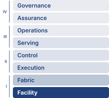

# Compute Infrastructure {#sec-compute-infrastructure}

::: {layout-narrow}
::: {.column-margin}

\chapterminitoc

:::

::: {.content-visible when-format="pdf"}
\noindent
{fig-alt="Layered compute infrastructure cutaway from accelerator chip and HBM to server nodes, racks, power delivery, and cooling loops."}
:::

::: {.content-visible unless-format="pdf"}
{fig-alt="Layered compute infrastructure cutaway from accelerator chip and HBM to server nodes, racks, power delivery, and cooling loops."}
:::

:::

## Purpose {.unnumbered .unlisted}

::: {.content-visible when-format="pdf"}
\begin{marginfigure}
\mlfleetstack{100}{40}{15}{10}{10}{0}{0}{0}
\end{marginfigure}
:::

::: {.content-visible unless-format="pdf"}
::: {.column-margin}
{width="100%" fig-alt="Fleet Machine Learning Systems Stack"}

*Fleet stack focus for this chapter.*
:::
:::

_Why does infrastructure, not algorithms alone, determine who can participate in advancing machine learning at scale?_

Machine learning systems have a physical reality beyond their code. Public algorithms do not make large-scale training equally accessible: executing them requires power, cooling, memory, and communication capacity that organizations must build and sustain. A model that outgrows one machine turns a local resource problem into a shared infrastructure commitment. Buying more accelerators adds arithmetic capacity, but it also adds data transfers, heat, and components whose failures can interrupt collective work. The useful capacity of the fleet depends on whether those demands can be met together. Hardware that appears attractive in isolation may spend much of its deployment waiting for data or operating below its advertised speed. A facility that can house equipment may lack the electrical or cooling capacity to run it at the intended density. These mismatches consume both capital and operating budgets while reducing the experiments that can finish on schedule. Infrastructure decisions also outlast individual models, so an organization must weigh the efficiency of specialization against the flexibility needed for future workloads. Single-machine performance remains part of that judgment, but multiplying it by the number of machines cannot establish what the complete installation will deliver. Participation at scale therefore depends on turning purchased hardware into sustained, usable capacity within physical and financial limits. In C³ terms, the physical substrate sets the compute and communication bounds within which the fleet must coordinate useful work.

::: {.content-visible when-format="pdf"}

\newpage

:::

::: {.callout-learning-objectives}

- Compare GPU, TPU, and ASIC dataflows to explain specialization across the accelerator spectrum
- Apply roofline analysis to distinguish compute-bound from memory-bandwidth-bound phases of training and inference
- Calculate token latency or memory budgets from accelerator memory capacity, bandwidth, precision, and model state size
- Match tensor, pipeline, and data parallelism to the available interconnect bandwidth hierarchy
- Evaluate rack and pod designs using power density, cooling limits, topology, and facility reliability constraints
- Select accelerator infrastructure using sustained throughput, power constraints, workload fit, and deployment cost

:::

```{python}
#| echo: false
from mlsysim import *
from mlsysim.core.units import *

# ┌─────────────────────────────────────────────────────────────────────────────
# │ CHAPTER START
# ├─────────────────────────────────────────────────────────────────────────────
# │ Context: Chapter initialization and global imports
# │
# │ Why: Registers this chapter with the mlsys registry and provides shared
# │      imports for all subsequent calculation cells.
# │
# └─────────────────────────────────────────────────────────────────────────────
from mlsysim.physics import memory_from_params
from mlsysim.fmt import (
    check,
    fmt,
    fmt_bandwidth,
    fmt_energy,
    fmt_flop_rate,
    fmt_magnitude,
    fmt_math,
    fmt_memory,
    fmt_memory_capacity,
    fmt_params,
    fmt_power,
    fmt_qty_int,
    fmt_qty_range,
    fmt_sci,
    fmt_tokens,
    sci_latex,
)
```

```{python}
#| echo: false
#| label: infra-running-example
#| output: false
# ┌─────────────────────────────────────────────────────────────────────────────
# │ RUNNING EXAMPLE: FRONTIER MODEL + H100 CORE SPECS (LEGO)
# ├─────────────────────────────────────────────────────────────────────────────
# │ Context: Chapter-wide running example used from @sec-compute-accelerator-spectrum
# │          through @sec-compute-pod. Token latency used in notebook \ref{nbk-token-latency}.
# │
# │ Goal: Establish the frontier model (175B) and H100 baselines for the chapter.
# │ Show: frontier_params_b, gpt3_params_b, h_h100 specs, token latency breakdown.
# │ How: Reference mlsysim.Hardware and mlsysim.Models registry.
# │
# └─────────────────────────────────────────────────────────────────────────────
from mlsysim import Hardware, Models
from mlsysim.fmt import check, fmt_math, fmt_params

class InfraSetup:
    """Chapter preamble: 175B frontier running example."""

    m_frontier = Scenarios.DenseLLMPretrainingReference.workload
    ref_cluster = Scenarios.DenseLLMPretrainingReference.system  # Archetype A reference cluster

    # Registry anchors for the @fig-three-walls-grid caption, which cannot hold
    # inline Python; the caption literals are guarded against these values.
    _h100 = Hardware.Cloud.H100
    _campus_power = ReferenceStats.FacilityScaleAnchors.HyperscaleCampusPower
    _fleet_mtbf = calc_mtbf_cluster(Systems.Reliability.Gpu.mttf_hours, Systems.Clusters.Reference_25K_H100.total_accelerators)

    # ┌── 3. GUARD (Invariants) ───────────────────────────────────────────
    check(ref_cluster.total_accelerators == 1024, "Archetype A reference cluster should be 1,024 GPUs")
    check(ref_cluster.count == 128, "Archetype A reference cluster should be 128 eight-GPU nodes")
    check(abs(_h100.memory.bandwidth.to(TB / second).magnitude - 3.35) < 1e-9, "Caption quotes 3.35 TB/s HBM3")
    check(round(_h100.compute.precision_flops["fp8"].to(TFLOP / second).magnitude, -3) == 2000, "Caption quotes ~2K TFLOP/s FP8")
    check(Systems.Fabrics.InfiniBand_NDR.bandwidth.to(Gbps).magnitude == 400, "Caption quotes 400 Gb/s NDR per port")
    check(abs(_fleet_mtbf.to(hour).magnitude - 2) < 0.05, "Caption quotes MTBF ~2 hours at 25K GPUs")
    check(_campus_power.to(MW).magnitude == 100, "Caption quotes a ~100 MW facility")

    # ┌── 4. OUTPUT (Formatting) ──────────────────────────────────────────────
    frontier_params_b_str = fmt_params(m_frontier.parameters)
    ref_gpus_str = fmt(ref_cluster.total_accelerators, precision=0, commas=True)
    ref_nodes_str = fmt(ref_cluster.count, precision=0, commas=False)
```

## The Infrastructure Walls {#sec-compute-infrastructure-infrastructure-walls-4f2c}

The scaling laws of @sec-vol2-intro-ai-scaling-laws-a043 are why demand outruns any single device. Loss falls predictably as parameters, training tokens, and compute grow together, so each step up in capability multiplies both the memory a model occupies and the arithmetic its training consumes; a GPT-3-class model already needs several accelerators merely to store its FP16 weights. A model that exceeds one accelerator's memory capacity forces a hardware decision before training begins. Adding accelerators supplies capacity, but also creates transfers between devices, increases power demand, and couples progress to more components that can fail. The familiar single-node compute and memory limits therefore become inputs to fleet design. @Fig-three-walls-grid maps these four recurring physical constraints across escalating physical scales, from an eight-GPU node to a 25K-accelerator fleet. Memory bandwidth, rack power, pod communication, and fleet failure exposure provide the examples; the workload and configuration determine which constraint binds at each scale. These are the memory, energy, and network walls of the scale moment and the fleet's reliability gap, seen from the hardware that imposes them. Because this chapter studies the hardware, it names each constraint by the physical resource that runs out, and it uses these four names from here on: the memory wall, the power wall (the energy wall as power delivery and heat removal), the communication wall (the network wall as link bandwidth), and the reliability wall (the reliability gap as a failure interval).

The reliability wall starts from a per-GPU failure figure that @sec-vol2-introduction-scale-moment calls an MTBF. A failed GPU is replaced rather than repaired, so this chapter calls the per-device figure a mean time to failure (MTTF) and reserves mean time between failures (MTBF) for nodes and fleets, which keep running through repeated failures and replacements. The number is the same; only the label records what is being counted.

::: {.column-margin .margin-pointer}
↩ The memory, network, and energy walls of the scale moment are established in @sec-vol2-introduction-scale-moment.
:::

The `{python} InfraSetup.frontier_params_b_str` model anchors this progression. It is the chapter's running instance of Archetype A (GPT-4/Llama-3), a GPT-3-class dense transformer trained with mixed precision and the Adaptive Moment Estimation (Adam) optimizer, whose reference training cluster is `{python} InfraSetup.ref_gpus_str` H100 GPUs in `{python} InfraSetup.ref_nodes_str` eight-GPU nodes. Accelerator selection establishes the compute rate, memory capacity, and power envelope that a fleet can buy. The node must connect enough of those accelerators to hold and execute the workload; the rack must power and cool them; the pod must sustain communication and survive component failures. This is the hardware contribution to C³: useful fleet compute depends on the communication and coordination costs created at each physical boundary.

::: {.column-margin .margin-pointer}
↩ The three fleet workload archetypes are established in @sec-vol2-introduction-archetypes.
:::

::: {.column-margin .margin-pointer}
↪ The running model's parameters and reference cluster are developed in @sec-appdx-fleet-reference-workload.
:::

::: {#fig-three-walls-grid fig-env="figure" fig-pos="htb" fig-cap="**The four infrastructure walls**: Read left to right, the examples illustrate four constraints at increasing physical scales; the workload and configuration determine which one binds. The node compares 3.35 TB/s of HBM3 with about 2,000 TFLOP/s of FP8 arithmetic; the four-node DGX H100 rack draws 33.5 kW; the pod compares per-direction NVLink bandwidth with one InfiniBand port, a ninefold budget gap; and the fleet assumes independent GPU failures, reducing a 50,000-hour per-GPU mean time to failure (MTTF) to about 2 hours between failures at 25K GPUs." fig-alt="An arrow runs from smaller to larger physical scale above four columns. Each column first draws its scale level as parts: a node chassis with 8 GPUs, a rack holding four nodes (32 GPUs), a pod of 32 racks (1,024 GPUs), and a fleet of many pods drawn as plain tiles (10K to 25K GPUs). Below each, a wall panel draws its constraint. Memory wall: a narrow HBM pipe feeds a large FP8 arithmetic block, labeled 3.35 TB/s of HBM feeding about 2,000 TFLOP/s. Power wall: two bars to scale, a traditional rack reaching a gray dashed line labeled 12 kW and a taller DGX H100 bar, labeled 33.5 kW per rack, nearly 3 times a 12 kW rack. Communication wall: a thick NVLink bar above a link one ninth as thick for InfiniBand, labeled 450 to 50 GB/s, a 9 times cliff. Reliability wall: on a log time axis from 1 hour to 10,000 hours, a long gray bar for one GPU and a short red bar for 25K GPUs, labeled MTTF about 2 hours at 25K, from 50,000 hours per GPU."}


:::

The chapter climbs the same scale ladder, so the four walls arrive in the order the figure reads, though not one wall per section. The memory wall begins at the accelerator and is developed in @sec-compute-memory-wall. The communication wall first appears inside the node, where @sec-compute-bandwidth-hierarchy measures the cliff between local and inter-node links, and returns at pod scale in @sec-compute-pod. The power wall binds at the rack (@sec-compute-power-wall), and the reliability wall accumulates from node health (@sec-compute-infrastructure-node-health-reliability-56a6) through facility controls to the fleet-scale failure interval of @sec-compute-fleet.

## The Accelerator {#sec-compute-accelerator-spectrum}

The progression begins with the accelerator, because every wall above it is measured against the rates one device can compute, store, and draw. An accelerator purchase commits the fleet to a workload and software stack for longer than one experiment. A research group changing model operations frequently needs programmability; a service executing a stable computation at sustained volume can justify more specialization. The familiar trade-off between control flexibility and arithmetic efficiency matters here because an architectural mismatch is replicated across the fleet. Comparing programmable and specialized accelerators therefore starts with how much of the workload and compiler stack can remain stable over the deployment's lifetime.

::: {#psp-compute-infrastructure-generality-tax .callout-perspective title="The generality tax"}

General-purpose CPUs allocate silicon to caches and control logic as well as arithmetic. Branch predictors, reorder buffers, and instruction decoders support code with irregular control flow and data access. Matrix multiplication has a more regular schedule, so some of that flexibility contributes little to its dominant computation. The generality tax\index{Generality tax!accelerator design} (principle \ref{pri-generality-tax}) is the area and energy devoted to capabilities outside the dominant workload.

Specialized accelerators reduce this tax by replacing general-purpose control with a dataflow matched to the workload. In the approximate shares of @fig-accelerator-spectrum, the arithmetic fraction of the die rises from roughly 5--10 percent on a CPU to 50--60 percent on a GPU, 70--80 percent on a Tensor Processing Unit (TPU), and over 90 percent on a custom application-specific integrated circuit (ASIC). The shares mark a direction rather than measured proportions for any product. The selection question is how much of the complete workload can use the specialized hardware.

:::

::: {#fig-accelerator-spectrum fig-env="figure" fig-pos="htb" fig-cap="**The accelerator spectrum**: Each die is drawn as a grid of 100 cells divided between arithmetic units (dark) and control, cache, and other logic (light), with the medium cells marking the spread of each approximate, illustrative share. Read left to right, the arithmetic share grows from 5 to 10 percent on a CPU to over 90 percent on a custom ASIC, because hardwired dataflow replaces instruction fetch, decode, and scheduling; each step buys throughput per watt by narrowing the range of model architectures the silicon runs well." fig-alt="Four square dies side by side, CPU, GPU, TPU, and custom ASIC, above an arrow running from general purpose to more specialized. Each die is a 10 by 10 grid of cells: dark cells for arithmetic units, medium cells for the range of estimates, and light cells for control, cache, and other logic. The dark share grows from left to right, labeled 5 to 10 percent for the CPU, 50 to 60 percent for the GPU, 70 to 80 percent for the TPU, and over 90 percent for the custom ASIC. A legend directly under the dies names the three cell types, and the arrow closes the figure below it."}


:::

The transition from general-purpose to specialized silicon follows a logical progression. At one end of the spectrum, GPUs retain substantial programmability while providing 10--100$\times$ the matrix throughput of CPUs. At the other end, custom ASICs hardwire a specific dataflow for maximum efficiency at the cost of flexibility.

Understanding *where* each architecture falls on this spectrum, and *why*, is essential for selecting hardware that matches a given workload. The spectrum is not a ranking from "bad" (general-purpose CPU) to "good" (custom ASIC), but a continuum of trade-offs where each position offers the best match for a different combination of workload characteristics and deployment constraints.

GPUs\index{GPU!programmability} represent the first major step away from general-purpose computing toward massive parallelism while retaining programmability. An NVIDIA H100, for example, contains 16,896 CUDA\index{CUDA!programming model} cores organized into 132 streaming multiprocessors (SMs). Each SM can keep many threads resident under the **single instruction, multiple threads (SIMT)**\index{SIMT!definition}[^fn-simt-warp-execution] execution model, but only a subset issues instructions in a given cycle. Unlike a CPU, which optimizes for single-thread latency, a GPU hides memory latency by maintaining thousands of threads in flight and switching between them\index{Warp scheduling!latency hiding} when one stalls on a memory access.

The programmer writes a single function (a *kernel*), and the hardware maps it across a massive grid of threads. This model is flexible enough to run any mathematical kernel, from convolutions to attention mechanisms to custom loss functions, while providing orders of magnitude more throughput than a CPU for data-parallel computation.

The trade-off is that irregular, branch-heavy code runs poorly because divergent threads within a warp (a group of 32 threads that execute in lockstep)\index{Warp scheduling!divergence penalty} must execute serially. When threads in the same warp take different branches of an if-else statement, the hardware must execute both branches sequentially, disabling the threads that took the other path during each branch. For ML workloads, this divergence penalty is usually small because neural network operations have highly uniform control flow: every element in a matrix multiplication follows the same computation path.

[^fn-simt-warp-execution]: **SIMT (single instruction, multiple threads)**\index{SIMT!warp divergence}: NVIDIA coined the term to distinguish its model from classical single instruction, multiple data (SIMD): each thread keeps its own registers and may branch independently, and the hardware, not the programmer, masks lanes when a warp diverges. That convenience has a price on irregular ML operations such as sparse attention or dynamic expert routing, where masked lanes sit idle while the other path executes.

TPUs specialize the matrix dataflow while retaining other units for operations that do not map onto it. Google's Tensor Processing Units use a **systolic array**\index{Systolic array!definition}[^fn-systolic-array-tpu] architecture: a fixed grid of multiply-accumulate (MAC) units where data flows between neighboring cells in a regular, wave-like pattern. Instead of fetching and decoding a separate instruction for each MAC, the array passes operands and partial results between cells on a regular schedule. Local reuse reduces instruction and memory traffic within the matrix computation. The complete accelerator still needs control, data movement, and execution of nonmatrix operations.

The cost of this efficiency is reduced programmability. Models must be compiled through Accelerated Linear Algebra (XLA), which maps high-level operations onto the fixed dataflow. Workloads with irregular control flow or dynamic shapes may not map well to this architecture, and the compilation process itself can be time-consuming (minutes to hours for complex models), which slows the iteration cycle during model development.

The programming model distinction between GPUs and TPUs has practical implications for organizational decisions. A research team that frequently adds custom operations, such as new attention patterns or activation functions, needs a path to implement them as kernels without waiting for compiler support, and must check how each platform expresses and optimizes those operations. A team running a stable computation at scale can place more weight on sustained utilization and compilation cost amortized over many runs. CUDA kernel support and XLA graph compilation offer different development paths, but neither establishes a utilization advantage without evaluating the workload and implementation. Software fit belongs in the hardware comparison because unsupported or poorly mapped work can leave specialized arithmetic idle.

[^fn-systolic-array-tpu]: **Systolic array**\index{Systolic array!etymology}: From Greek *systole* (contraction), the name describes data pulsing through a grid of processing elements in a heart-like rhythm. @kung1979systolic proposed the design for VLSI chips whose limiting resource was memory access rather than logic [@kung1982]: each operand fetched once is reused by every cell it passes. That ratio of computation to memory traffic is exactly what matrix multiplication at ML scale rewards.

::: {#exmp-compute-infrastructure-tpu-origin-story .callout-example title="The TPU origin story"}

**Scenario**: In 2013, Google projected that if users spoke to Android phones for 3 minutes per day using voice search, handling the inference load on general-purpose CPUs would require doubling data center compute capacity at prohibitive cost [@jouppi2017].

**Diagnosis**: Standard CPU architectures paid a heavy generality tax, spending significant silicon area and power on out-of-order execution, branch prediction, and complex caches rather than matrix multiplication throughput.

**Systems lesson**: Hardware specialization is economically justified when a workload is massive, stable, and dominated by a single mathematical kernel (MatMul). The TPU v1 hardwired a $256 \times 256$ systolic array to deliver 92 TOPS (INT8) within a 75 W footprint, establishing custom ASIC accelerators in production serving infrastructure.

:::

Custom ASICs occupy the specialized end of the spectrum, where the economics of silicon can justify giving up much of the general-purpose programmability. When an organization runs a stable workload at enormous scale, designing a chip specifically for that workload may become economically rational. A custom ASIC can improve energy per operation and sustained utilization on its target workload by removing features that computation does not require.

Tesla's Dojo D1 chip, for example, is optimized for the spatial and temporal structure of video-based vision models. Its hundreds of tightly coupled processing nodes are designed around the dataflow needs of Tesla's vision pipeline, with on-chip SRAM sized to keep spatial tiles close to the compute units. This reduces the repeated round-trips to off-chip memory that a general-purpose GPU would require for the same computation.

AWS Trainium\index{AWS Trainium!accelerator fabric} takes a different approach, targeting the broad category of Transformer training rather than a single model. Trainium systems combine compiler-managed memory scheduling with hardware-assisted collective communication, so common training patterns such as tensor-parallel synchronization and data-parallel reductions can be optimized in the accelerator fabric rather than handled entirely by host software.

The risk of custom silicon follows from the same specialization. A change in the dominant model architecture can reduce the value of a fixed dataflow if the new operators, tensor shapes, or memory demands map poorly onto it. Sharing matrix operations across model families can preserve some of that investment, so a change from convolutional neural networks (CNNs) to Transformers does not by itself make an accelerator unusable. The forecasting window is long: a new ASIC typically takes 2--3 years from conception to deployment and then serves for several more, so the design decision must anticipate which operations will remain useful years after the workload was profiled, and how much flexibility is needed for the rest. In 2015, few would have predicted that attention-based Transformers would replace CNNs as the dominant architecture within five years, a span of only about two ASIC design cycles.

Custom silicon is therefore a bet on workload stability, and the organizations that make this bet are typically those with enough scale to justify the \$50--\$200 million development cost and enough workload volume to amortize the per-chip NRE (nonrecurring engineering) cost across millions of chips. Google can justify the TPU's development cost because high-volume services such as Search, YouTube recommendations, and Gmail spam filtering can amortize a shared accelerator platform. A research lab running a few hundred GPUs cannot justify the same investment.

The bet can pay off when workloads are stable: a purpose-built ASIC can deliver 5--10$\times$ the energy efficiency of a general-purpose GPU for its target operation. A workload shift can strand that advantage because the chip's fixed dataflow may not accommodate a substantially different computational pattern. Pushing the locality argument further raises a question of physical scale: whether the compute fabric can expand to the size of an entire wafer.

### Wafer-scale engines {#sec-compute-wafer-scale}

Wafer-scale engines (WSE)\index{Wafer-scale engine!on-wafer interconnect} pursue data locality across most of a silicon wafer. Unlike architectures built from chiplets or discrete dies connected by package- or board-level links, a wafer-scale engine such as the Cerebras WSE-3 uses a continuous compute fabric the size of a dinner plate. It can maintain an on-wafer interconnect across that surface because the wafer is not diced into individual chips.

```{python}
#| echo: false
from mlsysim.fmt import check, fmt_bandwidth, fmt_count, fmt_memory_capacity

# ┌── LEGO ───────────────────────────────────────────────
# │ Context: @sec-compute-wafer-scale WSE-3 specification sentence.
# │ Note: the 23 kW power-delivery figure below is the cited CS-2 (WSE-2)
# │       configuration, not the CS-3 registry TDP, so it stays a cited literal.
class WaferScaleSpecs:
    """Cerebras WSE-3 (CS-3) core count, on-wafer SRAM, and memory bandwidth."""

    # ┌── 1. LOAD ──────────────────────────────────────────────────────────
    wse = Hardware.Cloud.Cerebras_CS3

    # ┌── 3. GUARD ─────────────────────────────────────────────────────────
    check(wse.compute.core_count == 900_000, "WSE-3 core count should be 900,000")
    check(wse.memory.capacity.to(GiB).magnitude == 44, "WSE-3 SRAM should be the 44 GB nameplate")

    # ┌── 4. OUTPUT ────────────────────────────────────────────────────────
    core_count_str = fmt_count(wse.compute.core_count, precision=0, commas=True)
    sram_gb_str = fmt_memory_capacity(wse.memory.capacity, unit=GiB, precision=0, commas=False)
    mem_bw_pb_per_s_str = fmt_bandwidth(wse.memory.bandwidth, unit=PB / second, precision=0, commas=False)
```

For its 2024 WSE-3 configuration, Cerebras reported `{python} WaferScaleSpecs.core_count_str` AI-optimized cores, `{python} WaferScaleSpecs.sram_gb_str` of distributed on-chip SRAM, and `{python} WaferScaleSpecs.mem_bw_pb_per_s_str` of aggregate memory bandwidth in its registration filing [@cerebras2024s1]. These specifications are not directly comparable to GPU-cluster peak FLOP/s or high-bandwidth memory (HBM) bandwidth because the architectures expose different dataflows, memory organizations, precisions, and workload mappings. The durable comparison is topological: on-wafer links avoid package-, board-, and rack-level transfers for work that maps onto the fabric.

@Fig-wafer-scale-engine contrasts the package and board boundaries of a multi-GPU chassis with wafer-scale integration. The eight GPUs exchange state within the chassis through NVSwitch; transfers to other nodes cross the external network. A wafer-scale engine instead routes between 900,000 on-wafer cores on the 300 mm wafer\index{Wafer-scale integration!physical constraints}. Defect-aware routing\index{Wafer-scale integration!defect tolerance} lets the fabric use working regions despite local manufacturing flaws. In the documented CS-2 configuration, twelve power supplies in a 9+3 redundant arrangement could deliver up to 23 kW to the WSE-2 [@Cerebras2021]. That configuration-specific design illustrates why wafer-scale power delivery and cooling require system-level liquid-cooling hardware rather than a conventional accelerator heatsink.

Wafer-scale engines specialize the *physical* architecture while retaining flexibility in the *computational* model through programmable cores. Their scale-up approach replaces some package- and board-level transfers with on-wafer movement. Capacity and data injection still constrain which parts of a workload can benefit from that locality.

::: {#fig-wafer-scale-engine fig-env="figure" fig-pos="htb" fig-cap="**Wafer-scale engine (WSE) architecture**: A DGX H100 node (left) joins eight separately packaged GPUs through an NVSwitch fabric and must leave the chassis over InfiniBand to reach other nodes, so every exchange crosses a package, board, or network boundary. A WSE (right) instead uses most of a 300 mm wafer as one routed mesh of cores, each with local SRAM; defect-aware routing steers traffic around unusable cores, and the on-wafer mesh replaces off-package transfers for mapped operations. The WSE-3 figures are the vendor's reported totals and are not directly comparable to GPU HBM bandwidth." fig-alt="Two panels. Left: a DGX H100 node with eight GPU boxes labeled 80 GB, four above and four below a horizontal NVSwitch bar labeled 450 GB/s per GPU each way; an arrow labeled InfiniBand NDR, 50 GB/s per port, leads from the node to a dashed box labeled other nodes. Right: a circular wafer filled with a grid of small core squares joined by mesh links; one core is marked defective with a red X and a highlighted route bends around it. A legend identifies the core, the defective core, and the route, and a note reads WSE-3: 900,000 cores and 44 GB of SRAM, 21 PB/s aggregate SRAM bandwidth."}


:::

The wafer-scale trade-off exchanges manufacturing complexity and defect-aware routing for an on-wafer fabric that avoids package- and board-level communication between its 900,000 cores. Where the wafer-scale engine removes the package boundary by never dicing the wafer, chiplet designs keep the package and change what goes inside it.

### Chiplet-based accelerators {#sec-compute-chiplet-accelerators}

```{python}
#| echo: false
from mlsysim.fmt import check, fmt_area

# ┌── LEGO ───────────────────────────────────────────────
# │ Scope: chapter-anchor — reticle limit recurs from chiplets through
# │ advanced packaging as the chapter's physical silicon boundary.
class ReticleLimitRecap:
    """Photolithography reticle limit and B200 dual-die equivalent area."""

    reticle = Hardware.Tech.Lithography.ReticleField
    reticle_width = reticle.width
    reticle_height = reticle.height
    reticle_limit = reticle_width * reticle_height
    b200_dies = 2  # B200 pairs two reticle-limited dies (derived: 2 x reticle area)
    b200_equivalent_area = b200_dies * reticle_limit

    check(round(reticle_limit.to(ureg.millimeter**2).magnitude) == 858, "Reticle limit should be 26 x 33 mm = 858 mm^2.")
    check(b200_equivalent_area > reticle_limit, "B200 dual-die equivalent area should exceed a single reticle exposure.")

    # ┌── 4. OUTPUT (Formatting) ──────────────────────────────────────────────
    reticle_limit_mm2_str = fmt_area(reticle_limit, unit=ureg.millimeter**2, commas=False)
    reticle_dims_math = fmt_math(f"{reticle_width.to(ureg.millimeter).magnitude:.0f}{{\\times}}{reticle_height.to(ureg.millimeter).magnitude:.0f}")
    b200_equivalent_area_mm2_str = fmt_area(
        round(b200_equivalent_area.to(ureg.millimeter**2).magnitude, -2) * ureg.millimeter**2, unit=ureg.millimeter**2, commas=True
    )
```

A major accelerator design pattern is the chiplet\index{Chiplet!architecture} architecture, exemplified by NVIDIA's Blackwell and AMD's Instinct MI300 series. Rather than fabricating a single monolithic die, chiplet-based designs partition the processor into multiple smaller dies connected by a high-bandwidth die-to-die interconnect\index{Chiplet!die-to-die interconnect} on a common package substrate. This approach addresses two physical limitations that constrain monolithic designs.

First, the maximum die size is capped by the photolithographic reticle limit\index{Reticle limit!photolithography ceiling}, the largest area that a lithography scanner can pattern in a single exposure. The limit comes from the optics of photolithography, because the lens system of an extreme-ultraviolet (EUV) scanner projects a pattern onto a field of only about `{python} ReticleLimitRecap.reticle_dims_math` mm (`{python} ReticleLimitRecap.reticle_limit_mm2_str`). A larger die would need multiple exposures stitched together, which is technically possible but sharply raises cost and lowers yield. The limit caps the number of Tensor Cores, SMs, and HBM stacks a monolithic GPU can integrate. Chiplet designs bypass this limit by placing multiple dies on a single package, with the B200's two reticle-limited dies effectively creating a processor of about `{python} ReticleLimitRecap.b200_equivalent_area_mm2_str`.

Second, manufacturing yield\index{Chiplet!manufacturing yield} depends on die area and defect density. Under the standard Poisson defect model, the fraction of defect-free dies falls exponentially with die area at a fixed defect density, because a single killer defect anywhere on the die can render it unusable. Smaller dies expose less area to each defect, and testing can select known-good chiplets before package assembly, so one defect discards a small die rather than a reticle-sized one. The resulting yield advantage must be weighed against the cost and yield of the package, its interconnects, and the additional testing. Chiplets change the manufacturing trade-off; they do not guarantee a lower cost per unit of compute.

The trade-off is the die-to-die interconnect. Communication between chiplets within a package is faster than communication between packages (NVLink) but slower than communication within a single monolithic die (the on-die mesh network). Workloads that generate frequent, fine-grained communication between processing elements (such as operations that share data between nonadjacent SMs) may experience a latency penalty when those SMs reside on different chiplets. GPU vendors mitigate this by making the die-to-die link transparent to the programmer, so the software sees a single logical GPU regardless of the underlying chiplet topology.

### Evolution of GPU architectures {#sec-compute-infrastructure-evolution-gpu-architectures-566b}

The rapid evolution of NVIDIA's GPU architectures over the past decade illustrates how accelerator design has adapted to the changing demands of ML workloads. Each generation has introduced architectural innovations targeted at the specific bottlenecks revealed by production ML workloads, rather than simply increasing transistor counts.

```{python}
#| echo: false
from mlsysim.fmt import fmt_flop_rate, fmt_power

# ┌── LEGO ───────────────────────────────────────────────
class V100SpectrumRecap:
    h_v100 = Hardware.Cloud.V100

    # ┌── 4. OUTPUT (Formatting) ──────────────────────────────────────────────
    flops_fp16_tflop_per_s_str = fmt_flop_rate(h_v100.compute.peak_flops, unit=TFLOP / second, precision=0, commas=False)
    tdp_w_str = fmt_power(h_v100.tdp, unit=watt, precision=0, commas=False)
```

The Volta architecture (2017) introduced the first-generation Tensor Core, a unit that executes a small matrix multiply-accumulate as a single instruction, recognizing that neural network training spends the majority of its time in matrix multiplications. Adding dedicated matrix-multiply-accumulate hardware alongside the existing CUDA cores allowed Volta to accelerate the dominant workload pattern without sacrificing the general-purpose programmability that made GPUs attractive for research. The V100, Volta's flagship, delivered `{python} V100SpectrumRecap.flops_fp16_tflop_per_s_str` of FP16 Tensor Core throughput at `{python} V100SpectrumRecap.tdp_w_str`.

```{python}
#| echo: false
#| label: a100-generation-specs
# ┌── LEGO ───────────────────────────────────────────────
from mlsysim.fmt import check, fmt_bandwidth, fmt_flop_rate, fmt_power

class A100Specs:
    """A100 (Ampere, 2020) reference specs for plumbed prose/tables."""

    # ┌── 1. LOAD ──────────────────────────────────────────────────────────
    flops_fp16_tc = Hardware.Cloud.A100.compute.peak_flops
    mem_bw = Hardware.Cloud.A100.memory.bandwidth
    tdp = Hardware.Cloud.A100.tdp
    nvlink = Hardware.Cloud.A100.nvlink.bandwidth

    # ┌── 3. GUARD ─────────────────────────────────────────────────────────
    check(flops_fp16_tc.to(TFLOP / second).magnitude > 300, "A100 FP16 Tensor should be > 300 TFLOP/s")
    check(tdp.to(watt).magnitude == 400, "A100 SXM TDP should be 400 W")

    # ┌── 4. OUTPUT ────────────────────────────────────────────────────────
    flops_fp16_tflop_per_s_str = fmt_flop_rate(flops_fp16_tc, unit=TFLOP / second, precision=0, commas=False)
    mem_bw_gb_per_s_str = fmt_bandwidth(mem_bw, unit=GB / second, precision=0, commas=False)
    mem_bw_tb_per_s_str = fmt_bandwidth(mem_bw, unit=TB / second, precision=2, commas=False)
    tdp_w_str = fmt_power(tdp, unit=watt, precision=0, commas=False)
    nvlink_gb_per_s_str = fmt_bandwidth(nvlink, unit=GB / second, precision=0, commas=False)
```

```{python}
#| echo: false
from mlsysim.fmt import fmt_bandwidth

# ┌── LEGO ───────────────────────────────────────────────
class V100NvlinkRecap:

    # ┌── 4. OUTPUT (Formatting) ──────────────────────────────────────────────
    nvlink_gb_per_s_str = fmt_bandwidth(Hardware.Cloud.V100.nvlink.bandwidth, unit=GB / second, precision=0, commas=False)
```

The Ampere architecture (2020) expanded Tensor Core support to TF32 and BF16, after Turing had introduced INT8 and INT4 Tensor Core modes for quantized inference. The A100 also introduced Multi-Instance GPU (MIG)\index{MIG!GPU partitioning}, which partitions a single GPU into up to seven isolated instances, enabling efficient sharing of expensive hardware across multiple inference workloads. The most consequential change for infrastructure was Ampere's third-generation NVLink\index{NVLink!third-generation}, which doubled bidirectional bandwidth to `{python} A100Specs.nvlink_gb_per_s_str` per GPU from Volta's `{python} V100NvlinkRecap.nvlink_gb_per_s_str`, directly addressing the communication wall for tensor parallelism, which splits each layer's matrices across GPUs.

```{python}
#| echo: false
#| label: h100-generation-specs
# ┌── LEGO ───────────────────────────────────────────────
from mlsysim.fmt import check, fmt_bandwidth, fmt_flop_rate, fmt_power

class H100Specs:
    """H100 (Hopper, 2022) reference specs for plumbed prose/tables."""

    # ┌── 1. LOAD ──────────────────────────────────────────────────────────
    flops_fp16_tc = Hardware.Cloud.H100.compute.peak_flops
    mem_bw = Hardware.Cloud.H100.memory.bandwidth
    tdp = Hardware.Cloud.H100.tdp
    nvlink = Hardware.Cloud.H100.nvlink.bandwidth

    # ┌── 3. GUARD ─────────────────────────────────────────────────────────
    check(flops_fp16_tc.to(TFLOP / second).magnitude > 900, "H100 FP16 Tensor should be > 900 TFLOP/s")
    check(tdp.to(watt).magnitude == 700, "H100 SXM TDP should be 700 W")

    # ┌── 4. OUTPUT ────────────────────────────────────────────────────────
    flops_fp16_tflop_per_s_str = fmt_flop_rate(flops_fp16_tc, unit=TFLOP / second, precision=0, commas=False)
    mem_bw_gb_per_s_str = fmt_bandwidth(mem_bw, unit=GB / second, precision=0, commas=False)
    tdp_w_str = fmt_power(tdp, unit=watt, precision=0, commas=False)
    nvlink_gb_per_s_str = fmt_bandwidth(nvlink, unit=GB / second, precision=0, commas=False)
```

The Hopper architecture (2022) added the Transformer Engine\index{Transformer Engine!FP8 precision}, whose FP8 recipes and autocast integration run supported Transformer operations in FP8 with managed scaling while retaining higher precision where the configured recipe or implementation requires it. Hopper also introduced NVLink 4.0\index{NVLink!fourth-generation} at `{python} H100Specs.nvlink_gb_per_s_str` per GPU and the NVLink Switch\index{NVSwitch!inter-node connectivity}, enabling NVLink connectivity beyond the 8-GPU boundary.

```{python}
#| echo: false
#| label: h_h100-performance-scenario
# ┌─────────────────────────────────────────────────────────────────────────────
# │ H100 PERFORMANCE SPECS (LEGO)
# ├─────────────────────────────────────────────────────────────────────────────
# │ Context: @sec-compute-infrastructure-evolution-gpu-architectures-566b—accelerator evolution
# │
# │ Goal: Provide H100 peak throughput and efficiency statistics.
# │ Show: ~1,979 TFLOP/s FP8.
# │ How: pulling constants from mlsysim.core.units.
# │
# └─────────────────────────────────────────────────────────────────────────────
from mlsysim.fmt import check, fmt_flop_rate, fmt_multiple

class H100PerformanceScenario:
    """H100 peak performance reference."""

    # ┌── 1. LOAD (Constants) ──────────────────────────────────────────────
    flops = Hardware.Cloud.H100.compute.precision_flops["fp8"]
    flops_fp16 = Hardware.Cloud.H100.compute.peak_flops
    h100_tdp = Hardware.Cloud.H100.tdp
    v100_fp16 = Hardware.Cloud.V100.compute.peak_flops
    v100_tdp = Hardware.Cloud.V100.tdp

    # ┌── 2. EXECUTE (The Compute) ────────────────────────────────────────
    # Peak TFLOP/s per TDP watt relative to V100 FP16, with and without the
    # FP8-versus-FP16 precision change.
    _v100_eff = v100_fp16 / v100_tdp
    eff_gain_fp8 = ((flops / h100_tdp) / _v100_eff).to_base_units().magnitude
    eff_gain_fp16 = ((flops_fp16 / h100_tdp) / _v100_eff).to_base_units().magnitude

    # ┌── 3. GUARD (Invariants) ──────────────────────────────────────────
    check(flops.to(TFLOP / second).magnitude > 1000, "H100 should have more than 1000 TFLOPs FP8")
    check(abs(eff_gain_fp8 / eff_gain_fp16 - 2) < 0.05, "FP8 should account for about a 2x factor of the per-watt gain")

    # ┌── 4. OUTPUT (Formatting) ──────────────────────────────────────────────
    h100_fp8_tflop_per_s_str = fmt_flop_rate(flops, unit=TFLOP / second, precision=0, commas=True)
    eff_gain_fp8_mult_str = fmt_multiple(eff_gain_fp8, precision=1, commas=False)
    eff_gain_fp16_mult_str = fmt_multiple(eff_gain_fp16, precision=1, commas=False)
```

The H100's `{python} H100PerformanceScenario.h100_fp8_tflop_per_s_str` of FP8 Tensor Core throughput at `{python} H100Specs.tdp_w_str` represents roughly `{python} H100PerformanceScenario.eff_gain_fp8_mult_str` the V100's peak FP16 throughput per watt of thermal design power (TDP). A factor of two of that gain comes from comparing FP8 with FP16; at equal FP16 precision the gain is `{python} H100PerformanceScenario.eff_gain_fp16_mult_str`, which process technology (TSMC 4N) and architecture account for.

```{python}
#| echo: false
#| label: b200-perf-specs
# ┌─────────────────────────────────────────────────────────────────────────────
# │ B200 PERFORMANCE SPECS (LEGO)
# ├─────────────────────────────────────────────────────────────────────────────
# │ Context: @sec-compute-infrastructure-evolution-gpu-architectures-566b—
# │          Blackwell discussion immediately below.
# │
# │ Goal: Provide B200 FP8 Tensor peak and TDP for the Blackwell paragraph.
# │ Show: ~4,500 TFLOP/s FP8 at ~1,000 W.
# │ How: pulling Hardware.Cloud.B200.compute.precision_flops["fp8"] and Hardware.Cloud.B200.tdp from mlsysim.core.units.
# │
# └─────────────────────────────────────────────────────────────────────────────
from mlsysim.fmt import check, fmt_bandwidth, fmt_flop_rate, fmt_power

class B200PerformanceScenario:
    """B200 peak FP8 performance reference."""

    # ┌── 1. LOAD (Constants) ──────────────────────────────────────────────
    fp8_flops = Hardware.Cloud.B200.compute.precision_flops["fp8"]
    tdp = Hardware.Cloud.B200.tdp
    nvlink = Hardware.Cloud.B200.nvlink.bandwidth

    # ┌── 2. EXECUTE (The Compute) ────────────────────────────────────────
    # (none — direct extraction)

    # ┌── 3. GUARD (Invariants) ───────────────────────────────────────────
    check(fp8_flops.to(TFLOP / second).magnitude > 4000, "B200 should exceed 4,000 TFLOP/s FP8")
    check(tdp.to(watt).magnitude == 1000, "B200 TDP should be 1,000 W")
    check(nvlink.to(GB / second).magnitude == 1800, "B200 NVLink bandwidth should be 1,800 GB/s")

    # ┌── 4. OUTPUT (Formatting) ──────────────────────────────────────────
    fp8_tflop_per_s_str = fmt_flop_rate(fp8_flops, unit=TFLOP / second, precision=0, commas=True)
    tdp_w_str = fmt_power(tdp, unit=watt, precision=0, commas=False)
    nvlink_gb_per_s_str = fmt_bandwidth(nvlink, unit=GB / second, precision=0, commas=True)
```

The Blackwell architecture (2024) continued this trajectory with the B200, which pairs two GPU dies in a single package via a high-bandwidth chip-to-chip link\index{Chiplet!dual-die packaging}, effectively creating a "dual-die GPU" that delivers about `{python} B200PerformanceScenario.fp8_tflop_per_s_str` of dense FP8 Tensor Core throughput at `{python} B200PerformanceScenario.tdp_w_str`. FP16/BF16 comparisons should use the lower precision-specific vendor figure rather than the FP8 peak.

The dual-die approach acknowledges that single-die GPU sizes have reached the `{python} ReticleLimitRecap.reticle_limit_mm2_str` reticle limit introduced with chiplets in @sec-compute-chiplet-accelerators, so further scaling of one package requires the chiplet route rather than a larger die.

```{python}
#| echo: false
from mlsysim.fmt import fmt_bandwidth

# ┌── LEGO ───────────────────────────────────────────────
class B200NvlinkRecap:
    # ┌── 4. OUTPUT (Formatting) ──────────────────────────────────────────────
    nvlink_gb_per_s_str = fmt_bandwidth(Hardware.Cloud.B200.nvlink.bandwidth, unit=GB / second, precision=0, commas=False)
```

Blackwell also introduced fifth-generation NVLink\index{NVLink!fifth-generation} at `{python} B200NvlinkRecap.nvlink_gb_per_s_str` per GPU, doubling the intra-node bandwidth again. The die-to-die link\index{Die-to-die interconnect!bandwidth} within the B200 package operates at 10 TB/s, fast enough that the two dies can appear as a single logical GPU to the software for many operations.

The progression reveals a consistent pattern: each generation addresses a bottleneck exposed by the previous generation. Volta added dedicated matrix hardware for the compute bottleneck. Ampere expanded mixed-precision support. Hopper targeted Transformer-specific precision with FP8. Blackwell pushed against the die-size limit with multi-die packaging.

At each step, the accelerator's design reflects an important workload of its era, illustrating *how* the physics of the workload drives the physics of the silicon. This co-evolution between workloads and hardware is not accidental: accelerator architects profile ML workloads to identify bottlenecks, and then design subsequent generations to address them. The result is a hardware evolution that is tightly coupled to model architecture evolution, which is *why* Transformer workloads have strongly shaped accelerator design since 2017.

The evolution also reveals a sobering procurement pattern for infrastructure planners: high-end accelerator generations can turn over faster than the facility that houses them. The V100 remained the flagship training GPU for approximately three years (2017--2020). The A100 held that position for roughly two years (2020--2022). Hopper and Blackwell continued that short-cadence pattern in the mid-2020s.

The planning implication is that a data center built for accelerators must anticipate refresh cycles before the first rack arrives. @Tbl-gpu-evolution connects those generations to changes in interconnect capacity and power. From V100 to B200, dense FP16 throughput rose 18$\times$, memory bandwidth 8.9$\times$, and TDP 3.3$\times$ (@fig-gpu-scaling-trends). These are growth multiples over the whole span, not annual rates, and their ratios carry the planning lesson. Each byte delivered from memory must now feed about twice as many operations, and each watt of the power allowance supplies more than five times as many peak operations. The first ratio changes which workloads can approach peak throughput; the second, multiplied by device count, sets the proposed rack load. A facility refreshed only for compute density therefore outruns both its memory delivery and its cooling envelope.

::: {#fig-gpu-scaling-trends fig-env="figure" fig-pos="htb" fig-cap="**Compute, bandwidth, and power scale at three different rates**: Dense FP16 Tensor throughput, memory bandwidth, and thermal design power for NVIDIA data center accelerators, normalized to the V100 on a log scale, where the shaded gap between the compute and bandwidth lines is the growth in arithmetic intensity a kernel needs to stay compute-bound. Compute rises 18$\times$, bandwidth 8.9$\times$, and TDP 3.3$\times$, so the endpoint gains in arithmetic exceed the gains in memory bandwidth and power allowance. These are peak specifications, not measured application throughput. Specifications come from the MLSysIM hardware registry." fig-alt="Line chart on a logarithmic growth axis with points placed at their release years, V100 (2017), A100 (2020), H100 (2022), and B200 (2024), so each slope is a growth rate per year. Series are labeled directly at their right ends: dense FP16 Tensor throughput reaching 18 times, memory bandwidth 8.9 times, and dashed thermal design power 3.3 times. The region between the throughput and bandwidth lines is shaded and widens after the A100; a leader into it reads about 2 times FLOP per byte."}

```{python}
#| echo: false
from mlsysim import Hardware, viz
from mlsysim.core.units import TFLOPs, GB, second, watt
import pandas as pd

# Historical SXM configurations; dense FP16 Tensor throughput at every point.
names = ["V100", "A100", "H100", "B200"]
devices = [getattr(Hardware.Cloud, name) for name in names]
data = pd.DataFrame(
    {
        "Accelerator": names,
        "Year": [2017, 2020, 2022, 2024],
        "Peak_TFLOPS": [h.compute.peak_flops.to(TFLOPs / second).magnitude for h in devices],
        "Memory_Bandwidth_GBps": [h.memory.bandwidth.to(GB / second).magnitude for h in devices],
        "TDP_W": [h.tdp.to(watt).magnitude for h in devices],
    }
)
base = data.iloc[0]
data["Compute"] = data["Peak_TFLOPS"] / base["Peak_TFLOPS"]
data["Bandwidth"] = data["Memory_Bandwidth_GBps"] / base["Memory_Bandwidth_GBps"]
data["TDP"] = data["TDP_W"] / base["TDP_W"]

fig, ax, COLORS, plt = viz.setup_plot(figsize=(6, 3.9))
# Points sit at their release years, so each slope is a true growth rate per year.
gen_x = list(data["Year"])
series = [
    ("Compute", "Dense FP16\nTensor throughput", COLORS["OrangeLine"], "o", "-"),
    ("Bandwidth", "Memory\nbandwidth", COLORS["BlueLine"], "s", "-"),
    ("TDP", "Thermal\ndesign power", COLORS["primary"], "^", "--"),
]
# The widening gap between compute and bandwidth is the arithmetic intensity a
# kernel needs to stay compute-bound; on a log axis its height is that ratio.
ax.fill_between(gen_x, data["Bandwidth"], data["Compute"], color=COLORS["OrangeL"], alpha=0.55, linewidth=0, zorder=1)
for col, name, colour, marker, ls in series:
    ax.plot(gen_x, data[col], marker=marker, color=colour, linewidth=2.2, linestyle=ls, markersize=6, zorder=3)
    end = data[col].iloc[-1]
    ax.annotate(
        f'{end:.0f}×' if end >= 10 else f'{end:.1f}×',
        xy=(gen_x[-1], end),
        xytext=(8, 0),
        textcoords="offset points",
        va="center",
        fontweight="bold",
        fontsize=13,
        color=colour,
    )
    ax.annotate(
        name,
        xy=(gen_x[-1], end),
        xytext=(44, 0),
        textcoords="offset points",
        va="center",
        fontsize=12,
        color=colour,
    )
intensity_gap = data["Compute"].iloc[-1] / data["Bandwidth"].iloc[-1]
wedge_t = 0.45  # point inside the wedge, between H100 and B200, where the leader lands
lerp = lambda c: data[c].iloc[-2] ** (1 - wedge_t) * data[c].iloc[-1] ** wedge_t
ax.annotate(
    f"~{intensity_gap:.0f}× FLOP\nper byte",
    xy=(gen_x[-2] + wedge_t * (gen_x[-1] - gen_x[-2]), (lerp("Compute") * lerp("Bandwidth")) ** 0.5),
    xytext=(gen_x[1] + 0.4, 15),
    ha="center",
    va="center",
    fontsize=12,
    fontweight="bold",
    color=COLORS["primary"],
    arrowprops=dict(arrowstyle="-|>", mutation_scale=9, color=COLORS["primary"], linewidth=0.9, shrinkA=3, shrinkB=0),
)
ax.tick_params(labelsize=11)
ax.set_yscale("log", base=2)
ax.set_yticks([1, 2, 4, 8, 16])
ax.set_yticklabels(["1×", "2×", "4×", "8×", "16×"])
ax.minorticks_off()
ax.set_xticks(gen_x)
ax.set_xticklabels(data["Accelerator"] + "\n" + data["Year"].astype(str))
ax.set_xlim(gen_x[0] - 0.6, gen_x[-1] + 4.6)
ax.set_ylim(0.85, 24)
ax.set_ylabel(f'Growth relative to {base["Accelerator"]} (log scale)', fontsize=11.5)
ax.set_xlabel("NVIDIA data center accelerator, placed at release year", fontsize=11.5)
for side in ("top", "right"):
    ax.spines[side].set_visible(False)
fig.tight_layout()
```

:::

```{python}
#| echo: false
from mlsysim.fmt import fmt_bandwidth, fmt_flop_rate, fmt_power

# ┌── LEGO ───────────────────────────────────────────────
class V100TableRecap:
    h_v100 = Hardware.Cloud.V100

    # ┌── 4. OUTPUT (Formatting) ──────────────────────────────────────────────
    flops_fp16_tflop_per_s_str = fmt_flop_rate(h_v100.compute.peak_flops, unit=TFLOP / second, precision=0, commas=False)
    tdp_w_str = fmt_power(h_v100.tdp, unit=watt, precision=0, commas=False)
    nvlink_gb_per_s_str = fmt_bandwidth(Hardware.Cloud.V100.nvlink.bandwidth, unit=GB / second, precision=0, commas=False)
```

| **Architecture**     | **Year** |    **Key innovation**   |                         **Peak tensor**                         |                   **TDP**                    |                     **NVLink BW**                      |
|:---------------------|:--------:|:-----------------------:|:---------------------------------------------------------------:|:--------------------------------------------:|:------------------------------------------------------:|
| **Volta** (V100)     |   2017   |    First Tensor Core    |    `{python} V100TableRecap.flops_fp16_tflop_per_s_str` FP16    |     `{python} V100TableRecap.tdp_w_str`      |     `{python} V100TableRecap.nvlink_gb_per_s_str`      |
| **Ampere** (A100)    |   2020   |   Multi-precision, MIG  |       `{python} A100Specs.flops_fp16_tflop_per_s_str` FP16      |        `{python} A100Specs.tdp_w_str`        |        `{python} A100Specs.nvlink_gb_per_s_str`        |
| **Hopper** (H100)    |   2022   | Transformer Engine, FP8 | `{python} H100PerformanceScenario.h100_fp8_tflop_per_s_str` FP8 |        `{python} H100Specs.tdp_w_str`        |        `{python} H100Specs.nvlink_gb_per_s_str`        |
| **Blackwell** (B200) |   2024   |    Dual-die, NVLink 5   |    `{python} B200PerformanceScenario.fp8_tflop_per_s_str` FP8   | `{python} B200PerformanceScenario.tdp_w_str` | `{python} B200PerformanceScenario.nvlink_gb_per_s_str` |

: **NVIDIA GPU architecture evolution**: Each generation introduces architectural features targeted at the dominant ML workload pattern of its era. Efficiency rises substantially but unevenly across generations, while NVLink bandwidth increases from 300 GB/s on V100 to `{python} B200PerformanceScenario.nvlink_gb_per_s_str` on B200, with a smaller 1.5$\times$ A100-to-H100 step between the larger doubling jumps. {#tbl-gpu-evolution}

```{python}
#| echo: false
# ┌── LEGO ───────────────────────────────────────────────
# │ Context: prose after @tbl-gpu-evolution; replaces the retired efficiency
# │          and compute-memory divergence figures with computed growth ratios.
from mlsysim.fmt import check, fmt_multiple

class GenerationGrowthRecap:
    """Dense FP16 growth ratios, V100 to B200, from the hardware registry."""

    # ┌── 1. LOAD (Constants) ──────────────────────────────────────────────
    v100 = Hardware.Cloud.V100
    b200 = Hardware.Cloud.B200

    # ┌── 2. EXECUTE (The Compute) ────────────────────────────────────────
    compute_growth = (b200.compute.peak_flops / v100.compute.peak_flops).to_base_units().magnitude
    bandwidth_growth = (b200.memory.bandwidth / v100.memory.bandwidth).to_base_units().magnitude
    tdp_growth = (b200.tdp / v100.tdp).to_base_units().magnitude
    efficiency_growth = compute_growth / tdp_growth
    intensity_growth = compute_growth / bandwidth_growth

    # ┌── 3. GUARD (Invariants) ───────────────────────────────────────────
    check(compute_growth > bandwidth_growth > tdp_growth, "Compute should outgrow bandwidth, which should outgrow TDP")
    check(1.5 < intensity_growth < 2.5, "Required arithmetic intensity should roughly double")
    # @fig-gpu-scaling-trends caption and fig-alt quote these as literals (captions
    # cannot hold inline Python), and the lead-in prose says compute grows "twice
    # as fast as bandwidth and more than five times as fast as power".
    check(round(compute_growth) == 18, "Caption quotes 18x dense FP16 compute growth")
    check(round(bandwidth_growth, 1) == 8.9, "Caption quotes 8.9x memory bandwidth growth")
    check(round(tdp_growth, 1) == 3.3, "Caption quotes 3.3x TDP growth")
    check(round(intensity_growth) == 2 and compute_growth / tdp_growth > 5, "Prose: twice as fast as bandwidth, over five times as fast as power")

    # ┌── 4. OUTPUT (Formatting) ──────────────────────────────────────────
    compute_growth_mult_str = fmt_multiple(compute_growth, precision=0, commas=False)
    bandwidth_growth_mult_str = fmt_multiple(bandwidth_growth, precision=1, commas=False)
    tdp_growth_mult_str = fmt_multiple(tdp_growth, precision=1, commas=False)
    efficiency_growth_mult_str = fmt_multiple(efficiency_growth, precision=1, commas=False)
    intensity_growth_mult_str = fmt_multiple(round(intensity_growth), precision=0, commas=False)
```

Because @tbl-gpu-evolution mixes FP16 and FP8 peaks, its per-watt efficiency must be read at fixed precision. At dense FP16, dividing each generation's peak throughput by its TDP gives a V100-to-B200 gain of `{python} GenerationGrowthRecap.efficiency_growth_mult_str` in peak throughput per watt, the more-than-fivefold figure above, against `{python} GenerationGrowthRecap.compute_growth_mult_str` in raw throughput; the rest of the raw gain came from a power allowance that itself rose `{python} GenerationGrowthRecap.tdp_growth_mult_str`. Facilities must therefore accommodate higher device power as well as greater arithmetic capacity, which connects this trend to the power wall in @sec-compute-power-wall.

### Evolution of TPU architectures {#sec-compute-tpu-evolution}

Google's TPU\index{TPU!pod-scale design} trajectory follows a different path, focusing on distributed efficiency and XLA compiler integration. While GPUs emphasize peak per-chip throughput and software flexibility (CUDA), the TPU line has treated the pod as its unit of design since its second generation. From TPU v2 onward, every TPU chip is designed as part of a larger cluster, with dedicated inter-chip interconnect (ICI) links that bypass the host CPU entirely.

```{python}
#| echo: false
#| label: compute-infrastructure-tpu-v5p-recap

# ┌─────────────────────────────────────────────────────────────────────────────
# │ TPU V5P SPEC RECAP
# ├─────────────────────────────────────────────────────────────────────────────
# │ Context: TPU-evolution prose and the v5p row of the generation table in
# │          @sec-compute-tpu-evolution.
# │
# │ Goal: Pin the TPU v5p compute/memory specs to the registry (the old prose
# │       hand-typed 2,765 GB/s where the registry holds 2.76 TB/s).
# │ Show: BF16 peak, HBM capacity (branded 95 GB label of a 95 GiB part),
# │       and HBM bandwidth for the pod-scale training discussion.
# │ How: Read Hardware.Cloud.TPUv1..TPUv5p compute, memory, and ICI specs.
# │      TPU v2 ICI bandwidth stays a table literal because the v2 ICI link
# │      is not yet in the registry. The v3 peak is the per-chip
# │      Jouppi 2020 Table 3 figure held by Hardware.Cloud.TPUv3.
# │
# └─────────────────────────────────────────────────────────────────────────────
from mlsysim.fmt import fmt_bandwidth, fmt_flop_rate, fmt_memory_capacity, fmt_ops_rate

class TpuV5pRecap:
    # ┌── 1. LOAD (Constants) ──────────────────────────────────────────────
    v1 = Hardware.Cloud.TPUv1
    v2 = Hardware.Cloud.TPUv2
    v3 = Hardware.Cloud.TPUv3
    v4 = Hardware.Cloud.TPUv4
    v5p = Hardware.Cloud.TPUv5p

    # ┌── 2. EXECUTE (The Compute) ────────────────────────────────────────
    v3_ici_one_dir = v3.nvlink.bandwidth_per_direction
    v4_ici_one_dir = v4.nvlink.bandwidth_per_direction
    v5p_ici_one_dir = v5p.nvlink.bandwidth_per_direction
    v3_pod_chips = 1024  # scenario assumption: documented TPU v3 pod size (Jouppi et al. 2020)
    v3_pod_peak = v3_pod_chips * v3.compute.peak_flops

    # ┌── 3. GUARD (Invariants) ───────────────────────────────────────────
    check(v5p.memory.bandwidth > Hardware.Cloud.A100.memory.bandwidth, "TPU v5p HBM bandwidth should exceed A100-class HBM2e")
    check(v5p.nvlink.direction == "bidirectional_total", "TPU v5p ICI is stored as the bidirectional per-chip total")
    check(v3.compute.peak_flops < v4.compute.peak_flops, "TPU v3 peak must be the per-chip figure, below TPU v4")
    check(v3.nvlink.direction == "per_direction", "TPU v3 ICI is stored per direction, matching the table column")
    check(v3_pod_peak.to(PFLOP / second).magnitude > 100, "Prose says a TPU v3 pod exceeds 100 PFLOP/s")

    # ┌── 4. OUTPUT (Formatting) ──────────────────────────────────────────
    v1_int8_tops_str = fmt_ops_rate(v1.compute.peak_flops, unit=TOPS, precision=0, commas=False)
    v2_bf16_str = fmt_flop_rate(v2.compute.peak_flops, unit=TFLOP / second, precision=0, commas=False)
    v3_bf16_str = fmt_flop_rate(v3.compute.peak_flops, unit=TFLOP / second, precision=0, commas=False)
    v4_bf16_str = fmt_flop_rate(v4.compute.peak_flops, unit=TFLOP / second, precision=0, commas=False)
    v2_hbm_gb_str = fmt_memory_capacity(v2.memory.capacity, unit=GiB, precision=0, commas=False)
    v3_hbm_gb_str = fmt_memory_capacity(v3.memory.capacity, unit=GiB, precision=0, commas=False)
    v4_hbm_gb_str = fmt_memory_capacity(v4.memory.capacity, unit=GiB, precision=0, commas=False)
    v3_ici_gb_per_s_str = fmt_bandwidth(v3_ici_one_dir, unit=GB / second, precision=0, commas=False)
    v4_ici_gb_per_s_str = fmt_bandwidth(v4_ici_one_dir, unit=GB / second, precision=0, commas=False)
    v3_pod_chips_str = fmt(v3_pod_chips, precision=0, commas=True)
    v3_pod_peak_pflop_per_s_str = fmt_flop_rate(
        round(v3_pod_peak.to(PFLOP / second).magnitude) * PFLOP / second, unit=PFLOP / second, precision=0, commas=False
    )
    v5p_ici_gb_per_s_str = fmt_bandwidth(v5p_ici_one_dir, unit=GB / second, precision=0, commas=False)
    v5p_ici_bidir_gb_per_s_str = fmt_bandwidth(v5p.nvlink.bandwidth, unit=GB / second, precision=0, commas=True)
    peak_bf16_str = fmt_flop_rate(v5p.compute.peak_flops, unit=TFLOP / second, precision=0, commas=False)
    hbm_gb_str = fmt_memory_capacity(v5p.memory.capacity, unit=GiB, precision=0, commas=False)
    hbm_bw_gb_per_s_str = fmt_bandwidth(v5p.memory.bandwidth, unit=GB / second, precision=0, commas=True)
```

The generation sequence shows how that pod-first design moved from inference to training. The TPU v1 (2015) was a dedicated inference chip with a $256{\times}256$ systolic array, delivering `{python} TpuV5pRecap.v1_int8_tops_str` (INT8) for the matrix operations that dominated Google's production inference workloads. TPU v2 (2017) and TPU v3 (2018) then shifted the architecture toward training by adding bfloat16 (BF16), avoiding the dynamic range problems of standard FP16, and scaling the pod concept until a TPU v3 pod joined `{python} TpuV5pRecap.v3_pod_chips_str` chips with about `{python} TpuV5pRecap.v3_pod_peak_pflop_per_s_str` of aggregate BF16 peak. TPU v4 (2021) extended the same logic into the network itself, adding an optical circuit switch\index{Optical circuit switching!TPU v4 pod} so the physical topology could be reconfigured for different workloads, added SparseCore units that accelerate embedding lookups, and raised per-chip BF16 throughput to `{python} TpuV5pRecap.v4_bf16_str`.

The TPU v5p\index{TPU!v5p} (2023) continued this pod-scale design for high-end training. It features `{python} TpuV5pRecap.peak_bf16_str` of BF16 compute, `{python} TpuV5pRecap.hbm_gb_str` of HBM2e with `{python} TpuV5pRecap.hbm_bw_gb_per_s_str` memory bandwidth, and `{python} TpuV5pRecap.v5p_ici_bidir_gb_per_s_str` bidirectional ICI bandwidth per chip. AllReduce combines values contributed by a group of accelerators, such as gradient sums, and returns the combined result to every participant. Its cost depends on the links connecting that group, which makes it a hardware-selection concern before the collective algorithms are studied. @Tbl-tpu-evolution shows how that pod-first design evolved across TPU generations. @Sec-appdx-comm-foundations-allreduce develops the complexity model and algorithm choices needed to determine when those exchanges limit training throughput.

| **Generation** | **Year** |     **Key innovation**     |              **Peak BF16**               |               **HBM**                |    **ICI BW (aggregate, one direction)**    |
|:---------------|:--------:|:--------------------------:|:----------------------------------------:|:------------------------------------:|:-------------------------------------------:|
| **TPU v1**     |   2015   | Systolic array (inference) | `{python} TpuV5pRecap.v1_int8_tops_str`* |                  —                   |                      —                      |
| **TPU v2**     |   2017   |   High-bandwidth memory    |    `{python} TpuV5pRecap.v2_bf16_str`    | `{python} TpuV5pRecap.v2_hbm_gb_str` |                   248 GB/s                  |
| **TPU v3**     |   2018   | Liquid cooling, pod scale  |    `{python} TpuV5pRecap.v3_bf16_str`    | `{python} TpuV5pRecap.v3_hbm_gb_str` |  `{python} TpuV5pRecap.v3_ici_gb_per_s_str` |
| **TPU v4**     |   2021   | Optical switch, SparseCore |    `{python} TpuV5pRecap.v4_bf16_str`    | `{python} TpuV5pRecap.v4_hbm_gb_str` |  `{python} TpuV5pRecap.v4_ici_gb_per_s_str` |
| **TPU v5p**    |   2023   |     Larger pods, HBM2e     |   `{python} TpuV5pRecap.peak_bf16_str`   |  `{python} TpuV5pRecap.hbm_gb_str`   | `{python} TpuV5pRecap.v5p_ici_gb_per_s_str` |

: **Google TPU architecture evolution**: The TPU's development highlights a "pod-first" design philosophy where inter-chip interconnect bandwidth and compiler-level optimization (XLA) are as important as peak per-chip arithmetic. Note: TPU v1 was INT8 only. {#tbl-tpu-evolution}

Set side by side, @tbl-gpu-evolution and @tbl-tpu-evolution show two design philosophies. GPU evolution packs more arithmetic, in ever lower-precision Tensor Core formats, onto one package, and turns to chiplets once a single die reaches its size limit. TPU evolution treats the pod as the product. Per-chip arithmetic matters, but inter-chip bandwidth and reconfigurability decide how much of it a large training job can use. Both lines combine local computation with memory and interconnect improvements; they place those resources differently. The warehouse-scale perspective of @sec-introduction-shift-warehousescale-computer-2ccd treats chip throughput, collective bandwidth, and reconfigurability as parts of one system [@barroso2019], so the useful comparison is how each candidate sustains the intended workload across that complete system. @Tbl-accelerator-comparison collects the whole spectrum surveyed in this section, from CPU to custom ASIC, by its arithmetic core, execution model, and memory control.

| **Feature**         |    **CPU**    | **GPU** (H100) | **TPU** (v5p)  | **Wafer-scale** | **Custom ASIC**  |
|:--------------------|:-------------:|:--------------:|:--------------:|:---------------:|:----------------:|
| **Arithmetic core** | Scalar/vector |  Tensor Core   | Systolic array | RISC-style core |  Fixed dataflow  |
| **Execution**       |  Instruction  |      SIMT      |  Data-driven   |     Dataflow    |    Hardwired     |
| **Memory control**  |     Cache     |  L1/L2 + HBM   |   Scratchpad   |   On-chip SRAM  | Compiler-managed |
| **Flexibility**     |    Extreme    |      High      |    Moderate    |       High      |       Low        |

: **The accelerator spectrum**: The architectures place arithmetic, control, and memory differently. Specialization can improve throughput per watt when the workload and software stack use its dataflow; the table does not rank measured efficiency. Wafer-scale engines replace package and board boundaries with an on-wafer fabric of programmable cores. {#tbl-accelerator-comparison}

```{python}
#| echo: false
# ┌── LEGO ───────────────────────────────────────────────
class InfraFrontierAccelRecap:

    # ┌── 4. OUTPUT (Formatting) ──────────────────────────────────────────────
    frontier_params_b_str = fmt_params(Models.Language.GPT3.parameters, scale="B", precision=0, commas=False)
```

For the `{python} InfraFrontierAccelRecap.frontier_params_b_str` running model, the choice among these columns is not purely about peak FLOP/s. A research lab experimenting with novel architectures weekly can justify the GPU's generality tax by its flexibility. An organization deploying a fixed Transformer at scale for years may find that the TPU's dataflow efficiency or a custom ASIC's power advantage dominates total cost. The accelerator spectrum is ultimately an economic question of *how much flexibility can be surrendered, given the stability of the workload*.

The H100's arithmetic engine can reach `{python} H100PerformanceScenario.h100_fp8_tflop_per_s_str` in its advertised low-precision mode, but eligible operations approach that throughput only when data reaches the compute units fast enough. Accelerator selection therefore requires a second comparison, between the workload's data demand and the memory system that feeds the arithmetic.

## The Memory Wall {#sec-compute-memory-wall}

As arithmetic throughput grows faster than data-access speed, compute units can spend more time waiting for operands. This divergence is known as the memory wall\index{Memory wall!scaling gap} [@wulf1995]. While transistor scaling has increased logic performance by orders of magnitude, the interconnects that feed data to those cores have not kept pace. Neural networks can require large weight and activation streams, making bandwidth rather than compute the governing constraint for some inference and training regimes.

::: {.column-margin .margin-pointer}
↪ The diagnostic table that maps memory-bound, compute-bound, and latency-bound symptoms to the optimizations that help is developed in @sec-appdx-dam-taxonomy-bottleneck-diagnostic.
:::

```{python}
#| echo: false
# ┌── LEGO ───────────────────────────────────────────────
class InfraFrontierMemoryWallRecap:

    # ┌── 4. OUTPUT (Formatting) ──────────────────────────────────────────────
    frontier_params_b_str = fmt_params(Models.Language.GPT3.parameters, scale="B", precision=0, commas=False)
```

```{python}
#| echo: false
from mlsysim.fmt import fmt_bandwidth

# ┌── LEGO ───────────────────────────────────────────────
class MemoryBandwidthIntroRecap:
    # ┌── 1. LOAD ──────────────────────────────────────────
    h100_bw = Hardware.Cloud.H100.memory.bandwidth
    weights_fp16 = Models.Language.GPT3.size_in_bytes(BYTES_FP16)

    # ┌── 2. EXECUTE ───────────────────────────────────────
    token_floor = (weights_fp16 / h100_bw).to(millisecond)

    # ┌── 3. GUARD ─────────────────────────────────────────
    check(token_floor > 100 * millisecond, "Prose claims a latency floor of over 100 ms per token")

    # ┌── 4. OUTPUT (Formatting) ──────────────────────────────────────────────
    h100_bw_tb_per_s_str = fmt_bandwidth(h100_bw, unit=TB / second, precision=2, commas=False)
    weights_fp16_gb_str = fmt_memory(weights_fp16, unit=GB, precision=0, commas=False)
```

The implications are concrete in our running example. Our `{python} InfraFrontierMemoryWallRecap.frontier_params_b_str` model's weights occupy `{python} MemoryBandwidthIntroRecap.weights_fp16_gb_str` in FP16. In dense autoregressive decode at batch size 1, each generated token uses all of those weights, whose footprint far exceeds on-chip storage, so every token must stream them in from memory. Suppose, hypothetically, that one H100 could hold them. Streaming the whole `{python} MemoryBandwidthIntroRecap.weights_fp16_gb_str` through that device's HBM at about `{python} MemoryBandwidthIntroRecap.h100_bw_tb_per_s_str` takes over 100 ms per token, long enough to be a perceptible pause between generated words. No real H100 holds the model, so the figure is a floor on bandwidth demand rather than a prediction of deployed latency, but it shows that the memory wall is a delay a user can notice, not an abstract architectural ratio.

Three levers lower that floor, and the rest of this section develops each. Sharding spreads the weights across more memory paths, so each path streams fewer bytes. Quantization shrinks the bytes themselves. Reuse lets each fetched byte feed more arithmetic, which HBM's bandwidth and on-chip tiling make possible. The roofline model, recapped for one machine in @sec-appdx-dam-taxonomy-roofline, tests whether the resulting data supply can feed the arithmetic units. Its ridge point, peak arithmetic divided by memory bandwidth, is the number of operations a kernel must perform per byte fetched before arithmetic rather than memory becomes the limit. This section uses the ridge point from here on and formalizes it for the H100 in @sec-compute-roofline. Where each architecture places its bytes sets how much bandwidth those levers can draw on (@fig-accelerator-memory-tier-map), because moving the active working set closer to arithmetic increases available bandwidth while reducing the capacity that can reside there.

::: {#fig-accelerator-memory-tier-map fig-env="figure" fig-pos="htb" fig-cap="**Accelerator memory tiers**: Peak memory bandwidth and capacity separate local-SRAM designs (solid stars), HBM accelerators (half-tone filled circles), and edge and shared-LPDDR devices (hollow squares); all three are memory, so they share one hue and differ by marker. The dotted arrow marks the design trade-off: moving data closer to compute raises bandwidth but reduces capacity." fig-alt="Log-log scatter plot of memory capacity vs. peak memory bandwidth. All markers use one blue memory hue, and a shaded region encloses each cluster in three clearly stepped tints, darkest for the tier nearest compute: solid stars for local-SRAM designs at low capacity and very high bandwidth, with the outlying WSE-3 wafer in its own small region near 44 GB, half-tone filled circles for HBM accelerators at tens to hundreds of gigabytes and lower bandwidth, and hollow squares for edge and shared-LPDDR devices at the lowest bandwidth. A dotted arrow points from the HBM cluster toward the SRAM cluster, labeled closer to compute: more bandwidth, less capacity."}

```{python}
#| echo: false
# ┌─────────────────────────────────────────────────────────────────────────────
# │ ACCELERATOR MEMORY TIER MAP (FIGURE)
# ├─────────────────────────────────────────────────────────────────────────────
# │ Context: @fig-accelerator-memory-tier-map -- memory wall tier comparison
# │
# │ Goal: Show how accelerator memory tiers trade capacity against bandwidth.
# │ Show: Log-log scatter; per-cluster tinted regions for local SRAM (WSE-3 apart), HBM, and edge/shared-LPDDR;
# │       dotted arrow for the capacity/bandwidth placement trade-off.
# │ How: Read accelerator capacity and bandwidth values from the hardware
# │      registry; plot tier placement on log-log axes.
# │
# └─────────────────────────────────────────────────────────────────────────────
from collections import namedtuple
import math
from binder.tools.figures import style as book_style

# Plotting helper only, not a prose-substitution value; a namedtuple (rather
# than a frozen dataclass) keeps this figure cell free of a focal prose-ref
# target.
MemoryTierPoint = namedtuple("MemoryTierPoint", ["label", "capacity_gb", "bandwidth_gb_per_s", "tier"])

def registry_memory_point(label, node, tier):
    return MemoryTierPoint(
        label=label,
        capacity_gb=node.memory.capacity.to(GB).magnitude,
        bandwidth_gb_per_s=node.memory.bandwidth.to(GB / second).magnitude,
        tier=tier,
    )

memory_tier_points = [
    registry_memory_point("V100", Hardware.Cloud.V100, "HBM"),
    registry_memory_point("A100", Hardware.Cloud.A100, "HBM"),
    registry_memory_point("H100", Hardware.Cloud.H100, "HBM"),
    registry_memory_point("H200", Hardware.Cloud.H200, "HBM"),
    registry_memory_point("B200", Hardware.Cloud.B200, "HBM"),
    registry_memory_point("MI300X", Hardware.Cloud.MI300X, "HBM"),
    registry_memory_point("TPU v5p", Hardware.Cloud.TPUv5p, "HBM"),
    registry_memory_point("TPU v6e", Hardware.Cloud.TPUv6, "HBM"),
    registry_memory_point("Trainium2", Hardware.Cloud.Trainium2, "HBM"),
    registry_memory_point("Gaudi 3", Hardware.Cloud.Gaudi3, "HBM"),
    registry_memory_point("WSE-3", Hardware.Cloud.Cerebras_CS3, "local SRAM"),
    registry_memory_point("Groq LPU", Hardware.Cloud.Groq_LPU, "local SRAM"),
    registry_memory_point("Graphcore GC200", Hardware.Cloud.Graphcore_GC200, "local SRAM"),
    registry_memory_point("Untether speedAI240", Hardware.Cloud.Untether_speedAI240, "local SRAM"),
    registry_memory_point("d-Matrix Corsair", Hardware.Cloud.DMatrix_Corsair, "local SRAM"),
    registry_memory_point("Coral Edge TPU", Hardware.Edge.Coral, "edge LPDDR"),
    registry_memory_point("Jetson Orin Nano", Hardware.Edge.JetsonOrinNano, "edge LPDDR"),
    registry_memory_point("Jetson Orin NX", Hardware.Edge.JetsonOrinNX, "edge LPDDR"),
    registry_memory_point("Jetson AGX Orin", Hardware.Edge.JetsonAGXOrin, "edge LPDDR"),
]

fig, ax, COLORS, plt = book_style.setup_plot(figsize=(6.4, 4.4))

# Every tier is memory, so all three use the memory hue (BlueLine); marker
# shape and fill weight (solid, tinted, hollow) separate the tiers, darkest
# nearest the compute units.
from matplotlib.colors import to_rgb

_mid_blue = tuple(0.5 * a + 0.5 for a in to_rgb(COLORS["BlueLine"]))  # memory hue at half strength
tier_styles = {
    "local SRAM": (COLORS["BlueLine"], "*", 170, 5),
    "HBM": (_mid_blue, "o", 52, 4),
    "edge LPDDR": ("white", "s", 36, 4),
}

# Each tier's footprint: a rounded convex hull drawn around its points in
# log-log space, tinted darkest for the tier nearest the compute units. The
# regions make the three clusters read as places on the capacity-bandwidth map.
import numpy as np

def _hull(points):
    pts = sorted(set(points))

    def half(seq):
        out = []
        for q in seq:
            while len(out) >= 2 and (out[-1][0] - out[-2][0]) * (q[1] - out[-2][1]) - (out[-1][1] - out[-2][1]) * (q[0] - out[-2][0]) <= 0:
                out.pop()
            out.append(q)
        return out

    lower, upper = half(pts), half(reversed(pts))
    return lower[:-1] + upper[:-1]

# One footprint per cluster; WSE-3 is a single wafer far from the other SRAM
# designs, so it gets its own footprint instead of stretching theirs. Tint
# steps from strongest (SRAM, nearest compute) to faintest (edge LPDDR).
tier_alpha = {"local SRAM": 0.30, "HBM": 0.16, "edge LPDDR": 0.07}
clusters = {}
for tier_pt in memory_tier_points:
    key = tier_pt.label if tier_pt.label == "WSE-3" else tier_pt.tier
    clusters.setdefault(key, (tier_pt.tier, []))[1].append(tier_pt)
# The footprints are drawn after layout (below), in display space, so each
# one pads every marker by more than its radius and encloses the point labels
# whole: no tint edge cuts through a marker or a word.

for point in memory_tier_points:
    color, marker, size, z_order = tier_styles[point.tier]
    ax.scatter(
        point.capacity_gb,
        point.bandwidth_gb_per_s,
        s=size,
        marker=marker,
        facecolor=color,
        edgecolor=COLORS["BlueLine"],
        linewidth=0.9 if point.tier != "local SRAM" else 0.5,
        zorder=z_order,
    )

# Point labels: offset in points, placed into clear space beside each marker.
# Stars have a ~6.5 pt radius, so star labels sit 14 pt from center (a ~7 pt
# clear gap); circle and square labels sit 8-10 pt out. H100 sits directly
# above its own marker; V100 sits level with its marker on the left, so the
# HBM footprint stays clear of the edge-LPDDR footprint below it.
label_offsets = {
    "WSE-3": (14, 0, "left", "center"),
    "Untether speedAI240": (14, 0, "left", "center"),
    "Groq LPU": (-14, 0, "right", "center"),
    "Graphcore GC200": (0, -11, "center", "top"),
    "d-Matrix Corsair": (14, 0, "left", "center"),
    "V100": (-10, 0, "right", "center"),
    "H100": (0, 8, "center", "bottom"),
    "B200": (9, 0, "left", "center"),
    "Jetson AGX Orin": (-10, 0, "right", "center"),
    "Coral Edge TPU": (10, 0, "left", "center"),
}

point_labels = {}
for point in memory_tier_points:
    if point.label not in label_offsets:
        continue
    dx, dy, ha, va = label_offsets[point.label]
    point_labels[point.label] = ax.annotate(
        point.label,
        (point.capacity_gb, point.bandwidth_gb_per_s),
        textcoords="offset points",
        xytext=(dx, dy),
        fontsize=11.5,
        color=COLORS["primary"],
        ha=ha,
        va=va,
        zorder=6,
    )

# Tier names: short, bold, in the memory hue, set in clear space by each cluster.
for text, xy, ha in [
    ("Local SRAM", (0.3, 6.0e6), "center"),
    ("HBM", (330, 6.5e2), "center"),
    ("Edge / shared LPDDR", (2.2, 30), "left"),
]:
    ax.text(*xy, text, color=COLORS["BlueLine"], fontsize=13, fontweight="bold", ha=ha, va="center")

# The design trade-off: moving bytes closer to compute (from the HBM cluster
# toward the SRAM cluster) buys bandwidth and gives up capacity. The arrow
# (dotted shaft plus filled head) is drawn after the axes are laid out, below;
# the label sits centered just under the shaft midpoint.
arrow_tail = (32, 6.0e3)
arrow_head = (15, 2.4e4)
ax.text(
    36,
    8.0e4,
    "closer to compute:\nmore bandwidth,\nless capacity",
    fontsize=11.5,
    color=COLORS["primary"],
    ha="left",
    va="center",
    linespacing=1.15,
)

ax.set_xscale("log")
ax.set_yscale("log")
ax.set_xlim(0.04, 650)
ax.set_ylim(2, 6e7)
ax.set_xlabel("Memory capacity per accelerator (GB, log scale)", fontsize=12)
ax.set_ylabel("Peak memory bandwidth (GB/s, log scale)", fontsize=12)
ax.tick_params(labelsize=11.5)
ax.grid(True, which="major", alpha=0.40, linestyle="--", linewidth=0.75)
ax.grid(False, which="minor")
fig.tight_layout(pad=0.8)

# Footprints in display space (linear in log10 on these axes): a ring around
# each marker one marker radius plus 7 pt out, and the padded corners of each
# point label, wrapped in one convex hull per cluster.
fig.canvas.draw()
_renderer = fig.canvas.get_renderer()
_pt = fig.dpi / 72.0
_marker_radius_pt = {tier: 0.5 * math.sqrt(style[2]) for tier, style in tier_styles.items()}
for tier, pts in clusters.values():
    ring = []
    pad = (_marker_radius_pt[tier] + 7.0) * _pt
    for tier_pt in pts:
        cx, cy = ax.transData.transform((tier_pt.capacity_gb, tier_pt.bandwidth_gb_per_s))
        for ang in np.linspace(0, 2 * np.pi, 48, endpoint=False):
            ring.append((round(cx + pad * math.cos(ang), 2), round(cy + pad * math.sin(ang), 2)))
        if tier_pt.label in point_labels:
            bb = point_labels[tier_pt.label].get_window_extent(_renderer)
            lpad = 5.0 * _pt
            for qx, qy in [(bb.x0, bb.y0), (bb.x1, bb.y0), (bb.x1, bb.y1), (bb.x0, bb.y1)]:
                for ang in np.linspace(0, 2 * np.pi, 12, endpoint=False):
                    ring.append((round(qx + lpad * math.cos(ang), 2), round(qy + lpad * math.sin(ang), 2)))
    hull_px = np.array(_hull(ring) + [_hull(ring)[0]])
    hull = ax.transData.inverted().transform(hull_px)
    ax.fill(hull[:, 0], hull[:, 1], color=COLORS["BlueLine"], alpha=tier_alpha[tier], lw=0, zorder=1)
ax.set_xlim(0.04, 650)
ax.set_ylim(2, 6e7)

# Arrow geometry in display space, so the head is collinear with the shaft on
# log-log axes: the dotted shaft stops at the base of the head, and the head is
# a filled triangle with no stroked stub.
_tail_px = ax.transData.transform(arrow_tail)
_head_px = ax.transData.transform(arrow_head)
_head_len_px = 6.0 * fig.dpi / 72.0  # -|> head length = 0.4 * mutation_scale (pt)
_head_share = _head_len_px / math.hypot(*(_tail_px - _head_px))
_base = ax.transData.inverted().transform(_head_px + _head_share * (_tail_px - _head_px))
ax.plot(
    [arrow_tail[0], _base[0]],
    [arrow_tail[1], _base[1]],
    linestyle=(0, (0.1, 2.6)),
    dash_capstyle="round",
    color=COLORS["primary"],
    lw=1.6,
    zorder=3,
)
ax.annotate(
    "",
    xy=arrow_head,
    xytext=tuple(_base),
    arrowprops=dict(
        arrowstyle="-|>",
        color=COLORS["primary"],
        lw=0,
        mutation_scale=15,
        shrinkA=0,
        shrinkB=0,
    ),
    zorder=3,
)
plt.show()
plt.close()
```

:::

```{python}
#| echo: false
# ┌── LEGO ───────────────────────────────────────────────
# │ Context: edge-LPDDR corner of @fig-accelerator-memory-tier-map, tied to
# │          Archetype C (Federated MobileNet).
from mlsysim.fmt import check, fmt_multiple, fmt_power

class ArchetypeCEdgeTier:
    """Sustained phone-class power envelope against one H100's TDP."""

    # ┌── 1. LOAD ──────────────────────────────────────────
    sustained_low = ReferenceStats.MobilePower.MobileMlSustainedLow
    sustained_high = Scenarios.FederatedMobileVision.power_budget
    h100_tdp = Hardware.Cloud.H100.tdp

    # ┌── 2. EXECUTE ───────────────────────────────────────
    tdp_ratio = (h100_tdp / sustained_high).to_base_units().magnitude

    # ┌── 3. GUARD ─────────────────────────────────────────
    check(sustained_high.to(watt).magnitude <= 5, "Prose says a few watts sustained")
    check(100 < tdp_ratio < 1000, "Prose says roughly two orders of magnitude below one H100")

    # ┌── 4. OUTPUT ────────────────────────────────────────
    sustained_low_w_str = fmt_power(sustained_low, unit=watt, precision=0, commas=False)
    sustained_high_w_str = fmt_power(sustained_high, unit=watt, precision=0, commas=False)
    tdp_ratio_mult_str = fmt_multiple(round(tdp_ratio), precision=0, commas=False)
```

@Fig-accelerator-memory-tier-map does not rank accelerators along a single performance axis; it maps the structural clusters where different architectures choose to place bytes. Edge devices in the lower band keep memory cheap and compact, but their bandwidth remains constrained.

The devices of Archetype C (Federated MobileNet)\index{Archetype!C (Federated MobileNet), compute infrastructure} sit in that corner. On each device, the binding limit is the power envelope that bounds compute. A phone-class device sustains only `{python} ArchetypeCEdgeTier.sustained_low_w_str` to `{python} ArchetypeCEdgeTier.sustained_high_w_str`, while one H100's thermal envelope is about `{python} ArchetypeCEdgeTier.tdp_ratio_mult_str` larger. A federated fleet therefore grows by adding devices rather than by moving up the memory tiers, and at fleet scale, as @sec-vol2-introduction-archetypes noted, communication and which devices participate in each round limit progress as well.

Within the data center tiers, HBM moves memory onto the accelerator package, buying enough capacity and enough bandwidth for active model state. Local-SRAM designs push the working set still closer to arithmetic, buying extraordinary bandwidth at the cost of much smaller resident capacity. That tier map explains why HBM is the next engineering response: it is not the fastest memory in the system, but it is the highest-bandwidth tier that can hold tens to hundreds of gigabytes next to the compute die.

::: {.column-margin .margin-pointer}
↪ The power, thermal, and memory limits of phone-class edge devices are developed in @sec-edge-intelligence-design-constraints-c776.
:::

### HBM and the memory wall {#sec-compute-hbm}

```{python}
#| echo: false
# ┌── LEGO ───────────────────────────────────────────────
class InfraFrontierMemoryIntroRecap:

    # ┌── 4. OUTPUT (Formatting) ──────────────────────────────────────────────
    frontier_params_b_str = fmt_params(Models.Language.GPT3.parameters, scale="B", precision=0, commas=False)
```

```{python}
#| echo: false
from mlsysim.fmt import fmt_bandwidth, fmt_memory_capacity

# ┌── LEGO ───────────────────────────────────────────────
class MemoryBandwidthCacheRecap:
    # ┌── 1. LOAD ──────────────────────────────────────────
    h100 = Hardware.Cloud.H100
    sm_count = h100.compute.sm_count

    # ┌── 2. EXECUTE ───────────────────────────────────────
    register_file_total = h100.memory.register_file_per_sm * sm_count
    shared_memory_total = h100.memory.shared_memory_per_sm * sm_count

    # ┌── 3. GUARD ─────────────────────────────────────────
    check(register_file_total > shared_memory_total, "Register file (256 KB/SM) should exceed shared memory (228 KB/SM) in total")

    # ┌── 4. OUTPUT (Formatting) ──────────────────────────────────────────────
    register_file_per_sm_kb_str = fmt_memory_capacity(h100.memory.register_file_per_sm, unit=KiB, precision=0, commas=False)
    register_file_total_mb_str = fmt_memory_capacity(register_file_total, unit=MiB, precision=0, commas=False)
    shared_memory_per_sm_kb_str = fmt_memory_capacity(h100.memory.shared_memory_per_sm, unit=KiB, precision=0, commas=False)
    shared_memory_total_mb_str = fmt_memory_capacity(round(shared_memory_total.to(MiB).magnitude) * MiB, unit=MiB, precision=0, commas=False)
    sm_count_str = fmt_count(sm_count, precision=0, commas=False)
    h100_fp8_tflop_per_s_str = fmt_flop_rate(h100.compute.precision_flops["fp8"], unit=TFLOP / second, precision=0, commas=True)
    h100_l2_bytes_str = fmt_memory_capacity(Hardware.Cloud.H100.memory.l2_cache, unit=MiB, precision=0, commas=False)
    h100_mem_gb_str = fmt_memory_capacity(Hardware.Cloud.H100.memory.capacity, unit=GiB, precision=0, commas=False)
    h100_bw_tb_per_s_str = fmt_bandwidth(Hardware.Cloud.H100.memory.bandwidth, unit=TB / second, precision=2, commas=False)
```

An H100 can execute `{python} MemoryBandwidthCacheRecap.h100_fp8_tflop_per_s_str` of low-precision matrix arithmetic, but the batch-1 weight-streaming example for our `{python} InfraFrontierMemoryIntroRecap.frontier_params_b_str` model supplies too little reuse to approach that peak. In a bandwidth-floor model its arithmetic units would use well under 1 percent of the matrix peak while the weights stream in. The limiting resource is the speed of *delivery* relative to *multiplication*. Once weights fit through sharding or compression, the serving path must still deliver the active shards at the required rate. Additional arithmetic capacity alone does not raise a binding bandwidth ceiling. HBM\index{HBM!bandwidth wall} increases that data supply within the package.[^fn-hbm-memory-origin]

The memory hierarchy within a single accelerator spans orders of magnitude in both capacity and bandwidth. At the top sits the register file\index{Register file!accelerator hierarchy} (`{python} MemoryBandwidthCacheRecap.register_file_per_sm_kb_str` per SM, about `{python} MemoryBandwidthCacheRecap.register_file_total_mb_str` across all `{python} MemoryBandwidthCacheRecap.sm_count_str` SMs), with hundreds of TB/s of aggregate bandwidth but minuscule capacity per thread. Below this lies the L1 cache and shared memory\index{Shared memory!accelerator SRAM} (SRAM),[^fn-sram-energy-efficiency] offering up to `{python} MemoryBandwidthCacheRecap.shared_memory_per_sm_kb_str` per SM (about `{python} MemoryBandwidthCacheRecap.shared_memory_total_mb_str` total) with tens of terabytes per second of aggregate bandwidth. Further down sits the `{python} MemoryBandwidthCacheRecap.h100_l2_bytes_str` L2 cache\index{Memory hierarchy!L2 cache} (~12 TB/s), and finally the `{python} MemoryBandwidthCacheRecap.h100_mem_gb_str` of HBM3\index{HBM!HBM3 bandwidth} at `{python} MemoryBandwidthCacheRecap.h100_bw_tb_per_s_str`.

[^fn-sram-energy-efficiency]: **SRAM energy (pJ/bit)**\index{SRAM!energy efficiency}: Accessing a bit in SRAM (shared memory) consumes approximately 0.1--0.5 pJ, while fetching from HBM consumes 2--5 pJ. This 10$\times$ energy difference is the physical driver behind kernel fusion: every intermediate result kept in SRAM instead of written to HBM saves both time and significant power and thermal headroom.

```{python}
#| echo: false
import math
from mlsysim.fmt import check, fmt, fmt_memory, fmt_memory_capacity

# ┌── LEGO ───────────────────────────────────────────────
# │ Context: Archetype B (DLRM at Scale) capacity-wall lighthouse below.
class RecommenderCapacityWall:
    """Minimum DGX H100 node count to hold the Archetype B embedding table in HBM."""

    # ┌── 1. LOAD ──────────────────────────────────────────
    table = ReferenceStats.RecommenderAtScaleProfile.EmbeddingTableSize
    gpu_hbm = Hardware.Cloud.H100.memory.capacity
    gpus_per_node = Systems.Nodes.DGX_H100.accelerators_per_node

    # ┌── 2. EXECUTE ───────────────────────────────────────
    node_hbm = gpu_hbm * gpus_per_node
    min_nodes = math.ceil((table / node_hbm).to_base_units().magnitude)

    # ┌── 3. GUARD ─────────────────────────────────────────
    check(table > node_hbm, "The embedding table must exceed one node's aggregate HBM")
    check(10 <= min_nodes <= 20, "Capacity alone should need on the order of 15 nodes")

    # ┌── 4. OUTPUT ────────────────────────────────────────
    table_tb_str = fmt_memory(table, unit=TB, precision=0, commas=False)
    gpu_hbm_gb_str = fmt_memory_capacity(gpu_hbm, unit=GiB, precision=0, commas=False)
    node_hbm_gb_str = fmt_memory_capacity(node_hbm, unit=GiB, precision=0, commas=False)
    node_hbm_decimal_gb_str = fmt_memory(round(node_hbm.to(GB).magnitude) * GB, unit=GB, precision=0, commas=False)  # 640 GiB nameplate in decimal GB
    gpus_per_node_str = fmt(gpus_per_node, precision=0, commas=False)
    min_nodes_str = fmt(min_nodes, precision=0, commas=False)
```

The bandwidth gap between registers and HBM is approximately 100$\times$, but that ratio alone does not specify stalled time. Utilization depends on **arithmetic intensity**\index{Arithmetic intensity!definition}, the number of floating-point operations performed per byte moved from memory (FLOP/byte). An operand fetched from HBM to feed a single operation leaves the arithmetic unit waiting for most of each cycle; an operand reused across hundreds of operations amortizes its fetch. Tiling\index{Tiling!Tensor Core operand reuse} increases that reuse by breaking matrices into blocks that fit within shared memory and registers, then performing multiple multiply-accumulate operations before replacing the operands. Higher intensity in turn raises model FLOPs utilization (MFU), the useful model computation per second divided by the selected hardware peak. The three-tier staging pipeline in @fig-tensor-core-tiling shows where the reuse comes from. Matching slices of $\GemmLeftOperand$ and $\GemmRightOperand$ stream from HBM into on-chip shared memory and feed repeated matrix-multiply-accumulate (MMA) instructions while partial sums stay in registers, and the finished $\GemmOutputMatrix$ tile returns to HBM only after accumulating across the entire inner dimension.

::: {#fig-tensor-core-tiling fig-env="figure" fig-pos="htb" fig-cap="**Tensor Core tiling strategy**: Read left to right. To compute one tile of the output matrix $\GemmOutputMatrix$, the kernel streams matching slices of $\GemmLeftOperand$ and $\GemmRightOperand$ from HBM (left) into the SM's shared memory (center), where Tensor Core instructions (right) multiply them many times over while the FP32 partial sums for that $\GemmOutputMatrix$ tile stay in registers. Only after every slice along the shared $\GemmInnerDimension$ dimension has been accumulated is the finished $\GemmOutputMatrix$ tile written back to HBM once, so each byte fetched from HBM feeds many multiply-accumulate operations. The tile shapes shown ($128 \times 32$ slices, a $128 \times 128$ output tile) are one typical choice; kernels tune them to the chip." fig-alt="Three panels joined by arrows. Left, HBM with full matrices at 3.35 TB/s: matrix A with a row band split into K slices, matrix B with a column band split into K slices, one slice of each dark, and matrix C with one outlined output tile. Center, shared memory with 228 KB per SM: a tall A tile of 128 by 32 and a wide B tile of 32 by 128. Right, Tensor Cores and registers: a grid of small MMA instruction squares above a C tile of 128 by 128 holding FP32 sums. A dashed loop above the panels returns from the Tensor Cores to HBM, labeled repeat per K slice: load the next pair. A solid arrow below returns from the Tensor Cores to C in HBM, labeled after the last slice: write the C tile once."}


:::

```{python}
#| echo: false
# ┌── LEGO ───────────────────────────────────────────────
class InfraFrontierMemoryTilingRecap:

    # ┌── 4. OUTPUT (Formatting) ──────────────────────────────────────────────
    frontier_params_b_str = fmt_params(Models.Language.GPT3.parameters, scale="B", precision=0, commas=False)
```

For our `{python} InfraFrontierMemoryTilingRecap.frontier_params_b_str` model, each kernel must fit its live tiles and partial results within the resources available to its executing SMs. The aggregate `{python} MemoryBandwidthCacheRecap.register_file_total_mb_str` of register space is distributed across those SMs, not a single pool for the entire model's working set. HBM supplies bulk capacity, while tile shape and scheduling determine how efficiently operands are reused near the arithmetic.

[^fn-hbm-memory-origin]: **HBM origin**\index{HBM!origin}: Standardized by JEDEC in 2013 as a joint development between AMD and SK Hynix, originally for graphics cards. ML accelerators adopted HBM because neural networks exhibit the same bandwidth-hungry, capacity-moderate access pattern as high-end rendering. Each HBM generation has roughly doubled bandwidth (128 GB/s in HBM1 to 1.2 TB/s per stack in HBM3e), yet the gap between memory bandwidth and arithmetic throughput continues to widen, which makes HBM a necessary but never sufficient response to the memory wall.

```{python}
#| echo: false
from mlsysim.fmt import fmt_bandwidth, fmt_flop_rate

# ┌── LEGO ───────────────────────────────────────────────
class V100MemoryWallRecap:

    # ┌── 1. LOAD (Constants) ──────────────────────────────────────────────
    h_v100 = Hardware.Cloud.V100

    # ┌── 4. OUTPUT (Formatting) ──────────────────────────────────────────────
    mem_bw_gb_per_s_str = fmt_bandwidth(h_v100.memory.bandwidth, unit=GB / second, precision=0, commas=False)
    flops_fp16_tflop_per_s_str = fmt_flop_rate(h_v100.compute.peak_flops, unit=TFLOP / second, precision=0, commas=False)
```

```{python}
#| echo: false
from mlsysim.fmt import fmt_bandwidth, fmt_flop_rate

# ┌── LEGO ───────────────────────────────────────────────
class MemoryBandwidthPitfallRecap:
    # ┌── 1. LOAD ──────────────────────────────────────────
    h100 = Hardware.Cloud.H100
    ddr_bw = Hardware.Tech.Storage.HostDram.bandwidth

    # ┌── 2. EXECUTE ───────────────────────────────────────
    hbm_ddr_ratio = (h100.memory.bandwidth / ddr_bw).to_base_units().magnitude
    ridge = h100.ridge_point()

    # ┌── 3. GUARD ─────────────────────────────────────────
    check(15 < hbm_ddr_ratio < 20, "HBM3 should be roughly 17x a host DDR5 memory system")
    check(290 < ridge.to(flop / byte).magnitude < 300, "H100 FP16 ridge point should be about 295 FLOP/byte")

    # ┌── 4. OUTPUT (Formatting) ──────────────────────────────────────────────
    h100_bw_tb_per_s_str = fmt_bandwidth(h100.memory.bandwidth, unit=TB / second, precision=2, commas=False)
    h100_flops_fp16_tflop_per_s_str = fmt_flop_rate(h100.compute.peak_flops, unit=TFLOP / second, precision=0, commas=False)
    ddr_bw_gb_per_s_str = fmt_bandwidth(ddr_bw, unit=GB / second, precision=0, commas=False)
    hbm_ddr_ratio_mult_str = fmt_multiple(round(hbm_ddr_ratio), precision=0, commas=False)
    ridge_flop_per_byte_str = fmt_arithmetic_intensity(
        round(ridge.to(flop / byte).magnitude) * flop / byte, unit=flop / byte, precision=0, commas=False
    )
    ridge_eq_math = fmt_math(
        f"{h100.compute.peak_flops.to(TFLOP / second).magnitude:.0f}\\,\\text{{TFLOP/s}} / "
        f"{h100.memory.bandwidth.to(TB / second).magnitude:.2f}\\,\\text{{TB/s}} \\approx {ridge.to(flop / byte).magnitude:.0f}"
    )
```

::: {#dfn-compute-infrastructure-high-bandwidth-memory-hbm .callout-definition title="HBM"}

***HBM***\index{HBM!definition}\index{High-bandwidth memory|see{HBM}} is a 3D-stacked DRAM architecture used by ML accelerators, with through-silicon vias (TSVs) connecting memory dies vertically within each stack and a wide interface across the package interposer connecting the stack to the processor.

1.  **Significance**: HBM3 in the H100 delivers approximately `{python} MemoryBandwidthPitfallRecap.h100_bw_tb_per_s_str` of memory bandwidth (roughly `{python} MemoryBandwidthPitfallRecap.hbm_ddr_ratio_mult_str` DDR5's ~`{python} MemoryBandwidthPitfallRecap.ddr_bw_gb_per_s_str`) at roughly 2--5 pJ/bit vs. DDR5's ~20 pJ/bit. This bandwidth sets the $\Bandwidth$ term of the single-machine iron law given in @sec-appdx-dam-taxonomy-iron-law-mapping, and the H100's FP16 ridge point is approximately `{python} MemoryBandwidthPitfallRecap.ridge_eq_math` FLOP/byte, so any operator with arithmetic intensity below `{python} MemoryBandwidthPitfallRecap.ridge_flop_per_byte_str` (for example, single-request decode, which performs two FLOPs for every two-byte FP16 weight it reads) remains memory-bound even with HBM.
2.  **Distinction**: Unlike socketed DDR memory, which communicates across centimeters of printed circuit board (PCB) trace, an HBM stack sits beside the processor on the package. Its micrometer-scale vertical connections can be 1,000$\times$ shorter than board traces, but the complete processor-to-memory path also crosses the interposer. The wide, short on-package interface raises bandwidth without relying on a proportionate increase in per-pin signaling rate.
3.  **Common pitfall**: A frequent misconception is that HBM solves the memory wall. HBM moves the wall rather than eliminates it: Tensor Core throughput $(\PeakRate)$ has scaled faster than HBM bandwidth across generations (from `{python} V100MemoryWallRecap.mem_bw_gb_per_s_str` with `{python} V100MemoryWallRecap.flops_fp16_tflop_per_s_str` FP16 in V100 to `{python} MemoryBandwidthPitfallRecap.h100_bw_tb_per_s_str` with `{python} MemoryBandwidthPitfallRecap.h100_flops_fp16_tflop_per_s_str` FP16 in H100), so the ridge point continues rising and more operations remain memory-bound despite HBM improvements.

:::

```{python}
#| echo: false
from mlsysim.fmt import fmt_bandwidth

# ┌── LEGO ───────────────────────────────────────────────
class MemoryBandwidthDdrRecap:
    # ┌── 4. OUTPUT (Formatting) ──────────────────────────────────────────────
    ddr_bw_gb_per_s_str = fmt_bandwidth(Hardware.Tech.Storage.HostDram.bandwidth, unit=GB / second, precision=0, commas=False)
```

Traditional DDR memory connects to the processor through pins on the edge of a printed circuit board. Each DIMM communicates over a 64-bit bus, and even with multiple channels (8 channels is typical for a high-end server CPU), a modern server tops out at roughly `{python} MemoryBandwidthDdrRecap.ddr_bw_gb_per_s_str` of aggregate memory bandwidth.

The physical distance from the DIMM slot to the processor die is measured in centimeters, and every centimeter of copper trace introduces capacitance, signal attenuation, and energy loss. At DDR5 data rates (4,800--6,400 MT/s per pin), the signal conditioning circuits must compensate for significant channel impairment, consuming substantial power per bit transferred. Increasing the data rate on these long traces requires progressively more power for signal conditioning, creating a diminishing-returns curve that DDR5 is already approaching.

HBM sidesteps that board-level degradation through 2.5D integration (@fig-hbm-architecture). Instead of driving signals horizontally across centimeters of motherboard trace over a narrow 64-bit bus, it stacks DRAM dies vertically and places the stack beside the processor on a silicon interposer.

::: {#fig-hbm-architecture fig-env="figure" fig-pos="htb" fig-cap="**HBM 3D-stacked architecture**: Left: high-bandwidth memory stacks DRAM dies on a base logic die, links them vertically with through-silicon vias (TSVs), and places the stack on a silicon interposer beside the GPU die, so each stack reaches the GPU over a 1,024-bit interface only millimeters long. Right: DDR5 instead sits on a DIMM across the motherboard, reached over a 64-bit channel through centimeters of board trace. The wider, shorter path raises bandwidth and lowers energy per bit, but HBM bandwidth and capacity remain finite, so the memory wall moves rather than disappears." fig-alt="Two cross-section panels. Left, HBM stacked beside the die: a GPU die and a stack of eight DRAM dies on a base logic die sit side by side on a silicon interposer above the package substrate, with dashed vertical TSVs through the stack and a thick short link through the interposer labeled 1,024 bits wide, millimeters long. Right, DDR5 across the board: a CPU with its memory controller and a DIMM holding several DRAM chips stand on a motherboard, joined by a thin trace through the board labeled 64 bits wide, centimeters long."}


:::

The vertical stacking changes how bandwidth scales. Rather than pushing signals faster through long copper traces (the DDR approach, which has diminishing returns), HBM multiplies the number of parallel signal paths. A single HBM stack bonds 8--12 DRAM dies, threading thousands of through-silicon vias (TSVs)\index{Through-silicon via!HBM stacking},[^fn-tsv-stacking-vias] copper pillars etched through each die, to form a 1024-bit-wide interface\index{HBM!bus width} per stack, compared to 64 bits for a DDR5 channel. This 16$\times$ wider interface is the main source of HBM's bandwidth advantage; HBM need not exceed DDR's per-pin signaling rate. The processor and HBM stacks share a package and communicate across the silicon interposer\index{Interposer!silicon substrate}, shortening the electrical path relative to socketed DIMMs. This packaging primarily improves bandwidth and energy per transferred bit; it does not by itself imply that complete HBM load latency is only a few nanoseconds.

This shortened physical distance confers three direct electrical advantages. Transfer energy per bit\index{HBM!energy efficiency} drops by roughly 4--10$\times$, falling from approximately 20 pJ/bit for DDR5 to roughly 2--5 pJ/bit for HBM because microscopic interconnects present substantially lower capacitance and require less driving current. Signal propagation delay also shrinks, although only by a fraction of a nanosecond, which is small next to the DRAM array and controller delays that dominate end-to-end access latency. In addition, reduced capacitive loading relaxes per-pin signaling demands, enabling the wide 1024-bit interface to deliver massive aggregate throughput without pushing clock rates into inefficient, high-power regimes. Together, these physical mechanisms explain why modern accelerators widen the memory interface across an interposer rather than driving off-package pins faster.

[^fn-tsv-stacking-vias]: **TSV (through-silicon via)**\index{TSV!3D stacking}: A vertical copper pillar, 5--10 micrometers in diameter, etched through a silicon die to connect stacked layers. Originally developed for CMOS image sensors in smartphone cameras, TSVs enabled HBM by replacing centimeters of PCB trace with tens of micrometers of vertical silicon, roughly a 1,000$\times$ shorter signal path, which is what lets a stack expose a 1024-bit interface within an accelerator's power budget.

::: {#chk-compute-infrastructure-hbm-memory-wall .callout-checkpoint title="HBM and the memory wall"}

These questions check whether the physical benefits of 3D-stacked memory are clear:

- [ ] **HBM vs. DDR5**: explain why HBM achieves higher bandwidth than DDR5 despite having a lower clock frequency.
- [ ] **Off-package signaling cost**: explain why off-package DDR memory has higher energy per bit and how vertical stacking (TSVs) reduces that cost.
- [ ] **Capacity overflow**: locate where the remaining 60 GB must reside when an H100 has 80 GB of HBM and a 70B parameter model requires 140 GB for FP16 weights.
- [ ] **Bandwidth not capacity**: classify the claim as true or false: HBM's primary benefit is increasing the total memory capacity available to the GPU.

:::

Set side by side in @tbl-hbm-comparison, the bandwidth, interface-width, and energy differences all trace to placement and width rather than to faster signaling.

| **Metric**          |              **CPU-local host DRAM** (DDR5)             |          **GPU-local accelerator HBM** (H100 HBM3)           |                           **Scaling factor**                          |
|:--------------------|:-------------------------------------------------------:|:------------------------------------------------------------:|:---------------------------------------------------------------------:|
| **Mechanism**       |                      2D PCB traces                      |                       3D die stacking                        |                                   -                                   |
| **Placement**       |                      Socketed DIMMs                     |                    On-package (substrate)                    |                           Physical proximity                          |
| **Bandwidth**       | ~`{python} MemoryBandwidthDdrRecap.ddr_bw_gb_per_s_str` | ~`{python} MemoryBandwidthPitfallRecap.h100_bw_tb_per_s_str` | ~`{python} MemoryBandwidthPitfallRecap.hbm_ddr_ratio_mult_str` faster |
| **Interface width** |                          64-bit                         |                      1024-bit per stack                      |                            16$\times$ wider                           |
| **Energy**          |                        ~20 pJ/bit                       |                         ~2--5 pJ/bit                         |                        4--10$\times$ efficiency                       |

: **HBM vs. standard DRAM comparison**: HBM achieves its bandwidth advantage through three simultaneous innovations: 3D die stacking (more bits per package), TSV interconnects (shorter signal paths), and on-package placement (proximity to the processor). The bandwidth figures describe each memory's local requester path: CPU to host DDR5 and H100 GPU to its own HBM3. A GPU request to host DRAM must also traverse the node interconnect and is not represented by the DDR5 channel figure. {#tbl-hbm-comparison}

```{python}
#| echo: false
from mlsysim import BYTES_FP16, GB, Hardware, Models
from mlsysim.fmt import check, fmt_memory_capacity, fmt_percent, fmt_usd

# ┌── LEGO ───────────────────────────────────────────────
class HbmB200Recap:
    """Registry-derived B200 capacity, cost range, and GPT-3 weight fraction."""

    # Capacity is stored in binary GiB; the vendor nameplate ("180 GB") is that
    # binary magnitude, while the weight fraction must use the true byte count.
    capacity = Hardware.Cloud.B200.memory.capacity.to(GiB)
    nameplate_gb = round(capacity.magnitude)
    # HBM and host-DRAM $/GB price anchors apply to the nameplate GB label.
    low_cost_per_gb = Infrastructure.Pricing.Storage.HbmLowPerGb.rate.to(USD / GB).magnitude
    high_cost_per_gb = Infrastructure.Pricing.Storage.HbmEquivalentPerGb.rate.to(USD / GB).magnitude
    ddr_low_per_gb = Infrastructure.Pricing.Storage.HostDramLowPerGb.rate.to(USD / GB).magnitude
    low_cost = nameplate_gb * low_cost_per_gb
    high_cost = nameplate_gb * high_cost_per_gb
    h100_nameplate_gb = round(Hardware.Cloud.H100.memory.capacity.to(GiB).magnitude)
    h100_low_cost = h100_nameplate_gb * low_cost_per_gb
    h100_high_cost = h100_nameplate_gb * high_cost_per_gb
    gpt3_fp16_weights = Models.Language.GPT3.size_in_bytes(BYTES_FP16)
    gpt3_weight_fraction = (capacity / gpt3_fp16_weights).to("").magnitude

    check(nameplate_gb == 180, "B200 capacity should match the 180 GB nameplate specification.")
    check(low_cost_per_gb < high_cost_per_gb, "HBM $/GB range should be ordered")
    check(ddr_low_per_gb < low_cost_per_gb, "DDR5 should cost less per GB than HBM")
    check(round(gpt3_weight_fraction * 100) == 55, "B200 should hold about 55 percent of GPT-3 FP16 weights.")

    # ┌── 4. OUTPUT (Formatting) ──────────────────────────────────────────
    capacity_gb_str = fmt_memory_capacity(capacity, unit=GiB, precision=0, commas=False)
    hbm_cost_per_gb_low_str = fmt_usd(low_cost_per_gb, precision=0, commas=False)
    hbm_cost_per_gb_high_str = fmt_usd(high_cost_per_gb, precision=0, commas=False)
    ddr_cost_per_gb_str = fmt_usd(ddr_low_per_gb, precision=0, commas=False)
    h100_capacity_gb_str = fmt_memory_capacity(Hardware.Cloud.H100.memory.capacity, unit=GiB, precision=0, commas=False)
    h100_low_cost_str = fmt_usd(h100_low_cost, precision=0, commas=True)
    h100_high_cost_str = fmt_usd(h100_high_cost, precision=0, commas=True)
    low_cost_str = fmt_usd(low_cost, precision=0, commas=True)
    high_cost_str = fmt_usd(high_cost, precision=0, commas=True)
    gpt3_weight_fraction_str = fmt_percent(gpt3_weight_fraction, precision=1, commas=False, style="prose")
    capacity_decimal_gb_str = fmt_memory(capacity, unit=GB, precision=1, commas=False)
    a100_capacity_decimal_gb_str = fmt_memory(Hardware.Cloud.A100.memory.capacity, unit=GB, precision=1, commas=False)
    a100_weight_fraction_str = fmt_percent((Hardware.Cloud.A100.memory.capacity / gpt3_fp16_weights).to("").magnitude, precision=1, style="prose")
```

This bandwidth advantage\index{HBM!cost-bandwidth trade-off} comes at a price. HBM costs approximately `{python} HbmB200Recap.hbm_cost_per_gb_low_str`--`{python} HbmB200Recap.hbm_cost_per_gb_high_str` per GB, compared to roughly `{python} HbmB200Recap.ddr_cost_per_gb_str` per GB for DDR5 server memory. For an H100 with `{python} HbmB200Recap.h100_capacity_gb_str` of HBM3, the memory alone represents approximately `{python} HbmB200Recap.h100_low_cost_str`--`{python} HbmB200Recap.h100_high_cost_str` of the accelerator's manufacturing cost. For a B200 with `{python} HbmB200Recap.capacity_gb_str` of HBM3e, the memory cost rises to `{python} HbmB200Recap.low_cost_str`--`{python} HbmB200Recap.high_cost_str` per accelerator, making HBM one of the most expensive components in the system.

```{python}
#| echo: false
from mlsysim.core.units import ureg
from mlsysim.fmt import check, fmt_area

# ┌── LEGO ───────────────────────────────────────────────
class HbmPackagingAreaRecap:
    """Approximate package-area anchors for HBM/interposer discussion."""

    interposer_area = 1000 * ureg.millimeter**2  # scenario assumption: large-interposer package illustration
    hbm_stack_area = 100 * ureg.millimeter**2  # scenario assumption: approximate HBM stack footprint

    check(interposer_area >= 10 * hbm_stack_area, "Large interposer should cover the area of several HBM stacks.")
    check(hbm_stack_area.to(ureg.millimeter**2).magnitude == 100, "HBM stack area anchor should stay near 100 mm^2.")

    # ┌── 4. OUTPUT (Formatting) ──────────────────────────────────────────────
    interposer_area_mm2_str = fmt_area(interposer_area, unit=ureg.millimeter**2, commas=True)
    hbm_stack_area_mm2_str = fmt_area(hbm_stack_area, unit=ureg.millimeter**2, commas=False)
```

Packaging adds manufacturing stages beyond fabricating the memory dies. The stacking process\index{Advanced packaging!stacking yield} includes thinning, alignment, bonding, and vertical interconnection, so usable stack yield depends on both the dies and their assembly. Those yields compound: a 12-high HBM3e stack is usable only if every die and every bonding step succeeds, so even small per-step losses multiply into a complete-stack yield below that of a single DRAM die. The silicon interposer\index{Interposer!area scaling} must also accommodate the processor and multiple HBM stacks. With each stack occupying roughly `{python} HbmPackagingAreaRecap.hbm_stack_area_mm2_str`, an illustrative large package that pairs a reticle-sized processor with several stacks needs an interposer exceeding `{python} HbmPackagingAreaRecap.interposer_area_mm2_str`. Testing, repair provisions, and assembly yield all affect cost; die count alone does not determine how many complete stacks remain usable.

The supply chain dynamics of HBM production further affect its cost and availability. The HBM supply chain is highly concentrated among a small number of manufacturers, and the production processes (die thinning, TSV etching, die-to-die bonding) require specialized capital equipment that is fundamentally different from standard DRAM manufacturing. Expanding HBM production capacity requires 12--18 months of equipment procurement and qualification, so production cannot rapidly scale in response to demand surges. When demand outpaces supply, as it did following the explosion of interest in large language models in 2023, component lead times stretch across a similar horizon and prices can double.

For infrastructure planners, HBM availability can constrain accelerator delivery even when the memory specifications meet the workload's needs. The procurement schedule must compare confirmed lead times for complete systems with those for networking, power, and cooling. The longest unresolved dependency sets the commissioning date; HBM is one candidate rather than the universal pacing component.

```{python}
#| echo: false
# ┌── LEGO ───────────────────────────────────────────────
class InfraFrontierMemoryHbmRecap:
    # ┌── 1. LOAD ──────────────────────────────────────────
    cluster_gpus = Scenarios.DenseLLMPretrainingReference.system.total_accelerators
    small_hbm_gb = round(Hardware.Cloud.H100.memory.capacity.to(GiB).magnitude)  # nameplate GB
    large_hbm_gb = round(Hardware.Cloud.MI300X.memory.capacity.to(GiB).magnitude)  # nameplate GB
    low_per_gb = HbmB200Recap.low_cost_per_gb
    high_per_gb = HbmB200Recap.high_cost_per_gb
    host_dram_low = 512 * GB  # scenario assumption: generic lower-end server host DRAM
    host_dram_high = Systems.Nodes.DGX_H100.host_memory

    # ┌── 2. EXECUTE ───────────────────────────────────────
    small_low = cluster_gpus * small_hbm_gb * low_per_gb / 1e6
    small_high = cluster_gpus * small_hbm_gb * high_per_gb / 1e6
    large_low = cluster_gpus * large_hbm_gb * low_per_gb / 1e6
    large_high = cluster_gpus * large_hbm_gb * high_per_gb / 1e6

    # ┌── 3. GUARD ─────────────────────────────────────────
    check(0.7 < small_low < small_high < 1.3, "80 GB HBM across the reference cluster should cost about $0.8-1.2M")
    check(1.9 < large_low < large_high < 3.0, "192 GB HBM across the reference cluster should cost about $2-3M")

    # ┌── 4. OUTPUT (Formatting) ──────────────────────────────────────────────
    frontier_params_b_str = fmt_params(Models.Language.GPT3.parameters, scale="B", precision=0, commas=False)
    cluster_gpus_str = fmt(cluster_gpus, precision=0, commas=True)
    small_hbm_gb_str = fmt_memory_capacity(Hardware.Cloud.H100.memory.capacity, unit=GiB, precision=0, commas=False)
    large_hbm_gb_str = fmt_memory_capacity(Hardware.Cloud.MI300X.memory.capacity, unit=GiB, precision=0, commas=False)
    small_low_musd_str = fmt_usd(small_low, precision=1, commas=False)
    small_high_musd_str = fmt(small_high, precision=1, commas=False)
    large_low_musd_str = fmt_usd(large_low, precision=1, commas=False)
    large_high_musd_str = fmt(large_high, precision=1, commas=False)
    host_dram_low_gb_str = fmt_memory(host_dram_low, unit=GB, precision=0, commas=False)
    host_dram_high_tb_str = fmt_memory_capacity(host_dram_high, unit=TiB, precision=0, commas=False)
```

For our `{python} InfraFrontierMemoryHbmRecap.frontier_params_b_str` model, the HBM alone in the `{python} InfraFrontierMemoryHbmRecap.cluster_gpus_str`-accelerator reference cluster represents roughly `{python} InfraFrontierMemoryHbmRecap.small_low_musd_str`--`{python} InfraFrontierMemoryHbmRecap.small_high_musd_str` million at `{python} InfraFrontierMemoryHbmRecap.small_hbm_gb_str` per accelerator (or `{python} InfraFrontierMemoryHbmRecap.large_low_musd_str`--`{python} InfraFrontierMemoryHbmRecap.large_high_musd_str` million at the MI300X's `{python} InfraFrontierMemoryHbmRecap.large_hbm_gb_str` per accelerator) under the `{python} HbmB200Recap.hbm_cost_per_gb_low_str`--`{python} HbmB200Recap.hbm_cost_per_gb_high_str`/GB cost model introduced earlier. This cost-capacity trade-off explains why accelerators typically offer `{python} InfraFrontierMemoryHbmRecap.small_hbm_gb_str` to `{python} InfraFrontierMemoryHbmRecap.large_hbm_gb_str` of HBM while the host server provides `{python} InfraFrontierMemoryHbmRecap.host_dram_low_gb_str` to `{python} InfraFrontierMemoryHbmRecap.host_dram_high_tb_str` of DDR: the *fast* memory holds state touched every step (weight shards, activations, gradients, and usually the sharded optimizer state), while the *cheap* memory holds staging buffers, data loading queues, and colder state that capacity pressure forces out, such as offloaded optimizer shards.

The boundary between what resides in HBM and what resides in DDR is a critical design parameter for training frameworks, and managing this boundary efficiently is one of the key challenges addressed by ZeRO (Zero Redundancy Optimizer) sharding and offloading strategies. Sharding divides optimizer, gradient, and parameter state across workers; offloading places colder state in host DRAM or Non-Volatile Memory Express (NVMe) when HBM capacity is the binding limit. Getting this boundary wrong in either direction is costly: placing too much data in HBM wastes expensive capacity, while placing too much in DDR creates bandwidth stalls that idle the arithmetic units.

::: {.column-margin .margin-pointer}
↪ Memory-efficient sharding of optimizer, gradient, and parameter state is developed in @sec-distributed-training-systems-systems-memoryefficient-data-parallelism-zero-fsdp-0e69.
:::

::: {#lhs-compute-infrastructure-archetype-b-dlrm-at-scale-capacity-wall .callout-lighthouse title="Archetype B (DLRM at Scale): The capacity wall"}

Archetype A (GPT-4/Llama-3)\index{Archetype!A (GPT-4/Llama-3), compute infrastructure} has so far exposed the bandwidth side of the memory wall. Archetype B (DLRM at Scale)\index{Archetype!B (DLRM at Scale), compute infrastructure} exposes the capacity side, the boundary between fast and cheap memory just examined. An embedding table of `{python} RecommenderCapacityWall.table_tb_str` or more cannot fit into the `{python} RecommenderCapacityWall.gpu_hbm_gb_str` HBM of a single H100, nor can it fit into the aggregate HBM of a single `{python} RecommenderCapacityWall.gpus_per_node_str`-GPU node (`{python} RecommenderCapacityWall.node_hbm_gb_str` nameplate, about `{python} RecommenderCapacityWall.node_hbm_decimal_gb_str` in decimal bytes). Capacity alone requires at least `{python} RecommenderCapacityWall.min_nodes_str` such nodes before accounting for replication, hot-table headroom, and bandwidth balance. Sharding makes lookup routing and result exchange part of the request path. An AllToAll\index{All-to-All!embedding communication} exchange sends distinct portions to different participants; its traffic depends on the batch and placement. Clearing the capacity limit therefore creates a second question about bandwidth and latency.

:::

#### HBM generations and the scaling boundary {#sec-compute-infrastructure-hbm-generations-scaling-frontier-5827}

HBM has grown alongside model sizes, but far more slowly than parameter counts, which is why capacity pressure keeps pushing models across devices. Each generation increases the number of stacked dies, the signaling rate per pin, and the total capacity per stack, driven by the relentless growth in model parameters. @Tbl-hbm-evolution shows the scaling boundary: HBM4 must widen the interface because pin-rate increases alone are no longer enough.

```{python}
#| echo: false
from mlsysim.fmt import check, fmt_bandwidth, fmt_memory_capacity, fmt_percent

# ┌── LEGO ───────────────────────────────────────────────
# │ Context: @tbl-hbm-evolution and the HBM3-to-HBM3e comparison after it.
class HbmGenerationRecap:
    """Per-generation HBM bandwidth and capacity from the A100, H100, and B200 records."""

    # ┌── 1. LOAD ──────────────────────────────────────────
    a100 = Hardware.Cloud.A100
    a100_40 = Hardware.Cloud.A100_40GB
    h100 = Hardware.Cloud.H100
    b200 = Hardware.Cloud.B200
    h100_capacity_high = 96 * GiB  # scenario assumption: upper end of HBM3 H100-family packages

    # ┌── 2. EXECUTE ───────────────────────────────────────
    h100_vs_a100_bw_gain = (h100.memory.bandwidth / a100.memory.bandwidth).to_base_units().magnitude - 1

    # ┌── 3. GUARD ─────────────────────────────────────────
    check(0.6 < h100_vs_a100_bw_gain < 0.7, "H100 HBM3 should deliver roughly 65 percent more bandwidth than A100 HBM2e")

    # ┌── 4. OUTPUT ────────────────────────────────────────
    a100_bw_tb_per_s_str = fmt_bandwidth(a100.memory.bandwidth, unit=TB / second, precision=2, commas=False)
    h100_bw_tb_per_s_str = fmt_bandwidth(h100.memory.bandwidth, unit=TB / second, precision=2, commas=False)
    b200_bw_tb_per_s_str = fmt_bandwidth(b200.memory.bandwidth, unit=TB / second, precision=0, commas=False)
    # Capacities are binary GiB parts sold under decimal "GB" nameplates (branded-label convention).
    a100_capacity_range_str = fmt_range(
        a100_40.memory.capacity.to(GiB).magnitude, a100.memory.capacity.to(GiB).magnitude, precision=0, commas=False, unit="GB"
    )
    h100_capacity_range_str = fmt_range(
        h100.memory.capacity.to(GiB).magnitude, h100_capacity_high.to(GiB).magnitude, precision=0, commas=False, unit="GB"
    )
    h100_capacity_decimal_gb_str = fmt_memory(h100.memory.capacity, unit=GB, precision=1, commas=False)
    h100_vs_a100_bw_gain_pct_str = fmt_percent(round(h100_vs_a100_bw_gain, 2), precision=0, commas=False, style="prose")
```

| **Metric**           |                    **HBM2e (A100)**                   |                    **HBM3 (H100)**                    |                   **HBM3e (B200)**                  |    **HBM4 (future)**    |
|:---------------------|:-----------------------------------------------------:|:-----------------------------------------------------:|:---------------------------------------------------:|:-----------------------:|
| **Peak bandwidth**   |  ~`{python} HbmGenerationRecap.a100_bw_tb_per_s_str`  |  ~`{python} HbmGenerationRecap.h100_bw_tb_per_s_str`  | ~`{python} HbmGenerationRecap.b200_bw_tb_per_s_str` | 12--16 TB/s (projected) |
| **Typical capacity** | `{python} HbmGenerationRecap.a100_capacity_range_str` | `{python} HbmGenerationRecap.h100_capacity_range_str` |       `{python} HbmB200Recap.capacity_gb_str`       |         288 GB+         |
| **Interface width**  |                        1024-bit                       |                        1024-bit                       |                       1024-bit                      |         2048-bit        |
| **Stack height**     |                         8 dies                        |                       8--12 dies                      |                       12 dies                       |         16 dies         |

: **Evolution of high-bandwidth memory**: Each generation increases aggregate accelerator memory bandwidth, tracking the growth of large model sizes. The jump to HBM4 doubles the interface width for the first time since HBM's introduction, signaling that pin-rate increases alone can no longer sustain the required bandwidth growth. {#tbl-hbm-evolution}

```{python}
#| echo: false
# ┌── LEGO ───────────────────────────────────────────────
class InfraFrontierStragglerRecap1:

    # ┌── 4. OUTPUT (Formatting) ──────────────────────────────────────────────
    frontier_params_b_str = fmt_params(Models.Language.GPT3.parameters, scale="B", precision=0, commas=False)
```

As @tbl-hbm-evolution shows, the transition from HBM3 to HBM3e is particularly significant for our running example. Using decimal bytes consistently, an A100 with `{python} HbmB200Recap.a100_capacity_decimal_gb_str` of HBM2e can hold `{python} HbmB200Recap.a100_weight_fraction_str` of our `{python} InfraFrontierStragglerRecap1.frontier_params_b_str` model's weights (at FP16). An H100 with `{python} HbmGenerationRecap.h100_capacity_decimal_gb_str` of HBM3 can hold the same fraction but deliver the data `{python} HbmGenerationRecap.h100_vs_a100_bw_gain_pct_str` faster. A B200 with `{python} HbmB200Recap.capacity_decimal_gb_str` of HBM3e can hold `{python} HbmB200Recap.gpt3_weight_fraction_str` of the weights and deliver them at about `{python} HbmGenerationRecap.b200_bw_tb_per_s_str`. None of them can hold the full model, which is why multiple accelerators are needed in a node (@sec-compute-node).

Quantization changes the capacity story for inference. Storing weights in INT8 or INT4 halves or quarters the footprint, and @sec-compute-infrastructure-precision-throughput-tradeoffs-49a5 works through how many accelerators the running model then needs. The capacity constraints that drive the need for multi-accelerator nodes for training (where FP16 or BF16 precision is typically required) are substantially relaxed for inference (where INT8 or INT4 quantization is often acceptable). This is another reason why training and inference infrastructure have different optimal configurations.

The projected jump to HBM4 doubles the interface width from 1024 bits to 2048 bits for the first time since HBM's introduction. This signals that per-pin signaling rate increases alone cannot sustain bandwidth growth indefinitely, and the bus must widen. The doubling of interface width requires a correspondingly larger interposer area for routing, which is one reason accelerator packages have tended to grow as bandwidth targets rise.

```{python}
#| echo: false
from mlsysim.fmt import check, fmt, fmt_bandwidth, fmt_int, fmt_memory, fmt_qty_range, fmt_time

# ┌── LEGO ───────────────────────────────────────────────
class TrillionModelFloor:
    # ┌── 1. LOAD (Constants) ──────────────────────────────────────────────
    model_params_t = 1  # trillion-parameter model (scenario)
    b200_bw = Hardware.Cloud.B200.memory.bandwidth  # B200-class HBM3e (~8 TB/s)
    hbm4_low_bw = 12 * TB / second  # HBM4 projection low end (scenario)
    hbm4_bw = 16 * TB / second  # HBM4 projection high end (scenario)

    # ┌── 2. EXECUTE (The Compute) ────────────────────────────────────────
    weight = model_params_t * 1e12 * BYTES_FP16  # 1T-parameter FP16 model
    token_b200 = (weight / b200_bw).to('millisecond')
    token_hbm4 = (weight / hbm4_bw).to('millisecond')

    # ┌── 3. GUARD (Invariants) ───────────────────────────────────────────
    check(round(weight.to(TB).magnitude) == 2, f"Expected 2 TB weight, got {weight}")
    check(round(token_b200.to(ms).magnitude) == 250, f"Expected 250 ms token latency on B200, got {token_b200}")
    check(round(token_hbm4.to(ms).magnitude) == 125, f"Expected 125 ms token latency on HBM4, got {token_hbm4}")

    # ┌── 4. OUTPUT (Formatting) ──────────────────────────────────────────
    model_params_t_str = fmt_int(model_params_t)
    hbm4_bw_range_str = fmt_qty_range(hbm4_low_bw, hbm4_bw, unit=TB / second, precision=0, commas=False)
    weight_tb_str = fmt_memory(weight, unit=TB, precision=0, commas=False)
    weight_gb_str = fmt_memory(weight, unit=GB, precision=0, commas=False)
    b200_bw_tbs_str = fmt_bandwidth(b200_bw, unit=TB / second, precision=0, commas=False)
    token_b200_ms_str = fmt_time(token_b200, 'millisecond', precision=0, commas=False)
    hbm4_bw_tbs_str = fmt_bandwidth(hbm4_bw, unit=TB / second, precision=0, commas=False)
    token_hbm4_ms_str = fmt_time(token_hbm4, 'millisecond', precision=0, commas=False)
```

The projected `{python} TrillionModelFloor.hbm4_bw_range_str` HBM4-class package range shows the limit of bandwidth gains alone, using the same weight-streaming floor as the running model's preview at the start of this section. A dense `{python} TrillionModelFloor.model_params_t_str`T-parameter model requires roughly `{python} TrillionModelFloor.weight_tb_str` of FP16 weight storage. Streaming those weights through one B200-class path at about `{python} TrillionModelFloor.b200_bw_tbs_str` gives `{python} TrillionModelFloor.weight_gb_str`/`{python} TrillionModelFloor.b200_bw_tbs_str` = `{python} TrillionModelFloor.token_b200_ms_str` for one batch-1 weight load. At the assumed `{python} TrillionModelFloor.hbm4_bw_tbs_str`, that floor becomes roughly `{python} TrillionModelFloor.token_hbm4_ms_str`. Neither path has been shown to hold the full model, and even the faster floor limits a single path to about eight tokens per second for one request. A responsive trillion-parameter service must therefore split its weights across many memory paths, shrink them with reduced precision, or both; which combination depends on the latency target and the quality the reduced precision preserves.

```{python}
#| echo: false
from mlsysim.fmt import fmt_bandwidth

# ┌── LEGO ───────────────────────────────────────────────
class MemoryBandwidthHbmRecap:
    # ┌── 1. LOAD ──────────────────────────────────────────
    h100 = Hardware.Cloud.H100
    b200 = Hardware.Cloud.B200

    # ┌── 2. EXECUTE ───────────────────────────────────────
    h100_per_stack_bw = h100.memory.bandwidth / h100.memory.hbm_stacks

    # ┌── 3. GUARD ─────────────────────────────────────────
    check(abs(h100_per_stack_bw.to(GB / second).magnitude - 670) < 1, "Each H100 HBM3 stack should supply about 670 GB/s")

    # ┌── 4. OUTPUT (Formatting) ──────────────────────────────────────────────
    h100_bw_tb_per_s_str = fmt_bandwidth(h100.memory.bandwidth, unit=TB / second, precision=2, commas=False)
    h100_stacks_str = fmt(h100.memory.hbm_stacks, precision=0, commas=False)
    b200_stacks_str = fmt(b200.memory.hbm_stacks, precision=0, commas=False)
    h100_per_stack_bw_gb_per_s_str = fmt_bandwidth(h100_per_stack_bw, unit=GB / second, precision=0, commas=False)
    b200_bw_tb_per_s_str = fmt_bandwidth(b200.memory.bandwidth, unit=TB / second, precision=0, commas=False)
```

An important architectural consideration is the number of HBM stacks per accelerator and how they connect to the processor. The H100 has `{python} MemoryBandwidthHbmRecap.h100_stacks_str` HBM3 stacks, each providing approximately `{python} MemoryBandwidthHbmRecap.h100_per_stack_bw_gb_per_s_str`, for a total of `{python} MemoryBandwidthHbmRecap.h100_bw_tb_per_s_str` aggregate bandwidth. A B200-class Blackwell GPU package uses `{python} MemoryBandwidthHbmRecap.b200_stacks_str` HBM3e stacks for an aggregate of about `{python} MemoryBandwidthHbmRecap.b200_bw_tb_per_s_str`. The number of stacks is constrained by the interposer area available for HBM placement: each HBM stack occupies approximately `{python} HbmPackagingAreaRecap.hbm_stack_area_mm2_str` of interposer area, and the total interposer must accommodate both the processor die(s) and all HBM stacks. Larger interposers allow more HBM stacks (and therefore higher bandwidth and capacity) but are more expensive and harder to manufacture.

The interposer area constraint creates a concrete design tension. Making the processor die larger (more Tensor Cores, more SMs) leaves less interposer area for HBM stacks, potentially reducing bandwidth. Making the processor die smaller (fewer Tensor Cores) frees interposer area for more HBM but reduces peak compute throughput. The optimal balance depends on the target workload's position relative to the ridge point. Compute-bound workloads, whose arithmetic intensity sits above it, benefit from a larger processor die (more Tensor Cores), while bandwidth-bound workloads below it benefit from more HBM stacks, so a workload's arithmetic intensity predicts which side of the balance it falls on before any silicon is committed.

#### Memory bandwidth and token latency {#sec-compute-infrastructure-memory-bandwidth-token-latency-1b38}

The distinction between memory *capacity* (how many gigabytes the HBM can store) and memory *bandwidth* (how many terabytes per second it can deliver) separates two infrastructure questions. Capacity determines whether a model's weights *fit*, with headroom for the remaining live state. Bandwidth limits how fast the model can *run* when data movement sets the critical path. Dense autoregressive decode at batch size 1 supplies a useful example because each weight serves only one token before the next weight load. The next three calculations step down from the running model to Llama-3 70B. Its FP16 weights span two H100s rather than the running model's five, and the H200 comparison that follows needs a model whose serving behavior a real memory upgrade can change; the arithmetic carries over to the 175B model by scaling the bytes.

```{python}
#| echo: false
#| label: token-latency-scenario
from mlsysim.fmt import check, fmt, fmt_flop_rate, fmt_math, fmt_memory, fmt_percent

# ┌── LEGO ───────────────────────────────────────────────
class TokenLatencyScenario:
    h_h100 = Hardware.Cloud.H100
    m_llama70b = Models.Language.Llama3_70B
    weight_vol = m_llama70b.size_in_bytes(BYTES_FP16)
    token_flops = 2 * m_llama70b.parameters * flop / param
    t_mem = (weight_vol / h_h100.memory.bandwidth).to(millisecond)
    t_comp = (token_flops / h_h100.compute.peak_flops).to(millisecond)
    dominance = (t_mem / (t_mem + t_comp)).to_base_units().magnitude

    # ┌── 4. OUTPUT (Formatting) ──────────────────────────────────────────────
    h100_fp16_tflop_per_s_str = fmt_flop_rate(h_h100.compute.peak_flops, unit=TFLOP / second, precision=0, commas=False)
    dominance_str = fmt_percent(dominance, precision=1, commas=False, style="prose")
    weight_gb_str = fmt_memory(weight_vol, unit=GB, precision=1, commas=False)
    t_comp_math = fmt_math(f"\\IronLawComputeTime \\approx \\text{{\\textbf{{{t_comp.to(millisecond).magnitude:.2f}}}}}\\text{{ ms}}")
    t_mem_math = fmt_math(f"\\IronLawMemoryTime \\approx \\text{{\\textbf{{{t_mem.to(millisecond).magnitude:.1f}}}}}\\text{{ ms}}")
```

```{python}
#| echo: false
from mlsysim.fmt import fmt_bandwidth

# ┌── LEGO ───────────────────────────────────────────────
class MemoryBandwidthLatencyRecap:

    # ┌── 4. OUTPUT (Formatting) ──────────────────────────────────────────────
    h100_bw_tb_per_s_str = fmt_bandwidth(Hardware.Cloud.H100.memory.bandwidth, unit=TB / second, precision=2, commas=False)
```

::: {#nbk-token-latency .callout-notebook title="The physics of token latency"}

**Problem**: A weight-only model of batch-1 decode for Llama-3\index{Llama-3!inference memory footprint} 70B uses `{python} TokenLatencyScenario.weight_gb_str` of FP16 weights. To isolate the two resource demands, assume hypothetical capacity sufficient to hold them while retaining one H100-equivalent compute rate and HBM path. Which term gives the larger time estimate: arithmetic or weight transfer?

1. **Compute time**\index{Latency!compute time}: Each token requires $2 \times 70 \times 10^9 = 1.4 \times 10^{11}$ floating-point operations. At `{python} TokenLatencyScenario.h100_fp16_tflop_per_s_str` of FP16/BF16 Tensor Core peak throughput, the arithmetic takes `{python} TokenLatencyScenario.t_comp_math`.
2. **Memory time**\index{Latency!memory time}: Loading `{python} TokenLatencyScenario.weight_gb_str` of weights from HBM at `{python} MemoryBandwidthLatencyRecap.h100_bw_tb_per_s_str` takes `{python} TokenLatencyScenario.t_mem_math`.

**Systems insight**: The memory term accounts for `{python} TokenLatencyScenario.dominance_str` of the sum of these two idealized times. That ratio identifies a bandwidth-dominated estimate; it is not a measurement of cycles spent idle. Raising compute throughput alone barely changes this estimate. A faster memory path reduces the weight-transfer floor, while actual token latency also includes the other memory traffic, communication, and execution costs omitted here.

:::

```{python}
#| echo: false
#| label: h200-comparison
# ┌─────────────────────────────────────────────────────────────────────────────
# │ H100 vs. H200 MEMORY-WALL COMPARISON (LEGO)
# ├─────────────────────────────────────────────────────────────────────────────
# │ Goal: Show that decode latency tracks the memory system, not the compute units.
# │ How: ServingModel.solve for Llama2-70B on H100 vs. H200; compare ITL + HBM specs.
# └─────────────────────────────────────────────────────────────────────────────
import mlsysim
from mlsysim.solvers import ServingModel
from mlsysim.fmt import check, fmt_bandwidth, fmt_flop_rate, fmt_int, fmt_multiple, fmt_params, fmt_power

class H200Comparison:
    # ┌── 1. LOAD (Constants) ──────────────────────────────────────────────
    h_h100 = mlsysim.Hardware.Cloud.H100
    h200 = mlsysim.Hardware.Cloud.H200
    model = mlsysim.Models.Language.Llama3_70B
    seq_len = 2048  # scenario assumption: serving sequence length for this Llama 3 comparison (not GPT-3)
    batch_size = 1  # scenario assumption: single-request decode

    # ┌── 2. EXECUTE (The Compute) ────────────────────────────────────────
    serving_model = ServingModel()
    res_h100 = serving_model.solve(model, h_h100, seq_len=seq_len, batch_size=batch_size)
    res_h200 = serving_model.solve(model, h200, seq_len=seq_len, batch_size=batch_size)

    itl_h100 = res_h100.itl
    itl_h200 = res_h200.itl
    speedup = (itl_h100 / itl_h200).to_base_units().magnitude
    bw_ratio = (h200.memory.bandwidth / h_h100.memory.bandwidth).to_base_units().magnitude

    # ┌── 3. GUARD (Invariants) ───────────────────────────────────────────
    # Bracketing estimate: decode is memory-bound, so the solver's ITL speedup
    # should land on the raw HBM bandwidth ratio.
    check(
        abs(speedup - bw_ratio) / bw_ratio < 0.10,
        "Solver ITL speedup should track the HBM bandwidth ratio for memory-bound decode",
    )

    # ┌── 4. OUTPUT (Formatting) ──────────────────────────────────────────────
    bw_gain_mult_str = fmt_multiple((h200.memory.bandwidth / h_h100.memory.bandwidth).to_base_units().magnitude, precision=1, commas=True)
    cap_gain_mult_str = fmt_multiple((h200.memory.capacity / h_h100.memory.capacity).to_base_units().magnitude, precision=1, commas=True)
    model_params_str = fmt_params(model.parameters, scale="B", precision=1, commas=False)
    seq_len_str = fmt_int(seq_len)
    batch_size_str = fmt_int(batch_size, commas=False)
    speedup_mult_str = fmt_multiple(speedup, precision=1, commas=True)
    h100_bw_tb_per_s_str = fmt_bandwidth(h_h100.memory.bandwidth, unit=TB / second, precision=2, commas=False)
    h200_bw_tb_per_s_str = fmt_bandwidth(h200.memory.bandwidth, unit=TB / second, precision=1, commas=False)
```

```{python}
#| echo: false
from mlsysim.fmt import fmt_bandwidth, fmt_memory, fmt_params, fmt_time

# ┌── LEGO ───────────────────────────────────────────────
class A100HbmQuantRecap:
    # ┌── 1. LOAD ──────────────────────────────────────────
    model = Models.Language.Llama3_70B
    params = model.parameters
    weights = model.size_in_bytes(BYTES_FP16)
    a100_bw = Hardware.Cloud.A100.memory.bandwidth
    h100_bw = Hardware.Cloud.H100.memory.bandwidth
    b200_bw = Hardware.Cloud.B200.memory.bandwidth

    # ┌── 2. EXECUTE ───────────────────────────────────────
    a100_token = (weights / a100_bw).to(millisecond)
    h100_token = (weights / h100_bw).to(millisecond)
    b200_token = (weights / b200_bw).to(millisecond)

    # ┌── 3. GUARD ─────────────────────────────────────────
    check(a100_token.to(millisecond).magnitude > 50, "A100 token latency should exceed 50 ms")

    # ┌── 4. OUTPUT (Formatting) ──────────────────────────────────────────────
    model_params_b_str = fmt_params(params)
    weights_gb_str = fmt_qty_int(weights, GB, commas=False)
    mem_bw_tb_per_s_str = fmt_bandwidth(a100_bw, unit=TB / second, precision=2, commas=False)
    a100_token_ms_str = fmt_time(a100_token, millisecond, precision=1, commas=False)
    h100_bw_tb_per_s_str = fmt_bandwidth(h100_bw, unit=TB / second, precision=2, commas=False)
    h100_token_ms_str = fmt_time(h100_token, millisecond, precision=1, commas=False)
    b200_bw_tb_per_s_str = fmt_bandwidth(b200_bw, unit=TB / second, precision=0, commas=False)
    b200_token_ms_str = fmt_time(b200_token, millisecond, precision=1, commas=False)
```
Holding that weight load fixed and changing only the memory system shows how directly each HBM generation moves the floor. For the same `{python} A100HbmQuantRecap.model_params_b_str` FP16 model, with `{python} A100HbmQuantRecap.weights_gb_str` of weights, the single-path streaming floor is roughly `{python} A100HbmQuantRecap.weights_gb_str`/`{python} A100HbmQuantRecap.mem_bw_tb_per_s_str` = `{python} A100HbmQuantRecap.a100_token_ms_str` at A100-class bandwidth, `{python} A100HbmQuantRecap.weights_gb_str`/`{python} A100HbmQuantRecap.h100_bw_tb_per_s_str` = `{python} A100HbmQuantRecap.h100_token_ms_str` at H100-class bandwidth (the notebook's memory term), and `{python} A100HbmQuantRecap.weights_gb_str`/`{python} A100HbmQuantRecap.b200_bw_tb_per_s_str` = `{python} A100HbmQuantRecap.b200_token_ms_str` at B200-class bandwidth, falling nearly in proportion to each bandwidth gain. As in the notebook, each case isolates one accelerator-equivalent HBM path even though the full FP16 model does not fit on one A100 or H100. These bounds screen memory bandwidth against a latency target; whether token latency improves by the same ratio depends on the other work on the request's critical path. The cleanest test of that dependence compares two accelerators that differ only in their memory system.

::: {#nbk-compute-infrastructure-memory-wall-h_h100-vs-h200 .callout-notebook title="The memory wall: H100 vs. H200"}

Comparing the NVIDIA H100 against the H200\index{NVIDIA!H200 memory bandwidth} isolates a memory-system upgrade for large language models (LLMs)\index{LLM!inference, memory bottleneck}. While both chips share the same compute cores (same peak TFLOP/s), the H200 provides `{python} H200Comparison.bw_gain_mult_str` higher memory bandwidth and `{python} H200Comparison.cap_gain_mult_str` more HBM capacity.

This comparison uses a Llama 3 model with `{python} H200Comparison.model_params_str` parameters, sequence length `{python} H200Comparison.seq_len_str`, and batch size `{python} H200Comparison.batch_size_str`. Both cases retain FP16 weights and the hypothetical capacity convention of notebook \ref{nbk-token-latency}: each streams the complete payload through one accelerator-equivalent HBM path, even though it cannot fit on one H100. The comparison isolates path latency rather than establishing two feasible single-device deployments.

The reported speedup comes from a serving-latency model whose inter-token latency adds two terms to the weight-streaming time, the key-value cache reads for the request's context and a fixed per-layer kernel-launch overhead, so it is not a raw bandwidth ratio alone. The weight-only estimate provides a comparison. Its memory term accounts for `{python} TokenLatencyScenario.dominance_str` of the summed compute and transfer times, so reducing that term suggests a gain near the HBM bandwidth ratio, `{python} H200Comparison.h200_bw_tb_per_s_str` $\div$ `{python} H200Comparison.h100_bw_tb_per_s_str` $\approx$ `{python} H200Comparison.bw_gain_mult_str`.

**Systems insight**: For the modeled configuration, the latency model predicts an H200 speedup of `{python} H200Comparison.speedup_mult_str` over the H100 despite equal peak arithmetic throughput. Its agreement with the bandwidth ratio supports the memory-bound diagnosis for this case. Changing batch size, context length, or partitioning requires evaluating the new configuration; the estimate does not establish one bottleneck for all autoregressive models.

:::

```{python}
#| echo: false
# ┌── LEGO ───────────────────────────────────────────────
class TokenLatencyDominanceRecap:
    h_h100 = Hardware.Cloud.H100
    m_llama70b = Models.Language.Llama3_70B
    weight_vol = m_llama70b.size_in_bytes(BYTES_FP16)
    token_flops = 2 * m_llama70b.parameters * flop / param
    t_mem = (weight_vol / h_h100.memory.bandwidth).to(millisecond)
    t_comp = (token_flops / h_h100.compute.peak_flops).to(millisecond)
    dominance = (t_mem / (t_mem + t_comp)).to_base_units().magnitude

    # ┌── 4. OUTPUT (Formatting) ──────────────────────────────────────────────
    dominance_str = fmt_percent(dominance, precision=1, commas=False, style="prose")
```

The modeled memory-time share, `{python} TokenLatencyDominanceRecap.dominance_str` in this example, indicates the memory-boundedness\index{Memory-boundedness!inference} of this workload under the stated assumptions. A workload this memory-bound gains almost nothing from more TFLOP/s and nearly proportionally from more TB/s, which is what the H200 comparison shows, so bandwidth per dollar rather than peak arithmetic is the useful procurement metric for this regime. A measured execution timeline is still needed to determine how much transfer overlaps computation and which delays remain exposed, which keeps a hardware-screening calculation separate from a performance forecast.

The generational trend of @fig-gpu-scaling-trends widens this regime with every refresh. Because peak arithmetic outgrew HBM bandwidth from V100 to B200 (`{python} GenerationGrowthRecap.compute_growth_mult_str` against `{python} GenerationGrowthRecap.bandwidth_growth_mult_str`), the arithmetic intensity required to reach the compute ceiling rose about `{python} GenerationGrowthRecap.intensity_growth_mult_str`, so workloads without commensurate reuse remain bound by data movement on each newer device.

For training workloads, reusing weights across more tokens can shift the constraint toward arithmetic throughput. The relevant reuse is the number of tokens that share each weight read on one accelerator, so a large global training batch does not by itself establish high local arithmetic intensity; it must arrive at each device as a large local token count. The Roofline Model tests the compute and bandwidth ceilings for the actual operation and batch shape before either specification becomes a procurement metric.

### Roofline model {#sec-compute-roofline}

The token latency calculation in notebook \ref{nbk-token-latency} makes memory bandwidth the relevant procurement metric for the batch-1 workload. The roofline model\index{Roofline model!arithmetic intensity} of Williams, Waterman, and Patterson [@williams2009] tests whether that diagnosis survives a change in batch shape, precision, or accelerator by relating the workload's arithmetic intensity to the candidate accelerator's compute and bandwidth ceilings.

```{python}
#| echo: false
from mlsysim.fmt import fmt_bandwidth, fmt_flop_rate

# ┌── LEGO ───────────────────────────────────────────────
class MemoryBandwidthRooflineFnRecap:

    # ┌── 4. OUTPUT (Formatting) ──────────────────────────────────────────────
    h100_bw_tb_per_s_str = fmt_bandwidth(Hardware.Cloud.H100.memory.bandwidth, unit=TB / second, precision=2, commas=False)
    h100_flops_fp16_tflop_per_s_str = fmt_flop_rate(Hardware.Cloud.H100.compute.peak_flops, unit=TFLOP / second, precision=0, commas=False)
    h100_ridge_str = fmt_arithmetic_intensity(
        (Hardware.Cloud.H100.compute.peak_flops / Hardware.Cloud.H100.memory.bandwidth), unit=flop / byte, precision=1, commas=False
    )
```

For an H100 (`{python} MemoryBandwidthRooflineFnRecap.h100_flops_fp16_tflop_per_s_str` FP16, `{python} MemoryBandwidthRooflineFnRecap.h100_bw_tb_per_s_str` HBM), the ridge point that this section has relied on since its opening is about `{python} MemoryBandwidthPitfallRecap.ridge_flop_per_byte_str`; most LLM inference operators fall well below this threshold, which is why the roofline remains the first diagnostic tool for identifying whether more compute or more bandwidth will improve performance. The quantity that places a workload on the plot is the arithmetic intensity\index{Arithmetic intensity!FLOP-to-byte ratio} introduced with tiling above, written $\ArithmeticIntensity$ in FLOP/byte.

::: {.column-margin .margin-pointer}
↪ Placing measured kernels on the roofline by arithmetic intensity is developed in @sec-performance-engineering-roofline.
:::

::: {.column-margin}
{width="100%" fig-alt="A roofline: a blue memory-bound slope rising to an orange compute-bound ceiling at the ridge point. A workload dot sits low on the blue slope, far left of the ridge, marking LLM decode as deeply memory bound."}

*Decode sits deep in the memory-bound regime, far below the ridge.*
:::

The roofline model expresses the maximum achievable performance of a workload as the lesser of two ceilings:

$$ \text{Achievable FLOP/s} = \min\left(\PeakRate,\ \Bandwidth \times \ArithmeticIntensity\right) $$ {#eq-compute-roofline}

@Eq-compute-roofline defines a performance ceiling. At low arithmetic intensity, memory bandwidth supplies the lower of the two ceilings, which grows linearly with $\ArithmeticIntensity$ along the sloped line. At high intensity, peak arithmetic supplies the lower ceiling, which no longer rises with $\ArithmeticIntensity$. A kernel's measured rate can remain below either roof because the model does not include every dependency, scheduling limit, or execution overhead.

::: {#dfn-compute-infrastructure-ridge-point .callout-definition title="Ridge point"}

***Ridge point***\index{Ridge point!definition} is the ML accelerator arithmetic intensity where the memory bandwidth ceiling meets the compute ceiling $(\RooflineRidgePoint = \frac{\PeakRate}{\Bandwidth})$.

1.  **Significance**: It defines the Hardware Efficiency Threshold. Below the ridge point, bandwidth supplies the lower modeled ceiling $(\Bandwidth)$; above it, arithmetic supplies the lower ceiling\index{Roofline model!compute-bound regime} $(\PeakRate)$.
2.  **Distinction**: Unlike Peak FLOP/s\index{Roofline model!peak throughput} (which only describes the horizontal ceiling), the ridge point describes the Balance of the architecture. A rising ridge point over hardware generations indicates that compute is growing faster than bandwidth, making utilization harder.
3.  **Common pitfall**: A frequent misconception is that all GPUs have the same ridge point. In reality, it varies by Precision: because $\PeakRate$ is higher for INT8 than FP32 while $\Bandwidth$ is constant, the ridge point for INT8 is much higher, requiring more data reuse to saturate the hardware.

:::

```{python}
#| echo: false
#| label: roofline-landscape-values
#| output: false
# ┌─────────────────────────────────────────────────────────────────────────────
# │ ROOFLINE LANDSCAPE VALUES (LEGO)
# ├─────────────────────────────────────────────────────────────────────────────
# │ Context: @tbl-roofline-workloads, @fig-roofline-landscape prose, caption,
# │          alt text, and point data.
# │
# │ Goal: Keep the workload table, plot points, and prose tied to the same
# │       idealized weight-reuse intensities.
# │ Show: batch-1 and batch-32 decode, 512-token prefill, ResNet-50 training,
# │       and batch-2048 training intensity against the H100 FP16 ridge.
# │ How: Weight-traffic-only reuse: intensity = (tokens sharing one weight
# │      read) x (2 FLOPs per parameter / 2 FP16 bytes per parameter).
# │
# └─────────────────────────────────────────────────────────────────────────────
from mlsysim.fmt import check, fmt_arithmetic_intensity, fmt_multiple

class RooflineLandscapeMath:
    """Computed values for the H100 roofline workload table and landscape figure."""

    # ┌── 1. LOAD ─────────────────────────────────────────────
    h_h100 = Hardware.Cloud.H100
    peak_rate = h_h100.compute.peak_flops
    bandwidth = h_h100.memory.bandwidth
    ridge = (h_h100.compute.peak_flops / h_h100.memory.bandwidth).to(flop / byte).magnitude
    decode_intensity = (2 * flop / param / (BYTES_FP16 / param)).to(flop / byte).magnitude  # 2 FLOPs per 2-byte weight
    decode_batch = 32  # scenario assumption: concurrent decode requests sharing each weight read
    prefill_tokens = 512  # scenario assumption: prompt length processed in one prefill pass
    cnn_intensity = 200.0  # scenario assumption: representative ResNet-50 training intensity at the HBM level
    training_batch_size = 2048

    # ┌── 2. EXECUTE ──────────────────────────────────────────
    peak_rate_for_plot = peak_rate.to(TFLOPs / second).magnitude
    bandwidth_for_plot = bandwidth.to(TB / second).magnitude
    decode_batch_intensity = decode_batch * decode_intensity
    prefill_intensity = prefill_tokens * decode_intensity
    train_intensity = training_batch_size * decode_intensity
    train_gap = train_intensity / decode_intensity

    # ┌── 3. GUARD ────────────────────────────────────────────
    check(abs(decode_intensity - 1.0) < 1e-9, "Batch-1 FP16 decode should be 1 FLOP/byte.")
    check(abs(train_intensity - 2048.0) < 1e-9, "Training landscape point should be batch-size scaled.")
    check(decode_batch_intensity < cnn_intensity < ridge, "Batch-32 decode and the CNN point should sit below the ridge.")
    check(prefill_intensity > ridge, "The 512-token prefill point should sit above the ridge.")
    check(train_intensity > ridge, "Training landscape point should be compute-bound.")

    # ┌── 4. OUTPUT ───────────────────────────────────────────
    decode_intensity_str = fmt_arithmetic_intensity(decode_intensity * (flop / byte), precision=0, commas=False)
    decode_batch_str = fmt(decode_batch, precision=0, commas=False)
    decode_batch_intensity_str = fmt_arithmetic_intensity(decode_batch_intensity * (flop / byte), precision=0, commas=False)
    prefill_tokens_str = fmt(prefill_tokens, precision=0, commas=False)
    prefill_intensity_str = fmt_arithmetic_intensity(prefill_intensity * (flop / byte), precision=0, commas=False)
    cnn_intensity_str = fmt_arithmetic_intensity(cnn_intensity * (flop / byte), precision=0, commas=False)
    ridge_str = fmt_arithmetic_intensity(round(ridge) * (flop / byte), precision=0, commas=False)
    training_batch_size_str = fmt(training_batch_size, precision=0, commas=False)
    train_intensity_str = fmt_arithmetic_intensity(train_intensity * (flop / byte), precision=0, commas=True)
    train_gap_mult_str = fmt_multiple(train_gap, precision=0, commas=True)
```

Machine learning workloads land in different regions of the roofline plot depending on the operation and the batch configuration, not on the model family. Single-request autoregressive decode streams the full weight tensor (two bytes per parameter in FP16) from HBM to perform two floating-point operations per parameter, an arithmetic intensity of about `{python} RooflineLandscapeMath.decode_intensity_str`, far below the H100's ridge point of `{python} RooflineLandscapeMath.ridge_str`. The token-latency calculation in notebook \ref{nbk-token-latency} showed that the arithmetic finishes in microseconds while the weight movement takes milliseconds. Every other regime in @tbl-roofline-workloads comes from reusing each byte fetched from HBM across more operations. Decode also reads the key-value (KV) cache\index{KV Cache!roofline placement}, the stored attention keys and values of earlier tokens, and because each request has its own cache, batching does not amortize that traffic.

| **Workload phase**                                                                      | **Source of reuse**                                   |                   **Idealized intensity**                   | **What moves it**                                   |
|:----------------------------------------------------------------------------------------|:------------------------------------------------------|:-----------------------------------------------------------:|:----------------------------------------------------|
| **Decode, batch 1**                                                                     | None; each weight serves one token                    |    `{python} RooflineLandscapeMath.decode_intensity_str`    | Batching requests, lower-precision weights          |
| **Decode, batch `{python} RooflineLandscapeMath.decode_batch_str`**                     | Each weight read serves every request in the batch    | `{python} RooflineLandscapeMath.decode_batch_intensity_str` | Batch size, until key-value cache traffic dominates |
| **Prefill, `{python} RooflineLandscapeMath.prefill_tokens_str`-token prompt**           | Each weight read serves every prompt token            |    `{python} RooflineLandscapeMath.prefill_intensity_str`   | Prompt length and batch size                        |
| **Convolution training** (ResNet-50)                                                    | Filters reused across spatial positions and the batch |      `{python} RooflineLandscapeMath.cnn_intensity_str`     | Channel depth, tensor layout, operator fusion       |
| **LLM training, `{python} RooflineLandscapeMath.training_batch_size_str` local tokens** | Each weight read serves every token on the device     |     `{python} RooflineLandscapeMath.train_intensity_str`    | Local microbatch size and sequence length           |
| **Attention**                                                                           | Keys and values reused across queries                 |         Shape-dependent, on either side of the ridge        | Sequence length, head dimension, SRAM tiling        |

: **Roofline placement by workload phase**: Language-model intensities count only weight traffic at the HBM level, the same idealization used for @fig-roofline-landscape, against an H100 FP16 ridge point of `{python} RooflineLandscapeMath.ridge_str`; the convolution value is a representative scenario figure rather than a derived count. Attention is not plotted in the figure because its placement depends on shape. Measured placement must also count activation, key-value cache, and optimizer traffic. {#tbl-roofline-workloads}

The table's numbers are idealized reuse counts, so they mark directions rather than measurements. Channel depth, tensor layout, fusion, precision, and cache residency determine where a convolutional layer lands. Attention also resists a fixed label. Full-sequence attention can reuse keys and values across many queries, whereas single-token decode reads the cache for one query per head. The resulting placement depends on shape and implementation. The analytical objective is to classify each execution phase and batch configuration rather than assign a permanent regime to a model family.

A measured workload point below its roofline ceiling needs further diagnosis. Dependencies, insufficient parallel work, irregular accesses, synchronization, and power limits can all prevent a kernel from approaching that ceiling. The gap identifies a question for profiling; it does not establish that software optimization can recover the entire difference.

```{python}
#| echo: false
# ┌── LEGO ───────────────────────────────────────────────
class InfraFrontierMemoryRooflineRecap:

    # ┌── 4. OUTPUT (Formatting) ──────────────────────────────────────────────
    frontier_params_b_str = fmt_params(Models.Language.GPT3.parameters, scale="B", precision=0, commas=False)
```

The Roofline's diagnostic power extends beyond individual kernels to entire training runs. For our `{python} InfraFrontierMemoryRooflineRecap.frontier_params_b_str` model, the computation graph contains thousands of distinct operations with different arithmetic intensities. The dense feed-forward network layers are dominated by large general matrix multiplications (GEMMs) with high arithmetic intensity, placing them firmly in the compute-bound regime where Tensor Core utilization is the bottleneck. Conversely, operations like layer normalization and element-wise activations possess low arithmetic intensity, sitting deep in the memory-bound region where the compute units idle while waiting for data. Attention kernels can land on either side of the ridge, depending on the shapes and reuse examined above, and long decode contexts add key-value traffic without comparable reuse. This diagnostic distinction dictates the optimization strategy: memory-bound layers benefit from kernel fusion (reducing HBM round-trips), while compute-bound layers benefit from precision reduction (moving from FP16 to FP8, which effectively raises the hardware's compute ceiling).

Whole phases spread even wider than individual operators. The idealized intensities of decode and training differ by `{python} RooflineLandscapeMath.train_gap_mult_str`, which is why the same hardware shows very different utilization across them. Batch-1 decode sits near `{python} RooflineLandscapeMath.decode_intensity_str`, far left of the ridge and deeply bound by memory bandwidth, while large-batch training near `{python} RooflineLandscapeMath.train_intensity_str` crosses the ridge and reaches the compute roof (@fig-roofline-landscape). The training point assumes that `{python} RooflineLandscapeMath.training_batch_size_str` tokens on one accelerator share each weight read, the local reuse that a large global batch alone does not guarantee, so it counts tokens rather than sequences and local rather than global batch. It is a contrast case, not a universal intensity for training. Actual placement requires counting bytes at the memory level being modeled and accounting for tensor shapes, fusion, and reuse.

::: {#fig-roofline-landscape fig-env="figure" fig-pos="htb" fig-cap="**The H100 roofline landscape**: Attainable FP16 throughput is the lower of two ceilings, the memory-bandwidth slope (blue) and the compute roof (orange), which meet at the dashed ridge point. Each dot places a representative workload by its arithmetic intensity; workloads left of the ridge stay capped by bandwidth however much compute the chip offers, and only those to its right can approach peak throughput." fig-alt="Log-log roofline plot for H100 FP16 showing memory-bound and compute-bound regions with five ML workloads from LLM decode at the low-intensity left edge to LLM training on the compute roof."}

```{python}
#| echo: false
# ┌─────────────────────────────────────────────────────────────────────────────
# │ ROOFLINE LANDSCAPE (FIGURE)
# ├─────────────────────────────────────────────────────────────────────────────
# │ Context: @fig-roofline-landscape—H100 roofline and workload placement
# │
# │ Goal: H100 FP16 roofline; plot LLM decode/CNN/LLM training workloads; show
# │       memory-bound vs compute-bound; ridge ~295 FLOP/byte (FP16).
# │ Show: Log-log; roofline; filled regions; workload scatter.
# │ How: y = min(BW*x, R_peak); workloads dict; matplotlib.
# │
# └─────────────────────────────────────────────────────────────────────────────
# ┌── 1. CANVAS ────────────────────────────────────────────────────────────────
# │ H100 FP16 roofline; plot LLM decode/CNN/LLM training workloads; show
import matplotlib.pyplot as plt
import numpy as np

# ┌── 2. ARRAYS ────────────────────────────────────────────────────────────────
R_PEAK_TFLOP_PER_S = RooflineLandscapeMath.peak_rate_for_plot
BW_TBS = RooflineLandscapeMath.bandwidth_for_plot
RIDGE_POINT = RooflineLandscapeMath.ridge

workloads = {
    "LLM Decode\n(Batch=1)": RooflineLandscapeMath.decode_intensity,
    "LLM Decode\n(Batch=32)": RooflineLandscapeMath.decode_batch_intensity,
    "CNN Training\n(ResNet-50)": RooflineLandscapeMath.cnn_intensity,
    "LLM Prefill": RooflineLandscapeMath.prefill_intensity,
    "LLM Training\n(175B)": RooflineLandscapeMath.train_intensity,
}

x_min, x_max = 0.5, 10000
x = np.logspace(np.log10(x_min), np.log10(x_max), 500)
y = np.minimum(BW_TBS * x, R_PEAK_TFLOP_PER_S)

from mlsysim import viz

# Same canvas helper and width class as the chapter's other plots.
fig, ax, C, plt = viz.setup_plot(figsize=(6.2, 4.0))

# Memory-bound slope (blue) and compute-bound roof (orange), per the color contract.
x_mem = x[x <= RIDGE_POINT]
x_cmp = x[x >= RIDGE_POINT]
ax.plot(x_mem, BW_TBS * x_mem, color=C['BlueLine'], linewidth=2.2, zorder=3)
ax.plot(x_cmp, np.full_like(x_cmp, R_PEAK_TFLOP_PER_S), color=C['OrangeLine'], linewidth=2.2, zorder=3)

ax.fill_between(x, 0, y, where=(x <= RIDGE_POINT), color=C['BlueLine'], alpha=0.07, linewidth=0)
ax.fill_between(x, 0, y, where=(x >= RIDGE_POINT), color=C['OrangeLine'], alpha=0.07, linewidth=0)

ax.vlines(RIDGE_POINT, 1, R_PEAK_TFLOP_PER_S, color=C['primary'], linestyle='--', linewidth=1.0, alpha=0.6, zorder=2)
ax.text(RIDGE_POINT * 1.12, 1.5, f'Ridge point\n~{int(RIDGE_POINT)} FLOP/byte', color=C['primary'], fontsize=11.5, va='bottom', ha='left')

# ┌── 3. RENDER ────────────────────────────────────────────────────────────────

# Labels sit in clear space off the roofline (offsets in points).
label_offsets = {
    "LLM Decode\n(Batch=1)": (9, -4, 'left', 'top'),
    "LLM Decode\n(Batch=32)": (-8, 6, 'right', 'bottom'),
    "CNN Training\n(ResNet-50)": (-8, 6, 'right', 'bottom'),
    "LLM Prefill": (-4, -9, 'left', 'top'),
    "LLM Training\n(175B)": (16, -38, 'left', 'top'),
}

for label, intensity in workloads.items():
    perf = min(BW_TBS * intensity, R_PEAK_TFLOP_PER_S)
    dx, dy, ha, va = label_offsets[label]
    ax.scatter(intensity, perf, color=C['primary'], s=46, zorder=5, edgecolors='white', linewidths=1.0)
    ax.annotate(
        label,
        (intensity, perf),
        xytext=(dx, dy),
        textcoords='offset points',
        ha=ha,
        va=va,
        fontsize=11.5,
        fontweight='bold',
        color=C['primary'],
        linespacing=1.1,
        zorder=6,
        # A short leader ties a label set well below its point back to it.
        arrowprops=dict(arrowstyle='-', color=C['primary'], lw=0.8, shrinkA=1, shrinkB=5) if dy < -20 else None,
    )

ax.set_xscale('log')
ax.set_yscale('log')
ax.set_xlim(x_min, x_max)
ax.set_ylim(1, R_PEAK_TFLOP_PER_S * 3.4)
ax.set_xlabel('Arithmetic intensity (FLOP/byte)', fontsize=12)
ax.set_ylabel('Attainable performance (TFLOP/s)', fontsize=12)
ax.tick_params(labelsize=11.5)
ax.grid(True, which="major", ls="-", alpha=0.3, color=C['grid'])
ax.grid(False, which="minor")

# Slope label set parallel to the bandwidth line: rotation from the line's
# on-screen angle, measured AFTER tight_layout so the final axes aspect is used.
fig.tight_layout()
x_text = 3.0
fig.canvas.draw()
p0 = ax.transData.transform((x_text, BW_TBS * x_text))
p1 = ax.transData.transform((x_text * 2, BW_TBS * x_text * 2))
slope_deg = np.degrees(np.arctan2(p1[1] - p0[1], p1[0] - p0[0]))
ax.annotate(
    f'Bandwidth slope, {BW_TBS:.2f} TB/s',
    (x_text, BW_TBS * x_text),
    xytext=(6, -7),
    textcoords='offset points',
    rotation=slope_deg,
    rotation_mode='anchor',
    color=C['BlueLine'],
    fontsize=11.5,
    ha='left',
    va='top',
)
ax.text(
    x_max / 1.15,
    R_PEAK_TFLOP_PER_S * 1.15,
    f'Compute roof\n$R_{{\\text{{peak}}}}$ = {int(R_PEAK_TFLOP_PER_S)} TFLOP/s',
    color=C['OrangeLine'],
    ha='right',
    va='bottom',
    fontsize=11.5,
)
plt.show()
plt.close()

# ┌── 4. DECORATE ──────────────────────────────────────────────────────────────
```

:::

```{python}
#| echo: false
from mlsysim.fmt import fmt_bandwidth, fmt_flop_rate

# ┌── LEGO ───────────────────────────────────────────────
class RooflineCaptionRecap:
    h_h100 = Hardware.Cloud.H100

    # ┌── 4. OUTPUT (Formatting) ──────────────────────────────────────────────
    h100_fp16_tflop_per_s_str = fmt_flop_rate(h_h100.compute.peak_flops, unit=TFLOP / second, precision=0, commas=False)
    h100_bw_tb_per_s_str = fmt_bandwidth(h_h100.memory.bandwidth, unit=TB / second, precision=2, commas=False)
    h100_ridge_str = fmt_arithmetic_intensity((h_h100.compute.peak_flops / h_h100.memory.bandwidth), unit=flop / byte, precision=1, commas=False)
```

```{python}
#| echo: false
# ┌── LEGO ───────────────────────────────────────────────
# │ Context: batching paragraph after @fig-roofline-landscape; weight-traffic-only
# │          roofline bound at batch 1 and batch 64 on the H100 FP16 ridge.
from mlsysim.fmt import check, fmt, fmt_arithmetic_intensity, fmt_multiple, fmt_percent

class BatchReuseRecap:
    """Weight-only roofline fraction of H100 FP16 peak at batch 1 and batch 64."""

    # ┌── 1. LOAD ──────────────────────────────────────────
    batch = 64  # scenario assumption: concurrent decode requests sharing each weight read
    bandwidth = RooflineLandscapeMath.bandwidth
    peak_rate = RooflineLandscapeMath.peak_rate
    base_intensity = RooflineLandscapeMath.decode_intensity * flop / byte  # 2 FLOPs per 2-byte FP16 weight

    # ┌── 2. EXECUTE ───────────────────────────────────────
    batch_intensity = batch * base_intensity
    frac_b1 = (bandwidth * base_intensity / peak_rate).to_base_units().magnitude
    frac_batch = (bandwidth * batch_intensity / peak_rate).to_base_units().magnitude
    gain = frac_batch / frac_b1

    # ┌── 3. GUARD ─────────────────────────────────────────
    check(frac_batch < 1, "Batch-64 decode should still sit below the H100 FP16 ridge")
    check(abs(gain - batch) < 1e-6, "Below the ridge, the weight-only bound scales linearly with batch")

    # ┌── 4. OUTPUT ────────────────────────────────────────
    batch_str = fmt(batch, precision=0, commas=False)
    batch_intensity_str = fmt_arithmetic_intensity(batch_intensity, precision=0, commas=False)
    frac_b1_str = fmt_percent(frac_b1, precision=2, commas=False, style="prose")
    frac_batch_str = fmt_percent(round(frac_batch, 2), precision=0, commas=False, style="prose")
    gain_mult_str = fmt_multiple(gain, precision=0, commas=False)
```

The table's batching rows can be turned into a utilization bound. For inference serving, batching multiple requests together moves the workload point rightward on the plot, because each weight read is multiplied against more activations. Under the weight-traffic-only bound, batch-1 decode on an H100 can use at most `{python} BatchReuseRecap.frac_b1_str` of the FP16 peak. At batch size `{python} BatchReuseRecap.batch_str`, each weight read from HBM serves every request in the batch, the intensity rises to `{python} BatchReuseRecap.batch_intensity_str`, and the bound climbs to about `{python} BatchReuseRecap.frac_batch_str` of peak, a `{python} BatchReuseRecap.gain_mult_str` gain that still leaves the workload below the ridge. The linear growth holds only in this approximation; key-value cache traffic, which batching does not amortize, activation traffic, and capacity limits lower both figures in practice. The gain has a cost. Waiting to assemble a batch can introduce queuing latency, although a serving policy can instead dispatch a smaller batch when a latency deadline approaches. Serving systems must carefully balance this trade-off between throughput (larger batches, higher utilization) and latency (smaller batches, faster response per request).

For training, batch size affects both statistical convergence and hardware efficiency. A larger local batch can increase reuse and parallel work, but only while capacity and other bottlenecks permit. Changing the global batch can also require learning-rate and schedule adjustments to preserve training quality. The relevant comparison is time and resources to reach the target quality, rather than utilization in isolation.

For fleet procurement, the roofline is a screening test rather than a throughput forecast. It rules out upgrades that raise a nonbinding ceiling, while the gap below the relevant ceiling identifies work still needed in software or communication. A candidate that fits the local workload must also fit the node's memory budget, the interconnect, and the facility power envelope.

```{python}
#| echo: false
# ┌── LEGO ───────────────────────────────────────────────
class InfraFrontierMemoryTrainRecap:

    # ┌── 4. OUTPUT (Formatting) ──────────────────────────────────────────────
    frontier_params_b_str = fmt_params(Models.Language.GPT3.parameters, scale="B", precision=0, commas=False)
```

The Roofline Model also helps distinguish two kinds of kernel optimization. If a workload is 10$\times$ below the compute ceiling but already touching the bandwidth ceiling, increasing arithmetic throughput alone does not improve that bound. Reducing memory traffic or increasing reuse can move the bound through batching, kernel fusion, or quantization. These changes still require checking numerical quality, capacity, and latency before treating the predicted gain as usable performance.

```{python}
#| echo: false
#| label: roofline-inference-math
#| output: false
# ┌─────────────────────────────────────────────────────────────────────────────
# │ ROOFLINE INFERENCE MATH BLOCKS (LEGO)
# ├─────────────────────────────────────────────────────────────────────────────
# │ Context: Roofline callout-example comparing inference vs training intensity.
# │
# │ Goal: Provide formatted math expressions for inference and training examples.
# │ Show: Inference FLOP count, throughput ceiling, peak fraction, and training intensity.
# │ How: Compute from RooflineScenario constants, then format for prose.
# │
# └─────────────────────────────────────────────────────────────────────────────
from mlsysim.fmt import (
    check,
    fmt,
    fmt_arithmetic_intensity,
    fmt_bandwidth,
    fmt_count,
    fmt_flop_rate,
    fmt_magnitude,
    fmt_math,
    fmt_memory,
    fmt_params,
    fmt_percent,
)

class RooflineInferenceMath:
    """Formatted math strings for the roofline inference vs training intensity example."""

    # ┌── 1. LOAD ─────────────────────────────────────────────
    params = Models.Language.GPT3.parameters
    weight_bytes_per_param = BYTES_FP16
    batch_size = 2048
    h_h100 = Hardware.Cloud.H100
    h100_bw = h_h100.memory.bandwidth
    h100_peak = h_h100.compute.peak_flops
    ridge_q = h_h100.compute.peak_flops / h_h100.memory.bandwidth
    ridge = ridge_q.to(flop / byte).magnitude
    params_count = params.to(param).magnitude
    params_b_str = fmt_params(params, scale="B", precision=0, commas=False)
    params_b_value_str = fmt_magnitude(params, unit=Bparam, precision=0, commas=False)
    h100_bw_tb_s_value_str = fmt_magnitude(h100_bw, unit=TB / second, precision=2, commas=False)
    h100_bw_tb_per_s_str = fmt_bandwidth(h100_bw, unit=TB / second, precision=2, commas=False)
    h100_fp16_tflop_per_s_str = fmt_flop_rate(h100_peak, unit=TFLOP / second, precision=0, commas=False)
    h100_ridge_str = fmt_arithmetic_intensity(ridge_q, unit=flop / byte, precision=1, commas=False)

    # ┌── 2. EXECUTE ──────────────────────────────────────────
    inf_flops = 2 * params * flop / param
    inf_weight = memory_from_params(params, weight_bytes_per_param / param)
    inf_intensity_q = inf_flops / inf_weight
    inf_intensity = inf_intensity_q.to(flop / byte).magnitude
    inf_throughput = (h100_bw * inf_intensity_q).to(TFLOP / second)
    inf_peak_pct = (inf_throughput / h100_peak).to_base_units().magnitude * 100
    train_intensity_q = batch_size * inf_intensity_q
    train_intensity = train_intensity_q.to(flop / byte).magnitude

    # ┌── 3. GUARD ────────────────────────────────────────────
    check(abs(inf_intensity - 1.0) < 1e-9, "Decode intensity should be 1 FLOP/byte")
    check(0.3 < inf_peak_pct < 0.4, "Decode throughput should be about 0.34% of H100 peak")
    check(train_intensity > ridge, "Training example should be compute-bound")

    # ┌── 4. OUTPUT ───────────────────────────────────────────
    inf_intensity_str = fmt_arithmetic_intensity(inf_intensity_q, precision=0, commas=False)
    inf_peak_pct_str = fmt_percent(inf_peak_pct / 100, precision=2, commas=False, style='prose')
    batch_size_str = fmt_count(batch_size, precision=0, commas=False)
    train_intensity_str = fmt_arithmetic_intensity(train_intensity_q, precision=0, commas=True)
```

Collected into a single procurement comparison for the running model, the two ends of the landscape give opposite hardware answers.

::: {#exmp-compute-infrastructure-roofline-analysis-training-vs-inference .callout-example title="Roofline analysis: Training vs. inference"}

**Scenario**: An engineering team evaluates hardware choices for serving (decode batch size 1) vs. training (batch size `{python} RooflineInferenceMath.batch_size_str`) a `{python} RooflineInferenceMath.params_b_str` parameter model on an H100 GPU (ridge point `{python} RooflineInferenceMath.h100_ridge_str`).

**Diagnosis**: The weight-traffic model gives single-token decode arithmetic intensity $\ArithmeticIntensity=$ `{python} RooflineInferenceMath.inf_intensity_str` $\ll$ `{python} RooflineInferenceMath.h100_ridge_str`, bounding throughput to `{python} RooflineInferenceMath.inf_peak_pct_str` of the selected peak FLOP/s. The assumed training reuse raises intensity to $\ArithmeticIntensity=$ `{python} RooflineInferenceMath.train_intensity_str` $\gg$ `{python} RooflineInferenceMath.h100_ridge_str`, making arithmetic the lower roofline ceiling. This placement identifies the relevant bound without establishing achieved throughput.

**Systems lesson**: Hardware selection starts with the phase's arithmetic intensity and memory footprint. The modeled training phase benefits from arithmetic capacity, while batch-1 decode benefits from bandwidth. Sustained throughput at the required quality and latency determines whether either advantage justifies its cost.

:::

That same diagnostic becomes most valuable when a proposed upgrade changes the wrong ceiling.

::: {#chk-compute-infrastructure-roofline-diagnosis .callout-checkpoint title="Roofline diagnosis"}

A team is serving a 13B-parameter model at batch size 1 on an H100 and observing 25 ms per token. The profile shows low tensor-core utilization during decode.

- [ ] **Arithmetic intensity**: estimate the arithmetic intensity of the workload.
- [ ] **Peak-throughput upgrade**: explain what the roofline estimate can establish about a higher peak-TFLOP/s accelerator and what requires measured execution.
- [ ] **Binding constraint**: identify the profile measurements needed to distinguish exposed HBM transfers from communication, launch overhead, or insufficient parallel work before selecting an improvement.

:::

Memory capacity and bandwidth screen out infeasible accelerator choices. For the candidates that remain, fleet sizing also needs a sustained compute rate at a precision the workload can use.

## Sustained Compute and Precision {#sec-compute-tensor-cores}

A fleet sized from advertised matrix throughput can miss its training deadline when operations cannot use the advertised precision or keep the arithmetic units busy. The relevant hardware contract includes both the eligible matrix operations and their sustained contribution to the complete workload. That contract begins with the specialized arithmetic units: Tensor Cores\index{Tensor Core!matrix units}[^fn-tensor-core-evolution] on NVIDIA GPUs and Matrix Multiply Units (MXUs)\index{Matrix Multiply Unit!TPU} on Google TPUs.

[^fn-tensor-core-evolution]: **Tensor Core**\index{Tensor Core!evolution}: Introduced with NVIDIA Volta (2017) as $4{\times}4{\times}4$ FP16 fused matrix-multiply-accumulate units. Later generations widened format support: Turing (2018) added INT8, Ampere (2020) added TF32/BF16, and Hopper (2022) added FP8. A lower-precision mode can raise the arithmetic ceiling, as in Hopper's $2\times$ FP8-versus-FP16 peak, but the gain depends on the specific format and hardware. It is not a rule that every added format doubles throughput.

A Tensor Core executes matrix-multiply-accumulate instructions of the form $\MatrixMultiplyDestination = \GemmLeftOperand\times \GemmRightOperand+ \GemmOutputMatrix$ on small tile matrices in specialized hardware. On the H100, these tile operations are distributed across the Tensor Core array in each SM, producing hundreds of accumulated results per instruction while keeping operands in registers and shared memory. This concentrates the dominant neural-network operation in dedicated matrix hardware that supplies most of the chip's peak arithmetic.

```{python}
#| echo: false
from mlsysim.fmt import fmt_flop_rate

# ┌── LEGO ───────────────────────────────────────────────
class RooflineTensorRecap:
    # ┌── 4. OUTPUT (Formatting) ──────────────────────────────────────────────
    h100_fp16_tflop_per_s_str = fmt_flop_rate(Hardware.Cloud.H100.compute.peak_flops, unit=TFLOP / second, precision=0, commas=False)
```

With 528 Tensor Cores across the chip (4 per SM, 132 SMs), the H100 reaches the `{python} RooflineTensorRecap.h100_fp16_tflop_per_s_str` FP16/BF16 peak used in the roofline analysis. The important systems point is not the exact per-cycle instruction accounting, but the architectural specialization: the die dedicates a large fraction of its arithmetic area to dense tiled matrix operations rather than general-purpose scalar execution.

Google's MXUs organize multiply-accumulate units into a systolic array\index{Systolic array!matrix multiply unit}. In the MXU's weight-stationary dataflow, one matrix tile is loaded into the array's weight registers while the other matrix streams through the array one row at a time. Each cell multiplies the incoming activation by its stored weight, adds the product to the partial sum arriving from the cell above, and passes the activation rightward and the updated partial sum downward. Every operand fetched from memory is therefore reused by an entire row or column of cells without a register-file round-trip, which is the reuse that the Tensor Core obtains through tiling in shared memory and registers. Each TPU v5p chip contains two TPU cores (which Google calls TensorCores, a name unrelated to NVIDIA's Tensor Cores) with four $128{\times}128$ MXUs each, together providing `{python} TpuV5pRecap.peak_bf16_str` of BF16 throughput. Approaching that peak requires compatible tile shapes and a sustained operand supply; pipeline fill, partial tiles, and dependencies can leave cells idle. Vector and scalar units handle other operations, so complete-workload efficiency depends on how computation maps across the accelerator.

```{python}
#| echo: false
# ┌── LEGO ───────────────────────────────────────────────
class InfraFrontierMemoryArchRecap:

    # ┌── 4. OUTPUT (Formatting) ──────────────────────────────────────────────
    frontier_params_b_str = fmt_params(Models.Language.GPT3.parameters, scale="B", precision=0, commas=False)
```

For our `{python} InfraFrontierMemoryArchRecap.frontier_params_b_str` model, compiler and kernel support determine how much work reaches the specialized arithmetic units. CUDA kernels can combine matrix operations with thread-level work, while XLA maps the computation graph onto the TPU dataflow. In either stack, fusion keeps intermediate results in registers or shared memory instead of repeatedly writing them to HBM. Sustained throughput therefore depends on operation coverage and data reuse as well as the matrix units themselves.

```{python}
#| echo: false
from mlsysim import Hardware
from mlsysim.fmt import fmt, fmt_flop_rate, fmt_multiple

# ┌── LEGO ───────────────────────────────────────────────
class TensorCoreTdpRecap:

    _h100 = Hardware.Cloud.H100
    _fp16_tc = _h100.compute.peak_flops
    _fp8_tc = _h100.compute.precision_flops["fp8"]
    _fp32_cuda = _h100.compute.precision_flops["fp32"]
    _tc_vs_cuda = (_fp16_tc / _fp32_cuda).to("").magnitude

    # ┌── 4. OUTPUT (Formatting) ──────────────────────────────────────────────
    h100_fp16_tc_tflop_per_s_str = fmt_flop_rate(_fp16_tc, unit=TFLOPs / second, precision=0, commas=False)
    h100_fp8_tc_tflop_per_s_str = fmt_flop_rate(_fp8_tc, unit=TFLOPs / second, precision=0, commas=True)
    tc_vs_cuda_ratio_mult_str = fmt_multiple(_tc_vs_cuda, precision=1, commas=False)
    h100_fp32_cuda_tflop_per_s_str = fmt_flop_rate(_fp32_cuda, unit=TFLOPs / second, precision=0, commas=False)
```

::: {#dfn-compute-infrastructure-tensor-core .callout-definition title="Tensor core"}

***Tensor Core***\index{Tensor Core!definition} is a specialized ML accelerator hardware unit that performs a fused matrix-multiply-accumulate operation $\MatrixMultiplyDestination = \GemmLeftOperand\times \GemmRightOperand+ \GemmOutputMatrix$ on small tiles (for example, $16{\times}8{\times}16$ in BF16) as a single hardware instruction, delivering dramatically higher throughput than general-purpose CUDA cores by trading programmability for fixed-function matrix arithmetic.

1.  **Significance**: Tensor Cores provide the bulk of the H100's `{python} TensorCoreTdpRecap.h100_fp16_tc_tflop_per_s_str` FP16/BF16 peak (and ~`{python} TensorCoreTdpRecap.h100_fp8_tc_tflop_per_s_str` at FP8), roughly `{python} TensorCoreTdpRecap.tc_vs_cuda_ratio_mult_str` the ~`{python} TensorCoreTdpRecap.h100_fp32_cuda_tflop_per_s_str` delivered by CUDA (vector) cores alone. This comparison changes both the execution unit and precision. Reductions and element-wise operations in layer normalization or softmax require a different performance model; their throughput is not a fixed fraction of the matrix peak.
2.  **Distinction**: A Tensor Core is a fixed-function matrix-multiply-accumulate unit, not a faster general-purpose core. CUDA cores execute arbitrary scalar and vector work; Tensor Cores execute only the tiled $\MatrixMultiplyDestination = \GemmLeftOperand\times \GemmRightOperand+ \GemmOutputMatrix$ primitive, which is why peak throughput and delivered throughput diverge so sharply by workload.
3.  **Common pitfall**: A frequent misconception is that all GPU operations benefit from Tensor Cores. Operations must map to the $\MatrixMultiplyDestination = \GemmLeftOperand\times \GemmRightOperand+ \GemmOutputMatrix$ tile computation to use those units. Element-wise activations, normalization, and embedding lookups have different execution and data-access demands. A fixed 10--30$\times$ penalty per FLOP is not a workload-independent model for their runtime.

:::

The precision support of Tensor Cores has expanded with each generation, driven by the discovery that neural network training and inference can tolerate lower numerical precision than was previously assumed. Volta Tensor Cores accepted FP16 multiplicands and supported FP16 or FP32 accumulation. Turing added INT8 and INT4 modes for inference, Ampere added BF16 and TF32, and Hopper added FP8 (both E4M3 and E5M2 formats) with per-tensor scaling through the Transformer Engine.

Transformer Engine recipes and FP8 autocast determine which supported operations run in FP8. The scaling machinery records tensor ranges and applies scale factors so values fit the selected FP8 format; it does not independently determine that a layer is numerically safe for FP8 and switch it to FP16 when it is not. Precision policy therefore remains a software configuration and validation decision.

Understanding the distinction between the two FP8 formats clarifies why this matters for practitioners. The E4M3 format (4 exponent bits, 3 mantissa bits) can represent values up to approximately $4.48 \times 10^{2}$, with 3 bits of mantissa providing about 1 part in 8 relative precision. This range and precision are adequate for many neural network weights and activations after per-tensor scaling brings their observed range into the FP8 window.

The E5M2 format (5 exponent bits, 2 mantissa bits) provides a wider dynamic range, with maximum finite values around $5.73 \times 10^{4}$, at the cost of reduced precision (only 2 mantissa bits, or about 1 part in 4 relative precision). This wider range is important for gradients during the backward pass, which can span more orders of magnitude than forward-pass activations, particularly in the early and late layers of deep networks.

The configured Transformer Engine recipe determines how these formats are used; a common hybrid recipe uses E4M3 for forward tensors and E5M2 for backward tensors. Scaling factors and tensor-range metadata are maintained by the implementation, with the update rule determined by the selected scaling recipe.

The relationship between numerical precision and hardware throughput matters for infrastructure planning because it directly affects how much useful work each accelerator can perform per second. Lower precision representations use fewer bits per number, which has two compounding benefits: more numbers fit in the same HBM capacity (reducing memory pressure), and the arithmetic units can process more operations per cycle (increasing throughput).

@Tbl-precision-throughput collects the formats an H100-class accelerator supports, with the dense peak rate each one unlocks and its usual role in training or inference.

```{python}
#| echo: false
from mlsysim.fmt import fmt_flop_rate, fmt_ops_rate

# ┌── LEGO ───────────────────────────────────────────────
class TensorCorePrecisionRecap:

    # ┌── 4. OUTPUT (Formatting) ──────────────────────────────────────────────
    h100_fp16_tc_tflop_per_s_str = fmt_flop_rate(Hardware.Cloud.H100.compute.peak_flops, unit=TFLOPs / second, precision=0, commas=False)
    h100_fp8_tc_tflop_per_s_str = fmt_flop_rate(Hardware.Cloud.H100.compute.precision_flops['fp8'], unit=TFLOPs / second, precision=0, commas=True)
    h100_int8_tc_tops_str = fmt_ops_rate(Hardware.Cloud.H100.compute.precision_flops['int8'], unit=TOPS, precision=0, commas=True)
    h100_fp32_tflop_per_s_str = fmt_flop_rate(Hardware.Cloud.H100.compute.precision_flops['fp32'], unit=TFLOPs / second, precision=0, commas=False)
    h100_tf32_tflop_per_s_str = fmt_flop_rate(Hardware.Cloud.H100.compute.precision_flops['tf32'], unit=TFLOPs / second, precision=0, commas=False)
```

| **Format**                                    | **Bits** | **Exponent** | **Mantissa** |                       **H100 dense peak**                        |         **Typical use**          |
|:----------------------------------------------|:--------:|:------------:|:------------:|:----------------------------------------------------------------:|:--------------------------------:|
| **FP32**\index{FP32!master weights}           |    32    |      8       |      23      |  ~`{python} TensorCorePrecisionRecap.h100_fp32_tflop_per_s_str`  | Master weights, loss computation |
| **TF32**\index{TF32!Tensor Core acceleration} |    19    |      8       |      10      |  `{python} TensorCorePrecisionRecap.h100_tf32_tflop_per_s_str`   |    Training (NVIDIA default)     |
| **BF16**\index{BF16!dynamic range}            |    16    |      8       |      7       | `{python} TensorCorePrecisionRecap.h100_fp16_tc_tflop_per_s_str` |      Training, fine-tuning       |
| **FP16**\index{FP16!loss scaling}             |    16    |      5       |      10      | `{python} TensorCorePrecisionRecap.h100_fp16_tc_tflop_per_s_str` |    Training with loss scaling    |
| **FP8 (E4M3)**\index{FP8!E4M3 format}         |    8     |      4       |      3       | `{python} TensorCorePrecisionRecap.h100_fp8_tc_tflop_per_s_str`  |      Forward pass, weights       |
| **FP8 (E5M2)**\index{FP8!E5M2 format}         |    8     |      5       |      2       | `{python} TensorCorePrecisionRecap.h100_fp8_tc_tflop_per_s_str`  |     Backward pass, gradients     |
| **INT8**\index{INT8!quantization}             |    8     |     N/A      |     N/A      |    `{python} TensorCorePrecisionRecap.h100_int8_tc_tops_str`     |    Post-training quantization    |

: **Precision formats and hardware throughput on H100**: The table uses dense peak throughput where Tensor Core support exists; structured sparsity can roughly double several of these advertised peaks. The choice of precision affects both the training dynamics (convergence, numerical stability) and the infrastructure requirements (memory capacity, bandwidth utilization). TF32 preserves the FP32 exponent width but reduces mantissa precision so Tensor Cores can accelerate common FP32 training workloads. {#tbl-precision-throughput}

For training, many workloads use mixed-precision training\index{Mixed-precision training!numerical stability}, a strategy that decouples storage precision from arithmetic precision. A "master copy" of weights remains in FP32 for numerical stability, while the computationally intensive forward and backward passes are cast to BF16\index{BF16!mixed-precision training} or FP16\index{FP16!mixed-precision training} to exploit the full throughput of Tensor Cores. Accumulating gradients in FP32 reduces rounding and underflow risk before the optimizer updates the master weights. The node memory examples in @sec-compute-node-memory assume retained FP16 gradients; implementations that retain a full FP32 accumulation buffer must add that buffer to their peak budget. The FP8 recipes described earlier extend the same decoupling one step further, running eligible matrix operations in eight bits while the master weights stay in FP32.

The practical implication for fleet design is that peak TFLOP/s specifications are precision-dependent. The H100 delivers `{python} TensorCoreTdpRecap.h100_fp16_tc_tflop_per_s_str` in FP16 but twice that (`{python} TensorCoreTdpRecap.h100_fp8_tc_tflop_per_s_str`) in FP8. FP8 therefore doubles the advertised arithmetic ceiling for supported operations on the same hardware. The complete training run gains less when communication, memory traffic, or higher-precision operations remain on the critical path. Precision engineering is therefore a primary optimization lever for infrastructure planners, alongside its effect on model accuracy.

```{python}
#| echo: false
# ┌── LEGO ───────────────────────────────────────────────
class InfraFrontierStragglerRecap2:

    # ┌── 4. OUTPUT (Formatting) ──────────────────────────────────────────────
    frontier_params_b_str = fmt_params(Models.Language.GPT3.parameters, scale="B", precision=0, commas=False)
```

```{python}
#| echo: false
from mlsysim.fmt import fmt_bandwidth

# ┌── LEGO ───────────────────────────────────────────────
class MemoryBandwidthPipelineRecap:

    # ┌── 4. OUTPUT (Formatting) ──────────────────────────────────────────────
    h100_bw_tb_per_s_str = fmt_bandwidth(Hardware.Cloud.H100.memory.bandwidth, unit=TB / second, precision=2, commas=False)
```

Approaching peak throughput requires pipeline balance\index{Pipeline!balance}. Operand staging and reuse must supply the arithmetic units at the rate the operation requires. Kernel fusion\index{Kernel fusion!HBM traffic reduction} can improve that balance by combining operations so intermediate values stay on chip instead of making separate HBM round-trips. A naive attention implementation, for example, writes the $\SequenceLength{\times}\SequenceLength$ score matrix to HBM and reads it again for softmax, consuming the `{python} MemoryBandwidthPipelineRecap.h100_bw_tb_per_s_str` memory path. FlashAttention\index{FlashAttention!SRAM tiling}, a hardware-aware exact attention algorithm, computes with SRAM-sized tiles and avoids materializing that full matrix in HBM. It does not require the complete matrix to fit on chip or guarantee peak Tensor Core utilization. For our `{python} InfraFrontierStragglerRecap2.frontier_params_b_str` model, the fleet-level gain depends on how much step time the affected kernels consume. A faster attention kernel shortens the step only in proportion to attention's share of it, the same Amdahl accounting that bounds every partial speedup.

### Peak vs. sustained throughput {#sec-compute-infrastructure-peak-vs-sustained-throughput-625a}

A critical distinction for infrastructure planning is the difference between *peak* throughput (the maximum rate for the vendor-specified operation and precision) and *sustained* throughput (what the complete workload delivers). Peak TFLOP/s assumes that eligible arithmetic units remain fed under the stated sparsity, precision, and clock conditions; it does not include memory stalls, ineligible operations, communication, or software overhead. Sustained fractions therefore vary with model shape, batch size, precision, implementation, and scale. The gap arises from several sources, each representing a different physical or software limitation.

```{python}
#| echo: false
from mlsysim.fmt import fmt_bandwidth

# ┌── LEGO ───────────────────────────────────────────────
class MemoryBandwidthTensorRecap:

    # ┌── 4. OUTPUT (Formatting) ──────────────────────────────────────────────
    h100_bw_tb_per_s_str = fmt_bandwidth(Hardware.Cloud.H100.memory.bandwidth, unit=TB / second, precision=2, commas=False)
```

Memory stalls occur when the Tensor Cores complete their current tile multiplication before the next tile has been loaded from HBM. Even with the H100's `{python} MemoryBandwidthTensorRecap.h100_bw_tb_per_s_str` HBM bandwidth, the Tensor Cores can consume data faster than HBM can deliver it for certain matrix dimensions, creating idle cycles while the arithmetic units wait for data.

Dependency stalls arise when one operation must complete before the next can begin, leaving some processing elements idle. In a Transformer layer, the attention computation must complete before the feed-forward network can begin, and the feed-forward computation must complete before the next layer's attention can start. These sequential dependencies create brief periods where some hardware resources are unused, even within one accelerator. When the model is split into sequential stages on different accelerators (pipeline parallelism), the same dependencies become pipeline bubbles\index{Pipeline bubble!dependency stall}, idle slots in which a whole stage waits for its predecessor; splitting each batch into microbatches reduces the waste by feeding later microbatches into stages that would otherwise wait. The term pipeline bubble refers only to this cross-device case, whose scheduling @sec-distributed-training-systems develops. At the infrastructure level, the lesson is that peak throughput assumes every unit stays busy, while real training includes dependency gaps that lower sustained utilization.

AllReduce operations used in tensor parallelism and gradient synchronization used in data parallelism can delay computations that depend on their results. Even when communication is overlapped with computation (using separate communication and compute streams), there are typically operations that cannot be overlapped because they depend on the result of the communication.

Kernel submission, memory allocation, and framework control also consume time. A single kernel launch costs on the order of 5--10 microseconds of host-side work, and an unfused Transformer layer can issue a few dozen launches. Their exposed cost depends on the implementation and on whether device work overlaps host activity: when each kernel itself completes in microseconds, launch latency becomes a comparable share of the step. Small microbatches and short kernels leave less work over which to amortize submission, making a host-and-device execution trace necessary to distinguish launch gaps from slow arithmetic or memory access.

Kernel fusion partially addresses this gap by combining multiple operations (matrix multiply, bias add, activation function, dropout) into a single GPU kernel, eliminating the intermediate memory reads and writes that would otherwise stall the Tensor Cores between operations. The art of achieving high sustained utilization is largely the art of minimizing the time Tensor Cores spend idle, which is why specialized kernel libraries like FlashAttention and the Transformer Engine exist.

The last source of the gap is the device itself, and no kernel change removes it. Device variation, sometimes called the silicon lottery\index{Silicon lottery!fleet consistency}, means that nominally identical accelerators sustain different clocks. Clock behavior also depends on the configured power limit, temperature, and workload, so a slow participant should not be diagnosed from its product label or frequency alone. In synchronous training, a participant that finishes dependent work late delays its whole process group. One device sustaining a clock about 2.5 percent below its peers can slow every synchronous step it joins by up to that fraction, because the other participants wait for it at each collective. Fleet management systems therefore track per-device sustained throughput and can move persistent underperformers to pools, such as inference serving, where they do not gate a synchronized group. Profiling must determine whether local arithmetic, memory, communication, or a power limit caused that delay before changing placement or replacing hardware.

Capacity planning must use a measured or conservatively modeled sustained rate, not the peak specification. A run estimated at 1,000 GPU-hours from peak FLOP/s requires $1/\EfficiencyHw$ times that estimate when its measured utilization fraction is $\EfficiencyHw$. Infrastructure teams track MFU\index{Model FLOPs utilization!capacity planning}, introduced with tiling in @sec-compute-memory-wall, as the standard measure of $\EfficiencyHw$, but comparisons remain meaningful only when model-FLOP conventions, precision, hardware peak, and system scale match.

::: {.column-margin .margin-pointer}
↪ MFU as a fleet efficiency metric, and how its losses compound across nodes, is developed in @sec-performance-engineering-fleet-efficiency-metric-dff4.
:::

```{python}
#| echo: false
# ┌── LEGO ───────────────────────────────────────────────
class InfraFrontierTdpTransitionRecap:

    # ┌── 4. OUTPUT (Formatting) ──────────────────────────────────────────────
    frontier_params_b_str = fmt_params(Models.Language.GPT3.parameters, scale="B", precision=0, commas=False)
    weights_fp16_gb_str = fmt_memory(Models.Language.GPT3.size_in_bytes(BYTES_FP16), unit=GB, precision=0, commas=False)
    h100_hbm_gb_str = fmt_memory_capacity(Hardware.Cloud.H100.memory.capacity, unit=GiB, precision=0, commas=False)
```

The accelerator's physics establish a concrete problem: our `{python} InfraFrontierTdpTransitionRecap.frontier_params_b_str` model requires `{python} InfraFrontierTdpTransitionRecap.weights_fp16_gb_str` of memory for its weights alone in FP16, and Adam-style training state raises the requirement to multiple terabytes once optimizer moments, gradients, and activations are included. A single H100 provides `{python} InfraFrontierTdpTransitionRecap.h100_hbm_gb_str` of HBM. No single accelerator can hold this model, an instance of the memory capacity gap (principle \ref{pri-memory-capacity-gap}), in which frontier memory requirements outgrow single-accelerator HBM. The system must expand to the next physical level: the node.

## The Node {#sec-compute-node}

The running model needs more memory than one accelerator provides. A node supplies several accelerators in one chassis, but each retains its own memory; dividing the work creates communication that the local fabric must sustain. Tensor parallelism divides an operation across accelerators, pipeline parallelism assigns successive model stages to different groups, and data parallelism assigns different training examples to model replicas whose updates must be combined. These strategies impose different traffic patterns. The node design determines whether that traffic crosses a slow ring\index{Network topology!ring}, a dense mesh\index{Network topology!full mesh}, or a switch-backed crossbar\index{NVSwitch!crossbar topology}. @Fig-node-topology-comparison diagrams these three intra-node wiring options for an eight-GPU chassis, contrasting the link scaling and network diameter of a two-link ring (up to four hops) and a 28-link full mesh against a single-hop NVSwitch crossbar.

::: {#fig-node-topology-comparison fig-env="figure" fig-pos="htb" fig-cap="**Intra-node GPU topology comparison**: Three ways to wire eight GPUs inside one node. Left: a ring gives each GPU only two links, so traffic between distant GPUs passes through up to four hops. Center: a full mesh reaches every peer in one hop but needs $\AcceleratorsPerNode-1$ links per GPU and $\AcceleratorsPerNode(\AcceleratorsPerNode-1)/2$ links in total, which becomes impractical to route beyond about eight GPUs. Right: an NVSwitch fabric gives each GPU one set of links to the switch and puts every pair one switch hop apart, with up to 450 GB/s per direction per H100 SXM GPU (900 GB/s bidirectional); that per-GPU injection bandwidth is not the aggregate bisection bandwidth of the switch fabric." fig-alt="Three panels of eight GPUs labeled G0 to G7, each highlighting the path from G0 to G4 in a thick line. Left, Ring: the GPUs sit on a circle linked only to neighbors; the highlighted arc passes G1, G2, and G3, with its links numbered 1 to 4; the footer reads G0 to G4: 4 hops, 2 links per GPU. Center, Full mesh: a faint link joins every pair and the direct G0 to G4 link is highlighted; the footer reads G0 to G4: 1 hop, 7 links per GPU, 28 links in all. Right, NVSwitch: four GPUs above and four below a horizontal NVSwitch fabric bar, each joined to it by one link, with the G0 and G4 links highlighted; the footer reads G0 to G4: 1 switch hop, 1 set of links per GPU."}


:::

```{python}
#| echo: false
# ┌── LEGO ───────────────────────────────────────────────
class InfraFrontierNodeMemRecap:
    # ┌── 1. LOAD ──────────────────────────────────────────
    weights_fp16 = Models.Language.GPT3.size_in_bytes(BYTES_FP16)
    gpu_hbm = Hardware.Cloud.H100.memory.capacity

    # ┌── 2. EXECUTE ───────────────────────────────────────
    min_gpus = math.ceil((weights_fp16 / gpu_hbm).to_base_units().magnitude)

    # ┌── 3. GUARD ─────────────────────────────────────────
    check(min_gpus == 5, "Prose says the FP16 weights span at least five accelerators")

    # ┌── 4. OUTPUT (Formatting) ──────────────────────────────────────────────
    frontier_params_b_str = fmt_params(Models.Language.GPT3.parameters, scale="B", precision=0, commas=False)
```

Aggregating accelerators solves the capacity problem only if the interconnect between them is fast enough that the group behaves as one machine rather than as several machines passing messages. The `{python} InfraFrontierNodeMemRecap.frontier_params_b_str` model's weights span at least five accelerators, and the full training state spans an entire 8-H100 node\index{Node!accelerator aggregation} and more, so some model state must live on different chips. Depending on the partition, execution exchanges partial results, activations, gradients, or parameter shards. Whether those exchanges are cheap or ruinous depends on the local fabric, which is why the node is the first scale level where the accelerator's specifications matter less than the wires between accelerators. The training system can combine tensor parallelism, optimizer sharding, and memory offload as needed to meet its capacity budget, and each strategy places a different demand on the interconnect.

```{python}
#| echo: false
from mlsysim.fmt import fmt_bandwidth, fmt_multiple

# ┌── LEGO ───────────────────────────────────────────────
class H100NvlinkNodeRecap:

    # ┌── 4. OUTPUT (Formatting) ──────────────────────────────────────────────
    nvlink_gb_per_s_str = fmt_bandwidth(Hardware.Cloud.H100.nvlink.bandwidth, unit=GB / second, precision=0, commas=False)
    nvlink_per_dir_gb_per_s_str = fmt_bandwidth(Hardware.Cloud.H100.nvlink.bandwidth_per_direction, unit=GB / second, precision=0, commas=False)
    _nvlink_ib_gap = (Hardware.Cloud.H100.nvlink.bandwidth_per_direction / Systems.Fabrics.InfiniBand_NDR.bandwidth).to_base_units().magnitude
    nvlink_ib_gap_mult_str = fmt_multiple(_nvlink_ib_gap, precision=0, commas=False)
    ib_bw_gb_per_s_str = fmt_bandwidth(Systems.Fabrics.InfiniBand_NDR.bandwidth, unit=GB / second, precision=0, commas=False)
    gpus_per_node_str = fmt(Systems.Nodes.DGX_H100.accelerators_per_node, precision=0, commas=False)
    gpu_hbm_gb_str = fmt_memory_capacity(Hardware.Cloud.H100.memory.capacity, unit=GiB, precision=0, commas=False)
    node_hbm_gb_str = fmt_memory_capacity(
        Hardware.Cloud.H100.memory.capacity * Systems.Nodes.DGX_H100.accelerators_per_node, unit=GiB, precision=0, commas=False
    )
    host_dram_low_gb_str = InfraFrontierMemoryHbmRecap.host_dram_low_gb_str
    host_dram_high_tb_str = InfraFrontierMemoryHbmRecap.host_dram_high_tb_str
```

::: {#dfn-compute-infrastructure-node .callout-definition title="Node"}

***Node***\index{Node!definition} is the ML training cluster's physical server chassis that aggregates multiple accelerators (typically 8) through a high-speed intra-node interconnect (NVLink or ICI), providing a physical packaging and failure boundary. The fast communication domain can coincide with one chassis or extend across several, depending on the fabric.

1.  **Significance**: The NVLink bandwidth within a DGX H100 node reaches `{python} H100NvlinkNodeRecap.nvlink_gb_per_s_str` bidirectional, or `{python} H100NvlinkNodeRecap.nvlink_per_dir_gb_per_s_str` per direction, while inter-node InfiniBand NDR provides `{python} H100NvlinkNodeRecap.ib_bw_gb_per_s_str`, a `{python} H100NvlinkNodeRecap.nvlink_ib_gap_mult_str` per-direction gap that constrains where each parallelism strategy can run. For this DGX H100 topology, frequent tensor-parallel collectives favor the intra-node NVLink domain; pipeline parallelism can span nodes when the network sustains stage-boundary activation traffic. The node is also the primary failure domain: a single node failure in a bulk synchronous parallel training job, where workers advance in lockstep at step barriers, idles the entire cluster until recovery.
2.  **Distinction**: Unlike a single accelerator (which provides fast HBM bandwidth but limited capacity), a node aggregates 8$\times$ the HBM capacity and 8$\times$ the compute of a single chip, enough to place large FP16 weight shards (`{python} H100NvlinkNodeRecap.gpus_per_node_str` $\times$ `{python} H100NvlinkNodeRecap.gpu_hbm_gb_str` = `{python} H100NvlinkNodeRecap.node_hbm_gb_str` on DGX H100), but not enough to keep the full Adam training state in HBM.
3.  **Common pitfall**: A frequent misconception is that nodes in a distributed training job operate independently. In bulk synchronous parallel training, all nodes are synchronously coupled at every step barrier: a performance degradation on one node (from thermal throttling, a faulty NIC, or a slow storage read) stalls the entire cluster and drops overall MFU for the duration of that step.

:::

The node exists because of a gap in the memory hierarchy. HBM provides enough bandwidth to feed the accelerator's arithmetic units, but not enough capacity to hold the full 175B-parameter running example. Host DRAM provides capacity (`{python} H100NvlinkNodeRecap.host_dram_low_gb_str` to `{python} H100NvlinkNodeRecap.host_dram_high_tb_str` per server) but not enough bandwidth.

The node bridges this gap by aggregating the HBM of multiple accelerators into distributed capacity connected by a fast interconnect. Each accelerator's HBM remains private to that device: software must shard or replicate tensors explicitly and use collectives or peer transfers when an operation crosses device boundaries. Placing 8 accelerators in one chassis therefore provides 8$\times$ aggregate capacity and 8$\times$ aggregate compute, but it does not create a single shared-memory accelerator; performance depends on how well the partitioning limits traffic over the fabric.

```{python}
#| echo: false
from mlsysim.fmt import check, fmt, fmt_memory, fmt_qty_range

# ┌── LEGO ───────────────────────────────────────────────
# │ Context: hypothetical single-package "super-chip" paragraph below.
class SuperChipStackCount:
    """HBM stacks a single package would need to hold the 175B FP16 weights."""

    # ┌── 1. LOAD ──────────────────────────────────────────
    weights_fp16 = Models.Language.GPT3.size_in_bytes(BYTES_FP16)
    h100 = Hardware.Cloud.H100
    b200 = Hardware.Cloud.B200

    # ┌── 2. EXECUTE ───────────────────────────────────────
    stack_low = (h100.memory.capacity / h100.memory.hbm_stacks).to(GB)
    stack_high = (b200.memory.capacity / b200.memory.hbm_stacks).to(GB)
    stacks_low = math.ceil((weights_fp16 / stack_high).to_base_units().magnitude)
    stacks_high = math.ceil((weights_fp16 / stack_low).to_base_units().magnitude)

    # ┌── 3. GUARD ─────────────────────────────────────────
    check(stacks_low > b200.memory.hbm_stacks, "The super-chip should need far more stacks than a B200 package")

    # ┌── 4. OUTPUT ────────────────────────────────────────
    weights_fp16_gb_str = fmt_memory(weights_fp16, unit=GB, precision=0, commas=False)
    stack_capacity_range_str = fmt_qty_range(round(stack_low.magnitude) * GB, round(stack_high.magnitude) * GB, GB, precision=0, commas=False)
    stack_count_range_str = fmt_range(stacks_low, stacks_high, precision=0, commas=False)
    h100_stacks_str = fmt(h100.memory.hbm_stacks, precision=0, commas=False)
    b200_stacks_str = fmt(b200.memory.hbm_stacks, precision=0, commas=False)
```

The capacity arithmetic also explains the appeal of multiple packages. Holding a 175B model's `{python} SuperChipStackCount.weights_fp16_gb_str` of FP16 weights on one accelerator, at the example `{python} SuperChipStackCount.stack_capacity_range_str` per HBM stack, would require `{python} SuperChipStackCount.weights_fp16_gb_str` spread across roughly `{python} SuperChipStackCount.stack_count_range_str` stacks. That exceeds the `{python} SuperChipStackCount.h100_stacks_str`-stack H100 and `{python} SuperChipStackCount.b200_stacks_str`-stack B200-class configurations used here. Such a package would need its own area, yield, power, and cooling analysis. Distributing capacity across 8 accelerators instead uses available packages and pays for communication between their private memories.

```{python}
#| echo: false
from mlsysim.fmt import fmt_memory, fmt_memory_capacity

# ┌── LEGO ───────────────────────────────────────────────
class InfraFrontierNodeBudgetRecap:
    # ┌── 1. LOAD ──────────────────────────────────────────
    model = Models.Language.GPT3
    params = model.parameters
    gpus_per_node = Systems.Nodes.DGX_H100.accelerators_per_node

    # ┌── 2. EXECUTE ───────────────────────────────────────
    weights = model.size_in_bytes(BYTES_FP16)
    optimizer = params * BYTES_FP32 * 2
    gradients = weights
    total_static = weights + optimizer + gradients
    gpu_hbm = Hardware.Cloud.H100.memory.capacity
    node_hbm = gpu_hbm * gpus_per_node

    # ┌── 3. GUARD ─────────────────────────────────────────
    check(abs(total_static.to(GB).magnitude - 2100) < 1, "Static training state should be about 2.1 TB")

    # ┌── 4. OUTPUT (Formatting) ──────────────────────────────────────────────
    frontier_params_b_str = fmt_params(params, scale="B", precision=0, commas=False)
    frontier_params_b_value_str = fmt_magnitude(params, unit=Bparam, precision=0, commas=False)
    weights_gb_str = fmt_memory(weights, unit=GB, precision=0, commas=True)
    optimizer_gb_str = fmt_memory(optimizer, unit=GB, precision=0, commas=True)
    gradients_gb_str = fmt_memory(gradients, unit=GB, precision=0, commas=True)
    total_static_tb_str = fmt_memory(total_static, unit=TB, precision=1, commas=False)
    gpu_hbm_gb_str = fmt_memory_capacity(gpu_hbm, unit=GiB, precision=0, commas=False)
    node_hbm_gb_str = fmt_memory_capacity(node_hbm, unit=GiB, precision=0, commas=False)
```

### Bandwidth hierarchy {#sec-compute-bandwidth-hierarchy}

The defining characteristic of multi-accelerator systems is not the *number of chips* but the *speed at which they can exchange data*. Data movement speed drops by orders of magnitude as it crosses physical boundaries. Each boundary represents a different physical medium, a different connector technology, and a different set of engineering constraints. This physical ordering of data transfer rates, from on-chip SRAM at the fast end to the wide-area network at the slow end, is the bandwidth hierarchy\index{Bandwidth hierarchy!distance scaling}; this ordering dictates where in the hierarchy each type of parallelism can operate efficiently.

The hierarchy reflects the physical cost of distance: shorter signal paths over denser wiring achieve higher throughput at lower energy per bit, so at each boundary the effective bandwidth $(\Bandwidth)$ drops by roughly an order of magnitude while latency $(\Latency)$ rises. The exact size of each gap depends on link count, signaling, and the measurement boundary, but the gradient itself sets a scaling ceiling for distributed training. The common mistake is to treat all cluster communication as equal. Parallelism placement must be hierarchy-aware, because putting high-frequency synchronization such as tensor parallelism on a slow tier leaves the arithmetic units $(\PeakRate)$ waiting and collapses scaling efficiency $(\ScalingEfficiency)$.

The bandwidth hierarchy can be read as concentric zones around each accelerator. The innermost zone is the HBM on the same package, with terabytes per second of bandwidth and sub-microsecond access latency\index{Latency!bandwidth hierarchy}. The next zone holds the other accelerators in the node's NVLink domain, reachable at hundreds of gigabytes per second per GPU with microsecond-scale transfer latency. The outermost zone spans the other nodes in the cluster, reached through InfiniBand ports that each supply tens of gigabytes per second per direction, with point-to-point latency measured in single-digit microseconds. Latency figures are comparable only when they measure the same thing (a memory access, a link transfer, or a complete collective), and bandwidth ratios only when they compare matching endpoints and directions. @Tbl-bandwidth-hierarchy-compute lists representative paths on that basis.

```{python}
#| echo: false
from mlsysim.fmt import fmt_bandwidth

# ┌── LEGO ───────────────────────────────────────────────
class BandwidthHierarchyTableRecap:
    # ┌── 1. LOAD ──────────────────────────────────────────
    h100 = Hardware.Cloud.H100
    nvlink_latency = Hardware.Tech.Interconnect.NVLink.latency
    pcie_latency = Hardware.Tech.Interconnect.PCIeGen5.latency
    ib_latency = Systems.Fabrics.InfiniBand_NDR.latency

    # ┌── 2. EXECUTE ───────────────────────────────────────
    # Tier ratios quoted as literals in the @fig-infra-bandwidth-hierarchy caption
    # (captions cannot hold inline Python); guarded below.
    hbm_to_nvlink = (h100.memory.bandwidth / h100.nvlink.bandwidth_per_direction).to_base_units().magnitude
    nvlink_to_ib = (h100.nvlink.bandwidth_per_direction / Systems.Fabrics.InfiniBand_NDR.bandwidth).to_base_units().magnitude
    ib_to_storage = (Systems.Fabrics.InfiniBand_NDR.bandwidth / h100.storage.bandwidth).to_base_units().magnitude

    # ┌── 3. GUARD ─────────────────────────────────────────
    check(round(hbm_to_nvlink, 1) == 7.4, "Caption quotes a 7.4x HBM-to-NVLink drop")
    check(round(nvlink_to_ib, 1) == 9.0, "Caption quotes a 9x NVLink-to-InfiniBand drop")
    check(round(ib_to_storage, 1) == 7.1, "Caption quotes a 7.1x InfiniBand-to-storage drop")
    check(nvlink_latency < pcie_latency < ib_latency, "Latency should rise at each boundary")
    # Tier bandwidths quoted as literals in the @fig-infra-bandwidth-hierarchy and
    # @fig-node-topology-comparison captions and their static SVGs.
    check(h100.nvlink.bandwidth_per_direction.to(GB / second).magnitude == 450, "Captions quote 450 GB/s NVLink per direction")
    check(h100.nvlink.bandwidth.to(GB / second).magnitude == 900, "Caption quotes 900 GB/s NVLink bidirectional")
    check(Systems.Fabrics.InfiniBand_NDR.bandwidth.to(GB / second).magnitude == 50, "Caption quotes 50 GB/s InfiniBand NDR per port")
    check(h100.storage.bandwidth.to(GB / second).magnitude == 7, "Caption quotes a 7 GB/s storage path")

    # ┌── 4. OUTPUT (Formatting) ──────────────────────────────────────────────
    hbm_bw_tb_per_s_str = fmt_bandwidth(h100.memory.bandwidth, unit=TB / second, precision=2, commas=False)
    nvlink_latency_us_str = fmt_time(nvlink_latency, microsecond, precision=1, commas=False)
    pcie_latency_us_str = fmt_time(pcie_latency, microsecond, precision=0, commas=False)
    ib_latency_us_str = fmt_time(ib_latency, microsecond, precision=0, commas=False)
    nvlink_bw_gb_per_s_str = fmt_bandwidth(Hardware.Cloud.H100.nvlink.bandwidth, unit=GB / second, precision=0, commas=False)
    pcie_bw_gb_per_s_str = fmt_bandwidth(Hardware.Cloud.H100.interconnect.bandwidth, unit=GB / second, precision=0, commas=False)
    ib_bw_gb_per_s_str = fmt_bandwidth(Systems.Fabrics.InfiniBand_NDR.bandwidth, unit=GB / second, precision=0, commas=False)
```

| **Domain**           |  **Interconnect**  |                         **Bandwidth**                         |                          **Latency**                           | **Scaling limit**  |
|:---------------------|:------------------:|:-------------------------------------------------------------:|:--------------------------------------------------------------:|:------------------:|
| **Intra-package**    | Silicon interposer |  ~`{python} BandwidthHierarchyTableRecap.hbm_bw_tb_per_s_str` |                        $<100\text{ ns}$                        |    Single chip     |
| **Intra-node**       |     NVLink/ICI     |  ~`{python} H100NvlinkNodeRecap.nvlink_per_dir_gb_per_s_str`  | ~`{python} BandwidthHierarchyTableRecap.nvlink_latency_us_str` | Node (8--16 chips) |
| **Intra-node (I/O)** |   PCIe Gen5 x16    | ~`{python} BandwidthHierarchyTableRecap.pcie_bw_gb_per_s_str` |  ~`{python} BandwidthHierarchyTableRecap.pcie_latency_us_str`  |  CPU-GPU, NIC-GPU  |
| **Inter-node**       |   InfiniBand NDR   |  ~`{python} BandwidthHierarchyTableRecap.ib_bw_gb_per_s_str`  |   ~`{python} BandwidthHierarchyTableRecap.ib_latency_us_str`   |  Pod (thousands)   |

: **The bandwidth hierarchy**: These representative paths have different bandwidth budgets. Link bandwidths are per direction; link count, signaling, and system configuration determine the gap between tiers. These example bandwidth gaps favor placing frequent tensor-parallel collectives within the fast communication domain, which need not coincide with a server boundary. {#tbl-bandwidth-hierarchy-compute}

Drawn as concentric domains around on-package HBM3, the hierarchy loses 7.4$\times$ to 9$\times$ of bandwidth at each physical boundary on the way out through NVLink, InfiniBand, and remote storage (@fig-infra-bandwidth-hierarchy).

::: {#fig-infra-bandwidth-hierarchy fig-env="figure" fig-pos="htb" fig-cap="**The infrastructure bandwidth hierarchy**: Concentric zones place each tier an ML workload crosses farther from the accelerator's own memory. HBM (3.35 TB/s) sits at the center; the outward tiers are NVLink/NVSwitch (450 GB/s per direction per GPU), one InfiniBand NDR port (50 GB/s per direction), and an illustrative 7 GB/s storage path. Each step outward cuts bandwidth by roughly 7.4, 9, and 7.1 times, not by a universal tenfold law. Exploiting this hierarchy through tiered algorithms is the primary task of distributed systems engineering." fig-alt="Four nested ellipses: HBM3 at 3.35 TB/s in the center, then NVLink/NVSwitch at 450 GB/s per GPU each way, then a dashed InfiniBand NDR ring at 50 GB/s per direction for one port, then an outer illustrative storage ring at 7 GB/s. Each tier is named in the top of its band, and its bandwidth is printed on the left radius. On the right radius, dimension arrows span each band and are labeled divide by 7.4, divide by 9, and divide by 7.1. Band widths are proportional to the logarithm of each step, so the InfiniBand band is the widest."}


:::

Parallelism strategies must respect these physical boundaries; a simple synchronization calculation makes the bandwidth gaps concrete.

```{python}
#| echo: false
from mlsysim.fmt import fmt_bandwidth, fmt_int, fmt_memory

# ┌─────────────────────────────────────────────────────────────────────────────
# │ HIGH-BANDWIDTH STAIRCASE (NOTEBOOK)
# ├─────────────────────────────────────────────────────────────────────────────
# │ Context: "The Physics of the Staircase" .callout-notebook
# │
# │ Goal: Quantify the bandwidth gaps between HBM, NVLink, and InfiniBand.
# │ Show: nvlink_to_ib_ratio ≈ 9x—inline in notebook result.
# │ How: Ratio = BW_fast/BW_slow. All rates are one-way deliverable
# │      bandwidths (NVLink uses its 450 GB/s per-direction rate, not the
# │      900 GB/s datasheet bidirectional total) so the buffer-transfer math
# │      and the staircase ratios use a single consistent convention.
# │
# └─────────────────────────────────────────────────────────────────────────────
from mlsysim.fmt import check, fmt, fmt_time

class BandwidthStaircase:
    # ┌── 1. LOAD ──────────────────────────────────────────
    hbm_bw = Hardware.Cloud.H100.memory.bandwidth  # H100 HBM3
    # One-way deliverable NVLink rate (450 GB/s); the datasheet 900 GB/s is the
    # bidirectional total, and moving a buffer in one direction uses half of it.
    nvlink_bw = Hardware.Cloud.H100.nvlink.bandwidth_per_direction  # H100 NVLink (per-direction)
    ib_bw = Systems.Fabrics.InfiniBand_NDR.bandwidth  # 400G NDR InfiniBand
    transfer = 10 * GB  # scenario assumption: synchronized buffer size
    # ┌── 2. EXECUTE ───────────────────────────────────────
    hbm_time = (transfer / hbm_bw).to(millisecond)
    nvlink_time = (transfer / nvlink_bw).to(millisecond)
    ib_time = (transfer / ib_bw).to(millisecond)
    gap_hbm_nv = (hbm_bw / nvlink_bw).to_base_units().magnitude
    gap_nv_ib = (nvlink_bw / ib_bw).to_base_units().magnitude
    # ┌── 3. GUARD ─────────────────────────────────────────
    check(
        gap_nv_ib > 8, f"Narrative Violation: Bandwidth staircase collapsed! Ratio is only {gap_nv_ib:.1f}x (per-direction NVLink/IB should be ~9x)"
    )
    # ┌── 4. OUTPUT ────────────────────────────────────────
    transfer_gb_str = fmt_memory(transfer, unit=GB, precision=0, commas=False)
    hbm_ms_str = fmt_time(hbm_time, millisecond, precision=1, commas=False)
    nvlink_ms_str = fmt_time(nvlink_time, millisecond, precision=1, commas=False)
    ib_ms_str = fmt_time(ib_time, millisecond, precision=0, commas=False)
    bs_hbm_bw_gb_per_s_str = fmt_bandwidth(hbm_bw, unit=GB / second, precision=0, commas=True)
    bs_nvlink_bw_gb_per_s_str = fmt_bandwidth(nvlink_bw, unit=GB / second, precision=0, commas=False)
    bs_ib_bw_gb_per_s_str = fmt_bandwidth(ib_bw, unit=GB / second, precision=0, commas=False)
    bs_gap_nv_ib_mult_str = fmt_multiple(gap_nv_ib, precision=0, commas=False)
```

::: {#nbk-compute-infrastructure-physics-staircase .callout-notebook title="The physics of the staircase"}

**Problem**: A `{python} BandwidthStaircase.transfer_gb_str` buffer must move one hop at each tier of the hierarchy, with a local HBM read as the reference point. How much does the tier it crosses change the transfer time?

**Math**:
Transfer time is $\TransferTimeForPayload= \DataVolume / \Bandwidth$.

1. **HBM (local read, the reference point)**: `{python} BandwidthStaircase.transfer_gb_str` / `{python} BandwidthStaircase.bs_hbm_bw_gb_per_s_str` $\approx$ `{python} BandwidthStaircase.hbm_ms_str`.
2. **NVLink (intra-node)**: `{python} BandwidthStaircase.transfer_gb_str` / `{python} BandwidthStaircase.bs_nvlink_bw_gb_per_s_str` $\approx$ `{python} BandwidthStaircase.nvlink_ms_str`.
3. **InfiniBand (inter-node)**: `{python} BandwidthStaircase.transfer_gb_str` / `{python} BandwidthStaircase.bs_ib_bw_gb_per_s_str` $\approx$ `{python} BandwidthStaircase.ib_ms_str`.

**Systems insight**: For the same payload, the example inter-node path has a transfer-time lower bound `{python} BandwidthStaircase.bs_gap_nv_ib_mult_str` larger than the example intra-node path. Size alone does not decide which traffic may cross that cliff; frequency and overlap do. Tensor parallelism\index{Tensor parallelism!intra-node} exchanges activations inside every layer, on the critical path, so it favors the fast local NVLink domain in this configuration. Data parallelism\index{Data parallelism!inter-node} moves the largest buffer, the full gradient, but only once per step and overlapped with the backward pass, so it can cross the scarce InfiniBand tier. A partition that fits in memory can still spend much of a step waiting if its exposed exchanges exceed the communication budget.

:::

Each cliff in the bandwidth staircase has a physical cause at its distance scale. Millimeter-long traces on a silicon interposer can carry a very wide, slow-clocked parallel interface without serializer/deserializer (SerDes) transceivers. NVLink crosses tens of centimeters of board copper, which requires SerDes transceivers with equalization to recover the signal at high per-lane rates. PCIe pays for universal compatibility with protocol overhead (packet headers, flow-control credits, and error checking). InfiniBand crosses meters of cable between racks, adding optical conversion on longer runs, forward error correction, and switch hops. @Sec-network-fabrics-serdes develops the signaling physics behind these cliffs. For node design, link count and sustained bandwidth must be evaluated together with the power and cooling load of the components that provide them.

The practical consequence for model partitioning is that tensor parallelism (TP), which splits individual matrix multiplications across accelerators and requires collective exchanges within layers, generates communication volume proportional to the model's hidden dimension hundreds of times per second. Over NVLink, each of these exchanges takes under a millisecond for the running model (@sec-compute-dense-nodes computes the idealized lower bound). At the reference InfiniBand port rate, the bandwidth-only lower bound for the same exchange is `{python} BandwidthStaircase.bs_gap_nv_ib_mult_str` as large; the step-time effect also depends on startup, routing, and overlap. For this topology TP therefore stays within a node, although a system whose fast scale-up fabric spans several chassis can place a tensor-parallel group across them; communication cost, rather than the server enclosure, determines the useful partition.

The hierarchy also explains why pipeline parallelism occupies an intermediate position in the bandwidth requirements. In pipeline parallelism, the model is divided into sequential stages, with each stage assigned to a different group of accelerators. The communication between stages consists of activations flowing forward during the forward pass and gradients flowing backward during the backward pass, with a volume proportional to the batch size times the hidden dimension.

```{python}
#| echo: false
from mlsysim.fmt import fmt_int, fmt_memory

# ┌── LEGO ───────────────────────────────────────────────
class InfraFrontierNodeTpRecap:
    # ┌── 1. LOAD ──────────────────────────────────────────
    model = Models.Language.GPT3
    params = model.parameters
    hidden_dim = Models.Language.GPT3.hidden_dim
    microbatch = 4  # scenario assumption: sequences per microbatch
    seq_len = Models.Language.GPT3.context_length

    # ┌── 2. EXECUTE ───────────────────────────────────────
    activation = microbatch * seq_len * hidden_dim * BYTES_FP16
    gradient_allreduce = model.size_in_bytes(BYTES_FP16)

    # ┌── 3. GUARD ─────────────────────────────────────────
    check(activation < gradient_allreduce, "Activation payload should be smaller than the gradient buffer")

    # ┌── 4. OUTPUT (Formatting) ──────────────────────────────────────────────
    frontier_params_b_str = fmt_params(params, scale="B", precision=0, commas=False)
    frontier_params_b_value_str = fmt_magnitude(params, unit=Bparam, precision=0, commas=False)
    hidden_dim_str = fmt(hidden_dim, precision=0, commas=True)
    microbatch_str = fmt(microbatch, precision=0, commas=False)
    seq_len_str = fmt(seq_len, precision=0, commas=True)
    activation_expr_math = fmt_math(rf"{microbatch} \times {seq_len:,} \times {hidden_dim:,} \times {BYTES_FP16}")
    activation_mb_str = fmt_qty_int(activation, MB, commas=False)
    gradient_allreduce_gb_str = fmt_memory(gradient_allreduce, unit=GB, precision=0, commas=False)
```

For our `{python} InfraFrontierNodeTpRecap.frontier_params_b_str` model with hidden dimension `{python} InfraFrontierNodeTpRecap.hidden_dim_str` and a microbatch of `{python} InfraFrontierNodeTpRecap.microbatch_str` sequences at `{python} InfraFrontierNodeTpRecap.seq_len_str`, the activation tensor at each stage boundary is approximately `{python} InfraFrontierNodeTpRecap.activation_expr_math` bytes (FP16) $\approx$ `{python} InfraFrontierNodeTpRecap.activation_mb_str`. This is far smaller than the `{python} InfraFrontierNodeTpRecap.gradient_allreduce_gb_str` gradient AllReduce required by data parallelism, which is why pipeline parallelism places less demanding requirements on the inter-node network.

Activation transfers occur once per microbatch per stage boundary. That is far less often than tensor parallelism's AllReduce inside every layer, yet more often than data parallelism's gradient exchange, which happens once per step. Small messages at an intermediate frequency let pipeline parallelism tolerate the lower bandwidth of inter-node links, which makes it the natural way to split a model whose layers do not fit in one node.

Both pipeline and data parallelism therefore cross node boundaries, for different reasons (@tbl-compute-parallelism-traffic). Pipeline traffic is small per message and sits between the other two in frequency; the data-parallel gradient exchange is the largest transfer, but it occurs once per step and can overlap the backward pass, which makes it the most latency-tolerant of the three, although any unfinished exchange still delays the update. For the example topology, the resulting mapping places tensor parallelism within the node, pipeline stages across nodes, and data-parallel groups across the cluster. This *de facto* pattern is a starting point for the capacity and timing calculation; a different scale-up domain, message size, or overlap opportunity can justify a different placement.

| **Strategy**             | **Size per exchange**                            | **Frequency**                            | **Overlap with computation**                  | **Placement on this topology**               |
|:-------------------------|:-------------------------------------------------|:-----------------------------------------|:----------------------------------------------|:---------------------------------------------|
| **Tensor parallelism**   | Activation-sized partial results                 | Inside every layer, forward and backward | Little; later operations depend on the result | Within the NVLink domain                     |
| **Pipeline parallelism** | One microbatch's activations at a stage boundary | Once per microbatch per boundary         | Partial, through microbatch scheduling        | Across nodes, adjacent stages close together |
| **Data parallelism**     | The full gradient                                | Once per step                            | Substantial, during the backward pass         | Across the cluster                           |

: **Traffic shape by parallelism strategy**: The placement rule follows from size and frequency together. Frequent exchanges on the critical path need the fastest tier, while the largest exchange can cross the slowest tier because it happens once per step and overlaps the backward pass. {#tbl-compute-parallelism-traffic}

The mapping constrains how the scheduler assigns devices and nodes. Members of a tensor-parallel group belong inside one fast domain (on this topology, one chassis joined by NVLink), because their dependent exchanges recur inside every layer. Adjacent pipeline stages belong in the same rack or neighboring racks, where their activation and gradient traffic crosses the fewest InfiniBand switch hops. Data-parallel groups can span the whole cluster. Physical adjacency helps only when it corresponds to better connectivity. The node's PCIe hierarchy adds another placement constraint by connecting accelerators to host CPUs, network interface cards (NICs), and storage, including the path used to reach host DRAM.

#### The PCIe hierarchy within a node {#sec-compute-infrastructure-pcie-hierarchy-within-node-c56f}

```{python}
#| echo: false
from mlsysim.fmt import fmt_bandwidth

# ┌── LEGO ───────────────────────────────────────────────
class BandwidthHierarchyPcieRecap:
    # ┌── 1. LOAD ──────────────────────────────────────────
    pcie_bw = Hardware.Cloud.H100.interconnect.bandwidth  # per direction, x16
    node = Systems.Nodes.DGX_H100

    # ┌── 2. EXECUTE ───────────────────────────────────────
    pcie_bidir = 2 * pcie_bw
    x16_links = node.accelerators_per_node + node.nics_per_node  # one x16 link per GPU and per HCA
    node_pcie_aggregate = x16_links * pcie_bidir

    # ┌── 3. GUARD ─────────────────────────────────────────
    check(abs(node_pcie_aggregate.to(TB / second).magnitude - 2) < 0.1, "Prose says about 2 TB/s aggregate PCIe within the chassis")

    # ┌── 4. OUTPUT (Formatting) ──────────────────────────────────────────────
    pcie_bw_gb_per_s_str = fmt_bandwidth(pcie_bw, unit=GB / second, precision=0, commas=False)
    pcie_bidir_gb_per_s_str = fmt_bandwidth(pcie_bidir, unit=GB / second, precision=0, commas=False)
    node_pcie_aggregate_tb_per_s_str = fmt_bandwidth(
        round(node_pcie_aggregate.to(TB / second).magnitude) * TB / second, unit=TB / second, precision=0, commas=False
    )
    gpus_per_node_str = fmt(node.accelerators_per_node, precision=0, commas=False)
    nics_per_node_str = fmt(node.nics_per_node, precision=0, commas=False)
```

While NVLink carries GPU-to-GPU traffic, PCIe Gen5\index{PCIe Gen5!node hierarchy} connects accelerators, host CPUs, network adapters, and storage through the node's peripheral hierarchy. Host DRAM attaches to the CPU's memory controllers; a GPU transfer to that memory also traverses its host-facing PCIe path. PCIe bandwidth, approximately `{python} BandwidthHierarchyPcieRecap.pcie_bw_gb_per_s_str` per direction (`{python} BandwidthHierarchyPcieRecap.pcie_bidir_gb_per_s_str` bidirectional) per x16 link, can therefore constrain data loading, checkpointing, or GPU-to-network transfers. Which traffic competes depends on the actual links and switches those paths share.

A standard DGX H100 node features two host CPUs, each managing a PCIe root complex\index{PCIe!root complex contention}, with PCIe switches fanning those lanes out so that each of the `{python} BandwidthHierarchyPcieRecap.gpus_per_node_str` GPUs and each of the `{python} BandwidthHierarchyPcieRecap.nics_per_node_str` InfiniBand host channel adapters (HCAs, the network interface cards of an InfiniBand fabric) has its own x16 link. This configuration provides an aggregate theoretical bandwidth of about `{python} BandwidthHierarchyPcieRecap.node_pcie_aggregate_tb_per_s_str` within the chassis. However, this bandwidth is shared among competing traffic streams. During a single training step, the PCIe bus simultaneously carries host-to-GPU data batches, GPU-to-HCA gradient shards for inter-node AllReduce (via GPUDirect remote direct memory access (RDMA)), and periodic CPU-to-NVMe checkpoint writes. Contention between these streams can cause unexpected pipeline stalls, particularly when gradient synchronization saturates the links typically used for data loading.

The dual-CPU architecture introduces significant non-uniform memory access (NUMA)\index{NUMA!GPU data loading} effects. The 8 GPUs are physically partitioned, with 4 connected to CPU 0's root complex and 4 to CPU 1's. A GPU connected to CPU 0 can reach CPU 0's DRAM through its local PCIe root complex, whereas access to CPU 1's DRAM also traverses the inter-socket link. The latency and bandwidth penalty depends on the processor, socket interconnect, PCIe topology, transfer size, and concurrent traffic, so no fixed percentage applies across nodes. Data-loading pipelines should measure this topology and place worker processes, pinned buffers, NICs, and target GPUs within the same NUMA domain when the local path improves sustained ingestion.

The practical consequence is that placement is part of the parallelism strategy: a scheduler that ignores PCIe roots, NIC locality, and NUMA domains can turn an otherwise valid tensor- or pipeline-parallel plan into a host-bound bottleneck.

::: {.column-margin .margin-pointer}
↪ Mapping data, tensor, and pipeline parallelism onto intra-node and inter-node bandwidth tiers is developed in @sec-distributed-training-systems-systems-hybrid-parallelism-12a0.
:::

### Dense node designs {#sec-compute-dense-nodes}

Given the bandwidth hierarchy, the node must connect 8 accelerators with enough bandwidth for tensor-parallel operations across their private memories. A switched fabric can provide full bisection bandwidth, enough capacity across any equal division of the endpoints to carry their full injection rate. Comparing a ring, a mesh, and a switched design shows what connectivity costs and which communication patterns it supports.

The simplest approach would be to connect the 8 GPUs in a ring, where each GPU has links to its two neighbors. A ring is inexpensive (requiring only $\AcceleratorsPerNode$ links for $\AcceleratorsPerNode$ GPUs) and works well for ring-AllReduce, where data flows sequentially around the ring in a circular pattern. The ring-AllReduce algorithm achieves optimal bandwidth utilization for gradient synchronization because each GPU simultaneously sends data to its right neighbor and receives data from its left neighbor, keeping all links busy throughout the operation.

However, tensor parallelism requires frequent collectives after sharded matrix operations. Besides AllReduce, common operations include ReduceScatter, which combines contributed values but leaves each participant with only a shard of the result, and AllGather, which assembles distributed shards at every participant. A physical ring can execute ring-AllReduce efficiently, but its fixed multi-hop paths constrain other simultaneous traffic patterns and make topology-aware scheduling important. A fully connected mesh, where every GPU has a direct link to every other GPU, eliminates the multi-hop constraint but requires $\AcceleratorsPerNode(\AcceleratorsPerNode-1) / 2 = 28$ links for 8 GPUs, a wiring challenge that becomes impractical as the link count grows quadratically. The NVSwitch\index{NVSwitch!non-blocking fabric} crossbar\index{Crossbar switch} provides full-bisection switched connectivity with a manageable number of switch chips.

```{python}
#| echo: false
from mlsysim.fmt import fmt_bandwidth

# ┌── LEGO ───────────────────────────────────────────────
class BandwidthHierarchyNvlinkRecap:

    # ┌── 3. GUARD ─────────────────────────────────────────
    # Prose spells out "four NVSwitch chips" (small count in running text).
    check(Systems.Nodes.DGX_H100.nvswitch_count == 4, "Prose says each DGX H100 baseboard has four NVSwitch chips")

    # ┌── 4. OUTPUT (Formatting) ──────────────────────────────────────────────
    nvlink_links_str = fmt(Systems.Nodes.DGX_H100.nvlink_links_per_accelerator, precision=0, commas=False)
    nvlink_bw_gb_per_s_str = fmt_bandwidth(Hardware.Cloud.H100.nvlink.bandwidth, unit=GB / second, precision=0, commas=False)
    nvlink_per_direction_gb_per_s_str = fmt_bandwidth(Hardware.Cloud.H100.nvlink.bandwidth_per_direction, unit=GB / second, precision=0, commas=False)
```

Consider the NVIDIA DGX H100 architecture\index{DGX!H100 baseboard}. Eight H100 GPUs sit on a single baseboard, each connected to four NVSwitch chips via `{python} BandwidthHierarchyNvlinkRecap.nvlink_links_str` NVLink 4.0 lanes\index{NVLink!lane configuration}. The NVSwitch chips form a non-blocking crossbar[^fn-crossbar-nvswitch-interconnect] through which any GPU can reach any other GPU. Each GPU's port budget is `{python} BandwidthHierarchyNvlinkRecap.nvlink_bw_gb_per_s_str` bidirectional, or `{python} BandwidthHierarchyNvlinkRecap.nvlink_per_direction_gb_per_s_str` in one direction, shared across that GPU's simultaneous transfers; it is not a separate full-bandwidth link for every GPU pair.

[^fn-crossbar-nvswitch-interconnect]: **Crossbar switch**\index{Crossbar switch!NVSwitch}: A topology providing a dedicated path between every input-output pair simultaneously. An $\SwitchRadix{\times}\SwitchRadix$ crossbar needs $\SwitchRadix^2$ crosspoints, so its cost grows quadratically with port count; that growth is why a full crossbar stays inside a node and larger systems switch to multi-stage fabrics. Within that bound, the crossbar buys the all-to-all bandwidth that tensor parallelism demands.

```{python}
#| echo: false
from mlsysim.fmt import fmt_flop_rate, fmt_memory_capacity

# ┌── LEGO ───────────────────────────────────────────────
class NodeCapacityDenseRecap:

    # ┌── 4. OUTPUT (Formatting) ──────────────────────────────────────────────
    node_hbm_cap_gb_str = fmt_memory_capacity(
        Hardware.Cloud.H100.memory.capacity * Systems.Nodes.DGX_H100.accelerators_per_node, unit=GiB, precision=0, commas=False
    )
    h100_fp8_tflop_per_s_str = fmt_flop_rate(Hardware.Cloud.H100.compute.precision_flops['fp8'], unit=TFLOP / second, precision=0, commas=True)
```

The result is a node with `{python} NodeCapacityDenseRecap.node_hbm_cap_gb_str` of aggregate HBM capacity and a combined peak compute throughput of 8 $\times$ `{python} NodeCapacityDenseRecap.h100_fp8_tflop_per_s_str`, while each GPU retains private HBM. Training frameworks partition tensors explicitly across those devices, and NVSwitch reduces the communication cost between shards without making placement or collective synchronization transparent.

```{python}
#| echo: false
from mlsysim.fmt import fmt_power

# ┌── LEGO ───────────────────────────────────────────────
class V100NodePowerRecap:
    # ┌── 1. LOAD ──────────────────────────────────────────
    nvswitch_power = 200 * watt  # scenario assumption: approximate per-NVSwitch power (no datasheet source)
    nvswitch_count = Systems.Nodes.DGX_H100.nvswitch_count

    # ┌── 2. EXECUTE ───────────────────────────────────────
    fabric_power = nvswitch_power * nvswitch_count

    # ┌── 3. GUARD ─────────────────────────────────────────
    check(fabric_power > Hardware.Cloud.V100.tdp, "Prose says the NVSwitch fabric outdraws an entire V100")

    # ┌── 4. OUTPUT (Formatting) ──────────────────────────────────────────────
    tdp_w_str = fmt_power(Hardware.Cloud.V100.tdp, unit=watt, precision=0, commas=False)
    nvswitch_power_w_str = fmt_power(nvswitch_power, unit=watt, precision=0, commas=False)
    fabric_power_w_str = fmt_power(fabric_power, unit=watt, precision=0, commas=False)
```
The NVSwitch chips themselves consume approximately `{python} V100NodePowerRecap.nvswitch_power_w_str` each (`{python} V100NodePowerRecap.fabric_power_w_str` total for the NVSwitch fabric), a nontrivial power overhead justified by the bisection bandwidth it provides. In physical terms, the NVSwitch fabric alone consumes more power than an entire previous-generation GPU (the V100 drew `{python} V100NodePowerRecap.tdp_w_str`). Without NVSwitch, achieving full all-to-all connectivity would require 28 direct GPU-to-GPU links, a wiring nightmare that would also consume more total NVLink lane capacity.

```{python}
#| echo: false
from mlsysim.fmt import MarkdownStr, fmt_int, fmt_memory, fmt_percent, fmt_time, check

# ┌── LEGO ───────────────────────────────────────────────
class TensorParallelAllReduce:
    # ┌── 1. LOAD (Constants) ──────────────────────────────────────────────
    model = Models.Language.GPT3  # 175B: hidden 12,288, layers 96
    tp_gpus = Systems.Nodes.DGX_H100.accelerators_per_node  # tensor-parallel group = one DGX H100 node
    microbatch = 4  # scenario assumption: sequences per microbatch
    seq_len = model.context_length  # GPT-3 training sequence length
    nvlink_bw = Hardware.Cloud.H100.nvlink.bandwidth_per_direction
    pcie_bw = Hardware.Cloud.H100.interconnect.bandwidth
    compute_step = 200 * millisecond  # scenario anchor for the diagnostic below

    # ┌── 2. EXECUTE (The Compute) ────────────────────────────────────────
    hidden = model.hidden_dim
    layers = model.layers
    sync_events = 2 * layers
    shard_cols = hidden // tp_gpus
    bytes_fp16 = int(BYTES_FP16.to(byte).magnitude)
    allreduce_bytes = microbatch * seq_len * hidden * bytes_fp16 * byte
    ring_traffic_factor = 2 * (tp_gpus - 1) / tp_gpus
    allreduce_traffic = ring_traffic_factor * allreduce_bytes
    per_allreduce = (allreduce_traffic / nvlink_bw).to("millisecond")
    cumulative = sync_events * per_allreduce
    pcie_per_allreduce = (allreduce_traffic / pcie_bw).to(millisecond)
    pcie_cumulative = sync_events * pcie_per_allreduce
    pcie_cumulative_display = round(pcie_cumulative.to(millisecond).magnitude) * millisecond
    pcie_wait_fraction = (pcie_cumulative / (compute_step + pcie_cumulative)).to_base_units().magnitude
    nvlink_compute_fraction = (compute_step / (compute_step + cumulative)).to_base_units().magnitude
    hidden_disp = format(hidden, ",").replace(",", "{,}")
    shard_disp = format(shard_cols, ",").replace(",", "{,}")
    seq_disp = format(seq_len, ",").replace(",", "{,}")

    # ┌── 3. GUARD (Invariants) ───────────────────────────────────────────
    check(per_allreduce < 1 * millisecond, "Bandwidth-hierarchy prose says each NVLink TP exchange takes under a millisecond")
    check(cumulative < pcie_cumulative, "NVLink cumulative communication must be faster than PCIe")

    # ┌── 4. OUTPUT (Formatting) ──────────────────────────────────────────
    hidden_str = fmt_int(hidden)
    tp_gpus_str = fmt_int(tp_gpus)
    microbatch_str = fmt_int(microbatch)
    seq_str = fmt_int(seq_len)
    model_params_b_str = fmt_int(model.parameters.to("Gparam").magnitude)
    shard_math = fmt_math(f"{hidden_disp}{{\\times}}{shard_disp}")
    allreduce_formula_math = fmt_math(f"{microbatch} \\times {seq_disp} \\times {hidden_disp} \\times {bytes_fp16}")
    allreduce_mb_str = fmt_memory(round(allreduce_bytes.to(MB).magnitude) * MB, unit=MB, precision=0, commas=False)
    ring_traffic_factor_str = fmt(ring_traffic_factor, precision=2, commas=False)
    allreduce_traffic_mb_str = fmt_memory(round(allreduce_traffic.to(MB).magnitude) * MB, unit=MB, precision=0, commas=False)
    per_allreduce_ms_str = fmt_time(per_allreduce, "millisecond", precision=3, commas=False)
    layers_str = fmt_int(layers)
    sync_events_str = fmt_int(sync_events)
    cumulative_ms_str = fmt_time(cumulative, "millisecond", precision=1, commas=False)
    pcie_cumulative_ms_str = fmt_time(pcie_cumulative_display, millisecond, precision=0, commas=False)
    compute_step_ms_str = fmt_time(compute_step, millisecond, precision=0, commas=False)
    pcie_wait_pct_str = fmt_percent(pcie_wait_fraction, precision=1, commas=False, style='prose')
    nvlink_compute_fraction_pct_str = fmt_percent(nvlink_compute_fraction, precision=1, commas=False, style='prose')
```

This node-budget example assumes one activation-sized AllReduce per layer in each forward and backward pass. The partition and collective schedule are scenario inputs, not a universal Transformer schedule. During the modeled tensor-parallel forward pass, each GPU holds one shard of each weight matrix and computes its portion of the matrix multiplication. For a Transformer layer with hidden dimension `{python} TensorParallelAllReduce.hidden_str` (typical for a `{python} TensorParallelAllReduce.model_params_b_str`B model), each of the `{python} TensorParallelAllReduce.tp_gpus_str` GPUs holds a `{python} TensorParallelAllReduce.shard_math` slice of the weight matrix. After each GPU computes its partial result, an AllReduce operation sums the partial results across all `{python} TensorParallelAllReduce.tp_gpus_str` GPUs over NVLink.

The logical output tensor for one AllReduce contains `{python} TensorParallelAllReduce.allreduce_formula_math` bytes (FP16). For a microbatch of `{python} TensorParallelAllReduce.microbatch_str` sequences at `{python} TensorParallelAllReduce.seq_str` tokens, that payload is roughly `{python} TensorParallelAllReduce.allreduce_mb_str`. An ideal ring AllReduce with `{python} TensorParallelAllReduce.tp_gpus_str` participants moves $2(\DeviceCount-1)/\DeviceCount=$ `{python} TensorParallelAllReduce.ring_traffic_factor_str` times the payload per GPU, or about `{python} TensorParallelAllReduce.allreduce_traffic_mb_str`. At `{python} BandwidthHierarchyNvlinkRecap.nvlink_per_direction_gb_per_s_str` of one-direction bandwidth, the transfer-time lower bound is approximately `{python} TensorParallelAllReduce.per_allreduce_ms_str`.

Across `{python} TensorParallelAllReduce.layers_str` forward layers and `{python} TensorParallelAllReduce.layers_str` backward layers, the `{python} TensorParallelAllReduce.sync_events_str` transfers sum to about `{python} TensorParallelAllReduce.cumulative_ms_str` per step before overlap. NVSwitch provides the paths needed for the collective, but this value remains an ideal bandwidth-only lower bound that excludes startup latency, software overhead, and competing traffic.

::: {.column-margin .margin-pointer}
↪ The $\MessageStartupLatency$-$\LinkBandwidth$ model, which adds the fixed per-message startup latency this bound omits to the bytes-over-bandwidth transfer time, is developed in @sec-appdx-comm-foundations-alpha-beta.
:::

Judging that bound needs a compute time to compare it with. This scenario assumes `{python} TensorParallelAllReduce.compute_step_ms_str` of computation per step for the tensor-parallel group, a stated input rather than a derived value; the fractions below scale with it, so a longer compute time makes the same communication matter less. Against that assumption, the unoverlapped NVLink lower bound leaves computation at `{python} TensorParallelAllReduce.nvlink_compute_fraction_pct_str` of combined compute-plus-communication time. Actual tensor-parallel efficiency can be higher when collectives overlap useful computation or lower when latency, contention, load imbalance, and nonparallel work add delay, so it must be measured rather than inferred from peak link bandwidth alone.

```{python}
#| echo: false
from mlsysim.fmt import fmt_bandwidth

# ┌── LEGO ───────────────────────────────────────────────
class BandwidthHierarchyPcieExampleRecap:

    # ┌── 4. OUTPUT (Formatting) ──────────────────────────────────────────────
    pcie_bw_gb_per_s_str = fmt_bandwidth(Hardware.Cloud.H100.interconnect.bandwidth, unit=GB / second, precision=0, commas=False)
```

::: {#exmp-compute-infrastructure-nvlink-bandwidth-surprise .callout-example title="The NVLink bandwidth surprise"}

**Scenario**: A team evaluates tensor parallelism over a hypothetical PCIe Gen5 path with `{python} BandwidthHierarchyPcieExampleRecap.pcie_bw_gb_per_s_str` bandwidth, using the payload and the assumed `{python} TensorParallelAllReduce.compute_step_ms_str` per-step compute time stated with the NVLink estimate above.

**Diagnosis**: The modeled tensor-parallel schedule executes `{python} TensorParallelAllReduce.sync_events_str` AllReduce events per step across `{python} TensorParallelAllReduce.layers_str` layers. Its PCIe bandwidth-only transfer times sum to `{python} TensorParallelAllReduce.pcie_cumulative_ms_str` per step. Without overlap, communication accounts for `{python} TensorParallelAllReduce.pcie_wait_pct_str` of the combined compute and transfer estimate; this is not a measured stall fraction.

**Systems lesson**: Under the same assumptions, NVLink lowers the transfer bound to `{python} TensorParallelAllReduce.per_allreduce_ms_str` per AllReduce and raises computation to `{python} TensorParallelAllReduce.nvlink_compute_fraction_pct_str` of the combined time. The comparison explains why this partition favors a fast local fabric. Real collective performance must also include startup, topology, contention, and overlap.

:::

The DGX H100 pairs each GPU with its own InfiniBand ConnectX-7 HCA, which reads and writes GPU memory directly over PCIe through GPUDirect RDMA\index{GPUDirect RDMA!gradient synchronization}, so inter-node gradient exchange avoids staging copies in host DRAM while still consuming PCIe and network bandwidth.

::: {.column-margin .margin-pointer}
↪ The RDMA and GPUDirect data path that bypasses host memory is developed in @sec-network-fabrics-rdma.
:::

The host CPU prepares and loads batches, submits kernels, and coordinates the training framework. Sufficient CPU capacity and I/O bandwidth let that work overlap the accelerator fabric's computation and communication. Otherwise, slow preprocessing or submission can starve the GPUs even when their local memory and interconnect are fast enough.

```{python}
#| echo: false
# ┌── LEGO ───────────────────────────────────────────────
class InfraFrontierStragglerRecap5:

    # ┌── 4. OUTPUT (Formatting) ──────────────────────────────────────────────
    frontier_params_b_str = fmt_params(Models.Language.GPT3.parameters, scale="B", precision=0, commas=False)
```

As the "data center tax" on host CPUs has grown, with a substantial share of CPU cycles consumed by network protocol processing, storage virtualization, and security functions, ML nodes can incorporate data processing units (DPUs)\index{DPU!infrastructure offload} or SmartNICs. Devices like the NVIDIA BlueField DPU offload these infrastructure tasks to dedicated ARM cores and hardware accelerators integrated into the network adapter itself. Moving the control plane for RDMA, firewall rules, and storage protocols to the DPU recovers cycles for the ML pipeline: data loading, tokenization, and kernel orchestration on the host CPU. The DPU also acts as an isolated security domain, allowing cloud providers to maintain control over the network and storage layer via the DPU while granting customers full access to the host CPU and GPUs. For our `{python} InfraFrontierStragglerRecap5.frontier_params_b_str` model training, DPU offload can keep RDMA protocol processing outside the host CPU critical path for gradient synchronization, which flows from GPU HBM toward the network fabric without host CPU involvement.

#### Alternative node architectures {#sec-compute-infrastructure-alternative-node-architectures-2e3c}

```{python}
#| echo: false
from mlsysim.fmt import fmt_bandwidth, fmt_memory, fmt_memory_capacity

# ┌── LEGO ───────────────────────────────────────────────
class AlternativeNodeArchitectureRecap:

    # ┌── 1. LOAD ──────────────────────────────────────────────────────────────
    frontier = Models.Language.GPT3
    h100 = Hardware.Cloud.H100
    mi300x = Hardware.Cloud.MI300X
    tpu_v5p = Hardware.Cloud.TPUv5p
    gaudi2 = Hardware.Cloud.Gaudi2
    gaudi3 = Hardware.Cloud.Gaudi3
    node_accelerators = Systems.Nodes.Server_8x_MI300X.accelerators_per_node

    # ┌── 2. EXECUTE ──────────────────────────────────────────────────────────
    frontier_weights = frontier.parameters * BYTES_FP16
    mi300x_node_hbm = mi300x.memory.capacity * node_accelerators

    # ┌── 3. GUARD ────────────────────────────────────────────────────────────
    check(mi300x.memory.capacity > h100.memory.capacity, "MI300X should carry more HBM than H100")
    check(mi300x_node_hbm > frontier_weights, "8x MI300X HBM should hold 175B FP16 weights")
    check(gaudi2.nvlink is not None, "Gaudi 2 profile should expose RoCE aggregate bandwidth")

    # ┌── 4. OUTPUT (Formatting) ──────────────────────────────────────────────
    frontier_params_b_str = fmt_params(frontier.parameters, scale="B", precision=0, commas=False)
    h100_hbm_gb_str = fmt_memory_capacity(h100.memory.capacity, unit=GiB, precision=0, commas=False)
    h100_nvlink_gb_per_s_str = fmt_bandwidth(h100.nvlink.bandwidth, unit=GB / second, precision=0, commas=False)
    tpu_v5p_ici_gb_per_s_str = fmt_bandwidth(tpu_v5p.nvlink.bandwidth, unit=GB / second, precision=0, commas=True)
    mi300x_hbm_gb_str = fmt_memory_capacity(mi300x.memory.capacity, unit=GiB, precision=0, commas=False)
    mi300x_node_hbm_gb_str = fmt_memory_capacity(mi300x_node_hbm, unit=GiB, precision=0, commas=True)
    mi300x_hbm_bw_tb_per_s_str = fmt_bandwidth(mi300x.memory.bandwidth, unit=TB / second, precision=1, commas=False)
    gaudi3_hbm_gb_str = fmt_memory_capacity(gaudi3.memory.capacity, unit=GiB, precision=0, commas=False)
    gaudi2_roce_gb_per_s_str = fmt_bandwidth(gaudi2.nvlink.bandwidth, unit=GB / second, precision=0, commas=False)
    frontier_weights_gb_str = fmt_memory(frontier_weights, unit=GB, precision=0, commas=False)
```

These alternatives are accelerator-system designs, not interchangeable product names. An AMD MI300X is a GPU-class accelerator whose package emphasizes very large HBM capacity, while Intel/Habana Gaudi designs emphasize Ethernet/RDMA attachment as a first-class communication path. Comparing them against a DGX H100 node reveals where each architecture spends its scarce budget.

The DGX H100 answers a general node-design problem by making local accelerator exchange cheap. A switch-rich design spends power, board area, and cost on universal any-to-any exchange. That choice is easy to justify when tensor parallelism is the critical path, because each Transformer layer turns local accelerator communication into part of the model's inner loop. The `{python} AlternativeNodeArchitectureRecap.h100_nvlink_gb_per_s_str` H100 NVLink fabric therefore buys a software abstraction: the training framework can treat eight accelerators as one tightly coupled tensor-parallel group for the layers that must be split across chips.

Other systems move that boundary. TPU pods use the inter-chip interconnect and a mesh-oriented topology instead of making a central switch the defining component of the node; a TPU v5p chip's vendor-specified ICI bandwidth is `{python} AlternativeNodeArchitectureRecap.tpu_v5p_ici_gb_per_s_str`. The mesh can reduce switch cost and expose a regular structure to the compiler, but it also makes placement more visible: the runtime must respect neighbor relationships rather than assuming that every chip pair has the same communication path. That is a reasonable trade when the workload is regular enough for the compiler and collective libraries to map communication onto the topology.

The MI300X shifts the pressure point from local switching toward memory capacity. Its package exposes `{python} AlternativeNodeArchitectureRecap.mi300x_hbm_gb_str` of HBM at `{python} AlternativeNodeArchitectureRecap.mi300x_hbm_bw_tb_per_s_str`, compared with `{python} AlternativeNodeArchitectureRecap.h100_hbm_gb_str` on an H100-class accelerator. An eight-accelerator MI300X node would therefore provide `{python} AlternativeNodeArchitectureRecap.mi300x_node_hbm_gb_str` of aggregate HBM, enough to hold the `{python} AlternativeNodeArchitectureRecap.frontier_weights_gb_str` FP16 weight tensor for our `{python} AlternativeNodeArchitectureRecap.frontier_params_b_str` running model. That does not eliminate the optimizer, gradient, activation, and fragmentation problem that @sec-compute-node-memory quantifies, but it changes how often the system must spill state into slower memory tiers and how much microbatch headroom remains before offload becomes mandatory.

Gaudi takes a different route by integrating RDMA-capable Ethernet into the accelerator and using a more network-centric design for communication. A Gaudi 2 accelerator's 24 integrated 100 GbE ports supply `{python} AlternativeNodeArchitectureRecap.gaudi2_roce_gb_per_s_str` of aggregate RDMA over Converged Ethernet (RoCE) bandwidth, against the `{python} AlternativeNodeArchitectureRecap.h100_nvlink_gb_per_s_str` of local exchange per GPU in an H100-class NVLink node. The newer Gaudi 3 keeps that Ethernet-centric design while carrying `{python} AlternativeNodeArchitectureRecap.gaudi3_hbm_gb_str` of HBM per accelerator, so capacity is not the trade being made. The question is whether simplifying the fabric and using Ethernet consistently across node and pod is worth giving up the very high local exchange bandwidth of a switch-rich NVLink design. That trade can be attractive when data parallelism, inference serving, or cluster cost dominates, and less attractive when tensor-parallel collectives sit inside every layer.

These alternatives are not a ranking of vendors. They are different placements of scarce resources: switching bandwidth in the node, regular topology in the pod, HBM capacity in the package, or network attachment on the accelerator. For the `{python} AlternativeNodeArchitectureRecap.frontier_params_b_str` model used throughout this chapter, the tensor-parallel portion of training makes local accelerator communication unusually important, so the DGX-style answer is natural. In other regimes, especially memory-heavy recommenders, topology-regular training, or cost-sensitive serving fleets, a different boundary can become the one that matters most. Software ecosystem maturity, supply availability, and total cost of ownership then decide whether the theoretical architectural fit becomes a deployable system.

### Node memory partitioning {#sec-compute-node-memory}

The node's aggregate HBM must hold far more than the weights, and how that state divides across the node's memory tiers decides which parallelism strategies are possible. Consider the memory budget for training our `{python} InfraFrontierNodeBudgetRecap.frontier_params_b_str` model. The model weights in FP16 require `{python} InfraFrontierNodeBudgetRecap.weights_gb_str`. The Adam optimizer maintains two additional values for every parameter (first and second moments) in FP32 precision, adding `{python} InfraFrontierNodeBudgetRecap.frontier_params_b_value_str` $\times 10^9 \times 2 \times 4$ bytes = `{python} InfraFrontierNodeBudgetRecap.optimizer_gb_str`. Gradients require another `{python} InfraFrontierNodeBudgetRecap.gradients_gb_str`. This subtotal is approximately `{python} InfraFrontierNodeBudgetRecap.total_static_tb_str`, far exceeding both a single accelerator's `{python} InfraFrontierNodeBudgetRecap.gpu_hbm_gb_str` HBM and an 8-H100 node's `{python} InfraFrontierNodeBudgetRecap.node_hbm_gb_str` aggregate HBM, and it still omits two terms. Activations are the intermediate results the backward pass needs. The FP32 master weights are a full-precision copy of the parameters that the optimizer updates, kept because an update far smaller than a weight would be lost to FP16 rounding; this is the mixed-precision copy introduced with the precision formats in @sec-compute-tensor-cores.

A common misconception is that a model's memory footprint equals its weight storage. With those two terms included, the FP32 master weights, optimizer moments, gradients, and activations collectively consume about 7--8$\times$ more memory than the FP16 parameters alone, and these components reside in different tiers of the node's memory hierarchy.

```{python}
#| echo: false
# ┌── LEGO ───────────────────────────────────────────────
class InfraFrontierNodeBreakdownRecap:

    # ┌── 4. OUTPUT (Formatting) ──────────────────────────────────────────────
    frontier_params_b_str = fmt_params(Models.Language.GPT3.parameters, scale="B", precision=0, commas=False)
```

For our `{python} InfraFrontierNodeBreakdownRecap.frontier_params_b_str` model, training memory partitions across six distinct components (@tbl-memory-breakdown).

```{python}
#| echo: false
# ┌── LEGO ───────────────────────────────────────────────
from mlsysim.fmt import check, fmt, fmt_int, fmt_memory, fmt_qty_range, fmt_range

class InfraFrontierNodeTableRecap:

    # ┌── 1. LOAD ──────────────────────────────────────────
    model = Models.Language.GPT3
    params = model.parameters

    # ┌── 2. EXECUTE ───────────────────────────────────────
    weights = model.size_in_bytes(BYTES_FP16)
    gradients = weights
    master_weights = params * BYTES_FP32
    optimizer_m = params * BYTES_FP32
    optimizer_v = optimizer_m
    activation_min = 100 * GB
    activation_max = 400 * GB
    total_min = weights + gradients + master_weights + optimizer_m + optimizer_v + activation_min
    total_max = weights + gradients + master_weights + optimizer_m + optimizer_v + activation_max

    # ┌── 3. GUARD ─────────────────────────────────────────
    check(weights.to(GB).magnitude > 0, "Weights must be positive")
    check(optimizer_m > weights, "FP32 optimizer moment must exceed FP16 weights")

    # ┌── 4. OUTPUT (Formatting) ──────────────────────────────────────────────
    frontier_params_b_str = fmt_params(params, scale="B", precision=0, commas=False)
    bytes_fp16_str = fmt_memory(BYTES_FP16, unit=byte, precision=0, commas=False)
    bytes_fp32_str = fmt_memory(BYTES_FP32, unit=byte, precision=0, commas=False)
    weights_gb_str = fmt_memory(weights, unit=GB, precision=0, commas=False)
    gradients_gb_str = fmt_memory(gradients, unit=GB, precision=0, commas=False)
    master_weights_gb_str = fmt_memory(master_weights, unit=GB, precision=0, commas=False)
    optimizer_m_gb_str = fmt_memory(optimizer_m, unit=GB, precision=0, commas=False)
    optimizer_v_gb_str = fmt_memory(optimizer_v, unit=GB, precision=0, commas=False)
    activation_range_gb_str = fmt_qty_range(activation_min, activation_max, GB, precision=0, commas=False)
    total_range_tb_str = fmt_qty_range(total_min, total_max, TB, precision=1, commas=False)
```

| **Component**                            | **Precision** |                **Memory per parameter**               | **Total for `{python} InfraFrontierNodeTableRecap.frontier_params_b_str` model** |
|:-----------------------------------------|:-------------:|:-----------------------------------------------------:|:--------------------------------------------------------------------------------:|
| **Model weights**\index{Model weights}   |      FP16     | `{python} InfraFrontierNodeTableRecap.bytes_fp16_str` |              `{python} InfraFrontierNodeTableRecap.weights_gb_str`               |
| **Gradients**                            |      FP16     | `{python} InfraFrontierNodeTableRecap.bytes_fp16_str` |             `{python} InfraFrontierNodeTableRecap.gradients_gb_str`              |
| **Master weights**                       |      FP32     | `{python} InfraFrontierNodeTableRecap.bytes_fp32_str` |           `{python} InfraFrontierNodeTableRecap.master_weights_gb_str`           |
| **Optimizer (Adam $\AdamFirstMoment$)**  |      FP32     | `{python} InfraFrontierNodeTableRecap.bytes_fp32_str` |            `{python} InfraFrontierNodeTableRecap.optimizer_m_gb_str`             |
| **Optimizer (Adam $\AdamSecondMoment$)** |      FP32     | `{python} InfraFrontierNodeTableRecap.bytes_fp32_str` |            `{python} InfraFrontierNodeTableRecap.optimizer_v_gb_str`             |
| **Activations**                          |     Mixed     |                        Variable                       |          `{python} InfraFrontierNodeTableRecap.activation_range_gb_str`          |
| **Total**                                |               |                                                       |          **`{python} InfraFrontierNodeTableRecap.total_range_tb_str`**           |

: **Training memory breakdown for a 175B-parameter frontier model**: The optimizer state alone (first and second moments in FP32) consumes 4$\times$ the memory of the model weights, making optimizer memory the dominant component of training memory. This is why memory optimization techniques focus heavily on optimizer state sharding and offloading. {#tbl-memory-breakdown}

```{python}
#| echo: false
# ┌── LEGO ───────────────────────────────────────────────
class InfraFrontierNodeWeightsRecap:
    # ┌── 1. LOAD ──────────────────────────────────────────
    params = Models.Language.GPT3.parameters
    persistent_state = params * (2 * BYTES_FP16 + 3 * BYTES_FP32)
    total_footprint_min = persistent_state + 100 * GB
    total_footprint_max = persistent_state + 400 * GB

    # ┌── 3. GUARD ─────────────────────────────────────────
    check(total_footprint_min < total_footprint_max, "Footprint range must be ordered")

    # ┌── 4. OUTPUT (Formatting) ──────────────────────────────────────────────
    total_footprint_tb_str = fmt_qty_range(total_footprint_min, total_footprint_max, TB, precision=1, commas=False)
```

```{python}
#| echo: false
# ┌── LEGO ───────────────────────────────────────────────
# │ Context: @tbl-memory-breakdown lead; reconciles the table's persistent rows
# │          with the reference workload's per-parameter training state.
from mlsysim.fmt import check, fmt_int, fmt_memory

class TrainingStateReconcile:
    """Persistent mixed-precision Adam state per parameter and in total for 175B."""

    # ┌── 1. LOAD ──────────────────────────────────────────
    persistent_state = InfraFrontierNodeWeightsRecap.persistent_state
    params = InfraFrontierNodeWeightsRecap.params
    reference_bytes_per_param = ReferenceStats.MixedPrecisionAdam.TrainingStateBytesPerParameter

    # ┌── 2. EXECUTE ───────────────────────────────────────
    bytes_per_param = (persistent_state / params).to(byte / param)

    # ┌── 3. GUARD ─────────────────────────────────────────
    check(
        abs((bytes_per_param - reference_bytes_per_param).to(byte / param).magnitude) < 1e-9,
        "Table rows should sum to the reference 16 bytes per parameter",
    )

    # ┌── 4. OUTPUT ────────────────────────────────────────
    bytes_per_param_str = fmt_int(round(bytes_per_param.magnitude))
    persistent_tb_str = fmt_memory(persistent_state, unit=TB, precision=1, commas=False)
```

The `{python} InfraFrontierNodeWeightsRecap.total_footprint_tb_str` budget of @tbl-memory-breakdown extends the earlier subtotal with the master weights and activations. Its five persistent rows sum to `{python} TrainingStateReconcile.bytes_per_param_str` bytes per parameter, or `{python} TrainingStateReconcile.persistent_tb_str`, the training state given for Archetype A in @sec-introduction-archetype-gpt4llama3-b02f, and activations add the rest. The Adam optimizer state in FP32, not the FP16 weights, is the dominant term, and the activation peak, which scales with batch size and sequence length, is the most variable. The lesson for parallelism selection is that the FP16 weights are among the smaller pieces of what the node must hold, so a strategy that only shards weights leaves the largest consumers, the FP32 optimizer moments and master weights, untouched.

```{python}
#| echo: false
from mlsysim.fmt import fmt_int, fmt_memory, fmt_memory_capacity

# ┌── LEGO ───────────────────────────────────────────────
class NodeCapacityTrainMemRecap:
    # ┌── 1. LOAD ──────────────────────────────────────────
    model = Models.Language.GPT3
    params = model.parameters
    gpus_per_node = Systems.Nodes.DGX_H100.accelerators_per_node
    tp_degree = gpus_per_node
    dp_degree = 128  # scenario assumption: data-parallel replicas
    host_dram = Systems.Nodes.DGX_H100.host_memory

    # ┌── 2. EXECUTE ───────────────────────────────────────
    weights = model.size_in_bytes(BYTES_FP16)
    gradients = weights
    optimizer = params * BYTES_FP32 * 2
    total_dp = weights + gradients + optimizer
    gpu_hbm = Hardware.Cloud.H100.memory.capacity
    node_hbm = gpu_hbm * gpus_per_node
    zero3_per_gpu = total_dp / gpus_per_node
    tp_weight_shard = weights / tp_degree
    optimizer_per_gpu = optimizer / (tp_degree * dp_degree)
    optimizer_per_tp_group = optimizer / dp_degree
    weight_plus_optimizer = tp_weight_shard + optimizer_per_gpu
    tp_optimizer_shard_divisor = tp_degree * dp_degree

    # ┌── 3. GUARD ─────────────────────────────────────────
    check(node_hbm < total_dp, "Node HBM should be insufficient for full training state")

    # ┌── 4. OUTPUT (Formatting) ──────────────────────────────────────────────
    node_hbm_cap_gb_str = fmt_memory_capacity(node_hbm, unit=GiB, precision=0, commas=False)
    host_dram_tb_str = fmt_memory_capacity(host_dram, unit=TiB, precision=0, commas=False)
    weights_gb_str = fmt_memory(weights, unit=GB, precision=0, commas=True)
    gradients_gb_str = fmt_memory(gradients, unit=GB, precision=0, commas=True)
    optimizer_gb_str = fmt_memory(optimizer, unit=GB, precision=0, commas=True)
    total_dp_gb_str = fmt_memory(total_dp, unit=GB, precision=0, commas=True)
    gpu_hbm_gb_str = fmt_memory_capacity(gpu_hbm, unit=GiB, precision=0, commas=False)
    zero3_per_gpu_gb_str = fmt_memory(zero3_per_gpu, unit=GB, precision=1, commas=False)
    tp_weight_shard_gb_str = fmt_memory(tp_weight_shard, unit=GB, precision=2, commas=False)
    optimizer_per_gpu_gb_str = fmt_memory(optimizer_per_gpu, unit=GB, precision=1, commas=False)
    optimizer_per_tp_group_gb_str = fmt_memory(optimizer_per_tp_group, unit=GB, precision=1, commas=False)
    weight_plus_optimizer_gb_str = fmt_memory(weight_plus_optimizer, unit=GB, precision=1, commas=False)
    gpus_per_node_str = fmt(gpus_per_node, precision=0, commas=False)
    tp_degree_str = fmt(tp_degree, precision=0, commas=False)
    dp_degree_str = fmt(dp_degree, precision=0, commas=False)
    tp_optimizer_shard_divisor_str = fmt(tp_optimizer_shard_divisor, precision=0, commas=False)
```
A DGX H100 node provides `{python} NodeCapacityTrainMemRecap.node_hbm_cap_gb_str` of aggregate HBM across its `{python} NodeCapacityTrainMemRecap.gpus_per_node_str` GPUs, plus `{python} NodeCapacityTrainMemRecap.host_dram_tb_str` of host DDR5 DRAM. The HBM capacity alone is insufficient for the full training state. The memory arithmetic for different parallelism strategies shows why. With pure data parallelism\index{Data parallelism!pure}, each GPU must hold replicated state, and even the `{python} NodeCapacityTrainMemRecap.total_dp_gb_str` subtotal of weights, gradients, and optimizer moments, before master weights and activations, is physically impossible on an `{python} NodeCapacityTrainMemRecap.gpu_hbm_gb_str` device. Even ZeRO stage 3\index{ZeRO!stage 3}, which shards all three components across only `{python} NodeCapacityTrainMemRecap.gpus_per_node_str` GPUs, yields `{python} NodeCapacityTrainMemRecap.total_dp_gb_str` / `{python} NodeCapacityTrainMemRecap.gpus_per_node_str` ≈ `{python} NodeCapacityTrainMemRecap.zero3_per_gpu_gb_str` per GPU, still more than triple the available HBM. The solution is to combine tensor parallelism (which splits tensors and operations within layers across GPUs, reducing per-GPU weights to `{python} NodeCapacityTrainMemRecap.weights_gb_str` / `{python} NodeCapacityTrainMemRecap.tp_degree_str` = `{python} NodeCapacityTrainMemRecap.tp_weight_shard_gb_str`) with data-parallel sharding across many replicas. In a configuration with TP-`{python} NodeCapacityTrainMemRecap.tp_degree_str` within each node and `{python} NodeCapacityTrainMemRecap.dp_degree_str`-way data parallelism across the cluster, each GPU holds `{python} NodeCapacityTrainMemRecap.tp_weight_shard_gb_str` of weight shards. The optimizer state is likewise partitioned, first by the `{python} NodeCapacityTrainMemRecap.tp_degree_str`-way tensor split and then across the `{python} NodeCapacityTrainMemRecap.dp_degree_str` data-parallel replicas, so each GPU holds approximately `{python} NodeCapacityTrainMemRecap.optimizer_gb_str` / (`{python} NodeCapacityTrainMemRecap.tp_optimizer_shard_divisor_str`) ≈ `{python} NodeCapacityTrainMemRecap.optimizer_per_gpu_gb_str` of optimizer state, or `{python} NodeCapacityTrainMemRecap.optimizer_per_tp_group_gb_str` per `{python} NodeCapacityTrainMemRecap.gpus_per_node_str`-GPU tensor-parallel group, before gradients, activations, buffers, and fragmentation. The weight-plus-optimizer subtotal of roughly `{python} NodeCapacityTrainMemRecap.weight_plus_optimizer_gb_str` is only the starting point; the memory-budget exercise in @sec-compute-infrastructure-putting-together-memory-budget-exercise-f357 examines a node without this cross-node sharding and shows why optimizer offload alone is insufficient there. This arithmetic is why tensor parallelism, optimizer sharding, activation checkpointing, and memory tiering are used together for large-model training. The node is therefore a high-bandwidth compute and communication unit, not a standalone container for the entire training state.

Because even full ZeRO-3 sharding within one node leaves each GPU above its HBM capacity, sharding must be combined with other techniques. Activation checkpointing\index{Activation checkpointing!memory footprint} stores only a subset of intermediate activations for the backward pass and recomputes the remaining activations from the nearest checkpoint. It trades roughly 33 percent more FLOPs for up to 10$\times$ lower activation memory.

```{python}
#| echo: false
from mlsysim.fmt import fmt_bandwidth

# ┌── LEGO ───────────────────────────────────────────────
class BandwidthHierarchyPcieOffloadRecap:

    # ┌── 4. OUTPUT (Formatting) ──────────────────────────────────────────────
    pcie_bw_gb_per_s_str = fmt_bandwidth(Hardware.Cloud.H100.interconnect.bandwidth, unit=GB / second, precision=0, commas=False)
```

CPU offloading\index{CPU offloading!optimizer state} stores state in host DDR5 DRAM and may also move optimizer computation to the CPU. The implementation determines which gradients, weights, or optimizer buffers traverse the PCIe Gen5 path at `{python} BandwidthHierarchyPcieOffloadRecap.pcie_bw_gb_per_s_str`. Its cost depends on those bytes, host computation, and the time available to overlap transfers; a short GPU update does not establish cheap offload. NVMe offloading\index{NVMe!offloading} extends storage to SSDs, with the illustrative 5--7 GB/s sequential read rate introducing a further bandwidth constraint that prefetching can hide only when consumption leaves enough time.

An offloaded configuration uses the node's memory hierarchy as a tiered system, sorted by how often each piece of state is touched. HBM holds the active computation: the weight shards needed for the current layer's matrix multiplications, the current microbatch's activations, and the gradients accumulating during the backward pass. Host DDR5 holds state touched once per step, typically the optimizer moments and master weights read and written only during the parameter update. NVMe extends capacity for the largest models, holding seldom-accessed shards that are prefetched during computation when the transfer schedule fits the step budget. A configuration with sufficient distributed HBM can instead retain optimizer shards on accelerators. The placement follows the capacity and transfer-time calculation, rather than a fixed assignment of every state type to one tier.

The training framework's memory manager orchestrates the flow of data between these tiers, operating much like a hardware cache controller but at a coarser granularity. The analogy to hardware caching is instructive: just as a CPU's cache controller uses prefetching to hide memory latency by loading data before the processor needs it, the training framework's memory manager uses software-level prefetching to hide the PCIe transfer latency by loading weights before the GPU needs them. During the forward pass of layer $\ell$, the manager simultaneously prefetches the weights for layer $\ell+1$ from DDR5 to HBM (if they have been offloaded) and evicts the weights for layer $\ell-2$ from HBM back to DDR5 (if memory is tight).

When transfer throughput can keep pace with consumption, pipelining allows each layer's computation to proceed without waiting for data transfers, at the cost of increased software complexity and careful tuning of the prefetch depth. If the prefetch is too shallow, the computation stalls waiting for data. If the prefetch is too aggressive, HBM fills up with data that will not be used for several layers, crowding out the activations and gradients needed for the current computation. The capacity-bandwidth trade-off across these tiers determines which data a training framework can keep "hot" and which it must prefetch; @tbl-node-memory quantifies the gaps the memory manager must bridge, more than two orders of magnitude in bandwidth between HBM and an NVMe drive.

```{python}
#| echo: false
from mlsysim.fmt import check, fmt, fmt_bandwidth, fmt_memory_capacity, fmt_time

# ┌── LEGO ───────────────────────────────────────────────
class MemoryBandwidthNodeTableRecap:
    # ┌── 1. LOAD ──────────────────────────────────────────
    hbm_per_gpu = Hardware.Cloud.H100.memory.capacity
    gpus_per_node = Systems.Nodes.DGX_H100.accelerators_per_node
    host_dram = Systems.Nodes.DGX_H100.host_memory
    nvme = Hardware.Tech.Storage.NvmeGen4

    # ┌── 2. EXECUTE ───────────────────────────────────────
    node_hbm = hbm_per_gpu * gpus_per_node

    # ┌── 3. GUARD ─────────────────────────────────────────
    check(round(node_hbm.to(GiB).magnitude) == 640, f"Expected 640 GiB node HBM, got {node_hbm}")
    check(host_dram > node_hbm, "Host DRAM capacity must exceed node HBM capacity")

    # ┌── 4. OUTPUT (Formatting) ──────────────────────────────────────────────
    h100_bw_tb_per_s_str = fmt_bandwidth(Hardware.Cloud.H100.memory.bandwidth, unit=TB / second, precision=2, commas=False)
    hbm_per_gpu_gb_str = fmt_memory_capacity(hbm_per_gpu, unit=GiB, precision=0, commas=False)
    gpus_per_node_str = fmt(gpus_per_node, precision=0, commas=False)
    node_hbm_gb_str = fmt_memory_capacity(node_hbm, unit=GiB, precision=0, commas=False)
    host_dram_tb_str = fmt_memory_capacity(host_dram, unit=TiB, precision=0, commas=False)
    nvme_bw_gb_per_s_str = fmt_bandwidth(nvme.bandwidth, unit=GB / second, precision=0, commas=False)
    nvme_latency_us_str = fmt_time(nvme.latency, microsecond, precision=0, commas=False)
```

| **Memory tier** |                                                                                        **Capacity**                                                                                        |                                 **Bandwidth**                                 |                              **Latency**                               |        **Role**       |
|:----------------|:------------------------------------------------------------------------------------------------------------------------------------------------------------------------------------------:|:-----------------------------------------------------------------------------:|:----------------------------------------------------------------------:|:---------------------:|
| **GPU HBM3**    | `{python} MemoryBandwidthNodeTableRecap.hbm_per_gpu_gb_str` $\times$ `{python} MemoryBandwidthNodeTableRecap.gpus_per_node_str` = `{python} MemoryBandwidthNodeTableRecap.node_hbm_gb_str` |     `{python} MemoryBandwidthNodeTableRecap.h100_bw_tb_per_s_str` per GPU     |                  $<1\text{ }\MicroUnitPrefix\text{s}$                  |   Active computation  |
| **Host DDR5**   |                                                                 `{python} MemoryBandwidthNodeTableRecap.host_dram_tb_str`                                                                  |                           hundreds of GB/s aggregate                          | ~`{python} BandwidthHierarchyTableRecap.pcie_latency_us_str` over PCIe |    Optimizer state    |
| **NVMe SSD**    |                                                                                          8--30 TB                                                                                          | up to `{python} MemoryBandwidthNodeTableRecap.nvme_bw_gb_per_s_str` per drive |     ~`{python} MemoryBandwidthNodeTableRecap.nvme_latency_us_str`      | Overflow, checkpoints |

: **Node memory hierarchy**: Each tier trades capacity for bandwidth. Latencies are seen from the GPU, so host DRAM includes the PCIe crossing, and a GPU's own share of host bandwidth is limited by its PCIe link rather than by the aggregate DDR5 figure. The training framework's memory manager must orchestrate data flow across these tiers to fit models whose total state exceeds the aggregate HBM capacity. {#tbl-node-memory tbl-colwidths="[18,25,25,14,18]"}

```{python}
#| echo: false
# ┌── LEGO ───────────────────────────────────────────────
class InfraFrontierNodeOrchRecap:

    # ┌── 4. OUTPUT (Formatting) ──────────────────────────────────────────────
    frontier_params_b_str = fmt_params(Models.Language.GPT3.parameters, scale="B", precision=0, commas=False)
```

For our `{python} InfraFrontierNodeOrchRecap.frontier_params_b_str` model, a capacity plan must choose among additional sharding, offload, and reductions in live state. The next budget tests whether a proposed combination actually fits within one node.

#### Node-level memory budget {#sec-compute-infrastructure-putting-together-memory-budget-exercise-f357}

```{python}
#| echo: false
# ┌── LEGO ───────────────────────────────────────────────
class InfraFrontierNodeSizingRecap:

    # ┌── 4. OUTPUT (Formatting) ──────────────────────────────────────────────
    frontier_params_b_str = fmt_params(Models.Language.GPT3.parameters, scale="B", precision=0, commas=False)
```

```{python}
#| echo: false
from mlsysim.fmt import fmt_int, fmt_memory, fmt_memory_capacity

# ┌── LEGO ───────────────────────────────────────────────
class InfraFrontierNodeModelRecap:
    # ┌── 1. LOAD (Constants) ─────────────────────────────────────────────────
    node_gpus = Systems.Nodes.DGX_H100.accelerators_per_node
    h100_mem = Hardware.Cloud.H100.memory.capacity
    host_ddr = Systems.Nodes.DGX_H100.host_memory
    weight = Models.Language.GPT3.size_in_bytes(BYTES_FP16)
    act = 20 * GB  # scenario assumption: activation peak WITH checkpointing
    buf = 5 * GB  # scenario assumption: workspace and communication buffers

    # ┌── 2. EXECUTE (The Compute) ────────────────────────────────────────────
    weight_per_gpu = weight / node_gpus
    grad = weight_per_gpu
    # Adam first and second moments in FP32 are 4x the FP16 weights, matching
    # the per-parameter breakdown in @tbl-memory-breakdown.
    opt_state = weight_per_gpu * 4
    master_weights = weight_per_gpu * 2  # separate FP32 master copy, as in tbl-memory-breakdown
    # The optimizer state is part of what the GPU must hold, so it belongs in
    # the total. Leaving it out produced a total smaller than the component the
    # prose blamed for the overflow.
    total_per_gpu = weight_per_gpu + grad + master_weights + opt_state + act + buf
    # Offload FP32 master weights and optimizer moments together; retain FP16 gradients.
    post_offload_per_gpu = total_per_gpu - opt_state - master_weights
    optimizer_pool = weight * 6  # FP32 master weights and both moments

    # ┌── 3. GUARD (Invariants) ───────────────────────────────────────────────
    check(opt_state > weight_per_gpu + grad, "Optimizer state must dominate; the example's diagnosis rests on it.")
    check(total_per_gpu > h100_mem, "The budget must exceed one GPU's HBM, or there is nothing to diagnose.")
    check(post_offload_per_gpu > h100_mem, "Offloading the optimizer alone must NOT fit; the systems lesson says so.")

    _state_bytes_per_param = ReferenceStats.MixedPrecisionAdam.TrainingStateBytesPerParameter
    check(
        abs(
            (total_per_gpu - (weight_per_gpu * (_state_bytes_per_param / (BYTES_FP16 / param)).to_base_units().magnitude + act + buf))
            .to(GB)
            .magnitude
        )
        < 1e-9,
        "Persistent mixed-precision Adam state is 16 bytes per parameter",
    )
    check(
        abs((post_offload_per_gpu - (weight_per_gpu + grad + act + buf)).to(GB).magnitude) < 1e-9, "Offload subtracts only master weights and moments"
    )

    # ┌── 4. OUTPUT (Formatting) ──────────────────────────────────────────────
    frontier_params_b_str = fmt_params(Models.Language.GPT3.parameters, scale="B", precision=0, commas=False)
    h100_mem_gb_str = fmt_memory_capacity(h100_mem, unit=GiB, precision=0, commas=False)
    master_weights_gb_str = fmt_memory(master_weights, unit=GB, precision=1, commas=False)
    opt_state_gb_str = fmt_memory(opt_state, unit=GB, precision=0, commas=False)
    total_per_gpu_gb_str = fmt_qty_int(total_per_gpu, GB, commas=False)
    post_offload_per_gpu_gb_str = fmt_qty_int(post_offload_per_gpu, GB, commas=False)
    weights_grads_per_gpu_gb_str = fmt_qty_int(weight_per_gpu + grad, GB, commas=False)
```

To solidify the memory planning concepts, consider a concrete sizing exercise for our `{python} InfraFrontierNodeSizingRecap.frontier_params_b_str` model on a DGX H100 node.

::: {#exmp-compute-infrastructure-memory-budget-175b-training-dgx-h_h100 .callout-example title="Memory budget for 175B training on DGX H100"}

**Scenario**: An engineering team calculates the memory budget for training a `{python} InfraFrontierNodeModelRecap.frontier_params_b_str` parameter model using 8-way tensor parallelism on an 8-GPU DGX H100 node (`{python} InfraFrontierNodeModelRecap.h100_mem_gb_str` HBM per GPU).

**Diagnosis**: Without ZeRO sharding, each GPU's TP-8 slice of the optimizer state alone requires `{python} InfraFrontierNodeModelRecap.opt_state_gb_str` per GPU, which is more than the weights and gradients combined (`{python} InfraFrontierNodeModelRecap.weights_grads_per_gpu_gb_str`). A separate FP32 master-weight shard adds `{python} InfraFrontierNodeModelRecap.master_weights_gb_str`. Together with retained FP16 gradients, the assumed activations, and workspace, these components bring the per-GPU budget to `{python} InfraFrontierNodeModelRecap.total_per_gpu_gb_str`, well past the `{python} InfraFrontierNodeModelRecap.h100_mem_gb_str` HBM limit. That budget already assumes activation checkpointing; its activation peak is a scenario input that must be replaced by measurements for the chosen microbatch and sequence length.

**Systems lesson**: Sizing training memory requires managing weights, gradients, optimizer states, activations, and buffers holistically, because relieving one component does not necessarily clear the envelope. Offloading the optimizer moments and master weights to host DDR5 removes those FP32 components and still leaves `{python} InfraFrontierNodeModelRecap.post_offload_per_gpu_gb_str` per GPU, because 8-way tensor parallelism keeps a full weight and gradient shard resident on every GPU. Further reductions require offloading or shrinking another live component. Alternatively, adding devices creates an additional data-parallel group across which ZeRO can shard state. The same eight GPUs already assigned to TP-8 do not provide an independent eight-way data-parallel sharding axis; parallel degrees multiply to the allocated device count.

:::

The example illustrates why memory planning for large models is a careful engineering exercise rather than a simple capacity calculation. Memory, however, is only one of the node's supply lines; the accelerators also need a continuous stream of training data from outside the chassis.

### Data loading and I/O pipeline {#sec-compute-data-loading}

```{python}
#| echo: false
# ┌── LEGO ───────────────────────────────────────────────
# │ Context: @sec-compute-data-loading — raw token ingestion rate preview.
from mlsysim.fmt import check, fmt_bandwidth, fmt_rate

class TokenIngestRecap:
    """Raw ingestion rate for pre-tokenized language-model training data."""

    # ┌── 1. LOAD (Constants) ──────────────────────────────────────────────
    tokens_per_s = 500_000  # scenario assumption: cluster-wide training throughput
    token_id_bytes = BYTES_INT32  # 4-byte token IDs, the storage contract of @sec-storage-fuel-line

    # ┌── 2. EXECUTE (The Compute) ────────────────────────────────────────
    ingest = (tokens_per_s * token_id_bytes / second).to(MB / second)

    # ┌── 3. GUARD (Invariants) ───────────────────────────────────────────
    check(abs(ingest.to(MB / second).magnitude - 2) < 1e-9, "500k tokens/s at 4 bytes should be 2 MB/s")

    # ┌── 4. OUTPUT (Formatting) ──────────────────────────────────────────
    tokens_per_s_str = fmt_rate(tokens_per_s, "tokens/s", commas=True)
    ingest_mb_per_s_str = fmt_bandwidth(ingest, unit=MB / second, precision=0, commas=False)
```

If the data loading pipeline\index{Data loading!pipeline} cannot keep pace with the accelerators' consumption rate, the most expensive component in the node sits idle; this is the I/O bottleneck\index{I/O bottleneck!data loading}. For pre-tokenized language-model training, the raw demand is small. At `{python} TokenIngestRecap.tokens_per_s_str` stored as 4-byte token IDs, ingestion is only `{python} TokenIngestRecap.ingest_mb_per_s_str`. The pressure falls instead on the host CPU cores that read, decode, shuffle, and batch examples, on the PCIe paths that data shares with gradient and checkpoint traffic (@sec-compute-infrastructure-pcie-hierarchy-within-node-c56f), and on shared storage that every node reads at once. GPUDirect Storage\index{GPUDirect Storage!NVMe DMA} can remove the host-memory bounce copy for data that needs no host-side preprocessing, and staging data on local NVMe\index{Tiered storage!local NVMe cache} can absorb synchronized bursts that would otherwise hit a shared filesystem.

For node design, the hardware contract is end-to-end sustained bandwidth at the intended concurrency: storage servers, network paths, host preprocessing, host memory, and accelerator transfer must all keep pace, because a local benchmark that satisfies one node says little about a shared path serving the fleet.

::: {.column-margin .margin-pointer}
↪ Sizing the input pipeline end to end, with every stage from storage read to host-to-device transfer held at or above the required bandwidth, is developed in @sec-storage-pipeline-equation.
:::

### Node health and reliability {#sec-compute-infrastructure-node-health-reliability-56a6}

Capacity, bandwidth, and data supply describe a node that works; the last node-level question is how often it stops working. The node is the fundamental failure domain in the fleet hierarchy. For an eight-way tensor-parallel group within a node, a single GPU failure typically makes the group unusable for the training job because its collectives require all eight participants. A single missing GPU breaks the collective communication, stalling all other GPUs in the node. The node's effective MTBF depends on the combined failure exposure of every component whose loss stops the job, as well as shared power and cooling failures. The node's figure is therefore an MTBF, the expected interval between successive failures of a unit that keeps running through replacements, while each GPU contributes an MTTF, the distinction drawn with the reliability wall in @sec-compute-infrastructure-infrastructure-walls-4f2c.

Failure exposure spans memory, interconnects, and the electrical and mechanical systems that support them. An uncorrectable error-correcting code (ECC) fault in an HBM stack forces the accelerator out of service and aborts the active training step. High-speed links degrade as repeated thermal cycles stress connectors and cables, which shows up as link retraining or a fatal communication drop. Power-supply components and the pumps and fans of the cooling path wear out under sustained load, and a loss of power or cooling can take several accelerators down together. The accelerator itself usually dominates the count: in Meta's report on the Llama 3 405B pretraining run, faulty GPUs and HBM3 memory errors together caused nearly half of the unexpected interruptions, ahead of software bugs and network switches and cables [@dubey2024llama]. The ordering in a given fleet still depends on its equipment and operating conditions, so local incident data should confirm it before it guides spare capacity or preventive maintenance.

Health monitoring can identify nodes that need investigation before another long job is assigned. The most useful early signals are a rising rate of corrected ECC errors, which often precedes uncorrectable errors; rising junction temperature at constant workload, which points to degraded cooling or thermal contact; and intermittent link retraining, which points to a failing cable or connector. These signals are evidence, but no one signal establishes a cause or a fixed time to failure. A maintenance policy should combine that history with diagnostics and the cost of removing a node, then check whether its interventions reduce unplanned interruptions.

Node-level health monitoring is therefore a critical operational practice. Modern fleet management systems continuously collect telemetry from each GPU (temperature, power draw, ECC error counts, NVLink error rates) and from the host BMC (baseboard management controller). Automated health checkers run short diagnostic workloads on idle nodes to verify that all GPUs, NVLinks, and InfiniBand connections are functioning correctly before the job scheduler assigns training work to that node. Without this proactive monitoring, a silently degraded node can corrupt training gradients (if the error is in the arithmetic path) or slow the entire job (if the error causes NVLink retraining, which temporarily reduces bandwidth).

::: {.column-margin .margin-pointer}
↪ Layered fault detection, from ECC and error-rate monitoring to known-answer stress tests on nodes pulled from production, is developed in @sec-ft-hardware-fault-detection-mitigation-8f7f.
:::

```{python}
#| echo: false
#| label: node-reliability-scenario
# ┌─────────────────────────────────────────────────────────────────────────────
# │ NODE RELIABILITY SCENARIO (LEGO)
# ├─────────────────────────────────────────────────────────────────────────────
# │ Context: @sec-compute-infrastructure-node-health-reliability-56a6
# │ Goal: Compute expected node failures and restart overhead for a two-week run.
# │ How: Expected failures = nodes * run_hours / composite_node_mtbf_hours.
# └─────────────────────────────────────────────────────────────────────────────
from mlsysim.fmt import check, fmt, fmt_int, fmt_percent, fmt_rate, fmt_time

class NodeReliabilityScenario:
    """Composite node-level reliability for the 128-node running example."""

    # ┌── 1. LOAD ──────────────────────────────────────────────────────────
    fleet = Systems.Clusters.Training_1K
    nodes = fleet.count
    run_days = 14
    hours_per_day = HOURS_PER_DAY
    composite_node_mtbf_hours = Systems.Reliability.DgxNodeComposite.mttf_hours
    canonical_gpu_mtbf_hours = Systems.Reliability.Gpu.mttf_hours
    gpus_per_node = fleet.node.accelerators_per_node
    recovery_low_min = Systems.Reliability.NodeRecoveryLowMin
    recovery_high_min = Systems.Reliability.NodeRecoveryHighMin

    # ┌── 2. EXECUTE ───────────────────────────────────────────────────────
    run_hours = run_days * hours_per_day
    expected_failures = nodes * run_hours / composite_node_mtbf_hours
    failures_per_day = expected_failures / run_days
    gpu_only_node_mtbf_hours = canonical_gpu_mtbf_hours / gpus_per_node
    gpu_only_expected_outages = nodes * run_hours / gpu_only_node_mtbf_hours
    restart_overhead_low_pct = expected_failures * recovery_low_min / MINUTES_PER_HOUR / run_hours * 100
    restart_overhead_high_pct = expected_failures * recovery_high_min / MINUTES_PER_HOUR / run_hours * 100

    # ┌── 3. GUARD ─────────────────────────────────────────────────────────
    check(expected_failures > gpu_only_expected_outages, "Composite node MTBF should exceed GPU-only outage rate")
    check(2 <= restart_overhead_low_pct <= 3, "Low restart overhead should be about 2 percent")
    check(6 <= restart_overhead_high_pct <= 7, "High restart overhead should be about 6 percent")

    # ┌── 4. OUTPUT ────────────────────────────────────────────────────────
    nodes_str = fmt(nodes, precision=0, commas=False)
    run_hours_str = fmt_time(run_hours, 'hour', precision=0, commas=False, style='word')
    node_mtbf_hours_str = fmt_time(composite_node_mtbf_hours, 'hour', precision=0, commas=True, style='word')
    expected_failures_str = fmt_int(round(expected_failures), commas=False)
    failures_per_day_str = fmt_rate(failures_per_day, "failures/day", precision=1, commas=False)
    gpu_mtbf_str = fmt_time(canonical_gpu_mtbf_hours, "hour", precision=0, commas=True, style="word")
    gpu_only_outages_str = fmt(gpu_only_expected_outages, precision=1, commas=False)
    recovery_low_min_str = fmt_time(recovery_low_min, 'minute', precision=0, commas=False, style='word')
    recovery_high_min_str = fmt_time(recovery_high_min, 'minute', precision=0, commas=False, style='word')
    restart_overhead_low_str = fmt_percent(restart_overhead_low_pct / 100, precision=1, commas=False, style='prose')
    restart_overhead_high_str = fmt_percent(restart_overhead_high_pct / 100, precision=1, commas=False, style='prose')
```

```{python}
#| echo: false
# ┌── LEGO ───────────────────────────────────────────────
class InfraFrontierNodeTrainRecap:

    # ┌── 4. OUTPUT (Formatting) ──────────────────────────────────────────────
    frontier_params_b_str = fmt_params(Models.Language.GPT3.parameters, scale="B", precision=0, commas=False)
```

For our `{python} InfraFrontierNodeTrainRecap.frontier_params_b_str` model training across `{python} NodeReliabilityScenario.nodes_str` nodes, the probability of at least one node experiencing a hardware issue during a two-week training run is substantial. Under a composite node-level MTBF assumption of `{python} NodeReliabilityScenario.node_mtbf_hours_str`, which includes GPUs, host components, power, cooling, and network links, the expected number of node failures during a run of `{python} NodeReliabilityScenario.run_hours_str` is approximately `{python} NodeReliabilityScenario.expected_failures_str`. This means the training run will experience, on average, roughly `{python} NodeReliabilityScenario.failures_per_day_str`. A GPU-only lower bound from the canonical per-GPU MTTF of `{python} NodeReliabilityScenario.gpu_mtbf_str` would predict only `{python} NodeReliabilityScenario.gpu_only_outages_str` GPU-driven node outages over the same run, before adding host, power, cooling, and network failure terms. Each failure requires detecting the degraded node, draining its workload, substituting a spare node, and resuming from the last checkpoint, a process that takes `{python} NodeReliabilityScenario.recovery_low_min_str`--`{python} NodeReliabilityScenario.recovery_high_min_str` with automated tooling. With automated recovery, the direct restart overhead is roughly `{python} NodeReliabilityScenario.restart_overhead_low_str`--`{python} NodeReliabilityScenario.restart_overhead_high_str` of the run; without spare nodes and automated recovery, multi-hour interventions can push overhead into the 20--30 percent range, consuming millions of dollars in wasted GPU-hours. The same accounting, applied to every component of a facility and then to every GPU of a fleet, reappears at larger scope in the facility reliability controls of the rack and the hours-scale fleet failure interval of @sec-compute-fleet.

```{python}
#| echo: false
# ┌── LEGO ───────────────────────────────────────────────
class InfraFrontierNodeCapacityRecap:
    # ┌── 4. OUTPUT (Formatting) ──────────────────────────────────────────────
    frontier_params_b_str = fmt_params(Models.Language.GPT3.parameters, scale="B", precision=0, commas=False)
```

```{python}
#| echo: false
#| label: single-node-training-time
# ┌─────────────────────────────────────────────────────────────────────────────
# │ SINGLE-NODE TRAINING TIME (LEGO)
# ├─────────────────────────────────────────────────────────────────────────────
# │ Context: end of @sec-compute-data-loading and the @sec-compute-pod opener.
# │
# │ Goal: Show why one node cannot train the 175B running example on a useful
# │       schedule, using the same FP8 peak and 45% local efficiency as the
# │       pod training-time notebook.
# │ Show: ~1.4 years on one DGX H100 node; tens of nodes for a two-week
# │       compute-only schedule; several hundred nodes for a single day.
# │ How: 6PD / (GPUs x FP8 peak x local efficiency), compute only.
# │
# └─────────────────────────────────────────────────────────────────────────────
from mlsysim.fmt import check, fmt, fmt_time

class SingleNodeTrainingTime:
    """Compute-only training time for the 175B running example on one node."""

    # ┌── 1. LOAD (Constants) ──────────────────────────────────────────────
    model = Models.Language.GPT3
    gpus_per_node = Systems.Nodes.DGX_H100.accelerators_per_node
    peak_fp8 = Hardware.Cloud.H100.compute.precision_flops["fp8"]
    local_efficiency = ReferenceStats.TrainingScaleProfiles.LocalComputeEfficiency  # same as the pod training-time notebook
    target_days = 14  # scenario assumption: a two-week schedule

    # ┌── 2. EXECUTE (The Compute) ────────────────────────────────────────
    total_flops = 6 * model.parameters.to(param).magnitude * model.training_tokens.to(count).magnitude * flop
    node_rate = gpus_per_node * peak_fp8 * local_efficiency
    node_time = (total_flops / node_rate).to(hour)
    node_years = node_time.to(hour).magnitude / (24 * 365)
    nodes_for_target = node_time.to(hour).magnitude / (target_days * 24)
    nodes_for_one_day = math.ceil(node_time.to(hour).magnitude / 24)
    node_peak_fp8 = gpus_per_node * peak_fp8

    # ┌── 3. GUARD (Invariants) ───────────────────────────────────────────
    check(1 < node_years < 2, "One node should need between one and two years of compute")
    check(10 < nodes_for_target < 100, "A two-week compute-only schedule should need tens of nodes")
    check(100 < nodes_for_one_day < 1000, "A one-day compute-only schedule should need several hundred nodes")

    # ┌── 4. OUTPUT (Formatting) ──────────────────────────────────────────
    node_years_str = fmt(node_years, precision=1, commas=False)
    nodes_for_target_str = fmt_int(nodes_for_target, commas=False)
    nodes_for_one_day_str = fmt_int(nodes_for_one_day, commas=False)
    node_peak_fp8_tflop_per_s_str = fmt_flop_rate(node_peak_fp8, unit=TFLOP / second, precision=0, commas=True)
```
```{python}
#| echo: false
from mlsysim.fmt import fmt_memory_capacity

# ┌── LEGO ───────────────────────────────────────────────
class NodeCapacityTransitionRecap:
    # ┌── 4. OUTPUT (Formatting) ──────────────────────────────────────────────
    node_hbm_cap_gb_str = fmt_memory_capacity(
        Hardware.Cloud.H100.memory.capacity * Systems.Nodes.DGX_H100.accelerators_per_node, unit=GiB, precision=0, commas=False
    )
```
For our `{python} InfraFrontierNodeCapacityRecap.frontier_params_b_str` model, a single DGX H100 node provides `{python} NodeCapacityTransitionRecap.node_hbm_cap_gb_str` of aggregate HBM, enough to hold the FP16 model weights but not the full Adam training state without sharding and offload. Training also requires processing hundreds of billions of tokens, and a single node would need more than a year of compute to do so (@sec-compute-pod works through the numbers), so completing training in weeks requires tens to hundreds of nodes. Stacking those nodes into a physical enclosure defines the next level of infrastructure, where the constraints shift from bandwidth and capacity to raw power and heat.

```{python}
#| echo: false
# ┌── LEGO ───────────────────────────────────────────────
class RackPowerRackRecap:
    # ┌── 1. LOAD ──────────────────────────────────────────
    rack = Systems.Racks.DGX_H100_4Node
    cluster_gpus = Scenarios.DenseLLMPretrainingReference.system.total_accelerators
    traditional_rack = Infrastructure.Racks.Traditional.power_kw * kilowatt
    liquid_rack = Infrastructure.Racks.AI_High.power_kw * kilowatt
    node_price = Infrastructure.Pricing.Capital.DgxH100NodeUsd.rate
    # ┌── 2. EXECUTE ───────────────────────────────────────
    node_power = rack.total_power / rack.nodes_per_rack
    racks_for_cluster = cluster_gpus / rack.accelerator_count
    cluster_power = racks_for_cluster * rack.total_power
    rack_hardware_usd = rack.nodes_per_rack * node_price.to(USD).magnitude

    # ┌── 3. GUARD ─────────────────────────────────────────
    check(7 * kW < node_power < 11 * kW, "DGX H100 node envelope should land between 7 and 11 kW")
    check(racks_for_cluster == 32, "1,024 GPUs at 32 GPUs/rack should need exactly 32 racks")
    check(rack.total_power > traditional_rack, "The DGX H100 rack should exceed a traditional enterprise rack")
    check(rack.node.nics_per_node == rack.node.accelerators_per_node == 8, "Prose says eight InfiniBand cables per node, one per GPU")
    # The static margin figure (vol2_compute_infrastructure_margin_002.svg) labels these two values.
    check(traditional_rack.to(kilowatt).magnitude == 12, "Margin figure marks a 12 kW traditional rack")
    check(round(rack.total_power.to(kilowatt).magnitude, 1) == 33.5, "Margin figure marks the DGX rack at 33.5 kW")

    # ┌── 4. OUTPUT (Formatting) ──────────────────────────────────────────────
    rack_power_kw_str = fmt_power(rack.total_power, unit=kilowatt, precision=1, commas=False)
    node_power_kw_str = fmt_power(node_power, unit=kilowatt, precision=1, commas=False)
    racks_for_1k_str = fmt(racks_for_cluster, precision=0, commas=False)
    cluster_power_mw_str = fmt_power(cluster_power, unit=MW, precision=1, commas=False)
    cluster_gpus_str = fmt(cluster_gpus, precision=0, commas=True)
    nodes_per_rack_str = fmt(rack.nodes_per_rack, precision=0, commas=False)
    gpus_per_node_str = fmt(rack.node.accelerators_per_node, precision=0, commas=False)
    rack_gpus_str = fmt(rack.accelerator_count, precision=0, commas=False)
    traditional_rack_kw_str = fmt_power(traditional_rack, unit=kilowatt, precision=0, commas=False)
    liquid_rack_kw_str = fmt_power(liquid_rack, unit=kilowatt, precision=0, commas=False)
    rack_hardware_musd_str = fmt_usd(rack_hardware_usd / 1e6, precision=1, commas=False)
```

```{python}
#| echo: false
from mlsysim.fmt import check, fmt_power

# ┌── LEGO ───────────────────────────────────────────────
# │ Context: DVFS power-swing paragraph below; reused by H100TdpRackRecap in
# │          @sec-compute-rack for the cluster-level power ramp.
class DvfsPowerSwingScenario:
    """Communication-phase versus compute-phase H100 power during a training step."""

    # ┌── 1. LOAD ──────────────────────────────────────────
    gpu_tdp = Hardware.Cloud.H100.tdp
    comm_phase_power = 400 * watt  # scenario assumption: communication-phase GPU power

    # ┌── 3. GUARD ─────────────────────────────────────────
    check(comm_phase_power < gpu_tdp, "Communication-phase power should sit below the H100 TDP")

    # ┌── 4. OUTPUT ────────────────────────────────────────
    comm_phase_power_w_str = fmt_power(comm_phase_power, unit=watt, precision=0, commas=False)
```

```{python}
#| echo: false
from mlsysim.fmt import fmt_int, fmt_power

# ┌── LEGO ───────────────────────────────────────────────
class H100TdpRackRecap:
    # ┌── 1. LOAD ──────────────────────────────────────────
    gpu_tdp = Hardware.Cloud.H100.tdp
    cluster_gpus = Systems.Clusters.Training_1K.total_accelerators
    comm_phase_power = DvfsPowerSwingScenario.comm_phase_power  # scenario assumption, defined with the DVFS prose
    transition = 100 * microsecond  # scenario assumption: power-ramp transition window

    # ┌── 2. EXECUTE ───────────────────────────────────────
    power_delta = gpu_tdp - comm_phase_power
    cluster_power_delta = power_delta * cluster_gpus
    power_rate = cluster_power_delta / transition

    # ┌── 3. GUARD ─────────────────────────────────────────
    check(cluster_power_delta.to(kW).magnitude > 300, "Power ramp should exceed 300 kW")

    # ┌── 4. OUTPUT (Formatting) ──────────────────────────────────────────────
    tdp_w_str = fmt_power(gpu_tdp, unit=watt, precision=0, commas=False)
    cluster_gpus_str = fmt(cluster_gpus, precision=0, commas=False)
```

## The Rack {#sec-compute-rack}

A standard 42U server rack\index{Rack!power density} in a traditional data center draws about `{python} RackPowerRackRecap.traditional_rack_kw_str` and can be cooled by room-temperature air pushed through perforated floor tiles. The chapter's four-node DGX H100 rack scenario draws `{python} RackPowerRackRecap.rack_power_kw_str` at the modeled IT boundary. At this density, the engineering constraints shift from silicon and signal integrity to power delivery\index{Power delivery!rack-scale} and thermodynamics. The rack is where the power wall and the laws of heat transfer\index{Cooling!rack-scale heat dissipation} become dominant design forces.

```{python}
#| echo: false
# ┌── LEGO ───────────────────────────────────────────────
class InfraFrontierRackPowerRecap:

    # ┌── 4. OUTPUT (Formatting) ──────────────────────────────────────────────
    frontier_params_b_str = fmt_params(Models.Language.GPT3.parameters, scale="B", precision=0, commas=False)
```

For our `{python} InfraFrontierRackPowerRecap.frontier_params_b_str` model, training across `{python} RackPowerRackRecap.cluster_gpus_str` GPUs requires `{python} RackPowerRackRecap.racks_for_1k_str` racks (`{python} RackPowerRackRecap.nodes_per_rack_str` nodes of `{python} RackPowerRackRecap.gpus_per_node_str` GPUs each per rack). Across the cluster, the modeled rack IT power sums to approximately `{python} RackPowerRackRecap.cluster_power_mw_str`, before facility cooling overhead. Delivering this power reliably and removing the resulting heat without allowing any component to exceed its thermal limit is a multidisciplinary engineering challenge spanning electrical, mechanical, and civil engineering. A failure at any point in the power delivery chain, from the utility substation to the individual GPU voltage regulator, can halt the entire training run, wasting hours of computation and potentially corrupting the training state.

::: {#dfn-compute-infrastructure-rack .callout-definition title="Rack"}

***Rack***\index{Rack!definition} is the physical infrastructure unit, a standardized 42U enclosure, that houses multiple compute nodes, a top-of-rack (ToR) switch (the first network aggregation point connecting all nodes in the rack to the broader cluster fabric), power distribution units, and cooling distribution manifolds, defining the granularity at which power and cooling capacity must be provisioned.

1.  **Significance**: AI rack power density has grown dramatically. The chapter's four-node DGX H100 scenario contains `{python} RackPowerRackRecap.rack_gpus_str` GPUs at `{python} H100TdpRackRecap.tdp_w_str` each and draws `{python} RackPowerRackRecap.rack_power_kw_str` at the modeled IT boundary. This exceeds the roughly `{python} RackPowerRackRecap.traditional_rack_kw_str` typical of general-purpose data center racks and requires purpose-designed electrical distribution and cooling capacity. Whether that cooling is engineered air or liquid depends on the system configuration and facility design.
2.  **Distinction**: A node packages compute; a rack integrates shared power, cooling, and network distribution. Components and nodes remain individually serviceable, but their maintenance and replacement must respect the capacity and failure boundaries of those shared systems.
3.  **Common pitfall**: A frequent misconception is that rack placement is a logistical afterthought. Nodes within the same rack share a ToR switch and have single-hop connectivity; nodes in different racks cross at least two switch hops. Placing pipeline stages within a rack can reduce inter-rack traffic when the actual paths and available capacity support the stage-boundary exchanges.

:::

Heat transfer explains why density reshapes the rack. Air carries far less heat per unit volume than liquid, so an air-cooled rack needs enough airflow, pressure, and temperature rise to carry away its heat, and how much a hall can supply depends on the server and facility design rather than on one rack-power threshold. The rule that results has two anchors. The chapter's `{python} RackPowerRackRecap.rack_power_kw_str` scenario can use engineered air cooling in a suitable facility, while racks in the `{python} RackPowerRackRecap.liquid_rack_kw_str` class of high-density training racks need liquid. Direct-to-chip liquid cooling raises heat-removal capacity and can reduce fan energy; between the two anchors, the facility's airflow capacity decides.

::: {.column-margin}
{width="100%" fig-alt="Three orange horizontal bars on a linear scale: a liquid-class rack at 100 kW, the DGX scenario rack at 33.5 kW, and a traditional rack at 12 kW."}

*Engineered air can still cool the DGX rack; the `{python} RackPowerRackRecap.liquid_rack_kw_str` class needs liquid.*
:::

::: {.column-margin .margin-pointer}
↪ Direct-to-chip liquid cooling and facility power usage effectiveness (PUE) trade-offs are developed in @sec-sustainable-ai-cooling.
:::

### Power and thermal envelopes {#sec-compute-power-wall}

The rack's cooling choice is the visible end of a longer chain. Sustaining the compute rate that HBM and Tensor Cores make possible requires a power-delivery and cooling system sized for the workload. Delivery itself adds heat before any computation does, because each of the five voltage-conversion stages between the medium-voltage utility grid and the sub-volt GPU die loses part of the power it passes on (@fig-power-path).

```{python}
#| echo: false
from mlsysim.fmt import check, fmt, fmt_power

# ┌── LEGO ───────────────────────────────────────────────
# │ Context: 10K-GPU accelerator power quoted in the rack-proximity prose;
# │          @fig-power-path is a static SVG whose per-stage losses are
# │          labeled illustrative; it no longer shows PUE tiers.
class PowerPathFigureAnchors:
    """10K-GPU accelerator power for the rack prose."""

    # ┌── 1. LOAD ──────────────────────────────────────────
    cluster_gpus = Systems.Clusters.Training_10K.total_accelerators
    gpu_tdp = Hardware.Cloud.H100.tdp

    # ┌── 2. EXECUTE ───────────────────────────────────────
    gpu_power = (cluster_gpus * gpu_tdp).to(MW)

    # ┌── 3. GUARD ─────────────────────────────────────────
    check(abs(gpu_power.magnitude - 7.0) < 1e-9, "Rack prose quotes 7 MW of GPU power")

    # ┌── 4. OUTPUT ────────────────────────────────────────
    cluster_gpus_str = fmt(cluster_gpus, precision=0, commas=True)
    gpu_power_mw_str = fmt_power(gpu_power, unit=MW, precision=0, commas=False)
```

::: {#fig-power-path fig-env="figure" fig-pos="htb" fig-cap="**The power delivery path**: Energy passes through five conversion stages between the medium-voltage grid and the sub-volt supply at the GPU die, and each stage loses a few percent as heat; the band's height is drawn proportional to the power it carries. The per-stage losses shown are illustrative round values, not measurements of a particular facility; compounded, they lose about a fifth of the power, so delivering 1 MW to the dies draws about 1.3 MW before cooling. PUE uses an IT-equipment boundary and includes facility conversion losses as well as cooling; these losses must not be counted twice. The critical engineering challenge is the rack power distribution unit (PDU) to voltage regulator module (VRM) transition, where 10--40 kW of power must be delivered within a single cabinet." fig-alt="A horizontal band of power flows left to right through five narrow conversion stages: from the utility grid at 13 kV and up, through a transformer to 480 V AC, a UPS at 480 V backup, a rack PDU to 240 V AC, a server PSU to 12 V DC, and a VRM to under 1 V, ending at a dark block labeled GPU dies. The band starts about 1.3 MW tall and ends at 1 MW, and at each stage a thin orange strip peels off downward as heat, labeled about 5, 3, 3, 5, and 8 percent. A dark bracket and a pale tinted region mark the span from the rack PDU through the VRM, labeled inside each cabinet, 10 to 40 kW per rack."}


:::

The illustrative conversion losses in @fig-power-path require roughly 1.3 MW upstream to deliver 1 MW to the dies, before heat removal is counted. That die-level boundary differs from the IT-equipment boundary used in PUE. @Eq-pue relates total facility power to IT-equipment power, so conversion losses already included in that ratio must not be added a second time:

$$ \text{PUE} = \frac{\FacilityPower}{\InformationTechnologyPower} $$ {#eq-pue}

Here $\FacilityPower$ is total power drawn by the data center and $\InformationTechnologyPower$ is the power consumed by servers, accelerators, storage, and networking equipment. A PUE of 1.5 means the facility draws 1.5 watts from the grid for every 1 watt delivered to IT equipment; the extra 0.5 watts powers cooling, power conversion, lighting, and other overhead.

```{python}
#| echo: false
from mlsysim import Hardware
from mlsysim.core.units import TFLOP, second, ureg, watt
from mlsysim.fmt import check, fmt_area, fmt_flop_rate, fmt_heat_flux, fmt_multiple, fmt_power

# ┌── LEGO ───────────────────────────────────────────────
class H100TdpWallRecap:
    # ┌── 1. LOAD (Registry + scenario reference) ─────────────────────────────
    h100_tdp = Hardware.Cloud.H100.tdp
    die_area = Hardware.Cloud.H100.die_area
    stove_heat_flux = 10 * watt / (ureg.centimeter**2)

    # ┌── 2. GUARD (Registry sanity checks) ───────────────────────────────────
    check(die_area is not None, "H100 registry entry should expose die_area.")
    check(800 <= die_area.to(ureg.millimeter**2).magnitude <= 830, "H100 die area should stay near 814 mm^2.")

    # ┌── 3. EXECUTE (The Compute) ────────────────────────────────────────────
    h100_heat_flux = h100_tdp / die_area
    stove_ratio = (h100_heat_flux / stove_heat_flux).to_base_units().magnitude
    check(80 <= h100_heat_flux.to(watt / (ureg.centimeter**2)).magnitude <= 90, "H100 heat flux should stay near 86 W/cm^2.")

    # ┌── 4. OUTPUT (Formatting) ──────────────────────────────────────────────
    tdp_w_str = fmt_power(h100_tdp, unit=watt, precision=0, commas=False)
    flops_fp16_tflop_per_s_str = fmt_flop_rate(Hardware.Cloud.H100.compute.peak_flops, unit=TFLOP / second, precision=0, commas=False)
    die_area_mm2_str = fmt_area(die_area, unit=ureg.millimeter**2, commas=False)
    h100_heat_flux_w_per_cm2_str = fmt_heat_flux(h100_heat_flux, unit=watt / (ureg.centimeter**2), commas=False)
    stove_heat_flux_w_per_cm2_str = fmt_heat_flux(stove_heat_flux, unit=watt / (ureg.centimeter**2), commas=False)
    stove_ratio_mult_str = fmt_multiple(stove_ratio, commas=False)
    b200_tdp_w_str = fmt_power(Hardware.Cloud.B200.tdp, unit=watt, precision=0, commas=True)
    b200_vs_h100_tdp_gain_pct_str = fmt_percent(
        round((Hardware.Cloud.B200.tdp / h100_tdp).to_base_units().magnitude - 1, 2), precision=0, commas=False, style="prose"
    )
```

Every floating-point operation dissipates energy as heat. Dense Tensor Core activity during large matrix multiplications drives heat proportional to the switching activity of billions of transistors. Accelerator vendors publish TDP, total graphics power (TGP), board power, or a configurable power limit, depending on the product; these values are vendor-specific sustained design envelopes rather than interchangeable physical definitions.[^fn-tdp-thermal-envelope] Fleet design must pair the applicable sustained envelope with any documented transient excursion requirement. At dense fleet scale, this produces the power wall\index{Power wall!facility constraint}, the point at which facility power delivery and heat removal, rather than available arithmetic units, determine how much compute can be installed and sustained.

The thermodynamic limit (principle \ref{pri-thermodynamic-limit}), which holds that every joule a computation draws ends as heat and that a facility can run only as fast as it removes that heat, makes heat removal part of usable compute capacity. A facility can reach its power or cooling envelope while arithmetic capacity is still available to purchase, so the scarce quantity becomes watts per unit of floor area rather than FLOP/s. The power density wall (principle \ref{pri-power-density-wall}) adds that spatial constraint, bounding cluster scaling by the watts each rack can dissipate rather than only by silicon area or floor space. If a proposed rack exceeds the engineered airflow's heat-removal capability, the design must lower its density or move to liquid, which at the `{python} RackPowerRackRecap.liquid_rack_kw_str` class of high-density training racks is part of the rack design rather than an option.

[^fn-tdp-thermal-envelope]: **Power envelopes**\index{TDP!thermal constraint}: TDP, TGP, board-power ratings, and configurable power limits follow vendor-specific conventions. They provide sustained thermal and electrical design targets, not universal measurements of instantaneous consumption. Power-delivery components must also tolerate the product's documented transient excursions, while cooling design uses the applicable sustained thermal envelope and operating conditions.

::: {#dfn-compute-infrastructure-thermal-design-power-tdp .callout-definition title="Thermal design power (TDP)"}

***Thermal design power (TDP)***\index{Thermal design power!definition} is a vendor-defined sustained thermal design target in watts for a specified product configuration and operating condition.

1.  **Significance**: The H100 SXM5 configuration used in this chapter carries a `{python} H100TdpWallRecap.tdp_w_str` design target. Sustaining the intended operating point requires a thermal path and facility loop qualified for that target under the vendor's inlet and coolant conditions.
2.  **Distinction**: TDP does not denote one universal instantaneous-power maximum. TGP, board power, configurable limits, and transient specifications describe related electrical constraints under conventions that differ by vendor and product.
3.  **Common pitfall**: A frequent misconception is that the advertised wattage alone specifies rack power and cooling. Fleet design must combine the sustained thermal target, configured power limit, workload behavior, component overhead, and transient-power requirement.

:::

The trajectory of TDP tells the story of a scaling regime reaching its limits. For three decades, Dennard scaling\index{Dennard scaling!voltage limits}[^fn-dennard-scaling-limit] allowed chip designers to shrink transistors while maintaining approximately constant power density: smaller transistors required lower voltage, so packing more transistors into the same area did not increase heat output per unit area. As voltage scaling and leakage limits ended that regime, architects had to treat energy, cooling, and parallelism as first-order constraints rather than free byproducts of process shrinks [@dennard1974; @hennessy2019]. Since then, each generation of accelerator has had to trade performance against power and heat. The era of "free" performance improvements through process shrinks is over; every gain in throughput now has to be paid for in watts, cooling capacity, or specialization.

```{python}
#| echo: false
from mlsysim.fmt import fmt_power

# ┌── LEGO ───────────────────────────────────────────────
class V100DennardRecap:

    # ┌── 4. OUTPUT (Formatting) ──────────────────────────────────────────────
    tdp_w_str = fmt_power(Hardware.Cloud.V100.tdp, unit=watt, precision=0, commas=False)
```

[^fn-dennard-scaling-limit]: **Dennard scaling**\index{Dennard scaling!power wall}: Named after @dennard1974 at IBM, who showed how MOSFET dimensions, voltage, and current could scale so that power density stayed roughly constant. Later voltage-scaling limits and leakage effects ended that constant-power-density regime; @hennessy2019 describe the resulting post-Dennard power wall as one reason modern architecture turned toward parallelism and specialization. For ML infrastructure, the V100-to-B200 TDP trajectory (`{python} V100DennardRecap.tdp_w_str` to `{python} H100TdpWallRecap.b200_tdp_w_str`) is an illustration of the post-Dennard planning problem: cooling and power delivery are now co-equal design constraints with the silicon itself.

```{python}
#| echo: false
from mlsysim.fmt import fmt_power

# ┌── LEGO ───────────────────────────────────────────────
class V100TdpRecap:

    # ┌── 4. OUTPUT (Formatting) ──────────────────────────────────────────────
    tdp_w_str = fmt_power(Hardware.Cloud.V100.tdp, unit=watt, precision=0, commas=False)
```

```{python}
#| echo: false
from mlsysim.fmt import fmt_power

# ┌── LEGO ───────────────────────────────────────────────
class A100TdpTrajectoryRecap:
    # ┌── 4. OUTPUT (Formatting) ──────────────────────────────────────────────
    tdp_w_str = fmt_power(Hardware.Cloud.A100.tdp, unit=watt, precision=0, commas=False)
```

```{python}
#| echo: false
from mlsysim.fmt import fmt_power

# ┌── LEGO ───────────────────────────────────────────────
class H100TdpTrajectoryRecap:

    # ┌── 4. OUTPUT (Formatting) ──────────────────────────────────────────────
    tdp_w_str = fmt_power(Hardware.Cloud.H100.tdp, unit=watt, precision=0, commas=False)
```

```{python}
#| echo: false
from mlsysim.fmt import fmt_power

# ┌── LEGO ───────────────────────────────────────────────
class B200PerformanceScenarioSecComputeTdpRecap:
    # ┌── 1. LOAD ──────────────────────────────────────────
    v100 = Hardware.Cloud.V100
    b200 = Hardware.Cloud.B200

    # ┌── 2. EXECUTE ───────────────────────────────────────
    years = b200.release_year - v100.release_year
    tdp_growth = (b200.tdp / v100.tdp).to_base_units().magnitude
    tdp_cagr = tdp_growth ** (1 / years) - 1

    # ┌── 3. GUARD ─────────────────────────────────────────
    check(years == 7, "Prose says 'in seven years' (2017 to 2024)")
    check(tdp_growth > 3, "Prose says TDP has more than tripled")

    # ┌── 4. OUTPUT (Formatting) ──────────────────────────────────────────────
    tdp_w_str = fmt_power(b200.tdp, unit=watt, precision=0, commas=False)
    tdp_cagr_pct_str = fmt_percent(round(tdp_cagr, 2), precision=0, commas=False, style="prose")
```

The numbers are stark: the V100 (2017) operated at `{python} V100TdpRecap.tdp_w_str` TDP, the A100 (2020) increased to `{python} A100TdpTrajectoryRecap.tdp_w_str`, the H100 (2022) reached `{python} H100TdpTrajectoryRecap.tdp_w_str`, and the B200 (2024) draws `{python} B200PerformanceScenarioSecComputeTdpRecap.tdp_w_str`. In seven years, TDP\index{Thermal design power!scaling trajectory} has more than tripled, growing at approximately `{python} B200PerformanceScenarioSecComputeTdpRecap.tdp_cagr_pct_str` per year.

```{python}
#| echo: false
# ┌─────────────────────────────────────────────────────────────────────────────
# │ FUTURE TDP NODE-POWER SCENARIO (LEGO)
# ├─────────────────────────────────────────────────────────────────────────────
# │ Goal: Node-level GPU power draw if per-accelerator TDP reaches a 2 kW projection.
# │ How: hypothetical 2,000 W per-accelerator TDP x DGX-H100 accelerators per node.
# └─────────────────────────────────────────────────────────────────────────────
from mlsysim.fmt import check, fmt, fmt_power

class FutureTdpScenario:
    # ┌── 1. LOAD ──────────────────────────────────────────────────────────
    future_tdp = 2000 * watt  # hypothetical post-Blackwell per-accelerator TDP (planning projection)
    gpus_per_node = Systems.Nodes.DGX_H100.accelerators_per_node
    b200_tdp = Hardware.Cloud.B200.tdp
    tdp_cagr = B200PerformanceScenarioSecComputeTdpRecap.tdp_cagr
    years_per_generation = 2  # scenario assumption: two-year flagship cadence
    coolant_rise_k = 10  # scenario assumption: coolant warms 10 °C across the rack
    water_cp_j_per_kg_k = 4186  # specific heat of water; 1 kg of water is about 1 L
    # ┌── 2. EXECUTE ───────────────────────────────────────────────────────
    node_gpu_power = (future_tdp * gpus_per_node).to(kilowatt)
    next_gen_tdp = (b200_tdp * (1 + tdp_cagr) ** years_per_generation).to(watt)
    second_gen_tdp = (b200_tdp * (1 + tdp_cagr) ** (2 * years_per_generation)).to(watt)
    rack_heat_w = Hardware.Cloud.GB200_NVL72.tdp.to(watt).magnitude
    coolant_l_per_min = rack_heat_w / (water_cp_j_per_kg_k * coolant_rise_k) * 60
    # ┌── 3. GUARD ─────────────────────────────────────────────────────────
    check(abs(node_gpu_power.to(kilowatt).magnitude - 16) < 1e-9, "2,000 W x 8 accelerators should be 16 kW")
    check(1300 < next_gen_tdp.magnitude < 1500, "One generation of the trend should approach 1,400 W")
    check(abs(second_gen_tdp.magnitude - future_tdp.magnitude) / future_tdp.magnitude < 0.05, "Two generations should reach the 2,000 W scenario")
    check(150 < coolant_l_per_min < 200, "A GB200 NVL72 rack at a 10 K coolant rise needs roughly 170 L/min")
    # ┌── 4. OUTPUT ────────────────────────────────────────────────────────
    future_tdp_w_str = fmt_power(future_tdp, unit=watt, precision=0, commas=True)
    next_gen_tdp_w_str = fmt_power(round(next_gen_tdp.magnitude, -2) * watt, unit=watt, precision=0, commas=True)
    gb200_nvl72_rack_kw_str = fmt_power(Hardware.Cloud.GB200_NVL72.tdp, unit=kilowatt, precision=0, commas=False)
    gpus_per_node_str = fmt(gpus_per_node, precision=0, commas=False)
    node_gpu_power_kw_str = fmt_power(node_gpu_power, unit=kilowatt, precision=0, commas=False)
    coolant_rise_k_str = fmt(coolant_rise_k, precision=0, commas=False)
    coolant_l_per_min_str = fmt_int(round(coolant_l_per_min, -1))
```

If this growth rate continued as a planning scenario on a two-year product cadence, a generation after Blackwell would approach `{python} FutureTdpScenario.next_gen_tdp_w_str` per accelerator, and the generation after that would reach about `{python} FutureTdpScenario.future_tdp_w_str`. At that level, a single `{python} FutureTdpScenario.gpus_per_node_str`-GPU node would consume `{python} FutureTdpScenario.node_gpu_power_kw_str` of GPU power alone, requiring liquid cooling[^fn-liquid-cooling-flow] infrastructure that can remove heat at rates approaching those of industrial process cooling equipment.

[^fn-liquid-cooling-flow]: **Liquid cooling flow rate**\index{Cooling!liquid flow rate}: If the modeled rack load of `{python} FutureTdpScenario.gb200_nvl72_rack_kw_str` is removed through water that warms by `{python} FutureTdpScenario.coolant_rise_k_str` °C, the required mass flow is $\CoolantHeatLoad/ (\SpecificHeatCapacity\FiniteChange \CoolantTemperature)$, about `{python} FutureTdpScenario.coolant_l_per_min_str` liters per minute; a smaller temperature rise needs proportionally more flow. A real design must use the heat fraction captured by the liquid loop and account for residual air cooling. Flow capacity, pressure, leak containment, and loss-of-flow response are separate requirements.

::: {#psp-compute-infrastructure-end-dennard-scaling .callout-perspective title="The end of Dennard scaling"}

The end of constant-power-density scaling makes the facility envelope part of accelerator selection. Future refreshes must fit the installed power-delivery and cooling capacity, even when they improve arithmetic efficiency. A gain in performance per watt does not establish that a denser rack will draw less power.

:::

The applicable sustained power envelope is not merely a specification on a data sheet; it propagates through every level of the infrastructure stack. The power-delivery chain, cooling system, rack design, and facility electrical infrastructure must accommodate deployed accelerators, their documented transients, and the plausible envelope of future refresh cycles.

```{python}
#| echo: false
# ┌─────────────────────────────────────────────────────────────────────────────
# │ CHIP POWER VERSUS SYSTEM POWER (LEGO)
# ├─────────────────────────────────────────────────────────────────────────────
# │ Context: Paragraph after the power-envelope propagation paragraph and
# │          @fig-chip-vs-cluster-power.
# │
# │ Goal: Separate per-package power growth from whole-system power growth.
# │ Show: The largest system held near 20-30 MW through 2021, then rose ~9×
# │       from Frontier (2022, 40 MW) to xAI Colossus (2025, ~350 MW) while one
# │       package's rating only doubled (H100 700 W to B300 1,400 W).
# │ How: Endpoints of Literature.Series.AcceleratorPowerRatings; running
# │      maximum of power_mw over Literature.Series.AISupercomputers; registry
# │      TDPs guard the series rows the registry also carries.
# │
# └─────────────────────────────────────────────────────────────────────────────
from mlsysim import Hardware, Literature
from mlsysim.core.units import megawatt, watt
from mlsysim.fmt import check, fmt_int, fmt_multiple, fmt_power, fmt_text

def _largest_by(rows, date_limit):
    """Most powerful system operating on or before date_limit (ISO string)."""
    live = [r for r in rows if r["power_mw"] and r["first_operational_date"] <= date_limit]
    return max(live, key=lambda r: r["power_mw"])

def _named(rows, fragment):
    return next(r for r in rows if fragment in r["name"])

# ┌── LEGO ───────────────────────────────────────────────
class ChipVersusSystemPower:
    """Power rating of one accelerator package against power of the largest AI supercomputer."""

    # ┌── 1. LOAD (Constants) ───────────────────────────────────────────────
    chips = Literature.Series.AcceleratorPowerRatings.entries
    systems = Literature.Series.AISupercomputers.entries
    break_year, end_year = 2022, 2025
    h100_tdp = Hardware.Cloud.H100.tdp
    registry_tdp_w = {
        "V100": Hardware.Cloud.V100.tdp,
        "A100": Hardware.Cloud.A100.tdp,
        "H100": h100_tdp,
        "B200": Hardware.Cloud.B200.tdp,
        "MI250X": Hardware.Cloud.MI250X.tdp,
        "MI300X": Hardware.Cloud.MI300X.tdp,
        "TPU v2": Hardware.Cloud.TPUv2.tdp,
        "TPU v3": Hardware.Cloud.TPUv3.tdp,
        "Gaudi 2": Hardware.Cloud.Gaudi2.tdp,
        "Gaudi 3": Hardware.Cloud.Gaudi3.tdp,
    }

    # ┌── 2. EXECUTE (The Compute) ─────────────────────────────────────────
    chip_last = max(chips, key=lambda r: r["power_w"])
    chip_growth = chip_last["power_w"] / h100_tdp.to(watt).magnitude
    plateau_low_sys = _largest_by(systems, "2013-12-31")
    plateau_sys = _largest_by(systems, f"{break_year - 1}-12-31")
    frontier_sys = _named(systems, "Frontier")
    sys_last = _largest_by(systems, f"{end_year}-12-31")
    sys_growth = sys_last["power_mw"] / frontier_sys["power_mw"]

    # ┌── 3. GUARD (Invariants) ───────────────────────────────────────────
    for _r in chips:
        if _r["label"] in registry_tdp_w:
            check(
                abs(_r["power_w"] - registry_tdp_w[_r["label"]].to(watt).magnitude) < 1,
                f"{_r['label']} series rating disagrees with the registry TDP.",
            )
    check(plateau_low_sys["first_operational_date"][:4] == "2013", "Prose starts the plateau in 2013.")
    check(15 <= plateau_low_sys["power_mw"] <= plateau_sys["power_mw"] <= 35, "Prose says the record sat between 20 and 30 MW before 2022.")
    check(frontier_sys["first_operational_date"][:4] == str(break_year), "Prose dates Frontier to 2022.")
    check(int(chip_last["release_year"]) == end_year and sys_last["first_operational_date"][:4] == str(end_year), "Prose ends both series in 2025.")
    check(1.5 <= chip_growth <= 2.5, f"Prose says the package rating doubled, got {chip_growth:.1f}.")
    check(6 <= sys_growth <= 12, f"Prose says the largest system grew ~9x, got {sys_growth:.1f}.")

    # ┌── 4. OUTPUT (Formatting) ──────────────────────────────────────────────
    chip_count_str = fmt_int(len(chips))
    h100_tdp_str = fmt_power(h100_tdp, unit=watt, precision=0)
    chip_last_label_str = fmt_text(chip_last["label"])
    chip_last_power_str = fmt_power(chip_last["power_w"] * watt, unit=watt, precision=0, commas=True)
    chip_growth_mult_str = fmt_multiple(round(chip_growth), precision=0)
    plateau_low_power_str = fmt_power(round(plateau_low_sys["power_mw"]) * megawatt, unit=megawatt, precision=0)
    plateau_power_str = fmt_power(round(plateau_sys["power_mw"]) * megawatt, unit=megawatt, precision=0)
    frontier_power_str = fmt_power(round(frontier_sys["power_mw"]) * megawatt, unit=megawatt, precision=0)
    sys_last_power_str = fmt_power(round(sys_last["power_mw"], -1) * megawatt, unit=megawatt, precision=0)
    sys_growth_mult_str = fmt_multiple(round(sys_growth), precision=0)
    break_year_str, end_year_str = str(break_year), str(end_year)
```

The propagation is visible at both ends of the stack in published data. @Fig-chip-vs-cluster-power (a) collects the power rating that vendors publish for a single accelerator package across `{python} ChipVersusSystemPower.chip_count_str` NVIDIA, Google, AMD, and Intel parts. The ratings follow each vendor's own convention (TDP, maximum board power, or maximum TGP), so they bound design envelopes rather than measure consumption, but they climb steadily from one generation to the next. Panel (b) plots the facility power of supercomputers that Epoch AI tracks for AI work, together with the largest one operating at each date [@epochai2026supercomputers; @pilz2025supercomputers]. From 2013 through 2021 that record stayed between `{python} ChipVersusSystemPower.plateau_low_power_str` and `{python} ChipVersusSystemPower.plateau_power_str`, a level set by national high-performance computing systems. The Frontier supercomputer raised it to `{python} ChipVersusSystemPower.frontier_power_str` in `{python} ChipVersusSystemPower.break_year_str`, and AI training clusters then lifted it to about `{python} ChipVersusSystemPower.sys_last_power_str` by `{python} ChipVersusSystemPower.end_year_str`, a `{python} ChipVersusSystemPower.sys_growth_mult_str` increase in three years. Over the same three years the rating of one package rose from the H100's `{python} ChipVersusSystemPower.h100_tdp_str` TDP to the `{python} ChipVersusSystemPower.chip_last_label_str`'s `{python} ChipVersusSystemPower.chip_last_power_str` maximum TGP, roughly a `{python} ChipVersusSystemPower.chip_growth_mult_str` increase across the two rating conventions. Hotter packages explain only a small part of the jump. The rest comes from the number of accelerators a single system joins together and the facility built to feed them, which is why the power wall at fleet scale is a provisioning problem for the building as much as a thermal problem for the chip.

::: {#fig-chip-vs-cluster-power fig-env="figure" fig-pos="htb" fig-cap="**Package Power versus System Power**: (a) Published power rating of one accelerator package by release year. Ratings follow each vendor's convention (TDP, maximum board power, or maximum TGP) and describe design envelopes, not measured workload power. (b) Facility power of AI supercomputers by first operational date on a logarithmic axis; the red line tracks the largest system operating at each date. The record held near 20 to 30 MW for most of a decade before AI training clusters raised it roughly ninefold between 2022 and 2025. Sources: (a) @nvidia2013k20x, @foley2017pascal, @choquette2018volta, @choquette2021, @choquette2023, @nvidia2024hgxb200, @nvidia2025blackwellultra, @jouppi2021, @amd2021cdna2, @amd2023mi300x, @intel2023gaudi2, @intel2024gaudi3; (b) @epochai2026supercomputers." fig-alt="Two stacked panels. Top: scatter of accelerator power ratings from 2012 to 2025 on a linear axis from 0 to 1,500 watts, colored by vendor. Ratings rise from 75 watts for TPU v1 and 235 watts for the K20X to 700 watts for the H100, 1,000 watts for the B200, and 1,400 watts for the B300. Bottom: gray points for supercomputers from 2012 to 2025 on a logarithmic power axis from 0.1 to several hundred megawatts, with a red staircase marking the largest system to date. The staircase sits near 20 to 30 megawatts from 2013 through 2021, steps to 40 megawatts at Frontier in 2022, and climbs to about 350 megawatts at xAI Colossus in 2025."}

```{python}
#| echo: false
# ┌─────────────────────────────────────────────────────────────────────────────
# │ CHIP POWER VERSUS SYSTEM POWER (FIGURE)
# ├─────────────────────────────────────────────────────────────────────────────
# │ Context: @fig-chip-vs-cluster-power.
# │
# │ Goal: Contrast package power ratings with AI supercomputer facility power.
# │ Show: (a) vendor-colored package ratings; (b) system power with the
# │       largest-to-date staircase.
# │ How: ChipVersusSystemPower (above); book_style.setup_plot().
# │
# └─────────────────────────────────────────────────────────────────────────────
import datetime as dt
from binder.tools.figures import style as book_style

def _decimal_year(s):
    d = dt.date.fromisoformat(s)
    return d.year + (d.timetuple().tm_yday - 1) / 365.25

fig, _ax0, COLORS, plt = book_style.setup_plot(figsize=(6.2, 6.4))
fig.delaxes(_ax0)
a1, a2 = fig.subplots(2, 1, gridspec_kw=dict(height_ratios=[1, 1], hspace=0.4))
_C = ChipVersusSystemPower
_vcol = {"NVIDIA": COLORS["GreenLine"], "Google": COLORS["BlueLine"], "AMD": COLORS["RedLine"], "Intel": COLORS["VioletLine"]}
for _v, _c in _vcol.items():
    _p = [r for r in _C.chips if r["vendor"] == _v]
    a1.scatter([r["release_year"] for r in _p], [r["power_w"] for r in _p], s=34, color=_c, label=_v, zorder=3)
_off = {"P100": (-6, -3, "right"), "H100": (-6, -3, "right")}
for _r in _C.chips:
    if _r["label"] in ("K20X", "P100", "H100", "B200", "B300", "TPU v1", "MI300X", "Gaudi 3"):
        _dx, _dy, _ha = _off.get(_r["label"], (6, -3, "left"))
        a1.annotate(_r["label"], (_r["release_year"], _r["power_w"]), xytext=(_dx, _dy), textcoords="offset points", fontsize=9, ha=_ha)
a1.set_ylim(0, 1550)
a1.set_xlim(2011.5, 2026.5)
a1.set_xticks(range(2012, 2027, 2))
a1.set_xlabel("Release year")
a1.set_ylabel("Published power rating per package (W)")
a1.set_title("(a) One accelerator", fontsize=10, loc="left")
a1.legend(fontsize=9, loc="upper left")

_sys = sorted([r for r in _C.systems if r["power_mw"]], key=lambda r: r["first_operational_date"])
a2.scatter(
    [_decimal_year(r["first_operational_date"]) for r in _sys],
    [r["power_mw"] for r in _sys],
    s=9,
    color=COLORS["grid"],
    label="AI supercomputer",
    zorder=2,
)
_best, _fx, _fy = 0.0, [], []
for _r in _sys:
    if _r["power_mw"] > _best:
        _best = _r["power_mw"]
        _fx.append(_decimal_year(_r["first_operational_date"]))
        _fy.append(_best)
_fx.append(2026.0)
_fy.append(_fy[-1])
a2.step(_fx, _fy, where="post", color=COLORS["RedLine"], lw=1.8, label="Largest to date", zorder=3)
for _r, _txt, _xy in [(_C.sys_last, "xAI Colossus", (-8, -14)), (_C.frontier_sys, "Frontier", (-6, 6))]:
    a2.annotate(
        f"{_txt}, {_r['first_operational_date'][:4]} ({_r['power_mw']:.0f} MW)",
        (_decimal_year(_r["first_operational_date"]), _r["power_mw"]),
        xytext=_xy,
        textcoords="offset points",
        fontsize=9,
        ha="right",
        bbox=dict(facecolor="white", alpha=0.85, edgecolor="none", pad=0.3),
        zorder=5,
    )
a2.set_yscale("log")
a2.set_xlim(2012, 2026)
a2.set_xticks(range(2012, 2027, 2))
a2.set_xlabel("First operational")
a2.set_ylabel("Facility power (MW, log scale)")
a2.set_title("(b) One AI supercomputer", fontsize=10, loc="left")
a2.legend(fontsize=9, loc="upper left")
plt.show()
plt.close()
```

:::

Accelerators implement sophisticated power management to operate within their TDP envelope. When the workload does not fully use all SMs (for example, during the communication phase of a training step when the GPUs are waiting for AllReduce to complete), the GPU firmware can disable the clock signal to idle circuitry through **clock gating**\index{Clock gating!definition}, eliminating dynamic switching power and freeing thermal headroom for the active SMs. A separate mechanism, dynamic voltage and frequency scaling (DVFS)\index{DVFS!accelerator power management}, adjusts the chip's clock frequency and supply voltage to stay within power and thermal limits; during a large matrix multiplication that activates all SMs simultaneously, DVFS reduces the clock frequency to keep total power within TDP. When some SMs are idle, the active SMs can boost frequency because total chip power is below TDP, so the actual clock, and therefore the actual throughput, varies throughout a training step.

Dynamic power management means that the actual power draw of a GPU varies continuously during training. A typical training step might see power swing from `{python} DvfsPowerSwingScenario.comm_phase_power_w_str` (during communication phases when most SMs are idle) to `{python} H100TdpWallRecap.tdp_w_str` (during the forward and backward pass when all Tensor Cores are active) and back, with each transition occurring in microseconds. The voltage regulator modules (VRMs)\index{Voltage regulator module!transient response} on the baseboard, which convert the board supply to the sub-volt core voltage, must respond to these transitions fast enough to maintain a stable supply voltage despite the rapidly changing current draw.

DVFS also couples software optimization to the power envelope. A kernel that achieves high SM occupancy (many active warps per SM) draws more power, potentially triggering a frequency reduction that partially offsets the occupancy benefit. Conversely, a kernel with moderate occupancy may run at a higher clock frequency, achieving comparable throughput at lower power. Power-normalized throughput (TFLOP/s per watt) is therefore a more robust comparison metric than raw TFLOP/s, and it explains why the same GPU can show different sustained clock frequencies depending on the workload and the cooling solution.

At fleet scale, DVFS also affects power planning. Average workload draw can fall below the configured limit because communication phases and incomplete occupancy leave circuitry idle, but averages do not replace sustained and transient design cases. Some operators deliberately lower accelerator power caps to fit more devices within a fixed facility budget, accepting workload-dependent throughput loss in exchange for lower per-device draw. Power capping is a form of the compute-efficiency trade-off at the operational level.

To appreciate the physical challenge, consider what `{python} H100TdpWallRecap.tdp_w_str` means in terms of heat flux\index{Thermal design power!heat flux}. An H100 die measures approximately `{python} H100TdpWallRecap.die_area_mm2_str` (roughly $29{\times}28$ mm). Dissipating `{python} H100TdpWallRecap.tdp_w_str` from this area produces a heat flux of approximately `{python} H100TdpWallRecap.h100_heat_flux_w_per_cm2_str`. For comparison, the surface of an electric stovetop burner at high heat produces approximately `{python} H100TdpWallRecap.stove_heat_flux_w_per_cm2_str`. An H100 die generates `{python} H100TdpWallRecap.stove_ratio_mult_str` the heat flux of a stove burner, concentrated on an area the size of a large postage stamp.

The B200's `{python} H100TdpWallRecap.b200_tdp_w_str` envelope spans a dual-die package. In this comparison, the average heat flux remains comparable while the package heat-removal rate increases by `{python} H100TdpWallRecap.b200_vs_h100_tdp_gain_pct_str`. Cooling must keep junction temperature\index{Cooling!junction temperature} and memory temperature within the applicable product limits under the specified inlet and load conditions. A single temperature threshold cannot stand in for those separate requirements.

The thermal interface material (TIM)\index{Thermal interface material!degradation} between the package and its cooling assembly is one part of that heat-transfer path, and it is the part that ages. Training alternates compute-dense phases with communication phases, so the die heats and cools many times per minute; under that cycling, a phase-change or paste TIM can pump out (migrate away from the contact surface) or crack. Increased thermal resistance can raise temperature at the same load, but the performance effect depends on the remaining thermal margin and the device's control policy. A temperature trend alone does not identify the cause; inlet conditions, flow, contact, and workload also require inspection. When thermal limits reduce clocks without stopping execution, the result is a gray failure, a performance degradation that monitoring must distinguish from an application or network bottleneck.

```{python}
#| echo: false
# ┌── LEGO ───────────────────────────────────────────────
class RackPowerTdpRecap:
    # ┌── 1. LOAD ──────────────────────────────────────────
    rack = Systems.Racks.DGX_H100_4Node

    # ┌── 4. OUTPUT (Formatting) ──────────────────────────────────────────────
    rack_power_kw_str = fmt_power(rack.total_power, unit=kilowatt, precision=1, commas=False)
```

```{python}
#| echo: false
from mlsysim.fmt import fmt_compute_efficiency

# ┌── LEGO ───────────────────────────────────────────────
class GpuEfficiencyTrajectoryRecap:

    # ┌── 4. OUTPUT (Formatting) ──────────────────────────────────────────────
    b200_efficiency_tflop_per_s_per_w_str = fmt_compute_efficiency(
        Hardware.Cloud.B200.compute.precision_flops["fp8"] / Hardware.Cloud.B200.tdp, unit=TFLOP / second / watt, precision=2, commas=False
    )
```

Arithmetic per watt offsets only part of rising TDP. The fixed-precision gain of `{python} GenerationGrowthRecap.efficiency_growth_mult_str` from V100 to B200 (@sec-compute-infrastructure-evolution-gpu-architectures-566b) is the like-for-like figure; FP8 ratings such as `{python} GpuEfficiencyTrajectoryRecap.b200_efficiency_tflop_per_s_per_w_str` for B200 look larger only because they change precision as well. Translating a peak-efficiency gain into fewer devices or lower energy requires a workload that preserves quality at the selected precision and sustains enough of the new rate. A larger capability target can also increase total work despite improved efficiency. Facility planning must therefore compare the proposed device count, power envelope, and completion time together.

Packing accelerators close together shortens communication paths but concentrates heat. A four-node DGX H100 rack already draws `{python} RackPowerTdpRecap.rack_power_kw_str` at the modeled IT boundary, several times the load of a conventional server rack, and the accelerators of a `{python} PowerPathFigureAnchors.cluster_gpus_str`-GPU cluster, the round fleet size this chapter uses for warehouse-scale examples, alone draw `{python} PowerPathFigureAnchors.gpu_power_mw_str` before hosts, network, and cooling are counted. Rack and pod designs must reconcile that proximity with enough space and infrastructure to deliver power and remove heat across all participating nodes.

Power-envelope implications recur throughout the infrastructure hierarchy. At the node level, configured limits constrain how many accelerators can share a chassis (@sec-compute-node). At the rack level, aggregate sustained load and heat flux help determine whether engineered air or liquid cooling can meet the design point (@sec-compute-rack-design). At the pod level, coincident demand and transient behavior shape megawatt-scale power delivery (@sec-compute-pod). Every level above the die must therefore manage both sustained heat and electrical variation. Accelerator selection must compare useful workload throughput within that facility envelope, rather than treating power as a cost added after the compute decision.

### Rack design considerations {#sec-compute-rack-design}

The physical design of an ML rack differs substantially from a traditional server rack in ways that go beyond power and cooling. In a conventional 42U rack, servers are installed as independent 1U or 2U pizza-box units, each with its own fans, power supplies, and cable connections. ML racks use a fundamentally different form factor. A DGX H100 occupies 8U and contains 8 GPUs, the NVSwitch fabric, multiple power supplies, and (in liquid-cooled configurations) coolant manifolds with quick-connect fittings. Four DGX units in a 42U rack leave only 10U for networking switches, cable management, and PDUs.

The transition from traditional server form factors to ML-optimized designs is driven by the same power density challenge that motivates engineered airflow or liquid cooling. A traditional 1U server dissipates 300--500 W and requires only modest airflow for cooling. A DGX H100 node dissipates approximately `{python} RackPowerRackRecap.node_power_kw_str` across its 8 GPUs, NVSwitches, and supporting components, requiring either massive airflow (in air-cooled configurations) or liquid cooling plumbing (in liquid-cooled configurations). The form factor must accommodate both the compute hardware and the thermal management infrastructure, which is why ML nodes are substantially taller (8U vs. 1U) than traditional servers.

Cable management is a nontrivial engineering challenge. Each DGX H100 node has eight InfiniBand cables (one per GPU), two Ethernet management cables, power cables, and, for liquid-cooled units, coolant hoses. A fully populated rack contains over 40 high-speed cables whose layout is governed by three strict physical constraints: airflow clearance, minimum bend radius, and electromagnetic interference. In air-cooled designs, cables must not obstruct intake or exhaust airflow, because even a localized blockage creates hot spots that trigger thermal throttling. High-speed cables simultaneously enforce a minimum bend radius (typically 10--15$\times$ the outer diameter for active optical cables), below which optical fibers suffer attenuation and induce bit errors or complete link drops. Densely bundling high-speed copper cables can also induce electromagnetic crosstalk that degrades signal quality. In large installations, the cable plant alone can take weeks to install and test, and cable routing errors are one of the most common causes of post-installation debugging delays.

As rack power densities climb toward `{python} RackPowerRackRecap.liquid_rack_kw_str` for liquid-cooled clusters, power conversion and chassis volume become important design budgets. Traditional designs dedicate volume in every chassis to redundant AC power supply units (PSUs), while many dense-rack designs use rack-level DC power distribution\index{Power distribution!48V DC rack-level}. In this architecture, a centralized power shelf converts mains AC to a 48V DC busbar\index{Busbar!48V DC distribution} that runs the height of the rack, replacing individual server AC supplies. Power reaches the server backplane through the 48V bus, and local DC-to-DC converters supply the lower voltages required by the components. Consolidation can recover chassis volume for cooling loops and high-bandwidth interconnects, but it does not by itself establish fewer conversion stages or a fixed efficiency gain. The comparison must account for each design's actual stages and conversion efficiency across the intended load range. Shared power shelves and busbars also create a rack-level failure boundary whose redundancy and serviceability must be qualified.

```{python}
#| echo: false
from mlsysim.fmt import fmt_bandwidth

# ┌── LEGO ───────────────────────────────────────────────
class InfraIbBwRackRecap:

    # ┌── 4. OUTPUT (Formatting) ──────────────────────────────────────────────
    ib_bw_gbit_per_s_str = fmt_bandwidth(Systems.Fabrics.InfiniBand_NDR.bandwidth, unit=Gbps, precision=0, commas=False)
```

The rack's network attachment needs the same density-driven rethinking, starting with the top-of-rack (ToR) switch\index{Top-of-rack switch!rail optimization}. In traditional data centers, a ToR switch provides 1--10 Gb/s Ethernet connectivity to each server, aggregated into uplinks to higher-level switches. In an ML rack, the ToR switch is an InfiniBand or high-speed Ethernet switch providing `{python} InfraIbBwRackRecap.ib_bw_gbit_per_s_str` per port, and it must handle the bursty, synchronized traffic patterns of distributed training.

The placement and configuration of ToR switches affects which exchanges remain local. In a conventional design, all 8 GPUs in a node connect to the same ToR switch, so when every GPU sends its share of a data-parallel AllReduce at once, the traffic of all eight converges on one switch and its uplinks. A rail-optimized design instead assigns each GPU position to its own "rail": GPU 0 in every node connects to leaf switch 0, GPU 1 to leaf switch 1, and so on. Data-parallel collectives typically run among GPUs with the same index on different nodes, so a rail-aligned group's traffic stays within a single switch when all its endpoints attach there. Larger rail groups can span switches and still use the fabric above them; the benefit depends on how the job's process groups map onto those paths.

The rail-optimized design spends additional switches, ports, and cabling to align communication paths with accelerator rails. Its benefit depends on the collective traffic matrix, routing, oversubscription (a switch tier with less uplink than downlink capacity, so traffic leaving it competes for fewer links), and job placement rather than a fixed efficiency gain.

::: {.column-margin .margin-pointer}
↪ How rail-optimized topologies align cabling with collective traffic is developed in @sec-network-fabrics-rail-optimized.
:::

#### Power delivery networks and transient dynamics {#sec-compute-power-delivery-transients}

A training step makes each accelerator's current draw jump. When a collective barrier releases a node's GPUs from a communication phase into dense arithmetic, each one steps from a few hundred watts toward its full power envelope within microseconds, and the barrier correlates those steps across the node. The power delivery network (PDN)\index{Power delivery network!current slew rate} must hold the supply voltage steady through that step, and the difficulty grows as the voltage falls from the 48V busbar to the sub-1V rail at the die.

At a fixed power, current scales inversely with voltage, so the core rail carries far more current than the busbar; the voltage regulators transform voltage and current between those boundaries. What disturbs the supply is the rate of change of that current, its slew rate $d\AcceleratorSupplyCurrent/d\TimeInstant$. Every conductor loop has inductance, a property that resists changes in current, so a fast current step produces a momentary voltage dip, or droop, even when average power remains within the facility budget.

::: {#dfn-compute-infrastructure-power-delivery-network .callout-definition title="Power delivery network (PDN) and transient dynamics"}

***Power delivery network (PDN)***\index{Power Delivery Network!definition}\index{Transient Voltage Droop!definition} is the electrical distribution hierarchy that supplies the processor through regulators, interconnects, and decoupling capacitors. Parasitic loop inductance contributes to voltage fluctuations during changes in current.

1.  **Significance**: Synchronized workload transitions can correlate accelerator demand. Supply excursions outside the device's specified limits can cause timing errors, protective throttling, or resets.
2.  **Distinction**: Local electrical transients require a faster response than facility power-control loops can provide. Regulators and nearby charge storage address different timescales within the same hierarchy.
3.  **Common pitfall**: Applying the full core-current slew to a single inductance summed from rack to die. Regulation and decoupling change the current waveform at each stage; the relevant inductance and current must belong to the same path.

:::

For a particular inductive path, the voltage excursion contributed by its inductance follows @eq-compute-pdn-droop:

$$\FiniteChange \SupplyVoltage= \ParasiticLoopInductance\frac{d\AcceleratorSupplyCurrent}{d\TimeInstant}$$ {#eq-compute-pdn-droop}

Here $\ParasiticLoopInductance$ is the loop inductance\index{Power delivery network!loop inductance} of that path, and $d\AcceleratorSupplyCurrent/d\TimeInstant$ is the current slew through it. Local capacitors initially supply part of a load-current increase, so the current slew seen upstream need not equal the slew at the core. A complete rail model also accounts for resistance, capacitance, and regulator response.

```{python}
#| echo: false
#| label: pdn-droop-estimate
# ┌─────────────────────────────────────────────────────────────────────────────
# │ PER-DEVICE PDN DROOP ESTIMATE (LEGO)
# ├─────────────────────────────────────────────────────────────────────────────
# │ Context: @sec-compute-power-delivery-transients, worked estimate after
# │          @eq-compute-pdn-droop.
# │
# │ Goal: Apply the droop equation to ONE accelerator's core rail, with the
# │       current step and the inductance on the same path (the pitfall in
# │       the PDN definition warns against rack-wide current on one loop).
# │ Show: ~375 A step; ~19 mV (about 2%) droop with a microsecond edge;
# │       ~190 mV (over 20%) if the same step arrived in 100 ns.
# │ How: dI = (TDP - communication-phase power) / V_core; dV = L x dI / dt.
# │
# └─────────────────────────────────────────────────────────────────────────────
from mlsysim.fmt import check, fmt, fmt_percent, fmt_power, fmt_qty

class PdnDroopEstimate:
    """Board-loop voltage droop for one H100 core-rail load step."""

    # ┌── 1. LOAD ──────────────────────────────────────────
    p_high = Hardware.Cloud.H100.tdp
    p_low = DvfsPowerSwingScenario.comm_phase_power  # scenario assumption, defined with the DVFS prose
    v_core = 0.8 * ureg.volt  # scenario assumption: accelerator core-rail voltage
    l_loop = 50 * ureg.picohenry  # scenario assumption: VRM-to-package loop inductance on one board
    rise_slow = 1 * microsecond  # scenario assumption: edge seen by the board loop once package capacitors act
    rise_fast = 100 * ureg.nanosecond  # scenario assumption: the same step with no package decoupling
    rail_tolerance = 0.05  # scenario assumption: allowed core-rail excursion as a fraction of V_core

    # ┌── 2. EXECUTE ───────────────────────────────────────
    delta_i = ((p_high - p_low) / v_core).to(ureg.ampere)
    droop_slow = (l_loop * delta_i / rise_slow).to(ureg.millivolt)
    droop_fast = (l_loop * delta_i / rise_fast).to(ureg.millivolt)
    droop_slow_share = (droop_slow / v_core).to_base_units().magnitude
    droop_fast_share = (droop_fast / v_core).to_base_units().magnitude

    # ┌── 3. GUARD ─────────────────────────────────────────
    check(300 < delta_i.magnitude < 450, "A 300 W step at 0.8 V should be several hundred amperes")
    check(droop_slow_share < rail_tolerance < droop_fast_share, "Decoupling should be what keeps the droop inside tolerance")

    # ┌── 4. OUTPUT ────────────────────────────────────────
    p_high_w_str = fmt_power(p_high, unit=watt, precision=0, commas=False)
    p_low_w_str = fmt_power(p_low, unit=watt, precision=0, commas=False)
    v_core_str = fmt_qty(v_core, ureg.volt, precision=1)
    delta_i_str = fmt_qty(delta_i, ureg.ampere, precision=0)
    l_loop_str = fmt_qty(l_loop, ureg.picohenry, precision=0)
    rise_slow_str = fmt_qty(rise_slow, microsecond, precision=0)
    rise_fast_str = fmt_qty(rise_fast, ureg.nanosecond, precision=0)
    droop_slow_str = fmt_qty(round(droop_slow.magnitude) * ureg.millivolt, ureg.millivolt, precision=0)
    droop_fast_str = fmt_qty(round(droop_fast.magnitude, -1) * ureg.millivolt, ureg.millivolt, precision=0)
    droop_slow_pct_str = fmt_percent(droop_slow_share, precision=1, style="prose")
    droop_fast_pct_str = fmt_percent(round(droop_fast_share, 2), precision=0, style="prose")
    rail_tolerance_pct_str = fmt_percent(rail_tolerance, precision=0, style="prose")
```

A worked estimate for one accelerator shows why the hierarchy matters. When an H100 moves from its communication-phase draw of about `{python} PdnDroopEstimate.p_low_w_str` to its `{python} PdnDroopEstimate.p_high_w_str` envelope on a `{python} PdnDroopEstimate.v_core_str` core rail, its core current rises by about `{python} PdnDroopEstimate.delta_i_str`. Suppose the board loop between the voltage regulator and the package has `{python} PdnDroopEstimate.l_loop_str` of inductance. If package capacitors supply the fast edge so that this loop sees the step over `{python} PdnDroopEstimate.rise_slow_str`, @eq-compute-pdn-droop gives a droop of about `{python} PdnDroopEstimate.droop_slow_str`, or `{python} PdnDroopEstimate.droop_slow_pct_str` of the rail. If the same step reached that loop in `{python} PdnDroopEstimate.rise_fast_str`, the droop would be about `{python} PdnDroopEstimate.droop_fast_str`, roughly `{python} PdnDroopEstimate.droop_fast_pct_str` of the rail and far outside a `{python} PdnDroopEstimate.rail_tolerance_pct_str` operating band. The inputs are scenario assumptions, but the tenfold sensitivity to rise time is physical. The same current step stays inside tolerance or corrupts timing depending on which charge store answers it first.

The collective barrier that aligns transitions from communication to arithmetic\index{Transient voltage droop!barrier trigger} raises the correlation of demand across a rack, but it does not imply that every accelerator switches on the same nanosecond or that their core currents flow through one shared low-voltage loop. Engineers must evaluate both each device's local voltage excursion and the aggregate demand seen by upstream supplies.

A rising load can produce voltage droop\index{Transient voltage droop!voltage collapse}; an abrupt load reduction can produce overshoot\index{Transient voltage droop!over-voltage overshoot}. Droop below the specified operating minimum\index{Transient voltage droop!under-voltage failure} can invalidate timing margins. Overshoot must remain within the device's specified limits as well. Neither the magnitude nor the resulting failure mode follows from workload synchronization alone.

The mitigation is a hierarchy of charge storage and control\index{Transient voltage droop!decoupling capacitor hierarchy}, in which each tier answers the transients too fast for the tier above it (@tbl-pdn-decoupling-tiers). Placement and parasitic impedance determine which frequencies each tier can address.

| **Tier**     | **Charge store or control**                 | **Response timescale**  | **Transients it absorbs**                                     |
|:-------------|:--------------------------------------------|:------------------------|:--------------------------------------------------------------|
| **On-die**   | On-die capacitance                          | Sub-nanosecond          | Switching activity within a kernel                            |
| **Package**  | Package and interposer capacitors           | Nanoseconds             | Kernel launches and streaming-multiprocessor activation edges |
| **Board**    | Bulk capacitors, regulator control loop     | Microseconds            | Communication-to-compute phase changes of one accelerator     |
| **Facility** | Uninterruptible power supply (UPS), utility | Milliseconds to seconds | Synchronized power swings across racks and the cluster        |

: **Decoupling tiers in the power delivery network**: Each tier supplies charge on a timescale the slower tier above it cannot reach, so a fast edge that bypasses a tier lands on a larger inductance. {#tbl-pdn-decoupling-tiers}

Workload-level controls complement these hardware tiers. Power ramping\index{Transient voltage droop!software power smoothing} can reduce abrupt demand changes where the hardware and firmware support it, but a design must verify those controls rather than assume that every kernel launch receives automatic smoothing. The fleet-level lesson is that average power capacity and transient voltage integrity require separate checks.

### Facility reliability and environmental controls {#sec-compute-infrastructure-physical-security-environmental-controls-7132}

Rack design also defines physical failure domains. Data centers housing ML infrastructure implement multiple layers of physical security and environmental monitoring both for regulatory compliance and because a single rack of DGX H100 nodes (`{python} RackPowerRackRecap.rack_hardware_musd_str` million in hardware alone) concentrates enough value, heat, and liquid-cooling risk to justify controls that would be excessive for traditional server equipment.

Environmental monitoring is therefore part of the compute design rather than a facilities afterthought. Water detection sensors beneath raised floor tiles and around liquid cooling piping can identify leaks within seconds and trigger automatic coolant isolation valves. Aspirating smoke detection systems continuously sample air from inside racks, detecting combustion byproducts at concentrations far below what sprinkler-activating detectors can sense. Vibration sensors on the building structure and rack frames catch seismic events or construction-induced vibration that could damage disk drives or loosen cable connections. Humidity control keeps relative humidity between 40--60 percent to prevent both static discharge and condensation.

These environmental controls are not afterthoughts but integral parts of the infrastructure design that affect reliability and uptime. A water leak that reaches a DGX H100 baseboard can cause millions of dollars in damage and weeks of downtime. A fire in a single rack can shut down an entire data center hall for days while the fire suppression system is recharged and the affected area is decontaminated. The 2021 OVHcloud fire in Strasbourg shows how a single-building incident, absent the right compartmentalization, escalates into a site-wide failure domain.

::: {#ws-compute-infrastructure-ovh-strasbourg-fire .callout-war-story title="The data center that became the failure domain (2021)"}

**Context**: OVHcloud operated four data centers at its Strasbourg site, serving customers whose systems depended on the site's physical power, fire, and recovery design [@ovhcloud2021strasbourg].

**Mechanism**: On March 10, 2021, a fire broke out in building SBG2. Uncontained fire spread and shared power pathways destroyed building SBG2, damaged adjacent SBG1, and forced emergency shutdown of SBG3 and SBG4.

**Impact**: Thousands of servers were physically destroyed, taking over 3.6 million websites offline worldwide and destroying unbacked-up customer data.

**Fix**: OVHcloud rebuilt the site with independent physical fire barriers, isolated power distribution per building, and mandatory free off-site backup storage.

**Systems lesson**: Compute infrastructure extends beyond GPUs and network topology. Fire compartments, power isolation, backup geography, and disaster-recovery assumptions determine whether a rack-scale incident becomes a site-scale outage. Multi-node ML training clusters inherit this physical dependency: a single data-center power or cooling domain failure halts active training runs and destroys un-replicated checkpoint states unless recovery paths cross physical facility boundaries.

:::

Once rack-level controls are in place, the reliability question moves up to facility redundancy. The same failure-domain logic that isolates a leaking rack also decides how much duplicate power, cooling, and recovery capacity the site should buy.

Data center reliability is commonly classified using the Uptime Institute Tier system, with Tier III\index{Data center!Tier III concurrent maintainability} and Tier IV\index{Data center!Tier IV fault tolerance} representing common options for mission-critical compute [@uptimeInstituteTiers]. A Tier III facility is concurrently maintainable: redundant capacity components and distribution paths let operators maintain or replace equipment without shutting down IT operations. Tier IV adds fault tolerance through independent, physically isolated systems, so a single equipment failure or distribution-path interruption should not affect IT operations. The practical difference is not a magic availability number; it is how much failure prevention the building buys in electrical and mechanical infrastructure before software-level resilience takes over.

For ML training, the calculus differs from traditional enterprise computing. A training run is a long-running batch process, not a real-time transaction system, so a facility outage during a two-week run usually costs a restart from the last checkpoint rather than permanent data loss, provided a valid checkpoint survives in an accessible failure domain and usable compute becomes available. The restart still incurs lost work, recovery time, and potentially a missed deadline. Many training deployments therefore pair concurrently maintainable (Tier III) facilities with aggressive application-level fault tolerance: rather than buying every layer of building-level redundancy, they invest in checkpointing, job restart, and storage that can absorb rare facility interruptions, and redirect the avoided resiliency spend toward accelerators, networking, or storage. Facility redundancy and application-level recovery address different parts of the same risk. A design can trade some preventive infrastructure for checkpointing and recovery capacity only after checking which failures the recovery path survives and whether the resulting completion-time risk is acceptable.

::: {#chk-compute-infrastructure-infrastructure-physics .callout-checkpoint title="Infrastructure physics"}

A team is planning to deploy 256 H100 GPUs (32 nodes, each drawing about `{python} RackPowerRackRecap.node_power_kw_str` as computed in the rack design section) in an existing air-cooled data center with 250 kW of available facility power, a PUE of 1.5, and a cooling plant that can reject 200 kW of IT heat.

- [ ] **Facility power**: calculate the total power draw, including cooling overhead.
- [ ] **Binding capacity**: identify whether power capacity or cooling capacity is the binding constraint.
- [ ] **Required modifications**: specify what modifications would be needed to support the full deployment.

:::

```{python}
#| echo: false
# ┌── LEGO ───────────────────────────────────────────────
class InfraFrontierStragglerRecap10:

    # ┌── 4. OUTPUT (Formatting) ──────────────────────────────────────────────
    frontier_params_b_str = fmt_params(Models.Language.GPT3.parameters, scale="B", precision=0, commas=False)
```

The rack concentrates power and heat into a physical volume where thermodynamics, not software, sets the limits. A single rack of 32 GPUs, however, is far from sufficient for our `{python} InfraFrontierStragglerRecap10.frontier_params_b_str` model, which needs tens to hundreds of nodes, many racks' worth, to train on a practical schedule. The next level of infrastructure aggregates tens to hundreds of racks into a unified computing system: the pod, whose physical interconnect fabric must be engineered around the communication patterns and failure domains the workload creates.

## The Pod {#sec-compute-pod}

Training our `{python} InfraFrontierStragglerRecap10.frontier_params_b_str` model on a single DGX H100 node (8 GPUs, `{python} SingleNodeTrainingTime.node_peak_fp8_tflop_per_s_str` of aggregate FP8 peak) would take about `{python} SingleNodeTrainingTime.node_years_str` years at the efficiency assumed below, even if the model state could fit. Roughly `{python} SingleNodeTrainingTime.nodes_for_target_str` nodes bring the compute-only time down to two weeks, and about `{python} SingleNodeTrainingTime.nodes_for_one_day_str` nodes bring it to a single day, before any communication or recovery overhead. A pod is the cluster-scale unit that makes this possible: many racks under one high-speed fabric, power envelope, and cooling design. Pod design is the first point where topology, power, and failure domains become shared infrastructure rather than per-rack concerns. @Fig-pod-network-topology contrasts two dominant pod-scale fabrics: a two-tier leaf-and-spine fat tree providing full bisection bandwidth across all node uplinks, and a 2D torus wiring each node to its immediate neighbors with $\mathcal{O}(\sqrt{\ClusterNodeCount})$ bisection scaling to reduce switch count and exploit traffic locality.

::: {#fig-pod-network-topology fig-env="figure" fig-pos="htb" fig-cap="**Pod-scale network topologies**: Two dominant ways to wire a pod. Left: a switched fat-tree, drawn here as a two-tier leaf and spine fabric in which every leaf switch connects to every spine switch and has as many uplinks as node ports, so any half of the nodes can talk to the other half at full rate (full bisection bandwidth). InfiniBand clusters such as DGX SuperPOD use this design, and larger pods add a third, core tier above the spines. Right: a 2D torus wires each node directly to its four neighbors, and the dashed stubs wrap each row and column around to its opposite edge; bisection bandwidth grows only as $\mathcal{O}(\sqrt{\ClusterNodeCount})$, so the torus is cheaper at scale but rewards workloads with strong locality, as in Google TPU pods. The choice shapes which parallelism strategies run efficiently." fig-alt="Two panels. Left, Switched fat-tree: four spine switches in a top row, four leaf switches below with a link from every leaf to every spine, and four nodes under each leaf; leaf L1's four uplinks and four node links are highlighted, and the footer reads L1: 4 uplinks = 4 node ports, full bisection bandwidth. Right, 2D torus: a four-by-four grid of nodes joined to their horizontal and vertical neighbors, with dashed stubs at every row and column end marking wrap-around links; a dashed vertical bisection cut runs down the middle, and the four row links it crosses plus the row wrap-around stubs are highlighted. The footer reads bisection grows as the square root of the node count, each node links to 4 neighbors."}


:::

The engineering challenge of the pod\index{Pod!interconnect scaling} is wiring those nodes together into a network fast enough to keep gradient synchronization from becoming the bottleneck. The pod aggregates tens to hundreds of racks into a single, coordinated computing system where the network fabric serves the same role that the system bus serves within a single machine.

```{python}
#| echo: false
from mlsysim.fmt import check, fmt, fmt_int, fmt_mass, fmt_power

# ┌── LEGO ───────────────────────────────────────────────
# │ Context: pod-scale inventory paragraph in @sec-compute-pod.
class PodScaleInventory:
    """Parts, power, racks, and mass of a 1,024-node DGX H100 pod."""

    # ┌── 1. LOAD ──────────────────────────────────────────
    pod = Systems.Clusters.Frontier_8K
    rack = Systems.Racks.DGX_H100_4Node
    ref_gpus = Scenarios.DenseLLMPretrainingReference.system.total_accelerators
    node = pod.node

    # ┌── 2. EXECUTE ───────────────────────────────────────
    nodes = pod.count
    gpus = pod.total_accelerators
    nvswitches = nodes * node.nvswitch_count
    hcas = nodes * node.nics_per_node
    racks = nodes / rack.nodes_per_rack
    pod_power = racks * rack.total_power
    node_mass = node.mass
    pod_node_mass = nodes * node_mass
    scale_up = gpus / ref_gpus

    # ┌── 3. GUARD ─────────────────────────────────────────
    check(scale_up == 8, "Prose says the pod examples step up to eight times the reference cluster")
    check(pod_node_mass.to(metric_ton).magnitude > 130, "Prose says 1,024 nodes weigh over 130 metric tons")
    check(7 < pod_power.to(MW).magnitude < 10, "Pod IT power should land in the 7-10 MW band")

    # ┌── 4. OUTPUT ────────────────────────────────────────
    nodes_str = fmt(nodes, precision=0, commas=True)
    gpus_str = fmt(gpus, precision=0, commas=True)
    nvswitches_str = fmt(nvswitches, precision=0, commas=True)
    hcas_str = fmt(hcas, precision=0, commas=True)
    racks_str = fmt(racks, precision=0, commas=False)
    pod_power_mw_str = fmt_power(pod_power, unit=MW, precision=1, commas=False)
    node_mass_kg_str = fmt_mass(round(node_mass.to(kilogram).magnitude) * kilogram, unit=kilogram, precision=0)
    node_mass_lb_str = fmt_mass(round(node_mass.to(ureg.pound).magnitude) * ureg.pound, unit=ureg.pound, precision=0)
    pod_node_mass_t_str = fmt_int(int(pod_node_mass.to(metric_ton).magnitude))  # floor: prose says "over"
```

The scale of this challenge is worth appreciating concretely, and the pod-scale examples that follow deliberately step up to eight times the `{python} InfraSetup.ref_gpus_str`-GPU reference cluster. A `{python} PodScaleInventory.nodes_str`-node DGX H100 cluster contains `{python} PodScaleInventory.gpus_str` GPUs, `{python} PodScaleInventory.nvswitches_str` NVSwitch chips, `{python} PodScaleInventory.hcas_str` InfiniBand HCAs, several hundred InfiniBand switches, tens of thousands of cables, and draws approximately `{python} PodScaleInventory.pod_power_mw_str` at the modeled rack IT boundary. It occupies `{python} PodScaleInventory.racks_str` four-node racks across one or more data center halls.

The physical weight of such a cluster is also substantial. Each DGX H100 node weighs approximately `{python} PodScaleInventory.node_mass_kg_str` (`{python} PodScaleInventory.node_mass_lb_str`), so `{python} PodScaleInventory.nodes_str` nodes weigh over `{python} PodScaleInventory.pod_node_mass_t_str` metric tons. Combined with racks, switches, cables, and cooling infrastructure, the total weight can exceed 300 metric tons. The data center floor must be structurally engineered to support this concentrated load, with typical floor loading requirements of 1,500--2,500 kg per square meter for ML clusters, compared to 500--1,000 kg per square meter for traditional server installations. This structural requirement is often overlooked during facility planning and can be a blocking constraint for retrofitting existing buildings.

The physical layout of the data center hall reflects these density constraints. The extreme power density of ML training racks necessitates rigid hot aisle/cold aisle containment in air-cooled sections, where cold air is forced into the enclosed front of the rack and waste heat is captured immediately at the rear exhaust. The "spine" of the hall, the central cable corridor connecting all racks to the aggregation switches, must accommodate thousands of fiber optic cables and power feeds. Overhead cable trays are preferred over under-floor routing to improve airflow and accessibility, carrying the heavy copper power feeds and fragile fiber interconnects that form the nervous system of the cluster. The layout must also accommodate the liquid cooling infrastructure: coolant distribution unit placement, coolant piping runs, and isolation valves that allow individual racks to be serviced without draining the entire cooling loop. These physical layout decisions, made during facility design, constrain the network topology options available to the training team years later.

```{python}
#| echo: false
#| label: pod-training-math
#| output: false
# ┌─────────────────────────────────────────────────────────────────────────────
# │ POD-SCALE TRAINING MATH BLOCKS (LEGO)
# ├─────────────────────────────────────────────────────────────────────────────
# │ Context: Pod training time analysis and @callout-notebook "Training Time
# │          for 175B" that follows.
# │
# │ Goal: Provide formatted math for total FLOPs, cluster throughput, and
# │       per-step compute for the 175B running example.
# │ Show: 6 * 175 * 10^23 FLOPs, 8192-GPU compute-only rate at assumed 45% local efficiency.
# │ How: Build fmt_math strings from InfraSetup values.
# │
# └─────────────────────────────────────────────────────────────────────────────

class PodTrainingMath:
    """Formatted math strings for 175B training time derivation."""

    _gpt3 = Models.Language.GPT3
    _frontier = Systems.Clusters.Frontier_8K
    gpt3_params_b = _gpt3.parameters.to(param).magnitude / BILLION
    gpt3_tokens_b = _gpt3.training_tokens.to(count).magnitude / BILLION
    n_gpus = _frontier.total_accelerators
    gpt3_params_b_value_str = fmt(gpt3_params_b, precision=0, commas=False)
    gpt3_tokens_b_value_str = fmt(gpt3_tokens_b, precision=0, commas=False)
    gpt3_tokens_billion_str = fmt_tokens(_gpt3.training_tokens, scale="billion", scale_style="word", precision=0, commas=False)
    h100_fp8_flops = Hardware.Cloud.H100.compute.precision_flops['fp8']
    h100_fp8_tflop_per_s_value_str = fmt_magnitude(h100_fp8_flops, unit=TFLOP / second, precision=0, commas=False)
    h100_fp8_tflop_per_s_str = fmt_flop_rate(h100_fp8_flops, unit=TFLOP / second, precision=0, commas=True)
    local_efficiency = ReferenceStats.TrainingScaleProfiles.LocalComputeEfficiency  # useful compute before distributed overhead
    _total_flops = 6 * _gpt3.parameters.to(param).magnitude * _gpt3.training_tokens.to(count).magnitude
    pod_flops_math = fmt_math(f"6 \\times {gpt3_params_b_value_str} \\times 10^{{9}} \\times {gpt3_tokens_b_value_str} \\times 10^{{9}}")
    total_flops_math = fmt_math(sci_latex(_total_flops, precision=2))
    n_params_math = fmt_math(f"\\Parameters = {gpt3_params_b_value_str} \\times 10^9")
    n_tokens_math = fmt_math(f"\\DatasetSize = {gpt3_tokens_b_value_str} \\times 10^9")
    n_gpus_fmt = fmt(n_gpus, precision=0, commas=True)
    cluster_throughput_math = fmt_math(f"{n_gpus_fmt} \\times {h100_fp8_tflop_per_s_value_str} \\times 10^{{12}} \\times {local_efficiency}")
    cluster_throughput = n_gpus * h100_fp8_flops * local_efficiency
    t_compute_hr = (_total_flops * flop / cluster_throughput).to(hour).magnitude
    check(11 < t_compute_hr < 13, "Prose quotes a compute-only baseline of approximately 12 hours")
    t_compute_hr_str = fmt_time(round(t_compute_hr), 'hour', precision=0, commas=False, style='word')
    cluster_eflop_per_s_str = fmt_flop_rate(cluster_throughput, unit=EFLOP / second, precision=2, commas=False)
    n_gpus_str = fmt(n_gpus, precision=0)
    local_efficiency_pct_str = fmt_percent(local_efficiency, precision=0, commas=False, style='prose')

    # ┌── 4. OUTPUT (Formatting) ──────────────────────────────────────────────
```

```{python}
#| echo: false
# ┌── LEGO ───────────────────────────────────────────────
# │ Context: pod training-budget paragraph; the same compute-only budget on the
# │          1,024-GPU reference cluster, so the running instance has its own time.
from mlsysim.fmt import check, fmt_time

class ReferenceClusterTrainingTime:
    """Compute-only training time for the 175B running example on the reference cluster."""

    # ┌── 1. LOAD ──────────────────────────────────────────
    pod_hours = PodTrainingMath.t_compute_hr
    pod_gpus = PodTrainingMath.n_gpus
    ref_gpus = Scenarios.DenseLLMPretrainingReference.system.total_accelerators

    # ┌── 2. EXECUTE ───────────────────────────────────────
    ref_days = pod_hours * (pod_gpus / ref_gpus) / 24

    # ┌── 3. GUARD ─────────────────────────────────────────
    check(3.5 < ref_days < 4.5, "The reference cluster should need about four days of compute-only time")

    # ┌── 4. OUTPUT ────────────────────────────────────────
    ref_days_str = fmt_time(round(ref_days), 'day', precision=0, commas=False, style='word')
```

```{python}
#| echo: false
# ┌── LEGO ───────────────────────────────────────────────
class InfraFrontierPodTrainingRecap:

    # ┌── 4. OUTPUT (Formatting) ──────────────────────────────────────────────
    frontier_params_b_str = fmt_params(Models.Language.GPT3.parameters, scale="B", precision=0, commas=False)
```

Training a `{python} InfraFrontierPodTrainingRecap.frontier_params_b_str` model on this cluster requires about six floating-point operations per parameter per training token, two in the forward pass and four in the backward pass, or `{python} PodTrainingMath.pod_flops_math` in total (assuming `{python} PodTrainingMath.gpt3_tokens_billion_str` training tokens). The token count is where the scaling laws of @sec-vol2-intro-ai-scaling-laws-a043 enter the hardware plan, because a compute-optimal allocation would give a model of this size many times more tokens than GPT-3 saw, multiplying this budget, and the pod-hours it consumes, by the same factor. Assuming local compute efficiency of `{python} PodTrainingMath.local_efficiency_pct_str` before communication and pipeline losses, the aggregate compute rate is `{python} PodTrainingMath.cluster_throughput_math` FLOP/s, or about `{python} PodTrainingMath.cluster_eflop_per_s_str`, yielding a compute-only baseline of approximately `{python} PodTrainingMath.t_compute_hr_str`. On the `{python} InfraSetup.ref_gpus_str`-GPU reference cluster itself, the same budget at the same efficiency would take about `{python} ReferenceClusterTrainingTime.ref_days_str`. This assumed local efficiency is not measured distributed MFU, because MFU over a distributed step already includes its communication and pipeline losses. In the terms of the Fleet Law (@eq-fleet-law), this baseline is the $\IronLawComputeTime/\DeviceCount$ term alone.

In practice, communication overhead, pipeline bubbles, checkpoint I/O, hardware failures, and maintenance windows compound to extend the actual wall-clock time beyond that baseline. The first two are the Fleet Law's exposed $\CommunicationTime(\DeviceCount)$ and $\SynchronizationTime(\DeviceCount)$ terms, and the rest are operational losses around the step. Notebook \ref{nbk-compute-infrastructure-training-time-175b} chains these factors into a scenario estimate of wall-clock time; production schedules can stretch further once queueing, data readiness, debugging, reruns, and site-specific operational margins enter the plan. The central theme is unchanged: at pod scale, the schedule depends on both local execution and fleet overhead. Recovering this lost time is the central challenge of distributed systems engineering, and the solutions span hardware (better networks), software (overlapped communication), and operations (proactive maintenance to minimize downtime).

```{python}
#| echo: false
#| label: training-time-175b-calc
from mlsysim.fmt import fmt_time

# ┌─────────────────────────────────────────────────────────────────────────────
# │ TRAINING TIME FOR 175B MODEL (LEGO)
# ├─────────────────────────────────────────────────────────────────────────────
# │ Context: @sec-compute-pod—Training Time for 175B callout
# │
# │ Goal: Derive the scenario training time from first principles,
# │       starting from total FLOPs and aggregate cluster throughput.
# │ Show: ~12 h compute baseline → ~26 h scenario estimate before site-specific operations.
# │ How: Divide total training FLOPs by aggregate effective throughput; apply overhead multipliers sequentially.
# │
# └─────────────────────────────────────────────────────────────────────────────

# ┌── LEGO ───────────────────────────────────────────────
class TrainingTime175B:
    """
    Scenario: Training Archetype A (175B) on 8,192 H100 GPUs, eight times
    the 1,024-GPU reference cluster.
    Quantifies the gap between silicon capability and fleet productivity.
    """

    # ┌── 1. LOAD (Constants) ───────────────────────────────────────────────
    from mlsysim.physics import dTime

    n_params = Models.Language.GPT3.parameters.to(param).magnitude
    n_tokens = Models.Language.GPT3.training_tokens.to(count).magnitude
    n_gpus = Systems.Clusters.Frontier_8K.total_accelerators
    peak_flops = Hardware.Cloud.H100.compute.precision_flops["fp8"]
    local_efficiency = ReferenceStats.TrainingScaleProfiles.LocalComputeEfficiency  # useful compute before distributed overhead

    # Scenario multipliers; each additive overhead is relative to the preceding subtotal
    # Modeled scaling-efficiency tier for 8,192 GPUs (includes pipeline bubbles).
    scaling_eff = ReferenceStats.TrainingScaleProfiles.Eff8192Gpu
    ckpt_overhead = Ops.TrainingRunOverheads.Checkpoint
    fail_overhead = Ops.TrainingRunOverheads.FailureRecovery
    maint_overhead = Ops.TrainingRunOverheads.Maintenance

    # ┌── 2. EXECUTE (The Compute) ─────────────────────────────────────────
    # Use dTime for authoritative training time math
    t_base = dTime(total_ops=6 * n_params * n_tokens * flop, num_devices=n_gpus, peak_flops_per_device=peak_flops, efficiency_eta=local_efficiency)
    t_physics_hr = t_base.to(hour).magnitude

    # Sequential overhead accumulation; these are assumed nonoverlapping increments
    t_comm_hr = t_physics_hr / scaling_eff
    t_ckpt_hr = t_comm_hr * (1 + ckpt_overhead)
    t_fail_hr = t_ckpt_hr * (1 + fail_overhead)
    t_maint_hr = t_fail_hr * (1 + maint_overhead)

    t_total_weeks = t_maint_hr / (24 * 7)

    # ┌── 3. GUARD (Invariants) ───────────────────────────────────────────
    check(11 < t_physics_hr < 13, "Compute-only baseline for this scenario should be ~12h")
    check(abs(t_fail_hr / t_ckpt_hr - (1 + fail_overhead)) < 1e-12, "Failure overhead is a fraction of the preceding subtotal")
    check(
        abs((t_fail_hr - t_ckpt_hr) / t_fail_hr - fail_overhead / (1 + fail_overhead)) < 1e-12,
        "Final-time failure share uses the final-time denominator",
    )
    check(t_total_weeks < 4, "Training should complete within 4 weeks")

    # ┌── 4. OUTPUT (Formatting) ──────────────────────────────────────────────
    t_physics_hr_str = fmt_time(t_physics_hr, 'hour', precision=1, commas=True, style='word')
    t_comm_hr_str = fmt_time(t_comm_hr, 'hour', precision=1, commas=True, style='word')
    t_ckpt_hr_str = fmt_time(t_ckpt_hr, 'hour', precision=1, commas=True, style='word')
    t_fail_hr_str = fmt_time(t_fail_hr, 'hour', precision=1, commas=True, style='word')
    t_maint_hr_str = fmt_time(t_maint_hr, 'hour', precision=1, commas=True, style='word')
    t_total_days_str = fmt_time(t_maint_hr / 24, 'day', precision=1, commas=True, style='word')
    scaling_eff_str = fmt(scaling_eff, precision=2, commas=False)
    ckpt_pct_math = fmt_math(f"\\approx {ckpt_overhead * 100:.0f}\\%")
    fail_pct_math = fmt_math(f"\\approx {fail_overhead * 100:.0f}\\%")
    maint_pct_math = fmt_math(f"\\approx {maint_overhead * 100:.0f}\\%")
    ckpt_mult_math = fmt_math(f"\\times {1 + ckpt_overhead:.2f} \\rightarrow")
    fail_mult_math = fmt_math(f"\\times {1 + fail_overhead:.2f} \\rightarrow")
    maint_mult_math = fmt_math(f"\\times {1 + maint_overhead:.2f} \\rightarrow")
```

::: {#nbk-compute-infrastructure-training-time-175b .callout-notebook title="Training time for 175B"}

```{python}
#| echo: false
# ┌── LEGO ───────────────────────────────────────────────
class InfraFrontierPodTimeRecap:

    # ┌── 4. OUTPUT (Formatting) ──────────────────────────────────────────────
    frontier_params_b_str = fmt_params(Models.Language.GPT3.parameters, scale="B", precision=0, commas=False)
```

The training time for our `{python} InfraFrontierPodTimeRecap.frontier_params_b_str` model derives from first principles.

1. **Total FLOPs**\index{Training time!total FLOPs}: Using the same $6 \times \Parameters\times \DatasetSize$ approximation, where `{python} PodTrainingMath.n_params_math` and `{python} PodTrainingMath.n_tokens_math` tokens:
   `{python} PodTrainingMath.total_flops_math` FLOPs

2. **Cluster throughput**: `{python} PodTrainingMath.n_gpus_str` H100 GPUs at `{python} PodTrainingMath.h100_fp8_tflop_per_s_str` peak, assuming `{python} PodTrainingMath.local_efficiency_pct_str` local compute efficiency before distributed overhead:
   `{python} PodTrainingMath.cluster_throughput_math` FLOP/s before distributed overhead $\approx$ `{python} PodTrainingMath.cluster_eflop_per_s_str`

3. **Compute-only training baseline**:
   (`{python} PodTrainingMath.total_flops_math` FLOPs)/(`{python} PodTrainingMath.cluster_throughput_math` FLOP/s) $\div 3600 \approx$ `{python} TrainingTime175B.t_physics_hr_str`

4. **Illustrative overhead chain**: The scaling factor already includes pipeline fill and drain, so no separate bubble step follows. Each subsequent percentage adds time relative to the preceding subtotal, not to final wall time; the factors are scenario assumptions, not independent measured losses:
   - Distributed-step losses (scaling efficiency `{python} TrainingTime175B.scaling_eff_str`, the modeled tier for 8,192 GPUs, covering communication and pipeline bubbles): $\div$ `{python} TrainingTime175B.scaling_eff_str` $\rightarrow$ `{python} TrainingTime175B.t_comm_hr_str`
   - Checkpoint overhead (`{python} TrainingTime175B.ckpt_pct_math`): `{python} TrainingTime175B.ckpt_mult_math` `{python} TrainingTime175B.t_ckpt_hr_str`
   - Hardware failures and restarts (`{python} TrainingTime175B.fail_pct_math` of the checkpoint-adjusted subtotal): `{python} TrainingTime175B.fail_mult_math` `{python} TrainingTime175B.t_fail_hr_str`
   - Maintenance windows (`{python} TrainingTime175B.maint_pct_math`): `{python} TrainingTime175B.maint_mult_math` `{python} TrainingTime175B.t_maint_hr_str`

The total training time is `{python} TrainingTime175B.t_maint_hr_str` in this simplified scenario chain, or about `{python} TrainingTime175B.t_total_days_str`. Real production calendars may still stretch to weeks after queueing, debugging, reruns, and site-specific operational margins are included. Recovering this lost time is the domain of distributed systems engineering.

:::

### The pod as a warehouse-scale computer {#sec-compute-fleet}

```{python}
#| echo: false
#| label: wsc-aggregate-throughput
# ┌─────────────────────────────────────────────────────────────────────────────
# │ WSC AGGREGATE THROUGHPUT (LEGO)
# ├─────────────────────────────────────────────────────────────────────────────
# │ Context: WSC paragraph in @sec-compute-pod — aggregate FP16/FP8
# │          peak throughput for a 10,000-H100 cluster.
# │
# │ Goal: Compute aggregate ExaFLOP/s from canonical H100 per-GPU constants.
# │ Show: ~9.89 EFLOP/s FP16; ~19.8 EFLOP/s FP8 at N = 10,000 GPUs.
# │ How: N × H100 FP16/FP8 tensor-core throughput, expressed in EFLOP/s.
# │
# └─────────────────────────────────────────────────────────────────────────────
from mlsysim.fmt import check, fmt, fmt_bandwidth, fmt_flop_rate

class WscThroughput:
    """Aggregate FP16/FP8 throughput + injection bandwidth for a 10,000-H100 WSC."""

    # ┌── 1. LOAD ──────────────────────────────────────────────────────────
    n_gpus = Systems.Clusters.Training_10K.total_accelerators
    per_gpu_inject = Systems.Fabrics.InfiniBand_NDR.bandwidth
    oversub_factor = Systems.Fabrics.InfiniBand_NDR_Oversub4to1.oversubscription_ratio  # 4:1 oversubscribed fabric profile
    gpu_mtbf = Systems.Reliability.Gpu.mttf_hours

    # ┌── 2. EXECUTE ───────────────────────────────────────────────────────
    wsc_fp16 = n_gpus * Hardware.Cloud.H100.compute.peak_flops
    wsc_fp8 = n_gpus * Hardware.Cloud.H100.compute.precision_flops["fp8"]
    wsc_inject = n_gpus * per_gpu_inject
    # Bisection: half the endpoints times the link rate, matching the
    # BisectionDefinitionExample convention in @sec-network-fabrics.
    wsc_bisection = (n_gpus / 2) * per_gpu_inject
    wsc_oversub = wsc_bisection / oversub_factor
    wsc_mtbf = calc_mtbf_cluster(gpu_mtbf, n_gpus)
    check(oversub_factor == 4, "Prose glosses 4:1 oversubscription as one quarter as much uplink")
    check(abs(wsc_mtbf.to(hour).magnitude - 5) < 0.01, "Prose says a failure roughly once every five hours")

    # ┌── 3. GUARD ─────────────────────────────────────────────────────────
    check(9 < wsc_fp16.to(EFLOP / second).magnitude < 11, "WSC FP16 EFLOPS should be ~9.89")
    check(wsc_fp8 > wsc_fp16, "FP8 throughput must exceed FP16")
    check(
        abs((wsc_oversub - wsc_inject / (2 * oversub_factor)).to(TB / second).magnitude) < 1e-9,
        "Oversubscribed bisection is injection / (2 x oversubscription)",
    )

    # ┌── 4. OUTPUT ────────────────────────────────────────────────────────
    wsc_fp16_eflop_per_s_str = fmt_flop_rate(wsc_fp16, unit=EFLOP / second, precision=2, commas=False)
    wsc_fp8_eflop_per_s_str = fmt_flop_rate(wsc_fp8, unit=EFLOP / second, precision=1, commas=False)
    wsc_inject_tb_per_s_str = fmt_bandwidth(wsc_inject, unit=TB / second, precision=0, commas=False)
    wsc_bisection_tb_per_s_str = fmt_bandwidth(wsc_bisection, unit=TB / second, precision=0, commas=False)
    wsc_oversub_tb_per_s_str = fmt_bandwidth(wsc_oversub, unit=TB / second, precision=1, commas=False)
    n_gpus_str = fmt(n_gpus, precision=0, commas=True)
    per_gpu_inject_gb_per_s_str = fmt_bandwidth(per_gpu_inject, unit=GB / second, precision=0, commas=False)
    oversub_ratio_str = fmt(oversub_factor, precision=0, commas=False)
    gpu_mtbf_hours_str = fmt_time(gpu_mtbf, 'hour', precision=0, commas=True, style='word')
```

At this scale, the warehouse-scale computer (WSC)\index{Warehouse-scale computer!pod scale}\index{WSC!data center scale} described in *The Datacenter as a Computer* [@barroso2019] requires a matched budget for arithmetic and communication. Rounding the pod up to `{python} WscThroughput.n_gpus_str` H100 GPUs, about ten times the reference cluster, keeps the warehouse-scale arithmetic easy to follow, and the chapter's other fleet-scale power, cost, and failure examples use the same round figure. Such a WSC supplies approximately `{python} WscThroughput.wsc_fp16_eflop_per_s_str` of FP16 peak and `{python} WscThroughput.wsc_fp8_eflop_per_s_str` at FP8. Non-blocking InfiniBand at `{python} WscThroughput.per_gpu_inject_gb_per_s_str` per GPU, the injection bandwidth each endpoint can push into the fabric, provides `{python} WscThroughput.wsc_inject_tb_per_s_str` of aggregate injection bandwidth and `{python} WscThroughput.wsc_bisection_tb_per_s_str` across the bisection, the cut that splits the cluster into two equal halves. With `{python} WscThroughput.oversub_ratio_str`:1 oversubscription at that boundary, meaning the switch tier above it has one quarter as much uplink as downlink capacity, the modeled crossing capacity falls to `{python} WscThroughput.wsc_oversub_tb_per_s_str`. The effect on a collective depends on how much traffic crosses the constrained paths, its schedule, and competing transfers. The bandwidth ratio alone is not a collective-time multiplier.

::: {.column-margin .margin-pointer}
↩ The warehouse-scale computer as the unit of fleet design is established in @sec-introduction-shift-warehousescale-computer-2ccd.
:::

Treating the building as one computer, rather than as a room full of computers, changes how engineers approach its physical design. In a traditional data center, each server is an independent unit with its own operating system, storage, and network identity. The facility simply provides power, cooling, and physical security. Servers can be added, removed, or replaced independently, and the workloads running on different servers are unrelated to each other.

In a WSC, a server assigned to a distributed training job contributes to a shared completion time. Its standalone throughput is useful only if the other participants, network, and storage can sustain that rate. For the running model, a node must obtain additional memory capacity or offload state, and a practical training schedule also requires more compute. The network fabric, distributed storage, and fleet orchestrator make those resources available as one training system.

Coupling distinguishes a WSC from a general-purpose cluster. A synchronous training job couples the workers in its own process groups, so a failed worker can stall that job while other tenants continue, unless a shared power, cooling, or network failure reaches them as well. Designing such a machine is building-level computer architecture. Rack placement, the power delivery chain, and the network topology must be co-designed, because a mistake at any layer propagates through the others.

The first physical consequence concerns communication. The network can set the scaling ceiling: within a single node NVLink supplies enough bandwidth for tensor parallelism, but across nodes the fabric must carry gradient tensors, activation checkpoints, and pipeline stage outputs, so a building-scale machine is only as fast as the wires that bind its cores. The WSC reframing makes the interconnect a first-class architectural component rather than a peripheral.

::: {.column-margin}
{width="100%" fig-alt="Three slate horizontal bars on a log scale: one GPU has about 50,000 hours mean time to failure, 10,000 GPUs about 5 hours between failures, and 25K GPUs about 2 hours."}

*Mean time between GPU failures falls inversely with GPU count.*
:::

The second consequence is that *failure is a physical certainty, not an exceptional event*. The arithmetic is the one behind @fig-three-walls-grid. Under the scenario assumption of independent failures and a per-GPU MTTF\index{MTTF!cluster scale degradation} of approximately `{python} WscThroughput.gpu_mtbf_hours_str`, a cluster of `{python} WscThroughput.n_gpus_str` GPUs has a mean interval of roughly five hours between GPU failures, and the 25K-GPU fleet of that figure about two. That is an expectation, not a periodic schedule, and shared power or cooling faults add correlated exposure. The node failure estimate of @sec-compute-infrastructure-node-health-reliability-56a6 and the facility controls of @sec-compute-infrastructure-physical-security-environmental-controls-7132 are the same exposure at smaller scope. Redundant infrastructure, such as dual-path power feeds and redundant switch fabrics, can prevent some interruptions; checkpoint storage and recovery capacity limit lost progress when a running job must stop. Both belong in the physical design. Redundancy keeps many component failures from halting the job, and checkpoints bound the work lost when one does.

The third consequence is that the building blocks combine differently depending on the workload they must carry. A pod is not assembled from a single canonical part list; the interconnect, the switching, and the memory placement are each chosen against the communication and capacity pattern the dominant workload imposes. @Tbl-pod-comparison contrasts three pod designs. An NVIDIA SuperPOD wires GPUs through an InfiniBand fat-tree for any-to-any flexibility, a Google TPU pod hard-wires chips into a torus for dataflow throughput, and a recommendation pod built for Archetype B arranges the same class of accelerators around embedding memory rather than raw compute.

| **System**            | **NVIDIA SuperPOD** |   **Google TPU Pod**  |   **Recommendation pod**  |
|:----------------------|:-------------------:|:---------------------:|:-------------------------:|
| **Interconnect**      | InfiniBand Fat-Tree |      3D Torus ICI     | RoCE (RDMA over Ethernet) |
| **Switching**         |  External Switches  |  Direct Chip-to-Chip  |    Leaf/Spine Ethernet    |
| **Topology**          |      Any-to-any     | Nearest-Neighbor Mesh |       Rail-optimized      |
| **Optimization**      |     Flexibility     |  Dataflow Throughput  |      Embedding Memory     |
| **Dominant workload** |   Diverse Research  |      LLM Training     |       Recommendation      |

: **Pod architecture by workload**: Each pod's interconnect, switching, and memory emphasis reflects the communication and capacity pattern of its dominant workload, not a single best design. {#tbl-pod-comparison}

```{python}
#| echo: false
from mlsysim.fmt import check, fmt_usd

# ┌── LEGO ───────────────────────────────────────────────
# │ Context: recommendation-pod memory-placement paragraph below.
class EmbeddingTierPricing:
    """Host DRAM versus HBM $/GB anchors for embedding-table placement."""

    # ┌── 1. LOAD ──────────────────────────────────────────
    dram_low = Infrastructure.Pricing.Storage.HostDramLowPerGb.rate.to(USD / GB).magnitude
    dram_high = Infrastructure.Pricing.Storage.HostDramHighPerGb.rate.to(USD / GB).magnitude
    hbm_low = Infrastructure.Pricing.Storage.HbmLowPerGb.rate.to(USD / GB).magnitude
    hbm_high = Infrastructure.Pricing.Storage.HbmEquivalentPerGb.rate.to(USD / GB).magnitude

    # ┌── 3. GUARD ─────────────────────────────────────────
    check(dram_high < hbm_low, "Host DRAM should be cheaper per GB than HBM across both ranges")

    # ┌── 4. OUTPUT ────────────────────────────────────────
    dram_low_str = fmt_usd(dram_low, precision=0, commas=False)
    dram_high_str = fmt_usd(dram_high, precision=0, commas=False)
    hbm_low_str = fmt_usd(hbm_low, precision=0, commas=False)
    hbm_high_str = fmt_usd(hbm_high, precision=0, commas=False)
```

The recommendation pod is the clearest case of memory placement, not compute, driving the layout, and it is the physical form of Archetype B (DLRM at Scale)\index{Archetype!B (DLRM at Scale), pod design}. Its embedding tables reach `{python} RecommenderCapacityWall.table_tb_str` or more, which lighthouse \ref{lhs-compute-infrastructure-archetype-b-dlrm-at-scale-capacity-wall} showed would need at least `{python} RecommenderCapacityWall.min_nodes_str` DGX H100 nodes of HBM merely to hold, while the dense neural-network layers that operate on those embeddings are comparatively small. A recommendation-first design splits the two across the memory hierarchy. The terabyte-scale embedding tables reside in host CPU DRAM (roughly `{python} EmbeddingTierPricing.dram_low_str`--`{python} EmbeddingTierPricing.dram_high_str`/GB), and the dense layers execute on GPUs, where the compute density justifies the `{python} EmbeddingTierPricing.hbm_low_str`--`{python} EmbeddingTierPricing.hbm_high_str`/GB cost of HBM. Embedding tables create a capacity requirement, but small random lookups can also saturate aggregate memory bandwidth or expose access latency at high concurrency. Host placement trades capacity cost against lookup throughput and host-to-accelerator transfer, so the workload must validate both budgets. The systems lesson is that optimal infrastructure is workload-specific, not specification-maximizing. Deploying compute-optimized nodes for a memory-capacity-bound workload would strand most of the accelerator's throughput on a problem its silicon was never the bottleneck for.

The physical design supplies constraints, not an operating policy; later chapters turn its power, capacity, topology, reliability, and sustained-throughput measurements into placement, recovery, monitoring, and ownership decisions. One hardware decision remains for this chapter. With every level from the accelerator to the warehouse-scale computer in view, the choice of accelerator can now be judged against the whole hierarchy rather than against its data sheet.

::: {.column-margin .margin-pointer}
↪ The ownership decision, in which sustained fleet utilization sets the build-versus-buy threshold, is developed in @sec-ml-operations-scale-build-vs-buy.
:::

## Accelerator Selection for Fleet Workloads {#sec-compute-accelerator-selection}

An accelerator's compute throughput, memory bandwidth, memory capacity, and power consumption are meaningful only in relation to a specific workload. The same H100 that sustains 30--50 percent of peak during well-tuned large-batch training may achieve less than 5 percent utilization during single-request inference, because the binding constraint shifts from arithmetic to memory bandwidth. Selecting the right accelerator\index{Accelerator!selection} therefore requires mapping each workload archetype to its position on the Roofline plot and identifying which physical resource dominates its performance.

```{python}
#| echo: false
# ┌── LEGO ───────────────────────────────────────────────
from mlsysim.fmt import fmt_count

class InfraFrontierTdpRecap:
    diffusion = Models.GenerativeVision.StableDiffusion_v1_5

    # ┌── 4. OUTPUT (Formatting) ──────────────────────────────────────────────
    frontier_params_b_str = fmt_params(Models.Language.GPT3.parameters, scale="B", precision=0, commas=False)
    diffusion_steps_count_str = fmt_count(diffusion.denoising_steps, label="denoising step", commas=False)
```

For the `{python} InfraFrontierTdpRecap.frontier_params_b_str` running example, large local matrix operations can place substantial training work above the Roofline ridge point. Arithmetic throughput then matters alongside the capacity needed for sharded state and the interconnect needed by the partition. H100, B200, and TPU v5p configurations are candidates to evaluate under the same workload and quality target. The selected software stack must express the required operations efficiently enough for the hardware advantage to appear in sustained execution.

```{python}
#| echo: false
from mlsysim.fmt import fmt_bandwidth

# ┌── LEGO ───────────────────────────────────────────────
class RooflineTdpRecap:
    # ┌── 4. OUTPUT (Formatting) ──────────────────────────────────────────────
    h100_bw_tb_per_s_str = fmt_bandwidth(Hardware.Cloud.H100.memory.bandwidth, unit=TB / second, precision=2, commas=False)
```
Serving the same language model changes the answer, for the reason the token-latency notebook \ref{nbk-token-latency} established. At batch size 1, the H100's `{python} RooflineTdpRecap.h100_bw_tb_per_s_str` bandwidth determines decode throughput while much of the arithmetic silicon waits, so the key metric becomes memory bandwidth per dollar rather than peak TFLOP/s. Batching helps for the reason @sec-compute-roofline quantified, reusing each weight read across more requests, which is why serving systems work so hard to batch without violating tail-latency service-level objectives (SLOs). The workload did not change names, but the binding term of the single-machine iron law moved from arithmetic to data movement, and the accelerator choice changes with it.

Recommendation models\index{Recommendation model!embedding capacity} split the decision across sparse lookup and dense computation. Each request retrieves many small vectors from terabyte-scale tables with poor locality, so the tables create a capacity requirement while lookup concurrency determines access latency and bandwidth demand. The dense neural network layers\index{Dense layer!compute intensity} have a different reuse pattern. A hybrid CPU-GPU design can place tables in host DRAM and dense computation on accelerators, but its transfer and lookup costs must be compared with accelerator-resident sharding or caching. One headline TFLOP/s number cannot describe the complete request path.

Vision and diffusion workloads move back toward arithmetic throughput because convolutions, attention blocks, and denoising networks reuse data heavily. Diffusion inference makes this especially clear. A standard Stable Diffusion v1.5 configuration runs `{python} InfraFrontierTdpRecap.diffusion_steps_count_str`, so the service pays for a sequence of full model evaluations rather than one decode step per token. For these workloads, TFLOP/s per dollar often dominates bandwidth per dollar once model state fits in memory.

```{python}
#| echo: false
from mlsysim import Models
from mlsysim.fmt import check, fmt_count, fmt_params

# ┌── LEGO ───────────────────────────────────────────────
# │ Context: §Total cost of ownership and workload matching, MoE example.
# │ Goal: Restore the concrete MoE scale anchor from the model registry.
class MoETdpRecap:
    m_moe = Models.Language.Mixtral_8x7B

    # ┌── 1. LOAD (Source of truth) ───────────────────────────────────────────
    total_params = m_moe.parameters
    active_params = m_moe.active_parameters
    experts = m_moe.experts
    active_experts = m_moe.active_experts_per_token

    # ┌── 3. GUARD (Invariants) ──────────────────────────────────────────────
    check(active_params < total_params, "MoE active parameters must be fewer than total parameters.")
    check(0 < active_experts <= experts, "MoE active experts must be within the expert count.")

    # ┌── 4. OUTPUT (Formatting) ──────────────────────────────────────────────
    total_params_b_str = fmt_params(total_params, scale="B", precision=1, commas=False)
    active_params_b_str = fmt_params(active_params, scale="B", precision=1, commas=False)
    experts_count_str = fmt_count(experts, label="expert", commas=False)
    active_experts_count_str = fmt_count(active_experts, label="expert", commas=False)
```

Mixture of experts (MoE)\index{Mixture-of-Experts|see{MoE}}\index{MoE!infrastructure challenge} adds a routing constraint: the sparsely gated layer activates only part of a much larger parameter set for each token [@shazeer2017outrageously]. Mixtral-8x7B [@jiang2024mixtral], for example, has `{python} MoETdpRecap.total_params_b_str` total parameters but only `{python} MoETdpRecap.active_params_b_str` active parameters per token because the router chooses `{python} MoETdpRecap.active_experts_count_str` from `{python} MoETdpRecap.experts_count_str`. That compute saving introduces a many-to-many token exchange pattern, the AllToAll collective, and load-balance risk because tokens must be routed to different expert placements. High-bisection fabrics and load-balancing mechanisms such as auxiliary losses, which penalize overloaded experts, or capacity factors, which cap how many tokens each expert accepts, determine whether the theoretical saving appears in the training trace [@fedus2022switch; @lepikhin2021gshard].

::: {.column-margin .margin-pointer}
↪ MoE AllToAll routing and expert load imbalance are developed in @sec-collective-communication-moe-dynamic-routing.
:::

Multi-modal models combine phases with different arithmetic intensity and batching behavior, such as vision encoding and text decode. Their relative cost and placement determine whether flexible scheduling, additional memory, or communication capacity changes the critical path. Modality count alone does not select an accelerator architecture; the planner must follow the data exchanged between the actual phases.

::: {#psp-compute-infrastructure-matching-hardware-workload .callout-perspective title="Matching hardware to workload"}

Workload diversity can justify a heterogeneous fleet, with each pool provisioned for its binding resource. The gain comes from matching hardware to the work assigned to it, while keeping each tightly synchronized training group balanced. The fleet-wide decision must account for that matching benefit together with the cost of supporting multiple platforms.

:::

### Precision and throughput trade-offs {#sec-compute-infrastructure-precision-throughput-tradeoffs-49a5}

The formats and peak rates of @sec-compute-tensor-cores become fleet decisions once they are priced. The FP8 doubling has a capacity-equivalent dollar value, and quantization changes how many devices serving needs.

```{python}
#| echo: false
from mlsysim import Infrastructure, Systems
from mlsysim.fmt import check, fmt_int, fmt_usd

# ┌── LEGO ───────────────────────────────────────────────
class Fp8CostEquivalence:
    # ┌── 1. LOAD (Constants) ──────────────────────────────────────────────
    cluster_gpus = Systems.Clusters.Training_10K.total_accelerators  # 10K reference cluster
    gpus_per_node = Systems.Nodes.DGX_H100.accelerators_per_node  # DGX H100 node
    node_price = Infrastructure.Pricing.Capital.DgxH100NodeUsd.rate  # $350k CapEx ref

    # ┌── 2. EXECUTE (The Compute) ────────────────────────────────────────
    nodes = cluster_gpus // gpus_per_node
    total_usd = nodes * node_price

    # ┌── 3. GUARD (Invariants) ───────────────────────────────────────────
    check(nodes == 1250, f"Expected 1250 nodes, got {nodes}")
    check(round(total_usd.magnitude / 1e6) == 438, f"Expected ~$438M total USD, got {total_usd}")

    # ┌── 4. OUTPUT (Formatting) ──────────────────────────────────────────
    cluster_gpus_str = fmt_int(cluster_gpus)
    gpus_per_node_str = fmt_int(gpus_per_node)
    node_price_str = fmt_usd(node_price.magnitude, precision=0)
    total_musd_str = fmt_usd(round(total_usd.magnitude / 1e6), precision=0)
```

FP8 doubles the H100's advertised arithmetic ceiling for supported operations, from `{python} TensorCorePrecisionRecap.h100_fp16_tc_tflop_per_s_str` to `{python} TensorCorePrecisionRecap.h100_fp8_tc_tflop_per_s_str` per GPU; at fleet scale that doubling has a price tag. For a `{python} Fp8CostEquivalence.cluster_gpus_str`-GPU cluster priced at roughly `{python} Fp8CostEquivalence.node_price_str` per `{python} Fp8CostEquivalence.gpus_per_node_str`-GPU node, the increase in advertised arithmetic capacity is equivalent to adding another `{python} Fp8CostEquivalence.cluster_gpus_str` GPUs, or roughly `{python} Fp8CostEquivalence.total_musd_str` million in node hardware. This is a peak-capacity comparison; it is not a prediction of training speedup or a saving that can be booked before workload validation.

The E4M3 and E5M2 trade-offs described with the formats are why the doubling is not free. Scaling places a tensor within the format's range but does not restore the precision lost to rounding in only 3 mantissa bits. Values outside the representable range can saturate or become nonfinite, and sufficiently small values can round to zero. The selected recipe therefore needs workload-specific quality validation even when Transformer Engine supplies the scaling machinery. Infrastructure sizing must use the sustained rate of a validated precision policy.

```{python}
#| echo: false
# ┌── LEGO ───────────────────────────────────────────────
class InfraFrontierStragglerRecap3:
    # ┌── 1. LOAD ──────────────────────────────────────────
    model = Models.Language.GPT3
    gpu_hbm = Hardware.Cloud.H100.memory.capacity

    # ┌── 2. EXECUTE ───────────────────────────────────────
    weights_fp16 = model.size_in_bytes(BYTES_FP16)
    weights_int8 = model.size_in_bytes(BYTES_INT8)
    weights_int4 = model.size_in_bytes(BYTES_INT4)
    gpus_fp16 = math.ceil((weights_fp16 / gpu_hbm).to_base_units().magnitude)
    gpus_int8 = math.ceil((weights_int8 / gpu_hbm).to_base_units().magnitude)
    gpus_int4 = math.ceil((weights_int4 / gpu_hbm).to_base_units().magnitude)

    # ┌── 3. GUARD ─────────────────────────────────────────
    check((gpus_fp16, gpus_int8, gpus_int4) == (5, 3, 2), "Prose walks 5 -> 3 -> 2 GPUs for FP16/INT8/INT4 weights")

    # ┌── 4. OUTPUT (Formatting) ──────────────────────────────────────────────
    frontier_params_b_str = fmt_params(model.parameters, scale="B", precision=0, commas=False)
    weights_fp16_gb_str = fmt_memory(weights_fp16, unit=GB, precision=0, commas=False)
    weights_int8_gb_str = fmt_memory(weights_int8, unit=GB, precision=0, commas=False)
    weights_int4_gb_str = fmt_memory(weights_int4, unit=GB, precision=1, commas=False)
    gpu_hbm_gb_str = fmt_memory_capacity(gpu_hbm, unit=GiB, precision=0, commas=False)
```

For inference, quantization\index{Quantization!serving economics} changes both weight storage and the possible hardware topology. Our `{python} InfraFrontierStragglerRecap3.frontier_params_b_str` model at FP16 requires `{python} InfraFrontierStragglerRecap3.weights_fp16_gb_str`, necessitating a minimum of five `{python} InfraFrontierStragglerRecap3.gpu_hbm_gb_str` H100 GPUs for the parameters alone. At INT8, the weight payload drops to `{python} InfraFrontierStragglerRecap3.weights_int8_gb_str`, fitting on three GPUs. At INT4, it shrinks to `{python} InfraFrontierStragglerRecap3.weights_int4_gb_str`, fitting on two GPUs. These are weight-only capacity bounds; quantization metadata, attention state, and workspace also need memory. Reading 4-bit rather than 16-bit weights quarters the raw payload, but it does not change physical bandwidth or guarantee a fourfold token-latency reduction. Kernel support, conversion work, other traffic, and any change in device count determine the realized gain, subject to validation of model quality.

### Energy cost of data movement {#sec-compute-infrastructure-energy-cost-data-movement-3cd1}

The Roofline Model and token latency analysis demonstrate that data movement limits performance. Data movement also dominates energy consumption\index{Data movement!energy cost}, with direct implications for fleet economics. A useful normalization is one FP16 operand. Reading one 16-bit value from HBM at roughly 4 pJ/bit costs about 64 picojoules (pJ), while one FP16 multiply-accumulate operation costs roughly 1 pJ. The raw operand fetch can therefore cost about 64$\times$ the arithmetic operation, before tiling and reuse amortize that movement across many MACs.

::: {.column-margin}
```{=latex}
\vspace*{-33mm}
```
{width="100%" fig-alt="Two orange horizontal bars on a log scale: an HBM read of one FP16 operand at 64 pJ and one FP16 MAC at 1 pJ, with a double-headed arrow labeled 64 times between them."}

*Data movement dwarfs arithmetic in energy cost.*
:::

This operand-level ratio explains why accelerator architects devote so much silicon area to data reuse. A Tensor Core's tile-based execution model loads a small matrix into local registers and reuses each element hundreds of times (once per element in the opposing matrix), amortizing the HBM access cost across hundreds of 1 pJ compute operations. Without this reuse, the energy budget would be dominated by memory access, and most of the chip's power would be spent heating wires rather than switching transistors.

```{python}
#| echo: false
from mlsysim.fmt import fmt_power

# ┌── LEGO ───────────────────────────────────────────────
class H100TdpEnergyRecap:

    # ┌── 4. OUTPUT (Formatting) ──────────────────────────────────────────────
    tdp_w_str = fmt_power(Hardware.Cloud.H100.tdp, unit=watt, precision=0, commas=False)
```

At fleet scale, movement energy must be evaluated over the execution schedule. A 10,000-GPU cluster operating within a `{python} H100TdpEnergyRecap.tdp_w_str` per-GPU envelope also powers control, interconnect, and other circuitry; the operand-level ratio does not determine the share of that envelope spent on memory. Kernel fusion and FlashAttention reduce particular transfers, while activation checkpointing trades saved activation storage for recomputation. The useful comparison is total energy to complete equivalent work at the required quality, including any change in execution time.

The energy perspective provides a physical foundation for understanding why different parallelism strategies have different efficiencies. Tensor parallelism requires data movement over NVLink (approximately 5 pJ per bit at the link level, plus the energy of the NVSwitch chips). Data parallelism requires data movement over InfiniBand (approximately 15--20 pJ per bit, including the energy of the HCA and switch). Pipeline parallelism moves less data but requires more complex scheduling. Each parallelism strategy represents a different point in the trade-off between communication energy and computation efficiency.

::: {#nbk-compute-infrastructure-energy-cost-data-movement .callout-notebook title="The energy cost of data movement"}

At modern process nodes, moving data costs far more energy than computing on it. The energy hierarchy of a single operation at the 4 nm node makes the gap concrete.

Take the operand-level ratio above one tier further. One FP16 multiply-accumulate (MAC\index{MAC!energy cost}), the atomic unit of deep learning, costs about 1 pJ, and fetching its 16-bit operand from HBM costs about 64 pJ. Fetching the same operand from off-package DRAM at roughly 20 pJ per bit costs about 320 pJ, 320$\times$ the MAC itself, so standard DRAM multiplies the HBM penalty another fivefold.

```{python}
#| echo: false
from mlsysim.fmt import fmt_memory

# ┌── LEGO ───────────────────────────────────────────────
class InfraFrontierTdpServingRecap:
    # ┌── 1. LOAD ──────────────────────────────────────────
    model = Models.Language.GPT3
    hbm_pj_per_bit = 4  # scenario assumption: HBM read energy (pJ/bit), as in the notebook text
    mac_pj = 1  # scenario assumption: FP16 MAC energy (pJ), as in the notebook text

    # ┌── 2. EXECUTE ───────────────────────────────────────
    weights = model.size_in_bytes(BYTES_FP16)
    macs_per_token = model.inference_flops.to(flop).magnitude / 2  # 1 MAC = 2 FLOPs
    move_j = weights.to(byte).magnitude * 8 * hbm_pj_per_bit * 1e-12
    compute_j = macs_per_token * mac_pj * 1e-12
    energy_ratio = move_j / compute_j

    # ┌── 3. GUARD ─────────────────────────────────────────
    check(abs(energy_ratio - 64) < 0.5, "Prose claims weight movement costs 64x the arithmetic energy")

    # ┌── 4. OUTPUT (Formatting) ──────────────────────────────────────────────
    frontier_params_b_str = fmt_params(model.parameters, scale="B", precision=0, commas=False)
    weight_gb_str = fmt_memory(weights, unit=GB, precision=0, commas=False)
    macs_b_str = fmt(macs_per_token / 1e9, precision=0, commas=False)
    flops_b_str = fmt(model.inference_flops.to(flop).magnitude / 1e9, precision=0, commas=False)
    move_energy_eq_math = fmt_display_math(
        f"\\text{{Data Movement Energy}} = {weights.to(GB).magnitude:.0f} \\text{{ GB}} \\times 8 \\text{{ bits/byte}} "
        f"\\times {hbm_pj_per_bit} \\text{{ pJ/bit}} \\approx \\mathbf{{{move_j:.1f} \\text{{ Joules}}}}"
    )
    compute_energy_eq_math = fmt_display_math(
        f"\\text{{Computation Energy}} = {macs_per_token / 1e9:.0f} \\times 10^9 \\text{{ MACs}} "
        f"\\times {mac_pj} \\text{{ pJ/MAC}} \\approx \\mathbf{{{compute_j:.3f} \\text{{ Joules}}}}"
    )
```

The macro impact appears when serving our `{python} InfraFrontierTdpServingRecap.frontier_params_b_str` model. Generating a single token requires loading the entire `{python} InfraFrontierTdpServingRecap.weight_gb_str` weight tensor from HBM:

`{python} InfraFrontierTdpServingRecap.move_energy_eq_math`

The computational cost for the associated $\approx$ `{python} InfraFrontierTdpServingRecap.macs_b_str` billion MACs (about `{python} InfraFrontierTdpServingRecap.flops_b_str` billion FLOPs) is trivial by comparison:

`{python} InfraFrontierTdpServingRecap.compute_energy_eq_math`

The whole-model ratio lands on the same 64$\times$ as the single-operand comparison above, because at batch size 1 each weight fetched feeds exactly one multiply-accumulate; only reuse separates the two. This energy penalty is why HBM is engineered for physical proximity to the GPU die; shorter traces mean less capacitance and lower energy per bit. It also explains why techniques that reduce data movement, such as quantization (moving fewer bits) and kernel fusion (preventing round-trips to memory), are the primary levers for improving both system performance and power efficiency.

:::

### Benchmarking accelerator performance {#sec-compute-infrastructure-benchmarking-accelerator-performance-6920}

A procurement team comparing accelerators needs a published number that predicts the performance the organization will actually achieve. Peak TFLOP/s, memory bandwidth, and TDP describe *potential*, not *achieved* performance, so the decision turns on whose measured results to trust and under what rules they were produced. The industry-standard reference is MLPerf, maintained by MLCommons: MLPerf Training reports the time to train reference models to a target accuracy, and MLPerf Inference reports serving throughput and latency under realistic batching and streaming conditions. Both capture complete system performance, including software stack efficiency, communication overhead, and memory management, rather than raw silicon speed alone.

Closed-division MLPerf results constrain the workload and quality target to support comparisons across implementations. They still permit specified optimizations and benchmark-dependent tuning; the rules do not require identical hyperparameters or ordinary untuned framework configurations in every case. Open-division submissions allow broader changes and require closer inspection of what differs. Neither division predicts a deployment automatically. Compare the submission's workload, software, precision, hardware count, and quality target with the intended system before using its result for procurement.

```{python}
#| echo: false
# ┌── LEGO ───────────────────────────────────────────────
class InfraFrontierTdpBenchRecap:

    # ┌── 4. OUTPUT (Formatting) ──────────────────────────────────────────────
    frontier_params_b_str = fmt_params(Models.Language.GPT3.parameters, scale="B", precision=0, commas=False)
```

For our `{python} InfraFrontierTdpBenchRecap.frontier_params_b_str` model, training, fine-tuning, and serving need separate measurements. Batch shape, trainable state, sequence length, and partitioning can change both capacity demand and the critical path. Fine-tuning does not occupy a fixed point between training and decode merely because it updates an existing model. Evaluate the intended phases on candidate hardware with the actual model and data pipeline, using published MLPerf results as comparative evidence rather than deployment forecasts.

::: {#psp-compute-infrastructure-beyond-peak-specifications .callout-perspective title="Beyond peak specifications"}

When evaluating accelerator options, the following metrics provide a more complete picture than peak TFLOP/s alone:

- **MFU**: The ratio of achieved FLOP/s during real training to peak hardware FLOP/s. An MFU of 50 percent means the model's useful computation averages half the chosen peak rate over the measurement interval; it does not distinguish partially occupied execution from completely idle time.
- **Time-to-train**: The wall-clock time to train a reference model to a target metric. This captures all system-level effects that a steady-state MFU measurement can omit, including I/O stalls, checkpointing overhead, and job restart delays outside its measurement window. Whole-run MFU includes those elapsed-time losses but still does not establish the model quality reached.
- **Cost per token**\index{Cost per token!metric}: For language model training, the total cost (hardware amortization plus electricity) divided by the number of tokens processed. This metric normalizes across different hardware generations, cluster sizes, and pricing models.
- **Tokens per dollar**\index{Inference!throughput per dollar}: The inverse of cost per token. Divide tokens per second by dollars per second, converting an hourly rental price to the same time unit before comparing systems.

No single metric tells the whole story. A system with high MFU but high cost per GPU-hour may be less economical than a system with lower MFU but cheaper hardware. The right metric depends on whether the organization is optimizing for time (training must finish by a deadline), cost (minimize total expenditure), or throughput (maximize tokens processed per unit time).

:::

### Inference-specific infrastructure considerations {#sec-compute-infrastructure-inferencespecific-infrastructure-considerations-10c9}

Serving trained models\index{Inference!infrastructure} changes the planning objective. A large training run is one long job that occupies its allocation for days or weeks and is judged by sustained *throughput* and time to a target quality. Its steps repeat the same exchanges, so communication demand is easier to characterize than an arrival stream, and an individual operation can take milliseconds to seconds without harm, although failures, I/O, and changes in execution shape still affect the schedule. Serving must instead turn the same hardware into responses for many independent, short-lived requests arriving at irregular intervals, each under a latency target that for interactive use is measured in tens of milliseconds.

Serving infrastructure must meet *latency* targets at an acceptable *cost per query* under a variable request load. Independent requests can be assigned to separate replicas, but a replica that shards a model across devices still communicates within each request. Prompt processing, successive decode steps, and complete responses also have different latency budgets. Capacity planning must therefore specify the request mix, model placement, and service targets before concluding that serving needs less network capacity than training.

The differing requirements drive distinct hardware and architecture choices, summarized in @tbl-training-serving-infrastructure.

| **Dimension**                                                        | **Training infrastructure**                                                                                        | **Serving infrastructure**                                                                                                                   |
|:---------------------------------------------------------------------|:-------------------------------------------------------------------------------------------------------------------|:---------------------------------------------------------------------------------------------------------------------------------------------|
| **GPU utilization**\index{GPU utilization!training vs. serving}      | Large local batches push dense layers into the compute-bound regime; well-tuned runs commonly sustain 30--50% MFU. | Batch-1 decode is deeply memory bound and can fall below 5% MFU; batching raises utilization at the cost of latency, within memory capacity. |
| **Model placement**\index{Model replication!serving replicas}        | Tensor and pipeline parallelism distribute a single model across many GPUs.                                        | Replicas of the model, or large shards of it, handle independent requests, so memory demand scales with concurrent serving capacity.         |
| **Network traffic**\index{Network requirements!training vs. serving} | The partition determines gradient, activation, and parameter exchanges between workers.                            | Independent replicas can serve separate requests, but sharded replicas still require inter-device exchanges within each request.             |
| **Cost metric**\index{Serving!cost metric}                           | Cost per completed run at a target quality includes the measured schedule and recovery overhead.                   | Cost per request or per 1,000 tokens depends on request shape, latency targets, utilization, and provisioned capacity.                       |

: **Training vs. serving infrastructure**: Training and serving optimize different hardware behaviors, so capacity planning must compare utilization, model placement, network traffic, and cost in the mode the fleet will actually run. {#tbl-training-serving-infrastructure tbl-colwidths="[20,40,40]"}

The table shows why serving cannot be planned as training with smaller batches: the optimization target changes from synchronized throughput to latency-bounded, continuously billed requests.

```{python}
#| echo: false
from mlsysim.fmt import fmt_power

# ┌── LEGO ───────────────────────────────────────────────
class A100ServingTdpRecap:
    # ┌── 4. OUTPUT (Formatting) ──────────────────────────────────────────────
    tdp_w_str = fmt_power(Hardware.Cloud.A100.tdp, unit=watt, precision=0, commas=False)
```
```{python}
#| echo: false
from mlsysim.fmt import fmt_power

# ┌── LEGO ───────────────────────────────────────────────
class H100TdpServingRecap:

    # ┌── 4. OUTPUT (Formatting) ──────────────────────────────────────────────
    tdp_w_str = fmt_power(Hardware.Cloud.H100.tdp, unit=watt, precision=0, commas=False)
```

The implication is that effective serving infrastructure often uses different hardware, different software, and different facility designs than the training infrastructure. Some organizations use previous-generation GPUs (A100s) for serving because the memory bandwidth per dollar can be competitive with newer GPUs, and the lower TDP (`{python} A100ServingTdpRecap.tdp_w_str` vs. `{python} H100TdpServingRecap.tdp_w_str`) allows higher rack density and lower cooling costs.

```{python}
#| echo: false
# ┌── LEGO ───────────────────────────────────────────────
class InfraFrontierStragglerRecap4:

    # ┌── 4. OUTPUT (Formatting) ──────────────────────────────────────────────
    frontier_params_b_str = fmt_params(Models.Language.GPT3.parameters, scale="B", precision=0, commas=False)
```

The inference workload itself bifurcates into two distinct phases with opposing bottlenecks. The prefill\index{Prefill!inference phase} phase processes prompt tokens in parallel, increasing weight reuse and potentially approaching the compute ceiling when the prompt and batch shapes supply enough work. The decode\index{Decode!inference phase} phase generates tokens sequentially for each request and is deeply memory-bandwidth-bound at small batch sizes. To maximize hardware utilization, high-performance serving systems employ continuous batching\index{Continuous batching!iteration-level scheduling}, which schedules requests at the iteration level rather than the request level. Completed requests leave the active batch and waiting requests can enter at iteration boundaries. Scheduling prefill alongside decode also requires controlling how much prompt work delays the next decode iteration.

```{python}
#| echo: false
# ┌─────────────────────────────────────────────────────────────────────────────
# │ SERVING REPLICA NAPKIN ESTIMATE (LEGO)
# ├─────────────────────────────────────────────────────────────────────────────
# │ Context: inference-infrastructure paragraph in
# │          @sec-compute-infrastructure-inferencespecific-infrastructure-considerations-10c9.
# │
# │ Goal: Size a decode fleet for the 175B running example from the
# │       weight-streaming floor, and compare it with the reference cluster.
# │ Show: ~13 ms decode step per TP-8 replica; ~100 replicas; ~800 GPUs.
# │ How: step = FP16 weights / (8 x HBM BW); replica rate = batch / step;
# │      replicas = ceil(output token demand / replica rate). KV-cache
# │      traffic is ignored, so the replica count is a lower bound.
# │
# └─────────────────────────────────────────────────────────────────────────────
from mlsysim.fmt import check, fmt, fmt_rate, fmt_time

class ServingReplicaEstimate:
    """Lower-bound decode replica count for serving the 175B running example."""

    # ┌── 1. LOAD ──────────────────────────────────────────
    weights = Models.Language.GPT3.size_in_bytes(BYTES_FP16)
    gpus_per_replica = Systems.Nodes.DGX_H100.accelerators_per_node  # one TP-8 replica per DGX H100 node
    hbm_bw = Hardware.Cloud.H100.memory.bandwidth
    ref_gpus = Scenarios.DenseLLMPretrainingReference.system.total_accelerators
    request_rate = 1000  # scenario assumption: requests per second at peak
    output_tokens = 250  # scenario assumption: generated tokens per request
    decode_batch = 32  # scenario assumption: concurrent requests per replica

    # ┌── 2. EXECUTE ───────────────────────────────────────
    step_time = (weights / (gpus_per_replica * hbm_bw)).to(millisecond)
    replica_tokens_per_s = decode_batch / step_time.to(second).magnitude
    token_demand = request_rate * output_tokens
    replicas = math.ceil(token_demand / replica_tokens_per_s)
    serving_gpus = replicas * gpus_per_replica
    ref_fraction = serving_gpus / ref_gpus

    # ┌── 3. GUARD ─────────────────────────────────────────
    check(10 < step_time.magnitude < 20, "A TP-8 decode step should take about 13 ms")
    check(50 < replicas < 200, "The napkin estimate should need on the order of 100 replicas")
    check(0.5 < ref_fraction < 1.0, "Prose compares the serving fleet with most of the reference cluster")

    # ┌── 4. OUTPUT ────────────────────────────────────────
    request_rate_str = fmt_rate(request_rate, "requests/s", commas=True)
    output_tokens_str = fmt(output_tokens, precision=0, commas=False)
    decode_batch_str = fmt(decode_batch, precision=0, commas=False)
    step_time_ms_str = fmt_time(step_time, millisecond, precision=1, commas=False)
    replica_tokens_str = fmt_rate(round(replica_tokens_per_s, -1), "tokens/s", commas=True)
    token_demand_str = fmt_rate(token_demand, "tokens/s", commas=True)
    replicas_str = fmt(replicas, precision=0, commas=False)
    serving_gpus_str = fmt(serving_gpus, precision=0, commas=False)
    ref_gpus_str = fmt(ref_gpus, precision=0, commas=True)
```

A napkin estimate shows how quickly serving capacity reaches training scale. One tensor-parallel replica of the running model on an eight-GPU node streams its FP16 weights once per decode step, which takes at least `{python} ServingReplicaEstimate.step_time_ms_str` at H100 HBM bandwidth. Batching `{python} ServingReplicaEstimate.decode_batch_str` concurrent requests yields about `{python} ServingReplicaEstimate.replica_tokens_str` per replica. A service handling `{python} ServingReplicaEstimate.request_rate_str` at `{python} ServingReplicaEstimate.output_tokens_str` output tokens each must generate `{python} ServingReplicaEstimate.token_demand_str`, which requires at least `{python} ServingReplicaEstimate.replicas_str` replicas, or `{python} ServingReplicaEstimate.serving_gpus_str` GPUs, most of the `{python} ServingReplicaEstimate.ref_gpus_str`-GPU training reference cluster. The estimate is a lower bound because it ignores key-value cache traffic, prefill work, and headroom for bursts and failures; @sec-inference-scale-batching-strategies-scale-6733 replaces it with batching models that account for key-value cache capacity, variable request lengths, and latency targets.

Reliability objectives differ as well. A training job can absorb an occasional failure because checkpointing recovers the lost progress, whereas a stalled serving replica delays every request routed to it until traffic fails over.

### The accelerator decision matrix {#sec-compute-infrastructure-accelerator-decision-matrix-8bba}

A practical decision framework starts with the workload's likely limiting resources and tests them against its execution shape. @Tbl-accelerator-decision supplies candidate configurations under representative assumptions, not fixed assignments of model families to bottlenecks or vendors. The selection rule is to diagnose the binding constraint, then compare sustained useful work within the capacity, quality, latency, and facility budgets. The table's constraint column is the per-device one, what a single accelerator must supply. The introduction's archetype roster answers a different question, which constraint binds the fleet as a whole, so a workload can be compute-bound on each device and still communication-bound across the cluster, as Archetype A is.

| **Workload**                      |         **Binding constraint**         |                            **Key metric**                           |               **Recommended class**               |
|:----------------------------------|:--------------------------------------:|:-------------------------------------------------------------------:|:-------------------------------------------------:|
| **LLM training ($>100\text{B}$)** |       Compute (high batch size)        | Sustained useful throughput at validated precision, interconnect BW |                 H100/B200, TPU v5p                |
| **LLM inference (batch=1)**       |            Memory bandwidth            |                           GB/s per dollar                           |             A100, H100 (bandwidth/\$)             |
| **LLM inference (batched)**       |          Compute + bandwidth           |    Sustained token throughput within latency and capacity limits    |                     H100, B200                    |
| **Vision model training**         |      Compute (large spatial dims)      |          Sustained useful throughput at validated precision         |        H100/B200 configurations to evaluate       |
| **Recommendation (embeddings)**   |            Memory capacity             |                            GB per dollar                            |               CPU DRAM + GPU hybrid               |
| **Fine-tuning ($<13\text{B}$)**   | Memory capacity (state near HBM limit) |                             HBM capacity                            |           A100-class capacity candidate           |
| **Research/prototyping**          |              Flexibility               |                          Software ecosystem                         | GPU or accelerator with required operator support |

: **The accelerator decision matrix**: The optimal accelerator depends not on peak specifications but on which physical resource (compute, bandwidth, or capacity) is the binding constraint for the target workload. The roofline model screens the compute and bandwidth ceilings at the intended precision and shape. Among candidates that clear capacity and facility constraints, measured sustained useful work at the required quality and latency determines value. {#tbl-accelerator-decision}

```{python}
#| echo: false
# ┌── LEGO ───────────────────────────────────────────────
class InfraFrontierTdpDecisionRecap:
    # ┌── 1. LOAD ──────────────────────────────────────────
    h100_hour = Infrastructure.Pricing.Cloud.GpuTrainingPerHour.rate  # current-generation cloud GPU-hour
    a100_hour = Infrastructure.Pricing.Fleet.GpuHourRef.rate  # reference fleet GPU-hour

    # ┌── 3. GUARD ─────────────────────────────────────────
    check(a100_hour < h100_hour, "The previous-generation GPU-hour should be the cheaper option")

    # ┌── 4. OUTPUT (Formatting) ──────────────────────────────────────────────
    frontier_params_b_str = fmt_params(Models.Language.GPT3.parameters, scale="B", precision=0, commas=False)
    h100_hour_usd_str = fmt_usd(h100_hour.to(USD / hour).magnitude, precision=0, commas=False)
    a100_hour_usd_str = fmt_usd(a100_hour.to(USD / hour).magnitude, precision=0, commas=False)
```

For our `{python} InfraFrontierTdpDecisionRecap.frontier_params_b_str` running example, @tbl-accelerator-decision separates the training purchase from the serving purchase. The workload constraint comes first; software support, deployment lifetime, and measured sustained throughput are compared only among candidates that clear it. A cheaper accelerator-hour is useful only if it supplies the required throughput within the capacity, latency, and facility budgets.

::: {#chk-compute-infrastructure-accelerator-selection .callout-checkpoint title="Accelerator selection"}

An engineering team needs to deploy a 70B-parameter model for both training and inference. Training will use batch size 2048 across 256 GPUs for 3 months. Inference will serve 10,000 requests per second at batch size 1 for 2 years.

- [ ] **Training intensity**: identify the local microbatch, sequence length, and partitioning information needed to estimate training intensity; compare it with batch-1 decode under the chapter's weight-traffic approximation.
- [ ] **Hardware split**: identify which measurements are needed to determine whether training and inference should use the same hardware or different hardware.
- [ ] **Two-year cost**: formulate the 2-year inference-cost comparison between H100s (`{python} InfraFrontierTdpDecisionRecap.h100_hour_usd_str`/GPU-hour) and A100s (`{python} InfraFrontierTdpDecisionRecap.a100_hour_usd_str`/GPU-hour), and identify the prompt and output lengths, replica placement, sustained throughput, and capacity assumptions required to evaluate it.

:::

Each of these selections assumes the walls stay where they are. New technologies do not remove the walls; they move them. The technologies in @sec-compute-emerging matter because they change where the memory, communication, or power constraint binds.

## Infrastructure Technologies That Move the Walls {#sec-compute-emerging}

```{python}
#| echo: false
from mlsysim.fmt import fmt_bandwidth, fmt_memory, fmt_memory_capacity

# ┌── LEGO ───────────────────────────────────────────────
class EmergingInfrastructureRecap:
    # ┌── 1. LOAD ──────────────────────────────────────────────────────────────
    frontier = Models.Language.GPT3
    h100 = Hardware.Cloud.H100
    cxl = Hardware.Tech.Storage.CxlPcieGen5
    wse = Hardware.Cloud.Cerebras_CS3

    # ┌── 2. EXECUTE ──────────────────────────────────────────────────────────
    frontier_weights = frontier.parameters * BYTES_FP16
    optimizer_state = frontier.parameters * BYTES_FP32 * 2
    cxl_vs_hbm_gap = h100.memory.bandwidth / cxl.bandwidth

    # ┌── 3. GUARD ────────────────────────────────────────────────────────────
    check(cxl.bandwidth < h100.memory.bandwidth, "CXL memory should remain slower than HBM")
    check(wse.memory.capacity < frontier_weights, "WSE SRAM should not hold 175B FP16 weights")

    # ┌── 4. OUTPUT (Formatting) ──────────────────────────────────────────────
    frontier_params_b_str = fmt_params(frontier.parameters, scale="B", precision=0, commas=False)
    frontier_weights_gb_str = fmt_memory(frontier_weights, unit=GB, precision=0, commas=False)
    optimizer_state_gb_str = fmt_memory(optimizer_state, unit=GB, precision=0, commas=True)
    h100_hbm_bw_tb_per_s_str = fmt_bandwidth(h100.memory.bandwidth, unit=TB / second, precision=2, commas=False)
    cxl_bw_gb_per_s_str = fmt_bandwidth(cxl.bandwidth, unit=GB / second, precision=0, commas=False)
    cxl_vs_hbm_gap_mult_str = fmt_multiple(round(cxl_vs_hbm_gap.to_base_units().magnitude), precision=0, commas=False)
    wse_sram_gb_str = fmt_memory_capacity(wse.memory.capacity, unit=GiB, precision=0, commas=False)
    wse_memoryx_bw_tb_per_s_str = fmt_bandwidth(wse.interconnect.bandwidth, unit=TB / second, precision=1, commas=False)
```

A new data center will host three or four generations of accelerators over its 15-year structural lifetime, so future-facing technologies matter only when they change a durable planning constraint. The useful test is not whether a technology is novel, but which wall it moves, what new wall appears after the move, and which fleet-design decision changes as a result. Compute Express Link (CXL) moves the memory-capacity boundary. Wafer-scale integration moves the chip-to-chip communication boundary. Advanced packaging moves the die boundary inside the accelerator package. Optical circuit switching moves the fabric topology and power boundary. None of them repeals the physics of data movement; each relocates the place where infrastructure teams must spend power, cooling, cost, and software complexity.

### Compute express link (CXL) {#sec-compute-cxl}

**CXL**\index{CXL!definition}\index{CXL!coherent interconnect} builds on the PCIe physical layer with protocols for I/O, caching, and memory access. Supported device types and platform configurations determine which of those capabilities are available. Memory expanders and pooled memory\index{CXL!memory pooling} can make host capacity less rigid, but accelerator access also requires a supported data path and software placement. Fleet planning must establish those capabilities before treating a pool as available training memory.

For ML training, the natural target is cold or phase-local state rather than the active matrix-multiply working set. The Adam optimizer state for our `{python} EmergingInfrastructureRecap.frontier_params_b_str` model occupies `{python} EmergingInfrastructureRecap.optimizer_state_gb_str`, and it is touched during parameter updates rather than streamed through every Tensor Core operation. A shared CXL pool could therefore reduce per-node memory pressure by holding optimizer shards, embedding-table spillover, or local data-cache buffers outside the accelerator HBM tier. The training framework still has to schedule this state carefully, but the placement problem becomes less binary than "fits in this node" or "spills to storage."

The new wall is bandwidth. A representative CXL memory path over PCIe Gen5 x16 provides `{python} EmergingInfrastructureRecap.cxl_bw_gb_per_s_str`, while H100 HBM provides `{python} EmergingInfrastructureRecap.h100_hbm_bw_tb_per_s_str`. That `{python} EmergingInfrastructureRecap.cxl_vs_hbm_gap_mult_str` gap means weights and activations for the forward and backward passes still belong in HBM. CXL is a capacity tier, not an HBM replacement. The fleet-design implication is concrete: planners should ask whether server platforms, rack layouts, and orchestration software can absorb CXL memory pooling, not whether CXL removes the need for high-bandwidth accelerator memory.

::: {.column-margin}
{width="100%" fig-alt="Two violet horizontal bars on a log scale: HBM3 at 3.35 TB/s and CXL over PCIe Gen5 at 64 GB/s, with a double-headed arrow labeled 52 times between them."}

*HBM remains `{python} EmergingInfrastructureRecap.cxl_vs_hbm_gap_mult_str` faster, so CXL is capacity only.*
:::

### Wafer-scale planning constraint {#sec-compute-wafer-scale-integration}

At the opposite extreme from CXL sits the wafer-scale engine introduced in @sec-compute-wafer-scale. Its on-wafer fabric removes package- and board-level transfers for mapped operations, but it does not make communication free. Infrastructure planning instead shifts toward capacity, placement, and injection bandwidth.

Our `{python} EmergingInfrastructureRecap.frontier_params_b_str` running model needs `{python} EmergingInfrastructureRecap.frontier_weights_gb_str` for FP16 weights alone, far beyond the `{python} EmergingInfrastructureRecap.wse_sram_gb_str` of on-wafer SRAM. Cerebras addresses this through weight streaming\index{Wafer-scale integration!weight streaming}: external MemoryX units feed weights to the wafer over a `{python} EmergingInfrastructureRecap.wse_memoryx_bw_tb_per_s_str` path while the wafer executes each layer, decoupling model capacity from the on-wafer memory. Weight streaming was designed for training. Activations stay on the wafer while weights stream in layer by layer and gradients stream back to MemoryX, which performs the optimizer update. The approach works when each layer's computation is large enough to hide the streaming time. The wafer trades the communication wall for a streaming-bandwidth wall.

The lesson for infrastructure planners is not that wafer-scale systems replace GPU fleets. It is that memory proximity and memory capacity trade against each other. WSE-style designs buy extraordinary local bandwidth by putting the working set near the arithmetic, while CXL buys flexible capacity by moving memory farther away. HBM sits between those extremes: off-chip but on-package, smaller than host memory but fast enough for the active computation. The right architecture is the one whose memory tier matches the workload's reuse pattern.

### Advanced packaging {#sec-compute-advanced-packaging}

Underpinning both directions is the evolution of advanced packaging\index{Advanced packaging!reticle limit}. Packaging moves the boundary inside the accelerator package rather than all the way out to the rack or all the way in to a single wafer, and it matters because the reticle limit is only about `{python} ReticleLimitRecap.reticle_limit_mm2_str` for a single exposure. 2.5D interposers\index{2.5D interposer!CoWoS}\index{Chiplet!CoWoS packaging}, such as TSMC's CoWoS, mount compute dies and HBM stacks on a shared silicon substrate, allowing chiplet-based accelerators to behave like a single device for most software. 3D stacking\index{Packaging!3D SoIC}, with approaches such as SoIC, places SRAM caches or logic directly above one another and shortens data paths further. The H100-to-B200 transition shows the fleet consequence: the package can deliver far more local arithmetic and die-to-die bandwidth, but the rack must absorb higher power density, tighter cooling requirements, and less tolerance for power transients before the silicon advantage becomes useful infrastructure.

### Reconfigurable topologies and optical circuit switching {#sec-compute-reconfigurable-topologies-ocs}

While CXL and advanced packaging address memory and die boundaries, warehouse-scale computing increasingly encounters an interconnect power and topology constraint. In modern clusters spanning tens of thousands of accelerators, conventional multi-tier Clos networks, the switched leaf-and-spine family of @fig-pod-network-topology whose full-bisection form is the fat tree, connect groups of endpoints through successive tiers of electrical packet switches. These switches inspect each packet and choose an outgoing link; the alternative considered here changes the physical connections between groups for a longer-lived workload allocation. Every network hop incurs an Optical-Electrical-Optical (OEO) conversion\index{Optical-electrical-optical conversion!power overhead}: incoming photons hit a photodiode, high-speed SerDes circuits deserialize the electrical signal, switch ASICs buffer and route packets across crossbars, and output SerDes drive lasers to re-transmit light over optical fiber.

At 800 Gb/s and 1.6 Tb/s per-port data rates, SerDes and transceiver electronics consume significant energy, and every additional switch tier repeats that conversion cost for each bit that crosses it. Fixed electrical Clos topologies are also cabled statically, locking the facility into a single oversubscription ratio and rigid bisection pattern regardless of whether the running workload is pipeline-dominated, data-parallel, or all-to-all expert-routed.

::: {#dfn-compute-infrastructure-optical-circuit-switching .callout-definition title="Optical circuit switching"}

***Optical circuit switching (OCS)***\index{Optical Circuit Switching!definition}\index{OCS!reconfigurable topology} is a physical networking architecture that routes optical signals directly using Micro-Electro-Mechanical Systems (MEMS) mirror arrays without Optical-Electrical-Optical (OEO) conversion, enabling dynamic, software-defined topology reconfiguration and high energy efficiency at warehouse scale.

1.  **Significance**: An optical circuit bypasses packet-by-packet electronic processing in the switching path. The complete system still consumes power for actuators, control, and transceivers. Its compatibility across line rates depends on optical loss, wavelengths, and endpoint budgets, so protocol transparency does not imply unrestricted upgrades.
2.  **Distinction**: Unlike electrical packet switches (which inspect headers, buffer packets in SRAM, and make nanosecond routing decisions per packet), an OCS establishes semi-static physical optical circuits with millisecond-scale switching latency ($10$--$30$ ms), making it suitable for topology-level reconfiguration rather than dynamic packet routing.
3.  **Common pitfall**: Assuming OCS replaces packet switching entirely. OCS operates at circuit granularity: it configures cluster-scale topologies (such as 3D tori or job-specific sub-clusters) and routes around hardware faults, while packet switching or accelerator-native interconnects handle fine-grained, intra-step message routing.

:::

Google's TPU v4 supercomputer [@jouppi2023] demonstrated the architectural power of optical circuit switching in production. Instead of wiring 4,096 chips into an inflexible electrical fat-tree, the system groups accelerators into $4 \times 4 \times 4$ node cubes and routes the inter-cube links through an array of 3D MEMS optical circuit switches (codenamed Palomar)\index{Optical circuit switching!MEMS mirror array}.

This reconfigurable optical architecture delivers two fundamental operational capabilities: topology tailoring and dynamic fault recovery with boundary wrapping.

For workload adaptation, the physical interconnect can be reconfigured dynamically\index{Optical circuit switching!topology reconfiguration} to match the communication structure of the running model. A training run using 1D pipeline parallelism can configure its slice as an elongated cylinder to streamline stage-to-stage transfers. Conversely, a 2D or 3D tensor-parallel partition can configure a compact cubic 3D torus that minimizes average hop count, while an MoE workload can maximize bisection bandwidth across specific expert groups.

Optical switching also supports fault isolation\index{Optical circuit switching!fault isolation} by changing connections around unavailable hardware where spare connectivity permits. The capability matters because in a statically cabled torus, a single failed link or node can break a ring along an entire dimension and degrade every job that spans it. With optical circuit switching, the mirrors can be redirected to bypass the failed cube or fiber and splice healthy cubes into a complete, smaller torus slice without manual recabling. The manager must first detect the fault, choose a feasible allocation, and establish the new circuits. Circuit-switching time is only one part of that process. A training job may also need to rebuild its process groups and restore state before computation resumes, so optical reconfiguration latency alone does not specify recovery time.

The trade-off is switching latency. Because MEMS mirrors physically rotate to steer collimated light beams, reconfiguration occurs on a mechanical timescale that is much longer than packet forwarding in an established electrical path. These are different operations: circuit setup changes connectivity, while packet forwarding uses connectivity already in place. Consequently, OCS moves the power and protocol wall while leaving reconfiguration latency as the binding discipline: it is deployed for job-level topology allocation and fault isolation, not for per-message dynamic routing.

The common theme is relocation rather than elimination. CXL moves capacity outward into a fabric and leaves bandwidth as the limiting discipline. Wafer-scale integration moves communication inward and leaves capacity and yield as the limiting disciplines. Advanced packaging compresses die-to-die distance and requires power density to be checked against the package and cooling budgets. Optical circuit switching removes the OEO conversion inside the switch and leaves reconfiguration latency as the limiting discipline. Infrastructure planning therefore still begins by identifying where the next byte moves, how quickly it must arrive, and what physical system must be built so that movement does not dominate the workload.

## Fallacies and Pitfalls {#sec-compute-fallacies-pitfalls}

Because the bottlenecks move rather than disappear, compute infrastructure teams often optimize the visible specification while missing the binding physical constraint. The fallacies and pitfalls in this section translate the chapter's node, rack, pod, and facility lessons into operational warnings.

::: {.fallacy-pitfall}

**Fallacy**: *More GPUs always means faster training.*

@Sec-vol2-intro-fallacies-pitfalls-f804 warned against reading a compute budget as a wall-clock prediction. The hardware form of the same error assumes that training time scales linearly with GPU count, so that doubling the GPUs halves the training time. In practice, communication overhead grows with cluster size, and this chapter's modeled scaling efficiencies show how fast.

```{python}
#| echo: false
# ┌── LEGO ───────────────────────────────────────────────
class InfraFrontierStragglerRecap23:
    # ┌── 1. LOAD ──────────────────────────────────────────
    eff_256 = ReferenceStats.TrainingScaleProfiles.Eff256Gpu
    eff_1k = ReferenceStats.TrainingScaleProfiles.Eff1024Gpu
    eff_8k = ReferenceStats.TrainingScaleProfiles.Eff8192Gpu
    gpus_1k = Scenarios.DenseLLMPretrainingReference.system.total_accelerators
    gpus_8k = Systems.Clusters.Frontier_8K.total_accelerators

    # ┌── 2. EXECUTE ───────────────────────────────────────
    hardware_ratio = gpus_8k / gpus_1k
    speedup_1k_to_8k = hardware_ratio * eff_8k / eff_1k
    idle_share_8k = 1 - eff_8k

    # ┌── 3. GUARD ─────────────────────────────────────────
    check(eff_256 > eff_1k > eff_8k, "Modeled scaling efficiency should fall with cluster size")
    check(speedup_1k_to_8k < hardware_ratio, "Eight times the GPUs should buy less than an eightfold speedup")

    # ┌── 4. OUTPUT (Formatting) ──────────────────────────────────────────────
    frontier_params_b_str = fmt_params(Models.Language.GPT3.parameters, scale="B", precision=0, commas=False)
    gradients_fp16_gb_str = fmt_memory(Models.Language.GPT3.size_in_bytes(BYTES_FP16), unit=GB, precision=0, commas=False)
    eff_256_str = fmt(eff_256, precision=2, commas=False)
    eff_1k_str = fmt(eff_1k, precision=2, commas=False)
    eff_8k_str = fmt(eff_8k, precision=2, commas=False)
    gpus_1k_str = fmt(gpus_1k, precision=0, commas=True)
    gpus_8k_str = fmt(gpus_8k, precision=0, commas=True)
    hardware_ratio_mult_str = fmt_multiple(hardware_ratio, precision=0, commas=False)
    speedup_1k_to_8k_mult_str = fmt_multiple(speedup_1k_to_8k, precision=1, commas=False)
    idle_share_8k_pct_str = fmt_percent(idle_share_8k, precision=0, style="prose")
```

Amdahl's Law\index{Amdahl's law!parallel scaling limit} bounds speedup when a fixed workload has a fixed serial fraction. Distributed training also incurs communication, pipeline, and I/O costs that can change with partitioning and scale; these are not all an invariant serial fraction. For a `{python} InfraFrontierStragglerRecap23.frontier_params_b_str`-parameter model with `{python} InfraFrontierStragglerRecap23.gradients_fp16_gb_str` of gradients, the AllReduce at each training step must combine contributions across the participating group. It can do so through ring or tree exchanges; direct transfers between every pair are not required.

Even for a carefully engineered fabric, the modeled scaling efficiency of the running model falls from `{python} InfraFrontierStragglerRecap23.eff_256_str` at 256 GPUs to `{python} InfraFrontierStragglerRecap23.eff_1k_str` at `{python} InfraFrontierStragglerRecap23.gpus_1k_str` GPUs and `{python} InfraFrontierStragglerRecap23.eff_8k_str` at `{python} InfraFrontierStragglerRecap23.gpus_8k_str`. Growing from the reference cluster to the 8,192-GPU scenario of @sec-compute-pod therefore multiplies the hardware `{python} InfraFrontierStragglerRecap23.hardware_ratio_mult_str` but the speed only `{python} InfraFrontierStragglerRecap23.speedup_1k_to_8k_mult_str`, and `{python} InfraFrontierStragglerRecap23.idle_share_8k_pct_str` of the larger cluster's locally achievable throughput is lost to communication and pipeline bubbles. That run still finishes in days, so the scale is worth buying for a deadline, but each added GPU returns less than the one before it; without an engineered fabric and overlapped communication, the curve flattens far sooner.

The correct approach is to profile useful compute time, exposed communication time, and idle time at the current scale before buying the next pod. If the added GPUs mostly increase exposed communication, procurement is buying idle time rather than training progress. @Sec-distributed-training-scaling-math turns this local ratio into a scaling-efficiency estimate before committing to procurement.

```{python}
#| echo: false
# ┌── LEGO ───────────────────────────────────────────────
class RooflineFallaciesRecap:

    # ┌── 4. OUTPUT (Formatting) ──────────────────────────────────────────────
    h100_ridge_str = fmt_arithmetic_intensity(
        (Hardware.Cloud.H100.compute.peak_flops / Hardware.Cloud.H100.memory.bandwidth), unit=flop / byte, precision=1, commas=False
    )
```

:::

::: {.fallacy-pitfall}

**Pitfall**: *Planning training throughput from peak FLOP/s alone.*

Peak FLOP/s describes only one roofline ceiling. At the H100 FP16 ridge point of approximately `{python} RooflineFallaciesRecap.h100_ridge_str`, the bandwidth and arithmetic ceilings meet; lower-intensity operations cannot reach the arithmetic peak through more compute alone. The chapter's batch-1 weight-streaming estimate illustrates that limitation: decode near 1 FLOP/byte uses well under 1 percent of the arithmetic peak. Prefill and training supply more reuse, yet even well-tuned large training runs commonly sustain only 30--50 percent of peak once memory-bound attention and normalization kernels, activation recomputation, dependencies, and communication are counted. Procurement needs those measurements for the intended execution phase.

:::

::: {.fallacy-pitfall}

**Fallacy**: *Power and cooling constraints can be handled after accelerator purchase.*

Teams plan GPU purchases based on compute requirements without verifying that the target facility can deliver the required power and cooling. These are hard physical limits with long lead times.

```{python}
#| echo: false
# ┌── LEGO ───────────────────────────────────────────────
class RackPowerFallaciesRecap:
    # ┌── 1. LOAD ──────────────────────────────────────────
    rack = Systems.Racks.DGX_H100_4Node

    # ┌── 4. OUTPUT (Formatting) ──────────────────────────────────────────────
    rack_power_kw_str = fmt_power(rack.total_power, unit=kilowatt, precision=1, commas=False)
```

A single rack of four DGX H100 systems requires `{python} RackPowerFallaciesRecap.rack_power_kw_str` of power. Upgrading a data center's electrical infrastructure (new transformers, switchgear, and UPS capacity) requires 12--18 months of lead time. Cooling plant upgrades (chillers, piping, pumps) require 6--12 months. Even seemingly simple changes, such as upgrading the PDU in a single rack from 20 kW to 60 kW, can require new cabling and circuit breaker panels.

Organizations that order hardware without confirming facility readiness risk having millions of dollars of GPUs sitting in shipping containers in the parking lot while the building is retrofitted. During the 2023--2024 accelerator buildout, GPU delivery times shortened faster than data center construction timelines, which made this mismatch a practical planning risk.

:::

::: {.fallacy-pitfall}

**Pitfall**: *Buying a newer accelerator without checking the workload's arithmetic intensity.*

```{python}
#| echo: false
from mlsysim.fmt import check, fmt_bandwidth, fmt_multiple

# ┌── LEGO ───────────────────────────────────────────────
class MemoryBandwidthFallaciesRecap:
    # ┌── 1. LOAD ──────────────────────────────────────────
    h100 = Hardware.Cloud.H100
    b200 = Hardware.Cloud.B200

    # ┌── 2. EXECUTE ───────────────────────────────────────
    bw_ratio = (b200.memory.bandwidth / h100.memory.bandwidth).to_base_units().magnitude
    peak_ratio = (b200.compute.precision_flops["fp8"] / h100.compute.peak_flops).to_base_units().magnitude

    # ┌── 3. GUARD ─────────────────────────────────────────
    check(peak_ratio > bw_ratio, "Headline B200 FP8 gain should exceed its bandwidth gain over H100")

    # ┌── 4. OUTPUT (Formatting) ──────────────────────────────────────────────
    h100_bw_tb_per_s_str = fmt_bandwidth(h100.memory.bandwidth, unit=TB / second, precision=2, commas=False)
    b200_bw_tb_per_s_str = fmt_bandwidth(b200.memory.bandwidth, unit=TB / second, precision=0, commas=False)
    bw_ratio_mult_str = fmt_multiple(bw_ratio, precision=1, commas=False)
    peak_ratio_mult_str = fmt_multiple(peak_ratio, precision=1, commas=False)
```

A team deploys B200 GPUs (`{python} B200PerformanceScenario.fp8_tflop_per_s_str` FP8 peak) for an inference workload serving a 7B-parameter model at batch size 1. The arithmetic intensity is approximately 1 FLOP/byte, placing the workload deep in the memory-bound region.

The B200's memory bandwidth (`{python} MemoryBandwidthFallaciesRecap.b200_bw_tb_per_s_str`) is `{python} MemoryBandwidthFallaciesRecap.bw_ratio_mult_str` higher than the H100's (`{python} MemoryBandwidthFallaciesRecap.h100_bw_tb_per_s_str`). Comparing B200 FP8 against H100 FP16/BF16-class throughput gives a peak arithmetic ratio of about `{python} MemoryBandwidthFallaciesRecap.peak_ratio_mult_str`, but also changes the precision convention. At a fixed weight footprint, the bandwidth-only model instead predicts a gain of about `{python} MemoryBandwidthFallaciesRecap.bw_ratio_mult_str`. The low intensity limits the fraction of arithmetic peak that this model can use, but it does not measure idle time. The comparison that matters is bandwidth per dollar at the measured serving rate; the larger arithmetic peak alone does not establish better value.

:::

::: {.fallacy-pitfall}

**Fallacy**: *Air cooling is sufficient for AI workloads.*

Operators of legacy facilities may assume that adding fans and chiller capacity is sufficient for any denser AI rack. In practice, the cooling choice depends on the system's heat-rejection design and the facility's available airflow, pressure, inlet temperature, and containment. Engineered air remains viable for some dense configurations, while higher rack densities can require direct liquid cooling to avoid thermal throttling or exceeding facility limits.

:::

::: {.fallacy-pitfall}

**Fallacy**: *All GPU-hours are equivalent in total cost of ownership (TCO) analysis.*

```{python}
#| echo: false
from mlsysim.fmt import check, fmt_int, fmt_multiple

# ┌── LEGO ───────────────────────────────────────────────
class GpuHourEquivalence:
    # ┌── 1. LOAD (Constants) ──────────────────────────────────────────────
    v100_flops = Hardware.Cloud.V100.compute.peak_flops  # FP16
    a100_flops = Hardware.Cloud.A100.compute.peak_flops  # FP16
    h100_flops = Hardware.Cloud.H100.compute.peak_flops  # dense FP16, same convention as the other devices
    v100_gpu_hours = 10000  # scenario training run

    # ┌── 2. EXECUTE (The Compute) ────────────────────────────────────────
    ratio_a100 = (h100_flops / a100_flops).to_base_units().magnitude
    ratio_v100 = (h100_flops / v100_flops).to_base_units().magnitude
    equiv_h100_hours = v100_gpu_hours / ratio_v100

    # ┌── 3. GUARD (Invariants) ───────────────────────────────────────────
    check(round(ratio_a100, 1) == 3.2, f"Expected 3.2x H100/A100 ratio, got {ratio_a100:.1f}")
    check(round(ratio_v100, 1) == 7.9, f"Expected 7.9x H100/V100 ratio, got {ratio_v100:.1f}")
    check(round(equiv_h100_hours) == 1264, f"Expected 1,264 equiv H100 hours, got {equiv_h100_hours:.0f}")

    # ┌── 4. OUTPUT (Formatting) ──────────────────────────────────────────
    ratio_a100_mult_str = fmt_multiple(ratio_a100, precision=1)
    ratio_v100_mult_str = fmt_multiple(ratio_v100, precision=1)
    v100_hours_str = fmt_int(v100_gpu_hours)
    equiv_h100_hours_str = fmt_int(equiv_h100_hours)
```

A common error in cost comparisons is to treat one GPU-hour on an H100 as interchangeable with one GPU-hour on an A100 or V100. Under the same dense FP16 peak convention, H100 offers `{python} GpuHourEquivalence.ratio_a100_mult_str` the arithmetic rate of A100 and `{python} GpuHourEquivalence.ratio_v100_mult_str` that of V100. If a workload sustained the same fraction of those peaks with the same operation count and target quality, `{python} GpuHourEquivalence.v100_hours_str` V100 GPU-hours would correspond to approximately `{python} GpuHourEquivalence.equiv_h100_hours_str` H100 GPU-hours. That is a conditional compute-only comparison, not a predicted training time: memory, communication, numerical recipes, and software can change sustained efficiency. Procurement must compare measured cost per useful computation or per completed run, rather than rental price or peak FLOP/s alone.

:::

::: {.fallacy-pitfall}

**Pitfall**: *Upgrading the network before identifying the training bottleneck.*

```{python}
#| echo: false
from mlsysim import Systems
from mlsysim.fmt import check, fmt, fmt_bandwidth, fmt_int
from mlsysim.core.units import Gbps

# ┌── LEGO ───────────────────────────────────────────────
class NetworkUpgradeStepTime:
    # ┌── 1. LOAD (Constants) ──────────────────────────────────────────────
    ib_hdr = Systems.Fabrics.InfiniBand_HDR.bandwidth  # 200 Gb/s
    ib_ndr = Systems.Fabrics.InfiniBand_NDR.bandwidth  # 400 Gb/s
    compute_s = 20  # compute time per step (scenario)
    comm_s = 2  # communication time at HDR (scenario)

    # ┌── 2. EXECUTE (The Compute) ────────────────────────────────────────
    comm_after = comm_s * (ib_hdr / ib_ndr).to_base_units().magnitude  # halves at NDR
    total_before = compute_s + comm_s
    total_after = compute_s + comm_after
    improvement_pct = (total_before - total_after) / total_before * 100

    # ┌── 3. GUARD (Invariants) ───────────────────────────────────────────
    check(comm_after == 1.0, f"Expected 1s comm_after, got {comm_after}")
    check(total_before == 22, f"Expected 22s total_before, got {total_before}")
    check(total_after == 21.0, f"Expected 21s total_after, got {total_after}")
    check(round(improvement_pct, 1) == 4.5, f"Expected 4.5% improvement, got {improvement_pct:.1f}%")

    # ┌── 4. OUTPUT (Formatting) ──────────────────────────────────────────
    ib_hdr_str = fmt_bandwidth(ib_hdr, unit=Gbps, precision=0, commas=False)
    ib_ndr_str = fmt_bandwidth(ib_ndr, unit=Gbps, precision=0, commas=False)
    compute_s_str = fmt_int(compute_s)
    comm_s_str = fmt_int(comm_s)
    total_before_str = fmt_int(total_before)
    total_after_str = fmt_int(total_after)
    improvement_pct_str = fmt(improvement_pct, precision=1)
```

A network upgrade from `{python} NetworkUpgradeStepTime.ib_hdr_str` to `{python} NetworkUpgradeStepTime.ib_ndr_str` InfiniBand changes training time only through the communication it accelerates on the critical path, the mirror image of the faster-accelerator fallacy in @sec-vol2-intro-fallacies-pitfalls-f804. In a no-overlap example with `{python} NetworkUpgradeStepTime.compute_s_str` seconds of computation and `{python} NetworkUpgradeStepTime.comm_s_str` seconds of communication, doubling transfer bandwidth reduces the estimated step from `{python} NetworkUpgradeStepTime.total_before_str` to `{python} NetworkUpgradeStepTime.total_after_str` seconds, an improvement of `{python} NetworkUpgradeStepTime.improvement_pct_str` percent. That result assumes the communication term scales with bandwidth and other terms remain fixed. Adding GPUs or optimizing kernels requires a separate estimate because either can change communication and overlap. The Fleet Law keeps those costs visible when comparing investments.

:::

::: {.fallacy-pitfall}

**Fallacy**: *Average power draw is sufficient for cooling design.*

Accelerator power draw varies across communication, memory, and compute phases. A workload average below the configured sustained envelope does not establish the cooling requirement because synchronized compute phases can raise many devices toward that envelope together. Thermal design must use the vendor's sustained design target under the intended inlet and cooling conditions, while the electrical path must separately tolerate documented transients. Otherwise thermal throttling can reduce sustained throughput without producing a crash or explicit application error.

:::

::: {.fallacy-pitfall}

**Pitfall**: *Selecting accelerators by HBM capacity without checking bandwidth.*

```{python}
#| echo: false
from mlsysim.fmt import check, fmt_bandwidth, fmt_int, fmt_memory, fmt_memory_capacity, fmt_multiple, fmt_qty_int, fmt_time

# ┌── LEGO ───────────────────────────────────────────────
class A100FallaciesRecap:
    # ┌── 1. LOAD ──────────────────────────────────────────
    model = Models.Language.Llama3_70B
    option_a_hbm = 192 * GB  # hypothetical large HBM2e package at A100-class bandwidth
    option_b_hbm = Hardware.Cloud.H100.memory.capacity
    a100_bw = Hardware.Cloud.A100.memory.bandwidth
    h100_bw = Hardware.Cloud.H100.memory.bandwidth

    # ┌── 2. EXECUTE ───────────────────────────────────────
    weights_fp16 = model.size_in_bytes(BYTES_FP16)
    weights_int8 = model.size_in_bytes(BYTES_INT8)
    option_a_lat = (weights_fp16 / a100_bw).to(millisecond)
    option_b_lat = (weights_int8 / h100_bw).to(millisecond)
    speedup = (option_a_lat / option_b_lat).to_base_units().magnitude

    # ┌── 3. GUARD (Invariants) ───────────────────────────────────────────
    check(round(option_a_lat.to(ms).magnitude, 1) == 69.2, f"Expected 69.2 ms option_a_lat, got {option_a_lat}")
    check(round(option_b_lat.to(ms).magnitude, 1) == 21.1, f"Expected 21.1 ms option_b_lat, got {option_b_lat}")
    check(round(speedup, 1) == 3.3, f"Expected 3.3x speedup, got {speedup:.1f}")

    # ┌── 4. OUTPUT (Formatting) ──────────────────────────────────────────────
    mem_bw_tb_per_s_str = fmt_bandwidth(a100_bw, unit=TB / second, precision=2, commas=False)
    option_a_hbm_gb_str = fmt_memory(option_a_hbm, unit=GB, precision=0, commas=False)
    weights_fp16_gb_str = fmt_qty_int(weights_fp16, GB, commas=False)
    option_a_lat_ms_str = fmt_time(option_a_lat, millisecond, precision=1, commas=False)
    option_b_hbm_gb_str = fmt_memory_capacity(option_b_hbm, unit=GiB, precision=0, commas=False)
    weights_int8_gb_str = fmt_qty_int(weights_int8, GB, commas=False)
    option_b_lat_ms_str = fmt_time(round(option_b_lat.to(millisecond).magnitude), millisecond, precision=0, commas=False)
    speedup_mult_str = fmt_multiple(speedup, precision=1, commas=False)
```
Capacity and bandwidth answer separate feasibility questions, and a model that fits in HBM but cannot be served within its latency target is as unusable as one that does not fit. Consider two hypothetical options for a 70-billion-parameter model: (a) `{python} A100FallaciesRecap.option_a_hbm_gb_str` of HBM2e at `{python} A100FallaciesRecap.mem_bw_tb_per_s_str`, and (b) `{python} A100FallaciesRecap.option_b_hbm_gb_str` of HBM3 at `{python} MemoryBandwidthFallaciesRecap.h100_bw_tb_per_s_str`. Option (a) holds the `{python} A100FallaciesRecap.weights_fp16_gb_str` FP16 weight payload, whose streaming floor is `{python} A100FallaciesRecap.weights_fp16_gb_str`/`{python} A100FallaciesRecap.mem_bw_tb_per_s_str` = `{python} A100FallaciesRecap.option_a_lat_ms_str`. Option (b) cannot hold `{python} A100FallaciesRecap.weights_fp16_gb_str` in its `{python} A100FallaciesRecap.option_b_hbm_gb_str` capacity, but the `{python} A100FallaciesRecap.weights_int8_gb_str` INT8 payload fits before other live state is counted. Its weight-transfer floor is `{python} A100FallaciesRecap.weights_int8_gb_str`/`{python} MemoryBandwidthFallaciesRecap.h100_bw_tb_per_s_str` = `{python} A100FallaciesRecap.option_b_lat_ms_str`, a `{python} A100FallaciesRecap.speedup_mult_str` ratio between the two estimates. That ratio combines faster memory with fewer bytes; option (a) could also use a validated INT8 recipe. Selection must compare like-for-like quality, complete live-state capacity, and measured latency at the intended concurrency.

:::

::: {.fallacy-pitfall}

**Fallacy**: *Data loading can be fixed after deployment.*

Teams that optimize only GPU kernels and communication can still find their accelerators waiting for input. The data loading pipeline must sustain the cluster's consumption rate across storage, preprocessing, and host-to-GPU transfer. The chapter's pre-tokenized language-model example needs modest raw bandwidth, but tokenization, sequence packing, and shuffling can change the host-side demand. Size CPU workers, buffering, and storage concurrency from the actual pipeline. Local NVMe staging and prefetching are useful when they relieve the measured bottleneck; neither substitutes for testing the complete path at fleet concurrency.

:::

::: {.fallacy-pitfall}

**Pitfall**: *Buying homogeneous clusters without modeling workload diversity.*

```{python}
#| echo: false
# ┌── LEGO ───────────────────────────────────────────────
class InfraFrontierStragglerRecap24:

    # ┌── 4. OUTPUT (Formatting) ──────────────────────────────────────────────
    frontier_params_b_str = fmt_params(Models.Language.GPT3.parameters, scale="B", precision=0, commas=False)
```

```{python}
#| echo: false
from mlsysim.fmt import fmt_bandwidth

# ┌── LEGO ───────────────────────────────────────────────
class A100UniformFleetRecap:
    # ┌── 4. OUTPUT (Formatting) ──────────────────────────────────────────────
    mem_bw_tb_per_s_str = fmt_bandwidth(Hardware.Cloud.A100.memory.bandwidth, unit=TB / second, precision=2, commas=False)
```
Uniform hardware simplifies support and placement, but that benefit must be weighed against the useful work existing devices can still perform. For our `{python} InfraFrontierStragglerRecap24.frontier_params_b_str` model, training and low-batch decode stress different resources. Separate pools can exploit that difference without placing mismatched devices in the same tightly synchronized group.

The A100's `{python} A100UniformFleetRecap.mem_bw_tb_per_s_str` and the H100's `{python} MemoryBandwidthFallaciesRecap.h100_bw_tb_per_s_str` supply different bandwidth ceilings. Retaining older devices for an inference pool can reduce cost when their measured throughput, power, and support costs compare favorably at the required latency. The distinction is between *job-level* balance within a synchronized group and *cluster-level* hardware uniformity. A heterogeneous fleet can preserve balanced groups, but its matching benefit must cover the added scheduling and operational complexity.

:::

::: {.fallacy-pitfall}

**Pitfall**: *Treating commissioning and burn-in as schedule slack.*

Commissioning is part of the system build, not a buffer that can be consumed when hardware delivery slips. Burn-in tests, cable validation, firmware qualification, thermal soak, and NCCL stress runs are the first time the node, rack, network, and facility layers operate as one machine. Compressing that phase turns installation defects into production failures, where each debugging cycle idles the full fleet rather than a small acceptance-test window.

:::

## Summary {#sec-compute-summary}

```{python}
#| echo: false
# ┌── LEGO ───────────────────────────────────────────────
class InfraFrontierSummaryRecap:

    # ┌── 4. OUTPUT (Formatting) ──────────────────────────────────────────────
    frontier_params_b_str = fmt_params(Models.Language.GPT3.parameters, scale="B", precision=0, commas=False)
```

Training our `{python} InfraFrontierSummaryRecap.frontier_params_b_str`-parameter model exposes a constraint cascade. Accelerator capacity and throughput shape the node; node power shapes rack cooling; rack density shapes pod layout; and pod topology and reliability determine how much useful work the fleet sustains.

The generality tax explains the trade between flexibility and workload-specific efficiency. The roofline in @sec-compute-roofline identifies the binding compute or memory ceiling, while the bandwidth hierarchy in @sec-compute-bandwidth-hierarchy guides where communicating work belongs. Together, these models connect software choices to the physical limits of the fleet.

```{python}
#| echo: false
#| label: summary-scale-scenario
# ┌─────────────────────────────────────────────────────────────────────────────
# │ SUMMARY INFRASTRUCTURE SCALE (LEGO)
# ├─────────────────────────────────────────────────────────────────────────────
# │ Context: @sec-compute-summary
# │
# │ Goal: Provide aggregate hardware and model stats for the summary.
# │ Show: ~175B parameters; ~1,979 TFLOP/s; ~3.35 TB/s; ~33.5 kW rack.
# │ How: pulling constants from mlsysim.core.units.
# │
# └─────────────────────────────────────────────────────────────────────────────
from mlsysim.fmt import check, fmt, fmt_bandwidth, fmt_flop_rate, fmt_memory, fmt_multiple, fmt_power, fmt_time

class SummaryScaleScenario:
    """Namespace for summary scale reference."""

    # ┌── 1. LOAD (Constants) ──────────────────────────────────────────────
    params = Models.Language.GPT3.parameters
    flops = Hardware.Cloud.H100.compute.precision_flops["fp8"]
    bw = Hardware.Cloud.H100.memory.bandwidth
    tdp = Hardware.Cloud.H100.tdp
    rack = Systems.Racks.DGX_H100_4Node

    # ┌── 2. EXECUTE (The Compute) ────────────────────────────────────────
    params_b = params.to(param).magnitude / BILLION
    rack_power = rack.total_power
    weights_fp16 = Models.Language.GPT3.size_in_bytes(BYTES_FP16)
    token_floor = (weights_fp16 / bw).to(millisecond)
    fleet_mtbf = calc_mtbf_cluster(Systems.Reliability.Gpu.mttf_hours, Systems.Clusters.Training_10K.total_accelerators)

    # ┌── 3. GUARD (Invariants) ──────────────────────────────────────────
    check(params_b == 175, "GPT-3 params should be 175B")
    check(33 <= rack_power.to(kW).magnitude <= 34, "Rack power should match the detailed rack-power table")
    check(token_floor > 100 * millisecond, "Summary claims a latency floor of over 100 ms per token")
    check(abs(fleet_mtbf.to(hour).magnitude - 5) < 0.01, "Takeaway says a failure about every five hours")

    # ┌── 4. OUTPUT (Formatting) ──────────────────────────────────────────────
    h100_fp8_tflop_per_s_str = fmt_flop_rate(flops, unit=TFLOP / second, precision=0, commas=True)
    h100_bw_tb_per_s_str = fmt_bandwidth(bw, unit=TB / second, precision=2, commas=False)
    h100_tdp_w_str = fmt_power(tdp, unit=watt, precision=0, commas=False)
    rack_power_kw_str = fmt_power(rack_power, unit=kilowatt, precision=1, commas=False)
    token_flops_b_str = fmt(Models.Language.GPT3.inference_flops.to(flop).magnitude / 1e9, precision=0, commas=False)
    weights_fp16_gb_str = fmt_memory(weights_fp16, unit=GB, precision=0, commas=False)
    rack_gpus_str = fmt(rack.accelerator_count, precision=0, commas=False)
    gpu_mtbf_hours_str = fmt_time(Systems.Reliability.Gpu.mttf_hours, 'hour', precision=0, commas=True, style='word')
    fleet_gpus_str = fmt(Systems.Clusters.Training_10K.total_accelerators, precision=0, commas=True)
    nvlink_ib_gap_mult_str = fmt_multiple(
        round((Hardware.Cloud.H100.nvlink.bandwidth_per_direction / Systems.Fabrics.InfiniBand_NDR.bandwidth).to_base_units().magnitude),
        precision=0,
        commas=False,
    )
```

```{python}
#| echo: false
# ┌── LEGO ───────────────────────────────────────────────
class InfraFrontierClosingRecap:

    # ┌── 4. OUTPUT (Formatting) ──────────────────────────────────────────────
    frontier_params_b_str = fmt_params(Models.Language.GPT3.parameters, scale="B", precision=0, commas=False)
```

Our `{python} InfraFrontierClosingRecap.frontier_params_b_str`-parameter model connects the decisions at each level. Its low-batch decode estimate requires about `{python} SummaryScaleScenario.token_flops_b_str` billion floating-point operations per token, but moving the `{python} SummaryScaleScenario.weights_fp16_gb_str` FP16 weight payload through one hypothetical `{python} SummaryScaleScenario.h100_bw_tb_per_s_str` HBM path takes over 100 ms. A feasible partition changes that path budget as well as solving capacity. At the node level, training state exceeds 2 TB, requiring additional sharding or reductions in resident state. At the rack level, `{python} SummaryScaleScenario.rack_gpus_str` accelerators at `{python} SummaryScaleScenario.h100_tdp_w_str` each, plus modeled host and network overhead, require `{python} SummaryScaleScenario.rack_power_kw_str` of qualified power and cooling capacity. The reference cluster coordinates `{python} InfraSetup.ref_gpus_str` GPUs, while the worked pod scenario uses eight times that number. Communication, failure recovery, and sustained utilization determine how much of the purchased capacity becomes completed work. The model's size exposes these interactions, but the same accounting applies whenever a workload crosses physical resource boundaries.

The method transfers beyond this model: identify the binding constraint at each level, quantify its effect, and propagate the consequence upward. A faster accelerator is counterproductive if cooling cannot remove its heat; a denser rack is futile if the grid cannot supply it; and a wider network is wasteful if the workload cannot use its bandwidth. Infrastructure engineering is thus a quantitative discipline for tracing chip-level choices into rack power, facility cooling, network topology, reliability, and ownership cost.

::: {.callout-takeaways title="The data center is the computer"}

* **Specialization trades flexibility for throughput**: The chapter's GPU–CPU comparison shows 10--100$\times$ greater matrix throughput for suitable workloads, illustrating the generality tax (principle \ref{pri-generality-tax}). Specialization pays when the workload and software stack can use the dedicated arithmetic efficiently over the deployment's lifetime.
* **Memory wall diagnosis starts with roofline**: For single-request LLM decode, weight traffic commonly sets the latency floor. The ridge point ($\RooflineRidgePoint$ = peak FLOP/s divided by memory BW) separates bandwidth- from compute-bound operation, but batch shape, fusion, precision, reuse, and the modeled memory level determine where each training or inference phase lies.
* **Bandwidth hierarchy guides parallelism placement**: The `{python} SummaryScaleScenario.nvlink_ib_gap_mult_str` per-direction bandwidth gap in the NVLink–InfiniBand example favors keeping frequent tensor-parallel exchanges inside the fast interconnect domain. Pipeline and data parallelism can span slower links, but their traffic and synchronization still have to fit the workload's time budget.
* **Peak vs. sustained**: Capacity planning must use sustained throughput measured with a consistent model-FLOP convention, precision, system scale, and workload shape, not peak specifications.
* **Facility efficiency is part of the computer**: Cooling architecture changes rack-density limits and facility overhead; at pod scale, network topology, cooling, and power delivery must be co-designed for the dominant workload.
* **Failure exposure grows with fleet size**: With independent failures and a per-GPU MTTF of `{python} SummaryScaleScenario.gpu_mtbf_hours_str`, the `{python} SummaryScaleScenario.fleet_gpus_str`-GPU example has a mean interval of about five hours between GPU failures. Recovery and checkpoint storage therefore belong in infrastructure planning from the start.
* **Price useful work, not hardware**: GPU-hours from different generations, an FP8 peak that doubles advertised capacity, and bandwidth per dollar for decode compare only through sustained throughput on the target workload. Power, cooling, facilities, and utilization then set the lifetime cost of that useful work, so hardware price alone cannot settle a purchase.

:::

Applied through C³, choosing liquid cooling for a dense accelerator rack changes more than heat removal. It raises the compute a rack can hold, which concentrates communication onto fewer top-of-rack links and adds coordination work for power capping, failure isolation, and maintenance. In the Fleet Law's accounting, the hardware in this chapter fixes the per-device rate behind $\IronLawComputeTime/\DeviceCount$ and the link bandwidths behind $\CommunicationTime(\DeviceCount)$, while rack and pod reliability decide how often synchronization and recovery interrupt the step. Removing one physical ceiling therefore requires checking the rest of the fleet again; otherwise the investment creates capacity that the workload cannot use.

::: {.callout-chapter-connection title="From silicon to wires"}

Physical infrastructure spans from Tensor Core transistors to megawatt data-center substations. A fleet of disconnected nodes, however, is not yet a computer; it is a warehouse of expensive accelerators. The network fabric turns those nodes into a unified training system by carrying gradients, activations, and checkpoints between them. At every scale above the node, this chapter met the same limit in a new form. The bandwidth hierarchy showed a `{python} SummaryScaleScenario.nvlink_ib_gap_mult_str` cliff between NVLink and InfiniBand, and the pod showed why usable bandwidth depends on the communication pattern and where it is placed. Every training step of our `{python} InfraFrontierClosingRecap.frontier_params_b_str` model ends by combining gradients across all `{python} InfraSetup.ref_gpus_str` GPUs of the reference cluster, so the slowest required transfer sets when the next step can begin. @Sec-network-fabrics starts from that synchronization and climbs from signaling on a single link through transport protocols, switch topology, and congestion behavior to the integrated cluster, asking at each level whether the fabric lets those GPUs train as one coherent machine or leaves them waiting as isolated devices.

:::

<!-- This is here to make sure that quizzes are inserted properly before a part begins. -->

::: { .quiz-end }
:::
