# Compute Infrastructure {#sec-compute-infrastructure}

::: {layout-narrow}
::: {.column-margin}

\chapterminitoc

:::

::: {.content-visible when-format="pdf"}
\noindent
{fig-alt="Layered compute infrastructure cutaway from accelerator chip and HBM to server nodes, racks, power delivery, and cooling loops."}
:::

::: {.content-visible unless-format="pdf"}
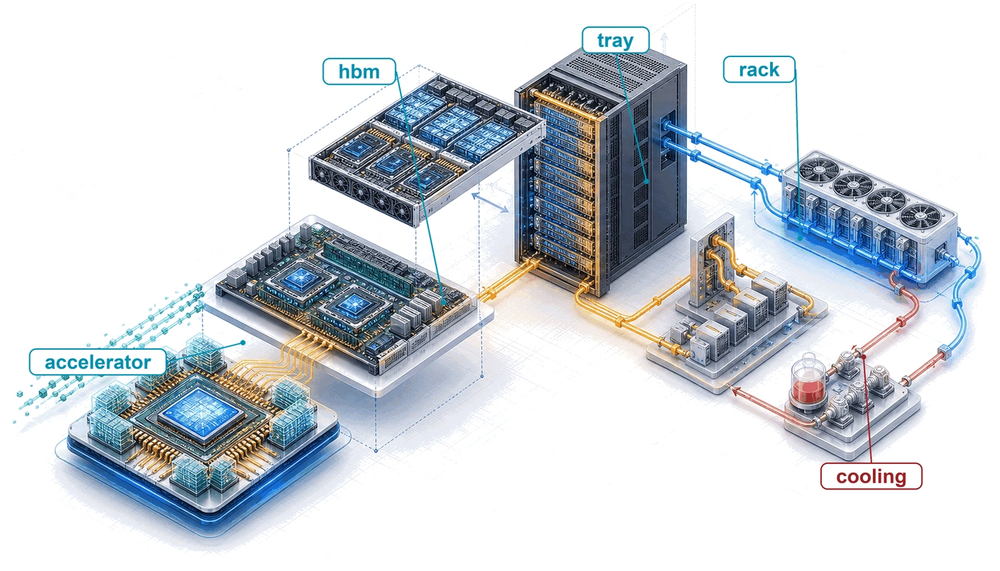{fig-alt="Layered compute infrastructure cutaway from accelerator chip and HBM to server nodes, racks, power delivery, and cooling loops."}
:::

:::

## Purpose {.unnumbered .unlisted}

\begin{marginfigure}
\mlfleetstack{100}{40}{15}{10}{10}{0}{0}{0}
\end{marginfigure}

_Why does infrastructure, not algorithms alone, determine who can participate in advancing machine learning at scale?_

Machine learning systems have a physical reality beyond their code. Public algorithms do not make large-scale training equally accessible: executing them requires power, cooling, memory, and communication capacity that organizations must build and sustain. A model that outgrows one machine turns a local resource problem into a shared infrastructure commitment. Buying more accelerators adds arithmetic capacity, but it also adds data transfers, heat, and components whose failures can interrupt collective work. The useful capacity of the fleet depends on whether those demands can be met together. Hardware that appears attractive in isolation may spend much of its deployment waiting for data or operating below its advertised speed. A facility that can house equipment may lack the electrical or cooling capacity to run it at the intended density. These mismatches consume both capital and operating budgets while reducing the experiments that can finish on schedule. Infrastructure decisions also outlast individual models, so an organization must weigh the efficiency of specialization against the flexibility needed for future workloads. Single-machine performance remains part of that judgment, but multiplying it by the number of machines cannot establish what the complete installation will deliver. Participation at scale therefore depends on turning purchased hardware into sustained, usable capacity within physical and financial limits. In C³ terms, the physical substrate sets the compute and communication bounds within which the fleet must coordinate useful work.

::: {.content-visible when-format="pdf"}

\newpage

:::

::: {.callout-learning-objectives}

- Compare GPU, TPU, and ASIC dataflows to explain specialization across the accelerator spectrum
- Apply roofline analysis to distinguish compute-bound from memory-bandwidth-bound phases of training and inference
- Calculate token latency or memory budgets from accelerator memory capacity, bandwidth, precision, and model state size
- Match tensor, pipeline, and data parallelism to the available interconnect bandwidth hierarchy
- Evaluate rack and pod designs using power density, cooling limits, topology, and facility reliability constraints
- Select accelerator infrastructure using sustained throughput, power constraints, workload fit, and deployment cost

:::

```{python}
#| echo: false
from mlsysim import *
from mlsysim.core.units import *

# ┌─────────────────────────────────────────────────────────────────────────────
# │ CHAPTER START
# ├─────────────────────────────────────────────────────────────────────────────
# │ Context: Chapter initialization and global imports
# │
# │ Why: Registers this chapter with the mlsys registry and provides shared
# │      imports for all subsequent calculation cells.
# │
# └─────────────────────────────────────────────────────────────────────────────
from mlsysim.physics import memory_from_params
from mlsysim.fmt import (
    check,
    fmt,
    fmt_bandwidth,
    fmt_energy,
    fmt_flop_rate,
    fmt_magnitude,
    fmt_math,
    fmt_memory,
    fmt_memory_capacity,
    fmt_params,
    fmt_power,
    fmt_qty_int,
    fmt_qty_range,
    fmt_sci,
    fmt_tokens,
    sci_latex,
)
```

```{python}
#| echo: false
#| label: infra-running-example
#| output: false
# ┌─────────────────────────────────────────────────────────────────────────────
# │ RUNNING EXAMPLE: FRONTIER MODEL + H100 CORE SPECS (LEGO)
# ├─────────────────────────────────────────────────────────────────────────────
# │ Context: Chapter-wide running example used from @sec-compute-accelerator-spectrum
# │          through @sec-compute-pod. Token latency used in notebook \ref{nbk-token-latency}.
# │
# │ Goal: Establish the frontier model (175B) and H100 baselines for the chapter.
# │ Show: frontier_params_b, gpt3_params_b, h_h100 specs, token latency breakdown.
# │ How: Reference mlsysim.Hardware and mlsysim.Models registry.
# │
# └─────────────────────────────────────────────────────────────────────────────
from mlsysim import Hardware, Models
from mlsysim.fmt import check, fmt_math, fmt_params

class InfraSetup:
    """Chapter preamble: 175B frontier running example."""

    m_frontier = Scenarios.DenseLLMPretrainingReference.workload
    ref_cluster = Scenarios.DenseLLMPretrainingReference.system  # Archetype A reference cluster

    # Registry anchors for the @fig-three-walls-grid caption, which cannot hold
    # inline Python; the caption literals are guarded against these values.
    _h100 = Hardware.Cloud.H100
    _campus_power = ReferenceStats.FacilityScaleAnchors.HyperscaleCampusPower
    _fleet_mtbf = calc_mtbf_cluster(Systems.Reliability.Gpu.mttf_hours, Systems.Clusters.Reference_25K_H100.total_accelerators)

    # ┌── 3. GUARD (Invariants) ───────────────────────────────────────────
    check(ref_cluster.total_accelerators == 1024, "Archetype A reference cluster should be 1,024 GPUs")
    check(ref_cluster.count == 128, "Archetype A reference cluster should be 128 eight-GPU nodes")
    check(abs(_h100.memory.bandwidth.to(TB / second).magnitude - 3.35) < 1e-9, "Caption quotes 3.35 TB/s HBM3")
    check(round(_h100.compute.precision_flops["fp8"].to(TFLOP / second).magnitude, -3) == 2000, "Caption quotes ~2K TFLOP/s FP8")
    check(Systems.Fabrics.InfiniBand_NDR.bandwidth.to(Gbps).magnitude == 400, "Caption quotes 400 Gb/s NDR per port")
    check(abs(_fleet_mtbf.to(hour).magnitude - 2) < 0.05, "Caption quotes MTBF ~2 hours at 25K GPUs")
    check(_campus_power.to(MW).magnitude == 100, "Caption quotes a ~100 MW facility")

    # ┌── 4. OUTPUT (Formatting) ──────────────────────────────────────────────
    frontier_params_b_str = fmt_params(m_frontier.parameters)
    ref_gpus_str = fmt(ref_cluster.total_accelerators, precision=0, commas=True)
    ref_nodes_str = fmt(ref_cluster.count, precision=0, commas=False)
```

## The Infrastructure Walls {#sec-compute-infrastructure-infrastructure-walls-4f2c}

A model that exceeds one accelerator's memory capacity forces a hardware decision before training begins. Adding accelerators supplies capacity, but also creates transfers between devices, increases power demand, and couples progress to more components that can fail. The familiar single-node compute and memory limits therefore become inputs to fleet design. Four physical constraints recur as the system grows from one accelerator to a warehouse-scale pod: memory bandwidth, power delivery, communication bandwidth, and reliability (@fig-three-walls-grid). These are the memory, energy, and network walls and the reliability gap of @sec-vol2-introduction-scale-moment, seen from the hardware that imposes them. Power delivery and heat removal are the physical form of the energy wall, and communication bandwidth is the network wall, so this chapter calls the four the memory, power, communication, and reliability walls.

The `{python} InfraSetup.frontier_params_b_str` model anchors this progression. It is the chapter's running instance of Archetype A (GPT-4/Llama-3), a GPT-3-class dense transformer trained with mixed precision and the Adaptive Moment Estimation (Adam) optimizer, whose reference training cluster is `{python} InfraSetup.ref_gpus_str` H100 GPUs in `{python} InfraSetup.ref_nodes_str` eight-GPU nodes. @Sec-appdx-fleet-reference-workload restates these parameters, and @sec-appdx-dam-taxonomy-training-memory derives the bytes per parameter of its training state. Accelerator selection establishes the compute rate, memory capacity, and power envelope that a fleet can buy. The node must connect enough of those accelerators to hold and execute the workload; the rack must power and cool them; the pod must sustain communication and survive component failures. This is the hardware contribution to C³: useful fleet compute depends on the communication and coordination costs created at each physical boundary.

::: {#fig-three-walls-grid fig-env="figure" fig-pos="htb" fig-cap="**The four infrastructure walls**: Read left to right, each wall becomes the dominant constraint at a larger physical scale. The memory wall binds inside the node, where 3.35 TB/s of HBM3 must feed about 2,000 TFLOP/s of FP8 arithmetic; the power wall binds at the rack, where the chapter's four-node DGX H100 rack draws 33.5 kW; the communication wall binds across the pod, where per-direction bandwidth falls ninefold from NVLink to one InfiniBand port; and the reliability wall binds across the fleet, where a 50,000-hour per-GPU MTBF shrinks to about 2 hours at 25K GPUs." fig-alt="An arrow runs from smaller to larger physical scale above four columns. Each column pairs a scale level with a wall: node with 8 GPUs and the memory wall (3.35 TB/s of HBM feeding about 2,000 TFLOP/s of FP8 arithmetic), rack with 32 GPUs and the power wall (33.5 kW per rack, nearly 3 times a 12 kW traditional rack), pod with 1,024 GPUs and the communication wall (450 GB/s NVLink dropping to 50 GB/s InfiniBand, a 9 times cliff), and fleet with 10K to 25K GPUs and the reliability wall (MTBF about 2 hours at 25K GPUs from 50,000 hours per GPU)."}
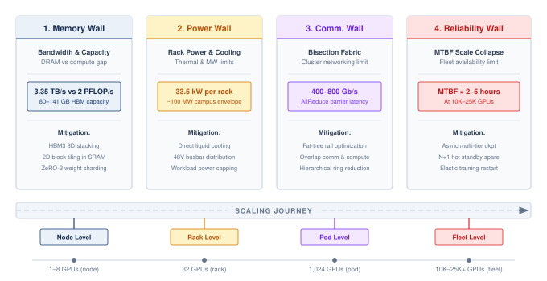

:::

## Accelerator Spectrum {#sec-compute-accelerator-spectrum}

An accelerator purchase commits the fleet to a workload and software stack for longer than one experiment. A research group changing model operations frequently needs programmability; a service executing a stable computation at sustained volume can justify more specialization. The familiar trade-off between control flexibility and arithmetic efficiency matters here because an architectural mismatch is replicated across the fleet. Comparing programmable and specialized accelerators therefore starts with how much of the workload and compiler stack can remain stable over the deployment's lifetime.

::: {#psp-compute-infrastructure-generality-tax .callout-perspective title="The generality tax"}

A modern server CPU devotes roughly 30--40 percent of its die area to caches, 20--30 percent to control logic (branch predictors, reorder buffers, instruction decoders), and only 5--10 percent to arithmetic units. This allocation makes sense for general-purpose code, where branches are unpredictable and data access patterns are irregular. Matrix multiplication, however, has regular access patterns and predictable control flow. Silicon devoted to branch prediction or speculative execution provides flexibility that this workload rarely uses. This is the generality tax\index{Generality tax!accelerator design} (principle \ref{pri-generality-tax}): the area and energy devoted to capabilities outside the dominant workload.

Specialized accelerators reduce this tax. Moving along the spectrum from CPU to custom application-specific integrated circuit (ASIC) can devote more die area to arithmetic by removing general-purpose control logic. The progression is quantifiable: a CPU devotes roughly 5--10 percent of its die to arithmetic, a GPU devotes roughly 50--60 percent, a Tensor Processing Unit (TPU) devotes roughly 70--80 percent, and a purpose-built ASIC can devote over 90 percent of its die to the target computation.

:::

The transition from general-purpose to specialized silicon follows a logical progression. At one end of the spectrum, GPUs retain substantial programmability while providing 10--100$\times$ the matrix throughput of CPUs. At the other end, custom ASICs hardwire a specific dataflow for maximum efficiency at the cost of flexibility.

Understanding *where* each architecture falls on this spectrum, and *why*, is essential for selecting hardware that matches a given workload. The spectrum is not a ranking from "bad" (general-purpose CPU) to "good" (custom ASIC), but a continuum of trade-offs where each position offers the best match for a different combination of workload characteristics and deployment constraints.

GPUs\index{GPU!programmability} represent the first major step away from general-purpose computing toward massive parallelism while retaining programmability. An NVIDIA H100, for example, contains 16,896 CUDA\index{CUDA!programming model} cores organized into 132 streaming multiprocessors (SMs). Each SM can execute thousands of threads simultaneously using the **single instruction, multiple threads (SIMT)**\index{SIMT!definition}[^fn-simt-warp-execution] execution model. Unlike a CPU, which optimizes for single-thread latency, a GPU hides memory latency by maintaining thousands of threads in flight and switching between them\index{Warp scheduling!latency hiding} when one stalls on a memory access.

The programmer writes a single function (a *kernel*), and the hardware maps it across a massive grid of threads. This model is flexible enough to run any mathematical kernel, from convolutions to attention mechanisms to custom loss functions, while providing orders of magnitude more throughput than a CPU for data-parallel computation.

The trade-off is that irregular, branch-heavy code runs poorly because divergent threads within a warp (a group of 32 threads that execute in lockstep)\index{Warp scheduling!divergence penalty} must execute serially. When threads in the same warp take different branches of an if-else statement, the hardware must execute both branches sequentially, disabling the threads that took the other path during each branch. For ML workloads, this divergence penalty is usually small because neural network operations have highly uniform control flow: every element in a matrix multiplication follows the same computation path.

[^fn-simt-warp-execution]: **SIMT (single instruction, multiple threads)**\index{SIMT!warp divergence}: NVIDIA coined the term to distinguish its model from classical single instruction, multiple data (SIMD): each thread keeps its own registers and may branch independently, and the hardware, not the programmer, masks lanes when a warp diverges. That convenience has a price on irregular ML operations such as sparse attention or dynamic expert routing, where masked lanes sit idle while the other path executes.

TPUs go a step further, sacrificing some programmability for maximum efficiency on a single operation type by hardwiring the dataflow itself. Google's Tensor Processing Units use a **systolic array**\index{Systolic array!definition}[^fn-systolic-array-tpu] architecture: a fixed grid of multiply-accumulate (MAC) units where data flows between neighboring cells in a regular, wave-like pattern. Instead of fetching and decoding instructions for each operation, the systolic array receives a matrix at one edge and pulses it through the grid, with each cell performing one MAC and passing the result to its neighbor. This eliminates the instruction fetch and decode overhead entirely, and it avoids writing intermediate results to memory because each partial sum flows directly to the next computation.

The cost of this efficiency is reduced programmability. Models must be compiled through Accelerated Linear Algebra (XLA), which maps high-level operations onto the fixed dataflow. Workloads with irregular control flow or dynamic shapes may not map well to this architecture, and the compilation process itself can be time-consuming (minutes to hours for complex models), which slows the iteration cycle during model development.

The programming model distinction between GPUs and TPUs has practical implications for organizational decisions. Research teams that frequently modify model architectures (adding custom attention patterns, experimenting with new activation functions, prototyping novel training algorithms) generally prefer the GPU's CUDA ecosystem because new operations can be implemented as custom kernels without waiting for compiler support. Teams running established architectures at scale (standard Transformer training, large-scale fine-tuning) may prefer TPUs because the XLA compiler can optimize the entire computation graph, often achieving better hardware utilization than hand-written CUDA kernels for standard operations.

[^fn-systolic-array-tpu]: **Systolic array**\index{Systolic array!etymology}: From Greek *systole* (contraction), the name describes data pulsing through a grid of processing elements in a heart-like rhythm. @kung1979systolic proposed the design for VLSI chips whose limiting resource was memory access rather than logic [@kung1982]: each operand fetched once is reused by every cell it passes. That ratio of computation to memory traffic is exactly what matrix multiplication at ML scale rewards.

::: {#exmp-compute-infrastructure-tpu-origin-story .callout-example title="The TPU origin story"}

**Scenario**: In 2013, Google projected that if users spoke to Android phones for 3 minutes per day using voice search, handling the inference load on general-purpose CPUs would require doubling data center compute capacity at prohibitive cost [@jouppi2017].

**Diagnosis**: Standard CPU architectures paid a heavy generality tax, spending significant silicon area and power on out-of-order execution, branch prediction, and complex caches rather than matrix multiplication throughput.

**Systems lesson**: Hardware specialization is economically justified when a workload is massive, stable, and dominated by a single mathematical kernel (MatMul). The TPU v1 hardwired a $256 \times 256$ systolic array to deliver 92 TOPS (INT8) within a 75 W footprint, establishing custom ASIC accelerators in production serving infrastructure.

:::

Custom ASICs occupy the specialized end of the spectrum, where the economics of silicon can justify giving up much of the general-purpose programmability. When an organization runs a stable workload at enormous scale, designing a chip specifically for that workload may become economically rational. A custom ASIC can improve energy per operation and sustained utilization on its target workload by removing features that computation does not require.

Tesla's Dojo D1 chip, for example, is optimized for the spatial and temporal structure of video-based vision models. Its hundreds of tightly coupled processing nodes are designed around the dataflow needs of Tesla's vision pipeline, with on-chip SRAM sized to keep spatial tiles close to the compute units. This reduces the repeated round-trips to off-chip memory that a general-purpose GPU would require for the same computation.

AWS Trainium\index{AWS Trainium!accelerator fabric} takes a different approach, targeting the broad category of Transformer training rather than a single model. Trainium systems combine compiler-managed memory scheduling with hardware-assisted collective communication, so common training patterns such as tensor-parallel synchronization and data-parallel reductions can be optimized in the accelerator fabric rather than handled entirely by host software.

The risk of custom silicon is equally clear: if the dominant model architecture shifts, as it did from convolutional neural networks (CNNs) to Transformers between 2017 and 2020, a custom ASIC designed for the old architecture becomes a stranded asset. The design cycle for a new ASIC is 2--3 years from conception to deployment, which means the architecture decision must anticipate workload trends several years into the future. This prediction challenge is nontrivial: in 2015, few would have predicted that attention-based Transformers would replace CNNs as the dominant architecture within five years, and organizations that committed to CNN-optimized ASICs during that period found their hardware stranded by the architectural shift.

Custom silicon is therefore a bet on workload stability, and the organizations that make this bet are typically those with enough scale to justify the \$50--\$200 million development cost and enough workload volume to amortize the per-chip NRE (nonrecurring engineering) cost across millions of chips. Google can justify the TPU's development cost because high-volume services such as Search, YouTube recommendations, and Gmail spam filtering can amortize a shared accelerator platform. A research lab running a few hundred GPUs cannot justify the same investment.

The bet can pay off when workloads are stable: a purpose-built ASIC can deliver 5--10$\times$ the energy efficiency of a general-purpose GPU for its target operation. A workload shift can strand that advantage because the chip's fixed dataflow may not accommodate a substantially different computational pattern. Pushing the locality argument further raises a question of physical scale: whether the compute fabric can expand to the size of an entire wafer.

### Wafer-scale engines {#sec-compute-wafer-scale}

Wafer-scale engines (WSE)\index{Wafer-scale engine!on-wafer interconnect} pursue data locality across most of a silicon wafer. Unlike architectures built from chiplets or discrete dies connected by package- or board-level links, a wafer-scale engine such as the Cerebras WSE-3 uses a continuous compute fabric the size of a dinner plate. It can maintain an on-wafer interconnect across that surface because the wafer is not diced into individual chips.

```{python}
#| echo: false
from mlsysim.fmt import check, fmt_bandwidth, fmt_count, fmt_memory_capacity

# ┌── LEGO ───────────────────────────────────────────────
# │ Context: @sec-compute-wafer-scale WSE-3 specification sentence.
# │ Note: the 23 kW power-delivery figure below is the cited CS-2 (WSE-2)
# │       configuration, not the CS-3 registry TDP, so it stays a cited literal.
class WaferScaleSpecs:
    """Cerebras WSE-3 (CS-3) core count, on-wafer SRAM, and memory bandwidth."""

    # ┌── 1. LOAD ──────────────────────────────────────────────────────────
    wse = Hardware.Cloud.Cerebras_CS3

    # ┌── 3. GUARD ─────────────────────────────────────────────────────────
    check(wse.compute.core_count == 900_000, "WSE-3 core count should be 900,000")
    check(wse.memory.capacity.to(GiB).magnitude == 44, "WSE-3 SRAM should be the 44 GB nameplate")

    # ┌── 4. OUTPUT ────────────────────────────────────────────────────────
    core_count_str = fmt_count(wse.compute.core_count, precision=0, commas=True)
    sram_gb_str = fmt_memory_capacity(wse.memory.capacity, unit=GiB, precision=0, commas=False)
    mem_bw_pb_per_s_str = fmt_bandwidth(wse.memory.bandwidth, unit=PB / second, precision=0, commas=False)
```

For its 2024 WSE-3 configuration, Cerebras reported `{python} WaferScaleSpecs.core_count_str` AI-optimized cores, `{python} WaferScaleSpecs.sram_gb_str` of distributed on-chip SRAM, and `{python} WaferScaleSpecs.mem_bw_pb_per_s_str` of aggregate memory bandwidth in its registration filing [@cerebras2024s1]. These specifications are not directly comparable to GPU-cluster peak FLOP/s or high-bandwidth memory (HBM) bandwidth because the architectures expose different dataflows, memory organizations, precisions, and workload mappings. The durable comparison is topological: on-wafer links avoid package-, board-, and rack-level transfers for work that maps onto the fabric.

The challenge of wafer-scale integration\index{Wafer-scale integration!physical constraints} is physical: manufacturing yield, power delivery, and thermal expansion must be solved across a single silicon surface (@fig-wafer-scale-engine). A single defect on a standard chip might render it useless, but on a wafer-scale engine, the software must be "defect-aware,"\index{Wafer-scale integration!defect tolerance} routing around local manufacturing flaws in the silicon fabric. In the documented CS-2 configuration, twelve power supplies in a 9+3 redundant arrangement could deliver up to 23 kW to the WSE-2 [@Cerebras2021]. That configuration-specific design illustrates why wafer-scale power delivery and cooling require system-level liquid-cooling hardware rather than a conventional accelerator heatsink.

Wafer-scale engines sit at a unique point on the spectrum: they are highly specialized in their *physical* architecture but flexible in their *computational* model, as the underlying cores are often general-purpose enough to execute diverse ML kernels. They represent a "scale up" philosophy that attempts to eliminate the communication wall by making the cluster the chip.

::: {#fig-wafer-scale-engine fig-env="figure" fig-pos="htb" fig-cap="**Wafer-scale engine (WSE) architecture**: A DGX H100 node (left) joins eight separately packaged GPUs through an NVSwitch fabric and must leave the chassis over InfiniBand to reach other nodes, so every exchange crosses a package, board, or network boundary. A WSE (right) instead uses most of a 300 mm wafer as one routed mesh of cores, each with local SRAM; defect-aware routing steers traffic around unusable cores, and the on-wafer mesh replaces off-package transfers for mapped operations. The WSE-3 figures are the vendor's reported totals and are not directly comparable to GPU HBM bandwidth." fig-alt="Two panels. Left: a DGX H100 node with eight GPU boxes labeled 80 GB, four above and four below a horizontal NVSwitch bar labeled 450 GB/s per GPU each way; an arrow labeled InfiniBand NDR, 50 GB/s per port, leads from the node to a dashed box labeled other nodes. Right: a circular wafer filled with a grid of small core squares joined by mesh links; one core is marked defective with a red X and a highlighted route bends around it. A legend identifies the core, the defective core, and the route, and a note reads WSE-3: 900,000 cores and 44 GB of SRAM, 21 PB/s aggregate SRAM bandwidth."}
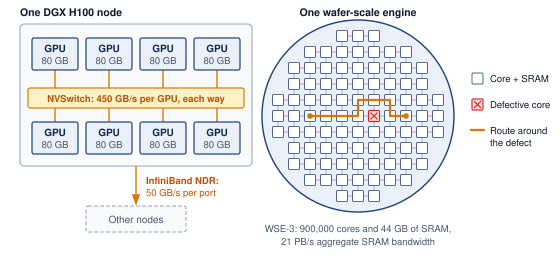

:::

The wafer-scale trade-off exchanges manufacturing complexity and defect-aware routing for an on-wafer fabric that avoids package- and board-level communication between its 900,000 cores. @Fig-accelerator-spectrum places these architectures on a continuum of programmability and efficiency. @Tbl-accelerator-comparison turns that continuum into the architectural features an engineer must compare.

::: {#fig-accelerator-spectrum fig-env="figure" fig-pos="htb" fig-cap="**The accelerator spectrum**: Each bar divides a chip's die area between arithmetic units (dark) and control, cache, and other logic (light), with the lighter band marking the spread of the approximate, illustrative shares quoted in the text. Read top to bottom, the arithmetic share grows from 5 to 10 percent on a CPU to over 90 percent on a custom ASIC, because hardwired dataflow replaces instruction fetch, decode, and scheduling; each step buys throughput per watt by narrowing the range of model architectures the silicon runs well." fig-alt="Four horizontal stacked bars, one each for CPU, GPU, TPU, and custom ASIC, ordered top to bottom along an arrow labeled more specialized. Each bar spans 0 to 100 percent of die area; a dark segment and a lighter range band show the arithmetic share, labeled 5 to 10 percent for the CPU, 50 to 60 percent for the GPU, 70 to 80 percent for the TPU, and over 90 percent for the custom ASIC, with the remainder shaded as control, cache, and other logic."}
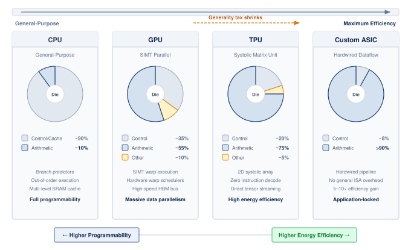

:::

| **Feature**         |    **CPU**    | **GPU** (H100) | **TPU** (v5p)  | **Wafer-scale** | **Custom ASIC** |
|:--------------------|:-------------:|:--------------:|:--------------:|:---------------:|:---------------:|
| **Arithmetic core** | Scalar/vector |  Tensor Core   | Systolic array | RISC-style core |  Fixed dataflow |
| **Execution**       |  Instruction  |      SIMT      |  Data-driven   |     Dataflow    |    Hardwired    |
| **Memory control**  |     Cache     |  L1/L2 + HBM   |   Scratchpad   |   On-chip SRAM  |  Explicit mesh  |
| **Flexibility**     |    Extreme    |      High      |    Moderate    |       High      |       Low       |
| **Efficiency**      |      Low      |      High      |   Very High    |       High      |     Extreme     |

: **The accelerator spectrum**: Moving from left to right trades general-purpose programmability for compute density and power efficiency. Wafer-scale engines occupy a distinct niche, providing cluster-scale performance on a single piece of silicon. {#tbl-accelerator-comparison}

```{python}
#| echo: false
# ┌── LEGO ───────────────────────────────────────────────
class InfraFrontierAccelRecap:

    # ┌── 4. OUTPUT (Formatting) ──────────────────────────────────────────────
    frontier_params_b_str = fmt_params(Models.Language.GPT3.parameters, scale="B", precision=0, commas=False)
```

For our `{python} InfraFrontierAccelRecap.frontier_params_b_str` model, the hardware choice summarized in @tbl-accelerator-comparison is not purely about peak FLOP/s. If we are a research lab experimenting with novel architectures weekly, the GPU's flexibility justifies its generality tax. If we are deploying a fixed Transformer at scale for years, the TPU's dataflow efficiency or a custom ASIC's power advantage may dominate total cost. The accelerator spectrum is ultimately an economic question of *how much flexibility can be surrendered, given the stability of the workload*.

### Chiplet-based accelerators {#sec-compute-chiplet-accelerators}

```{python}
#| echo: false
from mlsysim.fmt import check, fmt_area

# ┌── LEGO ───────────────────────────────────────────────
# │ Scope: chapter-anchor — reticle limit recurs from chiplets through
# │ advanced packaging as the chapter's physical silicon boundary.
class ReticleLimitRecap:
    """Photolithography reticle limit and B200 dual-die equivalent area."""

    reticle = Hardware.Tech.Lithography.ReticleField
    reticle_width = reticle.width
    reticle_height = reticle.height
    reticle_limit = reticle_width * reticle_height
    b200_dies = 2  # B200 pairs two reticle-limited dies (derived: 2 x reticle area)
    b200_equivalent_area = b200_dies * reticle_limit

    check(round(reticle_limit.to(ureg.millimeter**2).magnitude) == 858, "Reticle limit should be 26 x 33 mm = 858 mm^2.")
    check(b200_equivalent_area > reticle_limit, "B200 dual-die equivalent area should exceed a single reticle exposure.")

    # ┌── 4. OUTPUT (Formatting) ──────────────────────────────────────────────
    reticle_limit_mm2_str = fmt_area(reticle_limit, unit=ureg.millimeter**2, commas=False)
    reticle_dims_math = fmt_math(f"{reticle_width.to(ureg.millimeter).magnitude:.0f}{{\\times}}{reticle_height.to(ureg.millimeter).magnitude:.0f}")
    b200_equivalent_area_mm2_str = fmt_area(
        round(b200_equivalent_area.to(ureg.millimeter**2).magnitude, -2) * ureg.millimeter**2, unit=ureg.millimeter**2, commas=True
    )
```

A major accelerator design pattern is the chiplet\index{Chiplet!architecture} architecture, exemplified by NVIDIA's Blackwell and AMD's Instinct MI300 series. Rather than fabricating a single monolithic die, chiplet-based designs partition the processor into multiple smaller dies connected by a high-bandwidth die-to-die interconnect\index{Chiplet!die-to-die interconnect} on a common package substrate. This approach addresses two physical limitations that constrain monolithic designs.

First, the maximum die size is capped by the photolithographic reticle limit\index{Reticle limit!photolithography ceiling} (the `{python} ReticleLimitRecap.reticle_limit_mm2_str` single-exposure ceiling examined in @sec-compute-infrastructure-evolution-gpu-architectures-566b), which limits the number of Tensor Cores, SMs, and HBM stacks a monolithic GPU can integrate. Chiplet designs bypass this limit by placing multiple dies on a single package, with the B200's two reticle-limited dies effectively creating a processor of about `{python} ReticleLimitRecap.b200_equivalent_area_mm2_str`.

Second, manufacturing yield\index{Chiplet!manufacturing yield} decreases exponentially with die area because a single defect anywhere on the die renders the entire chip unusable. Smaller chiplets have higher individual yield, and the package-level integration allows partial yields (a defective chiplet can be replaced with a good one). This yield advantage translates directly to lower manufacturing cost per unit of compute, which is particularly important as transistor densities continue to increase and process nodes become more expensive.

The trade-off is the die-to-die interconnect. Communication between chiplets within a package is faster than communication between packages (NVLink) but slower than communication within a single monolithic die (the on-die mesh network). Workloads that generate frequent, fine-grained communication between processing elements (such as operations that share data between nonadjacent SMs) may experience a latency penalty when those SMs reside on different chiplets. GPU vendors mitigate this by making the die-to-die link transparent to the programmer, so the software sees a single logical GPU regardless of the underlying chiplet topology.

### Evolution of GPU architectures {#sec-compute-infrastructure-evolution-gpu-architectures-566b}

The rapid evolution of NVIDIA's GPU architectures over the past decade illustrates how accelerator design has adapted to the changing demands of ML workloads. Each generation has introduced architectural innovations targeted at the specific bottlenecks revealed by production ML workloads, rather than simply increasing transistor counts.

```{python}
#| echo: false
from mlsysim.fmt import fmt_flop_rate, fmt_power

# ┌── LEGO ───────────────────────────────────────────────
class V100SpectrumRecap:
    h_v100 = Hardware.Cloud.V100

    # ┌── 4. OUTPUT (Formatting) ──────────────────────────────────────────────
    flops_fp16_tflop_per_s_str = fmt_flop_rate(h_v100.compute.peak_flops, unit=TFLOP / second, precision=0, commas=False)
    tdp_w_str = fmt_power(h_v100.tdp, unit=watt, precision=0, commas=False)
```

The Volta architecture (2017) introduced the first-generation Tensor Core, recognizing that neural network training spends the majority of its time in matrix multiplications. Adding dedicated matrix-multiply-accumulate hardware alongside the existing CUDA cores allowed Volta to accelerate the dominant workload pattern without sacrificing the general-purpose programmability that made GPUs attractive for research. The V100, Volta's flagship, delivered `{python} V100SpectrumRecap.flops_fp16_tflop_per_s_str` of FP16 Tensor Core throughput at `{python} V100SpectrumRecap.tdp_w_str`.

```{python}
#| echo: false
#| label: a100-generation-specs
# ┌── LEGO ───────────────────────────────────────────────
from mlsysim.fmt import check, fmt_bandwidth, fmt_flop_rate, fmt_power

class A100Specs:
    """A100 (Ampere, 2020) reference specs for plumbed prose/tables."""

    # ┌── 1. LOAD ──────────────────────────────────────────────────────────
    flops_fp16_tc = Hardware.Cloud.A100.compute.peak_flops
    mem_bw = Hardware.Cloud.A100.memory.bandwidth
    tdp = Hardware.Cloud.A100.tdp
    nvlink = Hardware.Cloud.A100.nvlink.bandwidth

    # ┌── 3. GUARD ─────────────────────────────────────────────────────────
    check(flops_fp16_tc.to(TFLOP / second).magnitude > 300, "A100 FP16 Tensor should be > 300 TFLOP/s")
    check(tdp.to(watt).magnitude == 400, "A100 SXM TDP should be 400 W")

    # ┌── 4. OUTPUT ────────────────────────────────────────────────────────
    flops_fp16_tflop_per_s_str = fmt_flop_rate(flops_fp16_tc, unit=TFLOP / second, precision=0, commas=False)
    mem_bw_gb_per_s_str = fmt_bandwidth(mem_bw, unit=GB / second, precision=0, commas=False)
    mem_bw_tb_per_s_str = fmt_bandwidth(mem_bw, unit=TB / second, precision=2, commas=False)
    tdp_w_str = fmt_power(tdp, unit=watt, precision=0, commas=False)
    nvlink_gb_per_s_str = fmt_bandwidth(nvlink, unit=GB / second, precision=0, commas=False)
```

```{python}
#| echo: false
from mlsysim.fmt import fmt_bandwidth

# ┌── LEGO ───────────────────────────────────────────────
class V100NvlinkRecap:

    # ┌── 4. OUTPUT (Formatting) ──────────────────────────────────────────────
    nvlink_gb_per_s_str = fmt_bandwidth(Hardware.Cloud.V100.nvlink.bandwidth, unit=GB / second, precision=0, commas=False)
```

The Ampere architecture (2020) expanded Tensor Core support to TF32 and BF16, after Turing had introduced INT8 and INT4 Tensor Core modes for quantized inference. The A100 also introduced Multi-Instance GPU (MIG)\index{MIG!GPU partitioning}, which partitions a single GPU into up to seven isolated instances, enabling efficient sharing of expensive hardware across multiple inference workloads. The most consequential change for infrastructure was Ampere's third-generation NVLink\index{NVLink!third-generation}, which doubled bidirectional bandwidth to `{python} A100Specs.nvlink_gb_per_s_str` per GPU from Volta's `{python} V100NvlinkRecap.nvlink_gb_per_s_str`, directly addressing the communication wall for tensor parallelism, which splits each layer's matrices across GPUs.

```{python}
#| echo: false
#| label: h100-generation-specs
# ┌── LEGO ───────────────────────────────────────────────
from mlsysim.fmt import check, fmt_bandwidth, fmt_flop_rate, fmt_power

class H100Specs:
    """H100 (Hopper, 2022) reference specs for plumbed prose/tables."""

    # ┌── 1. LOAD ──────────────────────────────────────────────────────────
    flops_fp16_tc = Hardware.Cloud.H100.compute.peak_flops
    mem_bw = Hardware.Cloud.H100.memory.bandwidth
    tdp = Hardware.Cloud.H100.tdp
    nvlink = Hardware.Cloud.H100.nvlink.bandwidth

    # ┌── 3. GUARD ─────────────────────────────────────────────────────────
    check(flops_fp16_tc.to(TFLOP / second).magnitude > 900, "H100 FP16 Tensor should be > 900 TFLOP/s")
    check(tdp.to(watt).magnitude == 700, "H100 SXM TDP should be 700 W")

    # ┌── 4. OUTPUT ────────────────────────────────────────────────────────
    flops_fp16_tflop_per_s_str = fmt_flop_rate(flops_fp16_tc, unit=TFLOP / second, precision=0, commas=False)
    mem_bw_gb_per_s_str = fmt_bandwidth(mem_bw, unit=GB / second, precision=0, commas=False)
    tdp_w_str = fmt_power(tdp, unit=watt, precision=0, commas=False)
    nvlink_gb_per_s_str = fmt_bandwidth(nvlink, unit=GB / second, precision=0, commas=False)
```

The Hopper architecture (2022) added the Transformer Engine\index{Transformer Engine!FP8 precision}, whose FP8 recipes and autocast integration run supported Transformer operations in FP8 with managed scaling while retaining higher precision where the configured recipe or implementation requires it. Hopper also introduced NVLink 4.0\index{NVLink!fourth-generation} at `{python} H100Specs.nvlink_gb_per_s_str` per GPU and the NVLink Switch\index{NVSwitch!inter-node connectivity}, enabling NVLink connectivity beyond the 8-GPU boundary.

```{python}
#| echo: false
#| label: h_h100-performance-scenario
# ┌─────────────────────────────────────────────────────────────────────────────
# │ H100 PERFORMANCE SPECS (LEGO)
# ├─────────────────────────────────────────────────────────────────────────────
# │ Context: @sec-compute-infrastructure-evolution-gpu-architectures-566b—accelerator evolution
# │
# │ Goal: Provide H100 peak throughput and efficiency statistics.
# │ Show: ~1,979 TFLOP/s FP8.
# │ How: pulling constants from mlsysim.core.units.
# │
# └─────────────────────────────────────────────────────────────────────────────
from mlsysim.fmt import check, fmt_flop_rate, fmt_multiple

class H100PerformanceScenario:
    """H100 peak performance reference."""

    # ┌── 1. LOAD (Constants) ──────────────────────────────────────────────
    flops = Hardware.Cloud.H100.compute.precision_flops["fp8"]
    flops_fp16 = Hardware.Cloud.H100.compute.peak_flops
    h100_tdp = Hardware.Cloud.H100.tdp
    v100_fp16 = Hardware.Cloud.V100.compute.peak_flops
    v100_tdp = Hardware.Cloud.V100.tdp

    # ┌── 2. EXECUTE (The Compute) ────────────────────────────────────────
    # Peak TFLOP/s per TDP watt relative to V100 FP16, with and without the
    # FP8-versus-FP16 precision change.
    _v100_eff = v100_fp16 / v100_tdp
    eff_gain_fp8 = ((flops / h100_tdp) / _v100_eff).to_base_units().magnitude
    eff_gain_fp16 = ((flops_fp16 / h100_tdp) / _v100_eff).to_base_units().magnitude

    # ┌── 3. GUARD (Invariants) ──────────────────────────────────────────
    check(flops.to(TFLOP / second).magnitude > 1000, "H100 should have more than 1000 TFLOPs FP8")
    check(abs(eff_gain_fp8 / eff_gain_fp16 - 2) < 0.05, "FP8 should account for about a 2x factor of the per-watt gain")

    # ┌── 4. OUTPUT (Formatting) ──────────────────────────────────────────────
    h100_fp8_tflop_per_s_str = fmt_flop_rate(flops, unit=TFLOP / second, precision=0, commas=True)
    eff_gain_fp8_mult_str = fmt_multiple(eff_gain_fp8, precision=1, commas=False)
    eff_gain_fp16_mult_str = fmt_multiple(eff_gain_fp16, precision=1, commas=False)
```

The H100's `{python} H100PerformanceScenario.h100_fp8_tflop_per_s_str` of FP8 Tensor Core throughput at `{python} H100Specs.tdp_w_str` represents roughly `{python} H100PerformanceScenario.eff_gain_fp8_mult_str` the V100's peak FP16 throughput per watt of thermal design power (TDP). A factor of two of that gain comes from comparing FP8 with FP16; at equal FP16 precision the gain is `{python} H100PerformanceScenario.eff_gain_fp16_mult_str`, which process technology (TSMC 4N) and architecture account for.

```{python}
#| echo: false
#| label: b200-perf-specs
# ┌─────────────────────────────────────────────────────────────────────────────
# │ B200 PERFORMANCE SPECS (LEGO)
# ├─────────────────────────────────────────────────────────────────────────────
# │ Context: @sec-compute-infrastructure-evolution-gpu-architectures-566b—
# │          Blackwell discussion immediately below.
# │
# │ Goal: Provide B200 FP8 Tensor peak and TDP for the Blackwell paragraph.
# │ Show: ~4,500 TFLOP/s FP8 at ~1,000 W.
# │ How: pulling Hardware.Cloud.B200.compute.precision_flops["fp8"] and Hardware.Cloud.B200.tdp from mlsysim.core.units.
# │
# └─────────────────────────────────────────────────────────────────────────────
from mlsysim.fmt import check, fmt_bandwidth, fmt_flop_rate, fmt_power

class B200PerformanceScenario:
    """B200 peak FP8 performance reference."""

    # ┌── 1. LOAD (Constants) ──────────────────────────────────────────────
    fp8_flops = Hardware.Cloud.B200.compute.precision_flops["fp8"]
    tdp = Hardware.Cloud.B200.tdp
    nvlink = Hardware.Cloud.B200.nvlink.bandwidth

    # ┌── 2. EXECUTE (The Compute) ────────────────────────────────────────
    # (none — direct extraction)

    # ┌── 3. GUARD (Invariants) ───────────────────────────────────────────
    check(fp8_flops.to(TFLOP / second).magnitude > 4000, "B200 should exceed 4,000 TFLOP/s FP8")
    check(tdp.to(watt).magnitude == 1000, "B200 TDP should be 1,000 W")
    check(nvlink.to(GB / second).magnitude == 1800, "B200 NVLink bandwidth should be 1,800 GB/s")

    # ┌── 4. OUTPUT (Formatting) ──────────────────────────────────────────
    fp8_tflop_per_s_str = fmt_flop_rate(fp8_flops, unit=TFLOP / second, precision=0, commas=True)
    tdp_w_str = fmt_power(tdp, unit=watt, precision=0, commas=False)
    nvlink_gb_per_s_str = fmt_bandwidth(nvlink, unit=GB / second, precision=0, commas=True)
```

The Blackwell architecture (2024) continued this trajectory with the B200, which pairs two GPU dies in a single package via a high-bandwidth chip-to-chip link\index{Chiplet!dual-die packaging}, effectively creating a "dual-die GPU" that delivers about `{python} B200PerformanceScenario.fp8_tflop_per_s_str` of dense FP8 Tensor Core throughput at `{python} B200PerformanceScenario.tdp_w_str`. FP16/BF16 comparisons should use the lower precision-specific vendor figure rather than the FP8 peak.

The dual-die approach acknowledges that single-die GPU sizes are approaching the reticle limit of lithographic equipment, and further scaling requires chiplet-based designs. The reticle limit is a fundamental constraint of photolithography: the lens system in the EUV scanner can only project a pattern onto an area of approximately `{python} ReticleLimitRecap.reticle_dims_math` mm (`{python} ReticleLimitRecap.reticle_limit_mm2_str`) in a single exposure. A die larger than this area would require multiple exposures with stitching, which is technically possible but dramatically increases cost and reduces yield.

```{python}
#| echo: false
from mlsysim.fmt import fmt_bandwidth

# ┌── LEGO ───────────────────────────────────────────────
class B200NvlinkRecap:
    # ┌── 4. OUTPUT (Formatting) ──────────────────────────────────────────────
    nvlink_gb_per_s_str = fmt_bandwidth(Hardware.Cloud.B200.nvlink.bandwidth, unit=GB / second, precision=0, commas=False)
```

Blackwell also introduced fifth-generation NVLink\index{NVLink!fifth-generation} at `{python} B200NvlinkRecap.nvlink_gb_per_s_str` per GPU, doubling the intra-node bandwidth again. The die-to-die link\index{Die-to-die interconnect!bandwidth} within the B200 package operates at 10 TB/s, fast enough that the two dies can appear as a single logical GPU to the software for many operations.

The progression reveals a consistent pattern: each generation addresses a bottleneck exposed by the previous generation. Volta added dedicated matrix hardware for the compute bottleneck. Ampere expanded mixed-precision support. Hopper targeted Transformer-specific precision with FP8. Blackwell pushed against the die-size limit with multi-die packaging.

At each step, the accelerator's design reflects an important workload of its era, illustrating *how* the physics of the workload drives the physics of the silicon. This co-evolution between workloads and hardware is not accidental: accelerator architects profile ML workloads to identify bottlenecks, and then design subsequent generations to address them. The result is a hardware evolution that is tightly coupled to model architecture evolution, which is *why* Transformer workloads have strongly shaped accelerator design since 2017.

The evolution also reveals a sobering procurement pattern for infrastructure planners: high-end accelerator generations can turn over faster than the facility that houses them. The V100 remained the flagship training GPU for approximately three years (2017--2020). The A100 held that position for roughly two years (2020--2022). Hopper and Blackwell continued that short-cadence pattern in the mid-2020s.

The planning implication is that a data center built for accelerators must anticipate refresh cycles before the first rack arrives. Hardware refresh planning is therefore an integral part of the initial procurement decision, not an afterthought. @Tbl-gpu-evolution compresses that cadence into the major NVIDIA GPU generations and the interconnect and power changes that arrived with them. Those three quantities do not scale together, and a facility sized against only one of them will be wrong about the other two. @Fig-gpu-scaling-trends separates them: compute grows twice as fast as bandwidth and more than five times as fast as power, so a rack refreshed for arithmetic can outrun both its memory system and its power budget.

::: {#fig-gpu-scaling-trends fig-env="figure" fig-pos="htb" fig-cap="**Compute, bandwidth, and power scale at three different rates**: Dense FP16 Tensor throughput, memory bandwidth, and thermal design power for NVIDIA data center accelerators, normalized to the V100. Compute rises 18$\times$, bandwidth 8.9$\times$, and TDP 3.3$\times$, so the endpoint gains in arithmetic exceed the gains in memory bandwidth and power allowance. These are peak specifications, not measured application throughput. Specifications come from the MLSysIM hardware registry." fig-alt="Line chart with three series normalized to the V100: dense FP16 Tensor throughput reaching 18 times, memory bandwidth 8.9 times, and thermal design power 3.3 times by the B200."}

```{python}
#| echo: false
from mlsysim import Hardware, viz
from mlsysim.core.units import TFLOPs, GB, second, watt
import pandas as pd

# Historical SXM configurations; dense FP16 Tensor throughput at every point.
names = ["V100", "A100", "H100", "B200"]
devices = [getattr(Hardware.Cloud, name) for name in names]
data = pd.DataFrame(
    {
        "Accelerator": names,
        "Year": [2017, 2020, 2022, 2024],
        "Peak_TFLOPS": [h.compute.peak_flops.to(TFLOPs / second).magnitude for h in devices],
        "Memory_Bandwidth_GBps": [h.memory.bandwidth.to(GB / second).magnitude for h in devices],
        "TDP_W": [h.tdp.to(watt).magnitude for h in devices],
    }
)
base = data.iloc[0]
data["Compute"] = data["Peak_TFLOPS"] / base["Peak_TFLOPS"]
data["Bandwidth"] = data["Memory_Bandwidth_GBps"] / base["Memory_Bandwidth_GBps"]
data["TDP"] = data["TDP_W"] / base["TDP_W"]

fig, ax, COLORS, plt = viz.setup_plot(figsize=(7, 4.2))
labels = data["Accelerator"] + "\n" + data["Year"].astype(str)
ax.plot(labels, data["Compute"], marker="o", color=COLORS["OrangeLine"], linewidth=2, label="Dense FP16 Tensor throughput")
ax.plot(labels, data["Bandwidth"], marker="s", color=COLORS["BlueLine"], linewidth=2, label="Memory bandwidth")
ax.plot(labels, data["TDP"], marker="^", color=COLORS["primary"], linewidth=2, linestyle="--", label="Thermal design power")

for col, colour in [("Compute", COLORS["OrangeLine"]), ("Bandwidth", COLORS["BlueLine"]), ("TDP", COLORS["primary"])]:
    end = data[col].iloc[-1]
    ax.annotate(
        f'{end:.0f}×' if end >= 10 else f'{end:.1f}×',
        xy=(len(data) - 1, data[col].iloc[-1]),
        xytext=(6, 0),
        textcoords="offset points",
        va="center",
        fontweight="bold",
        color=colour,
    )

ax.set_ylabel(f'Growth relative to {base["Accelerator"]} ({int(base["Year"])})')
ax.set_xlabel("NVIDIA data center accelerator")
ax.legend(loc="upper left", frameon=False)
ax.margins(x=0.12)
fig.tight_layout()
```

:::

A subtlety that affects fleet consistency is the silicon lottery\index{Silicon lottery!fleet consistency}, the manufacturing reality in which microscopic variance in 4nm lithography produces a distribution of chip quality across each wafer. NVIDIA manages this yield curve through aggressive binning: dies capable of sustaining high clock frequencies at strictly controlled voltages under the full TDP are designated as premium H100 SXM modules, while those with higher leakage currents or minor defects become H100 PCIe cards or are fused down to lower-tier products. Even within the top-tier SXM bin, the achievable boost clock varies based on silicon characteristics. In a synchronous training cluster, the collective communication primitives are blocked by the slowest participant. A single chip running 50 MHz (about 2.5 percent) below its peers can slow every synchronous step it joins by up to that fraction, because the other participants wait for it at each collective, which is why sophisticated fleet management systems track per-GPU performance metrics and quarantine underperforming silicon to inference pools where the impact of individual chip variance is less pronounced.

```{python}
#| echo: false
from mlsysim.fmt import fmt_bandwidth, fmt_flop_rate, fmt_power

# ┌── LEGO ───────────────────────────────────────────────
class V100TableRecap:
    h_v100 = Hardware.Cloud.V100

    # ┌── 4. OUTPUT (Formatting) ──────────────────────────────────────────────
    flops_fp16_tflop_per_s_str = fmt_flop_rate(h_v100.compute.peak_flops, unit=TFLOP / second, precision=0, commas=False)
    tdp_w_str = fmt_power(h_v100.tdp, unit=watt, precision=0, commas=False)
    nvlink_gb_per_s_str = fmt_bandwidth(Hardware.Cloud.V100.nvlink.bandwidth, unit=GB / second, precision=0, commas=False)
```

| **Architecture**     | **Year** |    **Key innovation**   |                         **Peak tensor**                         |                   **TDP**                    |                     **NVLink BW**                      |
|:---------------------|:--------:|:-----------------------:|:---------------------------------------------------------------:|:--------------------------------------------:|:------------------------------------------------------:|
| **Volta** (V100)     |   2017   |    First Tensor Core    |    `{python} V100TableRecap.flops_fp16_tflop_per_s_str` FP16    |     `{python} V100TableRecap.tdp_w_str`      |     `{python} V100TableRecap.nvlink_gb_per_s_str`      |
| **Ampere** (A100)    |   2020   |   Multi-precision, MIG  |       `{python} A100Specs.flops_fp16_tflop_per_s_str` FP16      |        `{python} A100Specs.tdp_w_str`        |        `{python} A100Specs.nvlink_gb_per_s_str`        |
| **Hopper** (H100)    |   2022   | Transformer Engine, FP8 | `{python} H100PerformanceScenario.h100_fp8_tflop_per_s_str` FP8 |        `{python} H100Specs.tdp_w_str`        |        `{python} H100Specs.nvlink_gb_per_s_str`        |
| **Blackwell** (B200) |   2024   |    Dual-die, NVLink 5   |    `{python} B200PerformanceScenario.fp8_tflop_per_s_str` FP8   | `{python} B200PerformanceScenario.tdp_w_str` | `{python} B200PerformanceScenario.nvlink_gb_per_s_str` |

: **NVIDIA GPU architecture evolution**: Each generation introduces architectural features targeted at the dominant ML workload pattern of its era. Efficiency rises substantially but unevenly across generations, while NVLink bandwidth increases from 300 GB/s on V100 to `{python} B200PerformanceScenario.nvlink_gb_per_s_str` on B200, with a smaller 1.5$\times$ A100-to-H100 step between the larger doubling jumps. {#tbl-gpu-evolution}

```{python}
#| echo: false
# ┌── LEGO ───────────────────────────────────────────────
# │ Context: prose after @tbl-gpu-evolution; replaces the retired efficiency
# │          and compute-memory divergence figures with computed growth ratios.
from mlsysim.fmt import check, fmt_multiple

class GenerationGrowthRecap:
    """Dense FP16 growth ratios, V100 to B200, from the hardware registry."""

    # ┌── 1. LOAD (Constants) ──────────────────────────────────────────────
    v100 = Hardware.Cloud.V100
    b200 = Hardware.Cloud.B200

    # ┌── 2. EXECUTE (The Compute) ────────────────────────────────────────
    compute_growth = (b200.compute.peak_flops / v100.compute.peak_flops).to_base_units().magnitude
    bandwidth_growth = (b200.memory.bandwidth / v100.memory.bandwidth).to_base_units().magnitude
    tdp_growth = (b200.tdp / v100.tdp).to_base_units().magnitude
    efficiency_growth = compute_growth / tdp_growth
    intensity_growth = compute_growth / bandwidth_growth

    # ┌── 3. GUARD (Invariants) ───────────────────────────────────────────
    check(compute_growth > bandwidth_growth > tdp_growth, "Compute should outgrow bandwidth, which should outgrow TDP")
    check(1.5 < intensity_growth < 2.5, "Required arithmetic intensity should roughly double")
    # @fig-gpu-scaling-trends caption and fig-alt quote these as literals (captions
    # cannot hold inline Python), and the lead-in prose says compute grows "twice
    # as fast as bandwidth and more than five times as fast as power".
    check(round(compute_growth) == 18, "Caption quotes 18x dense FP16 compute growth")
    check(round(bandwidth_growth, 1) == 8.9, "Caption quotes 8.9x memory bandwidth growth")
    check(round(tdp_growth, 1) == 3.3, "Caption quotes 3.3x TDP growth")
    check(round(intensity_growth) == 2 and compute_growth / tdp_growth > 5, "Prose: twice as fast as bandwidth, over five times as fast as power")

    # ┌── 4. OUTPUT (Formatting) ──────────────────────────────────────────
    compute_growth_mult_str = fmt_multiple(compute_growth, precision=0, commas=False)
    bandwidth_growth_mult_str = fmt_multiple(bandwidth_growth, precision=1, commas=False)
    tdp_growth_mult_str = fmt_multiple(tdp_growth, precision=1, commas=False)
    efficiency_growth_mult_str = fmt_multiple(efficiency_growth, precision=1, commas=False)
    intensity_growth_mult_str = fmt_multiple(round(intensity_growth), precision=0, commas=False)
```

Because @tbl-gpu-evolution mixes FP16 and FP8 peaks, a fair efficiency comparison holds precision fixed at dense FP16. Dividing each generation's peak throughput by its TDP gives a V100-to-B200 gain of only `{python} GenerationGrowthRecap.efficiency_growth_mult_str` in peak throughput per watt, against `{python} GenerationGrowthRecap.compute_growth_mult_str` in raw throughput, because the power allowance itself rose `{python} GenerationGrowthRecap.tdp_growth_mult_str`. Facilities must therefore accommodate higher device power as well as greater arithmetic capacity, which connects this trend to the power wall in @sec-compute-power-wall.

### Evolution of TPU architectures {#sec-compute-tpu-evolution}

Google's TPU\index{TPU!pod-scale design} trajectory follows a different path, focusing on distributed efficiency and XLA compiler integration. While GPUs emphasize peak per-chip throughput and software flexibility (CUDA), the TPU line has treated the pod as its unit of design since its second generation. From TPU v2 onward, every TPU chip is designed as part of a larger cluster, with dedicated inter-chip interconnect (ICI) links that bypass the host CPU entirely.

```{python}
#| echo: false
#| label: compute-infrastructure-tpu-v5p-recap

# ┌─────────────────────────────────────────────────────────────────────────────
# │ TPU V5P SPEC RECAP
# ├─────────────────────────────────────────────────────────────────────────────
# │ Context: TPU-evolution prose and the v5p row of the generation table in
# │          @sec-compute-tpu-evolution.
# │
# │ Goal: Pin the TPU v5p compute/memory specs to the registry (the old prose
# │       hand-typed 2,765 GB/s where the registry holds 2.76 TB/s).
# │ Show: BF16 peak, HBM capacity (branded 95 GB label of a 95 GiB part),
# │       and HBM bandwidth for the pod-scale training discussion.
# │ How: Read Hardware.Cloud.TPUv1..TPUv5p compute, memory, and ICI specs.
# │      TPU v2 ICI bandwidth stays a table literal because the v2 ICI link
# │      is not yet in the registry. The v3 peak is the per-chip
# │      Jouppi 2020 Table 3 figure held by Hardware.Cloud.TPUv3.
# │
# └─────────────────────────────────────────────────────────────────────────────
from mlsysim.fmt import fmt_bandwidth, fmt_flop_rate, fmt_memory_capacity, fmt_ops_rate

class TpuV5pRecap:
    # ┌── 1. LOAD (Constants) ──────────────────────────────────────────────
    v1 = Hardware.Cloud.TPUv1
    v2 = Hardware.Cloud.TPUv2
    v3 = Hardware.Cloud.TPUv3
    v4 = Hardware.Cloud.TPUv4
    v5p = Hardware.Cloud.TPUv5p

    # ┌── 2. EXECUTE (The Compute) ────────────────────────────────────────
    v3_ici_one_dir = v3.nvlink.bandwidth_per_direction
    v4_ici_one_dir = v4.nvlink.bandwidth_per_direction
    v5p_ici_one_dir = v5p.nvlink.bandwidth_per_direction
    v3_pod_chips = 1024  # scenario assumption: documented TPU v3 pod size (Jouppi et al. 2020)
    v3_pod_peak = v3_pod_chips * v3.compute.peak_flops

    # ┌── 3. GUARD (Invariants) ───────────────────────────────────────────
    check(v5p.memory.bandwidth > Hardware.Cloud.A100.memory.bandwidth, "TPU v5p HBM bandwidth should exceed A100-class HBM2e")
    check(v5p.nvlink.direction == "bidirectional_total", "TPU v5p ICI is stored as the bidirectional per-chip total")
    check(v3.compute.peak_flops < v4.compute.peak_flops, "TPU v3 peak must be the per-chip figure, below TPU v4")
    check(v3.nvlink.direction == "per_direction", "TPU v3 ICI is stored per direction, matching the table column")
    check(v3_pod_peak.to(PFLOP / second).magnitude > 100, "Prose says a TPU v3 pod exceeds 100 PFLOP/s")

    # ┌── 4. OUTPUT (Formatting) ──────────────────────────────────────────
    v1_int8_tops_str = fmt_ops_rate(v1.compute.peak_flops, unit=TOPS, precision=0, commas=False)
    v2_bf16_str = fmt_flop_rate(v2.compute.peak_flops, unit=TFLOP / second, precision=0, commas=False)
    v3_bf16_str = fmt_flop_rate(v3.compute.peak_flops, unit=TFLOP / second, precision=0, commas=False)
    v4_bf16_str = fmt_flop_rate(v4.compute.peak_flops, unit=TFLOP / second, precision=0, commas=False)
    v2_hbm_gb_str = fmt_memory_capacity(v2.memory.capacity, unit=GiB, precision=0, commas=False)
    v3_hbm_gb_str = fmt_memory_capacity(v3.memory.capacity, unit=GiB, precision=0, commas=False)
    v4_hbm_gb_str = fmt_memory_capacity(v4.memory.capacity, unit=GiB, precision=0, commas=False)
    v3_ici_gb_per_s_str = fmt_bandwidth(v3_ici_one_dir, unit=GB / second, precision=0, commas=False)
    v4_ici_gb_per_s_str = fmt_bandwidth(v4_ici_one_dir, unit=GB / second, precision=0, commas=False)
    v3_pod_chips_str = fmt(v3_pod_chips, precision=0, commas=True)
    v3_pod_peak_pflop_per_s_str = fmt_flop_rate(
        round(v3_pod_peak.to(PFLOP / second).magnitude) * PFLOP / second, unit=PFLOP / second, precision=0, commas=False
    )
    v5p_ici_gb_per_s_str = fmt_bandwidth(v5p_ici_one_dir, unit=GB / second, precision=0, commas=False)
    v5p_ici_bidir_gb_per_s_str = fmt_bandwidth(v5p.nvlink.bandwidth, unit=GB / second, precision=0, commas=True)
    peak_bf16_str = fmt_flop_rate(v5p.compute.peak_flops, unit=TFLOP / second, precision=0, commas=False)
    hbm_gb_str = fmt_memory_capacity(v5p.memory.capacity, unit=GiB, precision=0, commas=False)
    hbm_bw_gb_per_s_str = fmt_bandwidth(v5p.memory.bandwidth, unit=GB / second, precision=0, commas=True)
```

The generation sequence shows how that pod-first design moved from inference to training. The TPU v1 (2015) was a dedicated inference chip with a $256{\times}256$ systolic array, delivering `{python} TpuV5pRecap.v1_int8_tops_str` (INT8) for the matrix operations that dominated Google's production inference workloads. TPU v2 (2017) and TPU v3 (2018) then shifted the architecture toward training by adding bfloat16 (BF16), avoiding the dynamic range problems of standard FP16, and scaling the pod concept until a TPU v3 pod joined `{python} TpuV5pRecap.v3_pod_chips_str` chips with about `{python} TpuV5pRecap.v3_pod_peak_pflop_per_s_str` of aggregate BF16 peak. TPU v4 (2021) extended the same logic into the network itself, adding an optical circuit switch\index{Optical circuit switching!TPU v4 pod} so the physical topology could be reconfigured for different workloads, added SparseCore units that accelerate embedding lookups, and raised per-chip BF16 throughput to `{python} TpuV5pRecap.v4_bf16_str`.

The TPU v5p\index{TPU!v5p} (2023) continued this pod-scale design for high-end training. It features `{python} TpuV5pRecap.peak_bf16_str` of BF16 compute, `{python} TpuV5pRecap.hbm_gb_str` of HBM2e with `{python} TpuV5pRecap.hbm_bw_gb_per_s_str` memory bandwidth, and `{python} TpuV5pRecap.v5p_ici_bidir_gb_per_s_str` bidirectional ICI bandwidth per chip, optimized for the massive AllReduce operations required by billion-parameter models. AllReduce combines values contributed by a group of accelerators, such as gradient sums, and returns the combined result to every participant. Its cost depends on the links connecting that group, which makes it a hardware-selection concern before the collective algorithms are studied. @Tbl-tpu-evolution shows how that pod-first design evolved across TPU generations. @Sec-appdx-comm-foundations-allreduce develops the collective communication complexity model and the algorithm choices behind AllReduce, which explain why inter-chip bandwidth, not per-chip arithmetic, sets the ceiling on training throughput as model size grows.

| **Generation** | **Year** |     **Key innovation**     |              **Peak BF16**               |               **HBM**                |    **ICI BW (aggregate, one direction)**    |
|:---------------|:--------:|:--------------------------:|:----------------------------------------:|:------------------------------------:|:-------------------------------------------:|
| **TPU v1**     |   2015   | Systolic array (inference) | `{python} TpuV5pRecap.v1_int8_tops_str`* |                  —                   |                      —                      |
| **TPU v2**     |   2017   |   High-bandwidth memory    |    `{python} TpuV5pRecap.v2_bf16_str`    | `{python} TpuV5pRecap.v2_hbm_gb_str` |                   248 GB/s                  |
| **TPU v3**     |   2018   | Liquid cooling, pod scale  |    `{python} TpuV5pRecap.v3_bf16_str`    | `{python} TpuV5pRecap.v3_hbm_gb_str` |  `{python} TpuV5pRecap.v3_ici_gb_per_s_str` |
| **TPU v4**     |   2021   | Optical switch, SparseCore |    `{python} TpuV5pRecap.v4_bf16_str`    | `{python} TpuV5pRecap.v4_hbm_gb_str` |  `{python} TpuV5pRecap.v4_ici_gb_per_s_str` |
| **TPU v5p**    |   2023   |     Larger pods, HBM2e     |   `{python} TpuV5pRecap.peak_bf16_str`   |  `{python} TpuV5pRecap.hbm_gb_str`   | `{python} TpuV5pRecap.v5p_ici_gb_per_s_str` |

: **Google TPU architecture evolution**: The TPU's development highlights a "pod-first" design philosophy where inter-chip interconnect bandwidth and compiler-level optimization (XLA) are as important as peak per-chip arithmetic. Note: TPU v1 was INT8 only. {#tbl-tpu-evolution}

This comparison reveals a fundamental divergence in architectural philosophy (@tbl-tpu-evolution). GPU evolution is a race to pack more arithmetic, in ever lower-precision Tensor Core formats, onto a single package, using chiplets (Blackwell) to overcome physical die-size limits. TPU evolution is a race to build more efficient warehouse-scale computers, where the individual chip's performance is secondary to the pod's collective bandwidth and reconfigurability [@barroso2019].

The H100's arithmetic engine can reach `{python} H100PerformanceScenario.h100_fp8_tflop_per_s_str` in its advertised low-precision mode, but workloads realize that throughput only when data reaches the compute units fast enough. For many ML workloads, the memory wall sets that limit.

## The Memory Wall {#sec-compute-memory-wall}

As arithmetic throughput grows faster than data-access speed, compute units can spend more time waiting for operands. This divergence is known as the memory wall\index{Memory wall!scaling gap} [@wulf1995]. While transistor scaling has increased logic performance by orders of magnitude, the interconnects that feed data to those cores have not kept pace. Neural networks can require large weight and activation streams, making bandwidth rather than compute the governing constraint for some inference and training regimes. @Sec-appdx-c3-taxonomy-diagnostic-summary develops the diagnostic framework that classifies this memory-bound condition alongside the other bottleneck patterns a fleet encounters, so that a measured symptom maps to a named constraint rather than a guess.

```{python}
#| echo: false
# ┌── LEGO ───────────────────────────────────────────────
class InfraFrontierMemoryWallRecap:

    # ┌── 4. OUTPUT (Formatting) ──────────────────────────────────────────────
    frontier_params_b_str = fmt_params(Models.Language.GPT3.parameters, scale="B", precision=0, commas=False)
```

```{python}
#| echo: false
from mlsysim.fmt import fmt_bandwidth

# ┌── LEGO ───────────────────────────────────────────────
class MemoryBandwidthIntroRecap:
    # ┌── 1. LOAD ──────────────────────────────────────────
    h100_bw = Hardware.Cloud.H100.memory.bandwidth
    weights_fp16 = Models.Language.GPT3.size_in_bytes(BYTES_FP16)

    # ┌── 2. EXECUTE ───────────────────────────────────────
    token_floor = (weights_fp16 / h100_bw).to(millisecond)

    # ┌── 3. GUARD ─────────────────────────────────────────
    check(token_floor > 100 * millisecond, "Prose claims a latency floor of over 100 ms per token")

    # ┌── 4. OUTPUT (Formatting) ──────────────────────────────────────────────
    h100_bw_tb_per_s_str = fmt_bandwidth(h100_bw, unit=TB / second, precision=2, commas=False)
    weights_fp16_gb_str = fmt_memory(weights_fp16, unit=GB, precision=0, commas=False)
```

The implications are concrete and perceptible in our running example. Our `{python} InfraFrontierMemoryWallRecap.frontier_params_b_str` model's weights occupy `{python} MemoryBandwidthIntroRecap.weights_fp16_gb_str` in FP16. During autoregressive decoding, this entire `{python} MemoryBandwidthIntroRecap.weights_fp16_gb_str` tensor must be streamed from off-chip memory into the processor's registers for every single token generated. A single H100 cannot hold that tensor, so this is a bandwidth-floor calculation after sharding or quantization has solved the capacity problem. At H100-class HBM bandwidths (~`{python} MemoryBandwidthIntroRecap.h100_bw_tb_per_s_str` per accelerator), the data movement alone dictates a latency floor of over 100 ms per token if one accelerator-equivalent bandwidth path must stream the weights. The memory wall is not an abstract architectural concept: it is the physical reason a chatbot takes a perceptible pause between words. Three engineering responses address this constraint: HBM widens the data pipe, the roofline model rigorously diagnoses whether a workload is starving for data or for compute, and Tensor Cores maximize the arithmetic value of every byte fetched. As @fig-accelerator-memory-tier-map shows, memory bandwidth is also a placement trade-off: moving the working set closer to compute raises bandwidth, but it usually reduces the amount of state that can stay there.

::: {#fig-accelerator-memory-tier-map fig-env="figure" fig-pos="htb" fig-cap="**Accelerator memory tiers**: Peak memory bandwidth and capacity separate local-SRAM designs (solid stars), HBM accelerators (tinted circles), and edge and shared-LPDDR devices (hollow squares); all three are memory, so they share one hue and differ by marker. The dotted arrow marks the design trade-off: moving data closer to compute raises bandwidth but reduces capacity." fig-alt="Log-log scatter plot of memory capacity vs. peak memory bandwidth. All markers use one blue memory hue: solid stars for local-SRAM designs at low capacity and very high bandwidth, tinted circles for HBM accelerators at tens to hundreds of gigabytes and lower bandwidth, and hollow squares for edge and shared-LPDDR devices at the lowest bandwidth. A dotted arrow points from the HBM cluster toward the SRAM cluster, labeled closer to compute: more bandwidth, less capacity."}

```{python}
#| echo: false
# ┌─────────────────────────────────────────────────────────────────────────────
# │ ACCELERATOR MEMORY TIER MAP (FIGURE)
# ├─────────────────────────────────────────────────────────────────────────────
# │ Context: @fig-accelerator-memory-tier-map -- memory wall tier comparison
# │
# │ Goal: Show how accelerator memory tiers trade capacity against bandwidth.
# │ Show: Log-log scatter; local SRAM, HBM, and edge/shared-LPDDR clusters;
# │       dotted arrow for the capacity/bandwidth placement trade-off.
# │ How: Read accelerator capacity and bandwidth values from the hardware
# │      registry; plot tier placement on log-log axes.
# │
# └─────────────────────────────────────────────────────────────────────────────
from collections import namedtuple
import math
from binder.tools.figures import style as book_style

# Plotting helper only, not a prose-substitution value; a namedtuple (rather
# than a frozen dataclass) keeps this figure cell free of a focal prose-ref
# target.
MemoryTierPoint = namedtuple("MemoryTierPoint", ["label", "capacity_gb", "bandwidth_gb_per_s", "tier"])

def registry_memory_point(label, node, tier):
    return MemoryTierPoint(
        label=label,
        capacity_gb=node.memory.capacity.to(GB).magnitude,
        bandwidth_gb_per_s=node.memory.bandwidth.to(GB / second).magnitude,
        tier=tier,
    )

memory_tier_points = [
    registry_memory_point("V100", Hardware.Cloud.V100, "HBM"),
    registry_memory_point("A100", Hardware.Cloud.A100, "HBM"),
    registry_memory_point("H100", Hardware.Cloud.H100, "HBM"),
    registry_memory_point("H200", Hardware.Cloud.H200, "HBM"),
    registry_memory_point("B200", Hardware.Cloud.B200, "HBM"),
    registry_memory_point("MI300X", Hardware.Cloud.MI300X, "HBM"),
    registry_memory_point("TPU v5p", Hardware.Cloud.TPUv5p, "HBM"),
    registry_memory_point("TPU v6e", Hardware.Cloud.TPUv6, "HBM"),
    registry_memory_point("Trainium2", Hardware.Cloud.Trainium2, "HBM"),
    registry_memory_point("Gaudi 3", Hardware.Cloud.Gaudi3, "HBM"),
    registry_memory_point("WSE-3", Hardware.Cloud.Cerebras_CS3, "local SRAM"),
    registry_memory_point("Groq LPU", Hardware.Cloud.Groq_LPU, "local SRAM"),
    registry_memory_point("Graphcore GC200", Hardware.Cloud.Graphcore_GC200, "local SRAM"),
    registry_memory_point("Untether speedAI240", Hardware.Cloud.Untether_speedAI240, "local SRAM"),
    registry_memory_point("d-Matrix Corsair", Hardware.Cloud.DMatrix_Corsair, "local SRAM"),
    registry_memory_point("Coral Edge TPU", Hardware.Edge.Coral, "edge LPDDR"),
    registry_memory_point("Jetson Orin Nano", Hardware.Edge.JetsonOrinNano, "edge LPDDR"),
    registry_memory_point("Jetson Orin NX", Hardware.Edge.JetsonOrinNX, "edge LPDDR"),
    registry_memory_point("Jetson AGX Orin", Hardware.Edge.JetsonAGXOrin, "edge LPDDR"),
]

fig, ax, COLORS, plt = book_style.setup_plot(figsize=(8.0, 4.65))

def fill_log_ellipse(center, width_decades, height_decades, color, alpha=0.065):
    cx, cy = math.log10(center[0]), math.log10(center[1])
    theta = [2 * math.pi * i / 260 for i in range(261)]
    xs = [10 ** (cx + (width_decades / 2) * math.cos(t)) for t in theta]
    ys = [10 ** (cy + (height_decades / 2) * math.sin(t)) for t in theta]
    ax.fill(xs, ys, color=color, alpha=alpha, linewidth=0, zorder=1)

fill_log_ellipse((1.15, 2.5e5), 2.45, 2.05, COLORS["BlueLine"], alpha=0.10)
fill_log_ellipse((105, 2600), 1.55, 1.25, COLORS["BlueLine"], alpha=0.065)
fill_log_ellipse((18, 82), 1.42, 1.0, COLORS["BlueLine"], alpha=0.035)

# Every tier is memory, so all three use the memory hue (BlueLine); marker
# shape and fill weight (solid, tinted, hollow) separate the tiers, darkest
# nearest the compute units.
tier_styles = {
    "local SRAM": (COLORS["BlueLine"], "*", 145, 0.95, 5),
    "HBM": (COLORS["BlueL"], "o", 50, 0.95, 4),
    "edge LPDDR": ("white", "s", 34, 0.95, 4),
}

for point in memory_tier_points:
    color, marker, size, alpha, z_order = tier_styles[point.tier]
    ax.scatter(
        point.capacity_gb,
        point.bandwidth_gb_per_s,
        s=size,
        marker=marker,
        facecolor=color,
        edgecolor=COLORS["BlueLine"] if point.tier != "local SRAM" else COLORS["primary"],
        linewidth=0.9 if point.tier != "local SRAM" else 0.55,
        alpha=alpha,
        zorder=z_order,
    )

label_offsets = {
    "WSE-3": (5, 0, COLORS["BlueLine"], "left"),
    "Untether speedAI240": (5, -8, COLORS["BlueLine"], "left"),
    "Groq LPU": (5, -3, COLORS["BlueLine"], "left"),
    "Graphcore GC200": (5, -2, COLORS["BlueLine"], "left"),
    "d-Matrix Corsair": (5, 1, COLORS["BlueLine"], "left"),
    "V100": (-6, 0, COLORS["BlueLine"], "right"),
    "H100": (-6, 2, COLORS["BlueLine"], "right"),
    "B200": (6, 7, COLORS["BlueLine"], "left"),
    "Jetson AGX Orin": (5, 2, COLORS["BlueLine"], "left"),
    "Coral Edge TPU": (6, 0, COLORS["BlueLine"], "left"),
}

for point in memory_tier_points:
    if point.label not in label_offsets:
        continue
    dx, dy, color, ha = label_offsets[point.label]
    ax.annotate(
        point.label,
        (point.capacity_gb, point.bandwidth_gb_per_s),
        textcoords="offset points",
        xytext=(dx, dy),
        fontsize=6.8,
        color=color,
        ha=ha,
        va="center",
        zorder=6,
    )

ax.annotate(
    "",
    xy=(0.75, 1.35e5),
    xytext=(38, 8500),
    arrowprops=dict(
        arrowstyle="->",
        linestyle=":",
        color=COLORS["primary"],
        lw=1.0,
        shrinkA=2,
        shrinkB=4,
    ),
    zorder=3,
)
ax.text(
    6.0,
    6.0e3,
    "closer to compute:\nmore bandwidth, less capacity",
    fontsize=7.1,
    color=COLORS["primary"],
    ha="center",
    va="center",
    rotation=0,
)

ax.text(
    0.058,
    1.75e5,
    "local SRAM\nsmall capacity, very high bandwidth",
    color=COLORS["BlueLine"],
    fontsize=8.1,
    fontstyle="italic",
    ha="left",
    va="center",
)
ax.text(
    47,
    660,
    "HBM accelerators\nlarger capacity\nlower bandwidth per stored byte",
    color=COLORS["BlueLine"],
    fontsize=8.1,
    fontstyle="italic",
    ha="left",
    va="center",
)
ax.text(
    6.5,
    38,
    "edge/shared LPDDR",
    color=COLORS["BlueLine"],
    fontsize=8.1,
    fontstyle="italic",
    ha="left",
    va="center",
)

ax.set_xscale("log")
ax.set_yscale("log")
ax.set_xlim(0.018, 650)
ax.set_ylim(5, 3.2e7)
ax.set_xlabel("Memory capacity per accelerator (GB, log scale)")
ax.set_ylabel("Peak memory bandwidth per accelerator (GB/s, log scale)")
ax.grid(True, which="major", alpha=0.40, linestyle="--", linewidth=0.75)
ax.grid(True, which="minor", alpha=0.13, linestyle="--", linewidth=0.45)
fig.tight_layout(pad=0.8)
fig.subplots_adjust(left=0.11, right=0.985, bottom=0.14, top=0.975)
plt.show()
plt.close()
```

:::

```{python}
#| echo: false
# ┌── LEGO ───────────────────────────────────────────────
# │ Context: edge-LPDDR corner of @fig-accelerator-memory-tier-map, tied to
# │          Archetype C (Federated MobileNet).
from mlsysim.fmt import check, fmt_multiple, fmt_power

class ArchetypeCEdgeTier:
    """Sustained phone-class power envelope against one H100's TDP."""

    # ┌── 1. LOAD ──────────────────────────────────────────
    sustained_low = ReferenceStats.MobilePower.MobileMlSustainedLow
    sustained_high = Scenarios.FederatedMobileVision.power_budget
    h100_tdp = Hardware.Cloud.H100.tdp

    # ┌── 2. EXECUTE ───────────────────────────────────────
    tdp_ratio = (h100_tdp / sustained_high).to_base_units().magnitude

    # ┌── 3. GUARD ─────────────────────────────────────────
    check(sustained_high.to(watt).magnitude <= 5, "Prose says a few watts sustained")
    check(100 < tdp_ratio < 1000, "Prose says roughly two orders of magnitude below one H100")

    # ┌── 4. OUTPUT ────────────────────────────────────────
    sustained_low_w_str = fmt_power(sustained_low, unit=watt, precision=0, commas=False)
    sustained_high_w_str = fmt_power(sustained_high, unit=watt, precision=0, commas=False)
    tdp_ratio_mult_str = fmt_multiple(round(tdp_ratio), precision=0, commas=False)
```

@Fig-accelerator-memory-tier-map is not a ranking of accelerators; it is a map of where each design chooses to place bytes. Edge devices keep memory cheap and compact, but bandwidth stays low. That corner is where Archetype C (Federated MobileNet)\index{Archetype!C (Federated MobileNet), compute infrastructure} runs. Each phone-class device sustains only `{python} ArchetypeCEdgeTier.sustained_low_w_str` to `{python} ArchetypeCEdgeTier.sustained_high_w_str`, while one H100's thermal envelope is about `{python} ArchetypeCEdgeTier.tdp_ratio_mult_str` larger, so a federated fleet grows by adding devices rather than by moving up the memory tiers. HBM moves memory onto the accelerator package, buying enough capacity and enough bandwidth for active model state. Local-SRAM designs push the working set still closer to arithmetic, buying extraordinary bandwidth at the cost of much smaller resident capacity. That tier map explains why HBM is the next engineering response: it is not the fastest memory in the system, but it is the highest-bandwidth tier that can hold tens to hundreds of gigabytes next to the compute die.

### HBM and the memory wall {#sec-compute-hbm}

```{python}
#| echo: false
# ┌── LEGO ───────────────────────────────────────────────
class InfraFrontierMemoryIntroRecap:

    # ┌── 4. OUTPUT (Formatting) ──────────────────────────────────────────────
    frontier_params_b_str = fmt_params(Models.Language.GPT3.parameters, scale="B", precision=0, commas=False)
```

```{python}
#| echo: false
from mlsysim.fmt import fmt_bandwidth, fmt_memory_capacity

# ┌── LEGO ───────────────────────────────────────────────
class MemoryBandwidthCacheRecap:
    # ┌── 1. LOAD ──────────────────────────────────────────
    h100 = Hardware.Cloud.H100
    sm_count = h100.compute.sm_count

    # ┌── 2. EXECUTE ───────────────────────────────────────
    register_file_total = h100.memory.register_file_per_sm * sm_count
    shared_memory_total = h100.memory.shared_memory_per_sm * sm_count

    # ┌── 3. GUARD ─────────────────────────────────────────
    check(register_file_total > shared_memory_total, "Register file (256 KB/SM) should exceed shared memory (228 KB/SM) in total")

    # ┌── 4. OUTPUT (Formatting) ──────────────────────────────────────────────
    register_file_per_sm_kb_str = fmt_memory_capacity(h100.memory.register_file_per_sm, unit=KiB, precision=0, commas=False)
    register_file_total_mb_str = fmt_memory_capacity(register_file_total, unit=MiB, precision=0, commas=False)
    shared_memory_per_sm_kb_str = fmt_memory_capacity(h100.memory.shared_memory_per_sm, unit=KiB, precision=0, commas=False)
    shared_memory_total_mb_str = fmt_memory_capacity(round(shared_memory_total.to(MiB).magnitude) * MiB, unit=MiB, precision=0, commas=False)
    sm_count_str = fmt_count(sm_count, precision=0, commas=False)
    h100_fp8_tflop_per_s_str = fmt_flop_rate(h100.compute.precision_flops["fp8"], unit=TFLOP / second, precision=0, commas=True)
    h100_l2_bytes_str = fmt_memory_capacity(Hardware.Cloud.H100.memory.l2_cache, unit=MiB, precision=0, commas=False)
    h100_mem_gb_str = fmt_memory_capacity(Hardware.Cloud.H100.memory.capacity, unit=GiB, precision=0, commas=False)
    h100_bw_tb_per_s_str = fmt_bandwidth(Hardware.Cloud.H100.memory.bandwidth, unit=TB / second, precision=2, commas=False)
```

An H100 can execute `{python} MemoryBandwidthCacheRecap.h100_fp8_tflop_per_s_str` of low-precision matrix arithmetic, yet during autoregressive decoding of our `{python} InfraFrontierMemoryIntroRecap.frontier_params_b_str` model, its Tensor Cores would sit idle for over 99 percent of each cycle in a bandwidth-floor model. The bottleneck is not the speed of *multiplication* but the speed of *delivery*: once the model has been sharded or compressed so the weights fit, the serving path must still stream the active weight shards through the arithmetic units for every output token. No amount of additional Tensor Cores can help when the existing ones are already starved for data. The accelerator response to this fundamental limitation is HBM\index{HBM!bandwidth wall}.[^fn-hbm-memory-origin]

The memory hierarchy within a single accelerator spans orders of magnitude in both capacity and bandwidth. At the top sits the register file\index{Register file!accelerator hierarchy} (`{python} MemoryBandwidthCacheRecap.register_file_per_sm_kb_str` per SM, about `{python} MemoryBandwidthCacheRecap.register_file_total_mb_str` across all `{python} MemoryBandwidthCacheRecap.sm_count_str` SMs), with hundreds of TB/s of aggregate bandwidth but minuscule capacity per thread. Below this lies the L1 cache and shared memory\index{Shared memory!accelerator SRAM} (SRAM),[^fn-sram-energy-efficiency] offering up to `{python} MemoryBandwidthCacheRecap.shared_memory_per_sm_kb_str` per SM (about `{python} MemoryBandwidthCacheRecap.shared_memory_total_mb_str` total) with tens of terabytes per second of aggregate bandwidth. Further down sits the `{python} MemoryBandwidthCacheRecap.h100_l2_bytes_str` L2 cache\index{Memory hierarchy!L2 cache} (~12 TB/s), and finally the `{python} MemoryBandwidthCacheRecap.h100_mem_gb_str` of HBM3\index{HBM!HBM3 bandwidth} at `{python} MemoryBandwidthCacheRecap.h100_bw_tb_per_s_str`.

[^fn-sram-energy-efficiency]: **SRAM energy (pJ/bit)**\index{SRAM!energy efficiency}: Accessing a bit in SRAM (shared memory) consumes approximately 0.1--0.5 pJ, while fetching from HBM consumes 2--5 pJ. This 10$\times$ energy difference is the physical driver behind kernel fusion: every intermediate result kept in SRAM instead of written to HBM saves both time and significant power and thermal headroom.

```{python}
#| echo: false
import math
from mlsysim.fmt import check, fmt, fmt_memory, fmt_memory_capacity

# ┌── LEGO ───────────────────────────────────────────────
# │ Context: Archetype B (DLRM at Scale) capacity-wall lighthouse below.
class RecommenderCapacityWall:
    """Minimum DGX H100 node count to hold the Archetype B embedding table in HBM."""

    # ┌── 1. LOAD ──────────────────────────────────────────
    table = ReferenceStats.RecommenderAtScaleProfile.EmbeddingTableSize
    gpu_hbm = Hardware.Cloud.H100.memory.capacity
    gpus_per_node = Systems.Nodes.DGX_H100.accelerators_per_node

    # ┌── 2. EXECUTE ───────────────────────────────────────
    node_hbm = gpu_hbm * gpus_per_node
    min_nodes = math.ceil((table / node_hbm).to_base_units().magnitude)

    # ┌── 3. GUARD ─────────────────────────────────────────
    check(table > node_hbm, "The embedding table must exceed one node's aggregate HBM")
    check(10 <= min_nodes <= 20, "Capacity alone should need on the order of 15 nodes")

    # ┌── 4. OUTPUT ────────────────────────────────────────
    table_tb_str = fmt_memory(table, unit=TB, precision=0, commas=False)
    gpu_hbm_gb_str = fmt_memory_capacity(gpu_hbm, unit=GiB, precision=0, commas=False)
    node_hbm_gb_str = fmt_memory_capacity(node_hbm, unit=GiB, precision=0, commas=False)
    node_hbm_decimal_gb_str = fmt_memory(round(node_hbm.to(GB).magnitude) * GB, unit=GB, precision=0, commas=False)  # 640 GiB nameplate in decimal GB
    gpus_per_node_str = fmt(gpus_per_node, precision=0, commas=False)
    min_nodes_str = fmt(min_nodes, precision=0, commas=False)
```

::: {#lhs-compute-infrastructure-archetype-b-dlrm-at-scale-capacity-wall .callout-lighthouse title="Archetype B (DLRM at Scale): The capacity wall"}

While Archetype A (GPT-4/Llama-3)\index{Archetype!A (GPT-4/Llama-3), compute infrastructure} is compute-bound during large-batch training (demanding more TFLOP/s) and bandwidth-bound during decode, Archetype B (DLRM at Scale)\index{Archetype!B (DLRM at Scale), compute infrastructure}, the DLRM workload, is primarily capacity-bound. An embedding table of `{python} RecommenderCapacityWall.table_tb_str` or more cannot fit into the `{python} RecommenderCapacityWall.gpu_hbm_gb_str` HBM of a single H100, nor can it fit into the aggregate HBM of a single `{python} RecommenderCapacityWall.gpus_per_node_str`-GPU node (`{python} RecommenderCapacityWall.node_hbm_gb_str` nameplate, about `{python} RecommenderCapacityWall.node_hbm_decimal_gb_str` in decimal bytes). Capacity alone requires at least `{python} RecommenderCapacityWall.min_nodes_str` such nodes before accounting for replication, hot-table headroom, and bandwidth balance; production-scale recommenders often grow to much larger multi-node shards, transforming a memory-access problem into a massive AllToAll\index{All-to-All!embedding communication} exchange, in which every accelerator sends a different slice of lookups to every other accelerator.

:::

The bandwidth gap between registers and HBM is approximately 100$\times$. If an operand must be fetched from HBM for a single operation, the arithmetic unit spends about 99 percent of its time stalling. High model FLOPs utilization (MFU), the fraction of peak hardware FLOP/s spent on useful model computation, is only possible through aggressive tiling\index{Tiling!Tensor Core operand reuse}: breaking the massive weight matrices into small tiles that fit entirely within shared memory and registers, then performing as many multiply-accumulate operations on each tile as possible before evicting it. This tiling strategy loads data once into the SM's fast SRAM and reuses it across multiple Tensor Core operations (@fig-tensor-core-tiling), effectively multiplying the arithmetic value of every byte fetched from HBM.

::: {#fig-tensor-core-tiling fig-env="figure" fig-pos="htb" fig-cap="**Tensor Core tiling strategy**: Read left to right. To compute one tile of the output matrix C, the kernel streams matching slices of A and B from HBM (left) into the SM's shared memory (center), where Tensor Core instructions (right) multiply them many times over while the FP32 partial sums for that C tile stay in registers. Only after every slice along the shared K dimension has been accumulated is the finished C tile written back to HBM once, so each byte fetched from HBM feeds many multiply-accumulate operations. The tile shapes shown (128$\times$32 slices, a 128$\times$128 output tile) are one typical choice; kernels tune them to the chip." fig-alt="Three panels joined by arrows. Left, HBM with full matrices at 3.35 TB/s: matrix A with a highlighted row band and a dark K slice, matrix B with a highlighted column band and a dark K slice, and matrix C with one outlined output tile. Center, shared memory with 228 KB per SM: a tall A tile of 128 by 32 and a wide B tile of 32 by 128. Right, Tensor Cores and registers: a grid of small MMA instruction squares above a C tile of 128 by 128 holding FP32 partial sums, which stays on chip. An arrow from the right panel back to C in HBM reads: write the C tile back once, after every K slice has been accumulated."}
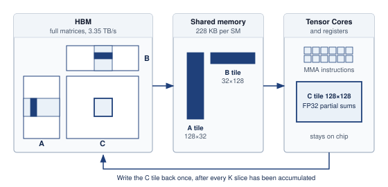

:::

```{python}
#| echo: false
# ┌── LEGO ───────────────────────────────────────────────
class InfraFrontierMemoryTilingRecap:

    # ┌── 4. OUTPUT (Formatting) ──────────────────────────────────────────────
    frontier_params_b_str = fmt_params(Models.Language.GPT3.parameters, scale="B", precision=0, commas=False)
```

Despite the `{python} InfraFrontierMemoryTilingRecap.frontier_params_b_str` model's massive total memory footprint, the active working set at any given microsecond must be meticulously managed to reside in that top `{python} MemoryBandwidthCacheRecap.register_file_total_mb_str` of register space, or the chip's theoretical performance becomes a mirage. HBM supplies the bulk capacity, but tiling decides whether that capacity feeds the arithmetic units fast enough to matter.

[^fn-hbm-memory-origin]: **HBM origin**\index{HBM!origin}: Standardized by JEDEC in 2013 as a joint development between AMD and SK Hynix, originally for graphics cards. ML accelerators adopted HBM because neural networks exhibit the same bandwidth-hungry, capacity-moderate access pattern as high-end rendering. Each HBM generation has roughly doubled bandwidth (128 GB/s in HBM1 to 1.2 TB/s per stack in HBM3e), yet the gap between memory bandwidth and arithmetic throughput continues to widen, which makes HBM a necessary but never sufficient response to the memory wall.

```{python}
#| echo: false
from mlsysim.fmt import fmt_bandwidth, fmt_flop_rate

# ┌── LEGO ───────────────────────────────────────────────
class V100MemoryWallRecap:

    # ┌── 4. OUTPUT (Formatting) ──────────────────────────────────────────────
    h_v100 = Hardware.Cloud.V100
    mem_bw_gb_per_s_str = fmt_bandwidth(h_v100.memory.bandwidth, unit=GB / second, precision=0, commas=False)
    flops_fp16_tflop_per_s_str = fmt_flop_rate(h_v100.compute.peak_flops, unit=TFLOP / second, precision=0, commas=False)
```

```{python}
#| echo: false
from mlsysim.fmt import fmt_bandwidth, fmt_flop_rate

# ┌── LEGO ───────────────────────────────────────────────
class MemoryBandwidthPitfallRecap:
    # ┌── 1. LOAD ──────────────────────────────────────────
    h100 = Hardware.Cloud.H100
    ddr_bw = Hardware.Tech.Storage.HostDram.bandwidth

    # ┌── 2. EXECUTE ───────────────────────────────────────
    hbm_ddr_ratio = (h100.memory.bandwidth / ddr_bw).to_base_units().magnitude
    ridge = h100.ridge_point()

    # ┌── 3. GUARD ─────────────────────────────────────────
    check(15 < hbm_ddr_ratio < 20, "HBM3 should be roughly 17x a host DDR5 memory system")
    check(290 < ridge.to(flop / byte).magnitude < 300, "H100 FP16 ridge point should be about 295 FLOP/byte")

    # ┌── 4. OUTPUT (Formatting) ──────────────────────────────────────────────
    h100_bw_tb_per_s_str = fmt_bandwidth(h100.memory.bandwidth, unit=TB / second, precision=2, commas=False)
    h100_flops_fp16_tflop_per_s_str = fmt_flop_rate(h100.compute.peak_flops, unit=TFLOP / second, precision=0, commas=False)
    ddr_bw_gb_per_s_str = fmt_bandwidth(ddr_bw, unit=GB / second, precision=0, commas=False)
    hbm_ddr_ratio_mult_str = fmt_multiple(round(hbm_ddr_ratio), precision=0, commas=False)
    ridge_flop_per_byte_str = fmt_arithmetic_intensity(
        round(ridge.to(flop / byte).magnitude) * flop / byte, unit=flop / byte, precision=0, commas=False
    )
    ridge_eq_math = fmt_math(
        f"{h100.compute.peak_flops.to(TFLOP / second).magnitude:.0f}\\,\\text{{TFLOP/s}} / "
        f"{h100.memory.bandwidth.to(TB / second).magnitude:.2f}\\,\\text{{TB/s}} \\approx {ridge.to(flop / byte).magnitude:.0f}"
    )
```

::: {#dfn-compute-infrastructure-high-bandwidth-memory-hbm .callout-definition title="HBM"}

***HBM***\index{HBM!definition}\index{High-bandwidth memory|see{HBM}} is the 3D-stacked DRAM architecture used by ML accelerators, in which multiple memory dies are vertically bonded and connected to the processor through thousands of through-silicon vias (TSVs) on a shared silicon interposer, eliminating the centimeter-scale printed circuit board (PCB) traces of conventional DRAM and replacing them with micrometer-scale vertical paths.

1.  **Significance**: HBM3 in the H100 delivers approximately `{python} MemoryBandwidthPitfallRecap.h100_bw_tb_per_s_str` of memory bandwidth (roughly `{python} MemoryBandwidthPitfallRecap.hbm_ddr_ratio_mult_str` DDR5's ~`{python} MemoryBandwidthPitfallRecap.ddr_bw_gb_per_s_str`) at roughly 2--5 pJ/bit vs. DDR5's ~20 pJ/bit. This bandwidth sets the $\text{BW}$ term of the single-machine iron law (@sec-vol2-introduction-fleet-law), and the H100's FP16 ridge point (@sec-compute-roofline) is approximately `{python} MemoryBandwidthPitfallRecap.ridge_eq_math` FLOP/byte, so any operator with arithmetic intensity below `{python} MemoryBandwidthPitfallRecap.ridge_flop_per_byte_str` (for example, single-request decode, which performs two FLOPs for every two-byte FP16 weight it reads) remains memory-bound even with HBM.
2.  **Distinction**: Unlike DDR memory, which connects through centimeters of PCB trace (introducing capacitance, attenuation, and high driving current), HBM uses 1,024-bit-wide TSV buses with path lengths measured in micrometers, a 1,000$\times$ reduction in signal distance that enables the wider bus without proportionally higher power.
3.  **Common pitfall**: A frequent misconception is that HBM solves the memory wall. HBM moves the wall rather than eliminates it: Tensor Core throughput $(R_{\text{peak}})$ has scaled faster than HBM bandwidth across generations (from `{python} V100MemoryWallRecap.mem_bw_gb_per_s_str` with `{python} V100MemoryWallRecap.flops_fp16_tflop_per_s_str` FP16 in V100 to `{python} MemoryBandwidthPitfallRecap.h100_bw_tb_per_s_str` with `{python} MemoryBandwidthPitfallRecap.h100_flops_fp16_tflop_per_s_str` FP16 in H100), so the ridge point continues rising and more operations remain memory-bound despite HBM improvements.

:::

```{python}
#| echo: false
from mlsysim.fmt import fmt_bandwidth

# ┌── LEGO ───────────────────────────────────────────────
class MemoryBandwidthDdrRecap:
    # ┌── 4. OUTPUT (Formatting) ──────────────────────────────────────────────
    ddr_bw_gb_per_s_str = fmt_bandwidth(Hardware.Tech.Storage.HostDram.bandwidth, unit=GB / second, precision=0, commas=False)
```

Traditional DDR memory connects to the processor through pins on the edge of a printed circuit board. Each DIMM communicates over a 64-bit bus, and even with multiple channels (8 channels is typical for a high-end server CPU), a modern server tops out at roughly `{python} MemoryBandwidthDdrRecap.ddr_bw_gb_per_s_str` of aggregate memory bandwidth.

The physical distance from the DIMM slot to the processor die is measured in centimeters, and every centimeter of copper trace introduces capacitance, signal attenuation, and energy loss. At DDR5 data rates (4,800--6,400 MT/s per pin), the signal conditioning circuits must compensate for significant channel impairment, consuming substantial power per bit transferred. Increasing the data rate on these long traces requires progressively more power for signal conditioning, creating a diminishing-returns curve that DDR5 is already approaching.

HBM solves this problem by changing the physical topology entirely (@fig-hbm-architecture). Instead of routing signals *horizontally* across a PCB, HBM stacks multiple DRAM dies *vertically*, one on top of another, and connects them with through-silicon vias (TSVs)\index{Through-silicon via!HBM stacking}:[^fn-tsv-stacking-vias] microscopic copper pillars etched through the silicon substrate itself.

::: {#fig-hbm-architecture fig-env="figure" fig-pos="htb" fig-cap="**HBM 3D-stacked architecture**: Left: high-bandwidth memory stacks DRAM dies on a base logic die, links them vertically with through-silicon vias (TSVs), and places the stack on a silicon interposer beside the GPU die, so each stack reaches the GPU over a 1,024-bit interface only millimeters long. Right: DDR5 instead sits on a DIMM across the motherboard, reached over a 64-bit channel through centimeters of board trace. The wider, shorter path raises bandwidth and lowers energy per bit, but HBM bandwidth and capacity remain finite, so the memory wall moves rather than disappears." fig-alt="Two cross-section panels. Left, HBM stacked beside the die: a GPU die and a stack of eight DRAM dies on a base logic die sit side by side on a silicon interposer above the package substrate, with dashed vertical TSVs through the stack and a thick short link through the interposer labeled 1,024 bits wide, millimeters long. Right, DDR5 across the board: a CPU with its memory controller and a DIMM holding several DRAM chips stand on a motherboard, joined by a thin trace through the board labeled 64 bits wide, centimeters long."}
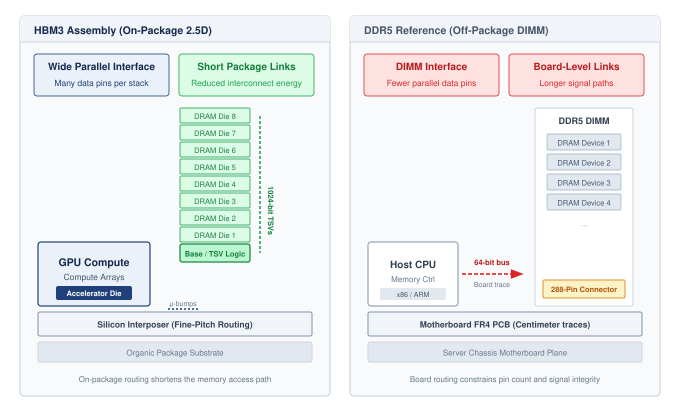

:::

The vertical stacking represents a fundamental change in memory architecture: rather than increasing bandwidth by pushing signals faster through long copper traces (the DDR approach, which has diminishing returns), HBM increases bandwidth by multiplying the number of parallel signal paths through extremely short vertical connections. A single HBM stack bonds 8--12 DRAM dies vertically, threading thousands of TSVs through each die to form a 1024-bit-wide interface\index{HBM!bus width} per stack, compared to 64 bits for a DDR5 channel. This 16$\times$ wider interface is the main source of HBM's bandwidth advantage; HBM need not exceed DDR's per-pin signaling rate. The processor and HBM stacks share a package and communicate across the silicon interposer\index{Interposer!silicon substrate}, shortening the electrical path relative to socketed DIMMs. This packaging primarily improves bandwidth and energy per transferred bit; it does not by itself imply that complete HBM load latency is only a few nanoseconds.

This shortened physical distance confers three direct electrical advantages. Transfer energy per bit\index{HBM!energy efficiency} drops by roughly 4--10$\times$, falling from approximately 20 pJ/bit for DDR5 to roughly 2--5 pJ/bit for HBM because microscopic interconnects present substantially lower capacitance and require less driving current. Signal propagation delay also shrinks, although only by a fraction of a nanosecond, which is small next to the DRAM array and controller delays that dominate end-to-end access latency. In addition, reduced capacitive loading relaxes per-pin signaling demands, enabling the wide 1024-bit interface to deliver massive aggregate throughput without pushing clock rates into inefficient, high-power regimes. Together, these physical mechanisms explain why modern accelerators widen the memory interface across an interposer rather than driving off-package pins faster.

[^fn-tsv-stacking-vias]: **TSV (through-silicon via)**\index{TSV!3D stacking}: A vertical copper pillar, 5--10 micrometers in diameter, etched through a silicon die to connect stacked layers. Originally developed for CMOS image sensors in smartphone cameras, TSVs enabled HBM by replacing centimeters of PCB trace with tens of micrometers of vertical silicon, roughly a 1,000$\times$ shorter signal path, which is what lets a stack expose a 1024-bit interface within an accelerator's power budget.

::: {#chk-compute-infrastructure-hbm-memory-wall .callout-checkpoint title="HBM and the memory wall"}

These questions check whether the physical benefits of 3D-stacked memory are clear:

- [ ] **HBM vs. DDR5**: explain why HBM achieves higher bandwidth than DDR5 despite having a lower clock frequency.
- [ ] **Off-package signaling cost**: explain why off-package DDR memory has higher energy per bit and how vertical stacking (TSVs) reduces that cost.
- [ ] **Capacity overflow**: locate where the remaining 60 GB must reside when an H100 has 80 GB of HBM and a 70B parameter model requires 140 GB for FP16 weights.
- [ ] **Bandwidth not capacity**: classify the claim as true or false: HBM's primary benefit is increasing the total memory capacity available to the GPU.

:::

@Tbl-hbm-comparison summarizes the physical trade-off: HBM wins bandwidth by moving memory onto the package and widening the interface, not by making each off-package signal faster.

| **Metric**          |              **CPU-local host DRAM** (DDR5)             |          **GPU-local accelerator HBM** (H100 HBM3)           |                           **Scaling factor**                          |
|:--------------------|:-------------------------------------------------------:|:------------------------------------------------------------:|:---------------------------------------------------------------------:|
| **Mechanism**       |                      2D PCB traces                      |                       3D die stacking                        |                                   -                                   |
| **Placement**       |                      Socketed DIMMs                     |                    On-package (substrate)                    |                           Physical proximity                          |
| **Bandwidth**       | ~`{python} MemoryBandwidthDdrRecap.ddr_bw_gb_per_s_str` | ~`{python} MemoryBandwidthPitfallRecap.h100_bw_tb_per_s_str` | ~`{python} MemoryBandwidthPitfallRecap.hbm_ddr_ratio_mult_str` faster |
| **Interface width** |                          64-bit                         |                      1024-bit per stack                      |                            16$\times$ wider                           |
| **Energy**          |                        ~20 pJ/bit                       |                         ~2--5 pJ/bit                         |                        4--10$\times$ efficiency                       |

: **HBM vs. standard DRAM comparison**: HBM achieves its bandwidth advantage through three simultaneous innovations: 3D die stacking (more bits per package), TSV interconnects (shorter signal paths), and on-package placement (proximity to the processor). The bandwidth figures describe each memory's local requester path: CPU to host DDR5 and H100 GPU to its own HBM3. A GPU request to host DRAM must also traverse the node interconnect and is not represented by the DDR5 channel figure. {#tbl-hbm-comparison}

```{python}
#| echo: false
from mlsysim import BYTES_FP16, GB, Hardware, Models
from mlsysim.fmt import check, fmt_memory_capacity, fmt_percent, fmt_usd

# ┌── LEGO ───────────────────────────────────────────────
class HbmB200Recap:
    """Registry-derived B200 capacity, cost range, and GPT-3 weight fraction."""

    # Capacity is stored in binary GiB; the vendor nameplate ("180 GB") is that
    # binary magnitude, while the weight fraction must use the true byte count.
    capacity = Hardware.Cloud.B200.memory.capacity.to(GiB)
    nameplate_gb = round(capacity.magnitude)
    # HBM and host-DRAM $/GB price anchors apply to the nameplate GB label.
    low_cost_per_gb = Infrastructure.Pricing.Storage.HbmLowPerGb.rate.to(USD / GB).magnitude
    high_cost_per_gb = Infrastructure.Pricing.Storage.HbmEquivalentPerGb.rate.to(USD / GB).magnitude
    ddr_low_per_gb = Infrastructure.Pricing.Storage.HostDramLowPerGb.rate.to(USD / GB).magnitude
    low_cost = nameplate_gb * low_cost_per_gb
    high_cost = nameplate_gb * high_cost_per_gb
    h100_nameplate_gb = round(Hardware.Cloud.H100.memory.capacity.to(GiB).magnitude)
    h100_low_cost = h100_nameplate_gb * low_cost_per_gb
    h100_high_cost = h100_nameplate_gb * high_cost_per_gb
    gpt3_fp16_weights = Models.Language.GPT3.size_in_bytes(BYTES_FP16)
    gpt3_weight_fraction = (capacity / gpt3_fp16_weights).to("").magnitude

    check(nameplate_gb == 180, "B200 capacity should match the 180 GB nameplate specification.")
    check(low_cost_per_gb < high_cost_per_gb, "HBM $/GB range should be ordered")
    check(ddr_low_per_gb < low_cost_per_gb, "DDR5 should cost less per GB than HBM")
    check(round(gpt3_weight_fraction * 100) == 55, "B200 should hold about 55 percent of GPT-3 FP16 weights.")

    # ┌── 4. OUTPUT (Formatting) ──────────────────────────────────────────
    capacity_gb_str = fmt_memory_capacity(capacity, unit=GiB, precision=0, commas=False)
    hbm_cost_per_gb_low_str = fmt_usd(low_cost_per_gb, precision=0, commas=False)
    hbm_cost_per_gb_high_str = fmt_usd(high_cost_per_gb, precision=0, commas=False)
    ddr_cost_per_gb_str = fmt_usd(ddr_low_per_gb, precision=0, commas=False)
    h100_capacity_gb_str = fmt_memory_capacity(Hardware.Cloud.H100.memory.capacity, unit=GiB, precision=0, commas=False)
    h100_low_cost_str = fmt_usd(h100_low_cost, precision=0, commas=True)
    h100_high_cost_str = fmt_usd(h100_high_cost, precision=0, commas=True)
    low_cost_str = fmt_usd(low_cost, precision=0, commas=True)
    high_cost_str = fmt_usd(high_cost, precision=0, commas=True)
    gpt3_weight_fraction_str = fmt_percent(gpt3_weight_fraction, precision=1, commas=False, style="prose")
    capacity_decimal_gb_str = fmt_memory(capacity, unit=GB, precision=1, commas=False)
    a100_capacity_decimal_gb_str = fmt_memory(Hardware.Cloud.A100.memory.capacity, unit=GB, precision=1, commas=False)
    a100_weight_fraction_str = fmt_percent((Hardware.Cloud.A100.memory.capacity / gpt3_fp16_weights).to("").magnitude, precision=1, style="prose")
```

As @tbl-hbm-comparison shows, this bandwidth advantage\index{HBM!cost-bandwidth trade-off} comes at a price. HBM costs approximately `{python} HbmB200Recap.hbm_cost_per_gb_low_str`--`{python} HbmB200Recap.hbm_cost_per_gb_high_str` per GB, compared to roughly `{python} HbmB200Recap.ddr_cost_per_gb_str` per GB for DDR5 server memory. For an H100 with `{python} HbmB200Recap.h100_capacity_gb_str` of HBM3, the memory alone represents approximately `{python} HbmB200Recap.h100_low_cost_str`--`{python} HbmB200Recap.h100_high_cost_str` of the accelerator's manufacturing cost. For a B200 with `{python} HbmB200Recap.capacity_gb_str` of HBM3e, the memory cost rises to `{python} HbmB200Recap.low_cost_str`--`{python} HbmB200Recap.high_cost_str` per accelerator, making HBM one of the most expensive components in the system.

```{python}
#| echo: false
from mlsysim.core.units import ureg
from mlsysim.fmt import check, fmt_area

# ┌── LEGO ───────────────────────────────────────────────
class HbmPackagingAreaRecap:
    """Approximate package-area anchors for HBM/interposer discussion."""

    interposer_area = 1000 * ureg.millimeter**2  # scenario assumption: large-interposer package illustration
    hbm_stack_area = 100 * ureg.millimeter**2  # scenario assumption: approximate HBM stack footprint

    check(interposer_area >= 10 * hbm_stack_area, "Large interposer should cover the area of several HBM stacks.")
    check(hbm_stack_area.to(ureg.millimeter**2).magnitude == 100, "HBM stack area anchor should stay near 100 mm^2.")

    # ┌── 4. OUTPUT (Formatting) ──────────────────────────────────────────────
    interposer_area_mm2_str = fmt_area(interposer_area, unit=ureg.millimeter**2, commas=True)
    hbm_stack_area_mm2_str = fmt_area(hbm_stack_area, unit=ureg.millimeter**2, commas=False)
```

The advanced packaging process, which requires precise alignment of thousands of TSVs across multiple die layers, has lower manufacturing yields and higher complexity. Each step in the stacking process\index{Advanced packaging!stacking yield} (die thinning, alignment, bonding, and TSV etching) can introduce defects. The cumulative yield across 12 stacking steps means that the overall yield for a complete HBM3e stack is substantially lower than the yield for a single DRAM die. The silicon interposer\index{Interposer!area scaling} itself must be large enough to accommodate both the processor die and multiple HBM stacks (often exceeding `{python} HbmPackagingAreaRecap.interposer_area_mm2_str` in total area), and any defect in a TSV can render an entire stack unusable.

The supply chain dynamics of HBM production further affect its cost and availability. The HBM supply chain is highly concentrated among a small number of manufacturers, and the production processes (die thinning, TSV etching, die-to-die bonding) require specialized capital equipment that is fundamentally different from standard DRAM manufacturing. Expanding HBM production capacity requires 12--18 months of equipment procurement and qualification, so production cannot rapidly scale in response to demand surges. When demand outpaces supply, as it did following the explosion of interest in large language models in 2023, component lead times stretch across a similar horizon and prices can double.

For infrastructure planners, this supply chain concentration means that HBM availability, not just its specifications, can determine the timeline for building a training cluster. Organizations planning large deployments must secure HBM allocations on that same capacity-expansion horizon, committing capital before the rest of the system is designed. This procurement lead time is longer than for any other component in the stack, making HBM the pacing element for fleet expansion.

```{python}
#| echo: false
# ┌── LEGO ───────────────────────────────────────────────
class InfraFrontierMemoryHbmRecap:
    # ┌── 1. LOAD ──────────────────────────────────────────
    cluster_gpus = Scenarios.DenseLLMPretrainingReference.system.total_accelerators
    small_hbm_gb = round(Hardware.Cloud.H100.memory.capacity.to(GiB).magnitude)  # nameplate GB
    large_hbm_gb = round(Hardware.Cloud.MI300X.memory.capacity.to(GiB).magnitude)  # nameplate GB
    low_per_gb = HbmB200Recap.low_cost_per_gb
    high_per_gb = HbmB200Recap.high_cost_per_gb
    host_dram_low = 512 * GB  # scenario assumption: generic lower-end server host DRAM
    host_dram_high = Systems.Nodes.DGX_H100.host_memory

    # ┌── 2. EXECUTE ───────────────────────────────────────
    small_low = cluster_gpus * small_hbm_gb * low_per_gb / 1e6
    small_high = cluster_gpus * small_hbm_gb * high_per_gb / 1e6
    large_low = cluster_gpus * large_hbm_gb * low_per_gb / 1e6
    large_high = cluster_gpus * large_hbm_gb * high_per_gb / 1e6

    # ┌── 3. GUARD ─────────────────────────────────────────
    check(0.7 < small_low < small_high < 1.3, "80 GB HBM across the reference cluster should cost about $0.8-1.2M")
    check(1.9 < large_low < large_high < 3.0, "192 GB HBM across the reference cluster should cost about $2-3M")

    # ┌── 4. OUTPUT (Formatting) ──────────────────────────────────────────────
    frontier_params_b_str = fmt_params(Models.Language.GPT3.parameters, scale="B", precision=0, commas=False)
    cluster_gpus_str = fmt(cluster_gpus, precision=0, commas=True)
    small_hbm_gb_str = fmt_memory_capacity(Hardware.Cloud.H100.memory.capacity, unit=GiB, precision=0, commas=False)
    large_hbm_gb_str = fmt_memory_capacity(Hardware.Cloud.MI300X.memory.capacity, unit=GiB, precision=0, commas=False)
    small_low_musd_str = fmt_usd(small_low, precision=1, commas=False)
    small_high_musd_str = fmt(small_high, precision=1, commas=False)
    large_low_musd_str = fmt_usd(large_low, precision=1, commas=False)
    large_high_musd_str = fmt(large_high, precision=1, commas=False)
    host_dram_low_gb_str = fmt_memory(host_dram_low, unit=GB, precision=0, commas=False)
    host_dram_high_tb_str = fmt_memory_capacity(host_dram_high, unit=TiB, precision=0, commas=False)
```

For our `{python} InfraFrontierMemoryHbmRecap.frontier_params_b_str` model, the HBM alone in the `{python} InfraFrontierMemoryHbmRecap.cluster_gpus_str`-accelerator reference cluster represents roughly `{python} InfraFrontierMemoryHbmRecap.small_low_musd_str`--`{python} InfraFrontierMemoryHbmRecap.small_high_musd_str` million at `{python} InfraFrontierMemoryHbmRecap.small_hbm_gb_str` per accelerator (or `{python} InfraFrontierMemoryHbmRecap.large_low_musd_str`--`{python} InfraFrontierMemoryHbmRecap.large_high_musd_str` million at the MI300X's `{python} InfraFrontierMemoryHbmRecap.large_hbm_gb_str` per accelerator) under the `{python} HbmB200Recap.hbm_cost_per_gb_low_str`--`{python} HbmB200Recap.hbm_cost_per_gb_high_str`/GB cost model introduced earlier. This cost-capacity trade-off explains why accelerators typically offer `{python} InfraFrontierMemoryHbmRecap.small_hbm_gb_str` to `{python} InfraFrontierMemoryHbmRecap.large_hbm_gb_str` of HBM while the host server provides `{python} InfraFrontierMemoryHbmRecap.host_dram_low_gb_str` to `{python} InfraFrontierMemoryHbmRecap.host_dram_high_tb_str` of DDR: the *fast* memory holds state touched every step (weight shards, activations, gradients, and usually the sharded optimizer state), while the *cheap* memory holds staging buffers, data loading queues, and colder state that capacity pressure forces out, such as offloaded optimizer shards.

The boundary between what resides in HBM and what resides in DDR is a critical design parameter for training frameworks, and managing this boundary efficiently is one of the key challenges addressed by ZeRO (Zero Redundancy Optimizer) sharding and offloading strategies described in @sec-distributed-training-systems-systems-memoryefficient-data-parallelism-zero-fsdp-0e69. Sharding divides optimizer, gradient, and parameter state across workers; offloading places colder state in host DRAM or Non-Volatile Memory Express (NVMe) when HBM capacity is the binding limit. Getting this boundary wrong in either direction is costly: placing too much data in HBM wastes expensive capacity, while placing too much in DDR creates bandwidth stalls that idle the arithmetic units.

#### HBM generations and the scaling boundary {#sec-compute-infrastructure-hbm-generations-scaling-frontier-5827}

HBM has grown alongside model sizes, but far more slowly than parameter counts, which is why capacity pressure keeps pushing models across devices. Each generation increases the number of stacked dies, the signaling rate per pin, and the total capacity per stack, driven by the relentless growth in model parameters. @Tbl-hbm-evolution shows the scaling boundary: HBM4 must widen the interface because pin-rate increases alone are no longer enough.

```{python}
#| echo: false
from mlsysim.fmt import check, fmt_bandwidth, fmt_memory_capacity, fmt_percent

# ┌── LEGO ───────────────────────────────────────────────
# │ Context: @tbl-hbm-evolution and the HBM3-to-HBM3e comparison after it.
class HbmGenerationRecap:
    """Per-generation HBM bandwidth and capacity from the A100, H100, and B200 records."""

    # ┌── 1. LOAD ──────────────────────────────────────────
    a100 = Hardware.Cloud.A100
    a100_40 = Hardware.Cloud.A100_40GB
    h100 = Hardware.Cloud.H100
    b200 = Hardware.Cloud.B200
    h100_capacity_high = 96 * GiB  # scenario assumption: upper end of HBM3 H100-family packages

    # ┌── 2. EXECUTE ───────────────────────────────────────
    h100_vs_a100_bw_gain = (h100.memory.bandwidth / a100.memory.bandwidth).to_base_units().magnitude - 1

    # ┌── 3. GUARD ─────────────────────────────────────────
    check(0.6 < h100_vs_a100_bw_gain < 0.7, "H100 HBM3 should deliver roughly 65 percent more bandwidth than A100 HBM2e")

    # ┌── 4. OUTPUT ────────────────────────────────────────
    a100_bw_tb_per_s_str = fmt_bandwidth(a100.memory.bandwidth, unit=TB / second, precision=2, commas=False)
    h100_bw_tb_per_s_str = fmt_bandwidth(h100.memory.bandwidth, unit=TB / second, precision=2, commas=False)
    b200_bw_tb_per_s_str = fmt_bandwidth(b200.memory.bandwidth, unit=TB / second, precision=0, commas=False)
    # Capacities are binary GiB parts sold under decimal "GB" nameplates (branded-label convention).
    a100_capacity_range_str = fmt_range(
        a100_40.memory.capacity.to(GiB).magnitude, a100.memory.capacity.to(GiB).magnitude, precision=0, commas=False, unit="GB"
    )
    h100_capacity_range_str = fmt_range(
        h100.memory.capacity.to(GiB).magnitude, h100_capacity_high.to(GiB).magnitude, precision=0, commas=False, unit="GB"
    )
    h100_capacity_decimal_gb_str = fmt_memory(h100.memory.capacity, unit=GB, precision=1, commas=False)
    h100_vs_a100_bw_gain_pct_str = fmt_percent(round(h100_vs_a100_bw_gain, 2), precision=0, commas=False, style="prose")
```

| **Metric**           |                    **HBM2e (A100)**                   |                    **HBM3 (H100)**                    |                   **HBM3e (B200)**                  |    **HBM4 (future)**    |
|:---------------------|:-----------------------------------------------------:|:-----------------------------------------------------:|:---------------------------------------------------:|:-----------------------:|
| **Peak bandwidth**   |  ~`{python} HbmGenerationRecap.a100_bw_tb_per_s_str`  |  ~`{python} HbmGenerationRecap.h100_bw_tb_per_s_str`  | ~`{python} HbmGenerationRecap.b200_bw_tb_per_s_str` | 12--16 TB/s (projected) |
| **Typical capacity** | `{python} HbmGenerationRecap.a100_capacity_range_str` | `{python} HbmGenerationRecap.h100_capacity_range_str` |       `{python} HbmB200Recap.capacity_gb_str`       |         288 GB+         |
| **Interface width**  |                        1024-bit                       |                        1024-bit                       |                       1024-bit                      |         2048-bit        |
| **Stack height**     |                         8 dies                        |                       8--12 dies                      |                       12 dies                       |         16 dies         |

: **Evolution of high-bandwidth memory**: Each generation increases aggregate accelerator memory bandwidth, tracking the growth of large model sizes. The jump to HBM4 doubles the interface width for the first time since HBM's introduction, signaling that pin-rate increases alone can no longer sustain the required bandwidth growth. {#tbl-hbm-evolution}

```{python}
#| echo: false
# ┌── LEGO ───────────────────────────────────────────────
class InfraFrontierStragglerRecap1:

    # ┌── 4. OUTPUT (Formatting) ──────────────────────────────────────────────
    frontier_params_b_str = fmt_params(Models.Language.GPT3.parameters, scale="B", precision=0, commas=False)
```

As @tbl-hbm-evolution shows, the transition from HBM3 to HBM3e is particularly significant for our running example. Using decimal bytes consistently, an A100 with `{python} HbmB200Recap.a100_capacity_decimal_gb_str` of HBM2e can hold `{python} HbmB200Recap.a100_weight_fraction_str` of our `{python} InfraFrontierStragglerRecap1.frontier_params_b_str` model's weights (at FP16). An H100 with `{python} HbmGenerationRecap.h100_capacity_decimal_gb_str` of HBM3 can hold the same fraction but deliver the data `{python} HbmGenerationRecap.h100_vs_a100_bw_gain_pct_str` faster. A B200 with `{python} HbmB200Recap.capacity_decimal_gb_str` of HBM3e can hold `{python} HbmB200Recap.gpt3_weight_fraction_str` of the weights and deliver them at about `{python} HbmGenerationRecap.b200_bw_tb_per_s_str`. None of them can hold the full model, which is why multiple accelerators are needed in a node, as examined in @sec-compute-node.

Quantization changes the capacity story for inference. Storing weights in INT8 or INT4 halves or quarters the footprint, and @sec-compute-infrastructure-precision-throughput-tradeoffs-49a5 works through how many accelerators the running model then needs. The capacity constraints that drive the need for multi-accelerator nodes for training (where FP16 or BF16 precision is typically required) are substantially relaxed for inference (where INT8 or INT4 quantization is often acceptable). This is another reason why training and inference infrastructure have different optimal configurations.

```{python}
#| echo: false
from mlsysim.fmt import fmt_bandwidth, fmt_memory, fmt_params, fmt_time

# ┌── LEGO ───────────────────────────────────────────────
class A100HbmQuantRecap:
    # ┌── 1. LOAD ──────────────────────────────────────────
    model = Models.Language.Llama3_70B
    params = model.parameters
    weights = model.size_in_bytes(BYTES_FP16)
    a100_bw = Hardware.Cloud.A100.memory.bandwidth
    h100_bw = Hardware.Cloud.H100.memory.bandwidth
    b200_bw = Hardware.Cloud.B200.memory.bandwidth

    # ┌── 2. EXECUTE ───────────────────────────────────────
    a100_token = (weights / a100_bw).to(millisecond)
    h100_token = (weights / h100_bw).to(millisecond)
    b200_token = (weights / b200_bw).to(millisecond)

    # ┌── 3. GUARD ─────────────────────────────────────────
    check(a100_token.to(millisecond).magnitude > 50, "A100 token latency should exceed 50 ms")

    # ┌── 4. OUTPUT (Formatting) ──────────────────────────────────────────────
    model_params_b_str = fmt_params(params)
    weights_gb_str = fmt_qty_int(weights, GB, commas=False)
    mem_bw_tb_per_s_str = fmt_bandwidth(a100_bw, unit=TB / second, precision=2, commas=False)
    a100_token_ms_str = fmt_time(a100_token, millisecond, precision=1, commas=False)
    h100_bw_tb_per_s_str = fmt_bandwidth(h100_bw, unit=TB / second, precision=2, commas=False)
    h100_token_ms_str = fmt_time(h100_token, millisecond, precision=1, commas=False)
    b200_bw_tb_per_s_str = fmt_bandwidth(b200_bw, unit=TB / second, precision=0, commas=False)
    b200_token_ms_str = fmt_time(b200_token, millisecond, precision=1, commas=False)
```
The bandwidth improvement matters independently of capacity. Each generation of HBM produces a nearly proportional reduction in per-token latency during autoregressive inference once the capacity problem has been handled by sharding or quantization.

For a `{python} A100HbmQuantRecap.model_params_b_str` FP16 model, smaller than the running example, with `{python} A100HbmQuantRecap.weights_gb_str` of weights, a bandwidth-floor calculation gives roughly `{python} A100HbmQuantRecap.weights_gb_str`/`{python} A100HbmQuantRecap.mem_bw_tb_per_s_str` = `{python} A100HbmQuantRecap.a100_token_ms_str` per token at A100-class bandwidth, `{python} A100HbmQuantRecap.weights_gb_str`/`{python} A100HbmQuantRecap.h100_bw_tb_per_s_str` = `{python} A100HbmQuantRecap.h100_token_ms_str` at H100-class bandwidth, and `{python} A100HbmQuantRecap.weights_gb_str`/`{python} A100HbmQuantRecap.b200_bw_tb_per_s_str` = `{python} A100HbmQuantRecap.b200_token_ms_str` at B200-class bandwidth. The A100 and H100 cases do not imply that the full FP16 model fits on one device; they isolate the latency floor imposed by a single accelerator-equivalent HBM path. For interactive applications (chatbots, code assistants, real-time translation), where users perceive delays above 50 ms as "slow," these bandwidth improvements translate directly into better user experience and into the ability to serve larger models within latency budgets.

The projected jump to HBM4 doubles the interface width from 1024 bits to 2048 bits for the first time since HBM's introduction. This signals that per-pin signaling rate increases alone cannot sustain bandwidth growth indefinitely, and the bus must widen. The doubling of interface width requires a correspondingly larger interposer area for routing, which is one reason accelerator packages have tended to grow as bandwidth targets rise.

```{python}
#| echo: false
from mlsysim.fmt import fmt, fmt_bandwidth, fmt_int, fmt_memory, fmt_qty_range, fmt_time

# ┌── LEGO ───────────────────────────────────────────────
class TrillionModelFloor:
    # ┌── 1. LOAD (Constants) ──────────────────────────────────────────────
    model_params_t = 1  # trillion-parameter model (scenario)
    b200_bw = Hardware.Cloud.B200.memory.bandwidth  # B200-class HBM3e (~8 TB/s)
    hbm4_low_bw = 12 * TB / second  # HBM4 projection low end (scenario)
    hbm4_bw = 16 * TB / second  # HBM4 projection high end (scenario)

    # ┌── 2. EXECUTE (The Compute) ────────────────────────────────────────
    weight = model_params_t * 1e12 * BYTES_FP16  # 1T-parameter FP16 model
    token_b200 = (weight / b200_bw).to('millisecond')
    token_hbm4 = (weight / hbm4_bw).to('millisecond')

    # ┌── 4. OUTPUT (Formatting) ──────────────────────────────────────────
    model_params_t_str = fmt_int(model_params_t)
    hbm4_bw_range_str = fmt_qty_range(hbm4_low_bw, hbm4_bw, unit=TB / second, precision=0, commas=False)
    weight_tb_str = fmt_memory(weight, unit=TB, precision=0, commas=False)
    weight_gb_str = fmt_memory(weight, unit=GB, precision=0, commas=False)
    b200_bw_tbs_str = fmt_bandwidth(b200_bw, unit=TB / second, precision=0, commas=False)
    token_b200_ms_str = fmt_time(token_b200, 'millisecond', precision=0, commas=False)
    hbm4_bw_tbs_str = fmt_bandwidth(hbm4_bw, unit=TB / second, precision=0, commas=False)
    token_hbm4_ms_str = fmt_time(token_hbm4, 'millisecond', precision=0, commas=False)
```

HBM4-class packages projected in the `{python} TrillionModelFloor.hbm4_bw_range_str` aggregate range illustrate the planning pressure created by trillion-parameter-scale models. A `{python} TrillionModelFloor.model_params_t_str`T-parameter model requires roughly `{python} TrillionModelFloor.weight_tb_str` of weight storage in FP16. At B200-class HBM3e bandwidths (about `{python} TrillionModelFloor.b200_bw_tbs_str`), serving such a model at batch size 1 would produce tokens at `{python} TrillionModelFloor.weight_gb_str`/`{python} TrillionModelFloor.b200_bw_tbs_str` = `{python} TrillionModelFloor.token_b200_ms_str` per token, far too slow for interactive applications. Even at `{python} TrillionModelFloor.hbm4_bw_tbs_str`, the bandwidth floor remains roughly `{python} TrillionModelFloor.token_hbm4_ms_str` per token before batching, quantization, or tensor-parallel sharding. This calculation suggests that trillion-parameter models require aggressive quantization and multi-accelerator tensor parallelism even for single-request inference. The co-evolution of model scale and memory technology continues to drive infrastructure requirements.

```{python}
#| echo: false
from mlsysim.fmt import fmt_bandwidth

# ┌── LEGO ───────────────────────────────────────────────
class MemoryBandwidthHbmRecap:
    # ┌── 1. LOAD ──────────────────────────────────────────
    h100 = Hardware.Cloud.H100
    b200 = Hardware.Cloud.B200

    # ┌── 2. EXECUTE ───────────────────────────────────────
    h100_per_stack_bw = h100.memory.bandwidth / h100.memory.hbm_stacks

    # ┌── 3. GUARD ─────────────────────────────────────────
    check(abs(h100_per_stack_bw.to(GB / second).magnitude - 670) < 1, "Each H100 HBM3 stack should supply about 670 GB/s")

    # ┌── 4. OUTPUT (Formatting) ──────────────────────────────────────────────
    h100_bw_tb_per_s_str = fmt_bandwidth(h100.memory.bandwidth, unit=TB / second, precision=2, commas=False)
    h100_stacks_str = fmt(h100.memory.hbm_stacks, precision=0, commas=False)
    b200_stacks_str = fmt(b200.memory.hbm_stacks, precision=0, commas=False)
    h100_per_stack_bw_gb_per_s_str = fmt_bandwidth(h100_per_stack_bw, unit=GB / second, precision=0, commas=False)
    b200_bw_tb_per_s_str = fmt_bandwidth(b200.memory.bandwidth, unit=TB / second, precision=0, commas=False)
```

An important architectural consideration is the number of HBM stacks per accelerator and how they connect to the processor. The H100 has `{python} MemoryBandwidthHbmRecap.h100_stacks_str` HBM3 stacks, each providing approximately `{python} MemoryBandwidthHbmRecap.h100_per_stack_bw_gb_per_s_str`, for a total of `{python} MemoryBandwidthHbmRecap.h100_bw_tb_per_s_str` aggregate bandwidth. A B200-class Blackwell GPU package uses `{python} MemoryBandwidthHbmRecap.b200_stacks_str` HBM3e stacks for an aggregate of about `{python} MemoryBandwidthHbmRecap.b200_bw_tb_per_s_str`. The number of stacks is constrained by the interposer area available for HBM placement: each HBM stack occupies approximately `{python} HbmPackagingAreaRecap.hbm_stack_area_mm2_str` of interposer area, and the total interposer must accommodate both the processor die(s) and all HBM stacks. Larger interposers allow more HBM stacks (and therefore higher bandwidth and capacity) but are more expensive and harder to manufacture.

The interposer area constraint creates a concrete design tension. Making the processor die larger (more Tensor Cores, more SMs) leaves less interposer area for HBM stacks, potentially reducing bandwidth. Making the processor die smaller (fewer Tensor Cores) frees interposer area for more HBM but reduces peak compute throughput. The optimal balance depends on the target workload's position on the Roofline plot: compute-bound workloads benefit from a larger processor die (more Tensor Cores), while bandwidth-bound workloads benefit from more HBM stacks. @Sec-compute-roofline, later in this chapter, derives the ridge point that separates these two regimes, allowing a workload's arithmetic intensity to predict which side of the balance it falls on before any silicon is committed.

#### Memory bandwidth and token latency {#sec-compute-infrastructure-memory-bandwidth-token-latency-1b38}

The distinction between memory *capacity* (how many gigabytes the HBM can store) and memory *bandwidth* (how many terabytes per second it can deliver) is one of the most practically important concepts in ML infrastructure. Capacity determines whether a model's weights *fit*. Bandwidth determines how fast the model can *run*. For autoregressive text generation, where each token requires a full pass through the model's weights, bandwidth is almost always the binding constraint. @Sec-appdx-comm-foundations-alpha-beta formalizes the same latency-vs.-bandwidth decomposition for data movement across the network, giving the reader a single algebraic model that applies equally to the memory system here and to inter-node transfers later.

```{python}
#| echo: false
#| label: token-latency-scenario
from mlsysim.fmt import check, fmt, fmt_flop_rate, fmt_math, fmt_memory, fmt_percent

# ┌── LEGO ───────────────────────────────────────────────
class TokenLatencyScenario:
    h_h100 = Hardware.Cloud.H100
    m_llama70b = Models.Language.Llama3_70B
    weight_vol = m_llama70b.size_in_bytes(BYTES_FP16)
    token_flops = 2 * m_llama70b.parameters * flop / param
    t_mem = (weight_vol / h_h100.memory.bandwidth).to(millisecond)
    t_comp = (token_flops / h_h100.compute.peak_flops).to(millisecond)
    dominance = (t_mem / (t_mem + t_comp)).to_base_units().magnitude

    # ┌── 4. OUTPUT (Formatting) ──────────────────────────────────────────────
    h100_fp16_tflop_per_s_str = fmt_flop_rate(h_h100.compute.peak_flops, unit=TFLOP / second, precision=0, commas=False)
    dominance_str = fmt_percent(dominance, precision=1, commas=False, style="prose")
    weight_gb_str = fmt_memory(weight_vol, unit=GB, precision=1, commas=False)
    t_comp_math = fmt_math(f"T_{{\\text{{compute}}}} \\approx \\mathbf{{{t_comp.to(millisecond).magnitude:.2f} \\text{{ ms}}}}")
    t_mem_math = fmt_math(f"T_{{\\text{{mem}}}} \\approx \\mathbf{{{t_mem.to(millisecond).magnitude:.1f} \\text{{ ms}}}}")
```

```{python}
#| echo: false
from mlsysim.fmt import fmt_bandwidth

# ┌── LEGO ───────────────────────────────────────────────
class MemoryBandwidthLatencyRecap:

    # ┌── 4. OUTPUT (Formatting) ──────────────────────────────────────────────
    h100_bw_tb_per_s_str = fmt_bandwidth(Hardware.Cloud.H100.memory.bandwidth, unit=TB / second, precision=2, commas=False)
```

::: {#nbk-token-latency .callout-notebook title="The physics of token latency"}

**Problem**: Generating one token from Llama-3\index{Llama-3!inference memory footprint} 70B (`{python} TokenLatencyScenario.weight_gb_str` of FP16 weights) requires both arithmetic and a full weight load from HBM. Assuming capacity has been solved (by sharding, a higher-capacity device, or quantization), which dominates the per-token time on an H100: compute or memory transfer?

1. **Compute time**\index{Latency!compute time}: Each token requires $2 \times 70 \times 10^9 = 1.4 \times 10^{11}$ floating-point operations. At `{python} TokenLatencyScenario.h100_fp16_tflop_per_s_str` of FP16/BF16 Tensor Core peak throughput, the arithmetic takes `{python} TokenLatencyScenario.t_comp_math`.
2. **Memory time**\index{Latency!memory time}: Loading `{python} TokenLatencyScenario.weight_gb_str` of weights from HBM at `{python} MemoryBandwidthLatencyRecap.h100_bw_tb_per_s_str` takes `{python} TokenLatencyScenario.t_mem_math`.

**Systems insight**: The processor spends `{python} TokenLatencyScenario.dominance_str` of its time waiting for data from memory. The arithmetic units are idle for almost the entire token generation. Even a hypothetical processor with infinite compute throughput would generate tokens only negligibly faster, because the memory transfer time dominates completely. This is why HBM bandwidth improvements deliver nearly linear speedups for inference workloads.

:::

```{python}
#| echo: false
#| label: h200-comparison
# ┌─────────────────────────────────────────────────────────────────────────────
# │ H100 vs. H200 MEMORY-WALL COMPARISON (LEGO)
# ├─────────────────────────────────────────────────────────────────────────────
# │ Goal: Show that decode latency tracks the memory system, not the compute units.
# │ How: ServingModel.solve for Llama2-70B on H100 vs. H200; compare ITL + HBM specs.
# └─────────────────────────────────────────────────────────────────────────────
import mlsysim
from mlsysim.solvers import ServingModel
from mlsysim.fmt import check, fmt_bandwidth, fmt_flop_rate, fmt_int, fmt_multiple, fmt_params, fmt_power

class H200Comparison:
    h_h100 = mlsysim.Hardware.Cloud.H100
    h200 = mlsysim.Hardware.Cloud.H200
    model = mlsysim.Models.Language.Llama3_70B
    seq_len = 2048  # scenario assumption: serving sequence length for this Llama 3 comparison (not GPT-3)
    batch_size = 1  # scenario assumption: single-request decode

    serving_model = ServingModel()
    res_h100 = serving_model.solve(model, h_h100, seq_len=seq_len, batch_size=batch_size)
    res_h200 = serving_model.solve(model, h200, seq_len=seq_len, batch_size=batch_size)

    # ┌── 4. OUTPUT (Formatting) ──────────────────────────────────────────────
    bw_gain_mult_str = fmt_multiple((h200.memory.bandwidth / h_h100.memory.bandwidth).to_base_units().magnitude, precision=1, commas=True)
    cap_gain_mult_str = fmt_multiple((h200.memory.capacity / h_h100.memory.capacity).to_base_units().magnitude, precision=1, commas=True)
    model_params_str = fmt_params(model.parameters, scale="B", precision=1, commas=False)
    seq_len_str = fmt_int(seq_len)
    batch_size_str = fmt_int(batch_size, commas=False)

    itl_h100 = res_h100.itl
    itl_h200 = res_h200.itl
    speedup = (itl_h100 / itl_h200).to_base_units().magnitude
    # Bracketing estimate: decode is memory-bound, so the solver's ITL speedup
    # should land on the raw HBM bandwidth ratio.
    bw_ratio = (h200.memory.bandwidth / h_h100.memory.bandwidth).to_base_units().magnitude
    check(
        abs(speedup - bw_ratio) / bw_ratio < 0.10,
        "Solver ITL speedup should track the HBM bandwidth ratio for memory-bound decode",
    )
    speedup_mult_str = fmt_multiple(speedup, precision=1, commas=True)
    h100_bw_tb_per_s_str = fmt_bandwidth(h_h100.memory.bandwidth, unit=TB / second, precision=2, commas=False)
    h200_bw_tb_per_s_str = fmt_bandwidth(h200.memory.bandwidth, unit=TB / second, precision=1, commas=False)
```

That bandwidth floor also gives us a clean way to compare adjacent hardware generations: if compute stays fixed while HBM capacity and bandwidth improve, decode latency should move with the memory system rather than the arithmetic units.

::: {#nbk-compute-infrastructure-memory-wall-h_h100-vs-h200 .callout-notebook title="The memory wall: H100 vs. H200"}

Comparing the NVIDIA H100 against its successor, the H200\index{NVIDIA!H200 memory bandwidth}, illustrates why the "memory wall" is the primary constraint for modern large language models (LLMs)\index{LLM!inference, memory bottleneck}. While both chips share the same compute cores (same peak TFLOP/s), the H200 provides `{python} H200Comparison.bw_gain_mult_str` higher memory bandwidth and `{python} H200Comparison.cap_gain_mult_str` more HBM capacity.

This LEGO comparison uses a Llama 3 model with `{python} H200Comparison.model_params_str` parameters, sequence length `{python} H200Comparison.seq_len_str`, and batch size `{python} H200Comparison.batch_size_str`; the reported speedup is the serving solver's inter-token latency estimate, not a raw bandwidth ratio alone. A napkin estimate brackets that solver number: decode spends `{python} TokenLatencyScenario.dominance_str` of its per-token time on the weight load, so the expected gain is the HBM bandwidth ratio, `{python} H200Comparison.h200_bw_tb_per_s_str` $\div$ `{python} H200Comparison.h100_bw_tb_per_s_str` $\approx$ `{python} H200Comparison.bw_gain_mult_str`.

**Systems insight**: For LLM decoding, the H200 is `{python} H200Comparison.speedup_mult_str` faster than the H100 despite having identical compute power; the solver's estimate lands almost exactly on the bandwidth ratio because decode is bandwidth-bound. This proves that for large-scale autoregressive models, the "Wall" is the memory interface, not the arithmetic logic.

:::

```{python}
#| echo: false
# ┌── LEGO ───────────────────────────────────────────────
class TokenLatencyDominanceRecap:
    h_h100 = Hardware.Cloud.H100
    m_llama70b = Models.Language.Llama3_70B
    weight_vol = m_llama70b.size_in_bytes(BYTES_FP16)
    token_flops = 2 * m_llama70b.parameters * flop / param
    t_mem = (weight_vol / h_h100.memory.bandwidth).to(millisecond)
    t_comp = (token_flops / h_h100.compute.peak_flops).to(millisecond)
    dominance = (t_mem / (t_mem + t_comp)).to_base_units().magnitude

    # ┌── 4. OUTPUT (Formatting) ──────────────────────────────────────────────
    dominance_str = fmt_percent(dominance, precision=1, commas=False, style="prose")
```

The fraction of token time spent waiting on memory, `{python} TokenLatencyDominanceRecap.dominance_str` in this example, is called the memory-boundedness\index{Memory-boundedness!inference} of the workload. A workload that is 99 percent memory-bound will see almost no benefit from a faster processor (more TFLOP/s) but will see nearly linear speedup from faster memory (more TB/s bandwidth).

For this memory-bound decode regime, bandwidth per dollar is the useful procurement metric; additional peak arithmetic alone does not improve throughput.

The same dense FP16 series in @fig-gpu-scaling-trends shows why this regime is widening. From V100 to B200, peak arithmetic grows `{python} GenerationGrowthRecap.compute_growth_mult_str` while HBM bandwidth grows `{python} GenerationGrowthRecap.bandwidth_growth_mult_str`, so the arithmetic intensity needed to reach the compute ceiling rises about `{python} GenerationGrowthRecap.intensity_growth_mult_str`. Workloads without that much reuse remain limited by data movement on each newer device.

For training workloads, where large batch sizes increase arithmetic intensity, the calculus shifts toward compute: peak TFLOP/s per dollar becomes the relevant metric because the weight data loaded from HBM is amortized across many tokens in the batch. The Roofline Model provides the formal framework for making this trade-off precise and for determining which metric matters for any given workload.

### Roofline model {#sec-compute-roofline}

The token latency calculation in notebook \ref{nbk-token-latency} makes memory bandwidth the relevant procurement metric for the batch-1 workload. We can use the familiar roofline model to test whether that diagnosis survives a change in batch shape, precision, or accelerator. The roofline model\index{Roofline model!arithmetic intensity}, introduced by Williams, Waterman, and Patterson [@williams2009], relates the workload's arithmetic intensity to the candidate accelerator's compute and bandwidth ceilings.

```{python}
#| echo: false
from mlsysim.fmt import fmt_bandwidth, fmt_flop_rate

# ┌── LEGO ───────────────────────────────────────────────
class MemoryBandwidthRooflineFnRecap:

    # ┌── 4. OUTPUT (Formatting) ──────────────────────────────────────────────
    h100_bw_tb_per_s_str = fmt_bandwidth(Hardware.Cloud.H100.memory.bandwidth, unit=TB / second, precision=2, commas=False)
    h100_flops_fp16_tflop_per_s_str = fmt_flop_rate(Hardware.Cloud.H100.compute.peak_flops, unit=TFLOP / second, precision=0, commas=False)
    h100_ridge_str = fmt_arithmetic_intensity(
        (Hardware.Cloud.H100.compute.peak_flops / Hardware.Cloud.H100.memory.bandwidth), unit=flop / byte, precision=1, commas=False
    )
```

For an H100 (`{python} MemoryBandwidthRooflineFnRecap.h100_flops_fp16_tflop_per_s_str` FP16, `{python} MemoryBandwidthRooflineFnRecap.h100_bw_tb_per_s_str` HBM), the ridge point is about `{python} MemoryBandwidthPitfallRecap.ridge_flop_per_byte_str`; most LLM inference operators fall well below this threshold, which is why the roofline remains the first diagnostic tool for identifying whether more compute or more bandwidth will improve performance. The quantity that places a workload on this plot is its arithmetic intensity\index{Arithmetic intensity!FLOP-to-byte ratio} $(I)$, defined as $I = \text{FLOP}/\text{byte}$: the ratio of computation to memory traffic that determines whether a workload is bandwidth-bound or compute-bound. The same quantity carries forward to fleet-scale performance analysis at @sec-performance-engineering-roofline.

::: {.column-margin}
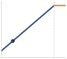{width="100%" fig-alt="A roofline: a blue memory-bound slope rising to an orange compute-bound ceiling at the ridge point. A workload dot sits low on the blue slope, far left of the ridge, marking LLM decode as deeply memory bound."}

*Decode sits deep in the memory-bound regime, far below the ridge.*
:::

The roofline model expresses the maximum achievable performance of a workload as the lesser of two ceilings:

$$ \text{Achievable FLOP/s} = \min\left(R_{\text{peak}},\ \text{BW} \times I\right) $$ {#eq-compute-roofline}

@Eq-compute-roofline has a direct physical interpretation. If the workload's arithmetic intensity is low (it needs many bytes per operation), then performance is limited by how fast memory can deliver those bytes. The achievable FLOP/s grows linearly with $I$, tracing a sloped line on a log-log plot. If the arithmetic intensity is high (each byte fuels many operations), then performance plateaus at the hardware's peak compute rate, regardless of further increases in $I$. This plateau is the flat "roof" of the model.

::: {#dfn-compute-infrastructure-ridge-point .callout-definition title="Ridge point"}

***Ridge point***\index{Ridge point!definition} is the ML accelerator arithmetic intensity where the memory bandwidth ceiling meets the compute ceiling $(I_{\text{ridge}} = \frac{R_{\text{peak}}}{\text{BW}})$.

1.  **Significance**: It defines the Hardware Efficiency Threshold. Workloads with an intensity below the ridge point are bandwidth-bound $(\text{BW})$, while those above are compute-bound\index{Roofline model!compute-bound regime} $(R_{\text{peak}})$.
2.  **Distinction**: Unlike Peak FLOP/s\index{Roofline model!peak throughput} (which only describes the horizontal ceiling), the ridge point describes the Balance of the architecture. A rising ridge point over hardware generations indicates that compute is growing faster than bandwidth, making utilization harder.
3.  **Common pitfall**: A frequent misconception is that all GPUs have the same ridge point. In reality, it varies by Precision: because $R_{\text{peak}}$ is higher for INT8 than FP32 while $\text{BW}$ is constant, the ridge point for INT8 is much higher, requiring more data reuse to saturate the hardware.

:::

```{python}
#| echo: false
#| label: roofline-landscape-values
#| output: false
# ┌─────────────────────────────────────────────────────────────────────────────
# │ ROOFLINE LANDSCAPE VALUES (LEGO)
# ├─────────────────────────────────────────────────────────────────────────────
# │ Context: @tbl-roofline-workloads, @fig-roofline-landscape prose, caption,
# │          alt text, and point data.
# │
# │ Goal: Keep the workload table, plot points, and prose tied to the same
# │       idealized weight-reuse intensities.
# │ Show: batch-1 and batch-32 decode, 512-token prefill, ResNet-50 training,
# │       and batch-2048 training intensity against the H100 FP16 ridge.
# │ How: Weight-traffic-only reuse: intensity = (tokens sharing one weight
# │      read) x (2 FLOPs per parameter / 2 FP16 bytes per parameter).
# │
# └─────────────────────────────────────────────────────────────────────────────
from mlsysim.fmt import check, fmt_arithmetic_intensity, fmt_multiple

class RooflineLandscapeMath:
    """Computed values for the H100 roofline workload table and landscape figure."""

    # ┌── 1. LOAD ─────────────────────────────────────────────
    h_h100 = Hardware.Cloud.H100
    peak_rate = h_h100.compute.peak_flops
    bandwidth = h_h100.memory.bandwidth
    ridge = (h_h100.compute.peak_flops / h_h100.memory.bandwidth).to(flop / byte).magnitude
    decode_intensity = (2 * flop / param / (BYTES_FP16 / param)).to(flop / byte).magnitude  # 2 FLOPs per 2-byte weight
    decode_batch = 32  # scenario assumption: concurrent decode requests sharing each weight read
    prefill_tokens = 512  # scenario assumption: prompt length processed in one prefill pass
    cnn_intensity = 200.0  # scenario assumption: representative ResNet-50 training intensity at the HBM level
    training_batch_size = 2048

    # ┌── 2. EXECUTE ──────────────────────────────────────────
    decode_batch_intensity = decode_batch * decode_intensity
    prefill_intensity = prefill_tokens * decode_intensity
    train_intensity = training_batch_size * decode_intensity
    train_gap = train_intensity / decode_intensity

    # ┌── 3. GUARD ────────────────────────────────────────────
    check(abs(decode_intensity - 1.0) < 1e-9, "Batch-1 FP16 decode should be 1 FLOP/byte.")
    check(abs(train_intensity - 2048.0) < 1e-9, "Training landscape point should be batch-size scaled.")
    check(decode_batch_intensity < cnn_intensity < ridge, "Batch-32 decode and the CNN point should sit below the ridge.")
    check(prefill_intensity > ridge, "The 512-token prefill point should sit above the ridge.")
    check(train_intensity > ridge, "Training landscape point should be compute-bound.")

    # ┌── 4. OUTPUT ───────────────────────────────────────────
    decode_intensity_str = fmt_arithmetic_intensity(decode_intensity * (flop / byte), precision=0, commas=False)
    decode_batch_str = fmt(decode_batch, precision=0, commas=False)
    decode_batch_intensity_str = fmt_arithmetic_intensity(decode_batch_intensity * (flop / byte), precision=0, commas=False)
    prefill_tokens_str = fmt(prefill_tokens, precision=0, commas=False)
    prefill_intensity_str = fmt_arithmetic_intensity(prefill_intensity * (flop / byte), precision=0, commas=False)
    cnn_intensity_str = fmt_arithmetic_intensity(cnn_intensity * (flop / byte), precision=0, commas=False)
    ridge_str = fmt_arithmetic_intensity(round(ridge) * (flop / byte), precision=0, commas=False)
    training_batch_size_str = fmt(training_batch_size, precision=0, commas=False)
    train_intensity_str = fmt_arithmetic_intensity(train_intensity * (flop / byte), precision=0, commas=True)
    train_gap_mult_str = fmt_multiple(train_gap, precision=0, commas=True)
    peak_rate_for_plot = peak_rate.to(TFLOPs / second).magnitude
    bandwidth_for_plot = bandwidth.to(TB / second).magnitude
```

Machine learning workloads land in different regions of the roofline plot depending on the operation and the batch configuration, not on the model family. Single-request autoregressive decode streams the full weight tensor (two bytes per parameter in FP16) from HBM to perform two floating-point operations per parameter, an arithmetic intensity of about `{python} RooflineLandscapeMath.decode_intensity_str`, far below the H100's ridge point of `{python} RooflineLandscapeMath.ridge_str`. The token-latency calculation in notebook \ref{nbk-token-latency} showed that the arithmetic finishes in microseconds while the weight movement takes milliseconds. Every other regime in @tbl-roofline-workloads comes from reusing each byte fetched from HBM across more operations. Decode also reads the key-value (KV) cache\index{KV Cache!roofline placement}, the stored attention keys and values of earlier tokens, and because each request has its own cache, batching does not amortize that traffic.

| **Workload phase**                                                            | **Source of reuse**                                   |                   **Idealized intensity**                   | **What moves it**                                   |
|:------------------------------------------------------------------------------|:------------------------------------------------------|:-----------------------------------------------------------:|:----------------------------------------------------|
| **Decode, batch 1**                                                           | None; each weight serves one token                    |    `{python} RooflineLandscapeMath.decode_intensity_str`    | Batching requests, lower-precision weights          |
| **Decode, batch `{python} RooflineLandscapeMath.decode_batch_str`**           | Each weight read serves every request in the batch    | `{python} RooflineLandscapeMath.decode_batch_intensity_str` | Batch size, until key-value cache traffic dominates |
| **Prefill, `{python} RooflineLandscapeMath.prefill_tokens_str`-token prompt** | Each weight read serves every prompt token            |    `{python} RooflineLandscapeMath.prefill_intensity_str`   | Prompt length and batch size                        |
| **Convolution training** (ResNet-50)                                          | Filters reused across spatial positions and the batch |      `{python} RooflineLandscapeMath.cnn_intensity_str`     | Channel depth, tensor layout, operator fusion       |
| **Attention**                                                                 | Keys and values reused across queries                 |         Shape-dependent, on either side of the ridge        | Sequence length, head dimension, SRAM tiling        |

: **Roofline placement by workload phase**: Language-model intensities count only weight traffic at the HBM level, the same idealization used for @fig-roofline-landscape, against an H100 FP16 ridge point of `{python} RooflineLandscapeMath.ridge_str`; the convolution value is a representative scenario figure rather than a derived count. Measured placement must also count activation, key-value cache, and optimizer traffic. {#tbl-roofline-workloads}

The table's numbers are idealized reuse counts, so they mark directions rather than measurements. Convolutional layers sit near the ridge, but channel depth, tensor layout, fusion, precision, and cache residency decide which side a particular layer lands on. Attention is the case that most resists a label. Full-sequence attention performs quadratic interactions across query and key tokens, whereas single-token decode streams the key-value cache for one query vector, so the same operator is compute bound in long fused prefill and memory bound in decode. The analytical objective is to classify each execution phase and batch configuration on the roofline rather than to assign a permanent regime to a model family.

A measured workload point below its roofline ceiling is not fully using the available resource. This gap indicates an optimization opportunity in the software: kernel inefficiency, poor memory access patterns, or excessive synchronization. Closing this gap is the province of kernel engineering and communication optimization, topics examined in @sec-performance-engineering.

```{python}
#| echo: false
# ┌── LEGO ───────────────────────────────────────────────
class InfraFrontierMemoryRooflineRecap:

    # ┌── 4. OUTPUT (Formatting) ──────────────────────────────────────────────
    frontier_params_b_str = fmt_params(Models.Language.GPT3.parameters, scale="B", precision=0, commas=False)
```

The Roofline's diagnostic power extends beyond individual kernels to entire training runs. For our `{python} InfraFrontierMemoryRooflineRecap.frontier_params_b_str` model, the computation graph contains thousands of distinct operations with different arithmetic intensities. The dense feed-forward network layers are dominated by large general matrix multiplications (GEMMs) with high arithmetic intensity, placing them firmly in the compute-bound regime where Tensor Core utilization is the bottleneck. Conversely, operations like layer normalization and element-wise activations possess low arithmetic intensity, sitting deep in the memory-bound region where the compute units idle while waiting for data. Attention kernels can land on either side of the ridge, depending on the shapes and reuse examined above, and long decode contexts add key-value traffic without comparable reuse. This diagnostic distinction dictates the optimization strategy: memory-bound layers benefit from kernel fusion (reducing HBM round-trips), while compute-bound layers benefit from precision reduction (moving from FP16 to FP8, which effectively raises the hardware's compute ceiling).

@Fig-roofline-landscape makes these relationships visible for the H100. Batch-1 decode sits deep in the memory-bound region, while the chapter's simplified large-batch training point crosses the ridge into the compute-bound region. The training point scales idealized weight reuse with the assumed batch size of `{python} RooflineLandscapeMath.training_batch_size_str`; it is a contrast case, not a universal intensity for training. Actual placement requires counting bytes at the memory level being modeled and accounting for tensor shapes, fusion, and reuse. Under this explicit simplification, the `{python} RooflineLandscapeMath.train_gap_mult_str` gap between decode and training intensity (~`{python} RooflineLandscapeMath.decode_intensity_str` vs. ~`{python} RooflineLandscapeMath.train_intensity_str`) explains why the same hardware can exhibit very different utilization across phases.

::: {#fig-roofline-landscape fig-env="figure" fig-pos="htb" fig-cap="**The H100 roofline landscape**: Attainable FP16 throughput is the lower of two ceilings, the memory-bandwidth slope (blue) and the compute roof (orange), which meet at the dashed ridge point. Each dot places a representative workload by its arithmetic intensity; workloads left of the ridge stay capped by bandwidth however much compute the chip offers, and only those to its right can approach peak throughput." fig-alt="Log-log roofline plot for H100 FP16 showing memory-bound and compute-bound regions with five ML workloads from LLM decode at the low-intensity left edge to LLM training on the compute roof."}

```{python}
#| echo: false
# ┌─────────────────────────────────────────────────────────────────────────────
# │ ROOFLINE LANDSCAPE (FIGURE)
# ├─────────────────────────────────────────────────────────────────────────────
# │ Context: @fig-roofline-landscape—H100 roofline and workload placement
# │
# │ Goal: H100 FP16 roofline; plot LLM decode/CNN/LLM training workloads; show
# │       memory-bound vs compute-bound; ridge ~295 FLOP/byte (FP16).
# │ Show: Log-log; roofline; filled regions; workload scatter.
# │ How: y = min(BW*x, R_peak); workloads dict; matplotlib.
# │
# └─────────────────────────────────────────────────────────────────────────────
# ┌── 1. CANVAS ────────────────────────────────────────────────────────────────
# │ H100 FP16 roofline; plot LLM decode/CNN/LLM training workloads; show
import matplotlib.pyplot as plt
import numpy as np

# ┌── 2. ARRAYS ────────────────────────────────────────────────────────────────
R_PEAK_TFLOP_PER_S = RooflineLandscapeMath.peak_rate_for_plot
BW_TBS = RooflineLandscapeMath.bandwidth_for_plot
RIDGE_POINT = RooflineLandscapeMath.ridge

workloads = {
    "LLM Decode\n(Batch=1)": RooflineLandscapeMath.decode_intensity,
    "LLM Decode\n(Batch=32)": RooflineLandscapeMath.decode_batch_intensity,
    "CNN Training\n(ResNet-50)": RooflineLandscapeMath.cnn_intensity,
    "LLM Prefill": RooflineLandscapeMath.prefill_intensity,
    "LLM Training\n(175B)": RooflineLandscapeMath.train_intensity,
}

x_min, x_max = 0.5, 10000
x = np.logspace(np.log10(x_min), np.log10(x_max), 500)
y = np.minimum(BW_TBS * x, R_PEAK_TFLOP_PER_S)

from mlsysim import viz

viz.set_book_style()
C = viz.COLORS
plt.figure(figsize=(10, 5.6))

# Memory-bound slope (blue) and compute-bound roof (orange), per the color contract.
x_mem = x[x <= RIDGE_POINT]
x_cmp = x[x >= RIDGE_POINT]
plt.plot(x_mem, BW_TBS * x_mem, color=C['BlueLine'], linewidth=3)
plt.plot(x_cmp, np.full_like(x_cmp, R_PEAK_TFLOP_PER_S), color=C['OrangeLine'], linewidth=3)

plt.fill_between(x, 0, y, where=(x <= RIDGE_POINT), color=C['BlueLine'], alpha=0.07, linewidth=0)
plt.fill_between(x, 0, y, where=(x >= RIDGE_POINT), color=C['OrangeLine'], alpha=0.07, linewidth=0)

plt.axvline(x=RIDGE_POINT, color=C['primary'], linestyle='--', linewidth=1.2, alpha=0.6)
plt.text(RIDGE_POINT * 1.1, 10, f'Ridge point\n~{int(RIDGE_POINT)} FLOP/byte', color=C['primary'], fontsize=10, verticalalignment='bottom')

# ┌── 3. RENDER ────────────────────────────────────────────────────────────────

label_offsets = {
    "LLM Decode\n(Batch=1)": (10, -20, 'left'),
    "LLM Decode\n(Batch=32)": (10, -20, 'left'),
    "CNN Training\n(ResNet-50)": (-28, 12, 'center'),
    "LLM Prefill": (6, 10, 'center'),
    "LLM Training\n(175B)": (-5, -26, 'center'),
}

for label, intensity in workloads.items():

    perf = min(BW_TBS * intensity, R_PEAK_TFLOP_PER_S)

    xytext_x, xytext_y, ha = label_offsets[label]

    plt.scatter(intensity, perf, color=C['primary'], s=70, zorder=5, edgecolors='white', linewidths=1.2)

    plt.annotate(
        label,
        (intensity, perf),
        xytext=(xytext_x, xytext_y),
        textcoords='offset points',
        ha=ha,
        fontsize=9,
        fontweight='bold',
        bbox=dict(boxstyle="round,pad=0.3", fc="white", ec="none", alpha=0.8),
    )

plt.xscale('log')
plt.yscale('log')
plt.xlim(x_min, x_max)
plt.ylim(1, R_PEAK_TFLOP_PER_S * 2.5)
plt.xlabel('Arithmetic intensity (FLOP/byte)')
plt.ylabel('Attainable performance (TFLOP/s)')
plt.grid(True, which="both", ls="-", alpha=0.15)
plt.grid(True, which="major", ls="-", alpha=0.3, color=C['grid'])

x_text = 4
y_text = BW_TBS * 0.88 * x_text

plt.text(
    x_text,
    y_text,
    f'Bandwidth slope\n{BW_TBS:.2f} TB/s',
    rotation=35,
    color=C['BlueLine'],
    fontsize=10,
    ha='center',
    bbox=dict(fc="white", alpha=0.7, ec="none"),
)
plt.text(
    2200,
    R_PEAK_TFLOP_PER_S * 1.23,
    f'$R_{{\\text{{peak}}}}$\n{int(R_PEAK_TFLOP_PER_S)} TFLOP/s',
    color=C['OrangeLine'],
    ha='center',
    fontsize=10,
    bbox=dict(fc="white", alpha=0.7, ec="none"),
)
plt.tight_layout()
plt.show()
plt.close()

# ┌── 4. DECORATE ──────────────────────────────────────────────────────────────
```

:::

```{python}
#| echo: false
from mlsysim.fmt import fmt_bandwidth, fmt_flop_rate

# ┌── LEGO ───────────────────────────────────────────────
class RooflineCaptionRecap:
    h_h100 = Hardware.Cloud.H100

    # ┌── 4. OUTPUT (Formatting) ──────────────────────────────────────────────
    h100_fp16_tflop_per_s_str = fmt_flop_rate(h_h100.compute.peak_flops, unit=TFLOP / second, precision=0, commas=False)
    h100_bw_tb_per_s_str = fmt_bandwidth(h_h100.memory.bandwidth, unit=TB / second, precision=2, commas=False)
    h100_ridge_str = fmt_arithmetic_intensity((h_h100.compute.peak_flops / h_h100.memory.bandwidth), unit=flop / byte, precision=1, commas=False)
```

The Roofline Model also reveals a subtle but important insight about the interaction between batch size and hardware utilization. Increasing the batch size for a given model raises the arithmetic intensity because the weight matrix is loaded once but multiplied against a larger activation matrix (more FLOPs for the same bytes transferred). This shifts the workload point rightward on the plot, potentially crossing the ridge point from memory-bound to compute-bound territory. In the weight-traffic-only approximation, arithmetic intensity grows linearly with batch size because more requests reuse the same weights. Activation traffic, attention state, and capacity limits prevent that approximation from predicting utilization indefinitely.

For inference serving, batching multiple requests together dramatically increases hardware utilization and throughput. A model that achieves 1 percent of peak FLOP/s at batch size 1 might achieve 50 percent of peak FLOP/s at batch size 64, simply because the weight data loaded from HBM is reused across 64 independent requests rather than one. This 50$\times$ improvement in hardware utilization comes at a cost: waiting to assemble a batch can introduce queuing latency; a serving policy can instead dispatch a smaller batch when a latency deadline approaches. Serving systems must carefully balance this trade-off between throughput (larger batches, higher utilization) and latency (smaller batches, faster response per request).

For training, the batch size is a hyperparameter that affects both statistical convergence and hardware efficiency, creating a trade-off that practitioners must navigate carefully. Larger batch sizes improve hardware utilization (pushing the workload into the compute-bound regime) but may require learning rate adjustments and warmup schedules to maintain training quality. The optimal batch size depends on both the model architecture and the hardware's Roofline characteristics, creating a cross-disciplinary optimization problem that spans ML theory and systems engineering.

For fleet procurement, the roofline is a screening test rather than a throughput forecast. It rules out upgrades that raise a nonbinding ceiling, while the gap below the relevant ceiling identifies work still needed in software or communication. A candidate that fits the local workload must also fit the node's memory budget, the interconnect, and the facility power envelope.

```{python}
#| echo: false
# ┌── LEGO ───────────────────────────────────────────────
class InfraFrontierMemoryTrainRecap:

    # ┌── 4. OUTPUT (Formatting) ──────────────────────────────────────────────
    frontier_params_b_str = fmt_params(Models.Language.GPT3.parameters, scale="B", precision=0, commas=False)
```

The Roofline Model also provides a quantitative framework for evaluating the return on investment of different optimizations. If a workload is 10$\times$ below the compute ceiling but already touching the bandwidth ceiling, spending engineering effort on kernel optimization (moving toward the compute ceiling) yields no benefit. The effort should instead be directed toward reducing memory traffic (shifting the workload rightward on the plot) through techniques like batching, kernel fusion, or quantization.

```{python}
#| echo: false
#| label: roofline-inference-math
#| output: false
# ┌─────────────────────────────────────────────────────────────────────────────
# │ ROOFLINE INFERENCE MATH BLOCKS (LEGO)
# ├─────────────────────────────────────────────────────────────────────────────
# │ Context: Roofline callout-example comparing inference vs training intensity.
# │
# │ Goal: Provide formatted math expressions for inference and training examples.
# │ Show: Inference FLOP count, throughput ceiling, peak fraction, and training intensity.
# │ How: Compute from RooflineScenario constants, then format for prose.
# │
# └─────────────────────────────────────────────────────────────────────────────
from mlsysim.fmt import (
    check,
    fmt,
    fmt_arithmetic_intensity,
    fmt_bandwidth,
    fmt_count,
    fmt_flop_rate,
    fmt_magnitude,
    fmt_math,
    fmt_memory,
    fmt_params,
    fmt_percent,
)

class RooflineInferenceMath:
    """Formatted math strings for the roofline inference vs training intensity example."""

    # ┌── 1. LOAD ─────────────────────────────────────────────
    params = Models.Language.GPT3.parameters
    weight_bytes_per_param = BYTES_FP16
    batch_size = 2048
    h_h100 = Hardware.Cloud.H100
    h100_bw = h_h100.memory.bandwidth
    h100_peak = h_h100.compute.peak_flops
    ridge_q = h_h100.compute.peak_flops / h_h100.memory.bandwidth
    ridge = ridge_q.to(flop / byte).magnitude
    params_count = params.to(param).magnitude
    params_b_str = fmt_params(params, scale="B", precision=0, commas=False)
    params_b_value_str = fmt_magnitude(params, unit=Bparam, precision=0, commas=False)
    h100_bw_tb_s_value_str = fmt_magnitude(h100_bw, unit=TB / second, precision=2, commas=False)
    h100_bw_tb_per_s_str = fmt_bandwidth(h100_bw, unit=TB / second, precision=2, commas=False)
    h100_fp16_tflop_per_s_str = fmt_flop_rate(h100_peak, unit=TFLOP / second, precision=0, commas=False)
    h100_ridge_str = fmt_arithmetic_intensity(ridge_q, unit=flop / byte, precision=1, commas=False)

    # ┌── 2. EXECUTE ──────────────────────────────────────────
    inf_flops = 2 * params * flop / param
    inf_weight = memory_from_params(params, weight_bytes_per_param / param)
    inf_intensity_q = inf_flops / inf_weight
    inf_intensity = inf_intensity_q.to(flop / byte).magnitude
    inf_throughput = (h100_bw * inf_intensity_q).to(TFLOP / second)
    inf_peak_pct = (inf_throughput / h100_peak).to_base_units().magnitude * 100
    train_intensity_q = batch_size * inf_intensity_q
    train_intensity = train_intensity_q.to(flop / byte).magnitude

    # ┌── 3. GUARD ────────────────────────────────────────────
    check(abs(inf_intensity - 1.0) < 1e-9, "Decode intensity should be 1 FLOP/byte")
    check(0.3 < inf_peak_pct < 0.4, "Decode throughput should be about 0.34% of H100 peak")
    check(train_intensity > ridge, "Training example should be compute-bound")

    # ┌── 4. OUTPUT ───────────────────────────────────────────
    inf_intensity_str = fmt_arithmetic_intensity(inf_intensity_q, precision=0, commas=False)
    inf_peak_pct_str = fmt_percent(inf_peak_pct / 100, precision=2, commas=False, style='prose')
    batch_size_str = fmt_count(batch_size, precision=0, commas=False)
    train_intensity_str = fmt_arithmetic_intensity(train_intensity_q, precision=0, commas=True)
```

The same arithmetic-intensity calculation separates the running model's inference and training regimes.

::: {#exmp-compute-infrastructure-roofline-analysis-training-vs-inference .callout-example title="Roofline analysis: Training vs. inference"}

**Scenario**: An engineering team evaluates hardware choices for serving (decode batch size 1) vs. training (batch size `{python} RooflineInferenceMath.batch_size_str`) a `{python} RooflineInferenceMath.params_b_str` parameter model on an H100 GPU (ridge point `{python} RooflineInferenceMath.h100_ridge_str`).

**Diagnosis**: Single-token decode achieves arithmetic intensity $I =$ `{python} RooflineInferenceMath.inf_intensity_str` $\ll$ `{python} RooflineInferenceMath.h100_ridge_str`, bounding throughput to `{python} RooflineInferenceMath.inf_peak_pct_str` of peak FLOPs due to HBM bandwidth. Training batching increases intensity to $I =$ `{python} RooflineInferenceMath.train_intensity_str` $\gg$ `{python} RooflineInferenceMath.h100_ridge_str`, shifting the workload to compute-bound peak TFLOPs.

**Systems lesson**: Hardware selection must align with operational arithmetic intensity: training platforms prioritize peak compute (TFLOPs), while single-batch inference platforms prioritize memory bandwidth per dollar.

:::

That same diagnostic becomes most valuable when a proposed upgrade changes the wrong ceiling.

::: {#chk-compute-infrastructure-roofline-diagnosis .callout-checkpoint title="Roofline diagnosis"}

A team is serving a 13B-parameter model at batch size 1 on an H100 and observing 25 ms per token. The profile shows low tensor-core utilization during decode.

- [ ] **Arithmetic intensity**: estimate the arithmetic intensity of the workload.
- [ ] **Peak-throughput upgrade**: decide whether a higher peak-TFLOP/s accelerator changes the binding term.
- [ ] **Binding constraint**: identify the measurement or hardware capability that should improve first.

:::

Memory capacity and bandwidth screen out infeasible accelerator choices. For the candidates that remain, fleet sizing also needs a sustained compute rate at a precision the workload can use.

## Sustained Compute and Precision {#sec-compute-tensor-cores}

A fleet sized from advertised matrix throughput can miss its training deadline when operations cannot use the advertised precision or keep the arithmetic units busy. The relevant hardware contract includes both the eligible matrix operations and their sustained contribution to the complete workload. That contract begins with the specialized arithmetic units: Tensor Cores\index{Tensor Core!matrix units}[^fn-tensor-core-evolution] on NVIDIA GPUs and Matrix Multiply Units\index{Matrix Multiply Unit!TPU} on Google TPUs.

[^fn-tensor-core-evolution]: **Tensor Core**\index{Tensor Core!evolution}: Introduced with NVIDIA Volta (2017) as $4{\times}4{\times}4$ FP16 fused matrix-multiply-accumulate units. Each generation widened the set of formats: Turing (2018) added INT8, Ampere (2020) added TF32/BF16, and Hopper (2022) added FP8. This precision cascade tracks ML's own shift toward lower-precision training and inference, since each new format unlocks a $2\times$ throughput gain on the same silicon, making Tensor Core generations a proxy for how quickly the hardware-software co-design loop can widen the Roofline's compute ceiling.

A Tensor Core executes matrix-multiply-accumulate instructions of the form $\mathbf{Y} = \mathbf{A} \times \mathbf{B} + \mathbf{C}$ on small tile matrices in specialized hardware. On the H100, these tile operations are distributed across the Tensor Core array in each SM, producing hundreds of accumulated results per instruction while keeping operands in registers and shared memory. This concentrates the dominant neural-network operation in dedicated matrix hardware that supplies most of the chip's peak arithmetic.

```{python}
#| echo: false
from mlsysim.fmt import fmt_flop_rate

# ┌── LEGO ───────────────────────────────────────────────
class RooflineTensorRecap:
    # ┌── 4. OUTPUT (Formatting) ──────────────────────────────────────────────
    h100_fp16_tflop_per_s_str = fmt_flop_rate(Hardware.Cloud.H100.compute.peak_flops, unit=TFLOP / second, precision=0, commas=False)
```

With 528 Tensor Cores across the chip (4 per SM, 132 SMs), the H100 reaches the `{python} RooflineTensorRecap.h100_fp16_tflop_per_s_str` FP16/BF16 peak used in the roofline analysis. The important systems point is not the exact per-cycle instruction accounting, but the architectural specialization: the die dedicates a large fraction of its arithmetic area to dense tiled matrix operations rather than general-purpose scalar execution.

Google's MXUs take the same concept further by organizing the multipliers into a systolic array\index{Systolic array!matrix multiply unit}. In a systolic MXU, one matrix is loaded into the array's weight registers while the other matrix streams through the array one row at a time. Each cell multiplies the incoming activation by its stored weight, adds the result to the partial sum flowing from the cell above, and passes both the activation rightward and the partial sum downward. This pipelined flow means the array is performing useful computation on every cycle, with no idle cells once the pipeline is full. Each TPU v5p chip contains two TensorCores with four $128{\times}128$ MXUs each, together providing `{python} TpuV5pRecap.peak_bf16_str` of BF16 throughput. The systolic dataflow eliminates the register file accesses between operations that a Tensor Core still requires, achieving marginally higher energy efficiency at the cost of the flexibility to run nonmatrix workloads.

```{python}
#| echo: false
# ┌── LEGO ───────────────────────────────────────────────
class InfraFrontierMemoryArchRecap:

    # ┌── 4. OUTPUT (Formatting) ──────────────────────────────────────────────
    frontier_params_b_str = fmt_params(Models.Language.GPT3.parameters, scale="B", precision=0, commas=False)
```

For our `{python} InfraFrontierMemoryArchRecap.frontier_params_b_str` model, compiler and kernel support determine how much work reaches the specialized arithmetic units. CUDA kernels can combine matrix operations with thread-level work, while XLA maps the computation graph onto the TPU dataflow. In either stack, fusion keeps intermediate results in registers or shared memory instead of repeatedly writing them to HBM. Sustained throughput therefore depends on operation coverage and data reuse as well as the matrix units themselves.

```{python}
#| echo: false
from mlsysim import Hardware
from mlsysim.fmt import fmt, fmt_flop_rate, fmt_multiple

# ┌── LEGO ───────────────────────────────────────────────
class TensorCoreTdpRecap:

    _h100 = Hardware.Cloud.H100
    _fp16_tc = _h100.compute.peak_flops
    _fp8_tc = _h100.compute.precision_flops["fp8"]
    _fp32_cuda = _h100.compute.precision_flops["fp32"]
    _tc_vs_cuda = (_fp16_tc / _fp32_cuda).to("").magnitude

    # ┌── 4. OUTPUT (Formatting) ──────────────────────────────────────────────
    h100_fp16_tc_tflop_per_s_str = fmt_flop_rate(_fp16_tc, unit=TFLOPs / second, precision=0, commas=False)
    h100_fp8_tc_tflop_per_s_str = fmt_flop_rate(_fp8_tc, unit=TFLOPs / second, precision=0, commas=True)
    tc_vs_cuda_ratio_mult_str = fmt_multiple(_tc_vs_cuda, precision=1, commas=False)
    h100_fp32_cuda_tflop_per_s_str = fmt_flop_rate(_fp32_cuda, unit=TFLOPs / second, precision=0, commas=False)
```

::: {#dfn-compute-infrastructure-tensor-core .callout-definition title="Tensor core"}

***Tensor Core***\index{Tensor Core!definition} is a specialized ML accelerator hardware unit that performs a fused matrix-multiply-accumulate operation $\mathbf{Y} = \mathbf{A} \times \mathbf{B} + \mathbf{C}$ on small tiles (for example, $16{\times}8{\times}16$ in BF16) as a single hardware instruction, delivering dramatically higher throughput than general-purpose CUDA cores by trading programmability for fixed-function matrix arithmetic.

1.  **Significance**: Tensor Cores provide the bulk of the H100's `{python} TensorCoreTdpRecap.h100_fp16_tc_tflop_per_s_str` FP16/BF16 peak (and ~`{python} TensorCoreTdpRecap.h100_fp8_tc_tflop_per_s_str` at FP8), roughly `{python} TensorCoreTdpRecap.tc_vs_cuda_ratio_mult_str` the ~`{python} TensorCoreTdpRecap.h100_fp32_cuda_tflop_per_s_str` delivered by CUDA (vector) cores alone. However, this peak is only achievable for operations that decompose into tiled matrix multiplications. Layer normalization and softmax, which involve reductions and element-wise operations rather than matrix multiplications, run at approximately 3–8 percent of peak throughput on the same hardware.
2.  **Distinction**: A Tensor Core is a fixed-function matrix-multiply-accumulate unit, not a faster general-purpose core. CUDA cores execute arbitrary scalar and vector work; Tensor Cores execute only the tiled $\mathbf{Y} = \mathbf{A} \times \mathbf{B} + \mathbf{C}$ primitive, which is why peak throughput and delivered throughput diverge so sharply by workload.
3.  **Common pitfall**: A frequent misconception is that all GPU operations benefit from Tensor Cores. Only operations that map to the $\mathbf{Y} = \mathbf{A} \times \mathbf{B} + \mathbf{C}$ tile computation (dense linear layers, attention score computation, convolutions) engage Tensor Cores; element-wise activations, layer norm, and embedding lookups fall back to CUDA cores and can run 10--30$\times$ slower per FLOP than Tensor Core operations.

:::

The precision support of Tensor Cores has expanded with each generation, driven by the discovery that neural network training and inference can tolerate lower numerical precision than was previously assumed. Volta Tensor Cores accepted FP16 multiplicands and supported FP16 or FP32 accumulation. Turing added INT8 and INT4 modes for inference, Ampere added BF16 and TF32, and Hopper added FP8 (both E4M3 and E5M2 formats) with per-tensor scaling through the Transformer Engine.

Transformer Engine recipes and FP8 autocast determine which supported operations run in FP8. The scaling machinery records tensor ranges and applies scale factors so values fit the selected FP8 format; it does not independently determine that a layer is numerically safe for FP8 and switch it to FP16 when it is not. Precision policy therefore remains a software configuration and validation decision.

Understanding the distinction between the two FP8 formats clarifies why this matters for practitioners. The E4M3 format (4 exponent bits, 3 mantissa bits) can represent values up to approximately $4.48 \times 10^{2}$, with 3 bits of mantissa providing about 1 part in 8 relative precision. This range and precision are adequate for many neural network weights and activations after per-tensor scaling brings their observed range into the FP8 window.

The E5M2 format (5 exponent bits, 2 mantissa bits) provides a wider dynamic range, with maximum finite values around $5.73 \times 10^{4}$, at the cost of reduced precision (only 2 mantissa bits, or about 1 part in 4 relative precision). This wider range is important for gradients during the backward pass, which can span more orders of magnitude than forward-pass activations, particularly in the early and late layers of deep networks.

The configured Transformer Engine recipe determines how these formats are used; a common hybrid recipe uses E4M3 for forward tensors and E5M2 for backward tensors. Scaling factors and tensor-range metadata are maintained by the implementation, with the update rule determined by the selected scaling recipe.

The practical implication for fleet design is that peak TFLOP/s specifications are precision-dependent. The H100 delivers `{python} TensorCoreTdpRecap.h100_fp16_tc_tflop_per_s_str` in FP16 but twice that (`{python} TensorCoreTdpRecap.h100_fp8_tc_tflop_per_s_str`) in FP8. FP8 therefore doubles the advertised arithmetic ceiling for supported operations on the same hardware. The complete training run gains less when communication, memory traffic, or higher-precision operations remain on the critical path. This makes precision engineering a first-class optimization lever for infrastructure planners, not just a model accuracy concern.

```{python}
#| echo: false
# ┌── LEGO ───────────────────────────────────────────────
class InfraFrontierStragglerRecap2:

    # ┌── 4. OUTPUT (Formatting) ──────────────────────────────────────────────
    frontier_params_b_str = fmt_params(Models.Language.GPT3.parameters, scale="B", precision=0, commas=False)
```

```{python}
#| echo: false
from mlsysim.fmt import fmt_bandwidth

# ┌── LEGO ───────────────────────────────────────────────
class MemoryBandwidthPipelineRecap:

    # ┌── 4. OUTPUT (Formatting) ──────────────────────────────────────────────
    h100_bw_tb_per_s_str = fmt_bandwidth(Hardware.Cloud.H100.memory.bandwidth, unit=TB / second, precision=2, commas=False)
```

To achieve this peak throughput in practice, the entire accelerator must be viewed as a rigid pipeline where data flows from HBM through a deepening hierarchy of caches before reaching the Tensor Cores. The fundamental constraint is pipeline balance\index{Pipeline!balance}: the rate at which data is staged into registers must match or exceed the rate at which the arithmetic units consume it. When the arithmetic intensity of an operation falls below the ridge point, the pipeline stalls, leaving teraflops of compute potential idle while waiting for data. This makes kernel fusion\index{Kernel fusion!HBM traffic reduction} the single most critical software optimization for large-scale training. Fusing multiple operations (matrix multiplication, bias addition, activation function) into a single kernel eliminates the round-trips to HBM that would occur if each operation were executed sequentially. Consider the attention mechanism: a naive, unfused implementation writes the $S{\times}S$ attention matrix to HBM only to read it back for the softmax operation, creating a round trip capped by the `{python} MemoryBandwidthPipelineRecap.h100_bw_tb_per_s_str` memory bandwidth. A fused implementation like FlashAttention\index{FlashAttention!SRAM tiling}, a hardware-aware exact attention algorithm, keeps these intermediate matrices entirely in on-chip SRAM, bypassing HBM and allowing the Tensor Cores to run near their theoretical peak. For our `{python} InfraFrontierStragglerRecap2.frontier_params_b_str` model, where each training step involves thousands of matrix operations across 96 Transformer layers, the difference between fused and unfused kernels can be a 2--3$\times$ throughput improvement, separating a 2-week training run from a 6-week one.

### Peak vs. sustained throughput {#sec-compute-infrastructure-peak-vs-sustained-throughput-625a}

A critical distinction for infrastructure planning is the difference between *peak* throughput (the maximum rate for the vendor-specified operation and precision) and *sustained* throughput (what the complete workload delivers). Peak TFLOP/s assumes that eligible arithmetic units remain fed under the stated sparsity, precision, and clock conditions; it does not include memory stalls, ineligible operations, communication, or software overhead. Sustained fractions therefore vary with model shape, batch size, precision, implementation, and scale. The gap arises from several sources, each representing a different physical or software limitation.

```{python}
#| echo: false
from mlsysim.fmt import fmt_bandwidth

# ┌── LEGO ───────────────────────────────────────────────
class MemoryBandwidthTensorRecap:

    # ┌── 4. OUTPUT (Formatting) ──────────────────────────────────────────────
    h100_bw_tb_per_s_str = fmt_bandwidth(Hardware.Cloud.H100.memory.bandwidth, unit=TB / second, precision=2, commas=False)
```

Memory stalls occur when the Tensor Cores complete their current tile multiplication before the next tile has been loaded from HBM. Even with the H100's `{python} MemoryBandwidthTensorRecap.h100_bw_tb_per_s_str` HBM bandwidth, the Tensor Cores can consume data faster than HBM can deliver it for certain matrix dimensions, creating idle cycles while the arithmetic units wait for data.

Pipeline bubbles arise when one operation must complete before the next can begin, leaving some processing elements idle. In a Transformer layer, the attention computation must complete before the feed-forward network can begin, and the feed-forward computation must complete before the next layer's attention can start. These sequential dependencies create brief periods where some hardware resources are unused. When the model is split into sequential stages on different accelerators (pipeline parallelism), these dependencies become bubbles, idle slots in which a stage waits for its predecessor; splitting each batch into microbatches reduces the waste by feeding later microbatches into stages that would otherwise wait. At the infrastructure level, the lesson is that peak throughput assumes a perfectly filled pipeline, while real training includes dependency gaps that lower sustained utilization.

AllReduce operations used in tensor parallelism and gradient synchronization used in data parallelism can delay computations that depend on their results. Even when communication is overlapped with computation (using separate communication and compute streams), there are typically operations that cannot be overlapped because they depend on the result of the communication.

Software overhead from kernel launch latency, memory allocation, and Python-level control flow contributes an additional 5--10 percent overhead. Each CUDA kernel launch incurs approximately 5--10 microseconds of latency on the host side, and a single Transformer layer may involve 20–30 kernel launches. For small microbatches where each kernel completes in microseconds, the launch overhead can become a meaningful fraction of total execution time.

Kernel fusion partially addresses this gap by combining multiple operations (matrix multiply, bias add, activation function, dropout) into a single GPU kernel, eliminating the intermediate memory reads and writes that would otherwise stall the Tensor Cores between operations. The art of achieving high sustained utilization is largely the art of minimizing the time Tensor Cores spend idle, which is why specialized kernel libraries like FlashAttention and the Transformer Engine exist.

Capacity planning must use a measured or conservatively modeled sustained rate, not the peak specification. A run estimated at 1,000 GPU-hours from peak FLOP/s requires $1/u$ times that estimate when its measured utilization fraction is $u$. Infrastructure teams track MFU\index{Model FLOPs utilization!capacity planning}, the ratio of the model's useful FLOP count to hardware peak FLOP/s multiplied by wall-clock time, but comparisons remain meaningful only when model-FLOP conventions, precision, hardware peak, and system scale match. @Sec-performance-engineering-fleet-efficiency-metric-dff4 formalizes MFU and develops its fleet-scale application.

## Power and Thermal Envelopes {#sec-compute-power-wall}

The memory wall constrains how fast data reaches the compute units; the Roofline Model diagnoses whether compute or memory is the binding constraint; and Tensor Cores maximize the arithmetic value of every byte fetched. Sustaining the resulting compute rate also requires a power-delivery and cooling system sized for the workload. Every FLOP dissipates energy, and the faster a system computes, the more heat it must remove. This is the power wall. @Fig-power-path traces the journey of energy from grid to transistor.

```{python}
#| echo: false
from mlsysim.fmt import check, fmt, fmt_power

# ┌── LEGO ───────────────────────────────────────────────
# │ Context: 10K-GPU accelerator power quoted in the rack-proximity prose.
# │          (@fig-power-path is a static SVG whose per-stage losses are
# │          labeled illustrative; it no longer shows PUE tiers.)
class PowerPathFigureAnchors:
    """10K-GPU accelerator power for the rack prose."""

    # ┌── 1. LOAD ──────────────────────────────────────────
    cluster_gpus = Systems.Clusters.Training_10K.total_accelerators
    gpu_tdp = Hardware.Cloud.H100.tdp

    # ┌── 2. EXECUTE ───────────────────────────────────────
    gpu_power = (cluster_gpus * gpu_tdp).to(MW)

    # ┌── 3. GUARD ─────────────────────────────────────────
    check(abs(gpu_power.magnitude - 7.0) < 1e-9, "Rack prose quotes 7 MW of GPU power")

    # ┌── 4. OUTPUT ────────────────────────────────────────
    cluster_gpus_str = fmt(cluster_gpus, precision=0, commas=True)
    gpu_power_mw_str = fmt_power(gpu_power, unit=MW, precision=0, commas=False)
```

::: {#fig-power-path fig-env="figure" fig-pos="htb" fig-cap="**The power delivery path**: Energy passes through five conversion stages between the medium-voltage grid and the sub-volt supply at the GPU die, and each stage loses a few percent as heat. The per-stage losses shown are illustrative round values, not measurements of a particular facility; compounded, they lose about a fifth of the power, so delivering 1 MW to the dies draws about 1.3 MW before any cooling overhead, which PUE accounts for separately. The critical engineering challenge is the rack power distribution unit (PDU) to voltage regulator module (VRM) transition, where 10--40 kW of power must be delivered within a single cabinet." fig-alt="Flowchart of six boxes left to right: utility grid at 13 kV and up, transformer to 480 V AC, UPS at 480 V backup, rack PDU to 240 V AC, server PSU to 12 V DC, and VRM and GPU to under 1 V. Under each of the last five boxes an illustrative loss reads 5, 3, 3, 5, and 8 percent. A bracket beneath them notes that the illustrative losses compound to about 22 percent, so 1 MW at the dies draws about 1.3 MW."}
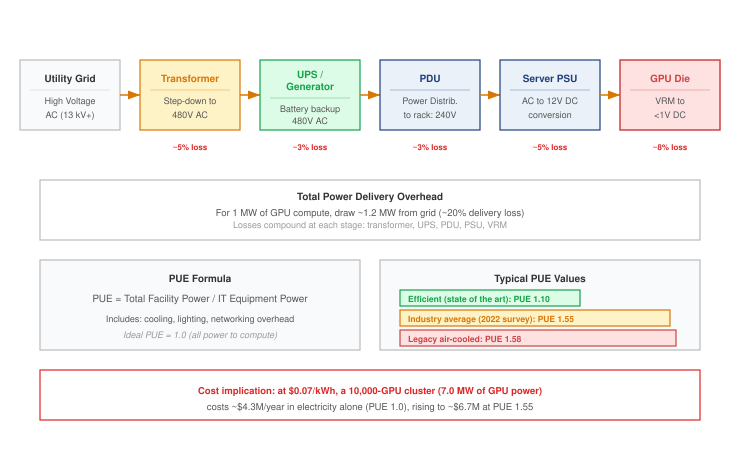

:::

The cascade shown in @fig-power-path reveals why power delivery is an infrastructure problem, not merely an electrical one: these conversion losses, combined with the overhead of removing heat, determine the facility's total power draw, and the 10--40 kW concentrated at the rack PDU-to-VRM transition dictates the cooling architecture for the entire facility. @Eq-pue captures that cooling overhead through a single facility ratio, power usage effectiveness (PUE):

$$ \text{PUE} = \frac{P_{\text{facility}}}{P_{\text{IT}}} $$ {#eq-pue}

Here $P_{\text{facility}}$ is total power drawn by the data center and $P_{\text{IT}}$ is the power consumed by servers, accelerators, storage, and networking equipment. A PUE of 1.5 means the facility draws 1.5 watts from the grid for every 1 watt delivered to IT equipment; the extra 0.5 watts powers cooling, power conversion, lighting, and other overhead.

```{python}
#| echo: false
from mlsysim import Hardware
from mlsysim.core.units import TFLOP, second, ureg, watt
from mlsysim.fmt import check, fmt_area, fmt_flop_rate, fmt_heat_flux, fmt_multiple, fmt_power

# ┌── LEGO ───────────────────────────────────────────────
class H100TdpWallRecap:
    # ┌── 1. LOAD (Registry + scenario reference) ─────────────────────────────
    h100_tdp = Hardware.Cloud.H100.tdp
    die_area = Hardware.Cloud.H100.die_area
    stove_heat_flux = 10 * watt / (ureg.centimeter**2)

    # ┌── 2. GUARD (Registry sanity checks) ───────────────────────────────────
    check(die_area is not None, "H100 registry entry should expose die_area.")
    check(800 <= die_area.to(ureg.millimeter**2).magnitude <= 830, "H100 die area should stay near 814 mm^2.")

    # ┌── 3. EXECUTE (The Compute) ────────────────────────────────────────────
    h100_heat_flux = h100_tdp / die_area
    stove_ratio = (h100_heat_flux / stove_heat_flux).to_base_units().magnitude
    check(80 <= h100_heat_flux.to(watt / (ureg.centimeter**2)).magnitude <= 90, "H100 heat flux should stay near 86 W/cm^2.")

    # ┌── 4. OUTPUT (Formatting) ──────────────────────────────────────────────
    tdp_w_str = fmt_power(h100_tdp, unit=watt, precision=0, commas=False)
    flops_fp16_tflop_per_s_str = fmt_flop_rate(Hardware.Cloud.H100.compute.peak_flops, unit=TFLOP / second, precision=0, commas=False)
    die_area_mm2_str = fmt_area(die_area, unit=ureg.millimeter**2, commas=False)
    h100_heat_flux_w_per_cm2_str = fmt_heat_flux(h100_heat_flux, unit=watt / (ureg.centimeter**2), commas=False)
    stove_heat_flux_w_per_cm2_str = fmt_heat_flux(stove_heat_flux, unit=watt / (ureg.centimeter**2), commas=False)
    stove_ratio_mult_str = fmt_multiple(stove_ratio, commas=False)
    b200_tdp_w_str = fmt_power(Hardware.Cloud.B200.tdp, unit=watt, precision=0, commas=True)
    b200_vs_h100_tdp_gain_pct_str = fmt_percent(
        round((Hardware.Cloud.B200.tdp / h100_tdp).to_base_units().magnitude - 1, 2), precision=0, commas=False, style="prose"
    )
```

Every floating-point operation dissipates energy as heat. Dense Tensor Core activity during large matrix multiplications drives heat proportional to the switching activity of billions of transistors. Accelerator vendors publish TDP, total graphics power (TGP), board power, or a configurable power limit, depending on the product; these values are vendor-specific sustained design envelopes rather than interchangeable physical definitions.[^fn-tdp-thermal-envelope] Fleet design must pair the applicable sustained envelope with any documented transient excursion requirement. At dense fleet scale, this creates the power wall\index{Power wall!facility constraint}: the point where facility power delivery and heat removal, not available arithmetic units, determine how much compute can be installed and sustained.

This is the thermodynamic limit (principle \ref{pri-thermodynamic-limit}) in action. The bottleneck of the modern AI data center is not FLOP/s but watts per square foot, and the physical design of the fleet is dictated by the ability to move heat away from silicon. The closely related power density wall (principle \ref{pri-power-density-wall}) sets the consequence. Once a rack's sustained heat output exceeds what engineered airflow can remove, as it does at the 100 kW-class densities of the newest training racks, liquid cooling becomes a requirement of that rack design rather than an option.

[^fn-tdp-thermal-envelope]: **Power envelopes**\index{TDP!thermal constraint}: TDP, TGP, board-power ratings, and configurable power limits follow vendor-specific conventions. They provide sustained thermal and electrical design targets, not universal measurements of instantaneous consumption. Power-delivery components must also tolerate the product's documented transient excursions, while cooling design uses the applicable sustained thermal envelope and operating conditions.

::: {#dfn-compute-infrastructure-thermal-design-power-tdp .callout-definition title="Thermal design power (TDP)"}

***Thermal design power (TDP)***\index{Thermal design power!definition} is a vendor-defined sustained thermal design target in watts for a specified product configuration and operating condition.

1.  **Significance**: The H100 SXM5 configuration used in this chapter carries a `{python} H100TdpWallRecap.tdp_w_str` design target. Sustaining the intended operating point requires a thermal path and facility loop qualified for that target under the vendor's inlet and coolant conditions.
2.  **Distinction**: TDP does not denote one universal instantaneous-power maximum. TGP, board power, configurable limits, and transient specifications describe related electrical constraints under conventions that differ by vendor and product.
3.  **Common pitfall**: A frequent misconception is that the advertised wattage alone specifies rack power and cooling. Fleet design must combine the sustained thermal target, configured power limit, workload behavior, component overhead, and transient-power requirement.

:::

The trajectory of TDP tells the story of a scaling regime reaching its limits. For three decades, Dennard scaling\index{Dennard scaling!voltage limits}[^fn-dennard-scaling-limit] allowed chip designers to shrink transistors while maintaining approximately constant power density: smaller transistors required lower voltage, so packing more transistors into the same area did not increase heat output per unit area. As voltage scaling and leakage limits ended that regime, architects had to treat energy, cooling, and parallelism as first-order constraints rather than free byproducts of process shrinks [@dennard1974; @hennessy2019]. Since then, each generation of accelerator has had to trade performance against power and heat. The era of "free" performance improvements through process shrinks is over; every gain in throughput now has to be paid for in watts, cooling capacity, or specialization.

```{python}
#| echo: false
from mlsysim.fmt import fmt_power

# ┌── LEGO ───────────────────────────────────────────────
class V100DennardRecap:

    # ┌── 4. OUTPUT (Formatting) ──────────────────────────────────────────────
    tdp_w_str = fmt_power(Hardware.Cloud.V100.tdp, unit=watt, precision=0, commas=False)
```

[^fn-dennard-scaling-limit]: **Dennard scaling**\index{Dennard scaling!power wall}: Named after @dennard1974 at IBM, who showed how MOSFET dimensions, voltage, and current could scale so that power density stayed roughly constant. Later voltage-scaling limits and leakage effects ended that constant-power-density regime; @hennessy2019 describe the resulting post-Dennard power wall as one reason modern architecture turned toward parallelism and specialization. For ML infrastructure, the V100-to-B200 TDP trajectory (`{python} V100DennardRecap.tdp_w_str` to `{python} H100TdpWallRecap.b200_tdp_w_str`) is an illustration of the post-Dennard planning problem: cooling and power delivery are now co-equal design constraints with the silicon itself.

```{python}
#| echo: false
from mlsysim.fmt import fmt_power

# ┌── LEGO ───────────────────────────────────────────────
class V100TdpRecap:

    # ┌── 4. OUTPUT (Formatting) ──────────────────────────────────────────────
    tdp_w_str = fmt_power(Hardware.Cloud.V100.tdp, unit=watt, precision=0, commas=False)
```

```{python}
#| echo: false
from mlsysim.fmt import fmt_power

# ┌── LEGO ───────────────────────────────────────────────
class A100TdpTrajectoryRecap:
    # ┌── 4. OUTPUT (Formatting) ──────────────────────────────────────────────
    tdp_w_str = fmt_power(Hardware.Cloud.A100.tdp, unit=watt, precision=0, commas=False)
```

```{python}
#| echo: false
from mlsysim.fmt import fmt_power

# ┌── LEGO ───────────────────────────────────────────────
class H100TdpTrajectoryRecap:

    # ┌── 4. OUTPUT (Formatting) ──────────────────────────────────────────────
    tdp_w_str = fmt_power(Hardware.Cloud.H100.tdp, unit=watt, precision=0, commas=False)
```

```{python}
#| echo: false
from mlsysim.fmt import fmt_power

# ┌── LEGO ───────────────────────────────────────────────
class B200PerformanceScenarioSecComputeTdpRecap:
    # ┌── 1. LOAD ──────────────────────────────────────────
    v100 = Hardware.Cloud.V100
    b200 = Hardware.Cloud.B200

    # ┌── 2. EXECUTE ───────────────────────────────────────
    years = b200.release_year - v100.release_year
    tdp_growth = (b200.tdp / v100.tdp).to_base_units().magnitude
    tdp_cagr = tdp_growth ** (1 / years) - 1

    # ┌── 3. GUARD ─────────────────────────────────────────
    check(years == 7, "Prose says 'in seven years' (2017 to 2024)")
    check(tdp_growth > 3, "Prose says TDP has more than tripled")

    # ┌── 4. OUTPUT (Formatting) ──────────────────────────────────────────────
    tdp_w_str = fmt_power(b200.tdp, unit=watt, precision=0, commas=False)
    tdp_cagr_pct_str = fmt_percent(round(tdp_cagr, 2), precision=0, commas=False, style="prose")
```

The numbers are stark: the V100 (2017) operated at `{python} V100TdpRecap.tdp_w_str` TDP, the A100 (2020) increased to `{python} A100TdpTrajectoryRecap.tdp_w_str`, the H100 (2022) reached `{python} H100TdpTrajectoryRecap.tdp_w_str`, and the B200 (2024) draws `{python} B200PerformanceScenarioSecComputeTdpRecap.tdp_w_str`. In seven years, TDP\index{Thermal design power!scaling trajectory} has more than tripled, growing at approximately `{python} B200PerformanceScenarioSecComputeTdpRecap.tdp_cagr_pct_str` per year.

```{python}
#| echo: false
# ┌─────────────────────────────────────────────────────────────────────────────
# │ FUTURE TDP NODE-POWER SCENARIO (LEGO)
# ├─────────────────────────────────────────────────────────────────────────────
# │ Goal: Node-level GPU power draw if per-accelerator TDP reaches a 2 kW projection.
# │ How: hypothetical 2,000 W per-accelerator TDP x DGX-H100 accelerators per node.
# └─────────────────────────────────────────────────────────────────────────────
from mlsysim.fmt import check, fmt, fmt_power

class FutureTdpScenario:
    # ┌── 1. LOAD ──────────────────────────────────────────────────────────
    future_tdp = 2000 * watt  # hypothetical post-Blackwell per-accelerator TDP (planning projection)
    gpus_per_node = Systems.Nodes.DGX_H100.accelerators_per_node
    b200_tdp = Hardware.Cloud.B200.tdp
    tdp_cagr = B200PerformanceScenarioSecComputeTdpRecap.tdp_cagr
    years_per_generation = 2  # scenario assumption: two-year flagship cadence
    coolant_rise_k = 10  # scenario assumption: coolant warms 10 °C across the rack
    water_cp_j_per_kg_k = 4186  # specific heat of water; 1 kg of water is about 1 L
    # ┌── 2. EXECUTE ───────────────────────────────────────────────────────
    node_gpu_power = (future_tdp * gpus_per_node).to(kilowatt)
    next_gen_tdp = (b200_tdp * (1 + tdp_cagr) ** years_per_generation).to(watt)
    second_gen_tdp = (b200_tdp * (1 + tdp_cagr) ** (2 * years_per_generation)).to(watt)
    rack_heat_w = Hardware.Cloud.GB200_NVL72.tdp.to(watt).magnitude
    coolant_l_per_min = rack_heat_w / (water_cp_j_per_kg_k * coolant_rise_k) * 60
    # ┌── 3. GUARD ─────────────────────────────────────────────────────────
    check(abs(node_gpu_power.to(kilowatt).magnitude - 16) < 1e-9, "2,000 W x 8 accelerators should be 16 kW")
    check(1300 < next_gen_tdp.magnitude < 1500, "One generation of the trend should approach 1,400 W")
    check(abs(second_gen_tdp.magnitude - future_tdp.magnitude) / future_tdp.magnitude < 0.05, "Two generations should reach the 2,000 W scenario")
    check(150 < coolant_l_per_min < 200, "A GB200 NVL72 rack at a 10 K coolant rise needs roughly 170 L/min")
    # ┌── 4. OUTPUT ────────────────────────────────────────────────────────
    future_tdp_w_str = fmt_power(future_tdp, unit=watt, precision=0, commas=True)
    next_gen_tdp_w_str = fmt_power(round(next_gen_tdp.magnitude, -2) * watt, unit=watt, precision=0, commas=True)
    gb200_nvl72_rack_kw_str = fmt_power(Hardware.Cloud.GB200_NVL72.tdp, unit=kilowatt, precision=0, commas=False)
    gpus_per_node_str = fmt(gpus_per_node, precision=0, commas=False)
    node_gpu_power_kw_str = fmt_power(node_gpu_power, unit=kilowatt, precision=0, commas=False)
    coolant_rise_k_str = fmt(coolant_rise_k, precision=0, commas=False)
    coolant_l_per_min_str = fmt(round(coolant_l_per_min, -1), precision=0, commas=False)
```

If this growth rate continued as a planning scenario on a two-year product cadence, a generation after Blackwell would approach `{python} FutureTdpScenario.next_gen_tdp_w_str` per accelerator, and the generation after that would reach about `{python} FutureTdpScenario.future_tdp_w_str`. At that level, a single `{python} FutureTdpScenario.gpus_per_node_str`-GPU node would consume `{python} FutureTdpScenario.node_gpu_power_kw_str` of GPU power alone, requiring liquid cooling[^fn-liquid-cooling-flow] infrastructure that can remove heat at rates approaching those of industrial process cooling equipment.

[^fn-liquid-cooling-flow]: **Liquid cooling flow rate**\index{Cooling!liquid flow rate}: A rack of GB200 NVL72 nodes (`{python} FutureTdpScenario.gb200_nvl72_rack_kw_str`) must shed about that much heat into its coolant. With water that warms by `{python} FutureTdpScenario.coolant_rise_k_str` °C across the rack, the required mass flow is $P / (c_p \Delta T)$, about `{python} FutureTdpScenario.coolant_l_per_min_str` liters per minute; a smaller temperature rise needs proportionally more flow. At these rates, the primary risk shift is from thermal throttling to mechanical failure (leaks, pump cavitation), necessitating the industrial-grade manifolds and quick-disconnect fittings common in chemical processing plants.

::: {#psp-compute-infrastructure-end-dennard-scaling .callout-perspective title="The end of Dennard scaling"}

The end of constant-power-density scaling makes the facility envelope part of accelerator selection. Future refreshes must fit the installed power-delivery and cooling capacity, even when they improve arithmetic efficiency. A gain in performance per watt does not establish that a denser rack will draw less power.

:::

The applicable sustained power envelope is not merely a specification on a data sheet; it propagates through every level of the infrastructure stack. The power-delivery chain, cooling system, rack design, and facility electrical infrastructure must accommodate deployed accelerators, their documented transients, and the plausible envelope of future refresh cycles.

Accelerators implement sophisticated power management to operate within their TDP envelope. When the workload does not fully use all SMs (for example, during the communication phase of a training step when the GPUs are waiting for AllReduce to complete), the GPU firmware can disable the clock signal to idle circuitry through **clock gating**\index{Clock gating!definition}, eliminating dynamic switching power and freeing thermal headroom for the active SMs. A separate mechanism, dynamic voltage and frequency scaling (DVFS)\index{DVFS!accelerator power management}, adjusts the chip's clock frequency and supply voltage to stay within power and thermal limits; during a large matrix multiplication that activates all SMs simultaneously, DVFS reduces the clock frequency to keep total power within TDP. When some SMs are idle, the active SMs can boost frequency because total chip power is below TDP, so the actual clock, and therefore the actual throughput, varies throughout a training step.

```{python}
#| echo: false
from mlsysim.fmt import check, fmt_power

# ┌── LEGO ───────────────────────────────────────────────
# │ Context: DVFS power-swing paragraph below; reused by H100TdpRackRecap in
# │          @sec-compute-rack for the cluster-level power ramp.
class DvfsPowerSwingScenario:
    """Communication-phase versus compute-phase H100 power during a training step."""

    # ┌── 1. LOAD ──────────────────────────────────────────
    gpu_tdp = Hardware.Cloud.H100.tdp
    comm_phase_power = 400 * watt  # scenario assumption: communication-phase GPU power

    # ┌── 3. GUARD ─────────────────────────────────────────
    check(comm_phase_power < gpu_tdp, "Communication-phase power should sit below the H100 TDP")

    # ┌── 4. OUTPUT ────────────────────────────────────────
    comm_phase_power_w_str = fmt_power(comm_phase_power, unit=watt, precision=0, commas=False)
```

Dynamic power management means that the actual power draw of a GPU varies continuously during training. A typical training step might see power swing from `{python} DvfsPowerSwingScenario.comm_phase_power_w_str` (during communication phases when most SMs are idle) to `{python} H100TdpWallRecap.tdp_w_str` (during the forward and backward pass when all Tensor Cores are active) and back, with each transition occurring in microseconds. The VRMs\index{Voltage regulator module!transient response} on the baseboard must respond to these transitions fast enough to maintain a stable supply voltage despite the rapidly changing current draw.

DVFS also couples software optimization to the power envelope. A kernel that achieves high SM occupancy (many active warps per SM) draws more power, potentially triggering a frequency reduction that partially offsets the occupancy benefit. Conversely, a kernel with moderate occupancy may run at a higher clock frequency, achieving comparable throughput at lower power. Power-normalized throughput (TFLOP/s per watt) is therefore a more robust comparison metric than raw TFLOP/s, and it explains why the same GPU can show different sustained clock frequencies depending on the workload and the cooling solution.

At fleet scale, DVFS also affects power planning. Average workload draw can fall below the configured limit because communication phases and incomplete occupancy leave circuitry idle, but averages do not replace sustained and transient design cases. Some operators deliberately lower accelerator power caps to fit more devices within a fixed facility budget, accepting workload-dependent throughput loss in exchange for lower per-device draw. Power capping is a form of the compute-efficiency trade-off at the operational level.

To appreciate the physical challenge, consider what `{python} H100TdpWallRecap.tdp_w_str` means in terms of heat flux\index{Thermal design power!heat flux}. An H100 die measures approximately `{python} H100TdpWallRecap.die_area_mm2_str` (roughly $29{\times}28$ mm). Dissipating `{python} H100TdpWallRecap.tdp_w_str` from this area produces a heat flux of approximately `{python} H100TdpWallRecap.h100_heat_flux_w_per_cm2_str`. For comparison, the surface of an electric stovetop burner at high heat produces approximately `{python} H100TdpWallRecap.stove_heat_flux_w_per_cm2_str`. An H100 die generates `{python} H100TdpWallRecap.stove_ratio_mult_str` the heat flux of a stove burner, concentrated on an area the size of a large postage stamp.

The B200 pushes even further: at `{python} H100TdpWallRecap.b200_tdp_w_str` across a dual-die package, the average heat flux remains comparable, but the total energy that must be removed per package increases by `{python} H100TdpWallRecap.b200_vs_h100_tdp_gain_pct_str`. Removing this heat without allowing the junction temperature\index{Cooling!junction temperature} to exceed 83 degrees Celsius (the typical operating maximum for HBM reliability) requires thermal solutions with extremely low thermal resistance from die to coolant.

The critical component in this thermal path is the thermal interface material (TIM)\index{Thermal interface material!degradation}, the microscopic layer of phase-change material or liquid metal between the silicon die and the cold plate (for liquid cooling) or heatsink (for air cooling). Under the extreme thermal cycling of deep learning workloads, where die temperatures spike from 40 degrees C to 80 degrees C in milliseconds during matrix multiplications and drop back during communication phases, inferior TIM can pump out (migrate away from the contact surface) or crack. A mere 5 percent degradation in TIM thermal conductivity forces the GPU to thermally throttle, reducing clock frequency by hundreds of MHz to protect the silicon. This degradation is a gray failure, a fault that degrades rather than halts: the GPU continues to function, but at reduced performance that silently degrades the entire cluster's throughput, a failure class examined in fleet monitoring. Fleet management systems that track per-GPU junction temperatures over time can detect TIM degradation as a gradual upward trend in temperature at constant workload, enabling proactive replacement before the performance impact becomes severe.

```{python}
#| echo: false
# ┌── LEGO ───────────────────────────────────────────────
class RackPowerTdpRecap:
    # ┌── 1. LOAD ──────────────────────────────────────────
    rack = Systems.Racks.DGX_H100_4Node

    # ┌── 4. OUTPUT (Formatting) ──────────────────────────────────────────────
    rack_power_kw_str = fmt_power(rack.total_power, unit=kilowatt, precision=1, commas=False)
```

```{python}
#| echo: false
from mlsysim.fmt import fmt_compute_efficiency

# ┌── LEGO ───────────────────────────────────────────────
class GpuEfficiencyTrajectoryRecap:

    # ┌── 4. OUTPUT (Formatting) ──────────────────────────────────────────────
    v100_efficiency_tflop_per_s_per_w_str = fmt_compute_efficiency(
        Hardware.Cloud.V100.compute.peak_flops / Hardware.Cloud.V100.tdp, unit=TFLOP / second / watt, precision=2, commas=False
    )
    h100_efficiency_tflop_per_s_per_w_str = fmt_compute_efficiency(
        Hardware.Cloud.H100.compute.precision_flops["fp8"] / Hardware.Cloud.H100.tdp, unit=TFLOP / second / watt, precision=2, commas=False
    )
    b200_efficiency_tflop_per_s_per_w_str = fmt_compute_efficiency(
        Hardware.Cloud.B200.compute.precision_flops["fp8"] / Hardware.Cloud.B200.tdp, unit=TFLOP / second / watt, precision=2, commas=False
    )
```

The power efficiency trajectory provides a partial counterweight to rising TDP. While absolute power has increased, the advertised low-precision TFLOP/s delivered per watt has improved dramatically: from `{python} GpuEfficiencyTrajectoryRecap.v100_efficiency_tflop_per_s_per_w_str` (V100 FP16) to `{python} GpuEfficiencyTrajectoryRecap.h100_efficiency_tflop_per_s_per_w_str` (H100 FP8) to `{python} GpuEfficiencyTrajectoryRecap.b200_efficiency_tflop_per_s_per_w_str` (B200 FP8). These are not apples-to-apples FP16 numbers; the precision mode is part of the hardware trend. For a fixed compute budget that can use the newer precision modes, each generation requires fewer chips and therefore less total power. Large-model capability targets, however, can grow faster than efficiency improves, so the absolute power demand of training the next larger model may still increase. This is the treadmill of infrastructure: efficiency gains buy time, but scale growth consumes it.

Packing accelerators close together shortens communication paths but concentrates heat. A four-node DGX H100 rack already draws `{python} RackPowerTdpRecap.rack_power_kw_str` at the modeled IT boundary (@sec-compute-rack), several times the load of a conventional server rack, and the accelerators of a `{python} PowerPathFigureAnchors.cluster_gpus_str`-GPU cluster alone draw `{python} PowerPathFigureAnchors.gpu_power_mw_str` before hosts, network, and cooling are counted. Rack and pod designs must reconcile that proximity with enough space and infrastructure to deliver power and remove heat across all participating nodes.

Power-envelope implications recur throughout the infrastructure hierarchy. At the node level, configured limits constrain how many accelerators can share a chassis (@sec-compute-node). At the rack level, aggregate sustained load and heat flux help determine whether engineered air or liquid cooling can meet the design point (@sec-compute-rack). At the pod level, coincident demand and transient behavior shape megawatt-scale power delivery (@sec-compute-pod). Every level above the die must therefore manage both sustained heat and electrical variation. Accelerator selection must compare useful workload throughput within that facility envelope, rather than treating power as a cost added after the compute decision.

## Accelerator Selection for Fleet Workloads {#sec-compute-accelerator-selection}

An accelerator's compute throughput, memory bandwidth, memory capacity, and power consumption are meaningful only in relation to a specific workload. The same H100 that delivers near-peak utilization during large-batch training may achieve less than 5 percent utilization during single-request inference, because the binding constraint shifts from arithmetic to memory bandwidth. Selecting the right accelerator\index{Accelerator!selection} therefore requires mapping each workload archetype to its position on the Roofline plot and identifying which physical resource dominates its performance.

```{python}
#| echo: false
# ┌── LEGO ───────────────────────────────────────────────
from mlsysim.fmt import fmt_count

class InfraFrontierTdpRecap:
    diffusion = Models.GenerativeVision.StableDiffusion_v1_5

    # ┌── 4. OUTPUT (Formatting) ──────────────────────────────────────────────
    frontier_params_b_str = fmt_params(Models.Language.GPT3.parameters, scale="B", precision=0, commas=False)
    diffusion_steps_count_str = fmt_count(diffusion.denoising_steps, label="denoising step", commas=False)
```

Start with the `{python} InfraFrontierTdpRecap.frontier_params_b_str` running example. During training, large batches push the forward and backward passes above the Roofline ridge point, so the immediate constraint is arithmetic throughput. Peak low-precision TFLOP/s matters, but only after memory capacity is sufficient to hold the sharded model state and after the interconnect can keep tensor and data parallel groups synchronized. H100, B200, and TPU v5p pods are all plausible answers to this training problem; the final choice depends on the software stack as much as the silicon. A PyTorch-first research team values the GPU ecosystem, while a JAX/XLA-centered organization may accept tighter compilation constraints for TPU cost efficiency.

```{python}
#| echo: false
from mlsysim.fmt import fmt_bandwidth

# ┌── LEGO ───────────────────────────────────────────────
class RooflineTdpRecap:
    # ┌── 4. OUTPUT (Formatting) ──────────────────────────────────────────────
    h100_bw_tb_per_s_str = fmt_bandwidth(Hardware.Cloud.H100.memory.bandwidth, unit=TB / second, precision=2, commas=False)
```
Serving the same language model changes the answer. During autoregressive decode, every generated token streams weights through memory, so the key metric becomes memory bandwidth per dollar rather than peak TFLOP/s. At batch size 1, the H100's `{python} RooflineTdpRecap.h100_bw_tb_per_s_str` bandwidth determines throughput while much of the arithmetic silicon waits. Batching raises arithmetic intensity by reusing the same weight movement across more requests, which is why serving systems work so hard to batch without violating tail-latency service-level objectives (SLOs). The workload did not change names, but the binding term of the single-machine iron law (@sec-vol2-introduction-fleet-law) moved from arithmetic to data movement, and the accelerator choice changes with it.

Recommendation models\index{Recommendation model!embedding capacity} split the decision again. Embedding table lookup is dominated by random access and memory capacity, because each request retrieves small vectors from TB-scale tables with poor locality. The dense tower that consumes those embeddings is compute bound. A hybrid CPU-GPU design follows from that split: CPU and DRAM capacity handle the sparse lookup path, while GPUs accelerate the dense neural network layers\index{Dense layer!compute intensity}. A single headline TFLOP/s number cannot describe this workload because it has two different bottlenecks inside one request.

Vision and diffusion workloads move back toward arithmetic throughput because convolutions, attention blocks, and denoising networks reuse data heavily. Diffusion inference makes this especially clear: the Stable Diffusion v1.5 profile in MLSysIM uses `{python} InfraFrontierTdpRecap.diffusion_steps_count_str`, so the service pays for a sequence of full model evaluations rather than one decode step per token. For these workloads, TFLOP/s per dollar often dominates bandwidth per dollar once model state fits in memory.

```{python}
#| echo: false
from mlsysim import Models
from mlsysim.fmt import check, fmt_count, fmt_params

# ┌── LEGO ───────────────────────────────────────────────
# │ Context: §Total cost of ownership and workload matching, MoE example.
# │ Goal: Restore the concrete MoE scale anchor from the model registry.
class MoETdpRecap:
    m_moe = Models.Language.Mixtral_8x7B

    # ┌── 1. LOAD (Source of truth) ───────────────────────────────────────────
    total_params = m_moe.parameters
    active_params = m_moe.active_parameters
    experts = m_moe.experts
    active_experts = m_moe.active_experts_per_token

    # ┌── 3. GUARD (Invariants) ──────────────────────────────────────────────
    check(active_params < total_params, "MoE active parameters must be fewer than total parameters.")
    check(0 < active_experts <= experts, "MoE active experts must be within the expert count.")

    # ┌── 4. OUTPUT (Formatting) ──────────────────────────────────────────────
    total_params_b_str = fmt_params(total_params, scale="B", precision=1, commas=False)
    active_params_b_str = fmt_params(active_params, scale="B", precision=1, commas=False)
    experts_count_str = fmt_count(experts, label="expert", commas=False)
    active_experts_count_str = fmt_count(active_experts, label="expert", commas=False)
```

Mixture of experts (MoE)\index{Mixture-of-Experts|see{MoE}}\index{MoE!infrastructure challenge} adds a routing constraint: the sparsely gated layer activates only part of a much larger parameter set for each token [@shazeer2017outrageously]. Mixtral-8x7B [@jiang2024mixtral], for example, has `{python} MoETdpRecap.total_params_b_str` total parameters but only `{python} MoETdpRecap.active_params_b_str` active parameters per token because the router chooses `{python} MoETdpRecap.active_experts_count_str` from `{python} MoETdpRecap.experts_count_str`. That compute saving introduces a many-to-many token exchange pattern, the AllToAll collective examined in @sec-collective-communication, and load-balance risk because tokens must be routed to different expert placements. High-bisection fabrics and load-balancing mechanisms such as auxiliary losses, which penalize overloaded experts, or capacity factors, which cap how many tokens each expert accepts, determine whether the theoretical saving appears in the training trace [@fedus2022switch; @lepikhin2021gshard].

Multi-modal models add heterogeneity rather than only routing. They combine text decode, vision processing, audio features, and sometimes video, each with different arithmetic intensity and batching behavior. These workloads favor platforms with flexible scheduling and strong bisection bandwidth rather than accelerators optimized for one regular dataflow.

::: {#psp-compute-infrastructure-matching-hardware-workload .callout-perspective title="Matching hardware to workload"}

Workload diversity can justify a heterogeneous fleet, with each pool provisioned for its binding resource. The gain comes from matching hardware to the work assigned to it, while keeping each tightly synchronized training group balanced. The fleet-wide decision must account for that matching benefit together with the cost of supporting multiple platforms.

:::

### Precision and throughput trade-offs {#sec-compute-infrastructure-precision-throughput-tradeoffs-49a5}

The relationship between numerical precision and hardware throughput is one of the most important considerations for infrastructure planning, because it directly affects how much useful work each accelerator can perform per second. Lower precision representations use fewer bits per number, which has two compounding benefits: more numbers fit in the same HBM capacity (reducing memory pressure), and the arithmetic units can process more operations per cycle (increasing throughput).

Numerical precision formats for ML have evolved rapidly. @Tbl-precision-throughput summarizes representative precision formats on H100-class accelerators and their common use cases.

```{python}
#| echo: false
from mlsysim.fmt import fmt_flop_rate, fmt_ops_rate

# ┌── LEGO ───────────────────────────────────────────────
class TensorCorePrecisionRecap:

    # ┌── 4. OUTPUT (Formatting) ──────────────────────────────────────────────
    h100_fp16_tc_tflop_per_s_str = fmt_flop_rate(Hardware.Cloud.H100.compute.peak_flops, unit=TFLOPs / second, precision=0, commas=False)
    h100_fp8_tc_tflop_per_s_str = fmt_flop_rate(Hardware.Cloud.H100.compute.precision_flops['fp8'], unit=TFLOPs / second, precision=0, commas=True)
    h100_int8_tc_tops_str = fmt_ops_rate(Hardware.Cloud.H100.compute.precision_flops['int8'], unit=TOPS, precision=0, commas=True)
    h100_fp32_tflop_per_s_str = fmt_flop_rate(Hardware.Cloud.H100.compute.precision_flops['fp32'], unit=TFLOPs / second, precision=0, commas=False)
    h100_tf32_tflop_per_s_str = fmt_flop_rate(Hardware.Cloud.H100.compute.precision_flops['tf32'], unit=TFLOPs / second, precision=0, commas=False)
```

| **Format**                                    | **Bits** | **Exponent** | **Mantissa** |                       **H100 dense peak**                        |         **Typical use**          |
|:----------------------------------------------|:--------:|:------------:|:------------:|:----------------------------------------------------------------:|:--------------------------------:|
| **FP32**\index{FP32!master weights}           |    32    |      8       |      23      |  ~`{python} TensorCorePrecisionRecap.h100_fp32_tflop_per_s_str`  | Master weights, loss computation |
| **TF32**\index{TF32!Tensor Core acceleration} |    19    |      8       |      10      |  `{python} TensorCorePrecisionRecap.h100_tf32_tflop_per_s_str`   |    Training (NVIDIA default)     |
| **BF16**\index{BF16!dynamic range}            |    16    |      8       |      7       | `{python} TensorCorePrecisionRecap.h100_fp16_tc_tflop_per_s_str` |      Training, fine-tuning       |
| **FP16**\index{FP16!loss scaling}             |    16    |      5       |      10      | `{python} TensorCorePrecisionRecap.h100_fp16_tc_tflop_per_s_str` |    Training with loss scaling    |
| **FP8 (E4M3)**\index{FP8!E4M3 format}         |    8     |      4       |      3       | `{python} TensorCorePrecisionRecap.h100_fp8_tc_tflop_per_s_str`  |      Forward pass, weights       |
| **FP8 (E5M2)**\index{FP8!E5M2 format}         |    8     |      5       |      2       | `{python} TensorCorePrecisionRecap.h100_fp8_tc_tflop_per_s_str`  |     Backward pass, gradients     |
| **INT8**\index{INT8!quantization}             |    8     |     N/A      |     N/A      |    `{python} TensorCorePrecisionRecap.h100_int8_tc_tops_str`     |    Post-training quantization    |

: **Precision formats and hardware throughput on H100**: The table uses dense peak throughput where Tensor Core support exists; structured sparsity can roughly double several of these advertised peaks. The choice of precision affects both the training dynamics (convergence, numerical stability) and the infrastructure requirements (memory capacity, bandwidth utilization). TF32 preserves the FP32 exponent width but reduces mantissa precision so Tensor Cores can accelerate common FP32 training workloads. {#tbl-precision-throughput}

```{python}
#| echo: false
from mlsysim import Infrastructure, Systems
from mlsysim.fmt import fmt_int, fmt_usd

# ┌── LEGO ───────────────────────────────────────────────
class Fp8CostEquivalence:
    # ┌── 1. LOAD (Constants) ──────────────────────────────────────────────
    cluster_gpus = Systems.Clusters.Training_10K.total_accelerators  # 10K reference cluster
    gpus_per_node = Systems.Nodes.DGX_H100.accelerators_per_node  # DGX H100 node
    node_price = Infrastructure.Pricing.Capital.DgxH100NodeUsd.rate  # $350k CapEx ref

    # ┌── 2. EXECUTE (The Compute) ────────────────────────────────────────
    nodes = cluster_gpus // gpus_per_node
    total_usd = nodes * node_price

    # ┌── 4. OUTPUT (Formatting) ──────────────────────────────────────────
    cluster_gpus_str = fmt_int(cluster_gpus)
    gpus_per_node_str = fmt_int(gpus_per_node)
    node_price_str = fmt_usd(node_price.magnitude, precision=0)
    total_musd_str = fmt_usd(round(total_usd.magnitude / 1e6), precision=0)
```

The infrastructure implications are substantial. A fleet designed for BF16 training, a common baseline for large models, has a peak of `{python} TensorCorePrecisionRecap.h100_fp16_tc_tflop_per_s_str` per GPU on an H100. The same fleet has an FP8 peak of `{python} TensorCorePrecisionRecap.h100_fp8_tc_tflop_per_s_str` per GPU, doubling the arithmetic ceiling for supported operations without additional hardware. For a `{python} Fp8CostEquivalence.cluster_gpus_str`-GPU cluster priced at roughly `{python} Fp8CostEquivalence.node_price_str` per `{python} Fp8CostEquivalence.gpus_per_node_str`-GPU node, the increase in advertised arithmetic capacity is equivalent to adding another `{python} Fp8CostEquivalence.cluster_gpus_str` GPUs, or roughly `{python} Fp8CostEquivalence.total_musd_str` million in node hardware. This is a peak-capacity comparison; it is not a prediction of training speedup or a saving that can be booked before workload validation.

However, not all workloads can use FP8 without accuracy degradation. The reduced mantissa precision (3 bits in E4M3) means that values must be scaled carefully to avoid overflow (values exceeding the representable range saturate or become nonfinite, depending on format and implementation) or underflow (small values rounded to zero). The Transformer Engine's dynamic per-tensor scaling addresses this challenge for standard Transformer architectures, but custom model architectures with unusual activation distributions may require manual precision tuning. The infrastructure team must therefore work closely with the model team to determine the lowest precision that maintains acceptable accuracy, as this decision directly affects the effective throughput and therefore the required cluster size.

```{python}
#| echo: false
# ┌── LEGO ───────────────────────────────────────────────
class InfraFrontierStragglerRecap3:
    # ┌── 1. LOAD ──────────────────────────────────────────
    model = Models.Language.GPT3
    gpu_hbm = Hardware.Cloud.H100.memory.capacity

    # ┌── 2. EXECUTE ───────────────────────────────────────
    weights_fp16 = model.size_in_bytes(BYTES_FP16)
    weights_int8 = model.size_in_bytes(BYTES_INT8)
    weights_int4 = model.size_in_bytes(BYTES_INT4)
    gpus_fp16 = math.ceil((weights_fp16 / gpu_hbm).to_base_units().magnitude)
    gpus_int8 = math.ceil((weights_int8 / gpu_hbm).to_base_units().magnitude)
    gpus_int4 = math.ceil((weights_int4 / gpu_hbm).to_base_units().magnitude)

    # ┌── 3. GUARD ─────────────────────────────────────────
    check((gpus_fp16, gpus_int8, gpus_int4) == (5, 3, 2), "Prose walks 5 -> 3 -> 2 GPUs for FP16/INT8/INT4 weights")

    # ┌── 4. OUTPUT (Formatting) ──────────────────────────────────────────────
    frontier_params_b_str = fmt_params(model.parameters, scale="B", precision=0, commas=False)
    weights_fp16_gb_str = fmt_memory(weights_fp16, unit=GB, precision=0, commas=False)
    weights_int8_gb_str = fmt_memory(weights_int8, unit=GB, precision=0, commas=False)
    weights_int4_gb_str = fmt_memory(weights_int4, unit=GB, precision=1, commas=False)
    gpu_hbm_gb_str = fmt_memory_capacity(gpu_hbm, unit=GiB, precision=0, commas=False)
```

For inference, quantization\index{Quantization!serving economics} is one of the most impactful optimizations for serving economics because it directly alters the hardware topology required for large models. Our `{python} InfraFrontierStragglerRecap3.frontier_params_b_str` model at FP16 requires `{python} InfraFrontierStragglerRecap3.weights_fp16_gb_str`, necessitating a minimum of five `{python} InfraFrontierStragglerRecap3.gpu_hbm_gb_str` H100 GPUs simply to load the parameters. At INT8, this drops to `{python} InfraFrontierStragglerRecap3.weights_int8_gb_str`, fitting on three GPUs. At INT4, it shrinks to `{python} InfraFrontierStragglerRecap3.weights_int4_gb_str`, fitting on two GPUs. For memory-bandwidth-bound inference, reading 4-bit weights instead of 16-bit weights effectively quadruples the available bandwidth for weight loading, proportionally reducing per-token latency. A production team deploying at INT4 rather than FP16 can reduce the memory footprint and bandwidth demand of the inference fleet substantially, subject to the quality loss of the chosen quantization method and workload.

For training, many workloads use mixed-precision training\index{Mixed-precision training!numerical stability}, a strategy that decouples storage precision from arithmetic precision. A "master copy" of weights remains in FP32 for numerical stability, while the computationally intensive forward and backward passes are cast to BF16\index{BF16!mixed-precision training} or FP16\index{FP16!mixed-precision training} to exploit the full throughput of Tensor Cores. Accumulating gradients in FP32 reduces rounding and underflow risk before the optimizer updates the master weights. The memory examples below assume retained FP16 gradients; implementations that retain a full FP32 accumulation buffer must add that buffer to their peak budget. The H100's Transformer Engine extends this paradigm through configured FP8 recipes, autocast integration, and scaling metadata, potentially doubling peak throughput for supported operations that remain numerically stable at the lower precision. The training-time improvement depends on model coverage and the remaining bottlenecks.

### Energy cost of data movement {#sec-compute-infrastructure-energy-cost-data-movement-3cd1}

The Roofline Model and token latency analysis demonstrate that data movement limits performance. Data movement also dominates energy consumption\index{Data movement!energy cost}, with direct implications for fleet economics. A useful normalization is an FP16 operand: reading one 16-bit value from HBM at roughly 4 pJ/bit costs about 64 picojoules (pJ), while one FP16 multiply-accumulate operation costs roughly 1 pJ. The raw operand fetch can therefore cost about 64$\times$ the arithmetic operation, before tiling and reuse amortize that movement across many MACs.

::: {.column-margin}
```{=latex}
\vspace*{-33mm}
```
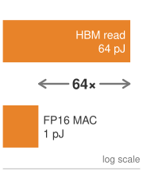{width="100%" fig-alt="Three orange horizontal bars on a log scale: DRAM read 320 pJ, HBM read 64 pJ, and MAC 1 pJ."}

*Data movement dwarfs arithmetic in energy cost.*
:::

This operand-level ratio explains why accelerator architects devote so much silicon area to data reuse. A Tensor Core's tile-based execution model loads a small matrix into local registers and reuses each element hundreds of times (once per element in the opposing matrix), amortizing the HBM access cost across hundreds of 1 pJ compute operations. Without this reuse, the energy budget would be dominated by memory access, and most of the chip's power would be spent heating wires rather than switching transistors.

```{python}
#| echo: false
from mlsysim.fmt import fmt_power

# ┌── LEGO ───────────────────────────────────────────────
class H100TdpEnergyRecap:

    # ┌── 4. OUTPUT (Formatting) ──────────────────────────────────────────────
    tdp_w_str = fmt_power(Hardware.Cloud.H100.tdp, unit=watt, precision=0, commas=False)
```

At fleet scale, the energy cost of data movement determines the electricity bill. For a 10,000-GPU cluster running at `{python} H100TdpEnergyRecap.tdp_w_str` per GPU, every phase that streams operands without reuse spends most of that envelope on HBM reads and writes, on-chip network transfers, and register file accesses rather than on the Tensor Cores performing useful arithmetic, because each operand fetch costs tens of times the operation it feeds. Improving data reuse, through techniques like kernel fusion, FlashAttention, and activation checkpointing, reduces the energy wasted on data movement and increases the fraction of power that performs useful computation.

The energy perspective provides a physical foundation for understanding why different parallelism strategies have different efficiencies. Tensor parallelism requires data movement over NVLink (approximately 5 pJ per bit at the link level, plus the energy of the NVSwitch chips). Data parallelism requires data movement over InfiniBand (approximately 15--20 pJ per bit, including the energy of the host channel adapter (HCA) and switch). Pipeline parallelism moves less data but requires more complex scheduling. Each parallelism strategy represents a different point in the trade-off between communication energy and computation efficiency.

::: {#nbk-compute-infrastructure-energy-cost-data-movement .callout-notebook title="The energy cost of data movement"}

At modern process nodes, moving data costs far more energy than computing on it. The energy hierarchy of a single operation at the 4 nm node makes the gap concrete.

Performing one FP16 multiply-accumulate (MAC\index{MAC!energy cost}) operation, the atomic unit of deep learning, consumes approximately 1 picojoule (pJ). This is the baseline cost of useful work. Reading a single FP16 operand (16 bits) from HBM consumes roughly 4 pJ per bit, totaling 64 pJ. Reading that same operand from off-package DRAM costs approximately 20 pJ per bit, or 320 pJ. The asymmetry is staggering: reading a value from HBM costs 64$\times$ more energy than computing on it. Retrieving it from standard DRAM costs 320$\times$ more.

```{python}
#| echo: false
from mlsysim.fmt import fmt_memory

# ┌── LEGO ───────────────────────────────────────────────
class InfraFrontierTdpServingRecap:
    # ┌── 1. LOAD ──────────────────────────────────────────
    model = Models.Language.GPT3
    hbm_pj_per_bit = 4  # scenario assumption: HBM read energy (pJ/bit), as in the notebook text
    mac_pj = 1  # scenario assumption: FP16 MAC energy (pJ), as in the notebook text

    # ┌── 2. EXECUTE ───────────────────────────────────────
    weights = model.size_in_bytes(BYTES_FP16)
    macs_per_token = model.inference_flops.to(flop).magnitude / 2  # 1 MAC = 2 FLOPs
    move_j = weights.to(byte).magnitude * 8 * hbm_pj_per_bit * 1e-12
    compute_j = macs_per_token * mac_pj * 1e-12
    energy_ratio = move_j / compute_j

    # ┌── 3. GUARD ─────────────────────────────────────────
    check(abs(energy_ratio - 64) < 0.5, "Prose claims weight movement costs 64x the arithmetic energy")

    # ┌── 4. OUTPUT (Formatting) ──────────────────────────────────────────────
    frontier_params_b_str = fmt_params(model.parameters, scale="B", precision=0, commas=False)
    weight_gb_str = fmt_memory(weights, unit=GB, precision=0, commas=False)
    macs_b_str = fmt(macs_per_token / 1e9, precision=0, commas=False)
    flops_b_str = fmt(model.inference_flops.to(flop).magnitude / 1e9, precision=0, commas=False)
    move_energy_eq_math = fmt_display_math(
        f"\\text{{Data Movement Energy}} = {weights.to(GB).magnitude:.0f} \\text{{ GB}} \\times 8 \\text{{ bits/byte}} "
        f"\\times {hbm_pj_per_bit} \\text{{ pJ/bit}} \\approx \\mathbf{{{move_j:.1f} \\text{{ Joules}}}}"
    )
    compute_energy_eq_math = fmt_display_math(
        f"\\text{{Computation Energy}} = {macs_per_token / 1e9:.0f} \\times 10^9 \\text{{ MACs}} "
        f"\\times {mac_pj} \\text{{ pJ/MAC}} \\approx \\mathbf{{{compute_j:.3f} \\text{{ Joules}}}}"
    )
```

The macro impact appears when serving our `{python} InfraFrontierTdpServingRecap.frontier_params_b_str` model. Generating a single token requires loading the entire `{python} InfraFrontierTdpServingRecap.weight_gb_str` weight tensor from HBM:

`{python} InfraFrontierTdpServingRecap.move_energy_eq_math`

The computational cost for the associated $\approx$ `{python} InfraFrontierTdpServingRecap.macs_b_str` billion MACs (about `{python} InfraFrontierTdpServingRecap.flops_b_str` billion FLOPs) is trivial by comparison:

`{python} InfraFrontierTdpServingRecap.compute_energy_eq_math`

Moving the weights to the compute units consumes 64$\times$ more energy than the math itself in this simplified decode model. This energy penalty is why HBM is engineered for physical proximity to the GPU die; shorter traces mean less capacitance and lower energy per bit. It also explains why techniques that reduce data movement, such as quantization (moving fewer bits) and kernel fusion (preventing round-trips to memory), are the primary levers for improving both system performance and power efficiency.

:::

### Benchmarking accelerator performance {#sec-compute-infrastructure-benchmarking-accelerator-performance-6920}

A procurement team comparing accelerators needs a published number that predicts the performance the organization will actually achieve. Peak TFLOP/s, memory bandwidth, and TDP describe *potential*, not *achieved* performance, so the decision turns on whose measured results to trust and under what rules they were produced. The industry-standard reference is MLPerf, maintained by MLCommons: MLPerf Training reports the time to train reference models to a target accuracy, and MLPerf Inference reports serving throughput and latency under realistic batching and streaming conditions. Both capture complete system performance, including software stack efficiency, communication overhead, and memory management, not just the raw silicon.

Closed-division MLPerf results constrain the workload and quality target to support comparisons across implementations. They still permit specified optimizations and benchmark-dependent tuning; the rules do not require identical hyperparameters or ordinary untuned framework configurations in every case. Open-division submissions allow broader changes and require closer inspection of what differs. Neither division predicts a deployment automatically. Compare the submission's workload, software, precision, hardware count, and quality target with the intended system before using its result for procurement.

```{python}
#| echo: false
# ┌── LEGO ───────────────────────────────────────────────
class InfraFrontierTdpBenchRecap:

    # ┌── 4. OUTPUT (Formatting) ──────────────────────────────────────────────
    frontier_params_b_str = fmt_params(Models.Language.GPT3.parameters, scale="B", precision=0, commas=False)
```

For our `{python} InfraFrontierTdpBenchRecap.frontier_params_b_str` model, no single benchmark captures the full picture. The training phase is compute bound at large batch sizes, making peak TFLOP/s and scaling efficiency the dominant metrics. The inference phase at batch size 1 is memory-bandwidth-bound, making GB/s per dollar the relevant metric. The fine-tuning phase falls between these extremes, with moderate batch sizes placing the workload near the Roofline ridge point. A comprehensive evaluation must benchmark all three phases on the candidate hardware, using the organization's actual model and data pipeline rather than relying solely on published MLPerf numbers.

::: {#psp-compute-infrastructure-beyond-peak-specifications .callout-perspective title="Beyond peak specifications"}

When evaluating accelerator options, the following metrics provide a more complete picture than peak TFLOP/s alone:

- **MFU**: The ratio of achieved FLOP/s during real training to peak hardware FLOP/s. An MFU of 50 percent means the model's useful computation averages half the chosen peak rate over the measurement interval; it does not distinguish partially occupied execution from completely idle time.
- **Time-to-train**: The wall-clock time to train a reference model to a target metric. This captures all system-level effects that a steady-state MFU measurement can omit, including I/O stalls, checkpointing overhead, and job restart delays outside its measurement window. Whole-run MFU includes those elapsed-time losses but still does not establish the model quality reached.
- **Cost per token**\index{Cost per token!metric}: For language model training, the total cost (hardware amortization plus electricity) divided by the number of tokens processed. This metric normalizes across different hardware generations, cluster sizes, and pricing models.
- **Tokens per dollar**\index{Inference!throughput per dollar}: The inverse of cost per token. Divide tokens per second by dollars per second, converting an hourly rental price to the same time unit before comparing systems.

No single metric tells the whole story. A system with high MFU but high cost per GPU-hour may be less economical than a system with lower MFU but cheaper hardware. The right metric depends on whether the organization is optimizing for time (training must finish by a deadline), cost (minimize total expenditure), or throughput (maximize tokens processed per unit time).

:::

### Inference-specific infrastructure considerations {#sec-compute-infrastructure-inferencespecific-infrastructure-considerations-10c9}

While training infrastructure drives the most demanding hardware requirements, serving trained models\index{Inference!infrastructure} at scale introduces fundamentally different design constraints. Training infrastructure is optimized for *throughput*: maximizing the total number of tokens processed per unit time across the entire cluster. The workload is a single, long-running job that occupies the full cluster for days or weeks. The communication pattern is predictable and repetitive. The acceptable latency for any individual operation is milliseconds to seconds.

Serving infrastructure is optimized for *latency* and *cost per query*: minimizing the time each user waits for a response while keeping the per-query cost low enough for the business model to be viable. The workload consists of millions of independent, short-lived requests arriving at irregular intervals. The communication pattern is minimal (each request is processed independently on a single node or small group of nodes). The acceptable latency is tens of milliseconds for interactive applications.

The differing requirements drive distinct hardware and architecture choices, summarized in @tbl-training-serving-infrastructure.

| **Dimension**                                                        | **Training infrastructure**                                                                               | **Serving infrastructure**                                                                                                                         |
|:---------------------------------------------------------------------|:----------------------------------------------------------------------------------------------------------|:---------------------------------------------------------------------------------------------------------------------------------------------------|
| **GPU utilization**\index{GPU utilization!training vs. serving}      | Large batch sizes push workloads into the compute-bound regime, so clusters commonly achieve 30--50% MFU. | Low-batch serving is deeply memory bound and can achieve less than 5% MFU, so batching improves utilization at the cost of latency.                |
| **Model placement**\index{Model replication!serving replicas}        | Tensor and pipeline parallelism distribute a single model across many GPUs.                               | Replicas of the model, or large shards of it, handle independent requests, so memory demand scales with concurrent serving capacity.               |
| **Network traffic**\index{Network requirements!training vs. serving} | Gradient synchronization requires high-bandwidth, low-latency inter-GPU communication.                    | Independent requests need little inter-GPU traffic but substantial client-facing bandwidth for millions of API requests per second.                |
| **Cost metric**\index{Serving!cost metric}                           | Training cost is a fixed, one-time expenditure measured in dollars per run.                               | Serving cost is a variable expense measured in dollars per 1,000 tokens generated, and popular models can exceed their training cost within weeks. |

: **Training vs. serving infrastructure**: Training and serving optimize different hardware behaviors, so capacity planning must compare utilization, model placement, network traffic, and cost in the mode the fleet will actually run. {#tbl-training-serving-infrastructure tbl-colwidths="[20,40,40]"}

The table shows why serving cannot be planned as training with smaller batches: the optimization target changes from synchronized throughput to latency-bounded, continuously billed requests.

```{python}
#| echo: false
from mlsysim.fmt import fmt_power

# ┌── LEGO ───────────────────────────────────────────────
class A100ServingTdpRecap:
    # ┌── 4. OUTPUT (Formatting) ──────────────────────────────────────────────
    tdp_w_str = fmt_power(Hardware.Cloud.A100.tdp, unit=watt, precision=0, commas=False)
```
```{python}
#| echo: false
from mlsysim.fmt import fmt_power

# ┌── LEGO ───────────────────────────────────────────────
class H100TdpServingRecap:

    # ┌── 4. OUTPUT (Formatting) ──────────────────────────────────────────────
    tdp_w_str = fmt_power(Hardware.Cloud.H100.tdp, unit=watt, precision=0, commas=False)
```

The implication is that effective serving infrastructure often uses different hardware, different software, and different facility designs than the training infrastructure. Some organizations use previous-generation GPUs (A100s) for serving because the memory bandwidth per dollar can be competitive with newer GPUs, and the lower TDP (`{python} A100ServingTdpRecap.tdp_w_str` vs. `{python} H100TdpServingRecap.tdp_w_str`) allows higher rack density and lower cooling costs.

```{python}
#| echo: false
# ┌── LEGO ───────────────────────────────────────────────
class InfraFrontierStragglerRecap4:

    # ┌── 4. OUTPUT (Formatting) ──────────────────────────────────────────────
    frontier_params_b_str = fmt_params(Models.Language.GPT3.parameters, scale="B", precision=0, commas=False)
```

The inference workload itself bifurcates into two distinct phases with opposing bottlenecks. The prefill\index{Prefill!inference phase} phase processes prompt tokens in parallel, increasing weight reuse and potentially approaching the compute ceiling when the prompt and batch shapes supply enough work. The decode\index{Decode!inference phase} phase generates tokens sequentially for each request and is deeply memory-bandwidth-bound at small batch sizes. To maximize hardware utilization, high-performance serving systems employ continuous batching\index{Continuous batching!iteration-level scheduling}, which schedules requests at the iteration level rather than the request level. Completed requests leave the active batch and waiting requests can enter at iteration boundaries. Scheduling prefill alongside decode also requires controlling how much prompt work delays the next decode iteration.

```{python}
#| echo: false
# ┌─────────────────────────────────────────────────────────────────────────────
# │ SERVING REPLICA NAPKIN ESTIMATE (LEGO)
# ├─────────────────────────────────────────────────────────────────────────────
# │ Context: inference-infrastructure paragraph in
# │          @sec-compute-infrastructure-inferencespecific-infrastructure-considerations-10c9.
# │
# │ Goal: Size a decode fleet for the 175B running example from the
# │       weight-streaming floor, and compare it with the reference cluster.
# │ Show: ~13 ms decode step per TP-8 replica; ~100 replicas; ~800 GPUs.
# │ How: step = FP16 weights / (8 x HBM BW); replica rate = batch / step;
# │      replicas = ceil(output token demand / replica rate). KV-cache
# │      traffic is ignored, so the replica count is a lower bound.
# │
# └─────────────────────────────────────────────────────────────────────────────
from mlsysim.fmt import check, fmt, fmt_rate, fmt_time

class ServingReplicaEstimate:
    """Lower-bound decode replica count for serving the 175B running example."""

    # ┌── 1. LOAD ──────────────────────────────────────────
    weights = Models.Language.GPT3.size_in_bytes(BYTES_FP16)
    gpus_per_replica = Systems.Nodes.DGX_H100.accelerators_per_node  # one TP-8 replica per DGX H100 node
    hbm_bw = Hardware.Cloud.H100.memory.bandwidth
    ref_gpus = Scenarios.DenseLLMPretrainingReference.system.total_accelerators
    request_rate = 1000  # scenario assumption: requests per second at peak
    output_tokens = 250  # scenario assumption: generated tokens per request
    decode_batch = 32  # scenario assumption: concurrent requests per replica

    # ┌── 2. EXECUTE ───────────────────────────────────────
    step_time = (weights / (gpus_per_replica * hbm_bw)).to(millisecond)
    replica_tokens_per_s = decode_batch / step_time.to(second).magnitude
    token_demand = request_rate * output_tokens
    replicas = math.ceil(token_demand / replica_tokens_per_s)
    serving_gpus = replicas * gpus_per_replica
    ref_fraction = serving_gpus / ref_gpus

    # ┌── 3. GUARD ─────────────────────────────────────────
    check(10 < step_time.magnitude < 20, "A TP-8 decode step should take about 13 ms")
    check(50 < replicas < 200, "The napkin estimate should need on the order of 100 replicas")
    check(0.5 < ref_fraction < 1.0, "Prose compares the serving fleet with most of the reference cluster")

    # ┌── 4. OUTPUT ────────────────────────────────────────
    request_rate_str = fmt_rate(request_rate, "requests/s", commas=True)
    output_tokens_str = fmt(output_tokens, precision=0, commas=False)
    decode_batch_str = fmt(decode_batch, precision=0, commas=False)
    step_time_ms_str = fmt_time(step_time, millisecond, precision=1, commas=False)
    replica_tokens_str = fmt_rate(round(replica_tokens_per_s, -1), "tokens/s", commas=True)
    token_demand_str = fmt_rate(token_demand, "tokens/s", commas=True)
    replicas_str = fmt(replicas, precision=0, commas=False)
    serving_gpus_str = fmt(serving_gpus, precision=0, commas=False)
    ref_gpus_str = fmt(ref_gpus, precision=0, commas=True)
```

A napkin estimate shows how quickly serving capacity reaches training scale. One tensor-parallel replica of the running model on an eight-GPU node streams its FP16 weights once per decode step, which takes at least `{python} ServingReplicaEstimate.step_time_ms_str` at H100 HBM bandwidth. Batching `{python} ServingReplicaEstimate.decode_batch_str` concurrent requests yields about `{python} ServingReplicaEstimate.replica_tokens_str` per replica. A service handling `{python} ServingReplicaEstimate.request_rate_str` at `{python} ServingReplicaEstimate.output_tokens_str` output tokens each must generate `{python} ServingReplicaEstimate.token_demand_str`, which requires at least `{python} ServingReplicaEstimate.replicas_str` replicas, or `{python} ServingReplicaEstimate.serving_gpus_str` GPUs, most of the `{python} ServingReplicaEstimate.ref_gpus_str`-GPU training reference cluster. The estimate is a lower bound because it ignores key-value cache traffic, prefill work, and headroom for bursts and failures; @sec-inference-scale-batching-strategies-scale-6733 replaces it with measured throughput under real prompt lengths, output lengths, and latency targets.

Reliability objectives differ as well. A training job can absorb an occasional failure because checkpointing recovers the lost progress, whereas a stalled serving replica delays every request routed to it until traffic fails over.

### The accelerator decision matrix {#sec-compute-infrastructure-accelerator-decision-matrix-8bba}

A practical decision framework synthesizes these workload-specific characteristics by mapping each archetype to the hardware resource that dominates its performance and cost. @Tbl-accelerator-decision makes the selection rule explicit: choose for the binding constraint, not the largest advertised peak number.

::: {.column-margin .margin-pointer}
↩ The three canonical fleet workload archetypes are classified in @sec-vol2-introduction-archetypes.
:::

| **Workload**                      |    **Binding constraint**    |      **Key metric**     |   **Recommended class**   |
|:----------------------------------|:----------------------------:|:-----------------------:|:-------------------------:|
| **LLM training ($>100\text{B}$)** |  Compute (high batch size)   | Peak TFLOP/s, NVLink BW |     H100/B200, TPU v5p    |
| **LLM inference (batch=1)**       |       Memory bandwidth       |     GB/s per dollar     | A100, H100 (bandwidth/\$) |
| **LLM inference (batched)**       |     Compute + bandwidth      |     TFLOP/s and GB/s    |         H100, B200        |
| **Vision model training**         | Compute (large spatial dims) |       Peak TFLOP/s      |  H100/B200, GPU preferred |
| **Recommendation (embeddings)**   |       Memory capacity        |      GB per dollar      |   CPU DRAM + GPU hybrid   |
| **Fine-tuning ($<13\text{B}$)**   |       Memory capacity        |       HBM capacity      |   A100 (cost-effective)   |
| **Research/prototyping**          |         Flexibility          |    Software ecosystem   |  GPU (CUDA), avoid ASICs  |

: **The accelerator decision matrix**: The optimal accelerator depends not on peak specifications but on which physical resource (compute, bandwidth, or capacity) is the binding constraint for the target workload. The roofline model provides the diagnostic: compute the arithmetic intensity, locate the workload relative to the ridge point, and select hardware that maximizes the binding resource per dollar. {#tbl-accelerator-decision}

```{python}
#| echo: false
# ┌── LEGO ───────────────────────────────────────────────
class InfraFrontierTdpDecisionRecap:
    # ┌── 1. LOAD ──────────────────────────────────────────
    h100_hour = Infrastructure.Pricing.Cloud.GpuTrainingPerHour.rate  # current-generation cloud GPU-hour
    a100_hour = Infrastructure.Pricing.Fleet.GpuHourRef.rate  # reference fleet GPU-hour

    # ┌── 3. GUARD ─────────────────────────────────────────
    check(a100_hour < h100_hour, "The previous-generation GPU-hour should be the cheaper option")

    # ┌── 4. OUTPUT (Formatting) ──────────────────────────────────────────────
    frontier_params_b_str = fmt_params(Models.Language.GPT3.parameters, scale="B", precision=0, commas=False)
    h100_hour_usd_str = fmt_usd(h100_hour.to(USD / hour).magnitude, precision=0, commas=False)
    a100_hour_usd_str = fmt_usd(a100_hour.to(USD / hour).magnitude, precision=0, commas=False)
```

For our `{python} InfraFrontierTdpDecisionRecap.frontier_params_b_str` running example, @tbl-accelerator-decision separates the training purchase from the serving purchase. We apply the workload constraint first, then compare software support, deployment lifetime, and measured sustained throughput. A cheaper accelerator-hour is useful only if it supplies the required throughput within the capacity, latency, and facility budgets.

::: {#chk-compute-infrastructure-accelerator-selection .callout-checkpoint title="Accelerator selection"}

An engineering team needs to deploy a 70B-parameter model for both training and inference. Training will use batch size 2048 across 256 GPUs for 3 months. Inference will serve 10,000 requests per second at batch size 1 for 2 years.

- [ ] **Training intensity**: use the Roofline Model to determine the arithmetic intensity of each workload on an H100.
- [ ] **Hardware split**: decide whether training and inference should use the same hardware or different hardware.
- [ ] **Two-year cost**: calculate the 2-year inference cost difference between H100s (`{python} InfraFrontierTdpDecisionRecap.h100_hour_usd_str`/GPU-hour) and A100s (`{python} InfraFrontierTdpDecisionRecap.a100_hour_usd_str`/GPU-hour), accounting for throughput at the workload's arithmetic intensity.

:::

```{python}
#| echo: false
# ┌── LEGO ───────────────────────────────────────────────
class InfraFrontierTdpTransitionRecap:

    # ┌── 4. OUTPUT (Formatting) ──────────────────────────────────────────────
    frontier_params_b_str = fmt_params(Models.Language.GPT3.parameters, scale="B", precision=0, commas=False)
    weights_fp16_gb_str = fmt_memory(Models.Language.GPT3.size_in_bytes(BYTES_FP16), unit=GB, precision=0, commas=False)
    h100_hbm_gb_str = fmt_memory_capacity(Hardware.Cloud.H100.memory.capacity, unit=GiB, precision=0, commas=False)
```

The accelerator's physics establish a concrete problem: our `{python} InfraFrontierTdpTransitionRecap.frontier_params_b_str` model requires `{python} InfraFrontierTdpTransitionRecap.weights_fp16_gb_str` of memory for its weights alone in FP16, and Adam-style training state raises the requirement to multiple terabytes once optimizer moments, gradients, and activations are included. A single H100 provides `{python} InfraFrontierTdpTransitionRecap.h100_hbm_gb_str` of HBM. No single accelerator can hold this model (principle \ref{pri-memory-capacity-gap}). The system must expand to the next physical level: the node, where @fig-node-topology-comparison contrasts three ways to wire multiple accelerators within a single chassis.

## The Node {#sec-compute-node}

The running model needs more memory than one accelerator provides. A node supplies several accelerators in one chassis, but each retains its own memory; dividing the work creates communication that the local fabric must sustain. Tensor parallelism divides an operation across accelerators, pipeline parallelism assigns successive model stages to different groups, and data parallelism assigns different training examples to model replicas whose updates must be combined. These strategies impose different traffic patterns. The node design determines whether that traffic crosses a slow ring\index{Network topology!ring}, a dense mesh\index{Network topology!full mesh}, or a switch-backed crossbar\index{NVSwitch!crossbar topology}.

::: {#fig-node-topology-comparison fig-env="figure" fig-pos="htb" fig-cap="**Intra-node GPU topology comparison**: Three ways to wire eight GPUs inside one node. Left: a ring gives each GPU only two links, so traffic between distant GPUs passes through up to four hops. Center: a full mesh reaches every peer in one hop but needs $N-1$ links per GPU and $N(N-1)/2$ links in total, which becomes impractical to route beyond about eight GPUs. Right: an NVSwitch fabric gives each GPU one set of links to the switch and puts every pair one switch hop apart, with up to 450 GB/s per direction per H100 SXM GPU (900 GB/s bidirectional); that per-GPU injection bandwidth is not the aggregate bisection bandwidth of the switch fabric." fig-alt="Three panels of eight GPUs labeled G0 to G7. Left, Ring: the GPUs sit on a circle, each linked only to its two neighbors; the footer reads 2 links per GPU, up to 4 hops. Center, Full mesh: the same eight GPUs with a direct link between every pair; the footer reads 7 links per GPU, 28 links in all. Right, NVSwitch: four GPUs above and four below a horizontal NVSwitch fabric bar, each GPU joined to the bar by one link; the footer reads 1 switch hop between any pair."}
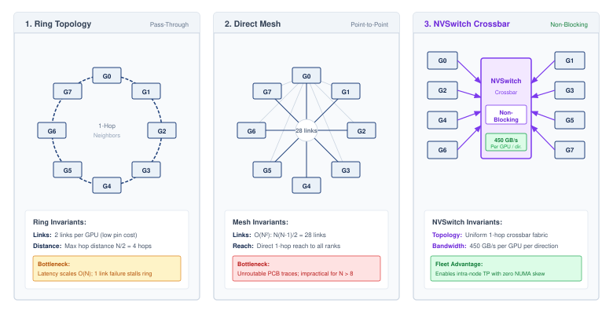

:::

```{python}
#| echo: false
# ┌── LEGO ───────────────────────────────────────────────
class InfraFrontierNodeMemRecap:
    # ┌── 1. LOAD ──────────────────────────────────────────
    weights_fp16 = Models.Language.GPT3.size_in_bytes(BYTES_FP16)
    gpu_hbm = Hardware.Cloud.H100.memory.capacity

    # ┌── 2. EXECUTE ───────────────────────────────────────
    min_gpus = math.ceil((weights_fp16 / gpu_hbm).to_base_units().magnitude)

    # ┌── 3. GUARD ─────────────────────────────────────────
    check(min_gpus == 5, "Prose says the FP16 weights span at least five accelerators")

    # ┌── 4. OUTPUT (Formatting) ──────────────────────────────────────────────
    frontier_params_b_str = fmt_params(Models.Language.GPT3.parameters, scale="B", precision=0, commas=False)
```

Aggregating accelerators solves the capacity problem only if the interconnect between them is fast enough that the group behaves as one machine rather than as several machines passing messages. The `{python} InfraFrontierNodeMemRecap.frontier_params_b_str` model's weights span at least five accelerators, and the full training state spans an entire 8-H100 node\index{Node!accelerator aggregation} and more, so some model state must live on different chips. Depending on the partition, execution exchanges partial results, activations, gradients, or parameter shards. Whether those exchanges are cheap or ruinous depends on the local fabric, which is why the node is the first scale level where the accelerator's specifications matter less than the wires between accelerators. The training system can combine tensor parallelism, optimizer sharding, and memory offload as needed to meet its capacity budget, and each strategy places a different demand on the interconnect.

```{python}
#| echo: false
from mlsysim.fmt import fmt_bandwidth, fmt_multiple

# ┌── LEGO ───────────────────────────────────────────────
class H100NvlinkNodeRecap:

    # ┌── 4. OUTPUT (Formatting) ──────────────────────────────────────────────
    nvlink_gb_per_s_str = fmt_bandwidth(Hardware.Cloud.H100.nvlink.bandwidth, unit=GB / second, precision=0, commas=False)
    nvlink_per_dir_gb_per_s_str = fmt_bandwidth(Hardware.Cloud.H100.nvlink.bandwidth_per_direction, unit=GB / second, precision=0, commas=False)
    _nvlink_ib_gap = (Hardware.Cloud.H100.nvlink.bandwidth_per_direction / Systems.Fabrics.InfiniBand_NDR.bandwidth).to_base_units().magnitude
    nvlink_ib_gap_mult_str = fmt_multiple(_nvlink_ib_gap, precision=0, commas=False)
    ib_bw_gb_per_s_str = fmt_bandwidth(Systems.Fabrics.InfiniBand_NDR.bandwidth, unit=GB / second, precision=0, commas=False)
    gpus_per_node_str = fmt(Systems.Nodes.DGX_H100.accelerators_per_node, precision=0, commas=False)
    gpu_hbm_gb_str = fmt_memory_capacity(Hardware.Cloud.H100.memory.capacity, unit=GiB, precision=0, commas=False)
    node_hbm_gb_str = fmt_memory_capacity(
        Hardware.Cloud.H100.memory.capacity * Systems.Nodes.DGX_H100.accelerators_per_node, unit=GiB, precision=0, commas=False
    )
    host_dram_low_gb_str = InfraFrontierMemoryHbmRecap.host_dram_low_gb_str
    host_dram_high_tb_str = InfraFrontierMemoryHbmRecap.host_dram_high_tb_str
```

::: {#dfn-compute-infrastructure-node .callout-definition title="Node"}

***Node***\index{Node!definition} is the ML training cluster's physical server chassis that aggregates multiple accelerators (typically 8) through a high-speed intra-node interconnect (NVLink or ICI), providing a physical packaging and failure boundary. The fast communication domain can coincide with one chassis or extend across several, depending on the fabric.

1.  **Significance**: The NVLink bandwidth within a DGX H100 node reaches `{python} H100NvlinkNodeRecap.nvlink_gb_per_s_str` bidirectional, or `{python} H100NvlinkNodeRecap.nvlink_per_dir_gb_per_s_str` per direction, while inter-node InfiniBand NDR provides `{python} H100NvlinkNodeRecap.ib_bw_gb_per_s_str`, a `{python} H100NvlinkNodeRecap.nvlink_ib_gap_mult_str` per-direction gap that constrains where each parallelism strategy can run. For this DGX H100 topology, frequent tensor-parallel collectives favor the intra-node NVLink domain; pipeline parallelism can span nodes when the network sustains stage-boundary activation traffic. The node is also the primary failure domain: a single node failure in a bulk synchronous parallel training job, where workers advance in lockstep at step barriers, idles the entire cluster until recovery.
2.  **Distinction**: Unlike a single accelerator (which provides fast HBM bandwidth but limited capacity), a node aggregates 8$\times$ the HBM capacity and 8$\times$ the compute of a single chip, enough to place large FP16 weight shards (`{python} H100NvlinkNodeRecap.gpus_per_node_str` $\times$ `{python} H100NvlinkNodeRecap.gpu_hbm_gb_str` = `{python} H100NvlinkNodeRecap.node_hbm_gb_str` on DGX H100), but not enough to keep the full Adam training state in HBM.
3.  **Common pitfall**: A frequent misconception is that nodes in a distributed training job operate independently. In bulk synchronous parallel training, all nodes are synchronously coupled at every step barrier: a performance degradation on one node (from thermal throttling, a faulty NIC, or a slow storage read) stalls the entire cluster and drops overall MFU for the duration of that step.

:::

The node exists because of a gap in the memory hierarchy. HBM provides enough bandwidth to feed the accelerator's arithmetic units, but not enough capacity to hold the full 175B-parameter running example. Host DRAM provides capacity (`{python} H100NvlinkNodeRecap.host_dram_low_gb_str` to `{python} H100NvlinkNodeRecap.host_dram_high_tb_str` per server) but not enough bandwidth.

The node bridges this gap by aggregating the HBM of multiple accelerators into distributed capacity connected by a fast interconnect. Each accelerator's HBM remains private to that device: software must shard or replicate tensors explicitly and use collectives or peer transfers when an operation crosses device boundaries. Placing 8 accelerators in one chassis therefore provides 8$\times$ aggregate capacity and 8$\times$ aggregate compute, but it does not create a single shared-memory accelerator; performance depends on how well the partitioning limits traffic over the fabric.

```{python}
#| echo: false
from mlsysim.fmt import check, fmt, fmt_memory, fmt_qty_range

# ┌── LEGO ───────────────────────────────────────────────
# │ Context: hypothetical single-package "super-chip" paragraph below.
class SuperChipStackCount:
    """HBM stacks a single package would need to hold the 175B FP16 weights."""

    # ┌── 1. LOAD ──────────────────────────────────────────
    weights_fp16 = Models.Language.GPT3.size_in_bytes(BYTES_FP16)
    h100 = Hardware.Cloud.H100
    b200 = Hardware.Cloud.B200

    # ┌── 2. EXECUTE ───────────────────────────────────────
    stack_low = (h100.memory.capacity / h100.memory.hbm_stacks).to(GB)
    stack_high = (b200.memory.capacity / b200.memory.hbm_stacks).to(GB)
    stacks_low = math.ceil((weights_fp16 / stack_high).to_base_units().magnitude)
    stacks_high = math.ceil((weights_fp16 / stack_low).to_base_units().magnitude)

    # ┌── 3. GUARD ─────────────────────────────────────────
    check(stacks_low > b200.memory.hbm_stacks, "The super-chip should need far more stacks than a B200 package")

    # ┌── 4. OUTPUT ────────────────────────────────────────
    weights_fp16_gb_str = fmt_memory(weights_fp16, unit=GB, precision=0, commas=False)
    stack_capacity_range_str = fmt_qty_range(round(stack_low.magnitude) * GB, round(stack_high.magnitude) * GB, GB, precision=0, commas=False)
    stack_count_range_str = fmt_range(stacks_low, stacks_high, precision=0, commas=False)
    h100_stacks_str = fmt(h100.memory.hbm_stacks, precision=0, commas=False)
    b200_stacks_str = fmt(b200.memory.hbm_stacks, precision=0, commas=False)
```

The economic argument for multi-accelerator nodes is equally compelling. Consider the alternative: building a single accelerator with enough HBM to hold a 175B model (`{python} SuperChipStackCount.weights_fp16_gb_str` in FP16). Current packages provide roughly `{python} SuperChipStackCount.stack_capacity_range_str` per HBM stack, so a `{python} SuperChipStackCount.weights_fp16_gb_str` single-accelerator design would require on the order of `{python} SuperChipStackCount.stack_count_range_str` HBM stacks, far beyond the `{python} SuperChipStackCount.h100_stacks_str`-stack H100 or `{python} SuperChipStackCount.b200_stacks_str`-stack B200-class package. The manufacturing cost of such a package would be prohibitive (yield decreases with package and interposer area), and the power delivery to a single chip with enough Tensor Cores to use all that bandwidth would exceed any practical cooling solution. Distributing the computation across 8 accelerators connected by NVLink allows the node to achieve the aggregate memory capacity and compute throughput of this hypothetical super-chip while remaining within manufacturable and coolable boundaries.

```{python}
#| echo: false
from mlsysim.fmt import fmt_memory, fmt_memory_capacity

# ┌── LEGO ───────────────────────────────────────────────
class InfraFrontierNodeBudgetRecap:
    # ┌── 1. LOAD ──────────────────────────────────────────
    model = Models.Language.GPT3
    params = model.parameters
    gpus_per_node = Systems.Nodes.DGX_H100.accelerators_per_node

    # ┌── 2. EXECUTE ───────────────────────────────────────
    weights = model.size_in_bytes(BYTES_FP16)
    optimizer = params * BYTES_FP32 * 2
    gradients = weights
    total_static = weights + optimizer + gradients
    gpu_hbm = Hardware.Cloud.H100.memory.capacity
    node_hbm = gpu_hbm * gpus_per_node

    # ┌── 3. GUARD ─────────────────────────────────────────
    check(abs(total_static.to(GB).magnitude - 2100) < 1, "Static training state should be about 2.1 TB")

    # ┌── 4. OUTPUT (Formatting) ──────────────────────────────────────────────
    frontier_params_b_str = fmt_params(params, scale="B", precision=0, commas=False)
    frontier_params_b_value_str = fmt_magnitude(params, unit=Bparam, precision=0, commas=False)
    weights_gb_str = fmt_memory(weights, unit=GB, precision=0, commas=True)
    optimizer_gb_str = fmt_memory(optimizer, unit=GB, precision=0, commas=True)
    gradients_gb_str = fmt_memory(gradients, unit=GB, precision=0, commas=True)
    total_static_tb_str = fmt_memory(total_static, unit=TB, precision=1, commas=False)
    gpu_hbm_gb_str = fmt_memory_capacity(gpu_hbm, unit=GiB, precision=0, commas=False)
    node_hbm_gb_str = fmt_memory_capacity(node_hbm, unit=GiB, precision=0, commas=False)
```

Understanding how the node partitions memory across its components is essential for selecting parallelism strategies. Consider the memory budget for training our `{python} InfraFrontierNodeBudgetRecap.frontier_params_b_str` model. The model weights in FP16 require `{python} InfraFrontierNodeBudgetRecap.weights_gb_str`. The Adam optimizer maintains two additional copies of every parameter (first and second moments) in FP32 precision, adding `{python} InfraFrontierNodeBudgetRecap.frontier_params_b_value_str` $\times 10^9 \times 2 \times 4$ bytes = `{python} InfraFrontierNodeBudgetRecap.optimizer_gb_str`. Gradients require another `{python} InfraFrontierNodeBudgetRecap.gradients_gb_str`. This subtotal is approximately `{python} InfraFrontierNodeBudgetRecap.total_static_tb_str`, excluding activations and any separate FP32 master-weight copy, far exceeding both a single accelerator's `{python} InfraFrontierNodeBudgetRecap.gpu_hbm_gb_str` HBM and an 8-H100 node's `{python} InfraFrontierNodeBudgetRecap.node_hbm_gb_str` aggregate HBM.

When using ZeRO or FSDP-style optimization (which shards optimizer states, gradients, and optionally parameters across data-parallel workers), the training system avoids replicating this 2.1 TB subtotal on every GPU. Tensor parallelism first reduces each GPU's active weight shard; data-parallel sharding then spreads optimizer state and gradients across many workers; activation checkpointing reduces the activation peak; and offload moves cold optimizer state to host DRAM over PCIe. The node is therefore a high-bandwidth compute and communication unit, not a standalone container for the entire training state.

The node's internal memory hierarchy, consisting of HBM (fast, small), host DRAM (medium speed, larger), and NVMe storage (slow, very large), forms a tiered system that distributed training frameworks exploit aggressively. @Sec-distributed-training-systems examines these memory optimization strategies in detail.

### Bandwidth hierarchy {#sec-compute-bandwidth-hierarchy}

The defining characteristic of multi-accelerator systems is not the *number of chips* but the *speed at which they can exchange data*. Data movement speed drops by orders of magnitude as it crosses physical boundaries. Each boundary represents a different physical medium, a different connector technology, and a different set of engineering constraints. This physical ordering of data transfer rates, from on-chip SRAM at the fast end to the wide-area network at the slow end, is the bandwidth hierarchy\index{Bandwidth hierarchy!distance scaling}; this ordering dictates where in the hierarchy each type of parallelism can operate efficiently.

The hierarchy reflects the physical cost of distance: shorter signal paths over denser wiring achieve higher throughput at lower energy per bit, so at each boundary the effective bandwidth $(\text{BW})$ drops by roughly an order of magnitude while latency $(L_{\text{lat}})$ rises. That gradient sets a scaling ceiling for distributed training. The common mistake is to treat all cluster communication as equal, but parallelism placement must be hierarchy-aware: putting high-frequency synchronization such as tensor parallelism on a slow tier idles the compute units $(R_{\text{peak}})$ and collapses scaling efficiency $(\eta_{\text{scaling}})$.

The bandwidth hierarchy is best understood as a series of concentric zones around each accelerator. The innermost zone is the HBM on the same package, with terabytes per second of bandwidth and sub-microsecond latency\index{Latency!bandwidth hierarchy}. The next zone encompasses the other accelerators within the same node, reachable over NVLink at hundreds of gigabytes per second with microsecond-scale latency. The outermost zone spans all other nodes in the cluster, connected by InfiniBand at tens of gigabytes per second with latency measured in single-digit microseconds. At each zone boundary, the bandwidth drops by roughly an order of magnitude while the latency increases by roughly an order of magnitude. @Tbl-bandwidth-hierarchy-compute maps those zones to the parallelism strategies they can support.

```{python}
#| echo: false
from mlsysim.fmt import fmt_bandwidth

# ┌── LEGO ───────────────────────────────────────────────
class BandwidthHierarchyTableRecap:
    # ┌── 1. LOAD ──────────────────────────────────────────
    h100 = Hardware.Cloud.H100
    nvlink_latency = Hardware.Tech.Interconnect.NVLink.latency
    pcie_latency = Hardware.Tech.Interconnect.PCIeGen5.latency
    ib_latency = Systems.Fabrics.InfiniBand_NDR.latency

    # ┌── 2. EXECUTE ───────────────────────────────────────
    # Tier ratios quoted as literals in the @fig-infra-bandwidth-hierarchy caption
    # (captions cannot hold inline Python); guarded below.
    hbm_to_nvlink = (h100.memory.bandwidth / h100.nvlink.bandwidth_per_direction).to_base_units().magnitude
    nvlink_to_ib = (h100.nvlink.bandwidth_per_direction / Systems.Fabrics.InfiniBand_NDR.bandwidth).to_base_units().magnitude
    ib_to_storage = (Systems.Fabrics.InfiniBand_NDR.bandwidth / h100.storage.bandwidth).to_base_units().magnitude

    # ┌── 3. GUARD ─────────────────────────────────────────
    check(round(hbm_to_nvlink, 1) == 7.4, "Caption quotes a 7.4x HBM-to-NVLink drop")
    check(round(nvlink_to_ib, 1) == 9.0, "Caption quotes a 9x NVLink-to-InfiniBand drop")
    check(round(ib_to_storage, 1) == 7.1, "Caption quotes a 7.1x InfiniBand-to-storage drop")
    check(nvlink_latency < pcie_latency < ib_latency, "Latency should rise at each boundary")
    # Tier bandwidths quoted as literals in the @fig-infra-bandwidth-hierarchy and
    # @fig-node-topology-comparison captions and their static SVGs.
    check(h100.nvlink.bandwidth_per_direction.to(GB / second).magnitude == 450, "Captions quote 450 GB/s NVLink per direction")
    check(h100.nvlink.bandwidth.to(GB / second).magnitude == 900, "Caption quotes 900 GB/s NVLink bidirectional")
    check(Systems.Fabrics.InfiniBand_NDR.bandwidth.to(GB / second).magnitude == 50, "Caption quotes 50 GB/s InfiniBand NDR per port")
    check(h100.storage.bandwidth.to(GB / second).magnitude == 7, "Caption quotes a 7 GB/s storage path")

    # ┌── 4. OUTPUT (Formatting) ──────────────────────────────────────────────
    hbm_bw_tb_per_s_str = fmt_bandwidth(h100.memory.bandwidth, unit=TB / second, precision=2, commas=False)
    nvlink_latency_us_str = fmt_time(nvlink_latency, microsecond, precision=1, commas=False)
    pcie_latency_us_str = fmt_time(pcie_latency, microsecond, precision=0, commas=False)
    ib_latency_us_str = fmt_time(ib_latency, microsecond, precision=0, commas=False)
    nvlink_bw_gb_per_s_str = fmt_bandwidth(Hardware.Cloud.H100.nvlink.bandwidth, unit=GB / second, precision=0, commas=False)
    pcie_bw_gb_per_s_str = fmt_bandwidth(Hardware.Cloud.H100.interconnect.bandwidth, unit=GB / second, precision=0, commas=False)
    ib_bw_gb_per_s_str = fmt_bandwidth(Systems.Fabrics.InfiniBand_NDR.bandwidth, unit=GB / second, precision=0, commas=False)
```

| **Domain**           |  **Interconnect**  |                         **Bandwidth**                         |                          **Latency**                           | **Scaling limit**  |
|:---------------------|:------------------:|:-------------------------------------------------------------:|:--------------------------------------------------------------:|:------------------:|
| **Intra-package**    | Silicon interposer |  ~`{python} BandwidthHierarchyTableRecap.hbm_bw_tb_per_s_str` |                        $<100\text{ ns}$                        |    Single chip     |
| **Intra-node**       |     NVLink/ICI     |  ~`{python} H100NvlinkNodeRecap.nvlink_per_dir_gb_per_s_str`  | ~`{python} BandwidthHierarchyTableRecap.nvlink_latency_us_str` | Node (8--16 chips) |
| **Intra-node (I/O)** |   PCIe Gen5 x16    | ~`{python} BandwidthHierarchyTableRecap.pcie_bw_gb_per_s_str` |  ~`{python} BandwidthHierarchyTableRecap.pcie_latency_us_str`  |  CPU-GPU, NIC-GPU  |
| **Inter-node**       |   InfiniBand NDR   |  ~`{python} BandwidthHierarchyTableRecap.ib_bw_gb_per_s_str`  |   ~`{python} BandwidthHierarchyTableRecap.ib_latency_us_str`   |  Pod (thousands)   |

: **The bandwidth hierarchy**: Each physical boundary introduces an order-of-magnitude bandwidth cliff. Link bandwidths are per direction. These cliffs are not engineering failures to be optimized away; they reflect fundamental differences in the physics of each interconnect medium. These example bandwidth gaps favor placing frequent tensor-parallel collectives within the fast communication domain, which need not coincide with a server boundary. {#tbl-bandwidth-hierarchy-compute}

The concentric view in @fig-infra-bandwidth-hierarchy presents the same hierarchy spatially and extends it one tier outward to storage, so each boundary a transfer crosses reads as one more step away from the accelerator's own memory, with its own bandwidth drop.

::: {#fig-infra-bandwidth-hierarchy fig-env="figure" fig-pos="htb" fig-cap="**The infrastructure bandwidth hierarchy**: Concentric zones place each tier an ML workload crosses farther from the accelerator's own memory. HBM (3.35 TB/s) sits at the center; the outward tiers are NVLink/NVSwitch (450 GB/s per direction per GPU), one InfiniBand NDR port (50 GB/s per direction), and an illustrative 7 GB/s storage path. Each step outward cuts bandwidth by roughly 7.4, 9, and 7.1 times, not by a universal tenfold law. Exploiting this hierarchy through tiered algorithms is the primary task of distributed systems engineering." fig-alt="Four nested ellipses: HBM3 at 3.35 TB/s in the center, then NVLink/NVSwitch, then a dashed InfiniBand NDR ring, then an outer example storage ring. Leader lines from the three outer rings point to labels at the right: NVLink/NVSwitch at 450 GB/s per GPU each way, 7.4 times below HBM; InfiniBand NDR, one port, at 50 GB/s per direction, 9 times below NVLink; example storage path at 7 GB/s, 7.1 times below InfiniBand."}
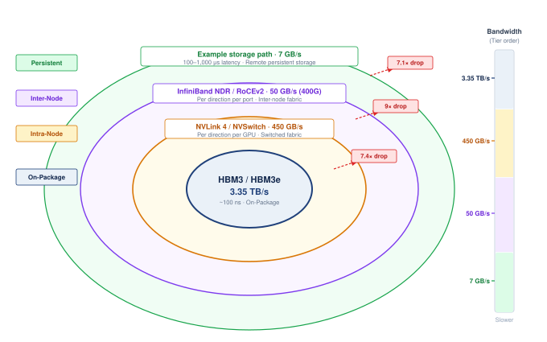

:::

Parallelism strategies must respect these physical boundaries; a simple synchronization calculation makes the bandwidth gaps concrete.

```{python}
#| echo: false
from mlsysim.fmt import fmt_bandwidth, fmt_int, fmt_memory

# ┌─────────────────────────────────────────────────────────────────────────────
# │ HIGH-BANDWIDTH STAIRCASE (NOTEBOOK)
# ├─────────────────────────────────────────────────────────────────────────────
# │ Context: "The Physics of the Staircase" .callout-notebook
# │
# │ Goal: Quantify the bandwidth gaps between HBM, NVLink, and InfiniBand.
# │ Show: nvlink_to_ib_ratio ≈ 9x—inline in notebook result.
# │ How: Ratio = BW_fast/BW_slow. All rates are one-way deliverable
# │      bandwidths (NVLink uses its 450 GB/s per-direction rate, not the
# │      900 GB/s datasheet bidirectional total) so the buffer-transfer math
# │      and the staircase ratios use a single consistent convention.
# │
# └─────────────────────────────────────────────────────────────────────────────
from mlsysim.fmt import check, fmt, fmt_time

class BandwidthStaircase:
    # ┌── 1. LOAD ──────────────────────────────────────────
    hbm_bw = Hardware.Cloud.H100.memory.bandwidth  # H100 HBM3
    # One-way deliverable NVLink rate (450 GB/s); the datasheet 900 GB/s is the
    # bidirectional total, and moving a buffer in one direction uses half of it.
    nvlink_bw = Hardware.Cloud.H100.nvlink.bandwidth_per_direction  # H100 NVLink (per-direction)
    ib_bw = Systems.Fabrics.InfiniBand_NDR.bandwidth  # 400G NDR InfiniBand
    transfer = 10 * GB  # scenario assumption: synchronized buffer size
    # ┌── 2. EXECUTE ───────────────────────────────────────
    hbm_time = (transfer / hbm_bw).to(millisecond)
    nvlink_time = (transfer / nvlink_bw).to(millisecond)
    ib_time = (transfer / ib_bw).to(millisecond)
    gap_hbm_nv = (hbm_bw / nvlink_bw).to_base_units().magnitude
    gap_nv_ib = (nvlink_bw / ib_bw).to_base_units().magnitude
    # ┌── 3. GUARD ─────────────────────────────────────────
    check(
        gap_nv_ib > 8, f"Narrative Violation: Bandwidth staircase collapsed! Ratio is only {gap_nv_ib:.1f}x (per-direction NVLink/IB should be ~9x)"
    )
    # ┌── 4. OUTPUT ────────────────────────────────────────
    transfer_gb_str = fmt_memory(transfer, unit=GB, precision=0, commas=False)
    hbm_ms_str = fmt_time(hbm_time, millisecond, precision=1, commas=False)
    nvlink_ms_str = fmt_time(nvlink_time, millisecond, precision=1, commas=False)
    ib_ms_str = fmt_time(ib_time, millisecond, precision=0, commas=False)
    bs_hbm_bw_gb_per_s_str = fmt_bandwidth(hbm_bw, unit=GB / second, precision=0, commas=True)
    bs_nvlink_bw_gb_per_s_str = fmt_bandwidth(nvlink_bw, unit=GB / second, precision=0, commas=False)
    bs_ib_bw_gb_per_s_str = fmt_bandwidth(ib_bw, unit=GB / second, precision=0, commas=False)
    bs_gap_nv_ib_mult_str = fmt_multiple(gap_nv_ib, precision=0, commas=False)
```

::: {#nbk-compute-infrastructure-physics-staircase .callout-notebook title="The physics of the staircase"}

**Problem**: A `{python} BandwidthStaircase.transfer_gb_str` buffer is synchronized across the fleet. How much does the physical "Layer" of the fleet affect transfer time?

**Math**:
Transfer time is $T_{\text{transfer}} = D_{\text{vol}} / \text{BW}$.

1. **HBM (intra-chip)**: `{python} BandwidthStaircase.transfer_gb_str` / `{python} BandwidthStaircase.bs_hbm_bw_gb_per_s_str` $\approx$ `{python} BandwidthStaircase.hbm_ms_str`.
2. **NVLink (intra-node)**: `{python} BandwidthStaircase.transfer_gb_str` / `{python} BandwidthStaircase.bs_nvlink_bw_gb_per_s_str` $\approx$ `{python} BandwidthStaircase.nvlink_ms_str`.
3. **InfiniBand (inter-node)**: `{python} BandwidthStaircase.transfer_gb_str` / `{python} BandwidthStaircase.bs_ib_bw_gb_per_s_str` $\approx$ `{python} BandwidthStaircase.ib_ms_str`.

**Systems insight**: Moving data across the cluster is `{python} BandwidthStaircase.bs_gap_nv_ib_mult_str` slower than moving it within a node. Size alone does not decide which traffic may cross that cliff; frequency and overlap do. Tensor parallelism\index{Tensor parallelism!intra-node} exchanges activations inside every layer, on the critical path, so it stays where bandwidth is abundant (NVLink). Data parallelism\index{Data parallelism!inter-node} moves the largest buffer, the full gradient, but only once per step and overlapped with the backward pass, so it can cross the scarce InfiniBand tier. A partition that fits in memory but ignores the staircase spends most of each step waiting on the network.

:::

Each cliff in the bandwidth staircase has a physical cause at its distance scale. Millimeter-long traces on a silicon interposer need no amplification. NVLink crosses tens of centimeters of copper, which requires serializer/deserializer (SerDes) transceivers with equalization. PCIe pays for universal compatibility with protocol overhead (packet headers, flow-control credits, and error checking). InfiniBand crosses meters of cable between racks, adding optical conversion, error correction, and switch hops. @Sec-network-fabrics-serdes develops the signaling physics behind these cliffs; for node design, what matters is that every boundary crossed costs roughly an order of magnitude in bandwidth, and every transceiver is a power and cooling load as well as a bandwidth specification.

The practical consequence for model partitioning is that tensor parallelism (TP), which splits individual matrix multiplications across accelerators and requires an AllReduce operation after every layer, generates communication volume proportional to the model's hidden dimension hundreds of times per second. Over NVLink, each of these exchanges takes under a millisecond for the running model (@sec-compute-dense-nodes computes the exact figure). Across InfiniBand, the same exchange would take `{python} BandwidthStaircase.bs_gap_nv_ib_mult_str` as long, and repeated in every layer it would leave the accelerators idle for most of each training step.

For this topology, TP favors a single node, while data parallelism can span the inter-node network. Systems with a fast scale-up fabric spanning multiple chassis can place a tensor-parallel group across those chassis. Communication cost, rather than the server enclosure, determines the useful partition.

The hierarchy also explains why pipeline parallelism occupies an intermediate position in the bandwidth requirements. In pipeline parallelism, the model is divided into sequential stages, with each stage assigned to a different group of accelerators. The communication between stages consists of activations flowing forward during the forward pass and gradients flowing backward during the backward pass, with a volume proportional to the batch size times the hidden dimension.

```{python}
#| echo: false
from mlsysim.fmt import fmt_int, fmt_memory

# ┌── LEGO ───────────────────────────────────────────────
class InfraFrontierNodeTpRecap:
    # ┌── 1. LOAD ──────────────────────────────────────────
    model = Models.Language.GPT3
    params = model.parameters
    hidden_dim = Models.Language.GPT3.hidden_dim
    microbatch = 4  # scenario assumption: sequences per microbatch
    seq_len = Models.Language.GPT3.context_length

    # ┌── 2. EXECUTE ───────────────────────────────────────
    activation = microbatch * seq_len * hidden_dim * BYTES_FP16
    gradient_allreduce = model.size_in_bytes(BYTES_FP16)

    # ┌── 3. GUARD ─────────────────────────────────────────
    check(activation < gradient_allreduce, "Activation payload should be smaller than the gradient buffer")

    # ┌── 4. OUTPUT (Formatting) ──────────────────────────────────────────────
    frontier_params_b_str = fmt_params(params, scale="B", precision=0, commas=False)
    frontier_params_b_value_str = fmt_magnitude(params, unit=Bparam, precision=0, commas=False)
    hidden_dim_str = fmt(hidden_dim, precision=0, commas=True)
    microbatch_str = fmt(microbatch, precision=0, commas=False)
    seq_len_str = fmt(seq_len, precision=0, commas=True)
    activation_expr_math = fmt_math(rf"{microbatch} \times {seq_len:,} \times {hidden_dim:,} \times {BYTES_FP16}")
    activation_mb_str = fmt_qty_int(activation, MB, commas=False)
    gradient_allreduce_gb_str = fmt_memory(gradient_allreduce, unit=GB, precision=0, commas=False)
```

For our `{python} InfraFrontierNodeTpRecap.frontier_params_b_str` model with hidden dimension `{python} InfraFrontierNodeTpRecap.hidden_dim_str` and a microbatch of `{python} InfraFrontierNodeTpRecap.microbatch_str` sequences at `{python} InfraFrontierNodeTpRecap.seq_len_str`, the activation tensor at each stage boundary is approximately `{python} InfraFrontierNodeTpRecap.activation_expr_math` bytes (FP16) $\approx$ `{python} InfraFrontierNodeTpRecap.activation_mb_str`. This is far smaller than the `{python} InfraFrontierNodeTpRecap.gradient_allreduce_gb_str` gradient AllReduce required by data parallelism, which is why pipeline parallelism places less demanding requirements on the inter-node network.

Activation transfers occur once per microbatch per stage boundary, far less frequently than tensor parallelism's per-layer AllReduce. Pipeline parallelism can therefore tolerate the lower bandwidth of inter-node links, making it the preferred strategy for spanning multiple nodes when the model's depth exceeds a single node's capacity.

The resulting mapping places tensor parallelism within the node (NVLink), pipeline parallelism across nearby nodes (InfiniBand), and data parallelism across the full cluster (InfiniBand). This mapping is so fundamental that it has become a *de facto* standard in production-scale Transformer training systems, with the details differing primarily in the number of pipeline stages, the degree of tensor parallelism, and the degree of data parallelism.

The mapping also determines how the job scheduler assigns nodes to training jobs. Nodes within the same tensor-parallel group should be physically adjacent (ideally in the same chassis, connected via NVLink). Nodes within the same pipeline-parallel group should be in the same rack or adjacent racks (minimizing InfiniBand switch hops). Data-parallel groups can span the entire cluster because their gradient AllReduce, although the largest transfer, occurs once per step and can overlap with the backward pass, making it the most latency-tolerant of the three parallelism types. One intra-node boundary remains before that mapping reaches the scheduler: the PCIe hierarchy that connects accelerators to host CPUs, network interface cards (NICs), storage, and DRAM.

#### The PCIe hierarchy within a node {#sec-compute-infrastructure-pcie-hierarchy-within-node-c56f}

```{python}
#| echo: false
from mlsysim.fmt import fmt_bandwidth

# ┌── LEGO ───────────────────────────────────────────────
class BandwidthHierarchyPcieRecap:
    # ┌── 1. LOAD ──────────────────────────────────────────
    pcie_bw = Hardware.Cloud.H100.interconnect.bandwidth  # per direction, x16
    node = Systems.Nodes.DGX_H100

    # ┌── 2. EXECUTE ───────────────────────────────────────
    pcie_bidir = 2 * pcie_bw
    x16_links = node.accelerators_per_node + node.nics_per_node  # one x16 link per GPU and per HCA
    node_pcie_aggregate = x16_links * pcie_bidir

    # ┌── 3. GUARD ─────────────────────────────────────────
    check(abs(node_pcie_aggregate.to(TB / second).magnitude - 2) < 0.1, "Prose says about 2 TB/s aggregate PCIe within the chassis")

    # ┌── 4. OUTPUT (Formatting) ──────────────────────────────────────────────
    pcie_bw_gb_per_s_str = fmt_bandwidth(pcie_bw, unit=GB / second, precision=0, commas=False)
    pcie_bidir_gb_per_s_str = fmt_bandwidth(pcie_bidir, unit=GB / second, precision=0, commas=False)
    node_pcie_aggregate_tb_per_s_str = fmt_bandwidth(
        round(node_pcie_aggregate.to(TB / second).magnitude) * TB / second, unit=TB / second, precision=0, commas=False
    )
    gpus_per_node_str = fmt(node.accelerators_per_node, precision=0, commas=False)
    nics_per_node_str = fmt(node.nics_per_node, precision=0, commas=False)
```

While NVLink provides a high-bandwidth freeway for GPU-to-GPU communication, PCIe Gen5\index{PCIe Gen5!node hierarchy} serves as the universal glue connecting the heterogeneous components of the node. It links GPUs to the host CPU, GPUs to InfiniBand host channel adapters (HCAs), the host CPU to NVMe storage, and the host CPU to system DRAM. Understanding this topology is critical because PCIe bandwidth, though substantial at ~`{python} BandwidthHierarchyPcieRecap.pcie_bw_gb_per_s_str` per direction (`{python} BandwidthHierarchyPcieRecap.pcie_bidir_gb_per_s_str` bidirectional) per x16 link, is often the bottleneck for operations that cross the accelerator boundary, such as data loading, checkpointing, and inter-node gradient synchronization.

A standard DGX H100 node features two host CPUs, each managing a PCIe root complex\index{PCIe!root complex contention}, with PCIe switches fanning those lanes out so that each of the `{python} BandwidthHierarchyPcieRecap.gpus_per_node_str` GPUs and each of the `{python} BandwidthHierarchyPcieRecap.nics_per_node_str` InfiniBand HCAs has its own x16 link. This configuration provides an aggregate theoretical bandwidth of about `{python} BandwidthHierarchyPcieRecap.node_pcie_aggregate_tb_per_s_str` within the chassis. However, this bandwidth is shared among competing traffic streams. During a single training step, the PCIe bus simultaneously carries host-to-GPU data batches, GPU-to-HCA gradient shards for inter-node AllReduce (via GPUDirect remote direct memory access (RDMA)), and periodic CPU-to-NVMe checkpoint writes. Contention between these streams can cause unexpected pipeline stalls, particularly when gradient synchronization saturates the links typically used for data loading.

The dual-CPU architecture introduces significant non-uniform memory access (NUMA)\index{NUMA!GPU data loading} effects. The 8 GPUs are physically partitioned, with 4 connected to CPU 0's root complex and 4 to CPU 1's. A GPU connected to CPU 0 can reach CPU 0's DRAM through its local PCIe root complex, whereas access to CPU 1's DRAM also traverses the inter-socket link. The latency and bandwidth penalty depends on the processor, socket interconnect, PCIe topology, transfer size, and concurrent traffic, so no fixed percentage applies across nodes. Data-loading pipelines should measure this topology and place worker processes, pinned buffers, NICs, and target GPUs within the same NUMA domain when the local path improves sustained ingestion.

The practical consequence is that placement is part of the parallelism strategy: a scheduler that ignores PCIe roots, NIC locality, and NUMA domains can turn an otherwise valid tensor- or pipeline-parallel plan into a host-bound bottleneck. @Sec-distributed-training-systems formalizes how these intra-node and inter-node boundaries interact with data, tensor, and pipeline parallelism.

### Dense node designs {#sec-compute-dense-nodes}

Given the bandwidth hierarchy, the engineering challenge within a node is clear: connect 8 accelerators with enough bandwidth for tensor-parallel operations across their private memories. The solution is a specialized switching fabric that provides full bisection bandwidth between accelerator pairs. Understanding the design of this fabric requires appreciating why simpler alternatives fail.

The simplest approach would be to connect the 8 GPUs in a ring, where each GPU has links to its two neighbors. A ring is inexpensive (requiring only $N$ links for $N$ GPUs) and works well for ring-AllReduce, where data flows sequentially around the ring in a circular pattern. The ring-AllReduce algorithm achieves optimal bandwidth utilization for gradient synchronization because each GPU simultaneously sends data to its right neighbor and receives data from its left neighbor, keeping all links busy throughout the operation.

However, tensor parallelism requires frequent collectives after sharded matrix operations. Besides AllReduce, common operations include ReduceScatter, which combines contributed values but leaves each participant with only a shard of the result, and AllGather, which assembles distributed shards at every participant. A physical ring can execute ring-AllReduce efficiently, but its fixed multi-hop paths constrain other simultaneous traffic patterns and make topology-aware scheduling important. A fully connected mesh, where every GPU has a direct link to every other GPU, eliminates the multi-hop constraint but requires $N(N-1) / 2 = 28$ links for 8 GPUs, a wiring challenge that becomes impractical as the link count grows quadratically. The NVSwitch\index{NVSwitch!non-blocking fabric} crossbar\index{Crossbar switch} provides full-bisection switched connectivity with a manageable number of switch chips.

```{python}
#| echo: false
from mlsysim.fmt import fmt_bandwidth

# ┌── LEGO ───────────────────────────────────────────────
class BandwidthHierarchyNvlinkRecap:

    # ┌── 3. GUARD ─────────────────────────────────────────
    # Prose spells out "four NVSwitch chips" (small count in running text).
    check(Systems.Nodes.DGX_H100.nvswitch_count == 4, "Prose says each DGX H100 baseboard has four NVSwitch chips")

    # ┌── 4. OUTPUT (Formatting) ──────────────────────────────────────────────
    nvlink_links_str = fmt(Systems.Nodes.DGX_H100.nvlink_links_per_accelerator, precision=0, commas=False)
    nvlink_bw_gb_per_s_str = fmt_bandwidth(Hardware.Cloud.H100.nvlink.bandwidth, unit=GB / second, precision=0, commas=False)
    nvlink_per_direction_gb_per_s_str = fmt_bandwidth(Hardware.Cloud.H100.nvlink.bandwidth_per_direction, unit=GB / second, precision=0, commas=False)
```

Consider the NVIDIA DGX H100 architecture\index{DGX!H100 baseboard}. Eight H100 GPUs sit on a single baseboard, each connected to four NVSwitch chips via `{python} BandwidthHierarchyNvlinkRecap.nvlink_links_str` NVLink 4.0 lanes\index{NVLink!lane configuration}. The NVSwitch chips form a non-blocking crossbar[^fn-crossbar-nvswitch-interconnect] through which any GPU can reach any other GPU. Each GPU's port budget is `{python} BandwidthHierarchyNvlinkRecap.nvlink_bw_gb_per_s_str` bidirectional, or `{python} BandwidthHierarchyNvlinkRecap.nvlink_per_direction_gb_per_s_str` in one direction, shared across that GPU's simultaneous transfers; it is not a separate full-bandwidth link for every GPU pair.

[^fn-crossbar-nvswitch-interconnect]: **Crossbar switch**\index{Crossbar switch!NVSwitch}: A topology providing a dedicated path between every input-output pair simultaneously. An $N{\times}N$ crossbar needs $N^2$ crosspoints, so its cost grows quadratically with port count; that growth is why a full crossbar stays inside a node and larger systems switch to multi-stage fabrics. Within that bound, the crossbar buys the all-to-all bandwidth that tensor parallelism demands.

```{python}
#| echo: false
from mlsysim.fmt import fmt_flop_rate, fmt_memory_capacity

# ┌── LEGO ───────────────────────────────────────────────
class NodeCapacityDenseRecap:

    # ┌── 4. OUTPUT (Formatting) ──────────────────────────────────────────────
    node_hbm_cap_gb_str = fmt_memory_capacity(
        Hardware.Cloud.H100.memory.capacity * Systems.Nodes.DGX_H100.accelerators_per_node, unit=GiB, precision=0, commas=False
    )
    h100_fp8_tflop_per_s_str = fmt_flop_rate(Hardware.Cloud.H100.compute.precision_flops['fp8'], unit=TFLOP / second, precision=0, commas=True)
```

The result is a node with `{python} NodeCapacityDenseRecap.node_hbm_cap_gb_str` of aggregate HBM capacity and a combined peak compute throughput of 8 $\times$ `{python} NodeCapacityDenseRecap.h100_fp8_tflop_per_s_str`, while each GPU retains private HBM. Training frameworks partition tensors explicitly across those devices, and NVSwitch reduces the communication cost between shards without making placement or collective synchronization transparent.

```{python}
#| echo: false
from mlsysim.fmt import fmt_power

# ┌── LEGO ───────────────────────────────────────────────
class V100NodePowerRecap:
    # ┌── 1. LOAD ──────────────────────────────────────────
    nvswitch_power = 200 * watt  # scenario assumption: approximate per-NVSwitch power (no datasheet source)
    nvswitch_count = Systems.Nodes.DGX_H100.nvswitch_count

    # ┌── 2. EXECUTE ───────────────────────────────────────
    fabric_power = nvswitch_power * nvswitch_count

    # ┌── 3. GUARD ─────────────────────────────────────────
    check(fabric_power > Hardware.Cloud.V100.tdp, "Prose says the NVSwitch fabric outdraws an entire V100")

    # ┌── 4. OUTPUT (Formatting) ──────────────────────────────────────────────
    tdp_w_str = fmt_power(Hardware.Cloud.V100.tdp, unit=watt, precision=0, commas=False)
    nvswitch_power_w_str = fmt_power(nvswitch_power, unit=watt, precision=0, commas=False)
    fabric_power_w_str = fmt_power(fabric_power, unit=watt, precision=0, commas=False)
```
The NVSwitch chips themselves consume approximately `{python} V100NodePowerRecap.nvswitch_power_w_str` each (`{python} V100NodePowerRecap.fabric_power_w_str` total for the NVSwitch fabric), a nontrivial power overhead that is justified by the bisection bandwidth it provides. To put this in perspective, the NVSwitch fabric alone consumes more power than an entire previous-generation GPU (the V100 drew `{python} V100NodePowerRecap.tdp_w_str`). Without NVSwitch, achieving full all-to-all connectivity would require 28 direct GPU-to-GPU links, a wiring nightmare that would also consume more total NVLink lane capacity.

```{python}
#| echo: false
from mlsysim.fmt import MarkdownStr, fmt_int, fmt_memory, fmt_percent, fmt_time

# ┌── LEGO ───────────────────────────────────────────────
class TensorParallelAllReduce:
    # ┌── 1. LOAD (Constants) ──────────────────────────────────────────────
    model = Models.Language.GPT3  # 175B: hidden 12,288, layers 96
    tp_gpus = Systems.Nodes.DGX_H100.accelerators_per_node  # tensor-parallel group = one DGX H100 node
    microbatch = 4  # scenario assumption: sequences per microbatch
    seq_len = model.context_length  # GPT-3 training sequence length
    nvlink_bw = Hardware.Cloud.H100.nvlink.bandwidth_per_direction
    pcie_bw = Hardware.Cloud.H100.interconnect.bandwidth
    compute_step = 200 * millisecond  # scenario anchor for the diagnostic below

    # ┌── 2. EXECUTE (The Compute) ────────────────────────────────────────
    hidden = model.hidden_dim
    layers = model.layers
    sync_events = 2 * layers
    shard_cols = hidden // tp_gpus
    bytes_fp16 = int(BYTES_FP16.to(byte).magnitude)
    allreduce_bytes = microbatch * seq_len * hidden * bytes_fp16 * byte
    ring_traffic_factor = 2 * (tp_gpus - 1) / tp_gpus
    allreduce_traffic = ring_traffic_factor * allreduce_bytes
    per_allreduce = (allreduce_traffic / nvlink_bw).to("millisecond")
    cumulative = sync_events * per_allreduce
    pcie_per_allreduce = (allreduce_traffic / pcie_bw).to(millisecond)
    pcie_cumulative = sync_events * pcie_per_allreduce
    pcie_cumulative_display = round(pcie_cumulative.to(millisecond).magnitude) * millisecond
    check(per_allreduce < 1 * millisecond, "Bandwidth-hierarchy prose says each NVLink TP exchange takes under a millisecond")
    pcie_wait_fraction = (pcie_cumulative / (compute_step + pcie_cumulative)).to_base_units().magnitude
    nvlink_compute_fraction = (compute_step / (compute_step + cumulative)).to_base_units().magnitude
    hidden_disp = format(hidden, ",").replace(",", "{,}")
    shard_disp = format(shard_cols, ",").replace(",", "{,}")
    seq_disp = format(seq_len, ",").replace(",", "{,}")

    # ┌── 4. OUTPUT (Formatting) ──────────────────────────────────────────
    hidden_str = fmt_int(hidden)
    tp_gpus_str = fmt_int(tp_gpus)
    microbatch_str = fmt_int(microbatch)
    seq_str = fmt_int(seq_len)
    model_params_b_str = fmt_int(model.parameters.to("Gparam").magnitude)
    shard_math = fmt_math(f"{hidden_disp}{{\\times}}{shard_disp}")
    allreduce_formula_math = fmt_math(f"{microbatch} \\times {seq_disp} \\times {hidden_disp} \\times {bytes_fp16}")
    allreduce_mb_str = fmt_memory(round(allreduce_bytes.to(MB).magnitude) * MB, unit=MB, precision=0, commas=False)
    ring_traffic_factor_str = fmt(ring_traffic_factor, precision=2, commas=False)
    allreduce_traffic_mb_str = fmt_memory(round(allreduce_traffic.to(MB).magnitude) * MB, unit=MB, precision=0, commas=False)
    per_allreduce_ms_str = fmt_time(per_allreduce, "millisecond", precision=3, commas=False)
    layers_str = fmt_int(layers)
    sync_events_str = fmt_int(sync_events)
    cumulative_ms_str = fmt_time(cumulative, "millisecond", precision=1, commas=False)
    pcie_cumulative_ms_str = fmt_time(pcie_cumulative_display, millisecond, precision=0, commas=False)
    compute_step_ms_str = fmt_time(compute_step, millisecond, precision=0, commas=False)
    pcie_wait_pct_str = fmt_percent(pcie_wait_fraction, precision=1, commas=False, style='prose')
    nvlink_compute_fraction_pct_str = fmt_percent(nvlink_compute_fraction, precision=1, commas=False, style='prose')
```

During a tensor-parallel forward pass, each GPU holds one shard of each weight matrix and computes its portion of the matrix multiplication. For a Transformer layer with hidden dimension `{python} TensorParallelAllReduce.hidden_str` (typical for a `{python} TensorParallelAllReduce.model_params_b_str`B model), each of the `{python} TensorParallelAllReduce.tp_gpus_str` GPUs holds a `{python} TensorParallelAllReduce.shard_math` slice of the weight matrix. After each GPU computes its partial result, an AllReduce operation sums the partial results across all `{python} TensorParallelAllReduce.tp_gpus_str` GPUs over NVLink.

The logical output tensor for one AllReduce contains `{python} TensorParallelAllReduce.allreduce_formula_math` bytes (FP16). For a microbatch of `{python} TensorParallelAllReduce.microbatch_str` sequences at `{python} TensorParallelAllReduce.seq_str` tokens, that payload is roughly `{python} TensorParallelAllReduce.allreduce_mb_str`. An ideal ring AllReduce with `{python} TensorParallelAllReduce.tp_gpus_str` participants moves $2(p-1)/p =$ `{python} TensorParallelAllReduce.ring_traffic_factor_str` times the payload per GPU, or about `{python} TensorParallelAllReduce.allreduce_traffic_mb_str`. At `{python} BandwidthHierarchyNvlinkRecap.nvlink_per_direction_gb_per_s_str` of one-direction bandwidth, the transfer-time lower bound is approximately `{python} TensorParallelAllReduce.per_allreduce_ms_str`.

Across `{python} TensorParallelAllReduce.layers_str` forward layers and `{python} TensorParallelAllReduce.layers_str` backward layers, the `{python} TensorParallelAllReduce.sync_events_str` transfers sum to about `{python} TensorParallelAllReduce.cumulative_ms_str` per step before overlap. NVSwitch provides the paths needed for the collective, but this value remains an ideal bandwidth-only lower bound that excludes startup latency, software overhead, and competing traffic.

Against the `{python} TensorParallelAllReduce.compute_step_ms_str` compute-time anchor used in example \ref{exmp-compute-infrastructure-nvlink-bandwidth-surprise}, the unoverlapped NVLink lower bound leaves computation at `{python} TensorParallelAllReduce.nvlink_compute_fraction_pct_str` of combined compute-plus-communication time. Actual tensor-parallel efficiency can be higher when collectives overlap useful computation or lower when latency, contention, load imbalance, and nonparallel work add delay, so it must be measured rather than inferred from peak link bandwidth alone.

```{python}
#| echo: false
from mlsysim.fmt import fmt_bandwidth

# ┌── LEGO ───────────────────────────────────────────────
class BandwidthHierarchyPcieExampleRecap:

    # ┌── 4. OUTPUT (Formatting) ──────────────────────────────────────────────
    pcie_bw_gb_per_s_str = fmt_bandwidth(Hardware.Cloud.H100.interconnect.bandwidth, unit=GB / second, precision=0, commas=False)
```

::: {#exmp-compute-infrastructure-nvlink-bandwidth-surprise .callout-example title="The NVLink bandwidth surprise"}

**Scenario**: Early users of multi-GPU nodes attempted tensor parallelism across PCIe Gen5 interconnects (`{python} BandwidthHierarchyPcieExampleRecap.pcie_bw_gb_per_s_str` bandwidth), expecting sufficient performance.

**Diagnosis**: Tensor parallelism executes `{python} TensorParallelAllReduce.sync_events_str` AllReduce events per step across `{python} TensorParallelAllReduce.layers_str` layers. PCIe transfer latency accumulates to `{python} TensorParallelAllReduce.pcie_cumulative_ms_str` per step, causing GPUs to spend `{python} TensorParallelAllReduce.pcie_wait_pct_str` of execution time stalled on communication.

**Systems lesson**: Communication-intensive tensor parallelism requires high-bandwidth interconnects like NVLink (`{python} TensorParallelAllReduce.per_allreduce_ms_str` per AllReduce), which cuts transfer latency by an order of magnitude and increases compute efficiency to `{python} TensorParallelAllReduce.nvlink_compute_fraction_pct_str`.

:::

The DGX H100 pairs each GPU with its own InfiniBand ConnectX-7 HCA, which reads and writes GPU memory directly over PCIe through GPUDirect RDMA\index{GPUDirect RDMA!gradient synchronization} (@sec-network-fabrics-rdma), so inter-node gradient exchange avoids staging copies in host DRAM while still consuming PCIe and network bandwidth.

The host CPU prepares and loads batches, submits kernels, and coordinates the training framework. Sufficient CPU capacity and I/O bandwidth let that work overlap the accelerator fabric's computation and communication. Otherwise, slow preprocessing or submission can starve the GPUs even when their local memory and interconnect are fast enough.

```{python}
#| echo: false
# ┌── LEGO ───────────────────────────────────────────────
class InfraFrontierStragglerRecap5:

    # ┌── 4. OUTPUT (Formatting) ──────────────────────────────────────────────
    frontier_params_b_str = fmt_params(Models.Language.GPT3.parameters, scale="B", precision=0, commas=False)
```

As the "data center tax" on host CPUs has grown, with a substantial share of CPU cycles consumed by network protocol processing, storage virtualization, and security functions, ML nodes can incorporate data processing units (DPUs)\index{DPU!infrastructure offload} or SmartNICs. Devices like the NVIDIA BlueField DPU offload these infrastructure tasks to dedicated ARM cores and hardware accelerators integrated into the network adapter itself. Moving the control plane for RDMA, firewall rules, and storage protocols to the DPU recovers cycles for the ML pipeline: data loading, tokenization, and kernel orchestration on the host CPU. The DPU also acts as an isolated security domain, allowing cloud providers to maintain control over the network and storage layer via the DPU while granting customers full access to the host CPU and GPUs. For our `{python} InfraFrontierStragglerRecap5.frontier_params_b_str` model training, DPU offload can keep RDMA protocol processing outside the host CPU critical path for gradient synchronization, which flows from GPU HBM toward the network fabric without host CPU involvement.

#### Alternative node architectures {#sec-compute-infrastructure-alternative-node-architectures-2e3c}

```{python}
#| echo: false
from mlsysim.fmt import fmt_bandwidth, fmt_memory, fmt_memory_capacity

# ┌── LEGO ───────────────────────────────────────────────
class AlternativeNodeArchitectureRecap:

    # ┌── 1. LOAD ──────────────────────────────────────────────────────────────
    frontier = Models.Language.GPT3
    h100 = Hardware.Cloud.H100
    mi300x = Hardware.Cloud.MI300X
    tpu_v5p = Hardware.Cloud.TPUv5p
    gaudi2 = Hardware.Cloud.Gaudi2
    gaudi3 = Hardware.Cloud.Gaudi3
    node_accelerators = Systems.Nodes.DGX_H100.accelerators_per_node

    # ┌── 2. EXECUTE ──────────────────────────────────────────────────────────
    frontier_weights = frontier.parameters * BYTES_FP16
    mi300x_node_hbm = mi300x.memory.capacity * node_accelerators

    # ┌── 3. GUARD ────────────────────────────────────────────────────────────
    check(mi300x.memory.capacity > h100.memory.capacity, "MI300X should carry more HBM than H100")
    check(mi300x_node_hbm > frontier_weights, "8x MI300X HBM should hold 175B FP16 weights")
    check(gaudi2.nvlink is not None, "Gaudi 2 profile should expose RoCE aggregate bandwidth")

    # ┌── 4. OUTPUT (Formatting) ──────────────────────────────────────────────
    frontier_params_b_str = fmt_params(frontier.parameters, scale="B", precision=0, commas=False)
    h100_hbm_gb_str = fmt_memory_capacity(h100.memory.capacity, unit=GiB, precision=0, commas=False)
    h100_nvlink_gb_per_s_str = fmt_bandwidth(h100.nvlink.bandwidth, unit=GB / second, precision=0, commas=False)
    tpu_v5p_ici_gb_per_s_str = fmt_bandwidth(tpu_v5p.nvlink.bandwidth, unit=GB / second, precision=0, commas=True)
    mi300x_hbm_gb_str = fmt_memory_capacity(mi300x.memory.capacity, unit=GiB, precision=0, commas=False)
    mi300x_node_hbm_gb_str = fmt_memory_capacity(mi300x_node_hbm, unit=GiB, precision=0, commas=True)
    mi300x_hbm_bw_tb_per_s_str = fmt_bandwidth(mi300x.memory.bandwidth, unit=TB / second, precision=1, commas=False)
    gaudi3_hbm_gb_str = fmt_memory_capacity(gaudi3.memory.capacity, unit=GiB, precision=0, commas=False)
    gaudi2_roce_gb_per_s_str = fmt_bandwidth(gaudi2.nvlink.bandwidth, unit=GB / second, precision=0, commas=False)
    frontier_weights_gb_str = fmt_memory(frontier_weights, unit=GB, precision=0, commas=False)
```

These alternatives are accelerator-system designs, not interchangeable product names. An AMD MI300X is a GPU-class accelerator whose package emphasizes very large HBM capacity, while Intel/Habana Gaudi designs emphasize Ethernet/RDMA attachment as a first-class communication path. Comparing them against a DGX H100 node reveals where each architecture spends its scarce budget.

The DGX H100 answers a general node-design problem by making local accelerator exchange cheap. A switch-rich design spends power, board area, and cost on universal any-to-any exchange. That choice is easy to justify when tensor parallelism is the critical path, because each Transformer layer turns local accelerator communication into part of the model's inner loop. The `{python} AlternativeNodeArchitectureRecap.h100_nvlink_gb_per_s_str` H100 NVLink fabric therefore buys a software abstraction: the training framework can treat eight accelerators as one tightly coupled tensor-parallel group for the layers that must be split across chips.

Other systems move that boundary. TPU pods use the inter-chip interconnect and a mesh-oriented topology instead of making a central switch the defining component of the node; the TPU v5p profile in MLSysIM models ICI at `{python} AlternativeNodeArchitectureRecap.tpu_v5p_ici_gb_per_s_str`. The mesh can reduce switch cost and expose a regular structure to the compiler, but it also makes placement more visible: the runtime must respect neighbor relationships rather than assuming that every chip pair has the same communication path. That is a reasonable trade when the workload is regular enough for the compiler and collective libraries to map communication onto the topology.

The MI300X shifts the pressure point from local switching toward memory capacity. Its package exposes `{python} AlternativeNodeArchitectureRecap.mi300x_hbm_gb_str` of HBM at `{python} AlternativeNodeArchitectureRecap.mi300x_hbm_bw_tb_per_s_str`, compared with `{python} AlternativeNodeArchitectureRecap.h100_hbm_gb_str` on an H100-class accelerator. An eight-accelerator MI300X node would therefore provide `{python} AlternativeNodeArchitectureRecap.mi300x_node_hbm_gb_str` of aggregate HBM, enough to hold the `{python} AlternativeNodeArchitectureRecap.frontier_weights_gb_str` FP16 weight tensor for our `{python} AlternativeNodeArchitectureRecap.frontier_params_b_str` running model. That does not eliminate the optimizer, gradient, activation, and fragmentation problem introduced earlier in this chapter, but it changes how often the system must spill state into slower memory tiers and how much microbatch headroom remains before offload becomes mandatory.

Gaudi takes a different route by integrating RDMA-capable Ethernet into the accelerator and using a more network-centric design for communication. The Gaudi 2 profile exposes `{python} AlternativeNodeArchitectureRecap.gaudi2_roce_gb_per_s_str` of aggregate RoCE bandwidth through 24 attached 100 GbE ports, while an H100-class NVLink node offers `{python} AlternativeNodeArchitectureRecap.h100_nvlink_gb_per_s_str` of local GPU exchange and the newer Gaudi 3-class accelerator still exposes `{python} AlternativeNodeArchitectureRecap.gaudi3_hbm_gb_str` of HBM. The question is whether simplifying the fabric and using Ethernet consistently across node and pod is worth giving up the very high local exchange bandwidth of a switch-rich NVLink design. That trade can be attractive when data parallelism, inference serving, or cluster cost dominates, and less attractive when tensor-parallel collectives sit inside every layer.

These alternatives are not a ranking of vendors. They are different placements of scarce resources: switching bandwidth in the node, regular topology in the pod, HBM capacity in the package, or network attachment on the accelerator. For the `{python} AlternativeNodeArchitectureRecap.frontier_params_b_str` model used throughout this chapter, the tensor-parallel portion of training makes local accelerator communication unusually important, so the DGX-style answer is natural. In other regimes, especially memory-heavy recommenders, topology-regular training, or cost-sensitive serving fleets, a different boundary can become the one that matters most. Software ecosystem maturity, supply availability, and total cost of ownership then decide whether the theoretical architectural fit becomes a deployable system.

#### Node health and reliability {#sec-compute-infrastructure-node-health-reliability-56a6}

The node is the fundamental failure domain in the fleet hierarchy. For an eight-way tensor-parallel group within a node, a single GPU failure typically makes the group unusable for the training job because its collectives require all eight participants. A single missing GPU breaks the collective communication, stalling all other GPUs in the node. The node's effective mean time between failures (MTBF) depends on the combined failure exposure of every component whose loss stops the job, as well as shared power and cooling failures.

In practice, component vulnerabilities within an accelerator node follow a characteristic hierarchy spanning silicon, high-speed interconnects, and electromechanical support systems. GPU memory ranks as the most frequent failure point: high-bandwidth memory stacks encounter uncorrectable error-correcting code (ECC) faults that force the accelerator out of service and abort the active training step. High-speed NVLink connections represent the second major vulnerability, as physical signal integrity degrades across thermal cycles and triggers link retraining or fatal communication drops. Supporting electrical and mechanical infrastructure introduces wear-out modes: power-supply capacitors age and drift under sustained multi-hundred-watt thermal stress, while liquid-cooling pumps and air-cooling fan bearings suffer mechanical attrition.

A well-managed fleet tracks the error rates of each component and preemptively migrates workloads away from nodes showing early warning signs. The most important early warning indicators are increasing corrected ECC error rates (which often precede uncorrectable errors by hours to days), rising junction temperatures at constant workload (indicating cooling degradation), and intermittent NVLink retraining events (indicating cable or connector degradation). Proactive replacement of components showing these warning signs can prevent the much more costly outcome of an unplanned job failure during a multi-week training run.

Node-level health monitoring is therefore a critical operational practice. Modern fleet management systems continuously collect telemetry from each GPU (temperature, power draw, ECC error counts, NVLink error rates) and from the host BMC (baseboard management controller). Automated health checkers run short diagnostic workloads on idle nodes to verify that all GPUs, NVLinks, and InfiniBand connections are functioning correctly before the job scheduler assigns training work to that node. Without this proactive monitoring, a silently degraded node can corrupt training gradients (if the error is in the arithmetic path) or slow the entire job (if the error causes NVLink retraining, which temporarily reduces bandwidth). @Sec-fault-tolerance-reliability discusses fleet-level fault tolerance strategies in detail.

```{python}
#| echo: false
#| label: node-reliability-scenario
# ┌─────────────────────────────────────────────────────────────────────────────
# │ NODE RELIABILITY SCENARIO (LEGO)
# ├─────────────────────────────────────────────────────────────────────────────
# │ Context: @sec-compute-infrastructure-node-health-reliability-56a6
# │ Goal: Compute expected node failures and restart overhead for a two-week run.
# │ How: Expected failures = nodes * run_hours / composite_node_mtbf_hours.
# └─────────────────────────────────────────────────────────────────────────────
from mlsysim.fmt import check, fmt, fmt_int, fmt_percent, fmt_rate, fmt_time

class NodeReliabilityScenario:
    """Composite node-level reliability for the 128-node running example."""

    # ┌── 1. LOAD ──────────────────────────────────────────────────────────
    fleet = Systems.Clusters.Training_1K
    nodes = fleet.count
    run_days = 14
    hours_per_day = HOURS_PER_DAY
    composite_node_mtbf_hours = Systems.Reliability.DgxNodeComposite.mttf_hours
    canonical_gpu_mtbf_hours = Systems.Reliability.Gpu.mttf_hours
    gpus_per_node = fleet.node.accelerators_per_node
    recovery_low_min = Systems.Reliability.NodeRecoveryLowMin
    recovery_high_min = Systems.Reliability.NodeRecoveryHighMin

    # ┌── 2. EXECUTE ───────────────────────────────────────────────────────
    run_hours = run_days * hours_per_day
    expected_failures = nodes * run_hours / composite_node_mtbf_hours
    failures_per_day = expected_failures / run_days
    gpu_only_node_mtbf_hours = canonical_gpu_mtbf_hours / gpus_per_node
    gpu_only_expected_outages = nodes * run_hours / gpu_only_node_mtbf_hours
    restart_overhead_low_pct = expected_failures * recovery_low_min / MINUTES_PER_HOUR / run_hours * 100
    restart_overhead_high_pct = expected_failures * recovery_high_min / MINUTES_PER_HOUR / run_hours * 100

    # ┌── 3. GUARD ─────────────────────────────────────────────────────────
    check(expected_failures > gpu_only_expected_outages, "Composite node MTBF should exceed GPU-only outage rate")
    check(2 <= restart_overhead_low_pct <= 3, "Low restart overhead should be about 2 percent")
    check(6 <= restart_overhead_high_pct <= 7, "High restart overhead should be about 6 percent")

    # ┌── 4. OUTPUT ────────────────────────────────────────────────────────
    nodes_str = fmt(nodes, precision=0, commas=False)
    run_hours_str = fmt_time(run_hours, 'hour', precision=0, commas=False, style='word')
    node_mtbf_hours_str = fmt_time(composite_node_mtbf_hours, 'hour', precision=0, commas=True, style='word')
    expected_failures_str = fmt_int(round(expected_failures), commas=False)
    failures_per_day_str = fmt_rate(failures_per_day, "failures/day", precision=1, commas=False)
    gpu_mtbf_str = fmt_time(canonical_gpu_mtbf_hours, "hour", precision=0, commas=True, style="word")
    gpu_only_outages_str = fmt(gpu_only_expected_outages, precision=1, commas=False)
    recovery_low_min_str = fmt_time(recovery_low_min, 'minute', precision=0, commas=False, style='word')
    recovery_high_min_str = fmt_time(recovery_high_min, 'minute', precision=0, commas=False, style='word')
    restart_overhead_low_str = fmt_percent(restart_overhead_low_pct / 100, precision=1, commas=False, style='prose')
    restart_overhead_high_str = fmt_percent(restart_overhead_high_pct / 100, precision=1, commas=False, style='prose')
```

```{python}
#| echo: false
# ┌── LEGO ───────────────────────────────────────────────
class InfraFrontierNodeTrainRecap:

    # ┌── 4. OUTPUT (Formatting) ──────────────────────────────────────────────
    frontier_params_b_str = fmt_params(Models.Language.GPT3.parameters, scale="B", precision=0, commas=False)
```

For our `{python} InfraFrontierNodeTrainRecap.frontier_params_b_str` model training across `{python} NodeReliabilityScenario.nodes_str` nodes, the probability of at least one node experiencing a hardware issue during a two-week training run is substantial. Under a composite node-level MTBF assumption of `{python} NodeReliabilityScenario.node_mtbf_hours_str`, which includes GPUs, host components, power, cooling, and network links, the expected number of node failures during a run of `{python} NodeReliabilityScenario.run_hours_str` is approximately `{python} NodeReliabilityScenario.expected_failures_str`. This means the training run will experience, on average, roughly `{python} NodeReliabilityScenario.failures_per_day_str`. A GPU-only lower bound from the canonical per-GPU MTBF of `{python} NodeReliabilityScenario.gpu_mtbf_str` would predict only `{python} NodeReliabilityScenario.gpu_only_outages_str` GPU-driven node outages over the same run, before adding host, power, cooling, and network failure terms. Each failure requires detecting the degraded node, draining its workload, substituting a spare node, and resuming from the last checkpoint, a process that takes `{python} NodeReliabilityScenario.recovery_low_min_str`--`{python} NodeReliabilityScenario.recovery_high_min_str` with automated tooling. With automated recovery, the direct restart overhead is roughly `{python} NodeReliabilityScenario.restart_overhead_low_str`--`{python} NodeReliabilityScenario.restart_overhead_high_str` of the run; without spare nodes and automated recovery, multi-hour interventions can push overhead into the 20--30 percent range, consuming millions of dollars in wasted GPU-hours.

### Node memory partitioning {#sec-compute-node-memory}

A common misconception is that a model's memory footprint equals its weight storage. In this mixed-precision Adam example, the FP32 master weights, optimizer moments, gradients, and activations collectively consume about 7--8$\times$ more memory than the FP16 parameters alone, and these components reside in different tiers of the node's memory hierarchy.

```{python}
#| echo: false
# ┌── LEGO ───────────────────────────────────────────────
class InfraFrontierNodeBreakdownRecap:

    # ┌── 4. OUTPUT (Formatting) ──────────────────────────────────────────────
    frontier_params_b_str = fmt_params(Models.Language.GPT3.parameters, scale="B", precision=0, commas=False)
```

For our `{python} InfraFrontierNodeBreakdownRecap.frontier_params_b_str` model, training memory partitions across six distinct components (@tbl-memory-breakdown).

```{python}
#| echo: false
# ┌── LEGO ───────────────────────────────────────────────
from mlsysim.fmt import check, fmt, fmt_int, fmt_memory, fmt_qty_range, fmt_range

class InfraFrontierNodeTableRecap:

    # ┌── 1. LOAD ──────────────────────────────────────────
    model = Models.Language.GPT3
    params = model.parameters

    # ┌── 2. EXECUTE ───────────────────────────────────────
    weights = model.size_in_bytes(BYTES_FP16)
    gradients = weights
    master_weights = params * BYTES_FP32
    optimizer_m = params * BYTES_FP32
    optimizer_v = optimizer_m
    activation_min = 100 * GB
    activation_max = 400 * GB
    total_min = weights + gradients + master_weights + optimizer_m + optimizer_v + activation_min
    total_max = weights + gradients + master_weights + optimizer_m + optimizer_v + activation_max

    # ┌── 3. GUARD ─────────────────────────────────────────
    check(weights.to(GB).magnitude > 0, "Weights must be positive")
    check(optimizer_m > weights, "FP32 optimizer moment must exceed FP16 weights")

    # ┌── 4. OUTPUT (Formatting) ──────────────────────────────────────────────
    frontier_params_b_str = fmt_params(params, scale="B", precision=0, commas=False)
    bytes_fp16_str = fmt_memory(BYTES_FP16, unit=byte, precision=0, commas=False)
    bytes_fp32_str = fmt_memory(BYTES_FP32, unit=byte, precision=0, commas=False)
    weights_gb_str = fmt_memory(weights, unit=GB, precision=0, commas=False)
    gradients_gb_str = fmt_memory(gradients, unit=GB, precision=0, commas=False)
    master_weights_gb_str = fmt_memory(master_weights, unit=GB, precision=0, commas=False)
    optimizer_m_gb_str = fmt_memory(optimizer_m, unit=GB, precision=0, commas=False)
    optimizer_v_gb_str = fmt_memory(optimizer_v, unit=GB, precision=0, commas=False)
    activation_range_gb_str = fmt_qty_range(activation_min, activation_max, GB, precision=0, commas=False)
    total_range_tb_str = fmt_qty_range(total_min, total_max, TB, precision=1, commas=False)
```

| **Component**                          | **Precision** |                **Memory per parameter**               | **Total for `{python} InfraFrontierNodeTableRecap.frontier_params_b_str` model** |
|:---------------------------------------|:-------------:|:-----------------------------------------------------:|:--------------------------------------------------------------------------------:|
| **Model weights**\index{Model weights} |      FP16     | `{python} InfraFrontierNodeTableRecap.bytes_fp16_str` |              `{python} InfraFrontierNodeTableRecap.weights_gb_str`               |
| **Gradients**                          |      FP16     | `{python} InfraFrontierNodeTableRecap.bytes_fp16_str` |             `{python} InfraFrontierNodeTableRecap.gradients_gb_str`              |
| **Master weights**                     |      FP32     | `{python} InfraFrontierNodeTableRecap.bytes_fp32_str` |           `{python} InfraFrontierNodeTableRecap.master_weights_gb_str`           |
| **Optimizer (Adam $m$)**               |      FP32     | `{python} InfraFrontierNodeTableRecap.bytes_fp32_str` |            `{python} InfraFrontierNodeTableRecap.optimizer_m_gb_str`             |
| **Optimizer (Adam $v$)**               |      FP32     | `{python} InfraFrontierNodeTableRecap.bytes_fp32_str` |            `{python} InfraFrontierNodeTableRecap.optimizer_v_gb_str`             |
| **Activations**                        |     Mixed     |                        Variable                       |          `{python} InfraFrontierNodeTableRecap.activation_range_gb_str`          |
| **Total**                              |               |                                                       |          **`{python} InfraFrontierNodeTableRecap.total_range_tb_str`**           |

: **Training memory breakdown for a 175B-parameter frontier model**: The optimizer state alone (first and second moments in FP32) consumes 4$\times$ the memory of the model weights, making optimizer memory the dominant component of training memory. This is why memory optimization techniques focus heavily on optimizer state sharding and offloading. {#tbl-memory-breakdown}

```{python}
#| echo: false
# ┌── LEGO ───────────────────────────────────────────────
class InfraFrontierNodeWeightsRecap:
    # ┌── 1. LOAD ──────────────────────────────────────────
    params = Models.Language.GPT3.parameters
    persistent_state = params * (2 * BYTES_FP16 + 3 * BYTES_FP32)
    total_footprint_min = persistent_state + 100 * GB
    total_footprint_max = persistent_state + 400 * GB

    # ┌── 3. GUARD ─────────────────────────────────────────
    check(total_footprint_min < total_footprint_max, "Footprint range must be ordered")

    # ┌── 4. OUTPUT (Formatting) ──────────────────────────────────────────────
    total_footprint_tb_str = fmt_qty_range(total_footprint_min, total_footprint_max, TB, precision=1, commas=False)
```

@Tbl-memory-breakdown makes the partitioning concrete. The `{python} InfraFrontierNodeWeightsRecap.total_footprint_tb_str` budget extends the earlier subtotal by including FP32 master weights and activations: the Adam optimizer state in FP32, not the FP16 weights, is the dominant term, and the activation peak (which scales with batch size and sequence length) is the most variable. The lesson for parallelism selection is that the FP16 weights are among the smaller pieces of what the node must hold, so a strategy that only shards weights leaves the largest consumers, the FP32 optimizer moments and master weights, untouched.

```{python}
#| echo: false
from mlsysim.fmt import fmt_int, fmt_memory, fmt_memory_capacity

# ┌── LEGO ───────────────────────────────────────────────
class NodeCapacityTrainMemRecap:
    # ┌── 1. LOAD ──────────────────────────────────────────
    model = Models.Language.GPT3
    params = model.parameters
    gpus_per_node = Systems.Nodes.DGX_H100.accelerators_per_node
    tp_degree = gpus_per_node
    dp_degree = 128  # scenario assumption: data-parallel replicas
    host_dram = Systems.Nodes.DGX_H100.host_memory

    # ┌── 2. EXECUTE ───────────────────────────────────────
    weights = model.size_in_bytes(BYTES_FP16)
    gradients = weights
    optimizer = params * BYTES_FP32 * 2
    total_dp = weights + gradients + optimizer
    gpu_hbm = Hardware.Cloud.H100.memory.capacity
    node_hbm = gpu_hbm * gpus_per_node
    zero3_per_gpu = total_dp / gpus_per_node
    tp_weight_shard = weights / tp_degree
    optimizer_per_gpu = optimizer / (tp_degree * dp_degree)
    optimizer_per_tp_group = optimizer / dp_degree
    weight_plus_optimizer = tp_weight_shard + optimizer_per_gpu
    tp_optimizer_shard_divisor = tp_degree * dp_degree

    # ┌── 3. GUARD ─────────────────────────────────────────
    check(node_hbm < total_dp, "Node HBM should be insufficient for full training state")

    # ┌── 4. OUTPUT (Formatting) ──────────────────────────────────────────────
    node_hbm_cap_gb_str = fmt_memory_capacity(node_hbm, unit=GiB, precision=0, commas=False)
    host_dram_tb_str = fmt_memory_capacity(host_dram, unit=TiB, precision=0, commas=False)
    weights_gb_str = fmt_memory(weights, unit=GB, precision=0, commas=True)
    gradients_gb_str = fmt_memory(gradients, unit=GB, precision=0, commas=True)
    optimizer_gb_str = fmt_memory(optimizer, unit=GB, precision=0, commas=True)
    total_dp_gb_str = fmt_memory(total_dp, unit=GB, precision=0, commas=True)
    gpu_hbm_gb_str = fmt_memory_capacity(gpu_hbm, unit=GiB, precision=0, commas=False)
    zero3_per_gpu_gb_str = fmt_memory(zero3_per_gpu, unit=GB, precision=1, commas=False)
    tp_weight_shard_gb_str = fmt_memory(tp_weight_shard, unit=GB, precision=2, commas=False)
    optimizer_per_gpu_gb_str = fmt_memory(optimizer_per_gpu, unit=GB, precision=1, commas=False)
    optimizer_per_tp_group_gb_str = fmt_memory(optimizer_per_tp_group, unit=GB, precision=1, commas=False)
    weight_plus_optimizer_gb_str = fmt_memory(weight_plus_optimizer, unit=GB, precision=1, commas=False)
    gpus_per_node_str = fmt(gpus_per_node, precision=0, commas=False)
    tp_degree_str = fmt(tp_degree, precision=0, commas=False)
    dp_degree_str = fmt(dp_degree, precision=0, commas=False)
    tp_optimizer_shard_divisor_str = fmt(tp_optimizer_shard_divisor, precision=0, commas=False)
```
A DGX H100 node provides `{python} NodeCapacityTrainMemRecap.node_hbm_cap_gb_str` of aggregate HBM across its `{python} NodeCapacityTrainMemRecap.gpus_per_node_str` GPUs, plus `{python} NodeCapacityTrainMemRecap.host_dram_tb_str` of host DDR5 DRAM. The HBM capacity alone is insufficient for the full training state. To appreciate why, consider the memory arithmetic for different parallelism strategies. With pure data parallelism\index{Data parallelism!pure}, each GPU must hold replicated state. Even the subtotal excluding separate master weights and activations is `{python} NodeCapacityTrainMemRecap.weights_gb_str` weights + `{python} NodeCapacityTrainMemRecap.gradients_gb_str` gradients + `{python} NodeCapacityTrainMemRecap.optimizer_gb_str` optimizer states = `{python} NodeCapacityTrainMemRecap.total_dp_gb_str`, physically impossible on an `{python} NodeCapacityTrainMemRecap.gpu_hbm_gb_str` device. Even ZeRO stage 3\index{ZeRO!stage 3}, which shards all three components across only `{python} NodeCapacityTrainMemRecap.gpus_per_node_str` GPUs, yields `{python} NodeCapacityTrainMemRecap.total_dp_gb_str` / `{python} NodeCapacityTrainMemRecap.gpus_per_node_str` ≈ `{python} NodeCapacityTrainMemRecap.zero3_per_gpu_gb_str` per GPU, still more than triple the available HBM. The solution is to combine tensor parallelism (which splits tensors and operations within layers across GPUs, reducing per-GPU weights to `{python} NodeCapacityTrainMemRecap.weights_gb_str` / `{python} NodeCapacityTrainMemRecap.tp_degree_str` = `{python} NodeCapacityTrainMemRecap.tp_weight_shard_gb_str`) with data-parallel sharding across many replicas. In a configuration with TP-`{python} NodeCapacityTrainMemRecap.tp_degree_str` within each node and `{python} NodeCapacityTrainMemRecap.dp_degree_str`-way data parallelism across the cluster, each GPU holds `{python} NodeCapacityTrainMemRecap.tp_weight_shard_gb_str` of weight shards. The optimizer state is likewise partitioned, first by the `{python} NodeCapacityTrainMemRecap.tp_degree_str`-way tensor split and then across the `{python} NodeCapacityTrainMemRecap.dp_degree_str` data-parallel replicas, so each GPU holds approximately `{python} NodeCapacityTrainMemRecap.optimizer_gb_str` / (`{python} NodeCapacityTrainMemRecap.tp_optimizer_shard_divisor_str`) ≈ `{python} NodeCapacityTrainMemRecap.optimizer_per_gpu_gb_str` of optimizer state, or `{python} NodeCapacityTrainMemRecap.optimizer_per_tp_group_gb_str` per `{python} NodeCapacityTrainMemRecap.gpus_per_node_str`-GPU tensor-parallel group, before gradients, activations, buffers, and fragmentation. The weight-plus-optimizer subtotal of roughly `{python} NodeCapacityTrainMemRecap.weight_plus_optimizer_gb_str` is only the starting point; the memory-budget exercise in @sec-compute-infrastructure-putting-together-memory-budget-exercise-f357 examines a node without this cross-node sharding and shows why optimizer offload alone is insufficient there. This arithmetic is why tensor parallelism, optimizer sharding, activation checkpointing, and memory tiering are used together for large-model training.

Because even full ZeRO-3 sharding within one node leaves each GPU above its HBM capacity, sharding must be combined with other techniques. Activation checkpointing\index{Activation checkpointing!memory footprint} stores only a subset of intermediate activations for the backward pass and recomputes the remaining activations from the nearest checkpoint. It trades roughly 33 percent more FLOPs for up to 10$\times$ lower activation memory.

```{python}
#| echo: false
from mlsysim.fmt import fmt_bandwidth

# ┌── LEGO ───────────────────────────────────────────────
class BandwidthHierarchyPcieOffloadRecap:

    # ┌── 4. OUTPUT (Formatting) ──────────────────────────────────────────────
    pcie_bw_gb_per_s_str = fmt_bandwidth(Hardware.Cloud.H100.interconnect.bandwidth, unit=GB / second, precision=0, commas=False)
```

CPU offloading\index{CPU offloading!optimizer state} stores optimizer states in host DDR5 DRAM and transfers them to GPU HBM only when the parameter update needs them. The PCIe Gen5 link at `{python} BandwidthHierarchyPcieOffloadRecap.pcie_bw_gb_per_s_str` introduces a transfer delay, but the overhead is manageable because the parameter update is a small fraction of total step time. NVMe offloading\index{NVMe!offloading} extends the same idea to SSDs for even larger models, with sequential read bandwidth of 5--7 GB/s and a larger latency penalty that requires careful pipelining to overlap with computation.

The node's memory hierarchy thus operates as a tiered system. HBM holds the active computation: weight shards that are needed for the current layer's matrix multiplication, the current microbatch's activations, and the gradients being accumulated during the backward pass. DDR5 holds the bulk optimizer state, which is accessed only during the parameter update step at the end of each training iteration. NVMe provides overflow capacity for the largest models, storing seldom-accessed shards that can be prefetched during computation.

The training framework's memory manager orchestrates the flow of data between these tiers, operating much like a hardware cache controller but at a coarser granularity. The analogy to hardware caching is instructive: just as a CPU's cache controller uses prefetching to hide memory latency by loading data before the processor needs it, the training framework's memory manager uses software-level prefetching to hide the PCIe transfer latency by loading weights before the GPU needs them. During the forward pass of layer $\ell$, the manager simultaneously prefetches the weights for layer $\ell+1$ from DDR5 to HBM (if they have been offloaded) and evicts the weights for layer $\ell-2$ from HBM back to DDR5 (if memory is tight).

When transfer throughput can keep pace with consumption, pipelining allows each layer's computation to proceed without waiting for data transfers, at the cost of increased software complexity and careful tuning of the prefetch depth. If the prefetch is too shallow, the computation stalls waiting for data. If the prefetch is too aggressive, HBM fills up with data that will not be used for several layers, crowding out the activations and gradients needed for the current computation. The capacity-bandwidth trade-off across these tiers determines which data a training framework can keep "hot" and which it must prefetch; @tbl-node-memory quantifies the three-order-of-magnitude bandwidth gap that the memory manager must bridge.

```{python}
#| echo: false
from mlsysim.fmt import fmt_bandwidth, fmt_memory_capacity

# ┌── LEGO ───────────────────────────────────────────────
class MemoryBandwidthNodeTableRecap:
    # ┌── 1. LOAD ──────────────────────────────────────────
    hbm_per_gpu = Hardware.Cloud.H100.memory.capacity
    gpus_per_node = Systems.Nodes.DGX_H100.accelerators_per_node
    host_dram = Systems.Nodes.DGX_H100.host_memory
    nvme = Hardware.Tech.Storage.NvmeGen4

    # ┌── 2. EXECUTE ───────────────────────────────────────
    node_hbm = hbm_per_gpu * gpus_per_node

    # ┌── 4. OUTPUT (Formatting) ──────────────────────────────────────────────
    h100_bw_tb_per_s_str = fmt_bandwidth(Hardware.Cloud.H100.memory.bandwidth, unit=TB / second, precision=2, commas=False)
    hbm_per_gpu_gb_str = fmt_memory_capacity(hbm_per_gpu, unit=GiB, precision=0, commas=False)
    gpus_per_node_str = fmt(gpus_per_node, precision=0, commas=False)
    node_hbm_gb_str = fmt_memory_capacity(node_hbm, unit=GiB, precision=0, commas=False)
    host_dram_tb_str = fmt_memory_capacity(host_dram, unit=TiB, precision=0, commas=False)
    nvme_bw_gb_per_s_str = fmt_bandwidth(nvme.bandwidth, unit=GB / second, precision=0, commas=False)
    nvme_latency_us_str = fmt_time(nvme.latency, microsecond, precision=0, commas=False)
```

| **Memory tier** |                                                                                        **Capacity**                                                                                        |                                 **Bandwidth**                                 |                          **Latency**                          |        **Role**       |
|:----------------|:------------------------------------------------------------------------------------------------------------------------------------------------------------------------------------------:|:-----------------------------------------------------------------------------:|:-------------------------------------------------------------:|:---------------------:|
| **GPU HBM3**    | `{python} MemoryBandwidthNodeTableRecap.hbm_per_gpu_gb_str` $\times$ `{python} MemoryBandwidthNodeTableRecap.gpus_per_node_str` = `{python} MemoryBandwidthNodeTableRecap.node_hbm_gb_str` |     `{python} MemoryBandwidthNodeTableRecap.h100_bw_tb_per_s_str` per GPU     |                    $<1\text{ }\mu\text{s}$                    |   Active computation  |
| **Host DDR5**   |                                                                 `{python} MemoryBandwidthNodeTableRecap.host_dram_tb_str`                                                                  |                           hundreds of GB/s aggregate                          |                            ~100 ns                            |    Optimizer state    |
| **NVMe SSD**    |                                                                                          8--30 TB                                                                                          | up to `{python} MemoryBandwidthNodeTableRecap.nvme_bw_gb_per_s_str` per drive | ~`{python} MemoryBandwidthNodeTableRecap.nvme_latency_us_str` | Overflow, checkpoints |

: **Node memory hierarchy**: Each tier trades capacity for bandwidth. The training framework's memory manager must orchestrate data flow across these tiers to fit models whose total state exceeds the aggregate HBM capacity. {#tbl-node-memory tbl-colwidths="[18,25,25,14,18]"}

```{python}
#| echo: false
# ┌── LEGO ───────────────────────────────────────────────
class InfraFrontierNodeOrchRecap:

    # ┌── 4. OUTPUT (Formatting) ──────────────────────────────────────────────
    frontier_params_b_str = fmt_params(Models.Language.GPT3.parameters, scale="B", precision=0, commas=False)
```

The orchestration is complex but essential: without it, training our `{python} InfraFrontierNodeOrchRecap.frontier_params_b_str` model on H100-class hardware would be impossible. @Sec-distributed-training-systems examines these memory optimization strategies and their interaction with parallelism in full detail.

#### Node-level memory budget {#sec-compute-infrastructure-putting-together-memory-budget-exercise-f357}

```{python}
#| echo: false
# ┌── LEGO ───────────────────────────────────────────────
class InfraFrontierNodeSizingRecap:

    # ┌── 4. OUTPUT (Formatting) ──────────────────────────────────────────────
    frontier_params_b_str = fmt_params(Models.Language.GPT3.parameters, scale="B", precision=0, commas=False)
```

```{python}
#| echo: false
from mlsysim.fmt import fmt_int, fmt_memory, fmt_memory_capacity

# ┌── LEGO ───────────────────────────────────────────────
class InfraFrontierNodeModelRecap:
    # ┌── 1. LOAD (Constants) ─────────────────────────────────────────────────
    node_gpus = Systems.Nodes.DGX_H100.accelerators_per_node
    h100_mem = Hardware.Cloud.H100.memory.capacity
    host_ddr = Systems.Nodes.DGX_H100.host_memory
    weight = Models.Language.GPT3.size_in_bytes(BYTES_FP16)
    act = 20 * GB  # scenario assumption: activation peak WITH checkpointing
    buf = 5 * GB  # scenario assumption: workspace and communication buffers

    # ┌── 2. EXECUTE (The Compute) ────────────────────────────────────────────
    weight_per_gpu = weight / node_gpus
    grad = weight_per_gpu
    # Adam first and second moments in FP32 are 4x the FP16 weights, matching
    # the per-parameter breakdown in @tbl-memory-breakdown.
    opt_state = weight_per_gpu * 4
    master_weights = weight_per_gpu * 2  # separate FP32 master copy, as in tbl-memory-breakdown
    # The optimizer state is part of what the GPU must hold, so it belongs in
    # the total. Leaving it out produced a total smaller than the component the
    # prose blamed for the overflow.
    total_per_gpu = weight_per_gpu + grad + master_weights + opt_state + act + buf
    # Offload FP32 master weights and optimizer moments together; retain FP16 gradients.
    post_offload_per_gpu = total_per_gpu - opt_state - master_weights
    optimizer_pool = weight * 6  # FP32 master weights and both moments

    # ┌── 3. GUARD (Invariants) ───────────────────────────────────────────────
    check(opt_state > weight_per_gpu + grad, "Optimizer state must dominate; the example's diagnosis rests on it.")
    check(total_per_gpu > h100_mem, "The budget must exceed one GPU's HBM, or there is nothing to diagnose.")
    check(post_offload_per_gpu > h100_mem, "Offloading the optimizer alone must NOT fit; the systems lesson says so.")

    _state_bytes_per_param = ReferenceStats.MixedPrecisionAdam.TrainingStateBytesPerParameter
    check(
        abs(
            (total_per_gpu - (weight_per_gpu * (_state_bytes_per_param / (BYTES_FP16 / param)).to_base_units().magnitude + act + buf))
            .to(GB)
            .magnitude
        )
        < 1e-9,
        "Persistent mixed-precision Adam state is 16 bytes per parameter",
    )
    check(
        abs((post_offload_per_gpu - (weight_per_gpu + grad + act + buf)).to(GB).magnitude) < 1e-9, "Offload subtracts only master weights and moments"
    )

    # ┌── 4. OUTPUT (Formatting) ──────────────────────────────────────────────
    frontier_params_b_str = fmt_params(Models.Language.GPT3.parameters, scale="B", precision=0, commas=False)
    h100_mem_gb_str = fmt_memory_capacity(h100_mem, unit=GiB, precision=0, commas=False)
    master_weights_gb_str = fmt_memory(master_weights, unit=GB, precision=1, commas=False)
    opt_state_gb_str = fmt_memory(opt_state, unit=GB, precision=0, commas=False)
    total_per_gpu_gb_str = fmt_qty_int(total_per_gpu, GB, commas=False)
    post_offload_per_gpu_gb_str = fmt_qty_int(post_offload_per_gpu, GB, commas=False)
    weights_grads_per_gpu_gb_str = fmt_qty_int(weight_per_gpu + grad, GB, commas=False)
```

To solidify the memory planning concepts, consider a concrete sizing exercise for our `{python} InfraFrontierNodeSizingRecap.frontier_params_b_str` model on a DGX H100 node.

::: {#exmp-compute-infrastructure-memory-budget-175b-training-dgx-h_h100 .callout-example title="Memory budget for 175B training on DGX H100"}

**Scenario**: An engineering team calculates the memory budget for training a `{python} InfraFrontierNodeModelRecap.frontier_params_b_str` parameter model using 8-way tensor parallelism on an 8-GPU DGX H100 node (`{python} InfraFrontierNodeModelRecap.h100_mem_gb_str` HBM per GPU).

**Diagnosis**: Un-sharded optimizer state alone requires `{python} InfraFrontierNodeModelRecap.opt_state_gb_str` per GPU, which is more than the weights and gradients combined (`{python} InfraFrontierNodeModelRecap.weights_grads_per_gpu_gb_str`). A separate FP32 master-weight shard adds `{python} InfraFrontierNodeModelRecap.master_weights_gb_str`. Together with retained FP16 gradients, the assumed activations, and workspace, these components bring the per-GPU budget to `{python} InfraFrontierNodeModelRecap.total_per_gpu_gb_str`, well past the `{python} InfraFrontierNodeModelRecap.h100_mem_gb_str` HBM limit. That budget already assumes activation checkpointing; its activation peak is a scenario input that must be replaced by measurements for the chosen microbatch and sequence length.

**Systems lesson**: Sizing training memory requires managing weights, gradients, optimizer states, activations, and buffers holistically, because relieving one component does not necessarily clear the envelope. Offloading the optimizer moments and master weights to host DDR5 removes those FP32 components and still leaves `{python} InfraFrontierNodeModelRecap.post_offload_per_gpu_gb_str` per GPU, because 8-way tensor parallelism keeps a full weight and gradient shard resident on every GPU. Further reductions require offloading or shrinking another live component. Alternatively, adding devices creates an additional data-parallel group across which ZeRO can shard state. The same eight GPUs already assigned to TP-8 do not provide an independent eight-way data-parallel sharding axis; parallel degrees multiply to the allocated device count.

:::

The example illustrates why memory planning for large models is a careful engineering exercise rather than a simple capacity calculation. Memory, however, is only one of the node's supply lines; the accelerators also need a continuous stream of training data from outside the chassis.

### Data loading and I/O pipeline {#sec-compute-data-loading}

```{python}
#| echo: false
# ┌── LEGO ───────────────────────────────────────────────
# │ Context: @sec-compute-data-loading — raw token ingestion rate preview.
from mlsysim.fmt import check, fmt_bandwidth, fmt_rate

class TokenIngestRecap:
    """Raw ingestion rate for pre-tokenized language-model training data."""

    # ┌── 1. LOAD (Constants) ──────────────────────────────────────────────
    tokens_per_s = 500_000  # scenario assumption: cluster-wide training throughput
    token_id_bytes = BYTES_INT32  # 4-byte token IDs, the storage contract of @sec-storage-fuel-line

    # ┌── 2. EXECUTE (The Compute) ────────────────────────────────────────
    ingest = (tokens_per_s * token_id_bytes / second).to(MB / second)

    # ┌── 3. GUARD (Invariants) ───────────────────────────────────────────
    check(abs(ingest.to(MB / second).magnitude - 2) < 1e-9, "500k tokens/s at 4 bytes should be 2 MB/s")

    # ┌── 4. OUTPUT (Formatting) ──────────────────────────────────────────
    tokens_per_s_str = fmt_rate(tokens_per_s, "tokens/s", commas=True)
    ingest_mb_per_s_str = fmt_bandwidth(ingest, unit=MB / second, precision=0, commas=False)
```

If the data loading pipeline\index{Data loading!pipeline} cannot keep pace with the accelerators' consumption rate, the most expensive component in the node sits idle; this is the I/O bottleneck\index{I/O bottleneck!data loading}. For pre-tokenized language-model training, the raw demand is small. At `{python} TokenIngestRecap.tokens_per_s_str` stored as 4-byte token IDs, ingestion is only `{python} TokenIngestRecap.ingest_mb_per_s_str`. The pressure falls instead on the host CPU cores that read, decode, shuffle, and batch examples, on the PCIe paths that data shares with gradient and checkpoint traffic (@sec-compute-infrastructure-pcie-hierarchy-within-node-c56f), and on shared storage that every node reads at once. GPUDirect Storage\index{GPUDirect Storage!NVMe DMA} can remove the host-memory bounce copy for data that needs no host-side preprocessing, and staging data on local NVMe\index{Tiered storage!local NVMe cache} can absorb synchronized bursts that would otherwise hit a shared filesystem.

@Sec-data-storage develops the loader stages, prefetch depth sized from measured P99 delivery latency (@eq-prefetch-depth), GPUDirect Storage, and the storage tiers behind fleet I/O. For node design, the hardware contract is end-to-end sustained bandwidth at the intended concurrency: storage servers, network paths, host preprocessing, host memory, and accelerator transfer must all keep pace, because a local benchmark that satisfies one node says little about a shared path serving the fleet.

```{python}
#| echo: false
# ┌── LEGO ───────────────────────────────────────────────
class InfraFrontierNodeCapacityRecap:
    # ┌── 4. OUTPUT (Formatting) ──────────────────────────────────────────────
    frontier_params_b_str = fmt_params(Models.Language.GPT3.parameters, scale="B", precision=0, commas=False)
```

```{python}
#| echo: false
#| label: single-node-training-time
# ┌─────────────────────────────────────────────────────────────────────────────
# │ SINGLE-NODE TRAINING TIME (LEGO)
# ├─────────────────────────────────────────────────────────────────────────────
# │ Context: end of @sec-compute-data-loading and the @sec-compute-pod opener.
# │
# │ Goal: Show why one node cannot train the 175B running example on a useful
# │       schedule, using the same FP8 peak and 45% local efficiency as the
# │       pod training-time notebook.
# │ Show: ~1.4 years on one DGX H100 node; tens of nodes for a two-week
# │       compute-only schedule; several hundred nodes for a single day.
# │ How: 6PD / (GPUs x FP8 peak x local efficiency), compute only.
# │
# └─────────────────────────────────────────────────────────────────────────────
from mlsysim.fmt import check, fmt, fmt_time

class SingleNodeTrainingTime:
    """Compute-only training time for the 175B running example on one node."""

    # ┌── 1. LOAD (Constants) ──────────────────────────────────────────────
    model = Models.Language.GPT3
    gpus_per_node = Systems.Nodes.DGX_H100.accelerators_per_node
    peak_fp8 = Hardware.Cloud.H100.compute.precision_flops["fp8"]
    local_efficiency = ReferenceStats.TrainingScaleProfiles.LocalComputeEfficiency  # same as the pod training-time notebook
    target_days = 14  # scenario assumption: a two-week schedule

    # ┌── 2. EXECUTE (The Compute) ────────────────────────────────────────
    total_flops = 6 * model.parameters.to(param).magnitude * model.training_tokens.to(count).magnitude * flop
    node_rate = gpus_per_node * peak_fp8 * local_efficiency
    node_time = (total_flops / node_rate).to(hour)
    node_years = node_time.to(hour).magnitude / (24 * 365)
    nodes_for_target = node_time.to(hour).magnitude / (target_days * 24)
    nodes_for_one_day = math.ceil(node_time.to(hour).magnitude / 24)
    node_peak_fp8 = gpus_per_node * peak_fp8

    # ┌── 3. GUARD (Invariants) ───────────────────────────────────────────
    check(1 < node_years < 2, "One node should need between one and two years of compute")
    check(10 < nodes_for_target < 100, "A two-week compute-only schedule should need tens of nodes")
    check(100 < nodes_for_one_day < 1000, "A one-day compute-only schedule should need several hundred nodes")

    # ┌── 4. OUTPUT (Formatting) ──────────────────────────────────────────
    node_years_str = fmt(node_years, precision=1, commas=False)
    nodes_for_target_str = fmt_int(nodes_for_target, commas=False)
    nodes_for_one_day_str = fmt_int(nodes_for_one_day, commas=False)
    node_peak_fp8_tflop_per_s_str = fmt_flop_rate(node_peak_fp8, unit=TFLOP / second, precision=0, commas=True)
```
```{python}
#| echo: false
from mlsysim.fmt import fmt_memory_capacity

# ┌── LEGO ───────────────────────────────────────────────
class NodeCapacityTransitionRecap:
    # ┌── 4. OUTPUT (Formatting) ──────────────────────────────────────────────
    node_hbm_cap_gb_str = fmt_memory_capacity(
        Hardware.Cloud.H100.memory.capacity * Systems.Nodes.DGX_H100.accelerators_per_node, unit=GiB, precision=0, commas=False
    )
```
For our `{python} InfraFrontierNodeCapacityRecap.frontier_params_b_str` model, a single DGX H100 node provides `{python} NodeCapacityTransitionRecap.node_hbm_cap_gb_str` of aggregate HBM, enough to hold the FP16 model weights but not the full Adam training state without sharding and offload. Training also requires processing hundreds of billions of tokens, and a single node would need more than a year of compute to do so (@sec-compute-pod works through the numbers), so completing training in weeks requires tens to hundreds of nodes. Stacking those nodes into a physical enclosure defines the next level of infrastructure, where the constraints shift from bandwidth and capacity to raw power and heat.

```{python}
#| echo: false
# ┌── LEGO ───────────────────────────────────────────────
class RackPowerRackRecap:
    # ┌── 1. LOAD ──────────────────────────────────────────
    rack = Systems.Racks.DGX_H100_4Node
    cluster_gpus = Scenarios.DenseLLMPretrainingReference.system.total_accelerators
    traditional_rack = Infrastructure.Racks.Traditional.power_kw * kilowatt
    liquid_rack = Infrastructure.Racks.AI_High.power_kw * kilowatt
    node_price = Infrastructure.Pricing.Capital.DgxH100NodeUsd.rate
    # ┌── 2. EXECUTE ───────────────────────────────────────
    node_power = rack.total_power / rack.nodes_per_rack
    racks_for_cluster = cluster_gpus / rack.accelerator_count
    cluster_power = racks_for_cluster * rack.total_power
    rack_hardware_usd = rack.nodes_per_rack * node_price.to(USD).magnitude

    # ┌── 3. GUARD ─────────────────────────────────────────
    check(7 * kW < node_power < 11 * kW, "DGX H100 node envelope should land between 7 and 11 kW")
    check(racks_for_cluster == 32, "1,024 GPUs at 32 GPUs/rack should need exactly 32 racks")
    check(rack.total_power > traditional_rack, "The DGX H100 rack should exceed a traditional enterprise rack")
    check(rack.node.nics_per_node == rack.node.accelerators_per_node == 8, "Prose says eight InfiniBand cables per node, one per GPU")
    # The static margin figure (vol2_compute_infrastructure_margin_002.svg) labels these two values.
    check(traditional_rack.to(kilowatt).magnitude == 12, "Margin figure marks a 12 kW traditional rack")
    check(round(rack.total_power.to(kilowatt).magnitude, 1) == 33.5, "Margin figure marks the DGX rack at 33.5 kW")

    # ┌── 4. OUTPUT (Formatting) ──────────────────────────────────────────────
    rack_power_kw_str = fmt_power(rack.total_power, unit=kilowatt, precision=1, commas=False)
    node_power_kw_str = fmt_power(node_power, unit=kilowatt, precision=1, commas=False)
    racks_for_1k_str = fmt(racks_for_cluster, precision=0, commas=False)
    cluster_power_mw_str = fmt_power(cluster_power, unit=MW, precision=1, commas=False)
    cluster_gpus_str = fmt(cluster_gpus, precision=0, commas=True)
    nodes_per_rack_str = fmt(rack.nodes_per_rack, precision=0, commas=False)
    gpus_per_node_str = fmt(rack.node.accelerators_per_node, precision=0, commas=False)
    rack_gpus_str = fmt(rack.accelerator_count, precision=0, commas=False)
    traditional_rack_kw_str = fmt_power(traditional_rack, unit=kilowatt, precision=0, commas=False)
    liquid_rack_kw_str = fmt_power(liquid_rack, unit=kilowatt, precision=0, commas=False)
    rack_hardware_musd_str = fmt_usd(rack_hardware_usd / 1e6, precision=1, commas=False)
```

```{python}
#| echo: false
from mlsysim.fmt import fmt_int, fmt_power

# ┌── LEGO ───────────────────────────────────────────────
class H100TdpRackRecap:
    # ┌── 1. LOAD ──────────────────────────────────────────
    gpu_tdp = Hardware.Cloud.H100.tdp
    cluster_gpus = Systems.Clusters.Training_1K.total_accelerators
    comm_phase_power = DvfsPowerSwingScenario.comm_phase_power  # scenario assumption, defined with the DVFS prose
    transition = 100 * microsecond  # scenario assumption: power-ramp transition window

    # ┌── 2. EXECUTE ───────────────────────────────────────
    power_delta = gpu_tdp - comm_phase_power
    cluster_power_delta = power_delta * cluster_gpus
    power_rate = cluster_power_delta / transition

    # ┌── 3. GUARD ─────────────────────────────────────────
    check(cluster_power_delta.to(kW).magnitude > 300, "Power ramp should exceed 300 kW")

    # ┌── 4. OUTPUT (Formatting) ──────────────────────────────────────────────
    tdp_w_str = fmt_power(gpu_tdp, unit=watt, precision=0, commas=False)
    cluster_gpus_str = fmt(cluster_gpus, precision=0, commas=False)
```

## The Rack {#sec-compute-rack}

A standard 42U server rack\index{Rack!power density} in a traditional data center draws about `{python} RackPowerRackRecap.traditional_rack_kw_str` and can be cooled by room-temperature air pushed through perforated floor tiles. The chapter's four-node DGX H100 rack scenario draws `{python} RackPowerRackRecap.rack_power_kw_str` at the modeled IT boundary. At this density, the engineering constraints shift from silicon and signal integrity to power delivery\index{Power delivery!rack-scale} and thermodynamics. The rack is where the power wall and the laws of heat transfer\index{Cooling!rack-scale heat dissipation} become dominant design forces.

::: {.column-margin}
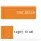{width="100%" fig-alt="Two orange horizontal bars on a linear scale: DGX rack 33.5 kW and legacy rack 12 kW."}

*A four-node DGX rack draws nearly three times a traditional rack.*
:::

```{python}
#| echo: false
# ┌── LEGO ───────────────────────────────────────────────
class InfraFrontierRackPowerRecap:

    # ┌── 4. OUTPUT (Formatting) ──────────────────────────────────────────────
    frontier_params_b_str = fmt_params(Models.Language.GPT3.parameters, scale="B", precision=0, commas=False)
```

For our `{python} InfraFrontierRackPowerRecap.frontier_params_b_str` model, training across `{python} RackPowerRackRecap.cluster_gpus_str` GPUs requires `{python} RackPowerRackRecap.racks_for_1k_str` racks (`{python} RackPowerRackRecap.nodes_per_rack_str` nodes of `{python} RackPowerRackRecap.gpus_per_node_str` GPUs each per rack). Across the cluster, the modeled rack IT power sums to approximately `{python} RackPowerRackRecap.cluster_power_mw_str`, before facility cooling overhead. Delivering this power reliably and removing the resulting heat without allowing any component to exceed its thermal limit is a multidisciplinary engineering challenge spanning electrical, mechanical, and civil engineering. A failure at any point in the power delivery chain, from the utility substation to the individual GPU voltage regulator, can halt the entire training run, wasting hours of computation and potentially corrupting the training state.

::: {#dfn-compute-infrastructure-rack .callout-definition title="Rack"}

***Rack***\index{Rack!definition} is the physical infrastructure unit, a standardized 42U enclosure, that houses multiple compute nodes, a top-of-rack (ToR) switch (the first network aggregation point connecting all nodes in the rack to the broader cluster fabric), power distribution units, and cooling distribution manifolds, defining the granularity at which power and cooling capacity must be provisioned.

1.  **Significance**: AI rack power density has grown dramatically. The chapter's four-node DGX H100 scenario contains `{python} RackPowerRackRecap.rack_gpus_str` GPUs at `{python} H100TdpRackRecap.tdp_w_str` each and draws `{python} RackPowerRackRecap.rack_power_kw_str` at the modeled IT boundary. This exceeds the roughly `{python} RackPowerRackRecap.traditional_rack_kw_str` typical of general-purpose data center racks and requires purpose-designed electrical distribution and cooling capacity. Whether that cooling is engineered air or liquid depends on the system configuration and facility design.
2.  **Distinction**: Unlike a node (the compute unit), a rack is the infrastructure unit: it is the physical level at which cooling manifolds, power distribution, and the ToR switch are integrated, making the rack the minimum replaceable and serviceable unit for facility operations, not the node.
3.  **Common pitfall**: A frequent misconception is that rack placement is a logistical afterthought. Nodes within the same rack share a ToR switch and have single-hop connectivity; nodes in different racks cross at least two switch hops. Placing all pipeline-parallel stages of a training job within the same rack minimizes inter-stage latency and reduces inter-rack fabric load.

:::

Heat transfer explains why density reshapes the rack. Air has much lower volumetric heat capacity than liquid, so an air-cooled rack needs sufficient airflow, pressure, and temperature rise to carry away its heat. There is no universal 30 kW cutoff: the practical limit depends on server and facility design. The chapter's `{python} RackPowerRackRecap.rack_power_kw_str` scenario can use engineered air cooling in a suitable facility; denser systems can make liquid cooling the practical choice.

Cooling selection is therefore configuration-dependent rather than a consequence of one rack-power threshold. Direct-to-chip liquid cooling raises heat-removal capacity and can reduce fan energy, while engineered air remains viable for systems and facilities designed for its airflow requirements.

::: {.column-margin .margin-pointer}
↪ Direct-to-chip liquid cooling and facility PUE trade-offs are evaluated in @sec-sustainable-ai-cooling.
:::

### Rack design considerations {#sec-compute-rack-design}

The physical design of an ML rack differs substantially from a traditional server rack in ways that go beyond power and cooling. In a conventional 42U rack, servers are installed as independent 1U or 2U pizza-box units, each with its own fans, power supplies, and cable connections. ML racks use a fundamentally different form factor. A DGX H100 occupies 8U and contains 8 GPUs, the NVSwitch fabric, multiple power supplies, and (in liquid-cooled configurations) coolant manifolds with quick-connect fittings. Four DGX units in a 42U rack leave only 10U for networking switches, cable management, and PDUs.

The transition from traditional server form factors to ML-optimized designs is driven by the same power density challenge that motivates engineered airflow or liquid cooling. A traditional 1U server dissipates 300--500 W and requires only modest airflow for cooling. A DGX H100 node dissipates approximately `{python} RackPowerRackRecap.node_power_kw_str` across its 8 GPUs, NVSwitches, and supporting components, requiring either massive airflow (in air-cooled configurations) or liquid cooling plumbing (in liquid-cooled configurations). The form factor must accommodate both the compute hardware and the thermal management infrastructure, which is why ML nodes are substantially taller (8U vs. 1U) than traditional servers.

Cable management is a nontrivial engineering challenge. Each DGX H100 node has eight InfiniBand cables (one per GPU), two Ethernet management cables, power cables, and, for liquid-cooled units, coolant hoses. A fully populated rack contains over 40 high-speed cables whose layout is governed by three strict physical constraints: airflow clearance, minimum bend radius, and electromagnetic interference. In air-cooled designs, cables must not obstruct intake or exhaust airflow, because even a localized blockage creates hot spots that trigger thermal throttling. High-speed cables simultaneously enforce a minimum bend radius (typically 10--15$\times$ the outer diameter for active optical cables), below which optical fibers suffer attenuation and induce bit errors or complete link drops. Furthermore, densely bundling high-speed copper cables together can degrade neighboring signal quality through electromagnetic interference. In large installations, the cable plant alone can take weeks to install and test, and cable routing errors are one of the most common causes of post-installation debugging delays.

As rack power densities climb toward `{python} RackPowerRackRecap.liquid_rack_kw_str` for liquid-cooled clusters, the inefficiency of per-server AC conversion becomes untenable. Traditional designs dedicate volume in every chassis to redundant AC power supply units (PSUs), while many dense-rack designs use rack-level DC power distribution\index{Power distribution!48V DC rack-level}. In this architecture, a centralized power shelf converts mains AC to a 48V DC busbar\index{Busbar!48V DC distribution} that runs the height of the rack, replacing individual server PSUs. This consolidation eliminates one conversion stage, yielding a system-wide efficiency gain of 2--3 percent, a meaningful reduction in thermal load when training a 175B-parameter model across thousands of GPUs. Power is delivered via the 48V bus directly to the server backplane, where compact DC-to-DC converters step it down to 12V and finally to the GPU's sub-1V operating voltage. Pioneered by Google and Meta through the Open Compute Project, this topology reduces failure points and recovers valuable chassis volume for hydraulic cooling loops and high-bandwidth interconnects.

#### Power delivery networks and transient dynamics {#sec-compute-power-delivery-transients}

Stepping voltage down from 48V to sub-1V operating levels at the silicon die introduces an acute physical challenge: managing dynamic current slew rates ($di/dt$) across the power delivery network (PDN)\index{Power delivery network!current slew rate}.

The current at a low-voltage core rail differs from the current supplied by the rack busbar because voltage regulators transform the voltage and current between those boundaries. Within each rail, rapid changes in switching activity can disturb the supply even when average power remains within the facility budget.

::: {#dfn-compute-infrastructure-power-delivery-network .callout-definition title="Power delivery network (PDN) and transient dynamics"}

***Power delivery network (PDN)***\index{Power Delivery Network!definition}\index{Transient Voltage Droop!definition} is the electrical distribution hierarchy that supplies the processor through regulators, interconnects, and decoupling capacitors. Parasitic loop inductance contributes to voltage fluctuations during changes in current.

1.  **Significance**: Synchronized workload transitions can correlate accelerator demand. Supply excursions outside the device's specified limits can cause timing errors, protective throttling, or resets.
2.  **Distinction**: Local electrical transients require a faster response than facility power-control loops can provide. Regulators and nearby charge storage address different timescales within the same hierarchy.
3.  **Common pitfall**: Applying the full core-current slew to a single inductance summed from rack to die. Regulation and decoupling change the current waveform at each stage; the relevant inductance and current must belong to the same path.

:::

For a particular inductive path, the voltage excursion contributed by its inductance follows @eq-compute-pdn-droop:

$$\Delta V = L_{\text{parasitic}} \frac{di}{dt}$$ {#eq-compute-pdn-droop}

Here $L_{\text{parasitic}}$ is the loop inductance\index{Power delivery network!loop inductance} of that path, and $di/dt$ is the current slew through it. Local capacitors initially supply part of a load-current increase, so the current slew seen upstream need not equal the slew at the core. A complete rail model also accounts for resistance, capacitance, and regulator response.

```{python}
#| echo: false
#| label: pdn-droop-estimate
# ┌─────────────────────────────────────────────────────────────────────────────
# │ PER-DEVICE PDN DROOP ESTIMATE (LEGO)
# ├─────────────────────────────────────────────────────────────────────────────
# │ Context: @sec-compute-power-delivery-transients, worked estimate after
# │          @eq-compute-pdn-droop.
# │
# │ Goal: Apply the droop equation to ONE accelerator's core rail, with the
# │       current step and the inductance on the same path (the pitfall in
# │       the PDN definition warns against rack-wide current on one loop).
# │ Show: ~375 A step; ~19 mV (about 2%) droop with a microsecond edge;
# │       ~190 mV (over 20%) if the same step arrived in 100 ns.
# │ How: dI = (TDP - communication-phase power) / V_core; dV = L x dI / dt.
# │
# └─────────────────────────────────────────────────────────────────────────────
from mlsysim.fmt import check, fmt, fmt_percent, fmt_power, fmt_qty

class PdnDroopEstimate:
    """Board-loop voltage droop for one H100 core-rail load step."""

    # ┌── 1. LOAD ──────────────────────────────────────────
    p_high = Hardware.Cloud.H100.tdp
    p_low = DvfsPowerSwingScenario.comm_phase_power  # scenario assumption, defined with the DVFS prose
    v_core = 0.8 * ureg.volt  # scenario assumption: accelerator core-rail voltage
    l_loop = 50 * ureg.picohenry  # scenario assumption: VRM-to-package loop inductance on one board
    rise_slow = 1 * microsecond  # scenario assumption: edge seen by the board loop once package capacitors act
    rise_fast = 100 * ureg.nanosecond  # scenario assumption: the same step with no package decoupling
    rail_tolerance = 0.05  # scenario assumption: allowed core-rail excursion as a fraction of V_core

    # ┌── 2. EXECUTE ───────────────────────────────────────
    delta_i = ((p_high - p_low) / v_core).to(ureg.ampere)
    droop_slow = (l_loop * delta_i / rise_slow).to(ureg.millivolt)
    droop_fast = (l_loop * delta_i / rise_fast).to(ureg.millivolt)
    droop_slow_share = (droop_slow / v_core).to_base_units().magnitude
    droop_fast_share = (droop_fast / v_core).to_base_units().magnitude

    # ┌── 3. GUARD ─────────────────────────────────────────
    check(300 < delta_i.magnitude < 450, "A 300 W step at 0.8 V should be several hundred amperes")
    check(droop_slow_share < rail_tolerance < droop_fast_share, "Decoupling should be what keeps the droop inside tolerance")

    # ┌── 4. OUTPUT ────────────────────────────────────────
    p_high_w_str = fmt_power(p_high, unit=watt, precision=0, commas=False)
    p_low_w_str = fmt_power(p_low, unit=watt, precision=0, commas=False)
    v_core_str = fmt_qty(v_core, ureg.volt, precision=1)
    delta_i_str = fmt_qty(delta_i, ureg.ampere, precision=0)
    l_loop_str = fmt_qty(l_loop, ureg.picohenry, precision=0)
    rise_slow_str = fmt_qty(rise_slow, microsecond, precision=0)
    rise_fast_str = fmt_qty(rise_fast, ureg.nanosecond, precision=0)
    droop_slow_str = fmt_qty(round(droop_slow.magnitude) * ureg.millivolt, ureg.millivolt, precision=0)
    droop_fast_str = fmt_qty(round(droop_fast.magnitude, -1) * ureg.millivolt, ureg.millivolt, precision=0)
    droop_slow_pct_str = fmt_percent(droop_slow_share, precision=1, style="prose")
    droop_fast_pct_str = fmt_percent(round(droop_fast_share, 2), precision=0, style="prose")
    rail_tolerance_pct_str = fmt_percent(rail_tolerance, precision=0, style="prose")
```

A worked estimate for one accelerator shows why the hierarchy matters. When an H100 moves from its communication-phase draw of about `{python} PdnDroopEstimate.p_low_w_str` to its `{python} PdnDroopEstimate.p_high_w_str` envelope on a `{python} PdnDroopEstimate.v_core_str` core rail, its core current rises by about `{python} PdnDroopEstimate.delta_i_str`. Suppose the board loop between the voltage regulator and the package has `{python} PdnDroopEstimate.l_loop_str` of inductance. If package capacitors supply the fast edge so that this loop sees the step over `{python} PdnDroopEstimate.rise_slow_str`, @eq-compute-pdn-droop gives a droop of about `{python} PdnDroopEstimate.droop_slow_str`, or `{python} PdnDroopEstimate.droop_slow_pct_str` of the rail. If the same step reached that loop in `{python} PdnDroopEstimate.rise_fast_str`, the droop would be about `{python} PdnDroopEstimate.droop_fast_str`, roughly `{python} PdnDroopEstimate.droop_fast_pct_str` of the rail and far outside a `{python} PdnDroopEstimate.rail_tolerance_pct_str` operating band. The inputs are scenario assumptions, but the tenfold sensitivity to rise time is physical. The same current step stays inside tolerance or corrupts timing depending on which charge store answers it first.

A collective barrier can align transitions from communication to arithmetic\index{Transient voltage droop!barrier trigger}, increasing the correlation of demand across a rack. It does not imply that every accelerator switches on the same nanosecond or that their core currents flow through one shared low-voltage loop. Engineers must evaluate both each device's local voltage excursion and the aggregate demand seen by upstream supplies.

A rising load can produce voltage droop\index{Transient voltage droop!voltage collapse}; an abrupt load reduction can produce overshoot\index{Transient voltage droop!over-voltage overshoot}. Droop below the specified operating minimum\index{Transient voltage droop!under-voltage failure} can invalidate timing margins. Overshoot must remain within the device's specified limits as well. Neither the magnitude nor the resulting failure mode follows from workload synchronization alone.

The mitigation is a hierarchy of charge storage and control\index{Transient voltage droop!decoupling capacitor hierarchy}, in which each tier answers the transients too fast for the tier above it (@tbl-pdn-decoupling-tiers). Placement and parasitic impedance determine which frequencies each tier can address.

| **Tier**     | **Charge store or control**                 | **Response timescale**  | **Transients it absorbs**                                     |
|:-------------|:--------------------------------------------|:------------------------|:--------------------------------------------------------------|
| **On-die**   | On-die capacitance                          | Sub-nanosecond          | Switching activity within a kernel                            |
| **Package**  | Package and interposer capacitors           | Nanoseconds             | Kernel launches and streaming-multiprocessor activation edges |
| **Board**    | Bulk capacitors, regulator control loop     | Microseconds            | Communication-to-compute phase changes of one accelerator     |
| **Facility** | Uninterruptible power supply (UPS), utility | Milliseconds to seconds | Synchronized power swings across racks and the cluster        |

: **Decoupling tiers in the power delivery network**: Each tier supplies charge on a timescale the slower tier above it cannot reach, so a fast edge that bypasses a tier lands on a larger inductance. {#tbl-pdn-decoupling-tiers}

Workload-level controls complement these hardware tiers. Power ramping\index{Transient voltage droop!software power smoothing} can reduce abrupt demand changes where the hardware and firmware support it, but a design must verify those controls rather than assume that every kernel launch receives automatic smoothing. The fleet-level lesson is that average power capacity and transient voltage integrity require separate checks.

```{python}
#| echo: false
from mlsysim.fmt import fmt_bandwidth

# ┌── LEGO ───────────────────────────────────────────────
class InfraIbBwRackRecap:

    # ┌── 4. OUTPUT (Formatting) ──────────────────────────────────────────────
    ib_bw_gbit_per_s_str = fmt_bandwidth(Systems.Fabrics.InfiniBand_NDR.bandwidth, unit=Gbps, precision=0, commas=False)
```

The top-of-rack (ToR) switch\index{Top-of-rack switch!rail optimization} deserves special attention. In traditional data centers, a ToR switch provides 1--10 Gb/s Ethernet connectivity to each server, aggregated into uplinks to higher-level switches. In an ML rack, the ToR switch is an InfiniBand or high-speed Ethernet switch providing `{python} InfraIbBwRackRecap.ib_bw_gbit_per_s_str` per port, and it must handle the bursty, synchronized traffic patterns of distributed training.

The placement and configuration of ToR switches directly affects the network topology. Rail-optimized designs (used by Meta and others) assign each GPU within a node to a specific "rail" that connects to a dedicated ToR switch. In a conventional design, all 8 GPUs in a node connect to the same ToR switch, creating a potential bottleneck when multiple GPUs simultaneously send AllReduce traffic. In a rail-optimized design, GPU 0 in every node connects to ToR switch 0, GPU 1 to ToR switch 1, and so on. This ensures that AllReduce traffic within a parallelism group (where all participants are the same GPU index across different nodes) is confined to a single switch rather than traversing the full fabric.

The rail-optimized design spends additional switches, ports, and cabling to align communication paths with accelerator rails. Its benefit depends on the collective traffic matrix, routing, oversubscription, and job placement rather than a fixed efficiency gain.

::: {.column-margin .margin-pointer}
↪ Rail-optimized fabric topologies and collective communication routing are developed in @sec-network-fabrics.
:::

#### Facility reliability and environmental controls {#sec-compute-infrastructure-physical-security-environmental-controls-7132}

Rack design also defines physical failure domains. Data centers housing ML infrastructure implement multiple layers of physical security and environmental monitoring, not only for regulatory compliance but also because a single rack of DGX H100 nodes (`{python} RackPowerRackRecap.rack_hardware_musd_str` million in hardware alone) concentrates enough value, heat, and liquid-cooling risk to justify controls that would be excessive for traditional server equipment.

Environmental monitoring is therefore part of the compute design rather than a facilities afterthought. Water detection sensors beneath raised floor tiles and around liquid cooling piping can identify leaks within seconds and trigger automatic coolant isolation valves. Aspirating smoke detection systems continuously sample air from inside racks, detecting combustion byproducts at concentrations far below what sprinkler-activating detectors can sense. Vibration sensors on the building structure and rack frames catch seismic events or construction-induced vibration that could damage disk drives or loosen cable connections. Humidity control keeps relative humidity between 40--60 percent to prevent both static discharge and condensation.

These environmental controls are not afterthoughts but integral parts of the infrastructure design that affect reliability and uptime. A water leak that reaches a DGX H100 baseboard can cause millions of dollars in damage and weeks of downtime. A fire in a single rack can shut down an entire data center hall for days while the fire suppression system is recharged and the affected area is decontaminated. The 2021 OVHcloud fire in Strasbourg shows how a single-building incident, absent the right compartmentalization, escalates into a site-wide failure domain.

::: {#ws-compute-infrastructure-ovh-strasbourg-fire .callout-war-story title="The data center that became the failure domain (2021)"}

**Context**: OVHcloud operated four data centers at its Strasbourg site, serving customers whose systems depended on the site's physical power, fire, and recovery design [@ovhcloud2021strasbourg].

**Mechanism**: On March 10, 2021, a fire broke out in building SBG2. Uncontained fire spread and shared power pathways destroyed building SBG2, damaged adjacent SBG1, and forced emergency shutdown of SBG3 and SBG4.

**Impact**: Thousands of servers were physically destroyed, taking over 3.6 million websites offline worldwide and destroying unbacked-up customer data.

**Fix**: OVHcloud rebuilt the site with independent physical fire barriers, isolated power distribution per building, and mandatory free off-site backup storage.

**Systems lesson**: Compute infrastructure is not only GPUs and network topology. Fire compartments, power isolation, backup geography, and disaster-recovery assumptions determine whether a rack-scale incident becomes a site-scale outage. Multi-node ML training clusters inherit this physical dependency: a single data-center power or cooling domain failure halts active training runs and destroys un-replicated checkpoint states unless recovery paths cross physical facility boundaries.

:::

Once rack-level controls are in place, the reliability question moves up to facility redundancy. The same failure-domain logic that isolates a leaking rack also decides how much duplicate power, cooling, and recovery capacity the site should buy.

Data center reliability is commonly classified using the Uptime Institute Tier system, with Tier III\index{Data center!Tier III concurrent maintainability} and Tier IV\index{Data center!Tier IV fault tolerance} representing common options for mission-critical compute [@uptimeInstituteTiers]. A Tier III facility is concurrently maintainable: redundant capacity components and distribution paths let operators maintain or replace equipment without shutting down IT operations. Tier IV adds fault tolerance through independent, physically isolated systems, so a single equipment failure or distribution-path interruption should not affect IT operations. The practical difference is not a magic availability number; it is how much failure prevention the building buys in electrical and mechanical infrastructure before software-level resilience takes over.

For ML training infrastructure, the calculus differs from traditional enterprise computing. A training run is a long-running batch process, not a real-time transaction system. If a facility-level outage occurs during a two-week training run, the cost is usually a restart from the last checkpoint rather than permanent data loss. Many ML training deployments therefore pair concurrently maintainable facility designs with aggressive application-level fault tolerance: instead of buying every possible layer of building-level redundancy, engineers invest in checkpointing, job restart, and storage systems that can absorb rare facility interruptions. This software resilience commoditizes part of the facility risk, treating the data center as a fallible utility rather than a fortress. Avoided facility-resiliency spend can then be redirected toward accelerator capacity, networking, or storage, which may produce more training progress for the same budget.

::: {#chk-compute-infrastructure-infrastructure-physics .callout-checkpoint title="Infrastructure physics"}

A team is planning to deploy 256 H100 GPUs (32 nodes) in an existing air-cooled data center with 250 kW of available power capacity and cooling rated for 200 kW at PUE 1.5.

- [ ] **Facility power**: calculate the total power draw, including cooling overhead.
- [ ] **Binding capacity**: identify whether power capacity or cooling capacity is the binding constraint.
- [ ] **Required modifications**: specify what modifications would be needed to support the full deployment.

:::

```{python}
#| echo: false
# ┌── LEGO ───────────────────────────────────────────────
class InfraFrontierStragglerRecap10:

    # ┌── 4. OUTPUT (Formatting) ──────────────────────────────────────────────
    frontier_params_b_str = fmt_params(Models.Language.GPT3.parameters, scale="B", precision=0, commas=False)
```

The rack concentrates power and heat into a physical volume where thermodynamics, not software, sets the limits. A single rack of 32 GPUs, however, is far from sufficient for our `{python} InfraFrontierStragglerRecap10.frontier_params_b_str` model, which needs tens to hundreds of nodes, many racks' worth, to train on a practical schedule. The next level of infrastructure aggregates hundreds of racks into a unified computing system: the pod, whose network topology (@fig-pod-network-topology) is designed around the communication pattern the workload must sustain. Full any-to-any bisection is one design point; torus and rail-optimized designs trade that universality for lower cost or better locality.

## The Pod {#sec-compute-pod}

Training our `{python} InfraFrontierStragglerRecap10.frontier_params_b_str` model on a single DGX H100 node (8 GPUs, `{python} SingleNodeTrainingTime.node_peak_fp8_tflop_per_s_str` of aggregate FP8 peak) would take about `{python} SingleNodeTrainingTime.node_years_str` years at the efficiency assumed below, even if the model state could fit. Roughly `{python} SingleNodeTrainingTime.nodes_for_target_str` nodes bring the compute-only time down to two weeks, and about `{python} SingleNodeTrainingTime.nodes_for_one_day_str` nodes bring it to a single day, before any communication or recovery overhead. A pod is the cluster-scale unit that makes this possible: many racks under one high-speed fabric, power envelope, and cooling design. Pod design is the first point where topology, power, and failure domains become shared infrastructure rather than per-rack concerns.

::: {#fig-pod-network-topology fig-env="figure" fig-pos="htb" fig-cap="**Pod-scale network topologies**: Two dominant ways to wire a pod. Left: a switched fat-tree, drawn here as a two-tier leaf and spine fabric in which every leaf switch connects to every spine switch and has as many uplinks as node ports, so any half of the nodes can talk to the other half at full rate (full bisection bandwidth). InfiniBand clusters such as DGX SuperPOD use this design, and larger pods add a third, core tier above the spines. Right: a 2D torus wires each node directly to its four neighbors, and the dashed stubs wrap each row and column around to its opposite edge; bisection bandwidth grows only as $\mathcal{O}(\sqrt{N})$, so the torus is cheaper at scale but rewards workloads with strong locality, as in Google TPU pods. The choice shapes which parallelism strategies run efficiently." fig-alt="Two panels. Left, Switched fat-tree: four spine switches in a top row, four leaf switches below with a link from every leaf to every spine, and four nodes under each leaf; the footer reads full bisection bandwidth. Right, 2D torus: a four-by-four grid of nodes joined to their horizontal and vertical neighbors, with dashed stubs at every row and column end marking wrap-around links; the footer reads bisection grows as the square root of N."}
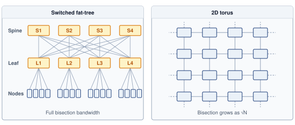

:::

The engineering challenge of the pod\index{Pod!interconnect scaling} is wiring those nodes together into a network fast enough to keep gradient synchronization from becoming the bottleneck. The pod aggregates hundreds of racks into a single, coordinated computing system where the network fabric serves the same role that the system bus serves within a single machine.

```{python}
#| echo: false
from mlsysim.fmt import check, fmt, fmt_int, fmt_mass, fmt_power

# ┌── LEGO ───────────────────────────────────────────────
# │ Context: pod-scale inventory paragraph in @sec-compute-pod.
class PodScaleInventory:
    """Parts, power, racks, and mass of a 1,024-node DGX H100 pod."""

    # ┌── 1. LOAD ──────────────────────────────────────────
    pod = Systems.Clusters.Frontier_8K
    rack = Systems.Racks.DGX_H100_4Node
    ref_gpus = Scenarios.DenseLLMPretrainingReference.system.total_accelerators
    node = pod.node

    # ┌── 2. EXECUTE ───────────────────────────────────────
    nodes = pod.count
    gpus = pod.total_accelerators
    nvswitches = nodes * node.nvswitch_count
    hcas = nodes * node.nics_per_node
    racks = nodes / rack.nodes_per_rack
    pod_power = racks * rack.total_power
    node_mass = node.mass
    pod_node_mass = nodes * node_mass
    scale_up = gpus / ref_gpus

    # ┌── 3. GUARD ─────────────────────────────────────────
    check(scale_up == 8, "Prose says the pod examples step up to eight times the reference cluster")
    check(pod_node_mass.to(metric_ton).magnitude > 130, "Prose says 1,024 nodes weigh over 130 metric tons")
    check(7 < pod_power.to(MW).magnitude < 10, "Pod IT power should land in the 7-10 MW band")

    # ┌── 4. OUTPUT ────────────────────────────────────────
    nodes_str = fmt(nodes, precision=0, commas=True)
    gpus_str = fmt(gpus, precision=0, commas=True)
    nvswitches_str = fmt(nvswitches, precision=0, commas=True)
    hcas_str = fmt(hcas, precision=0, commas=True)
    racks_str = fmt(racks, precision=0, commas=False)
    pod_power_mw_str = fmt_power(pod_power, unit=MW, precision=1, commas=False)
    node_mass_kg_str = fmt_mass(round(node_mass.to(kilogram).magnitude) * kilogram, unit=kilogram, precision=0)
    node_mass_lb_str = fmt_mass(round(node_mass.to(ureg.pound).magnitude) * ureg.pound, unit=ureg.pound, precision=0)
    pod_node_mass_t_str = fmt_int(int(pod_node_mass.to(metric_ton).magnitude))  # floor: prose says "over"
```

The scale of this challenge is worth appreciating concretely, and the pod-scale examples that follow deliberately step up to eight times the `{python} InfraSetup.ref_gpus_str`-GPU reference cluster. A `{python} PodScaleInventory.nodes_str`-node DGX H100 cluster contains `{python} PodScaleInventory.gpus_str` GPUs, `{python} PodScaleInventory.nvswitches_str` NVSwitch chips, `{python} PodScaleInventory.hcas_str` InfiniBand HCAs, several hundred InfiniBand switches, tens of thousands of cables, and draws approximately `{python} PodScaleInventory.pod_power_mw_str` at the modeled rack IT boundary. It occupies `{python} PodScaleInventory.racks_str` four-node racks across one or more data center halls.

The physical weight of such a cluster is also substantial. Each DGX H100 node weighs approximately `{python} PodScaleInventory.node_mass_kg_str` (`{python} PodScaleInventory.node_mass_lb_str`), so `{python} PodScaleInventory.nodes_str` nodes weigh over `{python} PodScaleInventory.pod_node_mass_t_str` metric tons. Combined with racks, switches, cables, and cooling infrastructure, the total weight can exceed 300 metric tons. The data center floor must be structurally engineered to support this concentrated load, with typical floor loading requirements of 1,500--2,500 kg per square meter for ML clusters, compared to 500--1,000 kg per square meter for traditional server installations. This structural requirement is often overlooked during facility planning and can be a blocking constraint for retrofitting existing buildings.

The physical layout of the data center hall reflects these density constraints. The extreme power density of ML training racks necessitates rigid hot aisle/cold aisle containment in air-cooled sections, where cold air is forced into the enclosed front of the rack and waste heat is captured immediately at the rear exhaust. The "spine" of the hall, the central cable corridor connecting all racks to the aggregation switches, must accommodate thousands of fiber optic cables and power feeds. Overhead cable trays are preferred over under-floor routing to improve airflow and accessibility, carrying the heavy copper power feeds and fragile fiber interconnects that form the nervous system of the cluster. The layout must also accommodate the liquid cooling infrastructure: coolant distribution unit placement, coolant piping runs, and isolation valves that allow individual racks to be serviced without draining the entire cooling loop. These physical layout decisions, made during facility design, constrain the network topology options available to the training team years later.

```{python}
#| echo: false
#| label: pod-training-math
#| output: false
# ┌─────────────────────────────────────────────────────────────────────────────
# │ POD-SCALE TRAINING MATH BLOCKS (LEGO)
# ├─────────────────────────────────────────────────────────────────────────────
# │ Context: Pod training time analysis and @callout-notebook "Training Time
# │          for 175B" that follows.
# │
# │ Goal: Provide formatted math for total FLOPs, cluster throughput, and
# │       per-step compute for the 175B running example.
# │ Show: 6 * 175 * 10^23 FLOPs, 8192-GPU compute-only rate at assumed 45% local efficiency.
# │ How: Build fmt_math strings from InfraSetup values.
# │
# └─────────────────────────────────────────────────────────────────────────────

class PodTrainingMath:
    """Formatted math strings for 175B training time derivation."""

    _gpt3 = Models.Language.GPT3
    _frontier = Systems.Clusters.Frontier_8K
    gpt3_params_b = _gpt3.parameters.to(param).magnitude / BILLION
    gpt3_tokens_b = _gpt3.training_tokens.to(count).magnitude / BILLION
    n_gpus = _frontier.total_accelerators
    gpt3_params_b_value_str = fmt(gpt3_params_b, precision=0, commas=False)
    gpt3_tokens_b_value_str = fmt(gpt3_tokens_b, precision=0, commas=False)
    gpt3_tokens_billion_str = fmt_tokens(_gpt3.training_tokens, scale="billion", scale_style="word", precision=0, commas=False)
    h100_fp8_flops = Hardware.Cloud.H100.compute.precision_flops['fp8']
    h100_fp8_tflop_per_s_value_str = fmt_magnitude(h100_fp8_flops, unit=TFLOP / second, precision=0, commas=False)
    h100_fp8_tflop_per_s_str = fmt_flop_rate(h100_fp8_flops, unit=TFLOP / second, precision=0, commas=True)
    local_efficiency = ReferenceStats.TrainingScaleProfiles.LocalComputeEfficiency  # useful compute before distributed overhead
    _total_flops = 6 * _gpt3.parameters.to(param).magnitude * _gpt3.training_tokens.to(count).magnitude
    pod_flops_math = fmt_math(f"6 \\times {gpt3_params_b_value_str} \\times 10^{{9}} \\times {gpt3_tokens_b_value_str} \\times 10^{{9}}")
    total_flops_math = fmt_math(sci_latex(_total_flops, precision=2))
    n_params_math = fmt_math(f"P = {gpt3_params_b_value_str} \\times 10^9")
    n_tokens_math = fmt_math(f"D = {gpt3_tokens_b_value_str} \\times 10^9")
    n_gpus_fmt = fmt(n_gpus, precision=0, commas=True)
    cluster_throughput_math = fmt_math(f"{n_gpus_fmt} \\times {h100_fp8_tflop_per_s_value_str} \\times 10^{{12}} \\times {local_efficiency}")
    cluster_throughput = n_gpus * h100_fp8_flops * local_efficiency
    t_compute_hr = (_total_flops * flop / cluster_throughput).to(hour).magnitude
    check(11 < t_compute_hr < 13, "Prose quotes a compute-only baseline of approximately 12 hours")
    t_compute_hr_str = fmt_time(round(t_compute_hr), 'hour', precision=0, commas=False, style='word')
    cluster_eflop_per_s_str = fmt_flop_rate(cluster_throughput, unit=EFLOP / second, precision=2, commas=False)
    n_gpus_str = fmt(n_gpus, precision=0)
    local_efficiency_pct_str = fmt_percent(local_efficiency, precision=0, commas=False, style='prose')

    # ┌── 4. OUTPUT (Formatting) ──────────────────────────────────────────────
```

```{python}
#| echo: false
# ┌── LEGO ───────────────────────────────────────────────
class InfraFrontierPodTrainingRecap:

    # ┌── 4. OUTPUT (Formatting) ──────────────────────────────────────────────
    frontier_params_b_str = fmt_params(Models.Language.GPT3.parameters, scale="B", precision=0, commas=False)
```

Training a `{python} InfraFrontierPodTrainingRecap.frontier_params_b_str` model on this cluster requires `{python} PodTrainingMath.pod_flops_math` total floating-point operations (assuming `{python} PodTrainingMath.gpt3_tokens_billion_str` training tokens). Assuming local compute efficiency of `{python} PodTrainingMath.local_efficiency_pct_str` before communication and pipeline losses, the aggregate compute rate is `{python} PodTrainingMath.cluster_throughput_math` FLOP/s, or about `{python} PodTrainingMath.cluster_eflop_per_s_str`, yielding a compute-only baseline of approximately `{python} PodTrainingMath.t_compute_hr_str`. This assumed local efficiency is not measured distributed MFU, because MFU over a distributed step already includes its communication and pipeline losses. In the terms of the Fleet Law (@eq-fleet-law), this baseline is the $T_{\text{compute}}/N$ term alone.

In practice, communication overhead, pipeline bubbles, checkpoint I/O, hardware failures, and maintenance windows compound to extend the actual wall-clock time beyond that baseline. The first two are the Fleet Law's exposed $T_{\text{comm}}$ and $T_{\text{sync}}$ terms, and the rest are operational losses around the step. Notebook \ref{nbk-compute-infrastructure-training-time-175b} chains these factors into a scenario estimate of wall-clock time; production schedules can stretch further once queueing, data readiness, debugging, reruns, and site-specific operational margins enter the plan. The central theme is unchanged: at pod scale, the schedule depends on both local execution and fleet overhead. Recovering this lost time is the central challenge of distributed systems engineering, and the solutions span hardware (better networks), software (overlapped communication), and operations (proactive maintenance to minimize downtime).

```{python}
#| echo: false
#| label: training-time-175b-calc
from mlsysim.fmt import fmt_time

# ┌─────────────────────────────────────────────────────────────────────────────
# │ TRAINING TIME FOR 175B MODEL (LEGO)
# ├─────────────────────────────────────────────────────────────────────────────
# │ Context: @sec-compute-pod—Training Time for 175B callout
# │
# │ Goal: Derive the scenario training time from first principles,
# │       starting from total FLOPs and aggregate cluster throughput.
# │ Show: ~12 h compute baseline → ~26 h scenario estimate before site-specific operations.
# │ How: Divide total training FLOPs by aggregate effective throughput; apply overhead multipliers sequentially.
# │
# └─────────────────────────────────────────────────────────────────────────────

# ┌── LEGO ───────────────────────────────────────────────
class TrainingTime175B:
    """
    Scenario: Training Archetype A (175B) on 8,192 H100 GPUs, eight times
    the 1,024-GPU reference cluster.
    Quantifies the gap between silicon capability and fleet productivity.
    """

    # ┌── 1. LOAD (Constants) ───────────────────────────────────────────────
    from mlsysim.physics import dTime

    n_params = Models.Language.GPT3.parameters.to(param).magnitude
    n_tokens = Models.Language.GPT3.training_tokens.to(count).magnitude
    n_gpus = Systems.Clusters.Frontier_8K.total_accelerators
    peak_flops = Hardware.Cloud.H100.compute.precision_flops["fp8"]
    local_efficiency = ReferenceStats.TrainingScaleProfiles.LocalComputeEfficiency  # useful compute before distributed overhead

    # Scenario multipliers; each additive overhead is relative to the preceding subtotal
    # Modeled scaling-efficiency tier for 8,192 GPUs (includes pipeline bubbles).
    scaling_eff = ReferenceStats.TrainingScaleProfiles.Eff8192Gpu
    ckpt_overhead = Ops.TrainingRunOverheads.Checkpoint
    fail_overhead = Ops.TrainingRunOverheads.FailureRecovery
    maint_overhead = Ops.TrainingRunOverheads.Maintenance

    # ┌── 2. EXECUTE (The Compute) ─────────────────────────────────────────
    # Use dTime for authoritative training time math
    t_base = dTime(total_ops=6 * n_params * n_tokens * flop, num_devices=n_gpus, peak_flops_per_device=peak_flops, efficiency_eta=local_efficiency)
    t_physics_hr = t_base.to(hour).magnitude

    # Sequential overhead accumulation; these are assumed nonoverlapping increments
    t_comm_hr = t_physics_hr / scaling_eff
    t_ckpt_hr = t_comm_hr * (1 + ckpt_overhead)
    t_fail_hr = t_ckpt_hr * (1 + fail_overhead)
    t_maint_hr = t_fail_hr * (1 + maint_overhead)

    t_total_weeks = t_maint_hr / (24 * 7)

    # ┌── 3. GUARD (Invariants) ───────────────────────────────────────────
    check(11 < t_physics_hr < 13, "Compute-only baseline for this scenario should be ~12h")
    check(abs(t_fail_hr / t_ckpt_hr - (1 + fail_overhead)) < 1e-12, "Failure overhead is a fraction of the preceding subtotal")
    check(
        abs((t_fail_hr - t_ckpt_hr) / t_fail_hr - fail_overhead / (1 + fail_overhead)) < 1e-12,
        "Final-time failure share uses the final-time denominator",
    )
    check(t_total_weeks < 4, "Training should complete within 4 weeks")

    # ┌── 4. OUTPUT (Formatting) ──────────────────────────────────────────────
    t_physics_hr_str = fmt_time(t_physics_hr, 'hour', precision=1, commas=True, style='word')
    t_comm_hr_str = fmt_time(t_comm_hr, 'hour', precision=1, commas=True, style='word')
    t_ckpt_hr_str = fmt_time(t_ckpt_hr, 'hour', precision=1, commas=True, style='word')
    t_fail_hr_str = fmt_time(t_fail_hr, 'hour', precision=1, commas=True, style='word')
    t_maint_hr_str = fmt_time(t_maint_hr, 'hour', precision=1, commas=True, style='word')
    t_total_days_str = fmt_time(t_maint_hr / 24, 'day', precision=1, commas=True, style='word')
    scaling_eff_str = fmt(scaling_eff, precision=2, commas=False)
    ckpt_pct_math = fmt_math(f"\\approx {ckpt_overhead * 100:.0f}\\%")
    fail_pct_math = fmt_math(f"\\approx {fail_overhead * 100:.0f}\\%")
    maint_pct_math = fmt_math(f"\\approx {maint_overhead * 100:.0f}\\%")
    ckpt_mult_math = fmt_math(f"\\times {1 + ckpt_overhead:.2f} \\rightarrow")
    fail_mult_math = fmt_math(f"\\times {1 + fail_overhead:.2f} \\rightarrow")
    maint_mult_math = fmt_math(f"\\times {1 + maint_overhead:.2f} \\rightarrow")
```

::: {#nbk-compute-infrastructure-training-time-175b .callout-notebook title="Training time for 175B"}

```{python}
#| echo: false
# ┌── LEGO ───────────────────────────────────────────────
class InfraFrontierPodTimeRecap:

    # ┌── 4. OUTPUT (Formatting) ──────────────────────────────────────────────
    frontier_params_b_str = fmt_params(Models.Language.GPT3.parameters, scale="B", precision=0, commas=False)
```

The training time for our `{python} InfraFrontierPodTimeRecap.frontier_params_b_str` model derives from first principles.

1. **Total FLOPs**\index{Training time!total FLOPs}: Using the approximation $6 \times P \times D$, where `{python} PodTrainingMath.n_params_math` and `{python} PodTrainingMath.n_tokens_math` tokens:
   `{python} PodTrainingMath.total_flops_math` FLOPs

2. **Cluster throughput**: `{python} PodTrainingMath.n_gpus_str` H100 GPUs at `{python} PodTrainingMath.h100_fp8_tflop_per_s_str` peak, assuming `{python} PodTrainingMath.local_efficiency_pct_str` local compute efficiency before distributed overhead:
   `{python} PodTrainingMath.cluster_throughput_math` FLOP/s before distributed overhead $\approx$ `{python} PodTrainingMath.cluster_eflop_per_s_str`

3. **Compute-only training baseline**:
   (`{python} PodTrainingMath.total_flops_math` FLOPs)/(`{python} PodTrainingMath.cluster_throughput_math` FLOP/s) $\div 3600 \approx$ `{python} TrainingTime175B.t_physics_hr_str`

4. **Illustrative overhead chain**: The scaling factor already includes pipeline fill and drain, so no separate bubble step follows. Each subsequent percentage adds time relative to the preceding subtotal, not to final wall time; the factors are scenario assumptions, not independent measured losses:
   - Distributed-step losses (scaling efficiency `{python} TrainingTime175B.scaling_eff_str`, the modeled tier for 8,192 GPUs, covering communication and pipeline bubbles): $\div$ `{python} TrainingTime175B.scaling_eff_str` $\rightarrow$ `{python} TrainingTime175B.t_comm_hr_str`
   - Checkpoint overhead (`{python} TrainingTime175B.ckpt_pct_math`): `{python} TrainingTime175B.ckpt_mult_math` `{python} TrainingTime175B.t_ckpt_hr_str`
   - Hardware failures and restarts (`{python} TrainingTime175B.fail_pct_math` of the checkpoint-adjusted subtotal): `{python} TrainingTime175B.fail_mult_math` `{python} TrainingTime175B.t_fail_hr_str`
   - Maintenance windows (`{python} TrainingTime175B.maint_pct_math`): `{python} TrainingTime175B.maint_mult_math` `{python} TrainingTime175B.t_maint_hr_str`

**Total**: `{python} TrainingTime175B.t_maint_hr_str` in this simplified scenario chain, or about `{python} TrainingTime175B.t_total_days_str`. Real production calendars may still stretch to weeks after queueing, debugging, reruns, and site-specific operational margins are included. Recovering this lost time is the domain of distributed systems engineering, the subject of @sec-distributed-training-systems.

:::

```{python}
#| echo: false
#| label: wsc-aggregate-throughput
# ┌─────────────────────────────────────────────────────────────────────────────
# │ WSC AGGREGATE THROUGHPUT (LEGO)
# ├─────────────────────────────────────────────────────────────────────────────
# │ Context: WSC paragraph in @sec-compute-pod — aggregate FP16/FP8
# │          peak throughput for a 10,000-H100 cluster.
# │
# │ Goal: Compute aggregate ExaFLOP/s from canonical H100 per-GPU constants.
# │ Show: ~9.89 EFLOP/s FP16; ~19.8 EFLOP/s FP8 at N = 10,000 GPUs.
# │ How: N × H100 FP16/FP8 tensor-core throughput, expressed in EFLOP/s.
# │
# └─────────────────────────────────────────────────────────────────────────────
from mlsysim.fmt import check, fmt, fmt_bandwidth, fmt_flop_rate

class WscThroughput:
    """Aggregate FP16/FP8 throughput + injection bandwidth for a 10,000-H100 WSC."""

    # ┌── 1. LOAD ──────────────────────────────────────────────────────────
    n_gpus = Systems.Clusters.Training_10K.total_accelerators
    per_gpu_inject = Systems.Fabrics.InfiniBand_NDR.bandwidth
    oversub_factor = Systems.Fabrics.InfiniBand_NDR_Oversub4to1.oversubscription_ratio  # 4:1 oversubscribed fabric profile
    gpu_mtbf = Systems.Reliability.Gpu.mttf_hours

    # ┌── 2. EXECUTE ───────────────────────────────────────────────────────
    wsc_fp16 = n_gpus * Hardware.Cloud.H100.compute.peak_flops
    wsc_fp8 = n_gpus * Hardware.Cloud.H100.compute.precision_flops["fp8"]
    wsc_inject = n_gpus * per_gpu_inject
    # Bisection: half the endpoints times the link rate, matching the
    # BisectionDefinitionExample convention in @sec-network-fabrics.
    wsc_bisection = (n_gpus / 2) * per_gpu_inject
    wsc_oversub = wsc_bisection / oversub_factor
    wsc_mtbf = calc_mtbf_cluster(gpu_mtbf, n_gpus)
    check(oversub_factor == 4, "Prose glosses 4:1 oversubscription as one quarter as much uplink")
    check(abs(wsc_mtbf.to(hour).magnitude - 5) < 0.01, "Prose says a failure roughly once every five hours")

    # ┌── 3. GUARD ─────────────────────────────────────────────────────────
    check(9 < wsc_fp16.to(EFLOP / second).magnitude < 11, "WSC FP16 EFLOPS should be ~9.89")
    check(wsc_fp8 > wsc_fp16, "FP8 throughput must exceed FP16")
    check(
        abs((wsc_oversub - wsc_inject / (2 * oversub_factor)).to(TB / second).magnitude) < 1e-9,
        "Oversubscribed bisection is injection / (2 x oversubscription)",
    )

    # ┌── 4. OUTPUT ────────────────────────────────────────────────────────
    wsc_fp16_eflop_per_s_str = fmt_flop_rate(wsc_fp16, unit=EFLOP / second, precision=2, commas=False)
    wsc_fp8_eflop_per_s_str = fmt_flop_rate(wsc_fp8, unit=EFLOP / second, precision=1, commas=False)
    wsc_inject_tb_per_s_str = fmt_bandwidth(wsc_inject, unit=TB / second, precision=0, commas=False)
    wsc_bisection_tb_per_s_str = fmt_bandwidth(wsc_bisection, unit=TB / second, precision=0, commas=False)
    wsc_oversub_tb_per_s_str = fmt_bandwidth(wsc_oversub, unit=TB / second, precision=1, commas=False)
    n_gpus_str = fmt(n_gpus, precision=0, commas=True)
    per_gpu_inject_gb_per_s_str = fmt_bandwidth(per_gpu_inject, unit=GB / second, precision=0, commas=False)
    oversub_ratio_str = fmt(oversub_factor, precision=0, commas=False)
    gpu_mtbf_hours_str = fmt_time(gpu_mtbf, 'hour', precision=0, commas=True, style='word')
```

At this scale, the unit of analysis is no longer a rack or pod of independent servers. The facility has to behave as the warehouse-scale computer (WSC)\index{Warehouse-scale computer!pod scale}\index{WSC!data center scale} of @sec-introduction-shift-warehousescale-computer-2ccd, the building-scale machine that Barroso, Hölzle, and Ranganathan describe in *The Datacenter as a Computer* [@barroso2019], and the pod is where that idea acquires numbers. A WSC of `{python} WscThroughput.n_gpus_str` H100 GPUs, about ten times the reference cluster, delivers approximately `{python} WscThroughput.wsc_fp16_eflop_per_s_str` of FP16 peak (and about `{python} WscThroughput.wsc_fp8_eflop_per_s_str` at FP8), but it runs only as fast as its bisection bandwidth allows. Non-blocking InfiniBand at `{python} WscThroughput.per_gpu_inject_gb_per_s_str` per GPU provides `{python} WscThroughput.wsc_inject_tb_per_s_str` of aggregate injection bandwidth and `{python} WscThroughput.wsc_bisection_tb_per_s_str` across the bisection (half the endpoints times the link rate). If the fabric is `{python} WscThroughput.oversub_ratio_str`:1 oversubscribed, meaning its switches provide one quarter as much uplink as downlink capacity, the bisection bandwidth drops to `{python} WscThroughput.wsc_oversub_tb_per_s_str`, and every collective whose traffic crosses the bisection loses the same factor.

Coupling distinguishes a WSC from a general-purpose cluster. A synchronous training job couples the workers in its own process groups, so a failed worker can stall that job while other tenants continue, unless a shared power, cooling, or network failure reaches them as well. Designing such a machine is building-level computer architecture. Rack placement, the power delivery chain, and the network topology must be co-designed, because a mistake at any layer propagates through the others.

### WSC architecture principles {#sec-compute-wsc-principles}

::: {.column-margin}
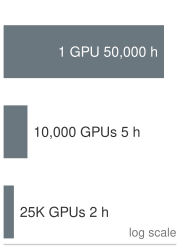{width="100%" fig-alt="Three-rung time ladder: one GPU has about 50,000 hours mean time to failure, 1,000 GPUs about 50 hours, and 10,000 GPUs about 5 hours."}

*Fleet-level MTBF falls inversely with GPU count.*
:::

Treating the building as one computer, rather than as a room full of computers, changes how engineers approach its physical design. In a traditional data center, each server is an independent unit with its own operating system, storage, and network identity. The facility simply provides power, cooling, and physical security. Servers can be added, removed, or replaced independently, and the workloads running on different servers are unrelated to each other.

In a WSC, a server assigned to a distributed training job contributes to a shared completion time. Its standalone throughput is useful only if the other participants, network, and storage can sustain that rate. For the running model, a node must obtain additional memory capacity or offload state, and a practical training schedule also requires more compute. The network fabric, distributed storage, and fleet orchestrator make those resources available as one training system.

The first physical consequence concerns communication. The network can set the scaling ceiling: within a single node NVLink supplies enough bandwidth for tensor parallelism, but across nodes the fabric must carry gradient tensors, activation checkpoints, and pipeline stage outputs, so a building-scale machine is only as fast as the wires that bind its cores. The WSC reframing makes the interconnect a first-class architectural component rather than a peripheral.

The second consequence is that *failure is a physical certainty, not an exceptional event*. A single GPU has an MTBF\index{MTBF!cluster scale degradation} of approximately `{python} WscThroughput.gpu_mtbf_hours_str`, but reliability degrades linearly with component count: a cluster of `{python} WscThroughput.n_gpus_str` such GPUs experiences a failure roughly once every five hours. This is a building-level property of the physical machine, and it is why a WSC must be designed from the start so that individual component failures degrade rather than halt the running workload, with dual-path power feeds, redundant switch fabrics, and persistent checkpoint storage at every level.

The third consequence is that the building blocks combine differently depending on the workload they must carry. A pod is not assembled from a single canonical part list; the interconnect, the switching, and the memory placement are each chosen against the communication and capacity pattern the dominant workload imposes. @Tbl-pod-comparison contrasts three pod designs. An NVIDIA SuperPOD wires GPUs through an InfiniBand fat-tree for any-to-any flexibility, a Google TPU pod hard-wires chips into a torus for dataflow throughput, and a recommendation pod built for Archetype B arranges the same class of accelerators around embedding memory rather than raw compute.

| **System**            | **NVIDIA SuperPOD** |   **Google TPU Pod**  |   **Recommendation pod**  |
|:----------------------|:-------------------:|:---------------------:|:-------------------------:|
| **Interconnect**      | InfiniBand Fat-Tree |      3D Torus ICI     | RoCE (RDMA over Ethernet) |
| **Switching**         |  External Switches  |  Direct Chip-to-Chip  |    Leaf/Spine Ethernet    |
| **Topology**          |      Any-to-any     | Nearest-Neighbor Mesh |       Rail-optimized      |
| **Optimization**      |     Flexibility     |  Dataflow Throughput  |      Embedding Memory     |
| **Dominant workload** |   Diverse Research  |      LLM Training     |       Recommendation      |

: **Pod architecture by workload**: Each pod's interconnect, switching, and memory emphasis reflects the communication and capacity pattern of its dominant workload, not a single best design. The economics that decide which workload an organization optimizes for are taken up in @sec-ops-scale-fleet-economics. {#tbl-pod-comparison}

```{python}
#| echo: false
from mlsysim.fmt import check, fmt_usd

# ┌── LEGO ───────────────────────────────────────────────
# │ Context: recommendation-pod memory-placement paragraph below.
class EmbeddingTierPricing:
    """Host DRAM versus HBM $/GB anchors for embedding-table placement."""

    # ┌── 1. LOAD ──────────────────────────────────────────
    dram_low = Infrastructure.Pricing.Storage.HostDramLowPerGb.rate.to(USD / GB).magnitude
    dram_high = Infrastructure.Pricing.Storage.HostDramHighPerGb.rate.to(USD / GB).magnitude
    hbm_low = Infrastructure.Pricing.Storage.HbmLowPerGb.rate.to(USD / GB).magnitude
    hbm_high = Infrastructure.Pricing.Storage.HbmEquivalentPerGb.rate.to(USD / GB).magnitude

    # ┌── 3. GUARD ─────────────────────────────────────────
    check(dram_high < hbm_low, "Host DRAM should be cheaper per GB than HBM across both ranges")

    # ┌── 4. OUTPUT ────────────────────────────────────────
    dram_low_str = fmt_usd(dram_low, precision=0, commas=False)
    dram_high_str = fmt_usd(dram_high, precision=0, commas=False)
    hbm_low_str = fmt_usd(hbm_low, precision=0, commas=False)
    hbm_high_str = fmt_usd(hbm_high, precision=0, commas=False)
```

The recommendation pod is the clearest case of memory placement, not compute, driving the layout, and it is the physical form of Archetype B (DLRM at Scale)\index{Archetype!B (DLRM at Scale), pod design}. Its embedding tables reach `{python} RecommenderCapacityWall.table_tb_str` or more, which lighthouse \ref{lhs-compute-infrastructure-archetype-b-dlrm-at-scale-capacity-wall} showed would need at least `{python} RecommenderCapacityWall.min_nodes_str` DGX H100 nodes of HBM merely to hold, while the dense neural-network layers that operate on those embeddings are comparatively small. A recommendation-first design splits the two across the memory hierarchy. The terabyte-scale embedding tables reside in host CPU DRAM (roughly `{python} EmbeddingTierPricing.dram_low_str`--`{python} EmbeddingTierPricing.dram_high_str`/GB), and the dense layers execute on GPUs, where the compute density justifies the `{python} EmbeddingTierPricing.hbm_low_str`--`{python} EmbeddingTierPricing.hbm_high_str`/GB cost of HBM. Embedding tables create a capacity requirement, but small random lookups can also saturate aggregate memory bandwidth or expose access latency at high concurrency. Host placement trades capacity cost against lookup throughput and host-to-accelerator transfer, so the workload must validate both budgets. The systems lesson is that optimal infrastructure is workload-specific, not specification-maximizing. Deploying compute-optimized nodes for a memory-capacity-bound workload would strand most of the accelerator's throughput on a problem its silicon was never the bottleneck for.

The physical design supplies constraints, not an operating policy. Later chapters use its power, capacity, topology, reliability, and sustained-throughput measurements to derive placement, recovery, monitoring, and ownership decisions.

::: {.column-margin .margin-pointer}
↪ Fleet capacity planning and build-versus-buy economics are analyzed in @sec-ops-scale-fleet-economics.
:::

These physical constraints define warehouse-scale computer design. New technologies do not remove the walls; they move them. The technologies in @sec-compute-emerging matter because they change where the memory, communication, or power constraint binds.

## Infrastructure Technologies That Move the Walls {#sec-compute-emerging}

```{python}
#| echo: false
from mlsysim.fmt import fmt_bandwidth, fmt_memory, fmt_memory_capacity

# ┌── LEGO ───────────────────────────────────────────────
class EmergingInfrastructureRecap:
    # ┌── 1. LOAD ──────────────────────────────────────────────────────────────
    frontier = Models.Language.GPT3
    h100 = Hardware.Cloud.H100
    cxl = Hardware.Tech.Storage.CxlPcieGen5
    wse = Hardware.Cloud.Cerebras_CS3

    # ┌── 2. EXECUTE ──────────────────────────────────────────────────────────
    frontier_weights = frontier.parameters * BYTES_FP16
    optimizer_state = frontier.parameters * BYTES_FP32 * 2
    cxl_vs_hbm_gap = h100.memory.bandwidth / cxl.bandwidth

    # ┌── 3. GUARD ────────────────────────────────────────────────────────────
    check(cxl.bandwidth < h100.memory.bandwidth, "CXL memory should remain slower than HBM")
    check(wse.memory.capacity < frontier_weights, "WSE SRAM should not hold 175B FP16 weights")

    # ┌── 4. OUTPUT (Formatting) ──────────────────────────────────────────────
    frontier_params_b_str = fmt_params(frontier.parameters, scale="B", precision=0, commas=False)
    frontier_weights_gb_str = fmt_memory(frontier_weights, unit=GB, precision=0, commas=False)
    optimizer_state_gb_str = fmt_memory(optimizer_state, unit=GB, precision=0, commas=True)
    h100_hbm_bw_tb_per_s_str = fmt_bandwidth(h100.memory.bandwidth, unit=TB / second, precision=2, commas=False)
    cxl_bw_gb_per_s_str = fmt_bandwidth(cxl.bandwidth, unit=GB / second, precision=0, commas=False)
    cxl_vs_hbm_gap_mult_str = fmt_multiple(round(cxl_vs_hbm_gap.to_base_units().magnitude), precision=0, commas=False)
    wse_sram_gb_str = fmt_memory_capacity(wse.memory.capacity, unit=GiB, precision=0, commas=False)
    wse_memoryx_bw_tb_per_s_str = fmt_bandwidth(wse.interconnect.bandwidth, unit=TB / second, precision=1, commas=False)
```

A new data center will host three or four generations of accelerators over its 15-year structural lifetime, so future-facing technologies matter only when they change a durable planning constraint. The useful test is not whether a technology is novel, but which wall it moves, what new wall appears after the move, and which fleet-design decision changes as a result. Compute Express Link (CXL) moves the memory-capacity boundary. Wafer-scale integration moves the chip-to-chip communication boundary. Advanced packaging moves the die boundary inside the accelerator package. Optical circuit switching moves the fabric topology and power boundary. None of them repeals the physics of data movement; each relocates the place where infrastructure teams must spend power, cooling, cost, and software complexity.

### Compute express link (CXL) {#sec-compute-cxl}

An important node-architecture technology is **CXL**\index{CXL!definition}\index{CXL!coherent interconnect}, a cache-coherent interconnect built on the PCIe physical layer that enables CPUs, accelerators, and memory expansion devices to share a coherent address space. Its value is not that it makes remote memory fast. Its value is that it makes capacity less rigid. Instead of treating each node's host DRAM as a fixed local pool and each accelerator's HBM as an isolated high-speed island, a CXL fabric can expose memory expanders or pooled memory\index{CXL!memory pooling} to the devices that need capacity at a particular phase of the training step.

For ML training, the natural target is cold or phase-local state rather than the active matrix-multiply working set. The Adam optimizer state for our `{python} EmergingInfrastructureRecap.frontier_params_b_str` model occupies `{python} EmergingInfrastructureRecap.optimizer_state_gb_str`, and it is touched during parameter updates rather than streamed through every Tensor Core operation. A shared CXL pool could therefore reduce per-node memory pressure by holding optimizer shards, embedding-table spillover, or local data-cache buffers outside the accelerator HBM tier. The training framework still has to schedule this state carefully, but the placement problem becomes less binary than "fits in this node" or "spills to storage."

The new wall is bandwidth. A representative CXL memory path over PCIe Gen5 x16 provides `{python} EmergingInfrastructureRecap.cxl_bw_gb_per_s_str`, while H100 HBM provides `{python} EmergingInfrastructureRecap.h100_hbm_bw_tb_per_s_str`. That `{python} EmergingInfrastructureRecap.cxl_vs_hbm_gap_mult_str` gap means weights and activations for the forward and backward passes still belong in HBM. CXL is a capacity tier, not an HBM replacement. The fleet-design implication is concrete: planners should ask whether server platforms, rack layouts, and orchestration software can absorb CXL memory pooling, not whether CXL removes the need for high-bandwidth accelerator memory.

::: {.column-margin}
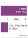{width="100%" fig-alt="Two violet horizontal bars on a log scale: HBM3 at 3.35 TB/s and CXL over PCIe Gen5 at 64 GB/s, with a double-headed arrow labeled 52 times between them."}

*HBM remains `{python} EmergingInfrastructureRecap.cxl_vs_hbm_gap_mult_str` faster, so CXL is capacity only.*
:::

### Wafer-scale planning constraint {#sec-compute-wafer-scale-integration}

At the opposite extreme from CXL sits the wafer-scale engine introduced in @sec-compute-wafer-scale. Its on-wafer fabric removes package- and board-level transfers for mapped operations, but it does not make communication free. Infrastructure planning instead shifts toward capacity, placement, and injection bandwidth.

Our `{python} EmergingInfrastructureRecap.frontier_params_b_str` running model needs `{python} EmergingInfrastructureRecap.frontier_weights_gb_str` for FP16 weights alone, far beyond the `{python} EmergingInfrastructureRecap.wse_sram_gb_str` of on-wafer SRAM. Cerebras addresses this through weight streaming\index{Wafer-scale integration!weight streaming}: external MemoryX units feed weights to the wafer over a `{python} EmergingInfrastructureRecap.wse_memoryx_bw_tb_per_s_str` path while the wafer executes each layer, decoupling model capacity from the on-wafer memory. Weight streaming was designed for training. Activations stay on the wafer while weights stream in layer by layer and gradients stream back to MemoryX, which performs the optimizer update. The approach works when each layer's computation is large enough to hide the streaming time. The wafer trades the communication wall for a streaming-bandwidth wall.

The lesson for infrastructure planners is not that wafer-scale systems replace GPU fleets. It is that memory proximity and memory capacity trade against each other. WSE-style designs buy extraordinary local bandwidth by putting the working set near the arithmetic, while CXL buys flexible capacity by moving memory farther away. HBM sits between those extremes: off-chip but on-package, smaller than host memory but fast enough for the active computation. The right architecture is the one whose memory tier matches the workload's reuse pattern.

### Advanced packaging {#sec-compute-advanced-packaging}

Underpinning both directions is the evolution of advanced packaging\index{Advanced packaging!reticle limit}. Packaging moves the boundary inside the accelerator package rather than all the way out to the rack or all the way in to a single wafer, and it matters because the reticle limit is only about `{python} ReticleLimitRecap.reticle_limit_mm2_str` for a single exposure. 2.5D interposers\index{2.5D interposer!CoWoS}\index{Chiplet!CoWoS packaging}, such as TSMC's CoWoS, mount compute dies and HBM stacks on a shared silicon substrate, allowing chiplet-based accelerators to behave like a single device for most software. 3D stacking\index{Packaging!3D SoIC}, with approaches such as SoIC, places SRAM caches or logic directly above one another and shortens data paths further. The H100-to-B200 transition shows the fleet consequence: the package can deliver far more local arithmetic and die-to-die bandwidth, but the rack must absorb higher power density, tighter cooling requirements, and less tolerance for power transients before the silicon advantage becomes useful infrastructure.

### Reconfigurable topologies and optical circuit switching {#sec-compute-reconfigurable-topologies-ocs}

While CXL and advanced packaging address memory and die boundaries, warehouse-scale computing increasingly encounters an interconnect power and topology constraint. In modern clusters spanning tens of thousands of accelerators, conventional multi-tier Clos networks connect groups of endpoints through successive tiers of electrical packet switches. These switches inspect each packet and choose an outgoing link; the alternative considered here changes the physical connections between groups for a longer-lived workload allocation. Every network hop incurs an Optical-Electrical-Optical (OEO) conversion\index{Optical-electrical-optical conversion!power overhead}: incoming photons hit a photodiode, high-speed SerDes circuits deserialize the electrical signal, switch ASICs buffer and route packets across crossbars, and output SerDes drive lasers to re-transmit light over optical fiber.

At 800 Gb/s and 1.6 Tb/s per-port data rates, SerDes and transceiver electronics consume significant energy, and every additional switch tier repeats that conversion cost for each bit that crosses it. Furthermore, fixed electrical Clos topologies are cabled statically, locking the facility into a single oversubscription ratio and rigid bisection pattern regardless of whether the running workload is pipeline-dominated, data-parallel, or all-to-all expert-routed.

::: {#dfn-compute-infrastructure-optical-circuit-switching .callout-definition title="Optical circuit switching"}

***Optical circuit switching (OCS)***\index{Optical Circuit Switching!definition}\index{OCS!reconfigurable topology} is a physical networking architecture that routes optical signals directly using Micro-Electro-Mechanical Systems (MEMS) mirror arrays without Optical-Electrical-Optical (OEO) conversion, enabling dynamic, software-defined topology reconfiguration and high energy efficiency at warehouse scale.

1.  **Significance**: An optical circuit bypasses packet-by-packet electronic processing in the switching path. The complete system still consumes power for actuators, control, and transceivers. Its compatibility across line rates depends on optical loss, wavelengths, and endpoint budgets, so protocol transparency does not imply unrestricted upgrades.
2.  **Distinction**: Unlike electrical packet switches (which inspect headers, buffer packets in SRAM, and make nanosecond routing decisions per packet), an OCS establishes semi-static physical optical circuits with millisecond-scale switching latency ($10$--$30$ ms), making it suitable for topology-level reconfiguration rather than dynamic packet routing.
3.  **Common pitfall**: Assuming OCS replaces packet switching entirely. OCS operates at circuit granularity: it configures cluster-scale topologies (such as 3D tori or job-specific sub-clusters) and routes around hardware faults, while packet switching or accelerator-native interconnects handle fine-grained, intra-step message routing.

:::

Google's TPU v4 supercomputer [@jouppi2023] demonstrated the architectural power of optical circuit switching in production. Instead of wiring 4,096 chips into an inflexible electrical fat-tree, the system groups accelerators into $4 \times 4 \times 4$ node cubes and routes the inter-cube links through an array of 3D MEMS optical circuit switches (codenamed Palomar)\index{Optical circuit switching!MEMS mirror array}.

This reconfigurable optical architecture delivers two fundamental operational capabilities: topology tailoring and dynamic fault recovery with boundary wrapping.

For workload adaptation, the physical interconnect can be reconfigured dynamically\index{Optical circuit switching!topology reconfiguration} to match the communication structure of the running model. A training run utilizing 1D pipeline parallelism can configure its slice as an elongated cylinder to streamline stage-to-stage transfers. Conversely, a 2D or 3D tensor-parallel partition can configure a compact cubic 3D torus that minimizes average hop count, while an MoE workload can maximize bisection bandwidth across specific expert groups.

For fault tolerance, optical switching provides automated fault isolation and boundary repair. In massive accelerator pods, optical transceivers and cables rank among the most frequent failure components. In a static electrical torus or tree, a single link or node failure can isolate an entire dimension or degrade the pod. With optical circuit switching, the cluster manager detects a defective tray or fiber and commands the MEMS mirrors to rotate, optically bypassing the failed unit and splicing healthy nodes into a complete, smaller torus slice in tens of milliseconds without manual cable intervention\index{Optical circuit switching!fault isolation}.

The trade-off is switching latency. Because MEMS mirrors physically rotate to steer collimated light beams, reconfiguration occurs on a mechanical timescale that is much longer than packet forwarding in an established electrical path. These are different operations: circuit setup changes connectivity, while packet forwarding uses connectivity already in place. Consequently, OCS moves the power and protocol wall while leaving reconfiguration latency as the binding discipline: it is deployed for job-level topology allocation and fault isolation, not for per-message dynamic routing.

The common theme is relocation rather than elimination. CXL moves capacity outward into a fabric and leaves bandwidth as the limiting discipline. Wafer-scale integration moves communication inward and leaves capacity and yield as the limiting disciplines. Advanced packaging compresses die-to-die distance and leaves power density as the limiting discipline. Optical circuit switching removes the OEO conversion inside the switch and leaves reconfiguration latency as the limiting discipline. Infrastructure planning therefore still begins by identifying where the next byte moves, how quickly it must arrive, and what physical system must be built so that movement does not dominate the workload.

## Fallacies and Pitfalls {#sec-compute-fallacies-pitfalls}

Because the bottlenecks move rather than disappear, compute infrastructure teams often optimize the visible specification while missing the binding physical constraint. The fallacies and pitfalls in this section translate the chapter's node, rack, pod, and facility lessons into operational warnings.

::: {.fallacy-pitfall}

**Fallacy**: *More GPUs always means faster training.*

Engineers frequently assume that training time scales linearly with GPU count: doubling the GPUs should halve the training time. In practice, communication overhead grows with cluster size and eventually dominates.

```{python}
#| echo: false
# ┌── LEGO ───────────────────────────────────────────────
class InfraFrontierStragglerRecap23:
    # ┌── 1. LOAD ──────────────────────────────────────────
    eff_256 = ReferenceStats.TrainingScaleProfiles.Eff256Gpu
    eff_1k = ReferenceStats.TrainingScaleProfiles.Eff1024Gpu
    eff_8k = ReferenceStats.TrainingScaleProfiles.Eff8192Gpu
    gpus_1k = Scenarios.DenseLLMPretrainingReference.system.total_accelerators
    gpus_8k = Systems.Clusters.Frontier_8K.total_accelerators

    # ┌── 2. EXECUTE ───────────────────────────────────────
    hardware_ratio = gpus_8k / gpus_1k
    speedup_1k_to_8k = hardware_ratio * eff_8k / eff_1k
    idle_share_8k = 1 - eff_8k

    # ┌── 3. GUARD ─────────────────────────────────────────
    check(eff_256 > eff_1k > eff_8k, "Modeled scaling efficiency should fall with cluster size")
    check(speedup_1k_to_8k < hardware_ratio, "Eight times the GPUs should buy less than an eightfold speedup")

    # ┌── 4. OUTPUT (Formatting) ──────────────────────────────────────────────
    frontier_params_b_str = fmt_params(Models.Language.GPT3.parameters, scale="B", precision=0, commas=False)
    gradients_fp16_gb_str = fmt_memory(Models.Language.GPT3.size_in_bytes(BYTES_FP16), unit=GB, precision=0, commas=False)
    eff_256_str = fmt(eff_256, precision=2, commas=False)
    eff_1k_str = fmt(eff_1k, precision=2, commas=False)
    eff_8k_str = fmt(eff_8k, precision=2, commas=False)
    gpus_1k_str = fmt(gpus_1k, precision=0, commas=True)
    gpus_8k_str = fmt(gpus_8k, precision=0, commas=True)
    hardware_ratio_mult_str = fmt_multiple(hardware_ratio, precision=0, commas=False)
    speedup_1k_to_8k_mult_str = fmt_multiple(speedup_1k_to_8k, precision=1, commas=False)
    idle_share_8k_pct_str = fmt_percent(idle_share_8k, precision=0, style="prose")
```

Amdahl's Law\index{Amdahl's law!parallel scaling limit} establishes the theoretical limit: the sequential fraction of the computation (gradient synchronization, pipeline bubble time, data loading stalls) bounds the maximum speedup regardless of parallelism. For a `{python} InfraFrontierStragglerRecap23.frontier_params_b_str`-parameter model with `{python} InfraFrontierStragglerRecap23.gradients_fp16_gb_str` of gradients, the AllReduce at each training step must combine contributions across the participating group. It can do so through ring or tree exchanges; direct transfers between every pair are not required.

Even for a carefully engineered fabric, the modeled scaling efficiency of the running model falls from `{python} InfraFrontierStragglerRecap23.eff_256_str` at 256 GPUs to `{python} InfraFrontierStragglerRecap23.eff_1k_str` at `{python} InfraFrontierStragglerRecap23.gpus_1k_str` GPUs and `{python} InfraFrontierStragglerRecap23.eff_8k_str` at `{python} InfraFrontierStragglerRecap23.gpus_8k_str`. Growing from the reference cluster to the 8,192-GPU scenario of @sec-compute-pod therefore multiplies the hardware `{python} InfraFrontierStragglerRecap23.hardware_ratio_mult_str` but the speed only `{python} InfraFrontierStragglerRecap23.speedup_1k_to_8k_mult_str`, and `{python} InfraFrontierStragglerRecap23.idle_share_8k_pct_str` of the larger cluster's locally achievable throughput is lost to communication and pipeline bubbles. That run still finishes in days, so the scale is worth buying for a deadline, but each added GPU returns less than the one before it; without an engineered fabric and overlapped communication, the curve flattens far sooner.

The correct approach is to profile useful compute time, exposed communication time, and idle time at the current scale before buying the next pod. If the added GPUs mostly increase exposed communication, procurement is buying idle time rather than training progress. @Sec-distributed-training-scaling-math later turns this local ratio into a scaling-efficiency estimate before committing to procurement.

```{python}
#| echo: false
# ┌── LEGO ───────────────────────────────────────────────
class RooflineFallaciesRecap:

    # ┌── 4. OUTPUT (Formatting) ──────────────────────────────────────────────
    h100_ridge_str = fmt_arithmetic_intensity(
        (Hardware.Cloud.H100.compute.peak_flops / Hardware.Cloud.H100.memory.bandwidth), unit=flop / byte, precision=1, commas=False
    )
```

:::

::: {.fallacy-pitfall}

**Pitfall**: *Planning training throughput from peak FLOP/s alone.*

Procurement teams often select accelerators by comparing peak FLOP/s specifications. This reasoning ignores the Roofline Model's central insight: if the workload's arithmetic intensity falls below the ridge point, memory bandwidth, not compute, limits performance. The H100's ridge point is approximately `{python} RooflineFallaciesRecap.h100_ridge_str`. LLM inference operates at 1--2 FLOP/byte, achieving less than 1 percent of peak FLOP/s. Even LLM training, which benefits from batching, typically achieves 30--50 percent of peak FLOP/s due to memory-bound attention kernels, activation recomputation, and communication stalls. Selecting hardware by peak FLOP/s alone is analogous to selecting a car by top speed while ignoring fuel efficiency for a daily commute.

:::

::: {.fallacy-pitfall}

**Fallacy**: *Power and cooling constraints can be handled after accelerator purchase.*

Teams plan GPU purchases based on compute requirements without verifying that the target facility can deliver the required power and cooling. These are hard physical limits with long lead times.

```{python}
#| echo: false
# ┌── LEGO ───────────────────────────────────────────────
class RackPowerFallaciesRecap:
    # ┌── 1. LOAD ──────────────────────────────────────────
    rack = Systems.Racks.DGX_H100_4Node

    # ┌── 4. OUTPUT (Formatting) ──────────────────────────────────────────────
    rack_power_kw_str = fmt_power(rack.total_power, unit=kilowatt, precision=1, commas=False)
```

A single rack of four DGX H100 systems requires `{python} RackPowerFallaciesRecap.rack_power_kw_str` of power. Upgrading a data center's electrical infrastructure (new transformers, switchgear, and UPS capacity) requires 12--18 months of lead time. Cooling plant upgrades (chillers, piping, pumps) require 6--12 months. Even seemingly simple changes, such as upgrading the PDU in a single rack from 20 kW to 60 kW, can require new cabling and circuit breaker panels.

Organizations that order hardware without confirming facility readiness risk having millions of dollars of GPUs sitting in shipping containers in the parking lot while the building is retrofitted. During the 2023--2024 accelerator buildout, GPU delivery times shortened faster than data center construction timelines, which made this mismatch a practical planning risk.

:::

::: {.fallacy-pitfall}

**Pitfall**: *Buying a newer accelerator without checking the workload's arithmetic intensity.*

```{python}
#| echo: false
from mlsysim.fmt import check, fmt_bandwidth, fmt_multiple

# ┌── LEGO ───────────────────────────────────────────────
class MemoryBandwidthFallaciesRecap:
    # ┌── 1. LOAD ──────────────────────────────────────────
    h100 = Hardware.Cloud.H100
    b200 = Hardware.Cloud.B200

    # ┌── 2. EXECUTE ───────────────────────────────────────
    bw_ratio = (b200.memory.bandwidth / h100.memory.bandwidth).to_base_units().magnitude
    peak_ratio = (b200.compute.precision_flops["fp8"] / h100.compute.peak_flops).to_base_units().magnitude

    # ┌── 3. GUARD ─────────────────────────────────────────
    check(peak_ratio > bw_ratio, "Headline B200 FP8 gain should exceed its bandwidth gain over H100")

    # ┌── 4. OUTPUT (Formatting) ──────────────────────────────────────────────
    h100_bw_tb_per_s_str = fmt_bandwidth(h100.memory.bandwidth, unit=TB / second, precision=2, commas=False)
    b200_bw_tb_per_s_str = fmt_bandwidth(b200.memory.bandwidth, unit=TB / second, precision=0, commas=False)
    bw_ratio_mult_str = fmt_multiple(bw_ratio, precision=1, commas=False)
    peak_ratio_mult_str = fmt_multiple(peak_ratio, precision=1, commas=False)
```

A team deploys B200 GPUs (`{python} B200PerformanceScenario.fp8_tflop_per_s_str` FP8 peak) for an inference workload serving a 7B-parameter model at batch size 1. The arithmetic intensity is approximately 1 FLOP/byte, placing the workload deep in the memory-bound region.

The B200's memory bandwidth (`{python} MemoryBandwidthFallaciesRecap.b200_bw_tb_per_s_str`) is only `{python} MemoryBandwidthFallaciesRecap.bw_ratio_mult_str` higher than the H100's (`{python} MemoryBandwidthFallaciesRecap.h100_bw_tb_per_s_str`), so this batch-1 workload tracks bandwidth rather than headline compute. If the headline comparison is B200 FP8 against H100 FP16/BF16-class throughput, the compute peak is about `{python} MemoryBandwidthFallaciesRecap.peak_ratio_mult_str` higher but decode still improves by only about `{python} MemoryBandwidthFallaciesRecap.bw_ratio_mult_str`. The team paid for compute they cannot use. An H100 with its lower cost per unit of memory bandwidth would have been a more cost-effective choice for this specific workload.

:::

::: {.fallacy-pitfall}

**Fallacy**: *Air cooling is sufficient for AI workloads.*

Operators of legacy facilities may assume that adding fans and chiller capacity is sufficient for any denser AI rack. In practice, the cooling choice depends on the system's heat-rejection design and the facility's available airflow, pressure, inlet temperature, and containment. Engineered air remains viable for some dense configurations, while higher rack densities can require direct liquid cooling to avoid thermal throttling or exceeding facility limits.

:::

::: {.fallacy-pitfall}

**Fallacy**: *All GPU-hours are equivalent in total cost of ownership (TCO) analysis.*

```{python}
#| echo: false
from mlsysim.fmt import fmt_int, fmt_multiple

# ┌── LEGO ───────────────────────────────────────────────
class GpuHourEquivalence:
    # ┌── 1. LOAD (Constants) ──────────────────────────────────────────────
    v100_flops = Hardware.Cloud.V100.compute.peak_flops  # FP16
    a100_flops = Hardware.Cloud.A100.compute.peak_flops  # FP16
    h100_flops = Hardware.Cloud.H100.compute.peak_flops  # dense FP16, same convention as the other devices
    v100_gpu_hours = 10000  # scenario training run

    # ┌── 2. EXECUTE (The Compute) ────────────────────────────────────────
    ratio_a100 = (h100_flops / a100_flops).to_base_units().magnitude
    ratio_v100 = (h100_flops / v100_flops).to_base_units().magnitude
    equiv_h100_hours = v100_gpu_hours / ratio_v100

    # ┌── 4. OUTPUT (Formatting) ──────────────────────────────────────────
    ratio_a100_mult_str = fmt_multiple(ratio_a100, precision=1)
    ratio_v100_mult_str = fmt_multiple(ratio_v100, precision=1)
    v100_hours_str = fmt_int(v100_gpu_hours)
    equiv_h100_hours_str = fmt_int(equiv_h100_hours)
```

A common error in cost comparisons is to treat one GPU-hour on an H100 as interchangeable with one GPU-hour on an A100 or V100. Under the same dense FP16 peak convention, H100 offers `{python} GpuHourEquivalence.ratio_a100_mult_str` the arithmetic rate of A100 and `{python} GpuHourEquivalence.ratio_v100_mult_str` that of V100. If a workload sustained the same fraction of those peaks with the same operation count and target quality, `{python} GpuHourEquivalence.v100_hours_str` V100 GPU-hours would correspond to approximately `{python} GpuHourEquivalence.equiv_h100_hours_str` H100 GPU-hours. That is a conditional compute-only comparison, not a predicted training time: memory, communication, numerical recipes, and software can change sustained efficiency. Procurement must compare measured cost per useful computation or per completed run, rather than rental price or peak FLOP/s alone.

:::

::: {.fallacy-pitfall}

**Pitfall**: *Upgrading the network before identifying the training bottleneck.*

```{python}
#| echo: false
from mlsysim import Systems
from mlsysim.fmt import fmt, fmt_bandwidth, fmt_int
from mlsysim.core.units import Gbps

# ┌── LEGO ───────────────────────────────────────────────
class NetworkUpgradeStepTime:
    # ┌── 1. LOAD (Constants) ──────────────────────────────────────────────
    ib_hdr = Systems.Fabrics.InfiniBand_HDR.bandwidth  # 200 Gb/s
    ib_ndr = Systems.Fabrics.InfiniBand_NDR.bandwidth  # 400 Gb/s
    compute_s = 20  # compute time per step (scenario)
    comm_s = 2  # communication time at HDR (scenario)

    # ┌── 2. EXECUTE (The Compute) ────────────────────────────────────────
    comm_after = comm_s * (ib_hdr / ib_ndr).to_base_units().magnitude  # halves at NDR
    total_before = compute_s + comm_s
    total_after = compute_s + comm_after
    improvement_pct = (total_before - total_after) / total_before * 100

    # ┌── 4. OUTPUT (Formatting) ──────────────────────────────────────────
    ib_hdr_str = fmt_bandwidth(ib_hdr, unit=Gbps, precision=0, commas=False)
    ib_ndr_str = fmt_bandwidth(ib_ndr, unit=Gbps, precision=0, commas=False)
    compute_s_str = fmt_int(compute_s)
    comm_s_str = fmt_int(comm_s)
    total_before_str = fmt_int(total_before)
    total_after_str = fmt_int(total_after)
    improvement_pct_str = fmt(improvement_pct, precision=1)
```

Teams sometimes invest heavily in upgrading their network fabric (from `{python} NetworkUpgradeStepTime.ib_hdr_str` to `{python} NetworkUpgradeStepTime.ib_ndr_str` InfiniBand, for example) expecting a proportional improvement in training speed. The improvement depends entirely on whether the training loop is communication-bound at the current network bandwidth. If the compute time per training step is `{python} NetworkUpgradeStepTime.compute_s_str` seconds and the communication time is `{python} NetworkUpgradeStepTime.comm_s_str` seconds, the workload is compute bound: doubling the network speed reduces total step time from `{python} NetworkUpgradeStepTime.total_before_str` to `{python} NetworkUpgradeStepTime.total_after_str` seconds, a mere `{python} NetworkUpgradeStepTime.improvement_pct_str` percent improvement. The same investment in additional GPUs (reducing compute time) or higher-MFU software optimization (reducing wasted compute) would yield far greater returns. The Roofline Model applies to the cluster as a whole, not just to individual chips: diagnose whether the bottleneck is compute or communication before investing in either.

:::

::: {.fallacy-pitfall}

**Fallacy**: *Average power draw is sufficient for cooling design.*

Accelerator power draw varies across communication, memory, and compute phases. A workload average below the configured sustained envelope does not establish the cooling requirement because synchronized compute phases can raise many devices toward that envelope together. Thermal design must use the vendor's sustained design target under the intended inlet and cooling conditions, while the electrical path must separately tolerate documented transients. Otherwise thermal throttling can reduce sustained throughput without producing a crash or explicit application error.

:::

::: {.fallacy-pitfall}

**Pitfall**: *Selecting accelerators by HBM capacity without checking bandwidth.*

```{python}
#| echo: false
from mlsysim.fmt import fmt_bandwidth, fmt_int, fmt_memory, fmt_memory_capacity, fmt_time

# ┌── LEGO ───────────────────────────────────────────────
class A100FallaciesRecap:
    # ┌── 1. LOAD ──────────────────────────────────────────
    model = Models.Language.Llama3_70B
    option_a_hbm = 192 * GB  # hypothetical large HBM2e package at A100-class bandwidth
    option_b_hbm = Hardware.Cloud.H100.memory.capacity
    a100_bw = Hardware.Cloud.A100.memory.bandwidth
    h100_bw = Hardware.Cloud.H100.memory.bandwidth

    # ┌── 2. EXECUTE ───────────────────────────────────────
    weights_fp16 = model.size_in_bytes(BYTES_FP16)
    weights_int8 = model.size_in_bytes(BYTES_INT8)
    option_a_lat = (weights_fp16 / a100_bw).to(millisecond)
    option_b_lat = (weights_int8 / h100_bw).to(millisecond)
    speedup = (option_a_lat / option_b_lat).to_base_units().magnitude

    # ┌── 4. OUTPUT (Formatting) ──────────────────────────────────────────────
    mem_bw_tb_per_s_str = fmt_bandwidth(a100_bw, unit=TB / second, precision=2, commas=False)
    option_a_hbm_gb_str = fmt_memory(option_a_hbm, unit=GB, precision=0, commas=False)
    weights_fp16_gb_str = fmt_qty_int(weights_fp16, GB, commas=False)
    option_a_lat_ms_str = fmt_time(option_a_lat, millisecond, precision=1, commas=False)
    option_b_hbm_gb_str = fmt_memory_capacity(option_b_hbm, unit=GiB, precision=0, commas=False)
    weights_int8_gb_str = fmt_qty_int(weights_int8, GB, commas=False)
    option_b_lat_ms_str = fmt_time(round(option_b_lat.to(millisecond).magnitude), millisecond, precision=0, commas=False)
    speedup_mult_str = fmt_multiple(speedup, precision=1, commas=False)
```
Procurement teams sometimes focus exclusively on whether a model's weights "fit" in the available HBM, neglecting the bandwidth dimension. A model that fits in HBM but cannot be served at acceptable latency due to insufficient bandwidth is just as unusable as a model that does not fit. Consider two scenarios for serving a 70-billion-parameter model: (a) an accelerator with `{python} A100FallaciesRecap.option_a_hbm_gb_str` of HBM2e at `{python} A100FallaciesRecap.mem_bw_tb_per_s_str` bandwidth, and (b) an accelerator with `{python} A100FallaciesRecap.option_b_hbm_gb_str` of HBM3 at `{python} MemoryBandwidthFallaciesRecap.h100_bw_tb_per_s_str` bandwidth. Option (a) has more than enough capacity (the model requires only `{python} A100FallaciesRecap.weights_fp16_gb_str` in FP16) but delivers tokens at `{python} A100FallaciesRecap.weights_fp16_gb_str`/`{python} A100FallaciesRecap.mem_bw_tb_per_s_str` = `{python} A100FallaciesRecap.option_a_lat_ms_str` per token. Option (b) requires careful quantization to fit (`{python} A100FallaciesRecap.weights_fp16_gb_str` in FP16 would not fit in `{python} A100FallaciesRecap.option_b_hbm_gb_str`, but `{python} A100FallaciesRecap.weights_int8_gb_str` in INT8 does) but delivers tokens at `{python} A100FallaciesRecap.weights_int8_gb_str`/`{python} MemoryBandwidthFallaciesRecap.h100_bw_tb_per_s_str` = `{python} A100FallaciesRecap.option_b_lat_ms_str` per token, which is `{python} A100FallaciesRecap.speedup_mult_str` faster. Part of that gap is the bandwidth ratio between the devices; the rest comes from reading INT8 rather than FP16 weights, which option (a) could also do. For latency-sensitive serving, option (b) is still the better choice, because its bandwidth advantage persists at any precision. The right accelerator is the one whose bandwidth and capacity jointly satisfy the workload's requirements.

:::

::: {.fallacy-pitfall}

**Fallacy**: *Data loading can be fixed after deployment.*

Teams that focus all their predeployment optimization on GPU kernel performance and communication efficiency sometimes discover, postdeployment, that their GPUs are starved for data. The data loading pipeline (storage I/O, preprocessing, host-to-GPU transfer) must sustain a throughput equal to or greater than the GPU cluster's consumption rate. For language model training, the raw data ingestion rate is modest (megabytes per second), but the preprocessing pipeline (tokenization, sequence packing, shuffling) can become a CPU bottleneck when each GPU consumes data faster than a single CPU core can prepare it. The fix is straightforward but must be planned in advance: allocate sufficient CPU cores for data loading workers (typically 4--8 per GPU), stage training data on fast local NVMe storage rather than relying on shared network filesystems, and pipeline the data loading to overlap with GPU computation.

:::

::: {.fallacy-pitfall}

**Pitfall**: *Buying homogeneous clusters without modeling workload diversity.*

```{python}
#| echo: false
# ┌── LEGO ───────────────────────────────────────────────
class InfraFrontierStragglerRecap24:

    # ┌── 4. OUTPUT (Formatting) ──────────────────────────────────────────────
    frontier_params_b_str = fmt_params(Models.Language.GPT3.parameters, scale="B", precision=0, commas=False)
```

```{python}
#| echo: false
from mlsysim.fmt import fmt_bandwidth

# ┌── LEGO ───────────────────────────────────────────────
class A100UniformFleetRecap:
    # ┌── 4. OUTPUT (Formatting) ──────────────────────────────────────────────
    mem_bw_tb_per_s_str = fmt_bandwidth(Hardware.Cloud.A100.memory.bandwidth, unit=TB / second, precision=2, commas=False)
```
The intuition that uniform hardware simplifies scheduling and reduces stragglers often leads organizations to retire capable older generations prematurely. For our `{python} InfraFrontierStragglerRecap24.frontier_params_b_str` model, the cost-optimal strategy frequently involves a mixed-generation fleet. While training requires the raw FLOP/s and interconnect bandwidth of H100s to minimize synchronization overhead, inference serving is memory-bandwidth-bound rather than compute-bound.

An A100 offers `{python} A100UniformFleetRecap.mem_bw_tb_per_s_str` of bandwidth at a significantly lower capital expenditure than the H100's `{python} MemoryBandwidthFallaciesRecap.h100_bw_tb_per_s_str`. Dedicating H100 nodes to training and A100 nodes to inference can therefore lower TCO relative to an all-H100 fleet whenever the inference pool is bandwidth-bound; the size of the saving depends on prices, utilization, and the measured throughput of each pool. The fallacy lies in conflating *job-level* homogeneity, which is critical to prevent stragglers within a single distributed training run, with *cluster-level* homogeneity. A sophisticated scheduler can effectively manage a heterogeneous fleet, routing bandwidth-intensive inference jobs to older hardware where the bandwidth-per-dollar ratio is competitive, while reserving peak compute nodes for training throughput.

:::

::: {.fallacy-pitfall}

**Pitfall**: *Treating commissioning and burn-in as schedule slack.*

Commissioning is part of the system build, not a buffer that can be consumed when hardware delivery slips. Burn-in tests, cable validation, firmware qualification, thermal soak, and NCCL stress runs are the first time the node, rack, network, and facility layers operate as one machine. Compressing that phase turns installation defects into production failures, where each debugging cycle idles the full fleet rather than a small acceptance-test window.

:::

## Summary {#sec-compute-summary}

```{python}
#| echo: false
# ┌── LEGO ───────────────────────────────────────────────
class InfraFrontierSummaryRecap:

    # ┌── 4. OUTPUT (Formatting) ──────────────────────────────────────────────
    frontier_params_b_str = fmt_params(Models.Language.GPT3.parameters, scale="B", precision=0, commas=False)
```

Training our `{python} InfraFrontierSummaryRecap.frontier_params_b_str`-parameter model exposes a constraint cascade. Accelerator capacity and throughput shape the node; node power shapes rack cooling; rack density shapes pod layout; and pod topology and reliability determine how much useful work the fleet sustains.

The generality tax explains the trade between flexibility and workload-specific efficiency. The roofline in @sec-compute-roofline identifies the binding compute or memory ceiling, while the bandwidth hierarchy in @sec-compute-bandwidth-hierarchy guides where communicating work belongs. Together, these models connect software choices to the physical limits of the fleet.

```{python}
#| echo: false
#| label: summary-scale-scenario
# ┌─────────────────────────────────────────────────────────────────────────────
# │ SUMMARY INFRASTRUCTURE SCALE (LEGO)
# ├─────────────────────────────────────────────────────────────────────────────
# │ Context: @sec-compute-summary
# │
# │ Goal: Provide aggregate hardware and model stats for the summary.
# │ Show: ~175B parameters; ~1,979 TFLOP/s; ~3.35 TB/s; ~33.5 kW rack.
# │ How: pulling constants from mlsysim.core.units.
# │
# └─────────────────────────────────────────────────────────────────────────────
from mlsysim.fmt import fmt, fmt_bandwidth, fmt_flop_rate, fmt_multiple, fmt_power

class SummaryScaleScenario:
    """Namespace for summary scale reference."""

    # ┌── 1. LOAD (Constants) ──────────────────────────────────────────────
    params = Models.Language.GPT3.parameters
    flops = Hardware.Cloud.H100.compute.precision_flops["fp8"]
    bw = Hardware.Cloud.H100.memory.bandwidth
    tdp = Hardware.Cloud.H100.tdp
    rack = Systems.Racks.DGX_H100_4Node

    # ┌── 2. EXECUTE (The Compute) ────────────────────────────────────────
    params_b = params.to(param).magnitude / BILLION
    rack_power = rack.total_power

    # ┌── 3. GUARD (Invariants) ──────────────────────────────────────────
    from mlsysim.fmt import check

    check(params_b == 175, "GPT-3 params should be 175B")
    check(33 <= rack_power.to(kW).magnitude <= 34, "Rack power should match the detailed rack-power table")

    # ┌── 4. OUTPUT (Formatting) ──────────────────────────────────────────────
    h100_fp8_tflop_per_s_str = fmt_flop_rate(flops, unit=TFLOP / second, precision=0, commas=True)
    h100_bw_tb_per_s_str = fmt_bandwidth(bw, unit=TB / second, precision=2, commas=False)
    h100_tdp_w_str = fmt_power(tdp, unit=watt, precision=0, commas=False)
    rack_power_kw_str = fmt_power(rack_power, unit=kilowatt, precision=1, commas=False)
    weights_fp16 = Models.Language.GPT3.size_in_bytes(BYTES_FP16)
    token_floor = (weights_fp16 / bw).to(millisecond)
    check(token_floor > 100 * millisecond, "Summary claims a latency floor of over 100 ms per token")
    token_flops_b_str = fmt(Models.Language.GPT3.inference_flops.to(flop).magnitude / 1e9, precision=0, commas=False)
    weights_fp16_gb_str = fmt_memory(weights_fp16, unit=GB, precision=0, commas=False)
    rack_gpus_str = fmt(rack.accelerator_count, precision=0, commas=False)
    gpu_mtbf_hours_str = fmt_time(Systems.Reliability.Gpu.mttf_hours, 'hour', precision=0, commas=True, style='word')
    fleet_gpus_str = fmt(Systems.Clusters.Training_10K.total_accelerators, precision=0, commas=True)
    fleet_mtbf = calc_mtbf_cluster(Systems.Reliability.Gpu.mttf_hours, Systems.Clusters.Training_10K.total_accelerators)
    check(abs(fleet_mtbf.to(hour).magnitude - 5) < 0.01, "Takeaway says a failure about every five hours")
    nvlink_ib_gap_mult_str = fmt_multiple(
        round((Hardware.Cloud.H100.nvlink.bandwidth_per_direction / Systems.Fabrics.InfiniBand_NDR.bandwidth).to_base_units().magnitude),
        precision=0,
        commas=False,
    )
```

```{python}
#| echo: false
# ┌── LEGO ───────────────────────────────────────────────
class InfraFrontierClosingRecap:

    # ┌── 4. OUTPUT (Formatting) ──────────────────────────────────────────────
    frontier_params_b_str = fmt_params(Models.Language.GPT3.parameters, scale="B", precision=0, commas=False)
```

Our `{python} InfraFrontierClosingRecap.frontier_params_b_str`-parameter model has served as the architectural forcing function connecting every layer of this hierarchy. At the accelerator level, the low-batch decode example requires about `{python} SummaryScaleScenario.token_flops_b_str` billion floating-point operations per token, yet weight movement rather than arithmetic sets its modeled latency floor. At the memory level, the `{python} SummaryScaleScenario.weights_fp16_gb_str` FP16 weight tensor exceeds one accelerator's HBM capacity; even after sharding or compression solves capacity, streaming the weights at `{python} SummaryScaleScenario.h100_bw_tb_per_s_str` imposes a latency floor of over 100 ms per token for one accelerator-equivalent HBM path. At the node level, training state expands beyond 2 TB, requiring a capacity plan that combines model partitioning, state sharding, or memory offload. At the rack level, `{python} SummaryScaleScenario.rack_gpus_str` accelerators drawing `{python} SummaryScaleScenario.h100_tdp_w_str` each, plus host and network overhead, require `{python} SummaryScaleScenario.rack_power_kw_str` of power delivery and cooling qualified for that configuration. At the pod level, the reference cluster coordinates `{python} InfraSetup.ref_gpus_str` GPUs and the worked training scenario eight times that, making fabric throughput and recovery from failures part of the completion-time budget. The economics finally depend on whether sustained utilization can amortize hardware, power, cooling, and facility risk. Every constraint traces back to one fact: this model does not fit on a single chip.

The method transfers beyond this model: identify the binding constraint at each level, quantify its effect, and propagate the consequence upward. A faster accelerator is counterproductive if cooling cannot remove its heat; a denser rack is futile if the grid cannot supply it; and a wider network is wasteful if the workload cannot use its bandwidth. Infrastructure engineering is thus a quantitative discipline for tracing chip-level choices into rack power, facility cooling, network topology, reliability, and ownership cost.

::: {.callout-takeaways title="The data center is the computer"}

* **Specialization trades flexibility for throughput**: The chapter's GPU–CPU comparison shows 10--100$\times$ greater matrix throughput for suitable workloads, illustrating the generality tax (principle \ref{pri-generality-tax}). Specialization pays when the workload and software stack can use the dedicated arithmetic efficiently over the deployment's lifetime.
* **Memory wall diagnosis starts with roofline**: For single-request LLM decode, weight traffic commonly sets the latency floor. The ridge point ($I_{\text{ridge}}$ = peak FLOP/s divided by memory BW) separates bandwidth- from compute-bound operation, but batch shape, fusion, precision, reuse, and the modeled memory level determine where each training or inference phase lies.
* **Bandwidth hierarchy guides parallelism placement**: The `{python} SummaryScaleScenario.nvlink_ib_gap_mult_str` per-direction bandwidth gap in the NVLink–InfiniBand example favors keeping frequent tensor-parallel exchanges inside the fast interconnect domain. Pipeline and data parallelism can span slower links, but their traffic and synchronization still have to fit the workload's time budget.
* **Peak vs. sustained**: Capacity planning must use sustained throughput measured with a consistent model-FLOP convention, precision, system scale, and workload shape, not peak specifications.
* **Facility efficiency is part of the computer**: Cooling architecture changes rack-density limits and facility overhead; at pod scale, network topology, cooling, and power delivery must be co-designed for the dominant workload.
* **Failure exposure grows with fleet size**: With independent failures and a mean time between failures of `{python} SummaryScaleScenario.gpu_mtbf_hours_str` per GPU, the `{python} SummaryScaleScenario.fleet_gpus_str`-GPU example has a mean interval of about five hours between GPU failures. Recovery and checkpoint storage therefore belong in infrastructure planning from the start.
* **Lifetime cost beats purchase price**: Electricity, facilities, networking, staffing, and sustained utilization affect the cost of useful work over a deployment's lifetime. Hardware price alone cannot settle an ownership decision; @sec-ops-scale-fleet-economics develops the full build-vs-buy analysis.

:::

Applied through C³, choosing liquid cooling for a dense accelerator rack changes more than heat removal. It raises the compute a rack can hold, which concentrates communication onto fewer top-of-rack links and adds coordination work for power capping, failure isolation, and maintenance. In the Fleet Law's accounting, the hardware in this chapter fixes the per-device rate behind $T_{\text{compute}}/N$ and the link bandwidths behind $T_{\text{comm}}$, while rack and pod reliability decide how often synchronization and recovery interrupt the step. Removing one physical ceiling therefore requires checking the rest of the fleet again; otherwise the investment creates capacity that the workload cannot use.

::: {.callout-chapter-connection title="From silicon to wires"}

Physical infrastructure spans from Tensor Core transistors to megawatt data-center substations. A fleet of disconnected nodes, however, is not yet a computer; it is a warehouse of expensive accelerators. The network fabric turns those nodes into a unified training system by carrying gradients, activations, and checkpoints between them. The chapter repeatedly exposed the same constraint: communication bandwidth limits scaling efficiency. The bandwidth hierarchy showed a `{python} SummaryScaleScenario.nvlink_ib_gap_mult_str` cliff between NVLink and InfiniBand, and the topology discussion showed why usable bandwidth depends on the communication pattern and its placement. @Sec-network-fabrics examines the physics, protocols, collectives, and topology decisions that determine whether a 10,000-GPU cluster behaves like one coherent machine or thousands of isolated devices.

:::

<!-- This is here to make sure that quizzes are inserted properly before a part begins. -->

::: { .quiz-end }
:::
