# Network Fabrics {#sec-network-fabrics}

::: {layout-narrow}
::: {.column-margin}

\chapterminitoc

:::

::: {.content-visible when-format="pdf"}
\noindent
{fig-alt="Isometric network fabric map connecting accelerator racks through elevated fabric layers with synchronization paths and a congestion constraint."}
:::

::: {.content-visible unless-format="pdf"}
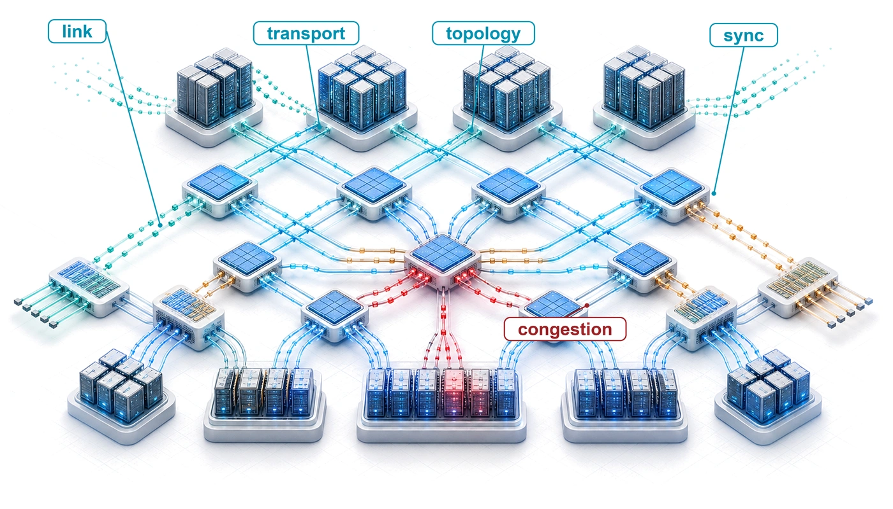{fig-alt="Isometric network fabric map connecting accelerator racks through elevated fabric layers with synchronization paths and a congestion constraint."}
:::

:::

## Purpose {.unnumbered .unlisted}

\begin{marginfigure}
\mlfleetstack{45}{100}{40}{15}{15}{10}{0}{0}
\end{marginfigure}

_Why can the network connecting accelerators matter more than the accelerators themselves at scale?_

A single accelerator can perform trillions of operations per second, but distributed training requires devices to exchange results before dependent work can proceed. When network capacity cannot keep pace with computation, accelerators sit idle, and adding more devices can increase the waiting instead of shortening the run. The resulting cost extends beyond the network equipment: an inexpensive connection can leave expensive compute capacity unused throughout a long experiment. Single-node intuition is insufficient because data that once traveled through a local interconnect must now cross cables, switches, and shared paths. A fast connection between two machines does not establish that the same performance will hold when the entire fleet communicates at once. The arrangement of those paths determines which groups can exchange data together and where competing transfers accumulate. Large transfers need sustained bandwidth, while frequent dependent exchanges can remain limited by the time required to start and complete each message. A delayed participant can hold up others even when most links appear healthy. Network design therefore has to follow the workload's communication pattern, and validation must reflect the traffic that will actually run. Choices about placement, sharing, and failure recovery affect whether available bandwidth becomes useful progress or recurring delay. In C³ terms, the fabric connects compute through communication, while coordination determines when the fleet must wait for that communication to finish.

::: {.content-visible when-format="pdf"}

\newpage

:::

::: {.callout-learning-objectives}

- Model network communication cost using the $\alpha$-$\beta$ framework and identify bandwidth-dominated vs. latency-dominated regimes
- Compare high-performance transport protocols by latency, loss-recovery behavior, and operational complexity
- Compare network topologies using $\Bandwidth_{\text{bisect}}$, hop count, and the workload's collective communication pattern
- Evaluate congestion-control mechanisms and their impact on tail latency during distributed training
- Select network resource partitions and traffic-isolation policies for concurrent training and inference workloads
- Diagnose network performance bottlenecks using RDMA counters, link-level telemetry, and bandwidth testing tools

:::

```{python}
#| echo: false
from mlsysim import *
from mlsysim.core.units import *

from mlsysim.fmt import MarkdownStr, check, fmt, fmt_int, fmt_math, fmt_memory, fmt_params

# ┌── LEGO ───────────────────────────────────────────────
class NetworkRunningExampleCluster:
    """Archetype A reference (`Scenarios.DenseLLMPretrainingReference`): GPT-3 on Training_1K."""

    # ┌── 1. LOAD (Constants) ──────────────────────────────────────────────
    _scn = Scenarios.DenseLLMPretrainingReference
    n_gpus = _scn.system.total_accelerators
    params = _scn.workload.parameters
    grad_bytes = _scn.workload.size_in_bytes(BYTES_FP16)

    # ┌── 3. GUARD ────────────────────────────────────────────────────────────
    # The static TikZ/SVG figures in the transport section label 350 GB / 700 GB.
    check(abs(grad_bytes.to(GB).magnitude - 350) < 1e-6, "Static figures assume a 350 GB FP16 gradient")

    # ┌── 4. OUTPUT (Formatting) ──────────────────────────────────────────────
    params_str = fmt_params(params)
    n_gpus_str = fmt_count(n_gpus, commas=True, label="GPU")
    n_gpus_value_str = fmt(n_gpus, precision=0, commas=True)
    peer_gpus_str = fmt(n_gpus - 1, precision=0, commas=False)
    grad_gb_str = fmt_memory(grad_bytes, unit=GB, precision=0, commas=False)
```

## The Synchronization Backbone {#sec-network-fabrics-introduction}

::: {.column-margin}
{width="100%" fig-alt="A schematic fan: one red source node on the left connects by six gray arrows to six blue nodes on the right, showing one node reaching many peers."}

*One slow link stalls every peer that waits on it.*
:::

Consider the running instance of Archetype A (GPT-4/Llama-3), a `{python} NetworkRunningExampleCluster.params_str`-parameter dense transformer partitioned across the `{python} NetworkRunningExampleCluster.n_gpus_str` of the reference cluster. Each training step must combine gradient contributions so that corresponding model replicas apply the same update. This operation, called AllReduce, returns the combined result to every participating worker. The model has `{python} NetworkRunningExampleCluster.grad_gb_str` of gradient data at two bytes per parameter; how much each GPU transfers depends on how the model is partitioned and which workers synchronize together. A delayed transfer on the step's critical path can leave the other `{python} NetworkRunningExampleCluster.peer_gpus_str` GPUs waiting at a job-wide synchronization boundary. The fabric's contribution to training time therefore depends on which transfers the next computation needs and how much of their cost remains exposed.

Within the multi-tier fleet hierarchy framed by @fig-fleet-stack, the fabric turns isolated accelerator nodes into a coherent training system. Accelerators, power delivery, cooling, racks, and pods define what each node can compute in isolation; the fabric determines whether the nodes can act together before communication cost overwhelms computation. @Fig-network-five-level-model stages that design space into five co-dependent architectural tiers, ascending from physical SerDes signaling and copper or optical reach at Level 1 up to cluster-scale orchestration and failure domains at Level 5. The labeled mechanisms within each band serve as an engineering roadmap: each concept is unpacked when its physical or protocol limit becomes the binding constraint.

::: {#fig-network-five-level-model fig-env="figure" fig-pos="htb" fig-cap="**The five-level network model for ML training**: Read from the bottom up, each level builds on the one below and becomes more abstract. Level 1 moves bits over wires and optics; Level 2 turns links into reliable, low-overhead transfers between accelerators; Level 3 arranges switches into a topology; Level 4 governs how the fabric behaves under load and congestion; and Level 5 integrates all of them into a production cluster." fig-alt="Five stacked horizontal bands, labeled L1 at the bottom to L5 at the top, with an upward arrow labeled more abstract. L1, wire and link: PAM4 SerDes, copper DAC, AOC, optics. L2, transport: RDMA, RoCEv2, GPUDirect, alpha-beta cost model. L3, switch and topology: fat-tree, rail-optimized, Dragonfly, torus. L4, fabric behavior: PFC, ECN and DCQCN, incast, adaptive routing. L5, cluster design: pod integration, job placement, failure domains."}
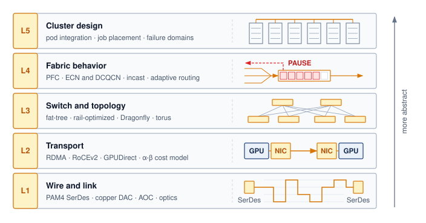

:::

At scale, communication cost can dominate computation cost. The fleet-law decomposition in @sec-vol2-introduction-fleet-law makes this explicit: the nonoverlapped communication term $\CommunicationTime - \OverlappedTime$ determines how much of each training step is exposed to the network fabric. The fabric influences the layers above it by determining whether communication can be overlapped, which collective algorithms are viable, and how network partitions interact with node failures.

A collective is a communication operation performed by a group of workers. Its name specifies the result each worker receives, while an algorithm determines the messages that produce that result. The physical network fabric carries three recurring collective communication patterns:

- **AllReduce**\index{AllReduce!definition}: Combines corresponding values from all participants and returns the same result to each; synchronous training uses a sum, followed by normalization, to average gradient contributions across workers.
- **AllGather**\index{AllGather!definition}: Collects a distinct portion from each participant and returns the concatenated collection to every participant, as required when reconstructing a sharded parameter tensor.
- **AllToAll**\index{AllToAll!definition}: Lets each participant send a distinct portion to every other participant, an exchange central to expert parallelism when workers host different expert subnetworks and must route tokens to their assigned destinations.

Collective communication algorithms orchestrate these patterns, while the fabric layer supplies the physical wires and switches that carry them. The distinction matters because the fabric's physical properties (bandwidth, latency, and topology) determine which patterns are efficient and which become bottlenecks.

::: {.column-margin .margin-pointer}
↪ The full set of collective primitives, with the output contract each one guarantees, is developed in @sec-collective-communication-six-core-primitives-8a66.
:::

::: {#psp-network-fabrics-network-as-gradient-bus .callout-perspective title="The network as a gradient bus"}

In a single machine, the memory bus moves data between the processor and memory. In a distributed training cluster, the network fabric serves an analogous role as the gradient bus\index{Gradient!bus} that carries contributions between workers. When those exchanges limit progress, the job encounters the network wall\index{Communication wall!gradient bus} mapped across the pod tier in @fig-three-walls-grid. Protocols, topologies, congestion control, and collective schedules determine how effectively the job uses the available paths. The historical link budgets in @fig-network-bandwidth-scaling motivate this comparison, but their ratio is not a measured transfer-time ratio. Message size, port provisioning, routing, and contention determine how much of the local-to-external bandwidth gap the workload experiences.

:::

::: {.column-margin .margin-pointer}
↩ Communication dominance at scale, the network wall, is established in @sec-introduction-communication-becomes-dominant-e1b6.
:::

::: {#fig-network-bandwidth-scaling fig-env="figure" fig-pos="htb" fig-cap="**Historical network bandwidth scaling**: Intra-node NVLink, inter-node InfiniBand and Ethernet, and the PCIe host bus, plotted per direction on a common log scale from 2010 to 2024. The aggregate NVLink budget exceeds the external-port budgets in these configurations; collective completion time also depends on payloads, provisioning, routing, and overlap." fig-alt="Log-scale chart of interconnect bandwidth from 2010 to 2024 for Ethernet, InfiniBand, NVLink, and PCIe. All four rise steadily, with NVLink roughly an order of magnitude above the others by 2024."}

```{python}
#| echo: false
import pandas as pd
import matplotlib.pyplot as plt
import matplotlib.ticker as ticker
from mlsysim import viz

data = pd.read_csv("vol2/03_network_fabrics/data/bandwidth_trends.csv")
# The CSV records NVLink as its bidirectional per-GPU total; halve it so every
# series is per direction, like the per-port InfiniBand/Ethernet and PCIe rates.
data.loc[data["Technology"] == "NVLink", "Bandwidth_Gbps"] = data.loc[data["Technology"] == "NVLink", "Bandwidth_Gbps"] / 2

fig, ax, COLORS, plt = viz.setup_plot(figsize=(8, 5))
_groups = list(dict.fromkeys(data["Technology"]))
# Network links use the book's network hue (violet), matching
# @fig-bandwidth-hierarchy: NVLink solid, InfiniBand dashed; Ethernet in
# neutral slate and the PCIe host bus in dotted gray.
_colors = {"NVLink": COLORS["VioletLine"], "InfiniBand": COLORS["VioletLine"], "Ethernet": "#5E6B73", "PCIe (x16)": COLORS["secondary"]}
_styles = {"InfiniBand": "--", "PCIe (x16)": ":"}
_markers = {"PCIe (x16)": "s", "Ethernet": "D"}
for _i, _g in enumerate(_groups):
    _sub = data[data["Technology"] == _g]
    ax.plot(
        _sub["Year"],
        _sub["Bandwidth_Gbps"],
        color=_colors.get(_g, COLORS["primary"]),
        linestyle=_styles.get(_g, "-"),
        label=str(_g),
        marker=_markers.get(_g, "o"),
        linewidth=2,
    )
ax.set_yscale("log")
ax.legend(title="Interconnect", frameon=False, fontsize=9)
ax.set_ylabel("Bandwidth per direction (Gb/s)")
ax.grid(True, which="both", ls="--", alpha=0.5)
ax.yaxis.set_major_formatter(ticker.FuncFormatter(lambda y, _: f"{int(y):,}"))

plt.tight_layout()
plt.show()
plt.close()
```

:::

```{python}
#| echo: false
#| label: network-fabrics-bandwidth-hierarchy
# ┌─────────────────────────────────────────────────────────────────────────────
# │ BANDWIDTH HIERARCHY SPECS (LEGO)
# ├─────────────────────────────────────────────────────────────────────────────
# │ Context: @sec-network-fabrics-introduction—the bandwidth cliff paragraph,
# │          and pervasive IB NDR bandwidth references throughout the chapter.
# │
# │ Goal: Compute the bandwidth hierarchy (NVLink vs IB vs HBM) and the
# │       NVLink-to-IB ratio that defines the intra/inter-node cliff.
# │ Show: ~400 Gb/s NDR, ~50 GB/s NDR, ~900 GB/s NVLink, ~9x per-direction ratio.
# │ How: Preserve Pint quantities; extract only the dimensionless ratio.
# │
# │ Used by: @sec-network-fabrics-introduction (line ~173), and IB NDR
# │          bandwidth refs in Level 1, Level 2, Level 5, Virtualization,
# │          Monitoring, Fallacies sections.
# └─────────────────────────────────────────────────────────────────────────────
from mlsysim.fmt import check, fmt, fmt_bandwidth, fmt_flop_rate

class NetworkFabricsContextScenario:
    """Bandwidth hierarchy specs for the chapter-wide fabric discussion."""

    # ┌── 1. LOAD (Constants) ───────────────────────────────────────────────
    ib_ndr_raw = Systems.Fabrics.InfiniBand_NDR.bandwidth  # 50 GB/s per port (per direction)
    nvlink_h100_raw = Hardware.Cloud.H100.nvlink.bandwidth  # 900 GB/s datasheet bidirectional total
    nvlink_h100_perdir = Hardware.Cloud.H100.nvlink.bandwidth_per_direction  # 450 GB/s one-way
    h100_flops_raw = Hardware.Cloud.H100.compute.peak_flops
    h100_mem_bw_raw = Hardware.Cloud.H100.memory.bandwidth

    # ┌── 2. EXECUTE (The Compute) ─────────────────────────────────────────
    # Honest cliff = like-with-like, both per-direction: NVLink 450 GB/s vs an
    # NDR port's 50 GB/s = 9x. (Comparing NVLink's 900 GB/s bidirectional total
    # against the per-direction port rate would double-count to a spurious 18x.)
    nvlink_to_ib_ratio_val = (nvlink_h100_perdir / ib_ndr_raw).to_base_units().magnitude

    # ┌── 3. GUARD (Invariants) ────────────────────────────────────────────
    check(ib_ndr_raw > 300 * Gbps, "NDR BW should exceed 300 Gb/s")
    check(nvlink_to_ib_ratio_val > 8, "Per-direction NVLink-to-IB cliff should be ~9x")

    # ┌── 4. OUTPUT (Formatting) ──────────────────────────────────────────────
    ib_ndr_gbit_per_s_str = fmt_bandwidth(ib_ndr_raw, unit=Gbps, precision=0, commas=False)
    ib_ndr_gb_per_s_str = fmt_bandwidth(ib_ndr_raw, unit=GB / second, precision=0, commas=False)
    nvlink_h100_gb_per_s_str = fmt_bandwidth(nvlink_h100_raw, unit=GB / second, precision=0, commas=False)
    nvlink_h100_perdir_gb_per_s_str = fmt_bandwidth(nvlink_h100_perdir, unit=GB / second, precision=0, commas=False)
    nvlink_to_ib_ratio_mult_str = fmt_multiple(nvlink_to_ib_ratio_val, precision=0, commas=False)
    h100_fp16_tflop_per_s_str = fmt_flop_rate(h100_flops_raw, unit=TFLOP / second, precision=0, commas=False)
    h100_mem_bw_tb_per_s_str = fmt_bandwidth(h100_mem_bw_raw, unit=TB / second, precision=2, commas=False)
```

The reference hardware gives the gradient bus analogy a concrete scale. A single H100 has a precision-specific FP16 peak of `{python} NetworkFabricsContextScenario.h100_fp16_tflop_per_s_str` and memory bandwidth of `{python} NetworkFabricsContextScenario.h100_mem_bw_tb_per_s_str`. Its aggregate bidirectional NVLink budget is `{python} NetworkFabricsContextScenario.nvlink_h100_gb_per_s_str` within the node. Comparing per-direction rates gives a ratio of `{python} NetworkFabricsContextScenario.nvlink_to_ib_ratio_mult_str` between `{python} NetworkFabricsContextScenario.nvlink_h100_perdir_gb_per_s_str` of aggregate NVLink bandwidth and `{python} NetworkFabricsContextScenario.ib_ndr_gb_per_s_str` at one NDR InfiniBand port (we compare the aggregate internal bandwidth to a single external port here because a single network interface card (NIC) is often the tightest chokepoint when a tensor must cross the node boundary). The model-wide `{python} NetworkRunningExampleCluster.grad_gb_str` gradient state does not all pass through every `{python} NetworkFabricsContextScenario.ib_ndr_gb_per_s_str` port; partitioning and the collective schedule determine each port's traffic. @Fig-bandwidth-hierarchy compares these resource budgets across four GPU generations (V100 through B200). Converting the budgets into a step-time estimate requires the workload's local payloads and communication dependencies.

::: {.column-margin .margin-pointer}
↩ The bandwidth hierarchy and its configuration-dependent transfer costs are established in @sec-compute-bandwidth-hierarchy.
:::

::: {.content-visible when-format="pdf"}
\newpage
:::

```{python}
#| echo: false
#| label: network-fabrics-bandwidth-hierarchy-data
# ┌─────────────────────────────────────────────────────────────────────────────
# │ BANDWIDTH HIERARCHY BY GENERATION (LEGO)
# ├─────────────────────────────────────────────────────────────────────────────
# │ Context: @fig-bandwidth-hierarchy bars, cliff badges, and summary card.
# │
# │ Goal: Pull HBM, NVLink, per-port InfiniBand, and PCIe bandwidth for four
# │       GPU generations from the registry instead of hand-typed lists.
# │ Show: IB grows 4x (EDR -> NDR); per-direction NVLink-to-port cliff
# │       12x, 12x, 9x, 18x.
# │ How: HBM = memory.bandwidth; NVLink = per direction per GPU; IB = one
# │      port of the NIC generation shipped with each DGX system; PCIe =
# │      host interconnect per direction.
# └─────────────────────────────────────────────────────────────────────────────
from mlsysim.fmt import check

class BandwidthHierarchyData:
    # ┌── 1. LOAD ──────────────────────────────────────────────────────────
    _gpus = [Hardware.Cloud.V100, Hardware.Cloud.A100, Hardware.Cloud.H100, Hardware.Cloud.B200]
    # scenario assumption: NIC generation paired with each DGX system (DGX-1 V100 EDR,
    # DGX A100 HDR, DGX H100 NDR, DGX B200 ConnectX-7 NDR)
    _ib = [
        Systems.Fabrics.InfiniBand_EDR,
        Systems.Fabrics.InfiniBand_HDR,
        Systems.Fabrics.InfiniBand_NDR,
        Systems.Fabrics.InfiniBand_NDR,
    ]

    # ┌── 2. EXECUTE ───────────────────────────────────────────────────────
    hbm = [g.memory.bandwidth.to(GB / second).magnitude for g in _gpus]
    nvlink = [g.nvlink.bandwidth_per_direction.to(GB / second).magnitude for g in _gpus]
    ib = [f.bandwidth.to(GB / second).magnitude for f in _ib]
    pcie = [g.interconnect.bandwidth.to(GB / second).magnitude for g in _gpus]
    cliff = [nv / port for nv, port in zip(nvlink, ib)]
    hbm_growth = hbm[-1] / hbm[0]
    ib_growth = ib[-1] / ib[0]
    pcie_growth = pcie[-1] / pcie[0]

    # ┌── 3. GUARD ─────────────────────────────────────────────────────────
    check(round(cliff[2]) == 9, "Caption and text cite a ~9x H100 per-direction cliff")
    check(round(ib_growth) == 4, "Caption says InfiniBand per-port bandwidth grew only 4x")
    check(round(nvlink[-1] / nvlink[0]) == 6, "Caption says NVLink grew about 6x")
    check(round(hbm_growth) == 9, "Caption says HBM grew about 9x")

    # ┌── 4. OUTPUT ────────────────────────────────────────────────────────
    _cliff_labels = [f"{round(c)}×" for c in cliff]

BandwidthHierarchyData.cliff_labels = BandwidthHierarchyData._cliff_labels
```

::: {#fig-bandwidth-hierarchy fig-env="figure" fig-pos="htb" fig-cap="**The bandwidth hierarchy**: Bandwidth at four levels of the communication hierarchy across four GPU generations, on a logarithmic scale. While HBM and NVLink bandwidth have grown roughly 9$\times$ and 6$\times$ respectively from V100 to B200, InfiniBand has grown only 4$\times$. All link rates are per direction. The annotations show the ratio of a GPU's NVLink bandwidth to one InfiniBand port (about 9$\times$ for the H100 with NDR), illustrating the budget gap for exchanges that cross the node boundary." fig-alt="Grouped bar chart with log-scale y-axis showing per-direction bandwidth in GB per second for HBM, NVLink, one InfiniBand port, and PCIe across four GPU generations from V100 to B200. Red arrows between the NVLink and InfiniBand bars mark cliffs of 12, 12, 9, and 18 times."}
```{python}
#| echo: false
import numpy as np
from binder.tools.figures import style as book_style

book_style.set_book_style()
COLORS = book_style.COLORS

fig, ax = plt.subplots(figsize=(7.6, 4.3))

generations = ['V100\n(2017)', 'A100\n(2020)', 'H100\n(2022)', 'B200\n(2024)']
x = np.arange(len(generations)) * 1.05
width = 0.17

# Data in GB/s (registry-backed, see BandwidthHierarchyData)
hbm = BandwidthHierarchyData.hbm
nvlink = BandwidthHierarchyData.nvlink
ib = BandwidthHierarchyData.ib
pcie = BandwidthHierarchyData.pcie

r1 = x - 1.5 * width
r2 = x - 0.5 * width
r3 = x + 0.5 * width
r4 = x + 1.5 * width

ax.bar(r1, hbm, width=width, color=COLORS['BlueLine'], edgecolor=COLORS['BlueLine'], linewidth=0.8, label='HBM (On-Package)')
ax.bar(r2, nvlink, width=width, color=COLORS['VioletLine'], edgecolor=COLORS['VioletLine'], linewidth=0.8, label='NVLink (Intra-Node)')
ax.bar(r3, ib, width=width, color=COLORS['VioletL'], edgecolor=COLORS['VioletLine'], linewidth=0.8, hatch='////', label='InfiniBand port')
ax.bar(r4, pcie, width=width, color=COLORS['grid'], edgecolor=COLORS['secondary'], linewidth=0.8, label='PCIe Host Bus')

ax.set_yscale('log')
ax.set_ylim(5, 30000)
ax.set_ylabel('Bandwidth (GB/s, log scale)')
ax.set_xticks(x)
ax.set_xticklabels(generations)

# Cliff ratio annotations between NVLink (r2) and IB (r3)
cliff_ratios = BandwidthHierarchyData.cliff_labels
for i in range(len(generations)):
    x_arrow = r3[i]
    y_nv = nvlink[i]
    y_ib = ib[i]

    # Dashed line from NVLink top to arrow line
    ax.plot([r2[i], x_arrow], [y_nv, y_nv], color=COLORS['RedLine'], linestyle='--', linewidth=0.7, alpha=0.7)

    # Arrow between y_ib and y_nv
    ax.annotate('', xy=(x_arrow, y_nv), xytext=(x_arrow, y_ib), arrowprops=dict(arrowstyle='<->', color=COLORS['RedLine'], lw=1.2))
    # Badge midway
    y_badge = np.sqrt(y_nv * y_ib)
    ax.text(
        x_arrow,
        y_badge,
        cliff_ratios[i],
        ha='center',
        va='center',
        fontsize=7.5,
        fontweight='bold',
        color=COLORS['RedLine'],
        bbox=dict(boxstyle='round,pad=0.22', fc='white', ec=COLORS['RedLine'], lw=0.8, zorder=6),
    )

# Legend at top
ax.legend(
    loc='upper left',
    ncol=4,
    frameon=True,
    facecolor='white',
    edgecolor='#CBD5E1',
    fontsize=7.5,
    columnspacing=1.0,
    handlelength=1.2,
    handletextpad=0.4,
)

plt.tight_layout()
plt.show()
plt.close()
```
:::

Across the four generations charted in @fig-bandwidth-hierarchy, the per-direction bandwidth ratios are roughly 9$\times$ for the H100 generation and 12--18$\times$ in the others. Each compares an aggregate accelerator-local interconnect budget with one external network port. Intra-node NVLink connects accelerator packages through board-level links and, in switched systems, NVSwitch; it is not an on-package memory path. External fabrics must additionally satisfy cable reach, port-count, and multi-node routing constraints. The provisioned links determine the size of the gap, while the workload's transfers determine whether crossing it limits performance.

::: {.column-margin .margin-pointer}
↪ The network hierarchy ratio between intra-node and inter-node bandwidth, with the reference NVLink and InfiniBand values behind it, is developed in @sec-appdx-fleet-foundations-numbers-to-know.
:::

The distinction follows from what each parallelism strategy divides. Tensor parallelism splits an individual layer across accelerators, requiring frequent exchanges of intermediate results; this favors the fastest local interconnect. Pipeline parallelism places successive groups of layers on different workers and transfers activations between them. Data parallelism runs model replicas on different input batches and combines their gradients. Each replica can sum gradients over several microbatches before an exchange (gradient accumulation\index{Gradient accumulation!communication frequency}), reducing communication frequency at the cost of changing the batch and update schedule. Pipeline and data parallelism can therefore cross slower node boundaries when their transfer sizes and computation leave enough time for the required exchanges. Combining these three strategies is called 3D parallelism; their execution schedules are developed in @sec-distributed-training-systems-systems-hybrid-parallelism-3d-loop, while their traffic requirements already constrain the fabric.

Exposed communication leaves gaps between dependent compute phases. @Fig-bandwidth-cliff-gantt illustrates that cost with two assumed training schedules on a common 230 ms axis, each containing 100 ms forward and backward compute phases. The 8-GPU intra-node case assumes a 1 ms AllReduce and spends 99.5 percent of the step in those compute phases; the 64-GPU inter-node case assumes a 30 ms AllReduce and spends 87 percent in computation. These are schedule fractions under the stated durations, not measurements of accelerator arithmetic utilization or a prediction from link rates alone.

::: {#fig-bandwidth-cliff-gantt fig-env="figure" fig-pos="htb" fig-cap="**The bandwidth cliff in a training step**: Illustrative normalized timelines for the same compute phases: an 8-GPU intra-node job (top) with an assumed 1 ms AllReduce, and a 64-GPU inter-node job (bottom) with an assumed 30 ms AllReduce. These durations illustrate an exposed communication cost rather than predict a particular fabric. The AllReduce phase (red) grows from a thin sliver to a larger share of the step. Without overlap, model computation waits during AllReduce. The compute phases occupy 99.5 percent and 87 percent of these illustrative schedules, a gap of 12.5 percentage points; these shares are not arithmetic utilization measurements." fig-alt="Two illustrative horizontal Gantt bars. Top bar shows forward pass, backward pass, and thin AllReduce sliver with a 99.5 percent compute-phase share. Bottom bar shows the same compute phases but a wider AllReduce block reducing the compute-phase share to about 87 percent."}

```{.tikz}
\scalebox{0.94}{%
\begin{tikzpicture}[
  font=\small\mlsysFigureSans,
  line join=round,
  line cap=round,
  >=Stealth
]

  \tikzset{
    ganttbar/.style={
      draw=none,
      text=white,
      font=\scriptsize\mlsysFigureSans\bfseries,
      align=center,
      minimum height=0.82cm,
      inner sep=0pt,
      anchor=west
    },
    fwd/.style={ganttbar, fill=GreenD!85},
    bwd/.style={ganttbar, fill=SteelBlue!90},
    ar/.style={ganttbar, fill=DarkRed!85},
    label/.style={font=\small\mlsysFigureSans\bfseries, anchor=east, text=TextDark},
    sublabel/.style={font=\scriptsize\mlsysFigureSans, anchor=east, text=TextMuted},
    util_badge/.style={
      rectangle,
      rounded corners=2.5pt,
      line width=0.5pt,
      font=\scriptsize\mlsysFigureSans\bfseries,
      inner xsep=5pt,
      inner ysep=2.5pt,
      anchor=west
    }
  }

  % --- Scenario A: Intra-node (NVLink) ---
  \begin{scope}[local bounding box=intra]
    % Outer subtle card / track
    \node[fwd, minimum width=4cm, rounded corners=2pt] (fwd1) at (0, 1.6) {Forward ($100\text{ ms}$)};
    \node[bwd, minimum width=4cm, rounded corners=2pt, right=1.5pt of fwd1] (bwd1) {Backward ($100\text{ ms}$)};
    \node[ar, minimum width=0.06cm, rounded corners=1pt, right=1.5pt of bwd1] (ar1) {};
    \node[font=\tiny\mlsysFigureSans\bfseries, anchor=west, text=DarkRed, right=3pt of ar1] (ar1_label) {AR ($1\text{ ms}$)};
    \node[util_badge, fill=GreenFill!50, draw=DarkGreen!60, text=DarkGreen, right=10pt of ar1_label] {99.5\% compute};

    \node[label, left=0.35cm of fwd1.west, yshift=0.2cm] {Intra-Node};
    \node[sublabel, left=0.35cm of fwd1.west, yshift=-0.2cm] {8 GPUs, NVLink};
  \end{scope}

  % --- Scenario B: Inter-node (InfiniBand) ---
  \begin{scope}[local bounding box=inter, yshift=-1.6cm]
    \node[fwd, minimum width=4cm, rounded corners=2pt] (fwd2) at (0, 1.6) {Forward ($100\text{ ms}$)};
    \node[bwd, minimum width=4cm, rounded corners=2pt, right=1.5pt of fwd2] (bwd2) {Backward ($100\text{ ms}$)};
    \node[ar, minimum width=1.2cm, rounded corners=2pt, right=1.5pt of bwd2] (ar2) {AllReduce\\[1pt]($30\text{ ms}$)};
    \node[util_badge, fill=RedFill!40, draw=DarkRed!60, text=DarkRed, right=12pt of ar2] {87\% compute};

    \node[label, left=0.35cm of fwd2.west, yshift=0.2cm] {Inter-Node};
    \node[sublabel, left=0.35cm of fwd2.west, yshift=-0.2cm] {64 GPUs, IB};
  \end{scope}

  % Time axis
  \begin{scope}[yshift=-1.45cm]
    \draw[->, line width=0.8pt, SlateLine, shorten >=2pt] (0, 0) -- (9.8, 0) node[right, font=\scriptsize\mlsysFigureSans, text=TextDark] {Time (ms)};
    \foreach \x/\t in {0/0, 4/100, 8/200, 9.2/230} {
      \draw[SlateLine, line width=0.8pt] (\x, 0.08) -- (\x, -0.08);
      \node[font=\tiny\mlsysFigureSans, text=TextDark, below=1pt] at (\x, -0.08) {\t};
    }
  \end{scope}

  % Idle cost annotation
  \draw[DarkRed, line width=0.9pt, decorate, decoration={brace, amplitude=4pt}]
    (9.2, -0.48) -- (8.0, -0.48)
    node[midway, below=4pt, font=\scriptsize\bfseries\mlsysFigureSans, text=DarkRed] {30 ms idle per step};

\end{tikzpicture}%
}
```

:::

In Fleet Law terms, the widened red block is exposed $T_{\text{comm}}$ that no overlap has hidden. Sustained over a months-long run on a large cluster, even a gap of this illustrative size idles a correspondingly large share of the accelerator budget. Network fabric design therefore belongs at the center of distributed-training design rather than at its edge.

## How ML Networking Inverts Data-Center Assumptions {#sec-network-workload-inversion}

A network provisioned for many independent requests can encounter a different load when a training job releases gradient exchanges together. Statistical multiplexing relies on traffic peaks not all coinciding; synchronized workers can instead compete for the same paths at the same time. Web services also have dependency chains and tail-latency requirements, but a bulk-synchronous training job makes the participating workers' shared completion boundary explicit.

The ML networking inversion\index{ML Networking!data-center workload inversion} in @tbl-network-assumptions concerns this change in traffic dependencies. Synchronous collective phases can generate correlated bursts and long-lived flows whose completion gates the next computation. Fabric validation must therefore measure collective completion under the expected load; average per-flow throughput alone does not establish that the job can meet its step-time budget.

| **Workload pattern**   | **Traditional data-center assumption**                 | **ML reality**                                                    |
|:-----------------------|:-------------------------------------------------------|:------------------------------------------------------------------|
| **Traffic pattern**    | Independent requests can arrive asynchronously         | Collective phases can release correlated bursts                   |
| **Flow type**          | Many short transfers can share available paths         | Large collective transfers can create persistent "elephant" flows |
| **Performance metric** | Per-request completion and throughput                  | Collective completion and exposed step time                       |
| **Loss tolerance**     | Recovery delays affected requests                      | Recovery can delay dependent workers at a barrier                 |
| **Congestion**         | Statistical multiplexing relies on noncoincident peaks | Shared paths and fan-in can concentrate synchronized traffic      |

: **ML networking inverts traditional data-center assumptions**: The comparison contrasts independent-request traffic with synchronized collective phases. Correlated demand and shared completion boundaries change the fabric's capacity and latency requirements. {#tbl-network-assumptions}

The bulk synchronous parallel (BSP)[^fn-bsp-valiant-routing] model makes the dependency in @tbl-network-assumptions explicit. Workers compute locally, exchange the data needed for the next phase, and wait at a barrier until the participating workers finish. In the synchronous training example, all `{python} NetworkRunningExampleCluster.n_gpus_str` must complete the required gradient exchange before the next step can proceed. A 100 ms transfer delay adds 100 ms to that step only if it extends the critical path by the full interval; other computation or communication may hide part of it. At a barrier waiting for the last required result, *Tail latency is not an outlier; it is the bottleneck.*

[^fn-bsp-valiant-routing]: [offset=-14mm] **BSP (bulk synchronous parallel)**\index{Bulk Synchronous Parallel!origin}: Proposed by @valiant1990 as a bridging model between parallel hardware and software. Synchronous data-parallel training has the same barrier shape: workers compute local gradients, exchange them, and update from a shared step boundary, making tail latency a binding throughput constraint [@goyal2017accurate; @li2020pytorch].

::: {#dfn-network-fabrics-bulk-synchronous-parallel-bsp .callout-definition title="Bulk synchronous parallel (BSP)"}

***Bulk synchronous parallel (BSP)***\index{Bulk Synchronous Parallel!definition} is a parallel execution model in which every worker completes a local computation phase, exchanges the data required by the next phase, and then waits at a global barrier before any worker begins the next phase, which makes the slowest participant the pacing constraint for the entire cluster.

1.  **Significance**: The slowest required computation or communication determines when a superstep can complete. Faster workers wait at the barrier, so a localized delay can consume idle accelerator time across the entire participating group.
2.  **Distinction**: BSP organizes execution into synchronized supersteps; it does not itself prescribe a learning algorithm or an all-to-all exchange. Synchronous data-parallel updates match a single-device reference only under compatible global batches, update rules, and numerical assumptions.
3.  **Common pitfall**: Removing barriers does not by itself establish faster time-to-quality. Asynchronous training trades waiting against stale updates, and the convergence and wall-clock comparison depends on the workload and update schedule.

:::

The flow inversion compounds this problem. Traditional networks are designed for fairness among millions of "mice flows,"\index{Mice flow!network traffic}[^fn-elephant-flow-collision] yet ML training is dominated by a few "elephant flows"\index{Elephant flow!gradient AllReduce} corresponding to the gradient AllReduce. The full 175B model has `{python} NetworkRunningExampleCluster.grad_gb_str` of gradient state at the assumed precision, but a sharded job distributes that state across workers. Each collective operates on its participating group and local payload; its algorithm determines how much each worker sends. Standard flow control and routing mechanisms like equal-cost multi-path (ECMP)\index{ECMP!elephant flow limitations}\index{Multi-path routing|see{ECMP}}\index{Equal-cost multi-path|see{ECMP}}, which hash each flow onto one of several equal-cost paths, are poorly suited to this traffic pattern. A static hash\index{ECMP!hash polarization} cannot subdivide one elephant flow across all available links, and it can inadvertently map multiple elephant flows to the same link, creating massive congestion while other links sit idle.

[^fn-elephant-flow-collision]: [offset=2mm] **Elephant and mice flows**\index{Elephant and mice flows!definition}: The model-wide gradient size is not the size of one network flow. A collective can split each worker's local gradient shard across channels and transport connections; the resulting long-lived flows\index{Elephant flow!network traffic} can still collide under ECMP when their static hashes select the same path.

The loss inversion completes the picture. TCP was designed to recover across an unreliable network. Reliable InfiniBand and remote direct memory access (RDMA) over Converged Ethernet (RoCE) transports also detect loss and retransmit, but recovery granularity and tail latency depend on the transport implementation. A dropped packet can be especially costly on an RNIC that uses Go-Back-N-style recovery, which restarts transmission from the missing sequence point rather than repairing only the lost region. Production fabrics therefore aim to make loss rare and recovery bounded. InfiniBand normally suppresses buffer-overflow loss with credit-based flow control. Many Ethernet-based RoCE deployments instead use carefully tuned priority flow control (PFC)\index{Priority flow control!link-layer backpressure}\index{PFC|see{Priority flow control}}, a link-layer backpressure mechanism that pauses senders before buffers overflow; PFC-free designs rely more heavily on endpoint congestion control and loss recovery [@mittal2018irn].

::: {.content-visible when-format="pdf"}
\newpage
:::

Correlated demand makes oversubscription a workload decision. A fabric with spare capacity under independent requests can become saturated when a collective releases traffic across the same cut. Designing for that traffic requires tracing the constraint from the wire through transport, topology, and congestion control to the job's synchronization boundary.

### The five-level model {#sec-network-fabrics-five-level-model}

Each of these inversions traces back to a specific physical or protocol constraint. A **five-level model**\index{Five-level model!definition} specific to high-performance interconnects makes these constraints concrete:

- **Level 1: wire and link** (@sec-network-fabrics-wire-link). Signal integrity (PAM4, SerDes) and the speed of light in fiber impose hard constraints on latency and cluster geometry.
- **Level 2: transport** (@sec-network-fabrics-transport). InfiniBand and RoCE provide RDMA primitives; the $\alpha$-$\beta$ model quantifies the latency-vs.-bandwidth trade-off for different message sizes.
- **Level 3: switch and topology** (@sec-network-fabrics-topology). Fat-trees, rail-optimized designs, and dragonflies achieve the $\Bandwidth_{\text{bisect}}$ needed for global collectives through different structural trade-offs.
- **Level 4: fabric behavior** (@sec-network-fabrics-behavior). Congestion control mechanisms such as Data Center TCP (DCTCP)-style explicit congestion notification (ECN)\index{Explicit congestion notification|see{ECN}} response, DCQCN, and HPCC determine whether theoretical bandwidth translates to realized throughput; adaptive routing and incast behavior determine whether that throughput survives real collective traffic [@alizadeh2010; @zhu2015; @li2019; @gangidi2024rdma].
- **Level 5: cluster design** (@sec-network-fabrics-cluster). Production supercomputers like the NVIDIA SuperPOD and Meta Grand Teton integrate these layers into a unified gradient bus [@nvidia2023dgxSuperpodH100; @meta2024genaiInfrastructure].

The levels are not an inventory of networking topics; they are the causal chain that turns synchronous ML traffic into infrastructure requirements. Large gradient messages first stress the wire and transport, then force topology choices that preserve bisection bandwidth, then expose congestion behavior that ordinary enterprise networks can hide, and finally determine whether the whole cluster behaves like one training machine.

The traffic pattern determines which fabric metric matters. A global reduction stresses bisection bandwidth and the slowest path; a point-to-point pipeline transfer sits on the critical path, so its full transfer time and hop count matter; an expert exchange stresses path diversity and egress balance; and checkpoint or tenant traffic stresses isolation from the synchronization path. @Tbl-network-fabrics-traffic-metrics provides the compact mapping that the remaining levels develop.

| **Traffic pattern**                 | **Fabric pressure**                    | **Metric that predicts performance**                        | **Primary design response**                                       |
|:------------------------------------|:---------------------------------------|:------------------------------------------------------------|:------------------------------------------------------------------|
| Global reduction                    | Sustained traffic across a cluster cut | delivered bisection bandwidth; slowest-path completion time | non-blocking capacity, rail alignment, topology-aware collectives |
| Pipeline point-to-point             | Critical-path activation handoffs      | per-transfer time ($\alpha + n/\beta$); hop count           | short paths, direct placement, transport offload                  |
| Expert AllToAll                     | Many simultaneous worker pairs         | path utilization; egress queue depth; tail latency          | adaptive routing, path diversity, balanced expert placement       |
| Checkpoint and multi-tenant traffic | Bursts competing with training flows   | per-class bandwidth; pause duration; interference           | virtual lanes, QoS, admission control                             |

: **Traffic patterns determine fabric metrics**: Workload semantics translate into different physical bottlenecks, so no single link-rate benchmark predicts training performance. {#tbl-network-fabrics-traffic-metrics tbl-colwidths="[20,27,28,25]"}

Mapping workload semantics to physical constraints shows why ML fabric design must proceed from the physical layer up. Before higher-level topologies or routing protocols can organize traffic, the physical layer must reliably deliver bits between endpoints without excessive signal attenuation or prohibitive power consumption. Level 1 begins where all fabric architecture originates: at the physical wire.

## Level 1 Wire and Link {#sec-network-fabrics-wire-link}

```{python}
#| echo: false
# ┌── LEGO ───────────────────────────────────────────────
# │ Context: Wire/link section — 175B cluster GPU count
class NetworkWireClusterRecap:
    # ┌── 4. OUTPUT (Formatting) ──────────────────────────────────────────────
    n_gpus_str = fmt_count(Systems.Clusters.Training_1K.total_accelerators, commas=True, label="GPU")
```

```{python}
#| echo: false
# ┌── LEGO ───────────────────────────────────────────────
# │ Context: Wire and link — NDR line rate references.
class IbNdrWireRecap:
    # ┌── 4. OUTPUT (Formatting) ──────────────────────────────────────────────
    ib_ndr_gbit_per_s_str = fmt_bandwidth(Systems.Fabrics.InfiniBand_NDR.bandwidth, unit=Gbps, precision=0, commas=False)
```

At `{python} IbNdrWireRecap.ib_ndr_gbit_per_s_str` and beyond, the physics of signal transmission imposes hard limits on cable length, power consumption, and error rates. Signal attenuation in copper and chromatic dispersion in fiber dictate how far an accelerator can sit from its switches before communication fails. Every higher-level protocol and topology is ultimately constrained by what the physical wire can carry; these limits shape the geometry of the entire cluster.

### Signal integrity and PAM4 {#sec-network-fabrics-pam4}

::: {#dfn-network-fabrics-pam4-signaling .callout-definition title="PAM4 signaling"}

***PAM4 signaling***\index{PAM4 signaling!definition}\index{PAM4|see{PAM4 signaling}}\index{PAM4 modulation|see{PAM4 signaling}} is a modulation scheme that represents two bits per symbol with four signal levels, doubling the raw bit rate relative to binary signaling at the same symbol rate.

1.  **Significance**: PAM4 increases the raw $\Bandwidth$ available at a given symbol rate. The reduced separation between levels makes error-control design part of that gain. High-speed Ethernet uses forward error correction (FEC)\index{Forward Error Correction!Reed-Solomon RS(544,514)}, including Reed-Solomon RS(544,514), with processing latency that depends on the PHY and implementation [@anslow2016rsFec; @yin2022fecRequirements]. FEC contributes to the fixed path budget modeled by the $\alpha$ term in @sec-network-fabrics-performance-model; it is one component alongside propagation, switching, and endpoint processing.
2.  **Distinction**: At equal symbol rate and voltage swing, NRZ (Non-Return-to-Zero) binary signaling carries one bit per symbol with greater separation between levels. PAM4\index{PAM4 signaling!noise margin trade-off} carries two bits per symbol with smaller level spacing; the link must compensate through its signal-quality and error-correction design.
3.  **Common pitfall**: Doubling bits per symbol does not guarantee twice the usable payload throughput or a fixed latency penalty. Coding overhead, channel quality, and the chosen PHY implementation determine delivered performance. FEC processing contributes to the startup budget, which matters most when messages are small or a collective pays startup repeatedly.

:::

```{python}
#| echo: false
from mlsysim.fmt import fmt_time

# ┌── LEGO ───────────────────────────────────────────────
# │ Context: PAM4 / FEC latency paragraph.
class FECLatency:
    FEC_LATENCY_LOW = Systems.SwitchFabric.FecLatencyLow
    FEC_LATENCY_HIGH = Systems.SwitchFabric.FecLatencyHigh
    ns_low = FEC_LATENCY_LOW
    ns_high = FEC_LATENCY_HIGH
    three_hops = 3
    round_trip_hops = 6
    three_hop_low = ns_low * three_hops
    three_hop_high = ns_high * three_hops
    round_trip_low = ns_low * round_trip_hops
    round_trip_high = ns_high * round_trip_hops
    check(round(three_hop_low.to(nanosecond).magnitude) == 300, "Three-hop one-way FEC lower bound should be 300 ns")
    check(round(round_trip_high.to(nanosecond).magnitude) == 1200, "Six-hop round-trip FEC upper bound should be 1200 ns")
    # ┌── 4. OUTPUT (Formatting) ──────────────────────────────────────────────
    three_hop_low_ns_str = fmt_time(three_hop_low, nanosecond, precision=0, commas=False)
    three_hop_high_ns_str = fmt_time(three_hop_high, nanosecond, precision=0, commas=False)
    round_trip_low_ns_str = fmt_time(round_trip_low, nanosecond, precision=0, commas=False)
    round_trip_high_ns_str = fmt_time(round_trip_high, nanosecond, precision=0, commas=False)
```

Achieving `{python} IbNdrWireRecap.ib_ndr_gbit_per_s_str` and higher line rates requires balancing signaling speed against channel loss and detection errors. The **symbol rate**\index{Symbol rate!definition} counts transmitted symbols per second; consecutive symbols need not produce a voltage transition. At the same symbol rate, PAM4\index{PAM4 signaling!symbol rate} carries two bits per symbol instead of one, increasing the raw bit rate while reducing the separation between signal levels.

However, the gap between adjacent voltage levels in PAM4\index{PAM4 signaling!voltage levels} shrinks by a factor of three compared to NRZ, making the link highly susceptible to noise. Consequently, high-speed links operate near the physical limits of reliable detection and require **forward error correction (FEC)**\index{Forward Error Correction!definition}\index{FEC!definition} at the physical layer, commonly using Reed-Solomon RS(544,514)-family codes in high-speed Ethernet designs [@anslow2016rsFec; @ethernetAlliance2025roadmap]. FEC processing is an implementation-dependent latency term; IEEE 802.3df operator material treats roughly 100 ns of host KP4 FEC and hundreds of nanoseconds of end-to-end module latency as meaningful at AI/HPC fabric timescales [@yin2022fecRequirements]. For the 175B model training, which generates `{python} NetworkRunningExampleCluster.grad_gb_str` of gradient traffic per step across `{python} NetworkWireClusterRecap.n_gpus_str`, this latency floor is nonnegotiable. A packet crossing three switch hops in a fat-tree incurs a scenario budget of `{python} FECLatency.three_hop_low_ns_str`--`{python} FECLatency.three_hop_high_ns_str` of one-way FEC decoding and encoding latency, or `{python} FECLatency.round_trip_low_ns_str`--`{python} FECLatency.round_trip_high_ns_str` over a three-hop path in each direction. This "physics tax" sets a hard floor on the fabric's fixed startup latency, formalized in @sec-network-fabrics-performance-model as the $\alpha$ term, a floor that software cannot remove and that matters most for small messages and for collectives whose many sequential steps each pay it. @Fig-pam4-vs-nrz contrasts the physical waveforms of both schemes: while the two-level NRZ signal (left) spans the full voltage swing between 0 and 1 to deliver 6 bits across six symbol intervals, four-level PAM4 (right) packs two bits per symbol into the same duration (12 bits) at the cost of compressing adjacent voltage steps to one third of the amplitude swing.

::: {#fig-pam4-vs-nrz fig-env="figure" fig-pos="htb" fig-cap="**From NRZ to PAM4 signaling**: Both panels send six symbols in the same time over the same total voltage swing. NRZ (left) uses two levels and carries one bit per symbol, 6 bits in all; PAM4 (right) uses four levels and carries two bits per symbol, 12 bits in all, doubling the data rate without raising the symbol rate. The cost is noise margin: adjacent PAM4 levels sit one third as far apart (arrows), so high-speed links need forward error correction (FEC), which adds to the fabric's fixed $\alpha$ latency." fig-alt="Two waveform panels. Left, NRZ: a square wave switching between levels 1 and 0 over six symbols, with an arrow spanning the full gap between the two levels and a note reading adjacent levels a full swing apart, 6 bits. Right, PAM4: a stepped wave over six symbols among four levels labeled 00, 01, 10, and 11, with an arrow spanning the gap between two adjacent levels, one third of the swing, and a note reading 12 bits."}
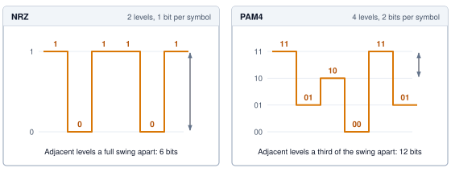

:::

This signaling shift highlights a key architectural rule: doubling line rate without doubling clock frequency trades SNR for bandwidth, requiring forward error correction\index{Forward Error Correction!channel limit} to operate near the channel limit.

### Reach and medium for copper and optics {#sec-network-fabrics-copper-optics}

\index{Direct attach copper|see{DAC}}\index{Active optical cable|see{AOC}}The choice of physical medium determines how far a link can reach before latency, power, and cost reshape the cluster geometry. @Tbl-network-fabrics-link-media compares the recurring cable and optics options by the attributes that decide where each one belongs.

```{python}
#| echo: false
#| label: network-fabrics-spine-optics-cost

# ┌─────────────────────────────────────────────────────────────────────────────
# │ SPINE-LAYER OPTICS COST AND POWER
# ├─────────────────────────────────────────────────────────────────────────────
# │ Context: @psp-network-fabrics-cost-distance — the "cost of distance"
# │          perspective quantifying spine-layer optics for a 10K-GPU cluster.
# │
# │ Goal: Compute the spine-optics dollar and power totals from the registry
# │       pluggable-optics power (the old prose hand-typed 10 W/link — the
# │       CPO value — and derived 200 kW where the registry 20 W gives 400 kW,
# │       contradicting the OpticalDividend cell later in this chapter).
# │ Show: Link count, per-link power, total cabling cost, total optics power.
# │ How: Derive the spine link count from the 10K training cluster; per-link
# │      optics, DAC, and AOC prices come from Infrastructure.Pricing.Network;
# │      power per link is Systems.SwitchFabric.OpticsPluggable400G; rack power
# │      bounds come from Infrastructure.Racks.AI_Standard / AI_High.
# │
# └─────────────────────────────────────────────────────────────────────────────
from mlsysim.fmt import check, fmt, fmt_count, fmt_power, fmt_qty_range, fmt_usd

class SpineOpticsCost:
    # ┌── 1. LOAD (Constants) ──────────────────────────────────────────────
    cluster_gpus = Systems.Clusters.Training_10K.total_accelerators
    n_links = 2 * cluster_gpus  # scenario assumption: two spine-layer optical links per accelerator
    link_cost = Infrastructure.Pricing.Network.OpticsPerLinkUsd.rate  # per-link optics cost
    dac_cost = Infrastructure.Pricing.Network.DacCableUsd.rate  # passive copper cable
    aoc_cost = Infrastructure.Pricing.Network.AocCableUsd.rate  # active optical cable
    link_power = Systems.SwitchFabric.OpticsPluggable400G
    rack_power_low = Infrastructure.Racks.AI_Standard.power_kw * kW  # dense AI rack lower bound
    rack_power_high = Infrastructure.Racks.AI_High.power_kw * kW  # dense AI rack upper bound

    # ┌── 2. EXECUTE (The Compute) ────────────────────────────────────────
    total_cost = n_links * link_cost
    total_power = n_links * link_power

    # ┌── 3. GUARD (Invariants) ───────────────────────────────────────────
    check(total_power.to(kW).magnitude == 400, "20,000 pluggable links at registry power should draw 400 kW")

    # ┌── 4. OUTPUT (Formatting) ──────────────────────────────────────────
    cluster_gpus_str = fmt_count(cluster_gpus, label="GPU", commas=True)
    n_links_str = fmt(n_links, precision=0, commas=True)
    link_cost_usd_str = fmt_usd(link_cost, precision=0, commas=False)
    dac_cost_usd_str = fmt_usd(dac_cost, precision=0, commas=False)
    aoc_cost_usd_str = fmt_usd(aoc_cost, precision=0, commas=False)
    link_power_w_str = fmt_power(link_power, unit=watt, precision=0, commas=False)
    total_cost_musd_str = fmt_usd(total_cost, precision=0, commas=False, scale="million")
    total_power_kw_str = fmt_power(total_power, unit=kW, precision=0, commas=False)
    rack_power_range_str = fmt_qty_range(rack_power_low, rack_power_high, kW, precision=0, commas=False)
```

| **Medium**                                              | **Reach**                                   | **Cost profile**                                                                                  | **Latency impact**                                                                             | **Typical placement**            |
|:--------------------------------------------------------|:--------------------------------------------|:--------------------------------------------------------------------------------------------------|:-----------------------------------------------------------------------------------------------|:---------------------------------|
| **DAC (direct attach copper)**\index{DAC!definition}    | 1 to 3 meters, shrinking as lane rate rises | Lowest cost (~`{python} SpineOpticsCost.dac_cost_usd_str`) and no optical module power            | Lowest media latency; passive copper avoids optical conversion                                 | Within a rack                    |
| **AOC (active optical cable)**\index{AOC!definition}    | 3 to 30 meters                              | Higher cost (~`{python} SpineOpticsCost.aoc_cost_usd_str`) from permanently attached transceivers | Electrical/optical conversion plus forward error correction (FEC) adds hundreds of nanoseconds | Rack-to-rack or row-scale links  |
| **Pluggable optics**\index{Pluggable optics!definition} | More than 30 meters                         | Highest module and power cost, but replaceable optics and fiber cords                             | Optical conversion and FEC add latency; distance enables topology reach                        | Network core and pod-scale links |

: **Cable and optics placement trade-offs**: Common interconnect media occupy different reach, latency, and cost points, so cluster designers use copper inside racks and optics as distance begins to dominate placement. {#tbl-network-fabrics-link-media tbl-colwidths="[18,20,20,20,22]"}

The high-speed copper and optical paths considered here both include FEC[^fn-fec-link-latency]\index{FEC!optical latency budget}, so choosing optics does not by itself remove error-correction overhead. The ranges in @tbl-network-fabrics-link-media describe representative placements rather than fixed boundaries between media. Optical interconnects\index{Optical interconnect!reach and latency} can extend the layout beyond a passive copper channel's budget, while pluggable optics\index{Pluggable optics!reach and cost} also permit separate replacement of modules and fiber. Reach, delivered latency, power, and serviceability jointly determine the choice.

[^fn-fec-link-latency]: [offset=-29mm] **FEC (forward error correction)**\index{FEC!latency tax}: At 400G and 800G speeds, signal integrity is fragile enough that Ethernet PHY designs rely on FEC to reconstruct corrupted bits [@anslow2016rsFec; @ethernetAlliance2025roadmap]. The exact latency depends on the PHY and module architecture; for ML fabric modeling, treating FEC as a per-hop latency budget is the conservative point, because a multi-hop path accumulates that budget before software can hide it.

```{=latex}
\Needspace{30\baselineskip}
```

::: {#psp-network-fabrics-cost-distance .callout-perspective title="The cost of distance"}

In an ML fleet, distance is money. A cluster of `{python} SpineOpticsCost.cluster_gpus_str` requires ~`{python} SpineOpticsCost.n_links_str` optical links at the spine layer alone. At `{python} SpineOpticsCost.link_cost_usd_str` each with `{python} SpineOpticsCost.link_power_w_str` per pluggable link\index{Pluggable optics!transceiver power}, that represents `{python} SpineOpticsCost.total_cost_musd_str` in cabling and `{python} SpineOpticsCost.total_power_kw_str` of continuous power for transceivers alone. The cost dictates cluster geometry\index{Cluster!geometry}: architects pack accelerators as densely as possible (`{python} SpineOpticsCost.rack_power_range_str` per rack) to maximize cheap copper and minimize expensive optics.

:::

### SerDes, link budget, and power {#sec-network-fabrics-serdes}

```{python}
#| echo: false
#| label: network-fabrics-serdes-power-budget
# ┌─────────────────────────────────────────────────────────────────────────────
# │ SERDES POWER BUDGET (LEGO)
# ├─────────────────────────────────────────────────────────────────────────────
# │ Context: @sec-network-fabrics-serdes — the SerDes/interconnect power
# │          paragraph below.
# │
# │ Goal: Quantify the interconnect power draw for the running-example cluster
# │       and express it as a fraction of the GPU power budget.
# │ Show: 350 GB AllReduce, ~3,000 links, 25 W/port, 75 kW interconnect,
# │       ~10 percent of the accelerator power budget.
# │ How: gradient = GPT3 params × 2 bytes (FP16); link count and per-port power
# │      are scenario assumptions; GPU power budget = total_accelerators × TDP.
# │
# └─────────────────────────────────────────────────────────────────────────────
from mlsysim.fmt import check, fmt, fmt_memory, fmt_percent, fmt_power

class SerDesPowerBudget:
    """Interconnect SerDes/transceiver power for the 175B running-example cluster."""

    # ┌── 1. LOAD (Constants) ──────────────────────────────────────────────
    n_gpus = Systems.Clusters.Training_1K.total_accelerators
    h100_tdp = Hardware.Cloud.H100.tdp
    gradient = Models.Language.GPT3.parameters * (2 * byte / param)  # 175B FP16 AllReduce
    n_links = 3000  # scenario assumption: high-speed links to sustain full BW_bisect
    port_power = 25 * watt  # scenario assumption: combined SerDes + optical transceiver per port

    # ┌── 2. EXECUTE (The Compute) ────────────────────────────────────────
    interconnect_power = n_links * port_power
    gpu_power_budget = n_gpus * h100_tdp
    power_fraction = (interconnect_power / gpu_power_budget).to_base_units().magnitude

    # ┌── 3. GUARD (Invariants) ───────────────────────────────────────────
    check(abs(gradient.to(GB).magnitude - 350) < 1e-6, "175B FP16 AllReduce should be 350 GB")
    check(interconnect_power.to(kW).magnitude == 75, "3,000 links at 25 W should draw 75 kW")
    check(0.10 < power_fraction < 0.11, f"Interconnect should be ~10 percent of GPU power, got {power_fraction:.3f}")

    # ┌── 4. OUTPUT (Formatting) ──────────────────────────────────────────
    grad_gb_str = fmt_memory(gradient, unit=GB, precision=0, commas=False)
    n_links_str = fmt(n_links, precision=0, commas=True)
    port_power_w_str = fmt_power(port_power, unit=watt, precision=0, commas=False)
    interconnect_kw_str = fmt_power(interconnect_power, unit=kW, precision=0, commas=False)
    power_frac_pct_str = fmt_percent(power_fraction, precision=1, commas=False, style='prose')
```

Every port depends on a **serializer/deserializer (SerDes)**\index{SerDes!definition}\index{Serializer/Deserializer|see{SerDes}} circuit that converts parallel data from the switch application-specific integrated circuit (ASIC) into a serial stream. Its power cost accumulates across the provisioned ports. For the `{python} NetworkWireClusterRecap.n_gpus_str` reference cluster, the modeled full-$\Bandwidth_{\text{bisect}}$ fabric serving `{python} SerDesPowerBudget.grad_gb_str` of model-wide gradient state contains roughly `{python} SerDesPowerBudget.n_links_str` high-speed links across its host and switch tiers. With `{python} IbNdrWireRecap.ib_ndr_gbit_per_s_str` ports assigned `{python} SerDesPowerBudget.port_power_w_str` of combined SerDes and optical-transceiver power, the model totals `{python} SerDesPowerBudget.interconnect_kw_str`, equivalent to `{python} SerDesPowerBudget.power_frac_pct_str` of the accelerators' combined thermal design power. This comparison isolates the assumed port-power budget; it does not establish the fraction of measured cluster energy consumed by networking.

```{python}
#| echo: false
# ┌── LEGO ───────────────────────────────────────────────
# │ Context: Link-budget paragraph below — dB allowance for one copper lane.
class LinkBudgetScenario:
    # ┌── 1. LOAD ──────────────────────────────────────────────────────────
    budget_db = 30  # scenario assumption: end-to-end loss allowance for one 50G PAM4 lane
    cable_m = 3  # scenario assumption: passive DAC length
    cable_loss_db = 18  # scenario assumption: insertion loss of that cable at the lane's Nyquist frequency
    connector_loss_db = 2  # scenario assumption: combined connector loss
    # ┌── 2. EXECUTE ───────────────────────────────────────────────────────
    margin_db = budget_db - cable_loss_db - connector_loss_db
    # ┌── 3. GUARD ─────────────────────────────────────────────────────────
    check(margin_db > 0, "Scenario link must close with positive margin")
    # ┌── 4. OUTPUT ────────────────────────────────────────────────────────
    budget_db_str = MarkdownStr(f"{budget_db} dB")
    cable_m_str = MarkdownStr(f"{cable_m}-meter")
    cable_loss_db_str = MarkdownStr(f"{cable_loss_db} dB")
    connector_loss_db_str = MarkdownStr(f"{connector_loss_db} dB")
    margin_db_str = MarkdownStr(f"{margin_db} dB")
```

The **link budget**\index{Link Budget!definition} allocates the signal loss a path can tolerate while meeting its error target. In this simplified decibel (dB) accounting, a lane has a `{python} LinkBudgetScenario.budget_db_str` allowance. A `{python} LinkBudgetScenario.cable_m_str` DAC cable\index{DAC!signal attenuation loss} contributing `{python} LinkBudgetScenario.cable_loss_db_str` of loss and connectors contributing `{python} LinkBudgetScenario.connector_loss_db_str` leave `{python} LinkBudgetScenario.margin_db_str` of margin. Higher signaling frequencies increase copper loss, so preserving reach can require more signal conditioning, a different cable, or optics\index{Pluggable optics!rack exit requirement}. Aggregate port speed alone does not determine cable reach; lane rate, channel construction, and active components matter. The design must meet both the signal-quality target and the power budget before the transport layer can rely on the link.

## Level 2 Transport and the Performance Model {#sec-network-fabrics-transport}

```{python}
#| echo: false
# ┌── LEGO ───────────────────────────────────────────────
# │ Context: Transport section — 175B cluster GPU count
class NetworkTransportClusterRecap:
    # ┌── 4. OUTPUT (Formatting) ──────────────────────────────────────────────
    n_gpus_str = fmt_count(Systems.Clusters.Training_1K.total_accelerators, commas=True, label="GPU")
```

Large-scale training requires sustained, synchronized bulk transfers. A single AllReduce across `{python} NetworkTransportClusterRecap.n_gpus_str` forwards every worker's contribution through many links in lockstep. This pattern favors RDMA transport offload, reliable completion, and bounded loss-recovery time. A physically lossless fabric is one way to make that performance predictable, but it is not the only design.

### RDMA and GPUDirect {#sec-network-fabrics-rdma}

::: {#dfn-network-fabrics-remote-direct-memory-access-rdma .callout-definition title="Remote direct memory access (RDMA)"}

***Remote direct memory access (RDMA)***\index{RDMA!definition}\index{Remote direct memory access|see{RDMA}} is a networking technology that offloads transport processing to network interface hardware, allowing access to registered remote memory without per-transfer kernel processing of the payload.

1.  **Significance**: RDMA can reduce end-to-end message latency from tens of microseconds for a kernel TCP path to low-single-digit microseconds on a tuned fabric, shrinking the fixed startup cost that every message adds to the Fleet Law's communication term $T_{\text{comm}}$. For an outgoing payload of $n$ bytes, GPUDirect RDMA avoids approximately $2n$ bytes of host-memory traffic: one write into host RAM and one NIC read back out. Here $n$ is the payload transferred by that participant, not the model-wide gradient state.
2.  **Distinction**: Unlike a conventional kernel TCP path, RDMA offloads transport processing to NIC hardware and permits user-space access to registered memory. The resulting CPU-core and memory-bandwidth savings depend on the host, NIC, I/O path, message size, and software configuration rather than on link rate alone.
3.  **Common pitfall**: RDMA is an access and offload model, not one loss-recovery algorithm. Reliable InfiniBand and RoCE transports detect loss and retransmit [@infiniband2000spec]. Some RNIC generations use Go-Back-N-style recovery that makes a drop expensive, while other designs support stronger selective recovery or tolerate lossy Ethernet without PFC [@mittal2018irn]. The requirement is reliable completion with a recovery tail that the synchronized workload can tolerate, not PFC or a physically lossless Ethernet fabric in every implementation.

:::

```{python}
#| echo: false
# ┌── LEGO ───────────────────────────────────────────────
# │ Context: Transport — NDR line rate in TCP/RDMA discussion.
class IbNdrTransportRecap:
    # ┌── 4. OUTPUT (Formatting) ──────────────────────────────────────────────
    ib_ndr_gbit_per_s_str = fmt_bandwidth(Systems.Fabrics.InfiniBand_NDR.bandwidth, unit=Gbps, precision=0, commas=False)
```

Conventional kernel TCP paths become increasingly expensive at `{python} IbNdrTransportRecap.ib_ndr_gbit_per_s_str` link rates. Interrupt processing, protocol work, and payload copies can consume substantial CPU time and memory bandwidth, especially when many streams or NICs drive a host concurrently. Modern TCP stacks can sustain high throughput with segmentation offload, receive-side scaling, zero-copy interfaces, and careful non-uniform memory access (NUMA) placement, so one stream does not inherently exhaust a dual-socket server's memory bandwidth. The architectural problem is instead that host resources spent moving network data compete with the training process and become harder to provision predictably as aggregate I/O grows.

RDMA bypasses the kernel data path. Offloading transport logic to the NIC allows applications to read and write registered remote memory without per-message kernel intervention. For ML, GPUDirect RDMA\index{GPUDirect RDMA!accelerator memory}[^fn-gpudirect-rdma-bypass] extends this principle to accelerator memory [@nvidia2026gpudirectRdma]. In the sending-node data paths diagrammed in @fig-gpudirect-data-path, GPUDirect RDMA routes the $n$-byte payload along the solid green peer-to-peer path through the PCIe switch straight to the RDMA NIC, bypassing host memory entirely. Without this direct memory access (DMA) engine access, the dashed gray staging path must first copy $n$ bytes from GPU memory into a registered host-memory buffer and subsequently read $n$ bytes out to the NIC, generating roughly $2n$ bytes of redundant host-memory bus traffic. The network still transfers the payload, and the PCIe path may comprise multiple DMA transactions; the optimization removes staging copies rather than collapsing the transfer into one transaction.

[^fn-gpudirect-rdma-bypass]: **GPUDirect RDMA**\index{GPUDirect RDMA!zero-copy}: Introduced by NVIDIA for Kepler-class GPUs and CUDA 5.0, GPUDirect RDMA enables a direct PCIe path between GPU memory and third-party peer devices such as network interfaces [@nvidia2026gpudirectRdma]. Before GPUDirect, every gradient transfer had to stage through host memory, consuming CPU memory bandwidth that competes with data loading. Eliminating this bounce path is one reason overlapping communication with backward-pass computation is feasible at scale.

::: {#fig-gpudirect-data-path fig-env="figure" fig-pos="htb" fig-cap="**GPUDirect RDMA data path**: Without GPUDirect (dashed), a sending node first writes the $n$-byte payload from GPU memory into a registered host-memory buffer and the NIC then reads it back out, about $2n$ bytes of host-memory traffic per payload. With GPUDirect RDMA (solid), the NIC reads GPU memory directly over the PCIe peer-to-peer path, so the host-memory bounce disappears." fig-alt="A sending node containing GPU memory holding an n-byte payload, a PCIe switch, an RDMA NIC, and a host-memory registered buffer. A solid green path runs from GPU memory through the PCIe switch to the NIC, which sends to the fabric. A dashed gray path runs from GPU memory down to host memory, labeled 1, write n bytes, and from host memory up to the NIC, labeled 2, read n bytes. A legend notes that the staged path costs about 2n bytes of host-memory traffic."}
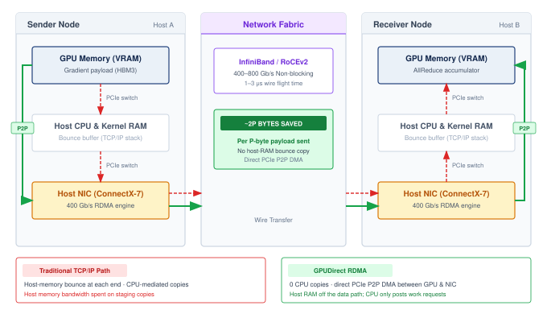

:::

### InfiniBand and RoCE {#sec-network-fabrics-ib-roce}

GPU clusters commonly choose between two RDMA transport stacks, and the decision is a reliability-versus-operations trade-off. @Tbl-network-fabrics-rdma-stacks compares where each stack places the burden of losslessness and congestion control.

| **Stack**                                                      | **Fabric behavior**                                                                                                                 | **Operational burden**                                                                                                                                                                                                                                  | **Typical fit**                                                                                     |
|:---------------------------------------------------------------|:------------------------------------------------------------------------------------------------------------------------------------|:--------------------------------------------------------------------------------------------------------------------------------------------------------------------------------------------------------------------------------------------------------|:----------------------------------------------------------------------------------------------------|
| InfiniBand (IB)\index{InfiniBand!credit-based flow control}    | Purpose-built HPC switched fabric [@infiniband2000spec] with credit-based flow control, so losslessness is native at the link layer | subnet manager\index{InfiniBand!subnet manager} and virtual lanes (VLs)\index{InfiniBand!virtual lane} govern routing and traffic isolation                                                                                                             | Dedicated training clusters where predictable tail latency outweighs Ethernet ecosystem flexibility |
| **RoCE (RDMA over Converged Ethernet)**\index{RoCE!definition} | RoCEv2 carries RDMA semantics by encapsulating InfiniBand transport headers in UDP/IP packets                                       | PFC-based deployments suppress loss with PFC, ECN, and routing policy\index{RoCEv2!congestion control} [@guo2016rdma; @gangidi2024rdma]; PFC-free designs instead place more burden on end-to-end congestion control and loss recovery [@mittal2018irn] | Multi-vendor Ethernet fleets that can absorb more congestion-control tuning                         |

: **RDMA transport stack trade-offs**: InfiniBand and RoCE expose RDMA semantics through different operational contracts, one built around native losslessness and the other around Ethernet compatibility. {#tbl-network-fabrics-rdma-stacks tbl-colwidths="[20,30,25,25]"}

The InfiniBand\index{IB|see{InfiniBand}}[^fn-infiniband-protocol-origin] row reflects a protocol heritage that favors hardware-managed losslessness over Ethernet compatibility.

[^fn-infiniband-protocol-origin]: [offset=-32mm] **InfiniBand**\index{InfiniBand!origin}: Formed in 1999 from the merger of two competing server I/O standards (Future I/O and NGIO), InfiniBand was originally designed to replace PCI as a general-purpose system interconnect. Its pivot to HPC networking preserved the credit-based, hardware-managed flow control that server I/O demanded, and this heritage is precisely why InfiniBand provides native losslessness without the PFC fragility that plagues Ethernet-based RDMA fabrics.

This architectural choice is visible at the protocol boundary. @Fig-ib-roce-stack partitions the protocol stack across user-space, kernel, and hardware bands, contrasting traditional socket overhead against direct verbs hardware offload. While the TCP/IP stack (left) requires two software copies across kernel buffer boundaries and software protocol execution, the RDMA stack (right) traces a single amber bypass arrow straight from the collective communication library (such as the NVIDIA Collective Communications Library, or NCCL) and the user-space **verbs API**\index{Verbs API!definition} to the RDMA NIC, keeping the operating system entirely off the active data path.

::: {#fig-ib-roce-stack fig-env="figure" fig-pos="htb" fig-cap="**Traditional TCP/IP vs. RDMA verbs stacks**: Read each stack top to bottom through the user-space, kernel, and hardware bands. With TCP/IP sockets (left), every send enters the kernel through a system call, the payload is copied into kernel socket buffers and again toward the NIC's transmit ring, and the CPU runs the transport protocol in software. With RDMA verbs over InfiniBand or RoCEv2 (right), the collective library posts work requests from user space, the kernel stays off the data path, and the RDMA NIC runs the reliable transport in hardware, reading GPU memory directly through GPUDirect instead of staging a host copy." fig-alt="Two panels, each divided by dashed lines into user space, kernel, and hardware bands. Left, TCP/IP sockets: training framework in user space, an arrow tagged copy 1 into the kernel, then socket API, TCP/IP stack, and NIC driver, then an arrow tagged copy 2 down to the Ethernet NIC; the footer reads CPU copies data and runs the transport. Right, RDMA verbs: NCCL above the verbs API in user space, then a single amber arrow straight through the empty kernel band, labeled kernel not on the data path, to the RDMA NIC with transport in hardware; the footer reads NIC reads GPU memory directly (GPUDirect)."}
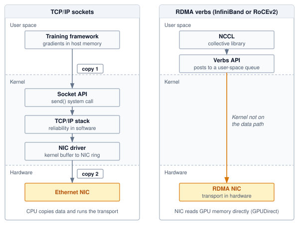

:::

### Reliable delivery and loss recovery {#sec-network-fabrics-losslessness}

By routing the user-space verbs API directly to hardware as diagrammed in @fig-ib-roce-stack, the architecture decouples collective library calls from the operating system, leaving the transport hardware and fabric to arbitrate reliable delivery and packet loss. Reliable connected transports in both InfiniBand and RoCE detect loss and retransmit [@infiniband2000spec]. InfiniBand normally suppresses buffer-overflow loss with link-level credits. Many RoCE deployments suppress it with PFC and ECN [@guo2016rdma; @gangidi2024rdma], but this is a deployment contract rather than a property of RDMA as a family. Designs that operate over lossy Ethernet shift more responsibility to endpoint congestion control, packet reordering, and selective recovery [@mittal2018irn].

Recovery granularity therefore matters. On an RNIC with **Go-Back-N**\index{Go-Back-N!definition}-style recovery and no out-of-order retention, a drop 900 MB into a 1 GB transfer can invalidate later arrivals and force retransmission from the missing sequence point. An RNIC with selective recovery retransmits a smaller region, so the same physical loss produces a shorter tail [@mittal2018irn]. At `{python} IbNdrTransportRecap.ib_ndr_gbit_per_s_str`, either delay is much larger than the wire time of one packet, and a synchronous collective exposes the slowest recovery to every waiting worker. Fabric designers can reduce that tail by suppressing drops with PFC, by using a loss-tolerant transport with bounded endpoint recovery, or by combining congestion control and admission policy so queues rarely overflow. Each choice moves state and failure modes between switches and endpoints.

::: {#chk-network-fabrics-protocol-selection .callout-checkpoint title="Protocol selection"}

Consider a 2,048-GPU training cluster that will run both large language model training (gradient messages of several gigabytes) and reinforcement learning (frequent small control messages).

- [ ] **Protocol fit**: recommend a protocol and justify the choice for both the large gradient messages and the frequent small control messages.
- [ ] **RoCE requirements**: compare the infrastructure required by PFC-based and PFC-free RoCE designs with InfiniBand's credit-based fabric.
- [ ] **Shared fabric**: reevaluate the protocol choice when the cluster also serves inference traffic to external users over the same physical network.

:::

### The $\alpha$-$\beta$ performance model {#sec-network-fabrics-performance-model}

Protocol choice determines how the fabric provides reliable completion and bounds loss-recovery time; performance modeling then asks how fast it can carry a given message. The $\alpha$-$\beta$ model\index{Alpha-Beta Model!message transfer time} (principle \ref{pri-alpha-beta-model}) decomposes message transfer time as $T(n) = \alpha + n/\beta$, where $n$ is the message size in bytes, $\alpha$ is the fixed startup latency, and $\beta$ is the sustained bandwidth in bytes per unit time [@hockney1994]. The physical topology influences both parameters through path length and available capacity. A ring collective, which passes chunks around a logical cycle of participants, adds a separate scheduling cost: as its participant count grows, it pays the per-message startup cost over more rounds, even when the underlying fabric provides short physical paths.

::: {.column-margin .margin-pointer}
↪ The same decomposition, multiplied by each schedule's round count and traffic factor, is developed for collective algorithms in @sec-communication-collective-operations-collective-operations-alphabeta-model-f9b4.
:::

```{python}
#| echo: false
#| label: network-alpha-beta-refactor
# ┌─────────────────────────────────────────────────────────────────────────────
# │ NETWORK ALPHA-BETA MODEL (LEGO)
# ├─────────────────────────────────────────────────────────────────────────────
# │ Context: @sec-network-fabrics-performance-model
# │
# │ Goal: Quantify the latency-bandwidth crossover for InfiniBand vs Ethernet.
# │ Show: Crossover points (~75 KB for IB); impact on small vs large messages.
# │ How: T = alpha + n/beta. Small msg: 4 KB; Large msg: 350 MB.
# │
# └─────────────────────────────────────────────────────────────────────────────
from mlsysim.fmt import check, fmt, fmt_bandwidth, fmt_math, fmt_memory, fmt_multiple, fmt_percent, fmt_time

class NetworkAlphaBeta:
    """Namespace for the alpha-beta communication model."""

    # ┌── 1. LOAD (Constants) ───────────────────────────────────────────────
    # Level 1: Hardware Specs
    FABRIC_ALPHA_NDR = Systems.SwitchFabric.AlphaNdr
    # Scenario parameters, not universal protocol constants. Measured alpha and
    # delivered beta vary with NIC, topology, software, and message placement.
    alpha_ib = FABRIC_ALPHA_NDR
    beta_ib = Systems.Fabrics.InfiniBand_NDR.bandwidth
    eth_alpha = Systems.SwitchFabric.AlphaRoce
    eth_beta = Systems.Fabrics.Ethernet_100G.bandwidth

    # Level 2: Messages
    n_small = 4000 * byte  # scenario assumption: 4 KB control message
    n_large = 350 * MB  # scenario assumption: 350 MB gradient shard

    # ┌── 2. EXECUTE (The Compute) ─────────────────────────────────────────
    n_cross_ib = calc_alpha_beta_crossover(alpha_ib, beta_ib)
    n_cross_eth = calc_alpha_beta_crossover(eth_alpha, eth_beta)

    t_small_ib = calc_point_to_point_time(n_small, alpha_ib, beta_ib)
    t_small_eth = calc_point_to_point_time(n_small, eth_alpha, eth_beta)
    small_bw_term_pct = ((n_small / beta_ib) / t_small_ib).to_base_units().magnitude * 100
    small_speedup = (t_small_eth / t_small_ib).to_base_units().magnitude

    # Small-message worked-equation terms (microseconds), for the alpha-beta callout.
    ib_small_xfer_us = (n_small / beta_ib).to(microsecond).magnitude
    eth_small_xfer_us = (n_small / eth_beta).to(microsecond).magnitude

    t_large_ib = calc_point_to_point_time(n_large, alpha_ib, beta_ib)
    t_large_eth = calc_point_to_point_time(n_large, eth_alpha, eth_beta)
    large_speedup = (t_large_eth / t_large_ib).to_base_units().magnitude

    # ┌── 3. GUARD (Invariants) ───────────────────────────────────────────
    check(n_cross_ib < 100 * KB, f"Crossover ({n_cross_ib.to(KB).magnitude:.0f} KB) should be < 100 KB for IB")
    check(small_bw_term_pct < 10, f"Small msg should be latency-bound, got {small_bw_term_pct:.1f}% BW share")
    check(3.0 < small_speedup < 4.0, "Small-message speedup should be about 3.4× for IB vs Ethernet")
    check(3.5 < large_speedup < 4.5, "Large-message speedup should be about 4× for IB vs 100G Ethernet")

    # ┌── 4. OUTPUT (Formatting) ──────────────────────────────────────────────
    n_cross_ib_kb_str = fmt_memory(n_cross_ib, unit=KB, precision=0, commas=False)
    n_cross_eth_kb_str = fmt_memory(n_cross_eth, unit=KB, precision=1, commas=False)
    t_small_ib_us_str = fmt_time(t_small_ib, microsecond, precision=2, commas=False)
    small_bw_pct_str = fmt_percent(small_bw_term_pct / 100, precision=1, commas=False, style='prose')
    t_large_ib_ms_str = fmt_time(t_large_ib, millisecond, precision=1, commas=False)
    t_large_eth_ms_str = fmt_time(t_large_eth, millisecond, precision=2, commas=False)
    large_speedup_mult_str = fmt_multiple(round(large_speedup), precision=0, commas=False)
    ib_alpha_us_str = fmt_time(alpha_ib, microsecond, precision=1, commas=False)
    ib_beta_gb_per_s_str = fmt_bandwidth(beta_ib, unit=GB / second, precision=0, commas=False)
    n_small_kb_str = fmt_memory(n_small, unit=KB, precision=0, commas=False)
    n_large_mb_str = fmt_memory(n_large, unit=MB, precision=0, commas=False)
    n_large_grad_mb_str = fmt_memory(n_large, unit=MB, precision=0, commas=False)
    eth_alpha_us_str = fmt_time(eth_alpha, microsecond, precision=0, commas=False)
    eth_beta_gb_per_s_str = fmt_bandwidth(eth_beta, unit=GB / second, precision=1, commas=False)
    doubled_beta_gb_per_s_str = fmt_bandwidth(2 * beta_ib, unit=GB / second, precision=0, commas=False)

    # Worked small-message equations for the alpha-beta crossover callout.
    _a_ib = alpha_ib.to(microsecond).magnitude
    _b_ib = beta_ib.to(GB / second).magnitude
    _a_eth = eth_alpha.to(microsecond).magnitude
    _b_eth = eth_beta.to(GB / second).magnitude
    _n_kb = n_small.to(KB).magnitude
    small_ib_eq_math = fmt_math(
        rf"{_a_ib:.1f}\,\mu\text{{s}} + {_n_kb:.0f}\,\text{{KB}}/{_b_ib:.0f}\,\text{{GB/s}} "
        rf"= {_a_ib:.1f} + {ib_small_xfer_us:.2f} = \mathbf{{{t_small_ib.to(microsecond).magnitude:.2f}}}\,\mu\text{{s}}"
    )
    small_eth_eq_math = fmt_math(
        rf"{_a_eth:.1f}\,\mu\text{{s}} + {_n_kb:.0f}\,\text{{KB}}/{_b_eth:.1f}\,\text{{GB/s}} "
        rf"= {_a_eth:.1f} + {eth_small_xfer_us:.2f} = \mathbf{{{t_small_eth.to(microsecond).magnitude:.2f}}}\,\mu\text{{s}}"
    )
    small_speedup_mult_str = fmt_multiple(small_speedup, precision=1, commas=False)
```

The model reveals two regimes that lead to different engineering responses. For messages with $n < \alpha\beta$, startup cost $\alpha$ exceeds the transmission cost; sufficiently small control messages lie deep in this latency-bound region. For messages with $n > \alpha\beta$, the $n/\beta$ term is larger; sufficiently large gradient transfers lie deep in the bandwidth-bound region. Near the crossover, both terms matter. A collective's regime also depends on how its algorithm divides the payload into messages and schedules them across rounds.

::: {.column-margin .margin-pointer}
↪ The crossover message size that separates the latency-dominated and bandwidth-dominated regimes, with a worked InfiniBand NDR example, is developed in @sec-appdx-comm-foundations-regimes.
:::

For the modeled NDR InfiniBand path with $\alpha =$ `{python} NetworkAlphaBeta.ib_alpha_us_str` and $\beta =$ `{python} NetworkAlphaBeta.ib_beta_gb_per_s_str`, the crossover point $\CrossoverPoint = \alpha \cdot \beta \approx$ `{python} NetworkAlphaBeta.n_cross_ib_kb_str`. Measured startup latency and delivered bandwidth vary with the NIC, switch path, software stack, and contention, so these parameters describe a scenario rather than a protocol constant. Far below the crossover, more bandwidth removes only a small part of transfer time; far above it, lower startup latency removes only a small part. Shorter paths can lower $\alpha$, while additional delivered path bandwidth raises $\beta$; their value depends on the message sizes the workload actually exchanges.

::: {#nbk-network-fabrics-alpha-beta-crossover .callout-notebook title="The alpha-beta crossover"}

**Problem**: A fabric designer is comparing a modeled InfiniBand NDR path (`{python} NetworkAlphaBeta.ib_alpha_us_str`, `{python} NetworkAlphaBeta.ib_beta_gb_per_s_str`) against a modeled RoCE path (`{python} NetworkAlphaBeta.eth_alpha_us_str`, `{python} NetworkAlphaBeta.eth_beta_gb_per_s_str`). For a `{python} NetworkAlphaBeta.n_small_kb_str` control message and a `{python} NetworkAlphaBeta.n_large_mb_str` gradient shard, which part of $T(n)=\alpha+n/\beta$ dominates, and why does the first path help for different reasons in each regime?

**Math**:
Apply $T(n) = \alpha + n/\beta$ for a `{python} NetworkAlphaBeta.n_small_kb_str` control message and a `{python} NetworkAlphaBeta.n_large_mb_str` gradient shard.

1. **Small message** (`{python} NetworkAlphaBeta.n_small_kb_str`):
   - InfiniBand: `{python} NetworkAlphaBeta.small_ib_eq_math`
   - Ethernet: `{python} NetworkAlphaBeta.small_eth_eq_math`
   - **Result**: Under these assumed path parameters, the NDR path is `{python} NetworkAlphaBeta.small_speedup_mult_str` faster because its modeled $\alpha$ is lower.
2. **Large message** (`{python} NetworkAlphaBeta.n_large_mb_str`):
   - InfiniBand: $T = \alpha + n/\beta =$ `{python} NetworkAlphaBeta.t_large_ib_ms_str`
   - Ethernet: $T = \alpha + n/\beta =$ `{python} NetworkAlphaBeta.t_large_eth_ms_str`
   - **Result**: Under these assumed path parameters, the NDR path is `{python} NetworkAlphaBeta.large_speedup_mult_str` faster because its modeled $\beta$ is higher.

**Systems insight**: This scenario places the crossover $(\CrossoverPoint = \alpha\beta)$ near `{python} NetworkAlphaBeta.n_cross_ib_kb_str`. Because gradients are megabytes to gigabytes, their transfers are usually bandwidth dominated, whereas pipeline coordination can remain latency dominated\index{Latency!dominated regime}. A higher line rate produces little benefit for a message whose startup term dominates; transport processing, topology, and hop count then govern the improvement.

:::

In the 175B training job, a `{python} NetworkAlphaBeta.n_small_kb_str` pipeline-scheduling control message costs $T(n) \approx$ `{python} NetworkAlphaBeta.t_small_ib_us_str`, with bandwidth contributing only `{python} NetworkAlphaBeta.small_bw_pct_str` of the total. Faster links therefore offer little benefit for this handoff. A `{python} NetworkAlphaBeta.n_large_grad_mb_str` gradient shard costs $T(n) \approx$ `{python} NetworkAlphaBeta.t_large_ib_ms_str`; doubling bandwidth to `{python} NetworkAlphaBeta.doubled_beta_gb_per_s_str` would approximately halve its transfer time.

@Fig-alpha-beta-crossover tracks modeled transfer time across message sizes on a log-log scale, charting the transition between the flat latency-dominated plateau and the linear bandwidth-dominated regime. For the modeled NDR path (blue solid curve), the inflection knee at `{python} NetworkAlphaBeta.n_cross_ib_kb_str` marks where transmission delay overtakes the $1.5\ \mu\text{s}$ fixed startup latency; the 100 Gb/s RoCE path (orange dashed curve) exhibits a higher latency floor ($5.0\ \mu\text{s}$) with its crossover knee at `{python} NetworkAlphaBeta.n_cross_eth_kb_str`. The exact positions reflect the assumed $\alpha$ and $\beta$ scenario parameters rather than invariant protocol constants. In both paths, startup latency dictates performance for sub-kilobyte control handoffs, whereas multi-megabyte gradient shards operate entirely within the linear bandwidth-bound regime.

::: {#fig-alpha-beta-crossover fig-env="figure" fig-pos="htb" fig-cap="**The $\alpha$-$\beta$ crossover**: Modeled transfer time as a function of message size for an NDR InfiniBand path and a 100 Gb/s RoCE baseline using the scenario parameters in the text. Small messages are latency dominated (flat region), while large messages are bandwidth dominated (linear region). Measured crossover points vary with the end-to-end path." fig-alt="Log-log modeled transfer time vs. message size for one NDR InfiniBand scenario and one 100 gigabit per second RoCE scenario, with latency-dominated and bandwidth-dominated regions labeled."}

```{python}
#| echo: false
# ┌─────────────────────────────────────────────────────────────────────────────
# │ ALPHA-BETA CROSSOVER (FIGURE)
# ├─────────────────────────────────────────────────────────────────────────────
# │ Context: @fig-alpha-beta-crossover—latency vs bandwidth regime in fabric
# │          selection
# │
# │ Goal: Visualize transfer time vs message size for InfiniBand NDR vs Ethernet
# │       RoCE; show latency-dominated (flat) vs bandwidth-dominated (linear).
# │ Show: Log-log plot with crossover points (~75 KB for IB); alpha/beta model.
# │ How: T = alpha + n/beta; plot for both fabrics; annotate crossover.
# │
# └─────────────────────────────────────────────────────────────────────────────
# ┌── 1. CANVAS ────────────────────────────────────────────────────────────────
# │ Visualize transfer time vs message size for InfiniBand NDR vs Ethernet
import matplotlib.pyplot as plt
import matplotlib.ticker as ticker
import numpy as np
from mlsysim.fmt import fmt_bandwidth, fmt_memory

# ┌── 2. ARRAYS ────────────────────────────────────────────────────────────────
alpha_ib_q = Systems.SwitchFabric.AlphaNdr
beta_ib_q = Systems.Fabrics.InfiniBand_NDR.bandwidth
alpha_eth_q = Systems.SwitchFabric.AlphaRoce
beta_eth_q = Systems.Fabrics.Ethernet_100G.bandwidth

alpha_ib = alpha_ib_q.to(second).magnitude
beta_ib = beta_ib_q.to(byte / second).magnitude
alpha_eth = alpha_eth_q.to(second).magnitude
beta_eth = beta_eth_q.to(byte / second).magnitude

n = np.logspace(0, 10, 1000)
t_ib = np.array([calc_point_to_point_time(size * byte, alpha_ib_q, beta_ib_q).to(second).magnitude for size in n])
t_eth = np.array([calc_point_to_point_time(size * byte, alpha_eth_q, beta_eth_q).to(second).magnitude for size in n])

n_cross_ib_q = calc_alpha_beta_crossover(alpha_ib_q, beta_ib_q)
n_cross_ib = n_cross_ib_q.to(byte).magnitude
t_cross_ib = 2 * alpha_ib
n_cross_eth_q = calc_alpha_beta_crossover(alpha_eth_q, beta_eth_q)
n_cross_eth = n_cross_eth_q.to(byte).magnitude
t_cross_eth = 2 * alpha_eth

fig, ax = plt.subplots(figsize=(9, 5))

# ┌── 3. RENDER ────────────────────────────────────────────────────────────────
ib_beta_label = fmt_bandwidth(beta_ib_q, unit=GB / second, precision=0, commas=False)
eth_beta_label = fmt_bandwidth(beta_eth_q, unit=GB / second, precision=1, commas=False)
ax.plot(n, t_ib, label=f'InfiniBand NDR ({alpha_ib*1e6:.1f} µs, {ib_beta_label})', color='#006395', linewidth=2.5)
ax.plot(n, t_eth, label=f'Ethernet RoCE ({alpha_eth*1e6:.1f} µs, {eth_beta_label})', color='#E67817', linewidth=2.5, linestyle='--')

ax.scatter([n_cross_ib], [t_cross_ib], color='#006395', s=80, zorder=5, edgecolors='white')
ax.scatter([n_cross_eth], [t_cross_eth], color='#E67817', s=80, zorder=5, edgecolors='white')

# ┌── 4. DECORATE ──────────────────────────────────────────────────────────────
# blue
ax.annotate(
    f'Crossover\n~{fmt_memory(n_cross_ib_q, unit=KB, precision=0, commas=False)}',
    xy=(n_cross_ib * 1.2, t_cross_ib * 0.9),
    xytext=(n_cross_ib * 40, t_cross_ib / 1.5),
    arrowprops=dict(arrowstyle='->', color='#006395'),
    color='#006395',
    fontsize=9,
    ha='center',
    va='top',
)

# red
ax.annotate(
    f'Crossover\n~{fmt_memory(n_cross_eth_q, unit=KB, precision=1, commas=False)}',
    xy=(n_cross_eth * 0.9, t_cross_eth * 1.03),
    xytext=(n_cross_eth / 40, t_cross_eth * 5),
    arrowprops=dict(arrowstyle='->', color='#E67817'),
    color='#E67817',
    fontsize=9,
    ha='center',
    va='top',
)

split_point = n_cross_ib
ax.axvspan(1, split_point, color='gray', alpha=0.1)

ax.text(3e1, 2e-4, "Latency\nDominated", fontsize=12, color='#444', ha='center', va='center', fontweight='bold')
ax.text(1e8, 2e-4, "Bandwidth\nDominated", fontsize=12, color='#444', ha='center', va='center', fontweight='bold')

ax.set_xscale('log')
ax.set_yscale('log')
ax.set_xlim(1, 1e10)
ax.set_ylim(5e-7, 1)
ax.grid(True, which="major", ls="-", alpha=0.6)
ax.grid(True, which="minor", ls=":", alpha=0.3)
ax.set_xlabel('Message Size (Bytes)', fontweight='bold')
ax.set_ylabel('Transfer Time (Seconds)', fontweight='bold')
ax.legend(loc='upper left', frameon=True, framealpha=0.9, fancybox=True)
ax.xaxis.set_major_locator(ticker.LogLocator(base=10.0, numticks=12))
plt.tight_layout()
plt.show()
plt.close()
```

:::

```{python}
#| echo: false
#| label: allreduce-bottleneck
from mlsysim import (
    Models,
    Hardware,
    Systems,
    flop,
    byte,
    param,
    second,
    ms,
    millisecond,
    microsecond,
    GB,
)
from mlsysim.fmt import (
    fmt,
    fmt_count,
    fmt_display_math,
    fmt_int,
    fmt_magnitude,
    fmt_math,
    fmt_memory,
    fmt_params,
    fmt_percent,
    fmt_time,
    sci_latex,
)

# ┌─────────────────────────────────────────────────────────────────────────────
# │ ALLREDUCE BOTTLENECK ANALYSIS
# ├─────────────────────────────────────────────────────────────────────────────
# │ Context: Network Performance Modeling - Alpha-Beta Model.
# │
# │ Goal: Identify when communication intensity overwhelms computation.
# │ Show: Growth of comm overhead from GPT-2-scale to 70B parameter models.
# │ How: Calculate T_compute vs T_ring_allreduce using Alpha-Beta parameters.
# │
# └─────────────────────────────────────────────────────────────────────────────

# ┌── LEGO ───────────────────────────────────────────────
class AllReduceBottleneck:
    """
    Scenario: Cluster of 1024 H100 GPUs training models of varying scale.
    Alpha-Beta parameters for NDR InfiniBand.
    """

    # ┌── 1. LOAD (Constants) ───────────────────────────────────────────────
    from mlsysim.physics import calc_ring_allreduce_time

    FABRIC_ALPHA_NDR = Systems.SwitchFabric.AlphaNdr
    num_gpus = Systems.Clusters.Training_1K.total_accelerators
    h_h100 = Hardware.Cloud.H100
    ib_ndr = Systems.Fabrics.InfiniBand_NDR

    peak_flops = h_h100.compute.peak_flops
    gpu_util = 0.50
    flops_per_sample_base = 5e13 * flop  # scenario assumption: realistic per-GPU compute for ~100ms iteration
    grad_bytes_per_param = 4 * byte / param  # scenario assumption: FP32 gradients

    m_small = Models.Language.GPT2  # GPT-2-scale model from the registry
    m_70b = Models.Language.Llama2_70B

    # ┌── 2. EXECUTE (The Compute) ─────────────────────────────────────────
    # Step 1: Compute time per GPU
    t_comp = flops_per_sample_base / (peak_flops * gpu_util)

    # Use library formula for Ring AllReduce
    # Model A: GPT-2-scale params (FP32 = 4 bytes/param)
    grad_small = m_small.parameters * grad_bytes_per_param
    t_comm_small = calc_ring_allreduce_time(grad_small, num_gpus, ib_ndr.bandwidth, FABRIC_ALPHA_NDR)

    # Model B: 70B params (FP32 = 4 bytes/param)
    grad_70b = m_70b.parameters * grad_bytes_per_param
    t_comm_70b = calc_ring_allreduce_time(grad_70b, num_gpus, ib_ndr.bandwidth, FABRIC_ALPHA_NDR)

    comm_frac_small = (t_comm_small / (t_comp + t_comm_small)).to_base_units().magnitude

    # ┌── 3. GUARD (Invariants) ───────────────────────────────────────────
    check(abs(t_comp.to(second).magnitude - 0.10) < 0.02, f"Expected 0.10s compute time, got {t_comp.to(second).magnitude:.2f}s")
    check(t_comm_70b > t_comm_small * 40, "70B comm should be >40x GPT-2-scale comm")

    # ┌── 4. OUTPUT (Formatting) ──────────────────────────────────────────────
    compute_phase_ms_str = fmt_time(round(t_comp.to(ms).magnitude) * ms, millisecond, precision=0, commas=False)
    t_comm_small_ms_value_str = fmt_magnitude(t_comm_small, unit=ms, precision=None, commas=False)
    t_comm_70b_ms_value_str = fmt_magnitude(t_comm_70b, unit=ms, precision=None, commas=False)
    comm_frac_small_pct_value_str = fmt_percent(comm_frac_small, precision=1, style="number")
    alpha_us_value_str = fmt_magnitude(FABRIC_ALPHA_NDR, unit=microsecond, precision=1, commas=False)
    beta_gb_per_s_value_str = fmt_magnitude(ib_ndr.bandwidth, unit=GB / second, precision=0, commas=False)

    # Math strings
    alpha_math = fmt_math(f"\\alpha = {alpha_us_value_str} \\;\\mu\\text{{s}}")
    beta_math = fmt_math(f"\\beta = {beta_gb_per_s_value_str} \\;\\text{{GB/s}}")
    t_ring_small_math = fmt_math(f"T_{{\\text{{ring}}}} \\approx {t_comm_small_ms_value_str} \\text{{ ms}}")
    comm_frac_display_math = fmt_display_math(f" \\text{{Comm. fraction}} = {comm_frac_small_pct_value_str} \\% ")
    t_ring_70b_display_math = fmt_display_math(f" T_{{\\text{{ring}}}} \\approx {t_comm_70b_ms_value_str} \\text{{ ms}} ")

    num_gpus_str = fmt_int(num_gpus, commas=False)
    grad_small_gb_str = fmt_memory(grad_small, unit=GB, precision=0, commas=False)
    gpu_util_pct_str = fmt_percent(gpu_util, precision=0, commas=False, style='prose')
    params_70b_billion_str = fmt_params(
        m_70b.parameters,
        scale="B",
        commas=False,
        scale_style="word",
    )
    grad_70b_gb_str = fmt_memory(grad_70b, unit=GB, precision=0, commas=False)
```

Beyond classifying individual transfers, the same model identifies when communication overtakes computation. The $\alpha$-$\beta$ analysis in this section focused on the transfer time of individual messages across a single link, treating the network as a point-to-point channel. In a data-parallel training loop, however, the relevant question is whether the collective AllReduce across the full cluster finishes before the next compute step is ready to begin. When the gradient vector grows large enough, the aggregate transfer time for a ring AllReduce exceeds the per-step computation time, and the network becomes the pacing constraint for the entire training job.

A ring arranges participants in a logical cycle, with each forwarding chunks to its next neighbor. Its ReduceScatter phase combines contributions and leaves a different reduced chunk at each participant; its AllGather phase distributes those chunks so every participant has the complete result. This logical ring is a communication schedule over the fabric, not a requirement that the physical switches form a ring.

::: {#nbk-allreduce-bottleneck .callout-notebook title="AllReduce bottleneck threshold"}

**Problem**: When does Ring AllReduce become the bottleneck for a `{python} AllReduceBottleneck.num_gpus_str`-GPU H100 cluster training models at GPT-2 scale and beyond?

**Setup**: This scenario assumes a `{python} AllReduceBottleneck.compute_phase_ms_str` compute phase at `{python} AllReduceBottleneck.gpu_util_pct_str` accelerator utilization and an NDR path modeled by `{python} AllReduceBottleneck.alpha_math` and `{python} AllReduceBottleneck.beta_math`. For a GPT-2-scale model, each worker contributes `{python} AllReduceBottleneck.grad_small_gb_str` of FP32 gradients.

Here $N$ is the number of participating workers, or ranks, and $M$ is the gradient payload contributed by each rank.

**Math**: Applying the ring cost $\CollectiveCompletionTimeRing \approx \frac{2(N-1)}{N}\frac{M}{\beta} + 2(N-1)\alpha$ gives `{python} AllReduceBottleneck.t_ring_small_math`. The modeled communication fraction is:

`{python} AllReduceBottleneck.comm_frac_display_math`

Each phase takes $N-1$ rounds and transfers a total of $(N-1)/N$ of that payload per rank. The expression therefore counts both the bytes transmitted and the startup cost paid across the two phases. This estimate assumes a uniform path bandwidth and no overlap with computation; it tests whether the fabric can keep pace without requiring the full scheduling derivation developed in @sec-communication-collective-operations-collective-operations-ring-allreduce-ffce.

**Systems insight**: Increasing the payload to the `{python} AllReduceBottleneck.params_70b_billion_str` case (`{python} AllReduceBottleneck.grad_70b_gb_str`) raises the modeled ring time to:

`{python} AllReduceBottleneck.t_ring_70b_display_math`

Under the fixed compute assumption, communication dominates pure data parallelism. The conclusion is conditional rather than a universal model-size threshold: parallelism, gradient precision, bucketing, overlap, topology, and delivered bandwidth all move the boundary.

:::

```{python}
#| echo: false
# ┌── LEGO ───────────────────────────────────────────────
# │ Context: Transport-to-topology bridge — cluster GPU count
class NetworkTransportBridgeRecap:
    # ┌── 4. OUTPUT (Formatting) ──────────────────────────────────────────────
    n_gpus_str = fmt_count(Systems.Clusters.Training_1K.total_accelerators, commas=True, label="GPU")
```

The $\alpha$-$\beta$ model quantifies the speed of a single link, but the 175B-parameter model requires `{python} NetworkTransportBridgeRecap.n_gpus_str` to work in concert. Scaling these transport primitives from a pair of nodes to a warehouse-scale supercomputer demands a **network topology**\index{Network topology!definition}: a specific pattern of connections that maximizes $\Bandwidth_{\text{bisect}}$ while minimizing the hop count and cabling cost for global collective operations.

## Level 3 Switch and Topology {#sec-network-fabrics-topology}

```{python}
#| echo: false
# ┌── LEGO ───────────────────────────────────────────────
# │ Context: Topology section — rack-scale cluster GPU count and the NDR
# │          switch radix (Systems.SwitchFabric) behind the radix paragraph,
# │          the fat-tree definition, and the switch-radix footnote.
class NetworkTopologyRadixRecap:
    # ┌── 1. LOAD ─────────────────────────────────────────────────────────────
    n_gpus = Systems.Clusters.Training_1K.total_accelerators
    radix = int(Systems.SwitchFabric.NdrSwitchPorts)
    downlinks = int(Systems.SwitchFabric.NdrLeafDownlinkPorts)
    uplinks = int(Systems.SwitchFabric.NdrLeafUplinkPorts)

    # ┌── 2. EXECUTE ──────────────────────────────────────────────────────────
    two_tier_hosts = radix**2 // 2
    three_tier_hosts = radix**3 // 4
    n_leaf_groups = n_gpus // downlinks

    # ┌── 3. GUARD ────────────────────────────────────────────────────────────
    check(downlinks + uplinks == radix, "Leaf downlinks plus uplinks must use every switch port")
    check(downlinks == uplinks, "Prose calls the leaf split 1:1 (non-blocking)")
    # The ToR paragraph hard-codes 4 DGX nodes × 8 GPUs = 32 GPUs per rack; the
    # downlink count doubles as that rack GPU count and as the rack divisor.
    check(downlinks == 4 * Systems.Nodes.DGX_H100.accelerators_per_node, "Leaf downlinks must equal the 32-GPU rack the ToR paragraph describes")

    # ┌── 4. OUTPUT (Formatting) ──────────────────────────────────────────────
    n_gpus_str = fmt_count(n_gpus, commas=True, label="GPU")
    radix_str = fmt(radix, precision=0, commas=False)
    downlinks_str = fmt(downlinks, precision=0, commas=False)
    uplinks_str = fmt(uplinks, precision=0, commas=False)
    two_tier_hosts_str = fmt(two_tier_hosts, precision=0, commas=True)
    three_tier_hosts_str = fmt(three_tier_hosts, precision=0, commas=True)
    n_leaf_groups_str = fmt(n_leaf_groups, precision=0, commas=False)
```

A cluster can have thousands of fast links at the edge and still starve its AllReduce operations if the cross-sectional capacity at the narrowest point in the switching hierarchy is insufficient. The physical arrangement of switches determines whether that cross-section throttles collective communication or sustains full line-rate exchange across all participating workers. Two properties govern this capability: bisection bandwidth $\Bandwidth_{\text{bisect}}$ and whether the fabric is non-blocking, a constraint captured by the bisection bandwidth theorem (principle \ref{pri-bisection-bandwidth}).

```{python}
#| echo: false
#| label: nonblocking-oversubscription-loss
# ┌─────────────────────────────────────────────────────────────────────────────
# │ NON-BLOCKING OVERSUBSCRIPTION LOSS (LEGO)
# ├─────────────────────────────────────────────────────────────────────────────
# │ Context: @dfn-network-fabrics-non-blocking-fabric.
# │ Goal: Tie the stated throughput loss to the communication fraction and
# │       oversubscription ratio.
# │ How: relative_throughput = 1 / ((1 - f_comm) + f_comm × oversub_ratio).
# └─────────────────────────────────────────────────────────────────────────────
from mlsysim.fmt import check, fmt, fmt_percent

class NonBlockingOversubscription:
    """Throughput loss from a 2:1 oversubscribed spine."""

    # ┌── 1. LOAD ──────────────────────────────────────────────────────────
    comm_fraction = ReferenceStats.NetworkEconomicsProfile.CommunicationFraction
    oversubscription_ratio = Systems.Fabrics.InfiniBand_NDR_Oversub2to1.oversubscription_ratio

    # ┌── 2. EXECUTE ───────────────────────────────────────────────────────
    relative_throughput, throughput_loss = calc_oversubscription_effect(
        comm_fraction,
        oversubscription_ratio,
    )
    throughput_loss_pct = throughput_loss * 100

    # ┌── 3. GUARD ─────────────────────────────────────────────────────────
    check(abs(throughput_loss_pct - 23.0769230769) < 1e-6, f"Expected about 23.1%, got {throughput_loss_pct}")
    check(oversubscription_ratio == 2.0, "Prose says the 2:1 spine 'halves' bisection and 'doubles' comm time")

    # ┌── 4. OUTPUT ────────────────────────────────────────────────────────
    oversub_ratio_str = fmt(oversubscription_ratio, precision=0, commas=False)
    comm_pct_str = fmt_percent(comm_fraction, precision=0, commas=False, style='prose')
    throughput_loss_pct_str = fmt_percent(throughput_loss_pct / 100, precision=1, commas=False, style='prose')
```

Bisection bandwidth quantifies this worst-case throughput ceiling that the topology imposes on global collectives.

```{python}
#| echo: false
#| label: bisection-bandwidth-definition-example
# ┌─────────────────────────────────────────────────────────────────────────────
# │ BISECTION BANDWIDTH DEFINITION EXAMPLE (LEGO)
# ├─────────────────────────────────────────────────────────────────────────────
# │ Context: @dfn-network-fabrics-bisection-bandwidth — the significance bullet.
# │
# │ Goal: Quantify the 1,024-GPU fat-tree bisection bandwidth at 1:1 and 4:1
# │       subscription, and the slowdown the oversubscribed spine imposes.
# │ Show: 512 × 50 GB/s = 25.6 TB/s (1:1); 6.4 TB/s (4:1); 4× slower.
# │ How: BW_bisect = (N/2) × beta / oversub_ratio via calc_bisection_bandwidth.
# │
# └─────────────────────────────────────────────────────────────────────────────
from mlsysim.fmt import check, fmt, fmt_bandwidth, fmt_count, fmt_math, fmt_multiple
from mlsysim.physics import calc_bisection_bandwidth

class BisectionDefinitionExample:
    """1,024-GPU fat-tree bisection bandwidth at 1:1 vs 4:1 subscription."""

    # ┌── 1. LOAD (Constants) ──────────────────────────────────────────────
    n_gpus = Systems.Clusters.Training_1K.total_accelerators
    beta = Systems.Fabrics.InfiniBand_NDR.bandwidth  # 400 Gb/s (50 GB/s) per port
    oversub_ratio = Systems.Fabrics.InfiniBand_NDR_Oversub4to1.oversubscription_ratio

    # ┌── 2. EXECUTE (The Compute) ────────────────────────────────────────
    gpus_per_side = n_gpus // 2
    bisect_1_1 = calc_bisection_bandwidth(gpus_per_side, beta)
    bisect_4_1 = calc_bisection_bandwidth(gpus_per_side, beta, oversubscription_ratio=oversub_ratio)
    slowdown = (bisect_1_1 / bisect_4_1).to_base_units().magnitude

    # ┌── 3. GUARD (Invariants) ───────────────────────────────────────────
    check(abs(bisect_1_1.to(TB / second).magnitude - 25.6) < 1e-6, "1:1 bisection should be 25.6 TB/s")
    check(abs(bisect_4_1.to(TB / second).magnitude - 6.4) < 1e-6, "4:1 bisection should be 6.4 TB/s")
    check(round(slowdown, 3) == 4.0, "Slowdown must match the oversubscription ratio")

    # ┌── 4. OUTPUT (Formatting) ──────────────────────────────────────────
    gpus_value_str = fmt(n_gpus, precision=0, commas=True)
    link_gbit_per_s_str = fmt_bandwidth(beta, unit=Gbps, precision=0, commas=False)
    bisect_1_1_math = fmt_math(
        rf"\text{{BW}}_{{\text{{bisect}}}} = {gpus_per_side} \times {beta.to(GB / second).magnitude:.0f}\,\text{{GB/s}} "
        rf"= {bisect_1_1.to(TB / second).magnitude:.1f}\,\text{{TB/s}}"
    )
    bisect_4_1_tb_per_s_str = fmt_bandwidth(bisect_4_1, unit=TB / second, precision=1, commas=False)
    slowdown_mult_str = fmt_multiple(slowdown, precision=0, commas=False)
    oversub_ratio_str = fmt(oversub_ratio, precision=0, commas=False)
```

::: {#dfn-network-fabrics-bisection-bandwidth .callout-definition title="Bisection bandwidth"}

***Bisection bandwidth***\index{Bisection bandwidth!definition} is a network topology metric defined as the minimum aggregate link capacity crossing any partition that divides the cluster into two equal halves, representing the worst-case throughput ceiling for traffic that must cross that partition, including global collectives.

1.  **Significance**: Bisection bandwidth $\Bandwidth_{\text{bisect}}$ directly sets the cluster-scale bandwidth ceiling for global synchronization. A `{python} BisectionDefinitionExample.gpus_value_str`-GPU fat-tree with `{python} BisectionDefinitionExample.link_gbit_per_s_str` links at 1:1 subscription provides `{python} BisectionDefinitionExample.bisect_1_1_math` per direction; a `{python} BisectionDefinitionExample.oversub_ratio_str`:1 oversubscribed spine reduces this to `{python} BisectionDefinitionExample.bisect_4_1_tb_per_s_str`, increasing the transfer-time lower bound for a fixed cut-crossing payload by `{python} BisectionDefinitionExample.slowdown_mult_str`. Actual AllReduce slowdown depends on rank placement, the collective schedule, and which links are saturated.
2.  **Distinction**: Unlike aggregate bandwidth (the sum of all edge link speeds, which can be high even in a poorly connected topology), $\Bandwidth_{\text{bisect}}$ measures global connectivity. A star topology with 1,000 edge links all meeting at one central switch has high aggregate bandwidth but $\Bandwidth_{\text{bisect}}$ limited by that switch's backplane capacity.
3.  **Common pitfall**: A frequent misconception is that adding more leaf switches always increases $\Bandwidth_{\text{bisect}}$. In a three-tier fat-tree, oversubscribing the spine layer (using fewer uplinks than downlinks per pod switch) reduces $\Bandwidth_{\text{bisect}}$ below the edge-link total regardless of how many leaf switches are present.

:::

ML training includes global collectives and AllToAll phases that can drive traffic across topology partitions, making full $\Bandwidth_{\text{bisect}}$ a useful capacity target. A smaller cut becomes a bottleneck when the workload's crossing traffic exceeds what it can deliver within the communication budget. Rank placement and the collective schedule determine that traffic.

Bisection bandwidth measures cut capacity; a non-blocking fabric provides paths that can sustain simultaneous input-output pairings at line rate with suitable routing. Full $\Bandwidth_{\text{bisect}}$ and balanced uplink capacity support that goal, but routing must also spread traffic across the available paths. In the oversubscribed designs considered here, reducing a cut's capacity reduces its effective $\Bandwidth_{\text{bisect}}$, increasing the transfer-time bound for a fixed payload that saturates it. A collective that keeps most traffic within each half need not experience the same slowdown.

::: {.column-margin .margin-pointer}
↪ A slower cut lengthens the training step only when the extra transfer time cannot hide behind computation. The communication-to-compute diagnostic that tests this is developed in @sec-appdx-c3-taxonomy-comp-comm.
:::

::: {#dfn-network-fabrics-non-blocking-fabric .callout-definition title="Non-blocking fabric"}

***Non-blocking fabric***\index{Non-blocking fabric!definition} is a network with sufficient internal path capacity to support any permutation of input-output port pairs simultaneously at full line rate under a suitable routing assignment.

1.  **Significance**: In ML fleets, a non-blocking fabric can support full-rate permutation traffic with suitable routing, preserving the available $\Bandwidth_{\text{bisect}}$ term for global collectives. A `{python} NonBlockingOversubscription.oversub_ratio_str`:1 oversubscribed spine halves the effective $\Bandwidth_{\text{bisect}}$, doubling the communication time when that cut is the saturated bottleneck and dropping scaling efficiency $\ScalingEfficiency$ accordingly. In a `{python} NonBlockingOversubscription.comm_pct_str`-communication workload, this costs roughly `{python} NonBlockingOversubscription.throughput_loss_pct_str` of total cluster throughput.
2.  **Distinction**: The guarantee concerns a permutation, in which each input and output belongs to one pairing. It does not promise full line rate from every sender to every receiver at once, nor does it make an arbitrary routing assignment free of contention.
3.  **Common pitfall**: A frequent misconception is that non-blocking means zero congestion. Endpoint congestion (incast) can still occur if multiple senders simultaneously target the same receiver port, regardless of how much internal fabric capacity is available.

:::

Fat-trees build on Clos-style non-blocking network principles to supply full $\Bandwidth_{\text{bisect}}$ [@clos1953], rail-optimized networks trade some global routing flexibility for lower cabling cost, and dragonfly topologies reduce optical link counts while introducing workload-placement constraints [@kim2008]. This fundamental balance between guaranteed bisection bandwidth and economic scalability drives every topology decision in large-scale ML clusters, as the topology comparisons in @sec-network-fabrics-fat-tree, @sec-network-fabrics-rail-optimized, and @sec-network-fabrics-dragonfly illustrate.

### Top-of-rack (ToR) and the failure domain {#sec-network-fabrics-tor}

The top-of-rack (ToR)\index{Top-of-rack switch!failure domain}\index{ToR switch|see{Top-of-rack switch}} switch aggregates traffic and creates a shared **failure domain**\index{Failure domain!definition}, a set of resources affected by the same outage. Consider a rack containing four nodes with eight GPUs each. If all 32 accelerators depend on one ToR with no alternate path, losing that switch disconnects them from the rest of the job. Recovery then depends on available paths, surviving state, and the job's recovery policy. Individual links and nodes remain smaller failure domains, while rack power can create a broader shared outage.

The switch **radix**\index{Radix!definition}, its number of ports, determines how many endpoints and uplinks it can connect. In the reference allocation, a `{python} NetworkTopologyRadixRecap.radix_str`-port switch assigns `{python} NetworkTopologyRadixRecap.downlinks_str` ports to servers, one for each of `{python} NetworkTopologyRadixRecap.downlinks_str` GPUs, and `{python} NetworkTopologyRadixRecap.uplinks_str` ports to the spine. With equal port rates, the 1:1 ratio avoids oversubscription at that boundary; delivered throughput still depends on forwarding and the paths beyond it. The `{python} NetworkTopologyRadixRecap.n_gpus_str`-GPU cluster requires approximately `{python} NetworkTopologyRadixRecap.n_leaf_groups_str` such endpoint groups. Physical rack count also depends on node density and the cabling layout.

The same boundary shapes state placement. To survive a rack-wide outage, a job needs recoverable state outside that rack and a way to resume on available capacity. Topology-aware scheduling must therefore consider both fast communication paths and the failures that several nearby resources share.

::: {.column-margin .margin-pointer}
↪ Nested failure domains, and why redundant state must span them to survive a correlated rack or ToR outage, are developed in @sec-fault-tolerance-reliability-reliability-correlated-failures-95e8.
:::

### Fat-tree (Clos) networks {#sec-network-fabrics-fat-tree}

The ToR provides non-blocking bandwidth within a single rack, but connecting 32 racks into a cluster that preserves full $\Bandwidth_{\text{bisect}}$ across every possible communication pair requires a topology that scales cross-sectional capacity with cluster size. The fat-tree (also called a Clos network) achieves this by adding parallel spine switches at each tier, so the aggregate uplink capacity always matches the total edge bandwidth feeding into it. In this vocabulary, leaf switches attach servers or racks, spine switches connect leaves within a pod\index{Pod!fat-tree domain}, and core switches connect multiple pods when a third tier is needed.

::: {.column-margin .margin-pointer}
↩ The fat-tree and the torus, the two dominant pod designs, are established in @sec-compute-pod.
:::

::: {#dfn-network-fabrics-fat-tree .callout-definition title="Fat-tree"}

***Fat-tree***\index{Fat-tree!definition}\index{Clos network|see{Fat-tree}} is a hierarchical ML cluster network topology in which the number of parallel paths (and therefore aggregate cross-sectional capacity) increases at each switch tier toward the spine, providing full $\Bandwidth_{\text{bisect}}$ and multiple equal-cost routes between any two nodes [@al-fares2008].

1.  **Significance**: A $k$-ary fat-tree built from radix-$k$ switches supports $k^2/2$ hosts in a standalone two-tier configuration and $k^3/4$ hosts in a three-tier configuration with full $\Bandwidth_{\text{bisect}}$. With `{python} NetworkTopologyRadixRecap.radix_str`-port switches, a standalone two-tier fabric supports `{python} NetworkTopologyRadixRecap.two_tier_hosts_str` GPUs and a three-tier fabric supports `{python} NetworkTopologyRadixRecap.three_tier_hosts_str` hosts. This is a capacity bound for suitable routing and admissible traffic; it does not eliminate endpoint contention or guarantee that a particular AllReduce implementation reaches line rate.
2.  **Distinction**: Unlike a standard tree (where bandwidth at the root is a single bottleneck shared by all leaves), a fat-tree replaces each root with multiple spine switches whose combined uplink capacity matches the total edge bandwidth, eliminating the bottleneck.
3.  **Common pitfall**: A frequent misconception is that fat-trees guarantee zero network cost. They require $\mathcal{O}(N \log N)$ switches and dense cabling, so a non-blocking three-tier fat-tree at the 4,000-GPU scale needs hundreds of switches and more than ten thousand links before a single accelerator is purchased.

:::

@Fig-fat-tree-detail diagrams this non-blocking topology for a three-tier radix-4 fabric ($k=4$), with four core switches interconnecting four dashed pod modules. Leaf and aggregation switches split their ports between the tiers below and above; core switches use all their ports to connect pods. Each tier boundary therefore carries 16 links. The highlighted route traverses five switches and is one of $(k/2)^2 = 4$ equal-cost routes from a GPU in Pod 1 to Pod 4. Parallel paths supply the capacity, while routing must distribute traffic across them to use it.

::: {#fig-fat-tree-detail fig-env="figure" fig-pos="htb" fig-cap="**Non-blocking fat-tree topology**: A three-tier fat-tree built from radix-4 switches ($k=4$) connects $k^3/4 = 16$ GPUs through four pods. Leaf and aggregation switches split their ports equally between the tiers below and above; core switches use all their ports to connect pods. Each tier boundary carries 16 links, supporting full $\Bandwidth_{\text{bisect}}$ with suitable routing. The highlighted leaf-spine-core-spine-leaf route between pod 1 and pod 4 is one of $(k/2)^2 = 4$ equal-cost paths, and exploiting those alternatives without excessive reordering requires compatible switch and endpoint mechanisms." fig-alt="Three-tier switch diagram. Four core switches sit at the top. Below them, four dashed pod outlines each contain two spine switches, two leaf switches, and four GPU endpoints. Every leaf connects to both spines in its pod, each spine connects to two core switches, and each GPU connects to one leaf. Labels on the right give 4 core, 8 spine, and 8 leaf switches, 16 GPUs, and 16 links between each pair of tiers. One route from a GPU in pod 1 to a GPU in pod 4 through leaf, spine, core, spine, and leaf is drawn in a darker color."}
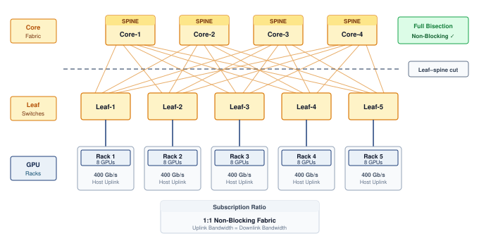

:::

The fat-tree[^fn-fattree-clos-network]\index{Fat-tree!bisection bandwidth} is a common default for ML clusters because a non-blocking design can provide full $\Bandwidth_{\text{bisect}}$ across arbitrary partitions. This capacity benefits global AllReduce even though implementations such as rings and trees do not require simultaneous all-to-all communication. The number of hosts that the guarantee can cover depends on switch radix and tier count.

[^fn-fattree-clos-network]: **Fat-tree (Clos network)**\index{Fat-tree!Clos origin}: The underlying multi-stage switching theory was invented by @clos1953 at Bell Labs to minimize the number of electromechanical crosspoints in telephone exchanges. @leiserson1985 at MIT generalized the concept as the "fat-tree," where the tree is "fat" because link bandwidth increases toward the root, proving it could emulate any network of equal hardware volume. The same cost-minimization logic that drove 1950s telephony now drives ML cluster design: minimize switch count while guaranteeing non-blocking connectivity for global AllReduce.

```{python}
#| echo: false
#| label: network-fabrics-fat-tree-scaling
# ┌─────────────────────────────────────────────────────────────────────────────
# │ FAT-TREE HOST SCALING (LEGO)
# ├─────────────────────────────────────────────────────────────────────────────
# │ Context: @sec-network-fabrics-fat-tree—three-tier fat-tree host count.
# │
# │ Goal: Compute the maximum host count for a fat-tree with radix k = 64.
# │ Show: k^3/4 = 65,536 hosts for a three-tier fat-tree.
# │ How: Integer arithmetic on switch radix.
# │
# │ Used by: paragraph immediately below (three-tier scaling sentence).
# └─────────────────────────────────────────────────────────────────────────────
from mlsysim.fmt import check, fmt, fmt_usd

class FatTreeScaling:
    """Fat-tree host count for radix-64 switches."""

    # ┌── 1. LOAD ──────────────────────────────────────────────────────────
    fat_tree_k = int(Systems.SwitchFabric.NdrSwitchPorts)  # NDR switch radix
    switch_cost_low = 10_000 * USD  # scenario assumption: per-switch price, low end
    switch_cost_high = 50_000 * USD  # scenario assumption: per-switch price, high end

    # ┌── 2. EXECUTE ───────────────────────────────────────────────────────
    fat_tree_hosts_val = (fat_tree_k**3) // 4
    fat_tree_two_tier_hosts_val = (fat_tree_k**2) // 2  # standalone two-tier: k leaves x k/2 host ports
    fat_tree_pod_hosts_val = (fat_tree_k // 2) ** 2  # one pod of the three-tier design: k/2 leaves x k/2 host ports
    fat_tree_switches_val = (5 * fat_tree_k**2) // 4
    infra_cost_low = fat_tree_switches_val * switch_cost_low
    infra_cost_high = fat_tree_switches_val * switch_cost_high
    scale_out_hosts_val = 2 * fat_tree_two_tier_hosts_val  # doubling past one standalone two-tier fabric
    scale_out_pods_val = scale_out_hosts_val // fat_tree_pod_hosts_val

    # ┌── 3. GUARD ─────────────────────────────────────────────────────────
    check(fat_tree_hosts_val == 65536, f"k=64 fat-tree should support 65,536 hosts, got {fat_tree_hosts_val}")
    check(fat_tree_two_tier_hosts_val == 2048, f"k=64 standalone two-tier should support 2,048 hosts, got {fat_tree_two_tier_hosts_val}")
    check(fat_tree_pod_hosts_val == 1024, f"k=64 three-tier pod should hold 1,024 hosts, got {fat_tree_pod_hosts_val}")
    check(fat_tree_two_tier_hosts_val == NetworkTopologyRadixRecap.two_tier_hosts, "Radix recap and fat-tree cell must agree")
    check(scale_out_pods_val == 4, "Prose spells the scale-out pod count as 'four'")

    # ┌── 4. OUTPUT ────────────────────────────────────────────────────────
    fat_tree_hosts_str = fmt_int(fat_tree_hosts_val, commas=True)
    fat_tree_two_tier_hosts_str = fmt_int(fat_tree_two_tier_hosts_val, commas=True)
    fat_tree_pod_hosts_str = fmt_int(fat_tree_pod_hosts_val, commas=True)
    fat_tree_switches_str = fmt_int(fat_tree_switches_val, commas=True)
    switch_cost_low_str = fmt_usd(switch_cost_low, precision=0)
    switch_cost_high_str = fmt_usd(switch_cost_high, precision=0)
    infra_cost_low_m_str = fmt_usd(infra_cost_low, precision=0, commas=False, scale="M")
    infra_cost_high_m_str = fmt_usd(infra_cost_high, precision=0, commas=False, scale="M")
    scale_out_hosts_str = fmt_int(scale_out_hosts_val, commas=True)
    scale_out_pods_word_str = MarkdownStr("four")  # guarded above
```

```{python}
#| echo: false
# ┌── LEGO ───────────────────────────────────────────────
# │ Context: Fat-tree capacity paragraph below
class NetworkFatTreeRecap:
    # ┌── 4. OUTPUT (Formatting) ──────────────────────────────────────────────
    n_gpus_str = fmt(Systems.Clusters.Training_1K.total_accelerators, precision=0, commas=True)
```

A fat-tree built from switches with radix[^fn-radix-switch-density] $k$ supports $N_{\text{hosts}} = k^{3}/4$ hosts at three tiers. A standalone two-tier non-blocking fabric can instead use $k$ leaves, each with $k/2$ host ports and $k/2$ uplinks, connected to $k/2$ spines. Each spine uses all $k$ ports to reach the leaves, providing $k^{2}/2 =$ `{python} FatTreeScaling.fat_tree_two_tier_hosts_str` host ports for radix-64 switches. One pod of the three-tier design has only $k/2$ leaves and therefore $(k/2)^2 =$ `{python} FatTreeScaling.fat_tree_pod_hosts_str` host ports; its aggregation switches reserve ports for the core. These are different port allocations and switch counts, not two ways of counting the same fabric. The `{python} NetworkFatTreeRecap.n_gpus_str`-GPU reference cluster fits within a standalone two-tier design. The distinction matters as soon as a cluster outgrows it. A `{python} FatTreeScaling.scale_out_hosts_str`-GPU deployment cannot join two fully populated standalone `{python} FatTreeScaling.fat_tree_two_tier_hosts_str`-host fabrics at their spines, because every spine port is already occupied by a leaf connection. It is instead built as `{python} FatTreeScaling.scale_out_pods_word_str` `{python} FatTreeScaling.fat_tree_pod_hosts_str`-host pods of the three-tier design, joined through a core tier.

A concrete bisection estimate shows how quickly oversubscription turns into synchronization delay.

```{python}
#| echo: false
#| label: bisection-bandwidth-scaling
# ┌─────────────────────────────────────────────────────────────────────────────
# │ BISECTION BANDWIDTH SCALING (NOTEBOOK)
# ├─────────────────────────────────────────────────────────────────────────────
# │ Context: "Bisection Bandwidth: The Cost of Oversubscription" .callout-notebook
# │
# │ Goal: Quantify synchronization slowdown and idle-compute waste when moving
# │       from a non-blocking (1:1) to an oversubscribed network.
# │ Show: slowdown_factor, cluster cost, communication share, and wasted cost
# │       inline in the notebook result.
# │ How: T = f_ring * M / BW_bisect, where f_ring = 2(N-1)/N;
# │      BW_bisect = N_side * BW_link / Oversub_Ratio.
# │
# └─────────────────────────────────────────────────────────────────────────────
from mlsysim.fmt import check, fmt, fmt_bandwidth, fmt_count, fmt_int, fmt_memory, fmt_multiple, fmt_percent, fmt_time, fmt_usd

class BisectionScaling:
    # ┌── 1. LOAD ──────────────────────────────────────────
    n_gpus = Systems.Clusters.Training_1K.total_accelerators
    beta = Systems.Fabrics.InfiniBand_NDR.bandwidth
    _econ = ReferenceStats.NetworkEconomicsProfile
    gradient = _econ.PerGpuGradientPayload  # per-GPU gradient payload
    oversubscription_ratio = Systems.Fabrics.InfiniBand_NDR_Oversub4to1.oversubscription_ratio  # cost-optimized spine
    cluster_cost = _econ.ClusterCapex  # cluster capital cost
    comm_fraction = _econ.CommunicationFraction  # training time spent communicating

    # ┌── 2. EXECUTE ───────────────────────────────────────
    gpus_per_side = n_gpus // 2
    bw_1_1_q = calc_bisection_bandwidth(gpus_per_side, beta)
    bw_4_1_q = calc_bisection_bandwidth(gpus_per_side, beta, oversubscription_ratio=oversubscription_ratio)
    ring_factor = 2 * (n_gpus - 1) / n_gpus
    crossing_edges_per_direction = gpus_per_side  # alternating-half rank placement
    total_data = crossing_edges_per_direction * gradient * ring_factor
    time_1_1 = total_data / bw_1_1_q
    time_4_1 = total_data / bw_4_1_q
    slowdown = (time_4_1 / time_1_1).to_base_units().magnitude
    _, throughput_loss = calc_oversubscription_effect(comm_fraction, oversubscription_ratio)
    waste = throughput_loss * cluster_cost
    # ┌── 3. GUARD ─────────────────────────────────────────
    check(n_gpus % 2 == 0, "Bisection model requires an even GPU count")
    # 2026-09-28: cut load depends on ring placement, not total network traffic.
    ring_sides = [rank % 2 for rank in range(n_gpus)]
    observed_crossings = sum(left == 0 and right == 1 for left, right in zip(ring_sides, ring_sides[1:] + ring_sides[:1]))
    check(observed_crossings == crossing_edges_per_direction, "Alternating ring must have N/2 cut crossings per direction")
    check(abs(time_1_1.to(second).magnitude - 0.1998046875) < 1e-9, "Ring AllReduce time should be about 0.200 s")
    check(round(slowdown, 3) == round(oversubscription_ratio, 3), "Slowdown must match oversubscription ratio")
    check(round(waste.to(USD).magnitude / MILLION, 1) == 142.1, f"Expected oversubscription waste to be about $142.1M, got {waste}")
    # ┌── 4. OUTPUT ────────────────────────────────────────
    bbs_n_gpus_str = fmt_count(n_gpus, commas=False, label="GPU")
    bbs_gpus_per_side_value_str = fmt(gpus_per_side, precision=0, commas=False)
    bbs_beta_gb_per_s_str = fmt_bandwidth(beta, unit=GB / second, precision=0, commas=False)
    bbs_gradient_gb_str = fmt_memory(gradient, unit=GB, precision=0, commas=False)
    bbs_ring_factor_str = fmt(ring_factor, precision=3, commas=False)
    bbs_total_data_gb_str = fmt_memory(total_data, unit=GB, precision=0, commas=True)
    bbs_bw_1_1_gb_per_s_str = fmt_bandwidth(bw_1_1_q, unit=GB / second, precision=0, commas=True)
    bbs_bw_4_1_gb_per_s_str = fmt_bandwidth(bw_4_1_q, unit=GB / second, precision=0, commas=True)
    bbs_oversubscription_ratio_str = fmt(oversubscription_ratio, precision=0, commas=False)
    bbs_slowdown_mult_str = fmt_multiple(slowdown, commas=False, precision=0)
    bbs_time_1_1_s_str = fmt_time(time_1_1, second, precision=3, commas=False)
    bbs_time_4_1_s_str = fmt_time(time_4_1, second, precision=3, commas=False)
    bbs_cluster_cost_m_str = fmt_usd(cluster_cost, precision=0, commas=False, scale="M")
    bbs_comm_fraction_pct_str = fmt_percent(comm_fraction, precision=0, commas=False, style='prose')
    bbs_waste_m_str = fmt_usd(waste, precision=1, commas=False, scale="M")
```

::: {#nbk-network-fabrics-bisection-bandwidth-cost-oversubscription .callout-notebook title="Bisection bandwidth: The cost of oversubscription"}

**Problem**: A cluster designer is choosing between a "non-blocking" (1:1) fat-tree and a "cost-optimized" (`{python} BisectionScaling.bbs_oversubscription_ratio_str`:1) spine for a cluster of `{python} BisectionScaling.bbs_n_gpus_str`. How much slower will a `{python} BisectionScaling.bbs_gradient_gb_str`-per-GPU AllReduce be on the cheaper network?

**Math**:
Bisection bandwidth ($\Bandwidth_{\text{bisect}}$) is the minimum pipe diameter between halves of the cluster.
Assume a unidirectional ring whose ranks alternate between the two halves of the cluster. Every ring edge then crosses the cut, with $N/2$ senders in each direction. Assume balanced routing, no competing traffic, and negligible startup latency. ReduceScatter plus AllGather contributes a traffic factor $2(N-1)/N$ = `{python} BisectionScaling.bbs_ring_factor_str` per GPU; multiplying by $N/2$ gives the bytes crossing the cut in each direction. A ring that groups ranks within each half would have fewer crossing edges and a different cut-load bound.

1. **Non-blocking (1:1)**: $\Bandwidth_{\text{bisect}} =$ `{python} BisectionScaling.bbs_gpus_per_side_value_str` $\times$ `{python} BisectionScaling.bbs_beta_gb_per_s_str` $=$ `{python} BisectionScaling.bbs_bw_1_1_gb_per_s_str` per direction.
   - Time: `{python} BisectionScaling.bbs_total_data_gb_str` / `{python} BisectionScaling.bbs_bw_1_1_gb_per_s_str` $\approx$ `{python} BisectionScaling.bbs_time_1_1_s_str`.
2. **Oversubscribed (`{python} BisectionScaling.bbs_oversubscription_ratio_str`:1)**: $\Bandwidth_{\text{bisect}} =$ `{python} BisectionScaling.bbs_bw_1_1_gb_per_s_str` divided by `{python} BisectionScaling.bbs_oversubscription_ratio_str` = `{python} BisectionScaling.bbs_bw_4_1_gb_per_s_str` per direction.
   - Time: `{python} BisectionScaling.bbs_total_data_gb_str` / `{python} BisectionScaling.bbs_bw_4_1_gb_per_s_str` $\approx$ `{python} BisectionScaling.bbs_time_4_1_s_str`.

**Systems insight**: For this cut-saturating placement, saving money on core switches creates a `{python} BisectionScaling.bbs_slowdown_mult_str` bottleneck for global synchronization. On a `{python} BisectionScaling.bbs_cluster_cost_m_str` supercomputer where training is `{python} BisectionScaling.bbs_comm_fraction_pct_str` communication, that bottleneck wastes approximately `{python} BisectionScaling.bbs_waste_m_str` in idle compute time, matching the bisection-bottleneck model in this section. This is an equivalent-capacity cost under the stated workload assumptions, not a direct equipment loss. Oversubscription must be evaluated against the collective traffic actually crossing the constrained cut.

:::

This oversubscription calculation turns the topology definition into a design rule: the subscription ratio at each tier determines whether a fat-tree can sustain global collectives.

::: {#chk-network-fabrics-fat-tree-topologies .callout-checkpoint title="Fat-tree topologies"}

These questions check whether hierarchical switch-fabric trade-offs are clear:

- [ ] **Radix and scale**: compute the maximum number of GPUs a radix-64 two-tier fat-tree can connect without core switches.
- [ ] **Non-blocking ratio**: explain why a non-blocking fabric requires a 1:1 subscription ratio at every tier of the network.
- [ ] **Tier vs. latency**: determine how $\alpha$ (startup latency) changes when moving from a two-tier to a three-tier fat-tree.
- [ ] **Aggregate vs. bisection**: distinguish aggregate bandwidth from $\Bandwidth_{\text{bisect}}$ and identify the metric that matters for AllReduce.

:::

[^fn-radix-switch-density]: **Switch radix**\index{Switch radix!port density}: High-end switches (for example, NVIDIA Quantum-2) can feature a radix of `{python} NetworkTopologyRadixRecap.radix_str` ports, each at `{python} IbNdrWireRecap.ib_ndr_gbit_per_s_str`. This density allows a standalone two-tier fat-tree to support up to `{python} NetworkTopologyRadixRecap.two_tier_hosts_str` GPUs; a path between distinct leaves traverses leaf, spine, and destination leaf, or three switches. As model scale pushes toward 100,000 GPUs, increasing switch radix (to 128 or 256), grouping accelerators into larger local domains, or accepting topology constraints are the main ways to avoid adding more tiers and the resulting latency/cost explosion.

Scaling beyond this requires a three-tier architecture with core switches, enabling the fabric to reach `{python} FatTreeScaling.fat_tree_hosts_str` hosts, but the added scale carries both cost and latency. A non-blocking $k=64$ three-tier tree requires roughly $5k^2/4 \approx$ `{python} FatTreeScaling.fat_tree_switches_str` switches across the core, aggregation, and edge layers; at `{python} FatTreeScaling.switch_cost_low_str` to `{python} FatTreeScaling.switch_cost_high_str` per switch, the switching layer alone represents `{python} FatTreeScaling.infra_cost_low_m_str` to `{python} FatTreeScaling.infra_cost_high_m_str`. Typical **hop counts**\index{Hop count!definition} also rise, from two inter-switch links and three switch traversals for intra-pod traffic (leaf-spine-leaf) to four inter-switch links and five switch traversals for inter-pod traffic (leaf-spine-core-spine-leaf), adding serialization delay and switch processing time to the $\alpha$ latency term across thousands of synchronization steps. Rail-optimized topologies respond to both pressures by matching the physical cabling pattern to the collective communication pattern.

### Rail-optimized topology {#sec-network-fabrics-rail-optimized}

Rail-optimized topology\index{Rail-optimized topology!cabling architecture} begins from the communication pattern rather than from a generic switch hierarchy. Dense accelerator nodes partition GPUs by local slot position into independent horizontal rails, as diagrammed in @fig-rail-optimized-cabling. In this physical cabling scheme, high-bandwidth internal NVSwitch planes bind GPUs 0 through 3 within Node 0 and Node 1, while external network ports route horizontally: GPU 0 in every node connects strictly to the Rail 0 switch, GPU 1 connects to Rail 1, and so on across the cluster.

::: {.column-margin .margin-pointer}
↩ Assigning each GPU in a node to its own rail switch, rather than one shared top-of-rack switch, is established in @sec-compute-rack-design.
:::

::: {#fig-rail-optimized-cabling fig-env="figure" fig-pos="htb" fig-cap="**Rail-optimized physical wiring**: In dense accelerator nodes such as the DGX H100, each GPU's network port is cabled by local slot position: GPU 0 in every node connects to the rail 0 switch, GPU 1 to the rail 1 switch, and so on. Two nodes and four of each node's eight GPUs are drawn; further nodes attach to the same rail switches. Tensor-parallel traffic stays on each node's NVSwitch, same-rank data-parallel traffic stays on its own rail, and a spine layer (not drawn) bridges the rails for cross-rank traffic." fig-alt="Two node boxes, Node 0 on the left and Node 1 on the right, each holding GPU 0 through GPU 3 joined by a vertical NVSwitch bar. Between them sits a column of four rail switches. Straight horizontal cables connect GPU 0 of both nodes to the rail 0 switch, GPU 1 of both nodes to the rail 1 switch, and likewise for rails 2 and 3."}
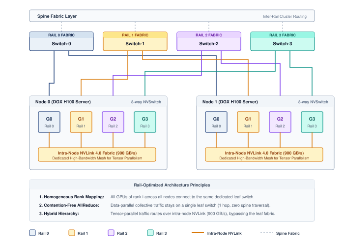

:::

The wiring pattern connects corresponding GPUs across nodes (GPU 0 to GPU 0, GPU 1 to GPU 1) through dedicated rail switches rather than a shared ToR switch. This matters because data parallelism\index{Data parallelism!rail-optimized topology} creates a deterministic and highly stratified communication pattern that standard topologies fail to exploit. When tensor-parallel groups stay inside each node, each replica assigns the corresponding model shard to the same local GPU rank. The slot number here is a local rank within a node; workers in the full distributed job also have distinct global ranks. GPU 0 on one node therefore synchronizes that shard's gradients with GPU 0 on other nodes, but rarely with GPU 1 during this data-parallel exchange. A **rail-optimized topology**\index{Rail-optimized topology!definition} physically hardwires this logic by isolating these same-rank communication paths into dedicated networks. Instead of connecting all 8 GPUs in a node to a single ToR switch, the network connects all GPU 0s across the entire cluster to a dedicated "Rail 0" switch fabric, all GPU 1s to "Rail 1," and so on. A simple hop-count estimate shows the payoff.

```{python}
#| echo: false
#| label: rail-optimized-latency-notebook
# ┌─────────────────────────────────────────────────────────────────────────────
# │ RAIL-OPTIMIZED LATENCY BUDGET (NOTEBOOK)
# ├─────────────────────────────────────────────────────────────────────────────
# │ Context: "The Rail-Optimized Dividend" .callout-notebook
# │
# │ Goal: Quantify the latency savings of rail-optimized topology.
# │ Show: speedup ≈ 2x—inline in notebook result.
# │ How: T = Hop_Count * T_hop.
# │
# └─────────────────────────────────────────────────────────────────────────────
from mlsysim.fmt import check, fmt, fmt_time

class RailLatency:
    # ┌── 1. LOAD ──────────────────────────────────────────
    FABRIC_HOP_LATENCY = Systems.SwitchFabric.HopLatency
    t_hop = FABRIC_HOP_LATENCY  # switch + wire latency
    n_nodes = Systems.Clusters.Training_1K.count  # reference-cluster node count
    # Standard fat-tree: source Leaf -> Spine -> destination Leaf = 3 switch
    # traversals (2026-06-07: was counted as 2, dropping the destination leaf).
    # Rail-optimized: one shared rail switch = 1 traversal.
    n_hops_std = 3
    n_hops_rail = 1
    # ┌── 2. EXECUTE ───────────────────────────────────────
    lat_std = calc_hop_latency(n_hops_std, t_hop)
    lat_rail = calc_hop_latency(n_hops_rail, t_hop)
    speedup = (lat_std / lat_rail).to_base_units().magnitude
    # ┌── 3. GUARD ─────────────────────────────────────────
    check(speedup == 3.0, f"Speedup {speedup:.1f}x unexpected")
    # ┌── 4. OUTPUT ────────────────────────────────────────
    rol_hop_lat_us_str = fmt_time(t_hop, microsecond, precision=1, commas=False)
    rol_std_hops_str = fmt(n_hops_std, precision=0, commas=False)
    rol_rail_hops_str = fmt(n_hops_rail, precision=0, commas=False)
    rol_std_lat_us_str = fmt_time(lat_std, microsecond, precision=1, commas=False)
    rol_rail_lat_us_str = fmt_time(lat_rail, microsecond, precision=1, commas=False)
    rol_speedup_mult_str = fmt_multiple(speedup, precision=0, commas=False)
    rol_n_nodes_str = fmt_count(n_nodes, commas=False, label="node")
```

::: {#nbk-network-fabrics-rail-optimized-dividend .callout-notebook title="The rail-optimized dividend"}

**Problem**: A team is synchronizing per-rank data-parallel gradients across `{python} RailLatency.rol_n_nodes_str`. In a standard fat-tree, each message between same-rank GPUs traverses its source leaf switch, a spine switch, and the destination leaf switch (`{python} RailLatency.rol_std_hops_str` switch traversals). In a rail-optimized network\index{Rail-optimized topology!hop count reduction} built from rail switches with at least one port per node, all corresponding GPUs sit on the same rail switch (one traversal). How much latency dividend does the rail design earn?

**Math**:
This estimate counts only the switch-traversal contribution to communication latency ($\alpha$), using the same assumed delay for each traversal.

1. **Standard latency**\index{Latency!standard}: `{python} RailLatency.rol_std_hops_str` traversals $\times$ `{python} RailLatency.rol_hop_lat_us_str` = `{python} RailLatency.rol_std_lat_us_str`.
2. **Rail-optimized**: `{python} RailLatency.rol_rail_hops_str` traversal $\times$ `{python} RailLatency.rol_hop_lat_us_str` = `{python} RailLatency.rol_rail_lat_us_str`.
3. **Result**: `{python} RailLatency.rol_speedup_mult_str` lower latency.

**Systems insight**: For synchronous data-parallel AllReduce, this `{python} RailLatency.rol_speedup_mult_str` reduction applies to the modeled switch-latency contribution, not to total collective time. Its effect on scaling efficiency ($\ScalingEfficiency$) depends on payload size, delivered bandwidth, compute time, and overlap. The single-switch rail in this example avoids the spine traversal for same-rank traffic. Larger rails must be evaluated using their actual switching stages and paths.
:::

The hop saving is only part of the case for rails. Large language model fleets adopt the pattern because it matches how their parallelism plan divides traffic.

::: {#lhs-network-fabrics-archetype-gpt-4-llama-3-rail-optimized-fleet .callout-lighthouse title="Archetype A (GPT-4/Llama-3): The rail-optimized fleet"}

Archetype A's use of 3D parallelism\index{3D parallelism!traffic patterns} generates two distinct traffic patterns that pull in opposite directions: (1) massive, bandwidth-hungry gradient averaging for data parallelism, and (2) high-frequency, latency-sensitive activation exchanges for tensor parallelism. Keeping tensor parallelism inside each node's NVLink domain leaves data-parallel gradient traffic on the fabric, and rails give each same-rank data-parallel group its own switch network. A rail can provide a single switch hop between nodes when its endpoint count fits the available switch ports. Larger rails require additional switching stages, so rail alignment alone does not guarantee single-hop communication.

:::

```{python}
#| echo: false
# ┌── LEGO ───────────────────────────────────────────────
# │ Context: Rail-optimized paragraph below — cluster node and rail counts
class NetworkRailRecap:
    _cluster = Systems.Clusters.Training_1K
    # ┌── 4. OUTPUT (Formatting) ──────────────────────────────────────────────
    n_gpus_str = fmt_count(_cluster.total_accelerators, commas=True, label="GPU")
    n_nodes_str = fmt_count(_cluster.count, commas=False, label="node")
    gpus_per_rail_str = fmt_count(_cluster.total_accelerators // 8, commas=False, label="GPU")
```

For the cluster of `{python} NetworkRailRecap.n_gpus_str` spanning `{python} NetworkRailRecap.n_nodes_str`, this creates 8 parallel networks\index{Rail-optimized topology!parallel rail fabrics} of `{python} NetworkRailRecap.gpus_per_rail_str` each, requiring at least one switch port per endpoint in each rail. A single-switch realization therefore needs a radix at least as large as the rail endpoint count; the earlier radix-64 switch cannot realize this rail alone. A multi-switch rail preserves rank alignment but adds hops. For the bandwidth-hungry gradient exchanges of data parallelism, the larger benefit is isolation. Each rail carries only its own rank's traffic, so the eight rail networks operate concurrently without competing for shared spine capacity, while the shorter path trims the startup cost a ring pays on every round. However, this architecture introduces a sharp trade-off: traffic that must reach GPUs of different ranks (such as expert routing in mixture of experts (MoE), or pipeline-stage handoffs that do not align with the rail wiring) requires bridging across rails. Large clusters therefore often employ a hybrid approach, using rail-optimized leaves for same-rank data-parallel traffic while bridging the rails with a full fat-tree spine to support cross-rank communication patterns.

::: {#chk-network-fabrics-rail-optimized-networks .callout-checkpoint title="Rail-optimized networks"}

These questions check whether workload-specific network-design trade-offs are clear:

- [ ] **Rail beneficiary**: identify the dimension of 3D parallelism (tensor parallelism, pipeline parallelism, or data parallelism) that benefits most from a rail-optimized design.
- [ ] **Switch hops**: explain why a rail-optimized network reduces the number of switch hops for gradient exchanges compared to a standard fat-tree.
- [ ] **Traffic isolation**: explain the traffic isolation benefit of placing all GPU 0s on one rail and all GPU 1s on another.
- [ ] **Core switch need**: classify the claim as true or false: a rail-optimized network eliminates the need for high-bandwidth core switches connecting different rails.

:::

### Dragonfly and torus alternatives {#sec-network-fabrics-dragonfly}

A **dragonfly**\index{Dragonfly topology!definition}[^fn-dragonfly-topology-isca] topology organizes high-radix routers into fully connected groups joined by global optical links. In the balanced configuration analyzed by @kim2008, $a=2p=2h$, where each group has $a$ routers and each router has $p$ terminal ports and $h$ global channels. Global bandwidth is therefore a design parameter rather than a fixed percentage of aggregate injection bandwidth. Performance for jobs spanning groups depends on the chosen $p/h$ ratio, routing, and traffic matrix, because every inter-group transfer shares the provisioned global links.

[^fn-dragonfly-topology-isca]: **Dragonfly topology**\index{Dragonfly!topology origin}: Introduced by @kim2008 at ISCA 2008, the dragonfly uses high-radix routers grouped into fully connected "super-nodes." For systems with at least 16,000 terminals, the architecture achieves a 52 percent network-cost reduction relative to a folded Clos of equivalent bandwidth, though global optical link oversubscription can create AllToAll bottlenecks during MoE token routing.

A **torus**\index{Torus!definition} topology connects each node directly to its neighbors in a multidimensional grid, most commonly a 3D torus where every node links to its six adjacent peers (up/down, left/right, front/back). The design offers full local bandwidth with minimal switching hardware, because every neighbor is a single hop away. However, global communication requires traversing the diameter of the mesh ($\mathcal{O}(N^{1/3})$ hops), making latency scale poorly with cluster size. Google adopted this architecture for its Tensor Processing Unit (TPU) pods because the collectives that dominate its training workloads can be scheduled as rings along each torus dimension, a nearest-neighbor pattern that maps naturally onto the physical grid. The limitation becomes apparent with MoE, which relies on AllToAll communication patterns. On a torus, these random permutations can congest the limited $\Bandwidth_{\text{bisect}}$ of the mesh and degrade performance relative to a non-blocking switch fabric.

```{python}
#| echo: false
#| label: network-fabrics-torus-vs-fat-tree
# ┌─────────────────────────────────────────────────────────────────────────────
# │ TORUS VS. FAT-TREE AT 4,096 ENDPOINTS (LEGO)
# ├─────────────────────────────────────────────────────────────────────────────
# │ Context: @sec-network-fabrics-dragonfly — the torus-vs-fat-tree paragraph.
# │
# │ Goal: Compare bisection links, bisection bandwidth, and worst-case path
# │       length for the same endpoint count in a cubic torus and a
# │       non-blocking three-tier fat-tree.
# │ Show: 512 vs. 2,048 cut links; 25.6 vs. 102.4 TB/s; 24 hops vs. 5 switches.
# │ How: cubic torus of side s: cut = 2 s^2 links (wraparound), diameter =
# │      3 floor(s/2); non-blocking fat-tree cut = N/2 host links; inter-pod
# │      path leaf-spine-core-spine-leaf = 5 switch traversals.
# └─────────────────────────────────────────────────────────────────────────────
from mlsysim.fmt import check, fmt, fmt_bandwidth, fmt_int, fmt_math, fmt_multiple

class TorusVsFatTree:
    # ┌── 1. LOAD ──────────────────────────────────────────────────────────
    n_nodes = FatTreeScaling.scale_out_hosts_val  # same endpoints as the four-pod fat-tree
    link_bw = Systems.Fabrics.InfiniBand_NDR.bandwidth  # scenario assumption: equal per-link capacity, per direction
    fat_tree_switches = 5  # leaf-spine-core-spine-leaf inter-pod path

    # ┌── 2. EXECUTE ───────────────────────────────────────────────────────
    side = round(n_nodes ** (1 / 3))
    torus_cut_links = 2 * side**2  # the wraparound doubles the links crossing a planar cut
    fat_tree_cut_links = n_nodes // 2  # non-blocking: one full-rate link per host on each side
    torus_bisect = torus_cut_links * link_bw
    fat_tree_bisect = fat_tree_cut_links * link_bw
    bisect_ratio = fat_tree_cut_links / torus_cut_links
    torus_diameter = 3 * (side // 2)

    # ┌── 3. GUARD ─────────────────────────────────────────────────────────
    check(side**3 == n_nodes, "Endpoint count must form a cubic torus")
    check(torus_cut_links == 512 and fat_tree_cut_links == 2048, "Expected 512 torus vs. 2,048 fat-tree cut links")
    check(torus_diameter == 24, "16-ary 3D torus diameter should be 24 hops")
    check(fat_tree_switches == 5, "Prose spells the inter-pod switch count as 'five'")

    # ┌── 4. OUTPUT ────────────────────────────────────────────────────────
    n_nodes_str = fmt_int(n_nodes, commas=True)
    dims_str = fmt_math(f"{side} \\times {side} \\times {side}")
    torus_cut_links_str = fmt_int(torus_cut_links, commas=True)
    fat_tree_cut_links_str = fmt_int(fat_tree_cut_links, commas=True)
    link_gb_per_s_str = fmt_bandwidth(link_bw, unit=GB / second, precision=0, commas=False)
    torus_bisect_tb_per_s_str = fmt_bandwidth(torus_bisect, unit=TB / second, precision=1, commas=False)
    fat_tree_bisect_tb_per_s_str = fmt_bandwidth(fat_tree_bisect, unit=TB / second, precision=1, commas=False)
    bisect_ratio_mult_str = fmt_multiple(bisect_ratio, precision=0, commas=False)
    torus_diameter_str = fmt_int(torus_diameter, commas=False)
    fat_tree_switches_str = MarkdownStr("five")
```

The trade-off becomes concrete for the `{python} TorusVsFatTree.n_nodes_str`-endpoint deployment that the three-tier fat-tree reached with `{python} FatTreeScaling.scale_out_pods_word_str` pods. Arranged as a `{python} TorusVsFatTree.dims_str` torus with wraparound links, the same endpoints need no external switching stages, but only `{python} TorusVsFatTree.torus_cut_links_str` links cross the bisection, against `{python} TorusVsFatTree.fat_tree_cut_links_str` in the non-blocking fat-tree. With `{python} TorusVsFatTree.link_gb_per_s_str` per link and direction, the torus offers `{python} TorusVsFatTree.torus_bisect_tb_per_s_str` across the cut against the fat-tree's `{python} TorusVsFatTree.fat_tree_bisect_tb_per_s_str`, a `{python} TorusVsFatTree.bisect_ratio_mult_str` gap, and its worst-case path crosses `{python} TorusVsFatTree.torus_diameter_str` neighbor hops against the fat-tree's `{python} TorusVsFatTree.fat_tree_switches_str` switch traversals. Because a cubic torus's cut grows only as $N^{2/3}$ while its endpoint count grows as $N$, that capacity gap widens at fixed link rate. Dimension-wise reductions exploit neighbor paths and combine contributions before forwarding them, reducing the demand for arbitrary pairwise exchange. AllToAll traffic can place greater pressure on the cut, depending on placement and message sizes. The collective schedule and traffic matrix determine whether the torus's lower cross-sectional capacity limits completion time.

```{python}
#| echo: false
#| label: network-fabrics-topology-scenario
# ┌─────────────────────────────────────────────────────────────────────────────
# │ TOPOLOGY BANDWIDTH-COST SCENARIO (LEGO)
# ├─────────────────────────────────────────────────────────────────────────────
# │ Context: @fig-network-topologies and its caption.
# │
# │ Goal: Give each topology in the comparison a bisection bandwidth derived
# │       from a stated structure and a stated cost-per-Gb/s assumption.
# │ Show: fat-tree 25.6 TB/s, dragonfly 19.2, rail-optimized 12.8, torus 6.4.
# │ How: fat-tree cut = N/2 links; 8x8x16 torus cut = 2 x 8 x 8 wraparound
# │      links; dragonfly and rail-optimized scale the fat-tree cut by a
# │      stated global-link or spine taper. Costs are scenario inputs.
# └─────────────────────────────────────────────────────────────────────────────
from mlsysim.fmt import check, fmt, fmt_bandwidth, fmt_usd

class TopologyScenario:
    # ┌── 1. LOAD ──────────────────────────────────────────────────────────
    n_gpus = Systems.Clusters.Training_1K.total_accelerators
    link_bw = Systems.Fabrics.InfiniBand_NDR.bandwidth  # per link, per direction
    torus_dims = (8, 8, 16)  # scenario assumption: 3D torus shape for 1,024 endpoints
    dragonfly_taper = 0.75  # scenario assumption: global links provisioned at 3/4 of injection
    rail_spine_taper = 0.5  # scenario assumption: 2:1 spine that bridges the rails
    cost_per_gbps = {  # scenario assumptions: interconnect cost, USD per Gb/s of bisection
        "fat_tree": 3.0,
        "dragonfly": 4.0,
        "torus": 1.5,
        "rail": 2.0,
    }

    # ┌── 2. EXECUTE ───────────────────────────────────────────────────────
    fat_tree_bisect = (n_gpus // 2) * link_bw
    torus_cut_links = 2 * torus_dims[0] * torus_dims[1]  # cut across the longest dimension
    torus_bisect = torus_cut_links * link_bw
    dragonfly_bisect = dragonfly_taper * fat_tree_bisect
    rail_bisect = rail_spine_taper * fat_tree_bisect
    bisect_tb = {
        "fat_tree": fat_tree_bisect.to(TB / second).magnitude,
        "dragonfly": dragonfly_bisect.to(TB / second).magnitude,
        "torus": torus_bisect.to(TB / second).magnitude,
        "rail": rail_bisect.to(TB / second).magnitude,
    }

    # ┌── 3. GUARD ─────────────────────────────────────────────────────────
    check(torus_dims[0] * torus_dims[1] * torus_dims[2] == n_gpus, "Torus shape must hold the whole cluster")
    check(abs(bisect_tb["fat_tree"] - 25.6) < 1e-9, "Non-blocking 1,024-GPU cut should be 25.6 TB/s")
    check(bisect_tb["torus"] < bisect_tb["rail"] < bisect_tb["dragonfly"] < bisect_tb["fat_tree"], "Scenario ordering the caption describes")

    # ┌── 4. OUTPUT ────────────────────────────────────────────────────────
    n_gpus_str = fmt(n_gpus, precision=0, commas=True)
    fat_tree_tb_str = fmt_bandwidth(fat_tree_bisect, unit=TB / second, precision=1, commas=False)
    dragonfly_tb_str = fmt_bandwidth(dragonfly_bisect, unit=TB / second, precision=1, commas=False)
    torus_tb_str = fmt_bandwidth(torus_bisect, unit=TB / second, precision=1, commas=False)
    rail_tb_str = fmt_bandwidth(rail_bisect, unit=TB / second, precision=1, commas=False)
    fat_tree_cost_str = fmt_usd(cost_per_gbps["fat_tree"], precision=0 if float(cost_per_gbps["fat_tree"]).is_integer() else 1, commas=False)
    dragonfly_cost_str = fmt_usd(cost_per_gbps["dragonfly"], precision=0 if float(cost_per_gbps["dragonfly"]).is_integer() else 1, commas=False)
    torus_cost_str = fmt_usd(cost_per_gbps["torus"], precision=0 if float(cost_per_gbps["torus"]).is_integer() else 1, commas=False)
    rail_cost_str = fmt_usd(cost_per_gbps["rail"], precision=0 if float(cost_per_gbps["rail"]).is_integer() else 1, commas=False)
```

@Fig-network-topologies charts this bandwidth-versus-cost trade-off on dual vertical axes for a `{python} TopologyScenario.n_gpus_str`-GPU reference cluster. The blue bars track bisection bandwidth from 25.6 TB/s in the non-blocking fat-tree down to 6.4 TB/s in the 3D torus, while the superimposed orange line plots assumed interconnect cost per Gb/s ($1.50/Gb/s for the switchless torus up to $4.00/Gb/s for the tapered Dragonfly). Radix, endpoint count, link speed, routing mechanisms, and equipment pricing all shift these trade-offs; the topology family alone dictates neither raw cross-sectional capacity nor operational capital cost.

::: {#fig-network-topologies fig-env="figure" fig-pos="htb" fig-cap="**An illustrative bandwidth-cost scenario for ML network topologies**: $\Bandwidth_{\text{bisect}}$ (TB/s, left axis) and assumed cost per Gb/s (right axis) for four topology configurations on a `{python} TopologyScenario.n_gpus_str`-GPU cluster: fat-tree (`{python} TopologyScenario.fat_tree_tb_str`, `{python} TopologyScenario.fat_tree_cost_str`/Gb/s), dragonfly with tapered global links (`{python} TopologyScenario.dragonfly_tb_str`, `{python} TopologyScenario.dragonfly_cost_str`), rail-optimized with a 2:1 bridging spine (`{python} TopologyScenario.rail_tb_str`, `{python} TopologyScenario.rail_cost_str`), and a 3D torus (`{python} TopologyScenario.torus_tb_str`, `{python} TopologyScenario.torus_cost_str`). The bandwidths follow from the stated structures at one link rate; the costs are scenario inputs that illustrate the comparison method rather than universal properties of each topology family." fig-alt="Illustrative bar chart of four topology configurations with bisection bandwidth in TB/s and assumed cost per Gb/s; fat-tree has the highest bandwidth, and the 3D torus has both the lowest bandwidth and the lowest assumed cost per Gb/s."}
```{python}
#| echo: false
import numpy as np
from binder.tools.figures import style as book_style

book_style.set_book_style()
COLORS = book_style.COLORS

fig, ax1 = plt.subplots(figsize=(7.6, 4.2))

_keys = ['fat_tree', 'dragonfly', 'rail', 'torus']
topologies = [
    'Fat-Tree\n(Non-Blocking)',
    'Dragonfly\n(Tapered Global)',
    'Rail-Opt.\n(2:1 Bridging Spine)',
    'Torus 3D\n(8×8×16)',
]
x = np.arange(len(topologies))

bw = [TopologyScenario.bisect_tb[k] for k in _keys]
cost = [TopologyScenario.cost_per_gbps[k] for k in _keys]

# Left axis: Bisection Bandwidth (bars)
bars = ax1.bar(
    x,
    bw,
    width=0.46,
    color=COLORS['BlueFill'],
    edgecolor=COLORS['BlueLine'],
    linewidth=1.0,
    zorder=3,
    label='Bisection Bandwidth (TB/s)',
)

# Bandwidth labels at the bottom base of the bars
for bar, val in zip(bars, bw):
    ax1.text(
        bar.get_x() + bar.get_width() / 2.0,
        1.2,
        f'{val:.1f} TB/s',
        ha='center',
        va='bottom',
        fontsize=8.0,
        fontweight='bold',
        color=COLORS['BlueLine'],
        zorder=4,
    )

ax1.set_ylabel('Bisection Bandwidth (TB/s)')
ax1.set_ylim(0, 32)
ax1.set_yticks([0, 5, 10, 15, 20, 25, 30])
ax1.set_xticks(x)
ax1.set_xticklabels(topologies)

# Right axis: Interconnect Cost (line + points)
ax2 = ax1.twinx()
ax2.plot(
    x,
    cost,
    color=COLORS['OrangeLine'],
    linewidth=2.4,
    zorder=5,
    marker='o',
    markersize=6.5,
    markerfacecolor='white',
    markeredgecolor=COLORS['OrangeLine'],
    markeredgewidth=2.0,
    label='Assumed Interconnect Cost ($ / Gb/s)',
)
ax2.set_ylabel('Assumed Interconnect Cost ($ / Gb/s)')
ax2.set_ylim(0, 6.4)
ax2.set_yticks([0, 1.2, 2.4, 3.6, 4.8, 6.0])
ax2.grid(False)

# Cost badges
for xi, yi in zip(x, cost):
    offset_y = 14 if yi >= 3.0 else -16
    ax2.annotate(
        f'${yi:.1f}',
        xy=(xi, yi),
        xytext=(0, offset_y),
        textcoords='offset points',
        ha='center',
        va='center',
        fontsize=7.5,
        fontweight='bold',
        color=COLORS['OrangeLine'],
        bbox=dict(boxstyle='round,pad=0.2', fc='#FFF7ED', ec=COLORS['OrangeLine'], lw=0.8, zorder=6),
    )

# Unified legend at top center
lines1, labels1 = ax1.get_legend_handles_labels()
lines2, labels2 = ax2.get_legend_handles_labels()
ax1.legend(
    lines1 + lines2,
    labels1 + labels2,
    loc='upper center',
    ncol=2,
    frameon=True,
    facecolor='white',
    edgecolor='#CBD5E1',
    fontsize=7.8,
)

plt.tight_layout()
plt.show()
plt.close()
```
:::

The topology examples above considered one traffic pattern at a time. In practice, clusters serve multiple workloads with different communication patterns, and topology selection must balance their competing demands.

::: {#chk-network-fabrics-topology-selection-your-workload .callout-checkpoint title="Topology selection for your workload"}

The choice of network topology dictates the upper bound of training efficiency. Warm up by matching each single-workload pattern to its ideal topology, then design a fabric that must serve several at once.

**Single-workload picks**

- [ ] **AllReduce bandwidth**: select the topology that maximizes $\Bandwidth_{\text{bisect}}$ for a standard data-parallel job dominated by AllReduce.
- [ ] **MoE traffic**: select the topology that minimizes hop count while maintaining congestion control for a mixture-of-experts model with AllToAll-dominant, bursty, sparse communication.
- [ ] **Mesh locality**: select the topology that offers the best locality for a 2D mesh computation by mapping physical neighbor links directly to hardware.

**Designing for a mixed cluster**

You are designing the network for a new ML cluster that will run two primary workloads: (1) training a 175B-parameter language model using 3D parallelism (tensor, pipeline, and data parallelism), and (2) serving a mixture-of-experts model that relies heavily on AllToAll communication to route tokens to the correct experts.

- [ ] **Training topology**: select the topology (fat-tree, rail-optimized, or hybrid) that best matches tensor parallelism within groups of 8 GPUs and data parallelism across all nodes, then justify the choice.
- [ ] **MoE topology**: revise the topology choice for unpredictable AllToAll traffic where any GPU may need to communicate with any other GPU.
- [ ] **Oversubscription risk**: identify which workload suffers more under 2:1 spine-layer oversubscription and propose a scheduling strategy to mitigate the impact.

:::

```{python}
#| echo: false
# ┌── LEGO ───────────────────────────────────────────────
# │ Context: Fabric behavior bridge — synchronized gradient traffic at cluster scale
class NetworkFabricBridgeRecap:
    # ┌── 4. OUTPUT (Formatting) ──────────────────────────────────────────────
    n_gpus_str = fmt_count(Systems.Clusters.Training_1K.total_accelerators, commas=True, label="GPU")
```

Topology provides the structural capacity for the cluster of `{python} NetworkFabricBridgeRecap.n_gpus_str` to communicate, but structure alone does not guarantee performance. When the `{python} NetworkFabricBridgeRecap.n_gpus_str` synchronize contributions to the model’s `{python} NetworkRunningExampleCluster.grad_gb_str` gradient state, that theoretical capacity collides with the reality of **fabric behavior**\index{Fabric behavior!definition}: congestion control and routing dynamics determine whether this traffic flows smoothly or gridlocks under the strict synchronization of the BSP model.

## Level 4 Fabric Behavior, Congestion, and Routing {#sec-network-fabrics-behavior}

A collective can finish late even when the topology provides full $\Bandwidth_{\text{bisect}}$. Competing flows can concentrate on one output path, and the BSP barrier introduced in @sec-network-workload-inversion exposes any delay that extends the last required transfer. The relevant paths are those used by the participating workers; a congested link elsewhere in the fleet need not affect the job. In the Fleet Law (@eq-fleet-law), measured transfer durations contribute to $T_{\text{comm}}$, while residual waiting at synchronization contributes to $T_{\text{sync}}$. A timeline must assign each interval consistently so the same congestion delay is not counted twice.

The **tail latency (p99)**\index{Tail latency!definition}\index{P99!definition} metric describes the 99th percentile of a measured completion-time distribution. It helps expose delays that an average hides, but a particular barrier waits for its last required participant, not for a percentile. Evaluating a fabric therefore requires both transfer-time distributions and the collective completion times they produce under load.

### Priority flow control (PFC) {#sec-network-fabrics-pfc}

The BSP weakest-link property means that even a single dropped packet can trigger a retransmission timeout that stalls the global barrier for milliseconds, a delay that can rival the entire communication phase of a training step. PFC-based RoCEv2 fabrics mitigate this with priority flow control (PFC)\index{Priority flow control!lossless mode}, operating in lossless mode: rather than allowing switch buffers to overflow and drop packets, the fabric uses a link-layer backpressure mechanism to pause upstream senders before any buffer saturates [@guo2016rdma; @gangidi2024rdma].

::: {#dfn-network-fabrics-priority-flow-control .callout-definition title="Priority flow control"}

***Priority flow control (PFC)***\index{Priority flow control!definition} is a link-layer mechanism used by RoCEv2 ML cluster fabrics to prevent switch buffer overflow by sending PAUSE frames to an upstream sender when a port's queue depth crosses a configured threshold, throttling injection on a per-priority basis without dropping packets.

1.  **Significance**: In PFC-based RoCEv2 deployments, PFC is the foundation for a lossless Ethernet service. A PFC PAUSE frame must reach the upstream sender before the buffer overflows, so each pause threshold must leave headroom for the data still in flight during roughly one link round trip.
2.  **Distinction**: Unlike standard IEEE 802.3 flow control, which pauses all traffic classes on a link, PFC operates per priority class, allowing latency-sensitive control messages to continue flowing while only pausing the congested gradient data queue.
3.  **Common pitfall**: A frequent misconception is that PFC solves congestion. It transforms packet loss into congestion spreading. PFC itself places no bound on how far PAUSE frames propagate, so a single faulty transceiver can pause traffic far from its own link unless a watchdog intervenes.

:::

The danger of PFC lies in its cascading nature\index{Priority flow control!cascading PAUSE frames}. When a switch port's buffer fills, it sends a PAUSE frame upstream, which can move congestion into the upstream switch and trigger another PAUSE frame. A slow receiver, routing hot spot, or true fan-in burst can therefore pause links unrelated to the original queue. This behavior, known as **congestion spreading**\index{Congestion spreading!definition}, is the primary operational risk of PFC-based lossless Ethernet, and the flows it stalls without ever touching the congested queue are called **victim flows**\index{Victim flow!definition}. Fan-in is one trigger, but it is not intrinsic to every collective. A bandwidth-optimal ring exchanges data point to point, although multiple ring flows can still collide at a shared egress or an oversubscribed cut and create a hot spot without a single aggregation receiver (@sec-network-fabrics-incast).

::: {.column-margin}
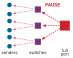{width="100%" fig-alt="A red source node fans out through arrows to five downstream nodes, showing one pause source affecting many flows."}

*One paused receiver can freeze unrelated flows.*
:::

### Lossless fabric hazards and watchdog recovery {#sec-network-pfc-hazards}

While priority flow control provides the illusion of a lossless physical layer, relying on link-layer backpressure introduces structural failure modes that do not exist in loss-tolerant packet-switched networks. When switch queues cannot drop packets to relieve congestion, pressure propagates backward through the network graph, creating two distinct hyperscale failure modes: credit deadlocks and PFC storms.

::: {#dfn-network-fabrics-pfc-deadlock .callout-definition title="PFC credit deadlock and cyclic buffer dependency"}

***PFC credit deadlock***\index{PFC deadlock!definition}\index{Cyclic buffer dependency!definition} is a permanent distributed lockup where a set of switch port queues form a closed dependency cycle, each holding packets destined for the next queue while simultaneously paused by backpressure from that same queue.

1.  **Significance**: A single credit deadlock permanently halts traffic across all participating ports and upstream links, requiring manual intervention or watchdog timeouts that discard packets to recover.
2.  **Distinction**: Unlike a PFC storm (which is a transient cascade of backpressure triggered by a slow-draining endpoint), a credit deadlock is a static, self-sustaining topological cycle that cannot resolve itself even after traffic injection stops.
3.  **Common pitfall**: Assuming multi-stage Clos (fat-tree) fabrics are inherently immune to deadlocks. Dynamic multipath routing, link failures, and address resolution flooding can introduce cyclic forwarding dependencies across switch tiers.

:::

#### The graph mechanics of credit deadlocks {#sec-network-deadlock-graph}

In a lossless network, a switch cannot forward a packet to downstream buffer $b_j$ if $b_j$ is full; instead, it holds the packet in upstream buffer $b_i$ and awaits credit or pause clearance. A directed buffer dependency graph $G = (V, E)$ formalizes this relationship, where each vertex $b_k \in V$ represents a packet buffer or virtual lane queue at a switch port, and a directed edge $(b_i, b_j) \in E$ indicates that a packet currently occupying buffer $b_i$ requires buffer $b_j$ along its routing path to make forward progress.

A directed cycle in the buffer dependency graph is a necessary condition for a PFC credit deadlock (definition \ref{dfn-network-fabrics-pfc-deadlock}), but a cycle alone does not establish that progress has stopped. The cyclic dependency in @eq-network-buffer-dependency-cycle becomes a deadlock when the occupied buffers cannot drain and every participant waits for its successor:

$$b_1 \to b_2 \to \dots \to b_k \to b_1$$ {#eq-network-buffer-dependency-cycle}

When each buffer in the cycle fills beyond its configured pause threshold, each port asserts a PFC PAUSE frame to its predecessor. Because no buffer can advance a packet into a paused successor, no buffer can drain, and no port can de-assert its PAUSE signal. The entire cycle freezes permanently. @Fig-pfc-credit-deadlock models this mutual protocol interlock across a four-switch ring whose queues ($b_1$ through $b_4$) are completely full. Tracing the ring reveals an intractable counter-rotational deadlock: while solid gray arrows trace packet forwarding dependencies advancing clockwise ($b_1 \to b_2 \to b_3 \to b_4 \to b_1$), dashed red PAUSE frames propagate counterclockwise. Each switch blocks the exact upstream neighbor it depends on to make forward progress, permanently freezing all four queues until an external watchdog intervenes to drop frames.

::: {#fig-pfc-credit-deadlock fig-env="figure" fig-pos="htb" fig-cap="**A PFC credit deadlock**: Four switch queues form the cycle of @eq-network-buffer-dependency-cycle. Follow the solid arrows clockwise: each full buffer holds packets that need space in the next. The dashed PAUSE frames run counterclockwise, so each switch blocks exactly the upstream port it depends on, and no queue can drain until a watchdog drops packets." fig-alt="Four switch boxes arranged in a square, each containing a full red buffer labeled b1 to b4. Solid gray arrows run clockwise from switch 1 to 2 to 3 to 4 and back to 1, labeled b1 to b2, b2 to b3, b3 to b4, and b4 to b1. Dashed red arrows labeled PAUSE run counterclockwise between the same switches. A key at the bottom explains both arrow types."}
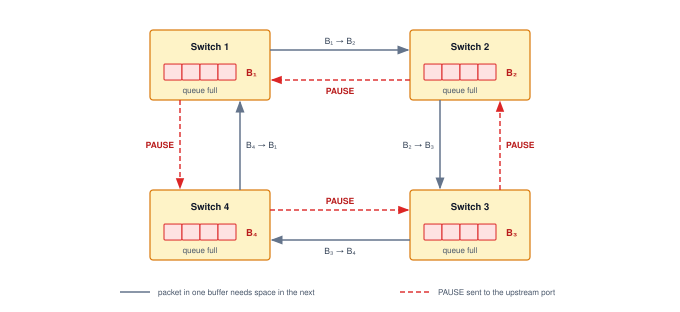
:::

Routing changes and flooding can create the dependencies needed for deadlock. During link failure or Border Gateway Protocol (BGP) convergence, inconsistent forwarding tables can create transient loops. If traffic occupies a cycle of mutually blocked queues, backpressure can prevent progress until recovery breaks the dependency. Multicast or broadcast replication can also fill queues whose dependencies intersect, while cross-connects and asymmetric failover paths can introduce cycles absent from the intended hierarchical route. None of these conditions alone proves a deadlock; the occupied buffers and pause states must form the closed waiting cycle described by the model.

Microsoft's production RoCE deployment encountered the flooding trigger directly (war story \ref{ws-network-fabrics-microsoft-pfc-deadlock}).

::: {#ws-network-fabrics-microsoft-pfc-deadlock .callout-war-story title="Microsoft's PFC deadlock (2016)"}

**Context**: A team led by Chuanxiong Guo at Microsoft Research deployed RoCEv2 across Microsoft's data centers, a fleet operating at the scale of tens of thousands of servers, to support latency-sensitive services. Their design provided a lossless fabric with PFC, and the team developed a Differentiated Services Code Point (DSCP)-based PFC mechanism to extend the deployment beyond virtual local area network (VLAN) boundaries [@guo2016rdma].

**Mechanism**: PFC interacted with Ethernet flooding to create a cyclic buffer dependency. A dead server with an incomplete mapping between an IP address and a media-access-control address caused upstream switches to flood lossless packets to every port; PFC PAUSE frames then propagated upstream in response to the flooded traffic, forming a closed loop of paused buffers.

**Impact**: Lossless traffic through the switches in the cycle stopped entirely and stayed stopped, because no buffer in the dependency loop could drain without outside intervention.

**Fix**: Microsoft blocked broadcast and multicast traffic from entering lossless traffic classes, and dropped lossless packets when the corresponding Address Resolution Protocol (ARP) entry was incomplete rather than falling back to flooding.

**Systems lesson**: PFC backpressure is a structural vulnerability of lossless Ethernet at hyperscale. RoCE fabrics require packet-class discipline, PFC pause telemetry, and hardware-level safeguards because a mechanism designed to avoid packet loss can itself become the failure mode. ML training fabrics built on RoCE inherit this risk directly. A single incomplete ARP entry can freeze the lossless class that carries a multi-thousand-GPU training run's gradients, with the cluster appearing healthy while no gradient flows between workers.

:::

#### PFC storms and victim flows {#sec-network-pfc-storms}

In contrast to a static topological cycle, a **PFC storm**\index{PFC storm!definition} is a dynamic, runaway amplification phenomenon. A single "slow drainer" (an accelerator stalled by memory bus saturation, operating system preemption, or a degraded transceiver with elevated bit error rates) fails to consume packets at wire speed.

The attached ToR switch queue fills and sends a PAUSE frame to the sender. Because multi-port switches aggregate traffic from many sources across shared packet buffers, the paused queue blocks buffer allocation for unrelated packets (head-of-line blocking). The spine switches feeding that ToR then fill their buffers and pause the other leaf switches that send through them. Each additional tier widens the set of paused links until traffic between node pairs that never communicated with the stalled worker also stops. These victim flows\index{Victim flow!PFC cascade} turn one slow endpoint into a job-wide barrier delay, because every data-parallel worker whose path crosses a paused spine port now arrives late at the barrier.

Because a degraded transceiver is one such slow drainer, a component-exposure calculation shows how often a cluster should expect at least one. It does not by itself estimate the probability of a PFC storm.

```{python}
#| echo: false
#| label: transceiver-degradation-probability
# ┌─────────────────────────────────────────────────────────────────────────────
# │ TRANSCEIVER DEGRADATION PROBABILITY (NOTEBOOK)
# ├─────────────────────────────────────────────────────────────────────────────
# │ Context: "Probability of at least one transceiver degradation" notebook
# │
# │ Goal: Quantify component-degradation exposure in a large RoCE cluster.
# │ Show: probability of at least one degradation ≈ 22%.
# │ How: Pr(any degradation) = 1 - (1 - p)^N_transceivers.
# │
# └─────────────────────────────────────────────────────────────────────────────
from mlsysim.fmt import check, fmt, fmt_count, fmt_percent

class TransceiverDegradationRisk:
    # ┌── 1. LOAD ──────────────────────────────────────────
    n_gpus = 4096  # scenario assumption: large RoCE cluster size
    links_per_gpu = 3  # scenario assumption: leaf + spine + core link tiers per GPU
    transceivers_per_link = 2  # one module at each end of an optical link
    p_transceiver_degrade = 1e-5  # scenario assumption: 0.001 percent per transceiver per day
    # ┌── 2. EXECUTE ───────────────────────────────────────
    n_total_links = n_gpus * links_per_gpu
    n_total_transceivers = n_total_links * transceivers_per_link
    p_no_degradation = (1 - p_transceiver_degrade) ** n_total_transceivers
    p_any_degradation = 1 - p_no_degradation
    # ┌── 3. GUARD (Invariants) ─────────────────────────────────────────
    check(n_total_links == 12288, f"Total links {n_total_links} outside expected range")
    check(n_total_transceivers == 24576, f"Total transceivers {n_total_transceivers} outside expected range")
    check(0.2 < p_any_degradation < 0.23, f"Degradation probability {p_any_degradation:.2f} outside expected range")
    # ┌── 4. OUTPUT (Formatting) ────────────────────────────────────────
    n_gpus_str = fmt_int(n_gpus, commas=False)
    p_degrade_pct_str = fmt_percent(
        p_transceiver_degrade,
        precision=3,
        commas=False,
        style="prose",
    )
    total_links_str = fmt(n_total_links, precision=0)
    total_transceivers_str = fmt(n_total_transceivers, precision=0)
    no_degradation_prob_str = fmt(p_no_degradation, precision=3, commas=False)
    any_degradation_prob_decimal_str = fmt(p_any_degradation, precision=3, commas=False)
    any_degradation_prob_str = fmt_percent(p_any_degradation, precision=1, commas=False, style='prose')
    no_degradation_prob_math = fmt_math(
        f"\\Pr(\\text{{no degradation}}) = (1 - 0.00001)^{{{total_transceivers_str}}} " f"\\approx {no_degradation_prob_str}"
    )
    any_degradation_prob_math = fmt_math(
        f"\\Pr(\\text{{at least one degradation}}) = 1 - {no_degradation_prob_str} " f"= \\mathbf{{{any_degradation_prob_decimal_str}}}"
    )
    links_per_gpu_str = fmt_count(links_per_gpu, commas=False, label="link tier")
```

::: {#nbk-network-fabrics-probability-transceiver-degradation .callout-notebook title="Probability of at least one transceiver degradation"}

**Problem**: A `{python} TransceiverDegradationRisk.n_gpus_str`-GPU RoCE cluster is in operation. If the probability of each transceiver degrading is `{python} TransceiverDegradationRisk.p_degrade_pct_str` per day, what is the chance that at least one transceiver degrades on a given day?

**Math**:
Assume independent transceiver-degradation events with the same per-device probability.

1. **Total exposure**: `{python} TransceiverDegradationRisk.n_gpus_str` $\times$ `{python} TransceiverDegradationRisk.links_per_gpu_str` = `{python} TransceiverDegradationRisk.total_links_str` links, or `{python} TransceiverDegradationRisk.total_transceivers_str` transceivers.
2. **Probability of zero transceiver degradations**: `{python} TransceiverDegradationRisk.no_degradation_prob_math`.
3. **Probability of at least one degradation**: `{python} TransceiverDegradationRisk.any_degradation_prob_math` (about `{python} TransceiverDegradationRisk.any_degradation_prob_str`).

**Systems insight**: Under these assumptions, a large RoCE cluster has a `{python} TransceiverDegradationRisk.any_degradation_prob_str` daily chance of at least one degraded transceiver. This result motivates hardware telemetry and automated remediation, but estimating fabric-wide freeze risk additionally requires the conditional probability that a degradation triggers and propagates a PFC storm.

:::

#### Watchdog recovery and the lossy alternative {#sec-network-pfc-watchdogs-and-lossy}

Switches can use **PFC watchdog timers**\index{PFC watchdog!definition} to detect prolonged pause states and trigger recovery without a full reboot. The configured threshold $T_{\text{watchdog}}$ must fit the deployment's pause and recovery budgets; a range such as $50\text{--}200\text{ ms}$ is a configuration example, not a universal requirement. Exceeding it indicates stalled progress, not proof of a cyclic deadlock. Depending on the implementation, mitigation can disable pause handling or discard affected traffic so blocked queues can drain. The transport must then recover any lost data, with the completion penalty determined by retransmission behavior, outstanding traffic, and the collective's dependencies.

This systemic brittleness is driving hyperscale operators toward next-generation architectures such as the Ultra Ethernet Consortium (UEC) [@ultraEthernet2025specification], detailed in @sec-network-fabrics-protocol-convergence, and loss-tolerant RDMA designs [@mittal2018irn]. Designs that combine packet spraying\index{Packet spraying!deadlock prevention} with congestion control and selective retransmission can operate without link-layer PFC. Removing PFC removes its pause-based deadlocks and storms, but endpoint recovery must still bound the completion-time penalty of congestion and loss.

### End-to-end congestion control with DCQCN and HPCC {#sec-network-fabrics-congestion-control}

End-to-end congestion control adjusts injection rates before queues reach their pause or overflow thresholds. For a BSP workload with a completion-time target, this is a *latency requirement* rather than an *optional throughput optimization*. Delaying a required transfer can extend the synchronization boundary, so the controller must balance delivered throughput against queueing and recovery tails.

The first widely deployed solution, **DCQCN**\index{DCQCN!definition},[^fn-dcqcn-roce-congestion] operates as a reactive feedback loop using ECN\index{ECN!marking threshold}\index{ECN!CNP feedback loop} [@zhu2015]. When a switch's queue depth exceeds a configured threshold, it marks the ECN bit in the packet header. The receiver echoes this mark back to the sender via a congestion notification packet (CNP), prompting the sender to reduce its injection rate using a multiplicative-decrease algorithm. DCQCN is widely supported, but production AI collectives expose a tuning problem: ECN thresholds and NIC firmware behavior can trade off PFC avoidance, throughput, visibility, and tail latency rather than offering one stable optimum [@gangidi2024rdma].

**HPCC**\index{HPCC!definition},[^fn-hpcc-telemetry-congestion] uses in-network telemetry (INT)\index{In-network telemetry!HPCC} to give the sender more information about path load [@li2019]. Switch measurements of queue occupancy and transmitted traffic let the controller estimate an appropriate injection rate rather than react only to a binary congestion mark. That information still arrives after a feedback delay, so the controller must account for changing load and avoid overreaction. The evaluated design reduces queue buildup and tail latency, but requires switch telemetry support and compatible endpoint processing. DCQCN needs less detailed switch feedback, trading that simpler deployment requirement against a different tuning problem.

[^fn-dcqcn-roce-congestion]: **DCQCN (Data Center Quantized Congestion Notification)**\index{DCQCN!congestion control}: Introduced by @zhu2015 (Microsoft and Mellanox) at SIGCOMM 2015 for large-scale RDMA fabrics, its binary ECN/CNP feedback loop is simpler to deploy than telemetry-rich schemes. However, it creates a delicate tuning surface for training collectives: Meta's 2024 RoCE deployment showed that aggressive ECN marking\index{ECN!tuning sensitivity} reduces PFC pauses but degrades collective completion time [@gangidi2024rdma].

[^fn-hpcc-telemetry-congestion]: **HPCC (High Precision Congestion Control)**\index{HPCC!congestion control}: Introduced by @li2019 (Alibaba) at SIGCOMM 2019, HPCC replaces binary ECN with per-packet in-network telemetry (INT), giving senders path-load measurements for adjusting injection rates while accounting for feedback delay and changing demand. The systems trade-off is hardware dependency: it requires programmable switch ASICs capable of appending INT metadata at line rate.

### Adaptive routing {#sec-network-fabrics-adaptive-routing}

Static routing protocols like ECMP[^fn-ecmp-flow-hashing]\index{ECMP!static flow hashing} distribute traffic by hashing flow headers to fixed paths. This approach works well for many small flows but can create persistent collisions among the small number of elephant flows\index{Elephant flow!ECMP collisions} typical of ML training. Consider a scenario with 4 equal-cost paths and 8 large gradient flows. An even distribution would place 2 flows on each link. Static hashing can instead place 4 flows on one link while another sits idle. In a synchronized training step, the overloaded link then determines completion time and can halve useful bandwidth in this scenario.

[^fn-ecmp-flow-hashing]: **ECMP (equal-cost multi-path)**\index{ECMP!hash collision}: ECMP selects a path by hashing on the 5-tuple (source/destination IP, source/destination port, protocol), which means the same flow always takes the same path. This determinism is a feature for packet ordering but a liability for ML. Because a single AllReduce ring produces a small number of persistent flows, hash collisions are not transient statistical events but permanent hot spots that persist for the entire training run.

Adaptive routing\index{Adaptive routing!queue-depth selection} mitigates this problem by allowing switches to select among eligible output paths using congestion information rather than only a static hash. The implementation is protocol- and device-dependent. Packet-level spraying[^fn-packet-spraying-routing]\index{Packet spraying!InfiniBand adaptive routing} can send packets of one connection over different paths, so the receiver may observe reordering. Compatible endpoint support must accept out-of-order placement or restore the transport's required ordering; the presence of InfiniBand alone does not guarantee arbitrary spraying across every path.

[^fn-packet-spraying-routing]: **Packet spraying**\index{Packet spraying!load balancing}: Unlike standard Ethernet (which hashes flows to single paths to avoid reordering), packet spraying sends individual packets of a single flow across multiple paths. This can improve $\Bandwidth_{\text{bisect}}$ for AllReduce elephant flows when the transport can tolerate or repair reordering. The Ultra Ethernet Consortium (UEC) specification design explicitly includes multi-path packet spraying and flexible ordering to reduce the ECMP collision problem for AI/HPC traffic [@ultraEthernet2025specification].

Ethernet fabrics can also employ **flowlet switching**\index{Flowlet switching!definition}, changing a flow's path between bursts separated by a gap large enough to preserve packet order across the candidate paths. Its usefulness depends on the available gaps and path delays. MoE expert exchanges illustrate the demand for path diversity. A dense exchange among 64 expert-parallel ranks contains at most $64(64-1)=4{,}032$ directed remote rank pairs after excluding self-transfers; active traffic depends on expert placement and token-routing sparsity. Static-hash collisions can concentrate that traffic, while adaptive routing can improve use of the provisioned $\Bandwidth_{\text{bisect}}$. Archetype B (DLRM at Scale) can create similar exchanges when batches of embedding requests and results move among table shards. The batch and shard placement determine the traffic matrix, rather than every individual lookup requiring a global exchange.

### The incast problem in ML {#sec-network-fabrics-incast}

Congestion control and adaptive routing manage flows that traverse the interior of the fabric. A different failure mode occurs at the edge, where the traffic pattern itself overwhelms a single port regardless of how much capacity the fabric interior provides.

```{python}
#| echo: false
#| label: network-fabrics-incast-figure
# ┌─────────────────────────────────────────────────────────────────────────────
# │ INCAST FIGURE SCENARIO (LEGO)
# ├─────────────────────────────────────────────────────────────────────────────
# │ Context: @fig-congestion-cascade caption. IncastBurst (@dfn-network-fabrics-incast)
# │          reads the same inputs from this cell.
# │ Goal: Pin the caption's sender count, rates, and buffer to the registry.
# │ How: One DGX H100 SuperPOD scalable unit of NDR senders onto one 400G egress.
# └─────────────────────────────────────────────────────────────────────────────
from mlsysim.fmt import check, fmt_bandwidth, fmt_count, fmt_memory, fmt_multiple

class IncastCascadeFigure:
    # ┌── 1. LOAD ──────────────────────────────────────────────────────────
    n_senders = Systems.Clusters.DgxH100SuperPodSU.total_accelerators  # one GPU per sender
    sender_bw = Systems.Fabrics.InfiniBand_NDR.bandwidth  # per port, per direction
    egress_port = Systems.Fabrics.Ethernet_400G.bandwidth
    buffer = 32 * MB  # scenario assumption: switch egress buffer

    # ┌── 2. EXECUTE ───────────────────────────────────────────────────────
    offered = n_senders * sender_bw
    oversub = (offered / egress_port).to_base_units().magnitude

    # ┌── 3. GUARD ─────────────────────────────────────────────────────────
    # fig-alt (literal) says "GPU 1, 2, 3, and 256, with 252 more implied".
    check(n_senders == 256, "fig-alt text assumes 256 senders")

    # ┌── 4. OUTPUT ────────────────────────────────────────────────────────
    n_senders_str = fmt_count(n_senders, commas=False)
    sender_bw_gb_per_s_str = fmt_bandwidth(sender_bw, unit=GB / second, precision=0, commas=False)
    port_gbit_per_s_str = fmt_bandwidth(egress_port, unit=Gbps, precision=0, commas=False)
    port_gb_per_s_str = fmt_bandwidth(egress_port, unit=GB / second, precision=0, commas=False)
    buffer_mb_str = fmt_memory(buffer, unit=MB, precision=0, commas=False)
    offered_tb_per_s_str = fmt_bandwidth(offered, unit=TB / second, precision=1, commas=False)
    oversub_mult_str = fmt_multiple(oversub, precision=0, commas=False)
    # The static SVG labels 50 GB/s per sender, 12.8 TB/s offered, and a 400 Gb/s egress.
    check(
        sender_bw_gb_per_s_str == "50 GB/s" and offered_tb_per_s_str == "12.8 TB/s" and port_gbit_per_s_str == "400 Gb/s",
        "incast SVG labels match the registry",
    )
```

```{python}
#| echo: false
#| label: network-fabrics-incast-burst
# ┌─────────────────────────────────────────────────────────────────────────────
# │ INCAST BURST (LEGO)
# ├─────────────────────────────────────────────────────────────────────────────
# │ Context: @dfn-network-fabrics-incast — the incast significance bullet, and
# │          the SuperPOD scalable-unit injection bandwidth (@sec-network-fabrics-dgx-superpod).
# │
# │ Goal: Quantify the many-to-one incast burst onto one switch egress port.
# │ Show: 256 senders × 50 GB/s = 12.8 TB/s offered; 400 Gb/s port; 32 MB
# │       buffer holds 640 μs of one egress stream; net fill 12.75 TB/s after
# │       subtracting one egress port; overflow in ~2.5 μs; 256× oversubscription.
# │ How: offered = n_senders × beta; port = Ethernet_400G; buffer/egress and
# │      buffer/(offered − egress) give hold and overflow times.
# │
# └─────────────────────────────────────────────────────────────────────────────
from mlsysim.fmt import check, fmt_bandwidth, fmt_count, fmt_memory, fmt_multiple, fmt_time

class IncastBurst:
    """Many-to-one incast burst onto a single switch egress port."""

    # ┌── 1. LOAD (Constants) ──────────────────────────────────────────────
    _su = Systems.Clusters.DgxH100SuperPodSU  # DGX H100 SuperPOD scalable unit
    su_nodes = _su.count  # 32 DGX nodes per scalable unit
    gpus_per_node = _su.node.accelerators_per_node  # 8 GPUs per DGX node
    n_senders = su_nodes * gpus_per_node  # 256 scalable-unit GPUs (one per egress)
    sender_bw = IncastCascadeFigure.sender_bw  # 50 GB/s per port (per direction)
    egress_port = IncastCascadeFigure.egress_port  # 400 Gb/s (50 GB/s) egress port
    buffer = IncastCascadeFigure.buffer  # scenario assumption (set in the figure cell): switch egress buffer
    feedback_rtt = 5 * microsecond  # scenario assumption: congestion-feedback round trip
    ref_cluster_gpus = Systems.Clusters.Training_1K.total_accelerators  # SuperPOD prose: reference cluster

    # ┌── 2. EXECUTE (The Compute) ────────────────────────────────────────
    offered = n_senders * sender_bw
    su_per_ref_cluster = ref_cluster_gpus // n_senders
    oversub = (offered / egress_port).to_base_units().magnitude
    buffer_hold = buffer / egress_port  # time one egress stream takes to drain the buffer
    net_fill = offered - egress_port  # fill rate after the single egress port drains
    overflow = buffer / net_fill
    bandwidth_delay_product = egress_port * feedback_rtt

    # ┌── 3. GUARD (Invariants) ───────────────────────────────────────────
    check(abs(offered.to(TB / second).magnitude - 12.8) < 1e-6, "256 × 50 GB/s should be 12.8 TB/s")
    check(round(oversub) == 256, "Offered load should oversubscribe the egress port 256×")
    check(n_senders == IncastCascadeFigure.n_senders, "Incast definition and figure caption must use the same sender count")
    check(abs(buffer_hold.to(microsecond).magnitude - 640) < 1e-3, "32 MB / 50 GB/s should be 640 μs")
    check(overflow.to(microsecond).magnitude < 5, "Buffer should overflow in a few microseconds")
    check(abs(bandwidth_delay_product.to(KB).magnitude - 250) < 1e-6, "50 GB/s × 5 μs should be 250 KB")
    check(ref_cluster_gpus % n_senders == 0, "Reference cluster should be a whole number of scalable units")
    # SuperPOD prose spells these counts as words; fail loudly if the registry moves them.
    check(int(gpus_per_node) == 8, "SuperPOD prose says eight H100 GPUs per node")
    check(su_per_ref_cluster == 4, "SuperPOD prose says four scalable units")

    # ┌── 4. OUTPUT (Formatting) ──────────────────────────────────────────
    n_senders_str = fmt_count(n_senders, commas=False)
    su_nodes_str = fmt_count(su_nodes, commas=False, label="node")
    gpus_per_node_word_str = MarkdownStr("eight")  # guarded above
    su_per_ref_cluster_word_str = MarkdownStr("four")  # guarded above
    ref_cluster_gpus_str = fmt_count(ref_cluster_gpus, commas=True, label="GPU")
    n_senders_gpus_str = fmt_count(n_senders, commas=False, label="GPU")
    sender_bw_gb_per_s_str = fmt_bandwidth(sender_bw, unit=GB / second, precision=0, commas=False)
    offered_tb_per_s_str = fmt_bandwidth(offered, unit=TB / second, precision=1, commas=False)
    port_gbit_per_s_str = fmt_bandwidth(egress_port, unit=Gbps, precision=0, commas=False)
    buffer_mb_str = fmt_memory(buffer, unit=MB, precision=0, commas=False)
    buffer_hold_us_str = fmt_time(buffer_hold, microsecond, precision=0, commas=False)
    feedback_rtt_us_str = fmt_time(feedback_rtt, microsecond, precision=0, commas=False)
    bandwidth_delay_product_kb_str = fmt_memory(bandwidth_delay_product, unit=KB, precision=0, commas=False)
    oversubscription_mult_str = fmt_multiple(oversub, precision=0, commas=False)
    overflow_us_str = fmt_time(overflow, microsecond, precision=1, commas=False)
```

::: {#dfn-network-fabrics-incast .callout-definition title="Incast"}

***Incast***\index{Incast!definition} is a many-to-one ML cluster traffic pattern in which a large number of senders simultaneously transmit data to a single receiver port, concentrating line-rate traffic from multiple sources into a single switch queue and potentially overflowing the buffer if the burst outlasts available buffering and control response, even when the rest of the fabric is uncongested.

1.  **Significance**: Flat aggregation, synchronized storage reads, or other fan-in phases can direct many senders toward one receiver. In the deliberately worst-case scenario here, `{python} IncastBurst.n_senders_str` senders each transmit at `{python} IncastBurst.sender_bw_gb_per_s_str` toward one switch egress, producing `{python} IncastBurst.offered_tb_per_s_str` of offered load against a `{python} IncastBurst.port_gbit_per_s_str` port. A `{python} IncastBurst.buffer_mb_str` buffer then overflows in about `{python} IncastBurst.overflow_us_str` under the stated assumptions. The example is a stress bound, not the traffic matrix of a ring AllReduce.
2.  **Distinction**: Unlike general congestion (which occurs on shared internal links when aggregate traffic exceeds link capacity), incast is an endpoint bottleneck: it occurs even if every internal spine and leaf link is completely uncongested, because the bottleneck is the single destination port, not the fabric interior.
3.  **Common pitfall**: Incast is not necessarily rare or unpredictable. Synchronized training can produce repeated bursts as gradient collectives begin during the backward pass. The severity depends on the collective algorithm, topology, routing, and oversubscription, so it must be measured and mitigated rather than treated as an edge case.

:::

@Fig-congestion-cascade contrasts `{python} IncastCascadeFigure.offered_tb_per_s_str` of offered traffic from `{python} IncastCascadeFigure.n_senders_str` senders with a `{python} IncastCascadeFigure.port_gbit_per_s_str` (`{python} IncastCascadeFigure.port_gb_per_s_str`) egress. Each sender injects at `{python} IncastCascadeFigure.sender_bw_gb_per_s_str` in this worst-case scenario. The buffer fills over a finite interval; control feedback can reduce arrivals, drops can discard excess traffic, or backpressure can move the queueing upstream. Whether that pressure spreads depends on shared queues and the paths carrying the traffic. Let the aggregate arrival rate to one egress be $\ArrivalRate$, the egress service rate be $\mu$, and the instantaneous queue occupancy be $Q(t)$. While a burst persists and $\ArrivalRate > \mu$, the queue grows at the net rate

$$
Q(t) = \min\!\left(Q_{\text{max}},\; Q(0) + (\ArrivalRate-\mu)t\right),
$$

where $Q_{\text{max}}$ is the finite buffer capacity. The ratio $\ServingUtilization=\ArrivalRate/\mu$ distinguishes a drainable workload from sustained overload: for $\ServingUtilization<1$, idle intervals can drain the queue; as long-run $\ServingUtilization$ approaches one, less slack remains to absorb bursts; and for $\ServingUtilization>1$, occupancy must reach a control threshold or the buffer limit if the overload persists. This is a packet queue, distinct from the request queues of an inference server. Serialization and propagation set the unloaded path latency, whereas queued bytes add approximately $Q/\mu$ of waiting time.

::: {.column-margin .margin-pointer}
⇄ **Contrast:** Request queues, whose arrival and service rates set serving latency rather than switch buffer occupancy, are developed in @sec-appdx-inference-scale-queuing-theory-batched-inference-bbf0.
:::
In the deliberately worst-case incast above, $\ServingUtilization$ is `{python} IncastBurst.oversubscription_mult_str`, so the `{python} IncastBurst.buffer_mb_str` buffer fills in about `{python} IncastBurst.overflow_us_str`. Once full, that buffer represents `{python} IncastBurst.buffer_hold_us_str` of egress waiting time. By contrast, the bandwidth-delay product\index{Bandwidth-delay product!buffer distinction} for the `{python} IncastBurst.port_gbit_per_s_str` egress and an illustrative `{python} IncastBurst.feedback_rtt_us_str` feedback round trip is only `{python} IncastBurst.bandwidth_delay_product_kb_str`: it measures data in flight on the path, not the buffering needed to absorb an arbitrary fan-in burst. ECN\index{ECN!reaction window} must mark early enough for feedback to arrive before exhaustion; PFC can prevent a drop, but its backpressure can spread congestion. A larger buffer extends the reaction window at the cost of a larger tail-latency bound.

::: {#fig-congestion-cascade fig-env="figure" fig-pos="htb" fig-cap="**A true incast burst**: This deliberately worst-case fan-in scenario sends `{python} IncastCascadeFigure.n_senders_str` sources at `{python} IncastCascadeFigure.sender_bw_gb_per_s_str` toward one `{python} IncastCascadeFigure.port_gbit_per_s_str` (`{python} IncastCascadeFigure.port_gb_per_s_str`) egress with a `{python} IncastCascadeFigure.buffer_mb_str` buffer. The `{python} IncastCascadeFigure.offered_tb_per_s_str` offered load oversubscribes the destination egress by `{python} IncastCascadeFigure.oversub_mult_str`. Flat aggregation or synchronized reads can create this pattern; bandwidth-optimal ring AllReduce does not, because each rank exchanges point-to-point chunks." fig-alt="Four labeled sender GPUs, GPU 1, 2, 3, and 256, with 252 more implied, each send at 50 GB/s into a shared trunk. A thick arrow labeled 12.8 TB/s offered enters a switch egress port whose 32 MB buffer is drawn as a row of full cells marked drops or PAUSE upstream. A thin 400 Gb/s (50 GB/s) arrow leaves the port to one receiver."}
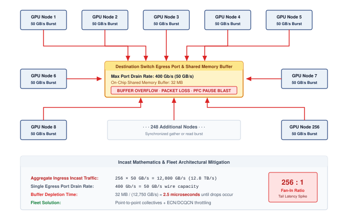

:::

```{python}
#| echo: false
# ┌── LEGO ───────────────────────────────────────────────
# │ Context: Incast paragraph below — cluster GPU count
class NetworkIncastClusterRecap:
    # ┌── 4. OUTPUT (Formatting) ──────────────────────────────────────────────
    n_gpus_str = fmt_count(Systems.Clusters.Training_1K.total_accelerators, commas=True, label="GPU")
```

Synchronized ML traffic is susceptible to both true fan-in and shared-egress hot spots. When a layer finishes backward computation, many ranks can inject traffic at once, and flat or hierarchical aggregation phases can create true fan-in. Production clusters mitigate both cases along three complementary dimensions:

1. **Time.** Layer-staggering\index{Incast!layer-staggering mitigation} triggers each gradient bucket's AllReduce as soon as backpropagation produces it. Final-layer gradients reduce while earlier layers are still computing, so communication is spread across the backward pass instead of released as one synchronized burst. This **communication-computation overlap**\index{Communication-computation overlap!definition} also hides transfer time behind the backward computation that remains.
2. **Space.** Collective algorithm selection\index{Incast!algorithm selection mitigation} bounds fan-in at individual switch ports. Hierarchical and rail-local reductions aggregate gradients in stages so that no single port must absorb all senders at once, and topology-aware placement keeps concurrent ring flows off oversubscribed ports.
3. **Priority.** Quality of service (QoS) classification\index{Quality of service!priority traffic} tags gradient traffic with the highest service class to reduce interference from background storage or management traffic; shared links, buffers, and arbitration still constrain isolation.

These mitigations spread the burst in time, space, and priority, but they do not eliminate congestion or tail latency. The question becomes how to build end-to-end clusters that perform despite these realities.

::: {.column-margin .margin-pointer}
↪ How far layer-staggered overlap hides gradient traffic, and how much communication it still leaves exposed, is developed in @sec-communication-overlap.
:::

## Level 5 Cluster Design and Case Studies {#sec-network-fabrics-cluster}

### The GPU-to-GPU "gradient bus" {#sec-network-fabrics-gradient-bus}

```{python}
#| echo: false
#| label: calc-vol2-network-fabrics-cluster-recap
# ┌── LEGO ───────────────────────────────────────────────
# │ Context: Gradient bus — NVLink/IB cliff and SuperPOD specs.
class NetworkFabricsClusterRecap:
    ib_ndr = Systems.Fabrics.InfiniBand_NDR.bandwidth
    nvlink = Hardware.Cloud.H100.nvlink.bandwidth  # 900 GB/s bidirectional aggregate (for display)
    nvlink_perdir = Hardware.Cloud.H100.nvlink.bandwidth_per_direction  # 450 GB/s one-way for the cliff ratio
    # ┌── 4. OUTPUT (Formatting) ──────────────────────────────────────────────
    # Per-direction-vs-per-port cliff (honest 9x; 900-vs-50 would double-count to 18x)
    nvlink_to_ib_ratio_mult_str = fmt_multiple(round((nvlink_perdir / ib_ndr).to_base_units().magnitude), precision=0, commas=False)
    nvlink_h100_gb_per_s_str = fmt_bandwidth(nvlink, unit=GB / second, precision=0, commas=False)
    ib_ndr_gbit_per_s_str = fmt_bandwidth(Systems.Fabrics.InfiniBand_NDR.bandwidth, unit=Gbps, precision=0, commas=False)
```

```{python}
#| echo: false
#| label: calc-vol2-overlap-example
# ┌─────────────────────────────────────────────────────────────────────────────
# │ COMMUNICATION-COMPUTATION OVERLAP EXAMPLE
# ├─────────────────────────────────────────────────────────────────────────────
# │ Context: §The GPU-to-GPU gradient bus
# │ Goal: Demonstrate ideal AllReduce latency hiding behind backward-pass compute.
# │ Show: Backward time, AllReduce time, exposed overhead math.
# │ How: max(0, allreduce - backward) with check() invariant.
# └─────────────────────────────────────────────────────────────────────────────
class OverlapExample:
    # ┌── 1. LOAD ──────────────────────────────────────────────────────────
    backward = 500 * millisecond  # scenario assumption: backward-pass compute per step
    allreduce = 300 * millisecond  # scenario assumption: gradient AllReduce per step

    # ┌── 2. EXECUTE ───────────────────────────────────────────────────────
    exposed = max(0 * millisecond, allreduce - backward)
    _b = int(backward.to(millisecond).magnitude)
    _a = int(allreduce.to(millisecond).magnitude)

    # ┌── 3. GUARD ─────────────────────────────────────────────────────────
    check(exposed.magnitude == 0, "Ideal overlap should hide the whole AllReduce in this scenario")

    # ┌── 4. OUTPUT ────────────────────────────────────────────────────────
    backward_ms_str = MarkdownStr(f"{_b} ms")
    allreduce_ms_str = MarkdownStr(f"{_a} ms")
    exposed_math = fmt_math(f"\\max(0, {_a} - {_b}) = {int(exposed.to(millisecond).magnitude)}")
```

In a well-designed cluster, the network fabric acts as a scheduler-aware extension of the system bus, not a passive pipe. The intra-node (NVLink) bandwidth is ~`{python} NetworkFabricsClusterRecap.nvlink_to_ib_ratio_mult_str` higher than inter-node (InfiniBand/RoCE) bandwidth, and the communication-computation overlap\index{Communication-computation overlap!latency hiding} introduced among the incast mitigations is the first mechanism for hiding this cliff. Because gradients for the final layers are computed first, the system can launch their AllReduce while the GPUs continue computing gradients for earlier layers. If the backward pass requires `{python} OverlapExample.backward_ms_str` of computation and the AllReduce takes `{python} OverlapExample.allreduce_ms_str`, ideal overlap could hide the communication cost behind computation, reducing the exposed overhead to `{python} OverlapExample.exposed_math`. In practice, dependency chains and resource contention limit overlap, leaving a **last-mile problem**\index{Last-mile problem!definition}: gradients computed near the end of backpropagation have little subsequent computation behind which to hide their transfer time.

Placement determines which communication crosses each boundary. Tensor-parallel groups benefit from fast local paths because they exchange intermediate results frequently. Pipeline\index{Pipeline parallelism!network hierarchy} stages require paths that meet their activation-transfer budget; physical adjacency alone does not establish that property. Data-parallel\index{Data parallelism!network hierarchy} replicas can span the wider fabric when local computation, accumulation, and overlap leave sufficient time for gradient exchange. The production designs that follow show how complete configurations provide those paths.

The final level of the stack is cluster design\index{Cluster design!gradient bus integration}, where wires, transport, topology, and congestion control combine into a coherent system. The goal of cluster design is to provide an end-to-end gradient bus that makes thousands of distributed GPUs feel like a single machine. At this level, the abstraction layers collapse into concrete engineering decisions: which cables to buy, how to wire the racks, which protocol to deploy, and how to validate that the resulting fabric delivers the bandwidth the training job expects. Two representative large-scale architectures, one built on InfiniBand and one on Ethernet, illuminate the trade-offs that define ML infrastructure [@nvidia2023dgxSuperpodH100; @meta2024genaiInfrastructure; @gangidi2024rdma].

### Network Virtualization {#sec-network-fabrics-virtualization}

```{python}
#| echo: false
#| label: network-virtualization-idle-cost
# ┌─────────────────────────────────────────────────────────────────────────────
# │ MULTI-TENANCY IDLE-CAPITAL COST (LEGO)
# ├─────────────────────────────────────────────────────────────────────────────
# │ Context: @sec-network-fabrics-virtualization opening paragraph.
# │ Goal: Price the capital stranded by a cluster that cannot isolate tenants.
# │ How: stranded capital = cluster capex × idle fraction. Capex is the same
# │      NetworkEconomicsProfile anchor the bisection notebook uses.
# └─────────────────────────────────────────────────────────────────────────────
from mlsysim.fmt import check, fmt_percent, fmt_usd

class VirtualizationIdleCost:
    # ┌── 1. LOAD ──────────────────────────────────────────────────────────
    cluster_cost = ReferenceStats.NetworkEconomicsProfile.ClusterCapex
    idle_fraction = 0.30  # scenario assumption: share of cluster idle without tenant isolation
    training_share = 0.80  # scenario assumption: bisection share reserved for the training job
    n_vfs = 8  # scenario assumption: SR-IOV virtual functions carved from one NIC
    nic_bw = Systems.Fabrics.InfiniBand_NDR.bandwidth
    ckpt_write = 100 * GB  # scenario assumption: neighboring job's checkpoint burst

    # ┌── 2. EXECUTE ───────────────────────────────────────────────────────
    stranded = cluster_cost * idle_fraction
    vf_rate = nic_bw / n_vfs
    ckpt_time = ckpt_write / nic_bw

    # ┌── 3. GUARD ─────────────────────────────────────────────────────────
    check(0 < idle_fraction < 1, "Idle fraction must be a fraction")
    check(n_vfs == 8, "Prose spells the VF count as 'eight'")
    check(abs(ckpt_time.to(second).magnitude - 2) < 1e-9, "100 GB at 50 GB/s should take 2 s")

    # ┌── 4. OUTPUT ────────────────────────────────────────────────────────
    cluster_cost_str = fmt_usd(cluster_cost, precision=0, commas=False, scale="million")
    idle_pct_str = fmt_percent(idle_fraction, precision=0, commas=False, style="prose")
    stranded_str = fmt_usd(stranded, precision=0, commas=False, scale="million")
    training_share_pct_str = fmt_percent(training_share, precision=0, commas=False, style="prose")
    other_share_pct_str = fmt_percent(1 - training_share, precision=0, commas=False, style="prose")
    n_vfs_word_str = MarkdownStr("eight")  # guarded above
    vf_rate_gbit_per_s_str = fmt_bandwidth(vf_rate, unit=Gbps, precision=0, commas=False)
    ckpt_gb_str = fmt_memory(ckpt_write, unit=GB, precision=0, commas=False)
    ckpt_s_str = fmt_time(ckpt_time, second, precision=0, commas=False)
```

Sharing a cluster can recover capacity that a single workload leaves unused. In the scenario of a `{python} VirtualizationIdleCost.cluster_cost_str` system with `{python} VirtualizationIdleCost.idle_pct_str` unused capacity, the idle fraction corresponds to `{python} VirtualizationIdleCost.stranded_str` of the equipment budget. Network virtualization\index{Network virtualization!multi-tenancy} must make sharing compatible with bandwidth allocations, latency targets, and access isolation. These requirements interact because tenants still share physical links and buffers. A proposed policy might reserve `{python} VirtualizationIdleCost.training_share_pct_str` of the cluster's $\Bandwidth_{\text{bisect}}$ for training and allocate the remaining `{python} VirtualizationIdleCost.other_share_pct_str` to inference and preprocessing. Enforcing that policy requires admission control and compatible scheduling along the relevant paths; a virtual NIC or separate traffic class alone does not guarantee the end-to-end share.

#### Hardware NIC virtualization with SR-IOV {#sec-network-fabrics-sriov}

```{python}
#| echo: false
# ┌── LEGO ───────────────────────────────────────────────
# │ Context: SR-IOV and QoS — NDR line rate.
class IbNdrVirtualizationRecap:
    # ┌── 4. OUTPUT (Formatting) ─────────────────────────────────────────────
    ib_ndr_gbit_per_s_str = fmt_bandwidth(Systems.Fabrics.InfiniBand_NDR.bandwidth, unit=Gbps, precision=0, commas=False)
```

Cloud providers expose NIC resources to virtualized GPU instances through **single-root I/O virtualization (SR-IOV)**\index{SR-IOV!definition}, a standard that allows a physical NIC to present multiple **virtual functions (VFs)**\index{Virtual Function!definition}. Each VF exposes device resources such as queues and registers that software can assign to a workload. A directly assigned VF can remove host software mediation from the active DMA path, while drivers and virtualization software still configure access and manage the device. Performance depends on the NIC, I/O placement, and competing traffic. Because VFs share physical resources, placement logic must reserve NIC capacity and QoS policy alongside GPUs rather than treat the network as an unbounded pool.

However, hardware-level isolation still needs explicit bandwidth policy. SR-IOV exposes multiple VFs that share the NIC's physical resources; administrators can add per-VF or per-group QoS policies to cap or guarantee bandwidth, such as assigning `{python} VirtualizationIdleCost.n_vfs_word_str` VFs `{python} VirtualizationIdleCost.vf_rate_gbit_per_s_str` each on a `{python} IbNdrVirtualizationRecap.ib_ndr_gbit_per_s_str` NIC. For the 175B-parameter model training on a multi-tenant cluster, that configured partitioning can prevent a neighboring tenant from stealing bandwidth, but it also enforces a hard ceiling on peak throughput. The training job must be architected to operate within this slice, as no amount of software optimization can burst beyond the configured VF limit.

#### Traffic isolation and quality of service {#sec-network-fabrics-qos}

Consider a worst-case contention scenario on a shared cluster: the 175B model is midway through a gradient AllReduce when a neighboring job initiates a massive checkpoint save. Without strict isolation, a bursty `{python} VirtualizationIdleCost.ckpt_gb_str` write, which occupies a `{python} IbNdrVirtualizationRecap.ib_ndr_gbit_per_s_str` port for `{python} VirtualizationIdleCost.ckpt_s_str` at full line rate, can claim a large share of the shared spine links for that interval and stretch every AllReduce whose traffic crosses them. To prevent this noisy-neighbor effect, high-performance fabrics rely on **quality of service (QoS)**\index{Quality of service!definition} mechanisms that enforce fairness at the packet level.

InfiniBand virtual lanes (VLs)\index{Virtual lane!traffic isolation} separate credit and buffer state within a physical link. Ethernet/RoCE uses **traffic class**\index{Traffic class!definition} mappings and queue policies, whose supported counts and behavior depend on the device. In InfiniBand, exhausted credits for a storage lane need not block a gradient lane that has credits available, but both still share link bandwidth and arbitration. On Ethernet, **enhanced transmission selection**\index{Enhanced transmission selection!definition} allocates service among traffic classes. Devices may also partition buffer and forwarding resources into **network slices**\index{Network slice!definition}. These mechanisms reduce interference when classification, resource allocation, and scheduling agree across the path; shared priorities or buffers can still couple tenants.

Virtualization solves the sharing problem but makes performance diagnosis harder. When a training job slows down on a multi-tenant cluster, the cause could be a physical link degradation, a noisy neighbor exceeding its bandwidth allocation, or a misconfigured QoS policy. Systematic monitoring is essential to distinguish these cases.

### Monitoring and Debugging {#sec-network-fabrics-monitoring}

```{python}
#| echo: false
#| label: network-fabrics-silent-waste
# ┌─────────────────────────────────────────────────────────────────────────────
# │ SILENT WASTE BUDGET (LEGO)
# ├─────────────────────────────────────────────────────────────────────────────
# │ Context: @sec-network-fabrics-monitoring — the silent-waste paragraph.
# │
# │ Goal: Quantify the GPU-hours and dollars a slow transceiver wastes over a
# │       30-day run before any alarm fires.
# │ Show: 10 percent BW loss → 2-3 percent per-iteration slowdown →
# │       ~15,000-22,000 wasted GPU-hours → ~\$45,000-\$66,000 at \$3/GPU-hour.
# │ How: total GPU-hours = N × days × 24; waste = total × slowdown; cost =
# │      waste × GpuTrainingUtilityScenarioPerHour. Range rounded to thousands.
# │
# └─────────────────────────────────────────────────────────────────────────────
from mlsysim.fmt import check, fmt, fmt_count, fmt_percent, fmt_percent_range, fmt_range, fmt_usd

class SilentWaste:
    """Silent waste a degraded transceiver inflicts on a 30-day run."""

    # ┌── 1. LOAD (Constants) ──────────────────────────────────────────────
    n_gpus = Systems.Clusters.Training_1K.total_accelerators
    gpu_hour_rate = Infrastructure.Pricing.Cloud.GpuTrainingUtilityScenarioPerHour.rate
    bw_loss = 0.10  # scenario assumption: bandwidth loss from a degraded transceiver
    slowdown_lo = 0.02  # scenario assumption: per-iteration slowdown (low end)
    slowdown_hi = 0.03  # scenario assumption: per-iteration slowdown (high end)
    run_days = 30  # scenario assumption: training-run duration
    n_links = SerDesPowerBudget.n_links  # same fabric link count as the SerDes power estimate
    p_link_degraded = 0.001  # scenario assumption: point-in-time probability that one link is degraded

    # ┌── 2. EXECUTE (The Compute) ────────────────────────────────────────
    total_gpu_hours = n_gpus * run_days * 24
    waste_lo = round(total_gpu_hours * slowdown_lo / 1000) * 1000
    waste_hi = round(total_gpu_hours * slowdown_hi / 1000) * 1000
    _rate = gpu_hour_rate.to(USD / hour).magnitude
    cost_lo = round(waste_lo * _rate / 1000) * 1000
    cost_hi = round(waste_hi * _rate / 1000) * 1000
    expected_degraded = n_links * p_link_degraded
    p_any_degraded = 1 - (1 - p_link_degraded) ** n_links

    # ┌── 3. GUARD (Invariants) ───────────────────────────────────────────
    check(total_gpu_hours == 737280, "1,024 GPUs × 30 days × 24 h should be 737,280 GPU-hours")
    check(waste_lo < waste_hi, "Low waste estimate must be below the high estimate")
    check(cost_hi < 100_000, "Silent waste should be tens of thousands of dollars, not millions")

    # ┌── 4. OUTPUT (Formatting) ──────────────────────────────────────────
    n_gpus_str = fmt_count(n_gpus, commas=True, label="GPU")
    bw_loss_pct_str = fmt_percent(bw_loss, precision=0, commas=False, style='prose')
    slowdown_pct_range_str = fmt_percent_range(slowdown_lo, slowdown_hi, precision=0, commas=False, style='prose')
    run_days_str = fmt(run_days, precision=0, commas=False)
    waste_gpu_hours_range_str = fmt_range(waste_lo, waste_hi, precision=0, kind="number")
    waste_cost_range_str = fmt_range(cost_lo, cost_hi, precision=0, kind="usd")
    gpu_hour_rate_str = fmt_usd(_rate, precision=0, commas=False, per="GPU-hour")
    n_links_str = fmt(n_links, precision=0, commas=True)
    p_link_pct_str = fmt_percent(p_link_degraded, precision=1, commas=False, style="prose")
    expected_degraded_str = fmt(expected_degraded, precision=0, commas=False)
    p_any_pct_str = fmt_percent(round(p_any_degraded, 2), precision=0, commas=False, style="prose")  # rounded to whole percent
```

Network performance problems in ML clusters are insidious because they manifest as **silent waste**\index{Silent waste!definition} rather than explicit failures. A degraded transceiver causing a `{python} SilentWaste.bw_loss_pct_str` reduction in effective bandwidth might slow each training iteration by only `{python} SilentWaste.slowdown_pct_range_str`, a drift easily masked by the natural variance of checkpointing or data loading. Over a `{python} SilentWaste.run_days_str`-day training run on `{python} SilentWaste.n_gpus_str`, this invisible drag accumulates to roughly `{python} SilentWaste.waste_gpu_hours_range_str` wasted GPU-hours, burning about `{python} SilentWaste.waste_cost_range_str` at `{python} SilentWaste.gpu_hour_rate_str` without triggering a single alarm. Traditional IT monitoring tools like SNMP or ICMP ping measure connectivity, not the sustained throughput required by RDMA. Effective observability\index{Monitoring!network} requires a three-layer approach: **physical monitoring**\index{Physical monitoring!definition} (FEC errors, signal attenuation), **transport monitoring**\index{Transport monitoring!definition} (PFC pause frames, retransmission rates), and **application monitoring**\index{Application monitoring!definition} (NCCL algorithmic bandwidth) [@jeaugey2017nccl; @gangidi2024rdma]. Only by correlating signals across these layers can operators detect that a "slow training run" is caused by a single degraded cable in one rack.

#### Link-level telemetry {#sec-network-fabrics-link-telemetry}

Hardware counters test whether the deployed path still behaves as assumed. On InfiniBand, the `perfquery` utility reads supported port counters; Ethernet/RoCE devices expose telemetry through their own management interfaces [@linuxManpages2026perfquery]. **PortXmitData**\index{PortXmitData!definition} and **PortRcvData**\index{PortRcvData!definition} count data in units of four octets, so utilization calculations multiply each counter delta by four to recover bytes. **PortXmitDiscards**\index{PortXmitDiscards!definition} records transmit discards that warrant investigation against the port's traffic and recovery policy. The **SymbolErrorCounter**\index{SymbolErrorCounter!definition} and **LinkDownedCounter**\index{LinkDownedCounter!definition} provide evidence of signaling errors and link-down events. Correlating those counters with link rate, lane state, and transport behavior narrows the cause; a counter alone does not identify a defective cable or transceiver.

```{python}
#| echo: false
#| label: network-fabrics-hdr-ndr-reference
# ┌─────────────────────────────────────────────────────────────────────────────
# │ HDR/NDR BANDWIDTH REFERENCE (LEGO)
# ├─────────────────────────────────────────────────────────────────────────────
# │ Context: @sec-network-fabrics-link-telemetry—silent degradation from
# │          HDR fallback; @sec-network-fabrics-fallacies—bandwidth fallacy.
# │
# │ Goal: Provide HDR bandwidth for comparison against NDR in monitoring and
# │       fallacy discussions.
# │ Show: ~200 Gb/s HDR vs ~400 Gb/s NDR.
# │ How: Preserve the Pint bandwidth quantity through the guard and formatter.
# │
# │ Used by: silent degradation paragraph below; Fallacies section.
# └─────────────────────────────────────────────────────────────────────────────

class IbHdrReference:
    # ┌── 1. LOAD (Constants) ──────────────────────────────────────────────
    hdr_bw = Systems.Fabrics.InfiniBand_HDR.bandwidth

    # ┌── 2. EXECUTE (The Compute) ────────────────────────────────────────
    # ┌── 3. GUARD (Invariants) ──────────────────────────────────────────
    from mlsysim.fmt import check, fmt, fmt_bandwidth

    check(round(hdr_bw.to(Gbps).magnitude) == 200, "HDR bandwidth should be 200 Gb/s")

    # ┌── 4. OUTPUT (Formatting) ──────────────────────────────────────────────
    ib_hdr_gbit_per_s_str = fmt_bandwidth(hdr_bw, unit=Gbps, precision=0, commas=False)
```

```{python}
#| echo: false
from mlsysim.fmt import fmt_bandwidth

# ┌── LEGO ───────────────────────────────────────────────
# │ Context: Monitoring — NDR negotiated speed checks.
class IbNdrMonitoringRecap:
    # ┌── 4. OUTPUT (Formatting) ─────────────────────────────────────────────
    ib_ndr_gbit_per_s_str = fmt_bandwidth(Systems.Fabrics.InfiniBand_NDR.bandwidth, unit=Gbps, precision=0, commas=False)
    ib_ndr_gb_per_s_str = fmt_bandwidth(Systems.Fabrics.InfiniBand_NDR.bandwidth, unit=GB / second, precision=0, commas=False)
```

Polling link state alongside traffic counters can reveal **silent degradation**\index{Silent degradation!definition}. A link operating at HDR (`{python} IbHdrReference.ib_hdr_gbit_per_s_str`) rather than the expected NDR rate (`{python} IbNdrMonitoringRecap.ib_ndr_gbit_per_s_str`) can remain connected while offering less bandwidth. Reduced active lane count is another reason to compare negotiated state with the deployment baseline. For `{python} SilentWaste.n_gpus_str` and roughly `{python} SilentWaste.n_links_str` links, the assumed `{python} SilentWaste.p_link_pct_str` point-in-time degradation probability gives `{python} SilentWaste.expected_degraded_str` degraded links in expectation and, under independent events, a `{python} SilentWaste.p_any_pct_str` probability of at least one degradation. A job slows when an affected path limits its required traffic; fleet-wide exposure alone does not determine the job's slowdown.

#### Bandwidth and latency validation {#sec-network-fabrics-bw-testing}

Validation must test the bandwidth and latency the job can use, even when counters show no visible fault. The raw NDR rate of `{python} IbNdrMonitoringRecap.ib_ndr_gb_per_s_str` is a reference ceiling; payload throughput also depends on protocol overhead and the complete host-to-host path. Pairwise tests such as `ib_write_bw` can populate an **all-pairs bandwidth matrix**\index{All-pairs bandwidth matrix!definition}, or a sampled subset for a large fleet [@linuxRdma2026perftest]. A low-throughput pair identifies a path to investigate. Comparing the affected pairs with routing and physical telemetry helps distinguish a shared switch or cable problem from endpoint limitations.

For latency-sensitive synchronization, `ib_write_lat` runs a ping-pong test with small RDMA writes and reports half the measured round-trip time as one-way latency. Values such as 2 $\mu$s, 5 $\mu$s, or 100 $\mu$s must be compared with a baseline for the same endpoints, message size, path, and load; they are not universal fault thresholds or evidence of a particular fallback. Application-level tests such as `nccl-tests` then exercise collective communication across the intended worker group. Point-to-point results establish a path baseline, while collective tests reveal costs from concurrent traffic and scheduling that isolated pairs cannot expose.

#### Systematic debugging workflow {#sec-network-fabrics-debug-workflow}

When a training job reports lower-than-expected throughput, the diagnostic order should preserve the layer model rather than starting with cables. The following sequence moves from application symptoms toward physical causes:

1. **Check GPU utilization**\index{GPU utilization!check}: Rule out compute bottlenecks using `dcgmi` or `nvidia-smi`. High SM utilization alone does not rule out a network bottleneck, because communication kernels can also keep SMs active. Correlate utilization with the compute and collective portions of the step timeline. Low utilization does not automatically implicate the fabric, however: a starved input pipeline (data loading or storage) produces the same symptom, so confirm the data path is keeping the accelerators fed before investigating the network.
2. **Inspect NCCL logs**\index{NCCL!debug logs}: Set `NCCL_DEBUG=INFO` to reveal which network transport was selected, the detected bandwidth between nodes, and any fallbacks to slower protocols.
3. **Run point-to-point tests**\index{Perftest!point-to-point bandwidth tests}: Use `ib_write_bw` between specific nodes in the job. A single degraded link can bottleneck the entire ring in a ring AllReduce.
4. **Check PFC/ECN counters**\index{Congestion control!PFC and ECN counters}: Inspect switch counters along the path. Sustained PFC activity indicates persistent congestion that should be investigated at the scheduler or routing level.
5. **Validate physical layer**\index{Physical layer!validation}: Check symbol errors and CRC counts to identify failing transceivers or cables.

The diagnostic sequence preserves the chapter's layer model: application symptoms identify the failing path, transport counters show whether congestion or fallback is involved, and physical telemetry confirms whether the wire itself is degrading.

```{python}
#| echo: false
# ┌── LEGO ───────────────────────────────────────────────
# │ Context: "Diagnosing a training slowdown" checkpoint below.
class DebugSlowdownScenario:
    # ┌── 1. LOAD ──────────────────────────────────────────────────────────
    step_before = 4.2 * second  # scenario assumption: healthy iteration time
    step_after = 4.8 * second  # scenario assumption: degraded iteration time
    util_before = 0.92  # scenario assumption: nvidia-smi utilization, healthy
    util_after = 0.85  # scenario assumption: nvidia-smi utilization, degraded
    run_days = 3  # scenario assumption: time since launch
    delivered_eff = 0.96  # scenario assumption: ib_write_bw payload efficiency on a healthy NDR link
    port_bw = Systems.Fabrics.InfiniBand_NDR.bandwidth
    # ┌── 2. EXECUTE ───────────────────────────────────────────────────────
    slowdown = (step_after / step_before - 1).to_base_units().magnitude
    expected_bw = delivered_eff * port_bw
    degraded_bw = expected_bw / 2  # the checkpoint's 50 percent bandwidth drop
    # ┌── 3. GUARD ─────────────────────────────────────────────────────────
    check(0.14 < slowdown < 0.15, "4.2 s to 4.8 s should be a ~14 percent slowdown")
    # ┌── 4. OUTPUT ────────────────────────────────────────────────────────
    run_days_str = fmt(run_days, precision=0, commas=False)
    step_before_str = fmt_time(step_before, second, precision=1, commas=False)
    step_after_str = fmt_time(step_after, second, precision=1, commas=False)
    slowdown_pct_str = fmt_percent(round(slowdown, 2), precision=0, commas=False, style="prose")  # rounded to whole percent
    util_before_pct_str = fmt_percent(util_before, precision=0, commas=False, style="prose")
    util_after_pct_str = fmt_percent(util_after, precision=0, commas=False, style="prose")
    expected_bw_str = fmt_bandwidth(expected_bw, unit=GB / second, precision=0, commas=False)
    degraded_bw_str = fmt_bandwidth(degraded_bw, unit=GB / second, precision=0, commas=False)
```

::: {#chk-network-fabrics-diagnosing-training-slowdown .callout-checkpoint title="Diagnosing a training slowdown"}

Your `{python} NetworkRunningExampleCluster.params_str` model training job has been running for `{python} DebugSlowdownScenario.run_days_str` days on the `{python} NetworkRunningExampleCluster.n_gpus_value_str`-GPU reference cluster. You notice that the iteration time has gradually increased from `{python} DebugSlowdownScenario.step_before_str` to `{python} DebugSlowdownScenario.step_after_str` (a `{python} DebugSlowdownScenario.slowdown_pct_str` slowdown). The GPU utilization reported by `nvidia-smi` has dropped from `{python} DebugSlowdownScenario.util_before_pct_str` to `{python} DebugSlowdownScenario.util_after_pct_str`.

- [ ] **First diagnostic**: choose the first diagnostic step, name the tool that confirms whether the bottleneck is communication-bound or compute-bound, and cite the evidence that distinguishes the two.
- [ ] **Physical layer**: identify physical-layer causes that could explain a 50 percent bandwidth drop when `ib_write_bw` finds one node pair at `{python} DebugSlowdownScenario.degraded_bw_str` instead of the expected `{python} DebugSlowdownScenario.expected_bw_str`, and verify them using switch counters.
- [ ] **Collective impact**: estimate the impact on overall AllReduce time when the degraded link lies in the ring AllReduce path, then evaluate whether switching to a tree AllReduce algorithm helps.

:::

### NVIDIA DGX SuperPOD architecture {#sec-network-fabrics-dgx-superpod}

The NVIDIA DGX SuperPOD architecture connects DGX H100 nodes using an NDR InfiniBand network, serving as a concrete implementation of the gradient bus concept [@nvidia2023dgxSuperpodH100]. Each node acts as a dense compute island, with `{python} IncastBurst.gpus_per_node_word_str` H100 GPUs connected via NVSwitch to provide `{python} NetworkFabricsClusterRecap.nvlink_h100_gb_per_s_str` of internal bandwidth. Externally, each GPU pairs with a ConnectX-7 NIC delivering `{python} NetworkFabricsClusterRecap.ib_ndr_gbit_per_s_str` of injection bandwidth. Across a standard scalable unit of `{python} IncastBurst.su_nodes_str` (`{python} IncastBurst.n_senders_gpus_str`), this yields an aggregate injection bandwidth of `{python} IncastBurst.offered_tb_per_s_str` (`{python} IncastBurst.n_senders_str` $\times$ `{python} IncastBurst.sender_bw_gb_per_s_str`), the rate the scalable unit can offer the fabric when every GPU transmits at once.

This architecture explicitly instantiates the five-level network model. At Level 1, it standardizes on `{python} NetworkFabricsClusterRecap.ib_ndr_gbit_per_s_str` NDR links, with media chosen by reach between each node and its leaf and between leaf and spine. At Level 2, it relies on InfiniBand's native credit-based flow control to guarantee a lossless medium without the fragility of Ethernet PFC. Level 3 implements a rail-optimized fat-tree\index{Rail-optimized topology!DGX SuperPOD implementation}: GPU rails are aligned across a scalable unit so same-rail traffic stays close and cross-rail traffic traverses the spine layer. At Level 4, hardware-based adaptive routing can select among spine paths to improve bisection behavior for cross-rank communication. At Level 5, the design is modular: multiple SuperPOD scalable units connect through additional switching to form larger clusters [@nvidia2023dgxSuperpodH100]. For the 175B-parameter model, the physical infrastructure would consist of `{python} IncastBurst.su_per_ref_cluster_word_str` SuperPOD scalable units wired together, allowing `{python} IncastBurst.ref_cluster_gpus_str` to function as a single synchronous instrument.

### Meta Grand Teton platform {#sec-network-fabrics-grand-teton}

```{python}
#| echo: false
#| label: network-fabrics-grand-teton
# ┌─────────────────────────────────────────────────────────────────────────────
# │ META GRAND TETON CLUSTERS (LEGO)
# ├─────────────────────────────────────────────────────────────────────────────
# │ Context: @sec-network-fabrics-grand-teton opening paragraph.
# │ Goal: Pin the disclosed cluster size and endpoint rate to the registry.
# │ How: Systems.Clusters.Meta_GenAI_H100_24K_RoCE / _IB (3,072 Grand Teton
# │      nodes × 8 H100) on Systems.Fabrics.RoCE_400G / InfiniBand_NDR.
# └─────────────────────────────────────────────────────────────────────────────
from mlsysim.fmt import check, fmt, fmt_bandwidth

class GrandTetonClusters:
    # ┌── 1. LOAD ──────────────────────────────────────────────────────────
    roce = Systems.Clusters.Meta_GenAI_H100_24K_RoCE
    ib = Systems.Clusters.Meta_GenAI_H100_24K_IB

    # ┌── 3. GUARD ─────────────────────────────────────────────────────────
    check(roce.total_accelerators == ib.total_accelerators, "Both Meta clusters have the same GPU count")
    check(roce.fabric.bandwidth == ib.fabric.bandwidth, "Both Meta clusters use the same endpoint rate")

    # ┌── 4. OUTPUT ────────────────────────────────────────────────────────
    n_gpus_value_str = fmt(roce.total_accelerators, precision=0, commas=True)
    endpoint_gbit_per_s_str = fmt_bandwidth(roce.fabric.bandwidth, unit=Gbps, precision=0, commas=False)
```

Meta disclosed two Grand Teton-based `{python} GrandTetonClusters.n_gpus_value_str`-H100 clusters: one using RoCE over an Arista/OCP Ethernet fabric and one using NVIDIA Quantum-2 InfiniBand, both with `{python} GrandTetonClusters.endpoint_gbit_per_s_str` endpoints. Meta used both for Llama 3 training and reported ongoing Llama 3 training on the RoCE cluster [@meta2024genaiInfrastructure]. The primary motivation for Ethernet is operational scale and supply chain resilience: by using Ethernet, Meta can source switches from multiple vendors and use the same optical infrastructure and management tooling shared by their front-end serving fleet, avoiding the operational silo of a dedicated InfiniBand island.

Meta's RoCE study shows how Level 4 choices affect the complete fabric. It describes PFC watchdogs for long-duration pause events, iterative routing designs beyond plain ECMP, future-oriented flowlet switching experiments, and a 400G deployment in which DCQCN tuning proved difficult enough that Meta proceeded without DCQCN while relying on PFC plus higher-layer collective controls [@gangidi2024rdma]. The lesson is to validate the combination of endpoint behavior, routing, and flow control under the intended collective traffic. Large-transfer throughput alone does not establish small-message latency or recovery tails, and those results cannot be inferred from the Ethernet or InfiniBand label.

::: {#psp-network-fabrics-infiniband-vs-roce-industry-verdict .callout-perspective title="InfiniBand vs. RoCE: The industry verdict"}

The InfiniBand and RoCE deployments demonstrate different ways to meet a workload's communication contract. Their equipment, routing, recovery mechanisms, and operational requirements must be compared as complete configurations. For *training runs*, frequent small exchanges can expose startup latency even when a full step lasts seconds. For *inference serving*, the importance of fabric latency depends on model partitioning, request shape, and service-level objectives (SLOs). In both cases, delivered performance and operating cost decide the trade-off.

:::

These case studies close the five-level stack by showing how the physical wire, transport protocol, topology, and congestion controls become one production fabric. The remaining operational problem is not how to build a single fast cluster, but how to share that expensive substrate across teams and workloads without sacrificing the predictable performance that training demands.

## Network Technologies That Move the Ceiling {#sec-network-fabrics-emerging}

Monitoring keeps deployed fabrics honest, but observability cannot push past a physical ceiling that copper approaches at high signaling rates. The physical ceiling that monitoring exposes is the reason new fabrics deserve attention: they matter only when they move a bound the synchronization backbone cannot cross. As clusters scale toward 100,000 nodes, the durable design variables are power per bit, reach, and the ratio of compute to memory to network capacity, not the product names attached to a particular roadmap.

### Protocol convergence and link density {#sec-network-fabrics-protocol-convergence}

The Ultra Ethernet Consortium (UEC)\index{Ultra Ethernet Consortium!transport architecture}\index{UEC|see{Ultra Ethernet Consortium}} addresses the reliability and load-balancing requirements of AI/HPC traffic. Its Ultra Ethernet Transport design combines packet spraying\index{Packet spraying!Ultra Ethernet Transport} across multiple paths, flexible ordering, multiple transport delivery services, congestion-control changes, and telemetry [@ultraEthernet2025specification]. The architectural question is how the selected service delivers the required completion and ordering semantics under congestion or loss. Packet trimming, retry, and endpoint recovery should therefore be judged by their effect on completion-time tails and resource cost, rather than by whether the design reproduces a lossless-fabric mechanism.

```{python}
#| echo: false
#| label: next-gen-link-density
# ┌─────────────────────────────────────────────────────────────────────────────
# │ NEXT-GENERATION LINK DENSITY (LEGO)
# ├─────────────────────────────────────────────────────────────────────────────
# │ Context: @sec-network-fabrics-protocol-convergence—800G/XDR and 1.6T link density.
# │
# │ Goal: Keep the exact next-generation port-rate and switch-capacity claims
# │       local to the paragraph that uses them.
# │ Show: 800 Gb/s XDR/800GbE, 1.6 Tb/s Ethernet ports, 102.4 Tb/s switch ASIC.
# │ How: Decimal link-rate arithmetic; 1.6 Tb/s / 400 Gb/s = 4.
# │
# └─────────────────────────────────────────────────────────────────────────────
from mlsysim.fmt import check, fmt_bandwidth, fmt_ratio

class NextGenLinkDensity:
    """Port-rate and switch-capacity references for next-generation fabrics."""

    # ┌── 1. LOAD ──────────────────────────────────────────
    ETHERNET_800G_BW = Systems.Fabrics.Ethernet_800G.bandwidth
    ETHERNET_1P6T_BW = Systems.Fabrics.Ethernet_1P6T.bandwidth
    ETHERNET_400G_BW = Systems.Fabrics.Ethernet_400G.bandwidth
    SWITCH_ASIC_102T4_BW = Systems.SwitchFabric.SwitchAsic102T4

    # ┌── 2. EXECUTE ───────────────────────────────────────
    port_ratio_val = (ETHERNET_1P6T_BW / ETHERNET_400G_BW).to_base_units().magnitude
    equivalent_1_6t_ports_val = (SWITCH_ASIC_102T4_BW / ETHERNET_1P6T_BW).to_base_units().magnitude

    # ┌── 3. GUARD ─────────────────────────────────────────
    check(round(port_ratio_val) == 4, "1.6T should equal four 400G ports")
    check(equivalent_1_6t_ports_val == 64, "102.4 Tb/s should equal 64 * 1.6T ports")

    # ┌── 4. OUTPUT ────────────────────────────────────────
    xdr_port_gbit_per_s_str = fmt_bandwidth(Systems.Fabrics.InfiniBand_XDR.bandwidth, unit=Gbps, precision=0, commas=False)
    eth_1_6t_port_tbit_per_s_str = fmt_bandwidth(ETHERNET_1P6T_BW, unit=terabit / second, precision=1, commas=False)
    switch_capacity_tbit_per_s_str = fmt_bandwidth(SWITCH_ASIC_102T4_BW, unit=terabit / second, precision=1, commas=False)
    port_ratio_str = fmt_ratio(port_ratio_val, precision=0, commas=False)
```

Higher switch capacity attacks hop count as well as raw bandwidth. XDR InfiniBand pushes `{python} NextGenLinkDensity.xdr_port_gbit_per_s_str` per port, and Ethernet roadmaps include 800GbE and 1.6TbE link speeds [@nvidia2026quantumX800; @ethernetAlliance2025roadmap]. Ethernet switch silicon with `{python} NextGenLinkDensity.eth_1_6t_port_tbit_per_s_str` ports pushes aggregate capacity to `{python} NextGenLinkDensity.switch_capacity_tbit_per_s_str` in current Tomahawk 6-class designs [@broadcom2025tomahawk6]. A single `{python} NextGenLinkDensity.eth_1_6t_port_tbit_per_s_str` port delivers the bandwidth of `{python} NextGenLinkDensity.port_ratio_str` 400G ports, so the same ASIC can instead expose `{python} NextGenLinkDensity.port_ratio_str` times as many 400G ports. Spending that capacity on radix rather than port rate is what flattens the topology, because fat-tree host count grows as $k^2/2$ at two tiers and $k^3/4$ at three. A cluster that previously required three tiers of switches may then be served by two when radix, port rate, and placement constraints line up, potentially reducing the number of optical links and switching stages. The transceiver savings require explicit port and cable accounting; removing one tier does not automatically halve the module count, and the latency benefit depends on the resulting paths and traffic.

### Optical interconnects {#sec-network-fabrics-optical}

::: {.column-margin}
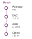{width="100%" fig-alt="Vertical reach ladder with four marked levels: package at millimeters, DAC at 1 to 3 meters, AOC at 3 to 30 meters, and optics beyond 30 meters."}

*Each extra meter pushes the fabric from copper toward optics.*
:::

Optical interconnects attack the power-per-bit and reach terms that copper makes worse as data rates increase. Each doubling of the per-lane signaling rate, from the 100 Gb/s-class lanes of current NDR and 800G Ethernet ports to the 200 Gb/s class now arriving, raises the insertion loss per meter of passive copper. The usable reach shrinks, as the link-budget example in @sec-network-fabrics-serdes showed, and the SerDes must spend more energy per bit on equalization to recover the signal. Active electrical cables, which add retimer chips to regenerate the signal mid-cable, extend that reach but add latency and power of their own.

Co-packaged optics (CPO)\index{Co-packaged optics!architecture}\index{Optical interconnect!co-packaged optics}\index{CPO|see{Co-packaged optics}} places optical engines close to the switch or accelerator on a shared package substrate. Shortening the electrical path to the optical engine reduces the signal-conditioning burden before transmission over fiber. The receiving optical engine converts the signal back to electrical form. Fiber still introduces propagation delay and has a loss budget; packaging the optics closer to the processor does not remove those constraints.

Co-packaged optics\index{Co-packaged optics!link budget effects} therefore changes the electrical portion of the link budget while retaining the reach advantages of optical transmission. Usable reach still depends on the fiber, connectors, optical power, and receiver design. The relevant comparison holds payload capacity and error targets fixed, then measures the power saved by the shorter electrical path against the packaging and maintenance costs of integration.

A quick estimate makes the power dividend concrete.

```{python}
#| echo: false
#| label: optical-dividend-calc
from mlsysim.fmt import check, fmt, fmt_bandwidth, fmt_int, fmt_power

class OpticalDividend:
    """Power savings from Co-Packaged Optics (CPO)."""

    # ┌── 1. LOAD ──────────────────────────────────────────
    SWITCH_ASIC_51T2_BW = Systems.SwitchFabric.SwitchAsic51T2
    ETHERNET_400G_BW = Systems.Fabrics.Ethernet_400G.bandwidth
    OPTICS_POWER_PLUGGABLE_400G_W = Systems.SwitchFabric.OpticsPluggable400G
    OPTICS_POWER_CPO_400G_W = Systems.SwitchFabric.OpticsCpo400G
    n_ports = int((SWITCH_ASIC_51T2_BW / ETHERNET_400G_BW).to_base_units().magnitude)  # 51.2 Tb/s switch
    n_switches = 1000  # scenario assumption: large-cluster switch count
    # ┌── 2. EXECUTE ───────────────────────────────────────
    total_pluggable = n_ports * OPTICS_POWER_PLUGGABLE_400G_W
    total_cpo = n_ports * OPTICS_POWER_CPO_400G_W
    savings = total_pluggable - total_cpo
    cluster_pluggable = total_pluggable * n_switches
    cluster_savings = savings * n_switches
    equivalent_h100_gpus = (cluster_savings / Hardware.Cloud.H100.tdp).to_base_units().magnitude
    # ┌── 3. GUARD ─────────────────────────────────────────
    check(savings == 1.28 * kilowatt, f"Savings {savings.to(kW).magnitude:.2f}kW unexpected")

    @classmethod
    def plot(cls):
        """Visualizes the Optical Dividend."""
        from binder.tools.figures import style as book_style

        return book_style.bar_compare(
            labels=["Pluggable", "CPO"],
            values=[cls.total_pluggable.to(kilowatt).magnitude, cls.total_cpo.to(kilowatt).magnitude],
            title="Optical Power Dividend",
            ylabel="Total Optics Power (kW)",
        )

    # ┌── 4. OUTPUT ────────────────────────────────────────
    n_ports_str = fmt(n_ports, precision=0, commas=False)
    switch_capacity_tbit_per_s_str = fmt_bandwidth(SWITCH_ASIC_51T2_BW, unit=terabit / second, precision=1, commas=False)
    p_pluggable_w_str = fmt_power(OPTICS_POWER_PLUGGABLE_400G_W, unit=watt, precision=0, commas=False)
    p_cpo_w_str = fmt_power(OPTICS_POWER_CPO_400G_W, unit=watt, precision=0, commas=False)
    savings_kw_str = fmt_power(savings, unit=kilowatt, precision=2, commas=False)
    total_pluggable_kw_str = fmt_power(total_pluggable, unit=kilowatt, precision=2, commas=False)
    total_cpo_kw_str = fmt_power(total_cpo, unit=kilowatt, precision=2, commas=False)
    n_switches_str = fmt(n_switches, precision=0)
    cluster_pluggable_mw_str = fmt_power(cluster_pluggable, unit=MW, precision=2, commas=False)
    cluster_savings_mw_str = fmt_power(cluster_savings, unit=MW, precision=2, commas=False)
    equivalent_h100_gpus_str = fmt_int(round(equivalent_h100_gpus / 100) * 100)
```

::: {#nbk-network-fabrics-napkin-math-optical-dividend .callout-notebook title="The optical dividend"}

**Problem**: Calculate the power savings of moving a `{python} OpticalDividend.switch_capacity_tbit_per_s_str` switch from pluggable transceivers to co-packaged optics.

1. **Pluggable architecture**\index{Pluggable optics!power cost}: `{python} OpticalDividend.n_ports_str` ports $\times$ `{python} OpticalDividend.p_pluggable_w_str` = `{python} OpticalDividend.total_pluggable_kw_str` for optics alone.
2. **CPO architecture**\index{Co-packaged optics!power savings}: `{python} OpticalDividend.n_ports_str` engines $\times$ `{python} OpticalDividend.p_cpo_w_str` = `{python} OpticalDividend.total_cpo_kw_str`.
3. **Savings**: The savings reach `{python} OpticalDividend.savings_kw_str` of power per switch.

**Systems insight**: Across `{python} OpticalDividend.n_switches_str` switches, the assumed pluggable modules consume `{python} OpticalDividend.cluster_pluggable_mw_str`. The modeled CPO configuration saves `{python} OpticalDividend.cluster_savings_mw_str`, equivalent to the reference power budget of roughly `{python} OpticalDividend.equivalent_h100_gpus_str` H100 GPUs. That equivalence measures the scale of the saving; using it for additional accelerators also requires compute capacity, power delivery, and cooling in the right locations. Optics power constrains both operating cost and the equipment a facility can support.

:::

The spine example for `{python} SpineOpticsCost.cluster_gpus_str` assigns `{python} SpineOpticsCost.total_power_kw_str` to pluggable optics. Applying the same fractional saving would require a CPO implementation with the assumed per-link power and capacity. Integration also changes serviceability: replacing a failed optical component may involve a larger assembly than swapping a pluggable module. The energy benefit must be evaluated alongside packaging, repair, and spare-capacity costs.

For ML infrastructure, CPO\index{Co-packaged optics!bandwidth hierarchy flattening} could flatten the bandwidth hierarchy by narrowing the gap between intra-node and inter-node bandwidth. If inter-node links achieve bandwidth comparable to NVLink-class local fabrics (hundreds of GB/s per GPU), the bandwidth penalty for extending tensor parallelism beyond a single node would shrink. Cross-node tensor parallelism would then become economical for more workloads, provided that startup latency and collective frequency also fit the step-time budget.

However, CPO\index{Co-packaged optics!thermal sensitivity} introduces new challenges. Optical components are sensitive to temperature (laser wavelength shifts with temperature, requiring active thermal management), and integrating photonics on the same package as a 1,000 W GPU creates a hostile thermal environment for the optical components. The manufacturing processes for silicon photonics and CMOS transistors are similar but not identical, requiring separate fabrication steps that increase package cost and complexity. These challenges are being addressed through hybrid integration approaches where the photonics chiplet is placed on a cooler region of the package substrate, thermally isolated from the GPU die.

### Disaggregated and composable architectures {#sec-network-fabrics-disaggregated}

A fixed node configuration can leave compute or memory underused when workloads need different resource ratios. Compute Express Link (CXL) memory pooling allows supported hosts to access assigned memory capacity through a CXL path, while disaggregated designs\index{Architecture!disaggregated} make some resource allocations independent of the chassis boundary. This changes which links lie on the workload's critical path. It does not merge CXL memory access, NVLink communication, and InfiniBand transport into one interchangeable service; each path retains its own supported operations, bandwidth, and latency.

::: {.column-margin .margin-pointer}
↩ CXL memory pooling, which makes node memory capacity less rigid but remains a capacity tier rather than a high-bandwidth memory (HBM) replacement, is established in @sec-compute-cxl.
:::

A composed node therefore needs a new traffic budget. The $\alpha$-$\beta$ distinction between startup and transfer cost remains useful, but each path requires its own parameters and access model. Remote memory traffic can compete with other transfers, and fine-grained dependent accesses can expose latency that a bulk-bandwidth estimate hides. Disaggregation improves resource flexibility only when these added costs fit the workload's execution budget.

## Fallacies and Pitfalls {#sec-network-fabrics-fallacies}

Designing and operating high-performance fabrics for ML requires unlearning assumptions from traditional data-center networking. The following fallacies and pitfalls capture the most common errors that stall training and degrade cluster productivity.

```{python}
#| echo: false
# ┌── LEGO ───────────────────────────────────────────────
# │ Context: Bandwidth fallacy — HDR vs NDR line rates.
from mlsysim import Systems
from mlsysim.core.units import Gbps
from mlsysim.fmt import check, fmt, fmt_bandwidth

class IbBandwidthFallaciesRecap:
    hdr_bw = Systems.Fabrics.InfiniBand_HDR.bandwidth
    ndr_bw = Systems.Fabrics.InfiniBand_NDR.bandwidth
    check(round(hdr_bw.to(Gbps).magnitude) == 200, "HDR bandwidth should be 200 Gb/s")
    check(round(ndr_bw.to(Gbps).magnitude) == 400, "NDR bandwidth should be 400 Gb/s")

    # ┌── 4. OUTPUT (Formatting) ──────────────────────────────────────────────
    ib_hdr_gbit_per_s_str = fmt_bandwidth(hdr_bw, unit=Gbps, precision=0, commas=False)
    ib_ndr_gbit_per_s_str = fmt_bandwidth(ndr_bw, unit=Gbps, precision=0, commas=False)
```

::: {.fallacy-pitfall}

**Fallacy**: *More bandwidth always means faster training.*

Engineers assume upgrading from HDR (`{python} IbBandwidthFallaciesRecap.ib_hdr_gbit_per_s_str`) to NDR (`{python} IbBandwidthFallaciesRecap.ib_ndr_gbit_per_s_str`) will yield proportional gains, but the $\alpha$-$\beta$ model (@sec-network-fabrics-performance-model) reveals this is only true in the bandwidth-dominated regime. For small models or the small-message phases of pipeline parallelism, the startup term $\alpha$ (`{python} NetworkAlphaBeta.ib_alpha_us_str` in this chapter's NDR scenario, including NIC processing, switch hops, and FEC) dictates performance. If a workload is latency-bound, a 2$\times$ bandwidth increase may deliver only a small fraction of the line-rate gain while adding substantial power and transceiver cost.

```{python}
#| echo: false
#| label: bandwidth-fallacy
# ┌─────────────────────────────────────────────────────────────────────────────
# │ BANDWIDTH FALLACY
# ├─────────────────────────────────────────────────────────────────────────────
# │ Context: Fallacy "More bandwidth always means faster training"
# │
# │ Goal: Show diminishing returns of BW in the latency-dominated regime.
# │ Show: That a 2x BW increase yields minimal gain for small messages.
# │ How: Calculate T(n) for HDR vs NDR for 10 KB message.
# │
# └─────────────────────────────────────────────────────────────────────────────
from mlsysim.fmt import check, fmt, fmt_bandwidth, fmt_memory

# ┌── LEGO ───────────────────────────────────────────────
class BandwidthFallacy:
    """
    Scenario: Latency comparison for small messages across HDR vs NDR.
    Illustrates why doubling bandwidth does not halve latency for small packets.
    """

    # ┌── 1. LOAD (Constants) ───────────────────────────────────────────────
    from mlsysim import Hardware

    ib_hdr = Systems.Fabrics.InfiniBand_HDR
    ib_ndr = Systems.Fabrics.InfiniBand_NDR
    FABRIC_ALPHA_NDR = Systems.SwitchFabric.AlphaNdr
    alpha = FABRIC_ALPHA_NDR
    msg = 10 * KB  # scenario assumption: small control packet

    # ┌── 2. EXECUTE (The Compute) ─────────────────────────────────────────
    # T(n) = alpha + n/beta, computed via pint to keep units explicit.
    t_hdr = calc_point_to_point_time(msg, alpha, ib_hdr.bandwidth)
    t_ndr = calc_point_to_point_time(msg, alpha, ib_ndr.bandwidth)

    speedup_pct = (1 - (t_ndr / t_hdr).to_base_units().magnitude) * 100

    # ┌── 3. GUARD (Invariants) ───────────────────────────────────────────
    from mlsysim.fmt import check

    check(speedup_pct < 25, f"Speedup ({speedup_pct:.1f}%) too high; fallacy argument weakened.")

    # ┌── 4. OUTPUT (Formatting) ──────────────────────────────────────────────
    from mlsysim.fmt import fmt, fmt_bandwidth, fmt_time

    msg_kb_str = fmt_memory(msg, unit=KB, precision=0, commas=False)
    hdr_bw_gbit_per_s_str = fmt_bandwidth(ib_hdr.bandwidth, unit=Gbps, precision=0, commas=False)
    ndr_bw_gbit_per_s_str = fmt_bandwidth(ib_ndr.bandwidth, unit=Gbps, precision=0, commas=False)
    t_hdr_us_str = fmt_time(t_hdr, microsecond, precision=2, commas=False)
    t_ndr_us_str = fmt_time(t_ndr, microsecond, precision=2, commas=False)
    speed_pct_str = fmt_percent(speedup_pct / 100, precision=1, commas=False, style='prose')
```

Consider a `{python} BandwidthFallacy.msg_kb_str` message (typical for control synchronization). On `{python} BandwidthFallacy.hdr_bw_gbit_per_s_str` InfiniBand, it takes `{python} BandwidthFallacy.t_hdr_us_str`. Upgrading to `{python} BandwidthFallacy.ndr_bw_gbit_per_s_str` reduces this to `{python} BandwidthFallacy.t_ndr_us_str`, a `{python} BandwidthFallacy.speed_pct_str` improvement despite doubling the link rate.

:::

::: {.fallacy-pitfall}

**Pitfall**: *Treating InfiniBand as merely fast Ethernet.*

Procurement teams compare InfiniBand and high-speed Ethernet on link rate alone and conclude they are equivalent at the same Gb/s. The relevant comparison is between complete transport stacks, not between InfiniBand and TCP. InfiniBand provides kernel-bypass RDMA over a credit-based fabric; RoCE also provides kernel-bypass RDMA, but carries it over Ethernet and places more of the reliable-delivery, congestion-control, and routing contract in NIC behavior and fabric configuration. PFC and ECN are common parts of that contract, though PFC-free RoCE designs choose a different loss-recovery balance [@mittal2018irn]. Conventional kernel TCP is a third design point with different CPU and recovery costs. The architecture decision therefore determines where flow-control state and operational risk reside, even when nominal link rates match.

:::

::: {.fallacy-pitfall}

**Fallacy**: *Lossless Ethernet is as reliable as InfiniBand.*

RoCE over Ethernet can achieve throughput comparable to InfiniBand for large transfers, but lossless operation depends on the configuration and interaction of PFC, ECN, routing, buffers, and NIC behavior (@sec-network-fabrics-pfc). A forwarding loop, cyclic buffer dependency, or firmware defect can trigger a PFC storm\index{PFC storm!cascading pause}, where PAUSE frames spread beyond the original queue. InfiniBand's per-hop credit mechanism avoids this specific reactive PAUSE-frame cascade, but the fabric still requires deadlock-free routing, sound virtual-lane configuration, and congestion management [@infiniband2000spec]. Both fabrics require validation and telemetry; RoCE adds particular sensitivity to the configuration of Ethernet losslessness.

```{python}
#| echo: false
# ┌── LEGO ───────────────────────────────────────────────
# │ Context: Fallacies — bisection waste recap.
class BisectionWasteRecap:
    num_gpus = Systems.Clusters.Training_1K.total_accelerators
    # Same anchors as BisectionScaling (@sec-network-fabrics-fat-tree).
    oversub_ratio_b = Systems.Fabrics.InfiniBand_NDR_Oversub4to1.oversubscription_ratio
    cluster_cost = ReferenceStats.NetworkEconomicsProfile.ClusterCapex
    comm_fraction = ReferenceStats.NetworkEconomicsProfile.CommunicationFraction
    rel_throughput, throughput_loss = calc_oversubscription_effect(comm_fraction, oversub_ratio_b)
    waste_val = throughput_loss * cluster_cost
    check(waste_val == BisectionScaling.waste, "Fallacy recap must match the bisection-bottleneck notebook")
    # ┌── 4. OUTPUT (Formatting) ──────────────────────────────────────────────
    oversub_ratio_b_value_str = fmt(oversub_ratio_b, precision=0, commas=False)
    oversub_ratio_b_mult_str = fmt_multiple(oversub_ratio_b, precision=0, commas=False)
    cluster_cost_m_str = fmt_usd(cluster_cost, precision=0, commas=False, scale="M")
    comm_fraction_pct_str = fmt_percent(comm_fraction, precision=0, commas=False, style="prose")
    waste_m_str = fmt_usd(waste_val, precision=1, commas=False, scale="M")
```

:::

::: {.fallacy-pitfall}

**Pitfall**: *Accepting data-center oversubscription ratios for synchronous training.*

Oversubscription relies on the traffic crossing a shared boundary fitting its available capacity. Bulk-synchronous training can violate that assumption with coordinated bursts. In the cut-saturating scenario of @sec-network-fabrics-fat-tree, `{python} BisectionWasteRecap.oversub_ratio_b_value_str`:1 oversubscription increases the modeled communication bound by `{python} BisectionWasteRecap.oversub_ratio_b_mult_str`. Applied to a `{python} BisectionWasteRecap.cluster_cost_m_str` cluster with the assumed `{python} BisectionWasteRecap.comm_fraction_pct_str` communication fraction, the resulting idle-capacity estimate exceeds `{python} BisectionWasteRecap.waste_m_str`. This is an equivalent-capacity comparison under the stated schedule, not an equipment loss or a universal penalty for every collective.

:::

::: {.fallacy-pitfall}

**Fallacy**: *TCP bandwidth tests are sufficient for ML fabric validation.*

Standard benchmarks like `iperf` measure kernel-based TCP/IP performance. TCP throughput depends on host processing, offloads, and tuning as well as wire speed; it has no fixed throughput ceiling independent of that configuration. An RDMA training job exercises a different data path, so a low TCP result does not establish that the RDMA path is slow, and a high TCP result does not validate collective performance. Validation protocols must use RDMA-specific tools from the `perftest` suite to match the workload's data path.

:::

::: {.fallacy-pitfall}

**Pitfall**: *Relying on adaptive routing instead of topology-aware placement.*

Adaptive routing can distribute traffic across available paths, but it cannot increase their total capacity. For a 1,024-GPU job spanning two oversubscribed spine groups, the group-to-group links become limiting when the collective sends more crossing traffic than those links can carry within its time budget. Placement can reduce that traffic, and routing can reduce path imbalance. Both must be evaluated against the actual collective schedule.

:::

::: {.column-margin .margin-pointer}
↪ Topology-aware gang placement that keeps collective traffic off contended cross-rack paths is operationalized in @sec-fleet-orchestration-placement-algorithms.
:::

::: {.fallacy-pitfall}

**Fallacy**: *Network fabric problems always appear as hard failures.*

Network performance issues in ML clusters often manifest as subtle training slowdowns rather than errors. A 10 percent reduction in throughput due to intermittent congestion can waste thousands of GPU-hours before being noticed, because jobs continue to run while gradients arrive late.

:::

::: {.fallacy-pitfall}

**Pitfall**: *Treating PFC and ECN counters as optional production details.*

Discard counters and PFC pause durations should be correlated with collective completion time and the affected paths. Rising values can reveal queue pressure or recovery activity, but they do not establish a failing transceiver or predict an inevitable job failure. Physical error counters, traffic load, routing, and configured watchdog actions help distinguish the causes and select a response.

:::

## Summary {#sec-network-fabrics-summary}

The five-tier hierarchy structured in @fig-network-five-level-model bridges physical reach, transport primitives, switch topologies, congestion dynamics, and cluster orchestration into a single system contract. A fabric must provide both enough capacity for the workload's traffic and predictable completion at its synchronization boundaries. InfiniBand and RoCE distribute this responsibility differently across links, endpoints, and operational policy; the production cases show why neither port rate nor protocol name determines delivered performance.

Three numerical anchors show how to apply the model. The reference aggregate NVLink budget exceeds one external port's per-direction bandwidth by `{python} NetworkFabricsContextScenario.nvlink_to_ib_ratio_mult_str`; the modeled NDR path has equal startup and transmission costs near `{python} NetworkAlphaBeta.n_cross_ib_kb_str`; and the 4:1 oversubscribed cut increases the fixed-payload transfer bound by `{python} BisectionDefinitionExample.slowdown_mult_str`. Each result depends on its stated configuration and traffic assumptions. In the Fleet Law, transfer time contributes to $T_{\text{comm}}$ and residual synchronization waiting to $T_{\text{sync}}$; consistent timeline accounting prevents counting one delay in both. The communication and coordination axes of C³ meet where those dependencies determine useful compute progress.

The same model guides design and diagnosis. Message sizes determine whether startup latency or bandwidth dominates; communication patterns determine which paths must carry that traffic. During operation, application throughput, transport counters, and physical telemetry distinguish inadequate capacity from contention or a degraded component. These measurements also test whether a proposed optical or composable architecture removes the binding constraint or merely moves it.

::: {.callout-takeaways title="The fabric decides useful compute"}

* **Link speed is not fabric speed**: For traffic that crosses a fabric cut, available capacity bounds transfer time (principle \ref{pri-bisection-bandwidth}). Workload placement and collective schedules determine how much data must cross, so advertised port speed alone cannot predict useful training throughput.
* **Latency and bandwidth bind differently**: The $\alpha$-$\beta$ model of @sec-network-fabrics-performance-model separates startup cost from per-byte transfer cost, with $\CrossoverPoint = \alpha \cdot \beta$ marking the regime change. Message-size distributions, not vendor peak numbers, determine whether to optimize software latency or hardware bandwidth.
* **Reliable delivery moves the risk**: RDMA transports need reliable completion and bounded recovery, not one universal lossless-fabric mechanism. InfiniBand normally suppresses loss with link-level credits; many RoCE deployments use PFC and ECN, while PFC-free designs place more recovery responsibility at the endpoints. Each choice trades hardware flexibility against tail latency and operational complexity.
* **Topology must match traffic**: Fat-trees buy flexible bisection bandwidth, rail-optimized designs accelerate same-rank AllReduce, and dragonfly or torus designs trade cabling and locality differently. The right fabric depends on whether the workload stresses AllReduce, AllToAll, or multi-tenant sharing.
* **Telemetry saves GPU-hours**: PFC counters, link error rates, bandwidth baselines, and application throughput must be correlated across layers. Without that observability, a degraded transceiver or congestion storm silently converts a high-end fleet into a queue of waiting accelerators.

:::

At fleet scale, the interconnect is part of the computer. Its value lies in how much useful computation it allows the participating accelerators to complete together. A fabric decision therefore has to be judged against the workload's communication pattern and synchronization schedule, because additional capacity helps only where those dependencies expose a communication limit.

::: {.callout-chapter-connection title="From wires to data pipelines"}

The network fabric now binds isolated compute nodes into a cohesive fleet, carrying high-speed gradient exchanges and activation tensors across non-blocking switches. Even a perfectly provisioned, congestion-free fabric cannot train models if accelerators are starved for training data or if multi-terabyte checkpoints cannot be saved before the next hardware failure. Sustaining that compute engine requires distributed storage hierarchies and I/O pipelines that ingest petabytes of training data and persist model state without stalling accelerators.

:::

::: {.column-margin .margin-pointer}
↪ Parallel storage systems and high-throughput data-loading pipelines are developed in @sec-data-storage.
:::

::: { .quiz-end }
:::
