# Data Storage {#sec-data-storage}

::: {layout-narrow}
::: {.column-margin}

\chapterminitoc

:::

::: {.content-visible when-format="pdf"}
\noindent
{fig-alt="Fleet storage fuel-line hierarchy where data moves from object storage through NVMe, DRAM, and HBM tiers into accelerator workers."}
:::

::: {.content-visible unless-format="pdf"}
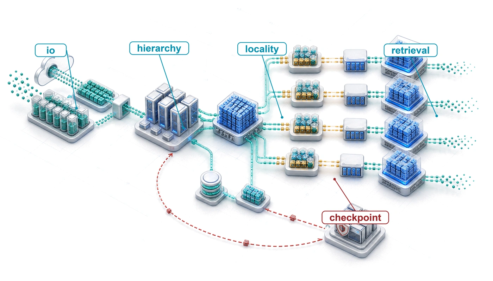{fig-alt="Fleet storage fuel-line hierarchy where data moves from object storage through NVMe, DRAM, and HBM tiers into accelerator workers."}
:::

:::

## Purpose {.unnumbered .unlisted}

::: {.content-visible when-format="pdf"}
\begin{marginfigure}
\mlfleetstack{30}{100}{35}{25}{20}{15}{0}{0}
\end{marginfigure}
:::

::: {.content-visible unless-format="pdf"}
::: {.column-margin}
{width="100%" fig-alt="Fleet Machine Learning Systems Stack"}

*Fleet stack focus for this chapter.*
:::
:::

_Why does storage become the invisible bottleneck that prevents accelerators from reaching their potential?_

A training job can leave expensive accelerators idle even when its models fit in memory and its network has ample capacity, because the next batch must arrive before computation needs it and a saved checkpoint must remain usable when a worker fails. Storage becomes an invisible bottleneck whenever accelerator benchmarks begin with data already in place, excluding the work needed to deliver inputs and preserve results. A pipeline that keeps one machine busy can stall once many workers compete for the same data source. A burst of checkpoint writes from one job can delay input reads for others, which turns a local pause into lost progress across the fleet. Adding compute increases demand without expanding the shared system's ability to serve it. How severely that contention hurts depends on the workload: compact training inputs may be easy to deliver even when saving model state dominates storage traffic, whereas larger samples can make continuous input delivery the limiting factor. Bringing data closer to the accelerator reduces those delivery delays, though it adds staging traffic, capacity cost, and the obligation to preserve complete versions, since a fast local save provides little protection if the only copy disappears with the failed machine. Storage decisions therefore govern both how quickly the fleet advances and how much of that progress survives disruption. In C³ terms, storage design coordinates data movement and durable state so that available compute produces recoverable progress.

::: {.content-visible when-format="pdf"}

\newpage

:::

::: {.callout-learning-objectives}

- Compare storage demands of full-corpus training, checkpoint writes, and model serving across local and shared tiers
- Calculate input bandwidth and mean cache service time from workload demand and tier behavior
- Design shard packaging, prefetching, locality, and direct-storage paths that keep fleet accelerators fed when small files or slow tiers would starve them
- Select checkpoint staging and replication strategies that balance pause time, recovery risk, and storage cost
- Specify storage commit and replay contracts that preserve correctness when distributed pipeline stages fail, including the provenance that generated training data must retain
- Analyze serving-time storage workloads, from bulk model loads and rollout bursts to retrieval indexes bound by random-access IOPS
- Evaluate staging and tiering choices by total delivery cost, including transfer fees and idle accelerators

:::

## The Fuel Line {#sec-storage-fuel-line}

```{python}
#| echo: false
from mlsysim import *
from mlsysim.core.units import *

# ┌─────────────────────────────────────────────────────────────────────────────
# │ CHAPTER START
# ├─────────────────────────────────────────────────────────────────────────────
# │ Context: Chapter initialization and global imports
# │
# │ Why: Registers this chapter with the mlsys registry and provides shared
# │      imports for all subsequent calculation cells.
# │
# └─────────────────────────────────────────────────────────────────────────────
from mlsysim.physics import memory_from_params
from mlsysim.fmt import MarkdownStr, check, fmt, fmt_bandwidth, fmt_int, fmt_memory, fmt_qty_int

# Resumable mixed-precision Adam checkpoint contract used throughout this chapter:
# FP16 model weights + FP32 master weights + two FP32 Adam moments. Gradients are
# recomputed after restore and are therefore excluded; scheduler/RNG/data-loader
# metadata is negligible at this scale.
CHECKPOINT_RESUME_BYTES_PER_PARAM = ReferenceStats.StorageTrainingCorpus.CheckpointBytesPerParameter
check(
    abs(CHECKPOINT_RESUME_BYTES_PER_PARAM.to(byte / param).magnitude - 14) < 1e-9,
    "Resumable Adam checkpoint contract must remain 14 bytes per parameter",
)
check(
    CHECKPOINT_RESUME_BYTES_PER_PARAM == BYTES_FP16 + BYTES_FP32 + BYTES_ADAM_STATE,
    "Checkpoint registry value must equal FP16 weights + FP32 master weights + two FP32 Adam moments",
)
```

```{python}
#| echo: false
#| label: storage-fuel-line-calc
# ┌─────────────────────────────────────────────────────────────────────────────
# │ STORAGE-COMPUTE GAP, DATASET FOOTPRINT, AND CHECKPOINT SCALE (LEGO)
# ├─────────────────────────────────────────────────────────────────────────────
# │ Context: @sec-storage-fuel-line—opening quantitative framing of the
# │          HBM-vs-NVMe bandwidth gap and checkpoint data volume.
# │
# │ Goal:    Quantify the ~500x gap between HBM and NVMe, the compressed vs.
# │          tokenized corpus footprint, and the PB-scale checkpoint volume for
# │          a 30-day 175B training run.
# │ Show:    3.35 TB/s HBM, 7 GB/s NVMe, ~479x ratio, ~2,450 GB checkpoint,
# │          3 TB compressed corpus, 6 TB tokenized corpus, ~10.6 PB total
# │          checkpoint writes.
# │ How:     Read H100 HBM BW and NVMe BW from constants; compute checkpoint
# │          size from GPT-3 params × bytes per param; compute corpus variants
# │          from tokens × bytes/token; derive fleet total.
# │
# └─────────────────────────────────────────────────────────────────────────────
from mlsysim import Hardware, Models
from mlsysim.physics import model_memory
from mlsysim.fmt import MarkdownStr, check, fmt, fmt_bandwidth, fmt_int, fmt_memory

# ┌── LEGO ───────────────────────────────────────────────
class StorageFuelLineContext:
    h_h100 = Hardware.Cloud.H100
    m_gpt3 = Models.Language.GPT3
    h100_bw = h_h100.memory.bandwidth
    nvme_bw_raw = Hardware.Cloud.H100.storage.bandwidth
    gpt3_params = m_gpt3.parameters
    training_tokens = ReferenceStats.StorageTrainingCorpus.TrainingTokens
    compressed_text = ReferenceStats.StorageTrainingCorpus.CompressedSource
    token_id_bytes = ReferenceStats.StorageTrainingCorpus.TokenIdBytes
    training_window = ReferenceStats.StorageTrainingCorpus.TrainingWindow
    checkpoint_interval = ReferenceStats.StorageTrainingCorpus.CheckpointInterval
    bytes_per_param_ckpt = CHECKPOINT_RESUME_BYTES_PER_PARAM
    bw_ratio_val = (h100_bw / nvme_bw_raw).to("").magnitude
    footprint = Scenarios.Gpt3StorageFootprint.result
    ckpt_total = footprint.checkpoint_bytes
    checkpoint_count_val = footprint.saves
    ckpt_fleet_total = footprint.checkpoint_bytes_written
    tokenized_text = training_tokens * token_id_bytes
    baseline_training = compressed_text + tokenized_text
    check(ckpt_total.to(GB).magnitude > 1000, "175B checkpoint must be > 1 TB")
    check(checkpoint_count_val == 4320, "30 days at 10-min checkpoint interval should be 4320")
    # Running cluster: 256 DGX H100 nodes, deliberately twice the 1,024-GPU reference.
    run_cluster = Systems.Clusters.Production_2K
    ref_scenario = Scenarios.DenseLLMPretrainingReference
    run_accels = run_cluster.total_accelerators
    run_nodes = run_cluster.count
    ref_accels = ref_scenario.system.total_accelerators
    ref_nodes = ref_scenario.system.count
    step_time = ReferenceStats.StorageTrainingCorpus.StepTime
    training_state_bpp = ReferenceStats.MixedPrecisionAdam.TrainingStateBytesPerParameter
    gradient_bpp = training_state_bpp - bytes_per_param_ckpt
    check(run_accels == 2 * ref_accels, "Running cluster is described as twice the reference cluster")
    check(
        abs(gradient_bpp.to(byte / param).magnitude - BYTES_FP16.to(byte).magnitude) < 1e-9,
        "Training state minus checkpoint must equal the FP16 gradient",
    )

    # ┌── 4. OUTPUT ───────────────────────────────────────
    run_accels_str = fmt_count(run_accels, commas=True)
    run_nodes_str = fmt_count(run_nodes, commas=True)
    ref_accels_str = fmt_count(ref_accels, commas=True)
    ref_nodes_str = fmt_count(ref_nodes, commas=True)
    training_tokens_str = fmt_tokens(training_tokens, scale="trillion", scale_style="word", precision=1, commas=False)
    step_time_ms_str = fmt_time(step_time, millisecond, precision=0, commas=False)
    ckpt_bpp_str = fmt_int(bytes_per_param_ckpt.to(byte / param).magnitude)
    training_state_bpp_str = fmt_int(training_state_bpp.to(byte / param).magnitude)
    gradient_bpp_str = fmt_int(gradient_bpp.to(byte / param).magnitude)
    checkpoint_interval_str = fmt_time(checkpoint_interval, minute, precision=0, commas=False, style="word")
    checkpoint_interval_attr_str = fmt_time(checkpoint_interval, minute, precision=0, commas=False, style="word", attributive=True)
    training_window_attr_str = fmt_time(training_window, day, precision=0, commas=False, style="word", attributive=True)
    training_window_days_str = fmt_time(training_window, day, precision=0, commas=False, style="word")
    h100_bw_tb_per_s_str = fmt_bandwidth(h100_bw, unit=TB / second, precision=2, commas=False)
    nvme_bw_gb_per_s_str = fmt_bandwidth(nvme_bw_raw, unit=GB / second, precision=0, commas=False)
    bw_ratio_mult_str = fmt_multiple(round(bw_ratio_val), precision=0, commas=True)
    compressed_text_tb_str = fmt_memory(compressed_text, unit=TB, precision=0, commas=False)
    tokenized_text_tb_str = fmt_memory(tokenized_text, unit=TB, precision=0, commas=False)
    baseline_training_tb_str = fmt_memory(baseline_training, unit=TB, precision=0, commas=False)
    ckpt_total_gb_str = fmt_memory(ckpt_total, unit=GB, precision=0, commas=True)
    ckpt_fleet_total_pb_str = fmt_memory(ckpt_fleet_total, unit=PB, precision=1, commas=True)
```

The dense accelerator nodes of @sec-compute-infrastructure pack eight GPUs delivering petaFLOP/s of aggregate compute, and the InfiniBand fabrics of @sec-network-fabrics connect thousands of such nodes at hundreds of gigabits per second. Within the multi-tier fleet stack of @fig-fleet-stack, data storage completes that physical foundation, staging training data, model weights, optimizer state, and intermediate checkpoints at the right distance from the accelerator. An engine without fuel is expensive sculpture. The engineering question is how to deliver that fuel fast enough that the accelerators of a training cluster never starve. The running cluster for that question is `{python} StorageFuelLineContext.run_nodes_str` eight-GPU nodes, `{python} StorageFuelLineContext.run_accels_str` accelerators in all, deliberately twice the `{python} StorageFuelLineContext.ref_accels_str`-GPU (`{python} StorageFuelLineContext.ref_nodes_str`-node) reference cluster used elsewhere in this book, because the larger fleet makes the pressure on shared storage easier to see. Every worked number for the 175B job uses this running cluster; a side scenario with a different workload or fleet size names its own scale where it appears.

::: {.column-margin}
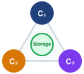{width="100%" fig-alt="C³ taxonomy triangle with vertices C1 (Compute), C2 (Communication), and C3 (Coordination), with the center Storage hub connecting all three axes."}

*Storage is the physical substrate spanning Compute ($\OperationalTaxonomyDimension_1$), Communication ($\OperationalTaxonomyDimension_2$), and Coordination ($\OperationalTaxonomyDimension_3$).*
:::

Consider the running example for the storage analysis, an instance of Archetype A (GPT-4/Llama-3). A 175-billion parameter language model trains on `{python} StorageFuelLineContext.training_tokens_str` tokens of text: roughly `{python} StorageFuelLineContext.compressed_text_tb_str` in compressed source form, or `{python} StorageFuelLineContext.tokenized_text_tb_str` once represented as 4-byte token IDs. That token budget is set upstream of storage. Under the compute-optimal scaling results of @sec-vol2-intro-ai-scaling-laws-a043, the training-token count grows in proportion to parameter count, so each step up the model-size curve enlarges both the corpus the fleet must hold and the bytes each epoch must read. This corpus already sits below the compute-optimal allocation for a 175B-parameter model, so a compute-optimal run would raise both figures further. The run makes a single pass (one epoch) over this corpus, reading every selected token once in an order determined by the shuffle seed. No small "hot" subset dominates access. Meanwhile, each accelerator processes its local batch in roughly `{python} StorageFuelLineContext.step_time_ms_str`, then waits for the next. If storage cannot deliver data within that `{python} StorageFuelLineContext.step_time_ms_str` window, the accelerator sits idle, and the organization pays for silicon that produces heat instead of gradients.

The problem is deceptive because storage technology has improved substantially. Non-Volatile Memory Express (NVMe) drives achieve `{python} StorageFuelLineContext.nvme_bw_gb_per_s_str` of sequential throughput, a figure that would have seemed out of reach a decade ago. An H100 moves data internally through high-bandwidth memory (HBM) at `{python} StorageFuelLineContext.h100_bw_tb_per_s_str`, roughly `{python} StorageFuelLineContext.bw_ratio_mult_str` the sequential bandwidth of a single NVMe drive. This ratio contrasts two tiers; it is not the rate at which storage must supply training inputs, because HBM bandwidth also carries repeated weight, activation, and tensor traffic during computation. The storage feed requirement is instead determined by the input-batch bytes each accelerator needs per iteration. Dividing those bytes by the compute window gives one worker's required delivery rate; summing across workers gives the fleet demand. That rate must be evaluated at each tier using the representation stored there, since compressed inputs and decoded tensors occupy different numbers of bytes. A hierarchy becomes useful when the durable source cannot meet that rate or its latency varies enough to interrupt computation. Faster tiers stage upcoming batches while the durable tier supplies capacity and preserves the source data.

The storage problem joins physics with economics. Physics favors the memory closest to the accelerator, which offers the highest bandwidth in the smallest capacity; economics favors shared storage, which pools far more capacity at lower cost per byte behind additional interfaces and service queues. Device technology, interconnects, and contention then determine the rate a particular consumer actually receives. The engineering task is to place and move data so that the accelerator receives each batch before it is needed. The resulting design problem is quantitative. It asks how fast each tier must be, how deep the pipeline must run, and which bytes are worth keeping close to the accelerator. Improving arithmetic throughput alone does not improve input delivery or checkpoint persistence. Those paths require their own bandwidth and latency budgets.

::: {.column-margin}
{width="100%" fig-alt="Two horizontal bars on a log scale: a long blue bar for 10.6 PB of checkpoint writes over the run above a short bar for one 6 TB epoch of training data, showing checkpoints move over a thousand times more bytes."}

*Over the run, checkpoint writes exceed one epoch of training-data reads by more than 1,000 times.*
:::

The canonical training-data footprint for this example is roughly `{python} StorageFuelLineContext.baseline_training_tb_str` across the hierarchy, combining the example's compressed corpus and tokenized shards. Additional shuffled or packed variants can raise the staging footprint, but the per-epoch training read over 4-byte token IDs is `{python} StorageFuelLineContext.tokenized_text_tb_str`. This chapter adopts one resumable mixed-precision Adaptive Moment Estimation (Adam) checkpoint contract: FP16 model weights, FP32 master weights, and two FP32 Adam moments, for `{python} StorageFuelLineContext.ckpt_bpp_str` bytes per parameter. This is the `{python} StorageFuelLineContext.training_state_bpp_str`-byte training state of @sec-compute-node-memory without its `{python} StorageFuelLineContext.gradient_bpp_str`-byte FP16 gradients, which are recomputed after restore, while scheduler, random-number-generator, and data-loader metadata are negligible at this scale. The resulting checkpoint is `{python} StorageFuelLineContext.ckpt_total_gb_str` every `{python} StorageFuelLineContext.checkpoint_interval_str`. Over a `{python} StorageFuelLineContext.training_window_attr_str` training run on the `{python} StorageFuelLineContext.run_nodes_str`-node cluster, the storage system must deliver `{python} StorageFuelLineContext.tokenized_text_tb_str` of tokenized training data in the run's single epoch, absorb `{python} StorageFuelLineContext.ckpt_fleet_total_pb_str` of checkpoint writes, and stage model weights for evaluation runs. The sections that follow use this same contract for every checkpoint size, duration, retention total, and lifetime-write calculation.

Those numbers force the storage path. ML access patterns first invert the assumptions behind conventional storage systems. That inversion forces a hierarchy from HBM to cold archive. The hierarchy then requires a pipeline equation that sizes delivery and direct data paths that remove host copies. It also requires a checkpoint protocol for the dominant write traffic, commit boundaries that keep every versioned artifact reproducible (generated training data included), and economics that decide which bytes belong at each tier. Serving-time model loading and retrieval indexes are variations on the same fuel-line problem, and devices that move the boundaries between tiers close the chapter. In each workload, the storage system must place the right representation at the right distance before the accelerator asks for it.

## How ML Workloads Invert Storage Assumptions {#sec-storage-workload-inversion}

A database administrator moving to an ML infrastructure team would find that the 175B running example's multi-terabyte sequential scans and multi-terabyte checkpoint bursts invert many familiar storage design principles\index{Storage!workload inversion}. Transactional databases emphasize small random accesses and strong consistency, issuing thousands of 4 KB reads per second to serve user queries. Storage designs for that regime combine caching algorithms that assume recently accessed records will soon be requested again, write-ahead logs that support point-in-time recovery, and redundant array of independent disks (RAID),[^fn-raid-array-redundancy] which trades capacity and performance for fault tolerance. Full-corpus pretraining breaks the locality and access-size assumptions behind that stack while retaining the need to protect durable state; fine-tuning, curriculum learning, hard-example mining, recommendation features, and retrieval introduce their own skewed working sets, so each inversion below is a property of the workload rather than of ML as a whole.

[^fn-raid-array-redundancy]: **RAID (redundant array of independent disks)**\index{RAID!ML storage}: A Berkeley taxonomy of drive-combining strategies that trade redundancy, capacity, and I/O performance [@patterson1988raid]. RAID 0 stripes data without redundancy and can suit a disposable cache backed by a durable source. A drive failure then requires restaging; redundancy may still be worthwhile when that recovery cost or the required availability justifies it. Unreplicated checkpoints and sole dataset copies require a different durability contract.

Full-corpus pretraining inverts these assumptions when samples are packaged into sequential shards, allowing the pipeline to stream through datasets that span hundreds of terabytes. Individual accesses are large (megabytes rather than kilobytes) because models consume batches of images or text sequences, while immutable, versioned training shards avoid read-write conflicts during a run even though checkpoint publication and live feature updates still require explicit consistency guarantees. Image and video workloads can demand hundreds of gigabytes per second for days or weeks, whereas compact tokenized text can require much less input bandwidth even when checkpoint writes dominate total traffic. The mismatch between what storage was optimized for and what ML actually needs creates the **I/O wall**\index{I/O wall!definition} (principle \ref{pri-io-wall}): when storage throughput cannot deliver training data as fast as accelerators consume it, GPUs idle regardless of their computational power. For bandwidth-heavy image and video inputs, that wall arrives when accelerator count grows faster than provisioned storage throughput, making the *data pipeline*, not the *model*, the limiting factor whenever a fixed input service time cannot keep pace with faster compute.

::: {.column-margin .margin-pointer}
↪ How storage stalls surface as communication or coordination bottlenecks in the C$^3$ taxonomy is developed in @sec-appdx-c3-taxonomy-storage-substrate.
:::

::: {#psp-data-storage-widening-i-o-wall .callout-perspective title="The moving I/O bottleneck"}

Hold the batch representation and storage path fixed while improving compute throughput. The batch now finishes sooner, leaving less time to deliver the next one. Prefetching can overlap delivery with execution, but it cannot overcome a sustained service-rate deficit. This compute-to-storage imbalance\index{I/O wall!compute-storage divergence} does not imply that every larger model is input bound: a model that performs more computation on the same batch can instead give storage more time. The design must follow workload service times, not advertised peak-throughput trends.

:::

A normalized example isolates the effect. Suppose input delivery takes one quarter of the original compute time and overlaps perfectly with computation, so each batch takes the longer of the two service times. Doubling compute speed halves batch time, and quadrupling it halves batch time again, at which point compute and delivery take equal time. Beyond that point the pipeline is delivery bound. A sixteenfold faster accelerator still raises batch throughput only fourfold, and the remaining compute sits idle behind the input path. That plateau is an I/O wall\index{I/O wall!hardware trend} for this workload and allocation. Faster storage, a more compact representation, or additional independent input paths can move it; deeper prefetching alone cannot.

The first inversion is access pattern\index{Access pattern!sequential vs. random}. Where database workloads issue *random access patterns* that benefit from seek-time optimization, full-corpus pretraining performs large *sequential scans*. An epoch in the running example reads each selected sample once, in the order produced by shard and buffer shuffling, so the pattern resembles video streaming more than database queries. Storage systems optimized for random IOPS[^fn-iops-throughput-tradeoff] waste capabilities on this workload, whereas systems optimized for sequential throughput excel. The penalty for the wrong pattern is large. A Gen4/Gen5 NVMe drive delivers roughly 7--14 GB/s for sequential reads, while small 4 KB random reads can fall near 0.5 GB/s, an order-of-magnitude to 30$\times$ drop. Hard drives pay an even steeper 100$\times$ throughput reduction because mechanical seek times dominate random access.

[^fn-iops-throughput-tradeoff]: **IOPS (input/output operations per second)**\index{IOPS!ML irrelevance}: The metric that dominated storage procurement for decades because database workloads issue millions of small random reads. ML training inverts this priority: a pipeline streaming 256 MB shards sequentially needs sustained GB/s throughput, not per-operation speed. Provisioning storage by IOPS rating for an ML workload over-spends on random-access capability the pipeline never exercises.

The shuffling that ML training requires adds a complication rooted in the requirements of stochastic gradient descent. Stochastic gradient descent\index{SGD!shuffle requirement} requires that each mini-batch be drawn approximately uniformly from the training distribution; presenting samples in a correlated order (all samples from the same document, all images from the same class) biases the gradient estimates and slows or destabilizes convergence. True global shuffling would satisfy this requirement perfectly, but it requires random access across the entire dataset, destroying the sequential access pattern that storage hardware demands. Even for a multi-terabyte corpus, random per-sample seeks are I/O-prohibitive. A dataset of 1 trillion 4-byte tokens (about 4 TB) stored as individual elements on NVMe and accessed at random would take hundreds to thousands of hours to read at the drive's random-read IOPS rate, rather than about ten minutes of sequential streaming. The practical solution is therefore a compromise that shuffles the order of large data shards and then shuffles samples within each shard's local buffer. This preserves sequential I/O, but adequate mixing depends on shard composition and buffer size, a dependence @sec-storage-multi-worker turns into a validation step for the loader.

```{python}
#| echo: false
# ┌── LEGO ───────────────────────────────────────────────
# │ Context: @sec-storage-workload-inversion
from mlsysim import Models, Hardware
from mlsysim.fmt import check, fmt, fmt_int, fmt_memory, fmt_qty_int, fmt_time

class StorageAccessPatternFacts:
    gpt3 = Models.Language.GPT3
    gpt3_params = gpt3.parameters
    training_tokens = ReferenceStats.StorageTrainingCorpus.TrainingTokens
    compressed_text = ReferenceStats.StorageTrainingCorpus.CompressedSource
    token_id_bytes = ReferenceStats.StorageTrainingCorpus.TokenIdBytes
    tokenized_text = training_tokens * token_id_bytes
    ckpt_total = Scenarios.Gpt3StorageFootprint.result.checkpoint_bytes
    ckpt_node_count = Systems.Clusters.Production_2K.count  # the chapter's 256-node running cluster
    ckpt_shard = ckpt_total / ckpt_node_count
    ckpt_burst = ckpt_shard * ckpt_node_count
    checkpoint_interval = ReferenceStats.StorageTrainingCorpus.CheckpointInterval
    check(abs(ckpt_burst.to(TB).magnitude - ckpt_total.to(TB).magnitude) < 0.01, "Burst write volume must equal checkpoint size")
    rollout = Scenarios.Gpt3RolloutFanout100
    rollout_replicas = rollout.copies
    rollout_weights = rollout.payload
    rollout_total = rollout.total_bytes
    check(abs(rollout_total.to(TB).magnitude - 35) < 1e-6, "100 replicas of 350 GB FP16 weights should total 35 TB")
    # ┌── 4. OUTPUT (Formatting) ──────────────────────────────────────────────
    gpt3_params_b_str = fmt_params(gpt3_params, scale="B", precision=0, commas=False)
    tokenized_text_tb_str = fmt_memory(tokenized_text, unit=TB, precision=0, commas=False)
    compressed_text_tb_str = fmt_memory(compressed_text, unit=TB, precision=0, commas=False)
    ckpt_total_gb_str = fmt_qty_int(ckpt_total, GB)
    checkpoint_interval_min_str = fmt_time(checkpoint_interval, minute, precision=0, commas=False, style='word')
    ckpt_node_count_str = fmt_count(ckpt_node_count, commas=True, label="node")
    ckpt_shard_gb_str = fmt_qty_int(ckpt_shard, GB, commas=False)
    ckpt_burst_tb_str = fmt_memory(ckpt_burst, unit=TB, precision=1, commas=False)
    rollout_replicas_str = fmt_int(rollout_replicas)
    rollout_total_tb_str = fmt_memory(rollout_total, unit=TB, precision=0, commas=False)
```
The second inversion is working set size\index{Working set size!full-corpus training}. Traditional applications rely on temporal locality\index{Locality!temporal}: a web server repeatedly accesses popular pages, and a cache holding the top 10 percent of content serves 90 percent of requests. In the chapter's full-corpus pretraining scenario, the `{python} StorageAccessPatternFacts.tokenized_text_tb_str` serialized corpus has no "popular" token range; each selected token is consumed once per epoch. A cache of any practical size holds only a small fraction of the corpus, and most samples are effectively "cold" when accessed. This access pattern makes traditional recency caching much less effective. A least recently used (LRU)[^fn-lru-eviction-failure] cache can approach a 0 percent hit rate for a cyclic scan larger than the cache, because each sample is evicted before its next access. With independently reshuffled epochs, cross-epoch hits are low but nonzero and depend on the cache fraction and sample order.

[^fn-lru-eviction-failure]: **LRU (least recently used)**\index{LRU!ML failure mode}: An eviction policy that discards the entry unused for the longest time, effective when recently accessed data is likely to be accessed again soon. Under independent reshuffling, some samples retained from the end of one epoch may be reused early in the next, so teams should measure that reuse before allocating DRAM that could otherwise serve as prefetch buffers.

Other training policies create different locality. Multi-task or curriculum learning\index{Curriculum learning!data locality}, hard-example mining, and filtered sampling access some subsets more frequently during particular phases. This temporary working set lets the NVMe tier exploit locality. Large-scale pretraining jobs that repeatedly scan a fixed corpus remain the scenario for the hierarchy derived here; systems serving another sampling policy should measure its reuse distribution before adopting the same cache design.

The third inversion is write pattern\index{Write pattern!bursty writes}. Transactional systems generate continuous streams of small writes, each immediately durable. ML systems generate occasional large writes when saving checkpoints. A `{python} StorageAccessPatternFacts.gpt3_params_b_str` parameter model checkpoint, including optimizer state, occupies roughly `{python} StorageAccessPatternFacts.ckpt_total_gb_str`. Saving it every `{python} StorageAccessPatternFacts.checkpoint_interval_min_str` generates concentrated bursts that saturate bandwidth for seconds, followed by long idle periods. These synchronized bursts, called checkpoint storms\index{Checkpoint storm!write bursts} and defined formally in definition \ref{dfn-data-storage-checkpoint-storm}, must be absorbed by the shared file system without disrupting ongoing training reads. The bursty write pattern is particularly challenging because all nodes in the cluster write their checkpoint shards simultaneously. If `{python} StorageAccessPatternFacts.ckpt_node_count_str` each write `{python} StorageAccessPatternFacts.ckpt_shard_gb_str`, the parallel file system receives `{python} StorageAccessPatternFacts.ckpt_burst_tb_str` of writes in a single burst, which blocks training if the job writes synchronously to that tier. Local staging and asynchronous replication can shorten this pause, as @sec-storage-checkpointing develops. When checkpoint and gradient traffic share one fabric, traffic isolation also keeps the burst from delaying the job's collectives.

::: {.column-margin .margin-pointer}
↩ Traffic isolation and quality-of-service mechanisms are established in @sec-network-fabrics-qos.
:::

The fourth inversion is subtler. The read/write ratio shifts by lifecycle phase. During the intervals between checkpoints, the input pipeline reads continuously. Across a complete run, however, the read/write ratio depends on input size, epoch count, checkpoint size, and save frequency. The running language-model example produces far more checkpoint bytes than training-input bytes despite spending most of its time between saves. During data preprocessing, both reads and writes are heavy, and the access pattern more closely resembles a MapReduce job than a training loop: tokenization, deduplication, and shuffling scan the raw corpus once (large sequential reads) and write intermediate artifacts (large sequential writes). The next stage then scans those artifacts again. A `{python} StorageAccessPatternFacts.compressed_text_tb_str` compressed text corpus typically expands to `{python} StorageAccessPatternFacts.tokenized_text_tb_str` of tokenized shards before the first training epoch begins, loading each storage tier differently from the read-only training phase that follows. No single storage configuration optimizes for all phases, which is why ML systems require a multi-tier hierarchy rather than a single storage technology.

A fifth inversion emerges when comparing training and inference workloads. *Training* reads datasets sequentially and writes checkpoints in bursts. Weight-resident *inference*, by contrast, performs one large model read at startup and then serves requests from HBM. Its storage challenge is cold-start latency: the time required to load a model when scaling up or recovering from failure. The binding constraint flips from sustained dataset throughput to a bulk read whose duration depends on which tier supplies the weights. Retrieval, state offload, and models larger than aggregate HBM create additional serving-time I/O, so this weight-resident case is a baseline rather than a universal inference pattern. @Sec-storage-inference derives the load times and connects that baseline to the retrieval workload that follows.

Serving at fleet scale also creates a fan-out read burst. A serving cluster with `{python} StorageAccessPatternFacts.rollout_replicas_str` replicas of the 175B running model holds `{python} StorageAccessPatternFacts.rollout_total_tb_str` of FP16 weights, and a model rollout\index{Model rollout!storage bandwidth} must deliver a new version to every replica within minutes while the old version keeps serving. The burst is the checkpoint storm\index{Checkpoint storm!fan-out read comparison} in reverse. Instead of many nodes *writing* to shared storage at once, many nodes *read* the same data at once.

| **Workload pattern**       |          **Traditional assumption**          |                             **ML reality**                            |
|:---------------------------|:--------------------------------------------:|:---------------------------------------------------------------------:|
| **Access pattern**         |                Random access                 |                          Sequential streaming                         |
| **Working set**            | Fits in cache, with strong temporal locality |      Exceeds all cache levels; low locality in full-corpus scans      |
| **Write pattern**          |           Continuous small writes            |                          Bursty large writes                          |
| **Read/write ratio**       |                   Balanced                   |             Phase-dependent (read-only to write-dominated)            |
| **Training vs. inference** |      One access pattern for all phases       | Corpus streaming in training; bulk model loads and fan-out in serving |

: **ML Workloads Invert Traditional Storage Assumptions**: The five inversions of full-corpus training and serving. Where databases optimize for random IOPS with cacheable working sets, ML training streams sequentially through datasets that exceed all cache levels and writes state in bursts, its read/write balance shifts by lifecycle phase, and serving replaces dataset streaming with bulk model loads. {#tbl-storage-assumptions}

Together, the five inversions collected in @tbl-storage-assumptions reduce to one procurement rule, which is to optimize for streaming reads and bursty writes rather than database-style random IOPS. An organization provisioning storage for ML based on database-era heuristics will over-invest in random IOPS for sequential training shards, under-invest in the sustained bandwidth those shards require, and fail to account for the bursty write patterns that checkpointing creates.

::: {#chk-data-storage-storage-workload-analysis .callout-checkpoint title="Storage workload analysis"}

Consider the storage subsystem for a new ML training cluster with 512 GPUs. The primary workload will train large language models on a 10 TB text dataset.

- [ ] **Database heuristics**: use the five storage workload inversions to name at least three database optimization strategies that would be counterproductive for this workload.
- [ ] **Epoch reads**: calculate the total data volume read when each training epoch reads the full 10 TB dataset once and the cluster trains for 100 epochs, then compare it to a typical database workload.
- [ ] **Checkpoint bandwidth**: calculate the minimum write bandwidth required when the model saves a 500 GB checkpoint every 15 minutes and each save must complete within 30 seconds.
- [ ] **Write duty cycle**: calculate the percentage of time the storage system spends in "write mode" vs. "read mode" under bursty checkpoints every 15 minutes.

:::

Translating these five inversions into a concrete architecture requires separating how a dataset is packaged from how fast each storage tier must serve it. The required delivery rate depends on workload demand rather than parameter count alone: it equals the aggregate input bytes consumed during a delivery window divided by that window, a rate that representation, batch size, parallelism, and compute time jointly set (@sec-storage-pipeline-equation) and that prefetching alone cannot sustain when demand exceeds a tier's allocated share. In the running example, the `{python} StorageFuelLineContext.training_tokens_str` tokens of training data produce roughly `{python} StorageAccessPatternFacts.tokenized_text_tb_str` of sequential token-ID reads per epoch from a `{python} StorageAccessPatternFacts.compressed_text_tb_str` compressed source corpus. Stored as one file per sample, that corpus would spend its storage budget on file opens rather than payload bytes, the metadata bottleneck that @sec-storage-tier3-pfs develops as the small file problem. Preprocessing the corpus into large sequential shards [@aizman2019] amortizes open, seek, and close costs across many tokens without changing the payload byte rate (@sec-storage-data-formats). Where those shards should live, and how close to the accelerator, is the question the storage hierarchy answers.

## The ML Storage Hierarchy {#sec-storage-hierarchy}

No single storage device can hold a petabyte-scale training corpus, absorb multi-terabyte checkpoints, and still feed an accelerator at terabytes per second. HBM supplies high local bandwidth at limited capacity, whereas object storage pools durable capacity behind a much slower service and client path. A multi-tier hierarchy\index{Tiered storage!hierarchy} combines these resources rather than requiring one technology to meet every demand. Each tier offers a different balance of bandwidth\index{Bandwidth!storage hierarchy}, latency\index{Latency!storage hierarchy}, capacity, and cost. The hierarchy extends the familiar processor memory hierarchy\index{Storage hierarchy!extended memory hierarchy} across nodes. The new fleet-level decision is how local staging reduces demand on shared storage while preserving a durable, consistently versioned source. Comparing the tiers fairly requires stating each resource at its own scope, per accelerator, per node, or as an aggregate shared service (@tbl-storage-hierarchy-merged).

```{python}
#| echo: false
# ┌── LEGO ───────────────────────────────────────────────
# │ Context: @tbl-storage-hierarchy-merged and bandwidth cliffs
from mlsysim import Hardware
from mlsysim.fmt import fmt_bandwidth, fmt_time

class StorageHierarchyTable:
    # ┌── 1. LOAD ─────────────────────────────────────────
    nvme_latency = Hardware.Tech.Storage.NvmeGen4.latency
    host_dram_bw = Hardware.Tech.Storage.HostDram.bandwidth
    nvme_bw = Hardware.Tech.Storage.NvmeGen4.bandwidth
    pfs_bw = Systems.Storage.PfsOneTbPerSecond.bandwidth
    hbm_cost = Infrastructure.Pricing.Storage.HbmEquivalentPerGb.rate
    dram_cost = Infrastructure.Pricing.Storage.HostDramLowPerGb.rate
    nvme_cost = Infrastructure.Pricing.Storage.NvmeLowPerTbMonth.rate
    pfs_cost = Infrastructure.Pricing.Storage.ParallelFileSystemPerTbMonth.rate
    object_cost = Infrastructure.Pricing.Storage.S3StandardLowPerTbMonth.rate
    archive_cost = Infrastructure.Pricing.Storage.GlacierStandardPerTbMonth.rate

    # ┌── 4. OUTPUT ───────────────────────────────────────
    nvme_bw_low_gb_str = fmt_int(nvme_bw.to(GB / second).magnitude)  # lower bound of a "7--25 GB/s" range
    pfs_bw_tb_str = fmt_int(pfs_bw.to(TB / second).magnitude)  # lower bound of a "1+ TB/s" figure
    hbm_cost_str = fmt_usd(hbm_cost, per="GB", precision=0, approx=True)
    dram_cost_str = fmt_usd(dram_cost, per="GB", precision=0, approx=True)
    nvme_cost_str = fmt_usd(nvme_cost, per="GB/month", precision=2, commas=False, approx=True)
    pfs_cost_str = fmt_usd(pfs_cost, per="GB/month", precision=2, commas=False, approx=True)
    object_cost_str = fmt_usd(object_cost, per="GB/month", precision=2, commas=False, approx=True)
    archive_cost_str = fmt_usd(archive_cost, per="GB/month", precision=3, commas=False, approx=True)
    h100_bw_tb_per_s_str = fmt_bandwidth(Hardware.Cloud.H100.memory.bandwidth, unit=TB / second, precision=2, commas=False)
    nvme_latency_us_str = fmt_time(nvme_latency, microsecond, precision=0, commas=False)
    host_dram_bw_gb_per_s_str = fmt_bandwidth(host_dram_bw, unit=GB / second, precision=0, commas=False)
```

| **Storage tier**         | **Typical capacity** |                         **Bandwidth**                          |                      **Latency**                      |                    **Illustrative cost basis**                    |
|:-------------------------|:--------------------:|:--------------------------------------------------------------:|:-----------------------------------------------------:|:-----------------------------------------------------------------:|
| **GPU HBM**              |        80 GB         |     `{python} StorageHierarchyTable.h100_bw_tb_per_s_str`      |                        ~100 ns                        |   `{python} StorageHierarchyTable.hbm_cost_str` acquisition cost  |
| **Host DRAM**            |     512 GB--2 TB     |   `{python} StorageHierarchyTable.host_dram_bw_gb_per_s_str`   |                        ~100 ns                        |  `{python} StorageHierarchyTable.dram_cost_str` acquisition cost  |
| **Local NVMe SSD**       |       4--30 TB       |  `{python} StorageHierarchyTable.nvme_bw_low_gb_str`--25 GB/s  | ~`{python} StorageHierarchyTable.nvme_latency_us_str` |     `{python} StorageHierarchyTable.nvme_cost_str` provisioned    |
| **Parallel File System** |       100+ PB        | `{python} StorageHierarchyTable.pfs_bw_tb_str`+ TB/s aggregate |                         ~1 ms                         | `{python} StorageHierarchyTable.pfs_cost_str` provisioned/service |
| **Object Storage**       |   Very large pool    |                       100 GB/s aggregate                       |                         ~50 ms                        |      `{python} StorageHierarchyTable.object_cost_str` service     |
| **Archive/Cold Storage** |   Very large pool    |                             1 GB/s                             |                    Minutes to hours                   |     `{python} StorageHierarchyTable.archive_cost_str` service     |

: **Extended Memory Hierarchy for ML Systems**: HBM bandwidth is per accelerator, host DRAM and local NVMe are per node, and parallel-file-system and object-storage figures are aggregate service rates. These different scopes are not directly comparable tier ratios; divide shared bandwidth among active clients and account for each client path before sizing prefetching and caching. Memory costs are acquisition dollars per GB, while storage costs are recurring dollars per GB-month; comparing them requires an explicit amortization period and utilization assumption. {#tbl-storage-hierarchy-merged}

HBM's advantage over host DRAM in @tbl-storage-hierarchy-merged is *bandwidth*, not *latency*, because its lead comes from wide stacked interfaces rather than faster cells (@sec-compute-hbm). The latency cliff between adjacent tiers opens only at NVMe and below, where the physical distance from the accelerator grows from millimeters to meters. The storage hierarchy model (principle \ref{pri-storage-hierarchy}) therefore governs storage tiering and pipeline design: the local tiers exchange bandwidth for capacity, while shared tiers aggregate many devices and expose a different client path. Because per-client bandwidth depends on allocation and contention rather than a fixed factor between tiers, data format choices, caching strategies, prefetch buffer sizing, and tiering policies all exist to manage the movement of data upward through the hierarchy so that the accelerator never starves.
```{python}
#| echo: false
# ┌── LEGO ───────────────────────────────────────────────
# │ Context: @tbl-storage-hierarchy-merged and bandwidth cliffs
from mlsysim import Hardware
from mlsysim.fmt import fmt, fmt_bandwidth, fmt_memory, fmt_multiple, fmt_qty_int

class StoragePyramidContext:
    training_tokens = ReferenceStats.StorageTrainingCorpus.TrainingTokens
    compressed_text = ReferenceStats.StorageTrainingCorpus.CompressedSource
    token_id_bytes = ReferenceStats.StorageTrainingCorpus.TokenIdBytes
    h100_bw = Hardware.Cloud.H100.memory.bandwidth
    host_dram_bw = Hardware.Tech.Storage.HostDram.bandwidth
    nvme_bw = Hardware.Tech.Storage.NvmeGen4.bandwidth
    raid0_drive_count = Systems.Storage.LocalNvmeGen4_7T68x4.devices_per_node
    raid0_bw = raid0_drive_count * nvme_bw
    pfs_bw = Systems.Storage.PfsOneTbPerSecond.bandwidth
    pfs_nodes = Systems.Clusters.Production_2K.count  # the chapter's 256-node running cluster
    pfs_per_node_bw = pfs_bw / pfs_nodes
    tokenized_text = training_tokens * token_id_bytes
    hbm_host_dram_ratio_val = (h100_bw / host_dram_bw).to("").magnitude
    dram_nvme_ratio_val = (host_dram_bw / raid0_bw).to("").magnitude
    raid0_pfs_ratio_val = (raid0_bw / pfs_per_node_bw).to("").magnitude
    check(6 < raid0_pfs_ratio_val < 8, "Local RAID-0 should be about 7x the per-node PFS share")
    check(
        round(pfs_per_node_bw.to(GB / second).magnitude) == round(Systems.Storage.PfsPerNodeShare.bandwidth.to(GB / second).magnitude),
        "Computed per-node PFS share must round to the registry per-node share used later in the chapter",
    )
    # ┌── 4. OUTPUT (Formatting) ──────────────────────────────────────────────
    compressed_text_tb_str = fmt_memory(compressed_text, unit=TB, precision=0, commas=False)
    tokenized_text_tb_str = fmt_memory(tokenized_text, unit=TB, precision=0, commas=False)
    h100_bw_tb_per_s_str = fmt_bandwidth(h100_bw, unit=TB / second, precision=2, commas=False)
    host_dram_bw_gb_per_s_str = fmt_bandwidth(host_dram_bw, unit=GB / second, precision=0, commas=False)
    raid0_bw_gb_per_s_str = fmt_bandwidth(raid0_bw, unit=GB / second, precision=0, commas=False)
    hbm_host_dram_ratio_mult_str = fmt_multiple(hbm_host_dram_ratio_val, precision=1, commas=False)
    dram_nvme_ratio_mult_str = fmt_multiple(dram_nvme_ratio_val, precision=1, commas=False)
    raid0_drive_count_str = fmt_count(raid0_drive_count, commas=False)
    pfs_bw_tb_per_s_str = fmt_bandwidth(pfs_bw, unit=TB / second, precision=0, commas=False)
    pfs_nodes_str = fmt_count(pfs_nodes, commas=True)
    pfs_per_node_bw_gb_per_s_str = fmt_qty_int(pfs_per_node_bw, GB / second, commas=False)  # "roughly"; 3.9 GB/s rounds to the registry 4 GB/s share
    raid0_pfs_ratio_mult_str = fmt_multiple(round(raid0_pfs_ratio_val), precision=0, commas=False)
```
The rest of the chapter numbers the six tiers by distance from the accelerator, from Tier 0 (HBM) through Tier 1 (host DRAM), Tier 2 (local NVMe), Tier 3 (parallel file system), and Tier 4 (object storage) to Tier 5 (archive). Distance alone hides an important distinction, because each tier's bandwidth figure describes a different scope: per accelerator, per node, or a shared service divided among its clients (@fig-storage-pyramid).

::: {#fig-storage-pyramid fig-env="figure" fig-pos="htb" fig-cap="**ML Storage Hierarchy**: The six tiers of @tbl-storage-hierarchy-merged stacked by distance from the accelerator, with band width showing schematically how capacity grows toward the base; the table carries the numbers. The left brackets give the scope of each tier's bandwidth figure, and each glyph shows what shares it: one accelerator, the accelerators of one node, or many nodes drawing on one aggregate shared service. The right column gives the physical path each byte travels to reach the accelerator. Blue memory tiers are bought per GB; green storage tiers are rented or provisioned per GB-month; the gray archive tier is offline media." fig-alt="A six-band pyramid, narrow at the top and wide at the base: GPU HBM, host DRAM, local NVMe, parallel file system, object storage, and archive. Brackets on the left group HBM as per accelerator, host DRAM and local NVMe as per node, and the bottom three as a shared service; beside them, small glyphs show a single accelerator chip, one node outline holding eight chips, and three stacked node outlines of the same eight chips, each tied to one vertical green shared bar. A right-hand column lists each tier's path: millimeters over a silicon interposer, centimeters over the host memory bus, centimeters over PCIe lanes, meters over a switched network, kilometers of data-center fiber, and offline media."}
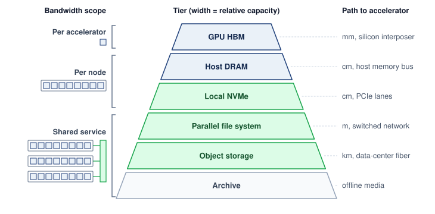

<!--
```{.tikz}
\scalebox{0.88}{%
\begin{tikzpicture}[
  font=\sffamily,
  >=Stealth,
  tier_card/.style={
    rectangle,
    rounded corners=3.5pt,
    line width=0.7pt,
    minimum height=1.02cm,
    inner sep=0pt
  },
  ribbon_hot/.style={
    rectangle,
    rounded corners=3pt,
    draw=RedLine!70,
    fill=RedFill!25,
    line width=0.7pt,
    minimum width=0.72cm,
    inner sep=0pt
  },
  ribbon_warm/.style={
    rectangle,
    rounded corners=3pt,
    draw=OrangeLine!70,
    fill=OrangeFill!25,
    line width=0.7pt,
    minimum width=0.72cm,
    inner sep=0pt
  },
  ribbon_cold/.style={
    rectangle,
    rounded corners=3pt,
    draw=GrayLine!70,
    fill=gray!10,
    line width=0.7pt,
    minimum width=0.72cm,
    inner sep=0pt
  },
  metric_chip/.style={
    rectangle,
    rounded corners=2.5pt,
    draw=GrayLine!30,
    fill=white,
    line width=0.5pt,
    inner xsep=4.5pt,
    inner ysep=2.5pt
  },
  line join=round, line cap=round, font=\small\sffamily
]

  % Coordinates
  \def\xspeed{-7.15}
  \def\xribbon{-6.05}
  \def\cardw{13.35}
  \def\xmid{1.275}      % center of card: -5.4 + 13.35/2 = 1.275
  \def\xleft{-5.4}

  % Columns inside card
  \def\xicon{-5.0}      % Mini schematic glyph
  \def\xtext{-4.5}      % Tier name and description
  \def\xbwtrack{0.7}    % Bar track start (width 1.3cm: 0.7 to 2.0)
  \def\xbwlabel{2.85}   % Bandwidth chip center
  \def\xcap{4.65}       % Capacity chip center
  \def\xcost{6.45}      % Cost basis chip center

  % Column Headers Row at y = 5.95
  \node[anchor=west, font=\scriptsize\bfseries, text=TextDark] at (\xtext, 5.95) {Storage Tier \& Medium};
  \node[anchor=center, font=\scriptsize\bfseries, text=TextDark] at (\xbwtrack+0.65, 5.95) {Relative BW};
  \node[anchor=center, font=\scriptsize\bfseries, text=TextDark] at (\xbwlabel, 5.95) {Bandwidth};
  \node[anchor=center, font=\scriptsize\bfseries, text=TextDark] at (\xcap, 5.95) {Capacity};
  \node[anchor=center, font=\scriptsize\bfseries, text=TextDark] at (\xcost, 5.95) {Unit Cost Basis};

  % Speed Axis on Far Left
  \draw[->, line width=1.0pt, SlateLine!60] (\xspeed, -1.1) -- (\xspeed, 5.35);
  \node[anchor=south, font=\scriptsize\itshape\bfseries, text=TextDark] at (\xspeed, 5.48) {Fastest};
  \node[anchor=north, font=\scriptsize\itshape\bfseries, text=TextMuted] at (\xspeed, -1.22) {Slowest};

  % Grouping Ribbons
  % Hot Tier: spans y = 5.0, 3.8, 2.6 -> center 3.8, height 3.42cm
  \node[ribbon_hot, minimum height=3.42cm] (r_hot) at (\xribbon, 3.8) {
    \rotatebox{90}{\textbf{\scriptsize\textcolor{DarkRed}{Hot Tier}}}
  };

  % Warm Tier: spans y = 1.4, 0.2 -> center 0.8, height 2.22cm
  \node[ribbon_warm, minimum height=2.22cm] (r_warm) at (\xribbon, 0.8) {
    \rotatebox{90}{\textbf{\scriptsize\textcolor{OrangeLine!90!black}{Warm Tier}}}
  };

  % Cold Tier: spans y = -1.0 -> center -1.0, height 1.02cm
  \node[ribbon_cold, minimum height=1.02cm] (r_cold) at (\xribbon, -1.0) {
    \rotatebox{90}{\textbf{\scriptsize\textcolor{TextBlack!70}{Cold Tier}}}
  };

  % =============================================================
  % TIER 1: GPU HBM3e (y = 5.0)
  % =============================================================
  \node[tier_card, draw=SteelBlue!70, fill=BlueFill!30, minimum width=\cardw cm] (c1) at (\xmid, 5.0) {};
  % Icon: 3D Stacked HBM Die
  \draw[fill=NavyBlue!80, draw=NavyBlue, line width=0.4pt, rounded corners=0.5pt] (\xicon-0.15, 4.86) rectangle ++(0.35, 0.08);
  \draw[fill=NavyBlue!80, draw=NavyBlue, line width=0.4pt, rounded corners=0.5pt] (\xicon-0.15, 4.97) rectangle ++(0.35, 0.08);
  \draw[fill=NavyBlue, draw=NavyBlue, line width=0.4pt, rounded corners=0.5pt] (\xicon-0.15, 5.08) rectangle ++(0.35, 0.08);
  % Title & subtitle
  \node[anchor=west, font=\scriptsize\bfseries, text=NavyBlue] at (\xtext, 5.17) {GPU HBM3e};
  \node[anchor=west, font=\tiny, text=TextBlack!70] at (\xtext, 4.83) {On-chip accelerator memory $\cdot$ 3D stacked DRAM silicon interposer};
  % Relative BW bar: 100% of 1.3cm = 1.3cm
  \draw[fill=gray!15, draw=gray!30, rounded corners=1.5pt, line width=0.4pt] (\xbwtrack, 4.88) rectangle ++(1.3, 0.24);
  \fill[NavyBlue, rounded corners=1.2pt] (\xbwtrack+0.02, 4.90) rectangle ++(1.26, 0.20);
  % Metrics
  \node[metric_chip] at (\xbwlabel, 5.0) {\textbf{\scriptsize\textcolor{NavyBlue}{3.35 TB/s}}};
  \node[metric_chip] at (\xcap, 5.0) {\scriptsize\textcolor{TextDark}{80--141 GB}};
  \node[metric_chip] at (\xcost, 5.0) {\scriptsize\textcolor{TextDark}{\raisebox{0.5pt}{\textasciitilde}}\$15\,/\,GB};

  % =============================================================
  % TIER 2: CPU DRAM (y = 3.8)
  % =============================================================
  \node[tier_card, draw=TealLine!70, fill=TealFill!30, minimum width=\cardw cm] (c2) at (\xmid, 3.8) {};
  % Icon: DIMM Module
  \draw[fill=TealDark!70, draw=TealDark, line width=0.4pt, rounded corners=0.5pt] (\xicon-0.18, 3.73) rectangle ++(0.40, 0.15);
  \fill[white] (\xicon-0.12, 3.75) rectangle ++(0.06, 0.10);
  \fill[white] (\xicon-0.03, 3.75) rectangle ++(0.06, 0.10);
  \fill[white] (\xicon+0.06, 3.75) rectangle ++(0.06, 0.10);
  \draw[line width=0.4pt, TealDark] (\xicon-0.15, 3.70) -- ++(0.34, 0);
  % Title & subtitle
  \node[anchor=west, font=\scriptsize\bfseries, text=TealDark] at (\xtext, 3.97) {Host CPU DRAM};
  \node[anchor=west, font=\tiny, text=TextBlack!70] at (\xtext, 3.63) {Host DDR5 system memory $\cdot$ Eight-channel high-speed memory bus};
  % Relative BW bar: ~70% log scale
  \draw[fill=gray!15, draw=gray!30, rounded corners=1.5pt, line width=0.4pt] (\xbwtrack, 3.68) rectangle ++(1.3, 0.24);
  \fill[TealDark, rounded corners=1.2pt] (\xbwtrack+0.02, 3.70) rectangle ++(0.90, 0.20);
  % Metrics
  \node[metric_chip] at (\xbwlabel, 3.8) {\textbf{\scriptsize\textcolor{TealDark}{200 GB/s}}};
  \node[metric_chip] at (\xcap, 3.8) {\scriptsize\textcolor{TextDark}{512 GB--2 TB}};
  \node[metric_chip] at (\xcost, 3.8) {\scriptsize\textcolor{TextDark}{\raisebox{0.5pt}{\textasciitilde}}\$4\,/\,GB};

  % =============================================================
  % TIER 3: NVMe SSD (y = 2.6)
  % =============================================================
  \node[tier_card, draw=TealLine!50, fill=white, minimum width=\cardw cm] (c3) at (\xmid, 2.6) {};
  % Icon: M.2 NVMe SSD Card
  \draw[fill=TealLine!30, draw=TealLine, line width=0.4pt, rounded corners=0.5pt] (\xicon-0.18, 2.50) rectangle ++(0.40, 0.18);
  \fill[TealDark] (\xicon-0.12, 2.54) rectangle ++(0.12, 0.10);
  \fill[TealDark] (\xicon+0.04, 2.54) rectangle ++(0.12, 0.10);
  % Title & subtitle
  \node[anchor=west, font=\scriptsize\bfseries, text=TealDark] at (\xtext, 2.77) {Local NVMe SSD};
  \node[anchor=west, font=\tiny, text=TextBlack!70] at (\xtext, 2.43) {Direct PCIe Gen5 flash storage $\cdot$ High-IOPS local scratch buffer};
  % Relative BW bar: ~45% log scale
  \draw[fill=gray!15, draw=gray!30, rounded corners=1.5pt, line width=0.4pt] (\xbwtrack, 2.48) rectangle ++(1.3, 0.24);
  \fill[TealLine!80, rounded corners=1.2pt] (\xbwtrack+0.02, 2.50) rectangle ++(0.56, 0.20);
  % Metrics
  \node[metric_chip] at (\xbwlabel, 2.6) {\textbf{\scriptsize\textcolor{TealDark}{7--25 GB/s}}};
  \node[metric_chip] at (\xcap, 2.6) {\scriptsize\textcolor{TextDark}{4--30 TB}};
  \node[metric_chip] at (\xcost, 2.6) {\scriptsize\textcolor{TextDark}{\raisebox{0.5pt}{\textasciitilde}}\$0.10\,/\,GB};

  % =============================================================
  % TIER 4: Parallel File System (y = 1.4, BOTTLENECK)
  % =============================================================
  \node[tier_card, draw=RedLine, fill=RedFill!30, line width=0.9pt, minimum width=\cardw cm] (c4) at (\xmid, 1.4) {};
  % Icon: Clustered storage array
  \draw[fill=RedLine!30, draw=DarkRed, line width=0.4pt, rounded corners=0.5pt] (\xicon-0.18, 1.30) rectangle ++(0.40, 0.22);
  \draw[line width=0.3pt, DarkRed] (\xicon-0.18, 1.37) -- ++(0.40, 0);
  \draw[line width=0.3pt, DarkRed] (\xicon-0.18, 1.44) -- ++(0.40, 0);
  \fill[DarkRed] (\xicon+0.12, 1.33) circle (0.6pt);
  \fill[DarkRed] (\xicon+0.12, 1.40) circle (0.6pt);
  \fill[DarkRed] (\xicon+0.12, 1.47) circle (0.6pt);
  \node[anchor=west, font=\scriptsize\bfseries, text=DarkRed] at (\xtext, 1.57) {Parallel File System (PFS) \ \ \raisebox{0.8pt}{\colorbox{RedFill!70}{\fontsize{5.2pt}{6pt}\selectfont\textbf{\textcolor{DarkRed}{BOTTLENECK TIER}}}}};
  \node[anchor=west, font=\tiny, text=DarkRed!85!black] at (\xtext, 1.23) {Lustre / GPFS / DAOS fabric $\cdot$ Striped POSIX namespace};
  % Relative BW bar: ~30% log scale per-node
  \draw[fill=gray!15, draw=gray!30, rounded corners=1.5pt, line width=0.4pt] (\xbwtrack, 1.28) rectangle ++(1.3, 0.24);
  \fill[DarkRed, rounded corners=1.2pt] (\xbwtrack+0.02, 1.30) rectangle ++(0.38, 0.20);
  % Metrics
  \node[metric_chip, draw=RedLine!40] at (\xbwlabel, 1.4) {\textbf{\scriptsize\textcolor{DarkRed}{1--4 GB/s\textsubscript{node}}}};
  \node[metric_chip] at (\xcap, 1.4) {\scriptsize\textcolor{TextDark}{100+ PB}};
  \node[metric_chip] at (\xcost, 1.4) {\scriptsize\textcolor{TextDark}{\raisebox{0.5pt}{\textasciitilde}}\$0.03\,/\,GB$\cdot$mo};

  % =============================================================
  % TIER 5: Object Storage (y = 0.2)
  % =============================================================
  \node[tier_card, draw=OrangeLine!60, fill=OrangeFill!20, minimum width=\cardw cm] (c5) at (\xmid, 0.2) {};
  % Icon: Object Bucket / Cylindrical Container
  \draw[fill=OrangeLine!30, draw=OrangeLine!90!black, line width=0.4pt] (\xicon-0.15, 0.12) rectangle ++(0.32, 0.18);
  \draw[OrangeLine!90!black, line width=0.3pt] (\xicon-0.15, 0.21) -- ++(0.32, 0);
  \draw[OrangeLine!90!black, line width=0.3pt] (\xicon-0.08, 0.30) -- ++(0.18, 0);
  % Title & subtitle
  \node[anchor=west, font=\scriptsize\bfseries, text=OrangeLine!90!black] at (\xtext, 0.37) {Object Storage};
  \node[anchor=west, font=\tiny, text=TextBlack!70] at (\xtext, 0.03) {S3 / Cloud durable store $\cdot$ High-latency REST throughput pool};
  % Relative BW bar: ~15% log scale
  \draw[fill=gray!15, draw=gray!30, rounded corners=1.5pt, line width=0.4pt] (\xbwtrack, 0.08) rectangle ++(1.3, 0.24);
  \fill[OrangeLine, rounded corners=1.2pt] (\xbwtrack+0.02, 0.10) rectangle ++(0.18, 0.20);
  % Metrics
  \node[metric_chip] at (\xbwlabel, 0.2) {\textbf{\scriptsize\textcolor{OrangeLine!90!black}{\raisebox{0.5pt}{\textasciitilde}}0.1 GB/s}};
  \node[metric_chip] at (\xcap, 0.2) {\scriptsize\textcolor{TextDark}{Exabytes}};
  \node[metric_chip] at (\xcost, 0.2) {\scriptsize\textcolor{TextDark}{\raisebox{0.5pt}{\textasciitilde}}\$0.02\,/\,GB$\cdot$mo};

  % =============================================================
  % TIER 6: Cold Storage / Tape (y = -1.0)
  % =============================================================
  \node[tier_card, draw=GrayLine!60, fill=gray!8, minimum width=\cardw cm] (c6) at (\xmid, -1.0) {};
  % Icon: Tape Cartridge
  \draw[fill=gray!20, draw=GrayLine, line width=0.4pt, rounded corners=0.5pt] (\xicon-0.18, -1.10) rectangle ++(0.38, 0.20);
  \draw[GrayLine, line width=0.3pt] (\xicon-0.09, -1.00) circle (1.5pt);
  \draw[GrayLine, line width=0.3pt] (\xicon+0.09, -1.00) circle (1.5pt);
  % Title & subtitle
  \node[anchor=west, font=\scriptsize\bfseries, text=TextBlack!80] at (\xtext, -0.83) {Archive / Cold Storage};
  \node[anchor=west, font=\tiny, text=TextBlack!60] at (\xtext, -1.17) {Deep archive / Automated tape library $\cdot$ Offline disaster recovery};
  % Relative BW bar: ~5% log scale
  \draw[fill=gray!15, draw=gray!30, rounded corners=1.5pt, line width=0.4pt] (\xbwtrack, -1.12) rectangle ++(1.3, 0.24);
  \fill[GrayLine, rounded corners=1.2pt] (\xbwtrack+0.02, -1.10) rectangle ++(0.06, 0.20);
  % Metrics
  \node[metric_chip] at (\xbwlabel, -1.0) {\textbf{\scriptsize\textcolor{TextDark}{\raisebox{0.5pt}{\textasciitilde}}0.01 GB/s}};
  \node[metric_chip] at (\xcap, -1.0) {\scriptsize\textcolor{TextDark}{Exabytes}};
  \node[metric_chip] at (\xcost, -1.0) {\scriptsize\textcolor{TextDark}{\raisebox{0.5pt}{\textasciitilde}}\$0.004\,/\,GB$\cdot$mo};

  % =============================================================
  % BOTTOM EXPLANATORY CARD
  % =============================================================
  \node[
    rectangle,
    rounded corners=3pt,
    draw=GrayLine!35,
    fill=white,
    line width=0.7pt,
    minimum width=\cardw cm,
    minimum height=0.85cm,
    anchor=north,
    align=center,
    inner sep=4pt
  ] at (\xmid, -1.75) {
    \textbf{\scriptsize\textcolor{TextDark}{Economic Trade-off: Memory cost is upfront acquisition (\$/GB); Storage cost is recurring operational (\$/GB$\cdot$month)}}\\[2pt]
    \tiny\textcolor{TextMuted}{\textbf{Hot tier} = active GPU training working set \quad$\bullet$\quad \textbf{Warm tier} = checkpointing \& validation \quad$\bullet$\quad \textbf{Cold tier} = raw corpora \& retention}
  };

\end{tikzpicture}%
}
```
-->

:::

The physical tiers of @fig-storage-pyramid govern the trade-off among access distance, capacity, and cost. Shared services can aggregate more bandwidth than an individual local device, so the ordering is not a monotonic ranking of aggregate throughput. This trade-off is not arbitrary; it reflects the physics of data proximity. HBM sits on the same silicon interposer as the accelerator, connected by thousands of parallel traces measured in millimeters, whereas host DRAM connects to the CPU memory controller and reaches the accelerator across the host-device interconnect, and local NVMe reaches across the circuit board over PCIe lanes. Beyond the node, the parallel file system traverses meters of cable and network switches, while object storage may span kilometers of fiber between data centers. Distance, protocol overhead, and contention can increase access latency, while media technology and provisioning determine capacity cost. Distance is therefore a guide rather than a measurement; only the complete client path establishes all three properties for a given consumer.

The engineering challenge is to deliver each batch to HBM before the accelerator needs it. Return to the running example: the durable corpus lives in object storage (Tier 4) as a `{python} StoragePyramidContext.compressed_text_tb_str` compressed source copy plus `{python} StoragePyramidContext.tokenized_text_tb_str` of tokenized training shards, but the accelerator needs each batch in HBM (Tier 0) within `{python} StorageFuelLineContext.step_time_ms_str`. The chapter's reference design fixes one path between them. At job start, each node copies its share of the tokenized shards from object storage to its local NVMe (Tier 2). The single training epoch then reads from that local copy, prepares batches in host DRAM, and transfers them to HBM. The parallel file system (Tier 3) holds checkpoints rather than training inputs. Streaming the shards directly from object storage, or serving them from a parallel file system, are the alternatives the chapter weighs against this design, and the hierarchy describes placement choices, not a requirement that every byte visit every level.

### Bandwidth cliffs between tiers {#sec-storage-bandwidth-cliffs}

Stepping down one level from a single accelerator's HBM (`{python} StoragePyramidContext.h100_bw_tb_per_s_str`) to the whole host's DRAM (~`{python} StoragePyramidContext.host_dram_bw_gb_per_s_str`) drops bandwidth by roughly `{python} StoragePyramidContext.hbm_host_dram_ratio_mult_str`, and that comparison still understates the cliff on an eight-GPU node because all eight accelerators share the same host-memory bandwidth. Comparing adjacent tiers requires making the scope of each rate explicit—per accelerator, per node, or across a shared service—as bracketed in @fig-storage-pyramid. Between host DRAM and NVMe, the ratio is roughly `{python} StoragePyramidContext.dram_nvme_ratio_mult_str` (`{python} StoragePyramidContext.host_dram_bw_gb_per_s_str` vs. ~`{python} StoragePyramidContext.raid0_bw_gb_per_s_str` from a `{python} StoragePyramidContext.raid0_drive_count_str`-drive RAID-0). Between NVMe and a parallel file system, the ratio depends on the per-node allocation: if a `{python} StoragePyramidContext.pfs_bw_tb_per_s_str` aggregate parallel file system (PFS) serves `{python} StoragePyramidContext.pfs_nodes_str` nodes, each node receives roughly `{python} StoragePyramidContext.pfs_per_node_bw_gb_per_s_str`, a `{python} StoragePyramidContext.raid0_pfs_ratio_mult_str` reduction from the local RAID-0 stripe. Object-storage throughput likewise depends on the client path and allocation; there is no fixed ratio to a parallel file system.

::: {.column-margin}
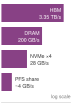{width="100%" fig-alt="Four horizontal violet bars on a log scale, longest at top: HBM 3.35 TB/s, host DRAM 200 GB/s, four-drive NVMe 28 GB/s, and a per-node parallel-file-system share of about 4 GB/s."}

*Per-client bandwidth falls roughly 7 to 17$\times$ at each step from HBM to a node's share of the parallel file system.*
:::

As @sec-storage-fuel-line established, a cliff is not a feed requirement; the feed rate remains input-batch bytes divided by iteration time, summed over distinct consumers. What the cliffs decide is where buffering must sit. Along the chosen path, host DRAM can buffer prepared batches and NVMe can cache shards from shared storage. Each buffer must cover the delay of the tier below it while that tier sustains the consumption rate; durable repositories need not act as intermediate buffers.

The same hierarchy can be analyzed as a cache\index{Cache!effective service time} rather than as six isolated devices. If a request hits the hot tier with probability $\HotTierHitProbability$, taking $\HotTierServiceTime$, and otherwise falls through to a colder tier, taking total end-to-end miss-path time $\MissPathServiceTime$ (including the failed hot-tier lookup), its mean service time is

$$
\mathbb{E}[\TieredRequestServiceTime] = \HotTierHitProbability \HotTierServiceTime+ (1-\HotTierHitProbability)\MissPathServiceTime.
$$ {#eq-storage-cache-service-time}

```{python}
#| echo: false
#| label: storage-cache-service-example
# ┌─────────────────────────────────────────────────────────────────────────────
# │ TIERED CACHE MEAN SERVICE TIME (LEGO)
# ├─────────────────────────────────────────────────────────────────────────────
# │ Context: @eq-storage-cache-service-time worked example in the paragraph below.
# │
# │ Goal: Show how a small miss share dominates mean service time.
# │ Show: 95 percent hits, misses 100x slower: E[T] = 5.95 hot service times.
# │ How:  Scenarios.HotTierCacheExample (TieredCacheModel).
# └─────────────────────────────────────────────────────────────────────────────
from mlsysim import Scenarios
from mlsysim.fmt import check, fmt, fmt_math, fmt_multiple, fmt_percent

class CacheServiceExample:
    # ┌── 1. LOAD ─────────────────────────────────────────
    cache = Scenarios.HotTierCacheExample
    hit_rate = cache.hit_rate
    miss_penalty = cache.miss_penalty

    # ┌── 2. EXECUTE ──────────────────────────────────────
    mean_service = cache.result.mean_service
    delivered_fraction = cache.result.delivered_fraction

    # ┌── 3. GUARD ────────────────────────────────────────
    check(abs(mean_service - 5.95) < 1e-9, "Prose quotes 5.95 hot service times")
    check(abs(1 / delivered_fraction - 6) < 0.1, "Prose says about one-sixth of the all-hot rate")

    # ┌── 4. OUTPUT ───────────────────────────────────────
    hit_pct_str = fmt_percent(hit_rate, precision=0, commas=False, style="prose")
    miss_penalty_mult_str = fmt_multiple(miss_penalty, precision=0, commas=False)
    mean_service_math = fmt_math(rf"\mathbb{{E}}[\TieredRequestServiceTime]={fmt(mean_service, precision=2, commas=False)}\HotTierServiceTime")
```

For fixed-size records served serially, the corresponding effective bandwidth is the record size divided by $\mathbb{E}[\TieredRequestServiceTime]$. The arithmetic makes small miss rates consequential: with a `{python} CacheServiceExample.hit_pct_str` hit rate and a cold-tier access `{python} CacheServiceExample.miss_penalty_mult_str` slower than a hot-tier access, `{python} CacheServiceExample.mean_service_math`, so the effective request rate is only about one-sixth of the all-hot rate. Concurrent requests and prefetching can overlap service, so this mean is a sizing baseline rather than a fleet-throughput or latency guarantee. Correlated misses or a heavy-tailed cold tier can drain the prefetch buffer even when the average satisfies the pipeline budget, so production designs must check a tail percentile and miss bursts as well as $\mathbb{E}[\TieredRequestServiceTime]$.

The batch-volume arithmetic also explains why increasing cluster size creates storage pressure. Aggregate demand is each consumer's batch bytes divided by its compute window, summed over consumers, so at a fixed per-node rate it grows linearly with node count. The per-node rate itself spans orders of magnitude across data modalities, as text and image training on the running cluster show.

```{python}
#| echo: false
#| label: data-storage-text-image-bandwidth
# ┌─────────────────────────────────────────────────────────────────────────────
# │ TEXT VS IMAGE BANDWIDTH (LEGO)
# ├─────────────────────────────────────────────────────────────────────────────
# │ Context: nbk-data-storage-text-vs-image-bandwidth
# │
# │ Goal: Compute aggregate text and image storage bandwidth for a 2,048-GPU job.
# │ Show: 168 MB/s text; ~303 GB/s image; about 1,800x ratio.
# │ How: BW = GPUs × per-GPU batch bytes / step time.
# │
# └─────────────────────────────────────────────────────────────────────────────
from mlsysim.fmt import MarkdownStr, check, fmt, fmt_bandwidth, fmt_count, fmt_memory, fmt_time

class TextImageBandwidth:
    # ┌── 1. LOAD ─────────────────────────────────────────
    text = Scenarios.TextInputDemand2K
    image = Scenarios.ImageInputDemand2K
    n_gpus = text.consumers  # the chapter's 2,048-GPU running cluster
    text_tokens_per_gpu = text.samples_per_step
    token_bytes = text.bytes_per_sample
    image_batch_per_gpu = image.samples_per_step
    image_bytes = image.bytes_per_sample  # ImageNet archive size / training examples
    step = text.step_time

    # ┌── 2. EXECUTE ──────────────────────────────────────
    text_bw = text.result.bandwidth
    image_bw = image.result.bandwidth
    text_bw_mb_s_val = text_bw.to(MB / second).magnitude
    image_bw_gb_s_val = image_bw.to(GB / second).magnitude
    ratio_val = (image_bw / text_bw).to("").magnitude
    ratio_rounded_val = round(ratio_val / 100) * 100

    # ┌── 3. GUARD ────────────────────────────────────────
    check(167 < text_bw_mb_s_val < 168, "Text bandwidth should be about 168 MB/s")
    check(250 < image_bw_gb_s_val < 350, "Image bandwidth should be about 303 GB/s at the registry mean image size")
    check(1500 < ratio_val < 2100, "Image/text bandwidth ratio should be about 1,800x")
    check(image.consumers == n_gpus and image.step_time == step, "Both jobs run on the same cluster and step time")

    # ┌── 4. OUTPUT ───────────────────────────────────────
    text_bw_mb_per_s_str = fmt_bandwidth(text_bw, unit=MB / second, precision=1, commas=False)
    image_bw_gb_per_s_str = fmt_bandwidth(image_bw, unit=GB / second, precision=1, commas=False)
    ratio_rounded_mult_str = fmt_multiple(ratio_rounded_val, precision=0, commas=True)
    image_size_kb_str = fmt_qty_int(image_bytes, KB, commas=False)
    n_gpus_str = fmt(n_gpus, precision=0, commas=True)
    _n_gpus_tex = fmt(n_gpus, precision=0, commas=True).replace(",", "{,}")
    _tokens_tex = fmt(text_tokens_per_gpu, precision=0, commas=True).replace(",", "{,}")
    _token_bytes_tex = fmt_int(token_bytes.to(byte).magnitude)
    _image_kb_tex = fmt(image_bytes.to(KB).magnitude, precision=1, commas=False)
    _step_s_tex = fmt(step.to(second).magnitude, precision=1, commas=False)
    text_tokens_per_gpu_str = fmt_count(text_tokens_per_gpu, label="token")
    step_ms_str = fmt_time(step, ms, precision=0, commas=False)
    image_batch_per_gpu_str = fmt(image_batch_per_gpu, precision=0, commas=False)
    text_bw_display_math = fmt_display_math(
        f"{_n_gpus_tex} \\text{{ GPUs}} \\times {_tokens_tex} \\text{{ tokens/GPU}} "
        f"\\times {_token_bytes_tex} \\text{{ bytes/token}} \\div {_step_s_tex}\\text{{s}} "
        f"\\approx {{{text_bw_mb_per_s_str}}}"
    )
    image_bw_display_math = fmt_display_math(
        f"{_n_gpus_tex} \\text{{ GPUs}} \\times {image_batch_per_gpu} \\text{{ images/GPU}} "
        f"\\times {_image_kb_tex} \\text{{ KB/image}} \\div {_step_s_tex}\\text{{s}} "
        f"\\approx {{{image_bw_gb_per_s_str}}}"
    )
```

::: {.column-margin}
{width="100%" fig-alt="Two-bar log-scale ladder: a long violet bar for image training at 303 GB/s above a short bar for text training at 168 MB/s."}

*Image training demands `{python} TextImageBandwidth.ratio_rounded_mult_str` the storage bandwidth of text.*
:::

::: {#nbk-data-storage-text-vs-image-bandwidth .callout-notebook title="Text vs. image bandwidth"}

**Problem**: How much aggregate storage bandwidth does a `{python} TextImageBandwidth.n_gpus_str`-GPU cluster require for text training vs. image training?

**Setup**: Compare two declared batch representations at the same compute window and number of independent input consumers. The result depends on batch volume and rate, not modality alone. Both jobs are generic ones sized to the running cluster, not the 175B running job. Each GPU consumes one per-GPU batch every step, a pace that fits a model far smaller than 175B parameters.

For text training\index{Training!text}, the demand is low. With a per-GPU batch of one packed sequence of `{python} TextImageBandwidth.text_tokens_per_gpu_str` and a `{python} TextImageBandwidth.step_ms_str` step time, the aggregate bandwidth is:

`{python} TextImageBandwidth.text_bw_display_math`

This is easily served by a single network-attached storage node.

Image training\index{Training!image} demands far more. Using a common batch size of `{python} TextImageBandwidth.image_batch_per_gpu_str` per GPU (ImageNet at $224{\times}224$, roughly `{python} TextImageBandwidth.image_size_kb_str`/image), the aggregate bandwidth is:

`{python} TextImageBandwidth.image_bw_display_math`

**Systems insight**: Under the stated batch representations and compute times, image training requires `{python} TextImageBandwidth.ratio_rounded_mult_str` higher input bandwidth than text training. The text example is *volume-heavy* but *bandwidth-light*. One network-attached storage server can carry its input feed, so its storage design is shaped by total corpus volume and, as later sections show, by checkpoint traffic. The image example is *bandwidth-heavy*, with a feed that exceeds any single storage server and calls for the aggregate bandwidth of many servers or of local caches. Whether either demand becomes an actual bottleneck still depends on the measured delivery rate of the path that serves it.

:::

```{python}
#| echo: false
#| label: data-storage-running-job-feed
# ┌─────────────────────────────────────────────────────────────────────────────
# │ RUNNING-JOB AVERAGE INPUT FEED (LEGO)
# ├─────────────────────────────────────────────────────────────────────────────
# │ Context: sanity check after nbk-data-storage-text-vs-image-bandwidth.
# │
# │ Goal: Show the 175B running job's average input rate, corpus bytes divided
# │       by run length, and compare it with the notebook's generic text job.
# │ Show: ~2.3 MB/s cluster-wide; the generic text job reads ~70x faster.
# │ How:  tokenized corpus / training window; ratio = TextImageBandwidth.text_bw / feed.
# └─────────────────────────────────────────────────────────────────────────────
from mlsysim.fmt import check, fmt_bandwidth, fmt_multiple

class RunningJobFeed:
    # ┌── 1. LOAD ─────────────────────────────────────────
    tokenized_text = StorageFuelLineContext.tokenized_text
    training_window = StorageFuelLineContext.training_window
    generic_text_bw = TextImageBandwidth.text_bw
    # ┌── 2. EXECUTE ──────────────────────────────────────
    avg_feed = Scenarios.Gpt3StorageFootprint.result.average_read_rate.to(MB / second)
    generic_ratio = (generic_text_bw / avg_feed).to("").magnitude
    # ┌── 3. GUARD ────────────────────────────────────────
    check(2 < avg_feed.magnitude < 3, "6 TB over 30 days should average about 2.3 MB/s")
    check(50 < generic_ratio < 100, "Generic text job should read tens of times faster than the 175B job")
    # ┌── 4. OUTPUT ───────────────────────────────────────
    avg_feed_mb_per_s_str = fmt_bandwidth(avg_feed, unit=MB / second, precision=1, commas=False)
    generic_ratio_mult_str = fmt_multiple(round(generic_ratio, -1), precision=0, commas=False)
```

The 175B running job sits lower still. Its `{python} StorageFuelLineContext.tokenized_text_tb_str` epoch spread over the `{python} StorageFuelLineContext.training_window_attr_str` window averages about `{python} RunningJobFeed.avg_feed_mb_per_s_str` for the whole cluster, corpus bytes divided by run length, roughly `{python} RunningJobFeed.generic_ratio_mult_str` below the notebook's generic text job. Each token of a 175B model carries so much computation that the corpus trickles in, which is why the running example's storage design is shaped by checkpoint traffic rather than by its input feed.

The image result is a floor for visual data rather than a ceiling. At about `{python} TextImageBandwidth.image_bw_gb_per_s_str` across `{python} StorageFuelLineContext.run_nodes_str` nodes, the image job already consumes nearly a third of a `{python} StoragePyramidContext.pfs_bw_tb_per_s_str` parallel file system built from 100 data-serving nodes (the architecture @sec-storage-tier3-pfs develops). Higher-resolution images and video clips, at megabytes per sample rather than the roughly `{python} TextImageBandwidth.image_size_kb_str` of a compressed ImageNet image, raise the per-node demand by an order of magnitude or more, and a fleet several times larger multiplies it again. Demand at that scale exceeds what a shared file system of this size can serve, so the architecture must rely on local NVMe caching to take repeated reads off shared storage.

The bandwidth cliff between tiers also has implications for the data format at each level. Computation consumes float16 tensors, packed token IDs, or other supported representations, while NVMe and object storage can retain compressed records. Compression reduces bytes stored and transferred but adds decoding work. The chosen format must let CPU or GPU decoding keep pace with consumption; maximum compression can reduce end-to-end throughput when decoding becomes the limiting stage. A host-decoded path stages the resulting tensors in DRAM, while a GPU-decoded path moves the transformation and its resource demand to the accelerator.

The format challenge intensifies for multi-modal training, which combines text, images, audio, and video in a single model. Serialized sizes span orders of magnitude, from 4 bytes per text token to roughly `{python} TextImageBandwidth.image_size_kb_str` per compressed image to megabytes per short video clip, depending on representation, compression, resolution, and duration, and each modality requires its own decoding and augmentation work. A multi-modal training job must manage these parallel streams and provision for their combined service demand. For a corpus containing 3 TB of text, 50 TB of images, and 200 TB of video, video dominates retained capacity. Its bandwidth contribution also depends on how frequently training samples it and how many bytes each sampled batch reads. Corpus size alone determines neither the delivery rate nor the modality's contribution to model quality.

Tracing how each tier meets these bandwidth and format constraints begins at the top of the pyramid and steps outward from the accelerator to the archive. That descent starts where computation actually consumes bytes: HBM, the tier fast enough to keep accelerator arithmetic fed but far too scarce to hold the full training corpus.

```{python}
#| echo: false
# ┌── LEGO ───────────────────────────────────────────────
# │ Context: @sec-storage-tier0-hbm
from mlsysim import Hardware
from mlsysim.fmt import check, fmt, fmt_bandwidth

class HbmTierBandwidth:
    h100_bw = Hardware.Cloud.H100.memory.bandwidth
    host_dram_bw = Hardware.Tech.Storage.HostDram.bandwidth
    nvme_bw = Hardware.Tech.Storage.NvmeGen4.bandwidth
    hbm_host_dram_ratio_val = h100_bw / host_dram_bw
    hbm_nvme_ratio_val = (h100_bw / nvme_bw).to("").magnitude
    check(hbm_host_dram_ratio_val.to("").magnitude > 10, "HBM should be much faster than host DRAM")
    # ┌── 4. OUTPUT (Formatting) ──────────────────────────────────────────────
    h100_bw_tb_per_s_str = fmt_bandwidth(h100_bw, unit=TB / second, precision=2, commas=False)
    host_dram_bw_gb_per_s_str = fmt_bandwidth(host_dram_bw, unit=GB / second, precision=0, commas=False)
    hbm_host_dram_ratio_mult_str = fmt_multiple(hbm_host_dram_ratio_val.to("").magnitude, precision=1, commas=False)
    nvme_bw_gb_per_s_str = fmt_bandwidth(nvme_bw, unit=GB / second, precision=0, commas=False)
```
```{python}
#| echo: false
#| label: data-storage-hbm-model-budget
# ┌─────────────────────────────────────────────────────────────────────────────
# │ HBM MODEL-MEMORY BUDGET — 175B WEIGHTS + ADAM (LEGO)
# ├─────────────────────────────────────────────────────────────────────────────
# │ Context: @sec-storage-tier0-hbm. The FP16-weights and Adam-optimizer figures
# │          in the memory-budget paragraph.
# │
# │ Goal: Pin the weights/optimizer footprint to the canonical GPT-3 parameter
# │       count and dtype byte widths so they cannot drift.
# │ Show: FP16 weight footprint (GB) and the Adam-state derivation.
# │ How:  weights = N * BYTES_FP16; Adam = N * BYTES_ADAM_STATE (= FP32 * 2 states).
# │
# └─────────────────────────────────────────────────────────────────────────────
from mlsysim import Models, ReferenceStats
from mlsysim.core.units import BYTES_FP16, BYTES_FP32, BYTES_ADAM_STATE
from mlsysim.fmt import check, fmt, fmt_math, fmt_memory

class HbmModelBudget:
    # ┌── 1. LOAD (Constants) ──────────────────────
    params = Models.Language.GPT3.parameters
    bytes_fp16 = BYTES_FP16
    bytes_fp32 = BYTES_FP32
    adam_bytes = BYTES_ADAM_STATE
    adam_states = 2  # Adam keeps two states per parameter: momentum and variance

    # ┌── 2. EXECUTE (The Compute) ─────────────────
    weights_fp16 = memory_from_params(params, bytes_fp16 / param)
    adam = memory_from_params(params, adam_bytes / param)
    master_weights = memory_from_params(params, bytes_fp32 / param)
    live_state = 2 * weights_fp16 + master_weights + adam

    # ┌── 3. GUARD (Invariants) ────────────────────
    check(abs((adam_bytes - bytes_fp32 * adam_states).to(byte).magnitude) < 1e-9, "Adam state bytes must equal FP32 * 2 states")
    check(adam.to(GB).magnitude > weights_fp16.to(GB).magnitude > 0, "Adam footprint must exceed FP16 weights, both positive")

    # ┌── 4. OUTPUT (Formatting) ───────────────────
    weights_fp16_gb_str = fmt_memory(weights_fp16, unit=GB, precision=0, commas=True)
    master_weights_gb_str = fmt_memory(master_weights, unit=GB, precision=0, commas=True)
    live_state_tb_str = fmt_memory(live_state, unit=TB, precision=2, commas=False)
```

### Tier 0 GPU HBM {#sec-storage-tier0-hbm}

The scarcest resource in the system sits closest to the arithmetic. On the H100 used here, HBM\index{HBM!storage hierarchy} holds the active weights and activations served to the accelerator, while caches and on-chip buffers reuse portions of that state. Its stacked packaging supplies `{python} HbmTierBandwidth.h100_bw_tb_per_s_str` of aggregate bandwidth, the top of the cliffs just measured. That bandwidth is what makes large-scale deep learning feasible, because a matrix multiplication involving billions of parameters reads those parameters from memory on every forward and backward pass. What HBM lacks is room.

::: {.column-margin .margin-pointer}
↩ High-bandwidth memory packaging, the 3D stacking and through-silicon vias behind this bandwidth, is established in @sec-compute-hbm.
:::

For placing the unpartitioned running model, the immediate constraint is *capacity*. Once state fits, HBM bandwidth can still limit execution. The node-memory budget of @sec-compute-node-memory already shows how far one 80 GB device falls short of the 175B running example: the FP16 weights alone, `{python} HbmModelBudget.weights_fp16_gb_str`, need at least five H100 accelerators. The mixed-precision contract this chapter checkpoints also retains `{python} HbmModelBudget.master_weights_gb_str` of FP32 master weights, so weights, gradients, master weights, and Adam moments occupy `{python} HbmModelBudget.live_state_tb_str` before activations and communication buffers. State that does not fit in one HBM pool must be split across accelerators or kept outside HBM and fetched when needed. Splitting it across the cluster makes the run possible, but every shard becomes a separate piece of state that lower tiers must stage, save, and restore in step with the others. HBM scarcity is what forces the rest of the hierarchy to exist, and HBM is the destination that every lower tier exists to serve.

Because HBM capacity is so limited relative to both model size and dataset size, the accelerator processes data in batches. Each batch occupies a fraction of HBM for the duration of one forward-backward pass, then is discarded to make room for the next. The rate at which batches must be supplied sets the bandwidth requirement for all lower tiers.

The razor-thin margin is a defining feature of large model training, visible in the HBM budget that each 80 GB H100 carries while the fleet trains the 175B parameter model (@tbl-hbm-memory-budget). The table treats partitioning as a storage layout, and the chapter keeps this one layout throughout. Tensor parallelism splits the model weights eight ways inside each node, so every node holds one complete copy of the weights spread across its GPUs. Optimizer, master-weight, and gradient state are additionally sharded across the `{python} StorageFuelLineContext.run_nodes_str` nodes, so each GPU holds only its slice of that state rather than a full replica. Sharding optimizer and gradient state across data-parallel replicas while each replica keeps its weights is the second stage of the Zero Redundancy Optimizer (ZeRO), a training technique in its own right; its third stage also partitions the weights. Here only the resulting per-GPU slices matter, because they set the storage pressure HBM sees.

::: {.column-margin .margin-pointer}
↪ Sharded data parallelism (ZeRO and FSDP), which partitions optimizer, gradient, and weight state across workers, is developed in @sec-distributed-training-systems-systems-memoryefficient-data-parallelism-zero-fsdp-0e69.
:::

```{python}
#| echo: false
#| label: hbm-memory-budget-calc
# ┌─────────────────────────────────────────────────────────────────────────────
# │ HBM MEMORY BUDGET FOR 175B TRAINING (LEGO)
# ├─────────────────────────────────────────────────────────────────────────────
# │ Context: @tbl-hbm-memory-budget.
# │ Goal: Compute per-GPU memory allocations with 8-way weight partitioning and
# │       optimizer/gradient state sharded over 256 nodes.
# │ How: Weights are split inside the node; optimizer and gradients are sharded
# │      across both the intra-node split and the node count.
# └─────────────────────────────────────────────────────────────────────────────
from mlsysim.fmt import MarkdownStr, check, fmt, fmt_memory, fmt_memory_capacity, fmt_percent_range, fmt_qty_range

class HbmMemoryBudget:
    """Per-GPU HBM budget for 175B training with sharded state."""

    # ┌── 1. LOAD ──────────────────────────────────────────────────────────
    fleet = Systems.Clusters.Production_2K
    params = Models.Language.GPT3.parameters
    tp_degree = fleet.node.accelerators_per_node
    dp_nodes = fleet.count
    activation_min = 10 * GB  # scenario activation-memory minimum assumption
    activation_max = 20 * GB  # scenario activation-memory maximum assumption
    comm_min = 2 * GB  # scenario communication-buffer minimum assumption
    comm_max = 4 * GB  # scenario communication-buffer maximum assumption
    hbm_capacity = fleet.node.accelerator.memory.capacity

    # ┌── 2. EXECUTE ───────────────────────────────────────────────────────
    full_weight = params * BYTES_FP16
    full_optimizer = params * 2 * BYTES_FP32
    full_master_weights = params * BYTES_FP32
    full_gradient = full_weight
    weight_per_gpu = full_weight / tp_degree
    optimizer_per_gpu = full_optimizer / (tp_degree * dp_nodes)
    gradient_per_gpu = full_gradient / (tp_degree * dp_nodes)
    master_weights_per_gpu = full_master_weights / (tp_degree * dp_nodes)
    total_min = weight_per_gpu + optimizer_per_gpu + master_weights_per_gpu + activation_min + gradient_per_gpu + comm_min
    total_max = weight_per_gpu + optimizer_per_gpu + master_weights_per_gpu + activation_max + gradient_per_gpu + comm_max
    total_min_pct = (total_min / hbm_capacity).to("").magnitude * 100
    total_max_pct = (total_max / hbm_capacity).to("").magnitude * 100

    # ┌── 3. GUARD ─────────────────────────────────────────────────────────
    weight_per_gpu_gb_val = weight_per_gpu.to(GB).magnitude
    optimizer_per_gpu_gb_val = optimizer_per_gpu.to(GB).magnitude
    check(abs(weight_per_gpu_gb_val - 43.75) < 1e-9, f"Expected 43.75 GB weights/GPU, got {weight_per_gpu_gb_val}")
    check(0.6 < optimizer_per_gpu_gb_val < 0.8, "Optimizer shard should include TP and DP partitioning")
    check(total_max < hbm_capacity, "Budget should fit within 80 GB HBM under these assumptions")
    check(abs(master_weights_per_gpu.to(GB).magnitude - 0.341796875) < 1e-9, "FP32 master weights must be included after both partitions")

    # ┌── 4. OUTPUT ────────────────────────────────────────────────────────
    hbm_capacity_gb_str = fmt_memory_capacity(80 * GB, unit=GB, precision=0, commas=False)
    weight_per_gpu_gb_str = fmt_memory(weight_per_gpu, unit=GB, precision=2, commas=False)
    optimizer_per_gpu_gb_str = fmt_memory(optimizer_per_gpu, unit=GB, precision=1, commas=False)
    master_weights_per_gpu_gb_str = fmt_memory(master_weights_per_gpu, unit=GB, precision=2, commas=False)
    gradient_per_gpu_gb_str = fmt_memory(gradient_per_gpu, unit=GB, precision=1, commas=False)
    activation_range_str = fmt_qty_range(activation_min, activation_max, GB, precision=0, commas=False)
    comm_range_str = fmt_qty_range(comm_min, comm_max, GB, precision=0, commas=False)
    total_range_str = fmt_qty_range(
        total_min,
        total_max,
        GB,
        precision=1,
        commas=False,
    )
    total_pct_range_str = fmt_percent_range(
        total_min_pct / 100,
        total_max_pct / 100,
        precision=1,
        commas=False,
        style="prose",
    )
```

| **Component**                             |                     **Size per GPU**                     |
|:------------------------------------------|:--------------------------------------------------------:|
| Model Weights (FP16, 8-way shard)         |     `{python} HbmMemoryBudget.weight_per_gpu_gb_str`     |
| Optimizer State (node-sharded)            |   `{python} HbmMemoryBudget.optimizer_per_gpu_gb_str`    |
| FP32 Master Weights (node-sharded)        | `{python} HbmMemoryBudget.master_weights_per_gpu_gb_str` |
| Activations (variable by sequence length) |     `{python} HbmMemoryBudget.activation_range_str`      |
| Gradient Buffers (FP16, node-sharded)     |    `{python} HbmMemoryBudget.gradient_per_gpu_gb_str`    |
| Communication Buffers (NCCL)              |        `{python} HbmMemoryBudget.comm_range_str`         |
| **Total Occupied**                        |      **`{python} HbmMemoryBudget.total_range_str`**      |

: **HBM Memory Budget for 175B-Parameter Training**: Per-GPU allocation when splitting a 175B model eight ways inside the node and sharding optimizer and gradient state across `{python} StorageFuelLineContext.run_nodes_str` nodes. The optimizer, master-weight, and gradient rows are per-GPU shards after both levels of partitioning. The resulting budget occupies most of a `{python} HbmMemoryBudget.hbm_capacity_gb_str` HBM device, leaving limited buffer for the incoming data pipeline. Any delay in fetching the next batch from host memory risks starving the accelerator. {#tbl-hbm-memory-budget}

Even with aggressive partitioning, the total memory footprint reaches `{python} HbmMemoryBudget.total_range_str` in decimal gigabytes, about `{python} HbmMemoryBudget.total_pct_range_str` of the HBM pool (the device's nominal `{python} HbmMemoryBudget.hbm_capacity_gb_str` is a binary capacity, slightly larger than 80 decimal gigabytes). The remaining headroom shrinks further once fragmentation and framework workspaces are included, and that headroom is all the incoming data pipeline has to work with. An input batch and its activations occupy HBM for one training step, while model weights and optimizer state persist across steps. Prefetching the next batch therefore competes with the live training footprint for scarce capacity; a deeper input queue is useful only if the memory budget can accommodate it.

From the data pipeline's perspective, Tier 0 is not a storage tier to be managed but a constraint to be satisfied. The pipeline's purpose is to ensure that the batch the accelerator needs *next* is already resident in HBM before the *current* batch's computation completes. If it arrives late, the accelerator stalls. If it arrives early, it consumes HBM that could hold activations. The tension between "just in time" and "just too late" defines the pipeline's buffer management strategy, quantified in @sec-storage-pipeline-equation.

```{python}
#| echo: false
#| label: storage-dram-interconnect-calc
# ┌─────────────────────────────────────────────────────────────────────────────
# │ HOST DRAM INTERCONNECT BANDWIDTHS
# ├─────────────────────────────────────────────────────────────────────────────
# │ Context: @sec-storage-tier1-dram—PCIe Gen 5 and NVLink bandwidth figures
# │          used in the Tier 1 Host DRAM discussion.
# │
# │ Goal:    Format PCIe Gen 5 and NVLink 4.0 bandwidths for inline prose.
# │ Show:    64 GB/s (PCIe Gen 5), 900 GB/s (NVLink 4.0).
# │ How:     Read Hardware.Cloud.H100.interconnect.bandwidth and Hardware.Cloud.H100.nvlink.bandwidth from constants; format GB/s.
# │
# └─────────────────────────────────────────────────────────────────────────────
from mlsysim.fmt import fmt_bandwidth, fmt_memory

class DRAMInterconnect:
    pcie5_bw = Hardware.Cloud.H100.interconnect.bandwidth
    nvlink_bw = Hardware.Cloud.H100.nvlink.bandwidth
    pcie5_bidir_bw = 2 * pcie5_bw  # bidirectional = both directions at once
    node_dram = 512 * GB  # scenario assumption: generic training-server host DRAM (lower end)
    embedding_table = 200 * GB  # scenario assumption: one node's resident embedding-table shard
    remaining_dram = node_dram - embedding_table
    dlrm_model_size = Models.Recommendation.DLRM.model_size

    # ┌── 4. OUTPUT (Formatting) ──────────────────────────────────────────────
    pcie5_bw_gb_per_s_str = fmt_bandwidth(pcie5_bw, unit=GB / second, precision=0, commas=False)
    nvlink_bw_gb_per_s_str = fmt_bandwidth(nvlink_bw, unit=GB / second, precision=0, commas=False)
    pcie5_bidir_bw_gb_per_s_str = fmt_bandwidth(pcie5_bidir_bw, unit=GB / second, precision=0, commas=False)
    node_dram_gb_str = fmt_memory(node_dram, unit=GB, precision=0, commas=False)
    embedding_table_gb_str = fmt_memory(embedding_table, unit=GB, precision=0, commas=False)
    remaining_dram_gb_str = fmt_memory(remaining_dram, unit=GB, precision=0, commas=False)
    dlrm_model_size_gb_str = fmt_memory(dlrm_model_size, unit=GB, precision=0, commas=False)
```

### Tier 1 host DRAM {#sec-storage-tier1-dram}

One level below HBM, host DRAM\index{DRAM!data pipeline staging} serves as the staging area for the data pipeline. Every byte of training data that reaches the accelerator passes through host DRAM first (unless GPUDirect Storage bypasses it, as described in @sec-storage-gds). A typical training node contains 512 GB to 2 TB of system memory shared across the host CPU and its peripherals. While the bandwidth between host DRAM and the accelerator is limited to what PCIe Gen 5 (about `{python} DRAMInterconnect.pcie5_bw_gb_per_s_str` per direction, `{python} DRAMInterconnect.pcie5_bidir_bw_gb_per_s_str` bidirectional) can provide, host DRAM plays three roles in the ML storage hierarchy. It is the prefetch buffer, a home for embedding tables too large for HBM, and the augmentation workspace. Only CPU-accelerator superchips with a coherent NVLink-class host link raise that path toward the `{python} DRAMInterconnect.nvlink_bw_gb_per_s_str` that NVLink provides between accelerators. The data loader occupies two of these roles at once, because its augmentation stage and the prefetch buffer it fills both live in host DRAM.

The data loader pipeline\index{Data loader!pipeline architecture} that runs in host DRAM works as it does on a single node: reader threads fetch compressed samples, workers decode and augment them, and a collation stage assembles batches in pinned, or page-locked, memory\index{Pinned memory!DMA transfer}\index{Data loader!pinned memory} for the host-to-accelerator direct memory access (DMA) transfer. At fleet scale, these stages compete with the node's other demands for the same host DRAM.

::: {.column-margin .margin-pointer}
↪ The single-node overlap techniques behind this loader (prefetching, pinned host buffers, and double buffering) are collected for reference in @sec-appdx-dam-taxonomy-dam-coordination-sum-max.
:::

Host DRAM's most critical function is serving as a prefetch buffer\index{Prefetch buffer!absorption of I/O variance}. When the accelerator finishes processing batch $\BatchIndex$, batch $\BatchIndex+1$ should already be assembled in host memory, ready for transfer to HBM. The depth of this prefetch buffer determines how much I/O variance the pipeline can absorb without stalling.

Recommendation workloads, the regime of Archetype B (DLRM at Scale), place a different demand on host DRAM: hosting embedding tables\index{Embedding table!host DRAM capacity} that can exceed `{python} DRAMInterconnect.dlrm_model_size_gb_str`, far too large for HBM. These tables reside in host DRAM and are accessed through lookups that fetch only the rows needed for the current batch. The bandwidth between host DRAM and HBM becomes the critical bottleneck for these workloads, and some systems go further, pooling embedding tables in the DRAM of dedicated CPU servers and returning only the requested rows over remote direct memory access (RDMA).

Host DRAM also provides the augmentation workspace\index{Data augmentation!workspace memory} that the CPU pipeline requires. Data augmentation operations (resizing images, tokenizing text, applying noise) execute on the CPU and require temporary memory for intermediate results. A training pipeline that applies five augmentations to a 256-image batch at `{python} TextImageBandwidth.image_size_kb_str` per image needs tens of megabytes of working space for each augmentation stage. Although modest per-batch, this memory accumulates when multiple data loader workers run in parallel. GPU-side decoding with libraries such as the NVIDIA Data Loading Library (DALI)\index{NVIDIA Data Loading Library!GPU augmentation}\index{DALI|see{NVIDIA Data Loading Library}} moves decode and augmentation onto the accelerator, so smaller compressed bytes cross the host link and host DRAM bandwidth demand falls. The work then consumes HBM capacity and compute cycles instead, which helps an input-bound job and hurts a compute-bound one.

The three roles interact in subtle ways. The prefetch buffer and the augmentation workspace compete for the same physical DRAM, and embedding tables consume capacity that could otherwise serve as deeper prefetch queues. A node with `{python} DRAMInterconnect.node_dram_gb_str` of DRAM hosting a `{python} DRAMInterconnect.embedding_table_gb_str` embedding table has only `{python} DRAMInterconnect.remaining_dram_gb_str` remaining for prefetching and augmentation. If the data loader uses 8 workers, each maintaining a decode buffer of 1 GB, the effective prefetch capacity drops further. System architects must balance these competing demands by profiling the actual memory consumption of each pipeline stage and provisioning DRAM accordingly.

The physical layout of DRAM also matters. On a dual-socket node, each socket's DRAM forms a non-uniform memory access (NUMA) domain local to the GPUs on that socket's PCIe root complex, and reaching the other socket's DRAM crosses the inter-socket link, with a penalty that depends on the processor, topology, and concurrent traffic (@sec-compute-infrastructure-pcie-hierarchy-within-node-c56f). NUMA-aware allocation\index{NUMA!aware allocation} keeps each data loader worker and its prefetch buffer in the same NUMA domain as the GPUs it serves; the gain should be measured on the target node rather than assumed.

Host DRAM sits below the first cliff of @sec-storage-bandwidth-cliffs, and the host-to-GPU interconnect adds a separate cliff, with effective transfer bandwidth depending on whether the node uses PCIe or NVLink. In the conventional path that stages payloads through host memory, a depleted DRAM prefetch buffer leaves the accelerator waiting for lower tiers. The direct path of @sec-storage-gds removes that staging copy when the data layout and devices support it. In the running example, the `{python} StorageFuelLineContext.run_nodes_str`-node cluster requires each node's host DRAM to sustain a continuous flow of decoded, augmented batches ready for PCIe transfer. If the NVMe-to-DRAM read pipeline falls behind by even a few hundred milliseconds, the prefetch buffer drains and the accelerator idles until the next batch arrives.

```{python}
#| echo: false
#| label: storage-nvme-tier-calc
# ┌─────────────────────────────────────────────────────────────────────────────
# │ NVME TIER: I/O BANDWIDTH AND HDD COMPARISON
# ├─────────────────────────────────────────────────────────────────────────────
# │ Context: @sec-storage-tier2-nvme—NVMe I/O characteristics and HDD contrast.
# │
# │ Goal:    Quantify raw image bandwidth and the HDD IOPS shortfall.
# │ Show:    ~116 MB/s raw image BW; 10x HDD slowdown; 10% HDD ceiling.
# │ How:     BW = images/s × size; HDD ratio = images/s/IOPS.
# │
# └─────────────────────────────────────────────────────────────────────────────
from mlsysim.fmt import check, fmt, fmt_bandwidth, fmt_count, fmt_memory, fmt_rate

class NVMeTierCalcs:
    # ┌── 1. LOAD ─────────────────────────────────────────
    images_per_sec = 1000  # scenario: target ingest rate
    img_size = Datasets.ImageNet.mean_compressed_image_size  # archive size / training examples
    hdd_iops = Systems.Storage.Hdd7200Rpm.iops
    imagenet_images = Datasets.ImageNet.training_examples

    # ┌── 2. EXECUTE ──────────────────────────────────────
    raw_bw = images_per_sec * img_size / second
    raw_bw_val = raw_bw.to(MB / second).magnitude
    hdd_slowdown_val = round(images_per_sec / hdd_iops)
    hdd_util_ceiling_pct_val = round(hdd_iops / images_per_sec * 100)

    # ┌── 3. GUARD ────────────────────────────────────────
    check(100 < raw_bw_val < 130, "Raw image BW should be about 116 MB/s at the registry mean image size")
    check(hdd_slowdown_val == 10, "HDD slowdown should be 10x")

    # ┌── 4. OUTPUT ───────────────────────────────────────
    raw_bw_mb_per_s_str = fmt_qty_int(raw_bw, MB / second, commas=False)
    images_per_s_str = fmt_rate(images_per_sec, 'images/s', precision=0, commas=False)
    img_size_kb_str = fmt_qty_int(img_size, KB, commas=False)
    imagenet_images_m_str = fmt_count(imagenet_images.to(count).magnitude, scale='M', precision=2, commas=False)
    imagenet_avg_kb_str = fmt_qty_int(img_size, KB, commas=False)
    hdd_iops_str = fmt_rate(hdd_iops, "IOPS", precision=0, commas=False)
    hdd_slowdown_factor_mult_str = fmt_multiple(hdd_slowdown_val, precision=0, commas=False)
    hdd_util_ceiling_pct_str = fmt_percent(hdd_util_ceiling_pct_val / 100, precision=0, commas=False, style='prose')
```

```{python}
#| echo: false
# ┌── LEGO ───────────────────────────────────────────────
# │ Context: @sec-storage-tier2-nvme
from mlsysim import Hardware
from mlsysim.fmt import check, fmt, fmt_bandwidth, fmt_memory, fmt_multiple, fmt_time

class NvmeTierContext:
    local_nvme = Systems.Storage.LocalNvmeGen4_7T68x4
    LOCAL_NVME_DRIVES_PER_NODE_REF = local_nvme.devices_per_node * count
    training_tokens = ReferenceStats.StorageTrainingCorpus.TrainingTokens
    token_id_bytes = ReferenceStats.StorageTrainingCorpus.TokenIdBytes
    tokenized_shard = ReferenceStats.StorageTrainingCorpus.TokenizedShardSize
    nvme_per_drive_bw = Hardware.Tech.Storage.NvmeGen4.bandwidth
    nvme_drive_capacity = local_nvme.device.capacity
    raid0_bw = LOCAL_NVME_DRIVES_PER_NODE_REF.magnitude * nvme_per_drive_bw
    hdd_bw = Systems.Storage.Hdd7200Rpm.bandwidth
    sata_ssd_bw = Systems.Storage.SataSsd.bandwidth
    # SSD endurance: rating and warranty are scenario assumptions (1-3 DWPD class).
    dwpd = 1  # scenario assumption: drive writes per day
    warranty_years = 5  # scenario assumption: enterprise warranty period
    drive_lifetime_writes = nvme_drive_capacity * dwpd * warranty_years * 365
    ckpt_nodes = Systems.Clusters.Production_2K.count
    ckpt_node_share = Scenarios.Gpt3TieredCheckpoint2K.result.per_node_shard.to(GB)
    ckpts_per_day = (1 * day / ReferenceStats.StorageTrainingCorpus.CheckpointInterval).to("").magnitude
    ckpt_node_daily_writes = ckpt_node_share * ckpts_per_day
    node_daily_write_budget = LOCAL_NVME_DRIVES_PER_NODE_REF.magnitude * nvme_drive_capacity * dwpd
    check(ckpt_node_daily_writes < node_daily_write_budget, "Checkpoint writes must fit a four-drive node's 1 DWPD budget")
    hbm_bw = Hardware.Cloud.H100.memory.bandwidth
    hbm_drive_ratio_val = (hbm_bw / nvme_per_drive_bw).to("").magnitude
    hbm_raid0_ratio_val = (hbm_bw / raid0_bw).to("").magnitude
    check(raid0_bw == local_nvme.aggregate_bandwidth, "RAID-0 bandwidth must match the registry node-storage aggregate")
    check(local_nvme.devices_per_node == 4, "Prose says four drives per node")
    codecs = Scenarios.NodeStripeCodecs
    check(codecs.read_bandwidth == raid0_bw, "The codec comparison reads the same four-drive stripe")
    zstd1_eff_bw = codecs.output_bandwidth("light")
    zstd9_eff_bw = codecs.output_bandwidth("dense")
    light_decode_bw = codecs.decode_rates["light"]  # illustrative decoded output per CPU core
    dense_decode_bw = codecs.decode_rates["dense"]  # illustrative decoded output per CPU core
    light_decode_cores = codecs.decode_cores("light")
    dense_decode_cores = codecs.decode_cores("dense")
    decode_core_ratio = dense_decode_cores / light_decode_cores
    check(abs(decode_core_ratio - 4) < 1e-9, "Compare cores at each codec's full storage-output rate")
    tokenized_text = training_tokens * token_id_bytes
    tokenized_shard_count_val = Scenarios.Gpt3StorageFootprint.result.shard_count
    metadata_reduction_val = round((training_tokens / tokenized_shard_count_val).to(count).magnitude)
    tokenized_local_stream = tokenized_text / (LOCAL_NVME_DRIVES_PER_NODE_REF * nvme_per_drive_bw)
    local_nvme_capacity = LOCAL_NVME_DRIVES_PER_NODE_REF * nvme_drive_capacity
    multimodal_parts = Scenarios.MultimodalCorpusNodeCache.corpus_parts
    multimodal_images = multimodal_parts["images"]
    multimodal_text = multimodal_parts["text"]
    multimodal_audio = multimodal_parts["audio"]
    multimodal_total = Scenarios.MultimodalCorpusNodeCache.corpus_bytes
    multimodal_excess = multimodal_total - local_nvme_capacity
    check(local_nvme_capacity.to(TB).magnitude > 25, "Four 7.68 TB drives should exceed 25 TB local capacity")
    check(metadata_reduction_val > 100_000_000, "Shard-level metadata access should reduce token-level opens by hundreds of millions.")
    # ┌── 4. OUTPUT (Formatting) ──────────────────────────────────────────────
    nvme_bw_gb_per_s_str = fmt_bandwidth(nvme_per_drive_bw, unit=GB / second, precision=0, commas=False)
    raid0_bw_gb_per_s_str = fmt_bandwidth(raid0_bw, unit=GB / second, precision=0, commas=False)
    hdd_bw_mb_per_s_str = fmt_bandwidth(hdd_bw, unit=MB / second, precision=0, commas=False)
    sata_ssd_bw_mb_per_s_str = fmt_bandwidth(sata_ssd_bw, unit=MB / second, precision=0, commas=False)
    nvme_drive_capacity_tb_str = fmt_memory(nvme_drive_capacity, unit=TB, precision=2, commas=False)
    drive_lifetime_writes_pb_str = fmt_qty_int(drive_lifetime_writes, PB, commas=False)
    ckpt_node_share_gb_str = fmt_qty_int(ckpt_node_share, GB, commas=False)
    ckpt_node_daily_writes_tb_str = fmt_memory(ckpt_node_daily_writes, unit=TB, precision=1, commas=False)
    checkpoint_interval_str = fmt_time(ReferenceStats.StorageTrainingCorpus.CheckpointInterval, minute, precision=0, commas=False, style="word")
    decode_core_ratio_mult_str = fmt_multiple(decode_core_ratio, precision=0, commas=False)
    light_decode_cores_str = fmt(light_decode_cores, precision=0, commas=False)
    dense_decode_cores_str = fmt(dense_decode_cores, precision=0, commas=False)
    zstd1_eff_bw_gb_per_s_str = fmt_bandwidth(zstd1_eff_bw, unit=GB / second, precision=0, commas=False)
    zstd9_eff_bw_gb_per_s_str = fmt_bandwidth(zstd9_eff_bw, unit=GB / second, precision=0, commas=False)
    tokenized_text_tb_str = fmt_memory(tokenized_text, unit=TB, precision=0, commas=False)
    tokenized_local_stream_min_str = fmt_time(tokenized_local_stream, minute, precision=1, commas=False, style='word')
    local_nvme_capacity_tb_str = fmt_memory(local_nvme_capacity, unit=TB, precision=1, commas=False)
    multimodal_images_tb_str = fmt_memory(multimodal_images, unit=TB, precision=0, commas=False)
    multimodal_text_tb_str = fmt_memory(multimodal_text, unit=TB, precision=0, commas=False)
    multimodal_audio_tb_str = fmt_memory(multimodal_audio, unit=TB, precision=0, commas=False)
    multimodal_total_tb_str = fmt_memory(multimodal_total, unit=TB, precision=0, commas=False)
    multimodal_excess_tb_str = fmt_memory(multimodal_excess, unit=TB, precision=1, commas=False)
    tokenized_shard_count_str = fmt(tokenized_shard_count_val, precision=0)
    tokenized_shard_gb_str = fmt_memory(tokenized_shard, unit=GB, precision=0, commas=False)
    metadata_reduction_mult_str = fmt_multiple(metadata_reduction_val, precision=0, commas=True)
```

### Tier 2 local NVMe {#sec-storage-tier2-nvme}

When the working set exceeds host DRAM, the system falls to Tier 2: the local NVMe\index{NVMe!ML storage tier} drives attached directly to the compute node. NVMe[^fn-nvme-storage-protocol] provides a high-performance protocol designed specifically for solid-state drives, achieving `{python} NvmeTierContext.nvme_bw_gb_per_s_str` of sequential throughput per drive. NVMe's deep queues and PCIe lanes, rather than faster flash, explain why it delivers 10$\times$ to 50$\times$ the throughput of SATA SSDs (capped near `{python} NvmeTierContext.sata_ssd_bw_mb_per_s_str` by the link) with identical NAND flash, provided the loader keeps many asynchronous reads outstanding. With four drives in a RAID-0 configuration, a single node can sustain roughly `{python} NvmeTierContext.raid0_bw_gb_per_s_str` of sequential reads before overhead, sufficient to stream the `{python} NvmeTierContext.tokenized_text_tb_str` serialized dataset from local disk in about `{python} NvmeTierContext.tokenized_local_stream_min_str` under ideal sequential conditions.

[^fn-nvme-storage-protocol]: **NVMe (Non-Volatile Memory Express)**\index{NVMe!queue parallelism}: A storage protocol designed for SSDs, connecting directly to the CPU via PCIe lanes. Its many deep command queues, replacing the single 32-command queue of the older SATA interface, are what allow a multi-worker ML data loader to keep enough requests outstanding to saturate the drive's bandwidth.

In ML training, local NVMe acts as a warm cache\index{Warm cache!local NVMe staging}, storing data shards fetched from distributed storage. Workers can reread resident shards across epochs without fetching them over the network again. The savings depend on reuse, cache capacity, and whether remote reads cross a charged transfer boundary (@sec-storage-economics). Staging pays an initial transfer cost and provisions local capacity in exchange for avoiding later remote reads; it does not eliminate storage cost or read latency.

The warm cache pattern requires careful capacity planning. A training node with four `{python} NvmeTierContext.nvme_drive_capacity_tb_str` NVMe drives provides approximately `{python} NvmeTierContext.local_nvme_capacity_tb_str` of local storage. For the running example, the `{python} NvmeTierContext.tokenized_text_tb_str` serialized dataset fits comfortably on a single node's local storage, with room for checkpoint staging and temporary augmentation buffers. A multi-modal training job combining `{python} NvmeTierContext.multimodal_images_tb_str` of images, `{python} NvmeTierContext.multimodal_text_tb_str` of text, and `{python} NvmeTierContext.multimodal_audio_tb_str` of audio totals `{python} NvmeTierContext.multimodal_total_tb_str`, exceeding local capacity by about `{python} NvmeTierContext.multimodal_excess_tb_str` and forcing the pipeline to stream from the parallel file system for at least part of the dataset. The design trade-off is between provisioning more local NVMe (which increases node cost) and accepting network-dependent reads (which risks latency spikes).

The I/O wall\index{I/O wall!NVMe-to-HBM gap} takes a deceptive form at this tier. The HBM-to-NVMe ratio of @sec-storage-bandwidth-cliffs does not set demand, so the question here is whether the stripe meets the input-batch rate, not whether it approaches HBM. Pipelining overlaps that delivery with compute (@sec-storage-pipeline-equation), while GPUDirect Storage (@sec-storage-gds) can remove host payload copies when those copies limit throughput. The wall is easy to miss because NVMe performance is excellent by historical standards. A storage engineer accustomed to HDD-era throughput of `{python} NvmeTierContext.hdd_bw_mb_per_s_str` might view `{python} NvmeTierContext.raid0_bw_gb_per_s_str` from a local RAID-0 stripe as more than enough. Whether `{python} NvmeTierContext.raid0_bw_gb_per_s_str` suffices depends on the batch representation and consumption rate. Compact text may fit within this budget, while image or video inputs may require more bandwidth; overlap hides transfer time only when sustained supply keeps pace with demand.

Local NVMe also supports local checkpoint staging\index{Checkpointing!local checkpoint staging}. Writing a consistent snapshot locally and replicating it to shared storage in the background can shorten $\CheckpointWriteTime$, the time training pauses to save a checkpoint, when the shared write would otherwise be slower. Resuming after a local save accepts a period during which a node failure can destroy the new shard. The storage design must therefore specify both the exposed pause and the later durability boundary, while retaining a previous recoverable generation. @Sec-storage-checkpointing develops this trade-off and its timing model.

```{python}
#| echo: false
#| label: local-cache-roi-notebook
# ┌─────────────────────────────────────────────────────────────────────────────
# │ LOCAL CACHE ROI (NOTEBOOK)
# ├─────────────────────────────────────────────────────────────────────────────
# │ Context: "ROI of Local NVMe Caching" .callout-notebook
# │
# │ Goal: Quantify GPU utilization gain from local caching.
# │ Show: util_gain_pct ≈ 15%—inline in notebook result.
# │ How: T_step_remote = T_compute + T_IO_remote; T_step_local = T_compute.
# │
# └─────────────────────────────────────────────────────────────────────────────
from mlsysim.fmt import check, fmt, fmt_count, fmt_time, fmt_usd

class LocalCacheRoi:
    # ┌── 1. LOAD ──────────────────────────────────────────
    t_compute_ms = 800
    t_io_remote_ms = 150  # Remote PFS latency + bandwidth limit
    t_io_local_ms = 10  # Local NVMe prefetch (effective overhead)
    cluster_gpus = Systems.Clusters.Training_1K.total_accelerators
    gpu_node_usd = Infrastructure.Pricing.Capital.H100GpuPurchaseUsd.rate
    nvme_drive_usd = 500 * USD  # scenario: cost of one local NVMe staging drive
    # ┌── 2. EXECUTE ───────────────────────────────────────
    t_step_remote = t_compute_ms + t_io_remote_ms
    t_step_local = t_compute_ms + t_io_local_ms
    util_remote = (t_compute_ms / t_step_remote) * 100
    util_local = (t_compute_ms / t_step_local) * 100
    util_gain = util_local - util_remote
    recovered_gpus = round(cluster_gpus * util_gain / 100)
    # ┌── 3. GUARD ─────────────────────────────────────────
    check(util_remote < 85, f"Remote util {util_remote:.1f}% too high")
    check(util_local > 98, f"Local util {util_local:.1f}% too low")
    check(abs(util_gain - 14.55) < 0.1, f"Expected ~14.6 pp utilization gain, got {util_gain:.2f}")
    # ┌── 4. OUTPUT ────────────────────────────────────────
    lc_compute_ms_str = fmt_time(t_compute_ms, 'millisecond', precision=0, commas=False)
    lc_remote_io_ms_str = fmt_time(t_io_remote_ms, 'millisecond', precision=0, commas=False)
    lc_local_io_ms_str = fmt_time(t_io_local_ms, 'millisecond', precision=0, commas=False)
    lc_util_remote_str = fmt_percent(util_remote / 100, precision=1, commas=False, style='prose')
    lc_util_local_str = fmt_percent(util_local / 100, precision=1, commas=False, style='prose')
    lc_util_gain_str = fmt_percent(util_gain / 100, precision=1, commas=False, style='prose')
    lc_cluster_gpus_str = fmt(cluster_gpus, precision=0)
    lc_recovered_gpus_str = fmt_count(recovered_gpus, label='GPU')
    lc_gpu_node_usd_str = fmt_usd(gpu_node_usd, precision=0)
    lc_nvme_drive_usd_str = fmt_usd(nvme_drive_usd, precision=0)
```

The same local NVMe tier also pays for itself by recovering utilization lost to remote-read latency. When congestion on a shared file system drains the host prefetch buffer and exposes I/O wait on every step, staging shards onto node-local flash converts that exposed remote wait into reclaimed accelerator compute time.

::: {#nbk-data-storage-roi-local-nvme-caching .callout-notebook title="Return on investment of local NVMe caching"}

**Problem**: A vision-model training pipeline, a separate workload from the 175B language model, runs each step in `{python} LocalCacheRoi.lc_compute_ms_str` on the `{python} LocalCacheRoi.lc_cluster_gpus_str`-GPU reference cluster. It reads from a shared parallel file system, and even with prefetching, congestion bursts on that shared service drain the loader's buffer and leave an average of `{python} LocalCacheRoi.lc_remote_io_ms_str` of exposed I/O wait per step. Assume that serving the same shards from local NVMe leaves only `{python} LocalCacheRoi.lc_local_io_ms_str` of exposed wait per step, the residue of local tail latency that the prefetch queue does not cover. How much does adding local NVMe SSDs to each node improve GPU utilization?

**Math**:
GPU utilization here means the fraction of step time spent in computation, an active-time fraction rather than model FLOPs utilization.

1. **Remote Only**\index{Warm cache!remote-read baseline}: `{python} LocalCacheRoi.lc_compute_ms_str` / (`{python} LocalCacheRoi.lc_compute_ms_str` + `{python} LocalCacheRoi.lc_remote_io_ms_str`) $\approx$ `{python} LocalCacheRoi.lc_util_remote_str`.
2. **Local Cache**\index{Warm cache!local NVMe cache}: Prefetching from local NVMe removes the congestion bursts of the shared service, leaving the assumed local residue.
   - New Util: `{python} LocalCacheRoi.lc_compute_ms_str` / (`{python} LocalCacheRoi.lc_compute_ms_str` + `{python} LocalCacheRoi.lc_local_io_ms_str`) $\approx$ `{python} LocalCacheRoi.lc_util_local_str`.

**Systems insight**: Local storage can act as a *GPU utilization multiplier*. In this scenario, adding a `{python} LocalCacheRoi.lc_nvme_drive_usd_str` NVMe drive to a node whose accelerators each cost `{python} LocalCacheRoi.lc_gpu_node_usd_str` recovers `{python} LocalCacheRoi.lc_util_gain_str` of the GPU's capacity that was previously wasted on I/O wait. Across the `{python} LocalCacheRoi.lc_cluster_gpus_str`-GPU cluster, that utilization gain is equivalent to adding `{python} LocalCacheRoi.lc_recovered_gpus_str` worth of useful work without buying that many more accelerators. The gain is exactly the exposed remote wait that local reads remove, so it is large only when shared-storage congestion leaves a wait of this size; where it does, local NVMe is not auxiliary but the physical buffer that decouples expensive compute from unpredictable shared storage.

:::

A practical concern at this tier is SSD endurance\index{SSD endurance!checkpoint write volume}. NAND flash memory can sustain a limited number of write-erase cycles before the cells degrade. Enterprise NVMe drives are rated for 1 to 3 drive writes per day (DWPD) over a 5-year lifespan. For a `{python} NvmeTierContext.nvme_drive_capacity_tb_str` drive at 1 DWPD, this means the drive can absorb `{python} NvmeTierContext.nvme_drive_capacity_tb_str` of writes per day, or roughly `{python} NvmeTierContext.drive_lifetime_writes_pb_str` total over its lifetime. ML training workloads are predominantly read-heavy (the dataset is written once and read many times), which is favorable for SSD endurance. However, checkpoint writes can be intensive: if each node saves its roughly `{python} NvmeTierContext.ckpt_node_share_gb_str` share of the running example's checkpoint every `{python} NvmeTierContext.checkpoint_interval_str`, that is about `{python} NvmeTierContext.ckpt_node_daily_writes_tb_str` per day of checkpoint writes spread across the node's drives, well within a four-drive node's 1 DWPD budget. The risk emerges when local NVMe is used as a staging buffer for both checkpoint writes and dataset caching: the combined write volume from initial dataset staging plus repeated checkpoint saves must remain within the drive's endurance rating.

### Data formats for training {#sec-storage-data-formats}

Local NVMe can stream `{python} NvmeTierContext.raid0_bw_gb_per_s_str` per node, but packaging determines how much of that bandwidth reaches the loader. The same multi-terabyte dataset stored in different formats can yield I/O throughput that differs by over 100$\times$ on identical hardware, because each format charges a different access cost: per-file metadata, unnecessary feature reads, or sequential shard traversal. A directory containing one JPEG per sample pays a separate file open and metadata lookup for every image. At roughly 10 to 50 microseconds per open in the kernel's file-system layer, a node reading 8,000 images per second spends 80 to 400 ms of CPU time per second on opens alone, before it decodes a single byte. On a shared file system the same operations also queue at a metadata service, the fleet-scale form of this cost that @sec-storage-tier3-pfs develops as the small file problem. A standard ImageNet training pipeline makes the cost of the wrong format visible.

```{python}
#| echo: false
# ┌── LEGO ───────────────────────────────────────────────
# │ Context: ImageNet bottleneck analysis callout.
# │ Goal: Localize the NVMe random-access latency recap used in the callout.
from mlsysim import Hardware
from mlsysim.core.units import microsecond
from mlsysim.fmt import fmt_time

class ImageNetNvmeLatency:
    nvme_latency = Hardware.Tech.Storage.NvmeGen4.latency

    # ┌── 4. OUTPUT (Formatting) ──────────────────────────────────────────────
    nvme_latency_us_str = fmt_time(nvme_latency, microsecond, precision=0, commas=False)
```

::: {#nbk-data-storage-imagenet-bottleneck-analysis .callout-notebook title="The ImageNet bottleneck analysis"}

**Problem**: A ResNet-50 training job on ImageNet\index{ImageNet!bottleneck analysis} (`{python} NVMeTierCalcs.imagenet_images_m_str`, ~`{python} NVMeTierCalcs.imagenet_avg_kb_str` average) targets `{python} NVMeTierCalcs.images_per_s_str`. Can individual JPEG files on an HDD sustain that rate, or does the job need NVMe?

**Math**:

1.  **Raw Bandwidth**: `{python} NVMeTierCalcs.images_per_s_str` $\times$ `{python} NVMeTierCalcs.img_size_kb_str` = `{python} NVMeTierCalcs.raw_bw_mb_per_s_str`.
2.  **HDD reality**: A 7200 RPM hard disk drive (HDD) delivers `{python} NVMeTierCalcs.hdd_iops_str` at random reads\index{HDD!random IOPS bottleneck}. Sustaining `{python} NVMeTierCalcs.images_per_s_str` requires `{python} NVMeTierCalcs.hdd_slowdown_factor_mult_str` more IOPS than the disk provides.
3.  **Result**: When every image is a separate random read, shuffling individual files on an HDD will starve the GPU, capping utilization at about `{python} NVMeTierCalcs.hdd_util_ceiling_pct_str` before decode, seek, and file-system overheads.

**Systems insight**: Two fixes work, and they remove different limits. NVMe answers a random read in roughly `{python} ImageNetNvmeLatency.nvme_latency_us_str` rather than the milliseconds of a mechanical seek, so even one outstanding request covers the `{python} NVMeTierCalcs.images_per_s_str` that the HDD's `{python} NVMeTierCalcs.hdd_iops_str` cannot. Alternatively, converting the dataset to a sequential format (TFRecord\index{TFRecord!sequential format}/WebDataset) removes the random reads altogether and turns the HDD problem into a bandwidth one, in which the job needs `{python} NVMeTierCalcs.raw_bw_mb_per_s_str`, within the roughly `{python} NvmeTierContext.hdd_bw_mb_per_s_str` that one HDD streams sequentially.

:::

The first format choice is the record layout. Row-oriented formats\index{Row-oriented format!per-sample metadata overhead}, such as CSV or JSON lines, store successive records together and are easy to inspect and debug. They can stream many records from one file, although parsing text and reading unused fields consume CPU cycles and bandwidth.

A second choice solves a different storage problem. Columnar formats\index{Columnar format!feature selection} like Apache Parquet\index{Apache Parquet!columnar storage} and Apache Arrow\index{Apache Arrow!in-memory format} avoid unnecessary reads when tabular features can be selected before transfer. They organize data by column rather than by row, which allows for excellent compression as data within a column is typically of the same type and has lower entropy. Column pruning lets the reader fetch only required features. Predicate pushdown\index{Predicate pushdown!column pruning} applies filters at the storage reader and can skip groups of records using their metadata, further reducing unnecessary I/O. These formats are well-suited for tabular ML tasks and feature engineering but are less natural for unstructured data like images or audio, which are treated as atomic blobs.

A third choice addresses the training access pattern directly. Sequential streaming formats\index{Streaming format!sequential access} reduce per-sample metadata to the cost of opening a shard. TFRecord, Mosaic's StreamingDataset format [@mosaicStreamingMainConcepts], and WebDataset[^fn-webdataset-tar-streaming]\index{WebDataset!tar archive format} group many samples into large, contiguous binary files called shards. WebDataset uses standard `tar` archives, in which each sample keeps its image, label, and metadata entries while the loader streams the archive in order. A data loader opens a single shard and streams its contents sequentially, amortizing the open over thousands of samples. The `tar`-based formats have the added advantage of being valid targets for HTTP byte-range requests, making them ideal for streaming data directly from object storage without downloading the entire file first.

[^fn-webdataset-tar-streaming]: **WebDataset**\index{WebDataset!streaming format}: A data format that repurposes standard POSIX tar archives for ML training. The design insight is that tar's sequential header-then-data layout, invented in 1979 for tape backup, maps perfectly onto the streaming access pattern that ML data loaders need.

A key trade-off within streaming formats is the presence of an index\index{Data format!index trade-offs}. TFRecord readers often rely on a separate index file that records each sample's byte offset within a shard, while HDF5 embeds its index in the file itself. This enables efficient random access within a shard but introduces a metadata dependency: the index must be read and held in memory. WebDataset is indexless, because each record in the `tar` archive contains its own header specifying its size, allowing for purely sequential streaming without any external metadata. The trade-off is that indexless formats cannot efficiently seek to an arbitrary sample within a shard, a capability that matters for curriculum learning or active learning workloads that require nonsequential data access.

Compression integration\index{Data format!compression integration} also varies across formats, and it trades storage bytes against CPU decoding work. Parquet integrates compression at the column level, exploiting type homogeneity for high ratios. WebDataset and TFRecord typically leave compression to the individual sample: a WebDataset of images stores already-compressed JPEG files, while a text dataset might apply zstd compression per shard, and the host CPU pays for that decompression. Consider two illustrative codecs on the same corpus: a lighter codec compresses 3:1 and produces 1.5 GB/s of decoded output per CPU core, while a denser codec compresses 4:1 and produces 0.5 GB/s per core. These are scenario assumptions, not fixed properties of named codec levels. At the `{python} NvmeTierContext.raid0_bw_gb_per_s_str` local NVMe rate, multiplying that read rate by each compression ratio yields potential decoded output rates of `{python} NvmeTierContext.zstd1_eff_bw_gb_per_s_str` and `{python} NvmeTierContext.zstd9_eff_bw_gb_per_s_str`, respectively, provided CPU decoding keeps pace. Dividing each uncompressed output rate by its per-core decoding speed requires `{python} NvmeTierContext.light_decode_cores_str` versus `{python} NvmeTierContext.dense_decode_cores_str` cores, so the denser codec needs `{python} NvmeTierContext.decode_core_ratio_mult_str` as many cores because it produces one-third more uncompressed bytes from the same storage read while decoding each byte at one-third the per-core speed. Running each codec at the drives' full output is the worst case, an upper bound on decode work; a node needs only enough cores to decode its own share of demand. The generic text job of notebook \ref{nbk-data-storage-text-vs-image-bandwidth} asks the entire cluster for about `{python} TextImageBandwidth.text_bw_mb_per_s_str`, which a single core of either codec covers, so these core counts bind only for image and video feeds whose decoded demand per node approaches the drives' rate. With fewer cores than that demand requires, decoding limits delivery before storage saturates, so compression is chosen from the measured corpus, decoder, and available CPU budget rather than from the compression ratio alone.

For the running example, the `{python} StorageFuelLineContext.training_tokens_str` token dataset is stored as roughly `{python} NvmeTierContext.tokenized_shard_count_str` shards of `{python} NvmeTierContext.tokenized_shard_gb_str` each in a custom binary format. Each shard contains a small header (token count, vocabulary size, byte order) followed by a contiguous array of 4-byte token IDs. The number of `open()` calls per epoch is therefore the number of shards, not the number of tokens (trillions), an approximately `{python} NvmeTierContext.metadata_reduction_mult_str` reduction in metadata operations that makes streaming from both local NVMe and remote storage feasible at training scale. When staged on POSIX storage such as local NVMe or a parallel file system, the data loader memory-maps the shard and indexes directly into the token array by position, achieving near-peak read bandwidth with zero per-sample metadata overhead. When the same shards are read directly from object storage, the loader uses HTTP ranged GET streaming and an explicit local buffer rather than memory mapping. The formats differ chiefly in the access cost each one imposes per sample on the storage path (@tbl-data-formats).

| **Format**          |                **Overhead/sample**                | **Random access** | **Streaming** | **Compression** |
|:--------------------|:-------------------------------------------------:|:-----------------:|:-------------:|:---------------:|
| Individual files    | $\approx 50\ \MicroUnitPrefix$s (open/stat/close) |        Yes        |      Poor     |     Per-file    |
| Parquet             |  $\approx 1\ \MicroUnitPrefix$s (row group seek)  |  Yes (row group)  |      Good     |   Column-level  |
| TFRecord            |  $\approx 0.1\ \MicroUnitPrefix$s (index lookup)  |     With index    |   Excellent   |    Per-record   |
| WebDataset (`tar`)  |                  ~0 (sequential)                  |         No        |   Excellent   |    Per-sample   |
| Raw binary (tokens) |                         0                         | Yes (byte offset) |   Excellent   |   None needed   |

: **Data Format Comparison for ML Training**: Per-sample overhead determines whether the storage hardware's bandwidth is realized or wasted on metadata operations. {#tbl-data-formats}

Packaging removes the per-file cost within one node, but no node-local format gives every node the same view of the data. That requirement belongs to the next tier.

### Tier 3 parallel file systems {#sec-storage-tier3-pfs}

Local NVMe drives cannot give `{python} StorageFuelLineContext.run_nodes_str` training nodes a single namespace for shared datasets or a globally visible home for checkpoints that survive a node crash. A parallel file system\index{Parallel file system!ML infrastructure} provides that shared tier across the cluster.

::: {#dfn-data-storage-parallel-file-system .callout-definition title="Parallel file system"}

***Parallel file system (PFS)***\index{Parallel file system!definition} is a distributed storage architecture for ML training clusters that stripes data across many storage servers to provide aggregate throughput exceeding the capacity of any single device.

1.  **Significance**: A PFS aggregates storage I/O bandwidth $(\StorageBandwidth)$ across object storage servers (OSS). Twenty OSS nodes delivering 10 GB/s each offer 200 GB/s aggregate. When the client and network sustain that full rate, a 10 GB striped shard loads in about 50 ms rather than the 1 second a single 10 GB/s server would need. The rate that enters the data-movement term $\DataVolume/\Bandwidth$ of the single-machine iron law recalled in @sec-vol2-introduction-fleet-law is the bandwidth that reaches the actual consumer, not the aggregate rating.
2.  **Distinction**: Unlike network-attached storage, where every I/O request routes through a single server, a PFS client receives stripe location metadata from a dedicated metadata server (MDS) and then reads data directly from multiple OSS nodes in parallel. The MDS and OSS paths are architecturally separated, so data bandwidth scales with OSS count while metadata operations scale with MDS count.
3.  **Common pitfall**: A frequent misconception is that a PFS has unlimited throughput if enough OSS nodes are added. In reality, every open, stat, and create passes through the MDS, whose service rate is finite and does not grow with the number of OSS nodes; a one-time burst of 10,000 opens does not by itself establish sustained saturation. The MDS becomes a throughput bottleneck when the aggregate metadata-operation arrival rate exceeds its service rate, regardless of spare bandwidth at the OSS nodes.

:::

A Lustre-style parallel file system decouples metadata lookups from bulk data movement (@fig-storage-pfs-architecture), separating two concerns that traditional file systems handle together [@schwan2003lustre]. Metadata servers (MDS)\index{Metadata server!namespace management}\index{MDS|see{Metadata server}} manage the namespace (persisting file layouts and attributes on metadata targets, or MDTs): file creation, directory listings, permission checks, and lock management. Object storage servers (OSS)\index{Object storage server!data block striping}\index{OSS|see{Object storage server}}[^fn-oss-pfs-disambiguation] manage the actual data blocks, each serving a stripe of every large file. When a client opens a 10 GB training shard, the MDS tells the client which OSS nodes hold which stripes, and the client reads from all of them in parallel. A Lustre[^fn-lustre-parallel-origin] deployment with 100 OSS nodes, each providing 10 GB/s, delivers an aggregate 1 TB/s.

::: {#fig-storage-pfs-architecture fig-env="figure" fig-pos="htb" fig-cap="**Parallel File System Architecture**: A client makes one metadata request (MDS $\to$ MDT) to learn a file's stripe map, then reads the stripes directly from the object storage servers (OSS $\to$ OST) in parallel. Each OST holds every Nth stripe of the file in round-robin order, so consecutive stripes (dark) sit on different servers and one client reads them at once. The shared data path lets every client draw on every OSS, so aggregate bandwidth grows with the number of servers while metadata traffic stays on a separate path." fig-alt="Architecture diagram with compute clients on the left, a metadata server and a column of object storage servers in the middle, and storage targets on the right. A violet line labeled lookup runs from client 1 to the metadata server, whose target holds a stripe map listing OSTs 1 through N. Green lines join every client through a shared vertical bus to every object storage server. Each object storage target holds stripe tiles of one file: OST 1 holds 0, N, 2N; OST 2 holds 1, N+1, 2N+1; and so on to OST N, with the first tile of each target filled dark green."}
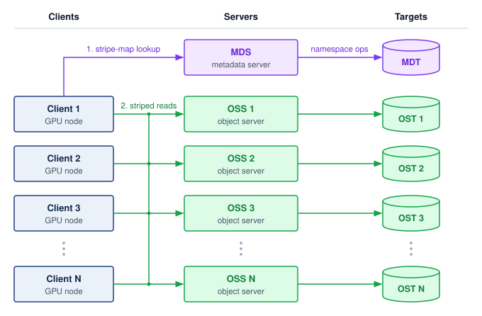{width="100%"}

<!--
```{.tikz}
\scalebox{0.92}{%
\begin{tikzpicture}[
  font=\sffamily,
  >=Stealth,
  client_box/.style={
    rectangle,
    rounded corners=3pt,
    draw=SteelBlue!80,
    fill=BlueFill!25,
    line width=0.7pt,
    minimum width=2.4cm,
    minimum height=0.86cm,
    inner sep=2pt,
    align=center
  },
  server_box/.style={
    rectangle,
    rounded corners=3pt,
    draw=TealLine!80,
    fill=TealFill!25,
    line width=0.7pt,
    minimum width=2.6cm,
    minimum height=0.86cm,
    inner sep=2pt,
    align=center
  },
  mds_box/.style={
    rectangle,
    rounded corners=3pt,
    draw=PurpleLine!80,
    fill=PurpleFill!35,
    line width=0.7pt,
    minimum width=2.6cm,
    minimum height=0.86cm,
    inner sep=2pt,
    align=center
  },
  target_box/.style={
    rectangle,
    rounded corners=3pt,
    draw=TealLine!80,
    fill=white,
    line width=0.7pt,
    minimum width=2.2cm,
    minimum height=0.86cm,
    inner sep=2pt,
    align=center
  },
  mdt_box/.style={
    rectangle,
    rounded corners=3pt,
    draw=PurpleLine!80,
    fill=white,
    line width=0.7pt,
    minimum width=2.2cm,
    minimum height=0.86cm,
    inner sep=2pt,
    align=center
  },
  stripe_chip/.style={
    rectangle,
    rounded corners=2pt,
    draw=TealLine!60,
    fill=white,
    line width=0.5pt,
    font=\fontsize{5.5pt}{6.5pt}\selectfont\bfseries,
    text=TealDark,
    inner xsep=3pt,
    inner ysep=1.5pt
  },
  line join=round, line cap=round, font=\small\sffamily
]

  % Column positions
  \def\xcli{-5.2}
  \def\xsrv{0.8}
  \def\xtgt{5.1}

  % Column Separators
  \draw[dashed, line width=0.6pt, GrayLine!25] (-2.2, -1.9) -- (-2.2, 5.35);
  \draw[dashed, line width=0.6pt, GrayLine!25] (3.1, -1.9) -- (3.1, 5.35);

  % Column Headers
  \node[anchor=center, font=\scriptsize\bfseries, text=TextDark] at (\xcli, 5.3)
    {Compute Clients ($C_i$)};
  \node[anchor=center, font=\scriptsize\bfseries, text=TextDark] at (\xsrv, 5.3)
    {Metadata \& Storage Servers};
  \node[anchor=center, font=\scriptsize\bfseries, text=TextDark] at (\xtgt, 5.3)
    {Storage Targets (OST / MDT)};

  % =============================================================
  % 1. ROW 0: METADATA SUBSYSTEM (MDS & MDT)
  % =============================================================
  \def\ymeta{4.25}

  \node[mds_box] (mds) at (\xsrv, \ymeta) {
    \textbf{\scriptsize\textcolor{PurpleLine}{MDS (Metadata)}}\\[1.5pt]
    \fontsize{6.5pt}{7.5pt}\selectfont\textcolor{TextBlack!70}{Namespace \& Layout}
  };

  \node[mdt_box] (mdt) at (\xtgt, \ymeta) {
    \textbf{\scriptsize\textcolor{PurpleLine}{MDT}}\\[1.5pt]
    \fontsize{6.5pt}{7.5pt}\selectfont\textcolor{PurpleLine!85!black}{Metadata Storage}
  };

  % Metadata ops arrow
  \draw[->, line width=0.9pt, PurpleLine, shorten >=2pt]
    (mds.east) -- node[above=2pt, font=\fontsize{6.5pt}{7.5pt}\selectfont\bfseries, text=PurpleLine] {namespace ops} (mdt.west);

  % =============================================================
  % 2. ROWS 1-3: CLIENTS, OSS NODES, AND STORAGE TARGETS
  % =============================================================

  % --- Row 1 (y = 2.8) ---
  \def\yrone{2.8}
  \node[client_box] (cl1) at (\xcli, \yrone) {
    \textbf{\scriptsize\textcolor{NavyBlue}{Client 1 (Primary)}}\\[1.5pt]
    \fontsize{6.5pt}{7.5pt}\selectfont\textcolor{TextBlack!70}{Reads 10 GB Shard}
  };

  \node[server_box] (oss1) at (\xsrv, \yrone) {
    \textbf{\scriptsize\textcolor{TealDark}{OSS-1}}\\[1.5pt]
    \fontsize{6.5pt}{7.5pt}\selectfont\textcolor{TextBlack!70}{Object Storage Server 1}
  };

  \node[target_box] (ost1) at (\xtgt, \yrone) {
    \textbf{\scriptsize\textcolor{TealDark}{OST-1}}\\[1.5pt]
    \fontsize{6.5pt}{7.5pt}\selectfont\textcolor{TealDark}{NVMe Target 1}
  };

  % --- Row 2 (y = 1.55) ---
  \def\yrtwo{1.55}
  \node[client_box] (cl2) at (\xcli, \yrtwo) {
    \textbf{\scriptsize\textcolor{NavyBlue}{Client 2}}\\[1.5pt]
    \fontsize{6.5pt}{7.5pt}\selectfont\textcolor{TextBlack!70}{GPU Trainer Node}
  };

  \node[server_box] (oss2) at (\xsrv, \yrtwo) {
    \textbf{\scriptsize\textcolor{TealDark}{OSS-2}}\\[1.5pt]
    \fontsize{6.5pt}{7.5pt}\selectfont\textcolor{TextBlack!70}{Object Storage Server 2}
  };

  \node[target_box] (ost2) at (\xtgt, \yrtwo) {
    \textbf{\scriptsize\textcolor{TealDark}{OST-2}}\\[1.5pt]
    \fontsize{6.5pt}{7.5pt}\selectfont\textcolor{TealDark}{NVMe Target 2}
  };

  % --- Row 3 (y = 0.3) ---
  \def\yrthr{0.3}
  \node[client_box] (cl3) at (\xcli, \yrthr) {
    \textbf{\scriptsize\textcolor{NavyBlue}{Client 3}}\\[1.5pt]
    \fontsize{6.5pt}{7.5pt}\selectfont\textcolor{TextBlack!70}{GPU Trainer Node}
  };

  \node[server_box] (oss3) at (\xsrv, \yrthr) {
    \textbf{\scriptsize\textcolor{TealDark}{OSS-3}}\\[1.5pt]
    \fontsize{6.5pt}{7.5pt}\selectfont\textcolor{TextBlack!70}{Object Storage Server 3}
  };

  \node[target_box] (ost3) at (\xtgt, \yrthr) {
    \textbf{\scriptsize\textcolor{TealDark}{OST-3}}\\[1.5pt]
    \fontsize{6.5pt}{7.5pt}\selectfont\textcolor{TealDark}{NVMe Target 3}
  };

  % --- Ellipsis Row (y = -0.5) ---
  \def\yrell{-0.5}
  \node[font=\bfseries, text=GrayLine!80] at (\xcli, \yrell) {$\vdots$};
  \node[font=\bfseries, text=GrayLine!80] at (\xsrv, \yrell) {$\vdots$};
  \node[font=\bfseries, text=GrayLine!80] at (\xtgt, \yrell) {$\vdots$};

  % --- Row N (y = -1.25) ---
  \def\yrfou{-1.25}
  \node[client_box] (cln) at (\xcli, \yrfou) {
    \textbf{\scriptsize\textcolor{NavyBlue}{Client $N$}}\\[1.5pt]
    \fontsize{6.5pt}{7.5pt}\selectfont\textcolor{TextBlack!70}{GPU Trainer Node}
  };

  \node[server_box] (ossn) at (\xsrv, \yrfou) {
    \textbf{\scriptsize\textcolor{TealDark}{OSS-$N$}}\\[1.5pt]
    \fontsize{6.5pt}{7.5pt}\selectfont\textcolor{TextBlack!70}{Object Storage Server $N$}
  };

  \node[target_box] (ostn) at (\xtgt, \yrfou) {
    \textbf{\scriptsize\textcolor{TealDark}{OST-$N$}}\\[1.5pt]
    \fontsize{6.5pt}{7.5pt}\selectfont\textcolor{TealDark}{NVMe Target $N$}
  };

  % =============================================================
  % 3. INTERCONNECT ROUTING & PARALLEL STRIPING PATHS
  % =============================================================

  % Step 1: Metadata Request (open -> stripe map)
  \draw[->, dashed, line width=0.9pt, PurpleLine, shorten >=2pt]
    (cl1.north) -- ++(0, 1.02) --
    node[midway, above=3pt, font=\fontsize{6.5pt}{7.5pt}\selectfont\bfseries, fill=PurpleFill!20, inner sep=2.5pt, rounded corners=2pt, draw=PurpleLine!50]
      {\textbf{1. open()} $\;\to\;$ query stripe layout} (mds.west);

  % Step 2: Parallel Striped Reads from Client 1 across OSS-1, OSS-2, OSS-3
  % Orthogonal fan-out bus from Client 1
  \coordinate (trunkC1) at (-1.8, \yrone);
  \draw[-, line width=1.1pt, TealLine] (cl1.east) --
    node[midway, above=2.5pt, font=\fontsize{6.5pt}{7.5pt}\selectfont\bfseries, fill=TealFill!40, draw=TealLine!50, rounded corners=2pt, inner sep=2pt, text=TealDark]
      {\textbf{2. Parallel Reads}} (trunkC1);

  % Stripe 0 to OSS-1
  \draw[->, line width=0.85pt, TealLine, shorten >=2pt] (trunkC1) --
    node[midway, above=2pt, stripe_chip] {Stripe 0} (oss1.west);

  % Stripe 1 to OSS-2
  \draw[->, line width=0.85pt, TealLine, shorten >=2pt] (trunkC1) |-
    node[near end, above=2pt, stripe_chip] {Stripe 1} (oss2.west);

  % Stripe 2 to OSS-3
  \draw[->, line width=0.85pt, TealLine, shorten >=2pt] (trunkC1) |-
    node[near end, above=2pt, stripe_chip] {Stripe 2} (oss3.west);

  % Client N connecting to cluster
  \draw[->, line width=0.85pt, SteelBlue!80, dashed, shorten >=2pt] (cln.east) --
    node[midway, above=2.5pt, font=\fontsize{6pt}{7pt}\selectfont\bfseries, fill=white, draw=SteelBlue!40, rounded corners=2pt, inner sep=2pt, text=NavyBlue]
      {Concurrent I/O} (ossn.west);

  % OSS to OST internal paths
  \draw[->, line width=0.9pt, TealLine, shorten >=2pt] (oss1.east) -- node[above, font=\tiny, text=TealDark] {I/O} (ost1.west);
  \draw[->, line width=0.9pt, TealLine, shorten >=2pt] (oss2.east) -- node[above, font=\tiny, text=TealDark] {I/O} (ost2.west);
  \draw[->, line width=0.9pt, TealLine, shorten >=2pt] (oss3.east) -- node[above, font=\tiny, text=TealDark] {I/O} (ost3.west);
  \draw[->, line width=0.9pt, TealLine, shorten >=2pt] (ossn.east) -- node[above, font=\tiny, text=TealDark] {I/O} (ostn.west);

  % =============================================================
  % 4. BOTTOM CARDS: LEGEND & STRIPING SUMMARY
  % =============================================================
  \def\ybot{-2.25}

  % Left card: Path Legend
  \node[
    rectangle,
    rounded corners=3pt,
    draw=GrayLine!35,
    fill=white,
    line width=0.7pt,
    minimum width=5.6cm,
    minimum height=1.05cm,
    anchor=north
  ] (leg_card) at (-3.4, \ybot) {};

  \draw[dashed, line width=0.9pt, PurpleLine]
    ($(leg_card.west) + (0.35, 0.20)$) -- ($(leg_card.west) + (0.95, 0.20)$);
  \node[anchor=west, font=\fontsize{6.5pt}{7.5pt}\selectfont\bfseries, text=PurpleLine]
    at ($(leg_card.west) + (1.1, 0.20)$) {Metadata Path (MDS / MDT Namespace)};

  \draw[line width=1.1pt, TealLine]
    ($(leg_card.west) + (0.35, -0.20)$) -- ($(leg_card.west) + (0.95, -0.20)$);
  \node[anchor=west, font=\fontsize{6.5pt}{7.5pt}\selectfont\bfseries, text=TealDark]
    at ($(leg_card.west) + (1.1, -0.20)$) {Parallel Striped Data Path (OSS / OST)};

  % Right card: File Striping Summary
  \node[
    rectangle,
    rounded corners=3pt,
    draw=GrayLine!35,
    fill=white,
    line width=0.7pt,
    minimum width=6.9cm,
    minimum height=1.05cm,
    anchor=north,
    align=center,
    inner sep=4pt
  ] (strip_card) at (3.15, \ybot) {
    \textbf{\scriptsize\textcolor{TextDark}{File Striping \& Bandwidth Aggregation}}\\[2pt]
    \tiny\textcolor{TextMuted}{A 4 GB shard striped across 100 OSTs $\times$ 40 MB stripes delivers $\sim$1 TB/s aggregated cluster I/O}
  };

\end{tikzpicture}%
}
```
-->

:::

This abstract architecture has concrete implications for performance tuning. When a training job creates a new dataset directory on Lustre, the administrator configures the stripe count\index{Striping!stripe count} (the number of object storage targets, or OSTs, a file is spread across) and stripe size\index{Striping!stripe size} (the chunk size written to each OST) for that directory [@lustreSetstripe]. For large sequential-read training shards, administrators may choose wider striping and multi-megabyte stripe sizes so a single file can draw bandwidth from multiple OSS nodes. Lustre's striping guide treats wide striping as useful for very large files or files accessed by many clients, while smaller files often use fewer stripes to reduce overhead [@lustreFileStripingGuide]. A 4 GB data shard striped across 100 OSTs with 4 MB stripes places roughly 10 stripes on each OST. When a data loader reads large contiguous ranges, the Lustre client can issue parallel read requests to the OSS nodes holding those stripes, aggregating their bandwidth. The client also maintains its own read-ahead buffer, prefetching the next several stripes while the application processes the current ones. This file-system-level read-ahead is distinct from the data loader's application-level prefetch buffer; the two layers of prefetching compound to provide deep latency hiding, making the physical distance to the OSS nodes nearly transparent to the training process.

[^fn-oss-pfs-disambiguation]: **OSS (object storage server)**\index{Object storage server!PFS disambiguation}: In parallel file system terminology, "object" means a chunk of striped file data managed by an object storage target, a usage that predates cloud object storage (S3, GCS) by over a decade. Confusing the two is a common source of miscommunication: when a Lustre administrator says "add more OSS nodes," they mean adding data-serving capacity to the parallel file system, not provisioning cloud buckets.

[^fn-lustre-parallel-origin]: **Lustre**\index{Lustre!etymology}: A portmanteau of "Linux" and "cluster," developed at Carnegie Mellon University and first deployed in production in 2003. Lustre is common in HPC and ML infrastructure because its architecture scales aggregate bandwidth linearly with the number of OSS nodes, the same property that makes it a natural choice for training clusters where a single job may demand hundreds of GB/s of sustained read throughput.

The separation between metadata and data paths is what enables the aggregate bandwidth that ML workloads demand. In GPFS[^fn-gpfs-parallel-filesystem] (IBM Spectrum Scale), the architecture takes a different approach: it stripes data and metadata across shared disks and coordinates concurrent access through token-based distributed locking [@schmuck2002gpfs]. The result is not a simple MDS/OSS split; it is a shared-disk design whose metadata and data placement can be distributed while the lock protocol preserves consistency across clients. The trade-off is greater complexity in lock management, which must scale to thousands of nodes.

[^fn-gpfs-parallel-filesystem]: **GPFS (General Parallel File System)**\index{GPFS!distributed metadata}: Developed by IBM Research starting in 1998, now marketed as IBM Spectrum Scale. For ML checkpoint writes, its token-based distributed coordination can reduce reliance on a single dedicated metadata path, but it also makes lock behavior part of the performance envelope.

The data path scales with the number of object storage servers, but every file still begins with a request to the metadata service, and that service has a finite operation rate. That finite rate is the source of the small file problem\index{Small file problem!metadata bottleneck}. The per-open cost that @sec-storage-data-formats charged to one node's CPU now lands on a metadata service shared by the whole fleet. Each `open()` system call requires a metadata lookup, lock acquisition, and attribute fetch. When a dataset of millions of 10 KB images is stored as individual files and 10,000 workers, a fleet several times the running cluster, each open a new file every few samples, the aggregate open rate exceeds the few hundred thousand operations per second an MDS typically serves. The MDS becomes the serialization point, and delivery collapses to its operation rate long before the data links saturate.

```{=latex}
\Needspace{15\baselineskip}
```

::: {#dfn-data-storage-small-file-problem .callout-definition title="Small file problem"}

***Small file problem***\index{Small file problem!definition} is an ML data-loading pathology in which per-file operations overwhelm a storage system's metadata service.

1.  **Significance**: `open`, `stat`, and `close` requests from 10,000 workers can serialize at the metadata service, idle the cluster, and reduce effective I/O bandwidth $(\StorageBandwidth)$.
2.  **Distinction**: This is a metadata request-rate and latency $(\Latency)$ problem, not a bulk bit-rate problem.
3.  **Common pitfall**: Faster SSDs do not fix this format problem\index{Small file problem!format packaging}. Packing samples into sequential containers such as TFRecord\index{TFRecord!sequential container} or Parquet amortizes metadata operations across many samples.

:::

At production scale, the metadata bottleneck can collapse an otherwise high-bandwidth file system. When a cluster migrates from aggregated containers back to individual sample files, metadata request queues saturate long before the underlying storage servers or network links reach their byte-rate limits.

```{python}
#| echo: false
#| label: storage-metadata-meltdown-example
# ┌─────────────────────────────────────────────────────────────────────────────
# │ METADATA MELTDOWN FILE COUNTS (LEGO)
# ├─────────────────────────────────────────────────────────────────────────────
# │ Context: The metadata meltdown example callout below.
# │
# │ Goal: Size the file-count reduction from packaging samples into shards.
# │ Show: 200 million files into 50,000 shards, 4,000x fewer files, 500 GB/s rated.
# │ How:  Scenarios.ImageFileMetadataMeltdown.
# └─────────────────────────────────────────────────────────────────────────────
from mlsysim import Scenarios
from mlsysim.core.units import GB, second
from mlsysim.fmt import check, fmt, fmt_bandwidth, fmt_count, fmt_multiple

class MetadataMeltdownCounts:
    # ┌── 1. LOAD ─────────────────────────────────────────
    meltdown = Scenarios.ImageFileMetadataMeltdown
    files = meltdown.files
    shards = meltdown.shards
    rated_bw = meltdown.rated_bandwidth

    # ┌── 2. EXECUTE ──────────────────────────────────────
    files_per_shard = meltdown.files_per_shard

    # ┌── 3. GUARD ────────────────────────────────────────
    check(abs(files_per_shard - 4000) < 1e-9, "Prose says 4,000x fewer files")

    # ┌── 4. OUTPUT ───────────────────────────────────────
    files_str = fmt_count(files, scale="million", precision=0, scale_style="word")
    shards_str = fmt(shards, precision=0, commas=True)
    rated_bw_str = fmt_bandwidth(rated_bw, unit=GB / second, precision=0, commas=False)
    files_per_shard_mult_str = fmt_multiple(files_per_shard, precision=0, commas=True)
```

::: {#exmp-data-storage-metadata-meltdown .callout-example title="The metadata meltdown"}

**Scenario**: A large-scale training cluster migrates from a preprocessed sequential dataset to `{python} MetadataMeltdownCounts.files_str` raw image files stored individually on a parallel file system provisioned for `{python} MetadataMeltdownCounts.rated_bw_str` aggregate bandwidth.

**Diagnosis**: The file system delivers less than 1 percent of rated throughput. Millions of per-second `stat()` and `open()` calls overwhelm the metadata servers, choking data loaders despite abundant network and storage bandwidth.

**Systems lesson**: Metadata contention limits delivery when operation demand exceeds metadata service capacity. Bundling `{python} MetadataMeltdownCounts.files_str` raw images into `{python} MetadataMeltdownCounts.shards_str` large tar shards (for example, WebDataset) reduces the file count by `{python} MetadataMeltdownCounts.files_per_shard_mult_str` and amortizes per-file operations across samples. Packaging alone does not prevent startup contention if loaders still enumerate files with per-file `stat()` calls; distributing a precomputed dataset manifest removes those repeated lookups from the hot path. Measure metadata operation rate alongside byte bandwidth to determine which service limits delivery.

:::

Striping\index{Striping!data distribution} and aggregation\index{Aggregation!small-file mitigation} solve different problems: striping distributes large files across data servers, whereas aggregation, the shard packaging of @sec-storage-data-formats, reduces the number of files the MDS must track. Realized bandwidth then depends on the reader. A read contained within one stripe uses a single server, while enough concurrent reads spanning stripes can draw from several servers at once. Wider striping therefore helps only when read sizes and concurrency exploit those paths, and small files usually need fewer stripes.

Parallel file systems provide a shared namespace and lock management that support coordinated checkpoints\index{Checkpointing!shared namespace coordination} [@schmuck2002gpfs], but the two ML write patterns need different guarantees from them. Immutable training shards remove conflicts with concurrent writers once the dataset version has been published, so readers need only agree on which completed version belongs to the run. A checkpoint needs more: file-system locks coordinate individual writes, and a completed write to one file does not establish that the other shards are complete, so a multi-file generation needs an application-level publication protocol, developed in @sec-storage-checkpointing.

The performance of a parallel file system depends on the *balance* of load across OSS nodes as well as their *number*. If a shard uses 10 of 100 equally provisioned OSS nodes, those servers offer at most 10 percent of the system's aggregate server bandwidth. Realized delivery can be lower because of client limits, request size, or insufficient concurrency. Conversely, when many concurrent readers draw on shards striped across all 100 servers, demand spreads over every server and realized bandwidth can approach the system's rating, provided the clients and network keep pace. Placement and access scheduling therefore matter alongside the number of storage servers, and a simple shard-assignment calculation shows how an imbalance can arise even when aggregate storage capacity looks ample.

```{python}
#| echo: false
#| label: shard-contention-notebook
# ┌─────────────────────────────────────────────────────────────────────────────
# │ SHARD CONTENTION PROBABILITY (NOTEBOOK)
# ├─────────────────────────────────────────────────────────────────────────────
# │ Context: "The Thundering Herd: Shard Contention" .callout-notebook
# │
# │ Goal: Quantify the probability of multiple GPUs hitting the same storage shard.
# │ Show: contention_prob_pct ≈ 40%—inline in notebook result.
# │ How: Pr(at least one collision) = 1 - (Shards! / (Shards^Workers * (Shards-Workers)!)).
# │
# └─────────────────────────────────────────────────────────────────────────────
from mlsysim.fmt import check, fmt, fmt_count
import math

class ShardContention:
    # ┌── 1. LOAD ──────────────────────────────────────────
    n_workers = 32  # GPUs in a data-parallel group
    n_shards = 1000  # Total shards in the dataset
    # ┌── 2. EXECUTE ───────────────────────────────────────
    # Classic birthday problem: Pr(no collision)
    # For small n_workers/K_shards, approx exp(-n_workers^2 / (2 K_shards))
    p_no_collision = math.exp(-(n_workers**2) / (2 * n_shards))
    p_collision = 1 - p_no_collision
    # ┌── 3. GUARD ─────────────────────────────────────────
    check(0.3 < p_collision < 0.5, f"Prob {p_collision:.2f} unexpected")
    # ┌── 4. OUTPUT ────────────────────────────────────────
    sc_n_workers_str = fmt_count(n_workers, commas=False, label="worker")
    sc_n_shards_str = fmt(n_shards, precision=0, commas=True)
    sc_collision_prob_str = fmt_percent(p_collision, precision=1, commas=False, style='prose')
```

```{=latex}
\Needspace{18\baselineskip}
```

::: {#nbk-data-storage-thundering-herd-shard-contention .callout-notebook title="The thundering herd: Shard contention"}

**Problem**: A dataset is split into `{python} ShardContention.sc_n_shards_str` shards on a shared file system. If `{python} ShardContention.sc_n_workers_str` each pick a shard at random to start their next epoch, what is the probability that at least two GPUs "collide" on the same shard, creating a potential read hotspot? A shard collision does not imply a server collision unless the placement maps each shard to a distinct server.

**Math**:
This is a variant of the "Birthday Problem" in probability.

1. **Probability of No Collision**: $\approx e^{-\ShardReaderCount^2/(2\DatasetShardCount)} = e^{-32^2/2{,}000} \approx 0.60$.
2. **Probability of Contention**: $1 - 0.60 = 40\%$.

**Systems insight**: With `{python} ShardContention.sc_n_workers_str` and `{python} ShardContention.sc_n_shards_str` shards, the `{python} ShardContention.sc_collision_prob_str` collision probability identifies a potential storage-shard hotspot\index{Shard contention!collision probability}. Whether that collision delays workers depends on shard placement, caching, and available service capacity. Coordinating shard assignments can reduce this source of tail latency\index{Tail latency!storage shard contention} when assignments spread demand across independently serving devices while preserving the intended sampling policy.

:::

```{python}
#| echo: false
#| label: storage-tail-fanout-calc
# ┌─────────────────────────────────────────────────────────────────────────────
# │ STORAGE TAIL FAN-OUT (LEGO)
# ├─────────────────────────────────────────────────────────────────────────────
# │ Context: Tail-latency paragraph below.
# │
# │ Goal: Probability that a step reading from many servers meets no slow one.
# │ Show: 100 servers, each slow 1 percent of the time: 0.99^100 = 0.366, so
# │       over 63 percent of steps meet a slow response.
# │ How:  Scenarios.StorageTailFanout100 (all_up = a^N).
# └─────────────────────────────────────────────────────────────────────────────
import math
from mlsysim import Scenarios
from mlsysim.fmt import check, fmt, fmt_int, fmt_math, fmt_percent

class StorageTailFanout:
    # ┌── 1. LOAD ─────────────────────────────────────────
    fanout = Scenarios.StorageTailFanout100
    servers = fanout.n_components
    fast_share = fanout.availability

    # ┌── 2. EXECUTE ──────────────────────────────────────
    all_fast = fanout.all_up
    some_slow = 1 - all_fast
    some_slow_floor_pct = math.floor(some_slow * 100)  # prose says "over"

    # ┌── 3. GUARD ────────────────────────────────────────
    check(round(all_fast, 3) == 0.366, "Prose quotes 0.99^100 = 0.366")
    check(some_slow * 100 > some_slow_floor_pct, "Prose says over 63 percent")

    # ┌── 4. OUTPUT ───────────────────────────────────────
    servers_str = fmt_int(servers)
    slow_pct_str = fmt_percent(round(1 - fast_share, 2), precision=0, commas=False, style="prose")
    all_fast_math = fmt_math(f"{fmt(fast_share, precision=2, commas=False)}^{{{servers}}} = {fmt(all_fast, precision=3, commas=False)}")
    some_slow_pct_str = fmt_percent(some_slow_floor_pct / 100, precision=0, commas=False, style="prose")
```

At the scale of thousands of nodes, tail latency [@dean2013] can dominate exposed input wait. If a training step requires data from `{python} StorageTailFanout.servers_str` storage servers and each independently has a `{python} StorageTailFanout.slow_pct_str` chance of being slow, the probability that all `{python} StorageTailFanout.servers_str` respond quickly is `{python} StorageTailFanout.all_fast_math`, meaning over `{python} StorageTailFanout.some_slow_pct_str` of these request sets contain at least one slow response. Shared congestion can correlate delays, changing that probability. A slow response delays the step only when prefetching fails to hide it and the required input lies on the step's critical path. When it does, the delay is not confined to one worker, because synchronous data-parallel training waits for every worker at the next collective, so one late fetch stretches the whole fleet's step.

Systems can mitigate tail latency through hedged requests\index{Hedged requests!tail latency mitigation}: after a chosen delay, the client issues a redundant read to another replica and uses the first valid response. The trigger delay trades faster tail completion against extra work [@dean2013tail]. An independence model can multiply the probabilities of two slow replicas, but shared congestion and the later start of the hedge invalidate a simple squared-probability latency guarantee. Issuing a hedge at the median response time would duplicate roughly half of requests before accounting for cancellation; that load can worsen the congestion the scheme aims to avoid. A hedge therefore pays off only when its trigger sits in the measured tail and the duplicate traffic it adds stays within the spare service capacity.

::: {.column-margin .margin-pointer}
↪ Tail latency as a serving constraint, where routing and load balancing decide which requests miss the p99 target, is developed in @sec-inference-scale-load-balancing-request-routing-4997.
:::

The effectiveness of hedged requests depends on the replicated data layout. If both replicas reside on OSS nodes that share the same network switch, a switch failure makes both copies simultaneously unavailable. Effective hedging requires failure-domain-aware placement\index{Failure-domain-aware placement!replica distribution}: replicas should reside in different racks, connected through different top-of-rack switches, so that the failure of any single component affects at most one replica.

In production clusters, the parallel file system is a shared utility, simultaneously servicing many concurrent training jobs with different I/O patterns. At any given moment, a large language model job might be streaming sequentially through text shards, a computer vision job might be reading random image shards, and a checkpoint storm from a third job could be saturating write bandwidth. This concurrency gives rise to the noisy neighbor problem\index{Noisy neighbor problem!PFS interference}, where one job's I/O pattern severely degrades performance for all other jobs. A checkpoint save that consumes a disproportionate share of the PFS's internal network bandwidth causes read latency for other jobs to spike, potentially stalling their training pipelines. PFS administrators mitigate this through I/O scheduling policies (quality-of-service tiers, bandwidth quotas per job), but these policies add administrative complexity and can reduce peak single-job throughput.

A related challenge is namespace isolation\index{Namespace isolation!striping configuration}. Different teams and workloads require different storage configurations. A team training on millions of 100 KB images first needs to aggregate samples to reduce metadata operations; increasing stripe count does not remove per-file metadata work. A team working with large video shards can use wider striping when read sizes and concurrency exploit the additional data paths. Misconfigured striping for one team's workload can create hotspots that degrade performance for the entire shared file system. The impact of sharing is easy to quantify. A PFS with 1 TB/s aggregate bandwidth, shared across 10 concurrent training jobs, provides only 100 GB/s per job on average. If one job's checkpoint storm consumes 400 GB/s for 10 seconds, the remaining nine jobs share 600 GB/s, a 33 percent reduction that can trigger data stalls in their accelerator pipelines.

::: {#chk-data-storage-parallel-file-system-design .callout-checkpoint title="Parallel file system design"}

Consider a training cluster with 512 nodes, each running 8 GPUs. The training job requires 400 GB/s of aggregate read bandwidth.

- [ ] **OSS count**: calculate the number of OSS nodes required when each Lustre OSS delivers 10 GB/s.
- [ ] **Metadata cost**: calculate the time required to open 200 million `{python} TextImageBandwidth.image_size_kb_str` image files sequentially when each `open()` call takes 50 $\MicroUnitPrefix$s on the MDS, then state the practical implication.
- [ ] **Shard count**: calculate the number of metadata operations needed to read the full dataset when images are bundled into 4 GB tar files.

:::

Parallel file systems solve the shared-namespace problem for active training clusters, but their cost per byte is too high for the organization's complete data holdings. The petabytes of raw training data, historical checkpoints, and preprocessed datasets that an ML organization accumulates over years require a tier optimized for capacity and durability rather than bandwidth.

### Tier 4 object storage {#sec-storage-tier4-object}

Keeping petabytes of raw corpora, preprocessed shards, and historical checkpoints on a parallel file system would pay high-bandwidth server rates for data that sits mostly at rest. At petabyte scale, object storage\index{Object storage!cloud storage tier} provides the durable, lower-cost foundation of the hierarchy. Services like Amazon S3\index{Amazon S3!key-value namespace} and Google Cloud Storage\index{Google Cloud Storage!key-value namespace} organize data in object namespaces where objects are retrieved by keys rather than by POSIX directory paths [@awsS3ObjectKeys; @googleCloudStorageObjects]. Unlike file systems, which organize data in hierarchical directories with metadata-rich operations (rename, link, permission inheritance), object storage treats each object as an opaque blob identified by a unique key. The simpler interface changes the namespace operations exposed to clients; the service still manages metadata for placement, versions, access control, and integrity as capacity grows.

Services such as Amazon S3 publish an "eleven nines"[^fn-durability-nines-availability] annual durability target (99.999999999 percent). Erasure coding,[^fn-reedsolomon-erasure-coding] replication, placement, and repair contribute to storage protection, but a coding scheme alone does not establish a service's durability target. Selecting a source-of-truth tier for training data and checkpoint archives requires checking the chosen service's failure model alongside versioning, lifecycle policy, access control, and recovery testing.

Three different guarantees govern whether that source of truth is usable. Durability\index{Durability!storage} asks whether acknowledged data survives failures; availability\index{Availability!storage} asks whether the storage service responds when a client needs it; and consistency\index{Consistency!storage} asks which version a read is allowed to observe when writes overlap or replicas disagree. Replication can improve durability and availability without by itself guaranteeing that a reader sees the newest committed checkpoint. A recovery design must therefore state all three properties instead of treating a durability percentage as a complete reliability contract.

[^fn-reedsolomon-erasure-coding]: **Erasure coding**\index{Erasure coding!Reed-Solomon codes}: Built on Reed-Solomon codes [@reed1960], which use maximum-distance-separable coding to recover the original data from any sufficient subset of encoded fragments. In storage systems, Reed-Solomon-style codes and later local-reconstruction variants trade storage overhead against repair bandwidth and degraded-read cost [@plank1997; @huang2012erasure]. Local-reconstruction codes, for example, read fewer surviving fragments to rebuild a lost one, cutting repair traffic at the price of a little extra capacity.

[^fn-durability-nines-availability]: **Eleven nines (99.999999999 percent durability)**\index{Durability!eleven nines}: A design target of 11 nines annual durability corresponds to an expected loss probability of about $10^{-11}$ per object-year; for one million objects, that is about one expected object loss per 100,000 years.

::: {#dfn-data-storage-erasure-coding .callout-definition title="Erasure coding"}

***Erasure coding***\index{Erasure coding!definition} protects stored data by adding redundant fragments, with the Reed-Solomon scheme considered here encoding $\ErasureDataFragmentCount$ data and $\ErasureParityFragmentCount$ parity blocks so that any $\ErasureDataFragmentCount$ remaining fragments recover the original.

1.  **Significance**: Coding can protect against fragment loss with less capacity overhead than full replication. A 4+2 Reed-Solomon code stores four data fragments and two parity fragments, tolerating two unavailable fragments at 1.5$\times$ storage overhead instead of the 3$\times$ overhead of triple replication. Actual durability also depends on failure correlation, placement, detection, and repair.
2.  **Distinction**: Unlike replication (which stores complete copies), erasure coding uses mathematical encoding (for example, Reed-Solomon) to distribute redundant information across different failure domains (disks, racks, or sites).
3.  **Common pitfall**: A frequent misconception is that erasure coding is "free durability." In reality, it is a latency-compute trade-off\index{Latency!compute trade-off}: reconstructing data after a failure requires additional CPU cycles and increases the p99 latency of the storage read.

:::

Erasure coding lets the service recover data without requiring the training application to manage fragments. In the form considered here, the service retains the original $\ErasureDataFragmentCount$ data fragments alongside parity, so healthy reads can use the data fragments directly. When a required fragment is unavailable, reconstruction uses surviving data and parity fragments. The object interface hides that recovery procedure, but additional I/O, network traffic, and decoding can remain visible as longer read latency. Protection against data loss does not imply unchanged service time during a failure.

```{python}
#| echo: false

# ┌─────────────────────────────────────────────────────────────────────────────
# │ OBJECT STORAGE ANNUAL COST COMPARISON
# ├─────────────────────────────────────────────────────────────────────────────
# │ Context: Tier 4 rate ratio and @sec-storage-economics 100 TB tier costs;
# │          the single computation of the 100 TB S3, NVMe, and egress costs.
# │
# │ Goal:    Quantify yearly storage cost at the object and NVMe tiers.
# │ Show:    $24,000/yr for S3 Standard (low tier); $120,000/yr for NVMe.
# │ How:     100 TB × 1000 GB/TB × $/GB/month × 12 months.
# │
# └─────────────────────────────────────────────────────────────────────────────

from mlsysim.core.units import month

class ObjectStorageCost:
    # ┌── 1. LOAD ─────────────────────────────────────────
    bill = Scenarios.ObjectStorage100TB
    dataset_size_tb = bill.dataset_bytes.to(TB).magnitude
    cost_s3_gb_mo = bill.storage_rate.to(USD / (GB * month)).magnitude
    cost_nvme_gb_mo = Infrastructure.Pricing.Storage.NvmeLowPerTbMonth.rate.to(USD / (GB * month)).magnitude

    # ┌── 2. EXECUTE ──────────────────────────────────────
    s3_annual_val = bill.result.storage_cost
    nvme_annual_val = (bill.dataset_bytes * Infrastructure.Pricing.Storage.NvmeLowPerTbMonth.rate * bill.billing_period).to(USD).magnitude

    # ┌── 3. GUARD ────────────────────────────────────────
    from mlsysim.fmt import check, fmt_usd

    check(nvme_annual_val > s3_annual_val, "NVMe cost should be higher than S3")
    nvme_s3_ratio_val = cost_nvme_gb_mo / cost_s3_gb_mo
    egress_once_val = bill.result.egress_per_read

    # ┌── 4. OUTPUT ───────────────────────────────────────
    s3_annual_usd_str = fmt_usd(s3_annual_val, precision=0)
    nvme_annual_usd_str = fmt_usd(nvme_annual_val, precision=0)
    s3_rate_gb_mo_str = fmt_usd(cost_s3_gb_mo, precision=2, commas=False, per="GB/month")
    nvme_s3_ratio_mult_str = fmt_multiple(nvme_s3_ratio_val, precision=0, commas=False)
    dataset_tb_str = fmt_memory(dataset_size_tb * TB, unit=TB, precision=0, commas=False)
    egress_once_usd_str = fmt_usd(egress_once_val, precision=0)
```

Object storage also costs less per byte. At a representative `{python} ObjectStorageCost.s3_rate_gb_mo_str`, its recurring capacity rate is `{python} ObjectStorageCost.nvme_s3_ratio_mult_str` lower than the local-NVMe rate assumed here, and @sec-storage-economics converts that ratio into annual costs for a `{python} ObjectStorageCost.dataset_tb_str` dataset. Comparing it with HBM acquisition cost additionally requires a hardware lifetime and utilization assumption. This cost advantage makes object storage a common home for the organization's training data lake, where raw data, preprocessed datasets, and archived model artifacts can reside durably.

Request latency also matters. Design estimates use 50 to 100 ms for an object GET as a representative planning range rather than a universal service guarantee. Much of that delay is the price of the indirection that provides durability. The service looks up the object's location in a distributed metadata index, determines which fragments to read, fetches them from potentially different storage nodes, and reconstructs data when a fragment is unavailable, all on top of the client network path and queueing. Large transfers amortize per-request overhead across more bytes, while small transfers can spend most of their elapsed time on that overhead. Request size and concurrency therefore enter the delivery budget alongside aggregate bandwidth.

The remedy is the shard packaging of @sec-storage-data-formats, applied here to request latency rather than metadata operations. Formats like WebDataset\index{WebDataset!object storage streaming} [@aizman2019] or Mosaic Streaming\index{Mosaic Streaming!object storage streaming} [@mosaicStreamingMainConcepts] bundle samples into multi-gigabyte shards that transform high-latency random access into high-bandwidth sequential streaming. Rather than issuing billions of small GET requests, the data loader issues hundreds of large reads in parallel, each fetching an entire shard that contains thousands of samples. With sufficient parallelism and colocated network capacity, object storage can sustain high aggregate throughput, enough to feed large training clusters for some workloads. The streaming pattern works by assigning each data loader worker a subset of shards and having it read them sequentially. Within each shard, samples are stored contiguously, so the worker decodes them in order and shuffles them in a local buffer. This approach achieves pseudo-random access across the dataset while maintaining sequential I/O at the storage level.

The architecture of a streaming data loader\index{Data loader!object storage streaming} for object storage differs from a local-storage loader in important ways. A local-storage loader can use memory-mapped I/O to treat the dataset as a virtual memory region, relying on the operating system's page fault mechanism to load data on demand. This approach is elegant but incompatible with object storage, which does not support the POSIX file system interface that memory mapping requires. Instead, an object-storage loader must explicitly manage HTTP connections, issue ranged GET requests for specific byte ranges within shards, handle retries on transient failures, and manage a local buffer pool for decoded samples. Libraries like WebDataset and Mosaic Streaming encapsulate this complexity, presenting a simple iterator interface to the training loop while managing the HTTP transport and buffering internally.

```{python}
#| echo: false
# ┌── LEGO ───────────────────────────────────────────────
# │ Context: object-storage streaming paragraph
from mlsysim.fmt import fmt, fmt_bandwidth, fmt_memory

class ObjectStreamContext:
    training_tokens = ReferenceStats.StorageTrainingCorpus.TrainingTokens
    token_id_bytes = ReferenceStats.StorageTrainingCorpus.TokenIdBytes
    tokenized_shard = ReferenceStats.StorageTrainingCorpus.TokenizedShardSize
    step = ReferenceStats.StorageTrainingCorpus.StepTime
    n_gpus = Scenarios.TextInputDemand2K.consumers  # the chapter's 2,048-GPU running cluster
    tokens_per_gpu = Scenarios.TextInputDemand2K.samples_per_step
    tokenized_text = training_tokens * token_id_bytes
    tokenized_shard_count_val = Scenarios.Gpt3StorageFootprint.result.shard_count
    text_bw = Scenarios.TextInputDemand2K.result.bandwidth
    n_nodes = Systems.Clusters.Production_2K.count  # the chapter's 256-node running cluster
    workers_per_node = 8  # scenario assumption: data-loader workers per node
    shards_per_node_val = round(tokenized_shard_count_val / n_nodes)
    concurrent_requests_val = n_nodes * workers_per_node
    # ┌── 4. OUTPUT (Formatting) ──────────────────────────────────────────────
    text_bw_mb_per_s_str = fmt_bandwidth(text_bw, unit=MB / second, precision=1, commas=False)
    tokenized_shard_count_str = fmt(tokenized_shard_count_val, precision=0)
    tokenized_shard_gb_str = fmt_memory(tokenized_shard, unit=GB, precision=0, commas=False)
    n_nodes_str = fmt_count(n_nodes, commas=True)
    workers_per_node_str = fmt_int(workers_per_node)
    shards_per_node_str = fmt_int(shards_per_node_val)
    concurrent_requests_str = fmt_count(concurrent_requests_val, commas=True)
```
Applying this streaming architecture to the running example makes the design concrete as an alternative to the staged path the chapter adopts. Instead of copying shards to local NVMe at job start, the cluster would read them from the object store throughout the run. The tokenized training set is stored in an S3-like object store as roughly `{python} ObjectStreamContext.tokenized_shard_count_str` shards of `{python} ObjectStreamContext.tokenized_shard_gb_str` each. The streaming architecture assigns each of the `{python} ObjectStreamContext.n_nodes_str` compute nodes a unique subset of roughly `{python} ObjectStreamContext.shards_per_node_str` shards. Within each node, `{python} ObjectStreamContext.workers_per_node_str` data loader worker processes issue concurrent HTTP `Range` requests to fetch 256 MB chunks from their assigned shards. Across the cluster, this results in `{python} ObjectStreamContext.concurrent_requests_str` concurrent requests, allowing aggregate throughput in the 50--100 GB/s range when the object store and network path are provisioned for it, far exceeding the roughly `{python} ObjectStreamContext.text_bw_mb_per_s_str` required by the generic text job in the text-versus-image comparison. The running example's average input demand is lower still. At these provisioned service rates, the network between the compute virtual private cloud (VPC) and the object-storage endpoint can limit maximum streaming throughput without making input delivery the running job's bottleneck. Organizations that co-locate compute and storage in the same cloud availability zone can reduce cross-network latency, directly reducing the required prefetch buffer depth and improving overall pipeline efficiency.

That request parallelism is what object storage rewards. Each of the `{python} ObjectStreamContext.concurrent_requests_str` GET requests is independent and can be served by a different storage node within the cloud provider's infrastructure, and the count grows with the fleet. With each request fetching a 256 MB chunk of a shard, the aggregate throughput depends on the cloud provider's network capacity, internal bandwidth, and request-rate quotas. The practical limit is often the network bandwidth between the compute cluster and the object storage service, not the storage service's internal media bandwidth.

Many object storage services provide strong read-after-write consistency\index{Consistency!read-after-write}, which means that a subsequent read of an acknowledged object sees the completed write. Amazon S3 announced strong read-after-write consistency for object writes and overwrites, together with strongly consistent listing, in December 2020 [@aws2020s3]. The relevant contract is the documented behavior of the chosen backend, not a blanket assumption about object storage. Per-object consistency still does not make a checkpoint spanning many objects atomic, so the publication protocol of @sec-storage-checkpointing applies here as it does on a file system.

The scale of ML datasets makes them vulnerable to silent data corruption\index{Silent data corruption!bit flips and degradation}: subtle bit flips in the storage medium or during network transfer that can introduce training artifacts nearly impossible to diagnose. Object storage services provide per-object checksums\index{Checksum!object storage verification} that verify integrity on upload, copy, or download; Amazon S3, for example, documents checksum options including CRC-family and cryptographic hashes [@awsS3ObjectIntegrity]. Parallel file systems often rely on underlying RAID or erasure coding for physical integrity but may not provide end-to-end checksums visible to the application. A well-engineered large-scale ML pipeline computes and stores a checksum for each data shard during preprocessing and verifies it when the shard is first loaded by a training worker. The verification overhead is negligible compared to the cost of training on corrupted data, and checkpoints need the same check, because a flipped bit in restored state can make training diverge silently after recovery.

::: {.column-margin .margin-pointer}
↪ Detecting and verifying silent data corruption across the fleet, including in restored checkpoints, is developed in @sec-ft-sdc-verification.
:::

Training datasets can contain sensitive information, including personal data, proprietary text, and licensed images. Storage design must carry the organization's access and retention policies through every copy. Object services expose identity policies and encryption options; parallel file systems provide POSIX permissions\index{POSIX!permissions and ACLs} and access-control lists. Audit coverage and enforcement depend on the configured platform, not the tier's name. Versioned manifests should identify derived shards and retained copies so that access reviews, retention decisions, and deletion workflows can locate the relevant artifacts; a deletion request, for example, must reach every immutable preprocessed shard derived from the deleted record. Storage controls protect stored bytes; evaluating what a trained model retains requires additional model-level analysis.

```{python}
#| echo: false
#| label: storage-glacier-cost-calc
# ┌─────────────────────────────────────────────────────────────────────────────
# │ ARCHIVE TIER ANNUAL COST
# ├─────────────────────────────────────────────────────────────────────────────
# │ Context: @sec-storage-tier5-archive rate ratio and the 100 TB archive cost
# │          quoted in @sec-storage-economics.
# │
# │ Goal:    Compute annual Glacier cost for 100 TB dataset.
# │ Show:    $4,800/year at $0.004/GB/month.
# │ How:     100 TB × 1000 GB/TB × $0.004/GB/month × 12 months.
# │
# └─────────────────────────────────────────────────────────────────────────────
from mlsysim import Infrastructure, GB, THOUSAND, USD, ureg
from mlsysim.fmt import check, fmt_usd
from mlsysim.core.units import month

class GlacierCost:
    # ┌── 1. LOAD ─────────────────────────────────────────
    dataset_size_tb = 100
    cost_glacier_gb_mo = Infrastructure.Pricing.Storage.GlacierStandardPerTbMonth.rate.to(USD / (GB * month)).magnitude

    # ┌── 2. EXECUTE ──────────────────────────────────────
    dataset_size = dataset_size_tb * THOUSAND * GB
    glacier_annual_cost = dataset_size * (cost_glacier_gb_mo * USD / (GB * month)) * 12 * month

    cost_s3_gb_mo = Infrastructure.Pricing.Storage.S3StandardLowPerTbMonth.rate.to(USD / (GB * month)).magnitude
    s3_glacier_ratio_val = cost_s3_gb_mo / cost_glacier_gb_mo

    # ┌── 3. GUARD ────────────────────────────────────────
    check(glacier_annual_cost.to(USD).magnitude > 0, "Glacier annual cost should be positive")

    # ┌── 4. OUTPUT ───────────────────────────────────────
    glacier_annual_usd_str = fmt_usd(glacier_annual_cost, precision=0)
    glacier_rate_gb_mo_str = fmt_usd(cost_glacier_gb_mo, precision=3, commas=False, per="GB/month")
    s3_rate_gb_mo_str = fmt_usd(cost_s3_gb_mo, precision=2, commas=False, per="GB/month")
    s3_glacier_ratio_mult_str = fmt_multiple(s3_glacier_ratio_val, precision=0, commas=False)
    dataset_tb_str = fmt_memory(dataset_size, unit=TB, precision=0, commas=False)
```

The transition from Tier 4 to Tier 5 is driven primarily by economics. Data that is accessed rarely should move to archive storage when retrieval latency and governance requirements allow it, because archive capacity is cheaper still.

### Tier 5 archive and cold storage {#sec-storage-tier5-archive}

Archive services such as S3 Glacier preserve rarely accessed lineage—superseded checkpoints, raw source corpora, and training logs—over multi-year horizons so that a deployed model can still be reproduced or audited years after its run ends. At a representative `{python} GlacierCost.glacier_rate_gb_mo_str`, archive storage is `{python} GlacierCost.s3_glacier_ratio_mult_str` cheaper than the `{python} GlacierCost.s3_rate_gb_mo_str` object-storage assumption used in @sec-storage-tier4-object, trading that lower capacity rate for retrieval latency measured in minutes to hours and making this tier unsuitable for operational access. The record at stake is training data provenance\index{Data provenance!regulatory compliance}: the link from a deployed model to the exact data versions, hyperparameters, and preprocessing that produced it. The organization's governance policy determines which records to retain and for how long, and the storage design must keep them identifiable and retrievable for that period; archive serves when its retrieval delay meets the requirement, while records needed during frequent investigations may justify a warmer tier.

Automated lifecycle policies\index{Lifecycle policy!storage tier transitions} govern the transition of data between tiers based on access recency. As one illustration of how such automation is expressed, a time-based rule for ML infrastructure might move checkpoints as follows. The most recent three checkpoints remain on the parallel file system for fast recovery. Checkpoints older than 72 hours are transitioned to object storage, and checkpoints older than 90 days are transitioned to archive storage. Checkpoints older than two years are deleted unless flagged for regulatory retention. S3 Lifecycle rules provide the same general transition/archive/delete mechanism for object lifetimes [@awsS3LifecycleManagement]. The running example's checkpoint retention in @sec-storage-checkpointing adopts a count-based variant of the same idea, where the transition rule keys on checkpoint count rather than age. Without automation, teams either hoard data on expensive tiers (wasting budget) or delete data too aggressively (losing reproducibility). The lifecycle policy encodes the organization's cost-recovery trade-off in a declarative rule that requires no manual intervention.

```{python}
#| echo: false
# ┌── LEGO ───────────────────────────────────────────────
# │ Context: @sec-storage-tier5-archive
from mlsysim.fmt import fmt, fmt_count, fmt_memory, fmt_ratio

class ArchiveLineageContext:
    training_tokens = ReferenceStats.StorageTrainingCorpus.TrainingTokens
    compressed_text = ReferenceStats.StorageTrainingCorpus.CompressedSource
    token_id_bytes = ReferenceStats.StorageTrainingCorpus.TokenIdBytes
    tokenized_text = training_tokens * token_id_bytes
    # ┌── 4. OUTPUT (Formatting) ──────────────────────────────────────────────
    compressed_text_tb_str = fmt_memory(compressed_text, unit=TB, precision=0, commas=False)
    tokenized_text_tb_str = fmt_memory(tokenized_text, unit=TB, precision=0, commas=False)
```
For the 175B model training run, the archive tier holds the complete training lineage: the raw `{python} ArchiveLineageContext.compressed_text_tb_str` compressed source corpus, the `{python} ArchiveLineageContext.tokenized_text_tb_str` serialized shard set, all preprocessing scripts, the final checkpoint, and a sampled subset of intermediate checkpoints. Capacity must include every retained full checkpoint as well as both corpus representations; @tbl-data-storage-175b-footprint computes that total for the declared retention policy. A round dataset-only allowance would underprovision the archive. The asymmetry between archive cost and compute cost makes retention inexpensive relative to the run it documents; failures to archive usually reflect missing lifecycle ownership, unclear retention policy, or retrieval-process neglect rather than raw capacity cost.

Archive storage services offer multiple retrieval speed tiers, each with different pricing. In an S3 Glacier-style service, standard retrieval may complete within hours at moderate cost, expedited retrieval may complete within minutes at a higher cost, and bulk retrieval may trade still more latency for the lowest retrieval price [@awsS3GlacierRetrieval]. The choice of retrieval tier depends on the urgency of the use case. Forensic analysis of a production incident warrants faster retrieval; annual compliance audits can use slower bulk retrieval. Designing the lifecycle policy\index{Lifecycle policy!storage tiering} requires understanding the storage cost, the expected retrieval frequency, and the urgency for each class of data.

The six tiers now have their roles, capacities, and prices, but a role does not say how fast bytes must climb the hierarchy. That rate is set by the accelerators consuming them, and it is the next quantity to derive.

```{python}
#| echo: false
#| label: storage-pipeline-equation-calc
# ┌─────────────────────────────────────────────────────────────────────────────
# │ DATA PIPELINE BANDWIDTH AND STALL CALCULATIONS
# ├─────────────────────────────────────────────────────────────────────────────
# │ Context: @sec-storage-pipeline-equation—data stall ratio with and without
# │          pipelining, plus the mean ImageNet image size quoted in prose.
# │
# │ Goal:    Show the 20% stall from a 250 ms I/O vs 200 ms compute overlap.
# │ Show:    20% stall; rendered display equations.
# │ How:     stall = (max-comp)/max.
# │
# └─────────────────────────────────────────────────────────────────────────────
from mlsysim.fmt import MarkdownStr, check, fmt, fmt_int, fmt_qty_int, fmt_time
import math

class PipelineCalcs:
    # ┌── 1. LOAD ─────────────────────────────────────────
    img_size = Datasets.ImageNet.mean_compressed_image_size  # archive size / training examples
    stall = Scenarios.OverlappedInputStall
    t_comp = stall.compute_time
    t_io = stall.io_time
    packed_seq_tokens = Scenarios.TextInputDemand2K.samples_per_step  # packed sequence length for the text example
    token_bytes = ReferenceStats.StorageTrainingCorpus.TokenIdBytes

    # ┌── 2. EXECUTE ──────────────────────────────────────
    stall_max_t = stall.result.overlapped_step
    data_stall_pct_val = stall.result.overlapped_stall * 100
    t_step_seq = stall.result.sequential_step  # no overlap: I/O then compute
    packed_seq_bytes = packed_seq_tokens * token_bytes
    stall_seq_val = stall.result.sequential_stall * 100

    # ┌── 3. GUARD ────────────────────────────────────────
    check(data_stall_pct_val == 20, "Data stall calculation mismatch")
    check(54 < stall_seq_val < 57, "Sequential stall should be about 55.6%")
    check(15 < packed_seq_bytes.to(KB).magnitude < 17, "A 4,096-token packed sequence should occupy about 16 KB")

    # ┌── 4. OUTPUT ───────────────────────────────────────
    img_size_kb_str = fmt_qty_int(img_size, KB, commas=False)
    token_bytes_str = fmt_int(token_bytes.to(byte).magnitude)
    packed_seq_tokens_str = fmt(packed_seq_tokens, precision=0, commas=True)
    packed_seq_kb_str = fmt_qty_int(packed_seq_bytes, KB, commas=False)
    data_stall_pct_str = fmt_percent(data_stall_pct_val / 100, precision=0, commas=False, style='prose')
    t_comp_stall_str = fmt_time(t_comp, ms, precision=0, commas=False)
    t_io_stall_str = fmt_time(t_io, ms, precision=0, commas=False)

    _io_ms = t_io.to(ms).magnitude
    _comp_ms = t_comp.to(ms).magnitude
    _seq_ms = t_step_seq.to(ms).magnitude
    _pipe_ms = stall_max_t.to(ms).magnitude

    stall_pct_display_math = fmt_display_math(
        f"\\text{{Stall \\%}} = \\frac{{{_io_ms:.0f} - {_comp_ms:.0f}}}" f"{{{_io_ms:.0f}}} = " f"{{{data_stall_pct_val:.0f}\\%}}"
    )
    tstep_seq_display_math = fmt_display_math(
        f"T_{{\\text{{step}}}} = T_{{\\text{{IO}}}} + T_{{\\text{{compute}}}} = " f"{_io_ms:.0f} + {_comp_ms:.0f} = {_seq_ms:.0f} \\text{{ ms}}"
    )
    stall_seq_display_math = fmt_display_math(f"\\text{{Stall \\%}} = \\frac{{{_io_ms:.0f}}}{{{_seq_ms:.0f}}} = " f"{stall_seq_val:.1f}\\%")
    tstep_pipe_display_math = fmt_display_math(f"T_{{\\text{{step}}}} = \\max({_comp_ms:.0f}, {_io_ms:.0f}) = {_pipe_ms:.0f} \\text{{ ms}}")
```

## The Data Pipeline Equation {#sec-storage-pipeline-equation}

Whether a training job streams from object storage or reads from local NVMe, each worker's next batch must reach HBM before the current compute step finishes; falling short starves the fleet's accelerators, while provisioning far above demand strands capital in idle storage bandwidth. Sizing the hierarchy therefore begins by turning the accelerator consumption rate into a required byte rate. The data pipeline throughput equation\index{Data pipeline!throughput equation} in @eq-pipeline-throughput quantifies the bandwidth the pipeline must sustain for a target training rate:

$$\RequiredInputBandwidth = \InputConsumerAcceleratorCount \times \TargetComputeTimeFraction\times \frac{\BatchDataVolume}{\IronLawComputeTime}$$ {#eq-pipeline-throughput}

where $\InputConsumerAcceleratorCount$ counts accelerators consuming distinct local input batches, $\TargetComputeTimeFraction$ is the target fraction of wall-clock time spent computing (typically 0.8 to 0.95), $\BatchDataVolume$ is one local batch in bytes, and $\IronLawComputeTime$ is its uninterrupted compute time. This utilization is an active-time fraction, not model FLOPs utilization. If iteration time already includes stalls, multiplying by utilization again would count the slowdown twice. Eliminating sustained input stalls requires supplying batches at the full compute rate; the target fraction sizes a lower accepted training rate. Devices that cooperate on one batch do not each require an independent storage read, so their shared input must be counted once at the tier being sized. The text-versus-image comparison of notebook \ref{nbk-data-storage-text-vs-image-bandwidth} already applied this equation with $\TargetComputeTimeFraction= 1$; the equation makes the target fraction explicit, and the service chain below adds the requirement that every stage, rather than the accelerator-facing endpoint alone, meet the resulting rate.

The demand equation sizes the accelerator-facing endpoint, but bytes must traverse the complete service chain. Let $\InputStageServiceRate_{\InputPipelineStageIndex}$ denote the measured service rate of stage $\InputPipelineStageIndex$, including object-store reads, network transfer, decoding and augmentation, host-memory copies, and host-to-device transfer. Express all rates in the same output-equivalent bytes per second, using each stage's expansion or compression ratio; raw compressed-read bandwidth cannot be compared directly with decoded-tensor bandwidth. With bounded buffers and no sustained backlog, the pipeline can deliver at most

$$\InputPipelineServiceRate= \min_{\InputPipelineStageIndex} \InputStageServiceRate_{\InputPipelineStageIndex}, \qquad \InputPipelineServiceRate\geq \RequiredInputBandwidth.$$ {#eq-storage-service-chain}

Capacity at one tier cannot compensate for a slower downstream stage. Compression may raise the storage-read rate while lowering the decode rate; additional loader workers may raise decoding throughput while saturating the host-memory or PCIe stage. The end-to-end inequality in @eq-storage-service-chain therefore turns the chapter's hierarchy into a testable contract. Measure every stage under representative concurrency, then provision or overlap the stage whose service rate is the minimum.

The throughput equation in @eq-pipeline-throughput exposes four levers on storage demand, and none of them is free. Reducing the accelerator count ($\InputConsumerAcceleratorCount$) lowers aggregate input demand by reducing the number of distinct consumers, but it lowers training throughput with it, whereas lowering target utilization ($\TargetComputeTimeFraction$) relaxes the delivery rate only by accepting idle accelerators. Decreasing the per-batch data volume ($\BatchDataVolume$) through a more compact representation of the same samples helps only while decoding keeps pace. Shrinking the batch itself changes the training configuration and its statistical efficiency. Conversely, increasing compute time ($\IronLawComputeTime$) gives storage longer to deliver each batch, at the cost of proportionally longer iterations. This is also why a faster accelerator can expose an input bottleneck that a slower one hid. The equation therefore sizes the pipeline for a chosen training configuration; deliberately slowing useful computation does not improve delivery.

The consequences of falling short are captured by the **data stall ratio**\index{Data stall ratio!definition}, defined in @eq-data-stall as the fraction of each training step where the accelerator waits for data:

$$\text{Data Stall \%} = \frac{\TrainingStepTime- \IronLawComputeTime}{\TrainingStepTime} \times 100$$ {#eq-data-stall}

The data stall ratio covers one worker's input path with communication excluded, so its $\TrainingStepTime$ is compute plus exposed input wait. The Fleet Law of @sec-vol2-introduction-fleet-law carries no input-wait term, so it implicitly treats the next batch as already resident. Whatever input wait the loader fails to hide adds to the distributed step on top of $\CommunicationTime(\DeviceCount)$ and $\SynchronizationTime(\DeviceCount)$, as compute ($\OperationalTaxonomyDimension_1$) capacity that sits idle while storage catches up. In a real distributed job, the gap $\TrainingStepTime- \IronLawComputeTime$ also contains exposed communication and synchronization, so the ratio implicates storage only when that gap is measured as time spent waiting on the input queue, separately from collectives and barriers. Without overlap, step time adds compute and I/O time. Pipelining reduces step time to the longer of the two durations and stall time to the positive difference between I/O and compute.

::: {#nbk-data-storage-data-stall-ratio .callout-notebook title="The data stall ratio"}

**Problem**: A GPU processes a batch in `{python} PipelineCalcs.t_comp_stall_str`, but storage takes `{python} PipelineCalcs.t_io_stall_str` to deliver the next batch. What fraction of each training step is the accelerator idle, and how much does pipelining I/O with compute reduce that stall?

*Without pipelining* (sequential I/O then compute):

`{python} PipelineCalcs.tstep_seq_display_math`
`{python} PipelineCalcs.stall_seq_display_math`

*With pipelining* (I/O overlapped with compute):

`{python} PipelineCalcs.tstep_pipe_display_math`
`{python} PipelineCalcs.stall_pct_display_math`

**Systems insight**: Even with pipelining, the accelerator is idle `{python} PipelineCalcs.data_stall_pct_str` of the time. To eliminate the stall entirely, the next batch must arrive within the `{python} PipelineCalcs.t_comp_stall_str` compute window, either by increasing effective storage bandwidth or by adding parallel I/O streams. Deeper prefetch buffers cannot help here, because the delivery time exceeds the compute window on every step rather than merely in the tail.

:::

The data stall ratio\index{Data stall ratio!diagnostic metric} measures time lost waiting for inputs relative to the chosen iteration window. Acceptable stall time depends on the fleet's cost and throughput objectives; a threshold is a policy choice, not a universal storage-health boundary. Instrument batch-ready times and accelerator execution in the same trace to distinguish input starvation from synchronization, CPU preprocessing, and other idle intervals. General profiling tools can expose these events, but an idle accelerator alone does not identify storage as the cause.

::: {.column-margin .margin-pointer}
↪ An I/O-wait efficiency target for the fleet Data axis is developed in @sec-appdx-c3-dam-scorecard.
:::

```{python}
#| echo: false
# ┌── LEGO ───────────────────────────────────────────────
# │ Context: @sec-storage-pipeline-equation monitoring paragraph
# │ Goal: Idle-compute cost of an undetected stall increase on the reference cluster.
# │ How: GPUs x fleet GPU-hour price x one week x stall-ratio increase.
from mlsysim import Systems, Infrastructure
from mlsysim.fmt import check, fmt, fmt_usd

class StallMonitoringCost:
    # ┌── 1. LOAD ─────────────────────────────────────────
    cluster_gpus = Systems.Clusters.Training_1K.total_accelerators  # 1,024-GPU reference cluster
    gpu_hour_rate = Infrastructure.Pricing.Fleet.GpuHourRef.rate
    week_hours = 168  # one week of wall-clock time
    stall_increase = 0.05  # scenario: undetected stall-ratio increase
    # ┌── 2. EXECUTE ──────────────────────────────────────
    idle_cost = (cluster_gpus * gpu_hour_rate * week_hours * hour * stall_increase).to(USD)
    # ┌── 3. GUARD ────────────────────────────────────────
    check(15_000 < idle_cost.magnitude < 20_000, f"Weekly idle cost unexpected: {idle_cost}")
    # ┌── 4. OUTPUT ───────────────────────────────────────
    cluster_gpus_str = fmt(cluster_gpus, precision=0, commas=True)
    gpu_hour_rate_str = fmt_usd(gpu_hour_rate.to(USD / hour).magnitude, precision=0, commas=False, per="GPU-hour")
    idle_cost_usd_str = fmt_usd(idle_cost.magnitude, precision=0)
```

A storage pipeline that met its budget at launch can drift out of it as datasets grow, jobs contend, and drives age, so it requires continuous monitoring to keep silent bottlenecks from eroding training efficiency. Key metrics to track in real time include per-tier bandwidth utilization (NVMe, network, object storage), prefetch buffer depth (how many batches are queued and ready), the data stall ratio per GPU, the parallel file system's metadata operation rate, and NVMe drive health indicators (wear level, temperature, error counts). Alert thresholds should trigger before stalls become visible in training loss curves. An undetected 5 percent increase in data stall ratio across the `{python} StallMonitoringCost.cluster_gpus_str`-GPU reference cluster (half the running cluster) for just one week wastes about `{python} StallMonitoringCost.idle_cost_usd_str` in idle compute\index{Idle compute!economic cost of data stalls} (`{python} StallMonitoringCost.cluster_gpus_str` GPUs $\times$ `{python} StallMonitoringCost.gpu_hour_rate_str` $\times$ 168 hours $\times$ 5 percent). Comprehensive storage monitoring is therefore a first-order economic concern rather than an operational nicety.

Diagnose a storage stall at three levels. The application timeline identifies when the accelerator waits; per-worker rates and queue depth identify the pipeline stage that falls behind; device and shared-server counters show which resource limits that stage. Correlating those observations distinguishes a byte-bandwidth shortage from metadata contention or insufficient decoding capacity. Because a small development dataset may hide the contention and accumulated state of a production run, a pipeline stress test\index{Pipeline stress test!throughput benchmarking} should use representative data volume and concurrency and run long enough to expose queue depletion, resource leaks, and memory pressure before the loader is coupled to an expensive training job.

The terms in @eq-pipeline-throughput explain why the chapter's workloads place such different demands on the same cluster. In the bandwidth comparison of notebook \ref{nbk-data-storage-text-vs-image-bandwidth}, image classification with ResNet-50\index{ResNet-50!image classification bandwidth} on ImageNet combines large compressed samples (`{python} PipelineCalcs.img_size_kb_str` per image on average) with short iteration times (100 to 200 ms), pushing $\BatchDataVolume / \IronLawComputeTime$ high, whereas language-model pretraining packs `{python} PipelineCalcs.packed_seq_tokens_str` `{python} PipelineCalcs.token_bytes_str`-byte token IDs into `{python} PipelineCalcs.packed_seq_kb_str` per sequence even though total volume over the run still reaches trillions of tokens. Recommendation model training, the Archetype B (DLRM at Scale) workload, combines both access modes: embedding lookups require high-IOPS random access to the embedding table while the dense layers stream sequential training batches. Which storage tier binds therefore follows the workload's access profile rather than cluster size alone. Archetype C (Federated MobileNet) falls outside this shared-storage analysis, because its raw training data stays on the devices that produce it; there is no central corpus to stage, and its storage constraints become per-device capacity and upload limits.

::: {.column-margin .margin-pointer}
↪ On-device training data and federated updates are developed in @sec-edge-intelligence.
:::

```{python}
#| echo: false
# ┌─────────────────────────────────────────────────────────────────────────────
# │ MEASURED STORAGE DEMAND PER ACCELERATOR (LEGO)
# ├─────────────────────────────────────────────────────────────────────────────
# │ Context: Paragraph after the workload bandwidth-profile paragraph and
# │          @fig-mlperf-storage-demand.
# │
# │ Goal: Show the N and T_compute terms of @eq-pipeline-throughput in
# │       measured storage submissions.
# │ Show: Throughput scales with emulated accelerators; per-accelerator
# │       medians differ ~15× across workloads; H100 emulation raises demand
# │       ~1.6-2× over A100.
# │ How: Scenarios.MLPerfStorageV1Demand (closed-division passing rows of
# │      Literature.Series.MLPerfStorageV1Training; medians of io_GBps /
# │      num_accelerators per workload and accelerator).
# │
# └─────────────────────────────────────────────────────────────────────────────
from mlsysim import Scenarios
from mlsysim.core.units import GB, second
from mlsysim.fmt import check, fmt_bandwidth, fmt_int, fmt_multiple, fmt_multiple_range

# ┌── LEGO ───────────────────────────────────────────────
class StorageDemandMeasured:
    """Per-accelerator storage demand measured in MLPerf Storage v1.0."""

    # ┌── 1. LOAD (Constants) ───────────────────────────────────────────────
    bench = Scenarios.MLPerfStorageV1Demand
    rows = bench.rows
    workloads = tuple(zip(bench.workloads, ("3D U-Net", "CosmoFlow", "ResNet-50")))
    accels = bench.accelerators

    # ┌── 2. EXECUTE (The Compute) ─────────────────────────────────────────
    medians = {(w, a): m for w, by_accel in bench.result.medians.items() for a, m in by_accel.items()}
    workload_spread = medians[("unet3d", "H100")] / medians[("resnet50", "H100")]
    gen_ratios = list(bench.result.generation_ratios.values())
    result_count = bench.result.result_count

    # ┌── 3. GUARD (Invariants) ───────────────────────────────────────────
    check(10 <= workload_spread <= 20, f"Prose says per-accelerator demand differs ~15x across workloads, got {workload_spread:.1f}.")
    check(1.4 <= min(gen_ratios) and max(gen_ratios) <= 2.2, f"Prose says H100 emulation raises demand 1.6-2x, got {gen_ratios}.")
    check(
        medians[("unet3d", "H100")] > medians[("cosmoflow", "H100")] > medians[("resnet50", "H100")],
        "Prose orders the workloads U-Net > CosmoFlow > ResNet-50.",
    )

    # ┌── 4. OUTPUT (Formatting) ──────────────────────────────────────────────
    result_count_str = fmt_int(result_count)
    unet_h100_str = fmt_bandwidth(round(medians[("unet3d", "H100")], 1) * GB / second, unit=GB / second, precision=1)
    cosmo_h100_str = fmt_bandwidth(round(medians[("cosmoflow", "H100")], 2) * GB / second, unit=GB / second, precision=2)
    resnet_h100_str = fmt_bandwidth(round(medians[("resnet50", "H100")], 2) * GB / second, unit=GB / second, precision=2)
    workload_spread_mult_str = fmt_multiple(round(workload_spread))
    gen_ratio_mult_range_str = fmt_multiple_range(round(min(gen_ratios), 1), round(max(gen_ratios), 1), precision=(1, 0))
```

MLPerf Storage measures these profiles on production storage systems. Each submission emulates a set of accelerators that consume samples with a fixed per-sample compute time, so the storage system, not a real GPU, sets the pace, and reports the read throughput the system sustained while keeping the emulated accelerators at least 90 percent busy (70 percent for CosmoFlow) [@mlcommons2024storage; @devarajan2021dlio]. Across the `{python} StorageDemandMeasured.result_count_str` passing results of the closed division in the 2024 round, sustained throughput grows in proportion to the number of emulated accelerators, as the $\InputConsumerAcceleratorCount$ term of @eq-pipeline-throughput predicts (@fig-mlperf-storage-demand, panel a). Per accelerator, the median demand differs about `{python} StorageDemandMeasured.workload_spread_mult_str` across workloads, and ResNet-50, although demanding among image-classification jobs, is the lightest of the three because its samples are small 2D images while 3D U-Net reads whole medical volumes. An emulated H100 needs about `{python} StorageDemandMeasured.unet_h100_str` for 3D U-Net on medical volumes, `{python} StorageDemandMeasured.cosmo_h100_str` for CosmoFlow, and `{python} StorageDemandMeasured.resnet_h100_str` for ResNet-50 (@fig-mlperf-storage-demand, panel b). Emulating H100s instead of A100s raises every workload's demand by `{python} StorageDemandMeasured.gen_ratio_mult_range_str`, because the faster accelerator shortens $\IronLawComputeTime$ while the bytes per batch stay the same. A storage tier sized for one accelerator generation is therefore undersized for the next, even when the dataset and the model do not change.

::: {#fig-mlperf-storage-demand fig-env="figure" fig-pos="htb" fig-cap="**Measured Storage Demand per Accelerator**: (a) Read throughput sustained by each passing closed-division MLPerf Storage v1.0 submission against its number of emulated accelerators, on logarithmic axes, by workload (color) and emulated accelerator (marker); throughput grows in proportion to the accelerator count. (b) Median throughput per emulated accelerator for each workload and accelerator, on a logarithmic axis. Accelerators are emulated with a fixed per-sample compute time and must stay at least 90 percent busy (70 percent for CosmoFlow); the values measure storage systems under that load, not real GPUs. Data from @mlcommons2024storage." fig-alt="Two stacked panels. Top: log-log scatter of storage throughput from about 0.2 to 700 gigabytes per second against 1 to about 2,000 emulated accelerators, for 3D U-Net in blue, CosmoFlow in orange, and ResNet-50 in green, with circles for A100 and triangles for H100; each workload forms a band rising in proportion to accelerator count, U-Net highest and ResNet-50 lowest. Bottom: grouped bars on a logarithmic axis of median gigabytes per second per accelerator, A100 and H100 side by side for each workload: 3D U-Net about 1.4 and 2.8, CosmoFlow about 0.35 and 0.55, ResNet-50 about 0.09 and 0.18."}

```{python}
#| echo: false
# ┌─────────────────────────────────────────────────────────────────────────────
# │ MEASURED STORAGE DEMAND PER ACCELERATOR (FIGURE)
# ├─────────────────────────────────────────────────────────────────────────────
# │ Context: @fig-mlperf-storage-demand.
# │
# │ Goal: Show throughput scaling with accelerators and per-accelerator demand.
# │ Show: (a) log-log scatter by workload and accelerator; (b) median bars.
# │ How: StorageDemandMeasured (above); book_style.setup_plot().
# │
# └─────────────────────────────────────────────────────────────────────────────
import numpy as np
from matplotlib.patches import Patch
from binder.tools.figures import style as book_style

fig, _ax0, COLORS, plt = book_style.setup_plot(figsize=(6.2, 6.4))
fig.delaxes(_ax0)
a1, a2 = fig.subplots(2, 1, gridspec_kw=dict(height_ratios=[1.2, 1], hspace=0.4))
_C = StorageDemandMeasured
_wcol = {"unet3d": COLORS["BlueLine"], "cosmoflow": COLORS["OrangeLine"], "resnet50": COLORS["GreenLine"]}
_mk = {"A100": "o", "H100": "^"}
for _w, _wl in _C.workloads:
    for _a in _C.accels:
        _p = [r for r in _C.rows if r["workload"] == _w and r["accelerator"] == _a]
        a1.scatter(
            [r["num_accelerators"] for r in _p], [r["io_GBps"] for r in _p], marker=_mk[_a], s=24, color=_wcol[_w], label=f"{_wl}, {_a}", zorder=3
        )
a1.set_xscale("log")
a1.set_yscale("log")
a1.set_xlabel("Emulated accelerators")
a1.set_ylabel("Sustained read throughput (GB/s)")
a1.set_title("(a) Throughput scales with accelerators", fontsize=10, loc="left")
a1.legend(fontsize=9, ncol=2, loc="lower right")

_x = np.arange(len(_C.workloads))
_wd = 0.36
for _j, _a in enumerate(_C.accels):
    _v = [_C.medians[(w, _a)] for w, _ in _C.workloads]
    a2.bar(
        _x + (_j - 0.5) * _wd,
        _v,
        _wd,
        color=[_wcol[w] for w, _ in _C.workloads],
        alpha=0.55 if _a == "A100" else 1.0,
        edgecolor="white",
        label=f"Emulated {_a}",
    )
    for _xi, _vi in zip(_x + (_j - 0.5) * _wd, _v):
        a2.text(_xi, _vi * 1.12, f"{_vi:.2g}", ha="center", fontsize=9)
a2.set_yscale("log")
a2.set_ylim(0.05, 6)
a2.set_xticks(_x)
a2.set_xticklabels([l for _, l in _C.workloads])
a2.set_ylabel("Median GB/s per accelerator")
a2.set_title("(b) Demand per accelerator", fontsize=10, loc="left")
a2.legend(
    handles=[Patch(color=COLORS["grid"], alpha=0.55, label="Emulated A100 (lighter)"), Patch(color=COLORS["primary"], label="Emulated H100 (solid)")],
    fontsize=9,
    loc="upper right",
)
plt.show()
plt.close()
```

:::

In an ideal overlapped pipeline, the bandwidth-to-demand ratio bounds the compute active-time fraction\index{GPU utilization!storage bandwidth limit} (@fig-data-stall-frontier). With input demand defined as batch bytes divided by uninterrupted compute time, the frontier ramps linearly through bandwidth-starved operating points before flattening at the supply-equals-demand saturation knee (ratio = 1). The active fraction is the smaller of one and available bandwidth divided by that demand, assuming no other bottleneck.

```{python}
#| echo: false
#| label: stall-frontier-points-calc
# ┌─────────────────────────────────────────────────────────────────────────────
# │ DATA-STALL FRONTIER OPERATING POINTS (LEGO)
# ├─────────────────────────────────────────────────────────────────────────────
# │ Context: @fig-data-stall-frontier and the paragraph that reads its markers.
# │
# │ Goal: Place three of the chapter's worked workloads on the ideal overlapped
# │       frontier, active fraction = min(1, supply / demand).
# │ Show: text job ~6,000x headroom, image job ~3.3x, stall notebook 0.8.
# │ How:  Supply = the 1 TB/s parallel file system (text, image jobs) or the
# │       per-batch delivery rate (notebook); demand from earlier LEGO cells.
# └─────────────────────────────────────────────────────────────────────────────
from mlsysim.fmt import check, fmt_bandwidth, fmt_multiple, fmt_percent

class StallFrontierPoints:
    # ┌── 1. LOAD ─────────────────────────────────────────
    pfs_bw = Systems.Storage.PfsOneTbPerSecond.bandwidth
    text_demand = TextImageBandwidth.text_bw
    image_demand = TextImageBandwidth.image_bw
    t_comp = PipelineCalcs.t_comp
    t_io = PipelineCalcs.t_io

    # ┌── 2. EXECUTE ──────────────────────────────────────
    text_ratio = (pfs_bw / text_demand).to("").magnitude
    image_ratio = (pfs_bw / image_demand).to("").magnitude
    stall_ratio = (t_comp / t_io).to("").magnitude  # delivery rate / consumption rate
    stall_active = min(1.0, stall_ratio)

    # ┌── 3. GUARD ────────────────────────────────────────
    check(text_ratio > 1000, "Text job should have three orders of magnitude of PFS headroom")
    check(1 < image_ratio < 10, "Image job should sit a few times above the knee")
    check(abs(stall_active - (1 - PipelineCalcs.data_stall_pct_val / 100)) < 1e-9, "Notebook point must match its 20% stall")

    # ┌── 4. OUTPUT ───────────────────────────────────────
    pfs_bw_tb_per_s_str = fmt_bandwidth(pfs_bw, unit=TB / second, precision=0, commas=False)
    text_ratio_mult_str = fmt_multiple(round(text_ratio, -3), precision=0, commas=True)
    image_ratio_mult_str = fmt_multiple(image_ratio, precision=1, commas=False)
    stall_active_pct_str = fmt_percent(stall_active, precision=0, commas=False, style="prose")
```

::: {#fig-data-stall-frontier fig-env="figure" fig-pos="htb" fig-cap="**The Data-Stall Frontier**: In the ideal overlapped pipeline, the compute active-time fraction is min(1, available bandwidth / input demand), plotted against a logarithmic bandwidth ratio. Markers place three of the chapter's workloads on the curve: the data-stall notebook's pipeline, whose delivery time exceeds its compute window, and the image and text jobs of the text-versus-image bandwidth comparison, each served by the whole parallel file system; arrows from the knee measure each fed job's bandwidth headroom. The curve is an ideal service-rate bound, not an empirical utilization curve or a claim about a storage technology." fig-alt="Piecewise curve of compute active-time fraction against bandwidth divided by demand on a log axis, rising to one at the matching point, where a knee dot and dashed dropline mark supply equal to demand. A light red band labeled starved shades the region left of the knee and a pale green band labeled fed shades the region to its right. A red marker labeled stalled notebook sits at 0.8 on the rising segment, with a red bar showing the gap up to 1. Green image and text job markers sit on the flat segment, each with an arrow from the knee labeled with its headroom: 3.3 times for the image job and 6,000 times for the text job."}

```{python}
#| echo: false
# ┌── LEGO ───────────────────────────────────────────────
# │ Context: @fig-data-stall-frontier
# │ Goal: Ideal active-time fraction from overlapped service times, with the
# │       chapter's operating points from StallFrontierPoints.
import numpy as np
from binder.tools.figures import style as book_style

fig, ax, COLORS, plt = book_style.setup_plot(figsize=(5.8, 3.4))
bandwidth_ratio = np.logspace(-1, 4, 400)
active_fraction = np.minimum(1, bandwidth_ratio)
assert np.all((active_fraction >= 0) & (active_fraction <= 1))
FS = 10.5
# Regimes: red wash on the starved side of the knee, pale green on the fed side.
ax.axvspan(0.1, 1, color=COLORS['RedL'], alpha=0.5, lw=0, zorder=0)
ax.axvspan(1, 1e4, color=COLORS['GreenL'], alpha=0.35, lw=0, zorder=0)
ax.text(0.316, 1.06, 'starved', fontsize=FS, color=COLORS['RedLine'], ha='center', va='center', fontweight='bold')
ax.text(100, 1.06, 'fed: surplus bandwidth', fontsize=FS, color=COLORS['GreenLine'], ha='center', va='center', fontweight='bold')
ax.plot(bandwidth_ratio, active_fraction, color=COLORS['primary'], linewidth=2.0, zorder=3)
# Knee: supply = demand, a dot and a dropline instead of a legend entry.
ax.plot([1, 1], [0, 1], color=COLORS['secondary'], linestyle='--', linewidth=0.9, zorder=2)
ax.plot([1], [1], marker='o', markersize=5.5, color=COLORS['primary'], zorder=4)
ax.text(1.15, 0.04, 'supply = demand', fontsize=FS, color=COLORS['secondary'], ha='left', va='bottom')

# Stalled operating point (red only here): the gap up to 1 is idle compute.
sx, sy = StallFrontierPoints.stall_ratio, StallFrontierPoints.stall_active
ax.plot([sx, sx], [sy, 1], color=COLORS['RedLine'], linewidth=1.4, zorder=4, solid_capstyle='butt')
ax.plot([sx * 0.93, sx * 1.07], [1, 1], color=COLORS['RedLine'], linewidth=1.4, zorder=4)
ax.plot([sx], [sy], marker='o', markersize=7.5, color=COLORS['RedLine'], markeredgecolor='white', markeredgewidth=1.0, zorder=5)
ax.plot([0.1, sx], [sy, sy], color=COLORS['RedLine'], linewidth=0.8, linestyle=':', zorder=2)
ax.text(sx * 0.86, 0.905, 'stalled\nnotebook', fontsize=FS, color=COLORS['primary'], ha='right', va='center', linespacing=1.1)

# Fed jobs: green markers on the plateau, headroom drawn as a span from the knee.
jobs = [
    (StallFrontierPoints.image_ratio, 0.84, f'image job: {StallFrontierPoints.image_ratio:.1f}× headroom'),
    (StallFrontierPoints.text_ratio, 0.66, f'text job: {round(StallFrontierPoints.text_ratio, -3):,.0f}× headroom'),
]
for x, ybar, label in jobs:
    ax.plot([x, x], [ybar, 1], color=COLORS['GreenLine'], linewidth=0.8, linestyle=':', zorder=2)
    ax.annotate(
        '',
        xy=(x, ybar),
        xytext=(1, ybar),
        arrowprops=dict(arrowstyle='-|>', color=COLORS['GreenLine'], lw=1.3, mutation_scale=9, shrinkA=0, shrinkB=0),
        zorder=4,
    )
    ax.plot([x], [1], marker='o', markersize=7.5, color=COLORS['GreenLine'], markeredgecolor='white', markeredgewidth=1.0, zorder=5)
ax.text(StallFrontierPoints.image_ratio * 1.25, jobs[0][1], jobs[0][2], fontsize=FS, color=COLORS['primary'], ha='left', va='center')
ax.text(np.sqrt(StallFrontierPoints.text_ratio), jobs[1][1] - 0.035, jobs[1][2], fontsize=FS, color=COLORS['primary'], ha='center', va='top')

ax.set_xscale('log')
ax.set_xlabel('Available bandwidth / input demand', fontsize=FS + 0.5)
ax.set_ylabel('Compute active-time fraction', fontsize=FS + 0.5)
ax.tick_params(labelsize=FS)
ax.set_xlim(0.1, 1e4)
ax.set_ylim(0, 1.12)
ax.set_yticks([0, 0.2, 0.4, 0.6, 0.8, 1.0])
ax.grid(False)
for side in ('top', 'right'):
    ax.spines[side].set_visible(False)
fig.tight_layout()
plt.show()
plt.close()
```

:::

Below matching supply, bandwidth increases raise the ideal active fraction proportionally. Above it, more bandwidth does not improve this ideal compute stage, although headroom can help absorb contention and variable delivery. The markers show how far apart the chapter's workloads sit. Served by the whole `{python} StallFrontierPoints.pfs_bw_tb_per_s_str` parallel file system, the text job of notebook \ref{nbk-data-storage-text-vs-image-bandwidth} has about `{python} StallFrontierPoints.text_ratio_mult_str` more bandwidth than it consumes, the image job only `{python} StallFrontierPoints.image_ratio_mult_str`, and the pipeline of notebook \ref{nbk-data-storage-data-stall-ratio} sits left of the knee at `{python} StallFrontierPoints.stall_active_pct_str` active time. Real systems can fall below the curve because of preprocessing, latency tails, or synchronization. The graph identifies a workload service-rate boundary; it does not establish that every job needs every storage tier.

Because $\RequiredInputBandwidth$ grows linearly with $\InputConsumerAcceleratorCount$, adding compute nodes against a fixed shared file system moves any workload leftward along @fig-data-stall-frontier until supply equals demand; past that saturation knee, additional GPUs add cost without raising training throughput, and @eq-pipeline-throughput locates that limit from the storage tier's measured bandwidth. Even to the right of the knee, however, the frontier in @fig-data-stall-frontier assumes that storage reads and CPU preparation overlap computation completely and that latency spikes never empty the input queue. Achieving that overlap in practice requires pipelining the loader stages and sizing a prefetch buffer deep enough to absorb tail delays.

### Pipelining and prefetching {#sec-storage-pipelining}

When a data loader waits until the GPU finishes batch $\BatchIndex$ before reading and decoding batch $\BatchIndex+1$, the accelerator sits idle across the entire storage read and CPU preparation window on every step, as panel (a) of @fig-data-pipeline-vol2 shows. Pipelining\index{Pipelining!data loading} removes that synchronous stall by staging and preparing batch $\BatchIndex+1$ on host resources while the GPU trains on batch $\BatchIndex$, turning the sum of input and compute time into their maximum (@sec-appdx-dam-taxonomy-dam-coordination-sum-max). When delivery keeps pace and enough prepared work sits in host memory to absorb latency variation, four batches finish in about the time sequential loading needs for two (panel (b)); at fleet scale, the open question is how deep that buffer of prepared work must be.

::: {#fig-data-pipeline-vol2 data-explore="original-v2-data-pipeline-vol2" data-explore-key="vol2:fig-data-pipeline-vol2" fig-env="figure" fig-pos="htb" fig-cap="**Pipelined Data Loading**: Both panels share one time scale, with illustrative stage durations. Sequential loading (a) leaves the GPU idle while each batch is read and prepared. Pipelined loading (b) reads and prepares batch $\BatchIndex+1$ while the GPU trains on batch $\BatchIndex$, so four batches finish in about the time sequential loading needs for two (dashed line). The shaded column marks one instant with three batches in flight. The overlap hides storage latency only while delivery keeps pace with compute and the prefetch buffer is deep enough to absorb variance." fig-alt="Two timelines with storage, CPU, and GPU lanes on a shared time axis. Panel a: read, prep, and train blocks run one after another for two batches, with dashed red GPU idle blocks on the GPU lane. Panel b: four back-to-back reads, four prep blocks, and four back-to-back train blocks after one initial idle block, spanning about the same length as panel a; a dashed vertical line carries the end of panel a down into panel b and lands as a tick on its time axis just before the end of train 4, and a shaded column over read 4, prep 3, and train 2 is labeled 3 in flight."}
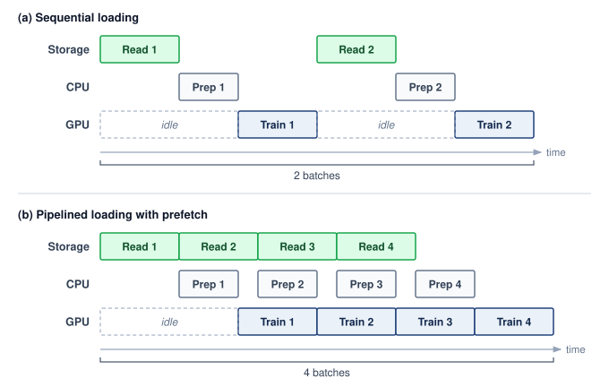

<!--
```{.tikz}
\scalebox{0.90}{%
\begin{tikzpicture}[
  font=\sffamily,
  >=Stealth,
  task_read/.style={
    rectangle,
    rounded corners=2.5pt,
    draw=TealLine!90!black,
    fill=TealFill!40,
    line width=0.7pt,
    font=\fontsize{7pt}{8pt}\selectfont\bfseries,
    text=TealDark,
    inner sep=0pt
  },
  task_prep/.style={
    rectangle,
    rounded corners=2.5pt,
    draw=OrangeLine,
    fill=OrangeFill!40,
    line width=0.7pt,
    font=\fontsize{7pt}{8pt}\selectfont\bfseries,
    text=OrangeLine!90!black,
    inner sep=0pt
  },
  task_train/.style={
    rectangle,
    rounded corners=2.5pt,
    draw=SteelBlue,
    fill=BlueFill!45,
    line width=0.7pt,
    font=\fontsize{7pt}{8pt}\selectfont\bfseries,
    text=NavyBlue,
    inner sep=0pt
  },
  stall_box/.style={
    rectangle,
    rounded corners=2.5pt,
    draw=RedLine!40,
    fill=RedFill!15,
    dashed,
    line width=0.5pt,
    font=\fontsize{6pt}{7pt}\selectfont\itshape,
    text=DarkRed!85,
    inner sep=0pt
  },
  track_lane/.style={
    rectangle,
    rounded corners=3pt,
    draw=GrayLine!25,
    fill=gray!4,
    line width=0.5pt,
    anchor=west,
    minimum height=0.74cm,
    inner sep=0pt
  },
  line join=round, line cap=round, font=\small\sffamily
]

  \def\wslot{1.85}    % width of one time slot
  \def\hblock{0.60}    % height of task block inside lane
  \def\lanew{11.1}     % 6 slots * 1.85 = 11.1cm

  % =============================================================
  % PART A: WITHOUT PREFETCHING (SEQUENTIAL EXECUTION)
  % =============================================================
  \node[anchor=center, font=\small\bfseries, text=TextDark] at (5.55, 6.45)
    {Without Prefetching (Synchronous Sequential Stalls)};

  % Track Labels
  \node[anchor=east, font=\scriptsize\bfseries, text=TealDark] at (-0.35, 5.3) {Storage (I/O)};
  \node[anchor=east, font=\scriptsize\bfseries, text=OrangeLine!90!black] at (-0.35, 4.4) {CPU (Prep)};
  \node[anchor=east, font=\scriptsize\bfseries, text=NavyBlue] at (-0.35, 3.5) {GPU (Train)};

  % Track Background Lanes
  \node[track_lane, minimum width=\lanew cm] at (0, 5.3) {};
  \node[track_lane, minimum width=\lanew cm] at (0, 4.4) {};
  \node[track_lane, minimum width=\lanew cm] at (0, 3.5) {};

  % Slot Grid Lines (faint)
  \foreach \s in {1,...,5} {
    \draw[GrayLine!20, line width=0.4pt, dashed] (\s*\wslot, 3.0) -- (\s*\wslot, 5.85);
    \node[anchor=south, font=\fontsize{6pt}{7pt}\selectfont\bfseries, text=TextMuted] at (\s*\wslot - 0.5*\wslot, 5.75) {$t_\s$};
  }
  \node[anchor=south, font=\fontsize{6pt}{7pt}\selectfont\bfseries, text=TextMuted] at (6*\wslot - 0.5*\wslot, 5.75) {$t_6$};

  % Storage Track: Read 1 at t1, Read 2 at t4
  \node[task_read, minimum width=\wslot-0.12 cm, minimum height=\hblock cm] at (0.5*\wslot, 5.3) {Read 1};
  \node[stall_box, minimum width=2*\wslot-0.12 cm, minimum height=\hblock cm] at (2.0*\wslot, 5.3) {Storage Idle};
  \node[task_read, minimum width=\wslot-0.12 cm, minimum height=\hblock cm] at (3.5*\wslot, 5.3) {Read 2};
  \node[stall_box, minimum width=2*\wslot-0.12 cm, minimum height=\hblock cm] at (5.0*\wslot, 5.3) {Storage Idle};

  % CPU Track: Prep 1 at t2, Prep 2 at t5
  \node[stall_box, minimum width=\wslot-0.12 cm, minimum height=\hblock cm] at (0.5*\wslot, 4.4) {CPU Idle};
  \node[task_prep, minimum width=\wslot-0.12 cm, minimum height=\hblock cm] at (1.5*\wslot, 4.4) {Prep 1};
  \node[stall_box, minimum width=2*\wslot-0.12 cm, minimum height=\hblock cm] at (3.0*\wslot, 4.4) {CPU Idle};
  \node[task_prep, minimum width=\wslot-0.12 cm, minimum height=\hblock cm] at (4.5*\wslot, 4.4) {Prep 2};
  \node[stall_box, minimum width=\wslot-0.12 cm, minimum height=\hblock cm] at (5.5*\wslot, 4.4) {CPU Idle};

  % GPU Track: Train 1 at t3, Train 2 at t6
  \node[stall_box, minimum width=2*\wslot-0.12 cm, minimum height=\hblock cm] at (1.0*\wslot, 3.5) {\textbf{GPU Stall (Waiting for I/O)}};
  \node[task_train, minimum width=\wslot-0.12 cm, minimum height=\hblock cm] at (2.5*\wslot, 3.5) {Train 1};
  \node[stall_box, minimum width=2*\wslot-0.12 cm, minimum height=\hblock cm] at (4.0*\wslot, 3.5) {\textbf{GPU Stall (Waiting for I/O)}};
  \node[task_train, minimum width=\wslot-0.12 cm, minimum height=\hblock cm] at (5.5*\wslot, 3.5) {Train 2};

  % Data Dependency Arrows (Sequential Flow)
  \draw[->, line width=0.65pt, TealLine, shorten <=1pt, shorten >=2pt] (1.0*\wslot - 0.12, 4.95) |- (1.0*\wslot + 0.08, 4.4);
  \draw[->, line width=0.65pt, OrangeLine, shorten <=1pt, shorten >=2pt] (2.0*\wslot - 0.12, 4.05) |- (2.0*\wslot + 0.08, 3.5);
  \draw[->, line width=0.65pt, TealLine, shorten <=1pt, shorten >=2pt] (4.0*\wslot - 0.12, 4.95) |- (4.0*\wslot + 0.08, 4.4);
  \draw[->, line width=0.65pt, OrangeLine, shorten <=1pt, shorten >=2pt] (5.0*\wslot - 0.12, 4.05) |- (5.0*\wslot + 0.08, 3.5);

  % Sequential Span Dimension Bracket
  \draw[line width=0.85pt, RedLine] (0.0, 2.65) -- (6*\wslot, 2.65);
  \draw[line width=0.85pt, RedLine] (0.0, 2.52) -- (0.0, 2.78);
  \draw[line width=0.85pt, RedLine] (6*\wslot, 2.52) -- (6*\wslot, 2.78);
  \node[anchor=north, font=\scriptsize\bfseries, text=DarkRed] at (3*\wslot, 2.55)
    {Total: 2 batches in 6 time slots $\;\cdot\;$ GPU Duty Cycle: only 33\% (67\% of cluster time wasted in stalls)};

  % =============================================================
  % DIVIDER
  % =============================================================
  \draw[GrayLine!25, line width=0.7pt] (-2.2, 1.85) -- (14.2, 1.85);

  % =============================================================
  % PART B: WITH PREFETCHING (ASYNCHRONOUS PIPELINE)
  % =============================================================
  \node[anchor=center, font=\small\bfseries, text=TextDark] at (5.55, 1.35)
    {With Prefetching (Asynchronous Overlapped Pipeline)};

  % Track Labels
  \node[anchor=east, font=\scriptsize\bfseries, text=TealDark] at (-0.35, 0.3) {Storage (I/O)};
  \node[anchor=east, font=\scriptsize\bfseries, text=OrangeLine!90!black] at (-0.35, -0.6) {CPU (Prep)};
  \node[anchor=east, font=\scriptsize\bfseries, text=NavyBlue] at (-0.35, -1.5) {GPU (Train)};

  % Track Background Lanes
  \node[track_lane, minimum width=\lanew cm] at (0, 0.3) {};
  \node[track_lane, minimum width=\lanew cm] at (0, -0.6) {};
  \node[track_lane, minimum width=\lanew cm] at (0, -1.5) {};

  % Slot Grid Lines (faint)
  \foreach \s in {1,...,5} {
    \draw[GrayLine!20, line width=0.4pt, dashed] (\s*\wslot, -2.0) -- (\s*\wslot, 0.85);
    \node[anchor=south, font=\fontsize{6pt}{7pt}\selectfont\bfseries, text=TextMuted] at (\s*\wslot - 0.5*\wslot, 0.75) {$t_\s$};
  }
  \node[anchor=south, font=\fontsize{6pt}{7pt}\selectfont\bfseries, text=TextMuted] at (6*\wslot - 0.5*\wslot, 0.75) {$t_6$};

  % Storage Track: Continuous streaming Read 1, 2, 3, 4
  \node[task_read, minimum width=\wslot-0.12 cm, minimum height=\hblock cm] at (0.5*\wslot, 0.3) {Read 1};
  \node[task_read, minimum width=\wslot-0.12 cm, minimum height=\hblock cm] at (1.5*\wslot, 0.3) {Read 2};
  \node[task_read, minimum width=\wslot-0.12 cm, minimum height=\hblock cm] at (2.5*\wslot, 0.3) {Read 3};
  \node[task_read, minimum width=\wslot-0.12 cm, minimum height=\hblock cm] at (3.5*\wslot, 0.3) {Read 4};
  \node[stall_box, minimum width=2*\wslot-0.12 cm, minimum height=\hblock cm] at (5.0*\wslot, 0.3) {Buffer Saturated};

  % CPU Track: Prep 1, 2, 3, 4
  \node[stall_box, minimum width=\wslot-0.12 cm, minimum height=\hblock cm] at (0.5*\wslot, -0.6) {Initial Wait};
  \node[task_prep, minimum width=\wslot-0.12 cm, minimum height=\hblock cm] at (1.5*\wslot, -0.6) {Prep 1};
  \node[task_prep, minimum width=\wslot-0.12 cm, minimum height=\hblock cm] at (2.5*\wslot, -0.6) {Prep 2};
  \node[task_prep, minimum width=\wslot-0.12 cm, minimum height=\hblock cm] at (3.5*\wslot, -0.6) {Prep 3};
  \node[task_prep, minimum width=\wslot-0.12 cm, minimum height=\hblock cm] at (4.5*\wslot, -0.6) {Prep 4};
  \node[stall_box, minimum width=\wslot-0.12 cm, minimum height=\hblock cm] at (5.5*\wslot, -0.6) {Drained};

  % GPU Track: Ramp-up, then Train 1, 2, 3, 4
  \node[stall_box, minimum width=2*\wslot-0.12 cm, minimum height=\hblock cm] at (1.0*\wslot, -1.5) {\textcolor{TextMuted}{Pipeline Ramp-up}};
  \node[task_train, minimum width=\wslot-0.12 cm, minimum height=\hblock cm] at (2.5*\wslot, -1.5) {Train 1};
  \node[task_train, minimum width=\wslot-0.12 cm, minimum height=\hblock cm] at (3.5*\wslot, -1.5) {Train 2};
  \node[task_train, minimum width=\wslot-0.12 cm, minimum height=\hblock cm] at (4.5*\wslot, -1.5) {Train 3};
  \node[task_train, minimum width=\wslot-0.12 cm, minimum height=\hblock cm] at (5.5*\wslot, -1.5) {Train 4};

  % Pipelined Flow Handoff Arrows
  \draw[->, line width=0.65pt, TealLine, shorten <=1pt, shorten >=2pt] (1.0*\wslot - 0.10, -0.05) |- (1.0*\wslot + 0.10, -0.6);
  \draw[->, line width=0.65pt, TealLine, shorten <=1pt, shorten >=2pt] (2.0*\wslot - 0.10, -0.05) |- (2.0*\wslot + 0.10, -0.6);
  \draw[->, line width=0.65pt, OrangeLine, shorten <=1pt, shorten >=2pt] (2.0*\wslot - 0.10, -0.95) |- (2.0*\wslot + 0.10, -1.5);
  \draw[->, line width=0.65pt, OrangeLine, shorten <=1pt, shorten >=2pt] (3.0*\wslot - 0.10, -0.95) |- (3.0*\wslot + 0.10, -1.5);

  % Pipelined Span Dimension Bracket
  \draw[line width=0.85pt, ForestGreen] (0.0, -2.35) -- (6*\wslot, -2.35);
  \draw[line width=0.85pt, ForestGreen] (0.0, -2.22) -- (0.0, -2.48);
  \draw[line width=0.85pt, ForestGreen] (6*\wslot, -2.22) -- (6*\wslot, -2.48);
  \node[anchor=north, font=\scriptsize\bfseries, text=GreenD] at (3*\wslot, -2.45)
    {Total: 4 batches in 6 time slots $\;\cdot\;$ GPU Duty Cycle: 100\% in steady state (zero idle stalls)};

  % =============================================================
  % PREFETCH FIFO QUEUE CARD (Direct Vector Rendering)
  % =============================================================
  \node[
    rectangle,
    rounded corners=3.5pt,
    draw=TealLine!70,
    fill=white,
    line width=0.7pt,
    minimum width=3.6cm,
    minimum height=2.4cm,
    anchor=west
  ] (q_card) at (11.25, -0.6) {};

  % Card Header
  \path[fill=TealFill!30, rounded corners=3.5pt]
    (q_card.north west) rectangle ($(q_card.north east) + (0, -0.42)$);
  \path[fill=TealFill!30]
    ($(q_card.north west) + (0, -0.2)$) rectangle ($(q_card.north east) + (0, -0.42)$);
  \draw[TealLine!40, line width=0.5pt]
    ($(q_card.north west) + (0, -0.42)$) -- ($(q_card.north east) + (0, -0.42)$);
  \node[anchor=center, font=\fontsize{6.5pt}{7.5pt}\selectfont\bfseries, text=TealDark]
    at ($(q_card.north) + (0, -0.21)$) {Prefetch Buffer (FIFO Queue)};

  % CS-Standard Open FIFO Queue glyph inside Card
  % Top and bottom rails
  \draw[line width=0.8pt, TealDark] (12.15, -0.48) -- (13.85, -0.48);
  \draw[line width=0.8pt, TealDark] (12.15, -0.92) -- (13.85, -0.92);
  \draw[line width=0.8pt, TealDark] (12.15, -0.48) -- (12.15, -0.92); % back stop

  % Packets inside queue
  \draw[draw=TealDark, fill=TealFill!40, rounded corners=1.5pt, line width=0.5pt]
    (12.30, -0.87) rectangle ++(0.65, 0.34) node[midway, font=\fontsize{5.5pt}{6.5pt}\selectfont\bfseries, text=TealDark] {$B_{i+2}$};
  \draw[draw=TealDark, fill=TealFill!50, rounded corners=1.5pt, line width=0.5pt]
    (13.05, -0.87) rectangle ++(0.65, 0.34) node[midway, font=\fontsize{5.5pt}{6.5pt}\selectfont\bfseries, text=TealDark] {$B_{i+1}$};

  % Flow arrows (Head and Tail pointers)
  \draw[->, line width=0.7pt, SteelBlue, shorten >=1.5pt] (13.85, -0.70) -- ++(0.30, 0)
    node[right=0pt, font=\fontsize{5.5pt}{6.5pt}\selectfont\bfseries, text=NavyBlue] {GPU};
  \draw[<-, line width=0.7pt, OrangeLine, shorten <=1.5pt] (12.15, -0.70) -- ++(-0.25, 0)
    node[left=0pt, font=\fontsize{5.5pt}{6.5pt}\selectfont\bfseries, text=OrangeLine!90!black] {CPU};

  % Annotations below queue
  \node[anchor=center, font=\fontsize{6pt}{7pt}\selectfont\bfseries, text=TextDark] at (13.05, -1.22)
    {Depth $K = 2$ in flight};
  \node[anchor=center, font=\fontsize{5pt}{6pt}\selectfont, text=TextMuted] at (13.05, -1.48)
    {Absorbs I/O variance};

  % =============================================================
  % BOTTOM SUMMARY CARD
  % =============================================================
  \node[
    rectangle,
    rounded corners=3pt,
    draw=GrayLine!35,
    fill=white,
    line width=0.7pt,
    minimum width=14.4cm,
    minimum height=0.75cm,
    anchor=north,
    align=center,
    inner sep=3pt
  ] at (5.85, -3.2) {
    \textbf{\scriptsize\textcolor{TextDark}{Systems Principle: Pipelining completely hides storage latency whenever $T_{\text{read}} \le T_{\text{train}}$}}\\[2pt]
    \tiny\textcolor{TextMuted}{A prefetch buffer depth $K \ge \lceil T_{\text{read}} / T_{\text{train}} \rceil$ absorbs disk and network latency jitter so GPU execution never stalls.}
  };

\end{tikzpicture}%
}
```
-->

:::

Pipelining converts a sequential bottleneck into overlapped execution (@fig-data-pipeline-vol2), but continuous saturation requires a prefetch buffer deep enough to absorb variance in I/O latency. Stage durations need not be deterministic if ready batches cover the delays. Storage systems experience I/O jitter\index{I/O jitter!sources and pipeline impact}: variation in read latency caused by contention and background work. NVMe drives suffer occasional latency spikes during internal garbage collection (when the controller reorganizes NAND flash blocks) or wear-leveling operations. Parallel file systems incur spikes when multiple training jobs contend for the same OSS nodes, when the MDS processes a burst of metadata operations, or when background scrubbing detects and repairs bit errors. Object storage likewise exposes delays from shared-service contention and maintenance.

A single slow I/O creates a "bubble" when it exhausts the pipeline's ready work. If the CPU is preparing batch $\BatchIndex+1$ with no additional batches ready, a delayed read can leave batch $\BatchIndex+1$ unavailable when the GPU finishes batch $\BatchIndex$. The GPU then idles until the batch is ready. A longer queue tolerates a longer interruption, and delivery faster than consumption can refill it afterward. Rather than preparing just one batch ahead, the CPU maintains a queue of $\PrefetchBufferCount$ preloaded batches.

A buffer sized to the measured p99 I/O delay needs enough ready batches to cover that delay without draining:

$$\MinimumPrefetchBufferCount= \left\lceil \frac{\TailStepIoTime}{\IronLawComputeTime} \right\rceil$$ {#eq-prefetch-depth}

The prefetch depth equation in @eq-prefetch-depth estimates how many ready batches cover the selected latency window. Outstanding reads contribute to replenishing that buffer but do not count as ready batches until they complete. The equation assumes that the long-run data supply rate is at least as high as the accelerator's consumption rate; prefetching absorbs latency variance, not a sustained bandwidth deficit. When average throughput is sufficient but p99 latency exceeds compute time, deeper prefetching absorbs delays within the provisioned window; rarer or correlated delays can still cause stalls. When sustained delivery is lower than demand, identify the limiting stage before choosing more storage bandwidth, additional decoding capacity, a different representation, or local staging. The equation uses the p99 delay rather than the mean because a buffer sized for the mean drains whenever a slow read arrives, and the tail-latency arithmetic of @sec-storage-tier3-pfs shows that when a step depends on many servers, some read is slow on most steps. Even the p99 window leaves rarer events and correlated interruptions to test.

If object-storage reads take 500 ms at the 99th percentile and compute takes `{python} StorageFuelLineContext.step_time_ms_str`, then $\MinimumPrefetchBufferCount= 3$ batches; provisioning five ready batches adds a margin. A data loader's configured work-ahead count (for example, a per-worker prefetch factor) is not a count of ready batches, because some of that work may still be loading or preprocessing. The quantity that protects the accelerator is completed-queue occupancy and its refill rate, measured against the delay window on whichever tier serves the reads.

::: {.column-margin}
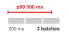{width="100%" fig-alt="Sequence strip showing a 500 ms p99 I/O delay spanning two and a half 200 ms compute windows, which rounds up to a prefetch depth of three batches."}

*A 500 ms p99 read spans 2.5 steps of 200 ms, so three ready batches must cover it.*
:::

```{python}
#| echo: false
# ┌── LEGO ───────────────────────────────────────────────
# │ Context: @sec-storage-pipelining—prefetch-depth memory cost
import math
from mlsysim import Systems
from mlsysim.fmt import check, fmt, fmt_math, fmt_memory, fmt_qty_int, fmt_time

class PrefetchDepth:
    # ┌── 1. LOAD ─────────────────────────────────────────
    prefetch = Scenarios.PrefetchDepthByTier
    compute_ms = int(round(prefetch.compute_time.to(ms).magnitude))
    batch = prefetch.batch_bytes  # collated batch size per GPU
    gpus_per_node = prefetch.consumers_per_node
    nvme_p99_ms = int(round(prefetch.tail_latencies["nvme"].to(ms).magnitude))  # local NVMe P99 read latency
    pfs_p99_ms = int(round(prefetch.tail_latencies["pfs"].to(ms).magnitude))  # parallel-file-system P99 latency
    obj_p99_ms = int(round(prefetch.tail_latencies["object"].to(ms).magnitude))  # object-storage P99 latency
    obj_safety_depth = prefetch.safety_depth  # object-storage safety-margin depth
    decoded_batch = TextImageBandwidth.image_batch_per_gpu * 224 * 224 * 3 * byte  # unrounded decoded image batch
    deep_depth = 8  # scenario: illustrative deep prefetch buffer
    # ┌── 2. EXECUTE ──────────────────────────────────────
    nvme_depth = prefetch.result.depths["nvme"]
    pfs_depth = prefetch.result.depths["pfs"]
    obj_depth = prefetch.result.depths["object"]
    obj_buf_gpu = prefetch.result.buffer_per_consumer
    obj_buf_node = prefetch.result.buffer_per_node
    min_buf_node = nvme_depth * batch * gpus_per_node
    deep_buf_gpu = deep_depth * decoded_batch
    # ┌── 3. GUARD ────────────────────────────────────────
    check(obj_depth == 3, "Object-storage minimum depth should be 3")
    check(nvme_depth == 1 and pfs_depth == 1, "NVMe and PFS minimum depth should be 1")
    check(abs(decoded_batch.to(MB).magnitude - batch.to(MB).magnitude) < 2, "Scenario batch must round the decoded image batch")
    # ┌── 4. OUTPUT ───────────────────────────────────────
    compute_ms_str = fmt_time(compute_ms, "millisecond", precision=0, commas=False)
    batch_mb_str = fmt_memory(batch, unit=MB, precision=0, commas=False)
    gpus_per_node_str = fmt(gpus_per_node, precision=0)
    nvme_p99_ms_str = fmt_time(nvme_p99_ms, "millisecond", precision=0, commas=False)
    pfs_p99_ms_str = fmt_time(pfs_p99_ms, "millisecond", precision=0, commas=False)
    obj_p99_ms_str = fmt_time(obj_p99_ms, "millisecond", precision=0, commas=False)
    nvme_depth_math = fmt_math(rf"\lceil {nvme_p99_ms}/{compute_ms} \rceil = {nvme_depth}")
    pfs_depth_math = fmt_math(rf"\lceil {pfs_p99_ms}/{compute_ms} \rceil = {pfs_depth}")
    obj_depth_str = fmt(obj_depth, precision=0)
    obj_safety_str = fmt(obj_safety_depth, precision=0)
    obj_buf_gpu_mb_str = fmt_memory(obj_buf_gpu, unit=MB, precision=0, commas=False)
    obj_buf_node_gb_str = fmt_memory(obj_buf_node, unit=GB, precision=1, commas=False)
    min_buf_node_mb_str = fmt_memory(min_buf_node, unit=MB, precision=0, commas=False)
    decoded_batch_mb_str = fmt_qty_int(decoded_batch, MB, commas=False)  # "roughly"
    deep_depth_str = fmt(deep_depth, precision=0)
    deep_buf_gpu_mb_str = fmt_qty_int(deep_buf_gpu, MB, commas=False)  # "about"
```

To illustrate the memory cost of prefetch buffer depth\index{Prefetch buffer!depth calculation}, return to the image job of notebook \ref{nbk-data-storage-text-vs-image-bandwidth}. Each GPU processes its batch in roughly `{python} PrefetchDepth.compute_ms_str`, and once its `{python} TextImageBandwidth.image_batch_per_gpu_str` images are decoded into $224{\times}224{\times}3$-byte tensors, the collated batch occupies about `{python} PrefetchDepth.batch_mb_str` per GPU. Reading from local NVMe, the p99 I/O latency for that batch is approximately `{python} PrefetchDepth.nvme_p99_ms_str`. Under the p99-window model, the minimum ready-buffer depth is `{python} PrefetchDepth.nvme_depth_math` batch, and this example provisions a depth of 2. Reading from a parallel file system, the p99 I/O latency rises to roughly `{python} PrefetchDepth.pfs_p99_ms_str` due to network jitter and contention, requiring a minimum depth of `{python} PrefetchDepth.pfs_depth_math`, with an illustrative provisioned depth of 3. Reading from object storage, the p99 latency can exceed `{python} PrefetchDepth.obj_p99_ms_str`, requiring a depth of at least `{python} PrefetchDepth.obj_depth_str`, with an illustrative provisioned depth of `{python} PrefetchDepth.obj_safety_str` or more. These numbers translate directly into host DRAM consumption. At `{python} PrefetchDepth.batch_mb_str` per batch, a depth-`{python} PrefetchDepth.obj_safety_str` prefetch buffer per GPU consumes `{python} PrefetchDepth.obj_buf_gpu_mb_str`, and `{python} PrefetchDepth.gpus_per_node_str` GPUs per node consume `{python} PrefetchDepth.obj_buf_node_gb_str`. At `{python} PrefetchDepth.batch_mb_str` per batch with a depth of 1, the same node needs only `{python} PrefetchDepth.min_buf_node_mb_str`. Measured delivery delays, batch size, and the chosen protection window determine this memory budget. Queue occupancy and refill rate must still be tested under correlated delays.

The representation decides whether that depth is cheap. Text barely registers, because a per-GPU batch of a few packed 4,096-token sequences occupies tens of kilobytes, so even a deep text queue is negligible. Decoded images are where depth costs memory. The `{python} TextImageBandwidth.image_batch_per_gpu_str`-image batch above is roughly `{python} PrefetchDepth.decoded_batch_mb_str` before rounding, and a buffer of `{python} PrefetchDepth.deep_depth_str` such batches consumes about `{python} PrefetchDepth.deep_buf_gpu_mb_str` per GPU, modest against a node's `{python} DRAMInterconnect.node_dram_gb_str` of DRAM even after multiplying by the GPUs on the node. Higher-resolution images and video raise the per-batch size by an order of magnitude or more, at which point the prefetch buffer competes with embedding tables and other DRAM consumers.

Prefetching and the storage hierarchy together form a layered defense against stalls. The prefetch buffer in host DRAM absorbs I/O variance from NVMe reads. The local NVMe warm cache absorbs network variance from shared storage (whether a parallel file system or an object store). The parallel file system read-ahead cache absorbs variance from disk seeks across the OSS cluster. Because each layer adds latency tolerance at the cost of memory or storage capacity, the system designer must check each active path against the interruption window it is intended to absorb and verify that sustained delivery replenishes the consumed batches. The running example's shards come from object storage, whose `{python} PrefetchDepth.obj_p99_ms_str` p99 against a `{python} StorageFuelLineContext.step_time_ms_str` step would call for `{python} PrefetchDepth.obj_depth_str` ready batches if every read went to that tier. Once the shards are staged on local NVMe, every training read is a local hit, and the prefetch buffer needs to absorb only the `{python} PrefetchDepth.nvme_p99_ms_str` local p99, which a single ready batch covers.

::: {#chk-data-storage-data-pipeline-design .callout-checkpoint title="Data pipeline design"}

A training cluster the size of the book's reference cluster runs `{python} StorageFuelLineContext.ref_accels_str` GPUs with 128-image batches (`{python} TextImageBandwidth.image_size_kb_str` per image after compression, 150 ms per iteration).

- [ ] **Bandwidth requirement**: with the pipeline bandwidth requirement of @eq-pipeline-throughput, which scales accelerator count and target utilization by bytes per iteration, calculate the required aggregate storage bandwidth at 90 percent target utilization.
- [ ] **Checkpoint contention**: determine whether 800 GB/s aggregate parallel-file-system bandwidth is sufficient, then recalculate when checkpoint writes consume 20 percent of that bandwidth.
- [ ] **Prefetch depth**: calculate the minimum prefetch buffer depth in batches needed to absorb 300 ms p99 object-storage latency.
- [ ] **Host memory**: calculate total prefetch buffer memory when each decoded batch occupies 10 MB in host DRAM at the depth calculated in (3).

:::

### Multi-worker data loading {#sec-storage-multi-worker}

A single CPU core cannot keep a high-throughput accelerator fed, even when the storage hardware is fast enough, because of the CPU work required between the storage read and the GPU transfer. For image training, decoding a `{python} TextImageBandwidth.image_size_kb_str` JPEG image into a $224{\times}224{\times}3$ raw tensor costs several milliseconds of CPU time. One measurement decoded full-resolution ImageNet images at about 530 per second across the four virtual CPUs of a cloud inference instance [@kang2020jointly], and each augmentation, such as a random crop, flip, or color jitter, adds further work per image. The image job of notebook \ref{nbk-data-storage-text-vs-image-bandwidth} feeds each GPU `{python} TextImageBandwidth.image_batch_per_gpu_str` images every `{python} TextImageBandwidth.step_ms_str` step, more than 1,000 images per second. At 1,000 images per second per GPU and 8 GPUs per node, a single core would need to decode and augment 8,000 images per second, tens of times what a single core can sustain. The solution is multi-worker data loading\index{Data loader!multi-worker throughput}, where $\DataLoaderWorkerCount$ worker processes each read from storage, decode, augment, and enqueue batches independently. The effective I/O throughput scales approximately linearly with $\DataLoaderWorkerCount$ until one of three bottlenecks is reached: the storage device's bandwidth saturates, the PCIe bus between host and device saturates, or the workers exhaust host CPU cycles.

The worker count $\DataLoaderWorkerCount$\index{Data loader!worker count} is tuned as on a single node, by profiling the data stall ratio, since too few workers starve the GPU and too many waste CPU on contention. At fleet scale, every core given to loading is a core the training runtime, communication threads, and operating system cannot use, so dividing host CPU between data loading and training orchestration is itself a capacity planning exercise. How those workers exploit concurrency then depends on which tier serves their reads. On local NVMe, workers issue concurrent reads to the same RAID array and rely on NVMe's deep command queues to expose device parallelism until shared drive or controller capacity saturates. On a parallel file system, they distribute reads across different OSS nodes to aggregate server bandwidth. On object storage, they issue concurrent HTTP GET requests to distinct shards.

Multi-worker loading must also preserve shuffle quality without giving up I/O efficiency\index{Data shuffling!quality vs. I/O efficiency}. Under the shard-level and within-shard shuffling\index{Data shuffling!shard-level} of @sec-storage-workload-inversion, the loader assigns contiguous groups of the shuffled shard list to each worker, and the adequacy of that mixing depends on how the shards were built. A corpus whose shards are internally homogeneous, such as one source or one class per shard, needs finer shards or a larger shuffle buffer, so the layout should be validated against the loss curve of a fully shuffled baseline on a subset before the run commits to it.

```{python}
#| echo: false
# ┌── LEGO ───────────────────────────────────────────────
# │ Context: @sec-storage-multi-worker—shuffle-buffer memory
from mlsysim.fmt import check, fmt, fmt_memory

class ShuffleBufferMemory:
    # ┌── 1. LOAD ─────────────────────────────────────────
    buffer_items = 10_000  # scenario assumption: shuffle-buffer entries
    seq_tokens = Models.Language.GPT3.context_length  # packed sequence length
    token_bytes = ReferenceStats.StorageTrainingCorpus.TokenIdBytes
    decoded_image = 224 * 224 * 3 * byte  # decoded 224x224 RGB tensor, 1 byte per channel
    # ┌── 2. EXECUTE ──────────────────────────────────────
    text_buffer = buffer_items * seq_tokens * token_bytes
    image_buffer = buffer_items * decoded_image
    # ┌── 3. GUARD ────────────────────────────────────────
    check(text_buffer < image_buffer, "Decoded image buffer should exceed the token buffer")
    # ┌── 4. OUTPUT ───────────────────────────────────────
    buffer_items_str = fmt(buffer_items, precision=0, commas=True)
    seq_tokens_str = fmt(seq_tokens, precision=0, commas=True)
    token_bytes_str = fmt_int(token_bytes.to(byte).magnitude)
    text_buffer_mb_str = fmt_qty_int(text_buffer, MB, commas=False)
    decoded_image_kb_str = fmt_qty_int(decoded_image, KB, commas=False)
    image_buffer_gb_str = fmt_memory(image_buffer, unit=GB, precision=1, commas=False)
```

The shuffle buffer size creates a memory-randomness trade-off. A larger buffer provides better randomness (because samples are drawn from a larger pool) but consumes more host DRAM. For the running example with text data, a shuffle buffer of `{python} ShuffleBufferMemory.buffer_items_str` sequences at `{python} ShuffleBufferMemory.seq_tokens_str` tokens each, with each token represented as a `{python} ShuffleBufferMemory.token_bytes_str`-byte integer, consumes roughly `{python} ShuffleBufferMemory.text_buffer_mb_str`. This is negligible relative to the `{python} DRAMInterconnect.node_dram_gb_str` of host DRAM. For image data, where each decoded image occupies `{python} ShuffleBufferMemory.decoded_image_kb_str`, a shuffle buffer of `{python} ShuffleBufferMemory.buffer_items_str` images consumes `{python} ShuffleBufferMemory.image_buffer_gb_str`, still manageable but a nontrivial fraction of the prefetch budget. The data loader designer must balance shuffle buffer size against prefetch depth, since both compete for the same host DRAM capacity.

The data loading pipeline, from storage read through decode, augmentation, and transfer to accelerator, is the complete fuel delivery system for the training engine, and when any stage becomes the bottleneck the accelerator starves. Local reads can reduce network and shared-storage wait, which makes shard placement across nodes the next decision when that path limits delivery.

### Data locality and placement {#sec-storage-data-locality}

Even when a node has enough CPU workers to decode batches at full speed, fetching every shard across a shared storage network exposes the training loop to fabric congestion and remote service queues. Placing shards on node-local NVMe avoids that shared-network contention, whereas keeping them in a remote parallel file system or object store preserves a single shared pool that any node can read without copying data ahead of time. Because local NVMe's advantage depends on both the node's drive stripe and the per-client bandwidth the remote tier can sustain, placement decisions must compare measured client rates rather than assume a fixed local-to-remote ratio.

```{python}
#| echo: false
# ┌── LEGO ───────────────────────────────────────────────
# │ Context: @sec-storage-data-locality, prestaging startup delay
# │ Goal: Time to copy each node's share of a dataset to local NVMe before the first iteration.
# │ How: dataset / nodes / per-node staging bandwidth, shown to the nearest 10 s.
from mlsysim.fmt import check, fmt_bandwidth, fmt_count, fmt_memory, fmt_time

class PrestagingTime:
    # ┌── 1. LOAD ─────────────────────────────────────────
    dataset = 10 * TB  # scenario assumption: dataset to prestage
    nodes = Systems.Clusters.Production_2K.count  # the chapter's 256-node running cluster
    per_node_bw = 500 * (MB / second)  # scenario assumption: per-node share of shared-storage bandwidth
    # ┌── 2. EXECUTE ──────────────────────────────────────
    per_node_bytes = dataset / nodes
    stage_time = (per_node_bytes / per_node_bw).to(second)
    stage_time_rounded = round(stage_time.magnitude / 10) * 10 * second  # prose says "roughly"
    # ┌── 3. GUARD ────────────────────────────────────────
    check(nodes == 256, "Prose describes the 256-node running cluster")
    check(70 < stage_time.magnitude < 90, f"Prestaging should take about 80 s, got {stage_time}")
    # ┌── 4. OUTPUT ───────────────────────────────────────
    dataset_tb_str = fmt_memory(dataset, unit=TB, precision=0, commas=False)
    nodes_str = fmt_count(nodes, commas=True, label="node")
    per_node_bw_str = fmt_bandwidth(per_node_bw, unit=MB / second, precision=0, commas=False)
    stage_time_str = fmt_time(stage_time_rounded, second, precision=0, style='word')
```

The staging decision determines where the job pays for data movement, whether before training starts, during the first epoch, or on every epoch. The simplest strategy is static placement\index{Data placement!static allocation}, or *prestaging*\index{Data staging!prestaging}. At the beginning of a training job, the orchestrator assigns a fixed subset of data shards to each node, and the node copies its shards from shared storage (the object store in the running example, a parallel file system in many on-premises clusters) to local NVMe drives before the first iteration. Reads remain local while the assigned shards fit and the sampling policy uses that assignment, which gives the highest steady-state throughput at the cost of the longest startup delay. Staging a `{python} PrestagingTime.dataset_tb_str` dataset across `{python} PrestagingTime.nodes_str` at `{python} PrestagingTime.per_node_bw_str` per node takes roughly `{python} PrestagingTime.stage_time_str` under ideal conditions, and contention on shared bandwidth can extend that stall to several minutes. A changed dataset or assignment requires restaging, so the placement policy must preserve the intended sample distribution as well as local throughput.

The alternative is dynamic placement\index{Data placement!dynamic on-demand}, or *on-demand staging*\index{Data staging!on-demand staging}, where nodes fetch shards from shared storage when the data loader first accesses them and retain them locally for reuse. This removes the upfront delay and supports datasets larger than aggregate local NVMe capacity and sampling policies that change the active subset over time, but the first epoch pays the full network-read cost. Cache misses consume shared-storage bandwidth and expose remote latency unless prefetching hides it; cache hits retain the benefit of local reads, so the pattern pays off when later epochs reread the cached shards.

*Streaming*\index{Data staging!streaming} keeps data off local storage entirely, reading records from the parallel file system or object store on every epoch. It has no startup delay and needs no local NVMe capacity, but every epoch absorbs the network-read cost again. On transfer cost alone, streaming suits single-epoch pretraining, which reads each byte once, and datasets that exceed the cluster's aggregate local capacity. The single-epoch running example stages anyway, for reasons of latency tails rather than transfer fees, as @sec-storage-economics shows.

```{python}
#| echo: false
#| label: data-storage-multimodal-cache-service
# ┌─────────────────────────────────────────────────────────────────────────────
# │ MULTIMODAL CACHE SERVICE RATE (LEGO)
# ├─────────────────────────────────────────────────────────────────────────────
# │ Context: @sec-storage-data-locality, dynamic placement; applies
# │          @eq-storage-cache-service-time to the Tier 2 multimodal job.
# │
# │ Goal: Mean delivered rate when the multimodal corpus overflows local NVMe.
# │ Show: ~88% hits on the 28 GB/s stripe, ~12% misses to the 4 GB/s PFS share,
# │       ~16 GB/s mean delivered rate (~58% of all-local).
# │ How:  h = local capacity / corpus (uniform sampling); time per byte
# │       E[T] = h/B_hot + (1-h)/B_cold; delivered rate = 1/E[T].
# └─────────────────────────────────────────────────────────────────────────────
from mlsysim.fmt import check, fmt_bandwidth, fmt_multiple, fmt_percent

class MultimodalCacheService:
    # ┌── 1. LOAD ─────────────────────────────────────────
    cache = Scenarios.MultimodalCorpusNodeCache
    local_capacity = cache.hot_capacity
    corpus = cache.corpus_bytes
    hot_bw = cache.hot_bandwidth  # local four-drive RAID-0 stripe
    cold_bw = cache.miss_bandwidth  # per-node parallel-file-system share
    # ┌── 2. EXECUTE ──────────────────────────────────────
    hit_rate = cache.result.hit_rate  # uniform sampling over the corpus
    delivered_bw = cache.result.delivered_rate
    delivered_share = cache.result.delivered_fraction
    miss_penalty = cache.result.miss_penalty
    # ┌── 3. GUARD ────────────────────────────────────────
    check(0.85 < hit_rate < 0.9, "Local cache should hold about 88 percent of the multimodal corpus")
    check(15 < delivered_bw.magnitude < 17, "Mean delivered rate should be about 16 GB/s")
    check(abs(miss_penalty - 7) < 1e-9, "A PFS-share miss should be 7x slower per byte than a local hit")
    check(hot_bw == NvmeTierContext.raid0_bw and corpus == NvmeTierContext.multimodal_total, "Same stripe and corpus as the Tier 2 paragraph")
    # ┌── 4. OUTPUT ───────────────────────────────────────
    hit_pct_str = fmt_percent(round(hit_rate, 2), precision=0, commas=False, style="prose")
    miss_pct_str = fmt_percent(round(1 - hit_rate, 2), precision=0, commas=False, style="prose")
    hot_bw_str = fmt_bandwidth(hot_bw, unit=GB / second, precision=0, commas=False)
    cold_bw_str = fmt_bandwidth(cold_bw, unit=GB / second, precision=0, commas=False)
    delivered_bw_str = fmt_bandwidth(round(delivered_bw.magnitude) * (GB / second), unit=GB / second, precision=0, commas=False)
    delivered_frac_pct_str = fmt_percent(round(delivered_share, 2), precision=0, commas=False, style="prose")
    miss_penalty_mult_str = fmt_multiple(round(miss_penalty), precision=0, commas=False)
```

The cache view of @eq-storage-cache-service-time puts a number on that trade. Take the multi-modal job of @sec-storage-tier2-nvme, whose `{python} NvmeTierContext.multimodal_total_tb_str` corpus overflows a node's `{python} NvmeTierContext.local_nvme_capacity_tb_str` of local NVMe. If the job samples uniformly and the cache holds that fraction of the corpus, about `{python} MultimodalCacheService.hit_pct_str` of reads hit the `{python} MultimodalCacheService.hot_bw_str` local stripe and the remaining `{python} MultimodalCacheService.miss_pct_str` fall through to the node's `{python} MultimodalCacheService.cold_bw_str` share of the parallel file system. Taking the time to deliver one byte as the service time, a serial loader averages the time per byte across hits and misses rather than averaging the two bandwidths directly, so the harmonic mean delivered rate is about `{python} MultimodalCacheService.delivered_bw_str`, only `{python} MultimodalCacheService.delivered_frac_pct_str` of the all-local rate. A miss rate near one in eight costs about two-fifths of the bandwidth because each missed byte takes `{python} MultimodalCacheService.miss_penalty_mult_str` as long as a hit, and that mean is the optimistic case; misses that cluster in time drain the prefetch buffer faster than the average suggests.

A more advanced approach is locality-aware scheduling\index{Locality-aware scheduling!cache exploitation}. The scheduler keeps track of which data shards are cached on which nodes' local NVMe drives. When it starts a new job or replaces a failed node, it prefers a node that already has the required data cached, rather than treating all nodes as interchangeable. This uses the principle of data gravity,[^fn-datagravity-storage-placement] co-locating compute with data to minimize transfer times. Scheduling avoids a staging copy only when an available node holds the required, validated shard versions. The next requirement is therefore to identify the cached contents precisely enough to reuse them safely.

[^fn-datagravity-storage-placement]: **Data gravity**\index{Data gravity!placement economics}: A metaphor treating large datasets as massive objects that attract compute. The gravitational analogy is apt: moving a `{python} ObjectStorageCost.dataset_tb_str` dataset out of one cloud provider to another costs roughly `{python} ObjectStorageCost.egress_once_usd_str` in egress fees and takes hours, while launching compute next to the data is near-instantaneous. In ML fleet design, data gravity means the storage location of the training dataset often dictates the physical placement of the entire training cluster.

```{python}
#| echo: false
# ┌── LEGO ───────────────────────────────────────────────
# │ Context: @sec-storage-data-locality
from mlsysim.fmt import fmt, fmt_memory, fmt_time

class NodeStagingContext:
    training_tokens = ReferenceStats.StorageTrainingCorpus.TrainingTokens
    token_id_bytes = ReferenceStats.StorageTrainingCorpus.TokenIdBytes
    n_training_nodes = Systems.Clusters.Production_2K.count  # the chapter's 256-node running cluster
    uncontended_pfs_bw = Systems.Storage.PfsPerNodeShare.bandwidth
    contended_pfs_bw = 0.4 * (GB / second)  # scenario assumption: per-node rate under recovery contention
    tokenized_text = training_tokens * token_id_bytes
    node_tokenized = tokenized_text / n_training_nodes
    node_stage_uncontended = node_tokenized / uncontended_pfs_bw
    node_stage_contended = node_tokenized / contended_pfs_bw
    gpus_per_node = Systems.Nodes.DGX_H100.accelerators_per_node
    gpu_mtbf = Systems.Reliability.Gpu.mttf_hours * hour  # registry per-GPU mean time between failures (MTBF) (50,000 h)
    node_failures_per_day = (n_training_nodes * gpus_per_node * (HOURS_PER_DAY * hour) / gpu_mtbf).to("").magnitude
    check(0.5 < node_failures_per_day < 1.5, f"256 nodes at 50,000 h per-GPU MTBF should fail about once per day, got {node_failures_per_day:.2f}")
    # ┌── 4. OUTPUT (Formatting) ──────────────────────────────────────────────
    node_failures_per_day_str = fmt_int(node_failures_per_day, commas=False)
    gpu_mtbf_hours_str = fmt(Systems.Reliability.Gpu.mttf_hours, precision=0, commas=True)
    tokenized_text_tb_str = fmt_memory(tokenized_text, unit=TB, precision=0, commas=False)
    node_tokenized_gb_str = fmt_memory(node_tokenized, unit=GB, precision=1, commas=False)
    node_stage_uncontended_s_str = fmt_time(node_stage_uncontended, second, precision=1, commas=False, style='word')
    node_stage_contended_s_str = fmt_time(node_stage_contended, second, precision=1, commas=False, style='word')
    n_training_nodes_str = fmt_count(n_training_nodes, commas=True)
    uncontended_pfs_bw_str = fmt_bandwidth(uncontended_pfs_bw, unit=GB / second, precision=0, commas=False)
    contended_pfs_bw_str = fmt_bandwidth(contended_pfs_bw, unit=MB / second, precision=0, commas=False)
```
For the `{python} NodeStagingContext.tokenized_text_tb_str` serialized dataset distributed across `{python} NodeStagingContext.n_training_nodes_str` nodes, each node is responsible for approximately `{python} NodeStagingContext.node_tokenized_gb_str` of data. If a node fails, its replacement must restage that shard subset from shared storage. Drawn at the uncontended `{python} NodeStagingContext.uncontended_pfs_bw_str` per-node share of the chapter's parallel file system, the copy takes about `{python} NodeStagingContext.node_stage_uncontended_s_str`. At an effective `{python} NodeStagingContext.contended_pfs_bw_str` per-node rate, which recovery contention can impose and which is also the order of the per-node share of the 50--100 GB/s object-store streaming path described in @sec-storage-tier4-object, the same copy stretches to about `{python} NodeStagingContext.node_stage_contended_s_str`. If the orchestrator can instead schedule the replacement workload on an idle node that already has the data cached from a previous run, staging time is zero and training resumes as soon as the replacement joins. The saving is modest per event but recurs. At a per-GPU mean time between failures of `{python} NodeStagingContext.gpu_mtbf_hours_str` hours, the `{python} NodeStagingContext.n_training_nodes_str`-node cluster sees about `{python} NodeStagingContext.node_failures_per_day_str` node failure per day, and each contended restage idles the whole synchronous job for the copy time above. Larger fleets fail proportionally more often, although each node's share of the corpus shrinks as the node count grows.

The pipeline equation, the prefetch queue, the loader workers, and shard placement together determine which bytes reach host memory and when. On the conventional path, however, every one of those bytes is also copied by the CPU through host DRAM before the accelerator's DMA can start, and at high request rates that copy competes with decoding for the same cores. No amount of orchestration removes that copy; only a direct data path between storage and accelerator does.

```{python}
#| echo: false
#| label: storage-gds-latency-calc
# ┌─────────────────────────────────────────────────────────────────────────────
# │ GDS LATENCY AND CPU BYPASS SAVINGS
# ├─────────────────────────────────────────────────────────────────────────────
# │ Context: @sec-storage-gds—traditional vs GDS data path latency comparison.
# │
# │ Goal:    Quantify the per-transfer latency reduction from GDS and the
# │          resulting CPU core savings.
# │ Show:    Illustrative 120 μs vs 30 μs active CPU service; 75 percent less CPU work.
# │ How:     Ratio of traditional to bypass latency per transfer.
# │
# └─────────────────────────────────────────────────────────────────────────────
from mlsysim import Systems
from mlsysim.core.units import KB, microsecond, second
from mlsysim.fmt import check, fmt_count, fmt_int, fmt_memory, fmt_multiple, fmt_percent, fmt_rate, fmt_time

class GDSLatency:
    # ┌── 1. LOAD ─────────────────────────────────────────
    # Illustrative active CPU service per request, not measured I/O latency.
    gds = Scenarios.GpuDirectStorageNodeCpu
    gds_trad_latency = gds.service_times["host"]
    gds_bypass_latency = gds.service_times["gds"]
    images_per_s_per_gpu = gds.requests_per_device  # per-GPU image ingest rate
    total_images_per_s = gds.result.request_rate

    # ┌── 2. EXECUTE ──────────────────────────────────────
    gds_speedup_val = (gds_trad_latency / gds_bypass_latency).to("").magnitude
    gds_latency_reduction_pct_val = (1 - (gds_bypass_latency / gds_trad_latency).to("").magnitude) * 100
    gds_trad_cpu_seconds_val = gds.result.cpu_seconds_per_second["host"]
    gds_bypass_cpu_seconds_val = gds.result.cpu_seconds_per_second["gds"]
    gds_freed_cpu_cores_val = gds_trad_cpu_seconds_val - gds_bypass_cpu_seconds_val

    # ┌── 3. GUARD ────────────────────────────────────────
    check(gds_speedup_val == 4.0, "Assumed CPU-service ratio should be 4x")
    check(gds_latency_reduction_pct_val == 75, "Assumed CPU-service reduction should be 75 percent")

    # ┌── 4. OUTPUT ───────────────────────────────────────
    gds_trad_us_str = fmt_time(gds_trad_latency, microsecond, precision=0, commas=False)
    gds_bypass_us_str = fmt_time(gds_bypass_latency, microsecond, precision=0, commas=False)
    gds_speedup_mult_str = fmt_multiple(gds_speedup_val, precision=0, commas=False)
    gds_latency_reduction_pct_str = fmt_percent(gds_latency_reduction_pct_val / 100, precision=0, commas=False, style='prose')
    gds_total_images_per_s_str = fmt_rate(total_images_per_s, 'images/s', precision=0)
    gds_trad_cpu_seconds_str = fmt_time(gds_trad_cpu_seconds_val, 'second', precision=2, commas=False, style='word')
    gds_trad_cpu_cores_str = fmt_int(gds_trad_cpu_seconds_val, commas=False)
    gds_bypass_cpu_seconds_str = fmt_time(gds_bypass_cpu_seconds_val, 'second', precision=2, commas=False, style='word')
    gds_freed_cpu_cores_str = fmt_int(gds_freed_cpu_cores_val, commas=False)
    image_kb_str = fmt_qty_int(Datasets.ImageNet.mean_compressed_image_size, KB, commas=False)
    n_gpus_str = fmt_count(Systems.Nodes.DGX_H100.accelerators_per_node, commas=False, label="GPU")
    per_gpu_images_per_s_str = fmt_rate(images_per_s_per_gpu, 'images/s', precision=0, commas=True)
```

## GPUDirect Storage and the CPU Data-Copy Bypass {#sec-storage-gds}

Even when the storage tier has enough raw bandwidth, the traditional data path\index{Traditional I/O!host bounce buffer} for loading training data routes every shard read through three hops: storage $\to$ host DRAM $\to$ GPU HBM. Data is first read from NVMe into a kernel buffer in host DRAM by a DMA transfer, then copied by the CPU into the data loader's user-space buffer, and finally transferred over PCIe to GPU memory by the GPU's DMA engine. Each hop adds latency and consumes host resources because the CPU must orchestrate every transfer, manage buffer allocation, and handle interrupts from both the storage device and the GPU. For a single transfer, this overhead is negligible, but when eight GPUs on a node each demand thousands of small transfers per second, the aggregate CPU load for payload movement alone can saturate multiple cores and starve the data augmentation stage. GPUDirect Storage (GDS),[^fn-gds-gpudirect-storage] which removes that host-memory bounce copy for local or RDMA-attached NVMe\index{NVMe-oF!RDMA-attached storage} while the CPU still submits and coordinates I/O through the software stack, pays off whenever that host copy limits throughput.

[^fn-gds-gpudirect-storage]: **GDS (GPUDirect Storage)**\index{GPUDirect Storage!GPUDirect family}: Part of NVIDIA's GPUDirect family, which also includes GPUDirect RDMA (network adapters writing directly to GPU memory) and GPUDirect Peer-to-Peer (inter-GPU memory access); GDS extends this data-copy-bypass approach to NVMe storage. With RDMA and GDS, payload data can traverse the path remote storage $\to$ network $\to$ GPU memory without a CPU-mediated bounce copy, while the CPU still issues and coordinates the operations.

::: {#dfn-data-storage-gpu-direct-storage .callout-definition title="GPUDirect Storage"}

***GPUDirect storage (GDS)***\index{GPUDirect Storage!definition} is a technology that enables a direct DMA path between NVMe storage devices and GPU memory, bypassing the system-DRAM bounce buffer and CPU payload copies while retaining CPU submission and control.

1.  **Significance**: It eliminates the "bounce buffer" through system memory. In the small-transfer model detailed in notebook \ref{nbk-data-storage-cpu-bypass-dividend}, the assumed active CPU service per request falls by `{python} GDSLatency.gds_latency_reduction_pct_str`. That model estimates CPU capacity savings, not an end-to-end latency guarantee. Whether the storage link saturates depends on the remaining bottlenecks.
2.  **Distinction**: Unlike traditional I/O\index{Traditional I/O!host bounce buffer}, where payload data is staged through host buffers and copied between them, GDS provides direct memory access between the storage controller and the accelerator. CPU-issued I/O calls and kernel storage drivers remain in the control path.
3.  **Common pitfall**: A frequent misconception is that GDS makes all storage "faster." The direct path depends on supported storage and interconnect configurations; it does not eliminate media latency, network latency, or queueing.

:::

The software layers in the traditional I/O path contribute control overhead as well as payload-copy work. Direct I/O and pinned buffers can avoid some copies even without GDS. The correct baseline is therefore the actual data path rather than a fixed number of copies for every read. The direct path changes the payload route without eliminating the software control path. The application registers a GPU memory region for direct DMA (through the cuFile API\index{GPUDirect Storage!cuFile direct DMA} in NVIDIA's implementation), and later reads move payload from NVMe into GPU memory without an intermediate system-memory buffer. The file system and kernel storage drivers still handle submission and completion.

The benefit from GDS matters when host payload movement is a limiting stage after other pipeline work is accounted for. In @fig-gds-path, the conventional path takes two DMA hops through intermediate host-DRAM bounce buffers, while GDS takes a single direct DMA transfer. The direct path eliminates the CPU payload-copy stage, but the dashed control link shows that the host CPU still orchestrates transfer submission and completion.

::: {#fig-gds-path fig-env="figure" fig-pos="htb" fig-cap="**Traditional vs. GPUDirect Storage Path**: Both panels draw the same node: CPU and host DRAM above a PCIe switch, NVMe and GPU below it. Green routes are DMA transfers of payload bytes. In the buffered path (a), payload climbs into host DRAM and comes back down, and the CPU copies every payload from the kernel buffer to a pinned buffer before the accelerator's DMA can start. In the GDS path (b), NVMe transfers directly into GPU memory, and the dashed CPU link shows the submission and completion work that remains." fig-alt="Two panels with the same layout: a CPU and a host DRAM box on top, a PCIe switch bar in the middle, and an NVMe SSD and a GPU containing HBM at the bottom. Panel a: a green route labeled DMA 1 runs from the NVMe SSD through the switch up into a kernel buffer in host DRAM; a gray copy arrow joins the kernel buffer to a pinned buffer, with the CPU attached by a link labeled copy; a second green route labeled DMA 2 runs from the pinned buffer down through the switch into HBM. Panel b: one green route labeled DMA runs from the NVMe SSD through the switch into HBM without entering host DRAM, and a dashed gray arrow labeled control runs from the CPU to the NVMe SSD."}
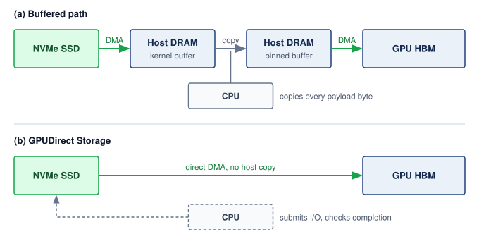

<!--
```{.tikz}
\scalebox{0.92}{%
\begin{tikzpicture}[
  font=\sffamily,
  >=Stealth,
  node_nvme/.style={
    rectangle,
    rounded corners=3pt,
    draw=TealLine!80,
    fill=TealFill!25,
    line width=0.7pt,
    minimum width=2.2cm,
    minimum height=1.12cm,
    inner sep=2pt,
    align=center
  },
  node_ram/.style={
    rectangle,
    rounded corners=3pt,
    draw=SteelBlue!80,
    fill=BlueFill!25,
    line width=0.7pt,
    minimum width=2.2cm,
    minimum height=1.12cm,
    inner sep=2pt,
    align=center
  },
  node_user/.style={
    rectangle,
    rounded corners=3pt,
    draw=OrangeLine!80,
    fill=OrangeFill!25,
    line width=0.7pt,
    minimum width=2.2cm,
    minimum height=1.12cm,
    inner sep=2pt,
    align=center
  },
  node_gpu/.style={
    rectangle,
    rounded corners=3pt,
    draw=NavyBlue!80,
    fill=BlueFill!35,
    line width=0.7pt,
    minimum width=2.2cm,
    minimum height=1.12cm,
    inner sep=2pt,
    align=center
  },
  ctrl_card/.style={
    rectangle,
    rounded corners=3pt,
    draw=GrayLine!50,
    fill=gray!6,
    line width=0.6pt,
    minimum width=4.6cm,
    minimum height=0.72cm,
    inner sep=2pt,
    align=center
  },
  line join=round, line cap=round, font=\small\sffamily
]

  % Coordinates for 4 horizontal stages (centers at -5.1, -1.7, 1.7, 5.1)
  % Card width: 2.2cm -> span = 2.2cm. Gaps = (-1.7 - 1.1) - (-5.1 + 1.1) = -2.8 - (-4.0) = 1.2cm.
  \def\xone{-5.1}
  \def\xtwo{-1.7}
  \def\xthr{1.7}
  \def\xfou{5.1}

  % =============================================================
  % PART A: TRADITIONAL PATH (CPU BOUNCE BUFFER)
  % =============================================================
  \node[anchor=center, font=\small\bfseries, text=TextDark] at (0, 5.25)
    {(a) Traditional Storage Path: Host Memory Bounce Buffer};

  \def\ya{3.85}

  % 1. NVMe SSD
  \node[node_nvme] (a_nvme) at (\xone, \ya) {
    \textbf{\scriptsize\textcolor{TealDark}{NVMe SSD}}\\[1.5pt]
    \fontsize{6pt}{7pt}\selectfont\textcolor{TextBlack!70}{PCIe Flash Storage}\\[1pt]
    \tiny\textcolor{TealDark}{\textbf{7 GB/s seq read}}
  };

  % 2. Host Kernel Buffer
  \node[node_ram] (a_kram) at (\xtwo, \ya) {
    \textbf{\scriptsize\textcolor{NavyBlue}{Host Kernel}}\\[1.5pt]
    \fontsize{6pt}{7pt}\selectfont\textcolor{TextBlack!70}{Page Cache Buffer}\\[1pt]
    \fontsize{5.5pt}{6.5pt}\selectfont\textcolor{DarkRed}{\textbf{Bounce Buffer 1}}
  };

  % 3. Host User Buffer
  \node[node_user] (a_uram) at (\xthr, \ya) {
    \textbf{\scriptsize\textcolor{OrangeLine!90!black}{User Space}}\\[1.5pt]
    \fontsize{6pt}{7pt}\selectfont\textcolor{TextBlack!70}{DataLoader Buffer}\\[1pt]
    \fontsize{5.5pt}{6.5pt}\selectfont\textcolor{OrangeLine!90!black}{\textbf{Pinned Tensor}}
  };

  % 4. GPU HBM
  \node[node_gpu] (a_gpu) at (\xfou, \ya) {
    \textbf{\scriptsize\textcolor{NavyBlue}{GPU HBM3e}}\\[1.5pt]
    \fontsize{6pt}{7pt}\selectfont\textcolor{TextBlack!70}{Accelerator Memory}\\[1pt]
    \tiny\textcolor{NavyBlue}{\textbf{Training Batch}}
  };

  % Arrows with clear labels
  \draw[->, line width=1.0pt, DarkRed, shorten >=2pt] (a_nvme.east) --
    node[above=2pt, font=\fontsize{6pt}{7pt}\selectfont\bfseries, text=DarkRed] {1. PCIe Hop}
    node[below=2pt, font=\fontsize{5pt}{6pt}\selectfont, text=TextMuted] {DMA to RAM} (a_kram.west);

  \draw[->, line width=1.0pt, DarkRed, shorten >=2pt] (a_kram.east) --
    node[above=2pt, font=\fontsize{6pt}{7pt}\selectfont\bfseries, text=DarkRed] {2. CPU copy}
    node[below=2pt, font=\fontsize{5pt}{6pt}\selectfont, text=TextMuted] {memcpy()} (a_uram.west);

  \draw[->, line width=1.0pt, DarkRed, shorten >=2pt] (a_uram.east) --
    node[above=2pt, font=\fontsize{6pt}{7pt}\selectfont\bfseries, text=DarkRed] {3. PCIe Hop}
    node[below=2pt, font=\fontsize{5pt}{6pt}\selectfont, text=TextMuted] {HtoD Copy} (a_gpu.west);

  % Panel A Summary Banner
  \node[
    rectangle,
    rounded corners=3pt,
    draw=RedLine!70,
    fill=RedFill!25,
    line width=0.7pt,
    minimum width=12.8cm,
    minimum height=0.72cm,
    anchor=north,
    align=center,
    inner sep=3pt
  ] at (0, 2.75) {
    \textbf{\scriptsize\textcolor{DarkRed}{Overhead: 2 PCIe crossings $+$ CPU memcpy() cycles $+$ kernel context switches}}\\[1.5pt]
    \tiny\textcolor{TextDark}{Data touches host system memory twice before reaching the GPU, polluting CPU L3 cache}
  };

  % =============================================================
  % DIVIDER
  % =============================================================
  \draw[GrayLine!25, line width=0.7pt] (-6.4, 1.85) -- (6.4, 1.85);

  % =============================================================
  % PART B: GPUDIRECT STORAGE (DIRECT P2P DMA & CPU BYPASS)
  % =============================================================
  \node[anchor=center, font=\small\bfseries, text=TextDark] at (0, 1.35)
    {(b) GPUDirect Storage (GDS): Direct PCIe DMA Bypass};

  \def\yb{-0.20}

  % 1. NVMe SSD
  \node[node_nvme] (b_nvme) at (\xone, \yb) {
    \textbf{\scriptsize\textcolor{TealDark}{NVMe SSD}}\\[1.5pt]
    \fontsize{6pt}{7pt}\selectfont\textcolor{TextBlack!70}{PCIe Flash Storage}\\[1pt]
    \tiny\textcolor{TealDark}{\textbf{7 GB/s wire rate}}
  };

  % 4. GPU HBM
  \node[node_gpu] (b_gpu) at (\xfou, \yb) {
    \textbf{\scriptsize\textcolor{NavyBlue}{GPU HBM3e}}\\[1.5pt]
    \fontsize{6pt}{7pt}\selectfont\textcolor{TextBlack!70}{Accelerator Memory}\\[1pt]
    \tiny\textcolor{NavyBlue}{\textbf{Direct DMA Sink}}
  };

  % CPU Controller in Control Path above bus
  \node[ctrl_card] (b_cpu) at (0, \yb+0.85) {
    \textbf{\scriptsize\textcolor{TextDark}{CPU $\cdot$ cuFile Storage Driver (Control Plane Only)}}\\[1pt]
    \fontsize{5.5pt}{6.5pt}\selectfont\textcolor{GreenD}{\textbf{Submits I/O Queues $\cdot$ Zero Payload Copying}}
  };

  % Control Path dashed lines
  \draw[->, line width=0.65pt, GrayLine!70, dashed, shorten >=2pt]
    (b_cpu.west) -| node[near start, above=1pt, font=\fontsize{5.5pt}{6.5pt}\selectfont, text=TextMuted] {doorbell} ([xshift=6pt]b_nvme.north);
  \draw[->, line width=0.65pt, GrayLine!70, dashed, shorten >=2pt]
    (b_cpu.east) -| node[near start, above=1pt, font=\fontsize{5.5pt}{6.5pt}\selectfont, text=TextMuted] {completion} ([xshift=-6pt]b_gpu.north);

  % Direct DMA Datapath Bus (Straight line from NVMe to GPU)
  \draw[-, line width=2.4pt, GreenLine!80] (b_nvme.east) -- (b_gpu.west);
  % Bus tick-mark glyphs
  \draw[line width=1.0pt, white] (-2.2, \yb-0.12) -- (-2.0, \yb+0.12);
  \draw[line width=1.0pt, white] (-2.0, \yb-0.12) -- (-1.8, \yb+0.12);
  \draw[line width=0.7pt, GreenD] (-2.2, \yb-0.12) -- (-2.0, \yb+0.12);
  \draw[line width=0.7pt, GreenD] (-2.0, \yb-0.12) -- (-1.8, \yb+0.12);
  \draw[line width=1.0pt, white] (1.8, \yb-0.12) -- (2.0, \yb+0.12);
  \draw[line width=1.0pt, white] (2.0, \yb-0.12) -- (2.2, \yb+0.12);
  \draw[line width=0.7pt, GreenD] (1.8, \yb-0.12) -- (2.0, \yb+0.12);
  \draw[line width=0.7pt, GreenD] (2.0, \yb-0.12) -- (2.2, \yb+0.12);

  % Arrowhead pointing into GPU.west
  \draw[->, line width=1.6pt, GreenLine, shorten >=2pt] ([xshift=-14pt]b_gpu.west) -- (b_gpu.west);

  % Badge on DMA datapath
  \node[
    rectangle,
    rounded corners=2.5pt,
    draw=GreenLine,
    fill=white,
    line width=0.6pt,
    inner xsep=8pt,
    inner ysep=2.5pt,
    font=\fontsize{6.5pt}{7.5pt}\selectfont\bfseries,
    text=GreenD
  ] at (0, \yb) {Direct PCIe Peer-to-Peer (P2P) DMA Datapath};

  % Bypassed Host RAM ghost box below bus
  \node[
    rectangle,
    rounded corners=3pt,
    draw=GrayLine!35,
    dashed,
    fill=gray!4,
    line width=0.5pt,
    minimum width=4.8cm,
    minimum height=0.62cm,
    align=center
  ] at (0, \yb-0.75) {
    \fontsize{5.5pt}{6.5pt}\selectfont\textcolor{TextMuted}{\textbf{Host System RAM (Kernel \& User Bounce Buffers)}}\\[1pt]
    \fontsize{5pt}{6pt}\selectfont\textcolor{TextMuted}{Completely Bypassed $\;\cdot\;$ Zero CPU Cache Pollution}
  };

  % Panel B Summary Banner
  \node[
    rectangle,
    rounded corners=3pt,
    draw=GreenLine,
    fill=GreenFill!25,
    line width=0.7pt,
    minimum width=12.8cm,
    minimum height=0.72cm,
    anchor=north,
    align=center,
    inner sep=3pt
  ] at (0, -1.65) {
    \textbf{\scriptsize\textcolor{GreenD}{Optimization: Single PCIe crossing $\;\cdot\;$ Zero CPU memory copy $\;\cdot\;$ Zero host bounce buffers}}\\[1.5pt]
    \tiny\textcolor{TextDark}{Direct NVMe-to-GPU memory DMA saturates link bandwidth while freeing CPU cores for preprocessing}
  };

  % =============================================================
  % BOTTOM PERFORMANCE GAIN CARD
  % =============================================================
  \node[
    rectangle,
    rounded corners=3.5pt,
    draw=GrayLine!35,
    fill=white,
    line width=0.7pt,
    minimum width=12.8cm,
    minimum height=0.85cm,
    anchor=north,
    align=center,
    inner sep=3pt
  ] at (0, -2.65) {
    \textbf{\scriptsize\textcolor{TextDark}{Quantitative Advantage with GPUDirect Storage (GDS)}}\\[3pt]
    \begin{tabular}{@{}ccc@{}}
      \colorbox{GreenFill!40}{\fontsize{6.5pt}{7.5pt}\selectfont\textbf{\textcolor{GreenD}{75\% Lower Transfer Latency}}} &
      \quad\colorbox{TealFill!40}{\fontsize{6.5pt}{7.5pt}\selectfont\textbf{\textcolor{TealDark}{4$\times$ Lower CPU Time}}} &
      \quad\colorbox{BlueFill!40}{\fontsize{6.5pt}{7.5pt}\selectfont\textbf{\textcolor{NavyBlue}{Saturates 7 GB/s NVMe Link}}}
    \end{tabular}
  };

\end{tikzpicture}%
}
```
-->

:::

GDS benefits depend on the bottleneck, request sizes, alignment, concurrency, and storage topology. Removing host bounce buffers can improve throughput when those copies limit the path; it does not imply that the smallest transfers benefit most. Small I/O may remain submission- or latency-limited and require concurrency to approach the available bandwidth. Benchmarks of the direct path therefore measure I/O size and per-device behavior as well as throughput. The benefit appears only in an end-to-end comparison of the pipeline with and without the direct path, and the clearest case is the one where host CPU time per request is the limiting stage.

::: {#nbk-data-storage-cpu-bypass-dividend .callout-notebook title="The CPU bypass dividend"}

**Problem**: A training node with `{python} GDSLatency.n_gpus_str` loads `{python} GDSLatency.image_kb_str` images at `{python} GDSLatency.per_gpu_images_per_s_str` per GPU (`{python} GDSLatency.gds_total_images_per_s_str` total). That rate is deliberately aggressive, several times the per-GPU image rate of notebook \ref{nbk-data-storage-text-vs-image-bandwidth}, to isolate the case in which per-request CPU work is the limiting stage. Assume active CPU service of `{python} GDSLatency.gds_trad_us_str` per request on the buffered path and `{python} GDSLatency.gds_bypass_us_str` on the direct path. These illustrative service times exclude time blocked on I/O; compare the implied CPU load rather than treating elapsed transfer latency as CPU time.

**Traditional path**\index{Traditional I/O!data path}: In the assumed buffered implementation, each image requires a DMA from NVMe to DRAM, a host copy from kernel to user space, and a PCIe transfer to GPU. At `{python} GDSLatency.gds_total_images_per_s_str` with `{python} GDSLatency.gds_trad_us_str` of CPU time per image, the CPU spends `{python} GDSLatency.gds_trad_cpu_seconds_str` of CPU time per wall-clock second, consuming roughly `{python} GDSLatency.gds_trad_cpu_cores_str` cores worth of processing just for data movement.

**GDS path**\index{GPUDirect Storage!data path}: Each image is transferred directly via DMA from NVMe to GPU. At `{python} GDSLatency.gds_bypass_us_str` of CPU time per image (for initiating the DMA), the CPU spends `{python} GDSLatency.gds_bypass_cpu_seconds_str` of CPU time per wall-clock second, freeing roughly `{python} GDSLatency.gds_freed_cpu_cores_str` cores for data augmentation.

**Systems insight**: Under the assumed CPU-service costs, bypassing payload copies releases processing capacity for preprocessing. The calculation does not predict end-to-end transfer latency, nor prove that preprocessing or storage throughput can sustain this request rate.

:::

GDS has practical limitations: not all NVMe controllers support peer-to-peer PCIe transfers, and the data must already be in a format that the GPU can consume directly (raw pixel values, token IDs, or formats handled by GPU decoders, rather than arbitrary compressed JPEG or gzip streams). In practice, many pipelines use a hybrid approach: CPU-side decoding for compressed formats followed by a normal pinned-memory GPU transfer, while GDS is reserved for direct reads of GPU-consumable data from supported local or remote storage.

The architectural evolution from CPU-mediated copies to direct storage access reflects a broader trend of removing CPU payload copies from the critical data path wherever possible. RDMA allows network payloads to move without CPU copying, while GDS provides the same bypass for storage payloads. Together, RDMA and GDS let data flow from remote storage (such as NVMe over Fabrics, or NVMe-oF)\index{NVMe-oF!remote fabric data path}, through the network fabric, and into GPU memory without a host-memory bounce copy. The CPU still submits and coordinates the operation, while more of its capacity remains available for data augmentation, pipeline orchestration, and error handling.

::: {.column-margin .margin-pointer}
↩ RDMA and kernel-bypass network paths are established in @sec-network-fabrics-rdma.
:::

```{python}
#| echo: false
# ┌── LEGO ───────────────────────────────────────────────
# │ Context: @sec-storage-complete-path
from mlsysim import Models
from mlsysim.fmt import check, fmt, fmt_memory

class CompleteDataPathCheckpoint:
    gpt3_params = Models.Language.GPT3.parameters
    training_tokens = ReferenceStats.StorageTrainingCorpus.TrainingTokens
    compressed_text = ReferenceStats.StorageTrainingCorpus.CompressedSource
    token_id_bytes = ReferenceStats.StorageTrainingCorpus.TokenIdBytes
    training_window = ReferenceStats.StorageTrainingCorpus.TrainingWindow
    checkpoint_interval = ReferenceStats.StorageTrainingCorpus.CheckpointInterval
    tokenized_text = training_tokens * token_id_bytes
    footprint = Scenarios.Gpt3StorageFootprint.result
    ckpt_total = footprint.checkpoint_bytes
    checkpoint_count_val = footprint.saves
    ckpt_fleet_total = footprint.checkpoint_bytes_written
    check(checkpoint_count_val == 4320, "30 days at 10-min checkpoint interval should be 4320")
    # ┌── 4. OUTPUT (Formatting) ──────────────────────────────────────────────
    tokenized_text_tb_str = fmt_memory(tokenized_text, unit=TB, precision=0, commas=False)
    compressed_text_tb_str = fmt_memory(compressed_text, unit=TB, precision=0, commas=False)
    ckpt_total_gb_str = fmt_memory(ckpt_total, unit=GB, precision=0, commas=True)
    checkpoint_count_str = fmt(checkpoint_count_val, precision=0)
    ckpt_fleet_total_pb_str = fmt_memory(ckpt_fleet_total, unit=PB, precision=1, commas=True)
```

The GDS design principle also extends to checkpoint writes\index{GPUDirect Storage!checkpoint write}: whereas a host-staged path transfers checkpoint bytes from GPU HBM through host DRAM to NVMe, a supported direct path can bypass that host staging for a `{python} CompleteDataPathCheckpoint.ckpt_total_gb_str` checkpoint. Removing the copy reduces $\CheckpointWriteTime$ only when that movement contributes to the exposed pause; snapshot consistency, serialization, storage service, and durable publication remain separate requirements.

### The complete data path {#sec-storage-complete-path}

Combining GDS with the multi-tier hierarchy, the complete data path connects the tiers for the running example. At the beginning of the training job, the `{python} CompleteDataPathCheckpoint.tokenized_text_tb_str` serialized shard set, derived from the `{python} CompleteDataPathCheckpoint.compressed_text_tb_str` compressed source corpus, is staged from object storage into the cluster's local NVMe caches, with each node receiving its assigned shard subset during setup. The data loader workers read tokenized shards from NVMe, assemble packed sequences in pinned host DRAM, and transfer those batches to the accelerator. With GDS enabled, token IDs that are already in a GPU-consumable layout can be loaded directly into GPU memory without CPU payload copying; compressed formats still require CPU or GPU decompression before use.

During steady-state training on the host-staged path, CPU data loader workers read from local NVMe and fill a prefetch queue in host DRAM. The GPU receives batches from this queue via PCIe DMA; the supported GDS alternative bypasses that host payload staging. The compute phase (forward pass, backward pass, optimizer step) consumes the batch and updates model state in HBM. Every `{python} StorageFuelLineContext.checkpoint_interval_str`, the training framework captures a consistent checkpoint, writes it to local NVMe through the chosen path, and copies it to the parallel file system in the background. The checkpoint protocol must still establish when all required shards are safe to publish for recovery.

At the end of the training job, the final model checkpoint is promoted from the parallel file system to object storage for long-term retention. The local NVMe copies are deleted during job cleanup. If the model is deployed for inference, it is loaded from object storage into the serving cluster's HBM, completing the lifecycle of data movement through the hierarchy.

The total number of data copies in this lifecycle is instructive. Each training sample traverses: object storage $\to$ NVMe (staging), NVMe $\to$ host DRAM (read), host DRAM $\to$ GPU HBM (transfer). Each checkpoint traverses: GPU HBM $\to$ NVMe (local save), NVMe $\to$ parallel file system (async copy), parallel file system $\to$ object storage (long-term retention). Every copy consumes bandwidth and contributes latency. The engineering goal is to minimize copies on the critical path (the training loop) and tolerate additional copies on noncritical paths (staging and archival). Both lifecycles cross the same tiers in opposite directions, with synchronous critical-path copies drawn solid and asynchronous background transfers drawn dashed in @fig-storage-complete-data-path. For training inputs moving rightward, the active loop waits only on local promotion into HBM (or the optional GDS bypass); for checkpoints flowing leftward, the exposed pause is confined to the local NVMe save while parallel-file-system replication and archival retention proceed off the critical path.

::: {#fig-storage-complete-data-path fig-env="figure" fig-pos="htb" fig-cap="**The Complete Data Path**: Columns are storage tiers, ordered from the durable object store (left) to accelerator memory (right). Training data moves right and bypasses the parallel file system in this running example; checkpoints return left through it. Solid arrows mark copies the training loop waits on; dashed arrows mark copies that run once per job or in the background. The dashed outline is one GPU node: every copy the training loop waits on stays inside it." fig-alt="Five tier columns headed object storage, parallel file system, local NVMe, host DRAM, and GPU HBM; a dashed outline labeled one GPU node encloses the last three, and the first two are labeled shared services. Training data row: a dataset in object storage, a dashed arrow labeled stage once across the empty parallel file system column to a staged copy on local NVMe, then solid arrows to a prefetch box in host DRAM and a batch in GPU HBM, plus a thinner optional GDS bypass arrow from NVMe over host DRAM to HBM. Checkpoints row: a solid arrow from model state in HBM to a local shard on NVMe labeled local save (pause), then dashed arrows to a durable copy on the parallel file system labeled async copy and to a retained copy in object storage labeled retain selected. A key distinguishes solid and dashed arrows."}
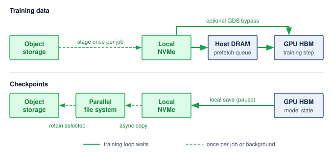
:::

Every copy that leaves the node also needs a network, and the choice of network decides whom a storage burst can disturb. Many training nodes carry a small number of storage-facing network adapters on a separate front-end network, in addition to one compute-fabric adapter per accelerator. Routing staging reads and checkpoint copies over that front-end network isolates them from gradient collectives, but it caps each node's storage bandwidth at a few front-end ports. Routing storage over the compute fabric offers far more bandwidth, and remote GDS reads use exactly that RDMA path, but then a checkpoint burst shares switch buffers and spine links with the job's collectives and must be separated by traffic classes. For the running example, each node's fair share of a `{python} StoragePyramidContext.pfs_bw_tb_per_s_str` file system shared by `{python} StoragePyramidContext.pfs_nodes_str` nodes is roughly `{python} StoragePyramidContext.pfs_per_node_bw_gb_per_s_str`, and copying its roughly `{python} NvmeTierContext.ckpt_node_share_gb_str` checkpoint shard within the `{python} StorageFuelLineContext.checkpoint_interval_attr_str` interval needs far less, so a front-end network can carry it. Image workloads that stream hundreds of GB/s across the cluster push designs toward the compute fabric. Through the C$^3$ lens, storage traffic becomes communication ($\OperationalTaxonomyDimension_2$) load the moment it leaves the node, and the network chosen to carry it decides which collectives a storage burst can delay.

Over the `{python} StorageFuelLineContext.training_window_attr_str` run, checkpointing writes roughly `{python} CompleteDataPathCheckpoint.ckpt_fleet_total_pb_str` of state against a single read of the `{python} CompleteDataPathCheckpoint.tokenized_text_tb_str` serialized dataset, so checkpoints, not training inputs, are the storage workload to design next. That design must take a multi-terabyte save off the training critical path without ever exposing a checkpoint that cannot be restored.

```{python}
#| echo: false
# ┌── LEGO ───────────────────────────────────────────────
# │ Context: Checkpoint section intro — model scale and checkpoint size
from mlsysim import Models, ReferenceStats
from mlsysim.core.units import BYTES_ADAM_STATE, BYTES_FP16, BYTES_FP32, GB
from mlsysim.fmt import check, fmt_memory, fmt_params

class CheckpointModelIntro:
    # ┌── 1. LOAD (Constants) ──────────────────────────────────────────────
    gpt3_params = Models.Language.GPT3.parameters
    weights_fp16 = gpt3_params * BYTES_FP16
    master_weights_fp32 = gpt3_params * BYTES_FP32
    adam_moments = gpt3_params * BYTES_ADAM_STATE
    ckpt_total = gpt3_params * CHECKPOINT_RESUME_BYTES_PER_PARAM
    check(weights_fp16 + master_weights_fp32 + adam_moments == ckpt_total, "Checkpoint component bytes must sum to total.")
    # ┌── 4. OUTPUT (Formatting) ──────────────────────────────────────────────
    gpt3_params_b_str = fmt_params(gpt3_params, scale="B", precision=0, commas=False)
    ckpt_total_gb_str = fmt_memory(ckpt_total, unit=GB, precision=0, commas=True)
    weights_fp16_gb_str = fmt_memory(weights_fp16, unit=GB, precision=0, commas=False)
    master_weights_fp32_gb_str = fmt_memory(master_weights_fp32, unit=GB, precision=0, commas=False)
    adam_moments_gb_str = fmt_memory(adam_moments, unit=GB, precision=0, commas=True)
```

## Checkpoint Storage {#sec-storage-checkpointing}

After the `{python} StorageFuelLineContext.run_accels_str` accelerators of the running cluster have been training for six hours, a power supply failure turns checkpoint storage\index{Checkpointing!storage architecture} into the difference between resuming within minutes and repeating hours or days of lost computation. Whether the job recovers cleanly depends on three storage questions: how quickly the most recent checkpoint was saved, where its shards reside, and whether they can be read back intact. Because checkpoints are also the heaviest write workload in the hierarchy, the storage architecture must minimize $\CheckpointWriteTime$, the time the training pipeline pauses to save a snapshot, while stating when that snapshot becomes durable and visible for restore. The save interval is an input to this storage analysis; selecting it from failure rates and recovery costs is a separate reliability decision derived in @sec-fault-tolerance-young-daly.

Under the resumable mixed-precision Adam\index{Adam optimizer!checkpoint state size} contract of @sec-storage-fuel-line, the `{python} CheckpointModelIntro.gpt3_params_b_str` parameter model's `{python} CheckpointModelIntro.ckpt_total_gb_str` checkpoint comprises `{python} CheckpointModelIntro.weights_fp16_gb_str` of FP16 model weights, `{python} CheckpointModelIntro.master_weights_fp32_gb_str` of FP32 master weights, and `{python} CheckpointModelIntro.adam_moments_gb_str` for the two FP32 Adam moments, while learning-rate-scheduler state, random-number-generator state, and the data-loader cursor add negligible bytes and gradients are recomputed after restore. When a save triggers, every participating worker process, called a rank, writes its assigned shard at once, producing the checkpoint storm introduced in @sec-storage-workload-inversion. Keeping that burst tractable requires a coordinated save that writes each unique byte once, whatever the parallel layout. In the running layout of @tbl-hbm-memory-budget, the Adam moments and master weights already exist as distinct per-node slices, while the FP16 weights repeat once per node, so a coordinated save assigns each of the `{python} StorageFuelLineContext.run_nodes_str` nodes a disjoint 1/`{python} StorageFuelLineContext.run_nodes_str` slice of its local FP16 weight copy to write alongside its unique optimizer slice. Spreading those unique bytes evenly gives each of the `{python} StorageFuelLineContext.run_nodes_str` nodes about 1/`{python} StorageFuelLineContext.run_nodes_str` of the checkpoint. The third ZeRO stage (ZeRO-3), which partitions the weights as well, makes that even split the natural one, because every rank already owns a distinct slice. Breaking that rule is a real risk even in the running layout, where a save in which every node writes the FP16 weight copy it holds would multiply the weight bytes by the node count. Its cost is clearest in a deliberately extreme thought experiment, a smaller model whose complete resumable state is written once per GPU of the book's reference cluster.

::: {.column-margin}
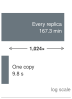{width="100%" fig-alt="Two-bar log-scale ladder: a long slate bar for every replica writing its full state, 167.3 minutes, above a short bar for one coordinated copy, 9.8 seconds, with a double arrow labeled 1,024 times."}

*Writing one copy per replica takes 1,024 times longer than writing each unique byte once.*
:::

```{python}
#| echo: false
#| label: checkpoint-storm-definition-calc
# ┌─────────────────────────────────────────────────────────────────────────────
# │ CHECKPOINT STORM DEFINITION CALCULATION (LEGO)
# ├─────────────────────────────────────────────────────────────────────────────
# │ Context: Quantitative significance bullet in the Checkpoint Storm definition.
# │ Goal: Make the 70B naive-vs-sharded checkpoint arithmetic explicit.
# │ How: Compute FP16 weights, FP32 master weights, Adam moments, and
# │      fabric write time at 100 GB/s.
# └─────────────────────────────────────────────────────────────────────────────
from mlsysim.fmt import check, fmt, fmt_count, fmt_memory, fmt_params, fmt_time

class CheckpointStormDefinition:
    """Checkpoint-storm arithmetic for the definition callout."""

    # ┌── 1. LOAD ──────────────────────────────────────────────────────────
    storm = Scenarios.Llama2_70BCheckpointStorm1K
    params = storm.workload.parameters
    params_b = params.to(Bparam).magnitude
    replicas = storm.replicas
    bytes_fp16 = BYTES_FP16
    bytes_fp32 = BYTES_FP32
    fabric_bw = storm.ingest_bandwidth

    # ┌── 2. EXECUTE ───────────────────────────────────────────────────────
    weights = memory_from_params(params, bytes_fp16 / param)
    master_weights = memory_from_params(params, bytes_fp32 / param)
    adam_moments = memory_from_params(params, 2 * bytes_fp32 / param)
    resumable_state = storm.result.state_bytes
    per_replica_state = resumable_state
    zero3_total = per_replica_state
    zero3_write = storm.result.single_copy_time
    naive_total = storm.result.storm_bytes
    naive_write = storm.result.storm_time
    naive_write_min = naive_write.to(minute)

    # ┌── 3. GUARD ─────────────────────────────────────────────────────────
    check(abs(zero3_total.to(GB).magnitude - 980) < 1e-6, "70B resumable checkpoint should be 980 GB")
    check(abs((weights + master_weights + adam_moments - resumable_state).to(GB).magnitude) < 1e-6, "Components must sum to the resumable state")
    check(naive_write.to(second).magnitude > 10_000, "Naive full-state write at 100 GB/s should exceed 10,000 s for Training_1K replicas")

    # ┌── 4. OUTPUT ────────────────────────────────────────────────────────
    params_b_str = fmt_params(params, scale="B", precision=0, commas=False)
    weights_gb_str = fmt_memory(weights, unit=GB, precision=0, commas=False)
    master_weights_gb_str = fmt_memory(master_weights, unit=GB, precision=0, commas=False)
    adam_moments_gb_str = fmt_memory(adam_moments, unit=GB, precision=0, commas=False)
    zero3_total_tb_str = fmt_memory(zero3_total, unit=TB, precision=2, commas=False)
    zero3_write_s_str = fmt_time(zero3_write, second, precision=1, commas=False, style='word')
    naive_total_tb_str = fmt_memory(naive_total, unit=TB, precision=1, commas=False)
    naive_write_s_str = fmt_time(naive_write, second, precision=1, commas=True, style='word')
    naive_write_min_str = fmt_time(naive_write_min, minute, precision=1, commas=False, style='word')
    replicas_str = fmt_count(replicas, commas=True, label="replica")
```

::: {#dfn-data-storage-checkpoint-storm .callout-definition title="Checkpoint storm"}

***Checkpoint storm***\index{Checkpoint storm!definition} is a burst of synchronized network and storage traffic that occurs when all nodes in an ML training fleet save model state simultaneously.

1.  **Significance**: When each replica writes its own full copy, the naive storm takes $\CheckpointWriteTime = \DataParallelDegree \times \text{per-replica state} / \StorageIngestBandwidth$, where $\DataParallelDegree$ is the number of replicas writing at once and $\StorageIngestBandwidth$ is the aggregate rate at which the target storage tier absorbs writes. A coordinated save that writes each unique byte once takes $\text{unique state} / \StorageIngestBandwidth$. Under the chapter's checkpoint contract, a `{python} CheckpointStormDefinition.params_b_str`-parameter model, smaller than the 175B running example, stores `{python} CheckpointStormDefinition.weights_gb_str` of FP16 weights, `{python} CheckpointStormDefinition.master_weights_gb_str` of FP32 master weights, and `{python} CheckpointStormDefinition.adam_moments_gb_str` of Adam moments. With vanilla data parallelism across `{python} CheckpointStormDefinition.replicas_str` (one per GPU of the book's reference cluster, rather than the chapter's `{python} StorageFuelLineContext.run_nodes_str`-node fleet), naively writing that complete state from every replica generates `{python} CheckpointStormDefinition.naive_total_tb_str` of simultaneous traffic. No 80 GB device can hold a `{python} CheckpointStormDefinition.zero3_total_tb_str` replica, so the case is a bound on write volume rather than a deployable layout. At 100 GB/s of aggregate storage ingest bandwidth, the write takes roughly `{python} CheckpointStormDefinition.naive_write_s_str`, or over `{python} CheckpointStormDefinition.naive_write_min_str` of training stall. A coordinated checkpoint protocol writes one logical copy. Replicated data parallelism can select one writer; ZeRO-3 instead distributes that copy across state-owning ranks. In the sharded example the total is roughly `{python} CheckpointStormDefinition.zero3_total_tb_str`, bringing $\CheckpointWriteTime$ down to roughly `{python} CheckpointStormDefinition.zero3_write_s_str`. Gradients do not appear in either total because recovery recomputes them.
2.  **Distinction**: Unlike general I/O contention (which is stochastic and unpredictable), a checkpoint storm is synchronous and periodic: every node writes at the same moment because the training orchestrator triggers checkpoint after a fixed step count. Its predictability makes it both more damaging (all nodes compete simultaneously) and more tractable (it can be prevented by design through staggered scheduling or asynchronous serialization).
3.  **Common pitfall**: A frequent misconception is that checkpointing every 100 steps is "low overhead" whatever the save protocol. Under the naive protocol at 70B scale, if each training step takes 10 seconds and a checkpoint storm takes `{python} CheckpointStormDefinition.naive_write_s_str`, checkpointing every 100 steps means spending most of the run on checkpoint I/O rather than useful training.

:::

The severity of a checkpoint storm depends on two factors: the per-node shard size, determined by the model size and the sharding strategy, and the throughput of the first write tier, typically local NVMe. A concrete 175B example shows why the local-write phase, rather than the durable copy to the parallel file system, governs the exposed training pause.

```{python}
#| echo: false
#| label: checkpoint-storm-calc
# ┌─────────────────────────────────────────────────────────────────────────────
# │ CHECKPOINT STORM STAGING CALCULATION (LEGO)
# ├─────────────────────────────────────────────────────────────────────────────
# │ Context: nbk-data-storage-checkpoint-storm.
# │ Goal: Compute local NVMe pause, PFS async copy time, and exposed overhead.
# │ How: ZeRO-3 shard = total checkpoint / nodes; local write uses 4 NVMe drives;
# │      PFS copy uses aggregate PFS bandwidth shared across all nodes.
# └─────────────────────────────────────────────────────────────────────────────
from mlsysim import Models, Systems
from mlsysim.fmt import check, fmt, fmt_bandwidth, fmt_memory, fmt_time

class CheckpointStormCalc:
    """Tiered checkpoint staging timings for the 175B example."""

    # ┌── 1. LOAD ──────────────────────────────────────────────────────────
    staged = Scenarios.Gpt3TieredCheckpoint2K
    storage_path = Systems.Storage.Production2KCheckpointPath
    nodes = staged.fleet.count
    local_drive_count = storage_path.local_stage.devices_per_node
    local_drive_bw = storage_path.local_stage.device.bandwidth
    pfs_aggregate_bw = staged.durable_bandwidth
    checkpoint_interval = staged.save_interval.to(second)

    # ┌── 2. EXECUTE ───────────────────────────────────────────────────────
    total_checkpoint = staged.result.checkpoint_bytes
    per_node_shard = staged.result.per_node_shard
    local_bw = staged.local_bandwidth
    local_write = staged.result.local_write_time
    pfs_copy = staged.result.drain_time
    per_node_pfs_bw = staged.result.durable_share_per_node
    per_node_pfs_copy = per_node_shard / per_node_pfs_bw
    overhead_pct = staged.result.pause_fraction * 100

    # ┌── 3. GUARD ─────────────────────────────────────────────────────────
    check(0.30 < local_write.to(second).magnitude < 0.40, "Local checkpoint pause should be about 0.34 s")
    check(2.4 < pfs_copy.to(second).magnitude < 2.5, "PFS async copy should be about 2.45 s")
    check(abs((pfs_copy - per_node_pfs_copy).to(second).magnitude) < 1e-9, "Aggregate and per-node PFS views must match")
    check(local_bw == local_drive_count * local_drive_bw, "Local stage bandwidth is four drives in parallel")

    # ┌── 4. OUTPUT ────────────────────────────────────────────────────────
    ckpt_total_gb_str = fmt_memory(total_checkpoint, unit=GB, precision=0, commas=True)
    per_node_shard_gb_str = fmt_memory(per_node_shard, unit=GB, precision=1, commas=False)
    local_bw_gb_per_s_str = fmt_bandwidth(local_bw, unit=GB / second, precision=0, commas=False)
    local_write_s_str = fmt_time(local_write, second, precision=2, commas=False, style='word')
    total_pfs_tb_str = fmt_memory(total_checkpoint, unit=TB, precision=1, commas=False)
    pfs_copy_s_str = fmt_time(pfs_copy, second, precision=1, commas=False, style='word')
    per_node_pfs_bw_gb_per_s_str = fmt_bandwidth(per_node_pfs_bw, unit=GB / second, precision=1, commas=False)
    overhead_pct_str = fmt_percent(overhead_pct / 100, precision=2, commas=False, style='prose')
    local_drive_count_str = fmt(local_drive_count, precision=0, commas=False)
    local_drive_bw_gb_per_s_str = fmt_bandwidth(local_drive_bw, unit=GB / second, precision=0, commas=False)
    nodes_str = fmt(nodes, precision=0, commas=True)
    pfs_aggregate_bw_tb_per_s_str = fmt_bandwidth(pfs_aggregate_bw, unit=TB / second, precision=0, commas=False)
    checkpoint_interval_min_str = fmt_time(checkpoint_interval, minute, precision=0, commas=False, style='word')
    checkpoint_interval_s_str = fmt_time(checkpoint_interval, second, precision=0, commas=False, style='word')
    pfs_aggregate_bw_gb_per_s_str = fmt_bandwidth(pfs_aggregate_bw, unit=GB / second, precision=0, commas=False)
```

::: {#nbk-data-storage-checkpoint-storm .callout-notebook title="Tiered checkpoint staging"}

**Problem**: Assume sustained bandwidth, no snapshot-copy, serialization, or coordination overhead, and no interference from background copies. The resulting times are bandwidth lower bounds. A `{python} CheckpointStormCalc.nodes_str`-node cluster saves a 175B-parameter checkpoint every `{python} CheckpointStormCalc.checkpoint_interval_min_str`. Each checkpoint totals `{python} CheckpointModelIntro.ckpt_total_gb_str`. Writing each unique byte once and spreading the bytes evenly across nodes, each node saves roughly `{python} CheckpointStormCalc.per_node_shard_gb_str`.

1. **Per-node write to local NVMe** (`{python} CheckpointStormCalc.local_drive_count_str` drives at `{python} CheckpointStormCalc.local_drive_bw_gb_per_s_str` each = `{python} CheckpointStormCalc.local_bw_gb_per_s_str`): `{python} CheckpointStormCalc.per_node_shard_gb_str` $\div$ `{python} CheckpointStormCalc.local_bw_gb_per_s_str` $\approx$ `{python} CheckpointStormCalc.local_write_s_str`.
2. **Async copy to PFS**\index{Checkpointing!async PFS copy}: `{python} CheckpointStormCalc.nodes_str` $\times$ `{python} CheckpointStormCalc.per_node_shard_gb_str` $\approx$ `{python} CheckpointStormCalc.total_pfs_tb_str` total. If the PFS provides `{python} CheckpointStormCalc.pfs_aggregate_bw_tb_per_s_str` aggregate, the storm completes in roughly `{python} CheckpointStormCalc.pfs_copy_s_str`.
3. **Per-node PFS bandwidth**\index{Bandwidth!per-node PFS}: If all `{python} CheckpointStormCalc.nodes_str` write simultaneously, each gets `{python} CheckpointStormCalc.pfs_aggregate_bw_gb_per_s_str` $\div$ `{python} CheckpointStormCalc.nodes_str` = `{python} CheckpointStormCalc.per_node_pfs_bw_gb_per_s_str`.
4. **Training pause**\index{Checkpointing!training pause}: At least `{python} CheckpointStormCalc.local_write_s_str` for the local NVMe write under this model. The PFS copy overlaps with the next training iteration.
5. **Overhead lower bound**\index{Checkpointing!overhead}: `{python} CheckpointStormCalc.local_write_s_str` pause every `{python} CheckpointStormCalc.checkpoint_interval_s_str` $\approx$ `{python} CheckpointStormCalc.overhead_pct_str` training time lost to checkpointing.

**Systems insight**: Under these `{python} CheckpointStormCalc.pfs_aggregate_bw_tb_per_s_str` aggregate-PFS assumptions, tiered staging reduces checkpoint overhead from about a `{python} CheckpointStormCalc.pfs_copy_s_str` PFS-direct write to a sub-second local write. The training pause can end at the local snapshot boundary before durable publication, but actual pause includes snapshot creation, serialization, and coordination in addition to this byte-transfer lower bound.

:::

A PFS-direct save of a few seconds every `{python} CheckpointStormCalc.checkpoint_interval_min_str` costs well under 1 percent of the run, which can make tiered staging look unnecessary for the running example. The checkpoint-dominance argument of @sec-storage-complete-path concerns bytes moved, not this pause, and the notebook's figure holds only while its assumptions do. The job has the whole `{python} CheckpointStormCalc.pfs_aggregate_bw_tb_per_s_str` file system to itself; shared among the ten concurrent jobs of @sec-storage-tier3-pfs, it receives a tenth of the bandwidth, the same save takes ten times as long, and its burst slows the other jobs' reads. Realized ingest also falls below the rated aggregate once serialization, metadata operations, and stragglers enter. The save interval shrinks as the fleet grows, because a larger fleet fails more often and the reliability analysis of @sec-fault-tolerance-young-daly then calls for more frequent saves, and a larger model scales every save with it. Tiered staging removes the shared-tier write from the exposed pause when the background copy keeps pace, although local snapshot creation, serialization, writing, and coordination still determine that pause.

Tiered staging\index{Tiered staging!two-phase checkpoint} insulates the training loop from that shared-tier contention by splitting the save into two phases. In the first phase, as calculated in notebook \ref{nbk-data-storage-checkpoint-storm}, each of the `{python} CheckpointStormCalc.nodes_str` nodes writes its `{python} CheckpointStormCalc.per_node_shard_gb_str` share of the `{python} CheckpointModelIntro.ckpt_total_gb_str` checkpoint across `{python} CheckpointStormCalc.local_drive_count_str` local NVMe drives at `{python} CheckpointStormCalc.local_bw_gb_per_s_str`, establishing a byte-transfer lower bound on $\CheckpointWriteTime$ of roughly `{python} CheckpointStormCalc.local_write_s_str` before snapshot-copy, serialization, and coordination overhead. Once every required local shard has completed and the captured state is no longer being modified, the training pipeline can resume.

In the second phase, a background process asynchronously copies the local checkpoint to the parallel file system for durability. The copy can overlap training, but it still competes for memory, network, and storage service and must drain before repeated saves create an unbounded backlog. The two phases therefore land differently in the Fleet Law (@eq-fleet-law). The local write is a pause that every rank takes at the same step boundary, and training resumes only when the slowest writer has finished its shard. That is the shape of a barrier rather than of a transfer between workers, a coordination ($\OperationalTaxonomyDimension_3$) cost, so the pause adds to the synchronization term $\SynchronizationTime(\DeviceCount)$ of each saving step, the term that already carries barrier and straggler waiting. The background copy belongs to no step's critical path. While it stays hidden and drains before the next save, it adds nothing to the step time; it reappears only as interference, in $\CommunicationTime(\DeviceCount)$ when it shares links with collectives or in exposed input wait when it slows shared-storage reads. If a node fails before its copy completes, the new generation may lose a required shard. Replication to peer nodes' NVMe drives can protect against a single-node loss, provided replicas occupy independent failure domains. Waiting for that replication extends the pause beyond the local-only calculation. A design that resumes earlier must retain the previous committed generation until the new one reaches its declared durability boundary.

Durability alone does not make a distributed checkpoint restorable. Each rank writes its checksummed shard under an immutable generation identifier. Only after every shard has persisted does a coordinator publish a manifest\index{Checkpointing!manifest publication} naming the complete shard set. That commit uses an atomic primitive of the target tier (a create or rename on a file system, a conditional create or versioned pointer on an object store). A crash can then leave garbage to collect but never an incomplete generation that appears valid.

::: {.column-margin .margin-pointer}
↪ The commit rule behind this ordering, a two-phase commit over the shard set, and the consistency of the cut that a manifest names are developed in @sec-fault-tolerance-reliability-checkpoint-coordination-patterns-f670.
:::

The exposed pause and the durability boundary therefore fall at different moments, as the four concurrent lanes of @fig-storage-checkpoint-staging align them. Training pauses only during the local NVMe shard write ($\TimeInstant_0$ to $\TimeInstant_1$), resuming on live state while the parallel file system absorbs the asynchronous copy ($\TimeInstant_1$ to $\TimeInstant_2$) and the coordinator validates checksums before publishing the manifest last ($\TimeInstant_3$).

::: {#fig-storage-checkpoint-staging data-explore="original-checkpoint-staging" data-explore-key="vol2:fig-storage-checkpoint-staging" fig-env="figure" fig-pos="htb" fig-cap="**Two-Phase Checkpoint Staging**: Read the lanes left to right. Training pauses only for the local NVMe write ($\TimeInstant_0$ to $\TimeInstant_1$); the copy to the parallel file system overlaps later training steps, and the coordinator publishes the manifest last ($\TimeInstant_3$). Between $\TimeInstant_1$ and $\TimeInstant_3$ the new generation exists only as staged shards, so the previous committed generation remains the restore point." fig-alt="Timeline with four horizontal lanes labeled training, local NVMe, parallel FS, and coordinator above a time axis marked t0 through t3. A short red paused block in the training lane lines up with a local write block; long blocks show training continuing, an asynchronous copy to the parallel file system, checksum verification, and manifest publication. Brackets below the axis mark the span from t1 to t3 as staged and the span after t3 as restorable."}
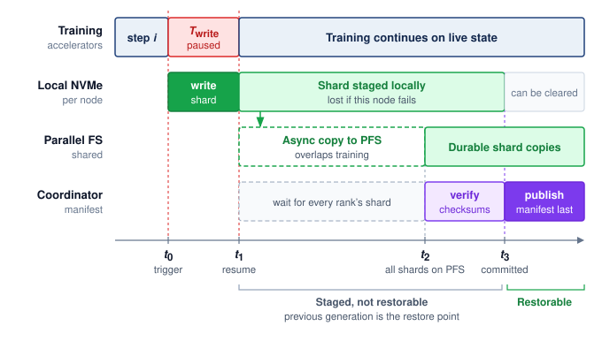
:::

```{python}
#| echo: false
# ┌── LEGO ───────────────────────────────────────────────
# │ Context: chk-data-storage-checkpoint-storage-design
# │ Goal: Prompt parameters for the checkpoint storage design exercise.
from mlsysim.fmt import MarkdownStr, check, fmt, fmt_bandwidth, fmt_count, fmt_time

class CheckpointStorageDesignPrompt:
    nodes = Systems.Clusters.Production_2K.count  # the chapter's 256-node running cluster
    checkpoint_interval = ReferenceStats.StorageTrainingCorpus.CheckpointInterval
    local_nvme_bw = Systems.Storage.LocalNvmeGen4_7T68x4.aggregate_bandwidth
    pfs_aggregate_bw = Systems.Storage.PfsOneTbPerSecond.bandwidth
    step_time = ReferenceStats.StorageTrainingCorpus.StepTime
    pause = 1 * second  # scenario assumption: checkpoint pause budget
    pause_steps = (pause / step_time).to("").magnitude
    check(abs(pause_steps - round(pause_steps)) < 1e-9, "The pause budget should span a whole number of iterations")

    # ┌── 4. OUTPUT ───────────────────────────────────────
    nodes_str = fmt_count(nodes, commas=True, label="node")
    checkpoint_interval_min_str = fmt_time(checkpoint_interval, minute, precision=0, commas=False, style='word')
    local_nvme_bw_gb_per_s_str = fmt_bandwidth(local_nvme_bw, unit=GB / second, precision=0, commas=False)
    pfs_aggregate_tb_per_s_str = fmt_bandwidth(pfs_aggregate_bw, unit=TB / second, precision=0, commas=False)
    step_time_ms_str = fmt_time(step_time, ms, precision=0, commas=False)
    pause_str = fmt_time(pause, second, precision=0, attributive=True, style='word')
    number_words = ("zero", "one", "two", "three", "four", "five", "six", "seven", "eight", "nine", "ten")
    check(round(pause_steps) < len(number_words), "Spelled-out iteration count must be ten or fewer")
    pause_steps_words_str = MarkdownStr(number_words[round(pause_steps)] + " iterations")  # prose spells out small counts
```

### Synchronous and asynchronous checkpoint writes {#sec-storage-distributed-checkpoint}

In the two-phase timeline of @fig-storage-checkpoint-staging, the first phase is still synchronous with respect to local flash: across `{python} CheckpointStorageDesignPrompt.nodes_str`, every node must write and acknowledge its shard of the same completed training step before the completion barrier releases the next iteration, with the commit rules that make that cut consistent developed in @sec-fault-tolerance-reliability-checkpoint-coordination-patterns-f670. The slowest local writer therefore sets the exposed pause from $\TimeInstant_0$ to $\TimeInstant_1$.

Asynchronous checkpointing shrinks even that local-flash pause by staging the snapshot in host DRAM first. Nodes coordinate the training step to capture, copy each accelerator-resident shard into a dedicated pinned host-memory buffer, and resume training immediately while a background thread writes the buffer to local NVMe. The snapshot buffer must remain immutable until the background write finishes; separate live-state buffers allow training to advance without changing the captured generation. If a node fails during the asynchronous write, its local shard may be incomplete. The job must wait for the required writes or peer replication before declaring this generation durable, even if training has already resumed.

The choice between synchronous and asynchronous checkpointing depends on the pause budget and save frequency. A `{python} CheckpointStorageDesignPrompt.pause_str` pause at `{python} CheckpointStorageDesignPrompt.step_time_ms_str` per iteration costs `{python} CheckpointStorageDesignPrompt.pause_steps_words_str`; whether that overhead is acceptable depends on how much useful training occurs between saves. Asynchronous checkpointing reduces exposed write time when snapshot buffers and background bandwidth are available, but its buffer capacity, contention, and durability delay also enter the decision.

Checkpoint formats\index{Checkpointing!format optimization} implement the write-once rule of the checkpoint storm as rank-sharded saves, as in DeepSpeed's zero-redundancy checkpointing\index{Checkpointing!zero-redundancy} and PyTorch's Distributed Checkpoint\index{Distributed Checkpoint!rank-sharded data} [@pytorchDistributedCheckpointDocs]. The sharding is what keeps the pause short. Had one node saved the full `{python} CheckpointModelIntro.ckpt_total_gb_str` itself, its `{python} CheckpointStormCalc.local_bw_gb_per_s_str` local stripe would need more than a minute rather than the `{python} CheckpointStormCalc.local_write_s_str` of an even shard. Making each individual save fast, however, creates a cumulative capacity problem once thousands of snapshots accumulate over a multi-week run.

### Checkpoint retention and restore {#sec-storage-checkpoint-retention}

```{python}
#| echo: false
# ┌── LEGO ───────────────────────────────────────────────
# │ Context: Checkpoint retention paragraph below — fleet totals over 30-day run
from mlsysim import Models
from mlsysim.fmt import fmt, fmt_memory

class CheckpointFleetRetention:
    # ┌── 1. LOAD (Constants) ──────────────────────────────────────────────
    bytes_per_param_ckpt = CHECKPOINT_RESUME_BYTES_PER_PARAM
    training_window = ReferenceStats.StorageTrainingCorpus.TrainingWindow
    checkpoint_interval = ReferenceStats.StorageTrainingCorpus.CheckpointInterval
    footprint = Scenarios.Gpt3StorageFootprint.result
    ckpt_total = footprint.checkpoint_bytes
    checkpoint_count_val = footprint.saves
    ckpt_fleet_total = footprint.checkpoint_bytes_written
    retention_recent = 3 * ckpt_total
    retained_every_100_count_val = checkpoint_count_val // 100
    # ┌── 4. OUTPUT (Formatting) ──────────────────────────────────────────────
    checkpoint_count_str = fmt(checkpoint_count_val, precision=0)
    ckpt_fleet_total_pb_str = fmt_memory(ckpt_fleet_total, unit=PB, precision=1, commas=True)
    retention_recent_tb_str = fmt_memory(retention_recent, unit=TB, precision=2, commas=False)
    retained_every_100_count_str = fmt(retained_every_100_count_val, precision=0)
```

Checkpointing a 175B-parameter model every `{python} StorageFuelLineContext.checkpoint_interval_str` over a `{python} StorageFuelLineContext.training_window_attr_str` training run generates roughly `{python} CheckpointFleetRetention.checkpoint_count_str` snapshots of `{python} CheckpointModelIntro.ckpt_total_gb_str` each, totaling approximately `{python} CheckpointFleetRetention.ckpt_fleet_total_pb_str`, enough to fill a typical parallel file system several times over if retained in full. The retention policy\index{Checkpointing!retention policy} this run adopts keeps the three most recent checkpoints on the parallel file system for fast recovery, copies every 100th checkpoint and the final checkpoint to object storage for long-term auditability, and deletes the rest. This policy reduces the parallel file system checkpoint footprint from `{python} CheckpointFleetRetention.ckpt_fleet_total_pb_str` to roughly `{python} CheckpointFleetRetention.retention_recent_tb_str` (three live full checkpoints) while preserving `{python} CheckpointFleetRetention.retained_every_100_count_str` periodic historical snapshots in object storage, plus the final checkpoint when it does not coincide with that schedule, for posttraining analysis.

Incremental checkpointing\index{Incremental checkpointing!delta state} offers a further optimization for reducing $\CheckpointWriteTime$. Rather than saving the entire training state every time, an incremental checkpoint records changed state relative to a declared base or preceding generation. The delta must include changed optimizer and continuation state as well as parameters. For models where a large fraction of parameters are frozen (such as fine-tuning scenarios where only the last few layers are updated), incremental checkpoints can be orders of magnitude smaller than full checkpoints. Restoring a generation requires its base and every intervening delta, so smaller saves add recovery work and dependencies. Periodic full checkpoints bound that chain, and the retention policy must preserve each dependency until no retained generation requires it. A shorter pause matters only if the checkpoint can be read back; the costlier failure is a checkpoint that was written but never verified as restorable.

::: {#ws-data-storage-gitlab-database-incident .callout-war-story title="The backup that had not been restored (2017)"}

**Context**: On January 31, 2017, a GitLab.com site reliability engineer working a database replication incident accidentally wiped the primary PostgreSQL data directory [@gitlab2017postmortem].

**Mechanism**: All five layered backup paths failed simultaneously: S3 dumps were silently empty due to a version mismatch, Azure disk snapshots were disabled, replication was broken, LVM snapshots were six hours stale, and WAL archiving was unimplemented.

**Impact**: Six hours of production database writes, user comments, and repository metadata were permanently lost, requiring an 18-hour emergency restoration from a staging snapshot.

**Fix**: GitLab instituted automated daily backup restoration testing, unified PostgreSQL versioning across environments, and implemented automated WAL archiving to S3.

**Systems lesson**: Storage reliability is a restore property, not a backup property. A checkpoint, replica, or dump only counts if the team regularly proves that it can be located, validated, and restored under incident conditions. ML systems face the same vulnerability. A model checkpoint written to object storage or a feature store snapshot is useless if silent version mismatches or missing restore tests\index{Checkpointing!restore validation} prevent resuming a multi-day training run after node preemption.

:::

That incident turns checkpoint storage from a capacity question into a restore-design question. Before consolidating the running example's full storage footprint, the following check tests the write rates and staging trade-offs that govern each save.

::: {#chk-data-storage-checkpoint-storage-design .callout-checkpoint title="Checkpoint storage design"}

A training cluster of `{python} CheckpointStorageDesignPrompt.nodes_str` saves a 175B-parameter model checkpoint every `{python} CheckpointStorageDesignPrompt.checkpoint_interval_min_str`. Each checkpoint is `{python} CheckpointModelIntro.ckpt_total_gb_str` total, distributed across all nodes.

- [ ] **Per-node state**: calculate the per-node checkpoint size.
- [ ] **Local write**: calculate $\CheckpointWriteTime$ for the local write when each node writes to local NVMe at `{python} CheckpointStorageDesignPrompt.local_nvme_bw_gb_per_s_str`.
- [ ] **Async copy**: calculate the per-node write bandwidth and async-copy time when the parallel file system provides `{python} CheckpointStorageDesignPrompt.pfs_aggregate_tb_per_s_str` aggregate and all `{python} CheckpointStorageDesignPrompt.nodes_str` write simultaneously.
- [ ] **Tiered staging**: explain why tiered staging (local NVMe first, then async PFS copy) is faster than writing directly to PFS.

:::

With the checkpoint accounting now derived in full, the running example's storage demands can be consolidated against the same hierarchy. Placing the training dataset, live model state, checkpoints, and archive lineage side by side reveals which direction of traffic dominates the 30-day run.

```{python}
#| echo: false
# ┌── LEGO ───────────────────────────────────────────────
# │ Context: psp-data-storage-175b-models-storage-footprint
from mlsysim import Models
from mlsysim.fmt import fmt, fmt_count, fmt_memory, fmt_ratio

class StorageFootprintTable:
    gpt3_params = Models.Language.GPT3.parameters
    training_tokens = ReferenceStats.StorageTrainingCorpus.TrainingTokens
    compressed_text = ReferenceStats.StorageTrainingCorpus.CompressedSource
    token_id_bytes = ReferenceStats.StorageTrainingCorpus.TokenIdBytes
    training_window = ReferenceStats.StorageTrainingCorpus.TrainingWindow
    checkpoint_interval = ReferenceStats.StorageTrainingCorpus.CheckpointInterval
    training_nodes = Systems.Clusters.Production_2K.count  # the chapter's 256-node running cluster
    tokenized_text = training_tokens * token_id_bytes
    footprint = Scenarios.Gpt3StorageFootprint.result
    ckpt_total = footprint.checkpoint_bytes
    checkpoint_count_val = footprint.saves
    ckpt_fleet_total = footprint.checkpoint_bytes_written
    archive_checkpoint_count = footprint.archived_checkpoints
    archive_lineage = footprint.archive_bytes

    # ┌── 4. OUTPUT ───────────────────────────────────────
    compressed_text_tb_str = fmt_memory(compressed_text, unit=TB, precision=0, commas=False)
    tokenized_text_tb_str = fmt_memory(tokenized_text, unit=TB, precision=0, commas=False)
    ckpt_fleet_total_pb_str = fmt_memory(ckpt_fleet_total, unit=PB, precision=1, commas=True)
    archive_lineage_tb_str = fmt_memory(archive_lineage, unit=TB, precision=1, commas=False, approx=True)
    epochs_str = fmt_count(1, commas=False, label="epoch")
    ckpt_io_dominance_factor_str = fmt_ratio(
        int(footprint.write_read_ratio),
        precision=0,
        commas=True,
    )
    training_nodes_str = fmt_count(training_nodes, commas=False, label="node")
```

::: {#psp-data-storage-175b-models-storage-footprint .callout-perspective title="The 175B model's storage footprint"}

The running example, a `{python} StorageFuelLineContext.training_window_attr_str` training run of a 175B-parameter model on `{python} StorageFootprintTable.training_nodes_str`, places data on every tier of the hierarchy (@tbl-data-storage-175b-footprint).

| **Category**                                                                                                                                          |                         **Volume**                         | **Primary tier**                                           |
|:------------------------------------------------------------------------------------------------------------------------------------------------------|:----------------------------------------------------------:|:-----------------------------------------------------------|
| Training dataset (compressed source)                                                                                                                  |  `{python} StorageFootprintTable.compressed_text_tb_str`   | Object Storage                                             |
| Training dataset (tokenized, per epoch)                                                                                                               |   `{python} StorageFootprintTable.tokenized_text_tb_str`   | Object Storage $\to$ NVMe cache $\to$ Host DRAM            |
| Model weights (FP16)                                                                                                                                  |    `{python} CheckpointModelIntro.weights_fp16_gb_str`     | GPU HBM (distributed)                                      |
| Master weights (FP32)                                                                                                                                 | `{python} CheckpointModelIntro.master_weights_fp32_gb_str` | GPU HBM (ZeRO-partitioned)                                 |
| Adam moments (two FP32 states)                                                                                                                        |    `{python} CheckpointModelIntro.adam_moments_gb_str`     | GPU HBM (ZeRO-partitioned)                                 |
| Single resumable checkpoint                                                                                                                           |     `{python} CheckpointModelIntro.ckpt_total_gb_str`      | NVMe $\to$ PFS $\to$ Object Storage                        |
| All checkpoints (`{python} StorageFuelLineContext.training_window_days_str`, `{python} StorageFuelLineContext.checkpoint_interval_attr_str` interval) |  `{python} StorageFootprintTable.ckpt_fleet_total_pb_str`  | NVMe (transient) $\to$ PFS (recent) $\to$ Object (archive) |
| Archive (retained checkpoints + dataset)                                                                                                              |  `{python} StorageFootprintTable.archive_lineage_tb_str`   | Glacier                                                    |

: **175B-Parameter Training Storage Footprint**: Volume and primary storage tier for each data category in a `{python} StorageFuelLineContext.training_window_attr_str`, `{python} StorageFuelLineContext.run_nodes_str`-node training run. {#tbl-data-storage-175b-footprint}

The total data moved through the hierarchy\index{Storage!total data movement} is approximately `{python} StorageFootprintTable.ckpt_fleet_total_pb_str` of checkpoint data plus `{python} StorageFootprintTable.tokenized_text_tb_str` per `{python} StorageFootprintTable.epochs_str` of training data reads. For a single-epoch language model training run, checkpoint I/O dominates data loading I/O by a factor of over `{python} StorageFootprintTable.ckpt_io_dominance_factor_str`.

:::

Checkpoints therefore set the run's write budget, while the far smaller training corpus carries a different obligation. Because training quality depends on the exact samples delivered at every step, each byte of that corpus must remain traceable to the source version and transformation code that produced it.

## Versioned Data and Commit Boundaries {#sec-storage-data-versioning-orchestration}

If a multi-week training run suffers a sudden loss spike or a deployed model regresses, an engineering team that did not record which shard versions, preprocessing code, and shuffle seeds fed each step cannot tell a model bug from a silent change in the input data. A checkpoint manifest provides one commit boundary per save. The data pipeline that built the training corpus has many, one at every stage that turns raw inputs into processed shards. The storage system must record both the exact bytes read and the preprocessing code, shuffle seed, schema, and integrity checks that produced them before the run began.

::: {#lhs-data-storage-archetype-b-dlrm-at-scale-feature-store-latency .callout-lighthouse title="Archetype B (DLRM at Scale): Feature store latency"}

While Archetype A (GPT-4/Llama-3) trains on static, versioned shards, Archetype B (DLRM at Scale) trains on live feature streams that change every second as users click and interact. Replaying an exact batch then becomes a point-in-time problem, which a feature store\index{Feature store!point-in-time correctness} answers by keeping a retained, versioned feature log.

:::

::: {.column-margin .margin-pointer}
↪ Point-in-time correctness, the leakage it prevents, and the storage cost of retained feature history are developed in @sec-ml-operations-scale-pointintime-correctness-41f4.
:::

```{python}
#| echo: false
#| label: hash-validation-cost
# ┌─────────────────────────────────────────────────────────────────────────────
# │ HASH VALIDATION COST (LEGO)
# ├─────────────────────────────────────────────────────────────────────────────
# │ Context: SHA-256 validation footnote in §Data versioning.
# │ Goal: Make the 100 TB integrity-check core-hour estimate reproducible.
# │ How: Dataset MB / effective per-core throughput / seconds per hour.
# └─────────────────────────────────────────────────────────────────────────────
from mlsysim.fmt import check, fmt_bandwidth, fmt_count, fmt_memory

class HashValidationCost:
    """Pipeline-level SHA-256 validation cost assumption."""

    # ┌── 1. LOAD ──────────────────────────────────────────────────────────
    dataset = 100 * TB  # scenario validation dataset size assumption
    throughput_per_core = 500 * (MB / second)  # scenario per-core SHA-256 rate (modern server core)

    # ┌── 2. EXECUTE ───────────────────────────────────────────────────────
    validation_time = dataset / throughput_per_core
    core_hours = validation_time.to(hour).magnitude

    # ┌── 3. GUARD ─────────────────────────────────────────────────────────
    check(50 < core_hours < 60, "100 TB at 500 MB/s/core should be about 56 core-hours")

    # ┌── 4. OUTPUT ────────────────────────────────────────────────────────
    dataset_tb_str = fmt_memory(dataset, unit=TB, precision=0, commas=False)
    throughput_mb_per_s_str = fmt_bandwidth(throughput_per_core, unit=MB / second, precision=0, commas=False)
    cpu_core_hours_str = fmt_count(core_hours, precision=1, label="CPU-core hour", allow_fractional=True)
```

Even when the underlying shard files are immutable, a distributed loader produces a stream of consumed samples whose versions and order can shift across epochs during a `{python} StorageFuelLineContext.training_window_attr_str` run. Dataset versioning\index{Dataset versioning!cryptographic snapshotting} provides a "Git for data" record by snapshotting the cryptographic hashes[^fn-hash-computation-overhead] of every data shard, the exact preprocessing code used for tokenization, and the random seeds governing the global shuffle. With that snapshot in place, engineers investigating a mid-run divergence can replay the exact batch that triggered the loss spike and test whether the culprit was a corrupted sample or numerical instability in the optimizer.

[^fn-hash-computation-overhead]: **Hash cost (SHA-256)**\index{Cryptographic hash!validation cost}: Verifying the integrity of a `{python} HashValidationCost.dataset_tb_str` dataset using SHA-256 consumes approximately `{python} HashValidationCost.cpu_core_hours_str` at a per-core hashing rate of `{python} HashValidationCost.throughput_mb_per_s_str`. The work parallelizes across shards, but it still competes with decoding for host cores and must read every byte, so the validation step is best pipelined with ingestion rather than run as a separate pass before the fleet starts.

At petabyte scale, the data pipeline has to make every transformation reproducible. Raw documents are cleaned, tokenized, packed into training examples, and sharded across storage tiers. Each stage writes an immutable artifact, and each artifact records the input version, code version, schema, and statistical checks it satisfied. Once those dependencies are explicit, the pipeline forms a directed acyclic graph: later artifacts depend on earlier artifacts, and no stage is allowed to rewrite its own history. When a training job starts, the cluster manager verifies that each worker's local NVMe shards match the data snapshot declared for the run. Treating the data pipeline as a graph of versioned artifacts rather than a simple file transfer makes silent data drift detectable and attributable to a specific stage, code version, or input snapshot. Immutability also pays a storage dividend. Because an artifact never changes once written, a manifest can name it by content identifier, and many experiments can reference the same unchanged shards without copying entire datasets.

### Replay and commit boundaries in data pipelines {#sec-storage-distributed-transformation-semantics}

When a tokenization worker crashes halfway through building a shard of the running example's corpus, its replacement must decide which raw documents to process again without silently dropping records or writing duplicates. Versioned artifacts identify *what* a pipeline produced, while commit and replay rules determine whether mid-stage failures can alter that result. The storage system's part in that decision is the commit boundary, the point at which a stage's output becomes durable and visible downstream, the same contract that @sec-storage-checkpointing applied to checkpoint generations. That shared contract is why a storage chapter owns these semantics, because whether a replay loses or duplicates data is decided by what the store has committed. The restarted worker compares its input position with the last committed output and replays everything after it, so the work at risk is whatever accumulated past the last commit. Two service-rate effects govern how much accumulates. Records are assigned to workers by a partition key, such as a document's source or a user identifier, and partition skew\index{Partition skew!data pipelines} arises when one key owns disproportionate work and holds its stage open while the rest of the fleet idles. Backpressure\index{Backpressure!data pipelines} propagates a slow downstream stage's limit upstream by slowing admission or bounding in-flight data, a control response to overload rather than another name for slow processing.

Failures near that boundary raise a correctness question, and three guarantees answer it differently. At-most-once processing\index{Processing semantics!at-most-once} never replays uncertain work, so a document that was read but whose output was never confirmed is lost. At-least-once processing\index{Processing semantics!at-least-once} replays everything after the last confirmed commit, so a document whose output was written but not yet confirmed is written twice. An effectively exactly-once outcome\index{Processing semantics!exactly-once} combines replayable inputs with idempotent writes\index{Idempotent writes!data pipelines}, writes that leave the same result however many times they repeat, or with transactional output keyed by a stable event or transaction identifier [@akidau2015]. Reliable message delivery between workers cannot provide this guarantee on its own, because the duplicate arises from the worker's own replay.

::: {#exmp-storage-acknowledgment-gap .callout-example title="The acknowledgment gap"}

**Failure trace**: A feature-pipeline worker writes the output row for click event `e42`, then crashes before it records that the write succeeded. Its replacement cannot tell whether `e42` was committed. Skipping the event risks losing it. Replaying it with an append writes the feature row a second time, so that click counts twice in every training set built from the table. Writing the row under the stable key `(feature_version, e42)` turns the replay into an overwrite of the same row, so the uncertain event can be reprocessed safely.

**Systems lesson**: Exactly-once belongs at the output commit boundary, whose record must bind the input position, transformation version, stable identifier, and commit state.

:::

The two replays differ only in how the output is addressed. An append gives every attempt its own row, while a write under a stable key sends every attempt to the same row, so reprocessing uncertain work leaves the stored result unchanged (@fig-storage-commit-boundary).

::: {#fig-storage-commit-boundary fig-env="figure" fig-pos="htb" fig-cap="**The Acknowledgment Gap at a Commit Boundary**: A worker stores the output row for event e42 and crashes before it records the commit, so its replacement cannot tell whether the row exists and must replay the event. (a) Appending the replayed row duplicates it, and the click counts twice in every training set built from the table. (b) Writing under the stable key (feature_version, e42) makes the replay an overwrite of the same row, so at-least-once replay produces an effectively exactly-once result." fig-alt="Schematic with two lanes. Worker lane: a gray read e42 box, an arrow to a green write row box labeled output stored, a red X labeled crash, and a dashed violet record commit box labeled never reached; a red bracket under the crash and the commit box is labeled acknowledgment gap, written but not committed. Replacement lane: a gray replay e42 box labeled commit unknown, branching to two panels. Panel a, append the row: a white row e42 click first write above a red row e42 click replay marked duplicate, with the note the click counts twice. Panel b, write under a stable key: one green row (feature_version, e42) click, with the notes replay overwrites the same row and the click counts once."}
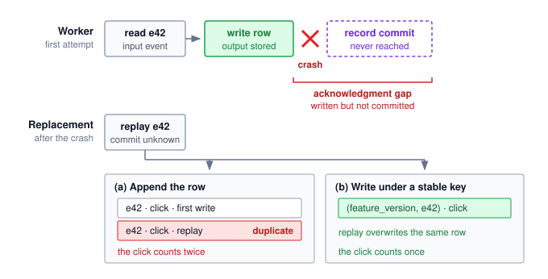
:::

Streaming adds a time boundary to the contract. Event time\index{Event time!data pipelines} records when an event occurred; processing time\index{Processing time!data pipelines} records when a worker handled it. A pipeline that aggregates clicks per hour must decide when an hour is finished, even though events can arrive late. A watermark\index{Watermark!stream processing} is its running estimate that every event up to some event time has arrived, which lets it close that window and emit the result; a late-data policy determines whether later arrivals update, retract, quarantine, or drop the result [@akidau2015]. Watermarks therefore trade freshness against completeness rather than prove that no older event remains.

Each of these mechanisms buys one property at the cost of another. Buffering absorbs finite bursts or temporary slowdowns but increases recovery state and freshness lag; sustained overload still requires backpressure or more service capacity. Aggressive watermarks reduce delay but exclude more late data, while retries help only when writes are safe to repeat. These choices change the stored result, because a feature table closed under an aggressive watermark holds different rows from one closed under a lenient watermark. A reproducible training snapshot must therefore record source and code versions alongside partitioning, replay policy, stable identifiers, watermark state, and late-data decisions. That record is what lets a later feature backfill, a replay of history under new code, rejoin features at the correct points in time without mixing old and new histories.

::: {.column-margin .margin-pointer}
↪ Feature backfills that replay history under this snapshot contract are developed in @sec-ml-operations-scale-backfill-procedures-eb66.
:::

### The synthetic fuel line {#sec-storage-synthetic-fuel}

The versioned-artifact contract applies to generated training samples as well as collected ones. When a fleet generates candidate samples, filters them, and verifies the survivors, each stage adds storage traffic and records that must remain linked to the accepted payload. The pressure to generate comes from the compute-optimal allocation of @sec-vol2-intro-ai-scaling-laws-a043, which grows the token budget with the parameter count. As high-quality human-generated text becomes harder to expand, the fleet encounters the **data wall**\index{Data wall!definition}: the point where additional training samples must increasingly come from synthesis, simulation, curation, or expensive human collection [@villalobos2024will]. This shift from simple collection to managed data generation sends more than payload bytes through the hierarchy. A "synthetic fuel line" must also store the **provenance chain**\index{Provenance chain!definition} of every sample: which model generated it, which filters accepted or rejected it, which judge or verifier models scored it, and which downstream run consumed it. That lineage makes repeated reuse of generated material traceable. It supports investigation of **model collapse**\index{Model collapse!definition}, where recursive training on generated data can degrade the learned distribution [@shumailov2024]; retaining provenance alone does not prevent the degradation. The storage design must separately budget retained artifacts and the repeated scans used to assess them.

```{python}
#| echo: false
#| label: synthetic-amplification-calc
from mlsysim.fmt import check, fmt, fmt_memory, fmt_multiple, fmt_percent, fmt_ratio
from mlsysim.core.units import TB

class SyntheticStorage:
    """Capacity and traffic contracts for the Synthetic Fuel Line."""

    # ┌── 1. LOAD ──────────────────────────────────────────
    synthetic = Scenarios.SyntheticDataProvenance
    data_size = synthetic.payload_bytes  # synthetic dataset payload size
    provenance_metadata_overhead = synthetic.provenance_overhead
    verification_passes = synthetic.verification_passes
    # ┌── 2. EXECUTE ───────────────────────────────────────
    stored_footprint = synthetic.result.stored_bytes
    verification_read_traffic = synthetic.result.verification_bytes
    pipeline_traffic = synthetic.result.pipeline_bytes
    capacity_amplification = synthetic.result.capacity_amplification
    traffic_amplification = synthetic.result.traffic_amplification
    # ┌── 3. GUARD ─────────────────────────────────────────
    check(round(capacity_amplification, 1) == 1.4, f"Capacity amp {capacity_amplification} unexpected")
    check(round(traffic_amplification, 1) == 4.4, f"Traffic amp {traffic_amplification} unexpected")
    # ┌── 4. OUTPUT ────────────────────────────────────────
    capacity_amplification_mult_str = fmt_multiple(capacity_amplification, precision=1, commas=False)
    traffic_amplification_mult_str = fmt_multiple(traffic_amplification, precision=1, commas=False)
    stored_footprint_tb_str = fmt_memory(stored_footprint, unit=TB, precision=1, commas=False)
    verification_read_traffic_tb_str = fmt_memory(verification_read_traffic, unit=TB, precision=0, commas=False)
    pipeline_traffic_tb_str = fmt_memory(pipeline_traffic, unit=TB, precision=1, commas=False)
    # _str alias for prose; raw verification_passes kept for arithmetic above
    verification_passes_str = fmt(verification_passes, precision=0, commas=False)
    provenance_overhead_pct_str = fmt_percent(provenance_metadata_overhead, precision=0, commas=False, style='prose')
    footprint_factor_str = fmt_ratio(1 + provenance_metadata_overhead, precision=1, commas=False)
    data_size_tb_str = fmt_memory(data_size, unit=TB, precision=0, commas=False)

    @classmethod
    def plot(cls):
        """Visualizes the storage cost of synthetic data."""
        from binder.tools.figures import style as book_style

        return book_style.bar_compare(
            **{
                "labels": ["Human (Raw)", "Synthetic (Verified)"],
                "values": [cls.data_size.to(TB).magnitude, cls.stored_footprint.to(TB).magnitude],
                "title": "Synthetic Dataset Capacity",
                "ylabel": "Dataset Footprint (TB)",
            }
        )
```

::: {#nbk-data-storage-napkin-math-synthetic-tax .callout-notebook title="The storage cost of synthetic data"}

**Problem**: A `{python} SyntheticStorage.data_size_tb_str` synthetic dataset retains provenance metadata and undergoes three independent verification scans. How much persistent capacity and pipeline traffic does it require if judge outputs are not retained as full dataset copies?

1. **Raw Payload**\index{Synthetic data!raw payload}: `{python} SyntheticStorage.data_size_tb_str`.
2. **Provenance Overhead**\index{Synthetic data!provenance overhead}: `{python} SyntheticStorage.provenance_overhead_pct_str` extra for lineage hashes, generation logs, and reward-model scores.
3. **Verification Traffic**\index{Synthetic data!verification factor}: `{python} SyntheticStorage.verification_passes_str` judge passes each read the payload, producing `{python} SyntheticStorage.verification_read_traffic_tb_str` of read traffic. Their scores reside in the provenance metadata rather than in three retained payload copies.
4. **Capacity Result**: Persistent capacity is `{python} SyntheticStorage.data_size_tb_str` $\times$ `{python} SyntheticStorage.footprint_factor_str` = `{python} SyntheticStorage.stored_footprint_tb_str`, a `{python} SyntheticStorage.capacity_amplification_mult_str` capacity factor.
5. **Traffic Result**: Writing the payload and metadata once and reading the payload three times moves `{python} SyntheticStorage.pipeline_traffic_tb_str`, a `{python} SyntheticStorage.traffic_amplification_mult_str` traffic factor before generation and judge-model compute are counted.

**Systems insight**: Verification primarily draws on service rate and compute, while retained provenance consumes capacity. The two costs coincide only when the pipeline materializes each judge output as another full dataset. Synthetic storage must therefore budget bytes at rest separately from bytes moved and record which generator, filters, judges, and downstream runs produced each accepted sample.

:::

Generated data therefore makes lineage part of the payload, so the store must budget retained provenance and verification traffic alongside the samples themselves. Every tier that holds those samples, checkpoints, or provenance records also carries a distinct price tag, turning placement across the hierarchy into an economic optimization problem.

## Storage Economics {#sec-storage-economics}

Checkpoints, training shards, and the lineage that binds them now each have a place in the hierarchy, and every placement carries a price set by the tier that holds the bytes and by how often they cross a billing boundary. ML storage economics\index{Storage economics!cost components} is therefore not simply about choosing the cheapest capacity tier; the design objective is to minimize total cost of data delivery\index{Total cost of data delivery!cost components}, which combines recurring storage charges, cross-boundary transfer fees, and the opportunity cost of idle accelerators.

```{python}
#| echo: false
# ┌── LEGO ───────────────────────────────────────────────
# │ Context: @sec-storage-economics—egress, IOPS, and retrieval iceberg costs
from mlsysim import GB, Infrastructure, TB, USD, ureg
from mlsysim.fmt import check, fmt, fmt_count, fmt_memory, fmt_usd
from mlsysim.core.units import month

class StorageIcebergCosts:
    # ┌── 1. LOAD ─────────────────────────────────────────
    bill = Scenarios.ObjectStorage100TB
    dataset = bill.dataset_bytes  # representative training dataset
    epochs = bill.reads  # epochs (dataset reads) per run
    file_count = bill.files  # number of individual files
    get_rate_per_1k = bill.request_fee.to(USD).magnitude
    get_request_unit = bill.requests_per_fee  # S3 GET pricing denominator (per 1,000 requests)
    egress_rate = bill.egress_rate
    s3_rate = bill.storage_rate  # chapter-wide S3 tier
    glacier_retrieval_rate = bill.retrieval_rate
    # ┌── 2. EXECUTE ──────────────────────────────────────
    egress_10epoch = bill.result.egress_cost * USD
    get_request_cost = bill.result.request_cost * USD
    storage_monthly = (dataset * s3_rate * month).to(USD)
    glacier_retrieval = bill.result.archive_retrieval_cost * USD
    # ┌── 3. GUARD ────────────────────────────────────────
    check(egress_10epoch.magnitude > storage_monthly.magnitude, "Egress should dwarf monthly storage")
    check(abs(dataset.to(TB).magnitude - ObjectStorageCost.dataset_size_tb) < 1e-9, "Iceberg and tier-cost cells must price the same dataset")
    # ┌── 4. OUTPUT ───────────────────────────────────────
    egress_10epoch_usd_str = fmt_usd(egress_10epoch.magnitude, precision=0)
    get_request_usd_str = fmt_usd(get_request_cost.to(USD).magnitude, precision=0)
    storage_monthly_usd_str = fmt_usd(storage_monthly.magnitude, precision=0)
    glacier_retrieval_usd_str = fmt_usd(glacier_retrieval.magnitude, precision=0)
    file_count_str = fmt_count(file_count, scale="M", precision=0)
    dataset_tb_str = fmt_memory(dataset, unit=TB, precision=0, commas=False)
    epochs_str = fmt(epochs, precision=0)
    get_rate_per_1k_usd_str = fmt_usd(get_rate_per_1k, precision=4, commas=False)
    get_request_unit_str = fmt_count(get_request_unit, label="request", commas=True)
    egress_rate_gb_str = fmt_usd(egress_rate, precision=2, commas=False, per="GB")
    glacier_retrieval_rate_gb_str = fmt_usd(glacier_retrieval_rate, precision=2, commas=False, per="GB")
```

```{python}
#| echo: false
# ┌─────────────────────────────────────────────────────────────────────────────
# │ STORAGE COST EXTREMES — HBM-AS-STORAGE + IDLE-ACCELERATOR (LEGO)
# ├─────────────────────────────────────────────────────────────────────────────
# │ Goal: Bracket the cost ladder (HBM capital top end) and the opportunity cost
# │       of storage-induced accelerator idle time.
# │ How: 100 TB x HBM USD/GB; 1,024-GPU reference cluster x Fleet GpuHourRef x utilization shortfall.
# └─────────────────────────────────────────────────────────────────────────────
from mlsysim.fmt import check, fmt_count, fmt_percent, fmt_time, fmt_usd

class StorageCostExtremes:
    # ┌── 1. LOAD ──────────────────────────────────────────────────────────
    idle = Scenarios.InputStallIdleCost1K
    dataset_tb = Scenarios.ObjectStorage100TB.dataset_bytes.to(TB).magnitude  # 100 TB training dataset
    hbm_per_gb = Infrastructure.Pricing.Storage.HbmEquivalentPerGb.rate
    cluster_size = idle.fleet.total_accelerators  # 1,024-GPU reference cluster
    gpu_hour_rate = idle.device_hour_rate
    util_high = idle.healthy_utilization  # storage-healthy utilization
    util_low = idle.degraded_utilization  # storage-starved utilization
    run_days = round(idle.duration.to(day).magnitude)
    # ┌── 2. EXECUTE ───────────────────────────────────────────────────────
    hbm_storage = (dataset_tb * TB).to(GB) * hbm_per_gb
    idle_daily = idle.result.fleet_cost_per_day * USD
    idle_loss_daily = idle.result.loss_per_day * USD
    idle_loss_run = idle.result.loss_total * USD
    # ┌── 3. GUARD ─────────────────────────────────────────────────────────
    check(abs(hbm_storage.to(USD).magnitude - 1_500_000) < 1, "HBM-as-storage should be 1.5M for 100 TB")
    # ┌── 4. OUTPUT ────────────────────────────────────────────────────────
    hbm_storage_usd_str = fmt_usd(hbm_storage.to(USD).magnitude, precision=0)
    hbm_per_gb_str = fmt_usd(hbm_per_gb, per="GB", precision=0, commas=False)
    idle_daily_usd_str = fmt_usd(idle_daily.to(USD).magnitude, precision=0)
    idle_loss_daily_usd_str = fmt_usd(idle_loss_daily.to(USD).magnitude, precision=0)
    idle_loss_run_usd_str = fmt_usd(idle_loss_run.to(USD).magnitude, precision=0)
    cluster_size_str = fmt_count(cluster_size, label="GPU", commas=True)
    gpu_hour_rate_str = fmt_usd(gpu_hour_rate.to(USD / hour).magnitude, precision=0, commas=False, per="GPU-hour")
    util_high_pct_str = fmt_percent(util_high, precision=0, commas=False, style="prose")
    util_low_pct_str = fmt_percent(util_low, precision=0, commas=False, style="prose")
    run_days_str = fmt_time(run_days, "day", precision=0, commas=False, style="word")
```

Applied to one `{python} ObjectStorageCost.dataset_tb_str` training dataset, the per-gigabyte rates quoted earlier for each tier diverge by orders of magnitude: object storage (S3 Standard) costs `{python} ObjectStorageCost.s3_annual_usd_str` per year, provisioned local NVMe costs `{python} ObjectStorageCost.nvme_annual_usd_str` per year, and archival storage (such as Glacier) drops to `{python} GlacierCost.glacier_annual_usd_str` per year. By contrast, hypothetically provisioning the same capacity as GPU memory at `{python} StorageCostExtremes.hbm_per_gb_str` would require `{python} StorageCostExtremes.hbm_storage_usd_str` in upfront acquisition cost alone, before factoring in amortization, power, or server housing.

The `{python} ObjectStorageCost.nvme_s3_ratio_mult_str` cost difference between local NVMe and object storage motivates placing data on the least expensive tier that meets its delivery and recovery requirements. Device technology contributes to the gradient: HBM uses 3D-stacked silicon with through-silicon vias, and accelerator-adjacent capacity is constrained by packaging and node design. Shared storage pools capacity across clients but introduces network and service dependencies. The cost comparison must include those dependencies rather than infer the cheapest usable path from capacity price alone.

::: {.column-margin}
{width="100%" fig-alt="One cost bar: a short gray one-year storage segment labeled 24K dollars beside a long violet ten-epoch egress segment labeled 90K dollars."}

*Repeated cross-boundary egress, not storage, dominates cloud cost.*
:::

Storage cost, however, is only part of the equation. Data transfer costs\index{Data transfer cost!cloud egress} can dominate, especially in cloud environments. When compute runs in a different region or cloud from the bucket, as assumed here, reading the 100 TB dataset from object storage to compute instances incurs a transfer charge of `{python} ObjectStorageCost.egress_once_usd_str`. For multi-epoch training that reads the dataset `{python} StorageIcebergCosts.epochs_str` times, the egress cost alone reaches `{python} StorageIcebergCosts.egress_10epoch_usd_str`, more than the annual storage cost. This inversion, where *reading* data costs more than *storing* it, drives the architecture decision to cache data on local NVMe rather than streaming from object storage each epoch.

The economic analysis changes further when accounting for the opportunity cost of accelerator idle time. The book's reference cluster of `{python} StorageCostExtremes.cluster_size_str`, half the chapter's running cluster, at `{python} StorageCostExtremes.gpu_hour_rate_str` costs `{python} StorageCostExtremes.idle_daily_usd_str` per day. If input stalls reduce its compute-active fraction from `{python} StorageCostExtremes.util_high_pct_str` to `{python} StorageCostExtremes.util_low_pct_str`, the lost compute time is valued at `{python} StorageCostExtremes.idle_loss_daily_usd_str` per day. Over a `{python} StorageCostExtremes.run_days_str` training run, this amounts to `{python} StorageCostExtremes.idle_loss_run_usd_str`. That value sets a budget for evaluating a storage upgrade, but the recoverable benefit depends on how much exposed wait the upgrade removes. Capacity that does not relieve the limiting stage yields no corresponding compute-time saving.

::: {#psp-data-storage-storage-cost-iceberg .callout-perspective title="The storage cost iceberg"}

The visible cost of storage (\$/GB/month) is the tip of the iceberg. Below the surface lie costs that often exceed the storage cost itself:

- **Egress fees**\index{Egress fee!cloud storage}: The ten-epoch egress charge of `{python} StorageIcebergCosts.egress_10epoch_usd_str` computed above already exceeds a year of storage.
- **IOPS charges**\index{IOPS!charges}: Object storage charges per-request fees. S3 Standard GET requests cost about `{python} StorageIcebergCosts.get_rate_per_1k_usd_str` per `{python} StorageIcebergCosts.get_request_unit_str`, so a dataset of `{python} StorageIcebergCosts.file_count_str` individual files, read once, costs about `{python} StorageIcebergCosts.get_request_usd_str` in GET request fees before data transfer or retrieval charges, even though the storage cost is `{python} StorageIcebergCosts.storage_monthly_usd_str`/month.
- **Idle accelerator cost**\index{Idle compute!accelerator cost}: The `{python} StorageCostExtremes.idle_loss_daily_usd_str` per day of lost compute computed above dwarfs any storage saving.
- **Retrieval fees**\index{Retrieval fee!archive storage}: Archive storage charges retrieval fees (`{python} StorageIcebergCosts.glacier_retrieval_rate_gb_str` for Glacier) in addition to egress. Restoring a `{python} StorageIcebergCosts.dataset_tb_str` dataset from Glacier costs `{python} StorageIcebergCosts.glacier_retrieval_usd_str` in retrieval fees plus `{python} ObjectStorageCost.egress_once_usd_str` in egress.

The economically rational strategy often invests more in storage (local NVMe caching, parallel file system capacity) to reduce transfer costs and prevent accelerator stalls.

:::

The cost iceberg reveals that raw storage capacity can account for less than half of the total expenditure; replication, metadata operations, API calls, and cross-region transfers can collectively dominate the bill at scale. Among those hidden line items, egress is the one that often flips the architecture decision. Unlike capacity charges, which scale with the volume of data stored, egress charges scale with the volume of data read, and ML training reads the full dataset on every epoch.

```{python}
#| echo: false
#| label: data-storage-stream-vs-stage-economics

# ┌─────────────────────────────────────────────────────────────────────────────
# │ STREAM-VS-STAGE ECONOMICS
# ├─────────────────────────────────────────────────────────────────────────────
# │ Context: nbk-data-storage-egress-tax — the egress-cost worked example
# │          comparing streaming from S3 against staging to local NVMe.
# │
# │ Goal: Compute the full cost chain from registry rates (the old callout
# │       hand-typed every number and claimed the savings fund '3 additional
# │       H100 GPUs' — at the registry's 30K H100 price it is 9).
# │ Show: Both options' annual totals, the savings, the H100 equivalence,
# │       and the break-even epoch count.
# │ How: 50 TB / 20 epochs / 4 runs/yr are scenario assumptions; all rates
# │      come from Infrastructure.Pricing (S3StandardLowPerTbMonth,
# │      NvmeLowPerTbMonth, EgressPerGB, Capital.H100GpuPurchaseUsd).
# │
# └─────────────────────────────────────────────────────────────────────────────
from mlsysim.fmt import check, fmt, fmt_int, fmt_memory, fmt_usd
from mlsysim.core.units import month

class StreamVsStageEconomics:
    # ┌── 1. LOAD (Constants) ──────────────────────────────────────────────
    plan = Scenarios.VisionCorpusStreamVsStage
    dataset = plan.dataset_bytes  # vision training corpus
    epochs = plan.epochs  # epochs per training run
    runs_per_year = plan.runs_per_year  # training runs per year
    s3_rate = plan.object_rate  # chapter-wide S3 tier
    nvme_rate = plan.local_rate
    egress_rate = plan.egress_rate
    h100_price = Infrastructure.Pricing.Capital.H100GpuPurchaseUsd.rate

    # ┌── 2. EXECUTE (The Compute) ────────────────────────────────────────
    r = plan.result
    s3_annual = r.source_storage_cost * USD
    egress_per_run = r.stream_egress_per_run * USD
    stream_total = r.stream_cost * USD
    nvme_annual = r.local_storage_cost * USD
    stage_egress_annual = r.stage_egress_cost * USD
    stage_total = r.stage_cost * USD
    savings = r.savings * USD
    h100_equiv = (savings / h100_price).to("").magnitude
    # Break-even: staging's extra annual cost (NVMe + one staging pass per
    # run) equals streaming egress at E epochs per run.
    breakeven_epochs = r.break_even_epochs

    # ┌── 3. GUARD (Invariants) ───────────────────────────────────────────
    check(abs(savings.magnitude - 282_000) < 1, f"Savings should be 282,000/year, got {savings}")
    check(8 <= h100_equiv <= 10, f"Savings should fund roughly 9 H100s at the registry price, got {h100_equiv:.1f}")
    check(4 < breakeven_epochs < 5, f"Break-even should land just over 4 epochs, got {breakeven_epochs:.2f}")

    # ┌── 4. OUTPUT (Formatting) ──────────────────────────────────────────
    dataset_tb_str = fmt_memory(dataset, unit=TB, precision=0, commas=False)
    epochs_str = fmt(epochs, precision=0, commas=False)
    runs_str = fmt(runs_per_year, precision=0, commas=False)
    months_per_year_str = fmt(12, precision=0, commas=False)
    s3_rate_gb_mo_str = fmt_usd(s3_rate, precision=2, commas=False, per="GB/month")
    nvme_rate_gb_mo_str = fmt_usd(nvme_rate, precision=2, commas=False, per="GB/month")
    egress_rate_gb_str = fmt_usd(egress_rate, precision=2, commas=False, per="GB")
    s3_annual_str = fmt_usd(s3_annual.magnitude, precision=0, commas=True)
    egress_per_run_str = fmt_usd(egress_per_run.magnitude, precision=0, commas=True)
    stream_egress_annual_str = fmt_usd((runs_per_year * egress_per_run).magnitude, precision=0, commas=True)
    stream_total_str = fmt_usd(stream_total.magnitude, precision=0, commas=True)
    nvme_annual_str = fmt_usd(nvme_annual.magnitude, precision=0, commas=True)
    stage_egress_annual_str = fmt_usd(stage_egress_annual.magnitude, precision=0, commas=True)
    stage_total_str = fmt_usd(stage_total.magnitude, precision=0, commas=True)
    savings_str = fmt_usd(savings.magnitude, precision=0, commas=True)
    h100_equiv_str = fmt_int(int(h100_equiv))
```

::: {#nbk-data-storage-egress-tax .callout-notebook title="The cost of egress"}

**Problem**: A team trains a vision model on a `{python} StreamVsStageEconomics.dataset_tb_str` image dataset stored in S3. Training runs for `{python} StreamVsStageEconomics.epochs_str` epochs. The decision is whether to stream from S3 each epoch or stage to local NVMe.

**Option A**: Stream from S3

- Storage: `{python} StreamVsStageEconomics.dataset_tb_str` $\times$ `{python} StreamVsStageEconomics.s3_rate_gb_mo_str` $\times$ `{python} StreamVsStageEconomics.months_per_year_str` months = `{python} StreamVsStageEconomics.s3_annual_str`/year
- Egress: `{python} StreamVsStageEconomics.dataset_tb_str` $\times$ `{python} StreamVsStageEconomics.epochs_str` epochs $\times$ `{python} StreamVsStageEconomics.egress_rate_gb_str` = `{python} StreamVsStageEconomics.egress_per_run_str` per training run
- Total for `{python} StreamVsStageEconomics.runs_str` training runs/year: `{python} StreamVsStageEconomics.s3_annual_str` + `{python} StreamVsStageEconomics.stream_egress_annual_str` = `{python} StreamVsStageEconomics.stream_total_str`/year

**Option B**: Stage to local NVMe

- Storage (S3 source of truth): `{python} StreamVsStageEconomics.s3_annual_str`/year
- NVMe capacity (`{python} StreamVsStageEconomics.dataset_tb_str` across cluster): `{python} StreamVsStageEconomics.dataset_tb_str` $\times$ `{python} StreamVsStageEconomics.nvme_rate_gb_mo_str` $\times$ `{python} StreamVsStageEconomics.months_per_year_str` = `{python} StreamVsStageEconomics.nvme_annual_str`/year
- Egress (stage once per training run): `{python} StreamVsStageEconomics.dataset_tb_str` $\times$ `{python} StreamVsStageEconomics.runs_str` runs $\times$ `{python} StreamVsStageEconomics.egress_rate_gb_str` = `{python} StreamVsStageEconomics.stage_egress_annual_str`/year
- Total: `{python} StreamVsStageEconomics.s3_annual_str` + `{python} StreamVsStageEconomics.nvme_annual_str` + `{python} StreamVsStageEconomics.stage_egress_annual_str` = `{python} StreamVsStageEconomics.stage_total_str`/year

**Systems insight**: Local NVMe caching saves `{python} StreamVsStageEconomics.savings_str`/year at `{python} StreamVsStageEconomics.epochs_str` epochs per run, enough to fund `{python} StreamVsStageEconomics.h100_equiv_str` additional H100 GPUs at list price. Including the `{python} StreamVsStageEconomics.nvme_annual_str`/year provisioned NVMe cost and the once-per-run staging egress, the break-even point is just over 4 epochs per run; by the fifth epoch, local caching is cheaper than streaming from S3 every epoch.

:::

The notebook turns the iceberg into a decision rule: the cheapest storage tier is not always the cheapest delivery path. Object storage can remain the source of truth, but repeated reads make egress, request overhead, and idle-accelerator cost part of the storage design. Multi-epoch vision training may justify staging on local NVMe by the fifth epoch, while single-epoch language-model pretraining may leave the corpus in object storage and optimize the streaming path instead. The running example stages anyway, although it reads its corpus only once, because egress is not what decides it. Each node's share of the shards fits easily on local NVMe, the staging copy happens once before the clock starts, and local reads keep object-store latency tails out of every training step. When compute and bucket share a region, transfer fees largely disappear and the same comparison turns on request charges, latency, and idle accelerators instead. The architecture is therefore chosen from access pattern, read count, and latency sensitivity rather than from \$/GB/month alone.

The cost analysis extends to the parallel file system tier, which occupies a middle ground between NVMe and object storage in both performance and price. A parallel file system capable of delivering 1 TB/s aggregate bandwidth requires roughly 100 OSS nodes, each with multiple NVMe drives and high-bandwidth network connections. Because the throughput target, not the stored capacity, sets that server count, a bandwidth-sized system costs far more than its stored bytes alone would suggest. This expense is justified only if the alternative, streaming from object storage and paying egress fees, is even more expensive, or if the latency requirements of checkpoint writes cannot be met by object storage alone. The break-even analysis depends on the organization's workload mix. A team running a single long training job may find that staging data on local NVMe and bypassing the parallel file system entirely is the cheapest option, while a team running many concurrent short jobs benefits from the shared namespace that a parallel file system provides.

```{python}
#| echo: false
# ┌── LEGO ───────────────────────────────────────────────
# │ Context: @sec-storage-economics tiering prose
from mlsysim.fmt import fmt, fmt_memory

class StorageEconomicsCorpus:
    training_tokens = ReferenceStats.StorageTrainingCorpus.TrainingTokens
    token_id_bytes = ReferenceStats.StorageTrainingCorpus.TokenIdBytes
    tokenized_text = training_tokens * token_id_bytes
    # ┌── 4. OUTPUT ───────────────────────────────────────
    tokenized_text_tb_str = fmt_memory(tokenized_text, unit=TB, precision=0, commas=False)
```

```{python}
#| echo: false
#| label: storage-economics-build-vs-buy-calc
# ┌─────────────────────────────────────────────────────────────────────────────
# │ BUILD VS. BUY STORAGE ECONOMICS (1 PB)
# ├─────────────────────────────────────────────────────────────────────────────
# │ Context: @sec-storage-economics build-vs-buy paragraph immediately below.
# │
# │ Goal:    Compute annual cloud delivery cost, net savings vs on-prem ops,
# │          and capex break-even years for a 1 PB workload read 10x/year.
# │ Show:    Cloud storage + egress totals; net savings; 4.7-7.8 year break-even.
# │ How:     Apply per-GB monthly cost and per-GB egress rate to 1 PB; compare
# │          to fixed on-prem annual operations cost; divide capex by net savings.
# │
# └─────────────────────────────────────────────────────────────────────────────
from mlsysim.core.units import month, year

class BuildVsBuyStorageEconomics:
    # ┌── 1. LOAD ─────────────────────────────────────────
    from mlsysim.fmt import check, fmt, fmt_rate, fmt_time_range, fmt_usd

    capex_low = 3_000_000
    capex_high = 5_000_000
    annual_ops = 500_000
    cloud_cost = Infrastructure.Pricing.Storage.S3StandardLowPerTbMonth.rate
    cloud_cost_gb_month = cloud_cost.to(USD / (GB * month)).magnitude
    cloud_egress = Infrastructure.Pricing.Cloud.EgressPerGB.rate
    dataset_pb = 1
    reads_per_year = 10

    # ┌── 2. EXECUTE ──────────────────────────────────────
    dataset_gb = dataset_pb * MILLION
    cloud_storage_annual = dataset_gb * cloud_cost_gb_month * 12
    cloud_egress_annual = (dataset_gb * GB * reads_per_year * cloud_egress).to(USD).magnitude
    cloud_total_annual = cloud_storage_annual + cloud_egress_annual
    net_annual_savings = cloud_total_annual - annual_ops
    breakeven_low_years = capex_low / net_annual_savings
    breakeven_high_years = capex_high / net_annual_savings

    # ┌── 3. GUARD ────────────────────────────────────────
    check(cloud_storage_annual == 240_000, "1 PB at $0.02/GB/month should cost $240k/year")
    check(cloud_egress_annual == 900_000, "Ten full 1 PB reads at $0.09/GB should cost $900k")
    check(4 < breakeven_low_years < 5, "Low-capex break-even should be about 4.7 years")
    check(7 < breakeven_high_years < 8, "High-capex break-even should be about 7.8 years")

    # ┌── 4. OUTPUT ───────────────────────────────────────
    cloud_storage_annual_usd_str = fmt_usd(cloud_storage_annual, precision=0)
    cloud_egress_annual_usd_str = fmt_usd(cloud_egress_annual, precision=0)
    cloud_total_annual_usd_str = fmt_usd(cloud_total_annual, precision=0)
    annual_ops_usd_str = fmt_usd(annual_ops, precision=0)
    net_annual_savings_str = fmt_usd(net_annual_savings, precision=0)
    reads_per_year_str = fmt_rate(reads_per_year, "reads/year", precision=0, commas=False)
    cloud_cost_gb_month_str = fmt_usd(cloud_cost_gb_month, precision=2, commas=False, per="GB/month")
    breakeven_range_str = fmt_time_range(
        breakeven_low_years,
        breakeven_high_years,
        year,
        precision=1,
        commas=False,
        style='word',
    )
```

The decision to build vs. buy\index{Build vs. buy!storage economics} storage infrastructure hinges on the trade-off between the high capital expenditure of an on-premises parallel file system and the recurring operational expenditure of cloud object storage. A 1-petabyte Lustre deployment, sized for capacity rather than for the 1 TB/s target above, costs roughly \$3--5 million in hardware, plus an additional `{python} BuildVsBuyStorageEconomics.annual_ops_usd_str` per year in operational overhead for power, cooling, and engineering support. Storing 1 PB in a cloud object store at `{python} BuildVsBuyStorageEconomics.cloud_cost_gb_month_str` costs `{python} BuildVsBuyStorageEconomics.cloud_storage_annual_usd_str` per year for storage alone. Egress fees for accessing the data, however, dominate the total cost. Reading that petabyte at `{python} BuildVsBuyStorageEconomics.reads_per_year_str` adds `{python} BuildVsBuyStorageEconomics.cloud_egress_annual_usd_str` in data transfer fees. Under these assumptions, annual cloud delivery costs `{python} BuildVsBuyStorageEconomics.cloud_total_annual_usd_str`; after subtracting `{python} BuildVsBuyStorageEconomics.annual_ops_usd_str` of on-premises operations, the net savings are `{python} BuildVsBuyStorageEconomics.net_annual_savings_str` per year. The resulting hardware break-even is roughly `{python} BuildVsBuyStorageEconomics.breakeven_range_str`, and a payback within two years would require a hotter workload with many more full-dataset reads per year, lower capital expense, or non-egress drivers such as checkpoint latency and shared-namespace requirements. For the running example, the `{python} StorageEconomicsCorpus.tokenized_text_tb_str` serialized corpus is much smaller than 1 PB, so the local-storage case is driven more by latency, repeated experiments, and checkpoint staging than by one-year egress savings alone. Read-heavy training fleets also rarely wear out their drives under the DWPD budget of @sec-storage-tier2-nvme, so a storage refresh cycle\index{Storage refresh cycle!SSD density} is usually driven by density rather than wear, and its timing belongs to the lifecycle cost analysis of @sec-ml-operations-scale-depreciation.

```{python}
#| echo: false
# ┌── LEGO ───────────────────────────────────────────────
# │ Context: @sec-storage-economics tiering prose
from mlsysim.fmt import fmt, fmt_memory, fmt_qty_int

class StorageTieringCorpus:
    training_tokens = ReferenceStats.StorageTrainingCorpus.TrainingTokens
    compressed_text = ReferenceStats.StorageTrainingCorpus.CompressedSource
    token_id_bytes = ReferenceStats.StorageTrainingCorpus.TokenIdBytes
    tokenized_text = training_tokens * token_id_bytes
    # ┌── 4. OUTPUT (Formatting) ──────────────────────────────────────────────
    compressed_text_tb_str = fmt_memory(compressed_text, unit=TB, precision=0, commas=False)
    tokenized_text_tb_str = fmt_memory(tokenized_text, unit=TB, precision=0, commas=False)
```

### Tiering strategies {#sec-storage-tiering}

The cost structure laid out above turns tiering into a placement policy: keep data only as close to the accelerator as its access frequency and latency requirement justify. A tiering strategy\index{Tiering strategy!storage hierarchy} encodes that policy across the hierarchy. Its hot, warm, cold, and archive labels name placement roles for a dataset rather than devices, and they follow the scope brackets of @fig-storage-pyramid. The node-local pair is the hot tier, and the three shared services become the warm, cold, and archive tiers. The tier sections called local NVMe a warm cache because it sat in front of shared storage; in this placement vocabulary the same drives belong to the hot tier, because they hold the data the running job consumes.

The fastest and most expensive layer is the hot tier\index{Tiered storage!hot tier} (local NVMe + host DRAM), which holds data being actively consumed by the running training job. Datasets are staged from shared storage to local NVMe at job start. This tier is provisioned per-node and is not shared across the cluster, so data that multiple jobs or teams need simultaneously cannot live here alone.

That shared-access requirement is what justifies the warm tier\index{Tiered storage!warm tier} (parallel file system), which holds datasets accessed by multiple jobs or teams, shared checkpoints for fault recovery, and model artifacts under active development. The parallel file system provides the shared namespace necessary for multi-tenant access with strong consistency.

Below the warm tier sits the cold tier\index{Tiered storage!cold tier} (object storage), which serves as the canonical repository for all organizational training data. Datasets are authored and versioned in object storage, then promoted to warmer tiers when needed for training. Object storage also serves as the durable backup for checkpoints after they are staged from local NVMe through the parallel file system.

Data that must be retained for compliance or reproducibility but is not expected to be accessed during normal operations drops to the archive tier\index{Tiered storage!archive tier} (Glacier or equivalent). Lifecycle policies of the kind shown for the archive tier in @sec-storage-tier5-archive automate both directions of movement. They promote data from cold to warm when a job requests it, demote it when no job has read it for a configured period, and transition cold data to archive after 90 to 365 days since last access.

In the running example, the `{python} StorageTieringCorpus.compressed_text_tb_str` source corpus and `{python} StorageTieringCorpus.tokenized_text_tb_str` serialized shards live permanently in object storage (cold tier), and the staging and cleanup lifecycle of @sec-storage-complete-path moves each node's shards through local NVMe (hot tier) for the life of the job. The parallel file system holds only the job's recent checkpoints, which the retention policy of @sec-storage-checkpoint-retention governs.

```{python}
#| echo: false
# ┌─────────────────────────────────────────────────────────────────────────────
# │ PARALLEL-FILE-SYSTEM TIERING SAVINGS (LEGO)
# ├─────────────────────────────────────────────────────────────────────────────
# │ Goal: Annual PFS-capacity savings from demoting idle datasets after jobs end.
# │ How: (in-place 500 TB - steady 100 TB) x PFS USD/TB-month x 12 months.
# └─────────────────────────────────────────────────────────────────────────────
from mlsysim.fmt import check, fmt_count, fmt_memory, fmt_usd
from mlsysim.core.units import month

class PfsTieringSavings:
    # ┌── 1. LOAD ──────────────────────────────────────────────────────────
    n_jobs = 50  # scenario: 50 retained training datasets
    job_data_tb = 10  # scenario: 10 TB per retained dataset
    active_jobs = 10  # scenario: datasets in active use at once; the rest are demoted
    pfs_rate = Infrastructure.Pricing.Storage.ParallelFileSystemPerTbMonth.rate

    # ┌── 2. EXECUTE ───────────────────────────────────────────────────────
    inplace_tb = n_jobs * job_data_tb  # 500 TB if all data left in place
    steady_state_tb = active_jobs * job_data_tb  # only active datasets stay on the PFS
    demoted_jobs = n_jobs - active_jobs
    annual_savings = (inplace_tb - steady_state_tb) * TB * pfs_rate * (12 * month)

    # ┌── 3. GUARD (Invariants) ───────────────────────────────────────────
    check(inplace_tb == 500, f"Expected 500 TB inplace data, got {inplace_tb}")
    check(active_jobs == 10 and demoted_jobs == 40, "Prose names ten active and forty demoted datasets")
    check(round(annual_savings.to(USD).magnitude) == 144000, f"Expected 144,000 USD annual savings, got {annual_savings}")

    # ┌── 4. OUTPUT ────────────────────────────────────────────────────────
    savings_usd_str = fmt_usd(annual_savings.to(USD).magnitude, precision=0)
    n_jobs_str = fmt_count(n_jobs, commas=False)
    job_data_tb_str = fmt_memory(job_data_tb * TB, unit=TB, precision=0, commas=False)
    inplace_tb_str = fmt_memory(inplace_tb * TB, unit=TB, precision=0, commas=False)
    steady_state_tb_str = fmt_memory(steady_state_tb * TB, unit=TB, precision=0, commas=False)
```

The economic benefit of automated tiering compounds over time. An organization retaining `{python} PfsTieringSavings.n_jobs_str` training datasets of `{python} PfsTieringSavings.job_data_tb_str` each would need `{python} PfsTieringSavings.inplace_tb_str` of parallel file system capacity if all data were left in place. If ten datasets are active concurrently and the other forty can be demoted after their jobs finish, automated tiering reduces the dataset capacity required on the parallel file system to `{python} PfsTieringSavings.steady_state_tb_str`, saving `{python} PfsTieringSavings.savings_usd_str` per year at the parallel file system's per-TB rate. These savings are invisible in any single experiment but substantial when accumulated across the fleet. Tiering and staging thus settle where training data and checkpoints live and what each placement costs; serving reuses the same hierarchy for a different objective, governed by the time to bring a model into HBM and the latency of serving-time state rather than epoch throughput.

## Storage for Serving {#sec-storage-inference}

Where full-corpus training streams datasets for weeks and writes checkpoints in bursts, the weight-resident serving baseline of @sec-storage-workload-inversion reads the model weights once when a replica starts or recovers and then answers requests out of HBM, before KV-cache offload and retrieval indexes add serving-time I/O of their own.

```{python}
#| echo: false
# ┌── LEGO ───────────────────────────────────────────────
# │ Context: @sec-storage-inference—cold-start load times for the 175B weights
from mlsysim.fmt import check, fmt, fmt_bandwidth, fmt_memory, fmt_time

class InferenceColdStart:
    # ┌── 1. LOAD ─────────────────────────────────────────
    load = Scenarios.Gpt3WeightsColdStart
    weights = load.payload
    gen5_bw = load.links["one Gen5 NVMe"]
    gen4_bw = Hardware.Tech.Storage.NvmeGen4.bandwidth
    pfs_share_bw = load.links["file system share"]
    host_dram_bw = load.links["host DRAM"]
    pcie_bw = Hardware.Cloud.H100.interconnect.bandwidth  # one host link per GPU
    object_bw = load.links["object store"]  # single-client object-store read rate
    stripe_drives = Systems.Nodes.DGX_H100.accelerators_per_node  # one shard per GPU in the node
    # ┌── 2. EXECUTE ──────────────────────────────────────
    t = load.result.times
    t_gen5 = t["one Gen5 NVMe"].to(second)
    t_pfs = t["file system share"].to(second)
    t_object = t["object store"].to(minute)
    shard = weights / stripe_drives
    t_striped = t["eight Gen4 NVMe"].to(second)
    t_dram_link = t["eight PCIe links"].to(second)  # each GPU's own PCIe link
    t_dram_host = t["host DRAM"].to(second)  # all eight shards share host memory
    t_dram = max(t_dram_link, t_dram_host)
    # ┌── 3. GUARD ────────────────────────────────────────
    check(t_striped < t_gen5 < t_pfs, "Striping must beat one Gen5 drive, which must beat the PFS share")
    check(t_dram == t_dram_host, "Host-memory bandwidth, not the per-GPU links, should bound the warm load")
    check(load.links["eight Gen4 NVMe"] == stripe_drives * gen4_bw, "Striped load is one Gen4 drive per GPU")
    # ┌── 4. OUTPUT ───────────────────────────────────────
    weights_gb_str = fmt_qty_int(weights, GB, commas=False)
    gen5_bw_str = fmt_bandwidth(gen5_bw, unit=GB / second, precision=0, commas=False)
    gen4_bw_str = fmt_bandwidth(gen4_bw, unit=GB / second, precision=0, commas=False)
    pfs_share_bw_str = fmt_bandwidth(pfs_share_bw, unit=GB / second, precision=0, commas=False)
    object_bw_str = fmt_bandwidth(object_bw, unit=GB / second, precision=0, commas=False)
    t_gen5_str = fmt_time(t_gen5, second, precision=0, commas=False, style="word")
    t_pfs_str = fmt_time(t_pfs, second, precision=1, commas=False, style="word")
    t_object_str = fmt_time(t_object, minute, precision=1, commas=False, style="word")
    stripe_drives_str = fmt_int(stripe_drives)
    shard_gb_str = fmt_memory(shard, unit=GB, precision=2, commas=False)
    t_striped_str = fmt_time(t_striped, second, precision=1, commas=False, style="word")
    t_dram_link_str = fmt_time(t_dram_link, second, precision=1, commas=False, style="word")
    t_dram_str = fmt_time(t_dram, second, precision=1, commas=False, style="word")
    host_dram_bw_str = fmt_bandwidth(host_dram_bw, unit=GB / second, precision=0, commas=False)
```

That startup read makes model loading latency\index{Model loading!latency}, often called cold-start time, the primary storage metric for weight-resident inference: the duration required to load a model from storage into the accelerator's HBM. For the 175B parameter language model, the weights alone occupy `{python} InferenceColdStart.weights_gb_str` in FP16 format; loading that footprint sequentially from a single high-performance NVMe drive at `{python} InferenceColdStart.gen5_bw_str` takes `{python} InferenceColdStart.t_gen5_str`, an unacceptable delay for a user-facing application. Loading from a shared PFS at a per-node rate of `{python} InferenceColdStart.pfs_share_bw_str` takes `{python} InferenceColdStart.t_pfs_str`. Reading from object storage at `{python} InferenceColdStart.object_bw_str` stretches the delay to `{python} InferenceColdStart.t_object_str`.

To reduce cold-start time, the model is sharded and loaded in parallel. If the `{python} InferenceColdStart.weights_gb_str` model is striped across `{python} InferenceColdStart.stripe_drives_str` NVMe drives, each loading a `{python} InferenceColdStart.shard_gb_str` shard at `{python} InferenceColdStart.gen4_bw_str`, the total load time drops to roughly `{python} InferenceColdStart.t_striped_str`. When using tensor parallelism across `{python} InferenceColdStart.stripe_drives_str` GPUs, each GPU loads only its `{python} InferenceColdStart.shard_gb_str` shard. If the weights already sit in host DRAM, each GPU's own PCIe link could move its shard in about `{python} InferenceColdStart.t_dram_link_str`, but the `{python} InferenceColdStart.stripe_drives_str` transfers share the node's `{python} InferenceColdStart.host_dram_bw_str` of host-memory bandwidth, so the full load takes about `{python} InferenceColdStart.t_dram_str`. For the most latency-sensitive applications, organizations maintain warm replicas\index{Warm replica!inference cold start}: one or more copies of the model weights kept preloaded in host DRAM, ready for that host-memory-bound transfer. This trades DRAM capacity for a load of about `{python} InferenceColdStart.t_dram_str` instead of the `{python} InferenceColdStart.t_striped_str` striped NVMe read.

::: {.column-margin .margin-pointer}
↪ How cold-start time limits autoscaling, and how warm pools trade idle capacity for scaling response, is developed in @sec-inference-scale-autoscaling-capacity-control.
:::

```{python}
#| echo: false
#| label: data-storage-rollout-fanout
# ┌─────────────────────────────────────────────────────────────────────────────
# │ MODEL ROLLOUT FAN-OUT (LEGO)
# ├─────────────────────────────────────────────────────────────────────────────
# │ Context: @sec-storage-inference; sizes the 100-replica rollout previewed in
# │          @sec-storage-workload-inversion against the shared tiers.
# │
# │ Goal: Time to read every replica's FP16 weights at once from shared storage.
# │ Show: 35 TB; ~35 s from the 1 TB/s PFS; ~5.8 min from a 100 GB/s object store.
# │ How:  rollout volume / aggregate tier bandwidth; per-replica demand =
# │       replicas x single-client object rate.
# └─────────────────────────────────────────────────────────────────────────────
from mlsysim.fmt import check, fmt_bandwidth, fmt_time

class RolloutFanout:
    # ┌── 1. LOAD ─────────────────────────────────────────
    rollout = Scenarios.Gpt3RolloutFanout100
    rollout_total = StorageAccessPatternFacts.rollout_total
    replicas = StorageAccessPatternFacts.rollout_replicas
    pfs_bw = rollout.links["file system"]
    object_aggregate_bw = rollout.links["object store"]  # aggregate object-store rate of @tbl-storage-hierarchy-merged
    single_client_bw = InferenceColdStart.object_bw
    # ┌── 2. EXECUTE ──────────────────────────────────────
    t_pfs = rollout.result.times["file system"].to(second)
    t_object = rollout.result.times["object store"].to(minute)
    fanout_demand = (replicas * single_client_bw).to(GB / second)
    # ┌── 3. GUARD ────────────────────────────────────────
    check(abs(t_pfs.magnitude - 35) < 1e-6, "35 TB at 1 TB/s should take 35 s")
    check(
        abs((t_object - InferenceColdStart.t_object).to(second).magnitude) < 1e-6, "Aggregate-matched rollout equals one replica's object cold start"
    )
    # ┌── 4. OUTPUT ───────────────────────────────────────
    t_pfs_str = fmt_time(t_pfs, second, precision=0, commas=False, style="word")
    t_object_str = fmt_time(t_object, minute, precision=1, commas=False, style="word")
    object_aggregate_bw_str = fmt_bandwidth(object_aggregate_bw, unit=GB / second, precision=0, commas=False)
    fanout_demand_str = fmt_bandwidth(fanout_demand, unit=GB / second, precision=0, commas=False)
    pfs_bw_tb_per_s_str = fmt_bandwidth(pfs_bw, unit=TB / second, precision=0, commas=False)
```

These load times describe one replica. The model rollout previewed in @sec-storage-workload-inversion asks all `{python} StorageAccessPatternFacts.rollout_replicas_str` replicas to load a new version at once, `{python} StorageAccessPatternFacts.rollout_total_tb_str` of weights in one burst. If every replica reads from object storage at the `{python} InferenceColdStart.object_bw_str` single-client rate, the fleet asks the store for `{python} RolloutFanout.fanout_demand_str`. A store whose aggregate service matches that figure, the `{python} RolloutFanout.object_aggregate_bw_str` of @tbl-storage-hierarchy-merged, finishes the rollout in about `{python} RolloutFanout.t_object_str`, no slower than one replica's cold start; any smaller aggregate share stretches the rollout in proportion. Reading from the `{python} RolloutFanout.pfs_bw_tb_per_s_str` parallel file system instead would take about `{python} RolloutFanout.t_pfs_str`, but only by claiming the whole file system and starving every training job that shares it, the read-side mirror of a checkpoint storm. Serving fleets therefore stage the new version on local NVMe before switching traffic, roll the update across groups of replicas so that the old version keeps serving, or let replicas that have finished loading supply the rest.

During autoregressive generation, the server keeps a per-request record of the attention keys and values produced by earlier tokens so it can generate the next token without recomputing the entire prefix. This record, called the key-value cache (KV cache)\index{KV cache!offload working set}, grows with sequence length and can consume significant HBM. For long sequences (128K tokens or more), KV cache offloading to host DRAM or NVMe extends the effective context window at the cost of increased latency per generated token, because cache blocks must be moved back into HBM before attention can use them. The storage lesson is that inference maintains an active working set rather than presenting solely a model-loading demand. When serving must also retrieve external context to ground that generation, the storage pipeline faces an entirely different access pattern: low-latency random queries into high-dimensional vector indexes.

::: {.column-margin .margin-pointer}
↪ KV-cache growth and the HBM capacity wall it creates for serving are developed in @sec-inference-scale-kv-cache-wall.
:::

### Retrieval indexes {#sec-data-storage-retrieval-infrastructure}

An inference request that needs supporting documents cannot wait for a sequential scan of the training corpus. A retrieval system first converts documents into vectors that represent semantic meaning, then finds nearby vectors and returns their source documents as context. The same storage analysis still applies, but the unit of demand becomes a query and its index accesses, and the deadline becomes the serving latency budget. With a graph-based approximate nearest-neighbor (ANN) index, the storage system traverses a high-dimensional vector graph instead of streaming sequential blobs via formats such as TFRecord or Parquet. Other index families shift the storage demand elsewhere. Exact flat search scans every stored vector and is bound by scan bandwidth, inverted-file (IVF) partitioning probes only the few clusters nearest the query, and product quantization (PQ) compresses each vector into short codes so that more of the index fits in memory, at some cost in accuracy.

```{python}
#| echo: false
#| label: vector-index-footprint-calc
from mlsysim.fmt import fmt_int, fmt_memory

class VectorIndexFootprint:
    """Storage footprint for a billion-entry FP32 vector index."""

    # ┌── 1. LOAD ──────────────────────────────────────────
    embedding_count = 1_000_000_000
    embedding_dim = 1536
    bytes_per_element = int(BYTES_FP32.to(byte).magnitude)
    adjacency_bytes_low = 50
    adjacency_bytes_high = 100

    # ┌── 2. EXECUTE ───────────────────────────────────────
    per_vector_storage = embedding_dim * bytes_per_element * byte
    raw_vector_storage = embedding_count * embedding_dim * bytes_per_element * byte
    adjacency_overhead_low = embedding_count * adjacency_bytes_low * byte
    adjacency_overhead_high = embedding_count * adjacency_bytes_high * byte
    total_low = raw_vector_storage + adjacency_overhead_low
    total_high = raw_vector_storage + adjacency_overhead_high

    # ┌── 3. GUARD ─────────────────────────────────────────
    check(round(raw_vector_storage.to(TB).magnitude, 1) == 6.1, "1B 1536-d FP32 vectors should be about 6.1 TB")
    check(adjacency_overhead_high.to(TB).magnitude < 0.2, "100 bytes/node should add about 0.1 TB, not multiple TB")

    # ┌── 4. OUTPUT ────────────────────────────────────────
    embedding_dim_str = fmt_int(embedding_dim)
    bytes_per_element_str = fmt_int(bytes_per_element, commas=False)
    per_vector_kb_str = fmt_memory(per_vector_storage, unit=KB, precision=1, commas=False)
    raw_vector_tb_str = fmt_memory(raw_vector_storage, unit=TB, precision=1, commas=False)
    adjacency_bytes_range_str = f"{fmt_int(adjacency_bytes_low, commas=False)} to {fmt_int(adjacency_bytes_high, commas=False)} bytes"
    adjacency_overhead_range_str = f"{fmt_memory(adjacency_overhead_low, unit=GB, precision=0, commas=False)} to {fmt_memory(adjacency_overhead_high, unit=GB, precision=0, commas=False)}"
    total_high_str = fmt_memory(total_high, unit=TB, precision=1, commas=False)
```

::: {#psp-data-storage-iops-bottleneck-high-dimensional-search .callout-perspective title="The IOPS bottleneck in high-dimensional search"}

For graph-based ANN, this architectural pattern shifts the primary storage bottleneck from sequential read bandwidth\index{Sequential read bandwidth!vector search trade-off} to random-access IOPS\index{Random-access IOPS!vector search bottleneck}. The search traverses a high-dimensional graph to find approximate nearest neighbors across billions of embeddings. Its performance is governed by the trade-off among recall, latency, and capacity\index{Vector index!trade-offs}, where recall is the fraction of the true nearest neighbors that the approximate search returns. Raising recall requires traversing a larger portion of the index, driving up IOPS and latency. The arithmetic of a disk-resident traversal shows why IOPS, not bytes, binds. Each hop that misses DRAM costs one dependent SSD read of roughly `{python} StorageHierarchyTable.nvme_latency_us_str` (@tbl-storage-hierarchy-merged), and the next hop cannot start until that read returns, so ten such hops already spend a millisecond of the serving budget in storage alone. Throughput is bounded separately. A drive whose 4 KB random reads run near 0.5 GB/s (@sec-storage-workload-inversion) completes on the order of $10^5$ such reads per second, and every concurrent query draws on that same budget, while each read moves only a few kilobytes. A `{python} VectorIndexFootprint.embedding_dim_str`-dimension embedding in FP32 (`{python} VectorIndexFootprint.bytes_per_element_str` bytes per value) consumes approximately `{python} VectorIndexFootprint.per_vector_kb_str`, so a billion-document corpus requires roughly `{python} VectorIndexFootprint.raw_vector_tb_str` before graph adjacency lists. If those lists add `{python} VectorIndexFootprint.adjacency_bytes_range_str` per node, they add `{python} VectorIndexFootprint.adjacency_overhead_range_str`, making raw vectors plus minimal graph metadata about `{python} VectorIndexFootprint.total_high_str` at the high end. Production indexes can be larger once identifiers, graph levels, allocator overhead, deleted-entry slack, and replication are included. In-memory hierarchical navigable small world graph indexes\index{HNSW!in-memory graph index} make graph navigation fast when the index fits in DRAM [@malkov2020hnsw]. Disk-backed graph indexes such as DiskANN\index{DiskANN!SSD-backed vector index} trade DRAM footprint against SSD traversal while targeting high recall and low query latency [@subramanya2019diskann].

:::

Graph-based retrieval therefore spends storage budget on index levels that keep random traversal inside the serving latency service-level objective. A disk-backed graph is economical only if the extra SSD accesses do not erase the quality gain from searching a larger corpus. Flat, IVF, and PQ designs move that budget toward scan bandwidth, partition probes, or decompression and approximation error. The same hierarchy now supports bulk model loading, request-scoped KV state, and retrieval, each with a distinct service-rate contract. Every design so far also assumes today's six tiers, and the boundaries between those tiers are themselves moving.

## Storage Technologies That Move Tiers {#sec-storage-emerging}

Today's six-tier hierarchy leaves a hundredfold latency cliff between host DRAM (~100 ns) and local NVMe (~`{python} StorageHierarchyTable.nvme_latency_us_str`), forces the host CPU to spend cycles decompressing bytes that GPUDirect Storage could otherwise DMA directly, and pauses training while synchronous checkpoints reach flash. Compute Express Link (CXL)\index{Compute Express Link!memory expansion}, the coherent capacity tier of @sec-compute-cxl, targets the DRAM-to-NVMe gap first. Seen from storage, CXL-attached memory is a "Tier 1.5," slower than host DRAM but byte-addressable, with access latencies of roughly 200 to 500 ns against the roughly `{python} StorageHierarchyTable.nvme_latency_us_str` of an NVMe read. It offers a capacity pool for the structures that the Tier 1 discussion showed competing for host DRAM. For the running example, CXL-attached memory could expand the effective host memory tier from `{python} DRAMInterconnect.node_dram_gb_str` to over 4 TB per node. That pool could hold deeper prefetch queues, embedding-table spillover, or a local shard cache as large as the `{python} StorageFuelLineContext.compressed_text_tb_str` compressed source corpus without paying NVMe access latency on every read, though it still falls short of the full `{python} StorageFuelLineContext.tokenized_text_tb_str` tokenized training copy on one node.

A different bottleneck appears when CPU-side decoding, not storage bandwidth, throttles the pipeline. The computational storage drive\index{Computational storage!SSD offload} closes that gap by embedding processing elements (field-programmable gate arrays (FPGAs)\index{FPGA!computational storage} or simple CPU cores) directly on the SSD controller, enabling decompression, filtering, or format conversion to happen at the storage device rather than consuming host CPU cycles. For ML pipelines where CPU-side decoding is the bottleneck, computational storage could eliminate the CPU from the data path entirely, complementing GDS by offloading work that direct DMA cannot address.

Checkpoint writes impose the pause $\CheckpointWriteTime$ while a consistent snapshot reaches the first storage tier, and shrinking it makes frequent saves less costly. Persistent memory\index{Persistent memory!checkpoint acceleration}, despite market shifts such as Intel's 2022 wind-down of its Optane memory business [@intel2022optane], remains the architectural idea that attacks that term directly. Byte-addressable non-volatile memory could lower the destination-device latency, but the checkpoint pause still includes snapshot creation, byte transfer, and coordination. A lower device-access latency reduces $\CheckpointWriteTime$ only to the extent that this device lies on the pause's critical path.

These technologies are not yet broadly deployed at the scale of the largest ML clusters, but they illustrate the direction of the storage hierarchy's evolution. The fundamental principle remains unchanged, with faster, more expensive storage closer to the accelerator and slower, cheaper storage at the periphery. What changes is the *granularity* of the tiers and the *size of the gaps* between them.

## Fallacies and Pitfalls {#sec-storage-fallacies}

Storage design errors are among the most expensive mistakes in ML infrastructure because they are discovered late, when training begins, and remediation requires either expensive hardware upgrades or time-consuming data reformatting. The following fallacies and pitfalls capture the most common errors that experienced storage engineers make when first encountering ML workloads.

```{python}
#| echo: false
# ┌── LEGO ───────────────────────────────────────────────
# │ Context: @sec-storage-fallacies
from mlsysim import Hardware
from mlsysim.core.units import GB, TB, second
from mlsysim.fmt import fmt_bandwidth, fmt_multiple

class StorageFallaciesBandwidth:
    h100_bw = Hardware.Cloud.H100.memory.bandwidth
    nvme_bw_raw = Hardware.Cloud.H100.storage.bandwidth
    bw_ratio_val = h100_bw.to(GB / second).magnitude / nvme_bw_raw.to(GB / second).magnitude
    raid0 = Systems.Storage.LocalNvmeGen4_7T68x4
    raid0_ratio_val = (h100_bw / raid0.aggregate_bandwidth).to("").magnitude
    check(raid0.devices_per_node == 4, "Prose says four drives in RAID-0")
    # ┌── 4. OUTPUT (Formatting) ──────────────────────────────────────────────
    raid0_ratio_mult_str = fmt_multiple(round(raid0_ratio_val), precision=0, commas=False)
    nvme_bw_gb_per_s_str = fmt_bandwidth(nvme_bw_raw, unit=GB / second, precision=0, commas=False)
    h100_bw_tb_per_s_str = fmt_bandwidth(h100_bw, unit=TB / second, precision=2, commas=False)
    bw_ratio_mult_str = fmt_multiple(round(bw_ratio_val), precision=0, commas=True)
```

::: {.fallacy-pitfall}

**Fallacy**: *NVMe is fast enough to feed GPUs directly without pipelining.*

A single NVMe drive delivers `{python} StorageFallaciesBandwidth.nvme_bw_gb_per_s_str`, while an H100 consumes `{python} StorageFallaciesBandwidth.h100_bw_tb_per_s_str` from HBM. The gap is roughly `{python} StorageFallaciesBandwidth.bw_ratio_mult_str`. Even four drives in RAID-0 only close this gap to about `{python} StorageFallaciesBandwidth.raid0_ratio_mult_str` before overhead. Without pipelining and prefetching to hide the latency of loading from NVMe to host DRAM to HBM, every batch transfer introduces a stall equal to the transfer time. The HBM ratio measures tier disparity rather than the required input rate, because model state is reused many times for each batch loaded from storage. The relevant test compares measured input delivery with batch bytes divided by compute time, then checks whether buffering hides transfer latency and jitter. A device can have enough sustained bandwidth and still expose stalls when transfers are serialized with computation.

:::

::: {.fallacy-pitfall}

**Pitfall**: *Relying on prefetching to hide object storage latency.*

Prefetching hides latency only within the time covered by ready batches; it cannot hide an arbitrarily long interruption. With $\PrefetchBufferCount$ batches ready and constant compute time, a complete interruption of supply exhausts the queue after $\PrefetchBufferCount \times \IronLawComputeTime$. A slow request need not stall computation if other completed work remains available, but correlated delays can deplete many workers' queues together. Provision buffer depth from measured delivery tails, test correlated interruptions, and verify that the sustained refill rate meets consumption. Local staging can reduce remote exposure when the required shards fit and remain valid.

:::

::: {.fallacy-pitfall}

**Fallacy**: *Millions of small training files are harmless at scale.*

Storing each training sample as an individual file (one JPEG per image, one JSON per text sample) creates repeated per-file work through operations such as `open()`, `stat()`, and `close()`. Metadata becomes the bottleneck when the resulting request rate exceeds the service's capacity, even if byte bandwidth remains available. Aggregating samples into sequential shards amortizes that work (@sec-storage-data-formats). Packaging 10,000 to 100,000 samples per shard can reduce file-level operations by a corresponding 10,000 to 100,000$\times$ when readers consume whole shards. The loader must still implement the intended sampling policy and avoid repeated enumeration.

:::

::: {.fallacy-pitfall}

**Pitfall**: *Ignoring egress costs when designing the storage architecture.*

Cloud egress costs are invisible during development but can dominate at scale. Under a representative `{python} StorageIcebergCosts.egress_rate_gb_str` cross-boundary egress fee, a training job that reads a `{python} StorageIcebergCosts.dataset_tb_str` dataset from object storage `{python} StorageIcebergCosts.epochs_str` times incurs `{python} StorageIcebergCosts.egress_10epoch_usd_str` in egress fees, far exceeding the annual storage cost of `{python} ObjectStorageCost.s3_annual_usd_str` under the object-storage price assumption in @sec-storage-tier4-object. These fees apply when reads cross a region, provider, or internet boundary; same-region reads may be free or discounted, which is exactly why the cost stays hidden until a cross-region or multi-cloud topology makes it unavoidable. Teams that prototype with small datasets on object storage and then scale up discover that their storage architecture is economically unsustainable. The fix is to budget egress costs explicitly and to design the data pipeline to minimize cross-tier transfers, typically by staging data on local NVMe at job start rather than streaming from object storage each epoch.

:::

::: {.fallacy-pitfall}

**Fallacy**: *Average write bandwidth is enough for checkpoint design.*

Checkpoints are written by all nodes simultaneously, creating bursts that can exceed steady-state bandwidth by 10$\times$ or more. When the PFS write lies on the training critical path, sizing it only for average write load extends $\CheckpointWriteTime$ during bursts and reduces effective training throughput. A synchronous PFS-direct design must provision enough burst bandwidth to meet its pause budget. With local staging, the first tier absorbs the burst and the PFS drains it in the background; the shared tier must then meet the durability deadline and keep up with repeated saves without an unbounded backlog.

:::

::: {.fallacy-pitfall}

**Pitfall**: *Assuming faster accelerators automatically improve training throughput.*

When an organization upgrades from A100 to H100 GPUs, they expect training time to decrease proportionally to the compute improvement. If the storage pipeline was already marginal on A100s, delivering data just fast enough to avoid stalls, the faster H100 compute hits the I/O wall sooner. The accelerator upgrade reduces $\IronLawComputeTime$ without reducing $\StepIoTime$, which means the data stall ratio increases. Every accelerator upgrade must be accompanied by a storage pipeline audit to ensure that the faster compute does not expose a previously hidden storage bottleneck.

:::

::: {.fallacy-pitfall}

**Fallacy**: *RAID configurations optimized for databases are suitable for ML training.*

RAID selection follows the tier's failure contract. A disposable local cache can use RAID 0 to aggregate drives without parity, provided a durable source remains available and the fleet can tolerate restaging after a drive failure. Redundant layouts can still reduce disruption when restaging is slow or the cache supports an availability objective. A local checkpoint awaiting durable replication is not yet disposable merely because it lives on the same NVMe drives. Treating all ML storage as replaceable input data confuses capacity placement with recovery policy.

:::

```{python}
#| echo: false
# ┌── LEGO ───────────────────────────────────────────────
# │ Context: snapshot-copy pitfall (fallacies and pitfalls)
# │ Goal: Redundant bytes in a full-copy snapshot versus a delta snapshot.
# │ How: dataset x (1 - changed share) redundant; dataset x changed share new payload.
from mlsysim.fmt import check, fmt_memory, fmt_multiple, fmt_percent

class SnapshotDelta:
    # ┌── 1. LOAD ─────────────────────────────────────────
    dataset = 10 * TB  # scenario assumption: versioned dataset size
    changed_share = 0.05  # scenario assumption: fraction of bytes changed between versions
    # ┌── 2. EXECUTE ──────────────────────────────────────
    redundant = dataset * (1 - changed_share)
    delta_payload = dataset * changed_share
    reduction = (dataset / delta_payload).to("").magnitude
    # ┌── 3. GUARD ────────────────────────────────────────
    check(abs(reduction - 20) < 1e-9, "A 5 percent change should give a 20x smaller payload")
    # ┌── 4. OUTPUT ───────────────────────────────────────
    dataset_tb_str = fmt_memory(dataset, unit=TB, precision=0, commas=False)
    changed_pct_str = fmt_percent(changed_share, precision=0, commas=False, style='prose')
    redundant_tb_str = fmt_memory(redundant, unit=TB, precision=1, commas=False)
    delta_payload_gb_str = fmt_memory(delta_payload, unit=GB, precision=0, commas=False)
    reduction_mult_str = fmt_multiple(reduction, precision=0, commas=False)
```

::: {.fallacy-pitfall}

**Pitfall**: *Creating full copies for each dataset snapshot.*

Copying an entire dataset for every version duplicates unchanged content. For a `{python} SnapshotDelta.dataset_tb_str` dataset with `{python} SnapshotDelta.changed_pct_str` of its bytes changed, a full copy retains `{python} SnapshotDelta.redundant_tb_str` of redundant data. Content-addressable storage or delta encoding\index{Delta encoding!dataset snapshot} can reuse unchanged objects or blocks. If the storage granularity isolates the changed bytes, the new payload is roughly `{python} SnapshotDelta.delta_payload_gb_str`, a `{python} SnapshotDelta.reduction_mult_str` reduction before metadata and redundancy overhead. Rewriting large compressed shards can reduce that saving because a small sample change may replace a much larger stored object. Versioning must therefore preserve lineage while choosing a reuse granularity compatible with the dataset format.

:::

::: {.fallacy-pitfall}

**Fallacy**: *Compression always helps because it reduces the amount of data to read.*

Compression reduces stored and transferred bytes but adds decoding work. If decoding further saturates an already limiting host processor, it makes that bottleneck *worse*, not *better*. If transfer is limiting and decoding has headroom, compression can improve delivery until another stage becomes the limit. Compare candidate representations using output-equivalent stage rates, including CPU or GPU decoding, rather than select the strongest codec from an I/O-bound label alone. The same choice can reduce capacity cost without improving training throughput. These fallacies all return to the same accounting exercise: where each byte lives, how often it moves, and which tier pays the cost.

:::

## Summary {#sec-storage-summary}

Storage in ML systems is an active, multi-tiered pipeline that supplies accelerator inputs, preserves restorable state, and records the lineage of training and serving artifacts. The hierarchy exists because workloads need different combinations of bandwidth, capacity, latency, durability, and cost, and the demand on it grows with the scaling laws that drive the fleet. Larger models call for more training tokens and carry larger checkpoints, so storage pressure rises at every step up the model-size curve. The data pipeline throughput equation, $\RequiredInputBandwidth = \InputConsumerAcceleratorCount \times \TargetComputeTimeFraction\times \BatchDataVolume / \IronLawComputeTime$, sizes delivery for a chosen training rate when applied to the representation and distinct input consumers at each tier. Measured against the Fleet Law, storage succeeds when it contributes no exposed time. Prefetching preserves the Fleet Law's assumption that the next batch is already resident. Tiered checkpoint staging shrinks the save pause that surfaces in $\SynchronizationTime(\DeviceCount)$ to the local write and takes the slow shared-storage copy off the step entirely, so that copy costs step time only when it contends with collectives or input reads. Both spend communication ($\OperationalTaxonomyDimension_2$) and coordination ($\OperationalTaxonomyDimension_3$) capacity to protect compute ($\OperationalTaxonomyDimension_1$).

Treating the hierarchy as a cache makes that sizing workload-specific. The hit rate and the service times of the hot and cold paths determine mean effective throughput, while the tail and correlation of misses determine whether a finite prefetch buffer drains. At the durable tiers, reliability also separates into three contracts: data survival, service response, and the version a reader may observe. These are durability, availability, and consistency, respectively; improving one does not automatically establish the others.

The diagnostic task is to identify which service contract fails before changing the storage tier. Low accelerator utilization can arise from metadata-intensive loading, a depleted prefetch queue, an exposed checkpoint write, or host-memory traffic crossing a contended NUMA link. Measure input wait separately from communication and synchronization before attributing it to storage. Full-corpus scans favor aggregated shards, while graph retrieval and live features require random access and explicit consistency. A depleted input queue can reflect slow storage, metadata contention, or insufficient decoding capacity; GDS helps when host payload copying is the limiting stage while retaining CPU control. Compare remedies by total delivery cost, including transfers and idle accelerators. For checkpoint writes, evaluate the shorter training pause together with the time until a complete generation becomes durable and publishable.

::: {.callout-takeaways title="Feed the accelerators or waste them"}

* **Workload demand sizes the delivery path**: Use $\RequiredInputBandwidth = \InputConsumerAcceleratorCount \times \TargetComputeTimeFraction\times \BatchDataVolume / \IronLawComputeTime$ for the chosen training rate, then check each tier's service rate and buffering (principle \ref{pri-storage-hierarchy}).
* **Workload determines the storage contract**: Full-corpus scans favor sequential throughput and aggregated shards, and metadata operations can bind before byte bandwidth does (principle \ref{pri-io-wall}). Disk-backed graph retrieval must fit its random I/O within a serving deadline, and synthetic-data pipelines must budget verification traffic separately from retained capacity while keeping the versioned lineage of every accepted sample.
* **Tail latency sets the cache budget**: A high hot-tier hit rate is insufficient when cold misses are orders of magnitude slower. Use @eq-storage-cache-service-time as a mean baseline, then size prefetch buffers from p99 I/O latency and test correlated miss bursts against the compute window.
* **Direct storage removes host payload copies**: GDS retains CPU submission and coordination while bypassing host bounce buffers. The illustrative example assumes `{python} GDSLatency.gds_latency_reduction_pct_str` less active CPU time per request; the benefit depends on whether payload copying limits the workload.
* **Checkpoint recovery is a storage protocol**: Local NVMe staging can shorten pause time, but a restorable checkpoint also needs durable publication, a committed manifest, and verified shards; durability, availability, and consistency remain distinct contracts.
* **Pipeline correctness lives at commit boundaries**: Replay preserves processing completeness only when stable identifiers and idempotent or transactional writes prevent duplicate effects. Event-time watermarks then make the separate freshness-completeness trade-off explicit.
* **Economics drive tiering**: The `{python} ObjectStorageCost.nvme_s3_ratio_mult_str` local-NVMe/object-storage price ratio illustrates the incentive to keep data on cheaper tiers under the stated pricing assumptions (principle \ref{pri-storage-hierarchy}). Compare total delivery cost, including transfer charges and idle accelerators, before deciding where to stage it.

:::

Checkpoint staging shows the C$^3$ trade-off in one design decision. Writing first to local NVMe shortens the compute pause, but asynchronous replication adds communication traffic and requires coordination to publish only complete generations. Once the shared-file-system write leaves the critical path, the bottleneck can move to local flash endurance, peer-replication bandwidth, or manifest commit latency. Measuring only the shorter training pause would miss the new recovery boundary.

::: {.callout-chapter-connection title="From storage to communication"}

Compute silicon, network fabrics, and storage hierarchies establish the physical resources of the machine learning fleet. Coordinating those resources into one training computation remains a separate problem. This chapter's 175B running model already exceeds, in its FP16 weights alone, the 80 GB device of the HBM placement example, so its state and work must span devices, and every division of that work obliges workers to exchange gradients, activations, or parameters across the fabric. Part II moves from physical infrastructure to distributed execution. It begins with the collective operations that carry those exchanges and the cost of each, then partitions neural networks across data, tensor, pipeline, and sequence dimensions, before turning to the hardware failures that a fleet must survive.

:::

::: {.column-margin .margin-pointer}
↪ The collective operations that carry gradient and activation exchanges, and the cost models that price them, are developed in @sec-collective-communication.
:::

<!-- This is here to make sure that quizzes are inserted properly before a part begins. -->

\index{Field-programmable gate array|see{FPGA}}
\index{Non-uniform memory access|see{NUMA}}
\index{Dynamic random-access memory|see{DRAM}}
\index{Key-value cache|see{KV cache}}
\index{NVMe over Fabrics|see{NVMe-oF}}
\index{GDS|see{GPUDirect Storage}}
\index{PFS|see{Parallel file system}}
\index{SDC|see{Silent data corruption}}
\index{CXL|see{Compute Express Link}}
\index{GCS|see{Google Cloud Storage}}
\index{S3|see{Amazon S3}}

::: { .quiz-end }
:::

```{=latex}
\part{key:vol2_distributed}
```
