# Collective Communication {#sec-collective-communication}

::: {layout-narrow}
::: {.column-margin}

\chapterminitoc

:::

::: {.content-visible when-format="pdf"}
\noindent
{fig-alt="Collective communication topology map where gradient fragments circulate through ring and tree reduction paths before broadcasting synchronized state."}
:::

::: {.content-visible unless-format="pdf"}
{fig-alt="Collective communication topology map where gradient fragments circulate through ring and tree reduction paths before broadcasting synchronized state."}
:::

:::

## Purpose {.unnumbered .unlisted}

::: {.content-visible when-format="pdf"}
\begin{marginfigure}
\mlfleetstack{20}{55}{100}{30}{10}{0}{0}{0}
\end{marginfigure}
:::

::: {.content-visible unless-format="pdf"}
::: {.column-margin}
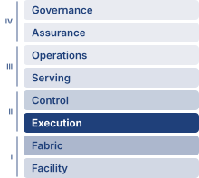{width="100%" fig-alt="Fleet Machine Learning Systems Stack"}

*Fleet stack focus for this chapter.*
:::
:::

_Why does communication between machines constrain large-scale machine learning systems?_

Computation scales by adding processors; communication scales by moving data between them. These scale differently. Adding processors increases available arithmetic capacity, but useful work stalls when the required data does not arrive in time. Exchanging gradients, activations, and parameters can then consume more time than computing them. On one machine, shortening the dominant calculation often shortens the job. Across a fleet, that same improvement may simply make each processor reach its next dependency sooner and wait longer for the others. The cost of that wait includes every reserved accelerator, so a small delay repeated throughout training can consume a substantial budget without advancing the model. Faster links help when transfer capacity is the constraint, but the benefit depends on which physical paths the traffic shares. More bandwidth cannot remove a dependency. Sending less data introduces its own choices about numerical accuracy, memory use, and when the next computation can begin. An exchange must also deliver the correct result to every participant that needs it. A fast transfer that combines the wrong contributions does not preserve a valid training run. The engineering decision is therefore how to organize communication so that its cost remains compatible with the work it enables. Light-speed delays, bandwidth limits, and the energy cost of movement make that decision as physical as processor design. In C³ terms, collective communication connects distributed compute through coordinated exchanges whose correctness and exposed cost determine whether the fleet delivers useful scale.

::: {.content-visible when-format="pdf"}

\newpage

:::

::: {.callout-learning-objectives}

- Apply communication cost models to estimate collective duration and message-size crossover points
- Match collective communication primitives and AllToAll schedules to parallelism strategies, topology, message granularity, and skew
- Compare ring, tree, butterfly, double-tree, and hierarchical reduction algorithms using scale-dependent cost models
- Evaluate topology-aware collective schedules under link-bandwidth, rank-placement, and shared-capacity constraints
- Evaluate compression, sparsification, and error feedback by balancing communication savings against convergence risk
- Design overlap strategies with bucket fusion, asynchronous operations, and layer-by-layer gradient scheduling
- Specify matched measurements for calibrating collective cost models across algorithms, process groups, and topologies

:::

## From Parallelism to Communication Patterns {#sec-communication-collective-operations-collective-operations-communication-fundamentals-44eb}

When 10,000 GPUs cooperate on one training update, the splits created by data, tensor, pipeline, and expert parallelism determine which results must cross device boundaries. Workers execute collective operations within participating groups and point-to-point transfers between pipeline stages. In the multi-tier fleet stack of @fig-fleet-stack, these exchanges occupy the Distributed Execution row of the Distribution band, where logical parallelism becomes physical traffic.

Every such split assumes that replicas, shards, stages, and experts can exchange gradients, activations, parameters, and tokens quickly enough for the optimizer to see one coherent training run. In data parallelism, each worker holds a full copy of the model and processes its own slice of the batch, so the copies must agree on one combined gradient before every update. Tensor, pipeline, and expert parallelism divide the model itself, so partial results must cross device boundaries within each step. Each of these exchanges is charged to the Fleet Law's communication term $\CommunicationTime(\DeviceCount)$, and the part of it not hidden behind computation counts against program goodput, the ratio of a step's ideal execution time to its actual time (@sec-performance-engineering-iron-law). Every way of splitting the model relocates work onto the network, and this chapter turns those exchanges into schedules whose latency, bandwidth, and topology costs can be computed.

::: {.column-margin .margin-pointer}
↪ The partitioning strategies themselves, and the 3D parallelism cube that composes data, pipeline, and tensor parallelism into one configuration space, are developed in @sec-distributed-training-systems-systems-singlemachine-distributed-transition-1ee4.
:::

The first distinction is between an operation's result and the schedule that produces it. @Sec-network-fabrics-introduction named AllReduce, AllGather, and AllToAll as the traffic the fabric must carry; here they become contracts on results. AllReduce[^fn-allreduce-etymology-primitive] combines corresponding tensor elements across participating workers and returns the reduced tensor to every worker. AllGather instead concatenates their shards, ReduceScatter combines contributions but leaves each worker with only a shard of the result, and AllToAll sends different data to different destinations. The parallel decomposition determines which contract each exchange needs; ring, tree, and hierarchical algorithms are alternative schedules for carrying that contract out.

The gap between that assumption and the wire reveals an asymmetry in how computation and communication scale. Computation is local because each GPU works on its own data, so aggregate compute grows with the number of GPUs\index{GPU}\index{Graphics processing unit|see{GPU}}. Communication is global because keeping the fleet synchronized requires information to cross physical links with finite latency, bandwidth, interconnect topology\index{Interconnect!topology}, and energy. Gradient synchronization is the central case, because every synchronous data-parallel step repeats it on the full gradient. Scaling laws (principle \ref{pri-universal-scaling}) make that case harder over time, because the capability they reward comes from more parameters trained on more accelerators, so the gradient to be reduced and the group that must agree on it grow together.

```{python}
#| echo: false
#| label: gradient-sync-significance-calc
# ┌─────────────────────────────────────────────────────────────────────────────
# │ GRADIENT-SYNC SIGNIFICANCE—70B BF16 RING ALLREDUCE NAPKIN MATH
# ├─────────────────────────────────────────────────────────────────────────────
# │ Context: @dfn-collective-communication-gradient-synchronization Significance
# │          bullet, plus the "140 GB of gradients" body sentence below it.
# │
# │ Goal: Pin the 70B BF16 gradient size (140 GB), the per-link bandwidth
# │       (50 GB/s = registry NDR), and the bandwidth-only ring AllReduce time
# │       (2M/beta ~ 5.6 s) so the definition's headline numbers trace to the
# │       registry instead of being hand-typed.
# │ Show: 140 GB; 50 GB/s; ~5.6 s; the "2 x 140 / 50" operand span.
# │ How: gradient = P x 2 bytes/param; ring bandwidth term = 2M/beta.
# │
# └─────────────────────────────────────────────────────────────────────────────
from mlsysim import Models, Systems
from mlsysim.core.units import BYTES_FP16, GB, byte, param, second
from mlsysim.fmt import check, fmt, fmt_bandwidth, fmt_count, fmt_math, fmt_memory, fmt_params, fmt_time

class GradSyncSignificance:
    # ┌── 1. LOAD ──────────────────────────────────────────
    m = Models.Language.Llama2_70B
    beta = Systems.Fabrics.InfiniBand_NDR.bandwidth  # 50 GB/s per link (registry NDR)
    # Illustrative cluster size (scenario assumption; the bandwidth-only estimate
    # is per-worker and independent of this count, which only frames the example).
    cluster_size = 1000

    # ┌── 2. EXECUTE ───────────────────────────────────────
    gradient = m.size_in_bytes(BYTES_FP16).to(GB)
    # Bandwidth-only ring AllReduce estimate: T ~ 2M / beta.
    ring_time = (2 * gradient / beta).to(second)

    # ┌── 3. GUARD ─────────────────────────────────────────
    check(abs(gradient.to(GB).magnitude - 140) < 1, "70B BF16 gradient should be ~140 GB")
    check(abs(ring_time.to(second).magnitude - 5.6) < 0.1, "Ring AllReduce time should be ~5.6 s")

    # ┌── 4. OUTPUT ────────────────────────────────────────
    gradient_gb_str = fmt_memory(gradient, unit=GB, precision=0, commas=False)
    params_str = fmt_params(m.parameters, scale="B", precision=0, commas=False)
    bytes_per_param_str = fmt(BYTES_FP16.to(byte).magnitude, precision=0, commas=False)
    gradient_top1_gb_str = fmt_memory(gradient * 0.01, unit=GB, precision=1, commas=False)
    gradient_2x_gb_str = fmt_memory(gradient * 2, unit=GB, precision=0, commas=False)
    beta_gb_per_s_str = fmt_bandwidth(beta, unit=GB / second, precision=0, commas=False)
    ring_time_s_str = fmt_time(ring_time, second, precision=1, commas=False)
    n_gpus_str = fmt_count(cluster_size, commas=True, label="GPU")
    # "2 x 140 / 50" operand span for the bandwidth-only ring estimate.
    _grad_gb = int(gradient.to(GB).magnitude)
    _beta_gbs = int(beta.to(GB / second).magnitude)
    ring_operands_math = fmt_math(rf"2 \times {_grad_gb}/{_beta_gbs}")
```

For the initial gradient budget, consider a ring schedule: each worker passes tensor chunks to a neighbor, first accumulating their sums and then circulating the completed chunks. Each phase moves nearly one tensor's worth of data per worker, so the bandwidth budget is approximately twice the gradient size divided by link bandwidth. The detailed round count follows once the transfer model is established.

::: {#dfn-collective-communication-gradient-synchronization .callout-definition title="Gradient synchronization"}

***Gradient synchronization***\index{Gradient synchronization!definition} is the collective communication step in synchronous data-parallel training in which every worker contributes its locally computed gradient tensor to an aggregate reduction, then receives the same reduced result so all model replicas apply an identical update.

1.  **Significance**: Communicating all gradients of a 70B-parameter model in BF16 gives a `{python} GradSyncSignificance.gradient_gb_str` logical payload per replica per step. As a communication-only baseline, suppose every rank reduces that complete buffer. A ring across `{python} GradSyncSignificance.n_gpus_str` at `{python} GradSyncSignificance.beta_gb_per_s_str` per link has a bandwidth budget of approximately `{python} GradSyncSignificance.ring_operands_math` $\approx$ `{python} GradSyncSignificance.ring_time_s_str` of transfer per step. Model partitioning shrinks each rank's share of that buffer, and only the portion of $\CommunicationTime(\DeviceCount)$ left exposed after overlap adds to step time in the Fleet Law (@eq-fleet-law).
2.  **Distinction**: Unlike a parameter server, which concentrates every worker's gradient at a central aggregator, ring AllReduce spreads the exchange so that each worker sends $2 \times (\DeviceCount-1)/\DeviceCount\times \CollectivePayloadSize$ bytes per step, approaching $2\CollectivePayloadSize$ however large the cluster grows (@sec-communication-collective-operations-naive-vs-optimal develops the comparison).
3.  **Common pitfall**: A frequent misconception is that ring AllReduce makes every worker exchange data with every other worker. In ring AllReduce, each worker communicates with neighbors according to a schedule, and the per-node communication volume is approximately constant as the cluster grows. The scaling pressure comes from latency steps, topology, and the gradient volume per step, not from every worker opening a distinct stream to every other worker.

:::

For standard synchronous data-parallel\index{Data parallelism!synchronous SGD} stochastic gradient descent (SGD), gradient synchronization supplies the shared gradient needed for one optimization trajectory. Replicas that apply different local gradients can diverge. To reproduce the intended global-batch update, they must also start from matching parameters and optimizer state, weight local contributions correctly, and apply the same update rule. The AllReduce primitive\index{AllReduce!convergence guarantee} provides the reduction; convergence follows from the optimization assumptions, not from communication alone. Floating-point reduction order can still change low-order bits.

The gradient payload depends on parameter count and the representation transmitted. A model with $\Parameters$ parameters contributes $2\Parameters$ bytes per data-parallel replica when all gradients are communicated in BF16 (2 bytes per parameter); stored weight precision alone does not determine that choice. For a 70-billion-parameter model, a mid-sized dense model smaller than the 175B-parameter running instance of Archetype A (GPT-4/Llama-3), this gives `{python} GradSyncSignificance.gradient_gb_str` for the complete logical gradient. A ring moves nearly twice its input buffer size per rank.[^fn-ring-allreduce-origin] If a replica spans multiple ranks through model parallelism, each corresponding-shard group reduces its own portion rather than this full buffer.

The worked examples vary the volume's reference configuration in two stated ways. The headline payload is this 70B gradient rather than the 175B instance's, which keeps the worked arithmetic compact. Every bandwidth term in the chapter is linear in payload, so each result scales directly to the larger model. @Sec-communication-collective-operations-collective-operations-hierarchical-allreduce-1338 prices the 175B instance on the volume's reference cluster itself. The cluster size changes from example to example, because each algorithm's behavior depends on rank count and the point of an example is often to isolate one term. Each worked example states its rank count. A second recurring payload, the chapter's reference gradient buffer, first appears in the energy estimate of @sec-communication-collective-operations-physics-data-movement.

[^fn-ring-allreduce-origin]: **Ring AllReduce**\index{Ring AllReduce!origin}: The algorithm dates to the HPC collective-communication literature; Patarasuk and Yuan analyzed bandwidth-optimal AllReduce algorithms for workstation clusters, Baidu's Andrew Gibiansky popularized ring AllReduce for deep learning in February 2017, and Horovod plus NVIDIA NCCL helped make it a common distributed-training primitive [@patarasuk2009; @gibiansky2017baidu; @sergeev2018horovod; @jeaugey2017nccl].

At large scale (hundreds of billions of parameters across thousands of GPUs), gradient synchronization can dominate training step time unless collective communication is systematically optimized. Understanding how to manage that overhead requires modeling data movement as physics rather than as an abstract API\index{API}\index{Application programming interface|see{API}} call.

::: {.column-margin}
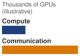{width="100%" fig-alt="Two horizontal bars on a common scale under the header thousands of GPUs, illustrative, showing one large-scale training step. A short blue bar labeled compute is less than a third the length of a long amber bar labeled communication, so communication takes about three times as long as compute."}

*Exposed gradient synchronization can dominate step time at scale.*
:::

## The Physics of Data Movement {#sec-communication-collective-operations-physics-data-movement}

Whenever a gradient shard leaves an accelerator, three hardware limits bound its trip before any collective algorithm runs. The speed of light sets a propagation floor[^fn-speed-of-light] of roughly 5 $\MicroUnitPrefix\text{s}$ per kilometer in fiber. High-frequency signal loss limits how far copper traces can reach before the link must convert to optics (the bandwidth-distance product\index{Bandwidth-distance product!optical reach} of @sec-network-fabrics-copper-optics). Host-kernel networking stacks add tens of microseconds of software copy overhead, unless kernel-bypass transports such as remote direct memory access (RDMA)\index{RDMA!kernel bypass} and GPUDirect RDMA\index{GPUDirect RDMA!latency reduction} strip per-message initiation down to a few microseconds. Collective communication also pays an energy price for every bit moved across those links, which the schedule must respect as firmly as latency and bandwidth.

::: {.column-margin .margin-pointer}
↩ Kernel-bypass RDMA, which strips the per-message software overhead, and GPUDirect RDMA, which removes the host-memory bounce, are established in @sec-network-fabrics-rdma.
:::

Moving data consumes energy across storage arrays, interfaces, serializers, transceivers, and switches. A transfer that starts in local SRAM can stay on-package in high-bandwidth memory (HBM)\index{HBM}\index{High-bandwidth memory|see{HBM}}, cross to an intra-node peer GPU, or traverse intermediate switches to a remote node. Each step widens the physical accounting boundary\index{Energy consumption!data movement hierarchy} that an energy estimate must include (@fig-data-movement-hierarchy). Each boundary activates distinct physical components: on-package links, intra-node crossbars, serializers, optical transceivers, and switch fabrics. Distance alone does not determine energy per bit, and an endpoint-only estimate cannot be compared directly with a complete fabric-path estimate. Locality remains useful because it can avoid transfers and active interfaces; the energy saving must be evaluated under the same workload, utilization, and accounting boundary.

::: {#fig-data-movement-hierarchy fig-env="figure" fig-pos="htb" fig-cap="**Data-Movement Accounting Boundaries**: Successively broader paths involve different storage and communication components. The schematic identifies what an energy estimate must include; it assigns no universal distance law or fixed energy multiplier. Compare energy per transferred byte only after specifying endpoints, interfaces, switches, and utilization." fig-alt="One data path drawn left to right through physical components joined by amber links: a local SRAM cell grid, a stack of HBM dies, an intra-node crossbar, a SerDes chip, an optical transceiver, switches, and a remote node. At the crossbar a short branch rises to a peer GPU die, which ends that branch. Three brackets below all start at the SRAM: Package ends after HBM, Node ends after the crossbar and its peer GPU branch, and Fabric path ends at the remote node; the dark part of each bracket spans the components that boundary adds."}
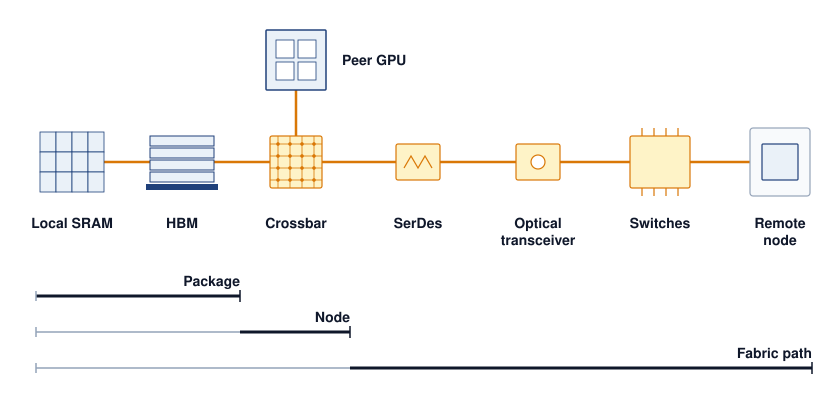

<!--
```{.tikz}
\begin{tikzpicture}[
  font=\small\sffamily,
  >=Stealth,
  tier label/.style={
    font=\footnotesize,
    text=TextDark,
    align=right,
    % 3.4cm, not 2.5cm: "InfiniBand NDR" did not fit and hyphenated as
    % "Infini-/Band NDR". Labels are right-aligned on an east anchor, so the
    % extra width grows into empty space and the shorter labels do not move.
    text width=3.4cm,
    anchor=east
  },
  energy box/.style={
    rectangle,
    rounded corners=3pt,
    line width=0.85pt,
    align=center,
    inner sep=3.5pt
  },
  context card/.style={
    rectangle,
    rounded corners=3pt,
    draw=CardBorder,
    fill=white,
    line width=0.7pt,
    align=left,
    inner sep=4.5pt,
    anchor=west
  },
  multiplier badge/.style={
    rectangle,
    rounded corners=3pt,
    line width=0.85pt,
    align=center,
    inner sep=3.5pt,
    minimum width=1.7cm,
    minimum height=1.05cm
  },
  law card/.style={
    rectangle,
    rounded corners=4pt,
    draw=SteelBlue!40,
    fill=LightBlue!40,
    line width=0.7pt,
    inner sep=6.5pt,
    align=left,
    text width=14.4cm
  }
]

% Tier 1: SRAM (y = 6.4)
\node[tier label] (lbl1) at (2.5, 6.4) {
  \textbf{\normalsize SRAM}\\[1.5pt]
  \scriptsize\textcolor{TextMuted}{On-Chip Cache}\\[1pt]
  \tiny\textcolor{TextMuted}{$\sim$0--1\,mm die}
};

\node[energy box, draw=DarkGreen, fill=GreenFill, minimum width=1.4cm, minimum height=1.05cm] (eng1) at (3.4, 6.4) {
  \textbf{\footnotesize$\sim$0.5\,pJ}\\[1pt]
  \tiny\textcolor{DarkGreen}{per bit}
};

\node[context card, text width=7.7cm, minimum height=1.05cm] (ctx1) at (4.3, 6.4) {
  \textbf{\footnotesize Tiling \& Kernel Fusion}\\[1.5pt]
  \scriptsize Maximized via FlashAttention tiling; keeps intermediate activations inside SRAM.
};

\node[multiplier badge, draw=DarkGreen, fill=GreenFill, text=DarkGreen] (mul1) at (13.5, 6.4) {
  \textbf{\small 1$\times$}\\[1pt]
  \tiny Baseline
};

% Tier 2: DRAM / HBM (y = 4.9)
\node[tier label] (lbl2) at (2.5, 4.9) {
  \textbf{\normalsize DRAM / HBM}\\[1.5pt]
  \scriptsize\textcolor{TextMuted}{On-Package Stack}\\[1pt]
  \tiny\textcolor{TextMuted}{$\sim$1--10\,mm 2.5D}
};

\node[energy box, draw=SteelBlue, fill=LightBlue, minimum width=2.7cm, minimum height=1.05cm] (eng2) at (4.05, 4.9) {
  \textbf{\footnotesize$\sim$20\,pJ / bit}\\[1pt]
  \tiny\textcolor{SteelBlue}{HBM3e PHY read}
};

\node[context card, text width=6.4cm, minimum height=1.05cm] (ctx2) at (5.6, 4.9) {
  \textbf{\footnotesize Memory Bandwidth Wall}\\[1.5pt]
  \scriptsize Requires memory-bound operator recomputation to avoid HBM round-trips.
};

\node[multiplier badge, draw=SteelBlue, fill=LightBlue, text=SteelBlue] (mul2) at (13.5, 4.9) {
  \textbf{\small 40$\times$}\\[1pt]
  \tiny vs.\ SRAM
};

% Tier 3: NVLink 4.0 (y = 3.4)
\node[tier label] (lbl3) at (2.5, 3.4) {
  \textbf{\normalsize NVLink 4.0}\\[1.5pt]
  \scriptsize\textcolor{TextMuted}{Intra-Node Mesh}\\[1pt]
  \tiny\textcolor{TextMuted}{$\sim$0.5--1\,m PCB}
};

\node[energy box, draw=OrangeLine, fill=OrangeL, minimum width=5.2cm, minimum height=1.05cm] (eng3) at (5.3, 3.4) {
  \textbf{\footnotesize$\sim$100\,pJ / bit}\\[1pt]
  \tiny\textcolor{OrangeLine}{NVSwitch copper trace}
};

\node[context card, text width=3.9cm, minimum height=1.05cm] (ctx3) at (8.1, 3.4) {
  \textbf{\footnotesize Intra-Node Locality}\\[1.5pt]
  \scriptsize Enables Tensor Parallelism (TP).
};

\node[multiplier badge, draw=OrangeLine, fill=OrangeL, text=OrangeLine] (mul3) at (13.5, 3.4) {
  \textbf{\small 200$\times$}\\[1pt]
  \tiny vs.\ SRAM
};

% Tier 4: InfiniBand NDR (y = 1.9)
\node[tier label] (lbl4) at (2.5, 1.9) {
  \textbf{\normalsize \mbox{InfiniBand NDR}}\\[1.5pt]
  \scriptsize\textcolor{TextMuted}{Inter-Node Fabric}\\[1pt]
  \tiny\textcolor{TextMuted}{$\sim$10--100\,m optics}
};

\node[energy box, draw=VioletLine, fill=VioletL, minimum width=9.7cm, minimum height=1.05cm] (eng4) at (7.55, 1.9) {
  \textbf{\footnotesize$\sim$1{,}000\,pJ / bit (Laser Transceiver + Serialization + Optical Fiber)}\\[1.5pt]
  \scriptsize\textcolor{VioletLine}{Dominates cluster power budget during all-to-all collectives}
};

\node[multiplier badge, draw=RedLine, fill=RedFill, text=RedLine] (mul4) at (13.5, 1.9) {
  \textbf{\small 2{,}000$\times$}\\[1pt]
  \tiny\textbf{\textcolor{RedLine}{Energy Cliff}}
};

% Log-scale axis bar (y = 1.0)
\draw[line width=0.8pt, CardBorder!90] (2.7, 1.0) -- (12.4, 1.0);

\draw[line width=0.8pt, CardBorder!90] (4.1, 0.9) -- (4.1, 1.1);
\node[below=2pt, font=\scriptsize, text=TextMuted] at (4.1, 0.9) {0.5\,pJ};

\draw[line width=0.8pt, CardBorder!90] (5.4, 0.9) -- (5.4, 1.1);
\node[below=2pt, font=\scriptsize, text=TextMuted] at (5.4, 0.9) {20\,pJ};

\draw[line width=0.8pt, CardBorder!90] (7.9, 0.9) -- (7.9, 1.1);
\node[below=2pt, font=\scriptsize, text=TextMuted] at (7.9, 0.9) {100\,pJ};

\draw[line width=0.8pt, CardBorder!90] (12.4, 0.9) -- (12.4, 1.1);
\node[below=2pt, font=\scriptsize, text=TextMuted] at (12.4, 0.9) {1{,}000\,pJ};

\node[below=15pt, font=\footnotesize\bfseries, text=TextDark] at (7.55, 1.0) {
  Energy Cost per Bit Transferred (pJ / bit, Log Scale)
};

% Bottom Thermodynamic Law Card (y = -0.95)
\node[law card] (law) at (7.25, -0.95) {
  \centering\textbf{\footnotesize Thermodynamic Law of Distributed ML Systems}\\[3pt]
  \raggedright\scriptsize
  % Second column is a fixed-width p{} so the rows wrap inside the card; a
  % plain 'l' column takes its natural width and overruns the node's text width.
  \begin{tabular}{@{}l p{10.8cm}@{}}
    \textbf{The Distance Penalty:} & Moving a bit across a 50-meter optical datacenter fabric costs 2,000$\times$ more energy than inside SRAM. \\[2pt]
    \textbf{Algorithmic Defense:} & Hierarchical AllReduce and FP8/FP4 quantization exist primarily to avoid paying this 2,000$\times$ optical cost. \\
  \end{tabular}
};

\end{tikzpicture}
```
-->

:::

```{python}
#| echo: false
#| label: collective-ring-energy
# ┌─────────────────────────────────────────────────────────────────────────────
# │ RING ALLREDUCE TRANSFER ENERGY (LEGO)
# ├─────────────────────────────────────────────────────────────────────────────
# │ Context: paragraph below (energy of one large-ring reduction).
# │ Goal: Price one ring AllReduce in joules from the registry per-bit cost.
# │ How: bytes sent = N × 2(N−1)/N × M; energy = bits × E_bit, with
# │      E_bit = Systems.NetworkEnergy.InfiniBandEnergyPerBit (midpoint of a
# │      20–50 pJ/bit switched-network envelope) and M the chapter's 1 GB buffer.
# └─────────────────────────────────────────────────────────────────────────────
from mlsysim import ReferenceStats, Systems
from mlsysim.core.units import GB, bit, kJ, pJ
from mlsysim.fmt import check, fmt, fmt_energy, fmt_energy_per_bit, fmt_memory

class RingReductionEnergy:
    # ┌── 1. LOAD ──────────────────────────────────────────────────────────
    n_ranks = 10_000  # scenario assumption: illustrative fleet-scale ring
    payload = ReferenceStats.CollectiveCommunicationProfile.GradientBuffer
    energy_per_bit = Systems.NetworkEnergy.InfiniBandEnergyPerBit

    # ┌── 2. EXECUTE ───────────────────────────────────────────────────────
    bytes_sent = n_ranks * 2 * (n_ranks - 1) / n_ranks * payload
    energy = (bytes_sent * energy_per_bit).to(kJ)

    # ┌── 3. GUARD ─────────────────────────────────────────────────────────
    check(3 < energy.to(kJ).magnitude < 10, f"Ring energy {energy} outside the kilojoule scale the prose describes")

    # ┌── 4. OUTPUT ────────────────────────────────────────────────────────
    n_ranks_str = fmt(n_ranks, precision=0, commas=True)
    payload_str = fmt_memory(payload, unit=GB, precision=0, commas=False)
    energy_per_bit_str = fmt_energy_per_bit(energy_per_bit, unit=pJ / bit, precision=0)
    energy_kj_str = fmt_energy(energy, unit=kJ, precision=1, commas=False)
```

The chapter's reference gradient buffer of `{python} RingReductionEnergy.payload_str` stands for one large fused reduction, far smaller than a full model gradient but large enough that per-byte transfer, not per-message startup, governs its cost; later examples return to it by name. Reducing it around an illustrative `{python} RingReductionEnergy.n_ranks_str`-rank ring sends approximately twice the payload from every rank. At a fabric-path transfer cost of `{python} RingReductionEnergy.energy_per_bit_str`, a representative midpoint of the range typical of switched fabrics rather than a measurement of any particular one, this gives about `{python} RingReductionEnergy.energy_kj_str` per reduction, paid again at every synchronous step. The usable rule is that communication energy is the bytes an algorithm sends multiplied by the energy per bit of every boundary those bytes cross. An algorithm that moves fewer bytes, or a placement that keeps more of them inside the node, therefore saves energy as directly as it saves time. The share of the step's total energy that communication represents must be measured at the same accounting boundary as the compute it accompanies. The fabric-path figure charges the serializers, transceivers, and switches between two endpoints. A whole-system estimate that also charges endpoint memory reads, host software, and idle network power assigns each byte crossing the network a much larger cost, so two per-byte figures can be compared only after their boundaries match.

::: {.column-margin .margin-pointer}
↪ The energy cost of moving a byte across memory, storage, and network boundaries, and why movement can outweigh arithmetic, is developed in @sec-sustainable-ai-energy-per-byte-5d87-5d87.
:::

These constraints govern different parts of a communication budget. Propagation latency sets a floor for every message regardless of size. Link bandwidth caps throughput once a transfer is large enough to fill the pipe. Protocol overhead adds a fixed per-message cost that penalizes fine-grained exchanges unless a kernel-bypass transport removes it. RDMA's zero-copy path[^fn-zerocopy-rdma-bypass] avoids staging each transfer through host memory and the kernel's socket buffers, keeping that per-message cost low. Because the physical fabric fixes these limits, the collective schedule determines how many times the job pays them.

```{python}
#| echo: false
from mlsysim import *
from mlsysim.core.units import *

# ┌─────────────────────────────────────────────────────────────────────────────
# │ ALLREDUCE COST—70B MODEL NAPKIN MATH
# ├─────────────────────────────────────────────────────────────────────────────
# │ Context: "AllReduce Cost for a 70B Model" .callout-notebook
# │
# │ Goal: Compute Ring AllReduce latency for a 70B-parameter model across 64
# │       GPUs on 400 Gbps InfiniBand NDR to show that gradient sync dominates
# │       step time at scale.
# │ Show: ring_total_ms ≈ 5,513 ms—inline inside notebook callout steps.
# │ How: Use the alpha-beta ring AllReduce model with bare arithmetic (no pint)
# │      because this is a step-by-step pedagogical trace.
# │
# └─────────────────────────────────────────────────────────────────────────────
from mlsysim.fmt import check, fmt, fmt_bandwidth, fmt_count, fmt_int, fmt_memory, fmt_params, fmt_ratio, fmt_time
from mlsysim.core.units import GB, byte, microsecond, ms, param, second

# ┌── LEGO ───────────────────────────────────────────────
class AllReduceCost:
    """
    Namespace for AllReduce communication cost calculation for Llama-class model.
    Scenario: 64 GPUs connected by 400 Gbps NDR InfiniBand.
    """

    # ┌── 1. LOAD (Constants) ───────────────────────────────────────────────
    from mlsysim.physics import (
        calc_ring_allreduce_time,
        calc_ring_allreduce_data_factor,
        calc_ring_allreduce_latency_time,
        calc_ring_allreduce_latency_steps,
    )
    from mlsysim import Models, Hardware, Systems

    m = Models.Language.Llama2_70B
    ib_ndr = Systems.Fabrics.InfiniBand_NDR
    n_gpus = 64
    ib_bw = Systems.Fabrics.InfiniBand_NDR
    alpha = Systems.SwitchFabric.AlphaNdr

    # ┌── 2. EXECUTE (The Compute) ─────────────────────────────────────────
    # Gradient size (BF16 = 2 bytes/param)
    bf16_bytes_per_param = int(BYTES_FP16.to(byte).magnitude)
    gradient_qty = m.size_in_bytes(BYTES_FP16)

    # Use shared library formula for Ring AllReduce time
    # Note: calc_ring_allreduce_time handles both bandwidth and latency (alpha).
    ring_total = calc_ring_allreduce_time(message_bytes=gradient_qty, n_gpus=n_gpus, bandwidth_bytes_s=ib_ndr.bandwidth, latency_s=alpha).to(ms)

    # Break out terms for pedagogical display
    ring_bw_factor = calc_ring_allreduce_data_factor(n_gpus)
    ring_bw_time = calc_ring_allreduce_time(message_bytes=gradient_qty, n_gpus=n_gpus, bandwidth_bytes_s=ib_bw.bandwidth, latency_s=0 * second).to(ms)
    ring_lat_time = calc_ring_allreduce_latency_time(n_gpus, alpha).to(ms)

    # Value of halving an exposed AllReduce over a training campaign.
    campaign_steps = ReferenceStats.CollectiveCommunicationProfile.TrainingRunSteps  # steps in one training run
    halved_saving = (ring_total / 2).to(second)
    halved_saving_gpu_hours = (halved_saving * campaign_steps * n_gpus).to("hour").magnitude

    # ┌── 3. GUARD (Invariants) ───────────────────────────────────────────
    check(ring_total > 5000 * ms, f"AllReduce ({ring_total.to(ms).magnitude:.0f}ms) should be significant (>5s) for 70B BF16 model.")
    check(4000 < halved_saving_gpu_hours < 6000, f"Halved-AllReduce saving = {halved_saving_gpu_hours:.0f} GPU-hours, expected ~5,000")

    # ┌── 4. OUTPUT (Formatting) ──────────────────────────────────────────────
    gradient_size_gb_str = fmt_memory(gradient_qty, unit=GB, precision=0, commas=False)
    ring_bw_time_ms_str = fmt_time(ring_bw_time, ms, precision=1, commas=True)
    ring_lat_time_ms_str = fmt_time(ring_lat_time, ms, precision=1, commas=False)
    ring_total_ms_str = fmt_time(ring_total, ms, precision=1, commas=True)
    n_gpus_napkin_str = fmt_count(n_gpus, commas=False, label="GPU")
    ring_bw_factor_value_str = fmt_ratio(ring_bw_factor, precision=5, commas=False)
    ib_bw_gb_per_s_str = fmt_bandwidth(ib_bw.bandwidth, unit=GB / second, precision=0, commas=False)
    nvlink_bw_gb_per_s_str = fmt_bandwidth(Hardware.Cloud.H100.nvlink.bandwidth, unit=GB / second, precision=0, commas=False)
    alpha_us_str = fmt_time(alpha, microsecond, precision=1, commas=False)
    lat_steps_str = fmt(calc_ring_allreduce_latency_steps(n_gpus), precision=0, commas=False)
    params_b_str = fmt_params(m.parameters, scale="B", precision=0, commas=False)
    # Gradient-size operand span: P x 10^9 params x 2 bytes/param.
    from mlsysim.fmt import fmt_math, sci_latex

    gradient_operands_math = fmt_math(rf"{sci_latex(m.parameters.magnitude, precision=0)} \times {bf16_bytes_per_param}\ \text{{bytes}}")
    halved_saving_s_str = fmt_time(halved_saving, second, precision=1, commas=False)
    campaign_steps_str = fmt(campaign_steps, precision=0, commas=True)
    halved_saving_gpu_hours_str = fmt_int(round(halved_saving_gpu_hours, -2), commas=True)
```

The opening ring budget is one instance of the network wall that @sec-introduction-communication-becomes-dominant-e1b6 established, in which exposed communication takes a growing share of each step as a fixed workload spreads across more devices. How large that share becomes depends on gradient size, local batch size, partitioning, and overlap, so the critical path must be measured at each scale.

## Parallelism Strategies and Their Traffic {#sec-communication-parallelism-patterns}

Once a training job splits its batch, layers, or parameters across devices, no rank holds all the state needed to finish a step on its own. A synchronous data-parallel worker computes gradients from its local batch slice, but its optimizer cannot update the weights until every replica's gradients have been combined. Some of those reductions can start as backward layers finish, while earlier layers are still computing. Tensor ownership determines where each tensor must go, and gradient or activation readiness determines when each transfer can start.

How the model is partitioned dictates which tensors cross device boundaries and which ranks must exchange them. For Archetype A (GPT-4/Llama-3), dense gradient contributions are combined within each data-parallel group; in a hybrid layout, that group contains the matching parameter shard from each replica. AllReduce serves the replicated-gradient baseline. For Archetype B (DLRM at Scale),[^fn-dlrm-embedding-alltoall] lookup requests travel to embedding-shard owners and the resulting vectors return to the workers that need them. Mixture-of-experts (MoE)\index{MoE!token routing} routing similarly sends activations to the ranks hosting selected experts and returns their outputs. These destination-specific exchanges motivate AllToAll.

[^fn-dlrm-embedding-alltoall]: [offset=6mm] **DLRM (Deep Learning Recommendation Model)**\index{DLRM!AllToAll}: Meta's 2019 architecture for click-through rate prediction uses sharded embedding tables and exchanges the resulting sparse lookups across workers, an AllToAll whose limiting term @sec-communication-alltoall develops.

::: {.column-margin .margin-pointer}
↩ The three lighthouse archetypes and the C³ regimes each one stresses are established in @sec-vol2-introduction-archetypes.
:::

At large scale, these parallelism strategies can be combined. A 3D parallelism\index{3D parallelism!collective primitives} layout combines data parallelism\index{Data parallelism}, tensor parallelism\index{Tensor parallelism}, and pipeline parallelism\index{Pipeline parallelism}, creating distinct communication groups whose exchanges may overlap in time. In a node-local tensor-parallel example, layer reductions use NVLink, pipeline stages exchange activations and their gradients point-to-point across nodes, and data-parallel groups reduce matching parameter shards over InfiniBand. Other placements change those physical paths while retaining the logical communication requirements.

Each primitive operates on a different process group\index{Process group}, a subset of the total GPU population that participates in that particular collective. Classical Message Passing Interface (MPI) uses a communicator\index{MPI!communicator} as the object that names such a participating set; its communicator size is the number of ranks in that set. MPI libraries already selected collective algorithms based on communicator size and message size [@thakur2005]. GPU communication libraries inherit that algorithm-selection problem and add the further challenge of coordinating overlapping process groups without creating contention between concurrent collectives.

Each parallelism strategy fixes the data it must move, the collective primitive that moves it, and the term most likely to bind (@tbl-parallelism-communication-mapping), and with them which participants must exchange data. The collective primitives that follow make each exchange's contract precise, the pricing model then charges it per round, and the collective algorithms provide its execution schedule.

| **Parallelism strategy**      | **What must move**                         |   **Primary primitive**    |            **Primary constraint**            |
|:------------------------------|:-------------------------------------------|:--------------------------:|:--------------------------------------------:|
| **Data Parallelism**          | Full gradient, averaged across replicas    |         AllReduce          |          Bandwidth (large payloads)          |
| **FSDP/ZeRO-3**               | Parameter shards in, gradient shards out   | AllGather + ReduceScatter  |          Bandwidth, high frequency           |
| **Tensor Parallelism**        | Partial layer activations within the node  |    AllReduce, AllGather    | Critical path (NVLink bandwidth and latency) |
| **Sequence Parallelism**      | Activations sharded along the sequence     | AllGather + ReduceScatter  |       Bandwidth (activation exchange)        |
| **Pipeline Parallelism**      | Activations to the next stage              | Point-to-Point (Send/Recv) |      Latency (microbatch dependencies)       |
| **Expert Parallelism (MoE)**  | Tokens to the ranks hosting their experts  |          AllToAll          |    Startup, injection/bisection, or skew     |
| **Embedding Sharding (DLRM)** | Embedding lookups to and from shard owners |          AllToAll          |    Granularity, fabric capacity, or skew     |

: **Parallelism-to-Collective Mapping**: How each parallelism strategy becomes a traffic pattern. Pipeline parallelism alone relies on point-to-point transfers rather than a collective. {#tbl-parallelism-communication-mapping tbl-colwidths="[21,33,20,26]"}

In this table, expert parallelism refers to the mixture-of-experts\index{MoE!communication} architecture pattern, in which each token activates only a few experts. Data parallelism and fully sharded data parallel (FSDP), which divides each replica's parameters, gradients, and optimizer state across the data-parallel ranks, generate large reductions and gathers that reward byte-efficient rings and hierarchical schedules. Tensor and pipeline parallelism, by contrast, generate smaller, more frequent messages directly on the critical path, so low software overhead and fast node-local links dominate their cost. Expert parallelism and sharded embedding tables, in contrast, produce destination-specific traffic whose bottleneck shifts among message granularity, endpoint injection and reception, fabric bisection, oversubscription, routing, and skew.

The table's rows describe data center parallelism, so they leave out the federated Archetype C. Across all three lighthouse archetypes, the dominant exchange and its bottleneck differ.

::: {#lhs-collective-communication-communication-archetype-patterns .callout-lighthouse title="Communication archetype patterns"}

A gradient's communication pattern depends on the system's objective function and constraint regime. Each lighthouse archetype faces a distinct communication challenge, and the techniques developed in this chapter map to those challenges differently, as @tbl-archetype-collective-mapping summarizes.

| **Archetype**                         |             **Primary collective**             |         **Candidate limiter**         | **Optimization strategy**                                   |
|:--------------------------------------|:----------------------------------------------:|:-------------------------------------:|:------------------------------------------------------------|
| **Archetype A (GPT-4/Llama-3)**       |                   AllReduce                    |      Bandwidth ($\LinkBandwidth$)     | Hierarchical AllReduce; rail-optimized placement            |
| **Archetype B (DLRM at Scale)**       |                    AllToAll                    | Granularity, fabric capacity, or skew | Message coalescing; topology-aware routing; shard balancing |
| **Archetype C (Federated MobileNet)** | Client uploads to an aggregator (asynchronous) |   Uplink bandwidth and availability   | Aggressive quantization; error feedback                     |

: **Archetype-to-Collective Mapping**: Each lighthouse archetype produces a characteristic traffic pattern, but the limiting term depends on message shape, placement, and the physical fabric. {#tbl-archetype-collective-mapping}

The table separates traffic pattern from limiting resource. A dense reduction, a destination-specific exchange, and an intermittent device update require different interventions even though all three serve a training workload. Hierarchical AllReduce, AllToAll schedule selection, and compression with error feedback each receive their own treatment later in the chapter.

:::

A traffic map names which pattern a workload generates, but it does not specify what each rank must hold when the call completes. Before any of those interventions can be priced, each exchange needs a precise contract that states which ranks contribute and what each holds afterward.

## Collective Operation Primitives {#sec-communication-collective-operations-collective-operations-collective-operation-vocabulary-fdc7}

Sending a gradient tensor to a peer does not specify which workers must contribute or where the final result belongs. Collective operations supply that group-level contract, using a vocabulary standardized by MPI and inherited by modern ML communication libraries [@mpiforum2015mpi31]. The four contracts sketched at the start of the chapter differ in what each rank holds afterward (@fig-collective-primitives-overview). AllReduce leaves an identical sum ($\Glyph{\Sigma}$) on every rank. AllGather leaves every rank with the concatenation of all shards. ReduceScatter sums across ranks but leaves each rank one reduced shard ($\Glyph{\Sigma}_i$). AllToAll performs a distributed matrix transpose, routing each rank's $\DestinationRankIndex$-th chunk to rank $\DestinationRankIndex$. Two further primitives complete the set and serve as building blocks for these four: Broadcast, in which rank 0 sends its data to all ranks, and Reduce, in which all ranks aggregate into rank 0.

::: {.column-margin .margin-pointer}
↪ The bandwidth and latency cost terms of AllReduce, AllGather, ReduceScatter, AllToAll, and Broadcast, under ring, tree, and pairwise-exchange algorithms, are developed in @sec-appdx-comm-foundations-collective-complexity.
:::

::: {#dfn-collective-communication-collective-operation .callout-definition title="Collective operation"}

***Collective operation***\index{Collective operation!definition} is a distributed communication pattern in which every rank in a process group invokes a matching operation to aggregate, broadcast, or redistribute data. The operation's contract specifies the output at each rank; it does not require simultaneous entry and does not, by itself, impose a general-purpose barrier before or after the call [@mpiforum2015mpi31].

1.  **Significance**: Because the contract names only each rank's result, the schedule that carries it decides how communication demand spreads as the group grows. A schedule that funnels every contribution through one endpoint makes the communication term $\CommunicationTime(\DeviceCount)$ of the Fleet Law (@eq-fleet-law) grow with $\DeviceCount$, while a balanced schedule keeps each rank's bytes nearly constant; @sec-communication-collective-operations-naive-vs-optimal quantifies the gap.
2.  **Distinction**: Unlike point-to-point communication, a collective defines one operation over a process group. Ranks may enter at different times, and some algorithms allow one rank to complete before another has entered; correctness depends on matching the operation sequence and argument contract across ranks, not on barrier semantics.
3.  **Common pitfall**: Treating a non-blocking collective as complete when its initiation call returns. The returned request or stream event represents work in flight. A dependent consumer must wait for completion, and a late rank can extend that dependency even though the collective is not a barrier.

:::

::: {#fig-collective-primitives-overview fig-env="figure" fig-pos="htb" fig-cap="**Four Central Collective Primitives**: Standardized patterns for group communication in distributed systems. In each panel the four rows are ranks 0 to 3, read left to right from each rank's input, through the collective, to what each rank holds afterward. (1) AllReduce: all aggregate and all receive the result. (2) AllGather: all send to all and concatenate. (3) ReduceScatter: all aggregate and results are distributed in shards. (4) AllToAll: every process sends unique data to every other process. The two foundational primitives Broadcast (rank 0 sends to all) and Reduce (all aggregate to rank 0) compose the patterns shown here and are defined in the surrounding prose." fig-alt="Four panels, AllReduce, AllGather, ReduceScatter, and AllToAll, each with rows for ranks 0 to 3. Each row shows the rank's input buffer as small tiles, an amber collective band, and the output buffer. AllReduce: four chunks a to d per rank become four green sums on every rank. AllGather: one chunk per rank becomes four chunks a to d on every rank. ReduceScatter: four chunks per rank become one green sum per rank, sum a on rank 0 through sum d on rank 3. AllToAll: rank i's chunks a_i to d_i are transposed so rank 0 holds a0 to a3, rank 1 holds b0 to b3, and so on. Chunk a has a bold outline in every panel."}


<!--
```{.tikz}
\begin{tikzpicture}[
    font=\small\sffamily,
    >=Stealth,
    panel/.style={
      draw=CanvasBorder,
      fill=CanvasBg,
      rounded corners=5pt,
      line width=0.6pt,
      inner sep=8pt
    },
    in node/.style={
      draw=BlueLine,
      fill=white,
      text=TextDark,
      line width=0.75pt,
      rounded corners=2.5pt,
      font=\scriptsize\sffamily,
      minimum height=0.48cm,
      text centered
    },
    out node green/.style={
      draw=GreenLine,
      fill=GreenFill!60,
      text=TextDark,
      line width=0.75pt,
      rounded corners=2.5pt,
      font=\scriptsize\sffamily,
      minimum height=0.48cm,
      text centered
    },
    out node violet/.style={
      draw=VioletLine,
      fill=VioletFill!70,
      text=TextDark,
      line width=0.75pt,
      rounded corners=2.5pt,
      font=\scriptsize\sffamily,
      minimum height=0.48cm,
      text centered
    },
    op orange/.style={
      draw=OrangeLine,
      fill=OrangeFill,
      text=OrangeLine!90!black,
      line width=0.9pt,
      rounded corners=3.5pt,
      font=\footnotesize\bfseries\sffamily,
      inner sep=4pt,
      text centered
    },
    op violet/.style={
      draw=VioletLine,
      fill=VioletFill,
      text=VioletLine,
      line width=0.9pt,
      rounded corners=3.5pt,
      font=\footnotesize\bfseries\sffamily,
      inner sep=4pt,
      text centered
    },
    wire in/.style={
      draw=BlueLine!80!black,
      line width=0.7pt
    },
    wire green/.style={
      ->,
      draw=GreenLine,
      line width=0.8pt
    },
    wire violet/.style={
      ->,
      draw=VioletLine,
      line width=0.8pt
    }
  ]

  % Define Layer Order
  \pgfdeclarelayer{background}
  \pgfsetlayers{background,main}

  % ========================================================
  % 1. TOP-LEFT: ALLREDUCE
  % ========================================================
  \begin{scope}[shift={(0, 5.0)}, local bounding box=boxAllReduce]
    % Header
    \node[anchor=west, text=TextDark] at (0, 4.35) {\textbf{\small AllReduce} \footnotesize(Sum Reduction)};
    \node[anchor=east, font=\bfseries\scriptsize, text=BlueLine] at (7.1, 4.35) {All Hold Total Sum};
    \node[anchor=west, font=\tiny\sffamily, text=TextMuted] at (0, 4.02) {Aggregates arrays; every device receives the identical sum.};

    % Inputs (Blue)
    \node[in node, minimum width=1.55cm] (ar_in0) at (0.95, 3.35) {G0: [ 1 ]};
    \node[in node, minimum width=1.55cm] (ar_in1) at (0.95, 2.70) {G1: [ 2 ]};
    \node[in node, minimum width=1.55cm] (ar_in2) at (0.95, 2.05) {G2: [ 3 ]};
    \node[in node, minimum width=1.55cm] (ar_in3) at (0.95, 1.40) {G3: [ 4 ]};

    % Central Operator
    \node[op orange, minimum width=1.8cm, minimum height=0.75cm] (ar_op) at (3.55, 2.375) {AllReduce $\Sigma$};

    % Outputs (Green)
    \node[out node green, minimum width=1.65cm] (ar_out0) at (6.15, 3.35) {G0: [ \textbf{10} ]};
    \node[out node green, minimum width=1.65cm] (ar_out1) at (6.15, 2.70) {G1: [ \textbf{10} ]};
    \node[out node green, minimum width=1.65cm] (ar_out2) at (6.15, 2.05) {G2: [ \textbf{10} ]};
    \node[out node green, minimum width=1.65cm] (ar_out3) at (6.15, 1.40) {G3: [ \textbf{10} ]};

    % Wires In -> Op
    \draw[wire in] (ar_in0.east) -- ++(0.5, 0) |- ($(ar_op.west)+(0, 0.15)$);
    \draw[wire in] (ar_in1.east) -- ++(0.3, 0) |- ($(ar_op.west)+(0, 0.05)$);
    \draw[wire in] (ar_in2.east) -- ++(0.3, 0) |- ($(ar_op.west)+(0, -0.05)$);
    \draw[wire in] (ar_in3.east) -- ++(0.5, 0) |- ($(ar_op.west)+(0, -0.15)$);
    \draw[->, wire in] ($(ar_op.west)-(0.15,0)$) -- (ar_op.west);

    % Wires Op -> Out
    \coordinate (ar_out_fork) at ($(ar_op.east)+(0.25,0)$);
    \draw[wire green, -] (ar_op.east) -- (ar_out_fork);
    \draw[wire green] (ar_out_fork) |- (ar_out0.west);
    \draw[wire green] (ar_out_fork) |- (ar_out1.west);
    \draw[wire green] (ar_out_fork) |- (ar_out2.west);
    \draw[wire green] (ar_out_fork) |- (ar_out3.west);

    % Footer Note
    \node[anchor=north, font=\scriptsize, text=TextDark] at (3.55, 0.95) {\textbf{Core Usage:} Data Parallel gradient sync (DDP)};
  \end{scope}

  \begin{pgfonlayer}{background}
    \node[panel, fit=(boxAllReduce)] {};
  \end{pgfonlayer}

  % ========================================================
  % 2. TOP-RIGHT: ALLGATHER
  % ========================================================
  \begin{scope}[shift={(7.8, 5.0)}, local bounding box=boxAllGather]
    % Header
    \node[anchor=west, text=TextDark] at (0, 4.35) {\textbf{\small AllGather} \footnotesize(Concatenation)};
    \node[anchor=east, font=\bfseries\scriptsize, text=GreenLine] at (7.1, 4.35) {All Hold Full Tensor};
    \node[anchor=west, font=\tiny\sffamily, text=TextMuted] at (0, 4.02) {Collects each device's partial shard into the full tensor.};

    % Inputs (Blue)
    \node[in node, minimum width=1.55cm] (ag_in0) at (0.95, 3.35) {G0: [ $a$ ]};
    \node[in node, minimum width=1.55cm] (ag_in1) at (0.95, 2.70) {G1: [ $b$ ]};
    \node[in node, minimum width=1.55cm] (ag_in2) at (0.95, 2.05) {G2: [ $c$ ]};
    \node[in node, minimum width=1.55cm] (ag_in3) at (0.95, 1.40) {G3: [ $d$ ]};

    % Central Operator
    \node[op orange, minimum width=1.8cm, minimum height=0.75cm] (ag_op) at (3.55, 2.375) {AllGather $\boxplus$};

    % Outputs (Green)
    \node[out node green, minimum width=2.1cm] (ag_out0) at (6.05, 3.35) {G0: [ $a, b, c, d$ ]};
    \node[out node green, minimum width=2.1cm] (ag_out1) at (6.05, 2.70) {G1: [ $a, b, c, d$ ]};
    \node[out node green, minimum width=2.1cm] (ag_out2) at (6.05, 2.05) {G2: [ $a, b, c, d$ ]};
    \node[out node green, minimum width=2.1cm] (ag_out3) at (6.05, 1.40) {G3: [ $a, b, c, d$ ]};

    % Wires In -> Op
    \draw[wire in] (ag_in0.east) -- ++(0.5, 0) |- ($(ag_op.west)+(0, 0.15)$);
    \draw[wire in] (ag_in1.east) -- ++(0.3, 0) |- ($(ag_op.west)+(0, 0.05)$);
    \draw[wire in] (ag_in2.east) -- ++(0.3, 0) |- ($(ag_op.west)+(0, -0.05)$);
    \draw[wire in] (ag_in3.east) -- ++(0.5, 0) |- ($(ag_op.west)+(0, -0.15)$);
    \draw[->, wire in] ($(ag_op.west)-(0.15,0)$) -- (ag_op.west);

    % Wires Op -> Out
    \coordinate (ag_out_fork) at ($(ag_op.east)+(0.25,0)$);
    \draw[wire green, -] (ag_op.east) -- (ag_out_fork);
    \draw[wire green] (ag_out_fork) |- (ag_out0.west);
    \draw[wire green] (ag_out_fork) |- (ag_out1.west);
    \draw[wire green] (ag_out_fork) |- (ag_out2.west);
    \draw[wire green] (ag_out_fork) |- (ag_out3.west);

    % Footer Note
    \node[anchor=north, font=\scriptsize, text=GreenLine] at (3.55, 0.95) {\textbf{Core Usage:} FSDP / ZeRO-3 parameter un-sharding};
  \end{scope}

  \begin{pgfonlayer}{background}
    \node[panel, fit=(boxAllGather)] {};
  \end{pgfonlayer}

  % ========================================================
  % 3. BOTTOM-LEFT: REDUCESCATTER
  % ========================================================
  \begin{scope}[shift={(0, 0)}, local bounding box=boxReduceScatter]
    % Header
    \node[anchor=west, text=TextDark] at (0, 4.35) {\textbf{\small ReduceScatter} \footnotesize(Reduce-Scatter)};
    \node[anchor=east, font=\bfseries\scriptsize, text=OrangeLine] at (7.1, 4.35) {One Shard Each};
    \node[anchor=west, font=\tiny\sffamily, text=TextMuted] at (0, 4.02) {Reduces across devices, then scatters disjoint slices.};

    % Inputs (Blue)
    \node[in node, minimum width=2.1cm] (rs_in0) at (1.15, 3.35) {G0: [$a_0,b_0,c_0,d_0$]};
    \node[in node, minimum width=2.1cm] (rs_in1) at (1.15, 2.70) {G1: [$a_1,b_1,c_1,d_1$]};
    \node[in node, minimum width=2.1cm] (rs_in2) at (1.15, 2.05) {G2: [$a_2,b_2,c_2,d_2$]};
    \node[in node, minimum width=2.1cm] (rs_in3) at (1.15, 1.40) {G3: [$a_3,b_3,c_3,d_3$]};

    % Central Operator
    \node[op orange, minimum width=1.8cm, minimum height=0.75cm] (rs_op) at (3.90, 2.375) {ReduceScatter};

    % Outputs (Green)
    \node[out node green, minimum width=1.65cm] (rs_out0) at (6.15, 3.35) {G0: [ $\sum a$ ]};
    \node[out node green, minimum width=1.65cm] (rs_out1) at (6.15, 2.70) {G1: [ $\sum b$ ]};
    \node[out node green, minimum width=1.65cm] (rs_out2) at (6.15, 2.05) {G2: [ $\sum c$ ]};
    \node[out node green, minimum width=1.65cm] (rs_out3) at (6.15, 1.40) {G3: [ $\sum d$ ]};

    % Wires In -> Op
    \draw[wire in] (rs_in0.east) -- ++(0.35, 0) |- ($(rs_op.west)+(0, 0.15)$);
    \draw[wire in] (rs_in1.east) -- ++(0.20, 0) |- ($(rs_op.west)+(0, 0.05)$);
    \draw[wire in] (rs_in2.east) -- ++(0.20, 0) |- ($(rs_op.west)+(0, -0.05)$);
    \draw[wire in] (rs_in3.east) -- ++(0.35, 0) |- ($(rs_op.west)+(0, -0.15)$);
    \draw[->, wire in] ($(rs_op.west)-(0.15,0)$) -- (rs_op.west);

    % Wires Op -> Out
    \coordinate (rs_out_fork) at ($(rs_op.east)+(0.25,0)$);
    \draw[wire green, -] (rs_op.east) -- (rs_out_fork);
    \draw[wire green] (rs_out_fork) |- (rs_out0.west);
    \draw[wire green] (rs_out_fork) |- (rs_out1.west);
    \draw[wire green] (rs_out_fork) |- (rs_out2.west);
    \draw[wire green] (rs_out_fork) |- (rs_out3.west);

    % Footer Note
    \node[anchor=north, font=\scriptsize, text=OrangeLine] at (3.55, 0.95) {\textbf{Core Usage:} FSDP / ZeRO sharded reduction};
  \end{scope}

  \begin{pgfonlayer}{background}
    \node[panel, fit=(boxReduceScatter)] {};
  \end{pgfonlayer}

  % ========================================================
  % 4. BOTTOM-RIGHT: ALLTOALL
  % ========================================================
  \begin{scope}[shift={(7.8, 0)}, local bounding box=boxAllToAll]
    % Header
    \node[anchor=west, text=TextDark] at (0, 4.35) {\textbf{\small AllToAll} \footnotesize(Matrix Transpose)};
    \node[anchor=east, font=\bfseries\scriptsize, text=VioletLine] at (7.1, 4.35) {Pairwise Shuffle};
    \node[anchor=west, font=\tiny\sffamily, text=TextMuted] at (0, 4.02) {Each rank sends distinct shard $i$ to peer rank $i$ (transposition).};

    % Inputs (Blue)
    \node[in node, minimum width=2.1cm] (ata_in0) at (1.15, 3.35) {G0: [$a_0,b_0,c_0,d_0$]};
    \node[in node, minimum width=2.1cm] (ata_in1) at (1.15, 2.70) {G1: [$a_1,b_1,c_1,d_1$]};
    \node[in node, minimum width=2.1cm] (ata_in2) at (1.15, 2.05) {G2: [$a_2,b_2,c_2,d_2$]};
    \node[in node, minimum width=2.1cm] (ata_in3) at (1.15, 1.40) {G3: [$a_3,b_3,c_3,d_3$]};

    % Central Operator
    \node[op violet, minimum width=1.8cm, minimum height=0.75cm] (ata_op) at (3.60, 2.375) {AllToAll $\rightleftarrows$};

    % Outputs (Violet)
    \node[out node violet, minimum width=2.1cm] (ata_out0) at (6.05, 3.35) {G0: [$a_0,a_1,a_2,a_3$]};
    \node[out node violet, minimum width=2.1cm] (ata_out1) at (6.05, 2.70) {G1: [$b_0,b_1,b_2,b_3$]};
    \node[out node violet, minimum width=2.1cm] (ata_out2) at (6.05, 2.05) {G2: [$c_0,c_1,c_2,c_3$]};
    \node[out node violet, minimum width=2.1cm] (ata_out3) at (6.05, 1.40) {G3: [$d_0,d_1,d_2,d_3$]};

    % Wires In -> Op
    \draw[wire in] (ata_in0.east) -- ++(0.35, 0) |- ($(ata_op.west)+(0, 0.15)$);
    \draw[wire in] (ata_in1.east) -- ++(0.20, 0) |- ($(ata_op.west)+(0, 0.05)$);
    \draw[wire in] (ata_in2.east) -- ++(0.20, 0) |- ($(ata_op.west)+(0, -0.05)$);
    \draw[wire in] (ata_in3.east) -- ++(0.35, 0) |- ($(ata_op.west)+(0, -0.15)$);
    \draw[->, wire in] ($(ata_op.west)-(0.15,0)$) -- (ata_op.west);

    % Wires Op -> Out
    \coordinate (ata_out_fork) at ($(ata_op.east)+(0.25,0)$);
    \draw[wire violet, -] (ata_op.east) -- (ata_out_fork);
    \draw[wire violet] (ata_out_fork) |- (ata_out0.west);
    \draw[wire violet] (ata_out_fork) |- (ata_out1.west);
    \draw[wire violet] (ata_out_fork) |- (ata_out2.west);
    \draw[wire violet] (ata_out_fork) |- (ata_out3.west);

    % Footer Note
    \node[anchor=north, font=\scriptsize, text=VioletLine] at (3.55, 0.95) {\textbf{Core Usage:} MoE token dispatch \& combine routing};
  \end{scope}

  \begin{pgfonlayer}{background}
    \node[panel, fit=(boxAllToAll)] {};
  \end{pgfonlayer}

\end{tikzpicture}
```
-->

:::

The primitive choice is the first scaling decision because it fixes which ranks must coordinate and which result each must obtain. Once that contract is chosen, the algorithm and placement determine how the resulting traffic crosses the fabric.

### The six core primitives {#sec-collective-communication-six-core-primitives-8a66}

Calling a full AllReduce when each rank's optimizer updates only a $1/\DeviceCount$ parameter shard moves twice as many bytes as the step needs, because half the work goes into assembling full tensors that every rank immediately discards. Choosing the right primitive therefore means matching the contract in @tbl-collective-primitives to the exact slice the next computation consumes. The table's rows run from the root-centered patterns (Broadcast and Reduce), through the three in which every rank contributes to and receives part or all of one shared tensor (AllReduce, AllGather, and ReduceScatter), to AllToAll, in which every pair of ranks exchanges distinct data. That order describes routing rather than cost: ReduceScatter and AllGather each move half of AllReduce's bytes because each is one phase of it. The cost column previews the algorithms derived in @sec-communication-collective-operations-collective-operations-allreduce-algorithms-7545, using $\DeviceCount$ for the participating rank count, $\CollectiveTensorSize$ for the full tensor, and $\CollectivePayloadSize$ for the per-rank AllToAll input payload. For AllReduce, the full tensor has the same byte size as each rank's input payload, the convention used in the following algorithm models. Two schedules appear there: a ring passes chunks between neighbors, whereas a simple full-message tree reduces up a binary tree and broadcasts back down it, forwarding the whole tensor at each of its $2\log_2 \DeviceCount$ levels. For Broadcast and Reduce, the table counts startup rounds and bytes per tree edge separately. Each traverses one tree depth, so the elapsed transfer cost accumulates across its levels. The Tree AllReduce derivation combines those two traversals.

| **Primitive**                                     | **What it does**                                                                                                                                                          | **Primary use case**                                                                                | **Communication cost**                                                                                                                                                                                                                                                   |
|:--------------------------------------------------|:--------------------------------------------------------------------------------------------------------------------------------------------------------------------------|:----------------------------------------------------------------------------------------------------|:-------------------------------------------------------------------------------------------------------------------------------------------------------------------------------------------------------------------------------------------------------------------------|
| **Broadcast**\index{Broadcast}                    | One sender transmits data to all receivers.                                                                                                                               | Distribute initial model weights from rank 0 at startup, across all parallelism strategies.         | $\mathcal{O}(\log \DeviceCount)$ startup rounds; $\mathcal{O}(\CollectiveTensorSize)$ bytes per tree edge. Elapsed byte-transfer time also grows with tree depth.                                                                                                        |
| **Reduce**\index{Reduce}                          | Aggregate data from all workers (sum, min, max) to a single root.                                                                                                         | Aggregate validation metrics such as loss and accuracy to a logging process.                        | $\mathcal{O}(\log \DeviceCount)$ startup rounds; $\mathcal{O}(\CollectiveTensorSize)$ bytes per tree edge. Elapsed byte-transfer time also grows with tree depth.                                                                                                        |
| **AllReduce**\index{AllReduce!definition}         | Aggregate from all workers, then distribute the result to all ($\RankReductionResult_i = \sum_{j=0}^{\DeviceCount-1} \RankContribution_j$ for all $\RankIndex$).          | Data parallelism: synchronize gradients so every GPU computes the same update.                      | Ring is bandwidth-optimal at $2\frac{\DeviceCount-1}{\DeviceCount}\frac{\CollectiveTensorSize}{\LinkBandwidth}$ but $\mathcal{O}(\DeviceCount)$ latency; the simple full-message Tree model gives $\mathcal{O}(\log \DeviceCount)$ latency with more byte-transfer work. |
| **AllGather**\index{AllGather!definition}         | Each worker's data goes to all; the result concatenates every input ($\RankContribution_i \rightarrow [\RankContribution_0, \dots, \RankContribution_{\DeviceCount-1}]$). | Sharded data parallelism (FSDP/ZeRO): collect sharded parameters before a forward or backward pass. | Ring $\frac{\DeviceCount-1}{\DeviceCount}\frac{\CollectiveTensorSize}{\LinkBandwidth}$; resident data grows from an $\CollectiveTensorSize/\DeviceCount$ shard to the full $\CollectiveTensorSize$.                                                                      |
| **ReduceScatter**\index{ReduceScatter!definition} | Reduce across workers, but scatter so each keeps a distinct chunk (worker $\RankIndex$ receives the $\RankIndex$-th block of $\sum \RankContribution_j$).                 | Sharded data parallelism: reduce gradients while keeping them sharded to save memory.               | Ring $\frac{\DeviceCount-1}{\DeviceCount}\frac{\CollectiveTensorSize}{\LinkBandwidth}$; the same ring byte-transfer term as AllGather, with reduction.                                                                                                                   |
| **AllToAll**\index{AllToAll!definition}           | The most general pattern: worker $\RankIndex$ sends a distinct chunk to each worker $\DestinationRankIndex$, a distributed matrix transpose.                              | MoE routing tokens to experts; DLRM exchanging embedding lookups across workers.                    | Per-worker payload $\frac{\DeviceCount-1}{\DeviceCount}\CollectivePayloadSize$; the limiter can arise from startup, injection/reception, bisection, oversubscription, routing, granularity, or skew.                                                                     |

: **The Six Collective Primitives**: What each primitive computes, its primary use, and its communication cost, ordered from root-centered patterns (Broadcast, Reduce) to the fully destination-specific AllToAll. The order describes routing, not cost. {#tbl-collective-primitives tbl-colwidths="[14,30,27,29]"}

Ring achieves AllReduce's bandwidth-optimal cost while the simple full-message Tree model\index{Broadcast!tree topology} trades bandwidth for logarithmic latency [@patarasuk2009; @thakur2005]. AllReduce itself also decomposes into ReduceScatter\index{ReduceScatter!decomposition} followed by AllGather\index{AllGather!decomposition}. The decomposition is operational as well as mathematical, since Ring AllReduce's first phase is a ReduceScatter and its second phase is an AllGather. ReduceScatter performs arithmetic, so it does not invert AllGather despite reversing the direction of shard expansion. Full ZeRO-style sharding\index{ZeRO!parameter sharding} and PyTorch FSDP use the pair the same way, gathering parameter shards with AllGather before a module needs them and reducing gradients with ReduceScatter after backward so each rank retains only its shard for the optimizer step [@rajbhandari2020]. Sharding parameters, gradients, and optimizer state across workers reduces persistent model-state memory roughly by $\DeviceCount\times$, while temporary full-parameter buffers and prefetching determine peak memory. That memory saving is developed in @sec-distributed-training-systems-systems-memoryefficient-data-parallelism-zero-fsdp-0e69; the communication it adds is priced in @sec-communication-fsdp-patterns.

The same AllGather/ReduceScatter pair also appears in sequence parallelism, where an AllGather reconstructs the activation view needed for a local operation and a later ReduceScatter redistributes the result along the sequence dimension. A primitive's semantics stay fixed even when the tensor dimension being sharded changes, so every schedule developed for the pair applies to both uses.

Beyond defining data-movement dependencies, collective operations carry explicit interface and numerical contracts. At the interface level, every rank in a process group must issue collectives in a compatible sequence; mismatched operation orders can deadlock or pair unrelated buffers. Operations also enforce shape and type contracts. AllReduce requires matching element counts and datatypes across all ranks, whereas variable-size exchanges require explicit per-destination counts and displacements. These invariants form the contract between the parallel decomposition and the communication runtime: the model decides which tensor slices each rank owns, and the collective contract guarantees that those slices can be recombined deterministically.

Reduction order introduces a second, numerical contract. Floating-point addition is not associative, so ring, tree, and switch-assisted reductions may accumulate the same values in different orders and produce different low-order bits [@goldberg1991]. A correct AllReduce therefore guarantees the specified reduction over all contributions, not bitwise identity across algorithms, rank counts, or hardware. Reproducibility-sensitive workloads must fix the algorithm and process-group configuration or use a reproducible accumulation\index{Numerical reproducibility!reduction order} scheme; ordinary training should treat small order-dependent differences as numerical behavior while still checking for larger rank disagreement.

AllToAll scales differently from AllReduce with cluster size, and @sec-communication-alltoall develops the bound that governs it. With the six contracts defined, every row of @tbl-parallelism-communication-mapping now names a primitive whose output and traffic pattern are precise. The sharded data-parallel row repays closer study, because sharding changes how often those primitives run rather than which ones run.

### FSDP communication patterns {#sec-communication-fsdp-patterns}

Sharding every parameter, gradient, and optimizer-state tensor across $\DeviceCount$ data-parallel ranks saves memory, but it replaces one end-of-step reduction with a stream of collective calls inside the forward and backward passes. Under fully sharded data parallelism [@rajbhandari2020], each rank holds only $1/\DeviceCount$ of a layer's weights. It must call AllGather before the layer's forward pass to assemble the full weights. After the backward pass, it calls ReduceScatter to leave each rank the gradient for its own shard, and then frees the temporary full weights.

Trading resident memory for on-demand assembly multiplies the collective call count\index{FSDP!memory trade-off}. With one communication group per layer, a model with $\LayerCount$ layers issues $2\LayerCount$ collective calls per step where unbucketed data parallelism issues one AllReduce, or about $3\LayerCount$ when parameters are resharded after forward and gathered again for backward. The byte volume changes far less. When parameters and gradients travel at the same width and the group is large, each rank sends roughly the AllReduce's $2\CollectiveTensorSize$, or about $3\CollectiveTensorSize$ ($1.5\times$) with resharding, where $\CollectiveTensorSize$ is the model-sized payload without optimizer state; different parameter and reduction datatypes shift that ratio. The call count carries its own price, because every call pays a startup cost. An effective startup cost $\CollectiveCallStartupLatency$ contributes approximately $2\LayerCount\CollectiveCallStartupLatency$ per step before overlap, or $3\LayerCount\CollectiveCallStartupLatency$ with resharding. FSDP is therefore more sensitive to $\CollectiveCallStartupLatency$ than an unbucketed data-parallel reduction even though its bytes barely change. The counts describe one grouping policy, since FSDP units need not coincide with layers and bucketed data parallelism also splits its reduction to enable overlap. FSDP implementations mitigate the startup cost through prefetching\index{Prefetching} and communication-stream pipelining, but the relevant $\CollectiveCallStartupLatency$ must come from a matched collective benchmark rather than a wire-latency specification.

::: {.column-margin .margin-pointer}
↪ The ZeRO stages and the reshard-after-forward FSDP schedule, with the memory each saves and the communication each adds, are developed in @sec-distributed-training-systems-systems-memoryefficient-data-parallelism-zero-fsdp-0e69.
:::

Selecting the right collective algorithm at each invocation requires distinguishing transfer cost from dependency exposure. An FSDP AllGather is latency-sensitive\index{FSDP!AllGather latency sensitivity} in the scheduling sense, because a layer cannot compute until its full parameters arrive. Its transfer can nevertheless be bandwidth-bound when the parameter tensor is large. Prefetching can hide part of that gather, while a ReduceScatter can overlap with the remaining backward computation. Neither dependency alone selects Ring or Tree; message size, group size, topology, and the available overlap window jointly determine the useful schedule.

The primitives specify what must be communicated, and sharding shows how often a training step invokes them. Choosing a schedule for each invocation first requires a price for every round of an exchange.

## Pricing Collectives by Rounds and Chunks {#sec-communication-collective-operations-collective-operations-network-performance-modeling-0d8e}

A gradient bucket of tens of megabytes is large enough to saturate a single network link. Yet when a thousand-GPU ring divides that bucket into a thousand shards, each hop moves only tens of kilobytes and can spend more time starting the transfer than sending its bytes. Pricing a collective therefore requires separating the fixed time to initiate each message from the rate at which bytes move once in transit.

The $\MessageStartupLatency$-$\LinkBandwidth$ model\index{Hockney model!latency and bandwidth} $\PointToPointTransferTime(\PointToPointMessageSize) = \MessageStartupLatency+ \PointToPointMessageSize/\LinkBandwidth$ prices a transfer over a single link (principle \ref{pri-alpha-beta-model}), separating a fixed startup cost ($\MessageStartupLatency$) from a per-byte transfer cost ($\PointToPointMessageSize/\LinkBandwidth$) [@hockney1994]. A collective pays that price at every step of its schedule, so the two terms, multiplied by the schedule's round count and traffic factor, determine algorithm selection across the fleet.

::: {.column-margin .margin-pointer}
↩ The $\MessageStartupLatency$-$\LinkBandwidth$ model for a single link and its latency-dominated and bandwidth-dominated regimes are established in @sec-network-fabrics-performance-model.
:::

::: {.column-margin .margin-pointer}
↪ Worked message-size regimes and crossover calculations for this model are developed in @sec-appdx-comm-foundations-alpha-beta.
:::

For collectives, the parameters must describe the effective path. Latency ($\MessageStartupLatency$) is the startup cost paid at every step of a schedule, so it includes recurring software overhead, PCIe\index{PCIe}\index{Peripheral component interconnect express|see{PCIe}} traversal, and network switching time; one-time communicator initialization is a separate setup cost. Bandwidth ($\LinkBandwidth$) is the sustained per-direction transfer rate. The critical message size\index{Critical message size} $\LatencyBandwidthCrossoverSize = \MessageStartupLatency\cdot \LinkBandwidth$, where the two terms are equal, carries over unchanged. It must, however, be compared against each step's chunk ($\CollectivePayloadSize/\DeviceCount$ in an $\DeviceCount$-rank ring) rather than the whole tensor $\CollectivePayloadSize$. That is why a large bucket can still fall below the inter-node crossovers in @tbl-interconnect-parameters. Below $\LatencyBandwidthCrossoverSize$, a step is latency-bound\index{Latency!bound}; above it, bandwidth-bound\index{Bandwidth!bound}.

```{python}
#| echo: false
#| label: collective-message-fusion
# ┌─────────────────────────────────────────────────────────────────────────────
# │ MESSAGE FUSION ON NDR (LEGO)
# ├─────────────────────────────────────────────────────────────────────────────
# │ Context: "The crossover explains two recurring optimizations" paragraph.
# │ Goal: Price 100 separate small messages vs. one fused message on NDR.
# │ How: n* = alpha·beta with alpha = Systems.SwitchFabric.AlphaNdr (the
# │      chapter's canonical NDR alpha) and beta = InfiniBand_NDR bandwidth;
# │      T_sep = k·alpha (bandwidth term negligible); T_fused = alpha + k·n/beta.
# └─────────────────────────────────────────────────────────────────────────────
from mlsysim.fmt import check, fmt, fmt_bandwidth, fmt_memory, fmt_multiple, fmt_time

class MessageFusion:
    # ┌── 1. LOAD ──────────────────────────────────────────────────────────
    alpha = Systems.SwitchFabric.AlphaNdr
    beta = Systems.Fabrics.InfiniBand_NDR.bandwidth
    small_msg = 4 * KB  # scenario assumption: MoE routing message
    n_msgs = 100  # scenario assumption: messages fused into one

    # ┌── 2. EXECUTE ───────────────────────────────────────────────────────
    n_star = (alpha * beta).to(KB)
    fused_msg = n_msgs * small_msg
    t_separate = (n_msgs * alpha).to(microsecond)
    t_fused = (alpha + fused_msg / beta).to(microsecond)
    speedup = (t_separate / t_fused).to_base_units().magnitude

    # ┌── 3. GUARD ─────────────────────────────────────────────────────────
    check(small_msg < n_star / 10, "Routing message must sit far below n*")
    check(fused_msg > n_star, "Fused message should cross into the bandwidth-bound regime")
    check(n_msgs == 100, "Prose math writes the separate-message cost as 100α")

    # ┌── 4. OUTPUT ────────────────────────────────────────────────────────
    alpha_us_str = fmt_time(alpha, microsecond, precision=1, commas=False)
    beta_gb_per_s_str = fmt_bandwidth(beta, unit=GB / second, precision=0, commas=False)
    n_star_kb_str = fmt_memory(n_star, unit=KB, precision=0, commas=False)
    small_msg_kb_str = fmt_memory(small_msg, unit=KB, precision=0, commas=False)
    n_msgs_str = fmt(n_msgs, precision=0, commas=False)
    fused_msg_kb_str = fmt_memory(fused_msg, unit=KB, precision=0, commas=False)
    t_separate_us_str = fmt_time(t_separate, microsecond, precision=0, commas=False)
    t_fused_us_str = fmt_time(t_fused, microsecond, precision=1, commas=False)
    speedup_mult_str = fmt_multiple(round(speedup), precision=0, commas=False)
```

The crossover explains two recurring optimizations. For InfiniBand NDR at $\MessageStartupLatency\approx$ `{python} MessageFusion.alpha_us_str` and $\LinkBandwidth\approx$ `{python} MessageFusion.beta_gb_per_s_str`, the knee sits at $\LatencyBandwidthCrossoverSize \approx$ `{python} MessageFusion.n_star_kb_str`, the value @sec-network-fabrics-performance-model computed for a single transfer. A `{python} MessageFusion.small_msg_kb_str` routing message is far below $\LatencyBandwidthCrossoverSize$, so the startup cost dominates. If `{python} MessageFusion.n_msgs_str` ready messages have compatible destinations and can share one transfer, fusing them into a `{python} MessageFusion.fused_msg_kb_str` message\index{Message fusion!startup latency amortization} reduces the modeled cost from approximately $100\MessageStartupLatency=$ `{python} MessageFusion.t_separate_us_str` to $\MessageStartupLatency+ \PointToPointMessageSize/\LinkBandwidth\approx$ `{python} MessageFusion.t_fused_us_str`. That is roughly a `{python} MessageFusion.speedup_mult_str` improvement before packing costs. More generally, $\SplitMessageCount$ serialized messages of size $\PointToPointMessageSize/\SplitMessageCount$ can cost up to $\SplitMessageCount\times$ as much as one message of size $\PointToPointMessageSize$ when $\PointToPointMessageSize/\SplitMessageCount\ll \LatencyBandwidthCrossoverSize$. Fusion is the first optimization, and it motivates framework gradient buckets and destination-aware token coalescing.

Compression is the second, and the crossover tells where it pays. A `{python} GradSyncSignificance.gradient_gb_str` gradient tensor sits far above $\LatencyBandwidthCrossoverSize$, so shrinking its bytes shrinks the dominant $\PointToPointMessageSize/\LinkBandwidth$ term directly, provided encoding and aggregation costs are counted. Even keeping only the largest 1 percent of values (Top-k sparsification, developed in @sec-communication-collective-operations-collective-operations-gradient-compression-7a5c) leaves `{python} GradSyncSignificance.gradient_top1_gb_str` of values before their indices are added, still far above $\LatencyBandwidthCrossoverSize$, so the saving remains a byte saving. Compressing a `{python} MessageFusion.small_msg_kb_str` routing message, by contrast, offers little, because its unchanged $\MessageStartupLatency$ term already dominates.

Across the typical data center interconnects tabulated in @tbl-interconnect-parameters, the critical-size column carries the load-bearing pattern: intra-node NVLink stays latency-bound up to several hundred kilobytes, whereas the inter-node fabrics cross over below roughly 100 KB. A message between those crossover sizes can therefore be latency-bound inside a node but bandwidth-bound once it travels between nodes.

```{python}
#| echo: false
#| label: collective-communication-interconnect-parameters

# ┌─────────────────────────────────────────────────────────────────────────────
# │ INTERCONNECT ALPHA-BETA PARAMETERS
# ├─────────────────────────────────────────────────────────────────────────────
# │ Context: @tbl-interconnect-parameters and the crossover discussion above it.
# │
# │ Goal: Make the alpha-beta table internally consistent: beta comes from the
# │       registry, and the critical-size column is COMPUTED from this table's
# │       own alpha midpoints via calc_alpha_beta_crossover instead of being a
# │       second set of hand-typed numbers that drifted from the rows.
# │ Show: Effective collective-launch alpha ranges, registry bandwidths, and
# │       the computed latency/bandwidth crossover size per interconnect.
# │ How: Alpha ranges are EFFECTIVE collective-launch values (software stack
# │      included) — pedagogical assumptions consistent with the chapter's
# │      wire-vs-effective discussion; the registry holds wire latencies
# │      (Tech.Interconnect, Fabrics) and two effective anchors
# │      (SwitchFabric.AlphaNdr/AlphaRoce). Editor ruling 2026-09-28: AlphaNdr
# │      is the canonical NDR alpha, so the NDR crossover uses it. The
# │      per-fabric ranges are the registered teaching set
# │      (SwitchFabric.EffectiveAlpha<Link>Low/High, ruling P8, 2026-10-15).
# │
# └─────────────────────────────────────────────────────────────────────────────
from mlsysim.physics import calc_alpha_beta_crossover
from mlsysim.fmt import check, fmt_bandwidth, fmt_memory, fmt_qty_range, fmt_time

class InterconnectAlphaBeta:
    # ┌── 1. LOAD (Constants) ──────────────────────────────────────────────
    # Effective collective-launch alpha ranges: the registered teaching set
    # (the SwitchFabric effective-alpha Low/High pairs), shared with App D and App G
    nvlink_alpha_lo, nvlink_alpha_hi = Systems.SwitchFabric.EffectiveAlphaNvlinkLow, Systems.SwitchFabric.EffectiveAlphaNvlinkHigh
    ndr_alpha_lo, ndr_alpha_hi = Systems.SwitchFabric.EffectiveAlphaNdrLow, Systems.SwitchFabric.EffectiveAlphaNdrHigh
    hdr_alpha_lo, hdr_alpha_hi = Systems.SwitchFabric.EffectiveAlphaHdrLow, Systems.SwitchFabric.EffectiveAlphaHdrHigh
    pcie_alpha_lo, pcie_alpha_hi = Systems.SwitchFabric.EffectiveAlphaPcieGen5Low, Systems.SwitchFabric.EffectiveAlphaPcieGen5High
    roce_alpha_lo, roce_alpha_hi = Systems.SwitchFabric.EffectiveAlphaRoceLow, Systems.SwitchFabric.EffectiveAlphaRoceHigh
    # Registry bandwidths, all PER-DIRECTION deliverable rates (the beta in
    # T(n) = alpha + n/beta). NVLink's datasheet 900 GB/s is the bidirectional
    # total, so the alpha-beta beta is the 450 GB/s one-way rate — consistent
    # with the per-port IB/PCIe/Ethernet figures in the other rows.
    nvlink_bw = Hardware.Cloud.H100.nvlink.bandwidth_per_direction
    ndr_bw = Systems.Fabrics.InfiniBand_NDR.bandwidth
    hdr_bw = Systems.Fabrics.InfiniBand_HDR.bandwidth
    pcie_bw = Hardware.Cloud.H100.interconnect.bandwidth
    roce_bw = Systems.Fabrics.Ethernet_100G.bandwidth

    # ┌── 2. EXECUTE (The Compute) ────────────────────────────────────────
    # Crossover at the alpha midpoint of each range: n* = alpha * beta
    nvlink_nstar = calc_alpha_beta_crossover((nvlink_alpha_lo + nvlink_alpha_hi) / 2, nvlink_bw)
    # NDR row is anchored to the chapter's canonical NDR alpha (editor ruling
    # 2026-09-28), not its range midpoint; the range stays as context.
    ndr_alpha_anchor = Systems.SwitchFabric.AlphaNdr
    ndr_nstar = calc_alpha_beta_crossover(ndr_alpha_anchor, ndr_bw)
    hdr_nstar = calc_alpha_beta_crossover((hdr_alpha_lo + hdr_alpha_hi) / 2, hdr_bw)
    pcie_nstar = calc_alpha_beta_crossover((pcie_alpha_lo + pcie_alpha_hi) / 2, pcie_bw)
    roce_nstar = calc_alpha_beta_crossover((roce_alpha_lo + roce_alpha_hi) / 2, roce_bw)

    # ┌── 3. GUARD (Invariants) ───────────────────────────────────────────
    check(nvlink_nstar > 500 * KB, "NVLink crossover should be several hundred KB — intra-node stays latency-bound up to large messages")
    check(ndr_alpha_lo <= ndr_alpha_anchor <= ndr_alpha_hi, "Registry NDR alpha must fall inside the tabulated NDR range")
    check(max(ndr_nstar, hdr_nstar, roce_nstar) < 100 * KB, "Prose: inter-node fabrics cross over below roughly 100 KB")

    # ┌── 4. OUTPUT (Formatting) ──────────────────────────────────────────
    nvlink_alpha_range_str = fmt_qty_range(nvlink_alpha_lo, nvlink_alpha_hi, microsecond, precision=0, commas=False)
    ndr_alpha_range_str = fmt_qty_range(ndr_alpha_lo, ndr_alpha_hi, microsecond, precision=0, commas=False)
    ndr_alpha_anchor_us_str = fmt_time(ndr_alpha_anchor, microsecond, precision=1, commas=False)
    hdr_alpha_range_str = fmt_qty_range(hdr_alpha_lo, hdr_alpha_hi, microsecond, precision=0, commas=False)
    pcie_alpha_range_str = fmt_qty_range(pcie_alpha_lo, pcie_alpha_hi, microsecond, precision=0, commas=False)
    roce_alpha_range_str = fmt_qty_range(roce_alpha_lo, roce_alpha_hi, microsecond, precision=0, commas=False)
    nvlink_bw_str = fmt_bandwidth(nvlink_bw, unit=GB / second, precision=0, commas=False)
    nvlink_bidir_str = fmt_bandwidth(Hardware.Cloud.H100.nvlink.bandwidth, unit=GB / second, precision=0, commas=False)
    ndr_bw_str = fmt_bandwidth(ndr_bw, unit=GB / second, precision=0, commas=False)
    hdr_bw_str = fmt_bandwidth(hdr_bw, unit=GB / second, precision=0, commas=False)
    pcie_bw_str = fmt_bandwidth(pcie_bw, unit=GB / second, precision=0, commas=False)
    roce_bw_str = fmt_bandwidth(roce_bw, unit=GB / second, precision=1, commas=False)
    nvlink_nstar_str = fmt_memory(nvlink_nstar, unit=MB, precision=1, commas=False, approx=True)
    ndr_nstar_str = fmt_memory(ndr_nstar, unit=KB, precision=0, commas=False, approx=True)
    hdr_nstar_str = fmt_memory(hdr_nstar, unit=KB, precision=1, commas=False, approx=True)
    pcie_nstar_str = fmt_memory(pcie_nstar, unit=KB, precision=0, commas=False, approx=True)
    roce_nstar_str = fmt_memory(roce_nstar, unit=KB, precision=1, commas=False, approx=True)
```

| **Interconnect**                        |          **Latency ($\MessageStartupLatency$)**         |            **Bandwidth ($\LinkBandwidth$)**            | **Critical size ($\LatencyBandwidthCrossoverSize$)** |
|:----------------------------------------|:-------------------------------------------------------:|:------------------------------------------------------:|:----------------------------------------------------:|
| **NVLink 4.0 (intra-node)**             | `{python} InterconnectAlphaBeta.nvlink_alpha_range_str` |     `{python} InterconnectAlphaBeta.nvlink_bw_str`     |  `{python} InterconnectAlphaBeta.nvlink_nstar_str`   |
| **InfiniBand NDR 400 Gbps**             |   `{python} InterconnectAlphaBeta.ndr_alpha_range_str`  | `{python} InterconnectAlphaBeta.ndr_bw_str` (per port) |    `{python} InterconnectAlphaBeta.ndr_nstar_str`    |
| **InfiniBand HDR 200 Gbps**             |   `{python} InterconnectAlphaBeta.hdr_alpha_range_str`  |      `{python} InterconnectAlphaBeta.hdr_bw_str`       |    `{python} InterconnectAlphaBeta.hdr_nstar_str`    |
| **PCIe Gen5 (GPU$\leftrightarrow$CPU)** |  `{python} InterconnectAlphaBeta.pcie_alpha_range_str`  |      `{python} InterconnectAlphaBeta.pcie_bw_str`      |   `{python} InterconnectAlphaBeta.pcie_nstar_str`    |
| **Ethernet 100 Gbps (RoCE)**            |  `{python} InterconnectAlphaBeta.roce_alpha_range_str`  |      `{python} InterconnectAlphaBeta.roce_bw_str`      |   `{python} InterconnectAlphaBeta.roce_nstar_str`    |

: **Interconnect Performance Parameters**: Effective per-message launch latency ($\MessageStartupLatency$, including the software stack), per-direction link bandwidth ($\LinkBandwidth$, the one-way deliverable rate that enters $\PointToPointTransferTime(\PointToPointMessageSize) = \MessageStartupLatency+ \PointToPointMessageSize/\LinkBandwidth$; NVLink's datasheet `{python} InterconnectAlphaBeta.nvlink_bidir_str` is the bidirectional total, so its $\LinkBandwidth$ is the `{python} InterconnectAlphaBeta.nvlink_bw_str` one-way rate), and the computed crossover size $\LatencyBandwidthCrossoverSize = \MessageStartupLatency\cdot \LinkBandwidth$ at each row's $\MessageStartupLatency$ midpoint (for InfiniBand NDR, at the representative `{python} InterconnectAlphaBeta.ndr_alpha_anchor_us_str` used throughout this chapter), where communication transitions from latency-bound to bandwidth-bound. {#tbl-interconnect-parameters}

The NVLink and NDR rows show the roughly ninefold per-direction cliff of @sec-compute-bandwidth-hierarchy, which @sec-network-fabrics-introduction traces across a decade of interconnect generations. Even on the lower-crossover inter-node fabric, a bucket far above $\LatencyBandwidthCrossoverSize$ can still travel in chunks below it because a ring divides the bucket among its $\DeviceCount$ ranks. Pricing one bucket at two group sizes shows when that happens and what it costs.

```{python}
#| echo: false
#| label: critical-msg-size-calc
from mlsysim.fmt import check, fmt_bandwidth, fmt_math, fmt_memory, fmt_time, sci_latex
from mlsysim.core.units import GB, KB, microsecond, second
from mlsysim import Systems

class CriticalMsgSize:
    # ┌── 1. LOAD ──────────────────────────────────────────
    # IB NDR bandwidth from the registry (400 Gbps = 50 GB/s); alpha is the
    # chapter's canonical effective NDR launch latency (Systems.SwitchFabric.AlphaNdr).
    beta = Systems.Fabrics.InfiniBand_NDR.bandwidth
    alpha = Systems.SwitchFabric.AlphaNdr
    # ┌── 2. EXECUTE ───────────────────────────────────────
    n_star = (alpha * beta).to(KB)
    n_star_kb = round(n_star.to(KB).magnitude)
    # ┌── 3. GUARD ─────────────────────────────────────────
    check(n_star_kb == round(MessageFusion.n_star.to(KB).magnitude), "n* must match the crossover paragraph")
    check(n_star == InterconnectAlphaBeta.ndr_nstar.to(KB), "n* must match the NDR row of the interconnect table")
    # ┌── 4. OUTPUT ────────────────────────────────────────
    alpha_us_str = fmt_time(alpha, microsecond, precision=1, commas=False)
    beta_gb_per_s_str = fmt_bandwidth(beta, unit=GB / second, precision=0, commas=False)
    n_star_kb_str = fmt_memory(n_star, unit=KB, precision=0, commas=False)
    # Operands of n* = alpha . beta as scientific-notation math spans: alpha in
    # seconds, beta in bytes/s (so the derivation reads off the LOAD values).
    alpha_s_sci_math = fmt_math(sci_latex(alpha.to(second).magnitude, precision=1))
    beta_bytes_s_sci_math = fmt_math(sci_latex(beta.to("byte/s").magnitude, precision=0))
```

```{python}
#| echo: false
#| label: chunk-regime-calc
# ┌─────────────────────────────────────────────────────────────────────────────
# │ PER-CHUNK REGIME OF ONE DDP BUCKET (LEGO)
# ├─────────────────────────────────────────────────────────────────────────────
# │ Context: "The critical message size" .callout-notebook.
# │
# │ Goal: Show that the latency/bandwidth regime belongs to the ring's per-step
# │       chunk (bucket / N), not to the bucket: one 25 MB bucket is
# │       bandwidth-bound per step on 64 ranks and latency-bound on 1,024.
# │ Show: chunk ~391 KB vs ~24 KB against n* = 75 KB; ring time ~1.2 ms vs
# │       ~4.1 ms with an almost unchanged byte term (~1 ms).
# │ How: chunk = M/N; T_ring = 2(N-1)(alpha + M/(N beta)) via the shared ring
# │      formula; alpha, beta, n* from CriticalMsgSize (canonical NDR values).
# │
# └─────────────────────────────────────────────────────────────────────────────
from mlsysim import Scenarios
from mlsysim.core.units import KB, MB, ms, second
from mlsysim.fmt import check, fmt, fmt_memory, fmt_time
from mlsysim.physics import calc_ring_allreduce_time

class ChunkRegime:
    # ┌── 1. LOAD ──────────────────────────────────────────
    bucket = 25 * MB  # DDP's common bucket reference size (bucket-fusion section)
    n_small = 64  # the chapter's 64-GPU worked examples
    n_large = Scenarios.DenseLLMPretrainingReference.system.total_accelerators  # 1,024-GPU reference cluster
    alpha = CriticalMsgSize.alpha
    beta = CriticalMsgSize.beta
    n_star = CriticalMsgSize.n_star
    # ┌── 2. EXECUTE ───────────────────────────────────────
    chunk_small = (bucket / n_small).to(KB)
    chunk_large = (bucket / n_large).to(KB)
    ring_small = calc_ring_allreduce_time(bucket, n_small, beta, alpha).to(ms)
    ring_large = calc_ring_allreduce_time(bucket, n_large, beta, alpha).to(ms)
    bytes_small = calc_ring_allreduce_time(bucket, n_small, beta, 0 * second).to(ms)
    bytes_large = calc_ring_allreduce_time(bucket, n_large, beta, 0 * second).to(ms)
    # ┌── 3. GUARD ─────────────────────────────────────────
    check(chunk_small > n_star, "64-rank chunk should sit above n*")
    check(chunk_large < n_star, "1,024-rank chunk should sit below n*")
    check(ring_large > 3 * ring_small, "Large-group ring should be several times slower for the same bucket")
    check(abs((bytes_large / bytes_small).to_base_units().magnitude - 1) < 0.05, "Byte term should barely change with N")
    # ┌── 4. OUTPUT ────────────────────────────────────────
    bucket_mb_str = fmt_memory(bucket, unit=MB, precision=0, commas=False)
    n_small_str = fmt(n_small, precision=0, commas=False)
    n_large_str = fmt(n_large, precision=0, commas=True)
    chunk_small_kb_str = fmt_memory(chunk_small, unit=KB, precision=1, commas=False)
    chunk_large_kb_str = fmt_memory(chunk_large, unit=KB, precision=1, commas=False)
    ring_small_ms_str = fmt_time(ring_small, ms, precision=1, commas=False)
    ring_large_ms_str = fmt_time(ring_large, ms, precision=1, commas=False)
    bytes_small_ms_str = fmt_time(bytes_small, ms, precision=1, commas=False)
    bytes_large_ms_str = fmt_time(bytes_large, ms, precision=1, commas=False)
```

::: {#nbk-collective-communication-critical-message-size .callout-notebook title="The critical message size"}

**Problem**: A data-parallel job reduces a `{python} ChunkRegime.bucket_mb_str` gradient bucket with Ring AllReduce over InfiniBand NDR, with $\MessageStartupLatency=$ `{python} CriticalMsgSize.alpha_us_str` and $\LinkBandwidth=$ `{python} CriticalMsgSize.beta_gb_per_s_str`. The bucket is hundreds of times larger than the single-transfer knee. Does each step of the ring run in the bandwidth-bound regime on `{python} ChunkRegime.n_small_str` GPUs, and on the `{python} ChunkRegime.n_large_str`-GPU reference cluster?

**Math**:

1.  **Knee**: $\LatencyBandwidthCrossoverSize = \MessageStartupLatency\cdot \LinkBandwidth=$ `{python} CriticalMsgSize.alpha_s_sci_math` s $\times$ `{python} CriticalMsgSize.beta_bytes_s_sci_math` B/s $=$ `{python} CriticalMsgSize.n_star_kb_str`.
2.  **Chunk per step**: A ring sends $\CollectivePayloadSize/\DeviceCount$ per step, `{python} ChunkRegime.chunk_small_kb_str` on `{python} ChunkRegime.n_small_str` ranks (above the knee) but only `{python} ChunkRegime.chunk_large_kb_str` on `{python} ChunkRegime.n_large_str` ranks (below it).
3.  **Ring time** $2(\DeviceCount-1)\left(\MessageStartupLatency+ \frac{\CollectivePayloadSize}{\DeviceCount\LinkBandwidth}\right)$: about `{python} ChunkRegime.ring_small_ms_str` on `{python} ChunkRegime.n_small_str` ranks, of which the byte term is `{python} ChunkRegime.bytes_small_ms_str`; about `{python} ChunkRegime.ring_large_ms_str` on `{python} ChunkRegime.n_large_str` ranks, where the byte term is still only `{python} ChunkRegime.bytes_large_ms_str`.

**Systems insight**: The regime belongs to the chunk, not to the tensor. The byte term barely moves as the group grows, but at `{python} ChunkRegime.n_large_str` ranks each step carries a chunk below $\LatencyBandwidthCrossoverSize$, so startup dominates and the same bucket takes several times longer. Large language model (LLM)\index{LLM}\index{Large language model|see{LLM}} gradients are bandwidth-bound as tensors, yet a flat ring over a large group can still carry them in latency-bound steps. The levers then shift to larger buckets, fewer rounds, and hierarchy, which is why the algorithms of @sec-communication-collective-operations-collective-operations-allreduce-algorithms-7545 compete on round count as well as bytes.

:::

For collectives, the two regimes map onto different levers. In the latency-bound\index{Latency!operating regime} regime $(\PointToPointMessageSize< \LatencyBandwidthCrossoverSize)$, where MoE routing tokens, scalar reductions, and the small chunks of a large-group schedule sit, the levers are fusion, fewer schedule rounds, fewer hops, and a leaner software stack. In the bandwidth-bound\index{Bandwidth!operating regime} regime $(\PointToPointMessageSize\gg \LatencyBandwidthCrossoverSize)$, where LLM gradients and optimizer states sit, they are compression\index{Gradient compression}, a byte-efficient algorithm, and link aggregation\index{Link aggregation} across multiple network interface cards (NICs). Classifying each exchange, and each chunk within it, into one regime is the diagnostic skill the rest of the chapter applies.

::: {#chk-collective-communication-alpha-beta-diagnostics .callout-checkpoint title="Per-chunk pricing diagnostics"}

Verify your understanding of per-chunk pricing regimes:

- [ ] **Chunk regime**: classify each ring step of a 25 MB gradient bucket reduced over 1,024 ranks, on links with $\MessageStartupLatency=5\ \MicroUnitPrefix\text{s}$ and $\LinkBandwidth=50\ \text{GB/s}$, as latency-bound or bandwidth-bound.
- [ ] **Software overhead**: determine which type of parallelism benefits more when software overhead ($\MessageStartupLatency$) is reduced by half, data parallelism or tensor parallelism.
- [ ] **Chunks under an upgrade**: explain why upgrading links from 100 Gbps to 400 Gbps at constant software latency can move a large ring's per-step chunks from the bandwidth-bound to the latency-bound side of $\LatencyBandwidthCrossoverSize = \MessageStartupLatency\cdot \LinkBandwidth$.
- [ ] **NIC scaling**: assess the True or False claim that, in the bandwidth-bound regime, doubling the number of NICs per node effectively doubles the transmission speed for large tensors.

:::

The pricing model charges a schedule per round and per chunk, but it does not choose the schedule. AllReduce, the most performance-critical primitive, admits several schedules whose round counts and byte volumes differ sharply, and for a large gradient the choice can decide whether gradient synchronization can be hidden at all.

## AllReduce Algorithms and Topologies {#sec-communication-collective-operations-collective-operations-allreduce-algorithms-7545}

A correct AllReduce must give each of 1,000 GPUs the reduced sum of all 1,000 gradient contributions, subject to the floating-point reduction contract, and the algorithm that delivers it sets the cluster's scaling ceiling. The naive answer, in which every GPU sends to one central server whose single network link must carry every worker's gradient, fails first, which makes it the right place to start.

### Naive approaches vs. the bandwidth bottleneck {#sec-communication-collective-operations-naive-vs-optimal}

Consider a naive implementation using a parameter server (a star topology), with a dedicated server in addition to the workers. All $\DeviceCount$ workers send their gradients to that server; it sums them and sends the result back. The server must receive $\DeviceCount\times \CollectivePayloadSize$ bytes and send $\DeviceCount\times \CollectivePayloadSize$ bytes, so its bandwidth budget grows as $\CommunicationTime \propto \DeviceCount\times \CollectivePayloadSize/ \LinkBandwidth$. At 1,000 GPUs, concentrating those transfers at one server creates a scaling bottleneck even if the arithmetic is fast.

This naive approach captures the pressure that early distributed ML frameworks had to manage. Parameter-server systems receive, aggregate, and redistribute model updates through a server tier, and practical implementations shard the parameter space to spread that load [@dean2012large; @li2014]. Sharding reduces the per-server traffic from $\DeviceCount\times \CollectivePayloadSize$ to $\DeviceCount\times \CollectivePayloadSize/\ParameterServerCount$ (where $\ParameterServerCount$ is the number of servers). The server tier still grows as workers and model state grow, and it introduces additional complexity in parameter partitioning and consistency management.

```{python}
#| echo: false
#| label: star-ring-byte-ratio-calc
# ┌─────────────────────────────────────────────────────────────────────────────
# │ STAR VS. RING BYTE TIME AT THE REFERENCE SCALE
# ├─────────────────────────────────────────────────────────────────────────────
# │ Context: @sec-communication-collective-operations-naive-vs-optimal,
# │          the concentration paragraph after the parameter-server sketch.
# │
# │ Goal: Show how far a single parameter server falls behind a ring once the
# │       group reaches the volume's 1,024-GPU reference cluster.
# │ Show: N = 1,024; star/ring byte-time ratio ~512x (about N/2), shown as ~500x.
# │ How: star server time N M / beta over ring time 2 (N-1)/N M / beta; M and
# │      beta cancel, leaving N^2 / (2 (N-1)).
# │
# └─────────────────────────────────────────────────────────────────────────────
from mlsysim import Scenarios
from mlsysim.fmt import check, fmt, fmt_multiple

class StarRingByteRatio:
    # ┌── 1. LOAD ──────────────────────────────────────────
    n_workers = Scenarios.DenseLLMPretrainingReference.system.total_accelerators  # 1,024-GPU reference cluster
    # ┌── 2. EXECUTE ───────────────────────────────────────
    star_volume_factor = n_workers  # server carries N x M bytes each way
    ring_volume_factor = 2 * (n_workers - 1) / n_workers  # each rank sends 2 (N-1)/N x M
    ratio = star_volume_factor / ring_volume_factor
    # ┌── 3. GUARD ─────────────────────────────────────────
    check(n_workers == 1024, f"Reference cluster should be 1,024 GPUs, got {n_workers}")
    check(abs(ratio - n_workers / 2) / (n_workers / 2) < 0.01, f"Star/ring ratio {ratio:.1f} should be about N/2")
    # ┌── 4. OUTPUT ────────────────────────────────────────
    n_workers_str = fmt(n_workers, precision=0, commas=True)
    # Shown to the nearest hundred ("roughly" in the prose).
    ratio_mult_str = fmt_multiple(round(ratio, -2), precision=0, commas=False)
```

The bottleneck comes from concentration, not from total traffic. Every AllReduce algorithm moves more total data as workers are added, because every worker's contribution must be combined and every worker must receive the result. A star, however, routes all of that traffic through one endpoint, so the server's time grows as $\DeviceCount\times \CollectivePayloadSize/\LinkBandwidth$. A ring spreads the same work so that each rank sends about $2\CollectivePayloadSize$ and its time stays near $2\CollectivePayloadSize/\LinkBandwidth$ however large $\DeviceCount$ becomes. The ratio of the two is about $\DeviceCount/2$, so at `{python} StarRingByteRatio.n_workers_str` workers the server's byte time is roughly `{python} StarRingByteRatio.ratio_mult_str` the ring's, before startup, arithmetic, or contention are counted. Bandwidth optimality\index{Bandwidth!optimality} makes that comparison precise by measuring an algorithm's required byte movement against a lower bound under a stated communication model, which the next derivation supplies for AllReduce.

::: {#ws-collective-communication-horovod-ring-allreduce .callout-war-story title="When the parameter server became the bottleneck (2017)"}

**Context**: In 2017, Alexander Sergeev and Mike Del Balso's team at Uber open-sourced Horovod as part of Uber's Michelangelo ML\index{ML}\index{Machine learning|see{ML}} platform, where TensorFlow\index{TensorFlow} training jobs needed to scale across many GPUs without forcing every model author to rewrite large portions of training code [@sergeev2018horovod].

**Mechanism**: TensorFlow's stock distributed training relied on a parameter-server pattern that concentrated gradient traffic through a central tier. As worker count $\DeviceCount$ grew, the central server link saturated, degrading scaling efficiency.

**Impact**: Scaling training beyond a single node resulted in severe throughput bottlenecks and required complex, model-specific parameter partitioning.

**Fix**: Uber adopted Baidu's ring AllReduce algorithm [@gibiansky2017baidu], wrapping bandwidth-optimal collective reduction behind a lightweight API that replaced parameter servers with ring communication.

**Systems lesson**: A collective algorithm is also a developer interface. Scaling improves when the communication primitive is both bandwidth efficient and easy enough that teams actually use it correctly.

:::

### The bandwidth-optimal lower bound {#sec-communication-bandwidth-lower-bound}

Before choosing a schedule to replace the parameter server, we need to know the minimum byte volume any point-to-point AllReduce must move when $\DeviceCount$ ranks each start with an $\CollectivePayloadSize$-byte gradient and neither compression nor in-network switch reduction is used. Reducing one independent data item across $\DeviceCount$ ranks and distributing its result requires at least $2(\DeviceCount-1)$ item transfers in aggregate [@patarasuk2009]. The count has two halves. Combining $\DeviceCount$ contributions that start on $\DeviceCount$ different ranks takes at least $\DeviceCount-1$ transfers, because each transfer combines at most two partial sums and so reduces the number of separate partial sums by at most one. Delivering the finished value to the other $\DeviceCount-1$ ranks then takes at least one transfer each. For an $\CollectivePayloadSize$-byte tensor, the minimum aggregate sent volume is therefore $2(\DeviceCount-1)\CollectivePayloadSize$ bytes. At least one rank must send the average share, $2(\DeviceCount-1)\CollectivePayloadSize/\DeviceCount$ bytes; a balanced algorithm assigns that share to every rank.

Take $\LinkBandwidth$ as each rank's available send bandwidth, with equal receive bandwidth that can operate simultaneously. Dividing the required sent volume by $\LinkBandwidth$ gives the full-duplex bandwidth lower bound\index{Bandwidth!lower bound}\index{AllReduce!bandwidth lower bound}:

$$\AllReduceMinimumBandwidthTime= \frac{2(\DeviceCount-1)}{\DeviceCount} \cdot \frac{\CollectivePayloadSize}{\LinkBandwidth}$$

```{python}
#| echo: false
#| label: ring-tree-byte-gap-calc
# ┌─────────────────────────────────────────────────────────────────────────────
# │ RING VS. TREE BYTE-TERM GAP—64 GPUs, 1 GB GRADIENT
# ├─────────────────────────────────────────────────────────────────────────────
# │ Context: @sec-communication-bandwidth-lower-bound closing sentence.
# │
# │ Goal: Show that the byte-term gap between a bandwidth-optimal ring and the
# │       simple full-message tree model is hundreds of milliseconds per step,
# │       not a few milliseconds, and that it accumulates to hours per run.
# │ Show: ring ~39 ms; tree ~240 ms; gap ~200 ms; ~5.6 h over 100,000 steps.
# │ How: Bandwidth terms only (alpha = 0) from the shared ring/tree formulas.
# │
# └─────────────────────────────────────────────────────────────────────────────
from mlsysim import Systems
from mlsysim.core.units import GB, ms, second
from mlsysim.fmt import check, fmt, fmt_bandwidth, fmt_memory, fmt_multiple, fmt_time
from mlsysim.physics import calc_ring_allreduce_time, calc_tree_allreduce_time

class RingTreeByteGap:
    # ┌── 1. LOAD ──────────────────────────────────────────
    n_gpus = 64
    gradient = ReferenceStats.CollectiveCommunicationProfile.GradientBuffer  # chapter's 1 GB gradient buffer
    beta = Systems.Fabrics.InfiniBand_NDR.bandwidth  # 50 GB/s per port
    run_steps = ReferenceStats.CollectiveCommunicationProfile.TrainingRunSteps  # steps in one training run
    # ┌── 2. EXECUTE ───────────────────────────────────────
    ring_bw = calc_ring_allreduce_time(gradient, n_gpus, beta, 0 * second).to(ms)
    tree_bw = calc_tree_allreduce_time(gradient, n_gpus, beta, 0 * second).to(ms)
    gap = (tree_bw - ring_bw).to(ms)
    gap_run_hours = (gap * run_steps).to("hour").magnitude
    # ┌── 3. GUARD ─────────────────────────────────────────
    check(abs(ring_bw.to(ms).magnitude - 39.4) < 0.5, f"Ring byte term = {ring_bw.to(ms).magnitude:.1f} ms, expected ~39 ms")
    check(abs(tree_bw.to(ms).magnitude - 240) < 1, f"Tree byte term = {tree_bw.to(ms).magnitude:.1f} ms, expected ~240 ms")
    # ┌── 4. OUTPUT ────────────────────────────────────────
    n_gpus_str = fmt(n_gpus, precision=0, commas=False)
    gradient_gb_str = fmt_memory(gradient, unit=GB, precision=0, commas=False)
    beta_gb_per_s_str = fmt_bandwidth(beta, unit=GB / second, precision=0, commas=False)
    ring_bw_ms_str = fmt_time(ring_bw, ms, precision=1, commas=False)
    tree_bw_ms_str = fmt_time(tree_bw, ms, precision=0, commas=False)
    # Gap shown to the nearest 10 ms ("roughly" in the prose).
    gap_ms_str = fmt_time(round(gap.to(ms).magnitude, -1) * ms, ms, precision=0, commas=False)
    run_steps_str = fmt(run_steps, precision=0, commas=True)
    gap_run_hours_str = fmt(gap_run_hours, precision=1, commas=False)
    # Tree-to-ring byte-time ratio, reused by the Tree AllReduce section.
    tree_ring_ratio_mult_str = fmt_multiple((tree_bw / ring_bw).to_base_units().magnitude, precision=1, commas=False)
```

As $\DeviceCount$ grows large, the bandwidth lower bound approaches $2\CollectivePayloadSize/\LinkBandwidth$, independent of $\DeviceCount$ (principle \ref{pri-allreduce-bandwidth-bound}). Ring AllReduce matches the required byte volume under this model; startup and local reduction still add time [@patarasuk2009; @thakur2005]. On a `{python} RingTreeByteGap.n_gpus_str`-GPU cluster synchronizing the chapter's `{python} RingTreeByteGap.gradient_gb_str` reference buffer over `{python} RingTreeByteGap.beta_gb_per_s_str` links, the ring's byte term is about `{python} RingTreeByteGap.ring_bw_ms_str`.

### Ring AllReduce {#sec-communication-collective-operations-collective-operations-ring-allreduce-ffce}

To hit that $2(\DeviceCount-1)\CollectivePayloadSize/\DeviceCount$ byte floor without funneling traffic through a central server, Ring AllReduce\index{AllReduce!ring algorithm}\index{Ring AllReduce!pipelining} arranges nodes in a logical loop ($0 \to 1 \to \dots \to \DeviceCount-1 \to 0$) where each node sends to its successor while receiving from its predecessor at the same time. That even chunk schedule spreads the required byte volume across every rank and reaches the bandwidth lower bound in the ideal endpoint model [@patarasuk2009].

The algorithm splits the vector of size $\CollectivePayloadSize$ into $\DeviceCount$ chunks and then alternates communication and local reduction in two phases, a ReduceScatter phase (often called scatter-reduce)\index{Ring AllReduce!scatter-reduce phase}\index{ReduceScatter!bandwidth bound} followed by an AllGather phase\index{Ring AllReduce!AllGather phase}\index{AllGather!ring topology}. @Algo-ring-allreduce states the mechanics before the figure and trace make the same dataflow concrete.

```pseudocode
#| label: algo-ring-allreduce
#| pdf-line-number: true
#| pdf-right-comment: false
#| html-comment-delimiter: "▷"
\begin{algorithm}
\caption{Ring AllReduce}
\begin{algorithmic}
\Require $N$ ranks in a logical ring; each rank $i$ starts with tensor $\mathbf{g}_i$ of $M$ bytes, split into $N$ chunks
\Ensure every rank holds $\mathbf{g} = \sum_{i=0}^{N-1} \mathbf{g}_i$
\State assign the ring order $0\to 1\to\dots\to N{-}1\to 0$
\For{$N-1$ ReduceScatter steps}
    \State each rank sends one chunk (or partial sum) right, receives one from the left, and adds it into the matching local sum
\EndFor
\State each rank now owns one fully reduced chunk of $\mathbf{g}$
\For{$N-1$ AllGather steps}
    \State each rank forwards a reduced chunk around the ring and stores the chunks it receives
\EndFor
\State \Return the complete reduced tensor $\mathbf{g}$, held on every rank
\end{algorithmic}
\end{algorithm}
```

Across the $2(\DeviceCount-1)$ send/receive rounds each rank moves $\CollectivePayloadSize/\DeviceCount$ bytes per round, for $2(\DeviceCount-1)\CollectivePayloadSize/\DeviceCount$ bytes sent and the same received. The bandwidth term therefore reaches the information-theoretic lower bound, while the latency term grows as $2(\DeviceCount-1)\MessageStartupLatency$. On a four-GPU ring with wrap-around links, the state progresses in two phases (@fig-ring-allreduce). In row (a), $\DeviceCount-1 = 3$ ReduceScatter steps circulate gradient chunks A through D until each GPU holds exactly one fully reduced partition (green $\Glyph{\Sigma} \Glyph{A}$ through $\Glyph{\Sigma} \Glyph{D}$). In row (b), $\DeviceCount-1 = 3$ subsequent AllGather steps forward those finished shards around the ring until every device holds the complete sum.

::: {#fig-ring-allreduce fig-env="figure" fig-pos="htb" fig-cap="**Ring AllReduce Data Flow**: Four GPUs in a logical ring, each gradient split into chunks A to D; the wrap-around link closes the ring from GPU 3 back to GPU 0. (a) After the $\DeviceCount-1$ ReduceScatter steps, in which every GPU sends one chunk to its neighbor and adds the chunk it receives, each GPU holds one fully reduced chunk. (b) After $\DeviceCount-1$ AllGather steps that forward those finished chunks around the same ring, every GPU holds the full sum. Every link carries data in every step, so each GPU sends $2\frac{\DeviceCount-1}{\DeviceCount}\CollectivePayloadSize$ bytes in total, while the $2(\DeviceCount-1)$ steps each pay one startup latency $\MessageStartupLatency$." fig-alt="Two rows of four GPU cards linked left to right by amber arrows, with an amber wrap-around link from GPU 3 back to GPU 0. Each GPU holds four chunk tiles A to D. Row a, after ReduceScatter: each GPU holds one green fully reduced chunk, a different one per GPU, and its other tiles are partially filled in gray to show how many ranks' contributions they hold. Three small tiles ride on each link, naming the chunk that link carries at steps 1, 2, and 3, with fill growing step by step. Row b, after AllGather: every GPU holds all four chunks as green full sums, and the tiles on each link are green."}
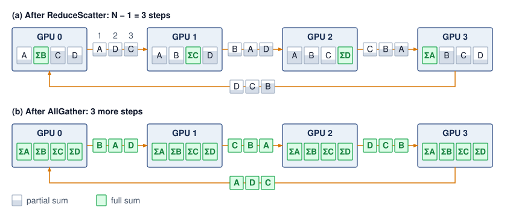

<!--
```{.tikz}
\begin{tikzpicture}[line join=round, line cap=round, font=\small\sffamily]

  % Define Layer Order
  \pgfdeclarelayer{background}
  \pgfdeclarelayer{foreground}
  \pgfsetlayers{background,main,foreground}

  % Styles
  \tikzset{
    gpu_chassis/.style={
      draw=BlueLine, fill=white, line width=0.85pt, rounded corners=3pt,
      minimum width=2.85cm, minimum height=1.5cm
    },
    shard_idle/.style={
      draw=black!25, fill=black!3, line width=0.5pt, rounded corners=1.5pt,
      minimum width=0.56cm, minimum height=0.65cm, font=\scriptsize\sffamily, text=black!50
    },
    shard_reduced/.style={
      draw=GreenLine, fill=GreenFill!85, line width=0.8pt, rounded corners=1.5pt,
      minimum width=0.56cm, minimum height=0.65cm, font=\scriptsize\bfseries\sffamily, text=GreenLine!90!black
    },
    ring_arr_blue/.style={
      ->, >=Latex, line width=1.2pt, BlueLine
    },
    ring_arr_green/.style={
      ->, >=Latex, line width=1.2pt, GreenLine
    }
  }

  % ==========================================
  % PHASE 1: SCATTER-REDUCE
  % ==========================================
  \begin{scope}[shift={(0, 5.0)}]
    % Section Header Band
    \node[anchor=west, font=\normalsize\bfseries\sffamily, text=TextBlack] at (-0.2, 1.9)
      {Phase 1: Scatter-Reduce \mdseries\footnotesize($N-1 = 3$ Transmission Steps)};
    \node[anchor=east, font=\scriptsize\bfseries\sffamily, text=BlueLine] at (14.2, 1.9)
      {Each GPU Obtains 1 Reduced Shard};

    % GPUs (0 to 3)
    \foreach \idx/\rank/\reduced in {
      0/{GPU 0 (Rank 0)}/1,
      1/{GPU 1 (Rank 1)}/2,
      2/{GPU 2 (Rank 2)}/3,
      3/{GPU 3 (Rank 3)}/4
    } {
      \pgfmathsetmacro{\xpos}{\idx * 3.6 + 1.4}
      % Chassis
      \node[gpu_chassis] (G1_\idx) at (\xpos, 0.8) {};
      \node[font=\footnotesize\bfseries\sffamily, text=TextBlack] at (\xpos, 1.28) {\rank};

      % 4 Shard Blocks inside GPU
      \foreach \sidx/\slabel in {1/A, 2/B, 3/C, 4/D} {
        \pgfmathsetmacro{\sxpos}{\xpos - 0.90 + (\sidx - 1) * 0.60}
        \ifnum\sidx=\reduced
          \node[shard_reduced] at (\sxpos, 0.55) {\slabel\,\ding{51}};
        \else
          \node[shard_idle] at (\sxpos, 0.55) {\slabel};
        \fi
      }
    }

    % Forward Ring Links
    \draw[ring_arr_blue] (G1_0.east) -- (G1_1.west);
    \draw[ring_arr_blue] (G1_1.east) -- (G1_2.west);
    \draw[ring_arr_blue] (G1_2.east) -- (G1_3.west);

    % Wrap-Around Ring Link (3 -> 0)
    \draw[ring_arr_blue, rounded corners=4pt]
      (G1_3.south) -- ++(0, -0.45) -| (G1_0.south);
    \node[below=1pt, font=\scriptsize\bfseries\sffamily, text=BlueLine] at (6.8, -0.45)
      {Unidirectional Ring Wrap-Around Link (Rank 3 $\to$ Rank 0)};

    % Phase 1 Completion Status Callout
    \node[anchor=north, font=\scriptsize\sffamily, text=GreenLine!90!black] at (6.8, -0.78)
      {\textbf{Scatter-Reduce Result:} Rank $i$ holds global sum $\sum x^{(i)}$ (A\,\ding{51} on G0, B\,\ding{51} on G1, C\,\ding{51} on G2, D\,\ding{51} on G3)};

    % Background Container
    \begin{pgfonlayer}{background}
      \draw[draw=black!15, fill=black!1, rounded corners=4pt, line width=0.5pt]
        (-0.4, -1.15) rectangle (14.4, 2.25);
    \end{pgfonlayer}
  \end{scope}

  % ==========================================
  % PHASE 2: ALLGATHER
  % ==========================================
  \begin{scope}[shift={(0, 1.2)}]
    % Section Header Band
    \node[anchor=west, font=\normalsize\bfseries\sffamily, text=TextBlack] at (-0.2, 1.9)
      {Phase 2: AllGather \mdseries\footnotesize($N-1 = 3$ Transmission Steps)};
    \node[anchor=east, font=\scriptsize\bfseries\sffamily, text=GreenLine] at (14.2, 1.9)
      {All GPUs Obtain All Reduced Shards};

    % GPUs (0 to 3)
    \foreach \idx/\rank in {
      0/{GPU 0 (Rank 0)},
      1/{GPU 1 (Rank 1)},
      2/{GPU 2 (Rank 2)},
      3/{GPU 3 (Rank 3)}
    } {
      \pgfmathsetmacro{\xpos}{\idx * 3.6 + 1.4}
      \node[gpu_chassis, draw=GreenLine] (G2_\idx) at (\xpos, 0.8) {};
      \node[font=\footnotesize\bfseries\sffamily, text=TextBlack] at (\xpos, 1.28) {\rank};

      % All 4 Shards are now fully reduced!
      \foreach \sidx/\slabel in {1/A, 2/B, 3/C, 4/D} {
        \pgfmathsetmacro{\sxpos}{\xpos - 0.90 + (\sidx - 1) * 0.60}
        \node[shard_reduced] at (\sxpos, 0.55) {\slabel\,\ding{51}};
      }
    }

    % Forward Ring Links (Green)
    \draw[ring_arr_green] (G2_0.east) -- (G2_1.west);
    \draw[ring_arr_green] (G2_1.east) -- (G2_2.west);
    \draw[ring_arr_green] (G2_2.east) -- (G2_3.west);

    % Wrap-Around Ring Link (3 -> 0)
    \draw[ring_arr_green, rounded corners=4pt]
      (G2_3.south) -- ++(0, -0.45) -| (G2_0.south);
    \node[below=1pt, font=\scriptsize\bfseries\sffamily, text=GreenLine] at (6.8, -0.45)
      {AllGather Forwarding Around Ring (Rank 3 $\to$ Rank 0)};

    % Phase 2 Completion Status Callout
    \node[anchor=north, font=\scriptsize\sffamily, text=GreenLine!90!black] at (6.8, -0.78)
      {\textbf{AllGather Final State:} Every GPU possesses the complete synchronized gradient tensor [A\,\ding{51}, B\,\ding{51}, C\,\ding{51}, D\,\ding{51}]};

    % Background Container
    \begin{pgfonlayer}{background}
      \draw[draw=black!15, fill=black!1, rounded corners=4pt, line width=0.5pt]
        (-0.4, -1.15) rectangle (14.4, 2.25);
    \end{pgfonlayer}
  \end{scope}

  % ==========================================
  % ANALYTICAL INVARIANTS FOOTER CARD
  % ==========================================
  \node[
    draw=black!15, fill=black!2, line width=0.5pt, rounded corners=3pt,
    anchor=north, minimum width=14.8cm, inner sep=6pt
  ] at (7.0, -0.2) {
    \begin{minipage}{14.5cm}\footnotesize\sffamily
      \begin{tabular}{@{}p{7.1cm}@{\hspace{0.4cm}}p{7.0cm}@{}}
        \textbf{Bandwidth Optimality (Lower Bound)} & \textbf{Latency Scaling Penalty (Ring Diameter)} \\[2pt]
        $\bullet$ \textbf{Per-GPU Traffic:} $2 \cdot \frac{N-1}{N} \cdot M \to 2M$ as $N \to \infty$ &
        $\bullet$ \textbf{Ring Steps:} $2(N-1)$ sequential point-to-point transfers \\
        $\bullet$ \textbf{Link Utilization:} $100\%$ of links active concurrently in every round &
        $\bullet$ \textbf{Latency Overhead:} $T_{\text{latency}} = 2(N-1) \cdot \alpha$ (scales linearly with $N$)
      \end{tabular}
    \end{minipage}
  };

\end{tikzpicture}
```
-->

:::

Logical ring edges may share physical links, and startup, local reduction, or contention can leave transfer capacity unused, so byte optimality does not guarantee peak physical-link utilization. To see how the logical schedule itself reaches that byte lower bound, consider 4 GPUs reducing a vector of 4 elements by summation. Each GPU $\RankIndex$ starts with a local gradient vector $\LocalGradient_i = [\FirstRingTraceElement_i, \SecondRingTraceElement_i, \ThirdRingTraceElement_i, \FourthRingTraceElement_i]$ split into 4 chunks (one per GPU), and the algorithm proceeds through two phases.

```{python}
#| echo: false
#| label: ring-trace-calc
from mlsysim.fmt import MarkdownStr, check, fmt

def _ring_scatter_reduce_trace(vectors, names):
    """Simulate ring scatter-reduce; return per-step cells, owned chunks, sums.

    In step s, GPU i sends chunk (i - s) mod N to GPU i + 1, which adds it into
    its own copy of that chunk. Each cell records the chunk a GPU receives and
    the partial sum it now holds. After N - 1 steps, GPU i owns the fully
    reduced chunk (i + 1) mod N.
    """
    n = len(vectors)
    partial = [row[:] for row in vectors]
    cells = []
    for s in range(n - 1):
        sent = [(i, (i - s) % n, partial[i][(i - s) % n]) for i in range(n)]
        row = [""] * n
        for src, chunk, value in sent:
            dst = (src + 1) % n
            partial[dst][chunk] += value
            row[dst] = f"{names[chunk]}: {partial[dst][chunk]}"
        cells.append(row)
    owned = [(names[(i + 1) % n], partial[i][(i + 1) % n]) for i in range(n)]
    totals = [sum(v[j] for v in vectors) for j in range(len(vectors[0]))]
    return cells, owned, totals

def _ring_allgather_trace(totals, names):
    """Simulate ring AllGather after scatter-reduce; return per-step cells.

    GPU i starts owning the fully reduced chunk (i + 1) mod N. In AllGather
    step s (1-indexed), GPU i forwards chunk (i - s + 2) mod N, the chunk it
    completed or received most recently, to GPU i + 1. Each cell records the
    finished chunk a GPU receives; after N - 1 steps every GPU holds all chunks.
    """
    n = len(totals)
    held = [{(i + 1) % n} for i in range(n)]
    cells = []
    for s in range(1, n):
        row = [""] * n
        for i in range(n):
            chunk = (i - s + 2) % n
            dst = (i + 1) % n
            held[dst].add(chunk)
            row[dst] = f"{names[chunk]}: {totals[chunk]}"
        cells.append(row)
    return cells, held

class RingTrace:
    # ┌── 1. LOAD ──────────────────────────────────────────
    N = 4
    M = 4
    # Local vectors [a_i, b_i, c_i, d_i] on GPUs 0..3 (worked-example inputs).
    vectors = [[1, 5, 3, 7], [2, 6, 4, 8], [3, 7, 5, 9], [4, 8, 6, 10]]
    chunk_names = ["a", "b", "c", "d"]
    # ┌── 2. EXECUTE ───────────────────────────────────────
    total_steps = 2 * (N - 1)
    elem_per_step = M // N
    total_per_gpu = total_steps * elem_per_step
    sr_cells, owned, totals = _ring_scatter_reduce_trace(vectors, chunk_names)
    ag_cells, ag_held = _ring_allgather_trace(totals, chunk_names)
    # ┌── 3. GUARD ─────────────────────────────────────────
    check(total_steps == 6, f"steps = {total_steps}, expected 6")
    check(elem_per_step == 1, f"elem/step = {elem_per_step}, expected 1")
    check(totals == [10, 26, 18, 34], f"element-wise sum = {totals}")
    check(sorted(val for _, val in owned) == sorted(totals), "each GPU should own one fully reduced chunk")
    check(len(sr_cells) + len(ag_cells) == total_steps, "trace rows should cover all 2(N-1) steps")
    check(ag_held == [set(range(N))] * N, "AllGather should leave every GPU holding every chunk")
    # ┌── 4. OUTPUT ────────────────────────────────────────
    sr1_g0_str, sr1_g1_str, sr1_g2_str, sr1_g3_str = [MarkdownStr(c) for c in sr_cells[0]]
    sr2_g0_str, sr2_g1_str, sr2_g2_str, sr2_g3_str = [MarkdownStr(c) for c in sr_cells[1]]
    sr3_g0_str, sr3_g1_str, sr3_g2_str, sr3_g3_str = [MarkdownStr(c) for c in sr_cells[2]]
    ag1_g0_str, ag1_g1_str, ag1_g2_str, ag1_g3_str = [MarkdownStr(c) for c in ag_cells[0]]
    ag2_g0_str, ag2_g1_str, ag2_g2_str, ag2_g3_str = [MarkdownStr(c) for c in ag_cells[1]]
    ag3_g0_str, ag3_g1_str, ag3_g2_str, ag3_g3_str = [MarkdownStr(c) for c in ag_cells[2]]
    sum_vec_str = MarkdownStr("[" + ", ".join(str(t) for t in totals) + "]")
    steps_str = fmt(total_steps, precision=0, commas=False)
    elem_str = fmt(elem_per_step, precision=0, commas=False)
    total_str = fmt(total_per_gpu, precision=0, commas=False)
    n_gpus_str = fmt(N, precision=0, commas=False)
    vec_len_str = fmt(M, precision=0, commas=False)
```

::: {#exmp-collective-communication-ring-allreduce-step-by-step-trace-4-gpus .callout-example title="Ring AllReduce: Two-phase example (4 GPUs)"}

**Scenario**: Four GPUs ($0 \to 1 \to 2 \to 3 \to 0$) perform a Ring AllReduce on local vectors $[1, 5, 3, 7]$, $[2, 6, 4, 8]$, $[3, 7, 5, 9]$, and $[4, 8, 6, 10]$ to compute the element-wise sum $[10, 26, 18, 34]$.

**Diagnosis**: The trace has to show three properties of the schedule, namely that it takes $2(\DeviceCount-1) = 6$ steps, that every GPU sends and receives in every step, and that each step moves only one chunk. Ring AllReduce splits each vector into $\DeviceCount=4$ chunks $\FirstRingTraceElement$, $\SecondRingTraceElement$, $\ThirdRingTraceElement$, $\FourthRingTraceElement$. In ReduceScatter step $\RingStepIndex$ ($\RingStepIndex= 1, 2, 3$), GPU $\RankIndex$ sends its running copy of chunk $(\RankIndex-\RingStepIndex+1) \bmod 4$ to GPU $(\RankIndex+1) \bmod 4$, which adds it to its own copy. After the third step, each GPU owns one fully reduced chunk. In AllGather step $\RingStepIndex$, GPU $\RankIndex$ forwards the finished chunk it completed or received most recently to GPU $(\RankIndex+1) \bmod 4$, which stores it without arithmetic. In each of the six steps, every GPU receives one chunk and updates the value it holds (@tbl-ring-allreduce-trace).

| **Step**            |            **GPU 0**            |            **GPU 1**            |            **GPU 2**            |            **GPU 3**            |
|:--------------------|:-------------------------------:|:-------------------------------:|:-------------------------------:|:-------------------------------:|
| **ReduceScatter 1** | `{python} RingTrace.sr1_g0_str` | `{python} RingTrace.sr1_g1_str` | `{python} RingTrace.sr1_g2_str` | `{python} RingTrace.sr1_g3_str` |
| **ReduceScatter 2** | `{python} RingTrace.sr2_g0_str` | `{python} RingTrace.sr2_g1_str` | `{python} RingTrace.sr2_g2_str` | `{python} RingTrace.sr2_g3_str` |
| **ReduceScatter 3** | `{python} RingTrace.sr3_g0_str` | `{python} RingTrace.sr3_g1_str` | `{python} RingTrace.sr3_g2_str` | `{python} RingTrace.sr3_g3_str` |
| **AllGather 1**     | `{python} RingTrace.ag1_g0_str` | `{python} RingTrace.ag1_g1_str` | `{python} RingTrace.ag1_g2_str` | `{python} RingTrace.ag1_g3_str` |
| **AllGather 2**     | `{python} RingTrace.ag2_g0_str` | `{python} RingTrace.ag2_g1_str` | `{python} RingTrace.ag2_g2_str` | `{python} RingTrace.ag2_g3_str` |
| **AllGather 3**     | `{python} RingTrace.ag3_g0_str` | `{python} RingTrace.ag3_g1_str` | `{python} RingTrace.ag3_g2_str` | `{python} RingTrace.ag3_g3_str` |

: **Ring AllReduce Trace**: The chunk each of four GPUs receives in each of the six steps. In the three ReduceScatter steps the GPU adds the incoming chunk to its running partial sum; in the three AllGather steps it stores an already finished sum. {#tbl-ring-allreduce-trace}

Every cell in every row is filled, so every GPU receives (and, symmetrically, sends) one chunk in every step, and after the sixth step every GPU holds `{python} RingTrace.sum_vec_str`.

**Systems lesson**: Ring AllReduce achieves the optimal byte volume under the stated model: each GPU sends $2\frac{\DeviceCount-1}{\DeviceCount}\CollectivePayloadSize$ total bytes, approaching $2\CollectivePayloadSize$ as $\DeviceCount$ grows, while the startup-round count continues to grow. Physical-link utilization also depends on placement and runtime overhead.

:::

::: {#chk-collective-communication-ring-allreduce-mechanics .callout-checkpoint title="Ring AllReduce mechanics"}

Verify your understanding of bandwidth-optimal reduction:

- [ ] **Step count**: calculate the number of sequential steps\index{Ring AllReduce!sequential steps} required for a ring of $\DeviceCount$ GPUs to complete the full AllReduce.
- [ ] **Bandwidth optimality**: explain why Ring AllReduce is bandwidth-optimal, including how many times each byte of the total message $\CollectivePayloadSize$ traverses the network per GPU.
- [ ] **Straggler impact**: determine the impact on total collective completion time when one GPU in the ring is 50 percent slower than the others.
- [ ] **Send/receive duality**: assess the True or False claim that every GPU is both a sender and a receiver in every step of Ring AllReduce.

:::

The performance follows directly from the two-phase schedule in example \ref{exmp-collective-communication-ring-allreduce-step-by-step-trace-4-gpus}. Each node sends and receives $\frac{\CollectivePayloadSize}{\DeviceCount}$ bytes in each of the $2(\DeviceCount-1)$ steps.
$$
\RingAllReduceCompletionTime = \underbrace{2(\DeviceCount-1)\MessageStartupLatency}_{\text{Latency Term}} + \underbrace{2\frac{\DeviceCount-1}{\DeviceCount} \frac{\CollectivePayloadSize}{\LinkBandwidth}}_{\text{Bandwidth Term}}
$$

```{python}
#| echo: false
#| label: ring-round-scale-calc
# ┌─────────────────────────────────────────────────────────────────────────────
# │ RING STARTUP ROUNDS AT 10,000 RANKS
# ├─────────────────────────────────────────────────────────────────────────────
# │ Context: @sec-communication-collective-operations-collective-operations-ring-allreduce-ffce,
# │          the paragraph after the ring cost equation.
# │
# │ Goal: Make the linear latency term concrete at a scale far beyond one
# │       pod, where its round count dwarfs any tree schedule.
# │ Show: N = 10,000; 2 (N-1) = 19,998 sequential startup rounds.
# │ How: calc_ring_allreduce_latency_steps(N).
# │
# └─────────────────────────────────────────────────────────────────────────────
from mlsysim.fmt import check, fmt
from mlsysim.physics import calc_ring_allreduce_latency_steps

class RingRoundScale:
    # ┌── 1. LOAD ──────────────────────────────────────────
    n_ranks = 10_000  # scenario assumption: a group well beyond the reference cluster
    # ┌── 2. EXECUTE ───────────────────────────────────────
    steps = calc_ring_allreduce_latency_steps(n_ranks)
    # ┌── 3. GUARD ─────────────────────────────────────────
    check(steps == 2 * (n_ranks - 1), f"Ring rounds = {steps}, expected 2(N-1)")
    # ┌── 4. OUTPUT ────────────────────────────────────────
    n_ranks_str = fmt(n_ranks, precision=0, commas=True)
    steps_str = fmt(steps, precision=0, commas=True)
```

The bandwidth term approaches $2\CollectivePayloadSize/\LinkBandwidth$ as $\DeviceCount\to \infty$, reaching the full-duplex lower bound: each rank sends nearly $2\CollectivePayloadSize$ bytes across the two phases and receives the same amount concurrently. In contrast, the latency term scales linearly with $\DeviceCount$. Across `{python} RingRoundScale.n_ranks_str` nodes, `{python} RingRoundScale.steps_str` sequential startup rounds accumulate substantial latency, which explains why Ring AllReduce becomes uncompetitive for small payloads.

::: {#nbk-collective-communication-allreduce-cost-70b-model .callout-notebook title="AllReduce cost for a 70B model"}

**Problem**: Consider a communication-only baseline for a `{python} AllReduceCost.params_b_str` parameter model across `{python} AllReduceCost.n_gpus_napkin_str` connected by InfiniBand NDR (`{python} AllReduceCost.ib_bw_gb_per_s_str` per port). The bandwidth term barely depends on rank count, so this smaller group reproduces the bandwidth-only estimate from the opening definition while keeping the latency term visible. Each rank contributes a complete logical gradient buffer communicated in BF16 (2 bytes per parameter). This calculation isolates collective cost without establishing that the training state fits on each GPU. How long does one AllReduce take?

**Step 1**: Size the gradient payload.
Each rank in this baseline contributes the complete logical gradient tensor of `{python} AllReduceCost.gradient_operands_math` $=$ `{python} AllReduceCost.gradient_size_gb_str`. A hybrid layout that partitions the model would instead reduce corresponding gradient shards within smaller groups and requires its own calculation.

**Step 2**: Apply the Ring AllReduce bandwidth formula.
$$\RingAllReduceBandwidthTime= 2 \cdot \frac{\DeviceCount-1}{\DeviceCount} \cdot \frac{\CollectivePayloadSize}{\LinkBandwidth}$$

Substituting: $\RingAllReduceBandwidthTime$ = `{python} AllReduceCost.ring_bw_factor_value_str` $\times$ `{python} AllReduceCost.gradient_size_gb_str` / `{python} AllReduceCost.ib_bw_gb_per_s_str` $\approx$ `{python} AllReduceCost.ring_bw_time_ms_str`.

**Step 3**: Add the latency term.
$$\RingAllReduceStartupTime= 2(\DeviceCount-1) \cdot \MessageStartupLatency$$

Substituting: $\RingAllReduceStartupTime=$ `{python} AllReduceCost.lat_steps_str` $\times$ `{python} AllReduceCost.alpha_us_str` = `{python} AllReduceCost.ring_lat_time_ms_str`.

**Step 4**: Total communication time.
Total: $\RingAllReduceCompletionTime \approx$ `{python} AllReduceCost.ring_bw_time_ms_str` + `{python} AllReduceCost.ring_lat_time_ms_str` $\approx$ `{python} AllReduceCost.ring_total_ms_str`.

**Systems insight**: The modeled full-buffer AllReduce takes over five seconds under the stated link and rank assumptions, and almost all of it is the bandwidth term. Its effect on step time depends on how much remains exposed relative to useful computation. When it is fully exposed, halving it saves about `{python} AllReduceCost.halved_saving_s_str` per step; across a `{python} AllReduceCost.campaign_steps_str`-step campaign on these `{python} AllReduceCost.n_gpus_napkin_str`, that is roughly `{python} AllReduceCost.halved_saving_gpu_hours_str` GPU-hours of reserved accelerator time. Large-scale training systems can launch reductions for output-side gradients while input-side layers are still computing. Partitioned training also changes each rank's payload and participating group, so this complete-gradient budget must be recomputed for the actual layout.

:::

### Tree AllReduce {#sec-communication-collective-operations-tree-allreduce}

Ring AllReduce's byte efficiency comes with many startup rounds. As the group grows, the $2(\DeviceCount-1)\MessageStartupLatency$ term can exceed the byte-transfer term for a fixed payload; the crossover depends on the measured path parameters. Tree AllReduce\index{Tree AllReduce} reduces the number of dependent rounds. In the simple reduce phase\index{Tree AllReduce!reduce phase}, pairs combine contributions and forward partial sums toward a root, taking $\log_2 \DeviceCount$ steps for a balanced power-of-two group. The broadcast phase\index{Tree AllReduce!broadcast phase} distributes the result in another $\log_2 \DeviceCount$ steps. This shorter dependency chain motivates the comparison before bandwidth costs are counted.

::: {.column-margin}
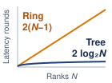{width="100%" fig-alt="Latency rounds against rank count N on linear axes. An amber straight line labeled ring, 2 times N minus 1, climbs steadily; a blue curve labeled tree, 2 log base 2 of N, bends over and stays near the bottom."}

*Ring latency grows with N; tree stays logarithmic.*
:::

The simple full-message tree loses parallel activity as contributions converge. A ring activates all $\DeviceCount$ logical edges in each round. In a pairwise tree reduction, the first round has $\DeviceCount/2$ senders and $\DeviceCount/2$ receivers; receiving is useful work, not idleness. The next round has $\DeviceCount/4$ senders and $\DeviceCount/4$ receivers, and the final reduction exchange involves two ranks while the remaining $(\DeviceCount-2)$ have completed their upstream contribution. Sending the full message through successive levels adds byte-transfer time along the dependency path. This is a limitation of the illustrated schedule, not every tree-based implementation or every physical link mapping.

The resulting time complexity depends on the specific tree variant. A simple reduce-then-broadcast tree has logarithmic latency but nonuniform traffic and root/interior bottlenecks. Recursive doubling, in which partners at doubling distances exchange the entire tensor in each of $\log_2 \DeviceCount$ rounds, has the same logarithmic round count and incurs $\mathcal{O}(\log \DeviceCount)$ full-message bandwidth per rank. The following simplified model captures the latency advantage and the potential bandwidth penalty of tree-like collectives:
$$ \TreeLikeAllReduceTime\approx \underbrace{2\log_2 \DeviceCount\cdot \MessageStartupLatency}_{\text{Latency}} + \underbrace{2 \log_2 \DeviceCount\frac{\CollectivePayloadSize}{\LinkBandwidth}}_{\text{Bandwidth penalty in full-message exchange variants}} $$

```{python}
#| echo: false
#| label: tree-round-counts-calc
# ┌─────────────────────────────────────────────────────────────────────────────
# │ RING VS. TREE ROUND COUNTS AND BYTE TERMS
# ├─────────────────────────────────────────────────────────────────────────────
# │ Context: @sec-communication-collective-operations-tree-allreduce, the three
# │          paragraphs after the tree-like cost model.
# │
# │ Goal: Put numbers on the tree's latency advantage at the reference scale,
# │       its full-message transfer count on the 64-GPU cluster, and the
# │       startup-versus-byte trade for a small eight-GPU group.
# │ Show: N = 1,024: ring 2,046 rounds, tree 20, ~102x fewer; N = 64: 12
# │       full-message transfers; N = 8: 14 vs. 6 startups, tree byte term
# │       ~3.4x ring's.
# │ How: ring rounds 2(N-1); tree rounds 2 log2 N; byte factors
# │      2 log2 N (tree) and 2 (N-1)/N (ring), M/beta cancels.
# │
# └─────────────────────────────────────────────────────────────────────────────
import math
from mlsysim import Scenarios
from mlsysim.fmt import check, fmt, fmt_math, fmt_multiple
from mlsysim.physics import calc_ring_allreduce_latency_steps

class TreeRoundCounts:
    # ┌── 1. LOAD ──────────────────────────────────────────
    n_large = Scenarios.DenseLLMPretrainingReference.system.total_accelerators  # 1,024-GPU reference cluster
    n_mid = RingTreeByteGap.n_gpus  # 64-GPU cluster of the lower-bound section
    n_small = 8  # scenario assumption: one node's tensor-parallel group
    # ┌── 2. EXECUTE ───────────────────────────────────────
    ring_rounds_large = calc_ring_allreduce_latency_steps(n_large)
    tree_rounds_large = 2 * int(math.log2(n_large))
    round_ratio = ring_rounds_large / tree_rounds_large
    tree_transfers_mid = 2 * int(math.log2(n_mid))
    ring_rounds_small = calc_ring_allreduce_latency_steps(n_small)
    tree_rounds_small = 2 * int(math.log2(n_small))
    byte_ratio_small = tree_rounds_small / (2 * (n_small - 1) / n_small)
    # ┌── 3. GUARD ─────────────────────────────────────────
    check(n_large == 1024, f"Reference cluster should be 1,024 GPUs, got {n_large}")
    for _n in (n_large, n_mid, n_small):
        check(2 ** int(math.log2(_n)) == _n, f"Tree model assumes a power-of-two group, got {_n}")
    check(round_ratio > 50, f"Tree should save well over an order of magnitude in rounds, got {round_ratio:.1f}")
    check(byte_ratio_small > 1, "Tree's full-message byte term should exceed ring's")
    # ┌── 4. OUTPUT ────────────────────────────────────────
    n_large_str = fmt(n_large, precision=0, commas=True)
    ring_rounds_large_str = fmt(ring_rounds_large, precision=0, commas=True)
    tree_rounds_large_str = fmt(tree_rounds_large, precision=0, commas=False)
    # Shown to the nearest ten ("roughly" in the prose).
    round_ratio_mult_str = fmt_multiple(round(round_ratio, -1), precision=0, commas=False)
    tree_transfers_mid_math = fmt_math(rf"2\log_2 {n_mid} = {tree_transfers_mid}")
    n_small_str = fmt(n_small, precision=0, commas=False)
    ring_rounds_small_math = fmt_math(rf"2({n_small}-1)\MessageStartupLatency= {ring_rounds_small}\MessageStartupLatency")
    tree_rounds_small_math = fmt_math(rf"2\log_2({n_small})\MessageStartupLatency= {tree_rounds_small}\MessageStartupLatency")
    byte_ratio_small_mult_str = fmt_multiple(byte_ratio_small, precision=1, commas=False)
```

The latency term is logarithmic ($\mathcal{O}(\log \DeviceCount)$). For `{python} TreeRoundCounts.n_large_str` nodes, Ring needs `{python} TreeRoundCounts.ring_rounds_large_str` steps while Tree needs only `{python} TreeRoundCounts.tree_rounds_large_str`. That roughly `{python} TreeRoundCounts.round_ratio_mult_str` reduction in steps makes Tree attractive for small, frequent collectives across large process groups, such as scalar reductions, control messages, or small-batch activation reductions. The bandwidth term carries the penalty, because tree-like algorithms can underutilize links or concentrate traffic on interior links, and recursive-doubling-style full-message exchanges add a $\log_2 \DeviceCount$ bandwidth factor. These penalties make naive tree variants a poor choice for data parallelism's large gradient AllReduce, where bandwidth efficiency determines whether the network is saturated or partially idle.

For large-scale data parallelism, this bandwidth penalty decides the comparison whenever the implementation repeatedly exchanges full messages or creates root/interior bottlenecks. On the `{python} RingTreeByteGap.n_gpus_str`-GPU cluster of @sec-communication-bandwidth-lower-bound, the simple tree forwards the whole tensor once per level on the way up and once per level on the way down, `{python} TreeRoundCounts.tree_transfers_mid_math` full-message transfers. Its byte time is about `{python} RingTreeByteGap.tree_bw_ms_str` against the ring's `{python} RingTreeByteGap.ring_bw_ms_str`, or `{python} RingTreeByteGap.tree_ring_ratio_mult_str` the ring's byte time. The difference of roughly `{python} RingTreeByteGap.gap_ms_str` per step would accumulate to about `{python} RingTreeByteGap.gap_run_hours_str` hours over a `{python} RingTreeByteGap.run_steps_str`-step run if fully exposed, although actual wall-clock savings also depend on startup, placement, and overlap. For a 70B-parameter model's `{python} GradSyncSignificance.gradient_gb_str` gradient AllReduce across 1,000 GPUs, a bandwidth-inefficient tree-like variant can erase the latency advantage that motivated it. Optimized double-tree algorithms exist precisely to keep logarithmic latency without imposing that naive bandwidth penalty.

Small activation reductions provide a useful case for fewer startup rounds. For an eight-GPU group communicating a 1 MB tensor, the simple model reduces Ring's `{python} TreeRoundCounts.ring_rounds_small_math` to Tree's `{python} TreeRoundCounts.tree_rounds_small_math`, but Tree's byte term remains about `{python} TreeRoundCounts.byte_ratio_small_mult_str` Ring's. Whether the saved startups outweigh those extra byte transfers depends on the measured latency and bandwidth. Tensor-parallel collectives also have a scheduling constraint independent of this comparison: a layer that needs the reduced activation must wait for it. A critical-path dependency does not by itself imply a latency-dominated transfer or select a tree algorithm.

### Recursive halving-doubling (butterfly) {#sec-communication-butterfly}

The simple full-message Tree reduces startup rounds but repeats more byte-transfer work than Ring. Recursive halving-doubling\index{Recursive halving-doubling}\index{AllReduce!recursive doubling}, sometimes called the Butterfly algorithm\index{Butterfly algorithm}, combines logarithmic rounds with the optimal byte volume under the flat-network model. It pairs ranks exactly as recursive doubling does, but where recursive doubling exchanges the whole tensor in every round, halving-doubling halves the exchanged region in each ReduceScatter round and doubles it in each AllGather round. That difference removes the $\log_2 \DeviceCount$ byte penalty. For a power-of-two group, it uses $2\log_2 \DeviceCount$ rounds: $\log_2 \DeviceCount$ ReduceScatter rounds followed by $\log_2 \DeviceCount$ AllGather rounds. A partner-bit index $\PartnerBitIndex$ selects the XOR pairing with mask $2^\PartnerBitIndex$. The ReduceScatter trace below visits those bits in increasing order as messages shrink; the matching AllGather reverses that order as the assembled result grows.

In the ReduceScatter phase (first $\log_2 \DeviceCount$ rounds), GPU $\RankIndex$ partners with GPU $\RankIndex\oplus 2^\PartnerBitIndex$ (XOR of indices). The partners retain complementary halves of the current tensor region and send the other half. Each adds the received contribution to the matching half it retained. After $\log_2 \DeviceCount$ rounds, each GPU owns $\CollectivePayloadSize/\DeviceCount$ bytes of the fully reduced result. AllGather traverses the partner bits in reverse, exchanging completed regions and doubling the data held at each rank until every rank has the full result.

Recursive halving-doubling costs
$$ \ButterflyAllReduceTime= 2\log_2 \DeviceCount\cdot \MessageStartupLatency+ 2\frac{\DeviceCount-1}{\DeviceCount} \cdot \frac{\CollectivePayloadSize}{\LinkBandwidth} $$

The schedule combines logarithmic latency ($\mathcal{O}(\log \DeviceCount)$, like Tree) with bandwidth-optimal data movement ($2(\DeviceCount-1)/\DeviceCount\cdot \CollectivePayloadSize/\LinkBandwidth$, like Ring). The catch is that it requires nonneighbor communication\index{Recursive halving-doubling!nonneighbor communication} (GPU $\RankIndex$ must communicate with GPU $\RankIndex\oplus 2^\PartnerBitIndex$, which may be physically distant), and it requires $\DeviceCount$ to be a power of two. For clusters where $\DeviceCount$ is not a power of two, additional complexity is needed to handle the irregular cases.

Recursive halving-doubling is used in MPI-style collective implementations and is useful as a theoretical point in the latency-bandwidth trade-off [@thakur2005]. NVIDIA's GPU collective backend, the NVIDIA Collective Communications Library (NCCL), offers implementation families that include ring, tree-derived, hierarchical, NVLink/NVSwitch-aware, and pattern-aware choices, with exact names and availability changing by version and topology [@jeaugey2017nccl; @nvidiaNcclUserGuide]. Whatever a particular release calls them, practical communication libraries select algorithms through a topology-aware cost model because nonlocal communication patterns can create contention on shared network links that erodes theoretical advantages.

The partner distance is where topology enters. Consider the ReduceScatter phase for 8 GPUs placed four per node on two nodes, GPUs 0--3 on the first and GPUs 4--7 on the second, which proceeds in $\log_2(8) = 3$ rounds. In round $\PartnerBitIndex=0$, each GPU $\RankIndex$ partners with GPU $\RankIndex\oplus 1$, pairing neighbors: (0,1), (2,3), (4,5), (6,7). They exchange half their data and reduce. In round $\PartnerBitIndex=1$, the distance doubles: GPU $\RankIndex$ partners with GPU $\RankIndex\oplus 2$, creating pairs (0,2), (1,3), (4,6), (5,7). In round $\PartnerBitIndex=2$, the distance doubles again: GPU $\RankIndex$ partners with GPU $\RankIndex\oplus 4$, creating pairs (0,4), (1,5), (2,6), (3,7).

Physical placement determines the cost of these logical pairings (@fig-butterfly-rounds). Rounds $\PartnerBitIndex=0$ and $\PartnerBitIndex=1$ pair GPUs within a node, but in round $\PartnerBitIndex=2$ every GPU on the first node exchanges with one on the second, so that round crosses the node boundary. On eight-GPU nodes the same crossing would appear one round later, at $\PartnerBitIndex=3$ in a 16-rank group. In a separate 1,024-rank example, the final ReduceScatter round pairs GPU $\RankIndex$ with GPU $\RankIndex\oplus 512$. If the two rank halves occupy different racks, those exchanges share the inter-rack fabric. The algorithm's logarithmic rounds and optimal byte volume therefore do not establish its runtime advantage; placement, shared paths, and the changing chunk size in each round must enter the comparison.

::: {#fig-butterfly-rounds fig-env="figure" fig-pos="htb" fig-cap="**Halving-Doubling Partners across a Node Boundary**: The ReduceScatter phase of recursive halving-doubling on 8 GPUs placed four per node. In round $\PartnerBitIndex$, GPU $\RankIndex$ exchanges with GPU $\RankIndex \oplus 2^{\PartnerBitIndex}$ and sends half of the region it still holds, so the exchanged volume halves each round. (a) and (b) The first two rounds pair GPUs inside a node and use NVLink. (c) The last round pairs every GPU with one on the other node, so the round with the smallest message is the only one that crosses the slower fabric. Which round crosses depends on how many ranks each node holds." fig-alt="Three panels side by side, each showing Node 0 above Node 1 with four GPU cards per node, GPUs 0 to 3 and 4 to 7. Panel a, round k equals 0, partner i XOR 1, sends M over 2: solid amber brackets join GPU 0 with 1 and 2 with 3 inside each node, and 4 with 5 and 6 with 7. Panel b, round k equals 1, partner i XOR 2, sends M over 4: solid brackets join 0 with 2 above the cards and 1 with 3 below, and likewise 4 with 6 and 5 with 7. Panel c, round k equals 2, partner i XOR 4, sends M over 8: four dashed amber vertical links join GPU 0 to 4, 1 to 5, 2 to 6, and 3 to 7 across the two nodes. A key marks solid amber as NVLink inside a node and dashed amber as InfiniBand across nodes."}
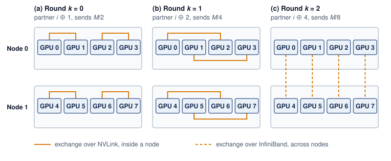
:::

### Double binary tree {#sec-communication-double-tree}

NCCL can use a double binary tree\index{Double binary tree}\index{Double binary tree!complementary trees}\index{NCCL!double binary tree} for many message sizes and topologies, which addresses the bandwidth inefficiency of a standard binary tree while allowing topology-aware tree placement [@jeaugey2017nccl; @nvidiaNcclUserGuide]. The idea is to construct two independent binary trees with complementary interior-node roles, then run both trees simultaneously, each carrying half the data.

The complementary-tree construction balances endpoint work by making ranks that act as interior nodes in one tree act as leaves in the other. With eight ranks, build the first tree by labeling the nodes of a binary tree in the order of an in-order traversal (left subtree, then node, then right subtree). In a balanced seven-node tree labeled from 0, in-order traversal puts the leaves at the even ranks 0, 2, 4, and 6 and the interior nodes at 1, 3, and 5. In one simple construction, the eighth rank, 7, joins as one more interior node above that tree. The odd ranks 1, 3, 5, and 7 thus form the first tree's interior and the even ranks are its leaves. The second tree shifts every rank by one position, so the even ranks become its interior and the odd ranks its leaves (@fig-double-binary-tree). Each tree carries half the tensor, $\CollectivePayloadSize/2$, and the two halves never meet.

::: {#fig-double-binary-tree fig-env="figure" fig-pos="htb" fig-cap="**Complementary Roles in a Double Binary Tree**: Two reduction trees over eight ranks, each carrying half of the tensor toward its root. (a) The first tree places the odd ranks at its interior and the even ranks at its leaves. (b) The second tree shifts every rank by one, which swaps the roles. The strip below shows the result: every rank is an interior node in exactly one tree and a leaf in the other, so it forwards one combined half and sends one half of its own, about $\CollectivePayloadSize$ in the reduce phase. The broadcast phase runs the same trees in the opposite direction." fig-alt="Two tree panels side by side. Panel a, tree 1, carries the first half M over 2: rank 7 at the top, rank 3 below it, ranks 1 and 5 below that, and leaves 0, 2, 4, and 6 at the bottom, with amber arrows pointing upward from each child to its parent. Interior ranks are blue cards and leaves are white cards. Panel b, tree 2, every rank shifted by one, carries the second half: rank 0 at the top, then 4, then 2 and 6, with leaves 1, 3, 5, and 7. Below, a two-row strip lists ranks 0 to 7: in the tree 1 row the odd ranks are blue, and in the tree 2 row the even ranks are blue. A key reads interior adds its children and forwards one partial sum; leaf sends its own contribution."}
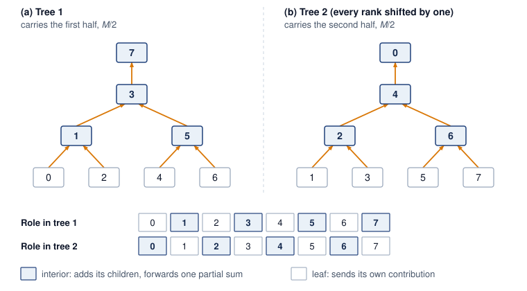
:::

Two further steps bring the byte term down from the simple tree's $2\log_2 \DeviceCount\cdot \CollectivePayloadSize/\LinkBandwidth$ to about $2\CollectivePayloadSize/\LinkBandwidth$. First, each tree pipelines its half in small chunks, so while one chunk moves up from the leaves, the next is already leaving them and every level works at once. Tree depth then adds startup rounds and a short pipeline fill, not repeated full-message transfers. Second, count what one rank sends during the reduce phase. As an interior node of one tree it combines the inputs of its (at most two) children and forwards one $\CollectivePayloadSize/2$ stream to its parent. As a leaf of the other tree it sends its own $\CollectivePayloadSize/2$ contribution. It therefore sends about $\CollectivePayloadSize$ in total. The broadcast phase mirrors that traffic, for about $2\CollectivePayloadSize$ per rank across both phases, the same per-rank volume as the ring. This logical balance does not guarantee that every physical link stays busy or that both trees avoid shared fabric bottlenecks; rank placement and routing still matter.

The combined performance is approximately:
$$ \DoubleTreeAllReduceTime\approx 2\log_2 \DeviceCount\cdot \MessageStartupLatency+ \frac{2\CollectivePayloadSize}{\LinkBandwidth} $$

The ideal bandwidth term approaches $2\CollectivePayloadSize/\LinkBandwidth$ while the startup-round count remains logarithmic. This combination makes the double binary tree a useful candidate across message sizes that penalize either the ring's many rounds or the simple tree's repeated full-message transfers. Complementary endpoint roles do not ensure disjoint physical paths, so topology-aware tree construction seeks a good placement, and measurements must establish the achieved rate under contention.

### The algorithm crossover point {#sec-communication-collective-operations-algorithm-crossover}

Plotting the three cost models for a 256-GPU group on a 200 Gbps fabric, over message sizes from 1 KB to 10 GB, shows the simple Tree and Ring curves intersecting near 1 MB (@fig-allreduce-crossover). At small sizes, fewer startup rounds favor the tree schedules; at large sizes, the simple full-message Tree pays more byte-transfer time. The Double Binary Tree curve includes illustrative overhead factors, so it approaches a comparable bandwidth-dominated regime without representing a measured library result. The candidate schedules differ in their latency and bandwidth terms, in whether they reach the bandwidth lower bound, and in the constraint each one places on the group (@tbl-allreduce-comparison).

| **Algorithm**   |                      **Latency**                       |                                    **Bandwidth**                                    | **Bandwidth optimal?** |               **Constraint**               |
|:----------------|:------------------------------------------------------:|:-----------------------------------------------------------------------------------:|:----------------------:|:------------------------------------------:|
| **Ring**        |   $\mathcal{O}(\DeviceCount)\MessageStartupLatency$    | $2\frac{\DeviceCount-1}{\DeviceCount}\frac{\CollectivePayloadSize}{\LinkBandwidth}$ |          Yes           |                    None                    |
| **Simple Tree** | $\mathcal{O}(\log \DeviceCount)\MessageStartupLatency$ |    $\mathcal{O}(\log \DeviceCount)\frac{\CollectivePayloadSize}{\LinkBandwidth}$    |           No           |                    None                    |
| **Butterfly**   | $\mathcal{O}(\log \DeviceCount)\MessageStartupLatency$ | $2\frac{\DeviceCount-1}{\DeviceCount}\frac{\CollectivePayloadSize}{\LinkBandwidth}$ |          Yes           | $\DeviceCount= 2^\RankCountBinaryExponent$ |
| **Double Tree** | $\mathcal{O}(\log \DeviceCount)\MessageStartupLatency$ |               $\approx\frac{2\CollectivePayloadSize}{\LinkBandwidth}$               |      Near-optimal      |      Complementary tree construction       |

: **AllReduce Algorithm Comparison**: Each algorithm occupies a different point in the latency-bandwidth trade-off space. Ring and Butterfly achieve bandwidth optimality with different latency characteristics, while Double Binary Tree combines logarithmic depth with a near-optimal byte term. The Tree row refers to the simple full-message model, not every tree implementation. {#tbl-allreduce-comparison}

::: {#fig-allreduce-crossover fig-env="figure" fig-pos="htb" fig-cap="**Algorithm Crossover in Collective Communication**: Below about 1 MB the simple tree's fewer startup rounds make it faster than the ring; above that size the ring's smaller byte volume wins, and the double binary tree tracks the faster of the two across most sizes. The curves are modeled AllReduce times for a 256-GPU group on a 200 Gbps interconnect with $\MessageStartupLatency = 1\\ \MicroUnitPrefix\text{s}$, over messages from 1 KB to 10 GB. The double binary tree curve applies modest latency and bandwidth overhead factors (1.2$\times$ and 1.05$\times$) to its ideal cost, so it illustrates the model rather than a measured library result." fig-alt="Log-log plot of AllReduce time against message size from 1 KB to 10 GB, with directly labeled curves for Ring, Tree, and Double binary tree. A dotted vertical line and an open marker at about 1 MB mark where Ring and Tree cross. The region left of the crossover is tinted green and labeled Tree beats Ring; the region to the right is tinted violet and labeled Ring beats Tree, comparing only those two curves."}

```{python}
#| echo: false
# ┌─────────────────────────────────────────────────────────────────────────────
# │ ALLREDUCE CROSSOVER (FIGURE)
# ├─────────────────────────────────────────────────────────────────────────────
# │ Context: @fig-allreduce-crossover—Ring vs Tree vs DBT
# │
# │ Goal: Log-log plot of AllReduce time vs message size for Ring, Tree, DBT;
# │       show latency-dominated (Tree wins) vs bandwidth-dominated (Ring wins).
# │ Show: Three curves; crossover regions; N=256, 200 Gbps.
# │ How: t_ring, t_tree, t_dbt from alpha-beta model; matplotlib.
# │
# └─────────────────────────────────────────────────────────────────────────────
# ┌── 1. CANVAS ────────────────────────────────────────────────────────────────
# │ Log-log plot of AllReduce time vs message size for Ring, Tree, DBT;
import matplotlib.pyplot as plt
import numpy as np
from mlsysim import Systems
from mlsysim.physics import (
    calc_ring_allreduce_time,
    calc_tree_allreduce_time,
    calc_double_binary_tree_allreduce_time,
)

from mlsysim import viz

# ┌── 2. ARRAYS ────────────────────────────────────────────────────────────────
N = 256
hdr_bw = Systems.Fabrics.InfiniBand_HDR.bandwidth
bandwidth_bytes_sec = hdr_bw.to("byte/s").magnitude
latency = 1e-6 * second

message_sizes = np.logspace(3, 10, 100)

t_ring = np.array(
    [calc_ring_allreduce_time(size * byte, N, bandwidth_bytes_sec * byte / second, latency).to(second).magnitude for size in message_sizes]
)
t_tree = np.array(
    [calc_tree_allreduce_time(size * byte, N, bandwidth_bytes_sec * byte / second, latency).to(second).magnitude for size in message_sizes]
)
t_dbt = np.array(
    [
        calc_double_binary_tree_allreduce_time(
            size * byte,
            N,
            bandwidth_bytes_sec * byte / second,
            latency,
            latency_factor=1.2,
            bandwidth_factor=1.05,
        )
        .to(second)
        .magnitude
        for size in message_sizes
    ]
)

t_ring_ms = t_ring * THOUSAND
t_tree_ms = t_tree * THOUSAND
t_dbt_ms = t_dbt * THOUSAND

fig, ax, COLORS, plt = viz.setup_plot(figsize=(6.8, 4.3))

# ┌── 3. RENDER ────────────────────────────────────────────────────────────────
# Ring/Tree crossover, located from the modeled curves themselves.
cross_i = int(np.argmax(t_ring_ms < t_tree_ms))
cross_x = message_sizes[cross_i]

# Regimes: each side of the Ring/Tree crossover is tinted with the hue of
# whichever of those two (Ring vs simple Tree) is faster there; DBT is not ranked.
ax.axvspan(message_sizes[0], cross_x, color=COLORS['GreenL'], alpha=0.45, lw=0, zorder=0)
ax.axvspan(cross_x, message_sizes[-1], color=COLORS['VioletL'], alpha=0.45, lw=0, zorder=0)

ax.loglog(message_sizes, t_ring_ms, color=COLORS['VioletLine'], linewidth=2.4, zorder=3)
ax.loglog(message_sizes, t_tree_ms, color=COLORS['GreenLine'], linewidth=2.4, linestyle='--', zorder=3)
ax.loglog(message_sizes, t_dbt_ms, color=COLORS['BlueLine'], linewidth=2.4, linestyle='-.', zorder=3)

ax.axvline(cross_x, color=COLORS['secondary'], linewidth=0.9, linestyle=':', zorder=2)
ax.plot(
    [cross_x],
    [t_ring_ms[cross_i]],
    marker='o',
    markersize=7,
    markerfacecolor='white',
    markeredgecolor=COLORS['primary'],
    markeredgewidth=1.4,
    zorder=4,
)
ax.text(cross_x * 1.25, 2.5e3, 'Ring = Tree\n(crossover)', fontsize=11, fontweight='bold', color=COLORS['primary'], ha='left', va='center', zorder=5)

# Direct series labels, placed where each curve is distinct.
def at(x, arr):
    return float(np.interp(np.log10(x), np.log10(message_sizes), arr))

ax.text(
    3e3, t_ring_ms[0] * 1.6, 'Ring (bandwidth-optimal)', fontsize=11, fontweight='bold', color=COLORS['VioletLine'], ha='left', va='bottom', zorder=5
)
ax.text(
    1.3e8,
    at(1.3e8, t_tree_ms) * 1.9,
    'Tree (latency-optimal)',
    fontsize=11,
    fontweight='bold',
    color=COLORS['GreenLine'],
    ha='right',
    va='bottom',
    zorder=5,
)
ax.text(3e6, at(3e6, t_dbt_ms) * 0.4, 'Double binary tree', fontsize=11, fontweight='bold', color=COLORS['BlueLine'], ha='left', va='top', zorder=5)

# Regime names in the empty corner of each tinted region.
ax.text(1.5e3, 5e3, 'Tree beats Ring', fontsize=11, color=COLORS['primary'], ha='left', va='top')
ax.text(7e9, 1.2e-2, 'Ring beats Tree', fontsize=11, color=COLORS['primary'], ha='right', va='bottom')

ax.set_xlim(message_sizes[0], message_sizes[-1])
ax.set_xlabel('Message size', fontsize=12)
ax.set_ylabel('AllReduce time (ms)', fontsize=12)
ax.tick_params(labelsize=11)
ax.grid(which='minor', visible=False)
for side in ('top', 'right'):
    ax.spines[side].set_visible(False)

ax.set_xticks([1e3, 1e6, 1e9, 1e10])
ax.set_xticklabels(['1 KB', '1 MB', '1 GB', '10 GB'])

plt.tight_layout()
plt.show()
plt.close()

# ┌── 4. DECORATE ──────────────────────────────────────────────────────────────
```

:::

The intersection near 1 MB in @fig-allreduce-crossover marks where the modeled Ring and simple Tree have equal total cost. It is an algorithm crossover, distinct from the startup-versus-transfer crossover for one message. Setting $\RingAllReduceCompletionTime = \TreeAllReduceCompletionTime$ and solving for payload $\CollectivePayloadSize$ identifies the point where Ring's lower byte cost compensates for its additional startup rounds:

$$ \RingAllReduceCompletionTime = 2(\DeviceCount-1)\MessageStartupLatency+ 2\frac{\DeviceCount-1}{\DeviceCount}\frac{\CollectivePayloadSize}{\LinkBandwidth} $$
$$ \TreeAllReduceCompletionTime = 2\log_2 \DeviceCount\cdot \MessageStartupLatency+ 2\log_2 \DeviceCount\cdot \frac{\CollectivePayloadSize}{\LinkBandwidth} $$

For large $\DeviceCount$, $(\DeviceCount-1) \approx \DeviceCount$ and $\frac{\DeviceCount-1}{\DeviceCount} \approx 1$, so the ring pays a latency term proportional to $\DeviceCount$ while moving each byte close to the bandwidth limit:

$$ \RingAllReduceCompletionTime \approx 2\DeviceCount\MessageStartupLatency+ \frac{2\CollectivePayloadSize}{\LinkBandwidth}, \quad \TreeAllReduceCompletionTime \approx 2\log_2 \DeviceCount\cdot \MessageStartupLatency+ \frac{2\log_2 \DeviceCount\cdot \CollectivePayloadSize}{\LinkBandwidth} $$

The tree has the opposite shape: logarithmic startup cost, but each message byte moves through more stages. Setting the estimates equal isolates the message size where the cheaper latency path stops compensating for the extra bandwidth work:

$$ 2\DeviceCount\MessageStartupLatency+ \frac{2\CollectivePayloadSize}{\LinkBandwidth} = 2\log_2 \DeviceCount\cdot \MessageStartupLatency+ \frac{2\log_2 \DeviceCount\cdot \CollectivePayloadSize}{\LinkBandwidth} $$
$$ \frac{2\CollectivePayloadSize}{\LinkBandwidth} - \frac{2\log_2 \DeviceCount\cdot \CollectivePayloadSize}{\LinkBandwidth} = 2\log_2 \DeviceCount\cdot \MessageStartupLatency- 2\DeviceCount\MessageStartupLatency$$
$$ \frac{2\CollectivePayloadSize}{\LinkBandwidth}(1 - \log_2 \DeviceCount) = 2\MessageStartupLatency(\log_2 \DeviceCount- \DeviceCount) $$

Since $\DeviceCount\gg \log_2 \DeviceCount$ for large clusters, $(\log_2 \DeviceCount- \DeviceCount) \approx -\DeviceCount$ and $(1 - \log_2 \DeviceCount) \approx -\log_2 \DeviceCount$, yielding:

$$ \frac{2\CollectivePayloadSize}{\LinkBandwidth}(-\log_2 \DeviceCount) \approx 2\MessageStartupLatency(-\DeviceCount) $$
$$ \boxed{\RingTreeCrossoverPayload \approx \frac{\DeviceCount\cdot \MessageStartupLatency\cdot \LinkBandwidth}{\log_2 \DeviceCount}} $$

The log-aware crossover formula\index{Critical message size!algorithm crossover} is the large-$\DeviceCount$ approximation to the exact crossover $\RingTreeCrossoverPayload(\DeviceCount)$ derived in @sec-appdx-comm-foundations-ring-vs-tree. Within this two-algorithm model, Ring wins above the crossover because its byte savings exceed its extra startup cost; the simple Tree wins below it because the startup saving is larger. Optimized trees and topology-dependent rates require separate comparisons.

```{python}
#| echo: false
#| label: crossover-reference-calc
# ┌─────────────────────────────────────────────────────────────────────────────
# │ RING-TREE CROSSOVER ON THE REFERENCE CLUSTER (LEGO)
# ├─────────────────────────────────────────────────────────────────────────────
# │ Context: @sec-communication-collective-operations-algorithm-crossover,
# │          the worked substitution after the boxed crossover formula.
# │
# │ Goal: Anchor the log-aware crossover on the chapter's canonical NDR alpha
# │       and beta and the volume's 1,024-GPU reference cluster.
# │ Show: N = 1,024; alpha = 1.5 us; beta = 50 GB/s; M_crossover ~ 7.7 MB.
# │ How: calc_ring_tree_crossover_size (N alpha beta / log2 N), N from
# │      Scenarios.DenseLLMPretrainingReference.
# │
# └─────────────────────────────────────────────────────────────────────────────
import math
from mlsysim import Scenarios, Systems
from mlsysim.core.units import GB, MB, microsecond, second
from mlsysim.fmt import check, fmt, fmt_bandwidth, fmt_math, fmt_memory, fmt_time
from mlsysim.physics import calc_ring_tree_crossover_size

class CrossoverReference:
    # ┌── 1. LOAD ──────────────────────────────────────────
    n_ranks = Scenarios.DenseLLMPretrainingReference.system.total_accelerators
    alpha = Systems.SwitchFabric.AlphaNdr  # canonical effective NDR launch latency
    beta = Systems.Fabrics.InfiniBand_NDR.bandwidth  # 50 GB/s per port
    # ┌── 2. EXECUTE ───────────────────────────────────────
    log2n = int(math.log2(n_ranks))
    crossover = calc_ring_tree_crossover_size(n_ranks, alpha, beta).to(MB)
    # ┌── 3. GUARD ─────────────────────────────────────────
    check(n_ranks == 1024, f"Reference cluster should be 1,024 GPUs, got {n_ranks}")
    check(2**log2n == n_ranks, "Reference rank count should be a power of two")
    check(abs(crossover.to(MB).magnitude - 7.68) < 0.01, f"Crossover = {crossover}")
    # ┌── 4. OUTPUT ────────────────────────────────────────
    n_ranks_str = fmt(n_ranks, precision=0, commas=True)
    alpha_us_str = fmt_time(alpha, microsecond, precision=1, commas=False)
    beta_gb_per_s_str = fmt_bandwidth(beta, unit=GB / second, precision=0, commas=False)
    crossover_mb_str = fmt_memory(crossover, unit=MB, precision=1, commas=False)
    # Substitution span: N alpha beta / log2 N with the LOAD operands.
    _n_tex = f"{n_ranks:,}".replace(",", "{,}")
    _a_us = alpha.to(microsecond).magnitude
    _b_gbs = int(beta.to(GB / second).magnitude)
    crossover_sub_math = fmt_math(
        rf"\frac{{{_n_tex} \times {_a_us:.1f}\ \MicroUnitPrefix\text{{s}} \times {_b_gbs}\ \text{{GB/s}}}}{{\log_2 {_n_tex}}} = \frac{{{_n_tex} \times {_a_us:.1f}\ \MicroUnitPrefix\text{{s}} \times {_b_gbs}\ \text{{GB/s}}}}{{{log2n}}}"
    )
```

On the reference cluster, with the chapter's effective NDR $\MessageStartupLatency=$ `{python} CrossoverReference.alpha_us_str` and $\LinkBandwidth=$ `{python} CrossoverReference.beta_gb_per_s_str` across all `{python} CrossoverReference.n_ranks_str` GPUs, the estimate gives $\RingTreeCrossoverPayload \approx$ `{python} CrossoverReference.crossover_sub_math` $\approx$ `{python} CrossoverReference.crossover_mb_str`. A gradient bucket of tens of megabytes or the full model gradient therefore sits on the ring side of the crossover, while a reduction of a few hundred kilobytes sits on the tree side. The two other configurations in this section depart from that anchor in stated ways. A smaller 256-GPU group on a slower 200 Gbps fabric with $\MessageStartupLatency= 1\ \MicroUnitPrefix\text{s}$ moves the curves' intersection down to about 1 MB (@fig-allreduce-crossover). A 64-GPU group on a still slower, higher-latency fabric places a 1 MB buffer almost exactly on the crossover (notebook \ref{nbk-collective-communication-ring-vs-tree-crossover}).

NCCL's algorithm selection is more nuanced than a two-way split. The double binary tree offers logarithmic latency with near-optimal bandwidth, so it competes with both Ring and Tree across a broad range of message sizes. The library also weighs the number of channels (parallel communication streams), the network topology, and whether a hop is inter-node or intra-node. The effective selection logic resembles a multi-way decision indexed by message size, GPU count, and topology type rather than a single crossover point. The crossover formula nevertheless explains the shape of those choices, because every candidate trades startup rounds against bytes moved. The model therefore names a candidate worth benchmarking rather than proving the library wrong, and an override is retained only after measured collective duration and exposed training-step time confirm it.

Training frameworks decide which payloads reach that analysis. PyTorch DistributedDataParallel (DDP) groups gradient tensors into buckets (@sec-communication-bucket-fusion), while FSDP groups parameter gathers and gradient reductions according to its sharding units. A bucket size alone does not locate a crossover, because rank count, effective startup cost, and available bandwidth also enter the comparison. NCCL's algorithm selection\index{NCCL!algorithm selection} must therefore be evaluated for the actual invocation and topology rather than inferred from a nominal bucket-size range. A single 1 MB buffer on a slower fabric shows how close to the crossover a real bucket can sit.

```{python}
#| echo: false
#| label: ring-vs-tree-calc
import math
from mlsysim.fmt import check, fmt, fmt_bandwidth, fmt_count, fmt_memory, fmt_multiple, fmt_percent, fmt_qty_range, fmt_time
from mlsysim.core.units import BYTES_FP16, GB, MB, microsecond, param, second
from mlsysim.physics import (
    calc_ring_allreduce_time,
    calc_ring_allreduce_latency_steps,
    calc_tree_allreduce_time,
    calc_ring_tree_crossover_size,
)

class RingVsTree:
    # ┌── 1. LOAD ──────────────────────────────────────────
    M_mb = 1
    N = 64
    alpha_us = 10
    beta_gbs = 10
    M = M_mb * MB
    alpha = alpha_us * microsecond
    beta = beta_gbs * GB / second
    ddp_bucket = 10 * MB  # scenario assumption: mid-size DDP bucket
    fused_bucket_low = 50 * MB  # scenario assumption: lower bound for fused multi-layer bucket
    fused_bucket_high = 300 * MB  # scenario assumption: representative upper range for fused buckets
    llama_70b = Models.Language.Llama2_70B
    # ┌── 2. EXECUTE ───────────────────────────────────────
    log2N = int(math.log2(N))
    # Latency terms come from exact closed forms (the guards pin them exactly);
    # deriving them by subtraction or via a seconds round-trip leaves FP residue.
    ring_total = calc_ring_allreduce_time(M, N, beta, alpha).to(microsecond)
    ring_bw = calc_ring_allreduce_time(M, N, beta, 0 * second).to(microsecond)
    ring_lat = (calc_ring_allreduce_latency_steps(N) * alpha).to(microsecond)
    tree_total = calc_tree_allreduce_time(M, N, beta, alpha).to(microsecond)
    tree_bw = calc_tree_allreduce_time(M, N, beta, 0 * second).to(microsecond)
    tree_lat = (2 * log2N * alpha).to(microsecond)
    crossover = calc_ring_tree_crossover_size(N, alpha, beta)
    full_bf16_gradient = llama_70b.parameters.to(param).magnitude * BYTES_FP16
    tree_win_margin_pct = ((ring_total - tree_total) / ring_total).to_base_units().magnitude * 100
    # Like-for-like penalties for the Ring-by-default pitfall: Ring's extra
    # startup cost beyond Tree's, against Tree's extra byte cost beyond Ring's.
    ring_excess_lat = (ring_lat - tree_lat).to(microsecond)
    tree_excess_bw = (tree_bw - ring_bw).to(microsecond)
    # ┌── 3. GUARD ─────────────────────────────────────────
    check(ring_lat == 1260 * microsecond, f"Ring lat = {ring_lat.to(microsecond).magnitude}")
    check(tree_lat == 120 * microsecond, f"Tree lat = {tree_lat.to(microsecond).magnitude}")
    check(abs(ring_bw.to(microsecond).magnitude - 200) < 5, f"Ring bw = {ring_bw.to(microsecond).magnitude}")
    check(abs(tree_bw.to(microsecond).magnitude - 1200) < 1, f"Tree bw = {tree_bw.to(microsecond).magnitude}")
    check(abs(crossover.to(MB).magnitude - 1.1) < 0.05, f"Crossover = {crossover.to(MB).magnitude}")
    # ┌── 4. OUTPUT ────────────────────────────────────────
    alpha_us_str = fmt_time(alpha, microsecond, precision=0, commas=False)
    beta_gb_per_s_str = fmt_bandwidth(beta, unit=GB / second, precision=0, commas=False)
    ring_lat_us_str = fmt_time(ring_lat, unit=microsecond, precision=0)
    tree_lat_us_str = fmt_time(tree_lat, unit=microsecond, precision=0, commas=False)
    ring_bw_us_str = fmt_time(ring_bw, unit=microsecond, precision=1, commas=False)
    tree_bw_us_str = fmt_time(tree_bw, unit=microsecond, precision=0)
    ring_total_us_str = fmt_time(ring_total, unit=microsecond, precision=1)
    tree_total_us_str = fmt_time(tree_total, unit=microsecond, precision=0)
    crossover_mb_str = fmt_memory(crossover, unit=MB, precision=1, commas=False)
    M_mb_str = fmt_memory(M, unit=MB, precision=0, commas=False)
    ddp_bucket_mb_str = fmt_memory(ddp_bucket, unit=MB, precision=0, commas=False)
    fused_bucket_range_str = fmt_qty_range(fused_bucket_low, fused_bucket_high, MB, precision=0, commas=False)
    full_bf16_gradient_gb_str = fmt_memory(full_bf16_gradient, unit=GB, precision=0, commas=False)
    llama_70b_param_str = fmt_count(llama_70b.parameters.to(param).magnitude, scale="B", precision=0, commas=False, label="parameter")
    N_str = fmt(N, precision=0, commas=False)
    tree_win_margin_pct_str = fmt_percent(round(tree_win_margin_pct) / 100, precision=0, commas=False, style='prose')
    ring_excess_lat_us_str = fmt_time(ring_excess_lat, unit=microsecond, precision=0)
    tree_excess_bw_us_str = fmt_time(round(tree_excess_bw.to(microsecond).magnitude, -1) * microsecond, unit=microsecond, precision=0)
    # Formula-substitution math spans: the operands (N-1, log2N, 2.log2N, M, beta,
    # alpha) come straight from the LOAD/EXECUTE values so the worked lines cannot
    # drift from the cell.
    from mlsysim.fmt import fmt_math

    _alpha_us = int(alpha.to(microsecond).magnitude)
    _m_mb = int(M.to(MB).magnitude)
    _beta_gbs = int(beta.to(GB / second).magnitude)
    ring_lat_sub_math = fmt_math(rf"2 \times {N - 1} \times {_alpha_us}\ \MicroUnitPrefix\text{{s}}")
    tree_lat_sub_math = fmt_math(rf"2 \times {log2N} \times {_alpha_us}\ \MicroUnitPrefix\text{{s}}")
    ring_bw_sub_math = fmt_math(rf"2 \times \frac{{{_m_mb}\text{{ MB}}}}{{{_beta_gbs}\text{{ GB/s}}}}")
    tree_bw_sub_math = fmt_math(rf"{2 * log2N} \times \frac{{{_m_mb}\text{{ MB}}}}{{{_beta_gbs}\text{{ GB/s}}}}")
    # Penalty ratios and the crossover substitution for the notebook's insight line.
    lat_ratio_mult_str = fmt_multiple((ring_lat / tree_lat).to_base_units().magnitude, precision=1, commas=False)
    bw_ratio_mult_str = fmt_multiple((tree_bw / ring_bw).to_base_units().magnitude, precision=1, commas=False)
    crossover_sub_math = fmt_math(rf"{N} \times {_alpha_us}\ \MicroUnitPrefix\text{{s}} \times {_beta_gbs}\ \text{{GB/s}} / {log2N}")
```

::: {#nbk-collective-communication-ring-vs-tree-crossover .callout-notebook title="The ring vs. tree crossover"}

**Problem**: A cluster synchronizes a `{python} RingVsTree.M_mb_str` buffer across `{python} RingVsTree.N_str` GPUs. The network has latency $\MessageStartupLatency=$ `{python} RingVsTree.alpha_us_str` and bandwidth $\LinkBandwidth=$ `{python} RingVsTree.beta_gb_per_s_str`. Which algorithm performs better: Ring or Tree?

**Math**:

**Latency**:

1.  **Ring Latency**\index{Ring AllReduce!latency}: $2(\DeviceCount-1)\MessageStartupLatency=$ `{python} RingVsTree.ring_lat_sub_math` = `{python} RingVsTree.ring_lat_us_str`.
2.  **Tree Latency**\index{Tree AllReduce!latency}: $2(\log_2 \DeviceCount)\MessageStartupLatency=$ `{python} RingVsTree.tree_lat_sub_math` = `{python} RingVsTree.tree_lat_us_str`.

**Bandwidth** (note the difference):

3.  **Ring Bandwidth**\index{Ring AllReduce!bandwidth}: $2\frac{\DeviceCount-1}{\DeviceCount}\frac{\CollectivePayloadSize}{\LinkBandwidth} \approx$ `{python} RingVsTree.ring_bw_sub_math` = `{python} RingVsTree.ring_bw_us_str` (optimal: each rank sends about $2\CollectivePayloadSize$ in total, the lower bound).
4.  **Tree Bandwidth**\index{Tree AllReduce!bandwidth}: $2\log_2 \DeviceCount\cdot \frac{\CollectivePayloadSize}{\LinkBandwidth} =$ `{python} RingVsTree.tree_bw_sub_math` = `{python} RingVsTree.tree_bw_us_str` (each level sends full message).

Summing the latency and bandwidth terms gives each algorithm's total time (@tbl-collective-communication-ring-vs-tree-1mb-64gpu).

| **Algorithm** |              **Latency**              |            **Bandwidth**             |                **Total**                |
|:--------------|:-------------------------------------:|:------------------------------------:|:---------------------------------------:|
| **Ring**      | `{python} RingVsTree.ring_lat_us_str` | `{python} RingVsTree.ring_bw_us_str` | `{python} RingVsTree.ring_total_us_str` |
| **Tree**      | `{python} RingVsTree.tree_lat_us_str` | `{python} RingVsTree.tree_bw_us_str` | `{python} RingVsTree.tree_total_us_str` |

: **Ring vs. Tree AllReduce Timing for a 1 MB Buffer on 64 GPUs**: Latency, bandwidth, and total-time terms with $\MessageStartupLatency=$ `{python} RingVsTree.alpha_us_str` and $\LinkBandwidth=$ `{python} RingVsTree.beta_gb_per_s_str`. {#tbl-collective-communication-ring-vs-tree-1mb-64gpu}

Tree wins, but only by `{python} RingVsTree.tree_win_margin_pct_str`. For this `{python} RingVsTree.M_mb_str` message, the payload is near the crossover point.

**Systems insight**: Ring's latency term (`{python} RingVsTree.lat_ratio_mult_str` Tree's) nearly balances Tree's bandwidth term (`{python} RingVsTree.bw_ratio_mult_str` Ring's). The log-aware crossover estimate predicts $\RingTreeCrossoverPayload \approx \DeviceCount\MessageStartupLatency\LinkBandwidth/ \log_2 \DeviceCount=$ `{python} RingVsTree.crossover_sub_math` $\approx$ `{python} RingVsTree.crossover_mb_str`. At `{python} RingVsTree.M_mb_str`, the payload is just below crossover, so Tree wins. At `{python} RingVsTree.ddp_bucket_mb_str`, Ring would dominate.

The crossover point sits inside the range that gradient reductions can traverse as bucket sizes change. In this example, the `{python} RingVsTree.M_mb_str` AllReduce lies near crossover, whereas a `{python} RingVsTree.ddp_bucket_mb_str` DDP bucket is already above it. A fused bucket of `{python} RingVsTree.fused_bucket_range_str` or the full `{python} RingVsTree.full_bf16_gradient_gb_str` BF16 gradient of a `{python} RingVsTree.llama_70b_param_str` model favors Ring over the simple Tree model even more strongly. These conclusions apply to the stated AllReduce configuration. An MoE token-routing payload of the same size still requires an AllToAll schedule, and optimized tree or hierarchical implementations require their own cost comparison.

:::

::: {#chk-collective-communication-allreduce-algorithm-selection .callout-checkpoint title="AllReduce algorithm selection"}

Verify your understanding of Ring vs. Tree AllReduce trade-offs:

- [ ] **Ring vs. Tree**: explain why Ring AllReduce achieves bandwidth-optimal communication (approaching $2\CollectivePayloadSize/\LinkBandwidth$) while the simple full-message Tree model incurs $\mathcal{O}(\log \DeviceCount)$ bandwidth overhead.
- [ ] **Crossover point**: calculate $\RingTreeCrossoverPayload$ for a 256-GPU cluster with $\MessageStartupLatency= 5\ \MicroUnitPrefix\text{s}$ and $\LinkBandwidth= 50\ \text{GB/s}$, then determine whether a 10 MB gradient buffer should use Ring or Tree.
- [ ] **ReduceScatter trace**: trace through the ReduceScatter phase of Ring AllReduce for 3 GPUs with a 3-element vector and verify that each GPU ends with the correct partial sum.
- [ ] **Latency limit**: explain why Ring AllReduce's $\mathcal{O}(\DeviceCount)$ latency hurts small, frequent collectives across a large process group, and why that penalty is modest inside an eight-GPU tensor-parallel group.

:::

## Hierarchical Communication {#sec-communication-collective-operations-collective-operations-mapping-collectives-topology-3214}

The AllReduce cost models in @sec-communication-collective-operations-collective-operations-allreduce-algorithms-7545 assume a flat network with uniform endpoint bandwidth. A multi-node GPU cluster instead has distinct local and cross-node communication paths. The DGX H100 nodes of the reference cluster show the gap at its starkest, with each GPU's NVLink capacity roughly nine times its one InfiniBand port, the bandwidth hierarchy that @sec-compute-bandwidth-hierarchy established.

Hierarchical communication is the response to that inequality. Intra-node links are abundant and fast, inter-node links are scarce and expensive, and the algorithm must shrink payloads before they cross the scarce tier whenever possible. This is why the same AllReduce can be implemented as a local ReduceScatter, a cross-node reduction, and a local AllGather rather than as one flat exchange across every rank.

```{python}
#| echo: false
#| label: comm-infra-scenario
# ┌─────────────────────────────────────────────────────────────────────────────
# │ COMMUNICATION INFRASTRUCTURE SPECS (LEGO)
# ├─────────────────────────────────────────────────────────────────────────────
# │ Context: @sec-communication-collective-operations-collective-operations-mapping-collectives-topology-3214
# │
# │ Goal: Provide NVLink and InfiniBand bandwidth statistics.
# │ Show: ~900 GB/s NVLink; ~50 GB/s InfiniBand NDR.
# │ How: pulling constants from mlsysim.core.units.
# │
# └─────────────────────────────────────────────────────────────────────────────
from mlsysim.core.units import GB, second

class CommInfraScenario:
    """Communication infrastructure bandwidth reference."""

    # ┌── 1. LOAD (Constants) ──────────────────────────────────────────────
    nvlink_raw = Hardware.Cloud.H100.nvlink.bandwidth
    ib_ndr_raw = Systems.Fabrics.InfiniBand_NDR.bandwidth

    # ┌── 2. EXECUTE (The Compute) ────────────────────────────────────────
    # Per-direction basis (NVLink 450 GB/s one-way vs IB 50 GB/s per port = 9x);
    # nvlink_raw stays the 900 GB/s bidirectional datasheet total for display.
    bandwidth_ratio = (Hardware.Cloud.H100.nvlink.bandwidth_per_direction / ib_ndr_raw).to_base_units().magnitude

    # ┌── 3. GUARD (Invariants) ──────────────────────────────────────────
    from mlsysim.fmt import check, fmt_bandwidth

    check(bandwidth_ratio > 1, "NVLink bandwidth should exceed InfiniBand bandwidth")

    # ┌── 4. OUTPUT (Formatting) ──────────────────────────────────────────────
    nvlink_h100_bw_gb_per_s_str = fmt_bandwidth(nvlink_raw, unit=GB / second, precision=0, commas=False)
    ib_ndr_bw_gb_per_s_str = fmt_bandwidth(ib_ndr_raw, unit=GB / second, precision=0, commas=False)
    nvlink_perdir_gb_per_s_str = fmt_bandwidth(Hardware.Cloud.H100.nvlink.bandwidth_per_direction, unit=GB / second, precision=0, commas=False)
```

### Hierarchical AllReduce {#sec-communication-collective-operations-collective-operations-hierarchical-allreduce-1338}

On a DGX H100 node, each GPU's local NVLink capacity is `{python} CommInfraScenario.nvlink_perdir_gb_per_s_str` per direction (the `{python} CommInfraScenario.nvlink_h100_bw_gb_per_s_str` datasheet figure is the bidirectional total), while its one inter-node port provides `{python} CommInfraScenario.ib_ndr_bw_gb_per_s_str` over InfiniBand. These are endpoint capacity budgets, not a promise of uniform achieved rate to every peer. Intra-node connectivity and simultaneous traffic still matter. That hierarchical network\index{Hierarchical network} motivates a schedule that assigns work to each tier according to its usable capacity.

A flat ring whose ordering repeatedly crosses node boundaries can leave local NVLink capacity unused while loading scarce inter-node links. Hierarchical AllReduce\index{Hierarchical AllReduce}\index{Hierarchical AllReduce!three-phase decomposition} explicitly partitions the global operation into three stages that align communication volume with the fabric tiers (@fig-hierarchical-allreduce).

::: {#fig-hierarchical-allreduce data-explore="hierarchical-allreduce" data-explore-key="vol2:fig-hierarchical-allreduce" fig-env="figure" fig-pos="htb" fig-cap="**Hierarchical AllReduce**: Three-phase decomposition that exploits the intra-node/inter-node bandwidth gap. Phase 1 performs intra-node aggregation over NVLink (an NVLink ring acting as a ReduceScatter that leaves each GPU holding a node-shard partial sum), leaving a payload of $\CollectivePayloadSize/\AcceleratorsPerNode$ on each of the $\AcceleratorsPerNode$ GPUs per node. Phase 2 runs an AllReduce across corresponding GPUs using InfiniBand. Phase 3 completes intra-node distribution over NVLink (the AllGather that returns each GPU to the full result). The schematic shows two representative ranks per node; the same decomposition applies to $\AcceleratorsPerNode$ ranks." fig-alt="Three panels for the three phases, each showing Node 0 above Node 1, each node holding GPU 0 and GPU 1 cards with two shard tiles. Thick NVLink bars join the GPUs inside a node and dashed InfiniBand links join corresponding GPUs across nodes; in each panel only the links in use are amber and the others are light gray. Phase 1, ReduceScatter: NVLink lit, each GPU holds one half-filled node partial sum. Phase 2, Shard AllReduce: InfiniBand lit, one half-filled shard tile rides each inter-node link, and each GPU ends with one green full sum. Phase 3, AllGather: NVLink lit, every GPU holds both green full sums."}
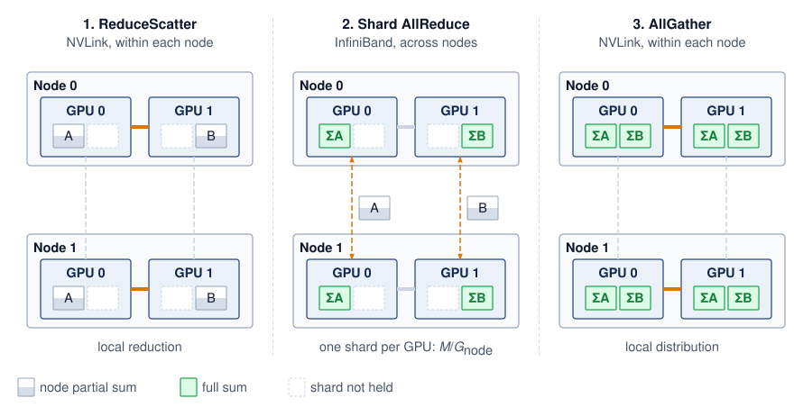

<!--
```{.tikz}
\begin{tikzpicture}[
    font=\small\sffamily,
    >=Stealth,
    panel/.style={
      draw=CanvasBorder,
      fill=CanvasBg,
      rounded corners=5pt,
      line width=0.6pt,
      inner sep=7pt
    },
    gpu box/.style={
      draw=BlueLine,
      fill=white,
      line width=0.85pt,
      rounded corners=3pt,
      minimum width=1.25cm,
      minimum height=1.15cm,
      align=center
    },
    leader box/.style={
      draw=OrangeLine,
      fill=OrangeFill!75,
      line width=1.1pt,
      rounded corners=3pt,
      minimum width=1.25cm,
      minimum height=1.15cm,
      align=center
    },
    step card/.style={
      draw=CanvasBorder,
      fill=white,
      rounded corners=3pt,
      line width=0.5pt,
      inner sep=5pt
    }
  ]

  % Define Layer Order
  \pgfdeclarelayer{background}
  \pgfsetlayers{background,main}

  % ========================================================
  % TOP LEGEND BAR
  % ========================================================
  \node[draw=BlueLine, fill=BlueFill, rounded corners=3pt, font=\scriptsize\bfseries, text=BlueLine, inner sep=4pt] at (2.2, 8.4)
    {Step 1: Intra-Node ReduceScatter};
  \node[draw=OrangeLine, fill=OrangeFill, rounded corners=3pt, font=\scriptsize\bfseries, text=OrangeLine!90!black, inner sep=4pt] at (7.25, 8.4)
    {Step 2: Inter-Node AllReduce (Leaders)};
  \node[draw=GreenLine, fill=GreenFill, rounded corners=3pt, font=\scriptsize\bfseries, text=GreenLine, inner sep=4pt] at (12.3, 8.4)
    {Step 3: Intra-Node AllGather};

  % ========================================================
  % STEP 2 BRIDGE (OPTICAL SPINAL FABRIC)
  % ========================================================
  \node[draw=OrangeLine, fill=OrangeFill!50, rounded corners=3pt, line width=0.9pt, font=\footnotesize\bfseries, text=OrangeLine!90!black, inner sep=5pt] (bridge) at (5.0, 7.55)
    {Step 2: Optical Spine Fabric ($50\text{ GB/s} \cdot \frac{1}{G}\text{ Traffic}$)};

  % ========================================================
  % NODE 0 CONTAINER
  % ========================================================
  \begin{scope}[shift={(0, 1.8)}, local bounding box=node0]
    % Header
    \node[anchor=west, font=\bfseries\small, text=TextDark] at (0, 4.9) {Node 0 (8-GPU Chassis)};
    \node[anchor=east, font=\scriptsize\bfseries, text=BlueLine] at (6.8, 4.9) {NVLink 4.0 Mesh};

    % GPUs
    \node[leader box] (g0) at (1.15, 3.65) {\textbf{G0}\\[1pt]\scriptsize\color{OrangeLine!90!black}\textbf{Leader}};
    \node[gpu box, right=0.35cm of g0] (g1) {\textbf{G1}\\[1pt]\tiny\color{TextMuted}Rank 1};
    \node[gpu box, right=0.35cm of g1] (g2) {\textbf{G2}\\[1pt]\tiny\color{TextMuted}Rank 2};
    \node[gpu box, right=0.35cm of g2] (g3) {\textbf{G3}\\[1pt]\tiny\color{TextMuted}Rank 3};

    % Ring links
    \draw[->, BlueLine, line width=1.1pt] (g0.east) -- (g1.west);
    \draw[->, BlueLine, line width=1.1pt] (g1.east) -- (g2.west);
    \draw[->, BlueLine, line width=1.1pt] (g2.east) -- (g3.west);
    \draw[->, BlueLine, line width=1.1pt, rounded corners=3pt] (g3.south) -- ++(0, -0.32) -| (g0.south);

    \node[font=\tiny\bfseries, text=BlueLine] at ($(g1.south)!0.5!(g2.south) - (0, 0.44)$) {Intra-Node NVLink Ring (900 GB/s)};

    % Step 1 Card
    \node[step card, anchor=north west, minimum width=6.6cm] at (0.1, 2.35) {
      \begin{minipage}{6.4cm}
        \textbf{\scriptsize Step 1: Intra-Node ReduceScatter}\\[1pt]
        \tiny Ranks $0 \dots 7$ reduce partial gradients over 900 GB/s NVLink. G0 accumulates the fully reduced slice for rank index 0.
      \end{minipage}
    };

    % Step 3 Card
    \node[step card, anchor=north west, minimum width=6.6cm] at (0.1, 1.30) {
      \begin{minipage}{6.4cm}
        \textbf{\scriptsize\color{GreenLine} Step 3: Intra-Node AllGather}\\[1pt]
        \tiny\color{GreenLine!80!black} G0 receives global aggregate from optical fabric and broadcasts via NVLink AllGather to ranks $1 \dots 7$.
      \end{minipage}
    };
  \end{scope}

  \begin{pgfonlayer}{background}
    \node[panel, fit=(node0)] (p_node0) {};
  \end{pgfonlayer}

  % ========================================================
  % NODE 1 CONTAINER
  % ========================================================
  \begin{scope}[shift={(7.4, 1.8)}, local bounding box=node1]
    % Header
    \node[anchor=west, font=\bfseries\small, text=TextDark] at (0, 4.9) {Node 1 (8-GPU Chassis)};
    \node[anchor=east, font=\scriptsize\bfseries, text=BlueLine] at (6.8, 4.9) {NVLink 4.0 Mesh};

    % GPUs
    \node[leader box] (g4) at (1.15, 3.65) {\textbf{G4}\\[1pt]\scriptsize\color{OrangeLine!90!black}\textbf{Leader}};
    \node[gpu box, right=0.35cm of g4] (g5) {\textbf{G5}\\[1pt]\tiny\color{TextMuted}Rank 5};
    \node[gpu box, right=0.35cm of g5] (g6) {\textbf{G6}\\[1pt]\tiny\color{TextMuted}Rank 6};
    \node[gpu box, right=0.35cm of g6] (g7) {\textbf{G7}\\[1pt]\tiny\color{TextMuted}Rank 7};

    % Ring links
    \draw[->, BlueLine, line width=1.1pt] (g4.east) -- (g5.west);
    \draw[->, BlueLine, line width=1.1pt] (g5.east) -- (g6.west);
    \draw[->, BlueLine, line width=1.1pt] (g6.east) -- (g7.west);
    \draw[->, BlueLine, line width=1.1pt, rounded corners=3pt] (g7.south) -- ++(0, -0.32) -| (g4.south);

    \node[font=\tiny\bfseries, text=BlueLine] at ($(g5.south)!0.5!(g6.south) - (0, 0.44)$) {Intra-Node NVLink Ring (900 GB/s)};

    % Step 1 Card
    \node[step card, anchor=north west, minimum width=6.6cm] at (0.1, 2.35) {
      \begin{minipage}{6.4cm}
        \textbf{\scriptsize Step 1: Intra-Node ReduceScatter}\\[1pt]
        \tiny Ranks $4 \dots 7$ reduce partial gradients over 900 GB/s NVLink. G4 accumulates the fully reduced slice for rank index 4.
      \end{minipage}
    };

    % Step 3 Card
    \node[step card, anchor=north west, minimum width=6.6cm] at (0.1, 1.30) {
      \begin{minipage}{6.4cm}
        \textbf{\scriptsize\color{GreenLine} Step 3: Intra-Node AllGather}\\[1pt]
        \tiny\color{GreenLine!80!black} G4 receives global aggregate from optical fabric and broadcasts via NVLink AllGather to ranks $5 \dots 7$.
      \end{minipage}
    };
  \end{scope}

  \begin{pgfonlayer}{background}
    \node[panel, fit=(node1)] (p_node1) {};
  \end{pgfonlayer}

  % Bridge connections: route up from the top edge of node0/node1 above G0/G4
  \draw[<->, draw=OrangeLine, line width=1.3pt, dashed]
    (g0.north |- p_node0.north) -- ++(0, 0.5) -| (bridge.west);
  \draw[<->, draw=OrangeLine, line width=1.3pt, dashed]
    (bridge.east) -| (g4.north |- p_node1.north);

  % ========================================================
  % BOTTOM ANALYTICAL PERFORMANCE CARD
  % ========================================================
  \begin{scope}[shift={(0, -1.9)}, local bounding box=boxCard]
    \node[anchor=north west, font=\normalsize\bfseries, text=TextDark] at (0.1, 3.4)
      {Hierarchical Traffic Scaling Advantage ($18\times$ Bandwidth Multiplier)};

    % Bar 1: NVLink
    \draw[fill=OrangeFill, draw=OrangeLine, line width=0.8pt, rounded corners=2pt]
      (0.1, 2.4) rectangle (9.2, 2.8);
    \node[anchor=west, font=\scriptsize\bfseries, text=OrangeLine!90!black] at (0.3, 2.6)
      {Intra-Node NVLink 4.0: 900 GB/s Bidirectional};

    % Bar 2: InfiniBand
    \draw[fill=VioletFill, draw=VioletLine, line width=0.8pt, rounded corners=2pt]
      (0.1, 1.85) rectangle (1.4, 2.25);
    \node[anchor=west, font=\scriptsize\bfseries, text=VioletLine] at (1.55, 2.05)
      {InfiniBand NDR: 50 GB/s per port (400 Gb/s)};

    % Red Callout Gap Badge
    \node[draw=RedLine, fill=RedFill, line width=1.1pt, rounded corners=4pt, align=center, inner sep=6pt] at (12.3, 2.32) {
      \textbf{\large\color{RedLine} 18$\times$}\\[-2pt]
      \scriptsize\bfseries\color{RedLine} Bandwidth Gap
    };

    % Explanatory text
    \node[anchor=north west, text width=14.0cm, font=\footnotesize, text=TextDark] at (0.1, 1.6) {
      \textbf{Traffic Elimination Law:} By completing the first reduction tier inside the node over 900 GB/s NVLink, inter-node traffic across optical switches drops by exactly $G\times$ ($8\times$), preventing bisection bandwidth exhaustion.\\[3pt]
      \textbf{\color{GreenLine}NCCL Runtime Invariant:} Multi-node communication runtimes automatically decompose process-group collectives into this 3-step hierarchical pipeline.
    };
  \end{scope}

  \begin{pgfonlayer}{background}
    \node[panel, fit=(boxCard)] {};
  \end{pgfonlayer}

\end{tikzpicture}
```
-->

:::

With $\AcceleratorsPerNode$ GPUs in each of $\ClusterNodeCount$ nodes, the three phases form a single causal pipeline. First, an intra-node ReduceScatter over NVLink performs a local reduction among the $\AcceleratorsPerNode$ GPUs in each node, leaving each GPU with a $1/\AcceleratorsPerNode$ shard of partially reduced data while consuming only abundant intra-node bandwidth. Next, each corresponding-rank group applies an inter-node AllReduce over InfiniBand to its $\CollectivePayloadSize/\AcceleratorsPerNode$-byte input shard, where the chosen collective algorithm dictates the bytes transmitted across the network fabric. Finally, an intra-node AllGather over NVLink redistributes the globally reduced shards within each node, completing the collective without consuming additional inter-node bandwidth.

Only Phase 2 (Shard AllReduce) loads the slower inter-node InfiniBand links (@fig-hierarchical-allreduce). In this middle phase, each corresponding-rank group reduces an $\CollectivePayloadSize/\AcceleratorsPerNode$-byte shard across $\ClusterNodeCount$ nodes. A ring in that group sends $2(\ClusterNodeCount-1)\CollectivePayloadSize/(\ClusterNodeCount\AcceleratorsPerNode)$ bytes per participating GPU and receives the same amount. Summing across the node's $\AcceleratorsPerNode$ GPUs gives $2(\ClusterNodeCount-1)\CollectivePayloadSize/\ClusterNodeCount$ bytes sent per node. Smaller per-port payloads improve elapsed time when the node has independent ports and sufficient fabric capacity; sharding does not create bandwidth on a shared uplink. An 8-node budget quantifies the bandwidth multiplier this decomposition provides when those ports operate in parallel.

```{python}
#| echo: false
#| label: hierarchical-allreduce-calc
# ┌─────────────────────────────────────────────────────────────────────────────
# │ HIERARCHICAL ALLREDUCE—8-NODE CLUSTER ANALYSIS
# ├─────────────────────────────────────────────────────────────────────────────
# │ Context: "The Hierarchical Bandwidth Multiplier" .callout-notebook
# │
# │ Goal: Compare flat Ring AllReduce vs. 3-step hierarchical AllReduce for a
# │       1 GB gradient on 8 nodes × 8 GPUs to quantify the speedup from
# │       exploiting NVLink vs. InfiniBand bandwidth hierarchy.
# │ Show: speedup_mult_str quantifies the hierarchical-vs-flat gain inline.
# │ How: Flat: T = 2M/β_IB; Hierarchical: T = T_rs + T_inter + T_ag with
# │      NVLink for intra-node phases and IB for inter-node phase.
# │
# └─────────────────────────────────────────────────────────────────────────────
from mlsysim.core.units import GB, MB, microsecond, ms, second
from mlsysim import Hardware, Systems
from mlsysim.fmt import check, fmt, fmt_bandwidth, fmt_count, fmt_int, fmt_memory, fmt_multiple, fmt_time
from mlsysim.physics import (
    calc_ring_allreduce_time,
    calc_ring_allreduce_latency_time,
    calc_ring_collective_data_factor,
)

class HierarchicalAllreduceCalc:
    """Flat vs. 3-step hierarchical AllReduce timing for a 1 GB gradient on 64 GPUs."""

    # ┌── 1. LOAD (Constants) ──────────────────────────────────────────────
    n_nodes_har = 8
    gpus_per_node = Systems.Nodes.DGX_H100.accelerators_per_node
    gradient = ReferenceStats.CollectiveCommunicationProfile.GradientBuffer  # chapter's 1 GB gradient buffer
    ib_bw = Systems.Fabrics.InfiniBand_NDR.bandwidth  # InfiniBand NDR 400 Gbps per port
    nvlink_bw = Hardware.Cloud.H100.nvlink.bandwidth  # NVLink 4.0 (H100), datasheet bidirectional (for display)
    nvlink_bw_beta = Hardware.Cloud.H100.nvlink.bandwidth_per_direction  # one-way rate for ring math
    ib_alpha = Systems.SwitchFabric.AlphaNdr  # canonical effective NDR launch latency

    # ┌── 2. EXECUTE (The Compute) ────────────────────────────────────────
    # Flat ring uses the deliberate ~2x simplification the prose math shows
    # (T = 2M/beta); the exact 2(N-1)/N factor appears in the inter-node step.
    flat_data = 2 * gradient  # bandwidth-optimal Ring sends ~2×
    flat_time = (flat_data / ib_bw).to(ms)

    intra_data = (gradient * calc_ring_collective_data_factor(gpus_per_node)).to(MB)  # ~875 MB
    intra_rs = (intra_data / nvlink_bw_beta).to(ms)

    inter_data = (gradient / gpus_per_node).to(MB)  # 125 MB
    inter_bw = calc_ring_allreduce_time(
        message_bytes=inter_data,
        n_gpus=n_nodes_har,
        bandwidth_bytes_s=ib_bw,
        latency_s=0 * second,
    ).to(ms)
    inter_lat = calc_ring_allreduce_latency_time(n_nodes_har, ib_alpha).to(ms)
    inter_time = inter_bw + inter_lat

    intra_ag = intra_rs  # symmetric

    hier_total = intra_rs + inter_time + intra_ag
    speedup = (flat_time / hier_total).to_base_units().magnitude

    # ┌── 3. GUARD (Invariants) ──────────────────────────────────────────
    check(speedup > 1.0, "Hierarchical should be faster than Flat AllReduce")
    check(abs(inter_time.to(ms).magnitude - 4.4) < 0.1, f"Inter-node time = {inter_time.to(ms).magnitude:.1f} ms, expected ~4.4")

    # ┌── 4. OUTPUT (Formatting) ─────────────────────────────────────────────
    flat_time_ms_str = fmt_time(flat_time, ms, precision=0, commas=False)
    intra_data_mb_str = fmt_memory(intra_data, unit=MB, precision=0, commas=False)
    intra_rs_ms_str = fmt_time(intra_rs, ms, precision=2, commas=False)
    inter_data_mb_str = fmt_memory(inter_data, unit=MB, precision=0, commas=False)
    inter_time_ms_str = fmt_time(inter_time, ms, precision=2, commas=False)
    intra_ag_ms_str = fmt_time(intra_ag, ms, precision=2, commas=False)
    hier_total_ms_str = fmt_time(hier_total, ms, precision=1, commas=False)
    ib_bw_gb_per_s_str = fmt_bandwidth(ib_bw, unit=GB / second, precision=0, commas=False)
    # per-direction rate (the beta that produced intra_rs); matches the
    # "sends X at <rate> -> time" worked lines below
    nvlink_bw_gb_per_s_str = fmt_bandwidth(nvlink_bw_beta, unit=GB / second, precision=0, commas=False)
    speedup_mult_str = fmt_multiple(speedup, precision=1, commas=False)
    n_nodes_str = fmt_count(n_nodes_har, commas=False, label="node")
    gpus_per_node_str = fmt_count(gpus_per_node, commas=False, label="GPU")
    n_gpus_total_str = fmt(n_nodes_har * gpus_per_node, precision=0, commas=False)
    gradient_gb_str = fmt_memory(gradient, unit=GB, precision=0, commas=False)
    flat_send_gb_str = fmt_memory(flat_data, unit=GB, precision=0, commas=False)
    # Worked-line operand spans for the flat-ring time and the inter-node shard:
    # 2 . M / beta_IB, and M / G (GPUs per node).
    from mlsysim.fmt import fmt_math

    _grad_gb = int(gradient.to(GB).magnitude)
    _ib_gbs = int(ib_bw.to(GB / second).magnitude)
    flat_time_sub_math = fmt_math(rf"2 \times {_grad_gb}\ \text{{GB}} / {_ib_gbs}\ \text{{GB/s}}")
    inter_data_sub_math = fmt_math(rf"{_grad_gb}\ \text{{GB}}/{gpus_per_node}")
```

::: {#nbk-collective-communication-hierarchical-bandwidth-multiplier .callout-notebook title="The hierarchical bandwidth multiplier"}

**Problem**: A cluster has `{python} HierarchicalAllreduceCalc.n_nodes_str`, each with `{python} HierarchicalAllreduceCalc.gpus_per_node_str` (`{python} HierarchicalAllreduceCalc.n_gpus_total_str` total). The system must AllReduce the chapter's `{python} HierarchicalAllreduceCalc.gradient_gb_str` reference buffer. Assume each GPU has its own full-rate inter-node port, one rail per GPU as on a DGX H100 (rails are the subject of @sec-collective-communication-railoptimized-routing-nvidia-dgx-7081), with no oversubscription. The flat baseline is a single ring over all `{python} HierarchicalAllreduceCalc.n_gpus_total_str` ranks. How much faster is Hierarchical AllReduce than that flat ring?

**Flat ring AllReduce (ignoring hierarchy)**:

- Each GPU sends ~`{python} HierarchicalAllreduceCalc.flat_send_gb_str` total (the bandwidth-optimal Ring AllReduce formula).
- Every edge of a ring carries the same traffic in every step, so the whole ring advances at the rate of its slowest edge. Every ordering puts at least one fabric-crossing edge on each node, even the node-contiguous ordering that crosses the fabric only once per node.
- **Effective Bandwidth**\index{Bandwidth!effective}: Limited by the slowest link = `{python} HierarchicalAllreduceCalc.ib_bw_gb_per_s_str` (InfiniBand).
- **Time**: $\approx$ `{python} HierarchicalAllreduceCalc.flat_time_sub_math` = `{python} HierarchicalAllreduceCalc.flat_time_ms_str` (bandwidth term dominates).

**Hierarchical AllReduce (3-step decomposition)**:

1. **Intra-node ReduceScatter**: Each GPU sends `{python} HierarchicalAllreduceCalc.intra_data_mb_str` at `{python} HierarchicalAllreduceCalc.nvlink_bw_gb_per_s_str` per direction → ~`{python} HierarchicalAllreduceCalc.intra_rs_ms_str`
2. **Inter-Node AllReduce**\index{AllReduce!inter-node}: Each GPU AllReduces a `{python} HierarchicalAllreduceCalc.inter_data_sub_math` = `{python} HierarchicalAllreduceCalc.inter_data_mb_str` shard over InfiniBand; Ring moves roughly $2(\ClusterNodeCount-1)/\ClusterNodeCount$ times that payload, and after adding the small latency term the phase takes ~`{python} HierarchicalAllreduceCalc.inter_time_ms_str` at `{python} HierarchicalAllreduceCalc.ib_bw_gb_per_s_str`

   (The eight shard groups run concurrently, each on its own GPU's port, so the node's eight ports together carry the full payload in parallel.)

3. **Intra-node AllGather**: Each GPU receives `{python} HierarchicalAllreduceCalc.intra_data_mb_str` at `{python} HierarchicalAllreduceCalc.nvlink_bw_gb_per_s_str` per direction → ~`{python} HierarchicalAllreduceCalc.intra_ag_ms_str`
4. **Total time**: $\approx$ `{python} HierarchicalAllreduceCalc.intra_rs_ms_str` + `{python} HierarchicalAllreduceCalc.inter_time_ms_str` + `{python} HierarchicalAllreduceCalc.intra_ag_ms_str` = `{python} HierarchicalAllreduceCalc.hier_total_ms_str`

**Systems insight**: Hierarchical AllReduce achieves a `{python} HierarchicalAllreduceCalc.speedup_mult_str` speedup\index{Hierarchical AllReduce!bandwidth multiplier} by reducing the inter-node payload from `{python} HierarchicalAllreduceCalc.gradient_gb_str` to `{python} HierarchicalAllreduceCalc.inter_data_mb_str` per GPU before the Ring traffic multiplier. The flat ring used one port's worth of fabric bandwidth because a single ring runs at its slowest edge; the hierarchical schedule uses all eight ports at once. That is also its precondition, since a node whose GPUs shared one uplink would carry the eight shard streams one after another and lose most of the speedup. This is why NVIDIA's NCCL and similar libraries often select hierarchical algorithms on multi-node clusters when the topology supports them.

:::

```{python}
#| echo: false
#| label: archetype-a-hierarchical-calc
# ┌─────────────────────────────────────────────────────────────────────────────
# │ ARCHETYPE A ON THE REFERENCE CLUSTER: FLAT VS. HIERARCHICAL ALLREDUCE
# ├─────────────────────────────────────────────────────────────────────────────
# │ Context: paragraph after the 8-node hierarchical notebook in
# │          @sec-communication-collective-operations-collective-operations-hierarchical-allreduce-1338
# │
# │ Goal: Price the volume's running instance (175B, BF16 gradient) on the
# │       1,024-GPU reference cluster (128 DGX H100 nodes of 8) with the same
# │       three-phase hierarchical schedule, against a single flat ring.
# │ Show: 350 GB gradient; flat ring ~14.0 s; hierarchical ~3.1 s; ~4.5x.
# │ How: Same alpha-beta phase model as the 8-node notebook; workload and cluster
# │      from Scenarios.DenseLLMPretrainingReference.
# │
# └─────────────────────────────────────────────────────────────────────────────
from mlsysim import Hardware, Scenarios, Systems
from mlsysim.core.units import BYTES_FP16, GB, ms, second
from mlsysim.fmt import check, fmt, fmt_count, fmt_memory, fmt_multiple, fmt_params, fmt_time
from mlsysim.physics import calc_ring_allreduce_time, calc_ring_collective_data_factor

class ArchetypeAHierarchical:
    """Flat vs. hierarchical Ring AllReduce for the 175B instance on 1,024 H100s."""

    # ┌── 1. LOAD (Constants) ──────────────────────────────────────────────
    scenario = Scenarios.DenseLLMPretrainingReference
    params = scenario.workload.parameters
    gradient = scenario.workload.size_in_bytes(BYTES_FP16).to(GB)  # BF16 gradient
    n_gpus = scenario.system.total_accelerators
    n_nodes = scenario.system.count
    gpus_per_node = scenario.system.node.accelerators_per_node
    nvlink_bw = Hardware.Cloud.H100.nvlink.bandwidth_per_direction  # one-way beta
    ib_bw = Systems.Fabrics.InfiniBand_NDR.bandwidth  # one NDR port per GPU
    ib_alpha = Systems.SwitchFabric.AlphaNdr  # canonical effective NDR launch latency

    # ┌── 2. EXECUTE (The Compute) ────────────────────────────────────────
    intra_rs = (gradient * calc_ring_collective_data_factor(gpus_per_node) / nvlink_bw).to(ms)
    inter = calc_ring_allreduce_time(message_bytes=gradient / gpus_per_node, n_gpus=n_nodes, bandwidth_bytes_s=ib_bw, latency_s=ib_alpha).to(ms)
    hier_total = intra_rs + inter + intra_rs  # ReduceScatter, shard AllReduce, AllGather
    flat_total = calc_ring_allreduce_time(message_bytes=gradient, n_gpus=n_gpus, bandwidth_bytes_s=ib_bw, latency_s=ib_alpha).to(ms)
    speedup = (flat_total / hier_total).to_base_units().magnitude

    # ┌── 3. GUARD (Invariants) ──────────────────────────────────────────
    check(n_gpus == 1024 and n_nodes == 128 and gpus_per_node == 8, "Reference cluster should be 128 nodes of 8 GPUs")
    check(abs(gradient.to(GB).magnitude - 350) < 1, f"175B BF16 gradient should be ~350 GB, got {gradient}")
    check(4 < speedup < 5, f"Hierarchical speedup {speedup:.2f} outside the range the prose describes")

    # ┌── 4. OUTPUT (Formatting) ─────────────────────────────────────────────
    params_b_str = fmt_params(params, scale="B", precision=0, commas=False)
    gradient_gb_str = fmt_memory(gradient, unit=GB, precision=0, commas=False)
    n_gpus_str = fmt_count(n_gpus, commas=True, label="GPU")
    n_nodes_str = fmt_count(n_nodes, commas=False, label="node")
    gpus_per_node_str = fmt(gpus_per_node, precision=0, commas=False)
    flat_total_s_str = fmt_time(flat_total, second, precision=1, commas=False)
    hier_total_s_str = fmt_time(hier_total, second, precision=1, commas=False)
    inter_s_str = fmt_time(inter, second, precision=1, commas=False)
    speedup_mult_str = fmt_multiple(speedup, precision=1, commas=False)
```

The volume's running instance makes the same comparison on the cluster it was defined for. Archetype A's `{python} ArchetypeAHierarchical.params_b_str`-parameter model produces a `{python} ArchetypeAHierarchical.gradient_gb_str` BF16 gradient, and the reference cluster holds `{python} ArchetypeAHierarchical.n_gpus_str` as `{python} ArchetypeAHierarchical.n_nodes_str` of `{python} ArchetypeAHierarchical.gpus_per_node_str`. A single flat ring over every GPU would spend about `{python} ArchetypeAHierarchical.flat_total_s_str` per full-gradient reduction. The hierarchical schedule sends one-eighth of the gradient through each GPU's port in a shard ring that spans every node and completes in about `{python} ArchetypeAHierarchical.hier_total_s_str`, a `{python} ArchetypeAHierarchical.speedup_mult_str` improvement. The cross-node phase still accounts for about `{python} ArchetypeAHierarchical.inter_s_str` of that time. Seconds per step remain a large exposed cost even after hierarchy. That is why the production layout for this instance shards the model so that each data-parallel group reduces a fraction of this payload. It is also why the overlap and compression techniques later in the chapter still matter at this scale.

```{python}
#| echo: false
#| label: three-tier-hierarchy-calc
# ┌─────────────────────────────────────────────────────────────────────────────
# │ THREE-TIER HIERARCHY: RACK-LOCAL REDUCESCATTER SHARE
# ├─────────────────────────────────────────────────────────────────────────────
# │ Context: @sec-communication-collective-operations-collective-operations-hierarchical-allreduce-1338,
# │          the paragraph that extends the three phases to a rack tier.
# │
# │ Goal: Show how much a rack-local ReduceScatter shrinks each GPU's payload
# │       before the slowest (cross-rack) phase.
# │ Show: 4 racks x 4 nodes x 8 GPUs = 128 GPUs; 32 GPUs per rack; 1/32 share.
# │ How: products of the stated tier sizes.
# │
# └─────────────────────────────────────────────────────────────────────────────
from mlsysim.fmt import check, fmt, fmt_math

class ThreeTierHierarchy:
    # ┌── 1. LOAD ──────────────────────────────────────────
    n_racks = 4  # scenario assumption
    nodes_per_rack = 4  # scenario assumption
    gpus_per_node = ArchetypeAHierarchical.gpus_per_node  # reference node size
    # ┌── 2. EXECUTE ───────────────────────────────────────
    gpus_per_rack = nodes_per_rack * gpus_per_node
    total_gpus = n_racks * gpus_per_rack
    # ┌── 3. GUARD ─────────────────────────────────────────
    check(total_gpus == n_racks * nodes_per_rack * gpus_per_node, "Tier product mismatch")
    check(gpus_per_rack > gpus_per_node, "Rack tier should span more than one node")
    # ┌── 4. OUTPUT ────────────────────────────────────────
    n_racks_str = fmt(n_racks, precision=0, commas=False)
    nodes_per_rack_str = fmt(nodes_per_rack, precision=0, commas=False)
    gpus_per_node_str = fmt(gpus_per_node, precision=0, commas=False)
    total_gpus_str = fmt(total_gpus, precision=0, commas=True)
    gpus_per_rack_str = fmt(gpus_per_rack, precision=0, commas=False)
    rack_share_math = fmt_math(rf"1/{gpus_per_rack}")
```

These three phases also generalize to additional fabric tiers. For example, `{python} ThreeTierHierarchy.n_racks_str` racks of `{python} ThreeTierHierarchy.nodes_per_rack_str` nodes with `{python} ThreeTierHierarchy.gpus_per_node_str` GPUs per node contain `{python} ThreeTierHierarchy.total_gpus_str` GPUs. A rack-local ReduceScatter over `{python} ThreeTierHierarchy.gpus_per_rack_str` GPUs can leave each GPU with `{python} ThreeTierHierarchy.rack_share_math` of the original payload for the cross-rack phase. The total elapsed time still includes both local phases, the cross-rack collective's traffic factor, startup, and contention. A cross-rack oversubscription ratio alone cannot determine a speedup over a flat ring.

### Multidimensional reduction on a torus {#sec-collective-communication-torus-topology-tpu-pods-68b2}

Hierarchy fits a fabric whose tiers differ in speed. A torus, the direct-connect topology of Google's Tensor Processing Unit (TPU)\index{TPU} pods, has uniform links instead, and its collectives reduce along one dimension at a time. TPU v4 pods support a 3D torus topology\index{Torus topology}\index{TPU!torus interconnect}, unlike the 2D torus used by TPU v2 and v3. In the regular 3D torus model, each chip links directly to six neighbors $(\pm \Glyph{X}, \pm \Glyph{Y}, \pm \Glyph{Z})$ with equal per-link bandwidth. For collectives, the torus invites dimension-ordered reduction\index{Dimension-ordered reduction}, which decomposes the AllReduce into sequential Ring AllReduces along axis-aligned torus rings. For a pod with $\TorusFirstAxisChipCount{\times}\TorusSecondAxisChipCount{\times}\TorusThirdAxisChipCount$ chips, ranks first execute independent X-dimension rings for each fixed $(\Glyph{Y},\Glyph{Z})$ coordinate, producing partial sums along each X line. A second phase runs Y-dimension rings to combine those partials across the $\Glyph{X} \times \Glyph{Y}$ plane. A third phase executes Z-dimension rings across fixed $(\Glyph{X},\Glyph{Y})$ coordinates to complete the global reduction.

::: {.column-margin .margin-pointer}
↩ The torus topology and its bisection and path-length trade-offs against the fat-tree are established in @sec-network-fabrics-dragonfly.
:::

```{python}
#| echo: false
#| label: torus-round-counts-calc
# ┌─────────────────────────────────────────────────────────────────────────────
# │ 2D TORUS DIMENSION-ORDERED ROUNDS VS. A FLAT RING
# ├─────────────────────────────────────────────────────────────────────────────
# │ Context: @sec-collective-communication-torus-topology-tpu-pods-68b2, the
# │          paragraph that walks @fig-torus-reduction.
# │
# │ Goal: Count the startup rounds the dimension-ordered schedule saves on the
# │       grid the figure draws.
# │ Show: 4 x 4 grid = 16 ranks; 6 rounds per axis; 12 vs. 30; 2.5x fewer.
# │ How: ring rounds 2(n-1) per axis and 2(N-1) for the flat ring.
# │      The SVG draws a fixed 4 x 4 grid (12 vs. 30 blocks); the guard keeps
# │      the prose on the figure's grid.
# │
# └─────────────────────────────────────────────────────────────────────────────
from mlsysim.fmt import check, fmt, fmt_math, fmt_multiple
from mlsysim.physics import calc_ring_allreduce_latency_steps

class TorusRoundCounts:
    # ┌── 1. LOAD ──────────────────────────────────────────
    x_ranks = 4  # figure grid, X axis
    y_ranks = 4  # figure grid, Y axis
    # ┌── 2. EXECUTE ───────────────────────────────────────
    n_ranks = x_ranks * y_ranks
    x_rounds = calc_ring_allreduce_latency_steps(x_ranks)
    y_rounds = calc_ring_allreduce_latency_steps(y_ranks)
    torus_rounds = x_rounds + y_rounds
    flat_rounds = calc_ring_allreduce_latency_steps(n_ranks)
    reduction = flat_rounds / torus_rounds
    # ┌── 3. GUARD ─────────────────────────────────────────
    check((x_ranks, y_ranks) == (4, 4), "@fig-torus-reduction draws a 4 x 4 grid; redraw the SVG before changing it")
    check(torus_rounds == 12 and flat_rounds == 30, "Round counts must match the figure's 12 and 30 blocks")
    # ┌── 4. OUTPUT ────────────────────────────────────────
    grid_math = fmt_math(rf"{x_ranks}{{\times}}{y_ranks}")
    n_ranks_str = fmt(n_ranks, precision=0, commas=False)
    x_ranks_str = fmt(x_ranks, precision=0, commas=False)
    y_ranks_str = fmt(y_ranks, precision=0, commas=False)
    x_rounds_math = fmt_math(rf"2(\TorusFirstAxisChipCount-1) = {x_rounds}")
    y_rounds_math = fmt_math(rf"2(\TorusSecondAxisChipCount-1) = {y_rounds}")
    flat_rounds_math = fmt_math(rf"2(\DeviceCount-1) = {flat_rounds}")
    torus_rounds_math = fmt_math(rf"2(\TorusFirstAxisChipCount-1) + 2(\TorusSecondAxisChipCount-1) = {torus_rounds}")
    reduction_mult_str = fmt_multiple(reduction, precision=1, commas=False)
```

On a `{python} TorusRoundCounts.grid_math` 2D torus grid of `{python} TorusRoundCounts.n_ranks_str` ranks, the dimension-ordered schedule runs in two phases (@fig-torus-reduction)\index{Torus topology!dimension-ordered reduction}. In Phase 1 (orange solid paths), each row executes an independent `{python} TorusRoundCounts.x_ranks_str`-rank Ring AllReduce across the horizontal X dimension using dashed wrap-around boundary links to close the ring (`{python} TorusRoundCounts.x_rounds_math` steps). Once row partial sums are established, Phase 2 (slate solid paths) executes orthogonal `{python} TorusRoundCounts.y_ranks_str`-rank vertical Ring AllReduces down the Y dimension (`{python} TorusRoundCounts.y_rounds_math` steps). These phases use direct nearest-neighbor links without multi-hop routing within a logical ring edge. They reduce the startup count from `{python} TorusRoundCounts.flat_rounds_math` rounds on a flat `{python} TorusRoundCounts.n_ranks_str`-rank ring to `{python} TorusRoundCounts.torus_rounds_math` rounds, a `{python} TorusRoundCounts.reduction_mult_str` reduction in the modeled startup term. In this simple form each axis still processes the full message, so the round-count saving comes at a byte cost that the partitioned dimension-wise schedule removes.

::: {#fig-torus-reduction fig-env="figure" fig-pos="htb" fig-cap="**Dimension-Ordered Reduction on a Torus Topology**: In a 2D torus mesh ($4 \times 4$ node grid representing a simplified TPU pod slice), AllReduce proceeds sequentially along orthogonal dimensions. Phase 1 (orange) executes four parallel horizontal rings across the X dimension ($2(\TorusFirstAxisChipCount-1) = 6$ steps). Phase 2 (slate) then executes four parallel vertical rings across the Y dimension ($2(\TorusSecondAxisChipCount-1) = 6$ steps) on the row-aggregated partial sums. Dashed stubs mark the torus wrap-around links, each leaving one edge of the grid and re-entering at the opposite edge. This dimension-ordered decomposition needs 12 startup rounds against 30 for a 16-rank 1D global ring, a $2.5\times$ reduction, but each axis processes the full message, so its bandwidth time is $3\CollectivePayloadSize/\LinkBandwidth$ for this grid." fig-alt="Two 4 by 4 grids of nodes with x and y indices 0 to 3. Panel a, Phase 1: horizontal links in each row are amber arrows with dashed wrap-around stubs at both row ends, vertical links are light gray, and every node is a quarter-filled row partial sum. Panel b, Phase 2: vertical links in each column are slate arrows with dashed wrap-around stubs, horizontal links are light gray, and every node is green. Below, a strip of 12 blocks, six amber and six slate, labeled 12 startup rounds for the 2D torus sits above a strip of 30 gray blocks for a 1D ring, drawn to the same scale."}
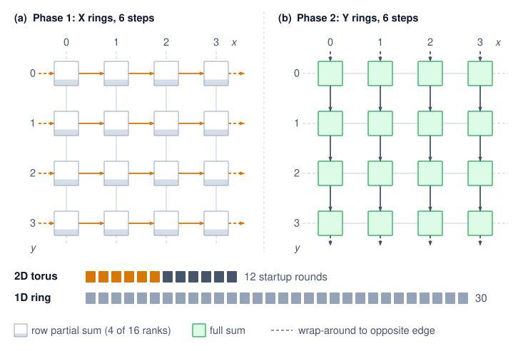{width=85%}

<!--
```{.tikz}
\begin{tikzpicture}[
  font=\small\sffamily,
  >=Stealth,
  node box/.style={
    rectangle,
    rounded corners=3pt,
    draw=SteelBlue,
    fill=white,
    line width=0.85pt,
    align=center,
    inner sep=3pt,
    font=\footnotesize,
    minimum width=1.25cm,
    minimum height=0.95cm
  },
  card/.style={
    rectangle,
    rounded corners=4pt,
    line width=0.7pt,
    inner sep=6pt,
    font=\footnotesize,
    text width=6.2cm,
    align=left
  },
  badge/.style={
    rectangle,
    rounded corners=2pt,
    draw=DarkGreen!60,
    fill=GreenFill,
    text=DarkGreen,
    font=\scriptsize\bfseries,
    inner sep=3pt,
    align=center
  }
]

% 4x4 Torus Grid (x: 1.0, 2.7, 4.4, 6.1; y: 5.8, 4.2, 2.6, 1.0)
\foreach \x/\col in {1.0/0, 2.7/1, 4.4/2, 6.1/3} {
  \foreach \y/\row in {5.8/0, 4.2/1, 2.6/2, 1.0/3} {
    \pgfmathtruncatemacro{\rank}{\row*4 + \col}
    \node[node box] (n_\col_\row) at (\x, \y) {\textbf{Node(\col,\row)}\\[1.5pt]\scriptsize\textcolor{TextMuted}{rank \rank}};
  }
}

% Direct Horizontal Arrows (Phase 1 - Orange)
\foreach \row in {0, 1, 2, 3} {
  \draw[->, very thick, OrangeLine] (n_0_\row.east) -- (n_1_\row.west);
  \draw[->, very thick, OrangeLine] (n_1_\row.east) -- (n_2_\row.west);
  \draw[->, very thick, OrangeLine] (n_2_\row.east) -- (n_3_\row.west);
}

% Direct Vertical Arrows (Phase 2 - Violet)
\foreach \col in {0, 1, 2, 3} {
  \draw[->, very thick, VioletLine] (n_\col_0.south) -- (n_\col_1.north);
  \draw[->, very thick, VioletLine] (n_\col_1.south) -- (n_\col_2.north);
  \draw[->, very thick, VioletLine] (n_\col_2.south) -- (n_\col_3.north);
}

% Wrap-around Horizontal Links (Phase 1 - Dashed Orange)
\foreach \row in {0, 1, 2, 3} {
  \draw[->, thick, dashed, OrangeLine]
    (n_3_\row.east) -- ++(0.35,0) -- ++(0, 0.58)
    -- ($(n_0_\row.west)+(-0.35, 0.58)$) -- ++(0, -0.58)
    -- (n_0_\row.west);
}

% Wrap-around Vertical Links (Phase 2 - Dashed Violet)
\foreach \col in {0, 1, 2, 3} {
  \draw[->, thick, dashed, VioletLine]
    (n_\col_3.south) -- ++(0, -0.35)
    -- ++(-0.85, 0)
    -- ($(n_\col_0.north)+(-0.85, 0.38)$)
    -- ++(0.85, 0)
    -- (n_\col_0.north);
}

% Right Side Cards
% Card 1: Phase 1
\node[card, draw=OrangeLine!80, fill=OrangeL] (card1) at (11.0, 6.30) {
  \textbf{\large\textcolor{OrangeLine}{Phase 1: X-Dimension Rings}}\\[2pt]
  \small Ring AllReduce along each row in parallel.\\[3pt]
  \scriptsize\textbf{Topology:} 4 rings parallel \hfill \textbf{Steps:} $2(X{-}1) = 6$
};

% Card 2: Phase 2
\node[card, draw=VioletLine!80, fill=VioletL] (card2) at (11.0, 3.90) {
  \textbf{\large\textcolor{VioletLine}{Phase 2: Y-Dimension Rings}}\\[2pt]
  \small Ring AllReduce along each column in parallel.\\[3pt]
  \scriptsize\textbf{Topology:} 4 rings parallel \hfill \textbf{Steps:} $2(Y{-}1) = 6$
};

% Card 3: Latency & Step Complexity
\node[card, draw=CardBorder, fill=CardFill] (card3) at (11.0, 1.20) {
  \textbf{\normalsize Latency \& Step Complexity}\\[3pt]
  % \scriptsize and tight math: at \footnotesize the second row was wider than
  % the 6.2cm card and spilled past its border.
  \scriptsize
  \begin{tabular}{@{}ll@{}}
    1D Global Ring ($N = 16$): & \textbf{\textcolor{RedLine}{30 steps}} \\[2pt]
    2D Torus $4\times4$ ($2(X{-}1)+2(Y{-}1)$): & \textbf{\textcolor{DarkGreen}{12 steps}} \\
  \end{tabular}\\[4pt]
  \centering
  \tikz\node[badge, minimum width=5.8cm] {\textbf{2.5$\times$ Step Latency Reduction}};
};

% Card 4: Bandwidth Invariant
\node[card, draw=CardBorder, fill=CardFill] (card4) at (11.0, -1.26) {
  \textbf{\normalsize Bandwidth Volume Invariant}\\[2pt]
  \small$\text{Total volume} = 2 \times \frac{N-1}{N} \times M \approx \frac{2M}{\beta}$\\[2pt]
  \scriptsize\textcolor{TextMuted}{Identical link utilization to a flat ring}
};

% Legend
\coordinate (legBase) at (7.8, -2.75);
\draw[very thick, OrangeLine] ($(legBase)+(0,0)$) -- ++(0.7,0)
  node[right, font=\scriptsize, text=TextDark] {Phase 1: X-dim horizontal ring};
\draw[very thick, VioletLine] ($(legBase)+(0,-0.35)$) -- ++(0.7,0)
  node[right, font=\scriptsize, text=TextDark] {Phase 2: Y-dim vertical ring};
\draw[thick, dashed, gray!80] ($(legBase)+(0,-0.70)$) -- ++(0.7,0)
  node[right, font=\scriptsize, text=TextDark] {Dashed: wrap-around torus boundary links};

\end{tikzpicture}
```
-->

:::

The byte term does not shrink with the rings. Because every axis processes the full $\CollectivePayloadSize$-byte tensor, the bandwidth time is $2\CollectivePayloadSize[(\TorusFirstAxisChipCount-1)/\TorusFirstAxisChipCount+ (\TorusSecondAxisChipCount-1)/\TorusSecondAxisChipCount+ (\TorusThirdAxisChipCount-1)/\TorusThirdAxisChipCount]/\LinkBandwidth$ for equal per-axis bandwidth $\LinkBandwidth$. The startup term is $2[(\TorusFirstAxisChipCount-1)+(\TorusSecondAxisChipCount-1)+(\TorusThirdAxisChipCount-1)]\MessageStartupLatency$. Shorter rings reduce startup cost, but these sequential full-message AllReduces do not retain the bandwidth cost of one global ring. A bandwidth-efficient multidimensional implementation instead partitions the work with dimension-wise ReduceScatter followed by reverse-order AllGather. The X-dimension ReduceScatter sends $\CollectivePayloadSize(\TorusFirstAxisChipCount-1)/\TorusFirstAxisChipCount$ bytes per rank and leaves each rank an $\CollectivePayloadSize/\TorusFirstAxisChipCount$ shard. The Y-dimension ReduceScatter then operates only on that shard and sends $(\CollectivePayloadSize/\TorusFirstAxisChipCount)(\TorusSecondAxisChipCount-1)/\TorusSecondAxisChipCount$. The Z dimension continues the pattern. The three terms telescope to $\CollectivePayloadSize(\DeviceCount-1)/\DeviceCount$ for $\DeviceCount= \TorusFirstAxisChipCount \TorusSecondAxisChipCount \TorusThirdAxisChipCount$. The mirrored AllGather doubles that to $2(\DeviceCount-1)\CollectivePayloadSize/\DeviceCount$, the ring's optimal byte term, while keeping the short rings' startup count. The torus thus teaches the same lesson as hierarchy, which is to shrink the payload before each successive stage rather than send the full tensor through every one.

Dimension-ordered reduction follows direct neighbor links and separates axis traffic in time; it does not change the network diameter or eliminate contention with other workloads. The torus topology also provides natural fault tolerance through alternate routing paths. If one link in the X-dimension fails, traffic can detour through the Y or Z dimensions (at the cost of increased latency). The compiler and collective runtime must choose a schedule for the actual topology, message size, and available links.

### In-network reduction with SHARP {#sec-communication-sharp}

Hierarchical and dimension-ordered schedules redistribute work across links, but their software reduction stages still require endpoint GPUs to receive and combine contributions. NVIDIA's Scalable Hierarchical Aggregation and Reduction Protocol (SHARP)\index{SHARP!in-network reduction}[^fn-sharp-innetwork-aggregation] moves that intermediate aggregation into the network. Instead of routing each partial sum through a GPU for arithmetic, an aggregation-capable InfiniBand switch combines contributions as packets pass through it.

A centralized endpoint reduction and in-switch aggregation send different data up the switch tree (@fig-sharp-innetwork)\index{In-network computing!switch aggregation}. In the endpoint tree of panel (a), intermediate switches merely forward raw packets, forcing all four full gradient tensors ($\LocalGradient_0$ through $\LocalGradient_3$) across the upper links into a single Reducer GPU that executes every addition. In panel (b), SHARP offloads arithmetic to aggregation-capable switch application-specific integrated circuits (ASICs)\index{ASIC}\index{Application-specific integrated circuit|see{ASIC}}: each intermediate switch computes partial sums ($\LocalGradient_0+\LocalGradient_1$ and $\LocalGradient_2+\LocalGradient_3$) in-flight, leaving only the combined shards for the root switch to finalize. Moving reduction into the network fabric halves the upper link traffic and relieves accelerator endpoints from coordinating arithmetic steps.

::: {#fig-sharp-innetwork fig-env="figure" fig-pos="htb" fig-cap="**Endpoint and In-Network Reduction**: The upstream half of a reduction over four GPUs. (a) Switches only forward packets, so every full gradient tensor crosses the upper links and converges on one reducer GPU, which does all the arithmetic. (b) Aggregation-capable switches add their inputs, so each upper link carries one partial sum and the root switch finishes the reduction; the result then travels back down the same tree. A software reduction tree also aggregates along its path, but performs arithmetic at endpoints rather than switches. The diagram compares where arithmetic happens, not measured speedup." fig-alt="Two panels, each a tree of four GPU cards at the bottom, two switches in the middle, and one box at the top, with arrows pointing upward and each GPU holding its gradient tile g0 to g3. Panel a: gray switches labeled forwards only each send two parallel arrows carrying separate tiles g0 and g1, or g2 and g3, to a blue Reducer GPU that adds all and holds the green full sum. Panel b: amber switches labeled adds each send one arrow carrying a single half-filled tile g0+g1 or g2+g3 to an amber root switch that adds and holds the green full sum."}
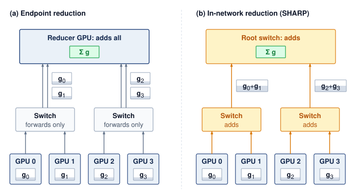{width=100%}

<!--
```{.tikz}
\begin{tikzpicture}[
  font=\small\sffamily,
  >=Stealth,
  header node/.style={
    font=\bfseries\normalsize,
    text=TextDark,
    align=center
  },
  subhdr node/.style={
    font=\scriptsize,
    text=TextMuted,
    align=center,
    text width=6.9cm
  },
  banner node/.style={
    rounded corners=3pt,
    inner sep=5pt,
    align=center,
    font=\footnotesize,
    text width=6.3cm,
    line width=0.6pt
  },
  gpu node/.style={
    rectangle,
    rounded corners=3pt,
    draw=SteelBlue,
    fill=white,
    line width=0.8pt,
    align=center,
    inner sep=3.5pt,
    font=\footnotesize,
    minimum width=1.35cm,
    minimum height=1.05cm
  },
  root node/.style={
    rectangle,
    rounded corners=3pt,
    line width=1pt,
    align=center,
    inner sep=5pt,
    font=\footnotesize,
    minimum width=3.4cm,
    minimum height=1.2cm
  },
  switch node/.style={
    rectangle,
    rounded corners=3pt,
    line width=0.8pt,
    align=center,
    inner sep=4pt,
    font=\footnotesize,
    minimum width=2.5cm,
    minimum height=1.2cm
  },
  badge node/.style={
    rectangle,
    rounded corners=2pt,
    fill=DarkGreen,
    text=white,
    font=\scriptsize\bfseries,
    inner sep=2.5pt,
    minimum width=2.1cm
  },
  footer node/.style={
    font=\scriptsize,
    text=TextMuted,
    align=center,
    text width=6.8cm
  }
]

% Left panel: (a) Standard Tree AllReduce
\node[header node, text=RedLine] (hdrA) at (3.65, 9.3) {(a) Standard Tree AllReduce};
\node[subhdr node] (subA) at (3.65, 8.85) {Full gradients traverse all switch tiers to Root GPU};

\node[banner node, draw=RedLine!80, fill=RedFill] (bannerA) at (3.65, 7.8) {
  \textbf{\textcolor{RedLine}{Bottleneck: Full Tensor Incast}}\\[1.5pt]
  All $N$ workers stream full tensors\\
  Root saturates at $N \times \text{Bandwidth}$
};

% Root GPU
\node[root node, draw=RedLine, fill=RedFill!60] (rootA) at (3.65, 5.75) {
  \textbf{\textcolor{RedLine}{Root GPU (Worker 0)}}\\[1.5pt]
  $\text{sum} = g_0 + g_1 + g_2 + g_3$\\[1.5pt]
  \textit{\scriptsize\textcolor{RedLine}{Compute \& PCIe Bottleneck}}
};

% Switches Level 1
\node[switch node, draw=SteelBlue!60, fill=LightBlue!70] (swA1) at (1.825, 3.3) {
  \textbf{Switch L1-A}\\[2pt]
  \scriptsize\textcolor{TextMuted}{Packet Forward Only}
};
\node[switch node, draw=SteelBlue!60, fill=LightBlue!70] (swA2) at (5.475, 3.3) {
  \textbf{Switch L1-B}\\[2pt]
  \scriptsize\textcolor{TextMuted}{Packet Forward Only}
};

% Leaf GPUs
\node[gpu node] (gA0) at (1.0, 1.0) {\textbf{GPU 0}\\[1.5pt]\scriptsize$\text{grad} = g_0$};
\node[gpu node] (gA1) at (2.65, 1.0) {\textbf{GPU 1}\\[1.5pt]\scriptsize$\text{grad} = g_1$};
\node[gpu node] (gA2) at (4.65, 1.0) {\textbf{GPU 2}\\[1.5pt]\scriptsize$\text{grad} = g_2$};
\node[gpu node] (gA3) at (6.3, 1.0) {\textbf{GPU 3}\\[1.5pt]\scriptsize$\text{grad} = g_3$};

% Connections Panel A
\draw[->, thick, RedLine] (gA0.north) -- (gA0.north |- swA1.south) node[midway, left=1pt, font=\scriptsize\bfseries] {$g_0\text{ (full)}$};
\draw[->, thick, RedLine] (gA1.north) -- (gA1.north |- swA1.south) node[midway, left=1pt, font=\scriptsize\bfseries] {$g_1\text{ (full)}$};
\draw[->, thick, RedLine] (gA2.north) -- (gA2.north |- swA2.south) node[midway, right=1pt, font=\scriptsize\bfseries] {$g_2\text{ (full)}$};
\draw[->, thick, RedLine] (gA3.north) -- (gA3.north |- swA2.south) node[midway, right=1pt, font=\scriptsize\bfseries] {$g_3\text{ (full)}$};

% Switch to Root (Upstream solid on outside, Downstream dashed on inside)
\draw[->, thick, RedLine] ($(swA1.north)-(0.25,0)$) -- ($(rootA.south)-(1.15,0)$)
  node[midway, left=2pt, font=\scriptsize\bfseries] {$g_0 + g_1$};
\draw[<-, thick, dashed, RedLine!70] ($(swA1.north)+(0.35,0)$) -- ($(rootA.south)-(0.45,0)$);

\draw[->, thick, RedLine] ($(swA2.north)+(0.25,0)$) -- ($(rootA.south)+(1.15,0)$)
  node[midway, right=2pt, font=\scriptsize\bfseries] {$g_2 + g_3$};
\draw[<-, thick, dashed, RedLine!70] ($(swA2.north)-(0.35,0)$) -- ($(rootA.south)+(0.45,0)$);

\node[footer node] at (3.65, 0.05) {Upstream: 4 full tensors. Downstream: 4 broadcast copies.};

% Divider
\draw[dashed, CardBorder!90, line width=0.8pt] (7.3, -0.25) -- (7.3, 9.6);

% Right panel: (b) SHARP In-Network Reduction
\node[header node, text=DarkGreen] (hdrB) at (10.95, 9.3) {(b) SHARP In-Network Reduction};
\node[subhdr node] (subB) at (10.95, 8.85) {Switch ASICs reduce inline; only aggregates go up};

\node[banner node, draw=DarkGreen!80, fill=GreenFill] (bannerB) at (10.95, 7.8) {
  \textbf{\textcolor{DarkGreen}{Optimization: Line-Rate Reduction}}\\[1.5pt]
  ASICs aggregate inline at wire speed\\
  $2\text{--}3\times$ AllReduce speedup
};

% Root Switch (ASIC)
\node[root node, draw=DarkGreen, fill=GreenFill!60] (rootB) at (10.95, 5.75) {
  \textbf{\textcolor{DarkGreen}{Root Switch (ASIC)}}\\[1.5pt]
  Aggregates Subtree Sums\\[1.5pt]
  \scriptsize\textcolor{DarkGreen}{\textbf{Final sum:} $g_0 + g_1 + g_2 + g_3\,\text{\ding{51}}$}
};

% SHARP Switches Level 1
\node[switch node, draw=DarkGreen, fill=GreenFill!35] (swB1) at (9.125, 3.3) {
  \textbf{SHARP Switch A}\\[3pt]
  \tikz\node[badge node] {ASIC REDUCE};
};
\node[switch node, draw=DarkGreen, fill=GreenFill!35] (swB2) at (12.775, 3.3) {
  \textbf{SHARP Switch B}\\[3pt]
  \tikz\node[badge node] {ASIC REDUCE};
};

% Leaf GPUs
\node[gpu node] (gB0) at (8.3, 1.0) {\textbf{GPU 0}\\[1.5pt]\scriptsize$\text{grad} = g_0$};
\node[gpu node] (gB1) at (9.95, 1.0) {\textbf{GPU 1}\\[1.5pt]\scriptsize$\text{grad} = g_1$};
\node[gpu node] (gB2) at (11.95, 1.0) {\textbf{GPU 2}\\[1.5pt]\scriptsize$\text{grad} = g_2$};
\node[gpu node] (gB3) at (13.6, 1.0) {\textbf{GPU 3}\\[1.5pt]\scriptsize$\text{grad} = g_3$};

% Connections Panel B
\draw[->, thick, DarkGreen] (gB0.north) -- (gB0.north |- swB1.south) node[midway, left=1pt, font=\scriptsize\bfseries] {$g_0$};
\draw[->, thick, DarkGreen] (gB1.north) -- (gB1.north |- swB1.south) node[midway, left=1pt, font=\scriptsize\bfseries] {$g_1$};
\draw[->, thick, DarkGreen] (gB2.north) -- (gB2.north |- swB2.south) node[midway, right=1pt, font=\scriptsize\bfseries] {$g_2$};
\draw[->, thick, DarkGreen] (gB3.north) -- (gB3.north |- swB2.south) node[midway, right=1pt, font=\scriptsize\bfseries] {$g_3$};

% Switch to Root (Upstream solid on outside, Downstream dashed on inside)
\draw[->, thick, DarkGreen] ($(swB1.north)-(0.25,0)$) -- ($(rootB.south)-(1.15,0)$)
  node[midway, left=2pt, font=\scriptsize\bfseries] {$(g_0 + g_1)\,\text{\ding{51}}$};
\draw[<-, thick, dashed, DarkGreen!70] ($(swB1.north)+(0.35,0)$) -- ($(rootB.south)-(0.45,0)$);

\draw[->, thick, DarkGreen] ($(swB2.north)+(0.25,0)$) -- ($(rootB.south)+(1.15,0)$)
  node[midway, right=2pt, font=\scriptsize\bfseries] {$(g_2 + g_3)\,\text{\ding{51}}$};
\draw[<-, thick, dashed, DarkGreen!70] ($(swB2.north)-(0.35,0)$) -- ($(rootB.south)+(0.45,0)$);

\node[footer node] at (10.95, 0.05) {Only aggregated payloads cross the switch fabric; zero GPU root stall.};

\end{tikzpicture}
```
-->

:::

[^fn-sharp-innetwork-aggregation]: **SHARP (Scalable Hierarchical Aggregation and Reduction Protocol)**\index{SHARP!in-network reduction}: In-network computing on Quantum InfiniBand switches that performs reduction operations (such as sum, min, and max) as packets traverse an aggregation tree [@graham2020]. The same work reports substantially higher reduction bandwidth than host-based algorithms and describes switch-resource limits on outstanding aggregation groups and trees, which can create contention when many collectives compete for the same in-network resources.

SHARP changes both terms of the cost model. On the startup side, it shortens the dependency chain. In a software-based tree reduction, each level waits for an intermediate GPU to receive, reduce, and forward its inputs. With SHARP, the switch performs that step in the packet path, so no GPU execution stage or extra endpoint round trip sits between levels. On the byte side, each upper-tier link carries one partial sum rather than every contribution beneath it (@fig-sharp-innetwork). In the idealized aggregation tree, each GPU sends its contribution up once and receives the result once, whereas a ring rank sends nearly $2\CollectivePayloadSize$. Endpoint memory traffic\index{SHARP!memory traffic reduction} falls for the same reason. Switch processing and contention for aggregation resources add costs of their own, so moving arithmetic into the network changes the $\MessageStartupLatency$-$\LinkBandwidth$ terms rather than eliminating them.

Which benefit matters follows the regimes of @sec-communication-collective-operations-collective-operations-network-performance-modeling-0d8e. For small and medium messages, where startup rounds dominate, the shorter dependency chain is the main gain, although for very small messages fixed switch-processing overhead can limit it. For large messages the startup saving becomes proportionally small, and what remains is the byte saving at the endpoints and on the upper tier, which shortens the collective only when those links are the binding resource. @graham2020 report multi-fold reduction-bandwidth improvements and smaller application-level gains for PyTorch workloads when SHARP Streaming-Aggregation is enabled on HDR/Quantum InfiniBand switches.

Strong scaling campaigns (training a fixed model across more accelerators without proportionally growing batch size) expose the importance of this distinction between collective speed and step time. As the per-accelerator batch shrinks, each gradient tensor stays large (proportional to model size) but the backward pass per accelerator shortens, exposing more of the communication budget. The limiting term can still be bandwidth; strong scaling alone does not establish that startup latency dominates. In-switch aggregation helps when its reduction in endpoint work or fabric traffic shortens the exposed critical path.

In-switch reduction also brings hardware and capacity constraints of its own. The switch ASIC must support the exact reduction operator and numerical format the job uses, such as FP16 or BF16 gradients, which vary across switch generations. Its finite internal memory limits how many aggregation trees can remain active at once. A large cluster running many concurrent jobs or process groups can therefore exhaust switch-tree capacity and fall back to host-based reductions. Moreover, the HDR and Quantum SHARP implementations examined here depend on InfiniBand switch support, so their gains do not carry over to Ethernet fabrics unless an equivalent in-network aggregation path is present.

### Topology-aware routing {#sec-communication-collective-operations-collective-operations-topology-detection-selection-2dc7}

Two runs of the same 64-GPU Ring AllReduce on identical hardware can differ by a multiple in throughput depending on whether consecutive logical ranks sit on the same NVLink domain or across shared inter-node uplinks. Hierarchy and in-network aggregation change where bytes move and where sums are computed, but their benefit still depends on mapping the logical communication pattern onto physical links.

Communication libraries like NCCL perform topology detection\index{Topology detection}\index{NCCL!topology detection} at initialization and use graph search\index{Topology-aware routing!graph search} to choose paths through the hardware topology available to them [@nvidiaNcclUserGuide]. For each pair of ranks, the library must determine whether the peer sits behind a local NVLink switch or 100 meters away across an InfiniBand fabric, because that mapping decides which physical links each logical hop occupies. Local GPU, NVLink, PCIe, and NIC connectivity informs those choices, but local discovery does not reveal every remote switch, route, or competing flow. Fabric configuration and placement information must complement the library's view when diagnosing cross-node contention.

The topology detection process begins with hardware enumeration. NCCL queries the PCIe bus to discover GPU placement, NVLink connectivity between GPUs, and NIC-to-PCIe-switch affinity. From this information, it constructs an internal graph where nodes represent GPUs and edges represent physical links with annotated bandwidth and latency. A graph search algorithm then finds communication paths that maximize aggregate bandwidth while minimizing the number of cross-domain hops (transitions between NVLink, PCIe, and InfiniBand domains). This topology-aware path selection is what allows NCCL to approach theoretical peak bandwidth on well-configured systems, while topology-unaware implementations can leave a large fraction of bandwidth unused.

#### Rail-optimized routing (NVIDIA DGX) {#sec-collective-communication-railoptimized-routing-nvidia-dgx-7081}

In the eight-GPU DGX layout considered here, each GPU has a dedicated inter-node NIC, and the fabric connects matching NIC positions to rail switches. Rail-optimized routing\index{Rail-optimized routing!DGX architecture} fits the corresponding-shard phase of hierarchical AllReduce: GPU 0 on Node A exchanges its shard with GPU 0 on Nodes B and C, GPU 1 exchanges with peer GPU 1s, and so on. The eight rails can carry these groups concurrently (@tbl-rail-optimized), subject to their physical capacity and competing traffic. Other collectives may require cross-rail paths.

::: {.column-margin .margin-pointer}
↩ Rail-optimized cabling, which connects each GPU slot position to its own rail switch, is established in @sec-network-fabrics-rail-optimized.
:::

| **Rail**   | **Participants**                                                                           |           **Traffic**           |
|:-----------|:-------------------------------------------------------------------------------------------|:-------------------------------:|
| **Rail 0** | Node0-GPU0 $\leftrightarrow$ Node1-GPU0 $\leftrightarrow$ Node2-GPU0 $\leftrightarrow$ ... | $\CollectivePayloadSize/8$ each |
| **Rail 1** | Node0-GPU1 $\leftrightarrow$ Node1-GPU1 $\leftrightarrow$ Node2-GPU1 $\leftrightarrow$ ... | $\CollectivePayloadSize/8$ each |
| **...**    | ...                                                                                        |               ...               |
| **Rail 7** | Node0-GPU7 $\leftrightarrow$ Node1-GPU7 $\leftrightarrow$ Node2-GPU7 $\leftrightarrow$ ... | $\CollectivePayloadSize/8$ each |

: **Rail-Optimized Traffic Distribution**: Each rail carries 1/8 of the total traffic independently. {#tbl-rail-optimized}

If all eight shard streams converge on one remote NIC, that endpoint faces 8$\times$ the balanced receive demand\index{NIC!contention}. In the equal-shard layout, matching each shard group to its intended rail distributes one-eighth of the payload to each NIC. This removes that particular concentration; achieving the predicted rate still requires sufficient switch, uplink, and bisection capacity for concurrent traffic.

NVIDIA designed the DGX node and rail layout together so that Step 2 of hierarchical AllReduce (@sec-communication-collective-operations-collective-operations-hierarchical-allreduce-1338) maps each corresponding-rank shard group onto its own rail. NCCL exploits that structure whenever its topology detection finds aligned ranks. When the job scheduler assigns process ranks without topology awareness, however, logical shards and physical rails drift apart. Cross-node traffic is then routed through the wrong NICs or across spine switches, cutting a node's usable injection bandwidth to as little as one-eighth of the rail-aligned value when all eight shard exchanges converge on one NIC. Large deployments therefore enforce topology-aware rank assignment\index{Topology-aware routing!rank assignment} through device ordering (`CUDA_VISIBLE_DEVICES`), NIC binding, and scheduler placement policies so that logical rank $\LocalRankIndex$ on every node stays bound to rail $\LocalRankIndex$.

::: {.column-margin .margin-pointer}
↪ How the scheduler places a job's gangs on the topology hierarchy so that its collectives stay on fast links is developed in @sec-fleet-orchestration-topology-aware.
:::

Hierarchical execution and topology-aware routing connect the cost model to a physical placement. The $\MessageStartupLatency$-$\LinkBandwidth$ terms estimate the service required by each scheduled exchange; hierarchy redistributes work across fabric tiers, and rail alignment can balance corresponding-shard traffic across independent ports. None removes shared-capacity limits. Measured collective duration must confirm that the intended placement shortens the dependency path before the design is accepted.

## AllToAll Exchanges at Scale {#sec-communication-alltoall}

Hierarchy, in-network reduction, and rail alignment were all developed for AllReduce, whose uniform payload lets every rank follow the same schedule. The AllToAll rows of @tbl-parallelism-communication-mapping, expert parallelism and sharded embedding tables, break that uniformity, because each rank sends different data to each destination and the exchange finishes only when its slowest term finishes.

:::: {#psp-collective-communication-alltoall-vs-allreduce-why-scale-differs .callout-perspective title="AllToAll vs. AllReduce: Why scale differs"}

Ring AllReduce can pipeline a uniform payload through neighbor exchanges. AllToAll presents a different scaling problem because every rank has destination-specific traffic, but the logical peer count alone does not determine its cost.

An AllToAll over $\DeviceCount$ ranks creates $\DeviceCount(\DeviceCount-1)$ logical source-destination transfers, yet each rank's aggregate payload can remain fixed under weak scaling. Its lower bound is governed by the largest of four terms: source injection time\index{AllToAll!injection bound}, destination reception time\index{AllToAll!reception bound}, traffic crossing the fabric bisection\index{Bisection bandwidth!AllToAll communication}, and per-message startup or scheduling overhead. Oversubscription and routing determine how much physical capacity those flows share. Message granularity determines how often they pay $\MessageStartupLatency$. Routing skew determines whether one destination or link becomes the critical path. A full-bisection network carrying balanced, coarse-grained traffic can therefore scale well despite the quadratic logical connection count, whereas an oversubscribed fabric or skewed expert assignment can stall at much smaller $\DeviceCount$.

::: {.column-margin}
```{=latex}
\vspace*{-14mm}
```
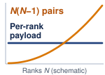{width="100%" fig-alt="Schematic against rank count N: a curve labeled N(N−1) pairs starts near zero and rises quadratically, crossing a flat line labeled per-rank payload that stays at a fixed nonzero level."}

*Logical pairs grow quadratically while per-rank payload can stay flat.*
:::

Expert parallelism and large-scale recommendation systems\index{Recommendation system} can reach a communication wall earlier than standard data parallelism when their traffic exhausts injection, reception, or bisection capacity, or when routing and destination skew create hotspots. The primitive determines the traffic matrix\index{Traffic matrix!collective communication}; the physical fabric and routing distribution determine the scaling ceiling.

::::

A mixture-of-experts model with 64 experts distributed across 8 GPUs (8 experts per GPU) shows the AllToAll pattern at small scale. During each forward pass, a gating network assigns each input token to one or more experts. The tokens assigned to experts on remote GPUs must be physically moved to those GPUs before computation can proceed, and the results must be moved back afterward.

```{python}
#| echo: false
#| label: moe-alltoall-calc
from mlsysim.core.units import BYTES_FP16, GB, KB, MB, microsecond, second
from mlsysim.fmt import check, fmt, fmt_bandwidth, fmt_memory, fmt_time, fmt_count
from mlsysim import Systems

class MoeAllToAll:
    # ┌── 1. LOAD ──────────────────────────────────────────
    total_tokens = 4096
    n_gpus = 8
    hidden_dim = 2048
    bytes_per_elem = BYTES_FP16
    n_experts = 64
    # IB NDR bandwidth from the registry (400 Gbps = 50 GB/s); alpha is the
    # chapter's canonical effective NDR launch latency (Systems.SwitchFabric.AlphaNdr).
    beta = Systems.Fabrics.InfiniBand_NDR.bandwidth
    alpha = Systems.SwitchFabric.AlphaNdr
    # ┌── 2. EXECUTE ───────────────────────────────────────
    tokens_per_gpu = total_tokens // n_gpus
    experts_per_gpu = n_experts // n_gpus
    bytes_per_token = hidden_dim * bytes_per_elem
    kb_per_token = bytes_per_token.to(KB)
    tokens_per_expert = total_tokens // n_experts
    tokens_per_transfer = tokens_per_gpu // n_gpus
    remote_gpus = n_gpus - 1
    data_per_transfer = tokens_per_transfer * bytes_per_token
    total_sent = remote_gpus * data_per_transfer
    # Bandwidth term rounded to whole microseconds: the worked trace presents it
    # as the clean "≈ 5 μs" approximation the callout math line displays, so the
    # downstream per-transfer and serialized totals stay on visible
    # arithmetic (1.5 + 5 = 6.5; 7 × 6.5 = 45.5).
    bw_time = round((data_per_transfer / beta).to(microsecond).magnitude) * microsecond
    per_transfer = alpha + bw_time
    serialized = remote_gpus * per_transfer
    # Concurrent peer streams share the GPU's aggregate NIC injection bandwidth.
    # Full duplex permits simultaneous send and receive, but does not multiply the
    # outgoing 50 GB/s port by the number of remote peers.
    parallel = alpha + total_sent / beta
    # ┌── 3. GUARD ─────────────────────────────────────────
    check(tokens_per_gpu == 512, f"tokens/GPU = {tokens_per_gpu}")
    check(abs(kb_per_token.to(KB).magnitude - 4.096) < 1e-9, f"KB/token = {kb_per_token.to(KB).magnitude}")
    check(tokens_per_expert == 64, f"tokens/expert = {tokens_per_expert}")
    check(abs(data_per_transfer.to(KB).magnitude - 262.144) < 1e-9, f"data/transfer = {data_per_transfer.to(KB).magnitude} KB")
    check(abs(per_transfer.to(microsecond).magnitude - 6.5) < 1e-9, f"T/transfer = {per_transfer.to(microsecond).magnitude} μs")
    check(abs(parallel.to(microsecond).magnitude - 38.20016) < 1e-9, f"Parallel injection lower bound = {parallel.to(microsecond).magnitude} μs")
    # ┌── 4. OUTPUT ────────────────────────────────────────
    alpha_us_str = fmt_time(alpha, microsecond, precision=1, commas=False)
    beta_gb_per_s_str = fmt_bandwidth(beta, unit=GB / second, precision=0, commas=False)
    tokens_per_gpu_str = fmt_count(tokens_per_gpu, label="token", commas=False)
    tokens_per_transfer_str = fmt_count(tokens_per_transfer, label="token", commas=False)
    kb_per_token_str = fmt_memory(kb_per_token, unit=KB, precision=3, commas=False)
    tokens_per_expert_str = fmt_count(tokens_per_expert, label="token", commas=False)
    data_per_transfer_kb_str = fmt_memory(data_per_transfer, unit=KB, precision=3, commas=False)
    total_sent_mb_str = fmt_memory(total_sent, unit=MB, precision=2, commas=False)
    bw_time_approx_us_str = fmt_time(bw_time, microsecond, precision=0, commas=False)
    per_transfer_us_str = fmt_time(per_transfer, unit=microsecond, precision=1, commas=False)
    serialized_us_str = fmt_time(serialized, unit=microsecond, precision=1, commas=False)
    parallel_us_str = fmt_time(parallel, unit=microsecond, precision=1, commas=False)
    total_tokens_str = fmt_count(total_tokens, label="token", commas=False)
    n_gpus_str = fmt(n_gpus, precision=0, commas=False)
    hidden_dim_str = fmt(hidden_dim, precision=0, commas=False)
    n_experts_str = fmt(n_experts, precision=0, commas=False)
    experts_per_gpu_str = fmt(experts_per_gpu, precision=0, commas=False)
    remote_gpus_str = fmt(remote_gpus, precision=0, commas=False)
```

::: {#nbk-collective-communication-alltoall-moe-token-routing .callout-notebook title="AllToAll for MoE token routing"}

**Problem**: An MoE model processes a batch of `{python} MoeAllToAll.total_tokens_str` across `{python} MoeAllToAll.n_gpus_str` GPUs (`{python} MoeAllToAll.tokens_per_gpu_str` per GPU). Each token is a `{python} MoeAllToAll.hidden_dim_str`-dimensional hidden state in BF16 (`{python} MoeAllToAll.kb_per_token_str` per token). The gating network assigns each token to exactly 1 of `{python} MoeAllToAll.n_experts_str` experts (`{python} MoeAllToAll.experts_per_gpu_str` experts per GPU). Assuming uniform routing (each expert receives `{python} MoeAllToAll.tokens_per_expert_str`), how much data does each GPU send and receive?

**Math**:

Each GPU holds `{python} MoeAllToAll.tokens_per_gpu_str` that need to reach `{python} MoeAllToAll.n_experts_str` different experts across `{python} MoeAllToAll.n_gpus_str` GPUs. With uniform routing, each GPU sends `{python} MoeAllToAll.tokens_per_transfer_str` to each of the other `{python} MoeAllToAll.remote_gpus_str` GPUs (keeping `{python} MoeAllToAll.tokens_per_transfer_str` local).

*   Data per GPU-to-GPU transfer: `{python} MoeAllToAll.tokens_per_transfer_str` $\times$ `{python} MoeAllToAll.kb_per_token_str`/token = `{python} MoeAllToAll.data_per_transfer_kb_str`
*   Total data sent per GPU: `{python} MoeAllToAll.remote_gpus_str` $\times$ `{python} MoeAllToAll.data_per_transfer_kb_str` = `{python} MoeAllToAll.total_sent_mb_str`
*   Total data received per GPU: `{python} MoeAllToAll.total_sent_mb_str` (symmetric)

**Latency Analysis** (InfiniBand NDR, $\MessageStartupLatency=$ `{python} MoeAllToAll.alpha_us_str`, $\LinkBandwidth=$ `{python} MoeAllToAll.beta_gb_per_s_str`):

Each of the `{python} MoeAllToAll.remote_gpus_str` transfers is a `{python} MoeAllToAll.data_per_transfer_kb_str` message. From the $\MessageStartupLatency$-$\LinkBandwidth$ model: $\TransferTimeForPayload$ = `{python} MoeAllToAll.alpha_us_str` + `{python} MoeAllToAll.bw_time_approx_us_str` = `{python} MoeAllToAll.per_transfer_us_str` per transfer.

If serialized: `{python} MoeAllToAll.remote_gpus_str` $\times$ `{python} MoeAllToAll.per_transfer_us_str` = `{python} MoeAllToAll.serialized_us_str`. If all `{python} MoeAllToAll.remote_gpus_str` transfers are issued concurrently, they still share the GPU's `{python} MoeAllToAll.beta_gb_per_s_str` injection port. The aggregate injection lower bound is therefore $\MessageStartupLatency+ \text{total bytes sent}/\LinkBandwidth=$ `{python} MoeAllToAll.parallel_us_str`, before contention and additional collective overhead. Full duplex permits simultaneous sending and receiving; it does not provide one full-bandwidth outgoing port per peer.

**Systems insight**: The injection result is only a lower bound. If the topology's usable bisection bandwidth is $\BisectionBandwidth$ and $\CutCrossingDataVolume$ bytes must cross its minimum cut, the exchange also obeys $\AllToAllExchangeTime\geq \CutCrossingDataVolume/\BisectionBandwidth$. Oversubscription reduces $\BisectionBandwidth$, fine-grained peer messages add startup cost, and expert skew raises the maximum receive volume above the uniform estimate. The forward pass runs the AllToAll twice per layer, once for token dispatch and once for result collection; training also communicates gradients during backward.

:::

### Dynamic routing and expert imbalance in MoE AllToAll {#sec-collective-communication-moe-dynamic-routing}

The worked trace in notebook \ref{nbk-collective-communication-alltoall-moe-token-routing} assumes uniform token routing, in which every expert receives an identical share of tokens. In production MoE models, routing decisions are dynamic and data-dependent. The exchange keeps its two-phase shape, but its buffer sizes, its slowest receiver, and its load on the fabric all become functions of the routing distribution. The hierarchy just developed for AllReduce reappears as one of the schedules that can contain them.

Each MoE layer performs two exchanges. In an MoE transformer layer with $\ExpertCount$ experts distributed across $\DeviceCount$ ranks ($\ExpertCount/\DeviceCount$ experts per rank), each rank holds a local batch of $\LocalTokenCount$ tokens. A gating router computes top-$\RoutedExpertCount$ routing probabilities over all $\ExpertCount$ experts for each token, inducing two collective communication phases separated by expert computation. During token dispatch\index{AllToAll!dispatch phase}, each rank partitions its $\LocalTokenCount$ local token activation vectors ($\LayerInputVector\in \mathbb{R}^\HiddenDimension$, where $\HiddenDimension$ is the model's hidden dimension) according to the destination ranks hosting the selected experts. The rank then executes an AllToAll collective (or variable-size `AllToAllv`\index{AllToAll!variable-size AllToAllv}) to route tokens across the fabric according to the routing matrix\index{AllToAll!routing matrix}. After each rank computes forward passes through its assigned local expert feed-forward networks (FFNs), the token combine\index{AllToAll!combine phase} phase executes a second AllToAll collective to route output vectors back to their originating ranks. Each rank then computes the weighted combination of expert outputs:
$$\LayerOutputVector_i = \sum_{j \in \text{top-}\RoutedExpertCount} {\RouterGateProbability}_{i,j} \cdot \text{Expert}_j(\LayerInputVector_i)$$

Because routing is data-dependent, so are the required buffer sizes, even when the input tensor shape is fixed. One simplified model treats assignments of different tokens independently: the count for expert $\ExpertIndex$ is then $\ExpertTokenCount\sim \text{Binomial}(\DeviceCount \LocalTokenCount, \ExpertSelectionProbability)$, where $\ExpertSelectionProbability$ is the fixed probability that a token selects expert $\ExpertIndex$. Correlated tokens or changing router probabilities require a different count model. To avoid reallocating buffers for every routing decision, a capacity-limited implementation can reserve space using an expert capacity factor\index{Capacity factor!expert routing} $\ExpertCapacityFactor\ge 1.0$, a multiplier on each expert's average share of token assignments [@lepikhin2021gshard; @fedus2022switch]:
$$\text{Capacity}_\ExpertIndex= \left\lceil \frac{\DeviceCount\times \LocalTokenCount\times \RoutedExpertCount}{\ExpertCount} \times \ExpertCapacityFactor\right\rceil$$

The capacity factor exposes a trade-off between reserved space and retained expert assignments. At uniform expected capacity ($\ExpertCapacityFactor= 1.0$), some experts can still overflow while others have unused slots. A dropping implementation bypasses excess assignments through the residual connection\index{Token dropping!capacity factor}, changing the computation and potentially harming training quality. Increasing headroom ($\ExpertCapacityFactor> 1.0$, for example $1.25$–$1.5$) can reduce overflow. If the implementation transmits every reserved slot, its padded payload grows by approximately a factor of $\ExpertCapacityFactor$ relative to the uniform capacity-one budget; kernels that skip unused slots need not perform the corresponding dummy computation. A dropless implementation retains every assignment and can use variable-size `AllToAllv` to avoid sending unused slots. It still needs enough memory for the realized counts and remains exposed to routing skew.

Skew turns the most heavily loaded rank into a straggler. Because token routing is determined by input semantics, some experts inevitably receive disproportionate token volumes. An expert that receives several times the average load raises its host GPU's receive traffic by the same excess. The host's total receive volume depends on the combined load of all experts assigned to it, which is the rank-level quantity in the bound that follows.

Routing skew can create stragglers\index{Straggler!expert skew} in both communication and expert computation. An inbound reception bottleneck bounds dispatch completion by the most heavily loaded receiver. Other ranks may finish their transfers earlier, but work that needs the delayed expert outputs must wait. The receive budget gives a lower bound before expert computation and the return exchange are counted:
$$\TokenDispatchTime\ge \frac{\MaxReceivedTokenCount\times \HiddenDimension\times \ElementStorageSize}{\ReceiveBandwidth}$$
where $\MaxReceivedTokenCount= \max_\RankIndex \sum_{\ExpertIndex\in \text{rank } \RankIndex} \ExpertTokenCount$ counts the largest remotely received token batch at any rank $\RankIndex$, restricting $\ExpertTokenCount$ in this sum to assignments arriving from other ranks. Here $\ElementStorageSize$ is the bytes per activation element, and $\ReceiveBandwidth$ is that rank's receive bandwidth. Bisection capacity provides a separate limit. Ring AllReduce exchanges data with logical ring neighbors, whereas AllToAll permits a complete bipartite exchange\index{AllToAll!bipartite exchange}. Under uniform destination assignment, a fraction $(\DeviceCount-1)/\DeviceCount\approx 1$ of tokens leaves its source rank; the fraction crossing nodes or a particular fabric cut depends on placement. In the simplified symmetric fabric model with oversubscription ratio $\OversubscriptionRatio:1$, usable bisection bandwidth $\BisectionBandwidth = (\DeviceCount\cdot \InjectionBandwidth) / (2\OversubscriptionRatio)$ bounds the time needed to carry traffic across that cut:
$$\TokenDispatchTime\ge \frac{\CutCrossingDataVolume}{\BisectionBandwidth}$$

```{python}
#| echo: false
#| label: moe-skew-calc
# ┌─────────────────────────────────────────────────────────────────────────────
# │ MOE DISPATCH UNDER SKEW—RECEIVE BOUND (LEGO)
# ├─────────────────────────────────────────────────────────────────────────────
# │ Context: "The cost of a hot expert rank" .callout-notebook in
# │          @sec-collective-communication-moe-dynamic-routing.
# │
# │ Goal: Evaluate the receive-bandwidth dispatch bound for the uniform MoE
# │       notebook (8 GPUs, 64 experts) and for one rank with an assumed
# │       realized remote-receive skew of 1.5 times the uniform load.
# │ Show: 448 vs 672 remote tokens; ~1.84 MB vs ~2.75 MB; ~37 us vs ~55 us.
# │ How: T_rx >= B_max x d x bytes/elem / B_rx, with every input taken from
# │      MoeAllToAll; skew applied to the hot rank's remote receive volume.
# │
# └─────────────────────────────────────────────────────────────────────────────
from mlsysim.core.units import MB, microsecond
from mlsysim.fmt import check, fmt, fmt_memory, fmt_multiple, fmt_time

class MoeSkew:
    # ┌── 1. LOAD ──────────────────────────────────────────
    cap = 1.5  # scenario assumption: realized remote-receive skew, not capacity headroom
    beta_rx = MoeAllToAll.beta  # receive bandwidth per GPU (NDR port)
    bytes_per_token = MoeAllToAll.bytes_per_token  # d x bytes per element
    uniform_remote_tokens = MoeAllToAll.remote_gpus * MoeAllToAll.tokens_per_transfer
    # ┌── 2. EXECUTE ───────────────────────────────────────
    hot_remote_tokens = round(cap * uniform_remote_tokens)
    uniform_rx = (uniform_remote_tokens * bytes_per_token).to(MB)
    hot_rx = (hot_remote_tokens * bytes_per_token).to(MB)
    uniform_bound = (uniform_rx / beta_rx).to(microsecond)
    hot_bound = (hot_rx / beta_rx).to(microsecond)
    # ┌── 3. GUARD ─────────────────────────────────────────
    check(uniform_remote_tokens == 448, f"Uniform remote tokens = {uniform_remote_tokens}")
    check(hot_remote_tokens == 672, f"Hot remote tokens = {hot_remote_tokens}")
    check(
        abs(uniform_rx.to(MB).magnitude - MoeAllToAll.total_sent.to(MB).magnitude) < 1e-9,
        "Uniform receive must equal the notebook's symmetric send volume",
    )
    # ┌── 4. OUTPUT ────────────────────────────────────────
    cap_str = fmt(cap, precision=1, commas=False)
    uniform_tokens_str = fmt(uniform_remote_tokens, precision=0, commas=False)
    hot_tokens_str = fmt(hot_remote_tokens, precision=0, commas=False)
    uniform_rx_mb_str = fmt_memory(uniform_rx, unit=MB, precision=2, commas=False)
    hot_rx_mb_str = fmt_memory(hot_rx, unit=MB, precision=2, commas=False)
    uniform_bound_us_str = fmt_time(uniform_bound, microsecond, precision=1, commas=False)
    hot_bound_us_str = fmt_time(hot_bound, microsecond, precision=1, commas=False)
    cap_mult_str = fmt_multiple(cap, precision=1, commas=False)
```

::: {#nbk-collective-communication-moe-skew-receive-bound .callout-notebook title="The cost of a hot expert rank"}

**Problem**: Return to the uniform routing of notebook \ref{nbk-collective-communication-alltoall-moe-token-routing}: `{python} MoeAllToAll.n_gpus_str` GPUs, `{python} MoeAllToAll.n_experts_str` experts, `{python} MoeAllToAll.kb_per_token_str` per token, and one `{python} MoeAllToAll.beta_gb_per_s_str` port per GPU. Suppose skew sends one rank's experts `{python} MoeSkew.cap_str` times the average remote load. This is an assumed realized routing skew; the per-expert capacity factor reserves total-assignment headroom and does not determine remote arrivals. How does the receive bound on dispatch change?

**Math**:

1.  **Uniform receiver**: Each GPU receives `{python} MoeSkew.uniform_tokens_str` remote tokens, or `{python} MoeSkew.uniform_rx_mb_str`, so $\TokenDispatchTime\ge$ `{python} MoeSkew.uniform_rx_mb_str` / `{python} MoeAllToAll.beta_gb_per_s_str` $\approx$ `{python} MoeSkew.uniform_bound_us_str`.
2.  **Hot receiver**: $\MaxReceivedTokenCount$ rises to `{python} MoeSkew.hot_tokens_str` remote tokens, or `{python} MoeSkew.hot_rx_mb_str`, so $\TokenDispatchTime\ge$ `{python} MoeSkew.hot_rx_mb_str` / `{python} MoeAllToAll.beta_gb_per_s_str` $\approx$ `{python} MoeSkew.hot_bound_us_str`.

**Systems insight**: The exchange cannot finish before its hottest receiver, so a `{python} MoeSkew.cap_mult_str` load on one rank raises the dispatch bound for the whole layer by the same factor. Transmitting unused capacity slots can add padding bytes; the amount depends on the packing layout rather than on this receive-skew factor alone. A variable-size exchange removes unused-slot traffic but not the receive bound. Expert computation processes local as well as remote assignments, so its work grows by the same factor only if the hot rank's total local-plus-remote assignment count also grows by that factor, with unchanged work per assignment.

:::

Scale compounds both problems. To amortize small-message overhead across thousands of GPUs, hierarchical MoE runtimes decompose the flat AllToAll into a two-level collective\index{AllToAll!hierarchical exchange} [@hwang2023tutel]. Intra-node NVLink first coalesces tokens destined for experts on the same remote server node. Participating nodes then exchange aggregated payloads over InfiniBand or RoCE, and receiving GPUs use NVLink to distribute tokens to the GPUs hosting the targeted experts. At the logical level, this replaces $\DeviceCount(\DeviceCount-1)$ directed rank pairs with $\ClusterNodeCount(\ClusterNodeCount-1)$ directed node pairs; actual transport connections depend on the implementation. Coalescing can improve link utilization and reduce startup overhead, but the token bytes still have to cross the required fabric cuts, and skew can still overload a destination.

### AllToAll schedule selection {#sec-collective-communication-alltoall-schedule-selection}

\index{AllToAll!schedule selection}\index{Collective communication!AllToAll schedules}

A flat, fixed-size AllToAll schedule that works well for balanced, megabyte-scale peer transfers on eight GPUs can stall across thousands of GPUs when per-peer chunks shrink to a few kilobytes or when expert skew forces every rank to pad its buffers to the hottest receiver's count. Because `AllToAll` names only the destination-specific contract, the runtime must match its schedule to the traffic matrix and physical hierarchy rather than treating every exchange as one flat pattern. Three schedules cover the common regimes (@tbl-alltoall-schedule-selection). Direct pairwise exchange suits balanced, coarse per-peer chunks. Hierarchical exchange coalesces many small remote chunks before they cross scarce inter-node links. Variable-size exchange avoids padding when token or embedding counts differ by destination. Hierarchical designs such as Tutel's two-dimensional exchange demonstrate why the best schedule changes with message size, scale, and topology [@hwang2023tutel].

| **Schedule**                                                            | **When it fits**                                                                                                              | **Cost exposed**                                                                                                                                                  |
|:------------------------------------------------------------------------|:------------------------------------------------------------------------------------------------------------------------------|:------------------------------------------------------------------------------------------------------------------------------------------------------------------|
| **Direct pairwise exchange**\index{AllToAll!pairwise exchange schedule} | Balanced, coarse per-peer chunks on a small or full-bisection process group                                                   | Each rank injects directly to its peers; fine granularity repeats startup and scheduling cost, while oversubscription can bind the bisection                      |
| **Hierarchical/coalesced exchange**                                     | Many small remote chunks across multi-GPU nodes or rails; pack by remote node, exchange aggregates, then redistribute locally | Coalescing amortizes inter-node startups and respects fast local links, but adds packing, local copies, synchronization, and temporary buffers                    |
| **Variable-size exchange**                                              | Token or embedding counts differ by destination and padding to the maximum count would waste substantial bandwidth            | Explicit counts and displacements avoid padding, but count exchange and irregular transfers add control overhead; the hottest receiver still sets completion time |

: **AllToAll Schedule Selection**: The right schedule minimizes the active bound rather than the logical peer count. Direct exchange preserves simplicity, hierarchy coalesces traffic before scarce links, and variable-size exchange removes padding without removing skew. {#tbl-alltoall-schedule-selection tbl-colwidths="[22,37,41]"}

The selection test follows the four-term lower bound from perspective \ref{psp-collective-communication-alltoall-vs-allreduce-why-scale-differs} and @sec-collective-communication-moe-dynamic-routing. When per-peer chunks are already coarse and source injection or fabric bisection dominates, coalescing cannot shrink the byte term and only adds local copies. When each remote destination receives a small chunk so that $\DeviceCount\MessageStartupLatency$ dominates instead, a hierarchical schedule replaces those many inter-node startups with a single aggregated exchange per remote node. Under routing skew, a variable-size interface keeps padding from inflating $\CutCrossingDataVolume$, though the runtime must still provision memory and time for the hottest receiver's load. Because these bounds depend on live routing behavior, a runtime must benchmark candidate schedules under the observed token-count distribution, rank placement, and fabric topology rather than relying on a balanced, fixed-size microbenchmark. Even the best schedule, however, must still transmit the full activation or gradient payload unless the system reduces the bytes themselves.

## Gradient Compression Under Bandwidth Scarcity {#sec-communication-collective-operations-collective-operations-gradient-compression-7a5c}

Training across data centers over wide-area links or on cloud instances with commodity Ethernet can leave each worker with 10--100$\times$ less network bandwidth than the reference InfiniBand fabric. Federated training on phone-class devices, the Archetype C (Federated MobileNet) regime, faces cellular or Wi-Fi uplinks that are both slower and intermittently available. Even after hierarchical routing and schedule tuning extract all usable capacity from such links, moving a full-precision gradient or a multi-step client update can still dominate step time. Gradient compression attacks the payload size directly by trading numerical representation fidelity for fewer transmitted bits, offering nominal value-payload reductions of 4--1000$\times$ before metadata and aggregation costs reduce the realized savings. Because noisy or biased updates can slow or stall optimization, the central engineering question is how much communication volume a compressor can remove while preserving progress toward the training quality target.

::: {.column-margin .margin-pointer}
↪ The per-round uplink budget of federated training, and the update compression that fits it to cellular and Wi-Fi links, are developed in @sec-edge-intelligence-bandwidthaware-update-compression-7730.
:::

### Precision reduction via quantization {#sec-communication-collective-operations-collective-operations-quantization-reducing-precision-815b}

Quantization is the least disruptive compression lever when bandwidth is binding because it keeps every gradient element but reduces the bits used to represent it. Most gradients are computed in FP32 (32-bit floating point) or BF16 (16-bit brain float), so reducing bit-width directly reduces communication volume. The useful question is how much gradient fidelity the optimizer can absorb across the progression from mild to aggressive quantization. The compression ratios discussed in this section follow the compression literature and are quoted against FP32 values. The chapter's 70B payload is already BF16, so against it every ratio halves; INT8 saves 2$\times$ rather than 4$\times$, and 1-bit encoding 16$\times$ rather than 32$\times$.

FP16\index{FP16!definition} halves FP32's value bytes when its range supports the workload, and INT8\index{INT8!definition} stores each quantized value in one byte, a $4\times$ reduction relative to FP32 before scale metadata. A symmetric INT8 scheme uses 255 levels from negative 127 through positive 127. For a nonzero gradient vector, it computes a tensor-wide scaling factor $\QuantizationScale= \max(\lvert \LocalGradient\rvert) / 127$, quantizes via $\QuantizedGradient= \text{round}(\LocalGradient/\QuantizationScale)$, and has the receiver reconstruct $\ReconstructedGradient= \QuantizedGradient\times \QuantizationScale$. An all-zero vector requires a separate zero case. Gradients differ from other quantized tensors in the reduction. Each rank computes its scale from its own gradient, so independently scaled integer vectors cannot be added directly to recover the sum of their reconstructed gradients. The collective must carry every rank's scale through the reduction and use sufficient accumulator precision, or reconstruct values before reducing them. At the extreme, 1-bit SGD\index{1-bit SGD} transmits only the sign of each gradient element ($+1$ or $-1$), yielding a $32\times$ reduction in value bits over FP32. The receiver reconstructs values using a learned or adaptive scaling factor, though the substantial noise introduced by 1-bit quantization can severely degrade convergence without error-feedback mechanisms [@seide2014; @karimireddy2019error].

::: {.column-margin .margin-pointer}
↪ Byte widths for every format named here are collected for reference in @sec-appdx-dam-taxonomy-training-memory.
:::

#### Block quantization for gradient communication {#sec-collective-communication-block-quantization-gradient-communication-c883}

Using a single scaling factor for an entire tensor makes every element's quantization resolution depend on the largest magnitude. When magnitudes vary substantially across the tensor, small gradients may round to zero even in regions whose values could be represented accurately with a smaller scale. Block quantization\index{Block quantization} addresses this by dividing the gradient tensor into blocks of $\QuantizationBlockSize$ elements (for example, $\QuantizationBlockSize= 64$ or $128$) and computing an independent scaling factor per block\index{Block quantization!block scale factor}. Each block's scaling factor adapts to its local range, improving resolution where that range is smaller at the cost of transmitting $\GradientElementCount/\QuantizationBlockSize$ additional scaling factors for evenly divided blocks.

For a gradient vector of dimension $\GradientElementCount$ quantized to INT8 with block size $\QuantizationBlockSize$, the message size is $\GradientElementCount\times 1\ \text{byte}$ for the quantized values plus $(\GradientElementCount/\QuantizationBlockSize) \times 4\ \text{bytes}$ for the FP32 scaling factors, or $\GradientElementCount+ 4\GradientElementCount/\QuantizationBlockSize$ bytes in total. The effective compression is therefore $4\GradientElementCount/ (\GradientElementCount+ 4\GradientElementCount/\QuantizationBlockSize) = 4\QuantizationBlockSize/ (\QuantizationBlockSize+ 4)$, which for $\QuantizationBlockSize= 128$ reaches 3.88$\times$, close to the theoretical 4$\times$. For rounding to the nearest level without clipping, the absolute error bound changes from $\QuantizationScale\cdot 0.5$, where $\QuantizationScale$ is the global scaling factor, to $\BlockQuantizationScale\cdot 0.5$, where $\BlockQuantizationScale$ is the block-local scaling factor. Blocks with smaller ranges obtain tighter bounds; the improvement depends on how magnitudes are distributed among blocks.

Interfaces that fuse quantization and reduction must preserve the meaning of each block's scale throughout aggregation. They must also control the resulting numerical error. Deterministic rounding generally introduces bias, whereas suitable randomized quantizers preserve the input in expectation while adding variance. Error feedback addresses accumulated compression error, but the need for it depends on the compressor and optimizer rather than on bit-width alone. Quantization should therefore move only as far down the precision ladder as the convergence budget permits.

### Gradient sparsification methods {#sec-communication-collective-operations-collective-operations-sparsification-transmitting-important-gradients-2cd2}

Quantization attacks communication volume by reducing the number of bits per gradient element while transmitting every element. An orthogonal approach, sparsification\index{Sparsification}, attacks the problem from the other direction: keep full precision but transmit only a subset of gradient elements, setting the rest to zero.

#### Top-k sparsification {#sec-collective-communication-topk-sparsification-40fc}

The most common method is Top-k compression\index{Top-k sparsification}: for a gradient vector $\LocalGradient\in \mathbb{R}^{\GradientElementCount}$, transmit only the $\RetainedGradientElementCount$ elements with the largest absolute magnitude, setting the rest to zero [@aji2017; @lin2018deep]:

$$\text{TopK}(\LocalGradient) = \LocalGradient\odot \TopMagnitudeIndicator$$

where $|\LocalGradient|_{(\RetainedGradientElementCount)}$ is the $\RetainedGradientElementCount$-th largest element by magnitude. The threshold expression retains all ties; an implementation targeting an exact count must break ties at the boundary. With $\RetainedGradientElementCount= 0.001 \times \GradientElementCount$ (keeping only 0.1 percent of elements), the retained values occupy 1000$\times$ less space before index overhead.

The compression headline must be discounted by the cost of encoding the sparse representation\index{Top-k sparsification!index overhead}. Transmitting a sparse gradient requires sending both the nonzero values and their indices. For a gradient vector of dimension $\GradientElementCount$ with $\RetainedGradientElementCount$ nonzero elements, the encoded message contains $\RetainedGradientElementCount$ values (each in FP32 or FP16) plus $\RetainedGradientElementCount$ indices (typically INT32). The total message size is $\RetainedGradientElementCount\times (4 + 4) = 8 \RetainedGradientElementCount$ bytes for FP32 values with INT32 indices. The effective compression ratio is therefore $4\GradientElementCount/ (8 \RetainedGradientElementCount) = \GradientElementCount/ (2 \RetainedGradientElementCount)$.

For $\RetainedGradientElementCount= 0.001 \GradientElementCount$, the encoded message yields a compression ratio of 500$\times$, not the 1000$\times$ suggested by the kept-element fraction alone, because the index overhead is significant. Using a 16-bit unsigned index representation (for $\GradientElementCount< 65536$) or run-length encoding for suitable sparsity patterns can improve the effective ratio. Aggregation imposes a separate cost. Workers may retain different coordinates, so summing their packed value arrays would combine unrelated parameters. A sparse collective must match indices and sum contributions to each coordinate; the union of selected coordinates can be much larger than any one worker's selection. Local compression ratios therefore do not directly specify collective traffic or runtime.

Top-k is not the only sparsification rule. Random-k sparsification\index{Random-k sparsification} selects $\RandomRetainedElementCount$ elements uniformly at random and scales them by $\GradientElementCount/\RandomRetainedElementCount$ to maintain an unbiased gradient estimate. Random-k has the advantage of being an unbiased compressor even without error feedback, because $\mathbb{E}[\text{RandomK}(\LocalGradient)] = \LocalGradient$. Its random selection can discard large components, and rescaling the retained values introduces variance. Top-k retains the largest components but introduces bias. Their convergence behavior therefore depends on the optimizer, residual correction, and gradient distribution; unbiasedness alone does not determine which reaches a quality target sooner.

#### The convergence problem {#sec-collective-communication-convergence-problem-43f6}

Naively discarding small gradients with Top-k creates a systematic bias\index{Sparsification!systematic bias}. If a parameter's gradient remains below the selection threshold, even a consistent contribution of 0.01 per step is repeatedly omitted. Over thousands of steps, those omissions can materially change the optimization trajectory. The problem is persistent exclusion, which can occur even when each discarded component looks negligible in isolation.

The bias of uncorrected Top-k means that the usual argument for SGD with an unbiased gradient estimate no longer applies directly. Biased compression can cause convergence failure even when the uncompressed method converges. Deterministic quantization can also repeatedly omit small contributions; randomized quantization and rescaled Random-k instead require accounting for their added variance. Error feedback addresses accumulated compression error for quantized gradients [@seide2014] and for sparsified gradients [@stich2018sparsified; @karimireddy2019error].

### Error feedback and residual accumulation {#sec-communication-collective-operations-error-feedback}

Error feedback controls the accumulated error introduced by compression. At step $\OptimizerStepIndex$, the system adds the local residual $\ErrorFeedbackResidual_t$ to the new gradient $\LocalGradient_t$, compresses that corrected vector, and transmits the compressed update $\CompressedGradientUpdate_t$. The next local accumulator\index{Error feedback!residual accumulator} stores the difference between the corrected vector and the transmitted update. This residual path defers information so that later updates can recover it under the compressor's convergence assumptions.

::: {.column-margin}
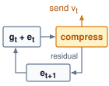{width="100%" fig-alt="Error-feedback loop: a box g t plus e t feeds an amber compress box, which sends v t upward; the residual e t plus 1 returns to the first box for the next step."}

*Error feedback carries the residual into the next compressed step.*
:::

::: {#dfn-collective-communication-error-feedback-mechanism .callout-definition title="Error feedback mechanism"}

***Error feedback***\index{Error feedback!definition} is a distributed-training technique for gradient compression that maintains a per-worker residual accumulator $\ErrorFeedbackResidual_t$, re-injecting the compression error back into the next gradient update so that information omitted from the transmitted update remains in the residual. A finite run can end with an untransmitted residual.

1.  **Significance**: Top-k sparsification at 1 percent keeps only the largest 1 percent of gradient values by magnitude, reducing each worker's retained value payload from `{python} GradSyncSignificance.gradient_gb_str` to `{python} GradSyncSignificance.gradient_top1_gb_str` for a full 70B gradient, a 100$\times$ reduction before sparse-index and aggregation overhead. Without error feedback, the discarded 99 percent of gradient values create a biased update that can harm convergence. With error feedback, omitted information remains in the residual and can influence later selections, supporting the convergence guarantees analyzed for memory/error-feedback variants under their assumptions [@stich2018sparsified; @karimireddy2019error].
2.  **Distinction**: Unlike plain lossy compression, which permanently discards sub-threshold gradient components, error feedback delays their transmission. A component too small to send in one step stays in the residual and can influence later transmitted updates as it accumulates; a finite run may still end with an untransmitted residual.
3.  **Common pitfall**: A frequent misconception is that error feedback is automatic whenever a compressor is used. It is not: the training system must explicitly preserve and reinject the residual. Without that residual path, Top-k and 1-bit quantization introduce systematic bias that can accumulate across steps [@karimireddy2019error].

:::

Error feedback preserves cumulative gradient information over time. Consider what happens over $\TrainingStepCount$ steps:

$$\sum_{t=1}^{\TrainingStepCount} \CompressedGradientUpdate_t = \sum_{t=1}^{\TrainingStepCount} \left[(\LocalGradient_t + \ErrorFeedbackResidual_t) - \ErrorFeedbackResidual_{t+1}\right] = \sum_{t=1}^{\TrainingStepCount} \LocalGradient_t + \ErrorFeedbackResidual_1 - \ErrorFeedbackResidual_{\TrainingStepCount+1}$$

If the error accumulator remains bounded under the chosen compressor and training assumptions, then as $\TrainingStepCount\to \infty$:

$$\frac{1}{\TrainingStepCount}\sum_{t=1}^{\TrainingStepCount} \CompressedGradientUpdate_t \to \frac{1}{\TrainingStepCount}\sum_{t=1}^{\TrainingStepCount} \LocalGradient_t$$

Under that bounded-residual condition, the difference between the two averages vanishes. At a finite stopping point, untransmitted information remains in the residual. Repeated small gradients can accumulate in $\ErrorFeedbackResidual_t$ until they exceed the compression threshold, as the worked trace illustrates.

The telescoping property\index{Error feedback!telescoping sum} of compression error across time is why error feedback can transform a biased compressor into a convergent training method. Theoretical analyses show convergence guarantees for sparsified SGD with memory and for EF-SGD with broad compression operators under their stated assumptions [@stich2018sparsified; @karimireddy2019error]. A rounding compressor with no residual path shows what is lost without that memory (@tbl-error-feedback-naive). It transmits each value rounded to the nearest whole unit, so any value below 0.5 is sent as zero.

```{python}
#| echo: false
#| label: error-feedback-calc
from mlsysim.fmt import MarkdownStr, check, fmt, fmt_percent

def _ef_dec(x):
    """One-decimal trace value with a Unicode minus sign (matches the table)."""
    if abs(x - round(x)) <= 1e-9:
        return MarkdownStr(str(int(round(x))))
    return MarkdownStr(f"{x:.1f}".replace("-", "−"))

def _ef_int(x):
    """Integer trace value (transmitted v_t and cumulative columns)."""
    return MarkdownStr(str(int(round(x))))

class ErrorFeedbackTrace:
    # ┌── 1. LOAD ──────────────────────────────────────────
    gradients = [0.4, 0.3, 0.2, 0.4, 0.3]
    # ┌── 2. EXECUTE (5-step trace) ────────────────────────
    # Error-feedback recurrence: e starts at 0; each step adds the carried error
    # to the gradient, transmits the rounded (1-bit) value, and stores the
    # residual as the next error.
    errors = [0.0]  # e_1 .. e_6 (errors[t] is the error entering step t+1)
    g_plus_e = []  # g_t + e_t
    transmitted = []  # v_t
    for t, g in enumerate(gradients):
        s = g + errors[t]
        v = round(s)
        g_plus_e.append(s)
        transmitted.append(v)
        errors.append(s - v)
    # Cumulative-true running sum (naive table's last column) and cumulative-v.
    cum_true_running = []
    _acc = 0.0
    for g in gradients:
        _acc += g
        cum_true_running.append(_acc)
    cum_v_running = []
    _acc = 0
    for v in transmitted:
        _acc += v
        cum_v_running.append(_acc)

    cum_transmitted = int(sum(transmitted))
    final_error = round(errors[-1], 4)
    true_cumulative = sum(gradients)
    naive_transmitted = 0
    conservation = cum_transmitted + final_error
    # ┌── 3. GUARD ─────────────────────────────────────────
    check(cum_transmitted == 2, f"Cum transmitted = {cum_transmitted}, expected 2")
    check(abs(final_error - (-0.4)) < 1e-9, f"Final error = {final_error}, expected -0.4")
    check(abs(true_cumulative - 1.6) < 1e-9, f"True cum = {true_cumulative}, expected 1.6")
    check(abs(conservation - true_cumulative) < 1e-9, "Conservation violated")
    # ┌── 4. OUTPUT ────────────────────────────────────────
    cum_str = fmt(cum_transmitted, precision=0, commas=False)
    error_str = MarkdownStr(_ef_dec(final_error))
    true_str = fmt(true_cumulative, precision=1, commas=False)
    naive_str = fmt(naive_transmitted, precision=0, commas=False)
    conservation_str = MarkdownStr(f"{cum_transmitted} + ({final_error:.1f})".replace("-", "−"))
    naive_loss_pct_str = fmt_percent(100 / 100, precision=0, commas=False, style='prose')
    # Per-cell trace exports (scalar, step-indexed) for @tbl-error-feedback-naive
    # and @tbl-error-feedback; the validator requires *_str names, not subscripts.
    naive_v_str = MarkdownStr(_ef_int(naive_transmitted))  # always-zero transmitted (naive)
    naive_cum_str = MarkdownStr(_ef_int(0))  # naive cumulative transmitted (always zero)
    # g_t (both tables)
    g1_str, g2_str, g3_str, g4_str, g5_str = [_ef_dec(g) for g in gradients]
    # cumulative true (naive table)
    ct1_str, ct2_str, ct3_str, ct4_str, ct5_str = [_ef_dec(c) for c in cum_true_running]
    # e_t entering step t (error-feedback table); errors[:5] = e_1..e_5
    e1_str, e2_str, e3_str, e4_str, e5_str = [_ef_dec(e) for e in errors[:5]]
    # g_t + e_t (error-feedback table)
    gpe1_str, gpe2_str, gpe3_str, gpe4_str, gpe5_str = [_ef_dec(s) for s in g_plus_e]
    # v_t transmitted (error-feedback table)
    v1_str, v2_str, v3_str, v4_str, v5_str = [_ef_int(v) for v in transmitted]
    # e_{t+1} residual (error-feedback table); errors[1:6] = e_2..e_6
    en1_str, en2_str, en3_str, en4_str, en5_str = [_ef_dec(e) for e in errors[1:6]]
    # cumulative v (error-feedback table)
    cv1_str, cv2_str, cv3_str, cv4_str, cv5_str = [_ef_int(c) for c in cum_v_running]
```

| **Step** | **True gradient $\LossGradient_t$**  | **Transmitted $\CompressedGradientUpdateElement_t$** |          **Cumulative transmitted**         |          **Cumulative true**          |
|:---------|:------------------------------------:|:----------------------------------------------------:|:-------------------------------------------:|:-------------------------------------:|
| 1        | `{python} ErrorFeedbackTrace.g1_str` |      `{python} ErrorFeedbackTrace.naive_v_str`       | `{python} ErrorFeedbackTrace.naive_cum_str` | `{python} ErrorFeedbackTrace.ct1_str` |
| 2        | `{python} ErrorFeedbackTrace.g2_str` |      `{python} ErrorFeedbackTrace.naive_v_str`       | `{python} ErrorFeedbackTrace.naive_cum_str` | `{python} ErrorFeedbackTrace.ct2_str` |
| 3        | `{python} ErrorFeedbackTrace.g3_str` |      `{python} ErrorFeedbackTrace.naive_v_str`       | `{python} ErrorFeedbackTrace.naive_cum_str` | `{python} ErrorFeedbackTrace.ct3_str` |
| 4        | `{python} ErrorFeedbackTrace.g4_str` |      `{python} ErrorFeedbackTrace.naive_v_str`       | `{python} ErrorFeedbackTrace.naive_cum_str` | `{python} ErrorFeedbackTrace.ct4_str` |
| 5        | `{python} ErrorFeedbackTrace.g5_str` |      `{python} ErrorFeedbackTrace.naive_v_str`       | `{python} ErrorFeedbackTrace.naive_cum_str` | `{python} ErrorFeedbackTrace.ct5_str` |

: **Naive Compression Trace (No Error Feedback)**: Five-step worked trace showing how a rounding compressor transmits zero whenever an individual gradient falls below 0.5. {#tbl-error-feedback-naive}

A residual accumulator $\ErrorFeedbackResidual_t$ that re-injects the discarded remainder into the next step changes the outcome of the same sequence (@tbl-error-feedback). Instead of vanishing at each rounding step, the fractional updates accumulate locally until they cross the transmission threshold.

| **Step** |        **$\LossGradient_t$**         | **$\ErrorFeedbackResidualElement_t$** | **$\LossGradient_t + \ErrorFeedbackResidualElement_t$** | **$\CompressedGradientUpdateElement_t$** | **$\ErrorFeedbackResidualElement_{t+1} = (\LossGradient_t + \ErrorFeedbackResidualElement_t) - \CompressedGradientUpdateElement_t$** | **Cumulative $\CompressedGradientUpdateElement$** |
|:---------|:------------------------------------:|:-------------------------------------:|:-------------------------------------------------------:|:----------------------------------------:|:------------------------------------------------------------------------------------------------------------------------------------:|:-------------------------------------------------:|
| 1        | `{python} ErrorFeedbackTrace.g1_str` |  `{python} ErrorFeedbackTrace.e1_str` |          `{python} ErrorFeedbackTrace.gpe1_str`         |   `{python} ErrorFeedbackTrace.v1_str`   |                                                `{python} ErrorFeedbackTrace.en1_str`                                                 |       `{python} ErrorFeedbackTrace.cv1_str`       |
| 2        | `{python} ErrorFeedbackTrace.g2_str` |  `{python} ErrorFeedbackTrace.e2_str` |          `{python} ErrorFeedbackTrace.gpe2_str`         |   `{python} ErrorFeedbackTrace.v2_str`   |                                                `{python} ErrorFeedbackTrace.en2_str`                                                 |       `{python} ErrorFeedbackTrace.cv2_str`       |
| 3        | `{python} ErrorFeedbackTrace.g3_str` |  `{python} ErrorFeedbackTrace.e3_str` |          `{python} ErrorFeedbackTrace.gpe3_str`         |   `{python} ErrorFeedbackTrace.v3_str`   |                                                `{python} ErrorFeedbackTrace.en3_str`                                                 |       `{python} ErrorFeedbackTrace.cv3_str`       |
| 4        | `{python} ErrorFeedbackTrace.g4_str` |  `{python} ErrorFeedbackTrace.e4_str` |          `{python} ErrorFeedbackTrace.gpe4_str`         |   `{python} ErrorFeedbackTrace.v4_str`   |                                                `{python} ErrorFeedbackTrace.en4_str`                                                 |       `{python} ErrorFeedbackTrace.cv4_str`       |
| 5        | `{python} ErrorFeedbackTrace.g5_str` |  `{python} ErrorFeedbackTrace.e5_str` |          `{python} ErrorFeedbackTrace.gpe5_str`         |   `{python} ErrorFeedbackTrace.v5_str`   |                                                `{python} ErrorFeedbackTrace.en5_str`                                                 |       `{python} ErrorFeedbackTrace.cv5_str`       |

: **Error-Feedback Compression Trace**: Same five-step sequence under error-feedback compression. {#tbl-error-feedback}

::: {#exmp-collective-communication-error-feedback-mechanism .callout-example title="Error feedback mechanism"}

**Scenario**: A gradient compression pipeline rounds each gradient value to the nearest whole unit before transmission, so values below 0.5 are sent as zero, over 5 training steps of distributed data-parallel training.

**Diagnosis**: Naive rounding (@tbl-error-feedback-naive) discards every value below 0.5, transmitting `{python} ErrorFeedbackTrace.naive_str` when the true cumulative gradient is `{python} ErrorFeedbackTrace.true_str` (`{python} ErrorFeedbackTrace.naive_loss_pct_str` gradient loss). With error feedback (@tbl-error-feedback), the residual grows until it crosses 0.5 and is sent, so the run transmits `{python} ErrorFeedbackTrace.cum_str` and ends holding `{python} ErrorFeedbackTrace.error_str` in the residual. Transmitted plus residual, `{python} ErrorFeedbackTrace.conservation_str`, equals the true total of `{python} ErrorFeedbackTrace.true_str`.

**Systems lesson**: The trace illustrates how error feedback carries omitted information into later updates. By storing untransmitted residual vectors in local accelerator memory ($\ErrorFeedbackResidual_{t+1} = \LocalGradient_t + \ErrorFeedbackResidual_t - \CompressedGradientUpdate_t$), repeated small contributions can accumulate until they cross the transmission threshold. The trace demonstrates the residual mechanism; convergence still depends on the compressor and optimizer assumptions.

:::

### 1-bit Adam compression-aware optimization {#sec-communication-1bit-adam}

Compressing raw gradients works cleanly for stochastic gradient descent, where the parameter update is linear in the gradient. Adaptive optimizers such as Adaptive Moment Estimation (Adam)\index{1-bit Adam} divide the first moment (momentum) by the square root of a running second-moment (variance) estimate, so compression noise in the raw gradient distorts that nonlinear denominator and can destabilize training. Microsoft's DeepSpeed\index{DeepSpeed!1-bit Adam} team observed that Adam's second-moment estimate stabilizes early in training even while momentum continues to evolve [@tang20211bit]. Rather than compressing raw gradients on every step, 1-bit Adam runs standard full-precision Adam during an initial warmup phase until the variance estimate settles. It then freezes that variance tensor as a fixed adaptive preconditioner\index{1-bit Adam!variance freeze} and switches to a communication-efficient phase. In this phase, workers communicate only the momentum using 1-bit compression (sign plus a scaling factor) while retaining each compression residual locally for the next step.

Because the frozen preconditioner is no longer perturbed by quantization noise and the local residual feeds omitted momentum back into subsequent messages, the method controls accumulated compression error and preserves Adam's convergence trajectory without requiring each 1-bit message to be an unbiased estimator. Across experiments up to 256 GPUs, @tang20211bit report up to 5$\times$ end-to-end communication-volume reduction. That is smaller than the raw 32$\times$ ratio of 1-bit values to FP32 momentum, because the uncompressed warmup and other communication costs are included. The same work reports convergence speed that matches uncompressed Adam, with up to 3.3$\times$ higher throughput for BERT-Large pretraining and up to 2.9$\times$ higher throughput for Stanford Question Answering Dataset (SQuAD) fine-tuning. Designing the compressor around the optimizer's internal state thus succeeds where replacing every raw gradient with its sign would fail, provided the compression overhead remains small compared with the communication time saved.

### Bandwidth versus convergence trade-offs in compression {#sec-communication-collective-operations-compression-tradeoffs}

Gradient compression is not free; it trades reduced communication for increased variance or bias in the optimization process\index{Gradient compression!trade-offs}. The comparison in @tbl-gradient-compression-methods summarizes the source-backed patterns from quantization, sparsification, error-feedback, and optimizer-aware compression work [@seide2014; @aji2017; @lin2018deep; @stich2018sparsified; @karimireddy2019error; @tang20211bit].

| **Method**                | **Ratio vs. FP32** | **Ratio vs. BF16** | **Convergence impact**                   | **Best use case**              |
|:--------------------------|:------------------:|:------------------:|:-----------------------------------------|:-------------------------------|
| **FP16**                  |     2$\times$      |  1$\times$ (none)  | Check range and numerical stability      | Common accelerator baseline    |
| **INT8 + Error FB**       | At most 4$\times$  | At most 2$\times$  | Workload- and scaling-dependent          | Bandwidth-constrained clusters |
| **Top-k (1%) + Error FB** | At most 50$\times$ | At most 25$\times$ | Depends on sparsity and residual control | Cross-data-center training     |
| **1-bit + Error FB**      | At most 32$\times$ | At most 16$\times$ | Requires compression-aware optimization  | Extreme bandwidth constraints  |

: **Gradient Compression Methods**: Encoded-payload ratios relative to an FP32 payload, as the literature quotes them, and relative to the BF16 payload this chapter's examples use. Top-k assumes FP32 values and 32-bit indices in both columns; quantization scales and other metadata reduce the stated upper bounds. No method has a fixed convergence penalty across workloads. The right choice depends on whether bandwidth or convergence speed is the binding constraint; evaluate the complete time to the same quality target, including encoding and any additional training steps. {#tbl-gradient-compression-methods}

#### Decision criteria for gradient compression {#sec-collective-communication-use-compression-8519}

The decision rule is not the compression ratio alone\index{Gradient compression!break-even condition}. Compression is worthwhile only when the wall-clock time it saves across the run exceeds its encoding overhead plus the cost of any extra steps that slower convergence requires, so the comparison must be made in time to the same quality target. A high communication-computation ratio $\CommunicationComputeRatio= \CommunicationTime(\DeviceCount)/(\IronLawComputeTime/\DeviceCount)$ creates an opportunity when that communication is exposed on the critical path. The ratio compares communication time with ideally partitioned compute time and separates compute-bound from communication-bound clusters (@sec-appdx-fleet-foundations-comm-compute-ratio). The compressor and optimizer analysis must establish how bias or variance is controlled, including whether error feedback is required; convergence tests then check that the chosen configuration reaches the target.

The first test is per synchronization. Compression shrinks only the byte term, so it helps a payload above $\LatencyBandwidthCrossoverSize$, such as a full gradient or a large bucket, and does little for one below it, whose startup term remains (@sec-communication-collective-operations-collective-operations-network-performance-modeling-0d8e). Even above $\LatencyBandwidthCrossoverSize$, encoding must cost less than the transfer time it removes.

```{python}
#| echo: false
#| label: compression-payback-notebook
# ┌─────────────────────────────────────────────────────────────────────────────
# │ COMPRESSION PAYBACK (NOTEBOOK)
# ├─────────────────────────────────────────────────────────────────────────────
# │ Context: "The payback of compression" .callout-notebook, the per-step
# │          test in @sec-collective-communication-use-compression-8519.
# │
# │ Goal: Quantify the speedup of gradient compression (quantization).
# │ Show: speedup as computed from T_compute, T_comm, and compression ratio
# │       (current model produces ~5.7-fold; inline value drives prose).
# │ How: T = T_compute + T_comm/Ratio.
# │
# └─────────────────────────────────────────────────────────────────────────────
from mlsysim.fmt import check, fmt_multiple, fmt_ratio, fmt_time
from mlsysim.core.units import ms

class CompressionPayback:
    # ┌── 1. LOAD ──────────────────────────────────────────
    t_comm = 40 * ms  # scenario assumption: uncompressed synchronization time
    ratio = 8  # scenario assumption: effective throughput gain after metadata and protocol overhead
    t_overhead = 2 * ms  # scenario assumption: compute time to quantize/dequantize
    t_comm_fast = 1 * ms  # scenario assumption: same buffer on a fast NVLink domain
    # ┌── 2. EXECUTE ───────────────────────────────────────
    t_compressed_comm = t_comm / ratio
    t_total_new = t_compressed_comm + t_overhead
    speedup = (t_comm / t_total_new).to_base_units().magnitude
    # ┌── 3. GUARD ─────────────────────────────────────────
    check(5 < speedup < 6, f"Speedup {speedup:.1f}x unexpected")
    check(t_overhead > t_comm_fast * (1 - 1 / ratio), "Fast-network case must fail the payback condition")
    # ┌── 4. OUTPUT ────────────────────────────────────────
    cp_comm_time_ms_str = fmt_time(t_comm, ms, precision=0, commas=False)
    cp_throughput_factor_mult_str = fmt_multiple(ratio, precision=0, commas=False)
    cp_ratio_str = fmt_ratio(ratio, precision=0, commas=False)
    cp_overhead_ms_str = fmt_time(t_overhead, ms, precision=0, commas=False)
    cp_compressed_comm_ms_str = fmt_time(t_compressed_comm, ms, precision=0, commas=False)
    cp_total_new_ms_str = fmt_time(t_total_new, ms, precision=0, commas=False)
    cp_speedup_mult_str = fmt_multiple(speedup, precision=1, commas=False)
    cp_saved_ms_str = fmt_time(t_comm - t_compressed_comm, ms, precision=0, commas=False)
    cp_fast_comm_ms_str = fmt_time(t_comm_fast, ms, precision=0, commas=False)
```

::: {#nbk-collective-communication-payback-compression .callout-notebook title="The payback of compression"}

**Problem**: A training job takes `{python} CompressionPayback.cp_comm_time_ms_str` to synchronize a gradient buffer. A compression scheme shrinks the payload, but after scale factors, metadata, and protocol overhead its assumed effective throughput gain is `{python} CompressionPayback.cp_throughput_factor_mult_str`, and encoding and decoding add `{python} CompressionPayback.cp_overhead_ms_str` of accelerator time per synchronization. Does compression shorten the synchronization, and by how much?

**Math**:

1. **Compressed communication time**: `{python} CompressionPayback.cp_comm_time_ms_str` divided by the effective factor `{python} CompressionPayback.cp_ratio_str` = `{python} CompressionPayback.cp_compressed_comm_ms_str`.
2. **Total new time**: `{python} CompressionPayback.cp_compressed_comm_ms_str` (comm) + `{python} CompressionPayback.cp_overhead_ms_str` (overhead) = `{python} CompressionPayback.cp_total_new_ms_str`.
3. **Effective speedup**: `{python} CompressionPayback.cp_comm_time_ms_str` divided by `{python} CompressionPayback.cp_total_new_ms_str` $\approx$ `{python} CompressionPayback.cp_speedup_mult_str`.

**Systems insight**: Compression is a trade of compute for bandwidth. With compression ratio $\CompressionRatio$ and encoding cost $\CodecOverheadTime$, it pays off only when $\CodecOverheadTime< \CommunicationTime(\DeviceCount) \times (1 - 1/\CompressionRatio)$, that is, when encoding costs less than the communication time it removes. In this case, spending `{python} CompressionPayback.cp_overhead_ms_str` to save `{python} CompressionPayback.cp_saved_ms_str` of network time is a clear win. On a high-speed NVLink network where $\CommunicationTime(\DeviceCount)$ is only `{python} CompressionPayback.cp_fast_comm_ms_str`, the same compression logic would cost more than it saves and slow down training. Always profile the network before adding compression.

:::

The second test spans the full training run, because a compressor that passes the per-step test can still lose once slower convergence adds iterations. Comparing total wall-clock time to the same quality target on a slow and a fast network shows how a modest step-count penalty can reverse the verdict.

```{python}
#| echo: false
#| label: compression-break-even-calc
# ┌─────────────────────────────────────────────────────────────────────────────
# │ COMPRESSION BREAK-EVEN—TIME TO TARGET QUALITY
# ├─────────────────────────────────────────────────────────────────────────────
# │ Context: @sec-collective-communication-use-compression-8519 worked scenario
# │          (slow-network and fast-network cases).
# │
# │ Goal: Show that INT8 compression with error feedback shortens a run when
# │       communication is a large share of the step, and lengthens it when
# │       communication is small, once the convergence penalty is counted.
# │ Show: 50,000 s -> 38,500 s (23 percent faster); 33,000 s -> 33,825 s
# │       (2.5 percent slower).
# │ How: total = steps x (T_compute + T_comm / ratio), steps inflated by the
# │      convergence penalty when compressing.
# │
# └─────────────────────────────────────────────────────────────────────────────
from mlsysim.core.units import ms, second
from mlsysim.fmt import check, fmt, fmt_multiple, fmt_percent, fmt_time

class CompressionBreakEven:
    # ┌── 1. LOAD ──────────────────────────────────────────
    steps = 100_000  # scenario assumption: steps to target quality, uncompressed
    t_compute = 300 * ms  # scenario assumption: per-step compute
    t_comm_slow = 200 * ms  # scenario assumption: per-step communication, slow network
    t_comm_fast = 30 * ms  # scenario assumption: per-step communication, fast network
    ratio = 4  # INT8 vs. FP32 payload
    step_penalty = 0.10  # scenario assumption: extra steps caused by compression noise

    # ┌── 2. EXECUTE ───────────────────────────────────────
    steps_compressed = round(steps * (1 + step_penalty))
    step_slow = t_compute + t_comm_slow
    step_slow_c = t_compute + t_comm_slow / ratio
    total_slow = (steps * step_slow).to(second)
    total_slow_c = (steps_compressed * step_slow_c).to(second)
    gain_slow = 1 - (total_slow_c / total_slow).to_base_units().magnitude

    step_fast = t_compute + t_comm_fast
    step_fast_c = t_compute + t_comm_fast / ratio
    total_fast = (steps * step_fast).to(second)
    total_fast_c = (steps_compressed * step_fast_c).to(second)
    loss_fast = (total_fast_c / total_fast).to_base_units().magnitude - 1

    # ┌── 3. GUARD ─────────────────────────────────────────
    check(abs(total_slow.magnitude - 50_000) < 1e-6, f"Baseline total = {total_slow}")
    check(abs(total_slow_c.magnitude - 38_500) < 1e-6, f"Compressed total = {total_slow_c}")
    check(abs(total_fast_c.magnitude - 33_825) < 1e-6, f"Fast-network compressed total = {total_fast_c}")
    check(gain_slow > 0 and loss_fast > 0, "Slow network must gain and fast network must lose")

    # ┌── 4. OUTPUT ────────────────────────────────────────
    steps_str = fmt(steps, precision=0, commas=True)
    steps_c_str = fmt(steps_compressed, precision=0, commas=True)
    extra_steps_str = fmt(steps_compressed - steps, precision=0, commas=True)
    step_penalty_pct_str = fmt_percent(step_penalty, precision=0, style="prose")
    ratio_mult_str = fmt_multiple(ratio, precision=0)
    t_compute_ms_str = fmt_time(t_compute, ms, precision=0, commas=False)
    t_comm_slow_ms_str = fmt_time(t_comm_slow, ms, precision=0, commas=False)
    t_comm_slow_c_ms_str = fmt_time(t_comm_slow / ratio, ms, precision=0, commas=False)
    step_slow_ms_str = fmt_time(step_slow, ms, precision=0, commas=False)
    step_slow_c_ms_str = fmt_time(step_slow_c, ms, precision=0, commas=False)
    saved_slow_ms_str = fmt_time(t_comm_slow - t_comm_slow / ratio, ms, precision=0, commas=False)
    total_slow_s_str = fmt_time(total_slow, second, precision=0, commas=True)
    total_slow_c_s_str = fmt_time(total_slow_c, second, precision=0, commas=True)
    gain_slow_pct_str = fmt_percent(gain_slow, precision=0, style="prose")
    t_comm_fast_ms_str = fmt_time(t_comm_fast, ms, precision=0, commas=False)
    t_comm_fast_c_ms_str = fmt_time(t_comm_fast / ratio, ms, precision=1, commas=False)
    saved_fast_ms_str = fmt_time(t_comm_fast - t_comm_fast / ratio, ms, precision=1, commas=False)
    step_fast_c_ms_str = fmt_time(step_fast_c, ms, precision=1, commas=False)
    total_fast_s_str = fmt_time(total_fast, second, precision=0, commas=True)
    total_fast_c_s_str = fmt_time(total_fast_c, second, precision=0, commas=True)
    loss_fast_pct_str = fmt_percent(loss_fast, precision=1, style="prose")
```

Suppose a training run requires `{python} CompressionBreakEven.steps_str` steps to reach its quality target without compression, with each step taking `{python} CompressionBreakEven.step_slow_ms_str` (`{python} CompressionBreakEven.t_compute_ms_str` compute and `{python} CompressionBreakEven.t_comm_slow_ms_str` communication), for a total of `{python} CompressionBreakEven.total_slow_s_str`. INT8 compression with error feedback of an FP32 payload reduces communication by `{python} CompressionBreakEven.ratio_mult_str` (from `{python} CompressionBreakEven.t_comm_slow_ms_str` to `{python} CompressionBreakEven.t_comm_slow_c_ms_str` per step), but suppose it raises the required steps by `{python} CompressionBreakEven.step_penalty_pct_str`, to `{python} CompressionBreakEven.steps_c_str`. The new total is `{python} CompressionBreakEven.steps_c_str` steps at `{python} CompressionBreakEven.step_slow_c_ms_str` each, or `{python} CompressionBreakEven.total_slow_c_s_str`, a `{python} CompressionBreakEven.gain_slow_pct_str` improvement. Compression wins here because the per-step saving of `{python} CompressionBreakEven.saved_slow_ms_str` outweighs the additional steps.

The same model on a faster network, where communication takes only `{python} CompressionBreakEven.t_comm_fast_ms_str` per step, reverses the verdict. Compression cuts that to `{python} CompressionBreakEven.t_comm_fast_c_ms_str`, saving `{python} CompressionBreakEven.saved_fast_ms_str` per step, but still adds `{python} CompressionBreakEven.extra_steps_str` steps at `{python} CompressionBreakEven.step_fast_c_ms_str` each. The run now takes `{python} CompressionBreakEven.total_fast_c_s_str` instead of `{python} CompressionBreakEven.total_fast_s_str`, `{python} CompressionBreakEven.loss_fast_pct_str` longer. In this serial compute-plus-communication model, the break-even value of $\CommunicationComputeRatio$ depends on the assumed compression ratio and extra steps, with no separate encoding cost included. A training schedule with overlap must instead compare the exposed time saved against encoding and convergence costs. Scheduling transfers during independent computation offers another way to reduce that exposed time.

::: {#chk-collective-communication-gradient-compression-decisions .callout-checkpoint title="Gradient compression decisions"}

Verify your understanding of when and how to apply gradient compression:

- [ ] **Error feedback**: explain why uncorrected 1-bit SGD can fail to converge and why 1-bit Adam introduces warmup and residual correction, comparing how each method handles information loss.
- [ ] **Compression payoff**: determine whether applying 4$\times$ gradient compression improves total step time when the backward pass takes 800 ms and AllReduce takes either 200 ms or 2,000 ms.
- [ ] **Error accumulator**: derive the steady-state behavior of the error accumulator $\ErrorFeedbackResidualElement_t$ when the true gradient is constant at $\LossGradient= 0.3$ and the compression threshold is 0.5.
- [ ] **Top-k vs. quantization**: choose between Top-k sparsification and quantization for a workload, accounting for compression ratio and sparse-index encoding overhead.

:::

## Communication-Computation Overlap {#sec-communication-overlap}

Even with hierarchical routing and gradient compression, waiting until the entire backward pass finishes before launching AllReduce leaves every GPU idle across the full transfer window before the optimizer can update the weights. **Communication-computation overlap**\index{Communication-computation overlap!definition} hides that stall by running transfers concurrently with independent backward-pass computation, attacking the communication time that algorithm selection and compression leave exposed. How much of a transfer can be hidden depends on which parts of that transfer occupy the processor and which occupy only the network.

### The LogP model of what overlap can hide {#sec-communication-collective-operations-collective-operations-logp-model-e45d}

The α-β model estimates transfer duration without specifying how much independent computation can proceed during that transfer. Adding the entire estimate to compute time therefore overstates step time when overlap is possible. The **LogP model**\index{LogP model!definition} [@culler1993] separates network transit from processor involvement with four parameters:

*   **$\LogpNetworkLatency$ (latency)**: The time for a message to traverse the network (similar to $\MessageStartupLatency$).
*   **$\SymmetricMessageOverhead$ (overhead)**\index{LogP model!processor overhead}\index{LogP model!overhead parameter}: The processor time spent initiating or completing a transfer. During this work, the same execution resource cannot compute, making $\SymmetricMessageOverhead$ the nonoverlappable cost. In a distributed training context, dispatch, device-kernel launch, memory registration, and runtime progress can all contribute. The value is an effective parameter of a particular software and hardware path, so it must be measured with the same collective, process group, and topology used by the workload.
*   **$\MessageInjectionGap$ (gap)**: The minimum spacing between consecutive sends or consecutive receives at a processor. It limits endpoint message rate but does not describe every source of link contention\index{Link contention} in a routed fabric.
*   **$\DeviceCount$ (rank count)**: The number of ranks in the communication group. The original model names this processor count with its final letter, P; this chapter writes it $\DeviceCount$ to match its other collective cost formulas.

LogP distinguishes network latency ($\LogpNetworkLatency$, which can be hidden) from processor overhead ($\SymmetricMessageOverhead$, which cannot). Independent computation can overlap the network transit interval\index{Communication-computation overlap!LogP analysis}, while initiation and completion overhead remain exposed on the execution resource that performs them.

```{python}
#| echo: false
#| label: logp-overlap-calc
# ┌── LEGO ───────────────────────────────────────────────
from mlsysim.fmt import check, fmt_time
from mlsysim.core.units import microsecond

class LogPOverlap:
    # ┌── 1. LOAD ──────────────────────────────────────────
    L = 100 * microsecond  # scenario assumption: network latency
    o = 50 * microsecond  # scenario assumption: per-side processor overhead
    compute = 500 * microsecond  # scenario assumption: overlapped compute window
    # ┌── 2. EXECUTE ───────────────────────────────────────
    two_o = 2 * o
    effective = two_o + max(compute, L)
    # ┌── 3. GUARD ─────────────────────────────────────────
    check(two_o == 100 * microsecond, f"2o = {two_o.to(microsecond).magnitude}, expected 100 us")
    check(effective == 600 * microsecond, f"Effective = {effective.to(microsecond).magnitude}, expected 600 us")
    # ┌── 4. OUTPUT ────────────────────────────────────────
    L_us_str = fmt_time(L, microsecond, precision=0, commas=False)
    o_us_str = fmt_time(o, microsecond, precision=0, commas=False)
    two_o_us_str = fmt_time(two_o, microsecond, precision=0, commas=False)
    compute_us_str = fmt_time(compute, microsecond, precision=0, commas=False)
    effective_us_str = fmt_time(effective, microsecond, precision=0, commas=False)
```

::: {#nbk-collective-communication-hiding-communication-behind-computation .callout-notebook title="Hiding communication behind computation"}

**Problem**: A training pipeline attempts to overlap gradient AllReduce with the next layer's backward pass. The backward pass takes `{python} LogPOverlap.compute_us_str`. Represent the complete transfer by a toy budget with network time `{python} LogPOverlap.L_us_str`, processor overhead $\SymmetricMessageOverhead=$ `{python} LogPOverlap.o_us_str` to initiate, and $\SymmetricMessageOverhead=$ `{python} LogPOverlap.o_us_str` to receive. Assume both overhead intervals occupy the same execution resource as backward computation, with independent network progress and no contention. Can the communication be hidden under these assumptions?

**Math**:

1.  **Overlappable portion**\index{LogP model!overlappable latency}: Network latency $\LogpNetworkLatency$ = `{python} LogPOverlap.L_us_str` (data in flight while GPU computes).
2.  **Non-overlappable portion**\index{LogP model!nonoverlappable overhead}: $2\SymmetricMessageOverhead$ = `{python} LogPOverlap.two_o_us_str` (GPU busy initiating/receiving).
3.  **Compute available**: `{python} LogPOverlap.compute_us_str`.
4.  **Hidden**: All `{python} LogPOverlap.L_us_str` of $\LogpNetworkLatency$ can overlap with compute.
5.  **Exposed**: The `{python} LogPOverlap.two_o_us_str` of $2\SymmetricMessageOverhead$ overhead cannot overlap.

**Result**: Effective time is `{python} LogPOverlap.two_o_us_str` + max(`{python} LogPOverlap.compute_us_str`, `{python} LogPOverlap.L_us_str`) = `{python} LogPOverlap.effective_us_str`. The network latency is hidden, but the processor overhead remains exposed. Applied to every layer of a backward pass, the same split determines which gradient transfers a training step can hide.

**Systems insight**: The α-β model captures the total communication time. The LogP model reveals how much of it can be hidden. When designing pipelined training, optimize for low $\SymmetricMessageOverhead$ (kernel bypass, GPUDirect) rather than high $\LinkBandwidth$ alone.

:::

The $\MessageStartupLatency$-$\LinkBandwidth$ model estimates transfer duration from latency and bandwidth measurements. LogP adds the processor/network distinction needed to estimate exposed delay in pipelined execution\index{Pipelined execution}. Choosing a communication schedule therefore requires both a transfer budget and the independent computation available to overlap it.

When messages are large and pipelined across the network, the LogGP model\index{LogGP model!large message transfer} [@alexandrov1995] extends LogP with a gap-per-byte parameter $\LongMessageGapPerByte$, modeling the streaming cost of long messages. These models describe multiprocessor communication with endpoint rate and capacity limits; they are not restricted to one flow on one link. Their compact parameters do not explicitly represent every shared path, oversubscribed cut, or routing hotspot. For congestion-sensitive workloads, particularly AllToAll for MoE, measurements on the target placement must test whether the model captures the active bottleneck.

::: {.column-margin .margin-pointer}
↪ The LogGP long-message cost model and its gap parameters are developed in @sec-appdx-comm-foundations-loggp.
:::

### Layer-by-layer overlap {#sec-communication-layer-overlap}

Gradient computation during the backward pass proceeds layer by layer, from the output layer back to the input layer. The gradient for layer $\ell$ is available as soon as that layer's backward pass completes, even while layers $\ell-1, \ell-2, \ldots$ are still computing. That ordering lets the gradient for layer $\ell$ start communicating immediately while the GPU computes the gradient for layer $\ell-1$. Over a four-layer backward pass, the transfers for layers 4 through 2 run beneath later backward work, and only the transfer for layer 1, which becomes ready last, is left exposed before the optimizer step (@fig-comm-compute-overlap).

In PyTorch's `DistributedDataParallel`\index{DistributedDataParallel}, this overlap is implemented through gradient hooks\index{Gradient hook}\index{DistributedDataParallel!gradient hooks}. Each parameter registers a hook that marks its gradient ready. Once all required gradients in a bucket are ready, the reducer can launch an asynchronous AllReduce\index{AllReduce!asynchronous execution}, preserving the same collective order across ranks. Meanwhile, the backward pass continues computing gradients for earlier layers. A transfer is hidden only if it completes before its result is needed; queued communication can consume part of that window, and the last bucket's transfer remains exposed (@sec-communication-overlap-limits).

::: {#fig-comm-compute-overlap data-explore="comm-compute-overlap" data-explore-key="vol2:fig-comm-compute-overlap" fig-env="figure" fig-pos="htb" fig-cap="**Communication-Computation Overlap**: The backward pass runs from the last layer to the first, and each layer's gradient AllReduce launches as soon as that layer finishes, so it runs on the network while the GPU computes the next layer's gradients. The first layer finishes last and has no computation left to hide behind, so its AllReduce is exposed before the optimizer step. Overlap succeeds only when the nonoverlappable overhead ($\SymmetricMessageOverhead$) is small, leaving the bulk transfer free to proceed concurrently. Durations are schematic." fig-alt="Two-lane timeline over a time axis. The compute lane shows Backward L4, L3, L2, and L1, each followed by a thin solid amber slice labeled o, then a dashed GPU idle box, then an Optimizer block. The network lane shows AllReduce L4, L3, and L2 each starting when its o slice ends and running beneath the next backward block, then AllReduce L1 beneath the idle box. A bracket marks the first three AllReduces as hidden behind backward compute, and a shaded band labeled exposed covers the last o slice and AllReduce L1. A key notes that o is nonoverlappable overhead that occupies the GPU."}
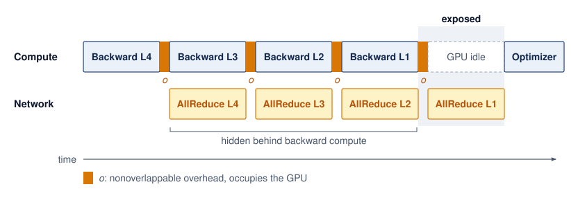

<!--
```{.tikz}
\scalebox{0.8}{%
\begin{tikzpicture}[line join=round, line cap=round, font=\small\sffamily]

  % Define Layer Order
  \pgfdeclarelayer{background}
  \pgfdeclarelayer{foreground}
  \pgfsetlayers{background,main,foreground}

  % Styles
  \tikzset{
    stream_label/.style={font=\small\bfseries\sffamily, align=right, text=TextBlack},
    compute_box/.style={
      draw=OrangeLine, fill=OrangeFill!75, line width=0.8pt, rounded corners=2.5pt,
      minimum height=1.2cm, minimum width=2.4cm, anchor=west, align=center, font=\small\sffamily
    },
    comm_box/.style={
      draw=VioletLine, fill=VioletFill!85, line width=0.8pt, rounded corners=2.5pt,
      minimum height=1.2cm, minimum width=2.4cm, anchor=west, align=center, font=\small\sffamily
    },
    stall_compute/.style={
      draw=RedLine, fill=RedFill!75, line width=0.9pt, rounded corners=2.5pt,
      minimum height=1.2cm, minimum width=2.4cm, anchor=west, align=center, font=\small\sffamily
    },
    stall_comm/.style={
      draw=RedLine, fill=RedFill!75, line width=0.9pt, rounded corners=2.5pt,
      minimum height=1.2cm, minimum width=2.4cm, anchor=west, align=center, font=\small\sffamily
    },
    opt_box/.style={
      draw=BlueLine, fill=BlueFill!75, line width=0.8pt, rounded corners=2.5pt,
      minimum height=1.2cm, minimum width=2.2cm, anchor=west, align=center, font=\small\sffamily
    },
    hook_arr/.style={
      ->, >=Latex, line width=0.9pt, OrangeLine!90!black
    },
    axis_arr/.style={
      ->, >=Latex, line width=0.75pt, GrayLine
    }
  }

  % Stream Header Labels (Left side)
  \node[stream_label, anchor=east] at (-0.4, 2.0) {Compute Stream\\[-1pt]\footnotesize\color{OrangeLine!90!black}(Tensor Cores / Default)};
  \node[stream_label, anchor=east] at (-0.4, 0.0) {Network Stream\\[-1pt]\footnotesize\color{VioletLine}(NIC / NCCL Comms)};

  % Compute Stream Blocks (y = 2.0, height = 1.2, spans y from 1.4 to 2.6)
  \node[compute_box] (C_L4) at (0.0, 2.0) {\textbf{Backward Layer 4}\\[1pt]\footnotesize Compute $\nabla W_4$};
  \node[compute_box] (C_L3) at (2.4, 2.0) {\textbf{Backward Layer 3}\\[1pt]\footnotesize Compute $\nabla W_3$};
  \node[compute_box] (C_L2) at (4.8, 2.0) {\textbf{Backward Layer 2}\\[1pt]\footnotesize Compute $\nabla W_2$};
  \node[compute_box] (C_L1) at (7.2, 2.0) {\textbf{Backward Layer 1}\\[1pt]\footnotesize Compute $\nabla W_1$};
  \node[stall_compute] (C_STALL) at (9.6, 2.0) {\textbf{Compute Stall}\\[1pt]\footnotesize\color{RedLine!90!black}Wait for $\nabla W_1$};
  \node[opt_box] (C_OPT) at (12.0, 2.0) {\textbf{Optimizer}\\[1pt]\footnotesize Weight Update};

  % Communication Stream Blocks (y = 0.0, height = 1.2, spans y from -0.6 to 0.6)
  % Idle / warmup slot on comms stream
  \draw[draw=black!25, fill=black!3, dashed, rounded corners=2.5pt, line width=0.6pt]
    (0.0, -0.6) rectangle (2.4, 0.6)
    node[pos=0.5, font=\footnotesize\color{black!40}\sffamily\itshape] {Comms Idle};

  \node[comm_box] (M_L4) at (2.4, 0.0) {\textbf{AllReduce Layer 4}\\[1pt]\footnotesize\color{GreenLine!90!black}\textbf{100\% Hidden}};
  \node[comm_box] (M_L3) at (4.8, 0.0) {\textbf{AllReduce Layer 3}\\[1pt]\footnotesize\color{GreenLine!90!black}\textbf{100\% Hidden}};
  \node[comm_box] (M_L2) at (7.2, 0.0) {\textbf{AllReduce Layer 2}\\[1pt]\footnotesize\color{GreenLine!90!black}\textbf{100\% Hidden}};
  \node[stall_comm] (M_L1) at (9.6, 0.0) {\textbf{AllReduce Layer 1}\\[1pt]\footnotesize\color{RedLine!90!black}\textbf{Exposed Latency}};

  % Idle on comms stream during optimizer step
  \draw[draw=black!25, fill=black!3, dashed, rounded corners=2.5pt, line width=0.6pt]
    (12.0, -0.6) rectangle (14.2, 0.6)
    node[pos=0.5, font=\footnotesize\color{black!40}\sffamily\itshape] {Comms Idle};

  % Vertical Droplines & Hook Arrows
  % L4 -> M_L4 hook at x = 2.4
  \fill[OrangeLine] (2.4, 1.4) circle (2pt);
  \draw[hook_arr] (2.4, 1.4) -- (2.4, 0.6);
  \node[right=2pt, font=\tiny\bfseries\sffamily\color{OrangeLine!90!black}] at (2.4, 1.0) {hook};

  % L3 -> M_L3 hook at x = 4.8
  \fill[OrangeLine] (4.8, 1.4) circle (2pt);
  \draw[hook_arr] (4.8, 1.4) -- (4.8, 0.6);
  \node[right=2pt, font=\tiny\bfseries\sffamily\color{OrangeLine!90!black}] at (4.8, 1.0) {hook};

  % L2 -> M_L2 hook at x = 7.2
  \fill[OrangeLine] (7.2, 1.4) circle (2pt);
  \draw[hook_arr] (7.2, 1.4) -- (7.2, 0.6);
  \node[right=2pt, font=\tiny\bfseries\sffamily\color{OrangeLine!90!black}] at (7.2, 1.0) {hook};

  % L1 -> M_L1 trigger at x = 9.6 (Critical Path!)
  \fill[RedLine] (9.6, 1.4) circle (2pt);
  \draw[->, >=Latex, line width=1.1pt, RedLine] (9.6, 1.4) -- (9.6, 0.6);
  \node[right=2pt, font=\tiny\bfseries\sffamily\color{RedLine}] at (9.6, 1.0) {tail hook};

  % M_L1 -> Optimizer Step release at x = 12.0 (Sync Barrier!)
  \fill[BlueLine] (12.0, 0.6) circle (2pt);
  \draw[->, >=Latex, line width=1.1pt, BlueLine] (12.0, 0.6) -- (12.0, 1.4);
  \node[right=2pt, font=\tiny\bfseries\sffamily\color{BlueLine}] at (12.0, 1.0) {sync release};

  % Background Shaded Regions
  \begin{pgfonlayer}{background}
    % Overlap Shading (x: 2.35 to 9.55, y: -0.85 to 2.95)
    \draw[draw=GreenLine, fill=GreenFill!25, line width=0.85pt, dashed, rounded corners=5pt]
      (2.35, -0.85) rectangle (9.55, 2.95);

    % Critical Tail Barrier Shading (x: 9.65 to 11.95, y: -0.85 to 2.95)
    \draw[draw=RedLine, fill=RedFill!25, line width=0.85pt, dashed, rounded corners=5pt]
      (9.65, -0.85) rectangle (11.95, 2.95);
  \end{pgfonlayer}

  % Region Title Badges above
  \node[anchor=south, font=\footnotesize\bfseries\sffamily\color{GreenLine!90!black}, fill=white, inner sep=2.5pt, rounded corners=2pt]
    at (5.95, 3.05) {Pipelined Overlap Region (${L_{\text{LogGP}}}$ Hidden)};

  \node[anchor=south, font=\footnotesize\bfseries\sffamily\color{RedLine!90!black}, fill=white, inner sep=2.5pt, rounded corners=2pt]
    at (10.8, 3.05) {Critical Tail Barrier (Exposed)};

  % Time Axis below (y = -1.4)
  \draw[axis_arr] (-0.4, -1.4) -- (14.6, -1.4) node[right, font=\footnotesize\sffamily\bfseries] {Time ($t$)};

  % Milestone Ticks & Droplines
  \foreach \x/\txt in {
    0.0/{$t_0$},
    2.4/{Layer 4 done},
    4.8/{Layer 3 done},
    7.2/{Layer 2 done},
    9.6/{Compute ends},
    12.0/{AllReduce ends},
    14.2/{Step Boundary}
  } {
    \draw[GrayLine, line width=0.6pt] (\x, -1.3) -- (\x, -1.5);
    \node[below, font=\scriptsize\sffamily, text=TextBlack] at (\x, -1.5) {\txt};
  }

  % Subtle background vertical guide lines
  \begin{pgfonlayer}{background}
    \draw[GrayLine!35, dotted, line width=0.5pt] (0.0, 2.9) -- (0.0, -1.3);
    \draw[GrayLine!35, dotted, line width=0.5pt] (2.4, 2.9) -- (2.4, -1.3);
    \draw[GrayLine!35, dotted, line width=0.5pt] (4.8, 2.9) -- (4.8, -1.3);
    \draw[GrayLine!35, dotted, line width=0.5pt] (7.2, 2.9) -- (7.2, -1.3);
    \draw[RedLine!40, dotted, line width=0.6pt] (9.6, 2.9) -- (9.6, -1.3);
    \draw[RedLine!40, dotted, line width=0.6pt] (12.0, 2.9) -- (12.0, -1.3);
    \draw[BlueLine!40, dotted, line width=0.6pt] (14.2, 2.9) -- (14.2, -1.3);
  \end{pgfonlayer}

  % Tight Architectural Legend (Integrated Table Structure)
  \node[
    draw=black!15, fill=black!2, line width=0.5pt, rounded corners=3pt,
    anchor=north, minimum width=14.8cm, inner sep=6pt
  ] at (7.0, -2.3) {
    \begin{minipage}{14.5cm}\footnotesize\sffamily
      \begin{tabular}{@{}p{7.3cm}@{\hspace{0.3cm}}p{6.9cm}@{}}
        \textbf{Execution Streams \& Mechanics} & \textbf{Systems Timing Invariants} \\[2pt]
        \tikz[baseline=-2pt]\fill[OrangeFill!75,draw=OrangeLine,line width=0.5pt,rounded corners=1pt] (0,-0.12) rectangle (0.32,0.12);
        \textbf{Compute:} Reverse autograd (Layer $4 \to 1$), non-blocking &
        $\bullet$ \textbf{Hidden Latency:} $\sum_{i=2}^4 \text{Time}(\text{Layer } i)$ masked by compute \\
        \tikz[baseline=-2pt]\fill[VioletFill!85,draw=VioletLine,line width=0.5pt,rounded corners=1pt] (0,-0.12) rectangle (0.32,0.12);
        \textbf{Network:} Concurrent AllReduce transfers via NCCL &
        $\bullet$ \textbf{Exposed Barrier:} $\text{Time}(\text{Layer 1})$ sets sync stall floor \\
        \tikz[baseline=-2pt]\fill[BlueFill!75,draw=BlueLine,line width=0.5pt,rounded corners=1pt] (0,-0.12) rectangle (0.32,0.12);
        \textbf{Optimizer:} Weights updated after global barrier &
        $\bullet$ \textbf{Step Time:} ${T_{\text{step}}(N)} = T_{\text{backward}} + T_{\text{tail}} + T_{\text{optimizer}}$
      \end{tabular}
    \end{minipage}
  };

\end{tikzpicture}%
}
```
-->

:::

The effectiveness of this overlap depends on the relative sizes of computation and communication at each layer. For transformer models, the largest gradient tensors belong to the attention and feed-forward weight matrices, which are also the most computationally expensive layers. That computation cannot hide the same layer's gradient transfer, because the gradient is ready only afterward. It can hide a previously launched transfer; the ordering and cost of the remaining layers determine each gradient's overlap window.

The overlap strategy interacts with algorithm choice from @sec-communication-collective-operations-collective-operations-allreduce-algorithms-7545 and @sec-communication-collective-operations-collective-operations-mapping-collectives-topology-3214. An isolated-collective crossover need not predict the best training-step schedule, because the dependency schedule determines how much of each candidate's transfer time is exposed. Overlap with the backward pass\index{AllReduce!overlap with backward pass} can reduce Ring's exposed latency penalty, but the benefit must be measured with the actual gradient-ready times and runtime progress behavior. The optimizer step still cannot begin until every required reduction completes, so the transfers of the last layers processed, those closest to the input, stay exposed.

### Bucket fusion {#sec-communication-bucket-fusion}

The layer-by-layer overlap described in @sec-communication-layer-overlap assumes that each layer's gradient is communicated as a single message. In reality, a transformer layer contains dozens of individual parameter tensors (query, key, value projection matrices, output projection, layer norm parameters, feed-forward weights, and biases). Launching a separate AllReduce for every individual parameter would create thousands of small-message collectives, each paying the full $\CollectiveCallStartupLatency$ overhead. To avoid this, DDP uses bucket fusion\index{Bucket fusion}\index{Bucket fusion!trade-off} to group parameters into buckets (often configured around tens of megabytes, with 25 MB a common PyTorch reference point) and launches one AllReduce per bucket. The bucket size represents a trade-off: larger buckets amortize $\CollectiveCallStartupLatency$ overhead but delay the start of communication (because the bucket cannot be sent until all its parameters have computed gradients). Smaller buckets start communication earlier but pay more $\CollectiveCallStartupLatency$ overhead.

The optimal bucket size\index{Bucket fusion!size tuning} depends on gradient-ready times, tensor sizes, and network characteristics. Smaller buckets can start communication sooner when waiting for more gradients would consume the overlap window. Larger buckets can amortize startup when repeated small transfers dominate. Neither choice follows from the model family alone; the useful measure is the resulting training-step time, including the exposed final transfer. PyTorch's `bucket_cap_mb` parameter in DDP allows tuning this trade-off.

Bucket membership also determines how early communication can begin. A bucket containing one late gradient must wait even if its other gradients are ready. DDP can use reverse parameter registration order as an approximation to backward readiness and, depending on configuration, rebuild buckets from the observed backward order. Registration order need not match forward execution order, especially in models with branches or reused parameters. Grouping gradients that become ready together helps preserve the overlap window while maintaining a consistent collective sequence across ranks.

### Overlap limits and exposed communication {#sec-communication-overlap-limits}

Communication-computation overlap has fundamental limits. The LogP model's overhead parameter $\SymmetricMessageOverhead$ represents processor time consumed by initiating or completing transfers. In the simplified LogP budget, initiation and completion consume $2\SymmetricMessageOverhead$ per operation on the participating execution resource. When backward compute intervals are short relative to that overhead, hiding network transit may save time while leaving processor overhead as the dominant cost.

The pipeline also has boundary effects\index{Communication-computation overlap!boundary effects}. During the first backward computation, no gradient from this pass is ready to communicate. Once the output-side gradient is ready, however, its communication can overlap with the remaining backward work. At the other end, the input-side gradient has no subsequent backward computation to hide its transfer. More layers create a longer overlap window, but depth alone does not guarantee high coverage: if communication takes longer than each compute interval, a backlog remains even in a deep model.

A third limitation arises from memory pressure. Buffers used by an in-flight transfer must remain valid while independent computation produces or consumes other tensors. Their overlapping lifetimes can increase peak GPU memory use\index{Communication-computation overlap!memory overhead}, although views and buffer reuse can avoid separate copies. For FSDP workloads, prefetching parameters can keep multiple materialized groups resident at once, trading memory savings for communication overlap. The engineering challenge is to hide transfers within the available memory budget, and FSDP's prefetch and resharding policies\index{FSDP!prefetch tuning} are the controls that set this trade-off.

Together, processor overhead, boundary stalls, and per-layer transfer time determine how much of a collective schedule can hide behind backward computation. Pricing a realistic 32-layer transformer backward pass shows how much communication remains exposed when each layer's reduction outlasts its compute window.

```{python}
#| echo: false
#| label: overlap-budget-calc
from mlsysim.core.units import BILLION, MB, ms

# ┌─────────────────────────────────────────────────────────────────────────────
# │ COMMUNICATION-COMPUTATION OVERLAP BUDGET—7B TRANSFORMER
# ├─────────────────────────────────────────────────────────────────────────────
# │ Context: "Overlap Budget for a 7B Transformer" .callout-notebook
# │
# │ Goal: Quantify step time savings from layer-by-layer AllReduce overlap for
# │       a 32-layer, 7B transformer on 64 GPUs, showing the exposed-latency
# │       residual when AllReduce exceeds per-layer backward time.
# │ Show: overlap_savings_pct_str ≈ 35 percent—inline in callout insight sentence.
# │ How: Sequential: T_no_overlap = T_backward + N_L * T_comm; pipelined:
# │      T_overlap = T_backward + T_first_comm + (N_L - 1) * max(0, T_comm - T_backward_per_layer).
# │
# └─────────────────────────────────────────────────────────────────────────────

class OverlapBudgetCalc:
    """Step-time savings from layer-by-layer AllReduce overlap for a 32-layer 7B transformer."""

    # ┌── 1. LOAD (Constants) ──────────────────────────────────────────────
    _model = Models.Language.Llama2_7B
    n_layers_overlap = _model.layers  # transformer layers
    backward_per_layer = 15 * ms  # scenario assumption: per-layer backward pass
    gradient_per_layer = (_model.size_in_bytes(BYTES_FP32) / n_layers_overlap).to(MB)  # equal-layer model: FP32 gradients / layers
    bucket_size = 100 * MB  # scenario assumption: per AllReduce bucket
    allreduce_per_bucket = 3 * ms  # assumed fixed charge for each bucket, including the final partial bucket
    n_gpus_overlap = 64
    params_overlap = _model.parameters

    # ┌── 2. EXECUTE (The Compute) ────────────────────────────────────────
    total_backward = n_layers_overlap * backward_per_layer
    from math import ceil

    buckets_per_layer = ceil((gradient_per_layer / bucket_size).to_base_units().magnitude)
    allreduce_per_layer = buckets_per_layer * allreduce_per_bucket

    # Sequential (no overlap)
    no_overlap = total_backward + n_layers_overlap * allreduce_per_layer

    # Pipelined (with overlap)
    exposed_per_layer = max(0 * ms, allreduce_per_layer - backward_per_layer)
    with_overlap = total_backward + allreduce_per_layer + (n_layers_overlap - 1) * exposed_per_layer
    overlap_savings_pct = (1 - (with_overlap / no_overlap).to_base_units().magnitude) * 100

    # ┌── 3. GUARD (Invariants) ──────────────────────────────────────────
    from mlsysim.fmt import check, fmt, fmt_count, fmt_memory, fmt_params, fmt_percent, fmt_time

    check(no_overlap > with_overlap, "No overlap should take longer than with overlap")
    check(abs(gradient_per_layer.to(MB).magnitude - 875) < 1e-6, "Header comment and prose assume 875 MB per layer")

    # ┌── 4. OUTPUT (Formatting) ─────────────────────────────────────────────
    total_backward_ms_str = fmt_time(total_backward, ms, precision=0, commas=False)
    allreduce_per_layer_ms_str = fmt_time(allreduce_per_layer, ms, precision=0, commas=False)
    no_overlap_ms_str = fmt_time(no_overlap, ms, precision=0, commas=False)
    with_overlap_ms_str = fmt_time(with_overlap, ms, precision=0, commas=False)
    overlap_savings_pct_str = fmt_percent(overlap_savings_pct / 100, precision=1, commas=False, style='prose')
    exposed_per_layer_ms_str = fmt_time(exposed_per_layer, ms, precision=0, commas=False)
    n_layers_str = fmt(n_layers_overlap, precision=0, commas=False)
    backward_per_layer_ms_str = fmt_time(backward_per_layer, ms, precision=0, commas=False)
    n_gpus_overlap_str = fmt_count(n_gpus_overlap, commas=False, label="GPU")
    gradient_per_layer_mb_str = fmt_memory(gradient_per_layer, unit=MB, precision=0, commas=False)
    bucket_size_mb_str = fmt_memory(bucket_size, unit=MB, precision=0, commas=False)
    params_b_overlap_str = fmt_params(params_overlap, scale="B", precision=0, commas=False)
```

```{python}
#| echo: false
#| label: overlap-ideal-bucket-calc
# ┌─────────────────────────────────────────────────────────────────────────────
# │ IDEAL HIERARCHICAL TIME FOR ONE OVERLAP BUCKET (LEGO)
# ├─────────────────────────────────────────────────────────────────────────────
# │ Context: sentence after "Overlap budget for a 7B transformer" notebook.
# │
# │ Goal: Price the notebook's 100 MB bucket with the chapter's own three-phase
# │       hierarchical model on 64 GPUs (8 DGX H100 nodes), to show that the
# │       notebook's 3 ms per-bucket charge is an assumed achieved time, and
# │       that at the ideal rate each layer's reduction fits its backward window.
# │ Show: ~0.85 ms per bucket; ~7.6 ms per layer vs 15 ms backward per layer.
# │ How: same phase model as HierarchicalAllreduceCalc (NVLink ReduceScatter,
# │      IB ring on the M/G shard with canonical NDR alpha, NVLink AllGather).
# │
# └─────────────────────────────────────────────────────────────────────────────
from mlsysim import Hardware, Systems
from mlsysim.core.units import MB, ms, second
from mlsysim.fmt import check, fmt_time
from mlsysim.physics import calc_ring_allreduce_time, calc_ring_collective_data_factor

class OverlapIdealBucket:
    # ┌── 1. LOAD ──────────────────────────────────────────
    bucket = OverlapBudgetCalc.bucket_size
    n_nodes = OverlapBudgetCalc.n_gpus_overlap // Systems.Nodes.DGX_H100.accelerators_per_node
    gpus_per_node = Systems.Nodes.DGX_H100.accelerators_per_node
    nvlink_beta = Hardware.Cloud.H100.nvlink.bandwidth_per_direction
    ib_beta = Systems.Fabrics.InfiniBand_NDR.bandwidth
    ib_alpha = Systems.SwitchFabric.AlphaNdr
    # ┌── 2. EXECUTE ───────────────────────────────────────
    intra = (bucket * calc_ring_collective_data_factor(gpus_per_node) / nvlink_beta).to(ms)
    inter = calc_ring_allreduce_time(bucket / gpus_per_node, n_nodes, ib_beta, ib_alpha).to(ms)
    per_bucket = intra + inter + intra
    per_layer = OverlapBudgetCalc.buckets_per_layer * per_bucket
    # ┌── 3. GUARD ─────────────────────────────────────────
    check(n_nodes == 8, "64 GPUs should be 8 DGX H100 nodes")
    check(per_bucket < OverlapBudgetCalc.allreduce_per_bucket, "Ideal bucket time should be below the notebook's assumed charge")
    check(per_layer < OverlapBudgetCalc.backward_per_layer, "At the ideal rate each layer's reduction should fit its backward window")
    # ┌── 4. OUTPUT ────────────────────────────────────────
    per_bucket_ms_str = fmt_time(per_bucket, ms, precision=2, commas=False)
    per_layer_ms_str = fmt_time(per_layer, ms, precision=1, commas=False)
    assumed_bucket_ms_str = fmt_time(OverlapBudgetCalc.allreduce_per_bucket, ms, precision=0, commas=False)
```

::: {#nbk-collective-communication-overlap-budget-7b-transformer .callout-notebook title="Overlap budget for a 7B transformer"}

**Problem**: A `{python} OverlapBudgetCalc.n_layers_str`-layer transformer model (`{python} OverlapBudgetCalc.params_b_overlap_str` parameters) is trained on `{python} OverlapBudgetCalc.n_gpus_overlap_str`. Assume the data-parallel reducer communicates FP32 gradients, about `{python} OverlapBudgetCalc.gradient_per_layer_mb_str` per layer, in `{python} OverlapBudgetCalc.bucket_size_mb_str` buckets, four times the common 25 MB default. Each layer's backward pass takes `{python} OverlapBudgetCalc.backward_per_layer_ms_str`. Assume the cluster achieves `{python} OverlapIdealBucket.assumed_bucket_ms_str` per bucket under its contention and protocol overheads, so each layer's gradients take `{python} OverlapBudgetCalc.allreduce_per_layer_ms_str`, and assume equal layers and the same charge for the final partial bucket. What is the backward-plus-communication time with and without overlap?

**Without overlap (sequential)**:

$\SequentialBackwardCommunicationTime= \BackwardPassTime+ \CommunicationTime(\DeviceCount)$ = `{python} OverlapBudgetCalc.total_backward_ms_str` + `{python} OverlapBudgetCalc.n_layers_str` $\times$ `{python} OverlapBudgetCalc.allreduce_per_layer_ms_str` = `{python} OverlapBudgetCalc.no_overlap_ms_str`.

**With overlap (pipelined)**:

Each layer's AllReduce (`{python} OverlapBudgetCalc.allreduce_per_layer_ms_str`) runs in parallel with the next layer's backward pass (`{python} OverlapBudgetCalc.backward_per_layer_ms_str`). Since `{python} OverlapBudgetCalc.allreduce_per_layer_ms_str` > `{python} OverlapBudgetCalc.backward_per_layer_ms_str`, there is `{python} OverlapBudgetCalc.exposed_per_layer_ms_str` of exposed communication per layer that cannot be hidden.

Communication runs back to back from the moment the output layer's gradients are ready. Each later reduction overruns its backward window by the exposed amount, so the backlog grows by that much per layer, and the last reduction adds its full duration after the backward pass ends:

$\OverlappedBackwardCommunicationTime= \BackwardPassTime+ \LayerAllReduceTime+ (\LayerCount - 1) \times \LayerExposedCommunicationTime$ = `{python} OverlapBudgetCalc.with_overlap_ms_str`.

**Systems insight**: Overlap reduces backward-plus-communication time by `{python} OverlapBudgetCalc.overlap_savings_pct_str`. The remaining exposed communication comes from the AllReduce being slower than the per-layer backward pass. To reduce the backlog, either lengthen the independent compute window (for example, with a larger batch) or reduce AllReduce time. The final gradient still has an exposed transfer tail, and any change must preserve the intended training workload and quality target. The overlap is most effective when per-layer backward compute exceeds the reduction time ($\LayerBackwardTime > \LayerAllReduceTime$).

:::

The verdict turns on the assumed per-bucket charge. The hierarchical model of notebook \ref{nbk-collective-communication-hierarchical-bandwidth-multiplier} prices one uncontended `{python} OverlapBudgetCalc.bucket_size_mb_str` bucket on these eight nodes at about `{python} OverlapIdealBucket.per_bucket_ms_str`, or `{python} OverlapIdealBucket.per_layer_ms_str` per layer, inside the `{python} OverlapBudgetCalc.backward_per_layer_ms_str` backward window, so at that rate every transfer except the last would hide. An overlap budget is therefore only as good as its achieved per-bucket time, which the calibration of @sec-communication-nccl-reality measures rather than assumes.

An overlap budget joins the collective's transfer cost to the model's dependency schedule. Realizing that budget requires a runtime whose asynchronous progress and device-memory path preserve the independent work available between gradient production and consumption.

## Communication Libraries and Runtimes {#sec-communication-collective-operations-collective-operations-communication-libraries-nccl-5307}

An overlap schedule only works if the communication backend can move the required tensors while independent computation proceeds. Production libraries realize the same algorithms and schedules, so the engineering decision is which one preserves the chapter's model, topology, and overlap assumptions on the target hardware.

### Backend selection {#sec-communication-backend-selection}

A collective runtime that bounces GPU tensors through host DRAM over PCIe or ignores NVLink and rail topology can cut effective reduction bandwidth by an order of magnitude even when it implements the right ring or tree schedule. Four properties therefore separate communication backends in practice: the device memory path, topology awareness, portability, and observability. NCCL\index{NCCL!performance} leads on the first two for NVIDIA GPUs because it executes the collective algorithms of @sec-communication-collective-operations-collective-operations-allreduce-algorithms-7545 and @sec-communication-collective-operations-collective-operations-mapping-collectives-topology-3214 directly on GPU-resident buffers [@jeaugey2017nccl; @nvidiaNcclUserGuide]. Its kernel fusion\index{NCCL!kernel fusion} combines reduction arithmetic with data movement so intermediate results do not bounce back to HBM\index{HBM}. GPUDirect RDMA\index{NCCL!GPUDirect RDMA} lets the network card read and write GPU memory directly over PCIe without staging payloads through host DRAM. To keep multiple links busy at once, channel pipelining\index{Channel pipelining}\index{NCCL!channel allocation} splits each collective across parallel communication channels, though realized throughput still depends on NIC placement, routing, and contention because extra channels cannot create port capacity. Documented environment variables\index{NCCL!environment variables} then expose these choices for observability, with `NCCL_ALGO` and `NCCL_PROTO` inspecting or overriding the selected algorithm and protocol and `NCCL_DEBUG`\index{NCCL!debug logging} reporting the active topology, channels, and schedule [@nvidiaNcclUserGuide].

MPI\index{MPI!legacy} matters when portability, CPU-side coordination, or HPC integration is the binding requirement [@mpiforum2015mpi31], and two of its features bear directly on overlap. Non-blocking collectives\index{Non-blocking collective} such as `MPI_Iallreduce` return a request handle that the application tests or waits on, a completion model different from NCCL's ordering on CUDA streams. Persistent collectives\index{Persistent collective}, introduced in MPI 4.0, initialize an operation once and activate it at every step, amortizing setup for a training loop that repeats the same AllReduce shape. Either model hides a transfer only when independent work exists and the runtime makes progress. MPI's one-sided communication\index{One-sided communication} (`MPI_Put`, `MPI_Get`, `MPI_Accumulate`) maps onto RDMA hardware and suits asynchronous designs in which one process writes another's memory without its participation. CUDA-aware MPI\index{MPI!CUDA-aware} implementations accept GPU pointers, but the selected transport decides whether data still passes through host memory, so that path must be benchmarked against NCCL.

Portability is the strength of Gloo\index{Gloo}, a PyTorch backend for CPU tensors, development, and testing whose TCP transport\index{Gloo!TCP transport} exercises collective semantics on one machine before a job reaches an accelerator cluster. Whether a faster shared-memory transport\index{Gloo!shared-memory transport} is active must be measured rather than assumed. Other accelerators have their own backends, AMD's RCCL\index{RCCL}\index{RCCL!ROCm stack} for the ROCm stack and Intel's oneCCL\index{oneCCL}\index{oneCCL!oneAPI architecture}, because the same algorithm has different effective $\MessageStartupLatency$, $\LinkBandwidth$, and topology constraints on each platform. PyTorch's `torch.distributed`\index{PyTorch!torch.distributed backends} routes each call to the backend its process group names, so teams often mix them, with NCCL reducing gradients in a GPU group while a CPU group uses Gloo for barriers, scalar broadcasts, or sampler state. Applied to common scenarios, the four properties select a library, or a pairing of libraries, for each (@tbl-library-selection).

| **Scenario**                      |              **Recommended library**              | **Rationale**                                |
|:----------------------------------|:-------------------------------------------------:|:---------------------------------------------|
| **Multi-GPU training (NVIDIA)**   |                        NCCL                       | GPUDirect, kernel fusion, NVLink-aware       |
| **CPU-only distributed training** |                    Gloo or MPI                    | Mature CPU optimizations                     |
| **Development/debugging**         |                        Gloo                       | Cross-platform, no CUDA dependency           |
| **Mixed vendor GPUs**             | Vendor-specific groups; validate cross-group path | NCCL, RCCL, and oneCCL are vendor-specific   |
| **HPC integration**               |                     MPI + NCCL                    | MPI for job launch, NCCL for GPU collectives |

: **Communication Library Selection**: Choose based on hardware and workload requirements. Many NVIDIA GPU training deployments use NCCL; Gloo serves as a portable fallback. {#tbl-library-selection}

The table follows from the chapter's cost model. A backend's memory path and topology choices determine how it uses the fabric, and its diagnostic signals help identify whether $\MessageStartupLatency$, $\LinkBandwidth$, or processor overhead limits the job. The resulting performance must still be measured with the workload's collective and placement.

### Calibrating collective communication models {#sec-communication-nccl-reality}

The bandwidth-latency trade-off (principle \ref{pri-alpha-beta-model}) provides useful first-order predictions, but a valid comparison must model the same collective that the benchmark executes. For a ring AllReduce over $\DeviceCount$ ranks and an $\CollectivePayloadSize$-byte tensor, the first-order cost is $2(\DeviceCount-1)\MessageStartupLatency+ 2(\DeviceCount-1)\CollectivePayloadSize/(\DeviceCount\LinkBandwidth)$, not the point-to-point expression $\MessageStartupLatency+\CollectivePayloadSize/\LinkBandwidth$. A tree, a hierarchical schedule, and a switch-assisted reduction have different step counts and traffic factors. NCCL also selects protocols, channels, and algorithms according to message size and detected topology, so those choices become part of the experimental condition [@jeaugey2017nccl; @nvidiaNcclUserGuide].

A calibrated collective model\index{Performance modeling!collective calibration} therefore records the operation, reduction datatype, rank count, tensor size, algorithm and protocol, topology, rank placement, and achieved bus bandwidth. It then fits effective $\MessageStartupLatency$ and $\LinkBandwidth$ to measurements from that same configuration, as @sec-network-fabrics-performance-model does for one measured NCCL AllReduce. Comparing predicted and observed time under this contract reveals software overhead or topology loss without mistaking a collective's algorithmic traffic factor for library inefficiency. The resulting parameters apply only to the measured regime; changing the collective, process group, topology, or library version requires recalibration. A calibrated model selects a collective schedule and sizes its overlap window. Attributing an observed training-step regression to kernels, memory, communication, or contention is a broader measurement task, which the program goodput analysis of @sec-performance-engineering-profiling develops.

Communication diagnosis begins by comparing the workload against a matched bare-collective baseline and recording the selected algorithm, protocol, rank placement, and achieved bandwidth. A healthy baseline with a slow training step points to invocation granularity, contention, stragglers, or insufficient overlap rather than the fabric alone. Profiler traces and the attribution workflow separate those causes; the output needed here is the calibrated $\MessageStartupLatency$, $\LinkBandwidth$, and overlap window that select a collective schedule.

The backend must satisfy both the collective contract and the measured execution budget. A fast isolated collective is insufficient when its placement, invocation order, or progress behavior leaves the training step waiting.

```{python}
#| echo: false
# ┌─────────────────────────────────────────────────────────────────────────────
# │ COMMUNICATION INFRASTRUCTURE RECAP (LEGO)
# ├─────────────────────────────────────────────────────────────────────────────
# │ Context: "Flat AllReduce is good enough" fallacy.
# │
# │ Goal: Recap the per-direction NVLink vs. InfiniBand NDR bandwidth
# │       hierarchy and the 8-node hierarchical-vs-flat speedup.
# │ Show: nvlink_bw_beta_gb_per_s_str = 450 GB/s, speedup_mult_str ≈ 4.8x.
# │ How: Flat T = 2M/beta_IB vs. 3-step hierarchical (NVLink ReduceScatter,
# │      IB ring on the M/G shard, NVLink AllGather).
# │
# └─────────────────────────────────────────────────────────────────────────────
from mlsysim import Hardware, Systems
from mlsysim.core.units import GB, MB, microsecond, ms, second
from mlsysim.fmt import check, fmt_bandwidth, fmt_multiple
from mlsysim.physics import (
    calc_ring_allreduce_latency_time,
    calc_ring_allreduce_time,
    calc_ring_collective_data_factor,
)

class CommInfraRecap:
    # ┌── 1. LOAD (Constants) ──────────────────────────────────────────────
    nvlink_bw_beta = Hardware.Cloud.H100.nvlink.bandwidth_per_direction
    n_nodes_har = 8
    gpus_per_node = Systems.Nodes.DGX_H100.accelerators_per_node
    gradient = ReferenceStats.CollectiveCommunicationProfile.GradientBuffer  # chapter's 1 GB gradient buffer
    ib_bw = Systems.Fabrics.InfiniBand_NDR.bandwidth
    ib_alpha = Systems.SwitchFabric.AlphaNdr  # canonical effective NDR launch latency

    # ┌── 2. EXECUTE (The Compute) ────────────────────────────────────────
    flat_time = (2 * gradient / ib_bw).to(ms)
    intra_data = (gradient * calc_ring_collective_data_factor(gpus_per_node)).to(MB)
    intra_rs = (intra_data / nvlink_bw_beta).to(ms)
    inter_data = (gradient / gpus_per_node).to(MB)
    inter_bw = calc_ring_allreduce_time(
        message_bytes=inter_data,
        n_gpus=n_nodes_har,
        bandwidth_bytes_s=ib_bw,
        latency_s=0 * second,
    ).to(ms)
    inter_lat = calc_ring_allreduce_latency_time(n_nodes_har, ib_alpha).to(ms)
    hier_total = intra_rs + inter_bw + inter_lat + intra_rs
    speedup = (flat_time / hier_total).to_base_units().magnitude

    # ┌── 3. GUARD (Invariants) ──────────────────────────────────────────
    check(speedup > 4, "Hierarchical recap speedup should remain material")

    # ┌── 4. OUTPUT (Formatting) ─────────────────────────────────────────────
    nvlink_bw_beta_gb_per_s_str = fmt_bandwidth(nvlink_bw_beta, unit=GB / second, precision=0, commas=False)
    ib_ndr_bw_gb_per_s_str = fmt_bandwidth(ib_bw, unit=GB / second, precision=0, commas=False)
    speedup_mult_str = fmt_multiple(speedup, precision=1, commas=False)
```

## Fallacies and Pitfalls {#sec-communication-collective-operations-collective-operations-fallacies-pitfalls-9cd0}

Communication optimization attracts persistent misconceptions because the interaction between latency, bandwidth, topology, and compression creates nonobvious failure modes that simple mental models miss. Each of the following pitfalls traces a common rule of thumb to the physical or algorithmic boundary where it breaks down.

::: {.fallacy-pitfall}

**Fallacy**: *Bandwidth is the only metric that matters.*

For small control messages or sufficiently small token exchanges, latency ($\MessageStartupLatency$) dominates, and buying 400G networking will not help a message that takes 5 μs to serialize in software. @Sec-network-fabrics-performance-model draws that point-to-point split at the critical message size $\LatencyBandwidthCrossoverSize = \MessageStartupLatency\cdot \LinkBandwidth$\index{Critical message size!crossover}. A collective hides a less obvious case. The regime belongs to each schedule step's chunk rather than to the tensor, so a gradient bucket far above $\LatencyBandwidthCrossoverSize$ can still travel in latency-bound steps on a large ring, where fewer rounds or larger buckets help and added bandwidth helps little.

:::

::: {.fallacy-pitfall}

**Pitfall**: *Assuming AllReduce works for everything.*

AllReduce computes one reduction over compatible element counts and datatypes; it does not implement destination-specific routing. In expert parallelism and recommendation systems, each worker instead sends distinct data to different peers. These workloads require AllToAll or its variable-count form, whose performance depends on injection bandwidth, bisection bandwidth, oversubscription, message granularity, routing, and skew rather than logical connection count alone.

:::

::: {.fallacy-pitfall}

**Fallacy**: *Pipeline parallelism eliminates communication overhead.*

Pipeline parallelism exchanges activations and their backward gradients between adjacent stages. It can coexist with data-parallel AllReduce, and transfer cost still depends on tensor size and placement. Each stage boundary is a point-to-point dependency on the critical path, so a stage cannot start a microbatch until its activations arrive. The pipeline bubble\index{Pipeline parallelism!bubble overhead}, the time stages sit idle while the pipeline fills and drains, adds to whatever transfer time remains exposed. The bubble analysis of @sec-distributed-training-systems-systems-pipeline-parallelism-8748 shows that shrinking it requires many more microbatches than stages, a constraint on batch size and activation memory that no faster link removes. Parallelism choices must therefore account for both communication dependencies and schedule-induced idleness.

:::

::: {.fallacy-pitfall}

**Pitfall**: *Using Ring AllReduce by default without checking message size and topology.*

Ring achieves the bandwidth-optimal term $2\frac{\DeviceCount-1}{\DeviceCount}\frac{\CollectivePayloadSize}{\LinkBandwidth}$ in the endpoint model but pays $\mathcal{O}(\DeviceCount)$ latency. For a `{python} RingVsTree.M_mb_str` gradient across `{python} RingVsTree.N_str` GPUs with $\MessageStartupLatency=$ `{python} RingVsTree.alpha_us_str` and $\LinkBandwidth=$ `{python} RingVsTree.beta_gb_per_s_str`, the simple Tree model wins because Ring's extra startup cost (about `{python} RingVsTree.ring_excess_lat_us_str` beyond Tree's) exceeds Tree's extra byte-transfer cost (about `{python} RingVsTree.tree_excess_bw_us_str` beyond Ring's). The log-aware crossover estimate\index{AllReduce!algorithm selection} $\RingTreeCrossoverPayload \approx \DeviceCount\MessageStartupLatency\LinkBandwidth/ \log_2 \DeviceCount$ guides this two-model comparison. Runtime selection should be evaluated with the actual algorithm variants and placement.

:::

::: {.fallacy-pitfall}

**Fallacy**: *Gradient compression is safe without error feedback.*

Top-k sparsification can achieve 99 percent compression, but naively discarding small gradients can prevent convergence. Without error feedback ($\ErrorFeedbackResidual_{t+1} = (\LocalGradient_t + \ErrorFeedbackResidual_t) - \CompressedGradientUpdate_t$), gradients below the threshold are lost forever, accumulating systematic bias\index{Gradient compression!divergence risk} that can destabilize training or leave a persistent optimization error.

:::

::: {.fallacy-pitfall}

**Pitfall**: *Evaluating gradient compression by communication speedup alone.*

Even a 100$\times$ communication speedup must be evaluated against the complete training budget when reaching the target quality requires 2$\times$ more iterations. It helps only if the reduction in total step time outweighs the extra iterations. The right metric is time to target quality, not time per iteration. Communication microbenchmarks measure collective time, while the engineering decision depends on time to target quality, and the two diverge whenever compression introduces gradient bias or variance that slows convergence. Validate compression on the target convergence benchmark with the deployment training schedule, not on a synthetic AllReduce microbenchmark alone.

:::

::: {.fallacy-pitfall}

**Fallacy**: *Async collectives always hide latency.*

Python's `dist.all_reduce(..., async_op=True)` only returns control to the CPU. The LogP model distinguishes network latency $\LogpNetworkLatency$ (overlappable) from processor overhead $\SymmetricMessageOverhead$ (nonoverlappable\index{Asynchronous collective!overlap limits}). The condition $\IronLawComputeTime > \SymmetricMessageOverhead$ alone does not guarantee that a transfer is hidden. The remaining independent work must cover the transfer interval, the runtime must make progress, and dependent consumers must wait for completion.

:::

::: {.fallacy-pitfall}

**Pitfall**: *Silent data corruption in the network.*

Networks are not perfect. A bad cable, faulty NIC, or firmware bug can corrupt data below the level where the training framework sees an explicit error. At 10,000 nodes running 24/7, even rare bit errors can appear often enough to matter. The communication-specific lesson is that bandwidth tuning is incomplete without end-to-end validation: checksums, collective result checks, gradient-norm sanity tests, and the fault-tolerance mechanisms of @sec-fault-tolerance-reliability must catch silent data corruption\index{Silent data corruption!network validation} before corrupted gradients become model updates.

:::

::: {.fallacy-pitfall}

**Fallacy**: *Flat AllReduce is good enough for multi-node training.*

A single flat Ring AllReduce\index{Hierarchical AllReduce!bandwidth hierarchy} runs at the rate of its slowest edge. On a multi-node cluster, that edge is one cross-node port at `{python} CommInfraRecap.ib_ndr_bw_gb_per_s_str` over InfiniBand rather than the `{python} CommInfraRecap.nvlink_bw_beta_gb_per_s_str` per direction available within the node, however carefully the ranks are ordered. For an 8-node cluster with 8 GPUs per node, the worked hierarchical schedule assigns one-eighth of the payload to each inter-node shard group and runs the eight groups on eight ports at once. The result is an 8$\times$ reduction per group rather than a reduction in aggregate cross-node bytes. The modeled gain of about `{python} CommInfraRecap.speedup_mult_str` in @sec-communication-collective-operations-collective-operations-hierarchical-allreduce-1338 therefore depends on independent port capacity. A multichannel flat schedule that also occupies several ports at once requires its own traffic accounting.

:::

::: {.fallacy-pitfall}

**Pitfall**: *Assuming one cost formula fits every intra-node algorithm.*

NVSwitch\index{NVSwitch!intra-node algorithm selection} provides high-radix, nonblocking connectivity within supported DGX generations, but it does not turn an arbitrary AllReduce into a one-step reduction. Unless the switch generation and software path provide in-network reduction, endpoints still execute a ring, tree, or other scheduled algorithm over NVLink paths. Newer switch-assisted designs require their own documented cost model. Capacity planning should therefore use the algorithm and hardware generation that the runtime actually selects. Apply the corresponding intra-node traffic factor, the inter-node ring or tree factor, and their hierarchical composition rather than substituting a generic crossbar hop for reduction work.

:::

::: {.fallacy-pitfall}

**Fallacy**: *Rank-to-GPU mapping does not affect collective performance.*

If the job scheduler assigns ranks to GPUs without considering the physical topology\index{Rank assignment!topology alignment}, hierarchical AllReduce and rail-optimized routing may route traffic suboptimally. A common symptom is that `nccl-tests` reaches full bandwidth on the cluster while the training job achieves only a fraction of it, because the job's ranks were placed so that corresponding shards cannot stay on one rail. Message sizes, overlap, and competing traffic can produce a similar gap. Before benchmarking, record each rank's GPU, NIC binding, node, and rail and confirm the intended layout (for example, ranks 0--7 on node 0 and ranks 8--15 on node 1, with local rank $\LocalRankIndex$ on each node bound to rail $\LocalRankIndex$). Contiguous rank numbers on a node alone do not establish that corresponding shards use the intended physical rails. A benchmark that omits this record and the NCCL topology configuration is not reusable evidence\index{Benchmarking!placement context}, because a placement difference then reads as a library or hardware regression.

:::

## Summary {#sec-communication-collective-operations-summary}

Every mechanism in this chapter works on the communication term $\CommunicationTime(\DeviceCount)$ of the Fleet Law (@eq-fleet-law), either shrinking it through better schedules, placement, and smaller payloads or enlarging $\OverlappedTime$ so that less of it is exposed. Each spends effort on the Communication axis of C³ so that added compute does not sit waiting. The mechanisms compose into one ordered judgment that starts with the collective contract. The primitive whose output the next computation consumes fixes which ranks exchange data and what each holds afterward, and no faster schedule can recover bytes spent delivering a broader result than the model needs. Once the contract is fixed, the $\MessageStartupLatency$-$\LinkBandwidth$ model, the critical size $\LatencyBandwidthCrossoverSize = \MessageStartupLatency\cdot \LinkBandwidth$, and the ring-tree crossover $\RingTreeCrossoverPayload$ price each candidate schedule round by round on its per-step chunk rather than on the whole tensor.

A schedule priced on a flat network realizes that cost only when hierarchy, rail alignment, and rank order map the logical exchange onto the physical links. Compression and overlap then determine how much of the remaining transfer reaches the critical path. LogP separates the network transit time that overlap can hide from the processor overhead it cannot, and every candidate is judged by time to the same quality target rather than isolated collective speed. A model calibrated against the same collective, process group, and topology closes the loop by separating a schedule's inherent traffic from library or placement loss.

::: {.callout-takeaways title="Every byte has a travel cost"}

* **Contract first, then price per round**: Choose the narrowest primitive whose output the next computation consumes, then price its schedule round by round. Each round pays the startup cost on a chunk, so the critical size $\LatencyBandwidthCrossoverSize = \MessageStartupLatency\cdot \LinkBandwidth$ (principle \ref{pri-alpha-beta-model}) classifies the chunk rather than the tensor. Collective duration also depends on round count and traffic volume; fit parameters with a benchmark that matches the workload's collective and topology.
* **Algorithm choice is scale-dependent**: Ring AllReduce is bandwidth-optimal but pays $\mathcal{O}(\DeviceCount)$ latency; the simple full-message Tree model uses fewer rounds ($\mathcal{O}(\log \DeviceCount)$) but more bandwidth work. Use the log-aware crossover estimate $\RingTreeCrossoverPayload \approx \DeviceCount\MessageStartupLatency\LinkBandwidth/ \log_2 \DeviceCount$ to reason about the switch point.
* **Hierarchy exposes parallel network capacity**: Local reductions over fast NVLink leave smaller shards for the slow InfiniBand tier. The effective bandwidth gain requires independent port capacity for concurrent shard exchanges; splitting a payload cannot multiply the capacity of a shared uplink.
* **AllToAll schedule selection follows the active bound**: Direct exchange preserves simplicity for balanced coarse chunks, hierarchy amortizes startup across scarce inter-node links, and variable-size exchange removes padding under skew. Injection bandwidth, bisection capacity, oversubscription, message granularity, and the hottest receiver determine which schedule wins.
* **Error feedback controls lossy compression error**: Sparsification can discard 99 percent of each transmitted update while accumulating the compression residual locally and adding it before the next compression step. Under the analyzed assumptions, this bounds accumulated compression error and restores convergence guarantees even though individual compressed updates can remain biased.
* **Overlap is limited by remaining independent work**: Gradient hooks and bucket fusion let communication run during later backward computations, but the final transfer and any communication backlog remain exposed. Evaluate the resulting step time, not model depth alone (principle \ref{pri-distributed-step-time}).
* **Placement determines usable bandwidth**: Logical collective schedules share physical links according to rank placement and routing (principle \ref{pri-bisection-bandwidth}). A matched benchmark must record that placement; changing the mapping can change the bottleneck even when the algorithm and hardware stay fixed.

:::

If parallelism decides what must be communicated, collective communication measures what that communication costs. Every collective, whatever its contract, is priced first by the same two terms, a startup latency paid once per round and a transfer time paid per byte. The useful optimization is the one that shortens the training dependency path while preserving the required result.

::: {.callout-chapter-connection title="From traffic to partitioning"}

The fleet now has its traffic patterns and a price for each of them: a startup latency per round, a transfer time per byte, and a placement that decides which links carry the load. Which exchanges a training step actually issues, how large they are, and how often they run all follow from how the model and its data are divided among accelerators. The next chapter makes that division explicit. It partitions training across data, tensor, pipeline, and expert dimensions and uses the costs derived here to judge when each partition repays the communication it creates.

:::

::: {.column-margin .margin-pointer}
↪ Data, tensor, pipeline, and expert parallelism, and the hybrid configurations that combine them, are developed in @sec-distributed-training-systems.
:::

[^fn-allreduce-etymology-primitive]: **AllReduce**\index{AllReduce!etymology}: The name comes from MPI and describes the result, not the schedule: a Reduce (combining every rank's data at one root) followed by a Broadcast (returning the combined value to all ranks). A direct gather to the root concentrates raw input traffic there, but a tree can aggregate contributions along the way. The algorithms in @sec-communication-collective-operations-collective-operations-ring-allreduce-ffce distribute the reduction without a root.

```{python}
#| echo: false
#| label: collective-fiber-delay
# ┌─────────────────────────────────────────────────────────────────────────────
# │ FIBER PROPAGATION DELAY (LEGO)
# ├─────────────────────────────────────────────────────────────────────────────
# │ Context: [^fn-speed-of-light] footnote.
# │ How: delay = cable length / SPEED_OF_LIGHT_FIBER_KM_S.
# └─────────────────────────────────────────────────────────────────────────────
from mlsysim.physics.constants import SPEED_OF_LIGHT_FIBER_KM_S
from mlsysim.core.units import km, meter, microsecond, nanosecond, second
from mlsysim.fmt import check, fmt, fmt_qty, fmt_time

class FiberDelay:
    # ┌── 1. LOAD ──────────────────────────────────────────────────────────
    v_fiber = SPEED_OF_LIGHT_FIBER_KM_S.to(km / second)
    cable = 100 * meter  # scenario assumption: rack-to-rack run in a large hall

    # ┌── 2. EXECUTE ───────────────────────────────────────────────────────
    meters_per_us = (v_fiber * microsecond).to(meter).magnitude
    delay = (cable / v_fiber).to(nanosecond)

    # ┌── 3. GUARD ─────────────────────────────────────────────────────────
    check(abs(meters_per_us - round(meters_per_us)) < 1e-9, "Meters per microsecond should be a whole number")

    # ┌── 4. OUTPUT ────────────────────────────────────────────────────────
    v_fiber_km_s_str = fmt_qty(v_fiber, unit=km / second, precision=0, commas=True)
    meters_per_us_str = fmt(meters_per_us, precision=0, commas=True)
    cable_m_str = fmt(cable.to(meter).magnitude, precision=0, commas=False)
    delay_ns_str = fmt_time(delay, nanosecond, precision=0, commas=False)
```

[^fn-zerocopy-rdma-bypass]: **Zero-copy communication**\index{Zero-copy communication!RDMA}: GPUDirect RDMA lets the NIC read gradients directly from accelerator memory, so a `{python} GradSyncSignificance.gradient_gb_str` gradient never passes through host DRAM, whereas a staged path writes and then rereads it there (`{python} GradSyncSignificance.gradient_2x_gb_str` of host-memory traffic per send).

[^fn-speed-of-light]: **The speed-of-light constraint**\index{Speed of light!latency bound}: Light travels through optical fiber at approximately `{python} FiberDelay.v_fiber_km_s_str`, or `{python} FiberDelay.meters_per_us_str` meters per microsecond. For a rack-to-rack fiber path of `{python} FiberDelay.cable_m_str` meters, propagation alone contributes approximately `{python} FiberDelay.delay_ns_str` in one direction. Faster switches can reduce other latency components, but reducing this propagation delay requires a shorter path or a different propagation medium.

::: { .quiz-end }
:::
