# Distributed Training {#sec-distributed-training-systems}

::: {layout-narrow}
::: {.column-margin}

\chapterminitoc

:::

::: {.content-visible when-format="pdf"}
\noindent
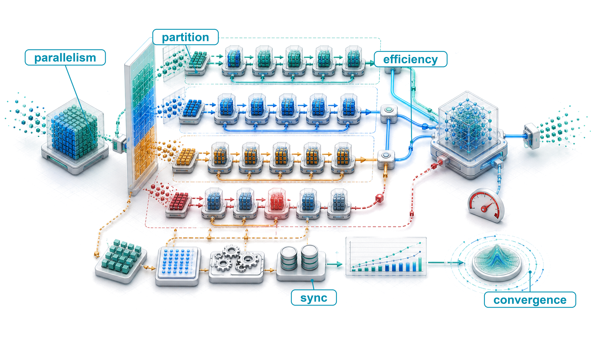{fig-alt="Isometric distributed training map showing a large workload partitioned across accelerators along data, tensor, and pipeline axes with synchronization paths."}
:::

::: {.content-visible unless-format="pdf"}
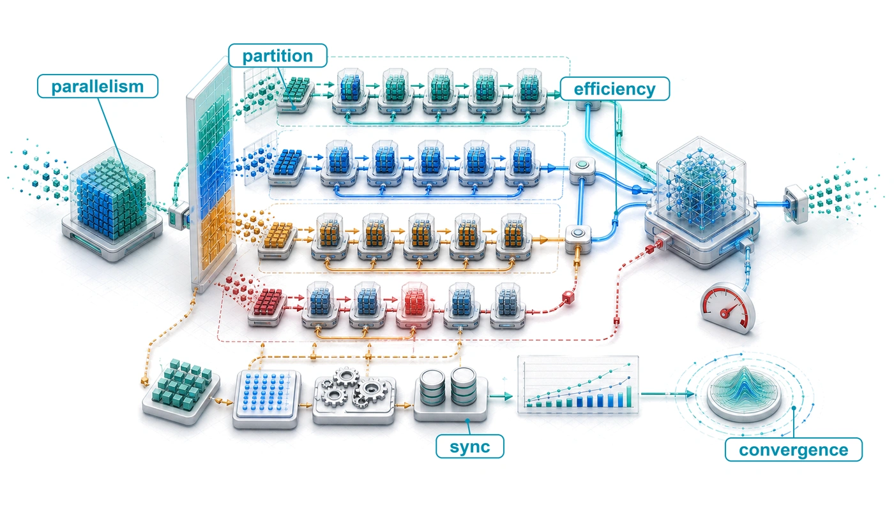{fig-alt="Isometric distributed training map showing a large workload partitioned across accelerators along data, tensor, and pipeline axes with synchronization paths."}
:::

:::

## Purpose {.unnumbered .unlisted}

\begin{marginfigure}
\mlfleetstack{20}{35}{100}{45}{25}{10}{0}{0}
\end{marginfigure}

_Why can adding accelerators make training slower?_

Splitting a training job across machines creates more compute capacity, but it also requires those machines to exchange state and agree on updates. Each accelerator may finish its local work sooner while spending more of the step waiting for other workers. Once communication and waiting consume the time saved by parallel execution, adding accelerators raises the bill without shortening the run. Single-node optimization remains necessary, yet faster local arithmetic cannot remove a dependency on data that another machine has not delivered. Memory pressure complicates the decision, because a model may require distribution simply to fit, even when the resulting exchanges are expensive. Dividing its state across more devices can relieve that limit while exposing another in network bandwidth or scheduling. Conversely, replicating a model can process more examples at once without reducing the memory needed for each copy. Neither improvement alone establishes that training will finish sooner. Changing how examples are grouped or when updates become available can change the work required to reach the target quality. Engineers must therefore compare complete training configurations, accounting for memory, communication, update behavior, and elapsed time together. The practical question is where additional hardware buys useful progress and where it merely creates more coordination. That judgment determines which models and experiments fit the available schedule and budget. In C³ terms, each partitioning strategy trades parallelized compute against network-bound communication and coordination across workers.

::: {.content-visible when-format="pdf"}

\newpage

:::

::: {.callout-learning-objectives}

- Apply the Fleet Law to diagnose compute-, memory-, communication-, or coordination-bound distributed training regimes
- Calculate scaling efficiency, estimate useful batch size, and budget synchronization overhead for data-parallel training
- Design memory-sharding plans that trade accelerator capacity for additional communication
- Map tensor, pipeline, expert, and data parallelism onto hardware bandwidth tiers and model structure
- Analyze microbatch pipeline schedules for bubble overhead, activation residency, and synchronous update ordering
- Evaluate synchronization and low-precision policies under staleness, straggler, and numerical-stability constraints
- Synthesize hybrid parallelism configurations for frontier, recommendation, and alignment training constraints

:::

```{python}
#| echo: false
from mlsysim import *
from mlsysim.core.units import *
from mlsysim.solvers import DistributedModel

# ┌─────────────────────────────────────────────────────────────────────────────
# │ CHAPTER START
# ├─────────────────────────────────────────────────────────────────────────────
# │ Context: Chapter initialization and global imports
# │
# │ Why: Registers this chapter with the mlsys registry and provides shared
# │      imports for all subsequent calculation cells.
# │
# └─────────────────────────────────────────────────────────────────────────────
from mlsysim.fmt import check, fmt, fmt_int, fmt_memory_capacity, fmt_percent, fmt_qty_int
```

```{python}
#| echo: false
from mlsysim.solvers import DistributedModel
from mlsysim.physics import calc_strong_scaling_speedup

# ┌─────────────────────────────────────────────────────────────────────────────
# │ DISTRIBUTED TRAINING SYSTEM CONSTANTS
# ├─────────────────────────────────────────────────────────────────────────────
# │ Context: @sec-distributed-training-systems-systems-multimachine-scaling-fundamentals-ff96
# │          and ZeRO/FSDP analysis paragraphs throughout the chapter.
# │
# │ Goal:    Format GPU memory limits and NVLink bandwidths used throughout.
# │ Show:    "80" GB A100 memory and "900" GB/s NVLink H100 bandwidth.
# │ How:     Unit conversion via .to(unit).magnitude.
# │
# └─────────────────────────────────────────────────────────────────────────────
from mlsysim.fmt import MarkdownStr, check, fmt, fmt_int, fmt_memory, fmt_percent, fmt_time
import math

class DistTrainReliabilityFacts:
    # ┌── 1. LOAD (Constants) ──────────────────────────────
    a100_mem = Hardware.Cloud.A100.memory.capacity
    h100_mem = Hardware.Cloud.H100.memory.capacity
    nvlink_a100_bw = Hardware.Cloud.A100.nvlink.bandwidth / 2  # one-way convention
    nvlink_h100_bw = Hardware.Cloud.H100.nvlink.bandwidth / 2
    ib_hdr_bw = Systems.Fabrics.InfiniBand_HDR.bandwidth
    ib_ndr_bw = Systems.Fabrics.InfiniBand_NDR.bandwidth
    # 2026-09-28: the retired 99.9%-hourly-node-survival baseline (about 1,000 h
    # node MTBF) contradicted the canonical per-GPU MTBF used everywhere else in
    # the volume; the example now uses the 1,024-GPU reference cluster and
    # Systems.Reliability.Gpu, counting GPU failures only.
    reliability_gpu_count = Systems.Clusters.Training_1K.total_accelerators  # 1,024-GPU reference cluster
    gpu_mtbf_hours = float(Systems.Reliability.Gpu.mttf_hours)

    # ┌── 2. EXECUTE (The Compute) ─────────────────────────
    nvlink_hdr_ratio_low = (nvlink_a100_bw / ib_hdr_bw).to_base_units().magnitude
    nvlink_hdr_ratio_high = (nvlink_h100_bw / ib_hdr_bw).to_base_units().magnitude
    cluster_failure_rate_per_hour = reliability_gpu_count / gpu_mtbf_hours
    cluster_hourly_failure_prob = 1 - math.exp(-cluster_failure_rate_per_hour)
    cluster_mtbf_hours = 1 / cluster_failure_rate_per_hour

    # ┌── 3. GUARD (Invariants) ────────────────────────────
    check(a100_mem == 80 * GiB, f"Expected 80 GiB A100 memory, got {a100_mem}")
    check(nvlink_h100_bw > nvlink_a100_bw, "H100 NVLink faster than A100")
    check(ib_hdr_bw < ib_ndr_bw, "InfiniBand HDR slower than NDR")
    check(ib_ndr_bw < nvlink_h100_bw, "InfiniBand NDR slower than H100 NVLink")
    check(10 < nvlink_hdr_ratio_low < 14, "A100 per-direction NVLink/HDR ratio should be about 12x")
    check(17 < nvlink_hdr_ratio_high < 19, "H100 per-direction NVLink/HDR ratio should be about 18x")
    check(reliability_gpu_count == 1024, "Reliability example should use the 1,024-GPU reference cluster")
    check(45 < cluster_mtbf_hours < 52, "1,024 GPUs at 50,000 h per-GPU MTBF should fail about every 49 hours")

    # ┌── 4. OUTPUT (Formatting) ───────────────────────────
    reliability_gpu_count_str = fmt(reliability_gpu_count, precision=0, commas=True)
    gpu_mtbf_hours_str = fmt_time(gpu_mtbf_hours, 'hour', precision=0, commas=True, style='word')
    cluster_failure_prob_pct_str = fmt_percent(cluster_hourly_failure_prob, precision=1, commas=False, style='prose')
    cluster_mtbf_hours_str = fmt_time(round(cluster_mtbf_hours), 'hour', precision=0, commas=False, style='word')
    gpt4_mem_tb_str = fmt_memory(Models.Language.GPT4.size_in_bytes(BYTES_FP16), unit=TB, precision=1, commas=False)
    # Archetype B embedding-table size (prose renders it as a lower bound, "10 TB+").
    dlrm_mem_tb_str = fmt_memory(ReferenceStats.RecommenderAtScaleProfile.EmbeddingTableSize, unit=TB, precision=0, commas=False)
```

```{python}
#| echo: false
# ┌─────────────────────────────────────────────────────────────────────────────
# │ DENSE LLM REFERENCE FACTS (LEGO)
# ├─────────────────────────────────────────────────────────────────────────────
# │ Context: multi-machine requirements, the distributed-training definition,
# │          and every later mention of the 1,024-GPU reference cluster.
# │
# │ Goal: Pin the Archetype A reference (GPT-3 on the 1,024-GPU cluster) and the
# │       mixed-precision Adam capacity arithmetic to the registry.
# │ Show: ~5B-parameter crossover on an 80 GB accelerator; 350 GB of BF16
# │       weights (>4x one H100, at least 5 H100s); 2.8 TB of training state
# │       (at least 35 H100s against the 80 GB label); 1,024 GPUs = 128 x 8.
# │ How: Scenarios.DenseLLMPretrainingReference + MixedPrecisionAdam (16 B/param).
# │
# └─────────────────────────────────────────────────────────────────────────────
from mlsysim.fmt import check, fmt_count, fmt_memory, fmt_memory_capacity, fmt_multiple, fmt_params
from mlsysim.physics import memory_from_params
import math

class DenseLLMReferenceFacts:
    # ┌── 1. LOAD ─────────────────────────────────────────
    scenario = Scenarios.DenseLLMPretrainingReference  # Archetype A: GPT-3 on Training_1K
    model = scenario.workload
    cluster_gpus = scenario.system.total_accelerators
    cluster_nodes = scenario.system.count
    gpus_per_node = scenario.system.node.accelerators_per_node
    training_bytes_per_param = ReferenceStats.MixedPrecisionAdam.TrainingStateBytesPerParameter
    h100_mem = Hardware.Cloud.H100.memory.capacity
    # Budget against the published "80 GB" label, the convention the chapter's
    # other capacity budgets (DistTrainA100Memory, DistTrainH100Capacity) use.
    h100_mem_budget = h100_mem.to(GiB) * (GB / GiB)

    # ┌── 2. EXECUTE ──────────────────────────────────────
    weights = model.size_in_bytes(BYTES_FP16)
    training_state = memory_from_params(model.parameters, training_bytes_per_param)
    weights_over_h100 = (weights / h100_mem_budget).to_base_units().magnitude
    min_h100_weights = math.ceil(weights_over_h100)
    min_h100_state = math.ceil((training_state / h100_mem_budget).to_base_units().magnitude)
    crossover_params = (h100_mem_budget / training_bytes_per_param).to(Bparam)

    # ┌── 3. GUARD ────────────────────────────────────────
    check(cluster_gpus == cluster_nodes * gpus_per_node, "Reference cluster must be nodes x GPUs per node")
    check(cluster_gpus == 1024, "Archetype A reference cluster should have 1,024 GPUs")
    check(4 < weights_over_h100 < 5, "GPT-3 BF16 weights should exceed four H100s' worth of HBM")
    check(4 < crossover_params.magnitude < 6, "80 GB / 16 B per parameter should cross over near 5B parameters")

    # ┌── 4. OUTPUT ───────────────────────────────────────
    cluster_gpus_str = fmt_count(cluster_gpus, commas=True)
    cluster_gpus_label_str = fmt_count(cluster_gpus, commas=True, label="GPU")
    cluster_nodes_str = fmt_count(cluster_nodes, commas=False, label="node")
    gpus_per_node_str = fmt_count(gpus_per_node, commas=False, label="GPU")
    h100_mem_gb_str = fmt_memory_capacity(h100_mem, unit=GiB, precision=0, commas=False)
    bytes_per_param_str = fmt_count(training_bytes_per_param.magnitude, commas=False)
    crossover_params_str = fmt_params(round(crossover_params.magnitude) * Bparam, scale="billion", scale_style="word", precision=0)
    params_b_str = fmt_params(model.parameters, scale="B", precision=0, commas=False)
    weights_gb_str = fmt_memory(weights, unit=GB, precision=0, commas=False)
    weights_over_h100_mult_str = fmt_multiple(math.floor(weights_over_h100), precision=0, commas=False)
    min_h100_weights_str = fmt_count(min_h100_weights, commas=False, label="H100")
    training_state_tb_str = fmt_memory(training_state, unit=TB, precision=1, commas=False)
    min_h100_state_str = fmt_count(min_h100_state, commas=False, label="H100")
```

## Why Distribution Is Necessary {#sec-distributed-training-systems-systems-multimachine-scaling-fundamentals-ff96}

The accelerator hierarchy, network fabric, and storage pipeline form the physical foundation of the fleet. The remaining challenge is algorithmic. A partition of the training job decides which intermediate results and gradients must cross that fabric and when workers must synchronize, and it must make those decisions while preserving the optimization process a single device would have followed. The universal scaling law (principle \ref{pri-universal-scaling}) explains why this pressure keeps rising. Frontier quality improvements demand disproportionately more compute, data, and parameters, so the training problem eventually outgrows any single machine in capacity, in calendar time, or in both. @Sec-data-storage closed on one instance of that growth, a 175B reference model whose FP16 weights alone exceed the memory of the device that must hold them.

::: {.column-margin .margin-pointer}
↩ The power-law relationship between quality and compute, data, and parameters, and the compute-optimal allocation it implies, are established in @sec-vol2-intro-ai-scaling-laws-a043.
:::

A hypothetical accelerator with 100 terabytes of memory and an exaflop of compute would make distributed training unnecessary for that model. Real accelerators instead have finite high-bandwidth memory (HBM) capacity, compute throughput, and input bandwidth, and more capable designs move the distribution threshold without removing it. The reference workload must be evaluated against those limits before selecting a partition. In the Fleet Stack diagrammed in @fig-fleet-stack, distributed training occupies the Distributed Execution row of the Distribution band\index{Distribution band!fleet stack}, the logic that partitions the *mathematical* workload across the *physical* fleet. Data, tensor, pipeline, and hybrid parallelism create different traffic patterns for the interconnect to carry.

### The physics of the cluster {#sec-distributed-training-systems-physics-cluster-a42d}

Before optimizing algorithms, the physical constraints of the machine learning fleet must be understood. The performance of any distributed training job is governed by the Fleet Law (principle \ref{pri-distributed-step-time}), which decomposes the per-step time:

$$ \DistributedStepTime = \frac{\IronlawTermTimesCompute}{N} + \CommunicationTime + \SynchronizationTime - \OverlappedTime $$

::: {.column-margin .margin-pointer}
↩ The Fleet Law and its compute, communication, and coordination terms are established in @sec-vol2-introduction-fleet-law.
:::

The **communication-computation ratio**\index{Communication-computation ratio!definition}, $\rho = \CommunicationTime/(\IronlawTermTimesCompute/N)$, compares communication time with ideally partitioned compute time for fixed global work. This $\rho$ is a ratio of two times, not the queue utilization of the incast model. It is the time consequence of communication intensity $\CommunicationIntensity$ (@eq-ci-ratio), the bytes moved per operation of the workload. When transfers run at link bandwidth $\beta$, the sustained-bandwidth parameter of the $\alpha$-$\beta$ message model, and each device computes at sustained rate $\PeakRate\EfficiencyHw$, $\rho \approx \CommunicationIntensity \times \PeakRate\EfficiencyHw/\beta$, so the same workload becomes more communication-bound on faster accelerators or slower links. This ratio\index{Communication intensity!fleet scaling} identifies the pressure to overlap communication; the complete step time also depends on how much exchange is hidden and how much coordination remains exposed.

::: {.column-margin .margin-pointer}
↩ The $\alpha$-$\beta$ message model, with startup latency $\alpha$ and sustained bandwidth $\beta$, is established in @sec-network-fabrics-performance-model.
:::

::: {.column-margin .margin-pointer}
↪ The communication-computation ratio, evaluated for representative data-parallel and point-to-point transfers and related to communication intensity, is developed in @sec-appdx-fleet-foundations-comm-compute-ratio.
:::

::: {.column-margin}
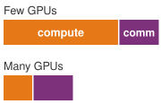{width="100%" fig-alt="Two equal-width zones labeled compute and communication with a dashed rho equals one threshold between ideal scaling and waiting."}

*Past a communication-to-compute threshold, scaling stops being ideal.*
:::

Two regimes follow from this ratio. When $\IronlawTermTimesCompute/N \gg \CommunicationTime$, the cluster is compute-bound, and communication is small relative to useful computation, provided coordination and input delivery do not introduce another limit. Large-batch training of a dense convolutional model such as ResNet commonly sits here. When $\rho \gtrsim 1$, $\CommunicationTime$ matches or exceeds $\IronlawTermTimesCompute/N$, the cluster is communication-bound, and insufficient overlap leaves substantial time waiting for gradients or activations. Large language models (LLMs) with billions of parameters to synchronize, and Deep Learning Recommendation Model (DLRM)-style workloads whose embedding exchanges saturate the network, frequently land in this regime. These are typical operating points rather than fixed labels: batch size, partitioning, and placement can move the same workload across the boundary, so the ratio must be measured for the configuration at hand.

::: {.column-margin .margin-pointer}
↪ The optimizations that help, and the ones that are wasted, for a compute-bound, communication-bound, or coordination-bound fleet are operationalized in @sec-appdx-c3-taxonomy-bottleneck-table.
:::

### Multi-machine training requirements {#sec-distributed-training-systems-systems-multimachine-training-requirements-0277}

Three signals motivate evaluating distributed execution. The first is memory exhaustion\index{Memory exhaustion!capacity limit}: model parameters, optimizer states, and activation storage exceed single-device capacity. For full mixed-precision training with Adaptive Moment Estimation (Adam)\index{Mixed-precision training!memory footprint}, the convention of `{python} DenseLLMReferenceFacts.bytes_per_param_str` bytes per parameter can exceed an `{python} DenseLLMReferenceFacts.h100_mem_gb_str` accelerator\index{H100}\index{A100} at roughly `{python} DenseLLMReferenceFacts.crossover_params_str` parameters before activations. Larger 10--20B models therefore need sharding, offload, or another memory-saving approach [@rajbhandari2020]. The failed allocation establishes a capacity problem; it does not by itself choose the remedy.

::: {.column-margin .margin-pointer}
↪ Accelerator HBM capacity, the ceiling these per-parameter budgets are measured against, is developed in @sec-appdx-dam-taxonomy-memory-hierarchy.
:::

The second signal is unacceptable training duration\index{Training duration!wall-clock limit}. Even when a model fits, single-device training may require weeks or months to converge, making wall-clock time itself a systems constraint. GPT-3's\index{GPT-3} 175B-parameter training run used a cluster of V100 GPUs [@brown2020language], illustrating why the calendar, not just HBM capacity, forces distribution at this scale.

The third signal is input demand at dataset scale\index{Dataset scale!storage limit}. Dataset bytes determine storage capacity, while the training schedule determines the delivery rate. As @sec-storage-pipeline-equation showed, either can motivate distributed data services, but a large dataset alone does not require distributing model computation. Together, capacity, calendar, and input delivery define the constraints a training configuration must satisfy.

```{python}
#| echo: false
# ┌─────────────────────────────────────────────────────────────────────────────
# │ MEMORY WALL TREND (LEGO)
# ├─────────────────────────────────────────────────────────────────────────────
# │ Context: the paragraph that introduces @fig-memory-wall-trend.
# │ Goal: Narrate the figure with the growth factors and crossover year that
# │       the plotted data actually contain (restores the quantitative reading
# │       the 10-04 precision pass removed, now computed instead of hand-typed).
# │ Show: single-GPU memory ~38x (K20 to B200); plotted training-memory demand
# │       ~4 orders of magnitude; first model above that year's GPU in 2020.
# │ How: max/min over the same CSV the figure plots.
# └─────────────────────────────────────────────────────────────────────────────
import math
import pandas as pd
from mlsysim.fmt import MarkdownStr, check, fmt, fmt_int, fmt_multiple

class MemoryWallTrend:
    # ┌── 1. LOAD ─────────────────────────────────────────
    _data = pd.read_csv("vol2/05_distributed_training/data/memory_wall_trends.csv")
    _gpus = _data[_data['Type'] == 'GPU'].sort_values('Year')
    _models = _data[_data['Type'] == 'Model'].sort_values('Year')

    # ┌── 2. EXECUTE ──────────────────────────────────────
    gpu_growth = _gpus['Memory_GB'].max() / _gpus['Memory_GB'].min()
    demand_orders = math.log10(_models['Memory_GB'].max() / _models['Memory_GB'].min())
    # First plotted model whose training memory exceeds the largest GPU available that year.
    _crossover_row = None
    for _row in _models.itertuples():
        if _row.Memory_GB > _gpus[_gpus['Year'] <= _row.Year]['Memory_GB'].max():
            _crossover_row = _row
            break
    crossover_year = int(_crossover_row.Year)
    _crossover_name = _crossover_row.Name
    # How far the crossover model's training state overshot that year's largest GPU.
    crossover_gap = _crossover_row.Memory_GB / _gpus[_gpus['Year'] <= _crossover_row.Year]['Memory_GB'].max()

    # ┌── 3. GUARD ────────────────────────────────────────
    check(30 < gpu_growth < 45, f"Single-GPU memory growth should be tens of x, got {gpu_growth:.1f}")
    check(3.5 < demand_orders < 5, f"Plotted demand should span about four orders of magnitude, got {demand_orders:.2f}")
    check(crossover_year == 2020 and _crossover_name == 'GPT-3', "First plotted crossover should be GPT-3 in 2020")
    check(30 < crossover_gap < 40, f"GPT-3 state should overshoot an 80 GB GPU by about 35x, got {crossover_gap:.1f}")

    # ┌── 4. OUTPUT ───────────────────────────────────────
    gpu_growth_mult_str = fmt_multiple(round(gpu_growth), precision=0, commas=False)
    demand_orders_str = fmt_int(round(demand_orders), commas=False)
    crossover_year_str = fmt(crossover_year, precision=0, commas=False)
    crossover_gap_mult_str = fmt_multiple(round(crossover_gap), precision=0, commas=False)
    first_gpu_str = MarkdownStr(_gpus.iloc[0]['Name'])
    last_gpu_str = MarkdownStr(_gpus.iloc[-1]['Name'])
```

The first signal, memory exhaustion, has a long history, traced in @fig-memory-wall-trend. Over the plotted span, single-accelerator memory grew about `{python} MemoryWallTrend.gpu_growth_mult_str` from the `{python} MemoryWallTrend.first_gpu_str` to the `{python} MemoryWallTrend.last_gpu_str`, while the memory needed to train a state-of-the-art model grew by roughly `{python} MemoryWallTrend.demand_orders_str` orders of magnitude. Among the plotted models, the curves cross in `{python} MemoryWallTrend.crossover_year_str` at GPT-3, whose training state exceeded the largest accelerator then available by about `{python} MemoryWallTrend.crossover_gap_mult_str`. The real crossing came earlier than the plot shows. By the `{python} DenseLLMReferenceFacts.bytes_per_param_str`-bytes-per-parameter convention above, any model beyond roughly `{python} DenseLLMReferenceFacts.crossover_params_str` parameters already overflows one `{python} DenseLLMReferenceFacts.h100_mem_gb_str` device, and models between the plotted points, such as the 2019 Megatron-LM model developed with tensor parallelism [@shoeybi2019megatron], were partitioned for that reason. GPT-3 marks where the gap passed an order of magnitude, and every later plotted frontier model also sits far above the capacity curve. For those models, spreading state beyond one device's memory is a precondition for training at all rather than a way to train faster.

::: {#fig-memory-wall-trend fig-env="figure" fig-pos="htb" fig-cap="**The memory wall**: Accelerator memory capacity plotted against the memory a state-of-the-art model needs to train. Capacity climbs steadily while demand climbs faster, and the widening gap is why weights, gradients, and optimizer state must be split across devices rather than merely compressed." fig-alt="Line chart of accelerator memory capacity by year showing capacity growth failing to keep pace with model memory demand."}

```{python}
#| echo: false
import pandas as pd
import matplotlib.pyplot as plt
import numpy as np
from mlsysim import viz

# Read data
data = pd.read_csv("vol2/05_distributed_training/data/memory_wall_trends.csv")

# Separate into models and GPUs
df_gpus = data[data['Type'] == 'GPU']
df_models = data[data['Type'] == 'Model']

fig, ax, COLORS, plt = viz.setup_plot(figsize=(8, 5))

# Plot models (Memory required)
ax.scatter(df_models['Year'], df_models['Memory_GB'], color='#d62728', s=60, label='Model Training Requirement', zorder=3)
for _, row in df_models.iterrows():
    ax.annotate(row['Name'], (row['Year'], row['Memory_GB']), textcoords="offset points", xytext=(0, 10), ha='center', fontsize=9, color='#d62728')

# Plot GPUs (Memory capacity)
ax.scatter(df_gpus['Year'], df_gpus['Memory_GB'], color='#1f77b4', marker='s', s=60, label='Single GPU Capacity', zorder=3)
for _, row in df_gpus.iterrows():
    ax.annotate(row['Name'], (row['Year'], row['Memory_GB']), textcoords="offset points", xytext=(0, -15), ha='center', fontsize=9, color='#1f77b4')

# Set y-axis to logarithmic to show the exponential gap
ax.set_yscale('log')
ax.set_xlabel("Year")
ax.set_ylabel("Memory (GB) - Log Scale")

# Fill the growing gap
ax.plot(df_models['Year'], df_models['Memory_GB'], color='#d62728', alpha=0.3, linestyle='--')
ax.plot(df_gpus['Year'], df_gpus['Memory_GB'], color='#1f77b4', alpha=0.3, linestyle='--')

ax.grid(True, which="major", ls="-", alpha=0.2)
ax.grid(True, which="minor", ls="--", alpha=0.1)
ax.legend(loc='upper left')

ax.margins(x=0.14, y=0.14)
plt.tight_layout()
plt.show()
plt.close()
```

:::

Whichever signal motivates distribution, the system must state which optimization update it implements. In the synchronous baseline developed first, the `{python} DenseLLMReferenceFacts.cluster_gpus_label_str` of the volume's Archetype A (GPT-4/Llama-3) reference cluster, whose running instance in this chapter is a GPT-3-class `{python} DenseLLMReferenceFacts.params_b_str`-parameter dense transformer, combine their contributions before advancing to the next parameter version. Matching the global batch, loss normalization, and optimizer state preserves the corresponding single-device update mathematically. Later synchronization models deliberately relax that update ordering and must be evaluated under their own convergence assumptions.

::: {.column-margin .margin-pointer}
↩ The three systems archetypes and their binding constraints are established in @sec-vol2-introduction-archetypes.
:::

::: {#dfn-distributed-training-distributed-training .callout-definition title="Distributed training"}

***Distributed training***\index{Distributed training!definition} partitions the optimization loop across multiple compute nodes, distributing data or model computation and coordinating contributions according to a specified update protocol.

1.  **Significance**: Partitioning training state across devices can meet a memory budget that exceeds one accelerator. GPT-3 (`{python} DenseLLMReferenceFacts.params_b_str` parameters) requires approximately `{python} DenseLLMReferenceFacts.weights_gb_str` in BF16 (FP16 also stores 2 bytes per value, so the chapter's byte counts hold for either format), more than `{python} DenseLLMReferenceFacts.weights_over_h100_mult_str` the `{python} DenseLLMReferenceFacts.h100_mem_gb_str` capacity of a single H100. If weights remain entirely in HBM, their aggregate capacity lower bound is `{python} DenseLLMReferenceFacts.min_h100_weights_str`. Adding BF16 gradients plus FP32 Adam master weights and moments gives about `{python} DenseLLMReferenceFacts.training_state_tb_str`, or at least `{python} DenseLLMReferenceFacts.min_h100_state_str` before activations. These lower bounds do not establish a runnable placement; offload changes the capacity calculation, and the time budget can require more accelerators than memory alone.
2.  **Distinction**: CPU threads can share a coherent address space, while accelerators generally hold separate training-state allocations even within one node. Distributed training extends coordination across those devices and node boundaries through collectives or point-to-point transfers governed by the chosen update protocol.
3.  **Common pitfall**: A frequent misconception is that distributed training scales linearly with node count. In practice, communication overhead grows with cluster size and the serial fraction of each step (Amdahl's Law): a fixed serial fraction of the single-device baseline bounds strong-scaling speedup.

:::

### Distributed training complexity trade-offs {#sec-distributed-training-systems-systems-distributed-training-complexity-tradeoffs-0138}

Distribution expands three costs that determine whether a partition is viable. Communication overhead\index{Communication overhead!gradient synchronization} includes gradient aggregation through AllReduce, which returns the same reduced tensor to each participant, or rank. For $P$ parameters across $N$ devices, a ring all-reduce\index{AllReduce!gradient exchange volume}, in which each worker passes gradient chunks only to its neighbor in a logical ring, sends approximately $2(N-1)/N \times M_{\text{grad}}$ bytes per worker per step, where the gradient payload $M_{\text{grad}}$ is the $P$ gradient values times their storage width; this is not total fleet traffic.

::: {.column-margin .margin-pointer}
↪ The ring schedule and the derivation of its $2(N-1)/N$ volume are developed in @sec-collective-communication.
:::

Fault tolerance\index{Fault tolerance!cluster MTBF} becomes more demanding as the number of failure sources grows. Under independent constant-rate GPU failures, fleet-wide failure-free survival decays exponentially\index{Reliability!exponential survival decay}. If each of the `{python} DistTrainReliabilityFacts.reliability_gpu_count_str` GPUs has mean time between failures (MTBF)\index{MTBF!cluster scaling} of `{python} DistTrainReliabilityFacts.gpu_mtbf_hours_str`, the modeled probability of at least one GPU failure in an hour is `{python} DistTrainReliabilityFacts.cluster_failure_prob_pct_str`, with mean interval `{python} DistTrainReliabilityFacts.cluster_mtbf_hours_str` between such events. Whether each event interrupts training depends on recovery and redundancy. @Sec-appdx-reliability-foundations-mtbf-cascade develops the assumptions.

Algorithmic stability\index{Algorithmic stability!large-batch dynamics} adds a separate constraint when the partition changes global batch size or update ordering. Learning-rate scaling and warmup\index{Warmup schedule!convergence stability} are candidate responses to large-batch behavior [@goyal2017accurate], not requirements unique to multiple machines. A viable design must satisfy all three budgets.

### Single-machine to distributed transition {#sec-distributed-training-systems-systems-singlemachine-distributed-transition-1ee4}

The single-machine optimization methodology summarized in @sec-appdx-dam-taxonomy extends to distributed environments with important adaptations\index{Arithmetic intensity!single-device vs fleet}. Profiling must capture inter-device communication patterns and synchronization overhead in addition to computation and memory metrics. The solution space expands to data parallelism, model parallelism in its tensor and pipeline forms, and hybrid approaches. Data parallelism assigns different examples to model replicas; tensor parallelism splits the operations inside a layer; pipeline parallelism assigns successive layer groups to different devices.

A useful mental model treats these strategies as *loop transformations*, the same toolkit a compiler uses to restructure sequential code, now applied by a cluster-level compiler. The logical training loop nests iterators over the examples in a batch, the layers of the model, and the matrix operations inside each layer, and each parallelism strategy distributes one of them across devices.

Data parallelism resembles a parallel for-loop\index{Data parallelism!batch loop transformation}, assigning different batch indices to devices running the same model. Tensor parallelism resembles vectorization, or single instruction, multiple data (SIMD)\index{Tensor parallelism!SIMD loop transformation}, by partitioning the work inside matrix operations. The analogy describes the work split, not a shared instruction stream or register file; the devices exchange tensor shards over an interconnect. Pipeline parallelism resembles instruction pipelining\index{Pipeline parallelism!pipelined loop transformation}, assigning successive layer groups to stages. Overlapping microbatches can keep those stages active, subject to dependency delays and load balance.

Whichever loop a strategy unrolls, distributed training[^fn-distbelief-parameter-server] spreads the workload across machines that must coordinate to train a single model. Coordination here means keeping every model shard or replica on a compatible training step. Basic barriers can keep a small research run ordered, but long-running training jobs also need timeout, checkpoint, and recovery mechanisms so one failed worker does not waste days of compute.

::: {.column-margin .margin-pointer}
↪ Checkpointing and recovery for long-running training jobs are developed in @sec-fault-tolerance-reliability.
:::

[^fn-distbelief-parameter-server]: **Distributed training**\index{DistBelief!distributed training}: Google's DistBelief (2012) was an early framework for training neural networks across thousands of machines, but its parameter server architecture\index{Parameter server!centralized synchronization} created bandwidth bottlenecks at central nodes. This limitation drove the shift to decentralized AllReduce patterns\index{AllReduce!decentralized scaling} in successors like Horovod\index{Horovod!gradient all-reduce} and PyTorch\index{PyTorch} DistributedDataParallel (DDP)\index{DDP!gradient bucketing}\index{DistributedDataParallel|see{DDP}}, where each data-parallel worker sends and receives about $2(N-1)/N$ times the gradient size per step rather than concentrating traffic at a single server [@dean2012large; @sergeev2018horovod; @li2020pytorch; @patarasuk2009].

```{python}
#| echo: false
class DistTrainNvlinkIntro:
    from mlsysim.core.units import GB, second
    from mlsysim.fmt import check, fmt_bandwidth, fmt_multiple

    nvlink_a100_bw = Hardware.Cloud.A100.nvlink.bandwidth / 2  # one-way convention
    nvlink_h100_bw = Hardware.Cloud.H100.nvlink.bandwidth / 2
    ib_hdr_bw = Systems.Fabrics.InfiniBand_HDR.bandwidth
    nvlink_hdr_ratio_low = round((nvlink_a100_bw / ib_hdr_bw).to_base_units().magnitude)
    nvlink_hdr_ratio_high = round((nvlink_h100_bw / ib_hdr_bw).to_base_units().magnitude)
    check(10 < nvlink_hdr_ratio_low < 14, "A100 per-direction NVLink/HDR ratio should be about 12x")
    nvlink_a100_gb_per_s_str = fmt_bandwidth(nvlink_a100_bw, unit=GB / second, precision=0, commas=False)
    nvlink_h100_gb_per_s_str = fmt_bandwidth(nvlink_h100_bw, unit=GB / second, precision=0, commas=False)
    nvlink_hdr_ratio_low_mult_str = fmt_multiple(nvlink_hdr_ratio_low, precision=0, commas=False)
    nvlink_hdr_ratio_high_mult_str = fmt_multiple(nvlink_hdr_ratio_high, precision=0, commas=False)
```

Each rung of the scaling path inherits earlier challenges. A single GPU already needs input delivery, memory management, scheduling, and recovery from interrupted work. Multiple GPUs add coordination across separate device memories, even within one node. Interconnects such as NVLink or PCIe carry these exchanges,[^fn-nvlink-intranode-interconnect] with collective libraries such as NCCL selecting communication schedules.[^fn-nccl-topology-awareness]

[^fn-nvlink-intranode-interconnect]: **NVLink**\index{NVLink!distributed training}: NVIDIA's point-to-point GPU interconnect delivers `{python} DistTrainNvlinkIntro.nvlink_a100_gb_per_s_str`--`{python} DistTrainNvlinkIntro.nvlink_h100_gb_per_s_str` per-direction bandwidth, roughly `{python} DistTrainNvlinkIntro.nvlink_hdr_ratio_low_mult_str`--`{python} DistTrainNvlinkIntro.nvlink_hdr_ratio_high_mult_str` InfiniBand\index{InfiniBand}\index{IB|see{InfiniBand}} HDR per port. This bandwidth gap is why tensor parallelism, which requires AllReduce on every layer, favors the fast NVLink domain, while pipeline and data parallelism can tolerate slower links when their traffic budgets fit. NVLink Switch systems can extend that fast domain beyond one server.

[^fn-nccl-topology-awareness]: **NCCL (NVIDIA Collective Communications Library)**\index{NCCL!topology}: NCCL provides topology-aware inter-GPU collective communication primitives\index{NCCL!collective primitives}, including AllReduce, across PCIe, NVLink, InfiniBand, and IP networks. Current NCCL deployments expose ring, tree, and related algorithm families through runtime selection and tuning controls, so training frameworks can avoid naive mappings that route all traffic through the slowest inter-node path [@jeaugey2017nccl; @nvidiaNcclUserGuide].

The leap to multi-node training adds network communication overhead, fault tolerance requirements, and cluster orchestration\index{Cluster orchestration!distributed training}. Because each stage compounds the previous one's bottlenecks, single-GPU performance must be optimized before scaling out, so inefficiency does not multiply across the fleet. Although frameworks abstract away much of this through sharded data parallelism and communication libraries, implementing distributed training efficiently still demands careful network configuration (InfiniBand tuning, topology-aware routing), infrastructure management through cluster schedulers, and debugging of nonlocal issues such as synchronization hangs and communication bottlenecks. @Fig-3d-parallelism-cube maps this design space onto a 3D decomposition grid ($N = \DataparallelDegreeDp \times \PipelineparallelDegreePp \times \TensorparallelDegreeTp$), partitioning cluster execution across tensor parallelism ($\TensorparallelDegreeTp$, intra-layer sharding), pipeline parallelism ($\PipelineparallelDegreePp$, sequential stage partitioning), and data parallelism ($\DataparallelDegreeDp$, batch replication), where each individual cell represents a single accelerator coordinate.

::: {#fig-3d-parallelism-cube fig-env="figure" fig-pos="htb" fig-cap="**The 3D parallelism cube**: The configuration space decomposes cluster training across three orthogonal axes: tensor parallelism ($\TensorparallelDegreeTp$, intra-layer sharding), pipeline parallelism ($\PipelineparallelDegreePp$, sequential stage partitioning), and data parallelism ($\DataparallelDegreeDp$, batch replication). Each cell is one accelerator, identified by its $(\DataparallelDegreeDp, \PipelineparallelDegreePp, \TensorparallelDegreeTp)$ coordinate, so the cube holds $N = \DataparallelDegreeDp \times \PipelineparallelDegreePp \times \TensorparallelDegreeTp$ devices. A feasible point must jointly satisfy model divisibility, per-device memory limits, and the network hierarchy that carries each axis's traffic." fig-alt="Cube divided into a four-by-four-by-four grid of cells with the tensor axis along the width, the pipeline axis along the height, and the data axis along the depth; one front corner cell is shaded and labeled as one GPU per (N DP, N PP, N TP) cell. A label reads N equals N DP times N PP times N TP."}
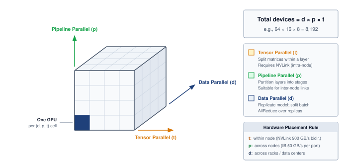

<!--
```{.tikz}
\scalebox{0.82}{%
\begin{tikzpicture}[
  line join=round, line cap=round,
  font=\small\sffamily,
  >=Stealth,
  card/.style={
    rectangle,
    rounded corners=3.5pt,
    line width=0.7pt,
    inner sep=6.5pt,
    align=left,
    font=\footnotesize\sffamily
  },
  chip/.style={
    rectangle,
    rounded corners=2pt,
    inner sep=2pt,
    font=\tiny\bfseries\sffamily
  }
]

% Left Panel: 3D Parallelism Configuration Space (Oblique)
\begin{scope}[shift={(0.8, 0.8)}]

  \def\w{3.8}   % width (Tensor Parallel)
  \def\h{3.8}   % height (Pipeline Parallel)
  \def\dx{1.6}  % depth dx
  \def\dy{1.2}  % depth dy

  \def\nt{3} % tensor slices
  \def\np{3} % pipeline slices
  \def\nd{3} % data slices

  % 1. Hidden / Dashed Back Lines
  \draw[line width=0.7pt, dashed, GrayLine!40] (\dx, \dy) -- (\w+\dx, \dy);
  \draw[line width=0.7pt, dashed, GrayLine!40] (\dx, \dy) -- (\dx, \h+\dy);
  \draw[line width=0.7pt, dashed, GrayLine!40] (\dx, \dy) -- (0, 0);

  % 2. Front Face (XY plane at Z=0): Tensor x Pipeline
  \fill[OrangeFill!45] (0, 0) rectangle (\w, \h);

  % 3. Top Face (XZ plane at Y=\h): Tensor x Data
  \fill[GreenFill!50] (0, \h) -- (\dx, \h+\dy) -- (\w+\dx, \h+\dy) -- (\w, \h) -- cycle;

  % 4. Right Side Face (YZ plane at X=\w): Pipeline x Data
  \fill[BlueFill!35] (\w, 0) -- (\w+\dx, \dy) -- (\w+\dx, \h+\dy) -- (\w, \h) -- cycle;

  % Grid lines on Front Face (Tensor x Pipeline)
  \foreach \i in {1,2} {
    \draw[OrangeLine!40, line width=0.55pt] (\i*\w/\nt, 0) -- (\i*\w/\nt, \h);
    \draw[OrangeLine!40, line width=0.55pt] (0, \i*\h/\np) -- (\w, \i*\h/\np);
  }

  % Grid lines on Top Face (Tensor x Data)
  \foreach \i in {1,2} {
    \draw[GreenLine!40, line width=0.55pt]
      (\i*\w/\nt, \h) -- (\i*\w/\nt+\dx, \h+\dy);
    \draw[GreenLine!40, line width=0.55pt]
      (\i*\dx/\nd, \h+\i*\dy/\nd) -- (\w+\i*\dx/\nd, \h+\i*\dy/\nd);
  }

  % Grid lines on Right Side Face (Pipeline x Data)
  \foreach \i in {1,2} {
    \draw[BlueLine!40, line width=0.55pt]
      (\w, \i*\h/\np) -- (\w+\dx, \i*\h/\np+\dy);
    \draw[BlueLine!40, line width=0.55pt]
      (\w+\i*\dx/\nd, \i*\dy/\nd) -- (\w+\i*\dx/\nd, \h+\i*\dy/\nd);
  }

  % Solid Outer Edges of the Cube
  \draw[line width=0.85pt, TextBlack!85] (0, 0) rectangle (\w, \h);
  \draw[line width=0.85pt, TextBlack!85] (0, \h) -- (\dx, \h+\dy) -- (\w+\dx, \h+\dy) -- (\w, \h);
  \draw[line width=0.85pt, TextBlack!85] (\w, 0) -- (\w+\dx, \dy) -- (\w+\dx, \h+\dy);

  % Highlight single GPU / Accelerator cell (front-top-right)
  \filldraw[draw=RedLine, fill=RedLine!20, line width=0.85pt]
    (2*\w/3, 2*\h/3) rectangle (\w, \h);
  \filldraw[draw=RedLine, fill=RedLine!25, line width=0.85pt]
    (2*\w/3, \h) -- (2*\w/3+\dx/3, \h+\dy/3) -- (\w+\dx/3, \h+\dy/3) -- (\w, \h) -- cycle;
  \filldraw[draw=RedLine, fill=RedLine!30, line width=0.85pt]
    (\w, 2*\h/3) -- (\w+\dx/3, 2*\h/3+\dy/3) -- (\w+\dx/3, \h+\dy/3) -- (\w, \h) -- cycle;

  % Device callout arrow and label
  \coordinate (devCenter) at (2.5*\w/3 + 0.5*\dx/3, \h + 0.5*\dy/3);
  \draw[->, line width=0.8pt, RedLine, shorten >= 2pt]
    (1.4, \h+\dy+0.6)
    node[above, font=\footnotesize\bfseries\sffamily, text=RedLine] {Single accelerator coordinate $(t_i, p_j, d_k)$}
    to[out=-20, in=115] (devCenter);

  % Outer Dimension Vectors / Axis Arrows
  % 1. Tensor Parallel (Horizontal arrow below front face)
  \draw[<->, line width=0.95pt, OrangeLine, shorten >= 1pt, shorten <= 1pt] (0, -0.45) -- (\w, -0.45)
    node[midway, below=2.5pt, font=\bfseries\footnotesize\sffamily, text=OrangeLine!90!black] {
      Tensor-Parallel degree (${N_{\text{TP}}}$)
    };
  \draw[line width=0.45pt, OrangeLine!50] (0, -0.1) -- (0, -0.55);
  \draw[line width=0.45pt, OrangeLine!50] (\w, -0.1) -- (\w, -0.55);

  % 2. Pipeline Parallel (Vertical arrow along left of front face)
  \draw[<->, line width=0.95pt, GreenLine, shorten >= 1pt, shorten <= 1pt] (-0.45, 0) -- (-0.45, \h)
    node[midway, above=2.5pt, rotate=90, font=\bfseries\footnotesize\sffamily, text=GreenLine] {
      Pipeline-Parallel degree (${N_{\text{PP}}}$)
    };
  \draw[line width=0.45pt, GreenLine!50] (-0.1, 0) -- (-0.55, 0);
  \draw[line width=0.45pt, GreenLine!50] (-0.1, \h) -- (-0.55, \h);

  % 3. Data Parallel (Depth arrow extending back-right)
  \draw[<->, line width=0.95pt, BlueLine, shorten >= 1pt, shorten <= 1pt]
    (\w+0.25, -0.1) -- (\w+\dx+0.25, \dy-0.1)
    node[midway, below right=-2pt and -1pt, font=\bfseries\footnotesize\sffamily, text=BlueLine, rotate=37] {
      Data-Parallel degree (${N_{\text{DP}}}$)
    };
  \draw[line width=0.45pt, BlueLine!50] (\w+0.05, 0) -- (\w+0.35, -0.15);
  \draw[line width=0.45pt, BlueLine!50] (\w+\dx+0.05, \dy) -- (\w+\dx+0.35, \dy-0.15);

\end{scope}

% Right Panel: System Specification Cards
\begin{scope}[shift={(7.8, 0.4)}]

  % Card 1: Total Devices Formula
  \node[card, draw=GreenLine!70, fill=GreenFill!25, text width=7.2cm] (cTotal) at (3.6, 5.5) {
    \centering\textbf{\normalsize\textcolor{GreenD}{Total accelerators $N = {N_{\text{DP}}} \times {N_{\text{PP}}} \times {N_{\text{TP}}}$}}\\[2pt]
    \scriptsize\textcolor{TextBlack}{Example: $64 \times 16 \times 8 = 8{,}192$ accelerators in cluster}
  };

  % Card 2: 3D Dimensions Breakdown
  \node[card, draw=GrayLine!35, fill=white, text width=7.2cm, below=8pt of cTotal] (cDesc) {
    \begin{tikzpicture}[baseline=(tp.base)]
      \node[chip, draw=OrangeLine!60, fill=OrangeFill!40, text=OrangeLine!90!black] (tp) {TP};
    \end{tikzpicture}\;
    \textbf{\textcolor{OrangeLine!90!black}{Tensor Parallelism (${N_{\text{TP}}}$)}}\\[1.5pt]
    \scriptsize Splits weight matrices within each layer (Megatron-LM style).\\
    \textbf{\scriptsize Network tier:} \textcolor{OrangeLine!90!black}{Intra-node NVLink (900--3,200 GB/s)}\\[5pt]

    \begin{tikzpicture}[baseline=(pp.base)]
      \node[chip, draw=GreenLine!60, fill=GreenFill!40, text=GreenD] (pp) {PP};
    \end{tikzpicture}\;
    \textbf{\textcolor{GreenD}{Pipeline Parallelism (${N_{\text{PP}}}$)}}\\[1.5pt]
    \scriptsize Partitions consecutive layer stages across devices (1F1B schedule).\\
    \textbf{\scriptsize Network tier:} \textcolor{GreenD}{Inter-node fabric (InfiniBand / RoCE 50--400 GB/s)}\\[5pt]

    \begin{tikzpicture}[baseline=(dp.base)]
      \node[chip, draw=BlueLine!60, fill=BlueFill!40, text=BlueLine] (dp) {DP};
    \end{tikzpicture}\;
    \textbf{\textcolor{BlueLine}{Data Parallelism (${N_{\text{DP}}}$)}}\\[1.5pt]
    \scriptsize Replicates model weights; partitions global batch.\\
    \textbf{\scriptsize Collective:} \textcolor{BlueLine}{AllReduce / ReduceScatter over data replicas}
  };

  % Card 3: Hardware Placement Rule
  \node[card, draw=RedLine!50, fill=RedFill!20, text width=7.2cm, below=8pt of cDesc] (cRule) {
    \centering\textbf{\small\textcolor{RedLine!90!black}{Physical Topology Placement Invariant}}\\[3pt]
    \raggedright\scriptsize
    \textbf{${N_{\text{TP}}}$ (Tensor):} innermost domain (within single 8-GPU chassis over NVLink)\\[2pt]
    \textbf{${N_{\text{PP}}}$ (Pipeline):} intermediate domain (adjacent nodes within same rack)\\[2pt]
    \textbf{${N_{\text{DP}}}$ (Data):} outermost domain (across racks, clusters, or data centers)
  };

\end{scope}

\end{tikzpicture}%
}
```
-->

:::

Under the three-dimensional partitioning of @fig-3d-parallelism-cube, called **3D parallelism**\index{3D parallelism!definition}, the total accelerator allocation scales as the product $N = \DataparallelDegreeDp \times \PipelineparallelDegreePp \times \TensorparallelDegreeTp$\index{3D parallelism!accelerator allocation}. The axes represent distinct mathematical partitions, but they are not independent configuration knobs. Tensor and pipeline degrees must divide the model structure, the data-parallel degree and microbatch schedule must produce a viable global batch, every partition must fit memory, and each communication group must map onto an adequate topology and acceptable failure domain. Training systems therefore select a jointly feasible coordinate rather than tuning $\DataparallelDegreeDp$, $\PipelineparallelDegreePp$, and $\TensorparallelDegreeTp$ in isolation.

### Parallelism strategy selection and engineering trade-offs {#sec-distributed-training-systems-systems-engineering-tradeoffs-selecting-parallelism-strategy-b344}

Choosing the right parallelism strategy is not a matter of preference; it is a constraint satisfaction problem governed by parameter count $(P)$, batch size $(B)$, and interconnect bandwidth. In this first feasibility screen, $\NumberOfLayers$ denotes layer count, $S$ sequence length, and $d$ hidden width. The table identifies traffic sources rather than complete byte budgets; datatype width, partition degree, and communication frequency enter the worked mechanisms below. @Tbl-parallelism-tradeoffs quantifies the parallelism communication costs\index{Parallelism!communication costs} for each strategy, revealing which approaches are physically feasible for a given hardware topology.

| **Strategy**               | **Communication Pattern** |                               **Comm. Volume**                               | **Hardware Constraint**              |
|:---------------------------|:-------------------------:|:----------------------------------------------------------------------------:|:-------------------------------------|
| **Data Parallel (DP)**     |    AllReduce Gradients    |                  $\propto M_{\text{grad}}$ (gradient bytes)                  | Requires high bisection BW           |
| **Tensor Parallel (TP)**   |   AllReduce Activations   | $\propto B \times S \times d \times \NumberOfLayers$ (per-layer activations) | Fast domain matched to layer traffic |
| **Pipeline Parallel (PP)** |    Point-to-Point (P2P)   |                 $\propto B \times S \times d$ (Activations)                  | Link must sustain stage activations  |

: **Parallelism Communication Costs**: Tensor parallelism exchanges partial layer results frequently and favors a fast communication domain, which can span servers. Pipeline parallelism transfers boundary activations; its bandwidth need depends on tensor shape and microbatch schedule. Data parallelism synchronizes gradient bytes, whose exposed cost depends on overlap and topology. Memory sharding addresses capacity but does not automatically reduce communication. {#tbl-parallelism-tradeoffs}

The bandwidth requirements impose a hard constraint on hardware placement\index{Hardware placement!bandwidth hierarchy}: each parallelism strategy must be matched to the interconnect available between the GPUs that need to communicate, or the design fails before it leaves the whiteboard. A quick back-of-envelope bandwidth feasibility check catches that mismatch before any code is written.

::: {.column-margin .margin-pointer}
↩ The communication domains and bandwidth hierarchy used to evaluate placement are established in @sec-compute-bandwidth-hierarchy.
:::

```{python}
#| echo: false
# ┌─────────────────────────────────────────────────────────────────────────────
# │ BANDWIDTH FEASIBILITY NAPKIN CHECK (LEGO)
# ├─────────────────────────────────────────────────────────────────────────────
# │ Context: @psp-distributed-training-bandwidth-feasibility.
# │ Goal: Give the feasibility test numbers: one transformer layer's tensor-
# │       parallel traffic over NVLink and over NDR InfiniBand against the
# │       layer's own compute time (2026-10-07: the callout promised a check
# │       but carried no arithmetic).
# │ Show: GPT-3 layer, TP=8, one 2,048-token sequence: ~1.9 ms of compute vs
# │       ~0.4 ms of TP transfer on NVLink and ~3.5 ms on InfiniBand.
# │ How: forward FLOPs = 2 x (P/L) x tokens / TP at 50 percent of the dense
# │      FP16 peak; two ring AllReduces of S x d x 2 bytes per layer.
# └─────────────────────────────────────────────────────────────────────────────
from mlsysim.fmt import check, fmt, fmt_time
from mlsysim.physics import calc_ring_allreduce_data_factor

class BandwidthFeasibilityNapkin:
    # ┌── 1. LOAD ─────────────────────────────────────────
    model = Models.Language.GPT3
    tp = 8  # scenario assumption: tensor parallelism within one 8-GPU node
    tokens = model.context_length  # scenario assumption: one sequence per microbatch
    peak = Hardware.Cloud.H100.compute.precision_flops['fp16_dense']
    local_efficiency = 0.5  # scenario assumption: same local efficiency as the 175B scaling notebook
    nvlink = Hardware.Cloud.H100.nvlink.bandwidth_per_direction
    ib = Systems.Fabrics.InfiniBand_NDR.bandwidth
    allreduces_per_layer = 2  # Megatron: one after attention, one after the MLP

    # ┌── 2. EXECUTE ──────────────────────────────────────
    _layer_flops = 2 * (model.parameters.to(param).magnitude / model.layers) * tokens * flop
    compute_time = (_layer_flops / tp / (peak * local_efficiency)).to(ms)
    _layer_bytes = allreduces_per_layer * tokens * model.hidden_dim * BYTES_FP16 * calc_ring_allreduce_data_factor(tp)
    nvlink_time = (_layer_bytes / nvlink).to(ms)
    ib_time = (_layer_bytes / ib).to(ms)

    # ┌── 3. GUARD ────────────────────────────────────────
    check(nvlink_time < compute_time < ib_time, "NVLink transfer should fit the layer's compute time and InfiniBand should not")

    # ┌── 4. OUTPUT ───────────────────────────────────────
    compute_ms_str = fmt_time(compute_time, ms, precision=1, commas=False)
    nvlink_ms_str = fmt_time(nvlink_time, ms, precision=1, commas=False)
    ib_ms_str = fmt_time(ib_time, ms, precision=1, commas=False)
    tokens_str = fmt(tokens, precision=0, commas=True)
    tp_str = fmt(tp, precision=0, commas=False)
```

::: {#psp-distributed-training-bandwidth-feasibility .callout-perspective title="Bandwidth feasibility check"}

Frequent tensor-parallel collectives\index{Tensor parallelism!bandwidth requirement} must fit the layer-time budget. The test compares the time one layer's local share of computation takes with the time its collectives take on each candidate link. For the forward pass of one GPT-3 layer split `{python} BandwidthFeasibilityNapkin.tp_str` ways, processing one `{python} BandwidthFeasibilityNapkin.tokens_str`-token sequence at half of an H100's dense FP16 peak:

- Local compute per layer: about `{python} BandwidthFeasibilityNapkin.compute_ms_str`
- Tensor-parallel transfer per layer over NVLink: about `{python} BandwidthFeasibilityNapkin.nvlink_ms_str`
- The same transfer over one NDR InfiniBand port: about `{python} BandwidthFeasibilityNapkin.ib_ms_str`

On NVLink the exchange is a fraction of the layer's compute and can largely hide behind it; across InfiniBand it would take longer than the compute it serves. NVLink is one suitable fast domain, but the test uses message bytes, exposed latency, and sustained link rate rather than an interconnect brand or chassis boundary. Cross-rack placement may favor pipeline or data parallelism when the available fabric cannot meet the tensor-parallel budget; their activation and gradient traffic must also be checked.

:::

The communication costs in @tbl-parallelism-tradeoffs already narrow the choice before any mechanism has been developed, because a strategy is viable only when its traffic fits the tier that must carry it. What each formula implies in practice depends on the mechanics of data, tensor, and pipeline parallelism developed over the rest of the chapter, and @sec-distributed-training-systems-systems-parallelism-strategy-comparison-d92a turns the same constraints into a decision procedure once those mechanics are in place.

## Data Parallelism {#sec-distributed-training-systems-systems-data-parallelism-6132}

When a model fits on one accelerator but training takes weeks, replicating its computation lets several workers process examples concurrently. The initial data-parallel baseline gives each worker the same model state and a local portion of one global minibatch. Combining those local contributions before the optimizer update preserves the intended global-batch estimator; the sampling and weighting conditions below explain when that equivalence holds.

::: {#dfn-distributed-training-data-parallelism .callout-definition title="Data parallelism"}

***Data parallelism***\index{Data parallelism!definition} distributes training examples across workers that execute the model and combine their contributions to its optimization updates.

1.  **Significance**: With $N$ workers each processing a local batch of $B_{\text{local}}$ examples once per update, the global batch size is $N \times B_{\text{local}}$. At fixed local work, 1,024 workers offer an ideal 1,024$\times$ throughput increase before exposed overhead. A 1B-parameter model with BF16 gradients contributes a 2 GB gradient payload; ring AllReduce moves $2(N-1)/N$ times that payload per worker. Realized speedup depends on local compute, collective service, overlap, and load balance.
2.  **Distinction**: The replicated synchronous baseline keeps a full model copy on each worker and aggregates gradients before each optimizer update. Model parallelism instead partitions the model's computation. Sharded data parallelism, developed below, retains data-parallel computation while distributing training-state storage.
3.  **Common pitfall**: Data parallelism does not scale indefinitely with worker count. Holding the local batch $B_{\text{local}}$ fixed while adding workers grows the global batch. Beyond the workload-dependent critical batch size, additional examples yield diminishing reductions in the steps needed to reach target quality [@Shallue2019measuring]. The crossover developed in @sec-distributed-training-systems-systems-critical-batch-size-parallelism-hurt-4961 therefore limits the statistical benefit even when gradient variance continues to decrease.

:::

Data parallelism applies when examples can be processed independently, as in training a ResNet\index{ResNet!data parallelism} model [@he2016] on ImageNet\index{ImageNet!data parallel training}. Each replica computes its local loss gradient, and the workers combine those contributions to reproduce the intended global-batch gradient. The averaging rule makes the sampling and weighting assumptions explicit.

Consider a model with parameters $\theta$ training on a dataset $D$. The loss function for a single data point $x_i$ is $\mathcal{L}(\theta, x_i)$. In standard stochastic gradient descent (SGD)\index{SGD!data parallelism} with batch size $B$, the gradient update for a minibatch is:
$$
\mathbf{g} = \frac{1}{B} \sum_{i=1}^B \nabla_{\theta} \mathcal{L}(\theta, x_i)
$$

In data parallelism with $N$ devices, each device $k$ computes gradients on its own minibatch $B_k$:
$$
\mathbf{g}_k = \frac{1}{|B_k|} \sum_{x_i \in B_k} \nabla_{\theta} \mathcal{L}(\theta, x_i)
$$

When all workers use the same local batch size, the global update averages these local gradients:
$$
\mathbf{g}_{\text{global}} = \frac{1}{N} \sum_{k=1}^N \mathbf{g}_k
$$

Under that equal-batch assumption, the averaging is mathematically equivalent to computing the gradient on the combined batch $B_{\text{total}} = \bigcup_{k=1}^N B_k$:
$$
\mathbf{g}_{\text{global}} = \frac{1}{|B_{\text{total}}|} \sum_{x_i \in B_{\text{total}}} \nabla_{\theta} \mathcal{L}(\theta, x_i)
$$

For unequal local batch sizes, the combined-batch gradient is the weighted average $\mathbf{g}_{\text{global}} = (1/|B_{\text{total}}|)\sum_k |B_k|\mathbf{g}_k$. The equivalence shows why data parallelism maintains the statistical properties of SGD training: sampling the intended global batch across devices, computing local gradient sums independently, and normalizing by the aggregate denominator reproduces its estimator. The reduction step uses an AllReduce\index{AllReduce!data-parallel gradient averaging} over local gradient sums and valid-item counts.

Three batch quantities recur from here on, and the chapter keeps them apart. A worker's local batch $B_{\text{local}}$\index{Local batch!definition} is the set of examples it processes for one update, playing the role of $B_k$ above. The global batch $B_{\text{global}} = N \times B_{\text{local}}$\index{Global batch!definition} is the set the update averages over. Pipeline parallelism later splits a batch into $m$ microbatches of size $B_{\mu}$ that flow through stages one after another; the word microbatch is reserved for those pipeline slices.

::: {.column-margin .margin-pointer}
↪ The ring and tree AllReduce cost models that set the price of this synchronization are developed in @sec-appdx-comm-foundations-allreduce.
:::

::: {#chk-distributed-training-data-parallelism-mechanics .callout-checkpoint title="Data parallelism mechanics"}

Verify your understanding of how data parallelism distributes work:

- [ ] **State placement**: determine whether data parallelism shards or replicates the model state (weights) across GPUs.
- [ ] **Global batch size**: calculate the effective global batch size for 8 GPUs with a per-GPU batch size of 32.
- [ ] **Single-device equivalence**: explain why data parallelism is mathematically equivalent to single-device training with a larger batch size.
- [ ] **Binding constraint**: identify the primary hardware resource that constrains data parallelism as more nodes are added: GPU TFLOP/s or network bandwidth.

:::

The method parallels gradient accumulation\index{Gradient accumulation!single-device equivalence}, where a device accumulates contributions from multiple forward and backward passes before one optimizer update. Both techniques use gradient addition and the intended loss denominator to process a larger effective batch. Distribution adds communication, partial failures, and coordination to that arithmetic. The implementation must preserve the update while accounting for those costs.

### Data parallelism implementation {#sec-distributed-training-systems-systems-data-parallelism-implementation-fa03}

The implementation details matter because the SGD equivalence only holds when each phase preserves the intended aggregate sampling and weighting, complete local gradient contributions, and a single synchronized update. The concrete workflow follows the dataflow from assigning local batches to synchronizing the computed gradients. @Fig-dist-train-data-parallelism diagrams this five-stage execution pipeline across four GPU swimlanes, tracking how identical model replicas ingest disjoint batch shards, compute local gradients ($\mathbf{g}_0$--$\mathbf{g}_3$), and synchronize through a ring AllReduce collective before applying uniform parameter updates.

::: {#fig-dist-train-data-parallelism fig-env="figure" fig-pos="htb" fig-cap="**Data parallelism implementation pipeline**: The five-stage workflow for data-parallel training: (1) partition the global batch, (2) assign sharded mini-batches to individual GPUs, (3) compute independent forward and backward passes to produce local gradients $\mathbf{g}_i$, (4) execute an AllReduce collective across the cluster to obtain the average gradient $\bar{\mathbf{g}}$, and (5) update parameters identically across all devices. This strategy preserves the mathematical semantics of single-device SGD while distributing the compute burden." fig-alt="Five-stage data-parallel workflow diagram showing global batch partitioning, local forward and backward computation across four GPU swimlanes, an AllReduce block that averages the four gradients, and synchronized parameter updates."}
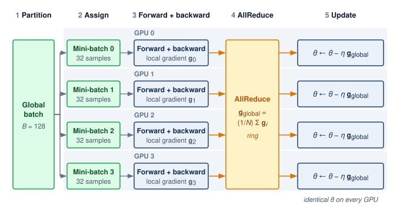

<!--
```{.tikz}
\scalebox{0.74}{%
\begin{tikzpicture}[
  line join=round, line cap=round,
  font=\small\sffamily,
  >=Stealth,
  phase header/.style={
    font=\bfseries\footnotesize\sffamily,
    text=BlueLine,
    align=center
  },
  batch box/.style={
    rectangle,
    rounded corners=3.5pt,
    draw=OrangeLine!80,
    fill=OrangeFill!35,
    line width=0.7pt,
    align=center,
    font=\footnotesize\sffamily
  },
  mini box/.style={
    rectangle,
    rounded corners=3pt,
    draw=BlueLine!70,
    fill=BlueFill!25,
    line width=0.7pt,
    align=center,
    font=\scriptsize\sffamily
  },
  step box/.style={
    rectangle,
    rounded corners=2.5pt,
    line width=0.65pt,
    align=center,
    font=\scriptsize\sffamily
  },
  grad box/.style={
    rectangle,
    rounded corners=2.5pt,
    draw=GreenLine!80,
    fill=GreenFill!35,
    line width=0.7pt,
    align=center,
    font=\scriptsize\bfseries\sffamily,
    text=GreenD
  },
  update box/.style={
    rectangle,
    rounded corners=3pt,
    draw=BlueLine!70,
    fill=BlueFill!25,
    line width=0.7pt,
    align=center,
    font=\scriptsize\sffamily
  }
]

  % Phase Columns & Headers
  \node[phase header] at (0.6, 8.5) {1. Global\\[1pt]Batch};
  \node[phase header] at (2.5, 8.5) {2. Sharded\\[1pt]Inputs};
  \node[phase header] at (5.8, 8.5) {3. Local Forward \& Backward\\[1pt](Per-GPU Compute)};
  \node[phase header] at (10.4, 8.5) {4. Collective\\[1pt]AllReduce};
  \node[phase header] at (14.2, 8.5) {5. Weight\\[1pt]Update};

  % Vertical guide separators
  \draw[dashed, GrayLine!25, line width=0.5pt] (1.5, 8.9) -- (1.5, 1.2);
  \draw[dashed, GrayLine!25, line width=0.5pt] (3.4, 8.9) -- (3.4, 1.2);
  \draw[dashed, GrayLine!25, line width=0.5pt] (8.5, 8.9) -- (8.5, 1.2);
  \draw[dashed, GrayLine!25, line width=0.5pt] (12.2, 8.9) -- (12.2, 1.2);

  % Phase 1: Global Batch
  \node[batch box, minimum width=1.35cm, minimum height=4.8cm] (GB) at (0.6, 4.4) {
    \textbf{Global}\\[2pt]
    \textbf{Batch}\\[5pt]
    \small $B = 128$\\[2pt]
    \scriptsize samples
  };

  % 4 GPU Swimlanes
  \foreach \i/\y in {0/6.8, 1/5.2, 2/3.6, 3/2.0} {

    % Phase 2: Sharded Mini-batch
    \node[mini box, minimum width=1.5cm, minimum height=0.95cm] (MB\i) at (2.45, \y) {
      \textbf{Mini-batch \i}\\[1pt]
      \tiny $B_i = 32$ samples
    };

    % Phase 3: GPU Compute Blocks
    \node[anchor=south west, font=\tiny\bfseries\sffamily, fill=BlueFill!40, draw=BlueLine!60, rounded corners=1.5pt, text=BlueLine, inner sep=1.5pt, line width=0.4pt]
      at (3.65, \y+0.32) {GPU \i};

    \node[step box, draw=BlueLine!70, fill=BlueFill!30, minimum width=1.0cm, minimum height=0.68cm] (FWD\i) at (4.25, \y) {
      \textbf{\scriptsize Fwd}
    };

    \node[step box, draw=RedLine!70, fill=RedFill!35, minimum width=0.8cm, minimum height=0.68cm] (LOSS\i) at (5.35, \y) {
      \textbf{\scriptsize Loss}
    };

    \node[step box, draw=OrangeLine!80, fill=OrangeFill!40, minimum width=1.0cm, minimum height=0.68cm] (BWD\i) at (6.45, \y) {
      \textbf{\scriptsize Bwd}
    };

    \node[grad box, minimum width=0.8cm, minimum height=0.68cm] (GRAD\i) at (7.6, \y) {
      $g_\i$
    };

    \draw[->, line width=0.65pt, GrayLine, shorten >= 2pt] (MB\i.east) -- (FWD\i.west);
    \draw[->, line width=0.65pt, GrayLine, shorten >= 2pt] (FWD\i.east) -- (LOSS\i.west);
    \draw[->, line width=0.65pt, GrayLine, shorten >= 2pt] (LOSS\i.east) -- (BWD\i.west);
    \draw[->, line width=0.7pt, GreenLine, shorten >= 2pt] (BWD\i.east) -- (GRAD\i.west);

    % Phase 5: Weight Update Block
    \node[update box, minimum width=2.5cm, minimum height=0.95cm] (UPD\i) at (14.2, \y) {
      \textbf{GPU \i: Update}\\[1.5pt]
      $\theta \leftarrow \theta - \eta \cdot \bar{g}$
    };
  }

  % Connect Global Batch to Mini-batches with clean orthogonal bus
  \coordinate (gbTrunk) at (1.45, 4.4);
  \draw[-, line width=0.9pt, OrangeLine] (GB.east) -- (gbTrunk);
  \draw[->, line width=0.85pt, OrangeLine, shorten >= 2pt] (gbTrunk) |- (MB0.west);
  \draw[->, line width=0.85pt, OrangeLine, shorten >= 2pt] (gbTrunk) |- (MB1.west);
  \draw[->, line width=0.85pt, OrangeLine, shorten >= 2pt] (gbTrunk) |- (MB2.west);
  \draw[->, line width=0.85pt, OrangeLine, shorten >= 2pt] (gbTrunk) |- (MB3.west);

  % Phase 4: AllReduce Collective Hub
  \node[
    rectangle,
    rounded corners=3.5pt,
    draw=GreenLine,
    fill=GreenFill!25,
    line width=0.9pt,
    inner sep=6pt,
    align=center,
    minimum width=3.3cm,
    minimum height=3.8cm
  ] (AR) at (10.4, 4.4) {
    \textbf{\small\textcolor{GreenD}{Ring AllReduce}}\\[3pt]
    \scriptsize Synchronize Gradients\\[6pt]
    \normalsize$\bar{g} = \frac{1}{N}\sum_{i=0}^{N-1} g_i$\\[8pt]
    \scriptsize Comm Volume:\\[3pt]
    $\frac{2(N-1)}{N}|P|$
  };

  % Gradient arrows to AllReduce (clean orthogonal bus clearly outside AR)
  \coordinate (ARin0) at ([yshift=1.2cm]AR.west);
  \coordinate (ARin1) at ([yshift=0.4cm]AR.west);
  \coordinate (ARin2) at ([yshift=-0.4cm]AR.west);
  \coordinate (ARin3) at ([yshift=-1.2cm]AR.west);

  \draw[->, line width=0.85pt, GreenLine, shorten >= 2pt] (GRAD0.east) -- ++(0.28, 0) |- (ARin0);
  \draw[->, line width=0.85pt, GreenLine, shorten >= 2pt] (GRAD1.east) -- ++(0.48, 0) |- (ARin1);
  \draw[->, line width=0.85pt, GreenLine, shorten >= 2pt] (GRAD2.east) -- ++(0.48, 0) |- (ARin2);
  \draw[->, line width=0.85pt, GreenLine, shorten >= 2pt] (GRAD3.east) -- ++(0.28, 0) |- (ARin3);

  % Synchronized gradient broadcast bus to Updates
  \coordinate (arOutTrunk) at (12.6, 4.4);
  \draw[-, line width=1.1pt, BlueLine] (AR.east) -- node[above=2pt, fill=BlueFill!20, draw=BlueLine!40, rounded corners=1.5pt, line width=0.4pt, inner sep=1.5pt, font=\tiny\bfseries\sffamily, text=BlueLine] {$\bar{g}$ Broadcast} (arOutTrunk);
  \draw[->, line width=0.85pt, BlueLine, shorten >= 2pt] (arOutTrunk) |- (UPD0.west);
  \draw[->, line width=0.85pt, BlueLine, shorten >= 2pt] (arOutTrunk) |- (UPD1.west);
  \draw[->, line width=0.85pt, BlueLine, shorten >= 2pt] (arOutTrunk) |- (UPD2.west);
  \draw[->, line width=0.85pt, BlueLine, shorten >= 2pt] (arOutTrunk) |- (UPD3.west);

  % CMOS Architectural Legend Card at bottom
  \node[
    draw=GrayLine!35, fill=gray!3, line width=0.6pt,
    rounded corners=3.5pt,
    anchor=north, minimum width=15.0cm, inner sep=6pt
  ] at (7.4, 0.8) {
    \begin{minipage}{14.6cm}\footnotesize\sffamily
      \begin{tabular}{@{}p{7.1cm}@{\hspace{0.4cm}}p{7.1cm}@{}}
        \textbf{Pipeline Execution \& Synchronization Mechanics} & \textbf{Systems Invariant \& Communication Physics} \\[2pt]
        \tikz[baseline=-2pt]\fill[OrangeFill!50,draw=OrangeLine,rounded corners=1.5pt,line width=0.5pt] (0,-0.12) rectangle (0.32,0.12);
        \textbf{Global Batch:} Partitioned evenly across $N$ workers &
        $\bullet$ \textbf{Exact Parameter Parity:} $\theta^{(t+1)}_0 = \theta^{(t+1)}_1 = \cdots = \theta^{(t+1)}_{N-1}$ \\
        \tikz[baseline=-2pt]\fill[BlueFill!30,draw=BlueLine,rounded corners=1.5pt,line width=0.5pt] (0,-0.12) rectangle (0.32,0.12);
        \textbf{Local Compute:} Autograd generates per-GPU gradient $g_i$ &
        $\bullet$ \textbf{Bandwidth Requirement:} Minimal when compute overlaps \\
        \tikz[baseline=-2pt]\fill[GreenFill!35,draw=GreenLine,rounded corners=1.5pt,line width=0.5pt] (0,-0.12) rectangle (0.32,0.12);
        \textbf{Ring AllReduce:} Exchange $2(N-1)|P|/N$ bytes in ring hops &
        $\bullet$ \textbf{Barrier Overhead:} Scales with slowest worker (straggler)
      \end{tabular}
    \end{minipage}
  };

\end{tikzpicture}%
}
```
-->

:::

The gradient synchronization stage of @fig-dist-train-data-parallelism (stage 4) establishes a dependency: each rank must receive the completed reduction before applying its optimizer update. The exposed wait can reflect bandwidth, collective startup, or a late contribution. Measuring that wait determines whether synchronization limits scaling; the dependency alone does not identify the binding resource.

#### Dataset splitting {#sec-distributed-training-systems-systems-dataset-splitting-1edf}

Data splitting is the first place where the SGD equivalence can fail, but uniqueness and equal-sized shards are sufficient conditions rather than the invariant itself. The aggregate examples or tokens, their sampling probabilities, and their gradient weights must reproduce the intended global-batch estimator. Uniform sampling without replacement can assign disjoint shards; sampling with replacement can legitimately repeat examples; and variable-length batches can assign unequal token counts if the reduction weights each worker by its valid-example or valid-token denominator. An unweighted mean of unequal local means instead overweights workers with smaller denominators.

The sampler is therefore part of the training system, not only an input-loader convenience. A distributed sampler coordinates workers by rank and can deterministically partition or draw indices from a seeded sampling stream. For a 1.2 million-example dataset distributed evenly across 32 GPUs, each GPU processes approximately 37,500 examples per epoch. If the sampler pads the final batch by repeating examples, the loss normalization or sample weights must account for those repeats when exact epoch-level weighting matters. A recorded seed and deterministic index stream make sample assignment repeatable; bitwise run reproducibility additionally depends on kernel determinism, collective reduction order, numerical precision, and checkpointed random-number-generator state.

```{python}
#| echo: false
from mlsysim.solvers import DistributedModel

# ┌─────────────────────────────────────────────────────────────────────────────
# │ GPT-3 TRAINING CONTEXT (LEGO)
# ├─────────────────────────────────────────────────────────────────────────────
# │ Context: @sec-distributed-training-systems-systems-compute-phase-forward-backward
# │
# │ Goal: Provide GPT-3 scale statistics for distributed training discussion.
# │ Show: ~175B parameters.
# │ How: pulling Models.Language.GPT3.parameters from MLSysIM.
# │
# └─────────────────────────────────────────────────────────────────────────────
from mlsysim import Models
from mlsysim.fmt import fmt, fmt_count, fmt_params, fmt_percent

class FrontierTrainingContext:
    """GPT-3 scale reference for distributed training."""

    # ┌── 1. LOAD (Constants) ──────────────────────────────────────────────
    model = Models.Language.GPT3

    # ┌── 2. EXECUTE (The Compute) ────────────────────────────────────────
    params_b = model.parameters.to(param).magnitude / BILLION

    # ┌── 3. GUARD (Invariants) ──────────────────────────────────────────
    from mlsysim.fmt import check

    check(170 <= params_b <= 180, f"GPT-3 reference should be ~175B params, got {params_b:.1f}B")

    # ┌── 4. OUTPUT (Formatting) ──────────────────────────────────────────────
    frontier_params_b_str = fmt_params(model.parameters, scale="B", precision=0, commas=False)
    training_tokens_str = fmt_count(model.training_tokens.magnitude, scale="billion", scale_style="word", precision=0)
```

#### Compute-phase forward and backward passes {#sec-distributed-training-systems-systems-compute-phase-forward-backward}

```{python}
#| echo: false
#| label: distributed-training-gpt3-activation-budget

# ┌─────────────────────────────────────────────────────────────────────────────
# │ GPT-3 ACTIVATION MEMORY BUDGET (MICRO-BATCH 4, SEQ 2048)
# ├─────────────────────────────────────────────────────────────────────────────
# │ Context: compute-phase prose in
# │          @sec-distributed-training-systems-systems-compute-phase-forward-backward.
# │
# │ Goal: Pin the activation-memory claims to calc_activation_memory (the old
# │       prose hand-typed 'over 200 GB' and '~50 GB', which match no
# │       canonical recomputation strategy at these inputs).
# │ Scope: chapter-anchor — data-parallel activation budget is recalled when
# │ model parallelism explains the same capacity constraint.
# │ Show: Unoptimized activation footprint (~1.1 TB) vs full activation
# │       checkpointing (~19 GB) for GPT-3 at micro-batch 4, seq 2048.
# │ How: calc_activation_memory(layers=96, seq=2048, batch=4, hidden=12288,
# │      n_heads=96) with strategy='none' vs 'full' (Korthikanti et al. 2022).
# │
# └─────────────────────────────────────────────────────────────────────────────
from mlsysim.physics import calc_activation_memory
from mlsysim.fmt import check, fmt_memory

class Gpt3ActivationBudget:
    # ┌── 1. LOAD (Constants) ──────────────────────────────────────────────
    layers = Models.Language.GPT3.layers
    seq_len = Models.Language.GPT3.context_length
    micro_batch = 4  # scenario assumption: per-GPU micro-batch
    hidden = Models.Language.GPT3.hidden_dim
    heads = Models.Language.GPT3.heads

    # ┌── 2. EXECUTE (The Compute) ────────────────────────────────────────
    act_unchecked = calc_activation_memory(layers, seq_len, micro_batch, hidden, n_heads=heads, strategy="none")
    act_checkpointed = calc_activation_memory(layers, seq_len, micro_batch, hidden, n_heads=heads, strategy="full")

    # ┌── 3. GUARD (Invariants) ───────────────────────────────────────────
    check(act_unchecked > 1000 * GB, "Unoptimized GPT-3 activations at b=4, s=2048 should exceed 1 TB")
    check(act_checkpointed < 25 * GB, "Fully checkpointed activations should fit comfortably in one H100")

    # ┌── 4. OUTPUT (Formatting) ──────────────────────────────────────────
    act_unchecked_tb_str = fmt_memory(act_unchecked, unit=TB, precision=1, commas=False)
    act_checkpointed_gb_str = fmt_memory(act_checkpointed, unit=GB, precision=1, commas=False, approx=True)
    seq_len_str = fmt(seq_len, precision=0, commas=False)
    micro_batch_str = fmt(micro_batch, precision=0, commas=False)
```

For a replicated model whose local forward and backward operations require no cross-worker state, the computation phase is *embarrassingly parallel*. Each GPU executes the model on its local batch; synchronized normalization or additional model partitioning can introduce communication within that phase. To isolate the activation term, consider an unpartitioned `{python} FrontierTrainingContext.frontier_params_b_str` reference model at a local batch of `{python} Gpt3ActivationBudget.micro_batch_str` sequences and sequence length `{python} Gpt3ActivationBudget.seq_len_str`. This is a hypothetical memory budget, not a feasible one-GPU training configuration: weights and optimizer state must fit as well. Without optimization, storing these activations for backpropagation would consume roughly `{python} Gpt3ActivationBudget.act_unchecked_tb_str` of HBM, an order of magnitude beyond the capacity of even an H100 GPU. Activation checkpointing\index{Activation checkpointing!memory reduction} recomputes selected activations during the backward pass rather than retaining them, reducing this example's footprint to `{python} Gpt3ActivationBudget.act_checkpointed_gb_str` at the cost of extra computation.

The capacity test must include activations rather than stopping at bytes per parameter. @Sec-appdx-dam-taxonomy-training-memory tabulates the 16-byte-per-parameter training state from which this test starts. At the point of peak residency\index{Memory footprint!peak activation},
$$
\TotalMemoryFootprint = \WeightMemoryWeights + \GradientMemoryGradients + \OptimizerstateMemory + \ActivationMemoryActivations,
$$
with communication buffers and temporary workspaces consuming additional headroom. Sharding reduces the first three terms according to its stage, whereas sequence length, local batch size, and pipeline scheduling govern $\ActivationMemoryActivations$. Activation checkpointing reduces that last term by retaining only selected boundaries and recomputing the omitted forward operators during backpropagation [@narayanan2021]. The memory saved is therefore purchased with additional FLOPs and a longer critical path\index{Activation checkpointing!recomputation overhead}; a feasible parallelism plan must budget both effects.

As the backward pass traverses the computation graph in reverse, it produces gradients for the parameters held by each replica or shard. Under pure data parallelism, a full `{python} FrontierTrainingContext.frontier_params_b_str` FP16 replica would imply a `{python} DenseLLMReferenceFacts.weights_gb_str` gradient tensor per worker, which exceeds single-accelerator memory budgets; large runs therefore combine data parallelism with sharding, tensor parallelism, or pipeline parallelism. Each local gradient contributes to the intended global-batch estimator. Aggregation can begin as gradient tensors become ready, overlapping later backward computation, but the optimizer must wait for the completed contributions it consumes. This readiness schedule connects local computation to collective communication.

#### Gradient synchronization {#sec-distributed-training-systems-systems-gradient-synchronization-614b}

Gradient synchronization combines local contributions into the synchronous update. Each replica must receive the aggregate before applying that update. In a centralized parameter-server design with fixed per-worker payload and update frequency, the server receives $\mathcal{O}(N)$ incoming traffic\index{Parameter server!bandwidth bottleneck}. That concentration becomes a bottleneck when demand exceeds the server tier's service capacity; sharding the server state or changing the communication pattern can relieve it.

The replicated synchronous baseline distributes aggregation through collective communication. AllReduce lets each worker contribute its local gradient tensor and receive the same reduced result, which the training loop normalizes to obtain the global average\index{AllReduce!decentralized gradient synchronization}. In sharded variants such as ZeRO and FSDP, ReduceScatter\index{ReduceScatter!gradient aggregation} and AllGather\index{AllGather!parameter reconstruction} change which result each worker retains. ReduceScatter combines corresponding tensor elements, then leaves a different reduced shard on each worker. AllGather collects distinct shards and returns their concatenation to every worker without summing them. These contracts support gradient sharding and on-demand parameter reconstruction. Small messages emphasize startup latency; large messages emphasize sustained bandwidth. Centralized aggregation remains another design choice, particularly for the sparse workloads developed later.

At the Distributed Execution row of the fleet stack, the loop specifies an AllReduce contract while its implementation determines the cost. For a large worker group, ring AllReduce transfers approximately $2M_{\text{grad}}$ bytes per worker for an $M_{\text{grad}}$-byte gradient payload. @Sec-collective-communication derives this approximate $2M_{\text{grad}}$ volume and compares algorithms whose startup costs, topology, and contention differ. It also examines how libraries such as NCCL schedule exchanges within and across communication domains.

When a measured collective deviates from these estimates, the diagnosis compares the trace against what each candidate algorithm would predict on the same hardware. The worked example below concerns a trace that a flat ring cannot explain. The leading candidate is a hierarchical AllReduce\index{AllReduce!hierarchical}, which reduces inside each node over NVLink, runs the cross-node ring on only the node's $1/8$ share of the tensor, then broadcasts the result inside the node, so the slow inter-node links carry an eighth of the bytes a flat ring would send over them.

::: {.column-margin .margin-pointer}
↪ Hierarchical AllReduce and its cost relative to a flat ring are developed in @sec-communication-collective-operations-collective-operations-hierarchical-allreduce-1338.
:::

```{python}
#| echo: false
from mlsysim.solvers import DistributedModel

# ┌─────────────────────────────────────────────────────────────────────────────
# │ HIERARCHICAL ALLREDUCE DEBUG CALCULATION (LEGO)
# ├─────────────────────────────────────────────────────────────────────────────
# │ Context: @exmp-distributed-training-debugging-slow-gradient-synchronization.
# │ Goal: Compute the flat-ring baseline and hierarchical ideal for a 3 GB tensor.
# │ How: Ring factor 2(N-1)/N; hierarchy sends 1/8 of the tensor over HDR and
# │      pays two intra-node NVLink phases.
# └─────────────────────────────────────────────────────────────────────────────
from mlsysim.fmt import check, fmt, fmt_bandwidth, fmt_count, fmt_memory, fmt_percent, fmt_time

# ┌── LEGO ───────────────────────────────────────────────
class HierarchicalAllReduceDebug:
    """Flat and hierarchical AllReduce timings for the debugging example."""

    # ┌── 1. LOAD ──────────────────────────────────────────────────────────
    from mlsysim.physics import calc_hierarchical_allreduce_time, calc_ring_allreduce_time

    fleet = Systems.Clusters.Training_1K_A100
    tensor_bytes = 3.0 * GB  # scenario tensor size for the debugging example
    nodes = fleet.count
    gpus_per_node = fleet.node.accelerators_per_node
    ib_hdr_bw = fleet.fabric.bandwidth
    nvlink_bw = fleet.node.intra_node_bw

    # ┌── 2. EXECUTE ───────────────────────────────────────────────────────
    # Flat Ring Baseline
    t_flat = calc_ring_allreduce_time(tensor_bytes, nodes * gpus_per_node, ib_hdr_bw, 0 * ms)
    flat_ring_time = t_flat.to(ms)

    # Hierarchical Ideal
    hierarchical_total_time = calc_hierarchical_allreduce_time(
        message_bytes=tensor_bytes, n_nodes=nodes, gpus_per_node=gpus_per_node, intra_node_bw=nvlink_bw, inter_node_bw=ib_hdr_bw
    ).to(ms)

    # Inter-node phase only (for prose)
    reduced_message = tensor_bytes / gpus_per_node
    inter_node_time = calc_ring_allreduce_time(reduced_message, nodes, ib_hdr_bw, 0 * ms).to(ms)

    observed_time = 100.0 * ms
    residual_time = observed_time - hierarchical_total_time
    ib_util_pct = 60

    # ┌── 3. GUARD ─────────────────────────────────────────────────────────
    check(235 * ms < flat_ring_time < 245 * ms, "Flat ring should be about 240 ms")
    check(29 * ms < inter_node_time < 35 * ms, "Inter-node hierarchical phase should be about 30 ms")
    check(
        30 * ms < hierarchical_total_time < 60 * ms, f"Hierarchical ideal should be about 50 ms, got {hierarchical_total_time.to(ms).magnitude:.1f}"
    )

    # ┌── 4. OUTPUT ────────────────────────────────────────────────────────
    flat_ring_ms_str = fmt_time(flat_ring_time, ms, precision=1, commas=False)
    hierarchical_total_ms_str = fmt_time(hierarchical_total_time, ms, precision=1, commas=False)
    observed_ms_str = fmt_time(observed_time, ms, precision=0, commas=False)
    tensor_gb_str = fmt_memory(tensor_bytes, unit=GB, precision=0, commas=False)
    nodes_str = fmt_count(nodes, commas=False, label="node")
    total_gpus_str = fmt_count(nodes * gpus_per_node, commas=True, label="GPU")
    ib_util_pct_str = fmt_percent(ib_util_pct / 100, precision=0, commas=False, style='prose')
```

::: {#exmp-distributed-training-debugging-slow-gradient-synchronization .callout-example title="Debugging slow gradient synchronization"}

**Scenario**: In this hypothetical diagnostic trace on an A100 cluster with HDR InfiniBand, one generation older than the reference H100 cluster and chosen because its narrower inter-node links make the flat-ring penalty easy to see, an AllReduce of a `{python} HierarchicalAllReduceDebug.tensor_gb_str` gradient tensor across `{python} HierarchicalAllReduceDebug.nodes_str` (`{python} HierarchicalAllReduceDebug.total_gpus_str`) takes `{python} HierarchicalAllReduceDebug.observed_ms_str`.

**Diagnosis**: Three times bracket the trace. The idealized hierarchical estimate is `{python} HierarchicalAllReduceDebug.hierarchical_total_ms_str`, the observed collective takes `{python} HierarchicalAllReduceDebug.observed_ms_str`, and the flat-ring estimate is `{python} HierarchicalAllReduceDebug.flat_ring_ms_str`. Because the observation falls well below the flat-ring estimate, a flat ring cannot explain it, and a hierarchical algorithm becomes the leading hypothesis, which runtime traces must confirm by identifying the actual algorithm, channels, and routes. Because the observation still exceeds the hierarchical ideal, something adds time beyond moving the bytes. Suppose switch counters also show inter-node InfiniBand links at `{python} HierarchicalAllReduceDebug.ib_util_pct_str` utilization. Links running well below saturation rule out raw link bandwidth as the source of the extra time and point instead toward shared-uplink congestion, channel imbalance, or a late participant, which a per-channel trace can separate.

**Systems lesson**: Debugging collective communication requires evaluating physical link utilization against algorithmic bounds. The gap between the `{python} HierarchicalAllReduceDebug.hierarchical_total_ms_str` idealized hierarchical estimate and the `{python} HierarchicalAllReduceDebug.observed_ms_str` trace motivates checking congestion, channel placement, startup, and stragglers. Change topology only after identifying the exposed bottleneck.

:::

Stepping back from that specific cluster to the architectural design space, @fig-coll-comm diagrams three synchronization topologies: the bandwidth-optimal ring AllReduce that circulates chunks along neighbor links ($2(N-1)/N$ volume), the centralized parameter server constrained by network interface card (NIC) saturation at the server node, and the dense mesh of logical All-to-All peer traffic ($N(N-1)$ messages). In dense synchronous data-parallel settings, ring AllReduce avoids a single reducer bottleneck by distributing traffic evenly across participating links, as Baidu's implementation illustrates [@gibiansky2017baidu].

::: {#fig-coll-comm fig-env="figure" fig-pos="htb" fig-cap="**Communication patterns and their costs**: Ring AllReduce and a parameter server illustrate two ways to aggregate updates. All-to-All instead routes distinct data to each peer; the complete graph shows logical destinations, not a requirement for dedicated physical links. A switched fabric can carry this traffic, with cost determined by message size, routes, and contention." fig-alt="Three panels showing a ring of workers, workers linked to a central parameter server, and logical all-to-all destinations among workers. Logical edges do not specify physical wiring."}
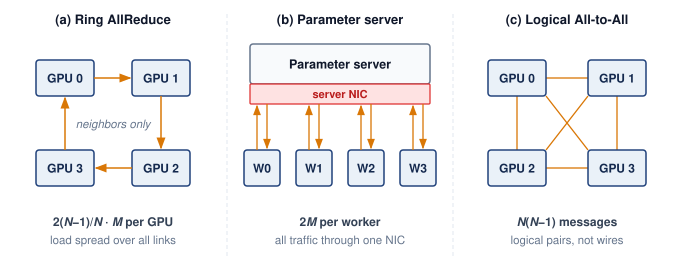

:::

The panels separate an aggregation algorithm, a centralized architecture, and a collective traffic pattern. They do not provide interchangeable implementations of the same operation. Only the first two aggregate gradients; the All-to-All panel previews the exchange that sparse embedding tables and mixture-of-experts layers need, in which every worker sends different data to every other worker (@sec-distributed-training-systems-systems-expert-parallelism-mixture-experts-bc45). Libraries choose algorithms and routes for the requested collective on the available fabric; a logical complete graph does not guarantee one-round physical delivery.

#### Synchronization models {#sec-distributed-training-systems-systems-synchronization-models-396f}

Distributed training systems use synchronization models to specify when workers observe and apply updates. The baseline is bulk synchronous parallel (BSP)\index{Bulk synchronous parallel|see{BSP}}\index{BSP!synchronization}, the superstep-and-barrier model. In the replicated training loop, workers compute from one parameter version, combine their gradient contributions, and complete the update before computing from the next version. This is a dependency order, not a requirement that every device update at the same wall-clock instant. Relaxing it changes the optimization process as well as the waiting time.

::: {.column-margin .margin-pointer}
↩ Bulk synchronous parallel execution and its barrier cost are established in @sec-network-workload-inversion.
:::

BSP provides synchronous update semantics: every worker computes from the same parameter version and reaches the next update boundary together. With the same global batch and reduction, this matches the corresponding synchronous single-device update mathematically. It does not by itself guarantee bitwise reproducibility. Floating-point reduction order, nondeterministic kernels, data-order state, and failure recovery can still change the result. The synchronization cost is that the slowest worker determines iteration time. A worker that keeps producing correct results but runs markedly slower than its peers is a **straggler**\index{Straggler!synchronization delay}, and under BSP every straggler delays the entire step.

Stale synchronous parallel (SSP)\index{Stale synchronous parallel!bounded staleness}\index{SSP|see{Stale synchronous parallel}} relaxes this constraint by allowing workers to proceed up to $s$ iterations ahead of the slowest worker before blocking. This bounds staleness while reducing synchronization delays. SSP requires careful learning rate tuning since workers compute gradients on slightly different parameter versions. The bounded staleness guarantee provides a middle ground between BSP's strong consistency and fully asynchronous approaches [@ho2013more].

Asynchronous parallel (ASP) execution\index{Asynchronous SGD!staleness penalty}\index{ASP|see{Asynchronous SGD}} removes the global update barrier, allowing a worker's contribution to be applied while others continue computing; asynchronous SGD is the optimizer run under that protocol. Less barrier waiting can improve update throughput, but communication and shared-state contention remain. Gradients computed from older parameter versions introduce staleness that can affect convergence\index{Gradient staleness!optimization disruption}. @Sec-distributed-training-systems-systems-staleness-impact-bsp-vs-ssp-vs-asp-e153 develops the objective and delay assumptions needed to evaluate that trade-off.

The key trade-offs across synchronization models are summarized in @tbl-sync-models.

| **Model** |  **Consistency**  |        **Throughput**       | **Convergence**                    | **Use Case**                   |
|:----------|:-----------------:|:---------------------------:|:-----------------------------------|:-------------------------------|
| **BSP**   |       Strong      |  Bounded by slowest worker  | Same synchronous update semantics  | Controlled final training runs |
| **SSP**   | Bounded staleness | Less global-barrier waiting | Depends on delay and tuning        | Hyperparameter search          |
| **ASP**   |        Weak       |   No global update barrier  | Depends on staleness and objective | Large heterogeneous clusters   |

: **Synchronization Model Trade-offs**: BSP, SSP, and ASP trade consistency for throughput along a spectrum. BSP preserves synchronous update boundaries but pays for the slowest worker; SSP permits bounded progress ahead of slower workers; ASP removes the global update barrier without a finite protocol-wide staleness bound. Throughput and time to target quality depend on the workload and implementation. Reproducibility requires a separate deterministic-execution contract. {#tbl-sync-models}

::: {.content-visible when-format="pdf"}

\newpage

:::

@Fig-sync-model-timeline sequences execution traces for four workers across BSP, SSP, and ASP, isolating how global barriers force faster workers into idle wait blocks while straggler W3 completes, how bounded slack ($s=1$) throttles drift with brief pauses, and how asynchronous updates remove the global barrier without imposing a finite staleness bound. Communication and resource contention can still leave workers waiting.

::: {#fig-sync-model-timeline fig-env="figure" fig-pos="htb" fig-cap="**Distributed synchronization models**: The timelines compare three synchronization strategies. Top: bulk synchronous parallel (BSP) forces all workers to wait at a global barrier every step. Middle: stale synchronous parallel (SSP) allows workers to proceed up to $s$ steps ahead of the slowest worker. Bottom: asynchronous parallel (ASP) execution removes the global update barrier while allowing gradient staleness; communication and resource contention can still delay progress." fig-alt="Timeline diagram with three panels. Top: BSP with global barriers. Middle: SSP with bounded staleness slack. Bottom: Asynchronous with independent workers and overlapping steps."}
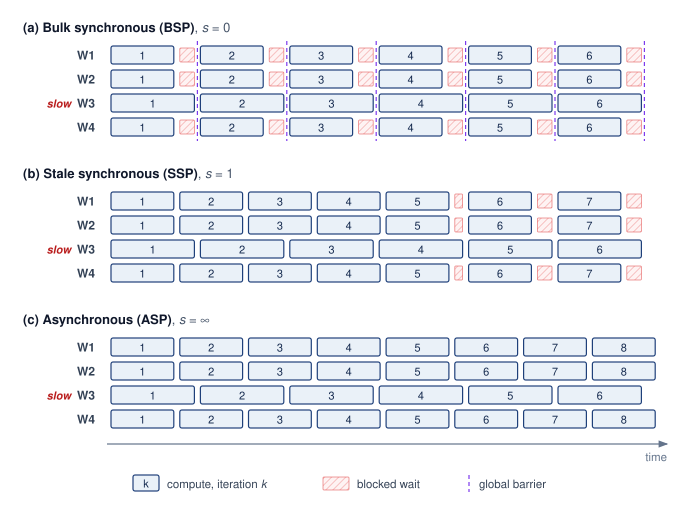{width=100%}

<!--
```{.tikz}
\scalebox{0.82}{%
\begin{tikzpicture}[
  line join=round, line cap=round,
  font=\small\sffamily,
  >=Stealth,
  panel card/.style={
    draw=GrayLine!35,
    fill=gray!2,
    rounded corners=3.5pt,
    line width=0.65pt
  },
  badge/.style={
    font=\bfseries\tiny\sffamily,
    rounded corners=2pt,
    line width=0.5pt,
    inner sep=2.5pt,
    align=center
  },
  worker label/.style={
    font=\bfseries\scriptsize\sffamily,
    text=TextBlack,
    anchor=east
  },
  compute block/.style={
    rectangle,
    rounded corners=1.5pt,
    draw=BlueLine!70,
    fill=BlueFill!25,
    line width=0.6pt,
    inner sep=0pt,
    font=\tiny\sffamily
  },
  wait block/.style={
    rectangle,
    rounded corners=1.5pt,
    draw=RedLine!70,
    fill=RedFill!30,
    line width=0.6pt,
    inner sep=0pt,
    font=\tiny\bfseries\sffamily
  },
  ssp pause/.style={
    rectangle,
    rounded corners=1.5pt,
    draw=OrangeLine!80,
    fill=OrangeFill!40,
    line width=0.6pt,
    inner sep=0pt,
    font=\tiny\bfseries\sffamily
  }
]

  % ===========================================================
  % TIME AXIS AT TOP
  % ===========================================================
  \draw[->, line width=0.8pt, GrayLine] (2.2, 11.0) -- (14.2, 11.0) node[right=4pt, font=\scriptsize\bfseries\sffamily, text=TextBlack] {Time};
  \foreach \x/\t in {2.2/0, 4.54/1, 6.88/2, 9.22/3, 11.56/4, 13.9/5} {
    \draw[line width=0.6pt, GrayLine] (\x, 10.9) -- (\x, 11.1);
    \node[above=2pt, font=\tiny\bfseries\sffamily, text=TextBlack!70] at (\x, 11.1) {$t = \t$};
  }

  % ===========================================================
  % PANEL (a): BSP (s = 0)
  % ===========================================================
  \node[panel card, minimum width=14.4cm, minimum height=3.2cm, anchor=north west] at (0, 10.6) {};

  % Header row (no heavy solid two-tone cap)
  \node[anchor=west, font=\bfseries\footnotesize\sffamily, text=BlueLine] at (0.3, 10.3) {(a) Bulk Synchronous Parallel (BSP) $\boldsymbol{\cdot s = 0}$};
  \node[anchor=west, font=\tiny\sffamily, text=TextBlack!70] at (6.6, 10.3) {Fast workers idle at every barrier until straggler finishes};
  \node[badge, draw=BlueLine!70, fill=BlueFill!40, text=BlueLine, anchor=east] at (14.1, 10.3) {EXACT SGD};
  \draw[GrayLine!20, line width=0.5pt] (0.2, 10.05) -- (14.2, 10.05);

  % Worker rows
  \node[worker label] at (2.05, 9.55) {W1};
  \node[worker label] at (2.05, 8.95) {W2};
  \node[worker label, text=RedLine] at (2.05, 8.35) {W3 (Straggler)};
  \node[worker label] at (2.05, 7.75) {W4};

  % Step barriers (red dashed lines)
  \foreach \x in {4.54, 6.88, 9.22, 11.56, 13.9} {
    \draw[dashed, line width=0.75pt, RedLine!60] (\x, 9.9) -- (\x, 7.5);
  }

  % Step blocks for BSP (5 steps, width = 2.34cm each)
  \foreach \step/\xstart in {0/2.2, 1/4.54, 2/6.88, 3/9.22, 4/11.56} {
    % W1
    \node[compute block, minimum width=1.46cm, minimum height=0.45cm, anchor=west] at (\xstart, 9.55) {
      \textcolor{BlueLine}{\ifnum\step=0 Compute\else Step \step\fi}
    };
    \node[wait block, minimum width=0.82cm, minimum height=0.45cm, anchor=west] at (\xstart + 1.49, 9.55) {
      \textcolor{RedLine!90!black}{wait}
    };
    % W2
    \node[compute block, minimum width=1.46cm, minimum height=0.45cm, anchor=west] at (\xstart, 8.95) {
      \textcolor{BlueLine}{\ifnum\step=0 Compute\else Step \step\fi}
    };
    \node[wait block, minimum width=0.82cm, minimum height=0.45cm, anchor=west] at (\xstart + 1.49, 8.95) {
      \textcolor{RedLine!90!black}{wait}
    };
    % W3 (Straggler)
    \node[compute block, draw=RedLine!70, fill=RedFill!25, minimum width=2.31cm, minimum height=0.45cm, anchor=west] at (\xstart, 8.35) {
      \bfseries\textcolor{RedLine!90!black}{\ifnum\step=0 Compute (Slow)\else Step \step\ (Slow)\fi}
    };
    % W4
    \node[compute block, minimum width=1.46cm, minimum height=0.45cm, anchor=west] at (\xstart, 7.75) {
      \textcolor{BlueLine}{\ifnum\step=0 Compute\else Step \step\fi}
    };
    \node[wait block, minimum width=0.82cm, minimum height=0.45cm, anchor=west] at (\xstart + 1.49, 7.75) {
      \textcolor{RedLine!90!black}{wait}
    };
  }

  % ===========================================================
  % PANEL (b): SSP (s = 1)
  % ===========================================================
  \node[panel card, minimum width=14.4cm, minimum height=3.2cm, anchor=north west] at (0, 7.1) {};

  % Header row (no heavy solid cap)
  \node[anchor=west, font=\bfseries\footnotesize\sffamily, text=OrangeLine!90!black] at (0.3, 6.8) {(b) Stale Synchronous Parallel (SSP) $\boldsymbol{\cdot s = 1}$};
  \node[anchor=west, font=\tiny\sffamily, text=TextBlack!70] at (6.6, 6.8) {Workers allowed $s=1$ iteration drift before blocking};
  \node[badge, draw=OrangeLine!70, fill=OrangeFill!40, text=OrangeLine!90!black, anchor=east] at (14.1, 6.8) {BOUNDED DRIFT};
  \draw[GrayLine!20, line width=0.5pt] (0.2, 6.55) -- (14.2, 6.55);

  % Worker rows
  \node[worker label] at (2.05, 6.05) {W1};
  \node[worker label] at (2.05, 5.45) {W2};
  \node[worker label, text=OrangeLine!90!black] at (2.05, 4.85) {W3 (Slow)};
  \node[worker label] at (2.05, 4.25) {W4};

  % SSP fast workers: 2 compute blocks then s<=1 pause
  \foreach \y in {6.05, 5.45, 4.25} {
    % Cycle 1 (steps 0, 1)
    \node[compute block, minimum width=1.66cm, minimum height=0.45cm, anchor=west] at (2.20, \y) {
      \textcolor{BlueLine}{Compute}
    };
    \node[compute block, minimum width=1.66cm, minimum height=0.45cm, anchor=west] at (3.90, \y) {
      \textcolor{BlueLine}{Step 1}
    };
    \node[ssp pause, minimum width=0.42cm, minimum height=0.45cm, anchor=west] at (5.60, \y) {$s{\le}1$};

    % Cycle 2 (steps 2, 3)
    \node[compute block, minimum width=1.66cm, minimum height=0.45cm, anchor=west] at (6.06, \y) {
      \textcolor{BlueLine}{Step 2}
    };
    \node[compute block, minimum width=1.66cm, minimum height=0.45cm, anchor=west] at (7.76, \y) {
      \textcolor{BlueLine}{Step 3}
    };
    \node[ssp pause, minimum width=0.42cm, minimum height=0.45cm, anchor=west] at (9.46, \y) {$s{\le}1$};

    % Cycle 3 (steps 4, 5)
    \node[compute block, minimum width=1.66cm, minimum height=0.45cm, anchor=west] at (9.92, \y) {
      \textcolor{BlueLine}{Step 4}
    };
    \node[compute block, minimum width=1.66cm, minimum height=0.45cm, anchor=west] at (11.62, \y) {
      \textcolor{BlueLine}{Step 5}
    };
    \node[ssp pause, minimum width=0.42cm, minimum height=0.45cm, anchor=west] at (13.32, \y) {$s{\le}1$};
  }

  % W3 slow workers
  \foreach \step/\xstart in {0/2.2, 1/4.54, 2/6.88, 3/9.22, 4/11.56} {
    \node[compute block, draw=OrangeLine!70, fill=OrangeFill!25, minimum width=2.31cm, minimum height=0.45cm, anchor=west] at (\xstart, 4.85) {
      \textcolor{OrangeLine!90!black}{\ifnum\step=0 Compute (Slow)\else Step \step\ (Slow)\fi}
    };
  }

  % ===========================================================
  % PANEL (c): ASP (s = \infty)
  % ===========================================================
  \node[panel card, minimum width=14.4cm, minimum height=3.2cm, anchor=north west] at (0, 3.6) {};

  % Header row (no heavy solid cap)
  \node[anchor=west, font=\bfseries\footnotesize\sffamily, text=GreenLine!90!black] at (0.3, 3.3) {(c) Asynchronous SGD (ASP) $\boldsymbol{\cdot s = \infty}$};
  \node[anchor=west, font=\tiny\sffamily, text=TextBlack!70] at (6.6, 3.3) {Zero barrier overhead; workers push stale gradients continually};
  \node[badge, draw=GreenLine!70, fill=GreenFill!35, text=GreenD, anchor=east] at (14.1, 3.3) {MAX THROUGHPUT};
  \draw[GrayLine!20, line width=0.5pt] (0.2, 3.05) -- (14.2, 3.05);

  % Worker rows
  \node[worker label] at (2.05, 2.55) {W1};
  \node[worker label] at (2.05, 1.95) {W2};
  \node[worker label] at (2.05, 1.35) {W3};
  \node[worker label] at (2.05, 0.75) {W4};

  % Time horizon marker in ASP
  \draw[dashed, line width=0.75pt, GreenLine!50] (13.9, 2.8) -- (13.9, 0.5);

  % W1: Fast (duration 1.28cm)
  \foreach \i in {0,...,8} {
    \pgfmathsetmacro{\xpos}{2.2 + \i*1.295}
    \node[compute block, draw=GreenLine!70, fill=GreenFill!25, minimum width=1.265cm, minimum height=0.45cm, anchor=west] at (\xpos, 2.55) {
      \textcolor{GreenD}{\ifnum\i=0 Compute\else\tiny S\i\fi}
    };
  }
  % W2: Medium-Fast (duration 1.64cm)
  \foreach \i in {0,...,6} {
    \pgfmathsetmacro{\xpos}{2.2 + \i*1.655}
    \node[compute block, draw=GreenLine!70, fill=GreenFill!25, minimum width=1.625cm, minimum height=0.45cm, anchor=west] at (\xpos, 1.95) {
      \textcolor{GreenD}{\ifnum\i=0 Compute\else\tiny S\i\fi}
    };
  }
  % W3: Slow (duration 2.32cm)
  \foreach \i in {0,...,4} {
    \pgfmathsetmacro{\xpos}{2.2 + \i*2.335}
    \node[compute block, draw=GreenLine!70, fill=GreenFill!25, minimum width=2.305cm, minimum height=0.45cm, anchor=west] at (\xpos, 1.35) {
      \textcolor{GreenD}{\ifnum\i=0 Compute\else\tiny Step \i\fi}
    };
  }
  % W4: Medium (duration 1.92cm)
  \foreach \i in {0,...,5} {
    \pgfmathsetmacro{\xpos}{2.2 + \i*1.935}
    \node[compute block, draw=GreenLine!70, fill=GreenFill!25, minimum width=1.905cm, minimum height=0.45cm, anchor=west] at (\xpos, 0.75) {
      \textcolor{GreenD}{\ifnum\i=0 Compute\else\tiny S\i\fi}
    };
  }

\end{tikzpicture}%
}
```
-->

:::

The choice of synchronization model directly affects both system throughput and model convergence. Training teams often use BSP for controlled final runs because synchronous steps simplify comparison and replay, while exploring SSP or async approaches during hyperparameter search where throughput can outweigh exact update equivalence. Reproducible replay still requires deterministic sampling, kernels, collective ordering, and restored random state.

#### Barrier semantics and failure modes {#sec-distributed-training-systems-systems-barrier-semantics-failure-modes-5c94}

An optimizer update that consumes an AllReduce result must wait for every required contribution. Workers can execute independent computation while a collective is in flight\index{Communication-computation overlap!latency hiding}, but they must issue compatible collectives in the same group order and wait for completion before consuming the result. This coupling creates failure modes absent from single-device training.

A worker failure can leave peers waiting for a contribution that will never arrive. The runtime may report a communication error, or the operation may remain blocked until a timeout detects the failure. Watchdogs bound that wait so the job can enter recovery rather than retain an unusable allocation indefinitely.

::: {.column-margin}
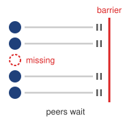{width="100%" fig-alt="Five worker dots approach a vertical barrier; one red missing worker causes the peer lanes to stop before the barrier."}

*One missing worker stalls the entire AllReduce barrier.*
:::

Collective mismatches occur when workers issue incompatible operations, tensor shapes, or ordering within a communication group. Conditional computation can create such a mismatch if some workers omit an expected reduction. Variable sequence lengths or different expert routes do not inherently violate the protocol; the runtime must construct a compatible communication schedule for those varying local computations.

```{python}
#| echo: false
# ┌─────────────────────────────────────────────────────────────────────────────
# │ STRAGGLER ODDS (LEGO)
# ├─────────────────────────────────────────────────────────────────────────────
# │ Context: the straggler paragraph in barrier semantics.
# │ Goal: Show why BSP step time is set by the slowest worker: with 1,000
# │       independent workers at 1 percent each, a step with no straggler is
# │       vanishingly rare (2026-10-07: the prose stopped at the expected count).
# │ How: P(no straggler) = (1 - p)^N.
# └─────────────────────────────────────────────────────────────────────────────
from mlsysim.fmt import check, fmt, fmt_percent

class StragglerOdds:
    # ┌── 1. LOAD ─────────────────────────────────────────
    workers = 1000  # scenario assumption
    p_straggle = 0.01  # scenario assumption: per-GPU straggler probability per step

    # ┌── 2. EXECUTE ──────────────────────────────────────
    expected = workers * p_straggle
    p_clean = (1 - p_straggle) ** workers

    # ┌── 3. GUARD ────────────────────────────────────────
    check(p_clean < 1e-4, "A straggler-free step should be rarer than 1 in 10,000")

    # ┌── 4. OUTPUT ───────────────────────────────────────
    workers_str = fmt(workers, precision=0, commas=True)
    p_straggle_pct_str = fmt_percent(p_straggle, precision=0, commas=False, style='prose')
    expected_str = fmt(expected, precision=0, commas=False)
    p_clean_pct_str = fmt_percent(p_clean, precision=3, commas=False, style='prose')
```

Stragglers extend an iteration when their late work lies on its critical path. Thermal throttling, network congestion, or OS jitter can delay a required contribution even when other workers are ready. At `{python} StragglerOdds.workers_str` GPUs with a `{python} StragglerOdds.p_straggle_pct_str` straggler probability per GPU per step, the expected count is `{python} StragglerOdds.expected_str` stragglers per step, but the number that matters under BSP is the chance of a step with none at all. That chance is the per-GPU on-time probability raised to the GPU count, about `{python} StragglerOdds.p_clean_pct_str`. Almost every step therefore waits for at least one slow worker, which is why the slowest worker, not the typical one, sets step time. The resulting exposed wait depends on how late that contribution arrives and what independent work remains.

Deployed systems address these issues through timeouts, heartbeat monitoring, and elastic training mechanisms.

::: {.column-margin .margin-pointer}
↪ Heartbeat and collective-timeout failure detection, and the trade-off between restarting healthy workers and leaving peers blocked, are developed in @sec-fault-tolerance-reliability-reliability-failure-detection-mechanisms-efed.
:::

#### Parameter updating {#sec-distributed-training-systems-systems-parameter-updating-bb64}

Parameter updating closes the replicated synchronous contract. Workers apply the aggregated gradient using matching parameters, optimizer state, and update settings. Each worker can then update its local model independently with SGD, momentum, or Adam\index{Adam!distributed update}. Identical gradients alone are insufficient if optimizer moments, learning rates, or step counts differ across replicas.

In a system with 8 GPUs training a ResNet model, each GPU computes local gradients based on its data subset. After gradient averaging via ring all-reduce [@patarasuk2009], every GPU has the same global gradient values. Each device then independently applies these gradients using the optimizer's update rule. With SGD and learning rate 0.1, the update becomes `weights = weights - 0.1 * gradients`. The example shows why the update can remain decentralized without sacrificing mathematical equivalence to single-device training.

The cycle of splitting data, computing gradients, synchronizing results, and updating parameters repeats for each batch. Frameworks automate this cycle, but they cannot remove the ordering constraint that makes the replicas coherent: every worker must update only after the synchronized gradient is complete.

### Data parallelism trade-offs {#sec-distributed-training-systems-systems-data-parallelism-tradeoffs}

Data parallelism is a common starting strategy because it preserves each replica's model computation while distributing examples. Near-linear throughput scaling requires local compute efficiency, balanced input delivery, and small exposed synchronization costs. Once those costs become material relative to useful work, the benefit of another worker diminishes [@ben-nun2019]. Whether the global batch stays fixed or grows determines how both computation and statistical efficiency change. Holding the global batch fixed while adding workers is **strong scaling**\index{Strong scaling!data parallelism}: each worker's local batch shrinks, so communication must hide behind less computation. Holding the local batch fixed so that the global batch grows with $N$ is **weak scaling**\index{Weak scaling!data parallelism}: per-worker computation stays constant, but each update averages more examples, which eventually stops reducing the number of updates needed. The rest of the chapter refers to the two regimes by these names.

```{python}
#| echo: false
# ┌─────────────────────────────────────────────────────────────────────────────
# │ ONE-HOUR IMAGENET RUN (LEGO)
# ├─────────────────────────────────────────────────────────────────────────────
# │ Context: the data-parallelism advantages paragraph, the one-hour ImageNet
# │          war story, the linear scaling rule, the critical-batch discussion,
# │          and the linear-scaling footnote.
# │ Goal: Pin the Goyal et al. (2017) run facts to Literature.TrainingRuns.
# │ Show: 256 GPUs; global minibatch 8,192; one hour.
# └─────────────────────────────────────────────────────────────────────────────
from mlsysim.fmt import check, fmt, fmt_count

class ImageNetOneHourRun:
    # ┌── 1. LOAD ─────────────────────────────────────────
    gpus = int(Literature.TrainingRuns.Goyal2017Gpus)
    minibatch = int(Literature.TrainingRuns.Goyal2017Minibatch)
    training_hours = float(Literature.TrainingRuns.Goyal2017TrainingHours)

    # ┌── 3. GUARD ────────────────────────────────────────
    check(minibatch % gpus == 0, "Goyal et al. split the minibatch evenly across GPUs")
    check(training_hours == 1, "Prose spells the run time as 'one hour' (the paper's title claim)")

    # ┌── 4. OUTPUT ───────────────────────────────────────
    gpus_str = fmt_count(gpus, commas=False, label="GPU")
    minibatch_str = fmt(minibatch, precision=0, commas=True)
```

Weak scaling pays off when the larger global batch still reaches the target accuracy. @goyal2017accurate trained ResNet-50\index{ResNet-50} on ImageNet in about one hour on `{python} ImageNetOneHourRun.gpus_str` at a global batch of `{python} ImageNetOneHourRun.minibatch_str` images; the learning-rate rules that let that batch reach the target accuracy are developed in @sec-distributed-training-systems-systems-learning-rate-scaling-rules-fa26. Replicated data parallelism retains the model's local operators, and frameworks can trigger gradient reductions as backward computation produces them. Each replica executes a complete forward and backward pass, avoiding the layer-stage fill and drain bubbles of pipeline parallelism. Input stalls, imbalance, and exposed reductions can still leave devices idle.

Three constraints limit these advantages. The memory wall\index{Memory wall!data parallelism} arises because a replicated worker holds parameters, gradients, and optimizer state; the `{python} FrontierTrainingContext.frontier_params_b_str`-parameter example requires more than 1 TB per replica before activations. Communication\index{AllReduce!scaling ceiling} limits useful scaling when its exposed cost grows relative to local work. As $N$ grows, the ideal ring bandwidth term $\frac{2(N-1)}{N} \frac{M_{\text{grad}}}{\beta}$ approaches a constant for a fixed gradient payload $M_{\text{grad}}$ and link bandwidth $\beta$, while startup, topology, and shrinking local computation can worsen the balance. Statistics\index{Critical batch size!data-parallel ceiling} binds under weak scaling, where $B_{\text{global}} = N \times B_{\text{local}}$ grows and added samples eventually yield diminishing reductions in update count. Strong scaling avoids that limit but reduces local work, exposing the communication trade-off.

::: {#nbk-distributed-training-gpt-2-data-parallel-scaling .callout-notebook title="GPT-2 data parallel scaling: Single node"}

A GPT-2 scaling scenario makes the efficiency loss concrete by holding the model fixed and changing only the communication domain. GPT-2 stands in for the 175B reference here because it fits on one GPU, so pure replicated data parallelism applies and communication is the only variable. The first case keeps all eight GPUs inside a single NVLink node.

**Single-GPU baseline**

```{python}
#| echo: false
from mlsysim.fmt import fmt_bandwidth, fmt_memory, fmt_time
from mlsysim.solvers import DistributedModel

# ┌── LEGO ───────────────────────────────────────────────
class Scaling8GPU:
    """Scenario: 8-GPU scaling within a single node."""

    # ┌── 1. LOAD (Constants) ───────────────────────────────────────────────
    from mlsysim.physics import calc_ring_allreduce_time, calc_ring_allreduce_data_factor

    profile = ReferenceStats.DataParallelScalingProfile  # GPT-2 on one node
    single_gpu_step_s = profile.SingleGpuStepTime.to(second).magnitude
    batch_per_gpu_val = int(profile.PerGpuBatch)
    fits_mem = 32 * GB  # scenario assumption: single-GPU fit threshold
    compute_8gpu_ms = profile.SingleGpuStepTime.to(ms).magnitude  # per-GPU compute unchanged at fixed local batch
    params_b = Models.Language.GPT2.parameters.to(Bparam).magnitude  # GPT-2
    nvlink_bw = Hardware.Cloud.H100.nvlink.bandwidth  # datasheet bidirectional total (for display)
    nvlink_bw_beta = Hardware.Cloud.H100.nvlink.bandwidth_per_direction  # one-way rate for collective math
    gpus_per_node = Systems.Nodes.DGX_H100.accelerators_per_node

    # ┌── 2. EXECUTE (The Compute) ─────────────────────────────────────────
    # Ring All-Reduce using library formula (beta = per-direction NVLink rate)
    gradient_tensor = Models.Language.GPT2.size_in_bytes(BYTES_FP16)
    t_comm = calc_ring_allreduce_time(gradient_tensor, gpus_per_node, nvlink_bw_beta, 0 * ms)
    comm_8gpu_ms_val = t_comm.to(ms).magnitude

    sync_size = gradient_tensor * calc_ring_allreduce_data_factor(gpus_per_node)

    total_8gpu_ms_val = compute_8gpu_ms + comm_8gpu_ms_val
    # Speedup = (N * b/T_N) / (b/T_1) = N * (T_1 / T_N)
    total_8gpu_s_val = (total_8gpu_ms_val * ms).to(second).magnitude
    speedup_8gpu_val = gpus_per_node * (single_gpu_step_s / total_8gpu_s_val)
    efficiency_8gpu_val = speedup_8gpu_val / gpus_per_node * 100
    training_hours_1gpu = profile.SingleGpuTrainingTime.to(hour).magnitude
    single_gpu_steps = (profile.SingleGpuTrainingTime / profile.SingleGpuStepTime).to_base_units().magnitude
    training_hours_8gpu_val = training_hours_1gpu / speedup_8gpu_val
    global_batch_val = batch_per_gpu_val * gpus_per_node

    # ┌── 3. GUARD (Invariants) ───────────────────────────────────────────
    check(efficiency_8gpu_val > 90, f"Intra-node efficiency ({efficiency_8gpu_val:.1f}%) should be high")

    # ┌── 4. OUTPUT (Formatting) ──────────────────────────────────────────────
    total_8gpu_ms_str = fmt_time(total_8gpu_ms_val, 'millisecond', precision=1, commas=False)
    single_gpu_step_s_str = fmt_time(single_gpu_step_s, 'second', precision=1, commas=False)
    speedup_8gpu_mult_str = fmt_multiple(round(speedup_8gpu_val), commas=False, precision=0)
    speedup_8gpu_divisor_str = fmt_ratio(round(speedup_8gpu_val), precision=0, commas=False)
    efficiency_8gpu_str = fmt_percent(efficiency_8gpu_val / 100, precision=1, commas=False, style='prose')
    training_8gpu_hours_str = fmt_time(training_hours_8gpu_val, 'hour', precision=1, commas=False, style='word')
    gpt2_sync_size_gb_str = fmt_memory(sync_size, unit=GB, precision=1, commas=False)
    # Show the per-direction rate (the beta that produced comm_8gpu_ms), so the
    # "@ rate ~= time" line below is self-consistent; the 900 GB/s datasheet
    # figure is the bidirectional total.
    nvlink_h100_gb_per_s_str = fmt_bandwidth(nvlink_bw_beta, unit=GB / second, precision=0, commas=False)
    comm_8gpu_ms_str = fmt_time(comm_8gpu_ms_val, 'millisecond', precision=1, commas=False)
    compute_8gpu_ms_str = fmt_time(compute_8gpu_ms, 'millisecond', precision=0, commas=False)
    # Suffix-bearing prose aliases for raw ints/floats referenced in prose
    batch_per_gpu_str = fmt(batch_per_gpu_val, precision=0, commas=False)
    global_batch_str = fmt(global_batch_val, precision=0, commas=False)
    training_hours_1gpu_str = fmt_time(training_hours_1gpu, 'hour', precision=0, commas=False, style='word')
    single_gpu_steps_str = fmt_count(round(single_gpu_steps / THOUSAND), commas=False, suffix="K")
    fits_mem_gb_str = fmt_memory(fits_mem, unit=GB, precision=0, commas=False)
```

- Batch size: `{python} Scaling8GPU.batch_per_gpu_str` (with gradient checkpointing, fits in `{python} Scaling8GPU.fits_mem_gb_str`)
- Time per step: `{python} Scaling8GPU.single_gpu_step_s_str`
- Baseline time for `{python} Scaling8GPU.single_gpu_steps_str` single-GPU steps: `{python} Scaling8GPU.training_hours_1gpu_str`

The following durations hold the total sample budget fixed, so larger global batches require fewer optimizer updates. They assume those samples attain the same quality; the calculation establishes throughput scaling, not convergence equivalence.

**8 GPUs: single node with NVLink**

- Per-GPU batch: `{python} Scaling8GPU.batch_per_gpu_str`, global batch: `{python} Scaling8GPU.global_batch_str`
- Gradient synchronization: `{python} Scaling8GPU.gpt2_sync_size_gb_str` @ `{python} Scaling8GPU.nvlink_h100_gb_per_s_str` (NVLink, per direction) $\approx$ `{python} Scaling8GPU.comm_8gpu_ms_str`

Performance results:

- Compute: `{python} Scaling8GPU.compute_8gpu_ms_str` per step
- Communication: `{python} Scaling8GPU.comm_8gpu_ms_str` per step
- Total: `{python} Scaling8GPU.total_8gpu_ms_str` per step
- Speedup (throughput): `{python} Scaling8GPU.speedup_8gpu_mult_str`
- Parallel efficiency: `{python} Scaling8GPU.efficiency_8gpu_str`

Training time: `{python} Scaling8GPU.training_hours_1gpu_str` ÷ `{python} Scaling8GPU.speedup_8gpu_divisor_str` = `{python} Scaling8GPU.training_8gpu_hours_str`

:::

Inside the node, NVLink keeps gradient exchange small relative to compute, so efficiency stays near `{python} Scaling8GPU.efficiency_8gpu_str`. The picture inverts once the same model must synchronize across nodes over a commodity network.

::: {#nbk-distributed-training-gpt-2-scale-out .callout-notebook title="GPT-2 data parallel scaling: Commodity scale-out"}

The second case scales the same GPT-2 run across multiple nodes, replacing the intra-node NVLink hop with inter-node Ethernet for the bulk of the AllReduce. The 10 Gb Ethernet link models a commodity cloud tier without a dedicated training fabric, far slower than the InfiniBand of the reference cluster, which makes the cost of leaving the node easy to see.

```{python}
#| echo: false
from mlsysim import Models
from mlsysim.fmt import check, fmt, fmt_bandwidth, fmt_memory, fmt_time

# ┌── LEGO ───────────────────────────────────────────────
# │ Scope: chapter-anchor — the gradient-accumulation comparison reuses this
# │ 32-GPU scale-out baseline so its cost remains tied to the same scenario.
class Scaling32GPU:
    from mlsysim.physics import calc_ring_allreduce_data_factor, calc_ring_allreduce_time

    NETWORK_10G_BW = Systems.Fabrics.Ethernet_10G.bandwidth
    single_gpu_step_s = Scaling8GPU.single_gpu_step_s
    compute_32gpu_ms = Scaling8GPU.compute_8gpu_ms  # same per-GPU local batch
    params_b = Models.Language.GPT2.parameters.to(Bparam).magnitude
    net_bw = NETWORK_10G_BW
    # Per-direction NVLink rate: the one-way beta for ring-collective math
    # (the datasheet 900 GB/s is the bidirectional total).
    nvlink_bw = Hardware.Cloud.H100.nvlink.bandwidth_per_direction
    gpus_per_node_val = Systems.Nodes.DGX_H100.accelerators_per_node
    training_hours_1gpu = Scaling8GPU.training_hours_1gpu
    gpus = 32  # scenario assumption: four-node scale-out
    batch_per_gpu_val = Scaling8GPU.batch_per_gpu_val
    global_batch_val = batch_per_gpu_val * gpus
    ring_factor = calc_ring_allreduce_data_factor(gpus)
    gradient_tensor = Models.Language.GPT2.size_in_bytes(BYTES_FP16)
    # Intra-node phase moves the same gradient volume over the same NVLink as
    # the 8-GPU scenario. 2026-06-07: was a hardcoded 0.35 ms, contradicting
    # the value computed two scenarios earlier. 2026-06-10: now uses the
    # per-direction NVLink rate (the prior bidirectional total understated it ~2x).
    intra_node_ms_val = (gradient_tensor * calc_ring_allreduce_data_factor(gpus_per_node_val) / nvlink_bw).to(ms).magnitude

    sync_size = gradient_tensor * ring_factor
    # The helper applies the 2(N-1)/N ring factor itself, so it takes the raw
    # gradient size; sync_size (gradient x ring factor) is kept for display.
    inter_node_ms_val = (
        calc_ring_allreduce_time(message_bytes=gradient_tensor, n_gpus=gpus, bandwidth_bytes_s=net_bw, latency_s=0 * ms).to(ms).magnitude
    )
    comm_32gpu_ms_val = inter_node_ms_val + intra_node_ms_val
    total_32gpu_ms_val = compute_32gpu_ms + comm_32gpu_ms_val
    compute_pct_val = compute_32gpu_ms / total_32gpu_ms_val * 100
    comm_pct_val = comm_32gpu_ms_val / total_32gpu_ms_val * 100
    total_32gpu_s_val = (total_32gpu_ms_val * ms).to(second).magnitude
    speedup_32gpu_val = 32 * (single_gpu_step_s / total_32gpu_s_val)
    efficiency_32gpu_val = speedup_32gpu_val / 32 * 100
    training_32gpu_hours_val = training_hours_1gpu / speedup_32gpu_val
    check(comm_pct_val > 50, f"Communication should dominate ({comm_pct_val:.1f}%)")

    # ┌── 4. OUTPUT ───────────────────────────────────────
    compute_pct_str = fmt_percent(compute_pct_val / 100, precision=1, commas=False, style='prose')
    comm_pct_str = fmt_percent(comm_pct_val / 100, precision=1, commas=False, style='prose')
    total_32gpu_ms_str = fmt_time(total_32gpu_ms_val, 'millisecond', precision=1, commas=False)
    speedup_32gpu_mult_str = fmt_multiple(speedup_32gpu_val, precision=1, commas=False)
    efficiency_32gpu_str = fmt_percent(efficiency_32gpu_val / 100, precision=1, commas=False, style='prose')
    training_32gpu_hours_str = fmt_time(training_32gpu_hours_val, 'hour', precision=1, commas=False, style='word')
    gpt2_sync_size_gb_str = fmt_memory(sync_size, unit=GB, precision=1, commas=False)
    inter_node_ms_str = fmt_time(inter_node_ms_val, 'millisecond', precision=0, commas=False)
    ib_hdr_gb_per_s_str = fmt_bandwidth(net_bw, unit=GB / second, precision=2, commas=False)
    compute_32gpu_ms_str = fmt_time(compute_32gpu_ms, 'millisecond', precision=0, commas=False)
    comm_32gpu_ms_str = fmt_time(comm_32gpu_ms_val, 'millisecond', precision=1, commas=False)
    intra_node_comm_ms_str = fmt_time(intra_node_ms_val, 'millisecond', precision=1, commas=False)
    batch_per_gpu_str = fmt(batch_per_gpu_val, precision=0, commas=False)
    global_batch_str = fmt(global_batch_val, precision=0, commas=False)
    gpus_str = fmt_count(gpus, commas=False, label="GPU")
    n_nodes_str = fmt_count(gpus // gpus_per_node_val, commas=False, label="node")
```

**Commodity network configuration**: `{python} Scaling32GPU.gpus_str` across `{python} Scaling32GPU.n_nodes_str`

- Per-GPU batch: `{python} Scaling32GPU.batch_per_gpu_str`, global batch: `{python} Scaling32GPU.global_batch_str`
- Intra-node communication: `{python} Scaling32GPU.intra_node_comm_ms_str` (NVLink)
- Inter-node communication: `{python} Scaling32GPU.gpt2_sync_size_gb_str` @ `{python} Scaling32GPU.ib_hdr_gb_per_s_str` (10GbE) $\approx$ `{python} Scaling32GPU.inter_node_ms_str`

Performance results:

- Compute: `{python} Scaling32GPU.compute_32gpu_ms_str` (`{python} Scaling32GPU.compute_pct_str` of time)
- Communication: `{python} Scaling32GPU.comm_32gpu_ms_str` (`{python} Scaling32GPU.comm_pct_str` of time), so communication dominates and becomes the bottleneck.
- Total: `{python} Scaling32GPU.total_32gpu_ms_str` per step
- Speedup (throughput): `{python} Scaling32GPU.speedup_32gpu_mult_str` faster → `{python} Scaling32GPU.training_32gpu_hours_str`
- Parallel efficiency: `{python} Scaling32GPU.efficiency_32gpu_str`

:::

The scale-out run bought its larger global batch with four nodes on a slow network. A single node can reach the same global batch another way, by running several local microsteps and accumulating their gradients before one AllReduce. The comparison below is therefore between two placements, one node with accumulation against four nodes without it; accumulation's job is to keep the global batch equal, while the saving comes from never leaving the NVLink domain.

::: {#nbk-distributed-training-gradient-accumulation-speedup .callout-notebook title="Gradient accumulation speedup"}

```{python}
#| echo: false
from mlsysim.fmt import MarkdownStr, check, fmt, fmt_int, fmt_math, fmt_time, fmt_usd

# ┌── LEGO ───────────────────────────────────────────────
class GradAccumScenario:
    n_gpus_ga = Systems.Nodes.DGX_H100.accelerators_per_node
    batch_per_gpu = Scaling8GPU.batch_per_gpu_val
    accum_steps = 4  # scenario assumption
    compute_8gpu_ms = Scaling8GPU.compute_8gpu_ms
    from mlsysim.physics import calc_ring_allreduce_time

    # Same one-way NVLink beta and AllReduce as the 8-GPU scaling scenario.
    nvlink_bw_beta = Hardware.Cloud.H100.nvlink.bandwidth_per_direction
    comm_8gpu_ms = (
        calc_ring_allreduce_time(
            message_bytes=Models.Language.GPT2.size_in_bytes(BYTES_FP16),
            n_gpus=n_gpus_ga,
            bandwidth_bytes_s=nvlink_bw_beta,
            latency_s=0 * ms,
        )
        .to(ms)
        .magnitude
    )
    training_hours_1gpu = Scaling8GPU.training_hours_1gpu
    # Node-hour price = GPUs per node x registry cloud training rate per GPU-hour.
    hourly_rate = Systems.Nodes.DGX_H100.accelerators_per_node * Infrastructure.Pricing.Cloud.GpuTrainingPerHour.rate.to(USD / hour).magnitude
    baseline_nodes = Scaling32GPU.gpus // n_gpus_ga
    baseline_cost_val = Scaling32GPU.training_32gpu_hours_val * baseline_nodes * hourly_rate
    effective_batch_val = n_gpus_ga * batch_per_gpu * accum_steps
    overhead_val = comm_8gpu_ms / (accum_steps * compute_8gpu_ms) * 100
    effective_speedup = n_gpus_ga * (1 - overhead_val / 100)
    ga_training_hours_val = training_hours_1gpu / effective_speedup
    ga_cost_val = ga_training_hours_val * hourly_rate
    ga_savings_val = baseline_cost_val - ga_cost_val
    ga_savings_pct_val = ga_savings_val / baseline_cost_val * 100
    check(effective_batch_val == 512, f"Effective batch should be 512, got {effective_batch_val}")
    check(baseline_nodes == 4, f"32-GPU baseline should use 4 nodes, got {baseline_nodes}")

    # ┌── 4. OUTPUT ───────────────────────────────────────
    effective_batch_str = fmt(effective_batch_val, precision=0)
    comm_8gpu_ms_str = fmt_time(comm_8gpu_ms, 'millisecond', precision=1, commas=False)
    # "%"-glyph math form for the worked-calc line (this value is only consumed inside that calculation).
    comm_overhead_pct_math = fmt_math(rf"{overhead_val:.3f}\%")
    ga_training_hours_str = fmt_time(ga_training_hours_val, 'hour', precision=1, commas=False, style='word')
    baseline_training_hours_str = fmt_time(Scaling32GPU.training_32gpu_hours_val, 'hour', precision=1, commas=False, style='word')
    baseline_cost_str = fmt_usd(baseline_cost_val, precision=0)
    ga_cost_str = fmt_usd(round(ga_cost_val))
    ga_savings_str = fmt_usd(round(ga_savings_val))
    ga_savings_pct_str = fmt_percent(ga_savings_pct_val / 100, precision=1, commas=False, style='prose')
    n_gpus_ga_str = fmt_count(n_gpus_ga, commas=False, label="GPU")
    baseline_nodes_str = fmt_count(baseline_nodes, commas=False, label="node")
    batch_per_gpu_str = fmt(batch_per_gpu, precision=0, commas=False)
    accum_steps_str = fmt(accum_steps, precision=0, commas=False)
    compute_8gpu_ms_str = fmt_time(compute_8gpu_ms, 'millisecond', precision=0, commas=False)
    hourly_rate_str = fmt_usd(hourly_rate, precision=0, commas=False, per="hr")
    n_gpus_32_str = fmt_count(32, commas=False, label="GPU")
    network_label_str = MarkdownStr("10G")
```

**Problem**: A GPT-2 run on a commodity `{python} GradAccumScenario.network_label_str` network is communication-bound at `{python} GradAccumScenario.n_gpus_32_str` across `{python} GradAccumScenario.baseline_nodes_str`, costing `{python} GradAccumScenario.baseline_cost_str` for a fixed number of samples. Can a single 8-GPU node that uses gradient accumulation to match that global batch process the same samples for less?

**Math**:

1. **Effective batch size**: `{python} GradAccumScenario.n_gpus_ga_str` $\times$ batch `{python} GradAccumScenario.batch_per_gpu_str` $\times$ `{python} GradAccumScenario.accum_steps_str` accumulation steps = `{python} GradAccumScenario.effective_batch_str`.
2. **Communication overhead**: With `{python} GradAccumScenario.accum_steps_str`-step accumulation, the job AllReduces once every `{python} GradAccumScenario.accum_steps_str` steps (overhead = `{python} GradAccumScenario.comm_8gpu_ms_str` / (`{python} GradAccumScenario.accum_steps_str` $\times$ `{python} GradAccumScenario.compute_8gpu_ms_str`) $\approx$ `{python} GradAccumScenario.comm_overhead_pct_math`).
3. **Training duration**: Total time is `{python} GradAccumScenario.ga_training_hours_str`.
4. **Scale-out baseline cost**: `{python} GradAccumScenario.baseline_nodes_str` $\times$ `{python} GradAccumScenario.baseline_training_hours_str` $\times$ `{python} GradAccumScenario.hourly_rate_str` = `{python} GradAccumScenario.baseline_cost_str`.
5. **Accumulation cost**: `{python} GradAccumScenario.ga_training_hours_str` $\times$ `{python} GradAccumScenario.hourly_rate_str` = `{python} GradAccumScenario.ga_cost_str`.

**Systems insight**: The one-node plan saves `{python} GradAccumScenario.ga_savings_str` (`{python} GradAccumScenario.ga_savings_pct_str`). Almost all of that saving comes from placement, because the four-node run spent most of each step on the slow inter-node link and the single node never uses it. Gradient accumulation\index{Gradient accumulation!communication overhead} is what makes the single node a fair substitute, because it reproduces the four-node global batch, and its own contribution to speed is small, since the same node already ran at `{python} Scaling8GPU.efficiency_8gpu_str` parallel efficiency without accumulation. Accumulation on a multi-node job still requires inter-node synchronization once per window.

:::

In this GPT-2 scenario, changing the communication domain drops efficiency from `{python} Scaling8GPU.efficiency_8gpu_str` to `{python} Scaling32GPU.efficiency_32gpu_str`. Accumulation can preserve the effective batch while avoiding the slow scale-out link, at the cost of additional local computation between updates. It leaves each worker's replicated model state unchanged, however; reducing that memory burden requires sharding.

### Memory-efficient data parallelism with ZeRO and FSDP {#sec-distributed-training-systems-systems-memoryefficient-data-parallelism-zero-fsdp-0e69}

```{python}
#| echo: false
from mlsysim import Hardware, Models
from mlsysim.core.units import GiB, GB, byte, param, BYTES_FP16, BYTES_FP32
from mlsysim.fmt import check, fmt, fmt_display_math, fmt_int, fmt_memory, fmt_memory_capacity, fmt_params, fmt_qty_int

from mlsysim.physics import memory_from_params

class DistTrainA100Memory:
    model = Models.Language.Llama2_7B
    bytes_per_param = ReferenceStats.MixedPrecisionAdam.TrainingStateBytesPerParameter
    bytes_per_param_val = bytes_per_param.to(byte / param).magnitude
    bytes_optimizer_val = ReferenceStats.MixedPrecisionAdam.OptimizerStateBytesPerParameter.to(byte / param).magnitude
    bytes_fp16_val = BYTES_FP16.to(byte).magnitude
    bytes_fp32_val = BYTES_FP32.to(byte).magnitude
    n_gpus_zero = 64  # scenario assumption: ZeRO-3 data-parallel group
    params_b = model.parameters.to(Bparam).magnitude
    a100_mem = Hardware.Cloud.A100.memory.capacity
    a100_mem_budget = a100_mem.to(GiB) * (GB / GiB)
    total_state = memory_from_params(model.parameters, bytes_per_param)
    zero3_per_gpu = total_state / n_gpus_zero
    activation_headroom = a100_mem_budget - zero3_per_gpu
    weights_mem = model.size_in_bytes(BYTES_FP16)  # also the FP16 gradient buffer
    optimizer_mem = memory_from_params(model.parameters, bytes_optimizer_val * (byte / param))
    check(bytes_fp16_val + bytes_fp16_val + bytes_optimizer_val == bytes_per_param_val, "2 + 2 + 12 must equal 16 B/param")
    check(3 * bytes_fp32_val == bytes_optimizer_val, "Optimizer state is three FP32 words per parameter")
    check(total_state == 112 * GB, f"7B ZeRO state ({total_state})")
    check(abs((zero3_per_gpu - 1.75 * GB).to(GB).magnitude) < 0.01, f"ZeRO-3 per GPU ({zero3_per_gpu})")
    params_b_str = fmt_params(model.parameters, scale="B", precision=0, commas=False)
    bytes_per_param_value_str = fmt(bytes_per_param_val, precision=0, commas=False)
    n_gpus_zero_str = fmt_count(n_gpus_zero, commas=False, label="GPU")
    activation_headroom_gb_str = fmt_qty_int(round(activation_headroom.to(GB).magnitude) * GB, GB, commas=False)
    a100_mem_gb_str = fmt_memory_capacity(a100_mem, unit=GiB, precision=0, commas=False)
    n_gpus_zero_count_str = fmt(n_gpus_zero, precision=0, commas=False)
    effective_bytes_per_param = bytes_per_param_val / n_gpus_zero
    effective_bpp_str = fmt(effective_bytes_per_param, precision=2, commas=False)
    bytes_total_per_param_str = fmt(bytes_per_param_val, precision=0, commas=False)
    bytes_fp16_str = fmt(bytes_fp16_val, precision=0, commas=False)
    bytes_fp32_str = fmt(bytes_fp32_val, precision=0, commas=False)
    bytes_optimizer_str = fmt(bytes_optimizer_val, precision=0, commas=False)
    total_state_gb_str = fmt_memory(total_state, unit=GB, precision=0, commas=False)
    zero3_per_gpu_gb_str = fmt_memory(zero3_per_gpu, unit=GB, precision=2, commas=False)
    weights_gb_str = fmt_memory(weights_mem, unit=GB, precision=0, commas=False)
    # Display-math operands (single source of truth for the two display blocks).
    _params_b_val = fmt(params_b, precision=0, commas=False)
    _bytes_pp_val = fmt(bytes_per_param_val, precision=0, commas=False)
    _total_gb_val = fmt(total_state.to(GB).magnitude, precision=0, commas=False)
    _n_gpus_val = fmt(n_gpus_zero, precision=0, commas=False)
    _per_gpu_gb_val = fmt(zero3_per_gpu.to(GB).magnitude, precision=2, commas=False)
    _total_head = f"C_{{\\text{{state,total}}}} = {_params_b_val} \\times 10^9"
    _total_tail = f"\\times {_bytes_pp_val} \\text{{ bytes}} \\approx {_total_gb_val} \\text{{ GB}}"
    total_state_display_math = fmt_display_math(f"{_total_head} {_total_tail}")
    _z3_ratio = f"\\frac{{{_total_gb_val} \\text{{ GB}}}}{{{_n_gpus_val}}}"
    _z3_tail = f"\\approx {_per_gpu_gb_val} \\text{{ GB}}"
    _z3_body = f"C_{{\\text{{state,ZeRO3}}}} = {_z3_ratio} {_z3_tail}"
    zero3_per_gpu_display_math = fmt_display_math(_z3_body)
```

The memory constraints of replicated data parallelism motivate techniques that shard training state while retaining each worker's full forward and backward computation. The Zero Redundancy Optimizer (ZeRO) [@rajbhandari2020] and PyTorch's Fully Sharded Data Parallel (FSDP)\index{FSDP!memory reduction}\index{Fully Sharded Data Parallel|see{FSDP}} [@zhao2023] implement this approach.[^fn-zero-redundancy-optimizer] They can make a model feasible without partitioning its layer computations across devices.

[^fn-zero-redundancy-optimizer]: **ZeRO (Zero Redundancy Optimizer)**\index{ZeRO!memory optimization}\index{Zero Redundancy Optimizer|see{ZeRO}}: Introduced by Microsoft researchers in 2019 and released in the DeepSpeed library [@rasley2020], ZeRO's stages progressively partition optimizer states, gradients, and parameters. FSDP draws on the fully sharded approach associated with ZeRO's deepest stage; the shared partitioning principle does not imply identical implementations or communication schedules.

::: {#dfn-distributed-training-sharded-data-parallelism .callout-definition title="Sharded data parallelism"}

***Sharded data parallelism***\index{Sharded data parallelism!definition}\index{ZeRO!definition} partitions optimizer state, gradients, and at the deepest stage the parameters themselves across data-parallel workers. Each worker processes its own minibatch shard and uses collectives to obtain the parameters and reduced gradients it needs. Full sharding reduces each worker's persistent state toward $1/N$ of the replicated training state; activations and temporary buffers still contribute to peak memory.

1.  **Significance**: Under the mixed-precision Adam convention used here, `{python} DistTrainA100Memory.bytes_total_per_param_str` bytes of state per parameter gives a `{python} DistTrainA100Memory.params_b_str`-parameter model `{python} DistTrainA100Memory.total_state_gb_str` of training state, exceeding a `{python} DistTrainA100Memory.a100_mem_gb_str` accelerator before activations. ZeRO Stage 3 across `{python} DistTrainA100Memory.n_gpus_zero_count_str` workers reduces persistent state per device to `{python} DistTrainA100Memory.zero3_per_gpu_gb_str` (`{python} DistTrainA100Memory.effective_bpp_str` bytes per parameter). The resulting AllGather and ReduceScatter traffic trades memory capacity for communication whose exposed cost depends on the interconnect and available overlap.
2.  **Distinction**: Unlike vanilla data parallelism, which replicates training state, sharded data parallelism partitions its storage. Unlike model parallelism, it retains each worker's full forward and backward computation. Fully sharded execution gathers parameters for the current computation; the resharding schedule determines when it releases them.
3.  **Common pitfall**: A frequent misconception is that sharding is free memory. The on-demand AllGathers place parameter traffic on the critical path of every layer in every step; on slower interconnects or at small per-worker batch sizes, the exposed communication erodes throughput faster than the memory savings help. Capacity is purchased with bandwidth.

:::

The scale of the savings is clearest on a model whose replicated training state only modestly overflows one accelerator, so that the effect of each sharding stage stays visible; the 175B reference returns when the question becomes whether sharding alone is enough.

::: {#nbk-distributed-training-zero-memory-savings .callout-notebook title="ZeRO memory savings"}

**Problem**: Training a `{python} DistTrainA100Memory.params_b_str` parameter Llama-2 model in mixed precision requires `{python} DistTrainA100Memory.bytes_per_param_value_str` bytes per parameter for weights, gradients, and optimizer state. Does the full training state fit on a single A100-`{python} DistTrainA100Memory.a100_mem_gb_str`, and how does ZeRO Stage 3 with `{python} DistTrainA100Memory.n_gpus_zero_str` change the per-device memory requirement?

**Baseline: Standard DDP (replicated state)**
Per-Parameter Memory Cost:

- **Weights (FP16)**: `{python} DistTrainA100Memory.bytes_fp16_str` bytes
- **Gradients (FP16)**: `{python} DistTrainA100Memory.bytes_fp16_str` bytes
- **Optimizer state (FP32)**: `{python} DistTrainA100Memory.bytes_optimizer_str` bytes (`{python} DistTrainA100Memory.bytes_fp32_str` master weight + `{python} DistTrainA100Memory.bytes_fp32_str` momentum + `{python} DistTrainA100Memory.bytes_fp32_str` variance)
- **Total**: `{python} DistTrainA100Memory.bytes_total_per_param_str` bytes/parameter

Total Memory for `{python} DistTrainA100Memory.params_b_str` Model:

`{python} DistTrainA100Memory.total_state_display_math`

**Baseline outcome**: Out-of-memory (OOM)\index{Out-of-memory!allocation failure}\index{OOM|see{Out-of-memory}} on A100-`{python} DistTrainA100Memory.a100_mem_gb_str`.

**Optimization: ZeRO-3 (fully sharded)**
With $N =$ `{python} DistTrainA100Memory.n_gpus_zero_count_str` GPUs, state is partitioned:

- **Weights**: `{python} DistTrainA100Memory.bytes_fp16_str`$/N$ bytes
- **Gradients**: `{python} DistTrainA100Memory.bytes_fp16_str`$/N$ bytes
- **Optimizer**: `{python} DistTrainA100Memory.bytes_optimizer_str`$/N$ bytes
- **Total**: `{python} DistTrainA100Memory.bytes_total_per_param_str`$/N =$ `{python} DistTrainA100Memory.effective_bpp_str` bytes/parameter effective storage!

Per-GPU Memory:

`{python} DistTrainA100Memory.zero3_per_gpu_display_math`

**Result**: The persistent state fits, leaving ~`{python} DistTrainA100Memory.activation_headroom_gb_str` for activations, gathered parameters, temporary buffers, and runtime allocations. Their simultaneous peak determines whether the chosen batch size fits.

:::

ZeRO reaches that result in stages, and the intermediate stages matter because each one buys memory with a different communication pattern. Optimizer sharding alone (ZeRO-1) already brings the replicated footprint of the same model under the accelerator ceiling, because optimizer state is three-quarters of it; gradient sharding (ZeRO-2) and parameter sharding (ZeRO-3/FSDP) continue toward the fully sharded figure (@fig-zero-memory). @Tbl-zero-stages pairs each stage with the collectives it uses.

::: {#fig-zero-memory fig-env="figure" fig-pos="htb" fig-cap="**ZeRO memory reduction**: Standard data parallelism (DDP) replicates all model states across every GPU. ZeRO progressively partitions these states: ZeRO-1 shards optimizer states, ZeRO-2 adds gradient sharding, and ZeRO-3 shards the parameters themselves. ZeRO-3 achieves linear memory scaling, enabling models with 100B+ parameters to fit on accelerators that could not hold the replicated state." fig-alt="Bar chart comparing per-GPU memory usage across DDP, ZeRO-1, ZeRO-2, and ZeRO-3 with decreasing memory footprint."}
```{python}
#| echo: false
#| warning: false
import numpy as np
from binder.tools.figures import style as book_style

fig, ax, COLORS, plt = book_style.setup_plot(figsize=(9.6, 5.2))

stages = [
    'Baseline DDP\n(Full Replication)',
    'ZeRO-1\n(Shard Optimizer)',
    'ZeRO-2\n(+ Shard Gradients)',
    'ZeRO-3 / FSDP\n(+ Shard Parameters)',
]
x = np.arange(len(stages))
width = 0.52

# Registry-backed values from DistTrainA100Memory (Llama-2 7B, 16 B/param, N GPUs).
_M = DistTrainA100Memory
_n = _M.n_gpus_zero
_opt_gb = _M.optimizer_mem.to(GB).magnitude
_w_gb = _M.weights_mem.to(GB).magnitude
_cap_gb = _M.a100_mem.to(GiB).magnitude  # published "80 GB" label
opt_states = np.array([_opt_gb, _opt_gb / _n, _opt_gb / _n, _opt_gb / _n])
gradients = np.array([_w_gb, _w_gb, _w_gb / _n, _w_gb / _n])
weights = np.array([_w_gb, _w_gb, _w_gb, _w_gb / _n])

b_opt = ax.bar(
    x,
    opt_states,
    width,
    label=f'Optimizer States (FP32, {_M.bytes_optimizer_val:.0f} B/param)',
    color=COLORS['GreenFill'],
    edgecolor=COLORS['GreenLine'],
    linewidth=1.1,
    zorder=3,
)
b_grad = ax.bar(
    x,
    gradients,
    width,
    bottom=opt_states,
    label=f'Gradients (FP16, {_M.bytes_fp16_val:.0f} B/param)',
    color=COLORS['OrangeL'],
    edgecolor=COLORS['OrangeLine'],
    linewidth=1.1,
    zorder=3,
)
b_weight = ax.bar(
    x,
    weights,
    width,
    bottom=opt_states + gradients,
    label=f'Weights (FP16, {_M.bytes_fp16_val:.0f} B/param)',
    color=COLORS['BlueFill'],
    edgecolor=COLORS['BlueLine'],
    linewidth=1.1,
    zorder=3,
)

totals = opt_states + gradients + weights

# Annotate memory limit of the 80 GB GPU
ax.axhline(_cap_gb, color=COLORS['RedLine'], linestyle='--', linewidth=1.6, zorder=4)
ax.text(
    3.4,
    _cap_gb + 2.0,
    f'{_cap_gb:.0f} GB GPU Memory Capacity Limit',
    color=COLORS['RedLine'],
    fontsize=8.2,
    fontweight='bold',
    ha='right',
    va='bottom',
    bbox=dict(
        boxstyle='round,pad=0.25',
        facecolor='#FEF2F2',
        edgecolor=COLORS['RedLine'],
        lw=0.9,
    ),
)

# Labels on top of bars
_tot = opt_states + gradients + weights
bar_labels = [
    (f'{_tot[0]:.1f} GB', f'OOM on {_cap_gb:.0f} GB GPU', COLORS['RedLine'], '#FEE2E2', COLORS['RedLine']),
    (f'{_tot[1]:.1f} GB', rf'{_tot[0] / _tot[1]:.1f}$\times$ Reduction', COLORS['OrangeLine'], '#FFEDD5', COLORS['OrangeLine']),
    (f'{_tot[2]:.1f} GB', rf'{_tot[0] / _tot[2]:.1f}$\times$ Reduction', COLORS['BlueLine'], '#DBEAFE', COLORS['BlueLine']),
    (f'{_tot[3]:.2f} GB', rf'{_n}$\times$ Linear Scaling', COLORS['GreenLine'], '#DCFCE7', COLORS['GreenLine']),
]

for i, (tot, sub, col, bg, bcol) in enumerate(bar_labels):
    tot_val = totals[i]
    y_pos = tot_val + 5.0 if i == 0 else tot_val + 4.5
    ax.text(
        x[i],
        y_pos,
        f'{tot}\n{sub}',
        color=col,
        fontsize=8.0,
        fontweight='bold',
        ha='center',
        va='bottom',
        bbox=dict(boxstyle='round,pad=0.3', facecolor=bg, edgecolor=bcol, lw=0.9),
    )

# Segment labels inside bars
ax.text(
    x[0],
    42.0,
    f'Optimizer States\n({_opt_gb:.0f} GB)',
    color=COLORS['GreenLine'],
    fontsize=7.8,
    fontweight='bold',
    ha='center',
    va='center',
)
ax.text(
    x[0],
    91.0,
    f'G ({_w_gb:.0f} GB)',
    color=COLORS['OrangeLine'],
    fontsize=7.5,
    fontweight='bold',
    ha='center',
    va='center',
)
ax.text(
    x[0],
    105.0,
    f'W ({_w_gb:.0f} GB)',
    color=COLORS['BlueLine'],
    fontsize=7.5,
    fontweight='bold',
    ha='center',
    va='center',
)

ax.text(
    x[1],
    8.0,
    f'G ({_w_gb:.0f} GB)',
    color=COLORS['OrangeLine'],
    fontsize=7.5,
    fontweight='bold',
    ha='center',
    va='center',
)
ax.text(
    x[1],
    22.0,
    f'W ({_w_gb:.0f} GB)',
    color=COLORS['BlueLine'],
    fontsize=7.5,
    fontweight='bold',
    ha='center',
    va='center',
)

ax.text(
    x[2],
    8.0,
    f'W ({_w_gb:.0f} GB)',
    color=COLORS['BlueLine'],
    fontsize=7.5,
    fontweight='bold',
    ha='center',
    va='center',
)

ax.set_ylim(0, 138)
ax.set_ylabel('Per-GPU Memory Footprint (GB)')
ax.set_xticks(x)
ax.set_xticklabels(stages)

ax.legend(
    loc='upper right',
    frameon=True,
    facecolor='#FFFFFF',
    edgecolor='#CBD5E1',
    fontsize=8.2,
)

ax.text(
    0.5,
    -0.16,
    f'Reference Benchmark: {_M.params_b:.0f}B FP16 Model ({_M.bytes_per_param_val:.0f} B/param under AdamW) sharded across N = {_n} accelerators',
    transform=ax.transAxes,
    fontsize=7.6,
    fontstyle='italic',
    color=COLORS['primary'],
    ha='center',
    va='top',
)

plt.tight_layout()
```
:::

| **Stage**       |  **What is Sharded**  |   **Memory Reduction**   |              **Communication Overhead**              |
|:----------------|:---------------------:|:------------------------:|:----------------------------------------------------:|
| **ZeRO-1**      | Optimizer states only |        ~4$\times$        |  Reduce to owner + AllGather ($1\times$ DDP volume)  |
| **ZeRO-2**      |      + Gradients      |        ~8$\times$        |   ReduceScatter + AllGather ($1\times$ DDP volume)   |
| **ZeRO-3/FSDP** |      + Parameters     | ~$N$ (linear in workers) | AllGather before each layer ($1.5\times$ DDP volume) |

: **ZeRO Sharding Stages**: Each stage shards a different layer of training state and trades a different communication primitive. ZeRO-1 and ZeRO-2 both replace the gradient AllReduce with a reduction to each shard's owner and a parameter AllGather, matching DDP volume, and differ only in whether each worker keeps a full-size gradient buffer; ZeRO-3 (FSDP) adds per-layer AllGathers during forward and backward passes, unlocking near-linear memory scaling at $1.5\times$ communication. {#tbl-zero-stages}

ZeRO-1\index{ZeRO-1!optimizer state sharding} shards optimizer states across GPUs. Each GPU stores only $1/N$ of the Adam optimizer-related state. Gradients need only be reduced to the worker responsible for each parameter shard; after updating that shard, workers AllGather the updated parameters to restore the full replicas. This schedule supports the table's baseline communication volume; a full gradient AllReduce followed by a parameter AllGather would add traffic. Under the 12-byte convention that counts FP32 master weights, momentum, and variance, memory savings reduce optimizer state from $12N$ bytes/param to $12$ bytes/param total across the cluster.

ZeRO-2\index{ZeRO-2!gradient sharding} additionally shards gradients. ReduceScatter leaves each GPU with its $1/N$ shard of reduced gradients. Each worker updates its $1/N$ parameter partition using the corresponding optimizer state, then AllGather restores the updated parameter replicas. In the ideal ring accounting, each phase transfers $P(N-1)/N$ elements per worker, for $2P(N-1)/N$ across both phases. This matches DDP's byte volume ($1\times$) when gradient and parameter communication widths match. Replicated parameters avoid forward parameter gathers, although model operations may still communicate. Under the FP16-gradient convention, gradient storage falls from $2N$ bytes per parameter across $N$ workers to $2$ bytes per parameter in total, or $2/N$ per GPU, apart from transient buffers.

ZeRO-3\index{ZeRO-3!parameter sharding} and FSDP\index{FSDP!parameter sharding} also partition parameters, leaving each GPU with a $1/N$ persistent slice. The full-shard schedule considered here gathers each unit before forward computation, releases its unsharded parameters, and gathers them again for backward. ReduceScatter distributes the completed gradients for local shard updates. @Fig-zero-partitioning contrasts the stored state across four ranks. Under matching communication widths, ZeRO-1 ($\OptimizerstateMemory/4$) and ZeRO-2 ($\OptimizerstateMemory/4, \GradientMemoryGradients/4$) retain baseline $1\times$ communication volume; ZeRO-3 ($\WeightMemoryWeights/4, \GradientMemoryGradients/4, \OptimizerstateMemory/4$) adds the second parameter gather, yielding $1.5\times$ the baseline volume in this accounting.

::: {#fig-zero-partitioning fig-env="figure" fig-pos="htb" fig-cap="**ZeRO state partitioning across GPU ranks**: Which copy of each training state every GPU holds, for 4 workers. A full-width block is a replicated copy; a subscripted block is that GPU's quarter shard. ZeRO-1 shards optimizer state ($\OptimizerstateMemory/4$), ZeRO-2 adds gradients ($\GradientMemoryGradients/4$), and ZeRO-3 shards parameters too ($\WeightMemoryWeights/4$). The footers give per-worker communication volume relative to DDP: only ZeRO-3 pays more, for the parameter AllGathers." fig-alt="Four panels, DDP, ZeRO-1, ZeRO-2, and ZeRO-3, each with four GPU rows of P, G, and O blocks. DDP rows hold full P, G, and O; ZeRO-1 rows hold full P and G with O shards 0 to 3; ZeRO-2 rows hold full P with G and O shards; ZeRO-3 rows hold P, G, and O shards. Footers read communication volume 1, 1, 1, and 1.5 times."}
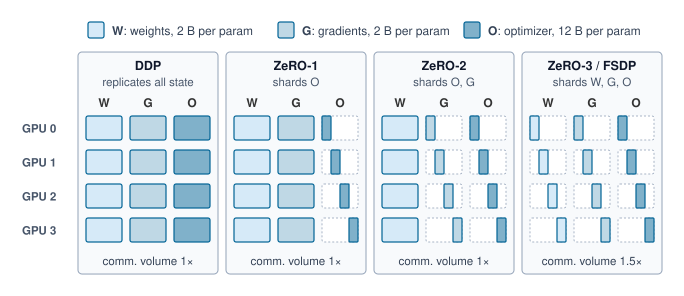{width="100%"}

<!--
```{.tikz}
\scalebox{0.82}{%
\begin{tikzpicture}[
  line join=round, line cap=round,
  font=\small\sffamily,
  >=Stealth,
  col card/.style={
    draw=GrayLine!35,
    fill=white,
    rounded corners=3.5pt,
    line width=0.65pt,
    minimum width=3.3cm,
    minimum height=5.2cm
  },
  comm badge/.style={
    font=\tiny\bfseries\sffamily,
    rounded corners=2pt,
    line width=0.55pt,
    minimum width=2.9cm,
    minimum height=0.45cm,
    align=center
  },
  state block/.style={
    rectangle,
    rounded corners=2pt,
    line width=0.6pt,
    align=center,
    font=\bfseries\scriptsize\sffamily,
    inner sep=0pt
  }
]

  % ===========================================================
  % TOP LEGEND
  % ===========================================================
  \node[draw=GrayLine!35, fill=white, rounded corners=3.5pt, line width=0.65pt, minimum width=14.0cm, minimum height=0.7cm] at (7.1, 8.4) {};

  \node[draw=BlueLine!70, fill=BlueFill!25, rounded corners=1.5pt, line width=0.5pt, minimum width=0.35cm, minimum height=0.35cm] at (1.2, 8.4) {};
  \node[anchor=west, font=\scriptsize\sffamily, text=TextBlack] at (1.5, 8.4) {\textbf{P:} Parameters (2\,B/param)};

  \node[draw=OrangeLine!70, fill=OrangeFill!30, rounded corners=1.5pt, line width=0.5pt, minimum width=0.35cm, minimum height=0.35cm] at (5.5, 8.4) {};
  \node[anchor=west, font=\scriptsize\sffamily, text=TextBlack] at (5.8, 8.4) {\textbf{G:} Gradients (2\,B/param)};

  \node[draw=GreenLine!70, fill=GreenFill!30, rounded corners=1.5pt, line width=0.5pt, minimum width=0.35cm, minimum height=0.35cm] at (9.6, 8.4) {};
  \node[anchor=west, font=\scriptsize\sffamily, text=TextBlack] at (9.9, 8.4) {\textbf{O:} Optimizer States (12\,B/param)};

  % ===========================================================
  % COLUMN 1: BASELINE DDP
  % ===========================================================
  \node[col card, anchor=north] (COL1) at (1.75, 7.8) {};
  % Header (no heavy cap)
  \node[font=\bfseries\footnotesize\sffamily, text=RedLine!90!black] at (1.75, 7.55) {Baseline DDP};
  \node[font=\tiny\sffamily, text=TextBlack!70] at (1.75, 7.3) {Full 16\,B Replication};
  \draw[GrayLine!20, line width=0.5pt] (0.25, 7.1) -- (3.25, 7.1);

  % GPU Rows in Col 1 (y = 6.6, 5.8, 5.0, 4.2)
  \foreach \gpu/\y in {0/6.6, 1/5.8, 2/5.0, 3/4.2} {
    \node[font=\tiny\bfseries\sffamily, text=TextBlack!70, anchor=east] at (0.85, \y) {GPU\,\gpu};
    \node[state block, draw=BlueLine!70, fill=BlueFill!25, text=BlueLine, minimum width=0.68cm, minimum height=0.55cm] at (1.3, \y) {P};
    \node[state block, draw=OrangeLine!70, fill=OrangeFill!30, text=OrangeLine!90!black, minimum width=0.68cm, minimum height=0.55cm] at (2.05, \y) {G};
    \node[state block, draw=GreenLine!70, fill=GreenFill!30, text=GreenD, minimum width=0.68cm, minimum height=0.55cm] at (2.8, \y) {O};
  }
  \node[comm badge, draw=GrayLine!40, fill=gray!4, text=TextBlack!80] at (1.75, 3.0) {Comm: $2\times$ AllReduce};

  % ===========================================================
  % COLUMN 2: ZeRO-1
  % ===========================================================
  \node[col card, anchor=north] (COL2) at (5.3, 7.8) {};
  % Header (no heavy cap)
  \node[font=\bfseries\footnotesize\sffamily, text=OrangeLine!90!black] at (5.3, 7.55) {ZeRO Stage 1};
  \node[font=\tiny\sffamily, text=OrangeLine!90!black] at (5.3, 7.3) {Shard Optimizer State ($O$)};
  \draw[GrayLine!20, line width=0.5pt] (3.8, 7.1) -- (6.8, 7.1);

  % GPU Rows in Col 2
  \foreach \gpu/\y in {0/6.6, 1/5.8, 2/5.0, 3/4.2} {
    \node[font=\tiny\bfseries\sffamily, text=TextBlack!70, anchor=east] at (4.4, \y) {GPU\,\gpu};
    \node[state block, draw=BlueLine!70, fill=BlueFill!25, text=BlueLine, minimum width=0.68cm, minimum height=0.55cm] at (4.85, \y) {P};
    \node[state block, draw=OrangeLine!70, fill=OrangeFill!30, text=OrangeLine!90!black, minimum width=0.68cm, minimum height=0.55cm] at (5.6, \y) {G};
    \node[state block, draw=GreenLine!70, fill=GreenFill!30, text=GreenD, minimum width=0.68cm, minimum height=0.55cm] at (6.35, \y) {$O_\gpu$};
  }
  \node[comm badge, draw=OrangeLine!60, fill=OrangeFill!25, text=OrangeLine!90!black] at (5.3, 3.0) {Comm: $1.0\times$ Baseline};

  % ===========================================================
  % COLUMN 3: ZeRO-2
  % ===========================================================
  \node[col card, anchor=north] (COL3) at (8.85, 7.8) {};
  % Header (no heavy cap)
  \node[font=\bfseries\footnotesize\sffamily, text=BlueLine] at (8.85, 7.55) {ZeRO Stage 2};
  \node[font=\tiny\sffamily, text=BlueLine] at (8.85, 7.3) {+ Shard Gradients ($G$)};
  \draw[GrayLine!20, line width=0.5pt] (7.35, 7.1) -- (10.35, 7.1);

  % GPU Rows in Col 3
  \foreach \gpu/\y in {0/6.6, 1/5.8, 2/5.0, 3/4.2} {
    \node[font=\tiny\bfseries\sffamily, text=TextBlack!70, anchor=east] at (7.95, \y) {GPU\,\gpu};
    \node[state block, draw=BlueLine!70, fill=BlueFill!25, text=BlueLine, minimum width=0.68cm, minimum height=0.55cm] at (8.4, \y) {P};
    \node[state block, draw=OrangeLine!70, fill=OrangeFill!30, text=OrangeLine!90!black, minimum width=0.68cm, minimum height=0.55cm] at (9.15, \y) {$G_\gpu$};
    \node[state block, draw=GreenLine!70, fill=GreenFill!30, text=GreenD, minimum width=0.68cm, minimum height=0.55cm] at (9.9, \y) {$O_\gpu$};
  }
  \node[comm badge, draw=BlueLine!60, fill=BlueFill!25, text=BlueLine] at (8.85, 3.0) {Comm: $1.0\times$ Baseline};

  % ===========================================================
  % COLUMN 4: ZeRO-3 / FSDP
  % ===========================================================
  \node[col card, anchor=north] (COL4) at (12.4, 7.8) {};
  % Header (no heavy cap)
  \node[font=\bfseries\footnotesize\sffamily, text=GreenD] at (12.4, 7.55) {ZeRO Stage 3 / FSDP};
  \node[font=\tiny\sffamily, text=GreenD] at (12.4, 7.3) {+ Shard Parameters ($P$)};
  \draw[GrayLine!20, line width=0.5pt] (10.9, 7.1) -- (13.9, 7.1);

  % GPU Rows in Col 4
  \foreach \gpu/\y in {0/6.6, 1/5.8, 2/5.0, 3/4.2} {
    \node[font=\tiny\bfseries\sffamily, text=TextBlack!70, anchor=east] at (11.5, \y) {GPU\,\gpu};
    \node[state block, draw=BlueLine!70, fill=BlueFill!25, text=BlueLine, minimum width=0.68cm, minimum height=0.55cm] at (11.95, \y) {$P_\gpu$};
    \node[state block, draw=OrangeLine!70, fill=OrangeFill!30, text=OrangeLine!90!black, minimum width=0.68cm, minimum height=0.55cm] at (12.7, \y) {$G_\gpu$};
    \node[state block, draw=GreenLine!70, fill=GreenFill!30, text=GreenD, minimum width=0.68cm, minimum height=0.55cm] at (13.45, \y) {$O_\gpu$};
  }
  \node[comm badge, draw=GreenLine!60, fill=GreenFill!25, text=GreenD] at (12.4, 3.0) {Comm: $1.5\times$ Baseline};

  % ===========================================================
  % COMPARISON FOOTER CARD
  % ===========================================================
  \node[
    draw=GrayLine!35, fill=gray!3, line width=0.6pt,
    rounded corners=3.5pt,
    anchor=north, minimum width=14.0cm, inner sep=6pt
  ] at (7.1, 2.3) {
    \begin{minipage}{13.6cm}\footnotesize\sffamily
      \begin{tabular}{@{}p{6.6cm}@{\hspace{0.4cm}}p{6.6cm}@{}}
        \textbf{Memory Footprint per Accelerator ($N$ GPUs)} & \textbf{Interconnect \& Collective Primitives} \\[2pt]
        $\bullet$ \textbf{Baseline DDP:} $2\Phi + 2\Phi + 12\Phi = 16\Phi$ bytes &
        $\bullet$ \textbf{Baseline / Stage 1 / Stage 2:} $2\Phi$ AllReduce per step \\
        $\bullet$ \textbf{ZeRO-1:} $2\Phi + 2\Phi + \frac{12\Phi}{N} = 4\Phi + \frac{12\Phi}{N}$ bytes &
        $\bullet$ \textbf{Stage 2 Gradient Sync:} ReduceScatter replaces AllReduce \\
        $\bullet$ \textbf{ZeRO-2:} $2\Phi + \frac{2\Phi}{N} + \frac{12\Phi}{N} = 2\Phi + \frac{14\Phi}{N}$ bytes &
        $\bullet$ \textbf{Stage 3 Parameter Gather:} AllGather before each layer fwd/bwd \\
        $\bullet$ \textbf{ZeRO-3 (FSDP):} $\frac{16\Phi}{N}$ bytes (fully linear scaling) &
        $\bullet$ \textbf{Communication Volume:} Exactly $1.5\times$ baseline volume ($3\Phi$)
      \end{tabular}
    \end{minipage}
  };

\end{tikzpicture}%
}
```
-->

:::

Full sharding adds parameter-readiness dependencies that replicated DDP avoids. With one sharding unit per layer, the forward pass needs an AllGather\index{AllGather!FSDP parameter prefetch} to reconstruct parameters ($M_{\text{layer}}$ bytes); resharding after forward requires another gather before backward ($M_{\text{layer}}$ bytes), followed by a ReduceScatter\index{ReduceScatter!FSDP gradient reduction} for gradients ($M_{\text{layer}}$ bytes under equal communication precision). For a model with $\NumberOfLayers$ layers, this schedule performs about $3\NumberOfLayers$ collective operations per step; DDP instead AllReduces gradient buckets as they become ready. At large worker counts, the ideal per-worker transfer volumes approach $3M_{\text{param}}$ bytes versus $2M_{\text{param}}$ for DDP, where $M_{\text{param}}$ is the model's parameter bytes at the communication precision, not full training state, and equals $M_{\text{grad}}$ when parameters and gradients travel at the same width. These volumes do not determine elapsed time alone. While layer $i$ computes, layer $i+1$ can prefetch parameters, subject to memory headroom and fabric contention.

The choice between FSDP and DDP\index{FSDP!trade-offs with DDP}\index{DDP!comparison with FSDP} begins with peak memory. If replicated state, activations, and working buffers fit, DDP avoids repeated parameter gathers. When optimizer and gradient storage are the obstacle, ZeRO-2 offers savings while leaving parameters replicated. If parameters themselves do not fit, ZeRO-3/FSDP, offload, or partitioned computation must address that remaining constraint. For a 70B+ model on `{python} DistTrainA100Memory.a100_mem_gb_str` devices, the need for tensor parallelism depends on the gathered layer size, activation budget, and throughput target; parameter count alone does not decide it.

Memory-efficient data parallelism requires careful tuning of sharding strategy\index{Sharded data parallelism!sharding granularity} (by layer, by transformer block, or flat) and mixed precision settings. The sharding granularity determines the trade-off: finer sharding reduces per-GPU memory but increases communication frequency as more AllGather and ReduceScatter operations must execute per training step.

### Parameter servers and embedding sharding {#sec-distributed-training-systems-systems-parameter-servers-embedding-sharding-8821}

ZeRO and FSDP shard dense state that every step touches in full. Recommendation models pose the opposite problem, and for them the parameter server (PS)\index{Parameter server!architecture} architecture, formalized by @li2014, remains common. A parameter server architecture separates workers, which compute gradients, from servers, which store parameters and apply updates.

For dense models such as ResNet or BERT, that separation concentrates traffic, as @sec-distributed-training-systems-systems-gradient-synchronization-614b noted. With $N$ workers, a server's inbound links must absorb $N$ gradient streams at once. This incast problem\index{Incast problem!parameter server}\index{Parameter server!incast bottleneck} is why dense training moved to ring AllReduce, in which every worker sends and receives at its own link rate and the aggregate load spreads across all nodes.

Recommendation systems\index{Recommendation system!embedding tables}\index{DLRM!embedding scale} reverse the balance. Their parameters are dominated by embedding tables (often `{python} DistTrainReliabilityFacts.dlrm_mem_tb_str`+) that no single GPU can hold, and their updates are sparse, because a batch of users interacts with only a tiny fraction of the items.

In a sparse parameter-server design, embedding tables are sharded across servers\index{Embedding sharding!parameter server}, and workers request only rows indexed by their local minibatches. A sparse pull returns those embedding vectors; a sparse push sends updates for the touched rows. This pattern\index{Sparse pull!parameter server}\index{Sparse push!parameter server} avoids exchanging the complete table, but hot rows, lookup rates, and network contention can still limit throughput. Embedding-sharding frameworks such as TorchRec\index{TorchRec!embedding sharding} also support accelerator-based layouts, so sparse partitioning should not be equated with a CPU-only server architecture. This is the volume's Archetype B (DLRM at Scale)\index{Archetype B!DLRM scaling} regime, and it differs from the dense running example in which resource binds first.

::: {#lhs-distributed-training-archetype-b-dlrm-at-scale-dlrm-vs-llm-scaling .callout-lighthouse title="Archetype B (DLRM at Scale): DLRM vs. LLM scaling"}

Each workload scales through a distinct mechanism and is bound by a different resource. Dense LLMs scale through data, tensor, and pipeline parallelism, constrained by compute throughput and by the bandwidth that dense gradient and activation collectives need over fabrics such as NVLink and InfiniBand. Sparse recommendation models such as DLRM scale by sharding embedding tables of `{python} DistTrainReliabilityFacts.dlrm_mem_tb_str` or more across parameter servers or accelerator memory, where aggregate memory capacity, lookup rate, and the latency of many small random accesses dominate. The distinction shapes cluster design: accelerator pods built around high-bandwidth dense fabrics for LLMs, and memory-capacity-rich layouts for recommendation systems, whether the embedding shards live in CPU-hosted servers, in accelerator HBM, or in a tiered hybrid that keeps hot rows on accelerators and cold rows in host memory.

:::

Dense or sparse, the resulting design must turn added resources into faster progress toward target quality. The next section measures that progress.

## Scaling Efficiency and Convergence {#sec-distributed-training-systems-systems-distributed-training-efficiency-metrics-9488}

When doubling the number of GPUs yields only 1.5$\times$ speedup for the same work, scaling efficiency is 75 percent. The ratio quantifies the shortfall but does not identify its cause; communication, synchronization, input delivery, and changed local kernel efficiency require separate examination. Understanding *why* scaling efficiency degrades and *how* convergence changes with parallelism also requires distinguishing hardware throughput from time to a target loss. The scaling metrics apply to every strategy; the convergence analysis that follows concerns data-parallel batch growth and stale updates. It supplies a batch-size constraint that tensor and pipeline configurations must also respect when they are combined with data parallelism.

### The mathematics of scaling efficiency {#sec-distributed-training-scaling-math}

Whether scaling from one device to many is worthwhile is measured by scaling efficiency, a fleet-level ratio. If a model trains in time $\SingledeviceTimeOne$ on one device, ideal (linear) scaling would train it in time $\SingledeviceTimeOne/N$ on $N$ devices; communication overhead, pipeline bubbles, and load imbalance reduce the speedup. @Eq-distributed-training-scaling-efficiency restates the ratio\index{Scaling efficiency!mathematical definition}:

$$\ScalingEfficiency = \frac{\SingledeviceTimeOne}{N \times \NdeviceTime}$$ {#eq-distributed-training-scaling-efficiency}

where $\NdeviceTime$ is the training time on $N$ devices. Measured per step of the same work, $\SingledeviceTimeOne$ is the quantity the Fleet Law writes as $\IronlawTermTimesCompute$, the single-device compute time that its compute term divides by $N$. An efficiency of 1.0 means perfect linear scaling; an efficiency of 0.5 means the run achieves only half the ideal speedup.

::: {#dfn-distributed-training-scaling-efficiency .callout-definition title="Scaling efficiency"}

***Scaling efficiency***\index{Scaling efficiency!definition} $(\ScalingEfficiency)$ is the ratio of actual training throughput to ideal linear throughput when increasing the number of ML compute devices ($N$).

1.  **Significance**: The ratio in @eq-distributed-training-scaling-efficiency measures added devices against the specified baseline. At 0.50 efficiency, a 10,000-GPU run delivers the throughput that 5,000 perfectly scaled devices would, so half of the accelerator-hours buy no progress relative to ideal scaling. The equivalence is to an idealized baseline; a real 5,000-GPU run would have its own, typically higher, efficiency, and the loss is spread across every device as waiting rather than concentrated in idle ones.
2.  **Distinction**: Unlike single-node efficiency, which captures local bottlenecks like $\Bandwidth$, scaling efficiency measures how performance changes with device count. Communication time $(\CommunicationTime)$ and synchronization contribute, but changing local kernel shapes or input delivery can also affect the ratio.
3.  **Common pitfall**: A frequent misconception is that scaling efficiency is constant. In reality, it depends on both device count and problem size\index{Scaling efficiency!problem size dependence}. For a fixed model, the communication-to-compute ratio typically worsens as $N$ increases (Amdahl's Law). At a fixed $N$, a smaller model or local batch leaves less computation per device to hide startup latency and coordination, so its efficiency falls sooner.

:::

```{python}
#| echo: false
#| label: comm-scaling-math
#| output: false
# ┌─────────────────────────────────────────────────────────────────────────────
# │ COMMUNICATION SCALING MATH BLOCKS (LEGO)
# ├─────────────────────────────────────────────────────────────────────────────
# │ Context: Scaling efficiency analysis and @callout-notebook "Scaling
# │          Efficiency for a 175B Model" that follows.
# │
# │ Goal: Provide formatted math for communication time formulas, per-step
# │       compute, and scaling efficiency calculations.
# │ Show: AllReduce time formula, compute time, comm time approximations.
# │ How: Build fmt_math strings from Scenarios.DenseLLMPretrainingReference,
# │      the NDR fabric, and the H100 FP8 peak.
# │
# └─────────────────────────────────────────────────────────────────────────────
from mlsysim.fmt import (
    check,
    fmt,
    fmt_bandwidth,
    fmt_count,
    fmt_flop_rate,
    fmt_magnitude,
    fmt_math,
    fmt_memory,
    fmt_params,
    fmt_percent,
    fmt_time,
    fmt_tokens,
    sci_latex,
)
from mlsysim.physics import ring_allreduce_data_factor_latex

class CommScalingMath:
    """Formatted math strings for scaling efficiency and communication overhead analysis."""

    # ┌── 1. LOAD ─────────────────────────────────────────
    _scenario = Scenarios.DenseLLMPretrainingReference  # GPT-3 on the 1,024-GPU cluster
    _params = _scenario.workload.parameters
    _ib_bw = Systems.Fabrics.InfiniBand_NDR.bandwidth
    _overlap_fraction = 0.75  # scenario assumption: optimistic overlap schedule
    _gradient_size = _scenario.workload.size_in_bytes(BYTES_FP16)
    flops_per_token = float(Literature.Chinchilla.ComputeConstant)  # 6 FLOPs per parameter per token
    batch_tokens_m = 2  # scenario assumption: 2M tokens per optimizer step
    n_gpus = _scenario.system.total_accelerators
    _peak = Hardware.Cloud.H100.compute.precision_flops['fp8']  # the FP8 peak the setup names
    local_efficiency_pct = 50  # scenario assumption before exposed communication

    # ┌── 2. EXECUTE ──────────────────────────────────────
    # 2026-09-28: the per-step compute window was a hand-typed 2.1 s; it is now
    # derived. At the FP8 peak and 50 percent local efficiency it still renders 2.1 s;
    # at the dense BF16 peak it would be about 4.1 s (surfaced for the author).
    _step_flops = flops_per_token * _params.to(param).magnitude * batch_tokens_m * MILLION * flop
    # Napkin math carries the window at the 0.1 s the prose displays, so every
    # downstream ratio (exposed step, 15 percent, Configuration B's efficiency)
    # recomputes from the printed "2.1 s" (unrounded 2.07 s gave 54.2 vs 54.5).
    _compute_window = round((_step_flops / (n_gpus * _peak * local_efficiency_pct / 100)).to(second).magnitude, 1) * second
    _raw_time = (2 * _gradient_size / _ib_bw).to(second)
    _hidden_time = min(_raw_time * _overlap_fraction, _compute_window)
    _effective_time = _raw_time - _hidden_time

    _ib_gb_per_s_value_str = fmt(_ib_bw.to(GB / second).magnitude, precision=0, commas=False)
    _gradient_size_gb_value_str = fmt(_gradient_size.to(GB).magnitude, precision=0, commas=False)
    comm_time_formula_math = fmt_math(f"{ring_allreduce_data_factor_latex()} \\times {_gradient_size_gb_value_str} / {_ib_gb_per_s_value_str}")
    gpt3_params_b_value_str = fmt_magnitude(Models.Language.GPT3.parameters, unit=Bparam, precision=0, commas=False)
    _flops_per_token_value = fmt(flops_per_token, precision=0, commas=False)
    _batch_tokens_value = fmt(batch_tokens_m, precision=0, commas=False)
    _step_flops_latex = sci_latex(_step_flops.to(flop).magnitude, precision=1)
    compute_per_step_math = fmt_math(
        f"O_{{\\text{{step}}}} = {_flops_per_token_value} \\times {gpt3_params_b_value_str} \\times 10^9 \\times {_batch_tokens_value} \\times 10^6 \\approx {_step_flops_latex}"
    )
    t_compute_s = _compute_window.to(second).magnitude  # derived window, reused by HybridConfigFeasibility
    _t_compute_value = fmt(t_compute_s, precision=1, commas=False)
    t_compute_math = fmt_math(f"T_{{\\text{{compute}}}}/N \\approx {_t_compute_value}")
    t_comm_math = fmt_math(f"T_{{\\text{{comm}}}}(N) \\approx {_effective_time.to(second).magnitude:.1f}")
    exposed_step = t_compute_s * second + _effective_time
    scaling_efficiency = (t_compute_s * second / exposed_step).to_base_units().magnitude
    overlap_pct = (_hidden_time / _raw_time).to_base_units().magnitude * 100
    raw_comm_s = _raw_time

    # ┌── 3. GUARD (Invariants) ───────────────────────────────────────────
    check(_hidden_time <= _compute_window, "Communication hidden time cannot exceed available compute")
    check(
        _raw_time.to(second).magnitude > 5.0,
        f"Narrative Violation: Communication is too fast ({_raw_time.to(second).magnitude:.1f}s)! The 'bottleneck' narrative is broken.",
    )
    check(exposed_step >= _raw_time, "Overlap cannot make the step shorter than its communication critical path")

    # ┌── 4. OUTPUT (Formatting) ──────────────────────────────────────────────
    gradient_gb_str = fmt_memory(_gradient_size, unit=GB, precision=0, commas=False)
    exposed_step_s_str = fmt_time(exposed_step, unit=second, precision=0, commas=False)
    scaling_efficiency_str = fmt_percent(round(scaling_efficiency * 100) / 100, precision=0, commas=False, style='prose')
    t_compute_s_str = fmt_time(t_compute_s, unit=second, precision=1, commas=False)
    batch_tokens_m_str = fmt_tokens(batch_tokens_m * MILLION, scale="M", precision=0, commas=False)
    n_gpus_str = fmt_count(n_gpus, label="GPU")
    local_efficiency_pct_str = fmt_percent(local_efficiency_pct / 100, precision=0, commas=False, style='prose')
    raw_comm_s_str = fmt_time(raw_comm_s, second, precision=0, commas=False, style='word')
    overlap_pct_str = fmt_percent(round(overlap_pct) / 100, precision=0, commas=False, style='prose')
    assumed_overlap_pct_str = fmt_percent(_overlap_fraction, precision=0, commas=False, style='prose')
    scaling_efficiency_pct_str = fmt_percent(round(scaling_efficiency * 100) / 100, precision=0, commas=False, style='prose')
    flops_per_token_value_str = fmt(flops_per_token, precision=0, commas=False)
    ib_bw_gbit_per_s_str = fmt_bandwidth(_ib_bw, unit=Gbps, precision=0, commas=False)
    h100_fp8_tflop_per_s_str = fmt_flop_rate(_peak, unit=TFLOP / second, precision=0, commas=True)
```

For data-parallel training of the `{python} FrontierTrainingContext.frontier_params_b_str` reference model, the per-step communication cost is dominated by the AllReduce of `{python} CommScalingMath.gradient_gb_str` of gradients, and how much of that exchange hides behind computation decides the efficiency.

The scaling efficiency depends critically on computation per communicated byte. At fixed tokens per update, increasing parameter count raises both transformer computation and gradient bytes roughly proportionally, so model size alone does not guarantee better scaling. Larger batches raise computation per optimizer step without changing gradient size\index{Batch size!computation-to-communication ratio}; the catch is that large batches can harm convergence and so require learning-rate tuning and warmup schedules. Network bandwidth\index{Bandwidth!network} enters directly because doubling InfiniBand bandwidth halves the bandwidth term, but efficiency changes according to the full step-time denominator rather than in direct proportion. The network fabric is therefore a first-order determinant of cluster productivity, not a secondary concern. Every point of scaling efficiency it recovers is returned across the much larger accelerator investment, which is why fabric spending is judged by the efficiency it buys rather than by its own price.

These factors interact, so efficiency cannot be inferred from model size or GPU count alone. The following worked model fixes the parameter count, tokens per update, accelerator count, effective bandwidth, local compute efficiency before communication, and overlap before calculating one efficiency point. Changing any of those inputs requires recomputing the full step-time model.

::: {#nbk-distributed-training-scaling-efficiency-175b-model .callout-notebook title="Scaling efficiency for a 175B model"}

**Setup**: A communication-only model for training a `{python} FrontierTrainingContext.frontier_params_b_str` model on a DGX H100 cluster with `{python} CommScalingMath.ib_bw_gbit_per_s_str` InfiniBand per GPU. Pure replicated data parallelism is a counterfactual baseline here: the calculation isolates gradient exchange but does not establish that the full training state fits on each device.

- **Compute per step** (assuming batch size `{python} CommScalingMath.batch_tokens_m_str` tokens, `{python} CommScalingMath.flops_per_token_value_str` FLOPs per parameter per token):
  `{python} CommScalingMath.compute_per_step_math` FLOPs

- **Per-GPU compute time** on `{python} CommScalingMath.n_gpus_str`, each at `{python} CommScalingMath.h100_fp8_tflop_per_s_str` peak in the 8-bit floating-point (FP8) format developed in @sec-distributed-training-fp8 (`{python} CommScalingMath.local_efficiency_pct_str` local compute efficiency before communication). The general matrix multiplications (GEMMs) run in FP8 while the gradients below still cross the wire in FP16, because the collective's data type is chosen independently of the arithmetic's:
  `{python} CommScalingMath.t_compute_math` seconds

- **AllReduce time**\index{AllReduce}\index{AllReduce!ring algorithm} (for `{python} CommScalingMath.gradient_gb_str` of gradients using ring-AllReduce with overlap):
  `{python} CommScalingMath.t_comm_math` seconds (raw ring transfer takes `{python} CommScalingMath.comm_time_formula_math`, about `{python} CommScalingMath.raw_comm_s_str`; the schedule could hide `{python} CommScalingMath.assumed_overlap_pct_str` of that transfer, but the available compute window caps hidden communication at `{python} CommScalingMath.overlap_pct_str` of raw transfer time)

- **Scaling efficiency**: $\ScalingEfficiency = T_{\text{compute,local}}/(T_{\text{compute,local}} + T_{\text{comm,exposed}})$, which is @eq-distributed-training-scaling-efficiency with the per-device compute window $T_{\text{compute,local}} = \IronlawTermTimesCompute/N$ and the exposed term standing for $\CommunicationTime + \SynchronizationTime - \OverlappedTime$. Here the numerator is `{python} CommScalingMath.t_compute_s_str` and the complete denominator is `{python} CommScalingMath.exposed_step_s_str`, giving `{python} CommScalingMath.scaling_efficiency_pct_str`. The exposed communication term already subtracts the hidden portion from the raw transfer time and includes collective synchronization; subtracting overlap again would double-count the same saving.

**Systems insight**: The low efficiency (`{python} CommScalingMath.scaling_efficiency_pct_str`) shows why naive data parallelism at this scale is insufficient. It is one operating point, fixed by `{python} CommScalingMath.batch_tokens_m_str` per update, `{python} CommScalingMath.n_gpus_str`, and `{python} CommScalingMath.overlap_pct_str` overlap, not a universal threshold; another cluster size requires recomputing per-device compute time, collective cost, overlap, and topology. Hierarchy-aware systems recover much of the lost efficiency by combining data parallelism with tensor parallelism, which communicates over NVLink, and pipeline parallelism, which overlaps computation with communication.

:::

#### Parallelism-infrastructure interaction {#sec-distributed-training-parallelism-infrastructure}

The scaling efficiency analysis shows that the effective parallelism strategy is not determined by the *model architecture alone* but by the *interaction*\index{Parallelism!infrastructure interaction} between the model's communication requirements and the infrastructure's bandwidth hierarchy. Each combination of parallelism strategy and infrastructure topology produces a different scaling efficiency curve, and selecting the wrong combination can waste a significant fraction of the cluster's capacity. The preceding napkin math showed pure data parallelism stalling near `{python} CommScalingMath.scaling_efficiency_str` efficiency at this scale; recovering that lost capacity means mapping each parallelism dimension onto the bandwidth tier that can carry its traffic. @Sec-distributed-training-systems-systems-hybrid-parallelism-12a0 works that combination through three concrete configurations and formalizes it as hierarchy-aware parallelism, once tensor and pipeline parallelism have been developed.

Selecting a parallelism mapping determines which devices exchange each tensor and when that tensor becomes ready. The resulting collective cost depends on payload size, group size, topology, and contention. Its exposed share also depends on the remaining compute window. Those dependencies explain why neither a fixed AllReduce overhead percentage nor a mandatory combination of parallelism axes predicts performance across workloads.

AllReduce complexity depends on latency $(\alpha)$ and bandwidth $(\beta)$. In the ring volume formula, $(N-1)/N$ describes the fraction of the buffer transferred per worker in each phase, not achieved link utilization\index{Ring AllReduce!bandwidth utilization}. Tree-based approaches reduce communication depth to $\mathcal{O}(\log N)$ steps\index{Tree AllReduce!latency bound}, making them attractive for small messages dominated by startup latency. Large gradient buffers emphasize sustained bandwidth instead. Message size, topology, and contention therefore determine which algorithm is faster; the next chapter develops those cost models.

::: {.column-margin .margin-pointer}
↪ The message size at which ring AllReduce overtakes tree AllReduce, derived from the latency and bandwidth terms of each algorithm, is developed in @sec-communication-collective-operations-algorithm-crossover.
:::

```{python}
#| echo: false
# ┌─────────────────────────────────────────────────────────────────────────────
# │ BERT GRADIENT SYNCHRONIZATION (LEGO)
# ├─────────────────────────────────────────────────────────────────────────────
# │ Context: interconnect-selection paragraph after the parallelism-infrastructure
# │          discussion.
# │ Goal: Derive BERT-Base/BERT-Large FP32 gradient sizes and the per-GPU
# │       bandwidth a 64-GPU ring AllReduce needs to finish in 50 ms.
# └─────────────────────────────────────────────────────────────────────────────
from mlsysim.fmt import check, fmt_bandwidth, fmt_count, fmt_memory, fmt_params, fmt_time
from mlsysim.physics import calc_ring_allreduce_data_factor

class BertGradientSync:
    # ┌── 1. LOAD ─────────────────────────────────────────
    base_params = Models.Language.BERT_Base.parameters
    large_params = Models.Language.BERT_Large.parameters
    n_gpus = 64  # scenario assumption
    sync_budget = 50 * ms  # scenario assumption: per-iteration synchronization budget

    # ┌── 2. EXECUTE ──────────────────────────────────────
    base_grad = Models.Language.BERT_Base.size_in_bytes(BYTES_FP32)
    large_grad = Models.Language.BERT_Large.size_in_bytes(BYTES_FP32)
    ring_factor = calc_ring_allreduce_data_factor(n_gpus)
    large_bw = (large_grad * ring_factor / sync_budget).to(GB / second)
    base_to_large = (base_params / large_params).to_base_units().magnitude

    # ┌── 3. GUARD ────────────────────────────────────────
    check(0.28 < base_to_large < 0.38, "Prose says BERT-Base needs about a third of BERT-Large's bandwidth")

    # ┌── 4. OUTPUT ───────────────────────────────────────
    base_params_str = fmt_params(base_params, scale="M", precision=0, commas=False)
    large_params_str = fmt_params(large_params, scale="M", precision=0, commas=False)
    base_grad_mb_str = fmt_memory(base_grad, unit=MB, precision=0, commas=False)
    large_grad_gb_str = fmt_memory(large_grad, unit=GB, precision=1, commas=False)
    n_gpus_str = fmt_count(n_gpus, commas=False, label="GPU")
    sync_budget_ms_str = fmt_time(sync_budget, unit=ms, precision=0, commas=False)
    large_bw_str = fmt_bandwidth(round(large_bw.magnitude) * (GB / second), unit=GB / second, precision=0, commas=False)
```

Interconnect selection determines whether large-scale deployments remain compute-bound or collapse into communication-bound regimes, and the bandwidth requirements for efficient distributed training are substantial, particularly for transformer models. BERT-Base\index{BERT!gradient communication} (`{python} BertGradientSync.base_params_str` parameters) requires approximately `{python} BertGradientSync.base_grad_mb_str` of gradient synchronization per iteration in FP32, while BERT-Large (`{python} BertGradientSync.large_params_str` parameters) requires approximately `{python} BertGradientSync.large_grad_gb_str`. A ring AllReduce across `{python} BertGradientSync.n_gpus_str` moves nearly twice the gradient bytes through each GPU's link, so finishing BERT-Large synchronization within `{python} BertGradientSync.sync_budget_ms_str` requires roughly `{python} BertGradientSync.large_bw_str` of sustained per-GPU bandwidth, and BERT-Base about a third of that. For `{python} FrontierTrainingContext.frontier_params_b_str`-parameter language models, exact bandwidth requirements depend on the 3D-parallel configuration, gradient accumulation, overlap, and interconnect topology rather than a single universal number.

Synchronization frequency presents a trade-off between communication efficiency and convergence behavior. Accumulating gradients for 4 microsteps reduces synchronization frequency by 75 percent, but the realized step-time reduction depends on the compute/communication mix and how much communication can overlap with backpropagation. In standard implementations, gradient accumulation reuses one resident gradient buffer and accumulates in place; memory pressure comes from keeping that buffer resident and from any larger local batch or activation choices, not from storing 4 independent gradient tensors. Asynchronous methods remove the global update barrier while retaining communication costs, and introduce staleness that can degrade convergence\index{Gradient staleness!asynchronous convergence} for large learning rates.

### Scaling physics and Amdahl's Law with communication {#sec-distributed-training-systems-systems-physics-scaling-amdahls-law-communication-4d7f}

An Amdahl-style model\index{Amdahl's Law}\index{Amdahl, Gene|seealso{Amdahl's Law}} separates work that scales with device count from a fixed residual cost. Step time on $N$ devices then exceeds $\SingledeviceTimeOne / N$ because the residual does not shrink with the compute share. @Sec-appdx-fleet-foundations-amdahls-fleet develops this model at fleet scale. Its speedup ceiling assumes that the residual remains a fixed fraction $r$ of the single-device baseline.

```{python}
#| echo: false
# ┌─────────────────────────────────────────────────────────────────────────────
# │ AMDAHL BASELINE FRACTION VS. OBSERVED STEP SHARE (LEGO)
# ├─────────────────────────────────────────────────────────────────────────────
# │ Context: §Scaling physics and Amdahl's Law with communication, opening
# │          paragraph; uses the middle curve of @fig-scaling-tax.
# │
# │ Goal: Show that a residual equal to r of the single-device baseline is a
# │       much larger share of each distributed step once compute is divided
# │       by N, so an observed share must not be read as r.
# │ Show: r = 1 percent at N = 512 occupies ~84 percent of the step.
# │ How: Step time in baseline units = (1 - r)/N + r; share = r / step.
# └─────────────────────────────────────────────────────────────────────────────
from mlsysim.fmt import check, fmt_count, fmt_percent

class AmdahlObservedShare:
    """Baseline residual fraction versus its share of a distributed step."""

    # ┌── 1. LOAD ──────────────────────────────────────────────────────────
    r = 0.01  # scenario assumption: residual fraction, the 1 percent curve of @fig-scaling-tax
    n = 512  # scenario assumption: largest GPU count plotted in @fig-scaling-tax

    # ┌── 2. EXECUTE ───────────────────────────────────────────────────────
    step = (1 - r) / n + r  # distributed step time in units of the single-device step
    share = r / step

    # ┌── 3. GUARD ─────────────────────────────────────────────────────────
    check(0.8 < share < 0.9, f"1 percent residual at 512 GPUs should be ~84 percent of the step, got {share:.3f}")

    # ┌── 4. OUTPUT ────────────────────────────────────────────────────────
    r_pct_str = fmt_percent(r, precision=0, commas=False, style='prose')
    share_pct_str = fmt_percent(round(share * 100) / 100, precision=0, commas=False, style='prose')
    n_str = fmt_count(n, commas=False, label="GPU")
```

That baseline fraction is not the synchronization share a profiler reports for a distributed step, because the compute share has been divided by $N$ while the residual has not. A residual of `{python} AmdahlObservedShare.r_pct_str` of the single-device step occupies about `{python} AmdahlObservedShare.share_pct_str` of each step on `{python} AmdahlObservedShare.n_str`. Reading the observed share as $r$ would therefore overstate the residual many times over and predict a far lower speedup ceiling than the model implies.

@Fig-scaling-tax illustrates this scaling tax\index{Scaling tax!communication overhead} up to 512 GPUs on log-log axes, complementing the scaling efficiency bound (principle \ref{pri-scaling-efficiency}). In this illustrative fixed-residual model, a small baseline fraction ($r = 0.1\%$) stays closer to ideal scaling than a larger fraction ($r = 1\%$). A residual equal to a tenth of baseline time ($r = 0.10$) limits asymptotic speedup to $1/r = 10\times$. Actual collective and coordination costs can change with worker count, so predicting a training run requires the more explicit Fleet Law below.

::: {#fig-scaling-tax fig-env="figure" fig-pos="htb" fig-cap="**The scaling tax**: Effective speedup $N/(1+(N-1)r)$ against GPU count on log-log axes, for illustrative fixed residual fractions $r$ of baseline step time. Ideal scaling (dashed) is linear. Each curve bends away from it and flattens near $1/r$: at 512 GPUs, $r$ = 0.1 percent still delivers about two-thirds of ideal speedup, 1 percent about one-sixth, and 10 percent under 10$\times$ in total. Darker curves carry larger $r$." fig-alt="Log-log line chart of effective speedup against GPU count from 1 to 512. A dashed diagonal marks ideal linear speedup. Three curves for r of 0.1, 1, and 10 percent bend below it and flatten, the darker curves flattening earlier and lower; a label marks the scaling wall on the lowest curve."}

```{python}
#| echo: false
from mlsysim.solvers import DistributedModel

# ┌─────────────────────────────────────────────────────────────────────────────
# │ SCALING TAX (FIGURE)
# ├─────────────────────────────────────────────────────────────────────────────
# │ Context: @fig-scaling-tax—effective speedup vs. communication overhead
# │
# │ Goal: Plot speedup = N/(1+(N-1)*r) vs. N for illustrative r=0, 0.001,
# │       0.01, 0.1; show the scaling wall for the largest r.
# │ Show: Log-log; ideal vs. three r-values; annotation.
# │ How: N = [1..512]; speedup formula; book_style.set_book_style().
# │
# └─────────────────────────────────────────────────────────────────────────────
# ┌── 1. CANVAS ────────────────────────────────────────────────────────────────
# │ Plot speedup = N/(1+(N-1)*r) vs. N for illustrative r values
import matplotlib.pyplot as plt
import numpy as np
from binder.tools.figures import style as book_style

# ┌── 2. ARRAYS ────────────────────────────────────────────────────────────────
book_style.set_book_style()
COLORS = book_style.COLORS

fig, ax = plt.subplots(figsize=(8, 5))

N = np.array([1, 2, 4, 8, 16, 32, 64, 128, 256, 512])
# Illustrative communication fractions r (share of the single-device step
# spent communicating). One amber ramp (vol2 communication hue), darker as r
# grows; markers keep the series distinct in grayscale. Red is reserved for
# faults, so no series uses it.
scenarios = [
    {'r': 0.0, 'name': 'Ideal linear', 'color': 'black', 'style': '--', 'marker': ''},
    {'r': 0.001, 'name': 'r = 0.1%', 'color': '#f59e0b', 'style': '-', 'marker': 'o'},
    {'r': 0.01, 'name': 'r = 1%', 'color': '#d97706', 'style': '-', 'marker': 's'},
    {'r': 0.10, 'name': 'r = 10%', 'color': '#92400e', 'style': '-', 'marker': '^'},
]

# ┌── 3. RENDER ────────────────────────────────────────────────────────────────
for sc in scenarios:
    speedup = np.vectorize(calc_strong_scaling_speedup)(N, sc['r'])
    ax.plot(
        N,
        speedup,
        linestyle=sc['style'],
        color=sc['color'],
        marker=sc['marker'],
        label=sc['name'],
        linewidth=2,
        markersize=5,
    )

# ┌── 4. DECORATE ──────────────────────────────────────────────────────────────
ax.set_xscale('log', base=2)
ax.set_yscale('log', base=2)
ax.set_xticks(N)
ax.set_xticklabels(N)
ax.set_yticks(N)
ax.set_yticklabels(N)
ax.set_xlabel('Number of GPUs (N)')
ax.set_ylabel('Effective Speedup')
ax.legend(loc='upper left', fontsize=8)

# —Annotation ---
ax.annotate(
    "Scaling wall",
    xy=(64, 64 / (1 + 63 * 0.10)),
    xytext=(90, 3.0),
    arrowprops=dict(facecolor=COLORS['BlueLine'], edgecolor=COLORS['BlueLine'], arrowstyle='->', lw=1.0),
    fontsize=9,
    bbox=dict(facecolor='white', alpha=0.8, edgecolor='none', pad=0.5),
)

plt.show()
plt.close()
```

:::

Predicting a run requires returning to the Fleet Law (principle \ref{pri-distributed-step-time}) from @sec-distributed-training-systems-physics-cluster-a42d. As the fleet-scale counterpart of the single-machine iron law, it separates compute, communication, and coordination into additive terms, labeled here with their C³ names:

$$ \DistributedStepTime = \underbrace{\frac{\IronlawTermTimesCompute}{N}}_{\text{Compute Term}} + \underbrace{\CommunicationTime}_{\text{Communication Term}} + \underbrace{\SynchronizationTime}_{\text{Coordination Term}} - \OverlappedTime $$

In this decomposition, the compute term $\IronlawTermTimesCompute/N$ captures the batch's compute time after ideal partitioning across $N$ devices. The communication term $\CommunicationTime$ represents fabric transfer time, analogous to the iron law's data-movement ratio $\DataVolume/\Bandwidth$. For a large-message Ring AllReduce, its bandwidth contribution is $\frac{2(N-1)}{N} \frac{\DataVolume}{\beta}$, where $\DataVolume$ is the payload being reduced (the gradient bytes $M_{\text{grad}}$ under data parallelism, or a shard of model state under sharding) and $\beta$ is sustained per-link bandwidth; this expression omits per-message startup latency. The coordination term $\SynchronizationTime$ accounts for exposed ordering and straggler delays not already included in communication time. Finally, $\OverlappedTime$ subtracts communication hidden behind computation. Each wait must enter the accounting once.

::: {.column-margin .margin-pointer}
↪ The single-machine iron law and its data-movement term are developed in @sec-appdx-dam-taxonomy-iron-law-mapping.
:::

The Fleet Law leads to the scaling efficiency metric for fixed global work. Substituting its step time for $\NdeviceTime$ in @eq-distributed-training-scaling-efficiency, with $\IronlawTermTimesCompute$ standing for $\SingledeviceTimeOne$ per step as noted there, gives:

$$ \ScalingEfficiency = \frac{\IronlawTermTimesCompute}{N \times \DistributedStepTime} = \frac{1}{1 + \frac{N(\CommunicationTime + \SynchronizationTime - \OverlappedTime)}{\IronlawTermTimesCompute}} $$

This is the scaling efficiency bound (principle \ref{pri-scaling-efficiency}): perfect linear scaling $(\ScalingEfficiency = 1.0)$ is a *theoretical limit*, not a *practical target*. Real systems fall short of it by an amount that depends on the configuration and grows with $N$. The 175B data-parallel example above reached only `{python} CommScalingMath.scaling_efficiency_str`, and the hybrid layouts later in the chapter recover much of that loss without reaching 1.0. The gap between $\ScalingEfficiency = 1.0$ and the achieved efficiency is the scaling tax, paid in communication and coordination\index{Scaling tax!communication and coordination} as the price of distributed execution.

The equation reveals the **scaling wall**\index{Scaling wall!definition}: as $N$ increases, the compute term $(\IronlawTermTimesCompute/N)$ shrinks, but the communication and synchronization terms can remain constant or grow. Eventually, the denominator is dominated by overhead, driving efficiency toward zero. Beyond wall-clock time, this communication overhead imposes an energy tax\index{Energy tax!communication overhead} that scales with physical distance between devices.

::: {.column-margin}
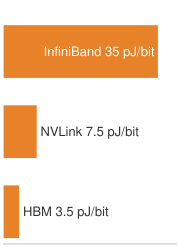{width="100%" fig-alt="Orange energy-per-bit ladder with representative midpoints: InfiniBand 35 pJ, NVLink 7.5 pJ, and HBM 1.5 pJ."}

*Communication energy climbs from HBM out to the network.*
:::

```{python}
#| echo: false
#| label: distributed-training-communication-energy-envelope
# ┌─────────────────────────────────────────────────────────────────────────────
# │ COMMUNICATION ENERGY ENVELOPE (LEGO)
# ├─────────────────────────────────────────────────────────────────────────────
# │ Context: @psp-distributed-training-energy-tax-scale.
# │ Goal: Anchor the communication-energy claim with a source-backed envelope.
# │ How: aggregate link bandwidth × registry-backed pJ/bit energy midpoint.
# └─────────────────────────────────────────────────────────────────────────────
from mlsysim.core.units import bit, pJ
from mlsysim.fmt import fmt_bandwidth, fmt_count, fmt_energy_per_bit, fmt_power

class DistTrainCommEnergyEnvelope:
    """Order-of-magnitude communication power for a 10K-GPU cluster."""

    # ┌── 1. LOAD ──────────────────────────────────────────
    cluster_gpus = Systems.Clusters.Training_10K.total_accelerators
    nvlink_aggregate = Hardware.Cloud.H100.nvlink.bandwidth * cluster_gpus
    ib_aggregate = Systems.Fabrics.InfiniBand_NDR.bandwidth * cluster_gpus
    nvlink_energy = Systems.NetworkEnergy.NvlinkEnergyPerBit
    ib_energy = Systems.NetworkEnergy.InfiniBandEnergyPerBit

    # ┌── 2. EXECUTE ───────────────────────────────────────
    def _link_power(traffic, energy_per_bit):
        bits_per_s = traffic.to(byte / second).magnitude * BITS_PER_BYTE * bit / second
        return (bits_per_s * energy_per_bit).to(watt)

    nvlink_power = _link_power(nvlink_aggregate, nvlink_energy)
    ib_power = _link_power(ib_aggregate, ib_energy)

    # ┌── 3. GUARD ─────────────────────────────────────────
    check(cluster_gpus == 10_000, "Training_10K should contain 10,000 GPUs")
    check(nvlink_power > ib_power, "Aggregate NVLink envelope should exceed aggregate InfiniBand envelope")

    # ┌── 4. OUTPUT ───────────────────────────────────────
    cluster_gpus_str = fmt_count(cluster_gpus, label="GPU")
    nvlink_aggregate_pb_per_s_str = fmt_bandwidth(nvlink_aggregate, unit=PB / second, precision=0, commas=False)
    ib_aggregate_tb_per_s_str = fmt_bandwidth(ib_aggregate, unit=TB / second, precision=0, commas=False)
    nvlink_energy_pj_per_bit_str = fmt_energy_per_bit(nvlink_energy, precision=1, commas=False)
    ib_energy_pj_per_bit_str = fmt_energy_per_bit(ib_energy, precision=0, commas=False)
    nvlink_power_kw_str = fmt_power(nvlink_power, unit=kilowatt, precision=0, commas=False)
    ib_power_kw_str = fmt_power(ib_power, unit=kilowatt, precision=0, commas=False)
```

::: {#psp-distributed-training-energy-tax-scale .callout-perspective title="The energy tax of scale"}

Distributed training is a race against energy as much as against time. Within one GPU, moving a bit from HBM to the cores costs a few picojoules\index{Energy cost!HBM data movement}, roughly 2–5 pJ/bit; @sec-compute-infrastructure-energy-cost-data-movement-3cd1 expresses the same cost per access, about 64 pJ for one 16-bit operand. Moving that same bit across an NVLink interconnect costs 5–10 pJ/bit\index{Energy cost!NVLink transfer}. Moving it across an InfiniBand network through switches costs 20–50 pJ/bit\index{Energy cost!InfiniBand network}.

At the scale of `{python} DistTrainCommEnergyEnvelope.cluster_gpus_str`, the multiplication by aggregate bandwidth is what changes the engineering problem. A full H100 NVLink envelope is roughly `{python} DistTrainCommEnergyEnvelope.nvlink_aggregate_pb_per_s_str` across the cluster; at `{python} DistTrainCommEnergyEnvelope.nvlink_energy_pj_per_bit_str`, that movement represents about `{python} DistTrainCommEnergyEnvelope.nvlink_power_kw_str` before cooling and switch overhead. The aggregate NDR InfiniBand envelope is smaller (`{python} DistTrainCommEnergyEnvelope.ib_aggregate_tb_per_s_str`), but at `{python} DistTrainCommEnergyEnvelope.ib_energy_pj_per_bit_str` it still represents about `{python} DistTrainCommEnergyEnvelope.ib_power_kw_str`. Communication-computation overlap is therefore necessary for wall-clock efficiency\index{Communication-computation overlap!energy efficiency}, but avoiding unnecessary movement is the direct way to reduce the power term itself.

:::

As the device count grows for a fixed workload, the balance can move from a linear scaling regime\index{Linear scaling regime!efficiency} toward a communication-bound regime\index{Communication-bound regime!efficiency drop}. The transition has no universal GPU count: it depends on compute per device, message sizes, topology, and overlap. Coordination overhead\index{Coordination overhead!collective latency} becomes consequential when its exposed time is no longer small relative to useful computation. Measurements at the intended workload and placement must establish the efficiency curve.

```{python}
#| echo: false
class DistTrainNvlinkScaling:
    from mlsysim.core.units import GB, second
    from mlsysim.fmt import fmt, fmt_bandwidth

    nvlink_a100_gb_per_s_str = fmt_bandwidth(Hardware.Cloud.A100.nvlink.bandwidth, unit=GB / second, precision=0, commas=False)
    ib_edr_gbps_str = fmt_bandwidth(Systems.Fabrics.InfiniBand_EDR.bandwidth, unit=Gbps, precision=0, commas=False)
    ib_hdr_gbps_str = fmt_bandwidth(Systems.Fabrics.InfiniBand_HDR.bandwidth, unit=Gbps, precision=0, commas=False)
```

Hardware selection critically impacts these scaling characteristics. NVIDIA DGX A100 systems, one generation older than the reference H100 nodes, provide `{python} DistTrainNvlinkIntro.nvlink_a100_gb_per_s_str` of NVLink bandwidth per GPU in each direction, with aggregate NVSwitch bandwidth\index{NVSwitch!intra-node bandwidth} at the system level, enabling high parallel efficiency inside an 8-GPU node. Multi-node scaling requires a network fabric with enough bisection bandwidth; EDR-class `{python} DistTrainNvlinkScaling.ib_edr_gbps_str` links, the InfiniBand generation before HDR, can support smaller multi-node jobs, while HDR-class `{python} DistTrainNvlinkScaling.ib_hdr_gbps_str` links can support larger clusters when topology, placement, and overlap are well matched.

The efficiency metrics directly influence the choice of parallelism strategy. Data parallelism works well in the linear scaling regime but becomes communication bound at scale. The model-parallel strategies developed after this section replace part of that gradient traffic with other costs, and the same efficiency equation will price each of them once its mechanism is in place.

Hardware efficiency metrics govern throughput, but convergence theory determines whether distributed training reaches the same solution quality as single-device training. Parallelism affects optimization convergence in three ways: convergence rate changes with batch size, adding workers yields diminishing returns beyond the critical batch size, and learning-rate schedules must be revalidated when the global batch changes.

### Convergence rate for synchronous data parallel SGD {#sec-distributed-training-systems-systems-convergence-rate-synchronous-data-parallel-sgd-2ed5}

The fundamental convergence result for distributed SGD explains what synchronous averaging preserves. Informally, when the gradient cannot change abruptly as parameters move and averaging over more workers reduces the noise in each gradient estimate, synchronous SGD makes steady progress toward parameters where the gradient is small. Formally, let $\mathcal{L}$ be lower bounded by $\mathcal{L}_{\inf}$ and have $L_s$-Lipschitz gradients, so the smoothness constant limits how sharply the gradient can change as parameters move. Each worker computes gradients from $B_{\text{local}}$ independent samples. At update $t$, the aggregated estimator $\mathbf{g}_t$, the average of the $N$ workers' local gradients, is unbiased, and its conditional variance satisfies $\mathbb{E}[\|\mathbf{g}_t-\nabla\mathcal{L}(\theta_t)\|^2\mid\theta_t]\leq\sigma^2/(N B_{\text{local}})$. These assumptions bound progress toward a small gradient norm, not convergence to a global minimizer or a particular validation accuracy.

::: {#thrm-distributed-training-convergence-rate-distributed-sgd .callout-theorem title="Convergence rate for distributed SGD"}

For the update $\theta_{t+1}=\theta_t-\eta \mathbf{g}_t$ with constant step size $0<\eta\leq 1/L_s$, after $T$ synchronized updates,

$$
\frac{1}{T}\sum_{t=0}^{T-1}\mathbb{E}\!\left[\|\nabla\mathcal{L}(\theta_t)\|^2\right]
\leq
\underbrace{\frac{2\bigl(\mathcal{L}(\theta_0)-\mathcal{L}_{\inf}\bigr)}{\eta T}}_{\text{optimization term}}
+
\underbrace{\frac{\eta L_s\sigma^2}{N B_{\text{local}}}}_{\text{stochastic-variance term}}.
$$

Choosing $\eta=\min\!\left\{1/L_s,\sqrt{2(\mathcal{L}(\theta_0)-\mathcal{L}_{\inf})N B_{\text{local}}/(L_s\sigma^2T)}\right\}$ balances the two terms. Before the smoothness cap becomes active, the stochastic contribution scales as $\mathcal{O}(1/\sqrt{N B_{\text{local}} T})$.

:::

The theorem isolates the benefit that follows from the assumptions. With equal local batch size $B_{\text{local}}$, synchronous data-parallel SGD computes the same minibatch estimator as one worker using batch size $N \times B_{\text{local}}$ for that update, and the estimator variance decreases as $1/(N \times B_{\text{local}})$. It does not say that every increase in batch size proportionally reduces time to a target loss; learning-rate limits and critical-batch-size effects still apply. This distinction is the statistical efficiency\index{Statistical efficiency!distributed training} of distributed training, separate from hardware efficiency.

The theorem assumes perfect synchronization (BSP). When workers proceed at different rates or use stale gradients, convergence guarantees degrade as staleness increases.

### Staleness impact across synchronization models {#sec-distributed-training-systems-systems-staleness-impact-bsp-vs-ssp-vs-asp-e153}

The operational guarantees of BSP, SSP, and ASP established in @sec-distributed-training-systems-systems-synchronization-models-396f have convergence consequences, but there is no universal additive staleness penalty independent of the objective, step-size schedule, worker count, and delay model. The staleness parameter $\GradientStaleness$ quantifies how many updates occur between computing and applying a gradient, tying throughput to solution quality [@ho2013more; @dutta2018slow].

::: {#dfn-distributed-training-gradient-staleness .callout-definition title="Gradient staleness"}

***Gradient staleness***\index{Gradient staleness!definition} ($\GradientStaleness$) is the number of parameter updates that occur between the time a gradient is computed and the time it is applied to the global model state.

1.  **Significance**: It represents the synchronization error in distributed optimization. Increasing $\GradientStaleness$ can improve throughput by reducing barrier waits $(\SynchronizationTime)$, but it typically degrades the rate of convergence, requiring more optimizer steps, and therefore more FLOPs, to reach the same accuracy.
2.  **Distinction**: Unlike network latency, which is a physical delay, staleness is an algorithmic offset that arises from the choice of synchronization protocol (e.g., ASP, SSP).
3.  **Common pitfall**: A frequent misconception is that staleness is "always bad." In reality, it is a throughput-convergence trade-off: for some large-scale workloads, allowing bounded staleness is one practical way to keep thousands of GPUs in use.

:::

The convergence behavior differs across these models in ways that directly affect training cost and solution quality. In BSP ($\GradientStaleness=0$)\index{Gradient staleness!BSP zero staleness}, all workers compute on the same parameter version and aggregate before updating. Under the assumptions of theorem \ref{thrm-distributed-training-convergence-rate-distributed-sgd}, the synchronized estimator inherits the $N \times B_{\text{local}}$ minibatch guarantee.

SSP ($\GradientStaleness\leq s$)\index{Gradient staleness!SSP bounded staleness} allows workers to proceed up to $s$ iterations ahead of the slowest worker. @ho2013more bound the average regret of their SSP update sequence, the per-update gap between the loss its iterates incur and the loss of the best fixed parameters chosen in hindsight, at $\mathcal{O}(\sqrt{(s+1)N/T})$ for $N$ workers and $T$ updates. The bound assumes convex Lipschitz component functions, a bounded domain, and a decreasing step size. It makes the staleness dependence explicit, since the bound grows with $s$, but it measures a different quantity from the gradient-norm bound of theorem \ref{thrm-distributed-training-convergence-rate-distributed-sgd}, which covers nonconvex objectives, so the two rates cannot be compared directly.

Asynchronous SGD imposes no protocol-wide finite delay bound. Removing the barrier can improve update throughput, but a convergence rate requires additional assumptions about realized delays, the objective, and the step-size schedule. @dutta2018slow analyze this as an error-runtime trade-off in which worker speed and gradient staleness jointly determine whether accepting a delayed update helps. Therefore neither a fixed square-of-average-delay penalty nor the complete loss of $N$-worker variance reduction follows from asynchronous execution alone.

@Tbl-convergence-comparison summarizes the convergence properties of each synchronization model.

| **Model** | **Delay control**             | **Scoped guarantee**                                                                                                       | **Systems effect**                                   |
|:----------|:------------------------------|:---------------------------------------------------------------------------------------------------------------------------|:-----------------------------------------------------|
| **BSP**   | $\GradientStaleness=0$        | Synchronous $N \times B_{\text{local}}$-minibatch theorem \ref{thrm-distributed-training-convergence-rate-distributed-sgd} | Waits for the slowest worker                         |
| **SSP**   | $\GradientStaleness\leq s$    | $\mathcal{O}(\sqrt{(s+1)N/T})$ average regret under convex assumptions [@ho2013more]                                       | Bounds delay while reducing some waits               |
| **ASP**   | No protocol-wide finite bound | No universal rate without additional delay and objective assumptions                                                       | Removes the global barrier but applies stale updates |

: **Convergence Properties by Synchronization Model**: The synchronization protocol determines the delay model; the convergence rate follows only after the objective, gradient, delay, and step-size assumptions are fixed. {#tbl-convergence-comparison tbl-colwidths="[8,20,47,25]"}

### Learning rate scaling rules {#sec-distributed-training-systems-systems-learning-rate-scaling-rules-fa26}

Increasing the effective batch size through data parallelism changes the number and noise of optimizer updates. The learning-rate schedule must therefore be revalidated against the target quality. Two scaling rules provide starting points for that comparison.

The linear scaling rule\index{Linear scaling rule!learning rate} [@goyal2017accurate] proposes that when batch size is multiplied by $k$, learning rate also increases by $k$:

$$
\eta_{\text{large}} = k \cdot \eta_{\text{base}}
$$

The approximation compares one large-batch step at learning rate $k\eta$ with $k$ consecutive small-batch steps at learning rate $\eta$. At batch size $k \times B$, independent gradient contributions reduce estimator variance by factor $k$, but lower variance alone does not establish stability. The approximation also requires gradients to change little over the corresponding $k$ small-batch steps. @goyal2017accurate validated the recipe for ResNet-50/ImageNet at global batch size `{python} ImageNetOneHourRun.minibatch_str` with gradual warmup. Layer-wise adaptive rate scaling (LARS)\index{LARS!layer-wise learning rate} and layer-wise adaptive moments based optimizer (LAMB)\index{LAMB!layer-wise adaptive moments} provide related large-batch approaches for ImageNet and BERT-style pretraining [@you2017large; @you2020large]. A warmup period\index{Learning rate warmup} increases the learning rate from $\eta_{\text{base}}$ to $k \cdot \eta_{\text{base}}$ over the first $W$ iterations to reduce early instability; the schedule still requires validation:

$$
\eta_t = \eta_{\text{base}} + \frac{t}{W}(k \cdot \eta_{\text{base}} - \eta_{\text{base}}) \quad \text{for } t < W
$$

The rule and the warmup were introduced together, and the run that introduced them shows why the scaled learning rate needs the warmup. A learning-rate schedule tuned for an eight-GPU run need not reach the same accuracy at `{python} ImageNetOneHourRun.gpus_str` once the global batch grows with the worker count.

::: {#ws-distributed-training-imagenet-one-hour .callout-war-story title="The one-hour ImageNet run (2017)"}

**Context**: Facebook AI Research set out to train ResNet-50 on ImageNet in one hour\index{ImageNet!one-hour training} using `{python} ImageNetOneHourRun.gpus_str`, pushing data parallelism far beyond the batch sizes that earlier practice treated as safe [@goyal2017accurate].

**Mechanism**: Scaling the global batch to `{python} ImageNetOneHourRun.minibatch_str` cut the number of optimizer updates per epoch by the same factor. Keeping the small-batch learning rate left too few effective updates to reach the target accuracy, while scaling the learning rate up by the same factor destabilized optimization in the first epochs, when the loss surface changes fastest.

**Impact**: Without the gradual warmup recipe, the large-batch runs reported higher training and validation error than the small-batch baseline. Higher hardware throughput alone did not preserve the quality target.

**Fix**: The team introduced the linear learning-rate scaling rule paired with a 5-epoch gradual warmup schedule\index{Learning rate warmup!gradual warmup}, stabilizing optimization at batch size `{python} ImageNetOneHourRun.minibatch_str`.

**Systems lesson**: Distributed training is not just parallel hardware. Scaling changes the optimization regime, so the cluster, communication schedule, batch size, and learning-rate schedule must be tuned as one system.

:::

The square root scaling rule\index{Square root scaling rule!batch size} is an alternative learning-rate heuristic to test when increasing batch size:

$$
\eta_{\text{large}} = \sqrt{k} \cdot \eta_{\text{base}}
$$

This rule increases the learning rate more slowly than linear scaling. Its suitability depends on the optimizer, schedule, and training regime; exceeding a critical-batch estimate does not make it mandatory or guarantee convergence. The learning rate must be validated against the same target quality.

LARS [@you2017large] scales each layer's update relative to its weight norm. The simplified LARS expression below illustrates the ratio of weight norm to gradient norm with weight decay. LAMB [@you2020large] applies a related layer-wise adaptation to an Adam-based update rather than using this raw-gradient denominator:

$$
\eta_\ell = \eta_{\text{global}} \cdot \frac{\|\mathbf{w}_\ell\|}{\|\mathbf{g}_\ell\| + \lambda_{\text{wd}}\|\mathbf{w}_\ell\|}
$$

Here $\lambda_{\text{wd}}$ is the weight-decay coefficient in the illustrated LARS expression, distinct from the failure-rate parameter used in reliability analysis. Layer-wise scaling controls update magnitude relative to parameter magnitude, but does not guarantee convergence for arbitrary batches. Its systems role is to extend the range of validated batch sizes over which added data-parallel workers can reduce time to quality.

### Critical batch size and diminishing returns {#sec-distributed-training-systems-systems-critical-batch-size-parallelism-hurt-4961}

Increasing the global batch eventually yields diminishing reductions in the optimization steps needed to reach a fixed target quality. The critical batch size $B^{*}$ marks the transition point beyond which increasing batch size yields diminishing returns in convergence per sample seen.

::: {#dfn-distributed-training-critical-batch-size .callout-definition title="Critical batch size"}

***Critical batch size***\index{Critical batch size!definition} $(B^{*})$ is a workload-dependent crossover batch size beyond which further batch growth yields diminishing reductions in optimization steps per added sample [@mccandlish2018empirical; @Shallue2019measuring].

1.  **Significance**: It characterizes statistical scaling, separately from hardware throughput. In the gradient-noise model, batches well below $B^{*}$ can reduce step count approximately in proportion to batch growth; above it, additional samples buy progressively smaller step-count reductions.
2.  **Distinction**: Unlike the memory-limited batch size (determined by memory capacity and activation footprint), the critical batch size depends on the model, data, optimizer, training phase, and target quality.
3.  **Common pitfall**: A frequent misconception is that training can be sped up indefinitely by adding GPUs. In reality, $B^{*}$ is a guide to diminishing statistical returns, not a hard physical ceiling or a universal optimum in wall-clock time.

:::

The gradient-noise-scale proxy\index{Gradient noise scale!critical batch size} for the critical batch size can be estimated as:

$$
B^{*} \approx \frac{\text{tr}(\Sigma)}{\|\nabla \mathcal{L}(\theta)\|^2}
$$

where $\text{tr}(\Sigma)$ is the trace of the gradient covariance matrix (total gradient variance) and $\|\nabla \mathcal{L}(\theta)\|^2$ is the squared gradient norm (signal strength). Intuitively, $B^{*}$ is the batch size at which averaging reduces gradient variance to the level of the true gradient magnitude.

Published large-batch regimes illustrate the scale rather than providing fixed thresholds. On ImageNet, @goyal2017accurate stabilized ResNet-50 at global batch `{python} ImageNetOneHourRun.minibatch_str` with warmup, and LARS extends ImageNet large-batch training further in some settings [@you2017large]. For BERT-Large pretraining, LAMB reports training at 32K--64K batch sizes with layer-wise adaptive updates [@you2020large]. Across other domains, @mccandlish2018empirical show useful batch-size limits ranging from tens of thousands in ImageNet-like settings to millions in reinforcement-learning workloads, so new frontier-language-model thresholds should be measured rather than copied.

The gradient-noise model separates statistical efficiency from hardware efficiency. Well below $B^{*}$\index{Critical batch size!scaling regimes}, increasing batch size can reduce optimization steps almost proportionally while preserving similar total sample use. Near $B^{*}$, the trade-off between fewer updates and more samples becomes material. Above it, step count approaches a lower limit while sample use continues to increase. Neither maximum samples per second nor minimum training time necessarily occurs at $B^{*}$: those objectives also depend on device utilization, communication, and the validated learning-rate schedule.

@Fig-critical-batch-size plots this gradient-noise trade-off on log-log axes, tracking the divergence between optimization step count and total sample consumption. Below the critical threshold ($B/B^* < 1$), increasing batch size yields near-linear reductions in optimization steps with negligible sample waste; past the crossover point at $B/B^* = 1$ (where both normalized costs equal 2), the step count curve asymptotically flattens toward 1 while total examples processed climb steeply along the $1 + B/B^*$ trajectory.

::: {#fig-critical-batch-size fig-env="figure" fig-pos="htb" fig-cap="**Statistical cost of larger batches**: A normalized illustration of the gradient-noise trade-off model, with batch size divided by the fitted critical batch. Optimization steps approach a lower limit as batches grow, while total examples processed increase. The crossover is not a hardware-throughput optimum or a measured threshold for a particular model [@mccandlish2018empirical]." fig-alt="Two curves on logarithmic axes. Normalized optimization steps decrease toward one as normalized batch increases; normalized sample use increases from one. Both curves equal two at batch divided by critical batch equal to one."}
```{python}
#| echo: false
# ┌── CRITICAL BATCH TRADE-OFF (FIGURE) ─────────────────────────────────────
# │ Context: @fig-critical-batch-size
# │ Goal: Separate optimization-step reduction from total sample use.
# │ Show: Dimensionless gradient-noise model, not empirical hardware throughput.
# │ How: Steps/steps_min = 1 + 1/x; samples/samples_min = 1 + x, x = B/B*.
# └─────────────────────────────────────────────────────────────────────────
import numpy as np
from mlsysim import viz
import matplotlib.pyplot as plt
from mlsysim.fmt import check

fig, ax, COLORS, plt = viz.setup_plot(figsize=(8, 4))
normalized_batch = np.logspace(-2, 2, 401)
normalized_steps = 1 + 1 / normalized_batch
normalized_samples = 1 + normalized_batch
check(np.all(np.diff(normalized_steps) < 0), "Step count decreases with batch size")
check(np.all(np.diff(normalized_samples) > 0), "Sample use increases with batch size")
check(np.allclose((normalized_steps - 1) * (normalized_samples - 1), 1), "Normalized trade-off identity")
ax.loglog(normalized_batch, normalized_steps, color=viz.COLORS['BlueLine'], linewidth=2.4, label='Optimization steps / minimum steps')
ax.loglog(
    normalized_batch, normalized_samples, color=viz.COLORS['OrangeLine'], linestyle='--', linewidth=2.4, label='Examples processed / minimum examples'
)
ax.axvline(1, ymax=0.72, color=viz.COLORS['primary'], linestyle=':', linewidth=1.2)
ax.scatter([1], [2], color=viz.COLORS['primary'], zorder=5)
ax.annotate('Crossover: both costs = 2', xy=(1, 2), xytext=(0.012, 1.55), arrowprops={'arrowstyle': '->', 'color': viz.COLORS['primary']}, fontsize=9)
ax.set_xlabel(r'Batch size / critical batch size ($B/B^*$)')
ax.set_ylabel('Normalized cost to the same target quality')
ax.set_ylim(0.9, 130)
ax.legend(loc='upper center', fontsize=8, frameon=False)
fig.tight_layout()
plt.show()
plt.close(fig)
```
:::

Dividing the critical batch by the per-worker batch $B_{\text{local}}$ estimates where worker growth leaves the near-proportional statistical scaling regime. With one local batch per update and its size held fixed, the crossover occurs around $N \approx B^{*}/B_{\text{local}}$ workers. Past that point, additional workers mainly raise sample throughput that the optimizer cannot convert into proportionally fewer steps. Gradient accumulation increases each worker's contribution per update and lowers the corresponding worker count. Shrinking $B_{\text{local}}$ moves the crossover outward but leaves less computation per worker to hide communication, coupling statistical and hardware efficiency.

That crossover informs a cost-time trade-off rather than setting a mandatory worker count. Larger batches may still reduce time to target even as they consume more examples. Evaluate that benefit using measured step time, a validated learning-rate schedule, and the same target quality. Changing synchronization or compression also changes the optimization process, so its communication savings must be weighed against any additional steps required.

```{=latex}
\Needspace{18\baselineskip}
```

::: {#chk-distributed-training-scaling-decisions .callout-checkpoint title="Scaling decisions"}

Given a 7B-parameter model distributed across a cluster of 64 A100 GPUs (80 GB HBM2e each), estimate the critical-batch crossover. Use a pilot trace with $\text{tr}(\Sigma)=1.6 \times 10^6$, $\|\nabla \mathcal{L}(\theta)\|^2=100$, per-GPU batch $B_{\text{local}}=4$, and a proposed gradient-accumulation depth of 32 steps, giving $B_{\text{global}} = 64 \times 4 \times 32 = 8{,}192$ samples.

- [ ] **Critical batch size**: calculate the critical batch size $(B^*)$, where the gradient noise scale equals the batch size.
- [ ] **Proposed batch**: use the critical batch size proxy $B^* \approx \frac{\text{tr}(\Sigma)}{\|\nabla \mathcal{L}(\theta)\|^2}$ to evaluate the proposed batch size.
- [ ] **Efficiency distinction**: explain why the gradient-noise estimate can assess statistical scaling but cannot establish hardware scaling efficiency without compute and communication timings.

:::

### Convergence comparison for 8 versus 64 workers {#sec-distributed-training-systems-systems-worked-example-convergence-comparison-8-vs.-64-workers-57ce}

To illustrate these concepts concretely, consider scaling from 8 to 64 workers when training a transformer language model with baseline batch size $B = 32$ per worker.

```{python}
#| echo: false
from mlsysim.solvers import DistributedModel

# ┌─────────────────────────────────────────────────────────────────────────────
# │ SCALING 8→64 WORKERS ANALYSIS (LEGO)
# ├─────────────────────────────────────────────────────────────────────────────
# │ Context: @sec-distributed-training-systems-systems-worked-example-convergence-comparison-8-vs-64-workers-57ce
# │
# │ Goal: Quantify batch sizes, speedups, and LR scaling for 8 vs. 64 workers.
# │ Show: Effective batch sizes, expected iterations, wall-clock speedups.
# │ How: Speedup = base_iters / (actual_iters × (1 + comm_overhead)).
# │
# └─────────────────────────────────────────────────────────────────────────────
import math
from mlsysim.fmt import MarkdownStr, check, fmt, fmt_count, fmt_int, fmt_percent, fmt_time, fmt_usd

class ScalingWorkers:
    """Convergence comparison: 8 vs. 64 workers, BSP vs. SSP."""

    # ┌── 1. LOAD (Constants) ───────────────────────────────────────────────
    n8 = 8
    n64 = 64
    b = 32
    base_iters = 100_000
    # Hypothetical iteration counts to the same target, not measured model results.
    actual_8bsp = 12_800
    comm_8bsp = 0.15
    actual_64bsp = 1_720
    comm_64bsp = 0.45
    staleness = 4
    actual_ssp = 2_100
    comm_ssp = 0.25
    critical_batch_size = 4_000
    n_nodes_64 = 8
    gpu_hour_rate = Infrastructure.Pricing.Cloud.GpuTrainingUtilityScenarioPerHour.rate.to(USD / hour).magnitude
    base_iter_s = 0.4  # illustrative local-compute time, shared by all configurations
    iter_s_8 = base_iter_s * (1 + comm_8bsp)
    iter_s_64bsp = base_iter_s * (1 + comm_64bsp)
    iter_s_64ssp = base_iter_s * (1 + comm_ssp)

    # ┌── 2. EXECUTE (The Compute) ─────────────────────────────────────────
    batch_8 = n8 * b
    batch_64 = n64 * b
    exp_iter_8 = base_iters / n8
    exp_iter_64 = base_iters / n64
    speedup_8 = base_iters / (actual_8bsp * (1 + comm_8bsp))
    speedup_64 = base_iters / (actual_64bsp * (1 + comm_64bsp))
    speedup_ssp = base_iters / (actual_ssp * (1 + comm_ssp))
    lr_factor_ssp = 1 / math.sqrt(1 + staleness)
    sample_eff_8 = exp_iter_8 / actual_8bsp * 100
    sample_eff_64 = exp_iter_64 / actual_64bsp * 100
    sample_eff_ssp = exp_iter_64 / actual_ssp * 100
    cost_8 = actual_8bsp * iter_s_8 * n8 / 3600 * gpu_hour_rate
    cost_64bsp = actual_64bsp * iter_s_64bsp * n64 / 3600 * gpu_hour_rate
    cost_64ssp = actual_ssp * iter_s_64ssp * n64 / 3600 * gpu_hour_rate
    # Useful-worker bound B*/b at fixed local batch (2026-09-29).
    useful_workers = critical_batch_size / b

    # ┌── 3. GUARD (Invariants) ───────────────────────────────────────────
    check(batch_8 == 256, f"8-worker batch ({batch_8})")
    check(batch_64 == 2048, f"64-worker batch ({batch_64})")
    check(abs(speedup_8 - 6.8) < 0.1, f"8-worker speedup ({speedup_8:.2f})")
    check(abs(speedup_64 - 40.1) < 0.2, f"64-worker speedup ({speedup_64:.2f})")
    check(abs(speedup_ssp - 38.1) < 0.1, f"SSP speedup ({speedup_ssp:.2f})")

    check(abs(speedup_8 - base_iters * base_iter_s / (actual_8bsp * iter_s_8)) < 1e-9, "Speedup and cost share one step-time model")
    check(abs(speedup_64 - base_iters * base_iter_s / (actual_64bsp * iter_s_64bsp)) < 1e-9, "64-worker speedup and cost share one step-time model")

    # ┌── 4. OUTPUT (Formatting) ──────────────────────────────────────────
    batch_8_str = fmt(batch_8, precision=0)
    batch_64_str = fmt(batch_64, precision=0)
    # Count formatter owns the compact K suffix.
    exp_iter_8_str = fmt_count(exp_iter_8, scale='K', precision=1, commas=False)
    exp_iter_64_str = fmt_count(exp_iter_64, scale='K', precision=2, commas=False)
    speedup_8_mult_str = fmt_multiple(speedup_8, precision=1, commas=False)
    speedup_64_mult_str = fmt_multiple(speedup_64, precision=1, commas=False)
    speedup_ssp_mult_str = fmt_multiple(speedup_ssp, precision=1, commas=False)
    lr_ssp_str = fmt(lr_factor_ssp, precision=2, commas=False)
    base_iters_k_str = fmt_count(round(base_iters // THOUSAND) * THOUSAND, scale='K', precision=0, commas=False)
    base_batch_str = fmt(b, precision=0, commas=False)
    n_workers_8_str = fmt(n8, precision=0, commas=False)
    n_workers_64_str = fmt(n64, precision=0, commas=False)
    ssp_staleness_str = fmt(staleness, precision=0, commas=False)
    critical_batch_str = fmt(critical_batch_size, precision=0)
    useful_workers_str = fmt(useful_workers, precision=0, commas=False)
    base_batch_value_str = fmt(b, precision=0, commas=False)
    actual_8bsp_k_str = fmt_count(actual_8bsp, scale='K', precision=1, commas=False)
    actual_64bsp_k_str = fmt_count(actual_64bsp, scale='K', precision=2, commas=False)
    actual_ssp_k_str = fmt_count(actual_ssp, scale='K', precision=1, commas=False)
    comm_8bsp_pct_str = fmt_percent(comm_8bsp, precision=0, commas=False, style='prose')
    comm_64bsp_pct_str = fmt_percent(comm_64bsp, precision=0, commas=False, style='prose')
    comm_ssp_pct_str = fmt_percent(comm_ssp, precision=0, commas=False, style='prose')
    sample_eff_8_str = fmt_percent(round(sample_eff_8) / 100, precision=0, commas=False, style='prose')
    sample_eff_64_str = fmt_percent(round(sample_eff_64) / 100, precision=0, commas=False, style='prose')
    sample_eff_ssp_str = fmt_percent(round(sample_eff_ssp) / 100, precision=0, commas=False, style='prose')
    n_nodes_64_str = fmt_count(n_nodes_64, commas=False, label="node")
    gpu_hour_rate_str = fmt_usd(gpu_hour_rate, precision=0, commas=False, per="GPU-hour")
    cost_8_str = fmt_usd(round(cost_8), precision=0, commas=False)
    cost_64bsp_str = fmt_usd(round(cost_64bsp), precision=0, commas=False)
    cost_64ssp_str = fmt_usd(round(cost_64ssp), precision=0, commas=False)
    speedup_64_round_mult_str = fmt_multiple(round(speedup_64), commas=False, precision=0)
    iter_s_8_str = fmt_time(iter_s_8, 'second', precision=2, commas=False)
    iter_s_64bsp_str = fmt_time(iter_s_64bsp, 'second', precision=2, commas=False)
    iter_s_64ssp_str = fmt_time(iter_s_64ssp, 'second', precision=2, commas=False)

    # Speedup-formula operands (Tier-1 calc lines): base wall-clock factor,
    # the (1 + comm) wall-clock multipliers, and the staleness denominator.
    base_factor_str = fmt(1, precision=0, commas=False)
    comm_8bsp_mult_str = fmt_multiple(1 + comm_8bsp, precision=2, commas=False)
    comm_64bsp_mult_str = fmt_multiple(1 + comm_64bsp, precision=2, commas=False)
    comm_ssp_mult_str = fmt_multiple(1 + comm_ssp, precision=2, commas=False)

    # Per-row exports for @tbl-scaling-bsp-ssp
    base_iters_tbl_str = fmt(base_iters, precision=0)
    actual_8bsp_tbl_str = fmt(actual_8bsp, precision=0)
    actual_64bsp_tbl_str = fmt(actual_64bsp, precision=0)
    actual_ssp_tbl_str = fmt(actual_ssp, precision=0)
    comm_8bsp_tbl_str = fmt_percent(comm_8bsp, precision=0, commas=False, style='symbol')
    comm_64bsp_tbl_str = fmt_percent(comm_64bsp, precision=0, commas=False, style='symbol')
    comm_ssp_tbl_str = fmt_percent(comm_ssp, precision=0, commas=False, style='symbol')
    sample_eff_8_tbl_str = fmt_percent(round(sample_eff_8) / 100, precision=0, commas=False, style='symbol')
    sample_eff_64_tbl_str = fmt_percent(round(sample_eff_64) / 100, precision=0, commas=False, style='symbol')
    sample_eff_ssp_tbl_str = fmt_percent(round(sample_eff_ssp) / 100, precision=0, commas=False, style='symbol')
```

::: {#nbk-distributed-training-scaling-from-8-64-workers .callout-notebook title="Scaling from 8 to 64 workers"}

**Setup**: This illustrative comparison assumes the iteration counts needed to reach one fixed target quality. They are scenario inputs, not measured convergence results or predictions from GPU count. The baseline is `{python} ScalingWorkers.base_iters_k_str` iterations on single GPU with $B_{\text{local}} =$ `{python} ScalingWorkers.base_batch_str`.

**8 workers (BSP)**

- Effective batch size: $B =$ `{python} ScalingWorkers.n_workers_8_str` $\times$ `{python} ScalingWorkers.base_batch_str` = `{python} ScalingWorkers.batch_8_str`
- Learning rate: $\eta =$ `{python} ScalingWorkers.n_workers_8_str` $\times \eta_{\text{base}}$ (illustrative candidate with warmup; validate for the workload)
- Expected iterations: `{python} ScalingWorkers.base_iters_k_str` $/$ `{python} ScalingWorkers.n_workers_8_str` = `{python} ScalingWorkers.exp_iter_8_str` iterations
- Assumed iterations to the same target: `{python} ScalingWorkers.actual_8bsp_k_str` iterations (`{python} ScalingWorkers.sample_eff_8_str` efficiency)
- Communication overhead: `{python} ScalingWorkers.comm_8bsp_pct_str` (NVLink intra-node)
- Wall-clock speedup: `{python} ScalingWorkers.base_iters_k_str` $\times$ `{python} ScalingWorkers.base_factor_str` $/$ (`{python} ScalingWorkers.actual_8bsp_k_str` $\times$ `{python} ScalingWorkers.comm_8bsp_mult_str`) = `{python} ScalingWorkers.speedup_8_mult_str`

```{=latex}
\tcbbreak
```

**64 workers (BSP)**

- Effective batch size: $B =$ `{python} ScalingWorkers.n_workers_64_str` $\times$ `{python} ScalingWorkers.base_batch_str` = `{python} ScalingWorkers.batch_64_str`
- Learning rate ($N =$ `{python} ScalingWorkers.n_workers_64_str` workers): $\eta = N \times \eta_{\text{base}}$ is the scenario's assumed candidate schedule, not a prescription determined by $B^*$ alone
- Assuming $B^* \approx$ `{python} ScalingWorkers.critical_batch_str` (below critical): the useful-worker bound is $B^*/B_{\text{local}} \approx$ `{python} ScalingWorkers.critical_batch_str` $/$ `{python} ScalingWorkers.base_batch_value_str` $\approx$ `{python} ScalingWorkers.useful_workers_str` workers, so `{python} ScalingWorkers.n_workers_64_str` workers stay inside the near-proportional regime; this estimate does not validate a learning-rate schedule
- Expected iterations: `{python} ScalingWorkers.base_iters_k_str` $/$ `{python} ScalingWorkers.n_workers_64_str` = `{python} ScalingWorkers.exp_iter_64_str` iterations
- Assumed iterations to the same target: `{python} ScalingWorkers.actual_64bsp_k_str` iterations (`{python} ScalingWorkers.sample_eff_64_str` efficiency)
- Communication overhead: `{python} ScalingWorkers.comm_64bsp_pct_str` (InfiniBand inter-node, `{python} ScalingWorkers.n_nodes_64_str`)
- Wall-clock speedup: `{python} ScalingWorkers.base_iters_k_str` $\times$ `{python} ScalingWorkers.base_factor_str` $/$ (`{python} ScalingWorkers.actual_64bsp_k_str` $\times$ `{python} ScalingWorkers.comm_64bsp_mult_str`) = `{python} ScalingWorkers.speedup_64_mult_str`

**SSP workers**: `{python} ScalingWorkers.n_workers_64_str` workers ($s =$ `{python} ScalingWorkers.ssp_staleness_str`)

- Same effective batch size: $B =$ `{python} ScalingWorkers.batch_64_str`
- Illustrative learning-rate reduction, not a staleness theorem: $\eta' = \eta_{\text{BSP}} / \sqrt{1 + s}$ with $s =$ `{python} ScalingWorkers.ssp_staleness_str`, giving $\eta' \approx$ `{python} ScalingWorkers.lr_ssp_str` $\times \eta_{\text{BSP}}$
- Expected iterations: Higher due to staleness penalty
- Assumed iterations to the same target: `{python} ScalingWorkers.actual_ssp_k_str` iterations (`{python} ScalingWorkers.sample_eff_ssp_str` efficiency)
- Communication overhead: `{python} ScalingWorkers.comm_ssp_pct_str` (reduced synchronization)
- Wall-clock speedup: `{python} ScalingWorkers.base_iters_k_str` $\times$ `{python} ScalingWorkers.base_factor_str` $/$ (`{python} ScalingWorkers.actual_ssp_k_str` $\times$ `{python} ScalingWorkers.comm_ssp_mult_str`) = `{python} ScalingWorkers.speedup_ssp_mult_str`

**Analysis** (@tbl-scaling-bsp-ssp)

| **Configuration**    |                 **Iterations**                 |              **Comm. Overhead**              |             **Wall-clock Speedup**             |              **Sample Efficiency**               |
|:---------------------|:----------------------------------------------:|:--------------------------------------------:|:----------------------------------------------:|:------------------------------------------------:|
| **1 GPU (baseline)** |  `{python} ScalingWorkers.base_iters_tbl_str`  |                      0%                      |                   1$\times$                    |                       100%                       |
| **8 GPU BSP**        | `{python} ScalingWorkers.actual_8bsp_tbl_str`  | `{python} ScalingWorkers.comm_8bsp_tbl_str`  |  `{python} ScalingWorkers.speedup_8_mult_str`  |  `{python} ScalingWorkers.sample_eff_8_tbl_str`  |
| **64 GPU BSP**       | `{python} ScalingWorkers.actual_64bsp_tbl_str` | `{python} ScalingWorkers.comm_64bsp_tbl_str` | `{python} ScalingWorkers.speedup_64_mult_str`  | `{python} ScalingWorkers.sample_eff_64_tbl_str`  |
| **64 GPU SSP**       |  `{python} ScalingWorkers.actual_ssp_tbl_str`  |  `{python} ScalingWorkers.comm_ssp_tbl_str`  | `{python} ScalingWorkers.speedup_ssp_mult_str` | `{python} ScalingWorkers.sample_eff_ssp_tbl_str` |

: **Illustrative scaling comparison**: Assumed iteration counts to one target quality, communication increments relative to local compute time, and the resulting speedup and sample efficiency. These are scenario calculations, not empirical optimizer benchmarks. {#tbl-scaling-bsp-ssp}

```{=latex}
\tcbbreak
```

The `{python} ScalingWorkers.n_workers_64_str`-GPU BSP configuration achieves `{python} ScalingWorkers.speedup_64_round_mult_str` speedup despite only `{python} ScalingWorkers.sample_eff_64_str` sample efficiency because the communication overhead (`{python} ScalingWorkers.comm_64bsp_pct_str`) is offset by the massive parallelism. SSP provides comparable wall-clock time with lower communication overhead but requires more total samples.

**Cost Analysis** (assuming `{python} ScalingWorkers.gpu_hour_rate_str`):

- `{python} ScalingWorkers.n_workers_8_str`: `{python} ScalingWorkers.actual_8bsp_k_str` iters $\times$ `{python} ScalingWorkers.iter_s_8_str`/iter $\times$ `{python} ScalingWorkers.n_workers_8_str`/3600 $\times$ `{python} ScalingWorkers.gpu_hour_rate_str` = `{python} ScalingWorkers.cost_8_str`
- `{python} ScalingWorkers.n_workers_64_str` BSP: `{python} ScalingWorkers.actual_64bsp_k_str` iters $\times$ `{python} ScalingWorkers.iter_s_64bsp_str`/iter $\times$ `{python} ScalingWorkers.n_workers_64_str`/3600 $\times$ `{python} ScalingWorkers.gpu_hour_rate_str` = `{python} ScalingWorkers.cost_64bsp_str`
- `{python} ScalingWorkers.n_workers_64_str` SSP: `{python} ScalingWorkers.actual_ssp_k_str` iters $\times$ `{python} ScalingWorkers.iter_s_64ssp_str`/iter $\times$ `{python} ScalingWorkers.n_workers_64_str`/3600 $\times$ `{python} ScalingWorkers.gpu_hour_rate_str` = `{python} ScalingWorkers.cost_64ssp_str`

Despite higher parallelism, 64-GPU training costs more per run due to communication overhead and reduced sample efficiency. The 8-GPU configuration is more cost-efficient, but its `{python} ScalingWorkers.speedup_8_mult_str` speedup against the 64-GPU run's `{python} ScalingWorkers.speedup_64_mult_str` leaves it several times slower in wall-clock time. The choice depends on whether minimizing cost or minimizing time-to-result is the priority.

:::

### Communication cost versus convergence speed {#sec-distributed-training-systems-systems-tradeoff-communication-cost-vs.-convergence-speed-cb7c}

Communication savings matter only through the resulting time and cost to achieve target model quality. In the preceding scenario, the 8-worker BSP configuration minimizes cost (`{python} ScalingWorkers.cost_8_str`) at the expense of runtime, and scaling to 64 workers under BSP buys a much shorter run for `{python} ScalingWorkers.cost_64bsp_str`. The 64-worker SSP run saves communication per iteration yet finishes later and costs more (`{python} ScalingWorkers.cost_64ssp_str`), because its stale updates need extra iterations to reach the same target. @Fig-comm-convergence-tradeoff places the three runs on the cost-time plane, where BSP at 64 workers dominates SSP on both axes.

::: {#fig-comm-convergence-tradeoff fig-env="figure" fig-pos="htb" fig-cap="**Cost and time in the illustrative scaling scenario**: Points reuse the assumed convergence counts and step times in the preceding notebook. The eight-worker configuration costs less but finishes later; the assumed sixty-four-worker SSP configuration is dominated by BSP in both cost and time. This is not a universal ranking of synchronization methods." fig-alt="Scatter plot of job time in minutes against cost in dollars for the preceding hypothetical example. Eight-worker BSP is slower and cheaper; sixty-four-worker BSP is faster and cheaper than the sixty-four-worker SSP point."}
```{python}
#| echo: false
# ┌── SCALING SCENARIO COST–TIME (FIGURE) ──────────────────────────────────
# │ Context: @fig-comm-convergence-tradeoff
# │ Goal: Compare complete runs to one assumed target quality.
# │ Show: Time/cost trade-off from the preceding hypothetical notebook.
# │ How: Reuse ScalingWorkers iteration counts, step times, and prices.
# └────────────────────────────────────────────────────────────────────────
from mlsysim import viz

fig, ax, COLORS, plt = viz.setup_plot(figsize=(8, 4))
job_minutes = [
    ScalingWorkers.actual_8bsp * ScalingWorkers.iter_s_8 / 60,
    ScalingWorkers.actual_64bsp * ScalingWorkers.iter_s_64bsp / 60,
    ScalingWorkers.actual_ssp * ScalingWorkers.iter_s_64ssp / 60,
]
job_costs = [ScalingWorkers.cost_8, ScalingWorkers.cost_64bsp, ScalingWorkers.cost_64ssp]
labels = ['8 workers, BSP', '64 workers, BSP', '64 workers, SSP']
colors = [COLORS['BlueLine'], COLORS['GreenLine'], COLORS['OrangeLine']]
offsets = [(-100, 12), (14, -15), (14, 8)]
for x, y, label, color, offset in zip(job_minutes, job_costs, labels, colors, offsets):
    ax.scatter(x, y, s=55, color=color, zorder=4)
    ax.annotate(label, (x, y), xytext=offset, textcoords='offset points', fontsize=9)
ax.set_xlabel('Time to assumed target quality (minutes)')
ax.set_ylabel('Allocated GPU cost (dollars)')
ax.set_xlim(0, max(job_minutes) * 1.12)
ax.set_ylim(min(job_costs) * 0.88, max(job_costs) * 1.12)
fig.tight_layout()
plt.show()
plt.close(fig)
```
:::

Several techniques occupy different positions on this trade-off curve. Gradient compression\index{Gradient compression!bandwidth reduction} reduces communication volume by transmitting compressed gradient information through quantization, sparsification, or low-rank approximation. Examples include sign-based updates [@bernstein2018signsgd], Deep Gradient Compression\index{Deep Gradient Compression!gradient sparsification} [@lin2018deep], PowerSGD\index{PowerSGD!low-rank gradient compression} [@vogels2020powersgd], quantized SGD with convergence analysis\index{QSGD!quantized gradients} [@alistarh2017qsgd], and empirical sparse gradient dropping for neural machine translation [@aji2017].

Local SGD\index{Local SGD!communication frequency} lets workers perform $H_{\text{local}}$ local updates before synchronizing, reducing synchronization frequency per local update by factor $H_{\text{local}}$. Results for smooth, strongly convex objectives can recover synchronous SGD's asymptotic rate under specified learning-rate and local-update-interval conditions [@stich2019local]. The interval is part of the convergence assumptions, not an unrestricted communication saving.

Decentralized SGD\index{Decentralized SGD!neighbor communication} exchanges information along a communication graph instead of performing a global AllReduce at each update. Sparse neighbor exchanges can reduce immediate communication demand, but spreading information across the group takes additional rounds. Graph connectivity, link service time, and the optimization effect of delayed mixing determine whether this trade-off helps a geographically distributed workload.

The choice among these methods depends on the specific bottleneck and the convergence cost of changing the update. Gradient compression targets payload size, Local SGD and SSP target synchronization frequency or waiting, and decentralized approaches change the communication graph. Each requires measuring time to the same target quality. A narrower numeric format is one more way to shrink that payload, but only under conditions that FP8 makes precise.

### FP8 for distributed training {#sec-distributed-training-fp8}

Numerical precision can become a distribution lever, but compute precision and communication precision are separate choices. Casting GEMM operands to half as many bytes reduces operand storage and local memory traffic; it halves a collective payload only when the communication path explicitly transmits that narrower representation. The 8-bit floating point (FP8) format exploits the compute-side lever by reducing operand precision while preserving enough range for stable optimization.

::: {.column-margin .margin-pointer}
↩ The throughput that narrower precisions buy on current accelerators is established in @sec-compute-infrastructure-precision-throughput-tradeoffs-49a5.
:::

FP8 matters to distributed training only after four dtypes are distinguished: the stored parameter dtype, the GEMM operand dtype, the accumulator or master-state dtype, and the collective wire dtype. Traditional mixed-precision training commonly retains FP32 optimizer or master state while using FP16/BF16 operands. FP8-capable accelerators add E4M3\index{E4M3!weights and activations} and E5M2\index{E5M2!scaled gradients} operand formats optimized for different tensor distributions [@micikevicius2022fp8]. The collective may still transmit FP16/BF16 gradients or activations unless the runtime applies an explicit FP8 cast or compression protocol.

The two FP8 formats trade precision against range. E4M3 (4-bit exponent, 3-bit mantissa) reaches approximately $\pm 448$ and offers finer precision, motivating its use for scaled *weights and activations* in the cited recipe. E5M2 (5-bit exponent, 2-bit mantissa) reaches approximately $\pm 57344$ with coarser precision, accommodating a wider range of scaled *gradients*. The assignment follows from the distributions. Forward activations and weights tend to cluster within a predictable range, so the extra mantissa bit of E4M3 buys accuracy, whereas gradients can span many orders of magnitude during backpropagation, so the extra exponent bit of E5M2 avoids the overflow and underflow that the narrower E4M3 range would cause more often. Neither format guarantees that every value survives conversion. Tensor distributions, scaling granularity, and numerical validation determine suitability. @Tbl-precision-formats summarizes the available range and typical roles without making those roles mandatory.

| **Format** | **Exponent** | **Mantissa** |        **Range**         | **Precision** |               **Typical numerical role**               |
|:-----------|:------------:|:------------:|:------------------------:|:-------------:|:------------------------------------------------------:|
| **FP32**   |    8 bits    |   23 bits    | $\pm 3.4 \times 10^{38}$ |   Very high   |               Master or optimizer state                |
| **FP16**   |    5 bits    |   10 bits    |       $\pm 65504$        |      High     | Operand, higher-precision accumulation/output, or wire |
| **BF16**   |    8 bits    |    7 bits    | $\pm 3.4 \times 10^{38}$ |    Moderate   | Operand, higher-precision accumulation/output, or wire |
| **E4M3**   |    4 bits    |    3 bits    |        $\pm 448$         |      Low      |             Scaled weights and activations             |
| **E5M2**   |    5 bits    |    2 bits    |       $\pm 57344$        |    Very low   |                    Scaled gradients                    |

: **Training Precision Formats**: Each row represents a floating-point format that can occupy one role in a mixed-precision training contract. E4M3 and E5M2 narrow selected operands; accumulator, optimizer-state, storage, and wire formats remain independent engineering decisions. {#tbl-precision-formats}

One response to FP8's limited range is *dynamic scaling*\index{Dynamic scaling!FP8 dynamic range}. A scale suitable early in training can become unsuitable as tensor magnitudes change. Per-tensor scaling multiplies values before conversion and compensates for that scale when interpreting the result. A common policy tracks the recent maximum absolute value of each tensor and chooses the scale that maps that maximum near the largest representable FP8 value, so the tensor uses as much of the format's range as possible without overflowing. Scaling policy and granularity must balance overflow, underflow, and precision; changing the scale does not remove the need to validate training quality.

An FP8 training contract\index{FP8!mixed-precision training} combines FP32 master or optimizer state and FP8 GEMM operands with higher-precision accumulation and output. The exact accumulator and output formats are properties of the operation and hardware implementation rather than universal FP16/BF16 choices. This approach can achieve near-FP16 training quality while improving effective throughput on FP8-capable hardware for suitable workloads [@micikevicius2022fp8]. The systems implication is concrete but scoped: FP8 halves bytes only for tensors actually stored or transmitted in FP8, while operation throughput and energy gains depend on the accelerator implementation. A collective that reduces FP16 gradients receives no wire-volume reduction merely because the preceding GEMMs used FP8.

For distributed training, FP8 earns its place when lower-precision compute improves the local critical path or an explicit communication cast reduces payloads while its accumulation and scaling policy protects convergence. It changes representation, not the parallelization axis. Compression, local updates, and narrower formats all make each data-parallel step cheaper, yet none of them partitions an individual layer or its activations; that remaining capacity constraint motivates model parallelism.

## Model Parallelism {#sec-distributed-training-systems-systems-model-parallelism-7437}

Sharded data parallelism distributes stored state but still asks each worker to execute every layer on its local examples. If one layer's gathered parameters and working memory exceed device capacity, or its execution is too slow for the target schedule, splitting that computation becomes a candidate. Model parallelism addresses this form of the memory capacity gap (principle \ref{pri-memory-capacity-gap}) by assigning different computations to different devices. Its value must be compared with offload, recomputation, and smaller local batches under the same throughput and quality requirements.

::: {#dfn-distributed-training-model-parallelism .callout-definition title="Model parallelism"}

***Model parallelism***\index{Model parallelism!definition} is a distributed training strategy that partitions a single neural network's parameters or operations across multiple devices so each device computes a distinct portion of the model.

1.  **Significance**: If a model with parameter state $S_{\text{model}}$ is split across $\TensorparallelDegreeTp \PipelineparallelDegreePp$ model-parallel devices, the ideal per-device parameter footprint falls toward $S_{\text{model}}/(\TensorparallelDegreeTp \PipelineparallelDegreePp)$, enabling training of models that exceed single-device memory. The cost is extra communication for activations and gradients plus idle time from sequential dependencies, so the memory gain must exceed the transfer and pipeline-bubble overhead introduced by the partition.
2.  **Distinction**: Unlike data parallelism, which replicates the full model on every worker and shards the minibatch, model parallelism shards the model itself. Pipeline parallelism and tensor parallelism are implementation forms of model parallelism: one partitions layers into stages, while the other partitions individual tensor operations.
3.  **Common pitfall**: A frequent misconception is that model parallelism automatically speeds up training. Its primary benefit is capacity, not throughput; without careful scheduling and overlap, downstream devices wait for upstream activations and utilization can fall below a single-device baseline.

:::

```{python}
#| echo: false
from mlsysim.solvers import DistributedModel

# ┌─────────────────────────────────────────────────────────────────────────────
# │ MODEL PARALLEL MEMORY FACTS (LEGO)
# ├─────────────────────────────────────────────────────────────────────────────
# │ Context: @sec-distributed-training-systems-systems-model-parallelism-7437
# │
# │ Goal: Compute 175B mixed-precision Adam state before model-parallelism prose.
# │ Show: 350 GB weights; 2,800 GB full state; 43.8 GB/GPU across 64 GPUs.
# │ How: full state = weights + gradients + Adam FP32 master/moments.
# │
# └─────────────────────────────────────────────────────────────────────────────
from mlsysim.fmt import check, fmt, fmt_memory
from mlsysim.physics import memory_from_params

class ModelParallelMemoryFacts:
    # ┌── 1. LOAD ─────────────────────────────────────────
    params = Models.Language.GPT3.parameters
    n_gpus = 64  # scenario assumption: model-parallel group size
    bytes_weights = BYTES_FP16 / param
    bytes_gradients = BYTES_FP16 / param
    bytes_adam_state = ReferenceStats.MixedPrecisionAdam.OptimizerStateBytesPerParameter

    # ┌── 2. EXECUTE ──────────────────────────────────────
    cluster_fraction_denominator = DenseLLMReferenceFacts.cluster_gpus // n_gpus
    weight_mem = memory_from_params(params, bytes_weights)
    gradient_mem = memory_from_params(params, bytes_gradients)
    optimizer_mem = memory_from_params(params, bytes_adam_state)
    full_state_mem = weight_mem + gradient_mem + optimizer_mem
    weight_per_gpu_mem = weight_mem / n_gpus
    full_state_per_gpu_mem = full_state_mem / n_gpus

    # ┌── 3. GUARD ────────────────────────────────────────
    check(weight_mem == 350 * GB, "175B FP16 weights should be 350 GB")
    check(full_state_mem == 2800 * GB, "Full mixed-precision Adam state should be 2,800 GB")
    check(43 * GB < full_state_per_gpu_mem < 44 * GB, "64-way sharded state should be about 43.8 GB/GPU")
    check(cluster_fraction_denominator == 16, "Prose calls the 64-GPU group one-sixteenth of the reference cluster")

    # ┌── 4. OUTPUT ───────────────────────────────────────
    weight_gb_str = fmt_memory(weight_mem, unit=GB, precision=0, commas=False)
    weight_per_gpu_gb_str = fmt_memory(weight_per_gpu_mem, unit=GB, precision=1, commas=False)
    full_state_gb_str = fmt_memory(full_state_mem, unit=GB, precision=0, commas=True)
    full_state_per_gpu_gb_str = fmt_memory(full_state_per_gpu_mem, unit=GB, precision=1, commas=False)
    n_gpus_str = fmt(n_gpus, precision=0, commas=False)
```

```{python}
#| echo: false
# ┌─────────────────────────────────────────────────────────────────────────────
# │ ZERO-3 GATHER COST FOR THE REFERENCE MODEL (LEGO)
# ├─────────────────────────────────────────────────────────────────────────────
# │ Context: §Model Parallelism (regather traffic as a reason to cut layers)
# │          and the Hybrid Parallelism opener.
# │ Goal: Price the "ZeRO-3 regathers every layer" objection for the 175B model
# │       on the reference fabric (2026-10-07: the opener asserted it without
# │       a number, so ZeRO-3 looked sufficient).
# │ Show: ~3 x 350 GB ~ 1 TB per worker per step; ~21 s on one NDR port vs the
# │       ~2.1 s compute window of the 175B scaling notebook (~10x).
# │ How: per-worker FSDP volume -> 3 x parameter bytes at large N.
# └─────────────────────────────────────────────────────────────────────────────
from mlsysim.fmt import check, fmt_memory, fmt_multiple, fmt_time

class Zero3GatherCost:
    # ┌── 1. LOAD ─────────────────────────────────────────
    param_bytes = Models.Language.GPT3.size_in_bytes(BYTES_FP16)
    ib_bw = Systems.Fabrics.InfiniBand_NDR.bandwidth
    t_compute = CommScalingMath.t_compute_s * second  # same per-step compute window
    collectives_per_step = 3  # forward gather, backward regather, gradient ReduceScatter

    # ┌── 2. EXECUTE ──────────────────────────────────────
    traffic = collectives_per_step * param_bytes
    transfer_time = (traffic / ib_bw).to(second)
    ratio = (transfer_time / t_compute).to_base_units().magnitude

    # ┌── 3. GUARD ────────────────────────────────────────
    check(ratio > 5, "ZeRO-3 traffic for 175B should dwarf the compute window on NDR")

    # ┌── 4. OUTPUT ───────────────────────────────────────
    traffic_tb_str = fmt_memory(traffic, unit=TB, precision=1, commas=False)
    transfer_s_str = fmt_time(transfer_time, 'second', precision=0, commas=False, style='word')
    t_compute_s_str = fmt_time(t_compute, 'second', precision=1, commas=False, style='word')
    ratio_mult_str = fmt_multiple(round(ratio), precision=0, commas=False)
```

::: {.column-margin}
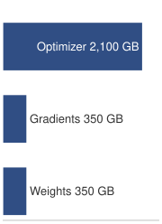{width="100%" fig-alt="Ladder of three memory rungs for a 175B-parameter mixed-precision Adam training state: optimizer state 2,100 GB (longest), gradients 350 GB, and weights 350 GB. The optimizer rung is about six times the others."}

*Optimizer state, not weights, dominates the per-replica training budget.*
:::

Memory fit alone does not settle whether a model needs this kind of partition. For a `{python} FrontierTrainingContext.frontier_params_b_str`-parameter model, weights alone occupy `{python} ModelParallelMemoryFacts.weight_gb_str`, or about `{python} ModelParallelMemoryFacts.weight_per_gpu_gb_str` per GPU across a `{python} ModelParallelMemoryFacts.n_gpus_str`-GPU group, one-sixteenth of the `{python} DenseLLMReferenceFacts.cluster_gpus_str`-GPU reference cluster. Full mixed-precision Adam training state is much larger, `{python} ModelParallelMemoryFacts.full_state_gb_str` globally, yet ZeRO-3 across the same `{python} ModelParallelMemoryFacts.n_gpus_str` GPUs reduces it to roughly `{python} ModelParallelMemoryFacts.full_state_per_gpu_gb_str` per GPU before activations, which fits an `{python} DenseLLMReferenceFacts.h100_mem_gb_str` accelerator. ZeRO-3 can therefore make the static state fit, as the notebook below confirms. It pays for that fit in traffic, because every step regathers every layer's parameters across the data-parallel fabric, roughly three times the model's parameter bytes per worker (@sec-distributed-training-systems-systems-memoryefficient-data-parallelism-zero-fsdp-0e69). It also cannot split an individual layer's computation or activations across devices. Tensor parallelism addresses both limits by partitioning individual weight matrices across devices, using the column-then-row pairing diagrammed in @fig-tensor-parallel-split and detailed in @sec-distributed-training-systems-systems-tensor-parallelism-d76e, which confines collective communication to block boundaries. Pipeline parallelism instead stages sequential layers across devices (@sec-distributed-training-systems-systems-pipeline-parallelism-8748).

Activations add a separate memory requirement. Under the earlier unchecked-storage assumptions, a `{python} Gpt3ActivationBudget.seq_len_str`-token sequence through `{python} FrontierTrainingContext.frontier_params_b_str` parameters produces roughly `{python} Gpt3ActivationBudget.act_unchecked_tb_str` at a local batch of `{python} Gpt3ActivationBudget.micro_batch_str` sequences; optimizer sharding does not reduce that storage. Recomputation trades memory for extra FLOPs, partitioning distributes activations, and offload moves them to another memory tier. Kernel and batch-size choices also change the budget. Full activation checkpointing brings the same modeled case down to `{python} Gpt3ActivationBudget.act_checkpointed_gb_str`. The following notebook, which uses a single-sequence local batch, checks whether ZeRO-3 plus checkpointing fits the model without partitioning its computation.

```{python}
#| echo: false
from mlsysim.solvers import DistributedModel

# ┌─────────────────────────────────────────────────────────────────────────────
# │ A100 MEMORY CAPACITY CONTEXT (LEGO)
# ├─────────────────────────────────────────────────────────────────────────────
# │ Context: @sec-distributed-training-systems-systems-model-parallelism-7437
# │
# │ Goal: Provide A100 memory capacity for ZeRO-3 discussion.
# │ Show: ~80 GB HBM.
# │ How: pulling Hardware.Cloud.A100.memory.capacity from mlsysim.core.units.
# │
# └─────────────────────────────────────────────────────────────────────────────
from mlsysim.fmt import MarkdownStr, check, fmt, fmt_memory, fmt_memory_capacity
from mlsysim.physics import calc_activation_memory, memory_from_params

class A100CapacityContext:
    """A100 hardware reference."""

    # ┌── 1. LOAD (Constants) ──────────────────────────────────────────────
    mem = Hardware.Cloud.A100.memory.capacity

    # ┌── 2. EXECUTE (The Compute) ────────────────────────────────────────
    mem_capacity = mem.to(GiB)

    # ┌── 3. GUARD (Invariants) ──────────────────────────────────────────
    check(mem_capacity == 80 * GiB, "A100 memory capacity should be 80 GB")

    # ┌── 4. OUTPUT (Formatting) ──────────────────────────────────────────────
    a100_mem_gb_str = fmt_memory_capacity(mem_capacity, unit=GiB, precision=0, commas=False)
```

```{python}
#| echo: false
#| label: calc-vol2-memory-wall-analysis
# ┌─────────────────────────────────────────────────────────────────────────────
# │ ZERO-3 MEMORY WALL ANALYSIS (LEGO)
# ├─────────────────────────────────────────────────────────────────────────────
# │ Context: @sec-distributed-training-systems-systems-model-parallelism-7437
# │ Goal: ZeRO-3 memory wall analysis for 175B model on A100s.
# │ Show: Parameter, gradient, optimizer, static, activation, and total memory.
# │ How: Model memory formulas with check() invariants against A100 capacity.
# └─────────────────────────────────────────────────────────────────────────────

class MemoryWallAnalysis:
    """ZeRO-3 memory wall analysis for 175B model on A100s."""

    # ┌── 1. LOAD (Constants) ───────────────────────────────────────────────
    params = Models.Language.GPT3.parameters  # GPT-3 175B
    bytes_weights = BYTES_FP16 / param
    bytes_gradients = BYTES_FP16 / param
    bytes_adam_state = ReferenceStats.MixedPrecisionAdam.OptimizerStateBytesPerParameter
    n_gpus = ModelParallelMemoryFacts.n_gpus  # same 64-GPU group
    layers = Models.Language.GPT3.layers
    seq_len = Models.Language.GPT3.context_length
    micro_batch = 1  # scenario assumption: single-sequence micro-batch
    hidden = Models.Language.GPT3.hidden_dim
    heads = Models.Language.GPT3.heads
    activation_strategy = "full"

    # ┌── 2. EXECUTE (The Compute) ─────────────────────────────────────────
    param_mem = memory_from_params(params, bytes_weights)
    gradient_mem = memory_from_params(params, bytes_gradients)
    optim_mem = memory_from_params(params, bytes_adam_state)
    total_static_mem = param_mem + gradient_mem + optim_mem
    per_gpu_static = total_static_mem / n_gpus
    activation_mem = calc_activation_memory(
        layers,
        seq_len,
        micro_batch,
        hidden,
        n_heads=heads,
        strategy=activation_strategy,
    )
    total_per_gpu = per_gpu_static + activation_mem

    # ┌── 3. GUARD (Invariants) ───────────────────────────────────────────
    check(param_mem == 350 * GB, f"param storage ({param_mem})")
    check(gradient_mem == 350 * GB, f"gradient storage ({gradient_mem})")
    check(optim_mem == 2100 * GB, f"optim storage ({optim_mem})")
    check(total_static_mem == 2800 * GB, f"total static ({total_static_mem})")
    check(43 * GB < per_gpu_static < 44 * GB, f"per-GPU static ({per_gpu_static.to(GB).magnitude:.1f})")
    check(4 * GB < activation_mem < 6 * GB, f"checkpointed activations ({activation_mem.to(GB).magnitude:.1f} GB)")
    check(total_per_gpu < A100CapacityContext.mem, f"total per GPU ({total_per_gpu})")

    # ┌── 4. OUTPUT (Formatting) ──────────────────────────────────────────
    param_gb_str = fmt_memory(param_mem, unit=GB, precision=0, commas=False)
    gradient_gb_str = fmt_memory(gradient_mem, unit=GB, precision=0, commas=False)
    optim_gb_str = fmt_memory(optim_mem, unit=GB, precision=0, commas=True)
    total_static_gb_str = fmt_memory(total_static_mem, unit=GB, precision=0, commas=True)
    per_gpu_gb_str = fmt_memory(per_gpu_static, unit=GB, precision=1, commas=False)
    activation_gb_str = fmt_memory(activation_mem, unit=GB, precision=1, commas=False)
    total_per_gpu_gb_str = fmt_memory(total_per_gpu, unit=GB, precision=1, commas=False)
    n_gpus_str = fmt_count(n_gpus, commas=False, label="GPU")
    bytes_fp16_str = fmt(BYTES_FP16.to(byte).magnitude, precision=0, commas=False)
    bytes_adam_str = fmt((bytes_adam_state * param).to(byte).magnitude, precision=0, commas=False)
    seq_len_str = fmt(seq_len, precision=0, commas=False)
    micro_batch_str = fmt(micro_batch, precision=0, commas=False)
```

::: {#nbk-distributed-training-memory-wall-scale .callout-notebook title="The memory wall of scale"}

**Problem**: Training a `{python} FrontierTrainingContext.frontier_params_b_str`-parameter model (like GPT-3) on a 64-GPU group of NVIDIA A100s (`{python} A100CapacityContext.a100_mem_gb_str`), smaller than the `{python} DistTrainReliabilityFacts.reliability_gpu_count_str`-GPU reference cluster. The A100 carries the same `{python} A100CapacityContext.a100_mem_gb_str` of HBM as the reference H100, so the capacity verdict carries over, and a small group is the harder test of whether sharding alone suffices. Can data parallelism with ZeRO-3 handle this?

**Math**:

1.  **Parameter storage**: `{python} FrontierTrainingContext.frontier_params_b_str` params $\times$ `{python} MemoryWallAnalysis.bytes_fp16_str` bytes (FP16) = `{python} MemoryWallAnalysis.param_gb_str`.
2.  **Gradients and optimizer state**: Gradients add `{python} FrontierTrainingContext.frontier_params_b_str` params $\times$ `{python} MemoryWallAnalysis.bytes_fp16_str` bytes = `{python} MemoryWallAnalysis.gradient_gb_str`, while Adam FP32 master weights, momentum, and variance add `{python} FrontierTrainingContext.frontier_params_b_str` params $\times$ `{python} MemoryWallAnalysis.bytes_adam_str` bytes = `{python} MemoryWallAnalysis.optim_gb_str`.
3.  **Total static memory**: `{python} MemoryWallAnalysis.total_static_gb_str`.
4.  **ZeRO-3 sharding**: With `{python} MemoryWallAnalysis.n_gpus_str`, per-GPU static memory = `{python} MemoryWallAnalysis.total_static_gb_str`/`{python} MemoryWallAnalysis.n_gpus_str` $\approx$ `{python} MemoryWallAnalysis.per_gpu_gb_str`.
5.  **Activation memory**: For sequence length `{python} MemoryWallAnalysis.seq_len_str` and batch size `{python} MemoryWallAnalysis.micro_batch_str`, the canonical full-checkpointing strategy stores $\approx$ `{python} MemoryWallAnalysis.activation_gb_str` of activations per GPU.

**Systems insight**: `{python} MemoryWallAnalysis.per_gpu_gb_str` (static) + `{python} MemoryWallAnalysis.activation_gb_str` (dynamic) = `{python} MemoryWallAnalysis.total_per_gpu_gb_str`. Under this simplified accounting, ZeRO-3 plus full activation checkpointing fits within the `{python} A100CapacityContext.a100_mem_gb_str` A100 capacity, leaving material headroom for framework buffers and transient layer gathers. If those additional allocations exceed the remaining HBM, the design can reduce the local batch, offload state, increase the sharding degree, or add tensor or pipeline parallelism; tensor parallelism is not the only recourse.

:::

In this example, sharding and checkpointing make the modeled state fit, so two reasons to consider model parallelism remain. The first is the regather traffic. On the `{python} DenseLLMReferenceFacts.cluster_gpus_str`-GPU reference cluster, ZeRO-3 moves about `{python} Zero3GatherCost.traffic_tb_str` per worker per step for this model, which on one NDR InfiniBand port takes about `{python} Zero3GatherCost.ratio_mult_str` as long as the step's computation. The second is layer execution, since full sharding gathers parameters but never splits one layer's computation. Model parallelism instead chooses where to cut that computation. Layer-based splitting assigns sequential groups, such as layers 1--4 and layers 5--8, to different devices. Channel-based splitting distributes a layer's channels, while attention-head splitting assigns different heads to different devices. Layer cuts introduce pipeline dependencies; channel and head cuts expose concurrent work but add intra-layer exchanges. Other workloads may still need these cuts to meet peak memory capacity.

These cuts enable the large-scale cases that exceed a single device for different reasons. GPT-3, with `{python} FrontierTrainingContext.frontier_params_b_str` parameters, was trained with model parallelism within each matrix multiplication and across layers [@brown2020language], which avoids regathering the full parameter set on every step. Vision transformers processing high-resolution $16k{\times}16k$ pixel images use model parallelism to manage activation and memory constraints. Mixture-of-experts (MoE) architectures, whose experts are sparsely activated feed-forward blocks developed in @sec-distributed-training-systems-systems-expert-parallelism-mixture-experts-bc45, use this approach to distribute their conditional computation paths across hardware [@shazeer2017outrageously; @lepikhin2021gshard; @fedus2022switch].

For a layer-wise cut, device coordination proceeds in three phases. In the forward pass, data flows sequentially through model segments on different devices. The backward pass propagates gradients in reverse order through these segments. During parameter updates, each device modifies only its assigned portion of the model. The coordination ensures mathematical equivalence to training on a single device while enabling models that exceed individual device memory capacities. The cost is sequential dependency between stages: while one device computes its forward pass, downstream devices sit idle, creating the pipeline bubble that governs utilization for this layer-wise partition.

::: {#chk-distributed-training-model-parallelism-foundations .callout-checkpoint title="Model parallelism foundations"}

Verify your understanding of model sharding:

- [ ] **Memory relief**: determine whether model parallelism reduces the memory footprint per GPU for a given model.
- [ ] **Sequential dependency**: identify whether sequential dependencies between layer-wise model shards arise in the forward pass, the backward pass, or both.
- [ ] **Pipeline bubble**: explain why unscheduled layer-wise model parallelism can lead to lower GPU utilization than data parallelism through the "pipeline bubble."
- [ ] **Layer vs. tensor split**: distinguish layer-based and tensor-based ways to split a Transformer layer.

:::

### Model parallelism implementation {#sec-distributed-training-systems-systems-model-parallelism-implementation-0728}

Once the model itself is the object being partitioned, the implementation problem is placement: every cut must save enough memory to justify the activation transfer and idle time it introduces. The first implementation below partitions sequential layer groups to expose those pipeline dependencies, while tensor splitting executes pieces of the same layer concurrently. In layer-wise partitioning, input activations propagate forward through sequentially assigned model partitions while gradients flow backward to update parameters, with intermediate activations transferring across device boundaries at each stage.

```{python}
#| echo: false
class FrontierModelParallelPipelineRecap:
    from mlsysim import Models
    from mlsysim.fmt import check, fmt, fmt_memory, fmt_params

    params_b = Models.Language.GPT3.parameters.to(param).magnitude / BILLION
    check(170 <= params_b <= 180, f"GPT-3 reference should be ~175B params, got {params_b:.1f}B")
    weights = Models.Language.GPT3.size_in_bytes(BYTES_FP16)
    a100_budget = Hardware.Cloud.A100.memory.capacity.to(GiB) * (GB / GiB)  # published "80 GB" label
    capacity_factor = (weights / a100_budget).to_base_units().magnitude
    model_parallel_ways = 8  # scenario assumption: 8-way partition
    weights_per_gpu = weights / model_parallel_ways
    check(4 <= capacity_factor < 5, "GPT-3 FP16 weights should exceed one A100 by a factor of about four")
    weights_gb_str = fmt_memory(weights, unit=GB, precision=0, commas=False)
    model_parallel_ways_str = fmt(model_parallel_ways, precision=0, commas=False)
    weights_per_gpu_gb_str = fmt_memory(round(weights_per_gpu.to(GB).magnitude) * GB, unit=GB, precision=0, commas=False)
    # Stage-boundary activation handoff for the same GPT-3 shape and micro-batch
    # as Gpt3ActivationBudget (micro-batch 4, full context length).
    hidden_dim = Models.Language.GPT3.hidden_dim
    handoff = Gpt3ActivationBudget.micro_batch * Gpt3ActivationBudget.seq_len * hidden_dim * BYTES_FP16
    check(190 * MB < handoff < 210 * MB, "GPT-3 stage-boundary handoff at micro-batch 4 should be about 200 MB")
    hidden_dim_str = fmt(hidden_dim, precision=0, commas=True)
    seq_len_str = fmt(Gpt3ActivationBudget.seq_len, precision=0, commas=True)
    handoff_mb_str = fmt_memory(round(handoff.to(MB).magnitude) * MB, unit=MB, precision=0, commas=False)
```

The running example shows what a layer-wise cut changes and what it does not. Before any sharding, the `{python} FrontierTrainingContext.frontier_params_b_str`-parameter model's `{python} FrontierModelParallelPipelineRecap.weights_gb_str` of FP16 weights exceed the `{python} A100CapacityContext.a100_mem_gb_str` capacity of the A100s in the preceding notebook by a factor of four. ZeRO-3 met that capacity limit by sharding storage while every worker still executed every layer; model parallelism\index{Memory wall!model parallelism} meets it by giving each device a *unique* fraction of the model to compute. Unlike data parallelism, where every GPU processes a unique fraction of the global batch through the whole network, the layer-wise partition considered here sends the *same* data stream sequentially through devices that each own a slice of the layers. With `{python} FrontierModelParallelPipelineRecap.model_parallel_ways_str`-way partitioning, FP16 weights alone occupy approximately `{python} FrontierModelParallelPipelineRecap.weights_per_gpu_gb_str` per GPU. That is only the weights budget: full training still needs activations, gradients, and optimizer state, so pure `{python} FrontierModelParallelPipelineRecap.model_parallel_ways_str`-way model parallelism is not sufficient by itself. Production layouts therefore combine it with optimizer and gradient sharding or offload, and with pipeline scheduling that keeps activation memory within capacity, the composition developed in @sec-distributed-training-systems-systems-hybrid-parallelism-12a0.

In a typical pipeline parallel implementation, the training loop operates as a relay race. GPU 1 computes the initial transformer blocks and sends the resulting activation tensor to GPU 2. For the `{python} FrontierTrainingContext.frontier_params_b_str` model with hidden dimension `{python} FrontierModelParallelPipelineRecap.hidden_dim_str` and a microbatch of `{python} Gpt3ActivationBudget.micro_batch_str` sequences at `{python} FrontierModelParallelPipelineRecap.seq_len_str` tokens each, the forward handoff carries approximately `{python} FrontierModelParallelPipelineRecap.handoff_mb_str` per stage boundary per microbatch. GPU 2 needs that payload before processing the same microbatch, creating a dependency chain through the stages\index{Pipeline parallelism!activation handoff}\index{Point-to-point communication!pipeline stages}. Other microbatches can occupy the pipeline concurrently. Backward propagates activation gradients in reverse, while each stage also computes gradients for its own parameters.

Partitioning layers changes where an optimizer update runs without necessarily changing the update rule. Each GPU can apply Adam [@kingma2014adam], AdaFactor, or another optimizer to its parameter slice once the required gradients are complete. A device holding transformer layers 1--12 updates those layers; tied parameters, global gradient clipping, or a combined data-parallel group can still require coordination. Preserving synchronous optimization also requires the schedule to use consistent parameter versions. Sequential dependencies introduce pipeline bubbles\index{Pipeline bubble!utilization trade-off}, and unequal stage service times add waiting. The engineering problem is to overlap microbatches and balance stage work while preserving that update contract [@rasley2020].

### Parallelism variations {#sec-distributed-training-systems-systems-parallelism-variations-592a}

Partitioning strategy determines which cost the model pays after memory no longer fits on one device. Layer-wise partitioning\index{Layer-wise partitioning!model parallelism} spends idle time to reduce per-device memory; pipeline parallelism spends scheduling complexity to hide that idle time; tensor parallelism spends NVLink bandwidth to split a single layer. The following subsections separate these choices by the architecture and interconnect that make each viable.

#### Layer-wise partitioning {#sec-distributed-training-systems-systems-layerwise-partitioning-cf6a}

Layer-wise partitioning is the least invasive model cut: it saves memory by assigning consecutive layers to separate devices, but it preserves the model's sequential dependence. In transformer architectures, this translates to specific devices managing defined sets of attention and feed-forward blocks. @Fig-dist-layers-blocks diagrams this partitioning for a 16-layer transformer across four GPUs: panel (a) maps the weight footprint reduction to one-quarter per device alongside forward activation and backward gradient transfers across stage boundaries, while panel (b) charts the resulting execution timeline, revealing that each GPU remains idle for six of eight time slots without microbatch pipelining.

::: {#fig-dist-layers-blocks fig-env="figure" fig-pos="htb" fig-cap="**Layer-wise model parallelism**: (a) A 16-layer transformer placed four consecutive layers per GPU, cutting each GPU's weight footprint to one-quarter of the model. Forward activations cross each stage boundary left to right; gradients return right to left. (b) Without microbatching, one batch visits the stages in turn, forward (F) and then backward (B) in reverse, in equal schematic time slots, so each GPU works in only 2 of 8 slots. The microbatched schedule in @fig-pipeline-parallelism fills much of that idle time." fig-alt="Panel a: an input box, four GPU cards holding layers 1 to 4, 5 to 8, 9 to 12, and 13 to 16, and a loss box, joined by solid blue forward arrows and dashed amber gradient arrows. Panel b: a four-row, eight-slot timeline in which a single forward cell steps diagonally down from GPU 0 to GPU 3 and a single backward cell steps back up, leaving every other cell empty."}
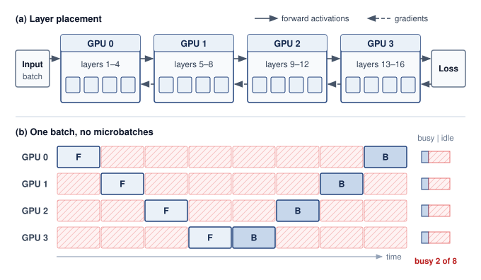

<!--
```{.tikz}
\scalebox{0.82}{%
\begin{tikzpicture}[
  line join=round, line cap=round,
  font=\sffamily,
  >=Stealth,
  stagebox/.style={
    draw=GrayLine!35,
    fill=white,
    rounded corners=3.5pt,
    line width=0.65pt,
    minimum width=2.9cm,
    minimum height=2.2cm,
    align=center
  },
  layerpill/.style={
    draw=#1!70,
    fill=#1!15,
    rounded corners=1.5pt,
    line width=0.55pt,
    minimum width=0.55cm,
    minimum height=0.38cm,
    font=\fontsize{6.5pt}{7.5pt}\selectfont\bfseries,
    text=#1,
    inner sep=0pt
  },
  p2pbadge/.style={
    draw=GreenLine!70,
    fill=GreenFill!25,
    rounded corners=2pt,
    line width=0.6pt,
    inner sep=2.5pt,
    align=center
  },
  fblock/.style={
    draw=BlueLine!70,
    fill=BlueFill!30,
    rounded corners=2pt,
    line width=0.6pt,
    font=\fontsize{6.5pt}{7.5pt}\selectfont\bfseries,
    text=BlueLine,
    minimum width=0.62cm,
    minimum height=0.48cm,
    align=center,
    inner sep=0pt
  },
  bblock/.style={
    draw=OrangeLine!80,
    fill=OrangeFill!35,
    rounded corners=2pt,
    line width=0.6pt,
    font=\fontsize{6.5pt}{7.5pt}\selectfont\bfseries,
    text=OrangeLine!90!black,
    minimum width=0.62cm,
    minimum height=0.48cm,
    align=center,
    inner sep=0pt
  },
  bubblerect/.style={
    draw=GrayLine!60,
    rounded corners=2pt,
    line width=0.55pt,
    preaction={fill=gray!8},
    pattern=north east lines,
    pattern color=GrayLine!40
  }
]

  % ===========================================================
  % UPPER ROW: MODEL PARTITIONING ACROSS GPUS
  % ===========================================================
  \def\topY{8.2}

  % Input Batch
  \node[draw=OrangeLine!80, fill=OrangeFill!25, rounded corners=3.5pt, line width=0.7pt,
        minimum width=1.1cm, minimum height=1.5cm, align=center, inner sep=3pt] (INP) at (0.6, \topY) {
    \textbf{\fontsize{8.5pt}{10pt}\selectfont\textcolor{OrangeLine!90!black}{Input}}\\[2pt]
    \fontsize{7pt}{8pt}\selectfont\textcolor{OrangeLine!85!black}{Batch}
  };

  % Stage 0
  \node[stagebox] (ST0) at (2.9, \topY) {};
  \node[font=\fontsize{6.8pt}{8pt}\selectfont\bfseries, draw=BlueLine!50, fill=BlueFill!30, rounded corners=2pt, line width=0.4pt, text=BlueLine, inner sep=2pt] at (2.9, \topY+0.75) {Stage 0 $\cdot$ GPU 0};
  \node[font=\fontsize{8.2pt}{9.5pt}\selectfont\bfseries, text=TextDark] at (2.9, \topY+0.22) {Layers 1--4};
  \node[font=\fontsize{6.2pt}{7.5pt}\selectfont, text=TextMuted] at (2.9, \topY-0.08) {Embedding + Attn Blocks};
  \node[layerpill=BlueLine] at (1.95, \topY-0.62) {L1};
  \node[layerpill=BlueLine] at (2.58, \topY-0.62) {L2};
  \node[layerpill=BlueLine] at (3.22, \topY-0.62) {L3};
  \node[layerpill=BlueLine] at (3.85, \topY-0.62) {L4};

  % P2P 0 -> 1
  \node[p2pbadge] (P01) at (4.8, \topY) {
    \textbf{\fontsize{6.0pt}{7.0pt}\selectfont\textcolor{GreenD}{P2P}}\\[1pt]
    \fontsize{5.2pt}{6.0pt}\selectfont\textcolor{GreenLine}{Ckpt}
  };
  \draw[->, line width=0.85pt, TextMuted, shorten >= 2pt, shorten <= 2pt] (ST0.east) -- (P01.west);
  \draw[->, line width=0.85pt, TextMuted, shorten >= 2pt, shorten <= 2pt] (P01.east) -- ++(0.3, 0);

  % Stage 1
  \node[stagebox] (ST1) at (6.7, \topY) {};
  \node[font=\fontsize{6.8pt}{8pt}\selectfont\bfseries, draw=GreenLine!50, fill=GreenFill!30, rounded corners=2pt, line width=0.4pt, text=GreenD, inner sep=2pt] at (6.7, \topY+0.75) {Stage 1 $\cdot$ GPU 1};
  \node[font=\fontsize{8.2pt}{9.5pt}\selectfont\bfseries, text=TextDark] at (6.7, \topY+0.22) {Layers 5--8};
  \node[font=\fontsize{6.2pt}{7.5pt}\selectfont, text=TextMuted] at (6.7, \topY-0.08) {Attn + FFN Blocks};
  \node[layerpill=GreenLine] at (5.75, \topY-0.62) {L5};
  \node[layerpill=GreenLine] at (6.38, \topY-0.62) {L6};
  \node[layerpill=GreenLine] at (7.02, \topY-0.62) {L7};
  \node[layerpill=GreenLine] at (7.65, \topY-0.62) {L8};

  % P2P 1 -> 2
  \node[p2pbadge] (P12) at (8.6, \topY) {
    \textbf{\fontsize{6.0pt}{7.0pt}\selectfont\textcolor{GreenD}{P2P}}\\[1pt]
    \fontsize{5.2pt}{6.0pt}\selectfont\textcolor{GreenLine}{Ckpt}
  };
  \draw[->, line width=0.85pt, TextMuted, shorten >= 2pt, shorten <= 2pt] (ST1.east) -- (P12.west);
  \draw[->, line width=0.85pt, TextMuted, shorten >= 2pt, shorten <= 2pt] (P12.east) -- ++(0.3, 0);

  % Stage 2
  \node[stagebox] (ST2) at (10.5, \topY) {};
  \node[font=\fontsize{6.8pt}{8pt}\selectfont\bfseries, draw=OrangeLine!50, fill=OrangeFill!30, rounded corners=2pt, line width=0.4pt, text=OrangeLine!90!black, inner sep=2pt] at (10.5, \topY+0.75) {Stage 2 $\cdot$ GPU 2};
  \node[font=\fontsize{8.2pt}{9.5pt}\selectfont\bfseries, text=TextDark] at (10.5, \topY+0.22) {Layers 9--12};
  \node[font=\fontsize{6.2pt}{7.5pt}\selectfont, text=TextMuted] at (10.5, \topY-0.08) {FFN + LayerNorm Blocks};
  \node[layerpill=OrangeLine] at (9.55, \topY-0.62) {L9};
  \node[layerpill=OrangeLine] at (10.18, \topY-0.62) {L10};
  \node[layerpill=OrangeLine] at (10.82, \topY-0.62) {L11};
  \node[layerpill=OrangeLine] at (11.45, \topY-0.62) {L12};

  % P2P 2 -> 3
  \node[p2pbadge] (P23) at (12.4, \topY) {
    \textbf{\fontsize{6.0pt}{7.0pt}\selectfont\textcolor{GreenD}{P2P}}\\[1pt]
    \fontsize{5.2pt}{6.0pt}\selectfont\textcolor{GreenLine}{Ckpt}
  };
  \draw[->, line width=0.85pt, TextMuted, shorten >= 2pt, shorten <= 2pt] (ST2.east) -- (P23.west);
  \draw[->, line width=0.85pt, TextMuted, shorten >= 2pt, shorten <= 2pt] (P23.east) -- ++(0.3, 0);

  % Stage 3
  \node[stagebox] (ST3) at (14.3, \topY) {};
  \node[font=\fontsize{6.8pt}{8pt}\selectfont\bfseries, draw=VioletLine!50, fill=VioletFill!40, rounded corners=2pt, line width=0.4pt, text=VioletLine, inner sep=2pt] at (14.3, \topY+0.75) {Stage 3 $\cdot$ GPU 3};
  \node[font=\fontsize{8.2pt}{9.5pt}\selectfont\bfseries, text=TextDark] at (14.3, \topY+0.22) {Layers 13--16};
  \node[font=\fontsize{6.2pt}{7.5pt}\selectfont, text=TextMuted] at (14.3, \topY-0.08) {Output Head + Criterion};
  \node[layerpill=VioletLine] at (13.35, \topY-0.62) {L13};
  \node[layerpill=VioletLine] at (13.98, \topY-0.62) {L14};
  \node[layerpill=VioletLine] at (14.62, \topY-0.62) {L15};
  \node[layerpill=VioletLine] at (15.25, \topY-0.62) {L16};

  % Input arrow
  \draw[->, line width=0.85pt, TextMuted, shorten >= 2pt, shorten <= 2pt] (INP.east) -- (ST0.west);

  % Loss Arrow
  \draw[->, line width=0.95pt, RedLine, shorten >= 2pt] (ST3.south) -- ++(0, -0.42)
    node[below=1.5pt, font=\fontsize{6.5pt}{7.5pt}\selectfont\bfseries, text=RedLine] {Loss / Loss Backward};

  % ===========================================================
  % LOWER PANELS: BUBBLE THEORY (LEFT) & SCHEDULE GRID (RIGHT)
  % ===========================================================
  \def\botY{6.2}

  % Left Panel: Theory Card
  \node[draw=GrayLine!35, fill=gray!2, rounded corners=3.5pt, line width=0.65pt,
        inner sep=6pt, anchor=north west] (LEFT_BOX) at (0.0, \botY) {
    \begin{minipage}{5.0cm}
      \textbf{\fontsize{8.5pt}{10pt}\selectfont\textcolor{TextDark}{Pipeline Bubble \& Communication}}\\[6pt]
      \fontsize{7.0pt}{8.5pt}\selectfont
      \textbf{Pipeline Stages (${N_{\text{PP}}}$):} 4 GPUs across pipeline\\[1.5pt]
      \textbf{Micro-batches ($m$):} 4 micro-batches in flight\\[6pt]
      \centering
      \begin{tikzpicture}
        \node[draw=BlueLine!40, fill=white, rounded corners=2.5pt, line width=0.5pt, inner sep=4pt] {
          \begin{minipage}{4.6cm}
            \centering
            \fontsize{6.5pt}{7.5pt}\selectfont\textcolor{TextMuted}{Theoretical Bubble Overhead Fraction}\\[2.5pt]
            \textbf{\fontsize{9.5pt}{11pt}\selectfont\textcolor{RedLine}{$F_{\text{bubble}} = \frac{p - 1}{p - 1 + m}$}}\\[3.5pt]
            \fontsize{6.2pt}{7.2pt}\selectfont\textcolor{TextDark}{For $p=4,\, m=4$: $3 / (3 + 4) = 42.9\%$ idle}
          \end{minipage}
        };
      \end{tikzpicture}\\[6pt]
      \raggedright
      \fontsize{6.5pt}{8.0pt}\selectfont
      \textbf{\textcolor{GreenD}{Mitigation:}} Scale micro-batches ($m \gg p$).\\[1pt]
      \textcolor{TextMuted}{Setting $m=32$ reduces bubble to $8.6\%$, at the cost of higher in-flight activation memory.}\\[6pt]
      \centering
      \begin{tikzpicture}
        \node[draw=BlueLine!40, fill=BlueFill!25, rounded corners=2.5pt, line width=0.5pt, inner sep=4pt] {
          \begin{minipage}{4.6cm}
            \raggedright
            \textbf{\fontsize{6.8pt}{8pt}\selectfont\textcolor{BlueLine}{P2P Boundary Activation Transfer:}}\\[2pt]
            \fontsize{6.0pt}{7.2pt}\selectfont
            $\cdot$ \textbf{Volume:} $\mathcal{O}(B_{\text{micro}} \cdot s \cdot h)$ tensor size\\
            $\cdot$ \textbf{Fabric:} Inter-node InfiniBand or RoCE\\
            $\cdot$ \textbf{Ckpt:} Store activations at boundaries only
          \end{minipage}
        };
      \end{tikzpicture}
    \end{minipage}
  };

  % Right Panel: Pipeline Execution Schedule Grid
  \node[draw=GrayLine!35, fill=white, rounded corners=3.5pt, line width=0.65pt,
        minimum width=10.2cm, minimum height=5.6cm, anchor=north east] (RIGHT_BOX) at (15.8, \botY) {};

  % Header Title (Top line)
  \node[font=\fontsize{8.5pt}{10pt}\selectfont\bfseries, text=TextDark, anchor=west]
    at (6.0, \botY-0.35) {Pipeline Schedule: Forward \& Backward Flow};

  % Legend on line 2
  \node[fblock, minimum width=0.30cm, minimum height=0.22cm] (legF) at (6.3, \botY-0.75) {};
  \node[font=\fontsize{6.2pt}{7.2pt}\selectfont, text=TextDark, right=2pt of legF] {Forward (F)};

  \node[bblock, minimum width=0.30cm, minimum height=0.22cm] (legB) at (8.5, \botY-0.75) {};
  \node[font=\fontsize{6.2pt}{7.2pt}\selectfont, text=TextDark, right=2pt of legB] {Backward (B)};

  \filldraw[bubblerect] (10.6, \botY-0.86) rectangle ++(0.30cm, 0.22cm);
  \node[font=\fontsize{6.2pt}{7.2pt}\selectfont, text=TextDark] at (11.8, \botY-0.75) {Idle Bubble};

  % Schedule Grid Coordinates
  \def\gX{6.8}
  \def\gYzero{\botY-1.45}
  \def\gYone{\botY-2.20}
  \def\gYtwo{\botY-2.95}
  \def\gYthree{\botY-3.70}
  \def\dx{0.74}

  % Row Labels
  \node[font=\fontsize{7.5pt}{9pt}\selectfont\bfseries, text=BlueLine, anchor=east] at (\gX-0.25, \gYzero) {GPU 0};
  \node[font=\fontsize{7.5pt}{9pt}\selectfont\bfseries, text=GreenD, anchor=east] at (\gX-0.25, \gYone) {GPU 1};
  \node[font=\fontsize{7.5pt}{9pt}\selectfont\bfseries, text=OrangeLine!90!black, anchor=east] at (\gX-0.25, \gYtwo) {GPU 2};
  \node[font=\fontsize{7.5pt}{9pt}\selectfont\bfseries, text=VioletLine, anchor=east] at (\gX-0.25, \gYthree) {GPU 3};

  % Timeline Axis
  \draw[->, line width=0.8pt, TextDark] (\gX-0.1, \botY-4.30) -- (\gX+8.6, \botY-4.30)
    node[midway, below=3pt, font=\fontsize{6.5pt}{7.5pt}\selectfont\bfseries, text=TextDark] {Execution Time (Clock Cycles / Steps) $\longrightarrow$};

  % --- GPU 0 ---
  \node[fblock] at (\gX + 0.5*\dx, \gYzero) {F0};
  \node[fblock] at (\gX + 1.5*\dx, \gYzero) {F1};
  \node[fblock] at (\gX + 2.5*\dx, \gYzero) {F2};
  \node[fblock] at (\gX + 3.5*\dx, \gYzero) {F3};
  \filldraw[bubblerect] (\gX + 4.0*\dx + 0.05, \gYzero-0.24) rectangle (\gX + 7.0*\dx - 0.05, \gYzero+0.24);
  \node[font=\fontsize{6.2pt}{7.2pt}\selectfont\bfseries, text=TextDark!80] at (\gX + 5.5*\dx, \gYzero) {Idle Bubble};
  \node[bblock] at (\gX + 7.5*\dx, \gYzero) {B3};
  \node[bblock] at (\gX + 8.5*\dx, \gYzero) {B2};
  \node[bblock] at (\gX + 9.5*\dx, \gYzero) {B1};
  \node[bblock] at (\gX + 10.5*\dx, \gYzero) {B0};

  % --- GPU 1 ---
  \filldraw[bubblerect] (\gX + 0.05, \gYone-0.24) rectangle (\gX + 1.0*\dx - 0.05, \gYone+0.24);
  \node[fblock] at (\gX + 1.5*\dx, \gYone) {F0};
  \node[fblock] at (\gX + 2.5*\dx, \gYone) {F1};
  \node[fblock] at (\gX + 3.5*\dx, \gYone) {F2};
  \node[fblock] at (\gX + 4.5*\dx, \gYone) {F3};
  \filldraw[bubblerect] (\gX + 5.0*\dx + 0.05, \gYone-0.24) rectangle (\gX + 6.0*\dx - 0.05, \gYone+0.24);
  \node[font=\fontsize{5.8pt}{6.8pt}\selectfont\bfseries, text=TextDark!80] at (\gX + 5.5*\dx, \gYone) {Idle};
  \node[bblock] at (\gX + 6.5*\dx, \gYone) {B3};
  \node[bblock] at (\gX + 7.5*\dx, \gYone) {B2};
  \node[bblock] at (\gX + 8.5*\dx, \gYone) {B1};
  \node[bblock] at (\gX + 9.5*\dx, \gYone) {B0};
  \filldraw[bubblerect] (\gX + 10.0*\dx + 0.05, \gYone-0.24) rectangle (\gX + 11.0*\dx - 0.05, \gYone+0.24);

  % --- GPU 2 ---
  \filldraw[bubblerect] (\gX + 0.05, \gYtwo-0.24) rectangle (\gX + 2.0*\dx - 0.05, \gYtwo+0.24);
  \node[font=\fontsize{5.8pt}{6.8pt}\selectfont\bfseries, text=TextDark!80] at (\gX + 1.0*\dx, \gYtwo) {Fill};
  \node[fblock] at (\gX + 2.5*\dx, \gYtwo) {F0};
  \node[fblock] at (\gX + 3.5*\dx, \gYtwo) {F1};
  \node[fblock] at (\gX + 4.5*\dx, \gYtwo) {F2};
  \node[fblock] at (\gX + 5.5*\dx, \gYtwo) {F3};
  \node[bblock] at (\gX + 6.5*\dx, \gYtwo) {B3};
  \node[bblock] at (\gX + 7.5*\dx, \gYtwo) {B2};
  \node[bblock] at (\gX + 8.5*\dx, \gYtwo) {B1};
  \node[bblock] at (\gX + 9.5*\dx, \gYtwo) {B0};
  \filldraw[bubblerect] (\gX + 10.0*\dx + 0.05, \gYtwo-0.24) rectangle (\gX + 11.0*\dx - 0.05, \gYtwo+0.24);
  \node[font=\fontsize{5.8pt}{6.8pt}\selectfont\bfseries, text=TextDark!80] at (\gX + 10.5*\dx, \gYtwo) {Drain};

  % --- GPU 3 ---
  \filldraw[bubblerect] (\gX + 0.05, \gYthree-0.24) rectangle (\gX + 3.0*\dx - 0.05, \gYthree+0.24);
  \node[font=\fontsize{5.8pt}{6.8pt}\selectfont\bfseries, text=TextDark!80] at (\gX + 1.5*\dx, \gYthree) {Fill Bubble};
  \node[fblock] at (\gX + 3.5*\dx, \gYthree) {F0};
  \node[fblock] at (\gX + 3.5*\dx + \dx, \gYthree) {F1};
  \node[fblock] at (\gX + 3.5*\dx + 2*\dx, \gYthree) {F2};
  \node[fblock] at (\gX + 3.5*\dx + 3*\dx, \gYthree) {F3};
  \node[bblock] at (\gX + 7.5*\dx, \gYthree) {B3};
  \node[bblock] at (\gX + 8.5*\dx, \gYthree) {B2};
  \node[bblock] at (\gX + 9.5*\dx, \gYthree) {B1};
  \node[bblock] at (\gX + 10.5*\dx, \gYthree) {B0};

  % Phase Callouts below axis
  \draw[line width=0.9pt, RedLine] (\gX, \botY-5.00) -- ++(3.0*\dx, 0)
    node[midway, below=2pt, font=\fontsize{6.0pt}{7.0pt}\selectfont\bfseries, text=RedLine] {Fill Bubble ($p - 1$ steps)};

  \draw[line width=0.9pt, RedLine] (\gX + 4.5*\dx, \botY-5.00) -- (\gX + 7.0*\dx, \botY-5.00)
    node[midway, below=2pt, font=\fontsize{6.0pt}{7.0pt}\selectfont\bfseries, text=RedLine] {Turnaround / Drain Bubble};

\end{tikzpicture}%
}
```
-->

:::

Sequential processing introduces device idle time, as each device must wait for the previous device to complete its computation before beginning work. While GPU 0 processes the initial blocks, GPUs 1, 2, and 3 remain inactive. Similarly, when GPU 1 begins its computation, GPU 0 sits idle. This pattern of waiting and idle time reduces hardware utilization efficiency compared to other parallelization strategies.

#### Pipeline parallelism {#sec-distributed-training-systems-systems-pipeline-parallelism-8748}

Pipeline parallelism extends layer-wise partitioning by introducing microbatching to amortize device idle bubbles.

```{python}
#| echo: false
# ┌─────────────────────────────────────────────────────────────────────────────
# │ PIPELINE STAGE-BOUNDARY PAYLOAD (LEGO)
# ├─────────────────────────────────────────────────────────────────────────────
# │ Context: the pipeline-parallelism definition callout.
# │ Goal: Size one stage-boundary activation for a 70B-class hidden width and
# │       compare the link it crosses (NDR InfiniBand).
# │ Show: 8,192 x 2,048 x 2 bytes ~ 34 MB per boundary; 50 GB/s NDR port.
# └─────────────────────────────────────────────────────────────────────────────
from mlsysim.fmt import check, fmt, fmt_bandwidth, fmt_int, fmt_math, fmt_memory

class PipelineBoundaryPayload:
    # ┌── 1. LOAD ─────────────────────────────────────────
    hidden_dim = Models.Language.Llama2_70B.hidden_dim  # 70B-class hidden width
    seq_len = 2048  # scenario assumption: pretraining sequence length
    micro_batch = 1  # scenario assumption
    dtype_bytes = BYTES_FP16  # BF16 has the same width
    ib_bw = Systems.Fabrics.InfiniBand_NDR.bandwidth

    # ┌── 2. EXECUTE ──────────────────────────────────────
    payload = micro_batch * hidden_dim * seq_len * dtype_bytes

    # ┌── 3. GUARD ────────────────────────────────────────
    check(30 * MB < payload < 40 * MB, "One stage-boundary activation should be tens of MB")

    # ┌── 4. OUTPUT ───────────────────────────────────────
    hidden_dim_str = fmt(hidden_dim, precision=0, commas=True)
    seq_len_str = fmt(seq_len, precision=0, commas=True)
    micro_batch_str = fmt(micro_batch, precision=0, commas=False)
    dtype_bytes_str = fmt(dtype_bytes.to(byte).magnitude, precision=0, commas=False)
    payload_mb_str = fmt_int(payload.to(MB).magnitude, commas=False)
    ib_gb_per_s_str = fmt_bandwidth(ib_bw, unit=GB / second, precision=0, commas=False)
```

```{python}
#| echo: false
from mlsysim.solvers import DistributedModel

# ┌─────────────────────────────────────────────────────────────────────────────
# │ PIPELINE BUBBLE TAX (NOTEBOOK)
# ├─────────────────────────────────────────────────────────────────────────────
# │ Context: "The Cost of the Pipeline Bubble" .callout-notebook
# │
# │ Goal: Quantify the GPU idle time (bubble) in pipeline parallelism.
# │ Show: bubble_fraction_pct ≈ 18 percent—inline in notebook result.
# │ How: bubble_fraction = (p - 1) / (p - 1 + m).
# │
# └─────────────────────────────────────────────────────────────────────────────
from mlsysim.fmt import check, fmt, fmt_count

class PipelineBubble:
    # ┌── 1. LOAD ──────────────────────────────────────────
    p_stages = 8  # Number of nodes/stages
    m_microbatches = 32  # Microbatches per global batch
    # ┌── 2. EXECUTE ───────────────────────────────────────
    # Bubble overhead is the time GPUs spend waiting for the first/last samples
    p_minus_1 = p_stages - 1
    bubble_fraction = p_minus_1 / (p_minus_1 + m_microbatches)
    bubble_pct = bubble_fraction * 100
    # ┌── 3. GUARD ─────────────────────────────────────────
    check(17 < bubble_pct < 19, f"Bubble {bubble_pct:.1f}% unexpected")
    # ┌── 4. OUTPUT ────────────────────────────────────────
    pb_stages_str = fmt_count(p_stages, commas=False, label="stage")
    pb_p_value_str = fmt(p_stages, precision=0, commas=False)
    pb_microbatches_str = fmt(m_microbatches, precision=0, commas=False)
    pb_p_minus_1_str = fmt(p_minus_1, precision=0, commas=False)
    pb_bubble_pct_str = fmt_percent(bubble_pct / 100, precision=1, commas=False, style='prose')
    pb_bubble_pct_round_str = fmt_percent(round(bubble_pct) / 100, precision=0, commas=False, style='prose')
```

::: {#dfn-distributed-training-pipeline-parallelism .callout-definition title="Pipeline parallelism"}

***Pipeline parallelism***\index{Pipeline parallelism!definition} is a model parallelism technique that partitions a neural network's layers into sequential stages assigned to different devices, passing activations forward and gradients backward between stages while overlapping computation across stages using microbatches to maintain throughput.

1.  **Significance**: Each boundary transfers forward activations and backward activation gradients. A forward tensor contains $B_{\mu} \times S \times d \times 2$ bytes at BF16, where $B_{\mu}$ is the microbatch size. For a hidden dimension of `{python} PipelineBoundaryPayload.hidden_dim_str` with microbatch size `{python} PipelineBoundaryPayload.micro_batch_str` and a `{python} PipelineBoundaryPayload.seq_len_str`-token sequence, the forward payload is approximately `{python} PipelineBoundaryPayload.hidden_dim_str` $\times$ `{python} PipelineBoundaryPayload.seq_len_str` $\times$ `{python} PipelineBoundaryPayload.dtype_bytes_str` $\approx$ `{python} PipelineBoundaryPayload.payload_mb_str` MB per microbatch per boundary. Backward traffic and all microbatches must be counted before comparing this with a per-update gradient AllReduce or sizing a `{python} PipelineBoundaryPayload.ib_gb_per_s_str` InfiniBand link. In a balanced noninterleaved schedule with ideal transfers, the idle fraction is approximately $(\PipelineparallelDegreePp-1)/(m+\PipelineparallelDegreePp-1)$, where $\PipelineparallelDegreePp$ is the stage count and $m$ the microbatch count.
2.  **Distinction**: Tensor parallelism partitions operations within a layer and introduces communication among their participants. Pipeline parallelism instead transfers activations and their gradients between sequential stages. This coarser exchange can suit slower links when the transfer fits within the stage schedule; the interconnect name alone does not establish feasibility.
3.  **Common pitfall**: A frequent misconception is that adding pipeline stages always improves throughput. Each additional stage increases the pipeline bubble fraction $(\PipelineparallelDegreePp-1)/(m+\PipelineparallelDegreePp-1)$ unless the number of microbatches $m$ scales proportionally, causing hardware to idle and erasing the benefit of deeper partitioning.

:::

@Fig-pipeline-parallelism sequences a four-stage pipeline processing four microbatches ($\PipelineparallelDegreePp=4, m=4$) under a GPipe schedule: dividing the global batch into discrete microbatches allows forward passes to overlap diagonally across stages before backward passes unfold in reverse order. While microbatching raises hardware utilization above naive sequential placement, pipeline fill ($t_1$--$t_3$) and drain ($t_{12}$--$t_{14}$) bubbles still leave each device idle for 6 of 14 time slots.

::: {#fig-pipeline-parallelism fig-env="figure" fig-pos="htb" fig-cap="**Pipeline parallelism schedule**: A 4-stage pipeline processes 4 microbatches with all forward passes (F) before any backward pass (B), as in GPipe. Rows are pipeline stages and columns are equal time slots. Each backward pass enters a stage only after the next stage has produced that microbatch's gradient, so every stage idles $\PipelineparallelDegreePp-1$ slots in the forward phase and $\PipelineparallelDegreePp-1$ in the backward phase, 6 of 14 slots in all." fig-alt="Pipeline schedule grid with four GPU rows and fourteen time slots. Blue forward cells for microbatches 1 to 4 step diagonally down and right; orange backward cells in reverse microbatch order step diagonally up and right from the last stage; idle cells fill the upper right and lower left corners, marked as fill and drain bubbles."}
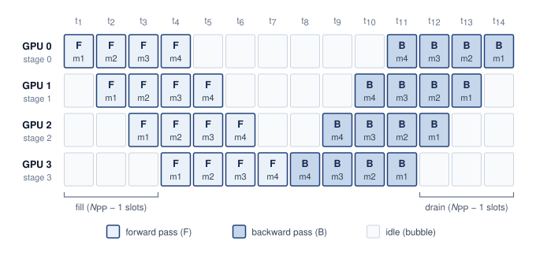

<!--
```{.tikz}
\scalebox{0.78}{%
\begin{tikzpicture}[
  line join=round, line cap=round,
  font=\small\sffamily,
  >=Stealth,
  cell/.style={
    rectangle,
    rounded corners=2pt,
    line width=0.6pt,
    minimum width=0.96cm,
    minimum height=0.82cm,
    align=center,
    inner sep=1.5pt,
    font=\small\sffamily
  },
  fwd cell/.style={
    cell,
    draw=BlueLine!70,
    fill=BlueFill!30,
    text=BlueLine
  },
  bwd cell/.style={
    cell,
    draw=GreenLine!70,
    fill=GreenFill!30,
    text=GreenD
  },
  idle cell/.style={
    cell,
    draw=GrayLine!30,
    fill=gray!4,
    text=TextBlack!45
  }
]

  % Dimensions: 14 columns (t1 to t14), 4 rows (Stage 0 to Stage 3)
  \def\colw{1.04}
  \def\rowh{0.92}

  % Time arrow
  \draw[->, line width=0.8pt, TextBlack!70, shorten >= 2pt] (-0.3, 1.15) -- ({13*\colw + 0.3}, 1.15)
    node[midway, above=2pt, font=\scriptsize\bfseries\sffamily, text=TextBlack!70] {Execution Time ($t$) $\longrightarrow$};

  % Column headers (Time steps)
  \node[font=\bfseries\footnotesize\sffamily, text=TextBlack, anchor=east] at (-0.6, 0.68) {Stage};
  \foreach \t in {1,...,14} {
    \node[font=\bfseries\scriptsize\sffamily, text=TextBlack!75, anchor=south] at ({(\t-1)*\colw}, 0.52) {$t_{\t}$};
  }

  % Row labels
  \node[align=right, anchor=east, font=\sffamily] at (-0.6, {0 * -\rowh}) {
    \textbf{\small Stage 0}\\[-1pt]\scriptsize\textcolor{TextBlack!70}{(GPU 0)}
  };
  \node[align=right, anchor=east, font=\sffamily] at (-0.6, {1 * -\rowh}) {
    \textbf{\small Stage 1}\\[-1pt]\scriptsize\textcolor{TextBlack!70}{(GPU 1)}
  };
  \node[align=right, anchor=east, font=\sffamily] at (-0.6, {2 * -\rowh}) {
    \textbf{\small Stage 2}\\[-1pt]\scriptsize\textcolor{TextBlack!70}{(GPU 2)}
  };
  \node[align=right, anchor=east, font=\sffamily] at (-0.6, {3 * -\rowh}) {
    \textbf{\small Stage 3}\\[-1pt]\scriptsize\textcolor{TextBlack!70}{(GPU 3)}
  };

  % Grid Cells:
  % Stage 0 (y=0)
  \node[fwd cell] at ({0*\colw}, 0) {\textbf{\scriptsize F}\\[1pt]\fontsize{6pt}{6pt}\selectfont $m_1$};
  \node[fwd cell] at ({1*\colw}, 0) {\textbf{\scriptsize F}\\[1pt]\fontsize{6pt}{6pt}\selectfont $m_2$};
  \node[fwd cell] at ({2*\colw}, 0) {\textbf{\scriptsize F}\\[1pt]\fontsize{6pt}{6pt}\selectfont $m_3$};
  \node[fwd cell] at ({3*\colw}, 0) {\textbf{\scriptsize F}\\[1pt]\fontsize{6pt}{6pt}\selectfont $m_4$};
  \foreach \c in {4,5,6,7,8,9} {
    \node[idle cell] at ({\c*\colw}, 0) {\fontsize{6.5pt}{7pt}\selectfont idle};
  }
  \node[bwd cell] at ({10*\colw}, 0) {\textbf{\scriptsize B}\\[1pt]\fontsize{6pt}{6pt}\selectfont $m_4$};
  \node[bwd cell] at ({11*\colw}, 0) {\textbf{\scriptsize B}\\[1pt]\fontsize{6pt}{6pt}\selectfont $m_3$};
  \node[bwd cell] at ({12*\colw}, 0) {\textbf{\scriptsize B}\\[1pt]\fontsize{6pt}{6pt}\selectfont $m_2$};
  \node[bwd cell] at ({13*\colw}, 0) {\textbf{\scriptsize B}\\[1pt]\fontsize{6pt}{6pt}\selectfont $m_1$};

  % Stage 1 (y=-1*\rowh)
  \node[idle cell] at ({0*\colw}, {-1*\rowh}) {\fontsize{6.5pt}{7pt}\selectfont idle};
  \node[fwd cell] at ({1*\colw}, {-1*\rowh}) {\textbf{\scriptsize F}\\[1pt]\fontsize{6pt}{6pt}\selectfont $m_1$};
  \node[fwd cell] at ({2*\colw}, {-1*\rowh}) {\textbf{\scriptsize F}\\[1pt]\fontsize{6pt}{6pt}\selectfont $m_2$};
  \node[fwd cell] at ({3*\colw}, {-1*\rowh}) {\textbf{\scriptsize F}\\[1pt]\fontsize{6pt}{6pt}\selectfont $m_3$};
  \node[fwd cell] at ({4*\colw}, {-1*\rowh}) {\textbf{\scriptsize F}\\[1pt]\fontsize{6pt}{6pt}\selectfont $m_4$};
  \foreach \c in {5,6,7,8} {
    \node[idle cell] at ({\c*\colw}, {-1*\rowh}) {\fontsize{6.5pt}{7pt}\selectfont idle};
  }
  \node[bwd cell] at ({9*\colw}, {-1*\rowh}) {\textbf{\scriptsize B}\\[1pt]\fontsize{6pt}{6pt}\selectfont $m_4$};
  \node[bwd cell] at ({10*\colw}, {-1*\rowh}) {\textbf{\scriptsize B}\\[1pt]\fontsize{6pt}{6pt}\selectfont $m_3$};
  \node[bwd cell] at ({11*\colw}, {-1*\rowh}) {\textbf{\scriptsize B}\\[1pt]\fontsize{6pt}{6pt}\selectfont $m_2$};
  \node[bwd cell] at ({12*\colw}, {-1*\rowh}) {\textbf{\scriptsize B}\\[1pt]\fontsize{6pt}{6pt}\selectfont $m_1$};
  \node[idle cell] at ({13*\colw}, {-1*\rowh}) {\fontsize{6.5pt}{7pt}\selectfont idle};

  % Stage 2 (y=-2*\rowh)
  \node[idle cell] at ({0*\colw}, {-2*\rowh}) {\fontsize{6.5pt}{7pt}\selectfont idle};
  \node[idle cell] at ({1*\colw}, {-2*\rowh}) {\fontsize{6.5pt}{7pt}\selectfont idle};
  \node[fwd cell] at ({2*\colw}, {-2*\rowh}) {\textbf{\scriptsize F}\\[1pt]\fontsize{6pt}{6pt}\selectfont $m_1$};
  \node[fwd cell] at ({3*\colw}, {-2*\rowh}) {\textbf{\scriptsize F}\\[1pt]\fontsize{6pt}{6pt}\selectfont $m_2$};
  \node[fwd cell] at ({4*\colw}, {-2*\rowh}) {\textbf{\scriptsize F}\\[1pt]\fontsize{6pt}{6pt}\selectfont $m_3$};
  \node[fwd cell] at ({5*\colw}, {-2*\rowh}) {\textbf{\scriptsize F}\\[1pt]\fontsize{6pt}{6pt}\selectfont $m_4$};
  \node[idle cell] at ({6*\colw}, {-2*\rowh}) {\fontsize{6.5pt}{7pt}\selectfont idle};
  \node[idle cell] at ({7*\colw}, {-2*\rowh}) {\fontsize{6.5pt}{7pt}\selectfont idle};
  \node[bwd cell] at ({8*\colw}, {-2*\rowh}) {\textbf{\scriptsize B}\\[1pt]\fontsize{6pt}{6pt}\selectfont $m_4$};
  \node[bwd cell] at ({9*\colw}, {-2*\rowh}) {\textbf{\scriptsize B}\\[1pt]\fontsize{6pt}{6pt}\selectfont $m_3$};
  \node[bwd cell] at ({10*\colw}, {-2*\rowh}) {\textbf{\scriptsize B}\\[1pt]\fontsize{6pt}{6pt}\selectfont $m_2$};
  \node[bwd cell] at ({11*\colw}, {-2*\rowh}) {\textbf{\scriptsize B}\\[1pt]\fontsize{6pt}{6pt}\selectfont $m_1$};
  \node[idle cell] at ({12*\colw}, {-2*\rowh}) {\fontsize{6.5pt}{7pt}\selectfont idle};
  \node[idle cell] at ({13*\colw}, {-2*\rowh}) {\fontsize{6.5pt}{7pt}\selectfont idle};

  % Stage 3 (y=-3*\rowh)
  \node[idle cell] at ({0*\colw}, {-3*\rowh}) {\fontsize{6.5pt}{7pt}\selectfont idle};
  \node[idle cell] at ({1*\colw}, {-3*\rowh}) {\fontsize{6.5pt}{7pt}\selectfont idle};
  \node[idle cell] at ({2*\colw}, {-3*\rowh}) {\fontsize{6.5pt}{7pt}\selectfont idle};
  \node[fwd cell] at ({3*\colw}, {-3*\rowh}) {\textbf{\scriptsize F}\\[1pt]\fontsize{6pt}{6pt}\selectfont $m_1$};
  \node[fwd cell] at ({4*\colw}, {-3*\rowh}) {\textbf{\scriptsize F}\\[1pt]\fontsize{6pt}{6pt}\selectfont $m_2$};
  \node[fwd cell] at ({5*\colw}, {-3*\rowh}) {\textbf{\scriptsize F}\\[1pt]\fontsize{6pt}{6pt}\selectfont $m_3$};
  \node[fwd cell] at ({6*\colw}, {-3*\rowh}) {\textbf{\scriptsize F}\\[1pt]\fontsize{6pt}{6pt}\selectfont $m_4$};
  \node[bwd cell] at ({7*\colw}, {-3*\rowh}) {\textbf{\scriptsize B}\\[1pt]\fontsize{6pt}{6pt}\selectfont $m_4$};
  \node[bwd cell] at ({8*\colw}, {-3*\rowh}) {\textbf{\scriptsize B}\\[1pt]\fontsize{6pt}{6pt}\selectfont $m_3$};
  \node[bwd cell] at ({9*\colw}, {-3*\rowh}) {\textbf{\scriptsize B}\\[1pt]\fontsize{6pt}{6pt}\selectfont $m_2$};
  \node[bwd cell] at ({10*\colw}, {-3*\rowh}) {\textbf{\scriptsize B}\\[1pt]\fontsize{6pt}{6pt}\selectfont $m_1$};
  \node[idle cell] at ({11*\colw}, {-3*\rowh}) {\fontsize{6.5pt}{7pt}\selectfont idle};
  \node[idle cell] at ({12*\colw}, {-3*\rowh}) {\fontsize{6.5pt}{7pt}\selectfont idle};
  \node[idle cell] at ({13*\colw}, {-3*\rowh}) {\fontsize{6.5pt}{7pt}\selectfont idle};

  % Brackets below schedule
  % Startup bubble bracket (t1..t3 on Stage 3)
  \draw[line width=0.8pt, RedLine!80] (-0.46, {-3*\rowh - 0.55}) -- ({2*\colw + 0.46}, {-3*\rowh - 0.55})
    node[midway, below=2pt, font=\bfseries\scriptsize\sffamily, text=RedLine!90!black] {Startup bubble ($p-1 = 3$ steps)};
  \draw[line width=0.8pt, RedLine!80] (-0.46, {-3*\rowh - 0.45}) -- (-0.46, {-3*\rowh - 0.55});
  \draw[line width=0.8pt, RedLine!80] ({2*\colw + 0.46}, {-3*\rowh - 0.45}) -- ({2*\colw + 0.46}, {-3*\rowh - 0.55});

  % Drain bubble bracket (t12..t14 on Stage 3)
  \draw[line width=0.8pt, RedLine!80] ({11*\colw - 0.46}, {-3*\rowh - 0.55}) -- ({13*\colw + 0.46}, {-3*\rowh - 0.55})
    node[midway, below=2pt, font=\bfseries\scriptsize\sffamily, text=RedLine!90!black] {Drain bubble ($p-1 = 3$ steps)};
  \draw[line width=0.8pt, RedLine!80] ({11*\colw - 0.46}, {-3*\rowh - 0.45}) -- ({11*\colw - 0.46}, {-3*\rowh - 0.55});
  \draw[line width=0.8pt, RedLine!80] ({13*\colw + 0.46}, {-3*\rowh - 0.45}) -- ({13*\colw + 0.46}, {-3*\rowh - 0.55});

  % -------------------------------------------------------------------------
  % Bottom Panel: Clean card
  % -------------------------------------------------------------------------
  \coordinate (card_center) at (6.24, {-3*\rowh - 1.70});

  % Legend items (row 1)
  \node[fwd cell, minimum width=0.55cm, minimum height=0.42cm] (leg_fwd_icon) at ($(card_center) + (-5.4, 0)$) {\textbf{\tiny F}};
  \node[anchor=west, font=\scriptsize\sffamily, text=TextBlack] (leg_fwd_txt) at ($(leg_fwd_icon.east) + (0.15, 0)$) {\textbf{Forward pass} ($F_{i,j}$)};

  \node[bwd cell, minimum width=0.55cm, minimum height=0.42cm] (leg_bwd_icon) at ($(card_center) + (-1.3, 0)$) {\textbf{\tiny B}};
  \node[anchor=west, font=\scriptsize\sffamily, text=TextBlack] (leg_bwd_txt) at ($(leg_bwd_icon.east) + (0.15, 0)$) {\textbf{Backward pass} ($B_{i,j}$)};

  \node[idle cell, minimum width=0.55cm, minimum height=0.42cm] (leg_idle_icon) at ($(card_center) + (2.7, 0)$) {\fontsize{5.5pt}{5.5pt}\selectfont idle};
  \node[anchor=west, font=\scriptsize\sffamily, text=TextBlack] (leg_idle_txt) at ($(leg_idle_icon.east) + (0.15, 0)$) {\textbf{Pipeline bubble} (idle slot)};

  % Formula Header
  \node[font=\bfseries\footnotesize\sffamily, text=BlueLine] (fhdr) at ($(card_center) + (0, -0.62)$) {
    Synchronous Pipeline Bubble Fraction
  };

  % Equation
  \node[below=2pt of fhdr, font=\small\sffamily] (eq) {
    $\displaystyle\text{Bubble Fraction} = \frac{p-1}{p+m-1}$
  };

  % Scenario 1 (Equal microbatches)
  \node[below=4pt of eq, font=\scriptsize\sffamily, text=TextBlack] (scen1) {
    \textbf{Equal microbatches ($m = p = 4$):}\hspace{0.4em}$\displaystyle\frac{4-1}{4+4-1} = \frac{3}{7} \approx 42.9\%$ compute capacity lost to idle bubbles.
  };

  % Scenario 2 (Amortization)
  \node[below=4pt of scen1, font=\scriptsize\sffamily, text=TextBlack] (scen2) {
    \textbf{Amortization via microbatch scaling ($m \gg p$):}\hspace{0.4em}With $m = 32 \implies \displaystyle\frac{3}{35} \approx 8.6\%$ bubble tax ($>4\times$ utilization gain).
  };

  % Fitted Card Container on background layer
  \begin{scope}[on background layer]
    \node[
      draw=GrayLine!35,
      fill=gray!2,
      rectangle,
      rounded corners=3.5pt,
      line width=0.65pt,
      fit=(leg_fwd_icon) (leg_idle_txt) (fhdr) (eq) (scen1) (scen2),
      inner xsep=14pt,
      inner ysep=8pt
    ] (card) {};
    % Divider line between legend and formula
    \draw[line width=0.5pt, GrayLine!25] ($(card.west |- card_center) + (0.3, -0.32)$) -- ($(card.east |- card_center) + (-0.3, -0.32)$);
  \end{scope}

\end{tikzpicture}%
}
```
-->

:::

```{python}
#| echo: false
# ┌─────────────────────────────────────────────────────────────────────────────
# │ FOUR-STAGE PIPELINE WALKTHROUGH (LEGO)
# ├─────────────────────────────────────────────────────────────────────────────
# │ Context: walkthrough of @fig-pipeline-parallelism and the GPipe footnote.
# │ Goal: Count the fill and drain slots of the p=4, m=4 schedule in the figure.
# │ Show: 14 slots per step, 6 idle per stage, bubble 3/7 ~ 43 percent.
# │ How: forward and backward each span m + p - 1 equal slots; each stage idles
# │      p - 1 slots in each phase.
# └─────────────────────────────────────────────────────────────────────────────
from mlsysim.fmt import check, fmt, fmt_percent

class FourStagePipelineWalkthrough:
    # ┌── 1. LOAD ─────────────────────────────────────────
    stages = 4  # scenario assumption: matches the figure
    microbatches = 4  # scenario assumption: matches the figure

    # ┌── 2. EXECUTE ──────────────────────────────────────
    slots = 2 * (microbatches + stages - 1)
    idle_slots = 2 * (stages - 1)
    bubble = (stages - 1) / (microbatches + stages - 1)

    # ┌── 3. GUARD ────────────────────────────────────────
    check(abs(idle_slots / slots - bubble) < 1e-12, "Idle share of the slot grid must equal (p-1)/(m+p-1)")

    # ┌── 4. OUTPUT ───────────────────────────────────────
    stages_str = fmt(stages, precision=0, commas=False)
    slots_str = fmt(slots, precision=0, commas=False)
    idle_slots_str = fmt(idle_slots, precision=0, commas=False)
    fill_slots_str = fmt(stages - 1, precision=0, commas=False)
    bubble_pct_str = fmt_percent(round(bubble * 100) / 100, precision=0, commas=False, style='prose')
```

Tracing the schedule grid in @fig-pipeline-parallelism column by column reveals how the fill and drain bubbles arise. In the first slot only stage 0 has work, the forward pass of microbatch 1. In the second, stage 0 starts microbatch 2 while stage 1 receives microbatch 1's activations, and by the fourth slot every stage holds a different microbatch. The last stage then turns microbatch 4 around into its backward pass, and gradients travel upstream in reverse microbatch order, so stage 0 waits until the eleventh slot for its first gradient. Each stage therefore idles `{python} FourStagePipelineWalkthrough.fill_slots_str` slots in the forward phase and `{python} FourStagePipelineWalkthrough.fill_slots_str` more in the backward phase, `{python} FourStagePipelineWalkthrough.idle_slots_str` of the `{python} FourStagePipelineWalkthrough.slots_str` slots in the step, whether those slots fall at the start of its row, the middle, or the end. That share, about `{python} FourStagePipelineWalkthrough.bubble_pct_str`, is the bubble fraction $(\PipelineparallelDegreePp-1)/(m+\PipelineparallelDegreePp-1)$ at $\PipelineparallelDegreePp=m=$ `{python} FourStagePipelineWalkthrough.stages_str`. Adding microbatches lengthens the busy diagonal without lengthening fill and drain in this balanced schedule. Increasing $m$ is therefore one way to reduce the idle fraction; later schedules also change which work can occupy the gaps.

::: {.column-margin}
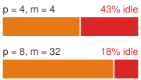{width="100%" fig-alt="Two proportional stacked bars comparing pipeline bubble tax: p8 m32 has about 18 percent idle time, while p16 m16 has about 48 percent idle time."}

*More stages require enough microbatches or the bubble dominates utilization.*
:::

The same bubble term becomes concrete in the following worked example, where an 8-stage pipeline and 32 microbatches still leave a measurable idle-time tax.

::: {.column-margin .margin-pointer}
↪ The bubble fraction across stage and microbatch counts, and its interleaved-schedule variant, are developed in @sec-appdx-comm-foundations-pipeline-arithmetic.
:::

::: {#nbk-distributed-training-cost-pipeline-bubble .callout-notebook title="The cost of the pipeline bubble"}

**Problem**: A large-model training run uses pipeline parallelism across `{python} PipelineBubble.pb_stages_str`. To hide the sequential delay, the batch is split into `{python} PipelineBubble.pb_microbatches_str` microbatches. What is the "bubble tax," the fraction of GPU cycles lost to idle waiting?

**Math**:
For balanced, noninterleaved synchronous stages under the one-forward-one-backward (1F1B) schedule developed below, with ideal transfers, the bubble fraction follows from the stage and microbatch counts. The time units below each combine one forward and one backward service interval; they are not individual optimizer steps.

1. **Wait time**: At the start and end of each batch, GPUs sit idle for $\PipelineparallelDegreePp-1$ steps.
2. **Productive time**: GPUs compute for $m$ steps.
3. **Bubble fraction**: $(\PipelineparallelDegreePp-1) / (\PipelineparallelDegreePp-1+m) =$ `{python} PipelineBubble.pb_p_minus_1_str` $/$ (`{python} PipelineBubble.pb_p_minus_1_str` $+$ `{python} PipelineBubble.pb_microbatches_str`) $\approx$ `{python} PipelineBubble.pb_bubble_pct_str`.

**Systems insight**: Pipeline parallelism is a *utilization-memory trade-off*. With this stage count and schedule fixed, reducing the bubble from `{python} PipelineBubble.pb_bubble_pct_round_str` to 5 percent requires more microbatches $(m)$. Their activation-memory cost depends on the schedule. GPipe retains activations across the microbatches, whereas the 1F1B schedule developed next releases them during the steady state. The modeled `{python} PipelineBubble.pb_bubble_pct_str` idle fraction also motivates interleaved pipelining\index{Interleaved pipeline scheduling!bubble reduction}\index{Pipeline parallelism!interleaved schedule}, which divides each device's work into smaller stages. Interleaving can reduce the original `{python} PipelineBubble.pb_bubble_pct_round_str` bubble, but additional transfers and memory requirements determine the net gain.

:::

GPipe[^fn-gpipe-pipeline-schedule] [@huang2019gpipe] introduced synchronous pipeline parallelism with microbatch accumulation, while PipeDream\index{PipeDream!asynchronous pipelining}\index{Weight stashing!PipeDream} [@narayanan2019] developed asynchronous approaches with weight stashing. Modern systems employ 1F1B (one-forward-one-backward)\index{1F1B scheduling!memory efficiency}[^fn-one-forward-backward] scheduling to reclaim activation memory earlier; that lower memory pressure makes larger microbatch counts practical, and the larger $m$ is what shrinks the bubble term.

[^fn-one-forward-backward]: **1F1B (one-forward-one-backward) scheduling**\index{1F1B scheduling!peak activation bound}: Unlike GPipe (which processes all forward passes before any backward passes), 1F1B interleaves them. For equal-sized microbatch activations and a non-interleaved schedule, peak retained activations per stage fall from $\mathcal{O}(m)$ under GPipe to at most $\mathcal{O}(\PipelineparallelDegreePp)$ under 1F1B, where $m$ is the microbatch count and $\PipelineparallelDegreePp$ the pipeline-stage count. Summed across stages, the corresponding bounds are $\mathcal{O}(m \PipelineparallelDegreePp)$ and $\mathcal{O}(\PipelineparallelDegreePp^2)$. This memory reclamation is what enables the massive microbatch counts $(m \gg \PipelineparallelDegreePp)$ required to keep the pipeline bubble small.

[^fn-gpipe-pipeline-schedule]: **GPipe**\index{GPipe!pipeline parallelism}: Published by Google in 2019, GPipe introduced synchronous microbatch pipelining that trained a 557M-parameter AmoebaNet across 8 Tensor Processing Units (TPUs)\index{TPU}\index{Tensor Processing Unit|see{TPU}} with near-linear scaling. GPipe exposed the central trade-off of the technique. The fill-and-drain idle time traced in @fig-pipeline-parallelism shrinks only as microbatch count grows, yet GPipe's schedule keeps every microbatch's activations live, a tension that drove systems design toward schedules that reduce activation residency and make larger microbatch counts feasible.

At the schedule level, 1F1B is a warmup, steady-state, and drain loop\index{1F1B scheduling!steady-state execution}. @Algo-one-forward-one-backward-pipeline makes the contract explicit: each stage alternates forward work for newer microbatches with backward work for older microbatches once gradients arrive, so activations can be released before the whole batch has completed.

```pseudocode
#| label: algo-one-forward-one-backward-pipeline
#| pdf-line-number: true
#| pdf-right-comment: false
#| html-comment-delimiter: "▷"
\begin{algorithm}
\caption{One-forward-one-backward pipeline schedule}
\begin{algorithmic}
\Require $\PipelineparallelDegreePp$ ordered pipeline stages; $m$ microbatches; activation links $j\to j{+}1$ and gradient links $j{+}1\to j$
\Ensure one optimizer update after gradients accumulate across all $m$ microbatches
\State split the global batch into $m$ microbatches; assign consecutive layers to the $\PipelineparallelDegreePp$ stages
\State warm-up: launch forwards from stage 0, forwarding each activation downstream as produced
\For{each stage in steady state}
    \State alternate one backward (oldest ready microbatch) with one forward (next microbatch)
    \State release a microbatch's activation as soon as that stage's backward consumes it
\EndFor
\State drain: finish the remaining backward passes in reverse stage order
\State apply the optimizer update once every stage has accumulated gradients for all $m$ microbatches
\end{algorithmic}
\end{algorithm}
```

The warm-up and drain phases still leave a bubble of roughly $(\PipelineparallelDegreePp-1)/(m+\PipelineparallelDegreePp-1)$, but interleaving backward work in the steady state frees each activation as soon as its backward consumes it, so peak activation memory grows with the stage count rather than the microbatch count. That is the gain over GPipe-style all-forward-then-all-backward scheduling\index{GPipe!bubble overhead}, and it lets the system raise $m$ until activation memory, recomputation, or the global-batch constraint becomes the next limit.

The activation handoff has shape $B_{\mu} \times S \times d$; its completion still constrains the next stage. The 1F1B schedule in @algo-one-forward-one-backward-pipeline reduces activation residency, but fill, drain, communication, and load imbalance leave idle time. Filling those remaining slots requires separating work that releases an upstream dependency from work that can wait.

Zero-bubble pipeline schedules\index{Zero-bubble pipeline scheduling!activation-weight split} further reduce idle time by overlapping weight gradient computation with activation gradient communication. In a standard backward pass, the GPU computes $\partial \mathcal{L} / \partial \mathbf{W}$ (weight gradient) and $\partial \mathcal{L} / \partial \mathbf{X}$ (activation gradient, sent to the previous stage) together. Zero-bubble scheduling splits these into separate kernels\index{Zero-bubble pipeline scheduling!B and W kernels}: a B kernel that computes only the activation gradient $\partial \mathcal{L} / \partial \mathbf{X}$ and sends it to the previous stage, and a W kernel that computes the weight gradient $\partial \mathcal{L} / \partial \mathbf{W}$ locally. The B kernel must execute promptly (it is on the critical path), but the W kernel can be scheduled opportunistically to fill bubbles.

The B/W split creates scheduling freedom\index{Zero-bubble pipeline scheduling!1F1B comparison}, but weight-gradient work must still finish before the corresponding optimizer update. In a balanced 4-stage pipeline with 8 microbatches, noninterleaved 1F1B still leaves $3/11 \approx 27\%$ of each stage's time idle, by the bubble fraction derived above. Reordering forward, activation-gradient, and weight-gradient work can reduce that gap. Approaching zero also depends on kernel durations, memory headroom, and optimizer synchronization; splitting backward alone does not guarantee it.

The trade-off is memory: zero-bubble scheduling requires storing intermediate activations for longer (because the W computation is deferred), increasing peak memory usage\index{Zero-bubble pipeline scheduling!memory overhead}. Some implementations address this by combining zero-bubble scheduling with activation checkpointing, selectively recomputing certain activations rather than storing them. The interaction between these techniques creates a three-way trade-off among pipeline bubble size, memory consumption, and recomputation overhead, an example of the displacement of overhead (principle \ref{pri-conservation-overhead}).

#### Tensor parallelism {#sec-distributed-training-systems-systems-tensor-parallelism-d76e}

Every pipeline schedule so far keeps whole layers on each device, which is why its traffic is confined to stage boundaries and tolerates moderate interconnect bandwidth. The same property sets its limit. A pipeline cannot help when a single layer's weights or activations exceed one device, and it cannot shorten the time one layer takes, because that layer still runs on one accelerator.

Tensor parallelism takes a fundamentally different approach: instead of assigning complete layers to devices, it splits the weight matrices within each layer. This operator-level parallelism (also called intra-layer parallelism)\index{Intra-layer parallelism!fine-grained distribution} enables finer-grained distribution but requires high-bandwidth interconnects for the frequent intra-layer communication it introduces.

```{python}
#| echo: false
class TensorParallelBandwidth:
    from mlsysim.core.units import GB, second
    from mlsysim.fmt import fmt_bandwidth, fmt_multiple

    nvlink_h100_gb_per_s_str = fmt_bandwidth(Hardware.Cloud.H100.nvlink.bandwidth, unit=GB / second, precision=0, commas=False)
    nvlink_h100_perdir_gb_per_s_str = fmt_bandwidth(Hardware.Cloud.H100.nvlink.bandwidth_per_direction, unit=GB / second, precision=0, commas=False)
    ib_ndr_gb_per_s_str = fmt_bandwidth(Systems.Fabrics.InfiniBand_NDR.bandwidth, unit=GB / second, precision=0, commas=False)
    _nvlink_ib_gap = (Hardware.Cloud.H100.nvlink.bandwidth_per_direction / Systems.Fabrics.InfiniBand_NDR.bandwidth).to_base_units().magnitude
    nvlink_ib_gap_mult_str = fmt_multiple(_nvlink_ib_gap, precision=0, commas=False)

    # Per-collective time for the GPT-3 shape at TP=8, single-sequence to
    # four-sequence micro-batches (2026-09-29: replaces hand-typed 0.1-0.5 ms,
    # 1-5 ms, and 170-860 ms ranges with values derived from the registry).
    from mlsysim.physics import calc_ring_allreduce_data_factor
    from mlsysim.fmt import check, fmt, fmt_range, fmt_time_range

    _model = Models.Language.GPT3
    _tp = 8  # scenario assumption: tensor parallelism within one 8-GPU node
    _mb_lo, _mb_hi = 1, 4  # scenario assumption: micro-batch range in sequences
    _payload_per_seq = _model.context_length * _model.hidden_dim * BYTES_FP16
    _per_gpu_bytes_per_seq = _payload_per_seq * calc_ring_allreduce_data_factor(_tp)
    _nvlink = Hardware.Cloud.H100.nvlink.bandwidth_per_direction
    _ib = Systems.Fabrics.InfiniBand_NDR.bandwidth
    _collectives_fwd = 2 * _model.layers  # two AllReduces per transformer block
    nvlink_ms_lo = (_mb_lo * _per_gpu_bytes_per_seq / _nvlink).to(ms)
    nvlink_ms_hi = (_mb_hi * _per_gpu_bytes_per_seq / _nvlink).to(ms)
    ib_ms_lo = (_mb_lo * _per_gpu_bytes_per_seq / _ib).to(ms)
    ib_ms_hi = (_mb_hi * _per_gpu_bytes_per_seq / _ib).to(ms)
    fwd_ib_ms_lo = ib_ms_lo * _collectives_fwd
    fwd_ib_ms_hi = ib_ms_hi * _collectives_fwd
    check(ib_ms_lo > nvlink_ms_hi, "Even the smallest IB collective should outlast the largest NVLink one")
    nvlink_ms_range_str = fmt_time_range(nvlink_ms_lo, nvlink_ms_hi, ms, precision=1)
    ib_ms_range_str = fmt_time_range(ib_ms_lo, ib_ms_hi, ms, precision=1)
    fwd_ib_ms_range_str = fmt_time_range(round(fwd_ib_ms_lo.magnitude, -1) * ms, round(fwd_ib_ms_hi.magnitude, -1) * ms, ms, precision=0, commas=True)
    layers_str = fmt(_model.layers, precision=0, commas=False)
    mb_range_str = fmt_range(_mb_lo, _mb_hi, precision=0)
```

::: {#dfn-distributed-training-tensor-parallelism .callout-definition title="Tensor parallelism"}

***Tensor parallelism***\index{Tensor parallelism!definition} partitions individual tensor operations across devices, commonly through column-parallel or row-parallel weight splits. Communication combines or redistributes the resulting tensor shards as required by the next operation. The Megatron-style forward-pass example below illustrates one such arrangement.

1.  **Significance**: The Megatron-LM arrangement developed below uses two AllReduce operations per transformer block in the forward pass, one after attention and one after the MLP, each reducing a 2-byte activation tensor of $B \times S \times d$ elements, where $B$ counts the sequences in flight through the layer. A ring AllReduce moves roughly $2(\TensorparallelDegreeTp-1)/\TensorparallelDegreeTp$ times that payload per GPU, and the exchange recurs in every one of the `{python} TensorParallelBandwidth.layers_str` blocks of the GPT-3 shape, with backward adding corresponding exchanges. Whether that traffic hides behind computation depends on the link that carries it, which the arithmetic after the mechanism quantifies. Computing model FLOPs utilization (MFU) requires the complete compute and exposed-communication time, not the bandwidth ratio alone.
2.  **Distinction**: Unlike pipeline parallelism, which communicates only at layer boundaries and transfers small activation slices, tensor parallelism synchronizes within every layer via AllReduce, making it sensitive to the per-operation latency of the interconnect and favoring a fast communication domain such as NVLink, which can extend beyond one node.
3.  **Common pitfall**: Extending tensor parallelism across nodes without checking the transfer budget can erase the compute saving. The reference NVLink specification is approximately `{python} TensorParallelBandwidth.nvlink_h100_gb_per_s_str` bidirectional, or `{python} TensorParallelBandwidth.nvlink_h100_perdir_gb_per_s_str` per direction; InfiniBand NDR provides `{python} TensorParallelBandwidth.ib_ndr_gb_per_s_str` per port, a `{python} TensorParallelBandwidth.nvlink_ib_gap_mult_str` per-direction gap. These specifications identify a placement risk. Whether the split helps depends on sustained bandwidth, operation size, compute saved, and overlap.

:::

Frequent intra-layer exchanges favor placing tensor-parallel groups within the fastest available communication domain. Pipeline stages communicate at coarser boundaries and can often span slower domains when their transfers fit the schedule. This difference motivates a hybrid that maps each exchange to a suitable fabric tier; it does not impose a universal node boundary for either strategy.

::: {.column-margin}
```{=latex}
\vspace*{-4mm}
```
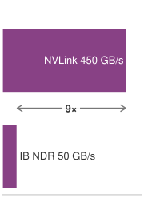{width="100%" fig-alt="Violet bandwidth ladder comparing per-direction NVLink bandwidth with NDR InfiniBand, illustrating the order-of-magnitude bandwidth drop from intra-node to inter-node links."}

*Frequent tensor-parallel exchanges favor fast links; pipeline transfers must fit their stage budget.*
:::

```{python}
#| echo: false
# ┌─────────────────────────────────────────────────────────────────────────────
# │ MEGATRON-LM 2019 RUN (LEGO)
# ├─────────────────────────────────────────────────────────────────────────────
# │ Context: the Megatron-LM footnote in the tensor-parallelism section.
# │ Goal: Pin the Shoeybi et al. (2019) run and its size ratios to the registry.
# │ Show: 8.3B parameters (24x BERT-Large, 5.5x GPT-2); 76% scaling on 512 GPUs.
# └─────────────────────────────────────────────────────────────────────────────
from mlsysim.fmt import check, fmt_count, fmt_multiple, fmt_params, fmt_percent

class MegatronLm2019Run:
    # ┌── 1. LOAD ─────────────────────────────────────────
    params = float(Literature.TrainingRuns.MegatronLm2019Params) * param
    gpus = int(Literature.TrainingRuns.MegatronLm2019Gpus)
    scaling_efficiency = float(Literature.TrainingRuns.MegatronLm2019ScalingEfficiency)
    bert_large = Models.Language.BERT_Large.parameters
    gpt2 = Models.Language.GPT2.parameters

    # ┌── 2. EXECUTE ──────────────────────────────────────
    bert_ratio = (params / bert_large).to_base_units().magnitude
    gpt2_ratio = (params / gpt2).to_base_units().magnitude

    # ┌── 3. GUARD ────────────────────────────────────────
    check(20 < bert_ratio < 30 and 5 < gpt2_ratio < 6, "Megatron 8.3B should be ~24x BERT-Large and ~5.5x GPT-2")

    # ┌── 4. OUTPUT ───────────────────────────────────────
    params_b_str = fmt_params(params, scale="B", precision=1, commas=False)
    gpus_str = fmt_count(gpus, commas=False, label="GPU")
    scaling_efficiency_str = fmt_percent(scaling_efficiency, precision=0, commas=False, style='prose')
    bert_ratio_mult_str = fmt_multiple(round(bert_ratio), precision=0, commas=False)
    gpt2_ratio_mult_str = fmt_multiple(gpt2_ratio, precision=1, commas=False)
```

Megatron-style tensor parallelism[^fn-megatron-tensor-parallelism] [@shoeybi2019megatron] partitions matrix multiplications by alternating column and row splits. In the two-GPU dataflow diagrammed in @fig-tensor-parallel-split, column-parallel splitting partitions the first weight matrix $\mathbf{A} = [\mathbf{A}_1 \mid \mathbf{A}_2]$ to produce local activation slices $\mathbf{Y}_1, \mathbf{Y}_2$ from replicated input $\mathbf{X}$; row-parallel splitting then partitions the second weight matrix $\mathbf{B} = [\mathbf{B}_1 ; \mathbf{B}_2]$ so that each GPU computes partial products $\mathbf{Z}_1, \mathbf{Z}_2$ locally, deferring cross-device communication to a single amber AllReduce that reconstructs output $\mathbf{Z}$.

[^fn-megatron-tensor-parallelism]: **Megatron-LM**\index{Megatron-LM!tensor parallelism}: NVIDIA's 2019 framework that trained an `{python} MegatronLm2019Run.params_b_str`-parameter transformer (`{python} MegatronLm2019Run.bert_ratio_mult_str` BERT-Large and `{python} MegatronLm2019Run.gpt2_ratio_mult_str` GPT-2 at the time) by strategically placing only two AllReduce operations per transformer block in the forward pass (one after attention, one after the multilayer perceptron (MLP)). This column-then-row partitioning eliminates inter-GPU communication between the two linear layers within each block, achieving `{python} MegatronLm2019Run.scaling_efficiency_str` scaling efficiency across `{python} MegatronLm2019Run.gpus_str` and establishing tensor parallelism patterns that remain influential in large-scale transformer training.

Column-parallel linear layers\index{Tensor parallelism!column-parallel linear layer} split weights along columns. For input $\mathbf{X}$ and weight matrix $\mathbf{W} = [\mathbf{W}_1 \mid \mathbf{W}_2]$ split across 2 GPUs:
$$\mathbf{Y} = \mathbf{X}\mathbf{W} = \mathbf{X}[\mathbf{W}_1 \mid \mathbf{W}_2] = [\mathbf{X}\mathbf{W}_1 \mid \mathbf{X}\mathbf{W}_2]$$
Each GPU computes its partition independently. The concatenation in the equation is logical: when the next operation is row-parallel, each output shard remains on its producing device and feeds the matching weight shard without an AllGather. The row-parallel half\index{Tensor parallelism!row-parallel linear layer} of the pattern splits weights along rows, $\mathbf{W} = \begin{bmatrix} \mathbf{W}_1 \\ \mathbf{W}_2 \end{bmatrix}$:
$$\mathbf{Y} = \mathbf{X}\mathbf{W} = \mathbf{X}_1 \mathbf{W}_1 + \mathbf{X}_2 \mathbf{W}_2$$
Each GPU computes a partial sum, and the system pays one AllReduce to combine the partial outputs.

::: {#fig-tensor-parallel-split fig-env="figure" fig-pos="htb" fig-cap="**Matrix partitioning under tensor parallelism**: A Megatron-LM layer pair on two GPUs, read left to right. The first layer (for example, QKV or the first feed-forward layer) is split by columns, $\mathbf{A} = [\mathbf{A}_1 \mid \mathbf{A}_2]$, so each GPU computes its own slice $\mathbf{Y}_i$ of the replicated input's output. The second layer is split by rows, $\mathbf{B} = [\mathbf{B}_1 ; \mathbf{B}_2]$, so each slice feeds its matching shard on the same GPU without communication. The only collective is the amber AllReduce that sums the partial outputs $\mathbf{Z}_1 + \mathbf{Z}_2$, leaving the full result on both GPUs." fig-alt="Flow diagram on two GPU lanes. A replicated input X fans out to column-shard boxes Y1 equals X A1 and Y2 equals X A2, each feeding a row-shard box Z1 equals Y1 B1 and Z2 equals Y2 B2 on the same lane, labeled stays local. Both partial sums enter one AllReduce box that outputs Z on both GPUs."}
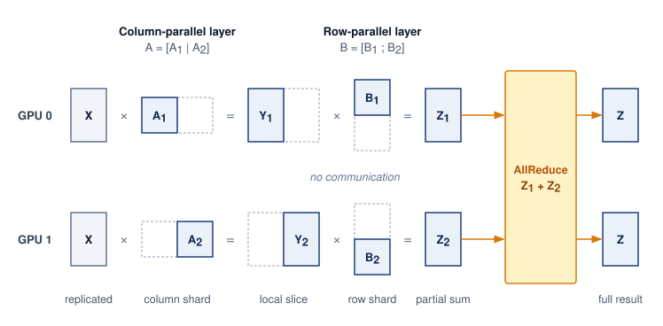

<!--
```{.tikz}
\scalebox{0.71}{%
\begin{tikzpicture}[
  line join=round, line cap=round,
  font=\small\sffamily,
  >=Stealth,
  header node/.style={
    font=\bfseries\normalsize\sffamily,
    text=BlueLine,
    align=center
  },
  subhead node/.style={
    font=\scriptsize\sffamily,
    text=TextBlack!70,
    align=center,
    text width=8.2cm
  },
  block/.style={
    rectangle,
    rounded corners=3pt,
    line width=0.65pt,
    align=center,
    inner sep=4pt,
    font=\small\sffamily
  },
  gpu0 block/.style={
    block,
    draw=BlueLine!70,
    fill=BlueFill!25,
    text=BlueLine
  },
  gpu1 block/.style={
    block,
    draw=GreenLine!70,
    fill=GreenFill!25,
    text=GreenD
  },
  neutral block/.style={
    block,
    draw=GrayLine!35,
    fill=gray!3,
    text=TextBlack
  },
  allreduce block/.style={
    block,
    draw=RedLine!70,
    fill=RedFill!25,
    text=RedLine!90!black
  },
  summary card/.style={
    block,
    draw=GrayLine!35,
    fill=gray!2,
    rounded corners=3.5pt,
    text=TextBlack,
    inner sep=6pt,
    text width=7.4cm,
    align=center
  }
]

  \def\lx{0}
  \def\rx{9.4}
  \def\midx{4.7}

  % -------------------------------------------------------------
  % LEFT PANEL: Column Parallel
  % -------------------------------------------------------------
  % Header & subhead
  \node[header node] at (\lx, 7.5) {Column-Parallel Linear Layer};
  \node[subhead node] at (\lx, 7.05) {Weight split along columns: $W = [W_1 \mid W_2]$\\(e.g., QKV projection, MLP 1)};

  % Input x
  \node[neutral block, text width=6.4cm, minimum height=0.85cm] (col_x) at (\lx, 5.8) {
    \textbf{Input Tensor $\mathbf{X}$}\\[1pt]
    \scriptsize\textcolor{TextBlack!70}{Replicated / broadcast to both GPUs \ $[B, S, d_{\text{model}}]$}
  };

  % GPU 0 & GPU 1 Weights
  \node[gpu0 block, minimum width=2.8cm, minimum height=1.35cm] (col_w1) at (\lx - 1.7, 3.9) {
    \textbf{Weight Slice $W_1$}\\[1pt]
    \scriptsize\textcolor{BlueLine}{\textbf{GPU 0}}\\[2pt]
    \tiny $[d_{\text{model}} \times d_{\text{ff}}/2]$
  };
  \node[gpu1 block, minimum width=2.8cm, minimum height=1.35cm] (col_w2) at (\lx + 1.7, 3.9) {
    \textbf{Weight Slice $W_2$}\\[1pt]
    \scriptsize\textcolor{GreenD}{\textbf{GPU 1}}\\[2pt]
    \tiny $[d_{\text{model}} \times d_{\text{ff}}/2]$
  };

  % GPU 0 & GPU 1 Independent Local Multiplies
  \node[gpu0 block, minimum width=2.8cm, minimum height=1.2cm] (col_y1) at (\lx - 1.7, 1.9) {
    \textbf{$\mathbf{Y}_1 = \mathbf{X} W_1$}\\[1.5pt]
    \scriptsize\textcolor{BlueLine}{Local output (GPU 0)}\\[1.5pt]
    \tiny $[B, S, d_{\text{ff}}/2]$
  };
  \node[gpu1 block, minimum width=2.8cm, minimum height=1.2cm] (col_y2) at (\lx + 1.7, 1.9) {
    \textbf{$\mathbf{Y}_2 = \mathbf{X} W_2$}\\[1.5pt]
    \scriptsize\textcolor{GreenD}{Local output (GPU 1)}\\[1.5pt]
    \tiny $[B, S, d_{\text{ff}}/2]$
  };

  % Concatenated output
  \node[neutral block, text width=6.8cm, minimum height=0.95cm] (col_out) at (\lx, -0.4) {
    \textbf{Concatenated Output $\mathbf{Y} = [\mathbf{Y}_1 \mid \mathbf{Y}_2]$}\\[1.5pt]
    \scriptsize\textcolor{TextBlack}{$[\mathbf{X}W_1 \mid \mathbf{X}W_2]$ directly feeds Row-Parallel layer}\\[1.5pt]
    \tiny\textcolor{TextBlack!70}{Size: $[B, S, d_{\text{ff}}]$ (zero inter-GPU communication required)}
  };

  % Summary card Left
  \node[summary card] (col_summary) at (\lx, -2.65) {
    \textbf{\footnotesize Forward:}\;
    \tikz[baseline=-0.6ex]\node[draw=GreenLine!60, fill=GreenFill!30, rounded corners=1.5pt, inner sep=2pt, font=\tiny\bfseries\sffamily, text=GreenD]{Zero communication};\\
    \scriptsize(no AllReduce required in forward pass)\\[3pt]
    \textbf{\footnotesize Backward:} AllReduce required to aggregate gradients $\nabla_{\mathbf{X}}$
  };

  % Connections Left
  \draw[->, line width=0.85pt, BlueLine, shorten >= 2.5pt, shorten <= 1.5pt] ($(col_x.south) + (-1.7, 0)$) -- (col_w1.north);
  \draw[->, line width=0.85pt, GreenLine, shorten >= 2.5pt, shorten <= 1.5pt] ($(col_x.south) + (1.7, 0)$) -- (col_w2.north);

  \draw[->, line width=0.85pt, BlueLine, shorten >= 2.5pt, shorten <= 1.5pt] (col_w1.south) -- (col_y1.north)
    node[midway, right=2pt, font=\tiny\bfseries\sffamily, fill=white, draw=BlueLine!30, rounded corners=1.5pt, inner sep=1.5pt, text=BlueLine] {MatMul};
  \draw[->, line width=0.85pt, GreenLine, shorten >= 2.5pt, shorten <= 1.5pt] (col_w2.south) -- (col_y2.north)
    node[midway, right=2pt, font=\tiny\bfseries\sffamily, fill=white, draw=GreenLine!30, rounded corners=1.5pt, inner sep=1.5pt, text=GreenD] {MatMul};

  \draw[->, line width=0.85pt, BlueLine, shorten >= 2.5pt, shorten <= 1.5pt] (col_y1.south) -- (col_y1.south |- col_out.north);
  \draw[->, line width=0.85pt, GreenLine, shorten >= 2.5pt, shorten <= 1.5pt] (col_y2.south) -- (col_y2.south |- col_out.north);

  % -------------------------------------------------------------
  % DIVIDER
  % -------------------------------------------------------------
  \draw[line width=0.6pt, GrayLine!30, dashed] (\midx, 7.7) -- (\midx, -3.2);

  % -------------------------------------------------------------
  % RIGHT PANEL: Row Parallel
  % -------------------------------------------------------------
  % Header & subhead
  \node[header node] at (\rx, 7.5) {Row-Parallel Linear Layer};
  \node[subhead node] at (\rx, 7.05) {Weight split along rows: $W = [W_1 ; W_2]$\\(e.g., Attention Out, MLP 2)};

  % Sharded Input
  \node[gpu0 block, minimum width=2.8cm, minimum height=0.85cm] (row_x1) at (\rx - 1.7, 5.8) {
    \textbf{Input Shard $\mathbf{X}_1$}\\[1pt]
    \scriptsize\textcolor{BlueLine}{\textbf{GPU 0}} \tiny$[B, S, d_{\text{ff}}/2]$
  };
  \node[gpu1 block, minimum width=2.8cm, minimum height=0.85cm] (row_x2) at (\rx + 1.7, 5.8) {
    \textbf{Input Shard $\mathbf{X}_2$}\\[1pt]
    \scriptsize\textcolor{GreenD}{\textbf{GPU 1}} \tiny$[B, S, d_{\text{ff}}/2]$
  };

  % GPU 0 & GPU 1 Weights
  \node[gpu0 block, minimum width=2.8cm, minimum height=1.35cm] (row_w1) at (\rx - 1.7, 3.9) {
    \textbf{Weight Slice $W_1$}\\[1pt]
    \scriptsize\textcolor{BlueLine}{\textbf{GPU 0}}\\[2pt]
    \tiny $[d_{\text{ff}}/2 \times d_{\text{model}}]$
  };
  \node[gpu1 block, minimum width=2.8cm, minimum height=1.35cm] (row_w2) at (\rx + 1.7, 3.9) {
    \textbf{Weight Slice $W_2$}\\[1pt]
    \scriptsize\textcolor{GreenD}{\textbf{GPU 1}}\\[2pt]
    \tiny $[d_{\text{ff}}/2 \times d_{\text{model}}]$
  };

  % GPU 0 & GPU 1 Partial Sum Multiplies
  \node[gpu0 block, minimum width=2.8cm, minimum height=1.2cm] (row_y1) at (\rx - 1.7, 1.9) {
    \textbf{$\mathbf{Y}_1 = \mathbf{X}_1 W_1$}\\[1.5pt]
    \scriptsize\textcolor{BlueLine}{Partial sum (GPU 0)}\\[1.5pt]
    \tiny $[B, S, d_{\text{model}}]$
  };
  \node[gpu1 block, minimum width=2.8cm, minimum height=1.2cm] (row_y2) at (\rx + 1.7, 1.9) {
    \textbf{$\mathbf{Y}_2 = \mathbf{X}_2 W_2$}\\[1.5pt]
    \scriptsize\textcolor{GreenD}{Partial sum (GPU 1)}\\[1.5pt]
    \tiny $[B, S, d_{\text{model}}]$
  };

  % AllReduce Reduction Node
  \node[allreduce block, text width=6.8cm, minimum height=0.85cm] (row_ar) at (\rx, 0.35) {
    \textbf{AllReduce (Sum):} $\mathbf{Y} = \mathbf{X}_1 W_1 + \mathbf{X}_2 W_2$\\[1.5pt]
    \scriptsize\textcolor{RedLine!90!black}{Synchronizes partial sums across all tensor ranks}
  };

  % Full Output
  \node[neutral block, text width=6.8cm, minimum height=0.85cm] (row_out) at (\rx, -1.0) {
    \textbf{Full Output $\mathbf{Y} = \mathbf{X}W$}\\[1.5pt]
    \scriptsize\textcolor{TextBlack!70}{Replicated identically across all GPUs \ $[B, S, d_{\text{model}}]$}
  };

  % Summary card Right
  \node[summary card] (row_summary) at (\rx, -2.65) {
    \textbf{\footnotesize Forward:}\;
    \tikz[baseline=-0.6ex]\node[draw=RedLine!60, fill=RedFill!30, rounded corners=1.5pt, inner sep=2pt, font=\tiny\bfseries\sffamily, text=RedLine!90!black]{One AllReduce collective};\\
    \scriptsize(sums partial products across tensor ranks)\\[3pt]
    \textbf{\footnotesize Backward:} Zero extra communication ($\nabla_{W_i} = \mathbf{X}_i^T \nabla_{\mathbf{Y}}$)
  };

  % Connections Right
  \draw[->, line width=0.85pt, BlueLine, shorten >= 2.5pt, shorten <= 1.5pt] (row_x1.south) -- (row_w1.north);
  \draw[->, line width=0.85pt, GreenLine, shorten >= 2.5pt, shorten <= 1.5pt] (row_x2.south) -- (row_w2.north);

  \draw[->, line width=0.85pt, BlueLine, shorten >= 2.5pt, shorten <= 1.5pt] (row_w1.south) -- (row_y1.north)
    node[midway, right=2pt, font=\tiny\bfseries\sffamily, fill=white, draw=BlueLine!30, rounded corners=1.5pt, inner sep=1.5pt, text=BlueLine] {MatMul};
  \draw[->, line width=0.85pt, GreenLine, shorten >= 2.5pt, shorten <= 1.5pt] (row_w2.south) -- (row_y2.north)
    node[midway, right=2pt, font=\tiny\bfseries\sffamily, fill=white, draw=GreenLine!30, rounded corners=1.5pt, inner sep=1.5pt, text=GreenD] {MatMul};

  \draw[->, line width=0.85pt, BlueLine, shorten >= 2.5pt, shorten <= 1.5pt] (row_y1.south) -- (row_y1.south |- row_ar.north);
  \draw[->, line width=0.85pt, GreenLine, shorten >= 2.5pt, shorten <= 1.5pt] (row_y2.south) -- (row_y2.south |- row_ar.north);

  \draw[->, line width=0.85pt, RedLine, shorten >= 2.5pt, shorten <= 1.5pt] (row_ar.south) -- (row_out.north);

\end{tikzpicture}%
}
```
-->

:::

The column-then-row sequence diagrammed in @fig-tensor-parallel-split embodies the governing architectural invariant\index{Megatron-LM!column-row pairing}: pairing a column-parallel layer directly with a row-parallel layer allows intermediate activations ($\mathbf{Y}_1, \mathbf{Y}_2$) to remain strictly local on each GPU, confining inter-device synchronization to a single collective at the end of the block. Megatron applies that pattern twice in each transformer block\index{Transformer!tensor-parallel block}. The QKV projection is column-parallel and its attention output projection is row-parallel, then the first feed-forward layer is column-parallel and the second feed-forward layer is row-parallel. The design places AllReduce operations strategically, one after attention and one after the feed-forward network, for two AllReduce operations per transformer layer. Communication volume per transformer layer depends on sequence length $S$, hidden dimension $d$, tensor-parallel degree $\TensorparallelDegreeTp$, and batch size $B$, the number of sequences in flight through the layer (the local batch, or the microbatch $B_{\mu}$ when the layer also sits in a pipeline). The activation payload is:
$$M_{\text{act}} = B \times S \times d \times \ElementStorageSize$$

```{python}
#| echo: false
# ┌─────────────────────────────────────────────────────────────────────────────
# │ TENSOR-PARALLEL LAYER TRAFFIC (LEGO)
# ├─────────────────────────────────────────────────────────────────────────────
# │ Context: Megatron column/row pairing traffic estimate.
# │ Goal: Size tensor-parallel AllReduce traffic for one named model shape.
# │ Show: GPT-3 (S=2048, d=12,288, 96 layers), B=4, FP16: ~201 MB payload,
# │       ~352 MB per AllReduce at t=8, ~67.6 GB forward, ~135 GB per step.
# │ How: 2026-09-28: previously mixed d_model=4096 with 96 layers, a shape no
# │      real model has; now one registry model supplies the full shape.
# └─────────────────────────────────────────────────────────────────────────────
from mlsysim.fmt import check, fmt, fmt_int, fmt_math, fmt_memory, fmt_time
from mlsysim.physics import calc_ring_allreduce_data_factor

class TensorParallelLayerTraffic:
    # ┌── 1. LOAD ─────────────────────────────────────────
    model = Models.Language.GPT3
    seq_len = model.context_length
    hidden_dim = model.hidden_dim
    layers = model.layers
    micro_batch = 4  # scenario assumption
    tp = 8  # scenario assumption: tensor parallelism within one 8-GPU node
    dtype_bytes = BYTES_FP16
    allreduces_per_layer = 2  # Megatron: one after attention, one after the MLP

    # ┌── 2. EXECUTE ──────────────────────────────────────
    payload = micro_batch * seq_len * hidden_dim * dtype_bytes
    ring_factor = calc_ring_allreduce_data_factor(tp)
    per_allreduce = payload * ring_factor
    forward = per_allreduce * allreduces_per_layer * layers
    per_step = forward * 2  # symmetric backward AllReduces
    # 2026-10-07: compare the per-microbatch traffic with the compute it serves,
    # reusing the per-layer forward time of the bandwidth feasibility napkin
    # (one sequence, TP=8, 50 percent of dense FP16 peak); backward ~2x forward.
    compute_mb = (BandwidthFeasibilityNapkin.compute_time * layers * micro_batch * 3).to(second)
    nvlink_mb = (per_step / Hardware.Cloud.H100.nvlink.bandwidth_per_direction).to(second)
    ib_mb = (per_step / Systems.Fabrics.InfiniBand_NDR.bandwidth).to(second)

    # ┌── 3. GUARD ────────────────────────────────────────
    check(abs(ring_factor - 1.75) < 1e-9, "Ring factor 2(t-1)/t at t=8 should be 1.75")
    check(60 * GB < forward < 75 * GB, "GPT-3 TP-8 forward traffic should be tens of GB")
    check(nvlink_mb < compute_mb < ib_mb, "TP traffic should fit under compute on NVLink but not on InfiniBand")

    # ┌── 4. OUTPUT ───────────────────────────────────────
    seq_len_str = fmt(seq_len, precision=0, commas=False)
    hidden_dim_str = fmt(hidden_dim, precision=0, commas=True)
    layers_str = fmt(layers, precision=0, commas=False)
    micro_batch_str = fmt(micro_batch, precision=0, commas=False)
    tp_str = fmt(tp, precision=0, commas=False)
    dtype_bytes_str = fmt(dtype_bytes.to(byte).magnitude, precision=0, commas=False)
    payload_mb_str = fmt_int(payload.to(MB).magnitude, commas=False)
    ring_factor_str = fmt(ring_factor, precision=2, commas=False)
    per_allreduce_mb_str = fmt_memory(round(per_allreduce.to(MB).magnitude) * MB, unit=MB, precision=0, commas=False)
    forward_gb_str = fmt_memory(forward, unit=GB, precision=1, commas=False)
    per_step_gb_str = fmt_memory(round(per_step.to(GB).magnitude) * GB, unit=GB, precision=0, commas=False)
    compute_mb_s_str = fmt_time(compute_mb, 'second', precision=1, commas=False)
    nvlink_mb_s_str = fmt_time(nvlink_mb, 'second', precision=1, commas=False)
    ib_mb_s_str = fmt_time(ib_mb, 'second', precision=1, commas=False)
```

A ring AllReduce transfers approximately $2(\TensorparallelDegreeTp-1)/\TensorparallelDegreeTp \times M_{\text{act}}$ bytes per GPU, which is close to $2M_{\text{act}}$ for large $\TensorparallelDegreeTp$. For the GPT-3 shape ($S=$ `{python} TensorParallelLayerTraffic.seq_len_str`, $d=$ `{python} TensorParallelLayerTraffic.hidden_dim_str`, `{python} TensorParallelLayerTraffic.layers_str` layers) with $B=$ `{python} TensorParallelLayerTraffic.micro_batch_str` and FP16, the activation payload is `{python} TensorParallelLayerTraffic.micro_batch_str` $\times$ `{python} TensorParallelLayerTraffic.seq_len_str` $\times$ `{python} TensorParallelLayerTraffic.hidden_dim_str` $\times$ `{python} TensorParallelLayerTraffic.dtype_bytes_str` $\approx$ `{python} TensorParallelLayerTraffic.payload_mb_str` MB.

At $\TensorparallelDegreeTp=$ `{python} TensorParallelLayerTraffic.tp_str` the ring factor is `{python} TensorParallelLayerTraffic.ring_factor_str`, giving roughly `{python} TensorParallelLayerTraffic.per_allreduce_mb_str` per AllReduce. With two AllReduces in each of the `{python} TensorParallelLayerTraffic.layers_str` layers, this totals approximately `{python} TensorParallelLayerTraffic.forward_gb_str` per forward microbatch. The symmetric backward exchanges bring the total to roughly `{python} TensorParallelLayerTraffic.per_step_gb_str` per forward/backward microbatch, before any recomputation. Set against the computation it serves, that volume is modest on the right link and prohibitive on the wrong one. At the per-layer compute rate of the earlier feasibility check, one such microbatch takes about `{python} TensorParallelLayerTraffic.compute_mb_s_str` of forward and backward computation per GPU; its tensor-parallel traffic takes about `{python} TensorParallelLayerTraffic.nvlink_mb_s_str` on NVLink but about `{python} TensorParallelLayerTraffic.ib_mb_s_str` on one InfiniBand port, longer than the computation. The number of microbatches per update and the available overlap then determine the required fabric service rate.

Tensor parallelism eventually reaches a workload-dependent limit because smaller operation shards leave less computation to cover communication. Per-GPU ring AllReduce bytes approach 2$\times$ the activation tensor size, while local matrix shapes and collective startup costs change with group size. The useful degree therefore depends on layer shape, microbatch size, and the fast communication domain. Llama 3 405B's TP=8 arrangement within NVLink-connected H100 nodes\index{Llama 3!tensor-parallel scaling} [@dubey2024llama] and node-local groups in other large training systems\index{MegaScale!large-scale training} [@jiang2024megascale] illustrate a placement choice, not a universal eight-device limit.

#### Sequence and context parallelism {#sec-distributed-training-systems-sequence-context-parallelism}

While tensor parallelism partitions weight matrices within linear layers, the memory footprint of large-scale transformer training is increasingly dominated by activations. As models scale their context length from thousands to hundreds of thousands or millions of tokens ($S \ge 32\text{k}\dots 1\text{M}+$), the activation footprint scales proportionally:
$$\ActivationMemoryActivations = \mathcal{O}(B \times S \times d \times \NumberOfLayers)$$
for linear, normalization, and residual layers, and $\mathcal{O}(B \times \NumberOfAttentionHeads \times S^2 \times \NumberOfLayers)$ for un-tiled attention (or $\mathcal{O}(B \times S \times d \times \NumberOfLayers)$ with tiled FlashAttention\index{FlashAttention!activation memory reduction}). At long contexts, activation memory dwarfs parameter storage, exposing the memory capacity gap (principle \ref{pri-memory-capacity-gap}). Two complementary paradigms address this constraint by sharding along the sequence axis: sequence parallelism (SP) within the tensor-parallel domain, and context parallelism (CP) across dedicated long-sequence process groups.

::: {#dfn-distributed-training-context-parallelism .callout-definition title="Sequence and context parallelism"}

***Sequence and context parallelism***\index{Sequence parallelism!definition}\index{Context parallelism!definition} partition the token sequence dimension to reduce per-device activation storage. Sequence parallelism (SP) retains sequence shards during operations such as LayerNorm and Dropout within a tensor-parallel group. Context parallelism (CP) partitions the sequence across a dedicated group and exchanges the information needed for attention, through mechanisms developed below that either pass key/value blocks around a ring or transpose between sequence and head partitions.

1.  **Significance**: Long contexts can exhaust activation memory even when sharded model state fits. The relevant limit depends on batch size, layer shapes, attention kernels, and checkpointing. Sequence parallelism divides the targeted activation storage by $\TensorparallelDegreeTp$ while preserving the ideal collective payload volume in the decomposition below. Context parallelism distributes sequence-dependent storage; linear context growth ($c \times S_{\text{single}}$, with $c$ denoting the context-parallel degree) is an ideal capacity estimate that still requires communication buffers and computation to fit the budget.
2.  **Distinction**: Tensor parallelism partitions weight matrices along hidden dimensions $d$, whereas context parallelism partitions the sequence axis $S$. Ring Attention exchanges key/value chunks between devices; Ulysses All-to-All transposes between sequence and head dimensions. Both require placement that can service their exchanges within the attention schedule.
3.  **Common pitfall**: Assuming context parallelism eliminates the quadratic attention compute complexity. CP distributes the attention computation across devices, reducing *per-device* memory and FLOPs by $1/c$, but the *aggregate* cluster FLOPs for dense self-attention still scale quadratically as $\mathcal{O}(S^2)$.

:::

##### Megatron sequence parallelism {#sec-distributed-training-megatron-sequence-parallelism-7a2e}

In the Megatron-style arrangement just derived, the column-then-row pairing in @fig-tensor-parallel-split splits the QKV projection and first MLP layer column-wise, and the attention output projection and second MLP layer row-wise. The surrounding LayerNorm, Dropout, and residual operations retain replicated activations across all $\TensorparallelDegreeTp$ devices. LayerNorm operates across a token's hidden features, while Dropout and residual addition operate element-wise; none requires another token's features. This token independence permits partitioning the otherwise replicated $B \times S \times d$ activation tensor along its sequence dimension.

Megatron Sequence Parallelism\index{Megatron-LM!sequence parallelism} [@korthikanti2023activation] eliminates this redundancy by sharding the sequence dimension across the $\TensorparallelDegreeTp$ ranks for all non-tensor-parallel operations. Instead of replicating activations, each GPU holds only a $B \times (S/\TensorparallelDegreeTp) \times d$ slice during LayerNorm and Dropout.

Crucially, this sharding incurs zero additional communication volume. In standard tensor parallelism, the row-parallel matrix multiplication is followed by an AllReduce to sum partial products across ranks. An AllReduce mathematically decomposes into a ReduceScatter followed by an AllGather\index{Sequence parallelism!AllReduce decomposition}:
$$\text{AllReduce}(\mathbf{X}) \equiv \text{AllGather}(\text{ReduceScatter}(\mathbf{X}))$$
Megatron-SP decouples this collective pair across the transformer block. Following the row-parallel linear layer, a ReduceScatter reduces partial sums while scattering the resulting activations along the sequence dimension, leaving each GPU with an $S/\TensorparallelDegreeTp$ token slice. LayerNorm, residual additions, and Dropout then execute on these local slices with zero cross-device communication. Immediately before the next column-parallel linear layer, an AllGather across the sequence dimension reassembles the complete $S$ tokens required for the weight-partitioned matrix multiplication.

In this ideal payload accounting, standard TP executes two AllReduces per transformer block ($2 \times 2(\TensorparallelDegreeTp-1)/\TensorparallelDegreeTp \times M_{\text{act}}$ bytes), while Megatron-SP executes two ReduceScatter and AllGather pairs ($2 \times [(\TensorparallelDegreeTp-1)/\TensorparallelDegreeTp + (\TensorparallelDegreeTp-1)/\TensorparallelDegreeTp] \times M_{\text{act}} = 2 \times 2(\TensorparallelDegreeTp-1)/\TensorparallelDegreeTp \times M_{\text{act}}$ bytes). The volumes match while the targeted activation storage falls by a factor of $\TensorparallelDegreeTp$. Equal bytes do not imply equal elapsed time: separating the collectives changes readiness, startup costs, and overlap opportunities.

##### Context parallelism with ring attention versus Ulysses {#sec-distributed-training-context-parallelism-ring-ulysses-8b1f}

Increasing sequence length $S$ can exhaust the remaining activation budget after sequence parallelism and checkpointing. Context parallelism of degree $c$ distributes the sequence across $c$ accelerators. Attention then needs exchanges across sequence partitions. Ring-based point-to-point transfers and all-to-all transpositions provide two ways to supply that information, and can also be combined hierarchically. The ring method relies on an online softmax, which keeps a running maximum and a running sum of the attention scores seen so far. Each arriving key/value tile can then be folded into the partial result, with the earlier contribution rescaled whenever the maximum changes, so no device ever stores the full attention matrix.

Ring Attention\index{Ring Attention!systolic point-to-point} [@liu2023ringAttention] organizes devices in a logical ring where each GPU holds a query chunk $\mathbf{Q}_i$ of length $S/c$ and an initial key/value chunk $(\mathbf{K}_i, \mathbf{V}_i)$. Computation proceeds in $c$ rounds along the ring. In each round, GPU $i$ computes block attention between its stationary $\mathbf{Q}_i$ and resident $(\mathbf{K}_j, \mathbf{V}_j)$ tiles using an online softmax accumulator, while asynchronously transmitting $(\mathbf{K}_j, \mathbf{V}_j)$ to ring neighbor $(i+1) \bmod c$ and receiving $(\mathbf{K}_{j-1}, \mathbf{V}_{j-1})$ from $(i-1) \bmod c$.

For one sequence with standard multi-head attention, let $n=S/c$ be the tokens per chunk, $d$ the total head width, $\ElementStorageSize$ the bytes per stored element, $\PeakRate\EfficiencyHw$ the sustained attention FLOP/s, and $\Bandwidth_{\text{link}}$ the one-way transfer rate. Computing both $\mathbf{Q}\mathbf{K}^T$ and the weighted-value product costs approximately $4n^2 d$ FLOPs, while sending $\mathbf{K}$ and $\mathbf{V}$ costs $2 n d\, \ElementStorageSize$ bytes. Ignoring startup, softmax, and overlap interference gives the necessary tile-size estimate:
$$\frac{4n^2 d}{\PeakRate\EfficiencyHw} \ge \frac{2 n d\, \ElementStorageSize}{\Bandwidth_{\text{link}}} \iff n \ge \frac{\ElementStorageSize \PeakRate\EfficiencyHw}{2\Bandwidth_{\text{link}}}$$
This compares computation time with transfer time; HBM bandwidth cannot substitute for $\PeakRate\EfficiencyHw$. It is an idealized overlap condition, not a guarantee.

```{python}
#| echo: false
# ┌─────────────────────────────────────────────────────────────────────────────
# │ RING ATTENTION TILE THRESHOLD (LEGO)
# ├─────────────────────────────────────────────────────────────────────────────
# │ Context: the Ring Attention overlap condition.
# │ Goal: Evaluate n >= s R eta / (2 B_link) for an H100 at half its dense FP16
# │       peak, over NVLink and over one NDR port (2026-10-07: the condition
# │       was stated but never evaluated).
# │ Show: about a thousand tokens per chunk on NVLink, about ten thousand on NDR.
# └─────────────────────────────────────────────────────────────────────────────
from mlsysim.fmt import check, fmt_count

class RingAttentionThreshold:
    # ┌── 1. LOAD ─────────────────────────────────────────
    elem_bytes = BYTES_FP16.to(byte).magnitude
    sustained = Hardware.Cloud.H100.compute.precision_flops['fp16_dense'] * 0.5  # scenario assumption: 50 percent of dense peak
    nvlink = Hardware.Cloud.H100.nvlink.bandwidth_per_direction
    ib = Systems.Fabrics.InfiniBand_NDR.bandwidth

    # ┌── 2. EXECUTE ──────────────────────────────────────
    n_nvlink = (elem_bytes * sustained / (2 * nvlink)).to(flop / byte).magnitude
    n_ib = (elem_bytes * sustained / (2 * ib)).to(flop / byte).magnitude

    # ┌── 3. GUARD ────────────────────────────────────────
    check(500 < n_nvlink < 2000 and n_ib > 5 * n_nvlink, "NVLink threshold should be ~1K tokens and NDR several times larger")

    # ┌── 4. OUTPUT ───────────────────────────────────────
    n_nvlink_str = fmt_count(round(n_nvlink, -2), commas=True)
    n_ib_str = fmt_count(round(n_ib, -2), commas=True)
```

For an H100 sustaining half its dense FP16 peak with 2-byte elements, the condition requires chunks of at least about `{python} RingAttentionThreshold.n_nvlink_str` tokens per device when KV tiles travel over NVLink, and about `{python} RingAttentionThreshold.n_ib_str` tokens when they cross one NDR InfiniBand port. A million-token context split across a few dozen devices clears both bounds, whereas splitting a 32K context across many nodes can leave each chunk too short to hide its transfers.

Grouped-query attention changes the transferred KV width, and causal masking changes the tile work; both require recomputing the two costs. In causal autoregressive attention, upper-triangular tiles are masked out ($j > i$). A naive ring execution leaves half the GPUs idle during later rounds; production implementations employ zigzag or striped token partitioning\index{Ring Attention!causal masking}\index{Striped token partitioning!causal attention}, which gives each device a mix of early and late tokens (for example, one chunk from the start of the sequence and one from the end), so every device holds a similar share of the unmasked causal tiles.

DeepSpeed Ulysses\index{DeepSpeed!Ulysses context parallelism}\index{Context parallelism!all-to-all transpose}\index{DeepSpeed Ulysses|see{DeepSpeed}} [@jacobs2023deepspeed] takes an alternative approach: rather than circulating tiles along a ring, it exploits the independence of attention heads. Each head attends over the whole sequence without reading any other head's scores, so the attention work can be split by heads instead of by tokens. Outside the attention core, activations are sharded along the sequence dimension ($S/c$ tokens, all $\NumberOfAttentionHeads$ attention heads). Before computing self-attention, an All-to-All collective transposes the tensor from sequence-partitioned `[S/c, h, d_head]` to head-partitioned `[S, h/c, d_head]`. Each GPU now holds the full sequence length $S$, but only a subset $\NumberOfAttentionHeads/c$ of attention heads. Each device computes standard local FlashAttention across the full sequence for its heads; each rank owns complete heads, while the kernel handles causal masking locally. A second All-to-All collective transposes the attention output back to `[S/c, h, d_head]`. Ulysses is conceptually clean and reuses single-GPU attention kernels, but requires that the head count be divisible by the context degree ($\NumberOfAttentionHeads \ge c$). Under Grouped Query Attention (GQA)\index{Grouped-query attention!KV cache reduction}, where the key-value head count $\NumberOfKeyvalueHeadsKv$ is smaller, a direct head-sharding implementation requires compatible divisibility and $c \le \NumberOfKeyvalueHeadsKv$. Replicating KV heads changes that limit and its communication budget.

A hierarchical configuration can combine head-sequence transposes within a fast domain and ring exchanges between domains. For an eight-device intra-node domain, a Ulysses group satisfies ($c_{\text{intra}} \le 8$), while a second degree ($c_{\text{inter}}$) determines the ring's inter-node partition. In this example, Ulysses partitions heads locally and Ring Attention circulates KV blocks across nodes\index{Ring Attention!inter-node scaling}. The arrangement is feasible only if head divisibility, peak memory, link service time, and the overlap condition all hold; hierarchy alone does not prevent fabric saturation.

### Expert parallelism (mixture of experts) {#sec-distributed-training-systems-systems-expert-parallelism-mixture-experts-bc45}

While tensor parallelism splits dense operations, expert parallelism\index{Expert parallelism!conditional computation} distributes model capacity that is used selectively. In an MoE\index{MoE!routing}\index{Mixture of experts|see{MoE}} architecture [@shazeer2017outrageously], a feed-forward layer contains $E$ "experts" (independent feed-forward networks). A gating network selects a small subset, often top-1 or top-2, for each token. Increasing expert count while holding expert shape and the number selected fixed increases stored parameters without proportionally increasing expert FLOPs per token; routing and communication still add work.

In a distributed setting, experts are partitioned across workers, with each rank hosting a disjoint subset of expert networks. @Fig-moe-all-to-all-routing traces this token routing cycle across four ranks: after top-$K$ gating selects destination experts, an All-to-All dispatch shuffles tokens across the fabric to the hosting ranks, expert FFNs compute locally, and a second All-to-All return routes the processed activations back to the originating ranks to form the gate-weighted sum. The backward pass repeats both exchanges in reverse order: output gradients travel to the ranks hosting the experts, and input gradients return to the ranks that own the tokens.

::: {#fig-moe-all-to-all-routing fig-env="figure" fig-pos="htb" fig-cap="**Mixture-of-experts (MoE) AllToAll routing**: Expert parallelism on four ranks, one expert per rank, read left to right. Each rank's gate picks the top-$K$ experts for its tokens; the first All-to-All dispatches every token to the rank that hosts its expert, the experts compute, and a second All-to-All returns the results so each rank can form the gate-weighted sum for its own tokens. In both exchanges every rank may send to every other rank, which is why the pattern stresses the fabric's bisection bandwidth." fig-alt="Five columns: four rank boxes labeled top-k gate, an amber dispatch box in which lines connect every input row to every output row, four blue expert boxes each on its own rank, a second amber All-to-All return box with the same crossing lines, and four rank boxes that combine their tokens."}
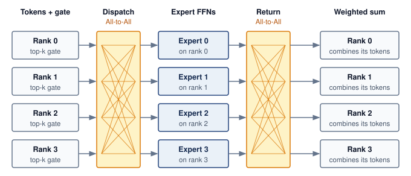{width=100%}

<!--
```{.tikz}
\scalebox{0.82}{%
\begin{tikzpicture}[line join=round, line cap=round, font=\small\sffamily]

  % Styles
  \tikzset{
    step_banner/.style={
      rectangle, rounded corners=2.5pt, line width=0.55pt, inner sep=3pt,
      font=\scriptsize\bfseries\sffamily, align=center
    },
    card/.style={
      rectangle, rounded corners=3pt, line width=0.65pt, align=center, inner sep=3.5pt
    },
    rank0/.style={card, draw=BlueLine!70, fill=BlueFill!25, text=TextBlack},
    rank1/.style={card, draw=GreenLine!70, fill=GreenFill!25, text=TextBlack},
    rank2/.style={card, draw=OrangeLine!70, fill=OrangeFill!25, text=TextBlack},
    rank3/.style={card, draw=VioletLine!70, fill=VioletFill!35, text=TextBlack},
    gate/.style={card, draw=OrangeLine!70, fill=OrangeFill!20, text=TextBlack},
    alltoall_dispatch/.style={
      rectangle, rounded corners=3.5pt, line width=0.8pt,
      draw=RedLine!70, fill=RedFill!25, text=TextBlack, align=center, inner sep=4pt
    },
    alltoall_combine/.style={
      rectangle, rounded corners=3.5pt, line width=0.8pt,
      draw=GreenLine!70, fill=GreenFill!25, text=TextBlack, align=center, inner sep=4pt
    },
    arrow_fwd/.style={->, >=Stealth, line width=0.75pt, shorten >= 2.5pt, shorten <= 1.5pt},
    arrow_dispatch/.style={->, >=Stealth, line width=0.85pt, RedLine!90!black, dashed, shorten >= 2.5pt, shorten <= 1.5pt},
    arrow_combine/.style={->, >=Stealth, line width=0.85pt, GreenD, shorten >= 2.5pt, shorten <= 1.5pt}
  }

  % -------------------------------------------------------------
  % 4 PARALLEL PIPELINE ROWS (Ranks 0 to 3)
  % -------------------------------------------------------------
  \def\wcard{2.1cm}
  \def\hcard{0.85cm}

  % Row 0 (y = 3.6)
  \node[rank0, minimum width=\wcard, minimum height=\hcard] (r0) at (0, 3.6) {
    \textbf{\scriptsize Rank 0}\\[-1pt]
    \scriptsize Tokens: $T_1$--$T_4$\\[-1pt]
    \tiny\color{black!60}Local batch
  };
  \node[gate, minimum width=\wcard, minimum height=\hcard] (g0) at (2.4, 3.6) {
    \textbf{\scriptsize Router / Gate}\\[-1pt]
    \scriptsize\color{OrangeLine!90!black}Top-$K$ Softmax\\[-1pt]
    \tiny Assign Experts
  };
  \node[rank0, minimum width=2.3cm, minimum height=\hcard] (e0) at (8.5, 3.6) {
    \textbf{\scriptsize Expert 0 (FFN)}\\[-1pt]
    \scriptsize Cap: $C_{\text{cap}} \cdot \frac{K N}{E}$\\[-1pt]
    \tiny Host: GPU Rank 0
  };
  \node[rank0, minimum width=\wcard, minimum height=\hcard] (o0) at (13.4, 3.6) {
    \textbf{\scriptsize Output Rank 0}\\[-1pt]
    \scriptsize Weighted Sum\\[-1pt]
    \tiny $\sum g_i \cdot \text{Exp}_i(\mathbf{x})$
  };

  % Row 1 (y = 2.4)
  \node[rank1, minimum width=\wcard, minimum height=\hcard] (r1) at (0, 2.4) {
    \textbf{\scriptsize Rank 1}\\[-1pt]
    \scriptsize Tokens: $T_5$--$T_8$\\[-1pt]
    \tiny\color{black!60}Local batch
  };
  \node[gate, minimum width=\wcard, minimum height=\hcard] (g1) at (2.4, 2.4) {
    \textbf{\scriptsize Router / Gate}\\[-1pt]
    \scriptsize\color{OrangeLine!90!black}Top-$K$ Softmax\\[-1pt]
    \tiny Assign Experts
  };
  \node[rank1, minimum width=2.3cm, minimum height=\hcard] (e1) at (8.5, 2.4) {
    \textbf{\scriptsize Expert 1 (FFN)}\\[-1pt]
    \scriptsize Cap: $C_{\text{cap}} \cdot \frac{K N}{E}$\\[-1pt]
    \tiny Host: GPU Rank 1
  };
  \node[rank1, minimum width=\wcard, minimum height=\hcard] (o1) at (13.4, 2.4) {
    \textbf{\scriptsize Output Rank 1}\\[-1pt]
    \scriptsize Weighted Sum\\[-1pt]
    \tiny $\sum g_i \cdot \text{Exp}_i(\mathbf{x})$
  };

  % Row 2 (y = 1.2)
  \node[rank2, minimum width=\wcard, minimum height=\hcard] (r2) at (0, 1.2) {
    \textbf{\scriptsize Rank 2}\\[-1pt]
    \scriptsize Tokens: $T_9$--$T_{12}$\\[-1pt]
    \tiny\color{black!60}Local batch
  };
  \node[gate, minimum width=\wcard, minimum height=\hcard] (g2) at (2.4, 1.2) {
    \textbf{\scriptsize Router / Gate}\\[-1pt]
    \scriptsize\color{OrangeLine!90!black}Top-$K$ Softmax\\[-1pt]
    \tiny Assign Experts
  };
  \node[rank2, minimum width=2.3cm, minimum height=\hcard] (e2) at (8.5, 1.2) {
    \textbf{\scriptsize Expert 2 (FFN)}\\[-1pt]
    \scriptsize Cap: $C_{\text{cap}} \cdot \frac{K N}{E}$\\[-1pt]
    \tiny Host: GPU Rank 2
  };
  \node[rank2, minimum width=\wcard, minimum height=\hcard] (o2) at (13.4, 1.2) {
    \textbf{\scriptsize Output Rank 2}\\[-1pt]
    \scriptsize Weighted Sum\\[-1pt]
    \tiny $\sum g_i \cdot \text{Exp}_i(\mathbf{x})$
  };

  % Row 3 (y = 0.0)
  \node[rank3, minimum width=\wcard, minimum height=\hcard] (r3) at (0, 0.0) {
    \textbf{\scriptsize Rank 3}\\[-1pt]
    \scriptsize Tokens: $T_{13}$--$T_{16}$\\[-1pt]
    \tiny\color{black!60}Local batch
  };
  \node[gate, minimum width=\wcard, minimum height=\hcard] (g3) at (2.4, 0.0) {
    \textbf{\scriptsize Router / Gate}\\[-1pt]
    \scriptsize\color{OrangeLine!90!black}Top-$K$ Softmax\\[-1pt]
    \tiny Assign Experts
  };
  \node[rank3, minimum width=2.3cm, minimum height=\hcard] (e3) at (8.5, 0.0) {
    \textbf{\scriptsize Expert 3 (FFN)}\\[-1pt]
    \scriptsize Cap: $C_{\text{cap}} \cdot \frac{K N}{E}$\\[-1pt]
    \tiny Host: GPU Rank 3
  };
  \node[rank3, minimum width=\wcard, minimum height=\hcard] (o3) at (13.4, 0.0) {
    \textbf{\scriptsize Output Rank 3}\\[-1pt]
    \scriptsize Weighted Sum\\[-1pt]
    \tiny $\sum g_i \cdot \text{Exp}_i(\mathbf{x})$
  };

  % -------------------------------------------------------------
  % ALLTOALL CONDUITS (TALL PILLARS)
  % -------------------------------------------------------------
  \node[alltoall_dispatch, minimum width=1.8cm, minimum height=4.4cm] (dispatch) at (4.9, 1.8) {
    \textbf{\footnotesize All-to-All}\\[2pt]
    \textbf{\footnotesize Dispatch}\\[5pt]
    \scriptsize Tokens routed\\[1pt]
    \scriptsize to designated\\[1pt]
    \scriptsize expert hosts
  };

  \node[alltoall_combine, minimum width=1.8cm, minimum height=4.4cm] (combine) at (11.0, 1.8) {
    \textbf{\footnotesize All-to-All}\\[2pt]
    \textbf{\footnotesize Combine}\\[5pt]
    \scriptsize Outputs routed\\[1pt]
    \scriptsize back to source\\[1pt]
    \scriptsize GPU ranks
  };

  % -------------------------------------------------------------
  % TOP STEP BANNERS
  % -------------------------------------------------------------
  \node[step_banner, draw=OrangeLine!70, fill=OrangeFill!30, text=OrangeLine!90!black]
    (s1) at (1.2, 5.0) {Step 1 $\cdot$ Gating \& Routing};
  \node[step_banner, draw=RedLine!70, fill=RedFill!30, text=RedLine!90!black]
    (s2) at (4.9, 5.0) {Step 2 $\cdot$ Dispatch};
  \node[step_banner, draw=BlueLine!70, fill=BlueFill!30, text=BlueLine]
    (s3) at (8.5, 5.0) {Step 3 $\cdot$ Expert FFNs};
  \node[step_banner, draw=GreenLine!70, fill=GreenFill!30, text=GreenD]
    (s4) at (12.2, 5.0) {Step 4 $\cdot$ Combine \& Output};

  \draw[->, >=Stealth, line width=0.75pt, GrayLine, shorten >= 2pt, shorten <= 2pt] (s1.east) -- (s2.west);
  \draw[->, >=Stealth, line width=0.75pt, GrayLine, shorten >= 2pt, shorten <= 2pt] (s2.east) -- (s3.west);
  \draw[->, >=Stealth, line width=0.75pt, GrayLine, shorten >= 2pt, shorten <= 2pt] (s3.east) -- (s4.west);

  % Connections: Ranks -> Gate
  \foreach \i in {0,...,3} {
    \draw[arrow_fwd, GrayLine] (r\i.east) -- (g\i.west);
  }

  % Connections: Gate -> Dispatch (red dashed)
  \foreach \i in {0,...,3} {
    \draw[arrow_dispatch] (g\i.east) -- (g\i.east -| dispatch.west);
  }

  % Connections: Dispatch -> Experts (red dashed)
  \foreach \i in {0,...,3} {
    \draw[arrow_dispatch] (e\i.west -| dispatch.east) -- (e\i.west);
  }

  % Connections: Experts -> Combine (green solid)
  \foreach \i in {0,...,3} {
    \draw[arrow_combine] (e\i.east) -- (e\i.east -| combine.west);
  }

  % Connections: Combine -> Output (green solid)
  \foreach \i in {0,...,3} {
    \draw[arrow_combine] (o\i.west -| combine.east) -- (o\i.west);
  }

  % -------------------------------------------------------------
  % INTEGRATED ARCHITECTURAL LEGEND
  % -------------------------------------------------------------
  \node[
    draw=GrayLine!35, fill=gray!3, line width=0.6pt,
    rounded corners=3.5pt,
    anchor=north, minimum width=14.5cm, inner sep=6pt
  ] at (6.7, -0.9) {
    \begin{minipage}{14.1cm}\footnotesize\sffamily
      \begin{tabular}{@{}p{6.8cm}@{\hspace{0.4cm}}p{6.9cm}@{}}
        \textbf{All-to-All Communication Overhead} & \textbf{Capacity Factor \& Token Load Balancing} \\[2pt]
        \tikz[baseline=-2pt]\fill[RedFill!30,draw=RedLine,rounded corners=1.5pt,line width=0.5pt] (0,-0.12) rectangle (0.32,0.12);
        \textbf{Two-Phase Collective:} Dispatch + Combine &
        $\bullet$ \textbf{Capacity Factor ($C_{\text{cap}}$):} $C \in [1.0, 1.5]$ sets buffer $C_{\text{cap}} \cdot \frac{K N}{E}$ \\[7pt]
        \tikz[baseline=-2pt]\fill[GreenFill!30,draw=GreenLine,rounded corners=1.5pt,line width=0.5pt] (0,-0.12) rectangle (0.32,0.12);
        \textbf{Volume per Layer:} $4 B S d_{\text{model}}$ bytes (fwd + bwd) &
        $\bullet$ \textbf{Overflow Handling:} Dropped tokens bypass FFN via residual \\[3pt]
        \tikz[baseline=-2pt]\fill[BlueFill!30,draw=BlueLine,rounded corners=1.5pt,line width=0.5pt] (0,-0.12) rectangle (0.32,0.12);
        \textbf{Fabric Demand:} High bisection bandwidth &
        $\bullet$ \textbf{Load Balancing:} Auxiliary loss $\mathcal{L}_{\text{balance}}$ penalizes router skew
      \end{tabular}
    \end{minipage}
  };

\end{tikzpicture}%
}
```
-->

:::

The primary advantage is decoupling model size from per-token compute, which lets parameter count grow within feasible hardware budgets. The constraint is the All-to-All\index{All-to-All!expert parallelism} communication, which is bandwidth-intensive and sensitive to load imbalance.

::: {#dfn-distributed-training-expert-parallelism .callout-definition title="Expert parallelism"}

***Expert parallelism***\index{Expert parallelism!definition} is the distribution strategy for mixture-of-experts models that places different experts on different devices and routes each token's activations to the devices hosting its selected experts through All-to-All collectives, scaling total parameter count across the cluster without scaling the compute each token consumes.

1.  **Significance**: It decouples model capacity from compute budget. For illustration, a trillion-parameter MoE model may activate on the order of 10B parameters per token, so per-token FLOPs remain near those of a 10B dense model while capacity grows roughly 100$\times$. The price is communication structure: every MoE layer requires two All-to-All shuffles per pass (dispatch and combine) whose volume scales with tokens moved times hidden dimension, stressing the cluster's bisection bandwidth rather than any single link.
2.  **Distinction**: Unlike tensor parallelism, which splits dense operations so that every device computes a fraction of every token, expert parallelism is conditional computation: each device computes only the tokens routed to its experts, making both the communication pattern and the load distribution data-dependent rather than fixed by the architecture.
3.  **Common pitfall**: A frequent misconception is that experts share work evenly. A hot expert receiving, for example, 3--5$\times$ its uniform share can overflow its device's activation buffer while sibling devices idle. Capacity limits and routing penalties are possible responses; a design that retains every assignment must instead accommodate the resulting memory and scheduling demand.

:::

```{python}
#| echo: false
# ┌─────────────────────────────────────────────────────────────────────────────
# │ MOE ALL-TO-ALL TRAFFIC (LEGO)
# ├─────────────────────────────────────────────────────────────────────────────
# │ Context: expert-parallelism All-to-All paragraph.
# │ Goal: Size the dispatch and combine payload of one MoE layer (2026-09-29:
# │       replaces the hand-typed 67 MB and 134 MB).
# │ Show: B=4, S=2048, d_model=4096, FP16: ~67 MB each way, ~134 MB per block.
# │ How: tokens x d_model x bytes; combine mirrors dispatch.
# └─────────────────────────────────────────────────────────────────────────────
from mlsysim.fmt import check, fmt, fmt_memory

class MoEAllToAllTraffic:
    # ┌── 1. LOAD ─────────────────────────────────────────
    experts = 64  # scenario assumption: one expert per GPU on 64 GPUs
    batch = 4  # scenario assumption: sequences per routing group
    seq_len = 2048  # scenario assumption
    hidden_dim = 4096  # scenario assumption: a mid-size MoE hidden width
    switch_max_experts = 2048  # Fedus et al. (2022): largest Switch Transformer expert count
    dtype_bytes = BYTES_FP16

    # ┌── 2. EXECUTE ──────────────────────────────────────
    dispatch = batch * seq_len * hidden_dim * dtype_bytes
    per_block = 2 * dispatch  # dispatch plus combine

    # ┌── 3. GUARD ────────────────────────────────────────
    check(60 * MB < dispatch < 70 * MB, "Dispatch payload should be about 67 MB")

    # ┌── 4. OUTPUT ───────────────────────────────────────
    experts_str = fmt(experts, precision=0, commas=False)
    batch_str = fmt(batch, precision=0, commas=False)
    seq_len_str = fmt(seq_len, precision=0, commas=False)
    hidden_dim_str = fmt(hidden_dim, precision=0, commas=False)
    dispatch_mb_str = fmt_memory(round(dispatch.to(MB).magnitude) * MB, unit=MB, precision=0, commas=False)
    per_block_mb_str = fmt_memory(round(per_block.to(MB).magnitude) * MB, unit=MB, precision=0, commas=False)
    switch_max_experts_str = fmt(switch_max_experts, precision=0, commas=True)
```

All-to-All dispatch routes token activations to their assigned experts. Consider $E=$ `{python} MoEAllToAllTraffic.experts_str` experts across `{python} MoEAllToAllTraffic.experts_str` GPUs, processing a routing-group batch of $B=$ `{python} MoEAllToAllTraffic.batch_str` sequences of length $S=$ `{python} MoEAllToAllTraffic.seq_len_str` and hidden dimension $d=$ `{python} MoEAllToAllTraffic.hidden_dim_str`. Under top-1 routing, $B \times S$ tokens each contribute one activation vector. At FP16, the logical dispatch payload is $B \cdot S \cdot d \cdot 2$ bytes, approximately `{python} MoEAllToAllTraffic.dispatch_mb_str`; returning expert outputs doubles the forward payload to about `{python} MoEAllToAllTraffic.per_block_mb_str` per block. Local destinations reduce bytes crossing the network, multiple selected experts increase routes, and backward adds gradient transfers. The resulting service time depends on placement and load balance, including in Switch Transformer\index{Switch Transformer!expert scale} [@fedus2022switch] (up to `{python} MoEAllToAllTraffic.switch_max_experts_str` experts) and GShard\index{GShard!expert parallelism} [@lepikhin2021gshard].

Uniform routing is a useful capacity baseline, not a guarantee. An expert receiving several times its uniform share, the hot expert of the definition above, needs correspondingly more token processing and activation storage. The actual skew depends on the learned router and batch. A hot expert can exhaust its buffer or delay the step while other experts remain underused, coupling memory feasibility to load balance.

One response bounds expert workload with a capacity factor\index{Capacity factor!mixture of experts} $C_{\text{cap}}$. For top-1 routing, a capacity of roughly $C_{\text{cap}} \cdot (B \times S)/E$ token assignments per expert provides headroom above uniform load. A dropping implementation sends excess tokens past that expert through the residual connection; implementations that retain every assignment instead need memory and scheduling to accommodate the imbalance. An auxiliary load balancing loss\index{Auxiliary load balancing loss!router skew} can encourage less concentrated routing. Models using more than one expert per token, such as Mixtral 8x7B with top-2 routing\index{Mixtral 8x7B!top-2 routing}, require a capacity budget that counts all selected assignments rather than reusing the top-1 denominator unchanged.

Sparse routing gives MoE layers a coordination problem much like the sparse embedding exchanges of Archetype B (DLRM at Scale)\index{Archetype B!DLRM scaling} in @sec-distributed-training-systems-systems-parameter-servers-embedding-sharding-8821. In both, which device a token's data must reach depends on the data itself, so load balance cannot be fixed in advance. MoE language models nonetheless remain Archetype A (GPT-4/Llama-3) workloads, because their dense layers still carry the tensor, pipeline, and data-parallel traffic developed above.

### Pipeline bubble versus bandwidth dilemma {#sec-distributed-training-systems-systems-model-parallelism-tradeoffs}

Model parallelism breaks the memory wall by choosing where to partition computation. Layer splits introduce pipeline bubbles, tensor splits require frequent collective reductions, and expert splits introduce All-to-All routing. The engineering challenge is balancing the idle time and communication created by the chosen partition.

Model parallelism offers three principal advantages. Memory scaling enables training of models that exceed single-device capacity: with 8-way tensor parallelism, the FP16 weight slice of a `{python} FrontierTrainingContext.frontier_params_b_str` model fits within A100 HBM before optimizer state and activation budgets are counted. Splitting the model also frees per-device memory for larger microbatches, since each GPU holds a smaller parameter slice. The approach maps naturally to the physical structure of transformers, where attention heads split via tensor parallelism and layers split via pipeline parallelism.

The advantages come at the cost of three fundamental limitations. Pipeline bubbles idle every stage for the fill and drain slots that the bubble fraction counts; holding that loss under 10 percent requires $m > 9(\PipelineparallelDegreePp-1)$ microbatches, at an activation-memory cost set by the schedule. Communication intensity in tensor parallelism is equally constraining. Two AllReduce operations per layer sit on the critical path, and for the GPT-3 shape at $\TensorparallelDegreeTp=8$ one microbatch's tensor-parallel traffic took about `{python} TensorParallelLayerTraffic.ib_mb_s_str` on one InfiniBand port against about `{python} TensorParallelLayerTraffic.compute_mb_s_str` of computation. That cost is why tensor parallelism is typically confined to a single fast domain such as an 8-GPU NVLink node. Implementation complexity rounds out the trade-off, requiring invasive changes to the model definition (replacing standard linear layers with column-parallel and row-parallel variants) unlike data parallelism, which wraps the model externally without modifying internals.

## Hybrid Parallelism {#sec-distributed-training-systems-systems-hybrid-parallelism-12a0}

The 175B running example has now exhausted each family on its own. Data parallelism with ZeRO-3 makes the state fit, but it regathers every layer's parameters across the data-parallel fabric on every step. On the reference cluster that regather is the `{python} Zero3GatherCost.traffic_tb_str` per worker per step priced in @sec-distributed-training-systems-systems-model-parallelism-7437, roughly `{python} Zero3GatherCost.transfer_s_str` on one NDR InfiniBand port against a compute window of about `{python} Zero3GatherCost.t_compute_s_str`, so communication would take about `{python} Zero3GatherCost.ratio_mult_str` as long as the computation it serves. Tensor parallelism confined to one 8-GPU node, meanwhile, still leaves several hundred gigabytes of training state per device. The preceding strategies address different constraints and need not be used in isolation. @Sec-distributed-training-systems-systems-data-parallelism-6132 established how replication and state sharding distribute examples and storage; @sec-distributed-training-systems-systems-model-parallelism-7437 showed how partitioned operations and pipeline stages distribute computation. Hybrid design chooses the dimensions needed to satisfy memory, communication, and global-batch constraints together.

**Hybrid parallelism**\index{Hybrid parallelism!definition} applies both families orthogonally: model parallelism splits the architecture to fit available memory, while data parallelism scales throughput across multiple model replicas. Training a `{python} FrontierTrainingContext.frontier_params_b_str` parameter language model on a dataset of `{python} FrontierTrainingContext.training_tokens_str` tokens demonstrates this approach in practice. The neural network layers distribute across multiple GPUs through model parallelism, while data parallelism enables different GPU groups to process separate batches. This dual strategy addresses both memory constraints from model size and computational demands from dataset scale simultaneously, and it is precisely this combination that defines Archetype A training at large-model scale.

::: {#lhs-distributed-training-archetype-gpt-4-llama-3-physics-3d-parallelism .callout-lighthouse title="Archetype A (GPT-4/Llama-3): Physics of 3D parallelism"}

Archetype A (GPT-4/Llama-3) illustrates the motivation for hybrid parallelism. Parameter count $(P)$ must first be converted to a complete memory budget before comparison with device capacity $(C_{\text{mem,device}})$, while dataset size $(D)$ and the deadline determine the throughput target. Tensor parallelism partitions layer computations within a suitable communication domain; pipeline parallelism assigns consecutive layers to stages; and data parallelism distributes examples from $D$ across replicas. A design combines the dimensions that address its constraints; efficient execution does not require all three in every case.

:::

To see why the combination matters, consider three parallelism configurations for training the `{python} FrontierTrainingContext.frontier_params_b_str` model on a `{python} DenseLLMReferenceFacts.cluster_gpus_str`-GPU cluster organized as `{python} DenseLLMReferenceFacts.cluster_nodes_str` of `{python} DenseLLMReferenceFacts.gpus_per_node_str` each. The progression from pure data parallelism through tensor and pipeline parallelism makes the efficiency gain concrete.

```{python}
#| echo: false
# ┌─────────────────────────────────────────────────────────────────────────────
# │ HYBRID CONFIGURATION MEMORY FEASIBILITY (LEGO)
# ├─────────────────────────────────────────────────────────────────────────────
# │ Context: configurations B and C in
# │          @sec-distributed-training-systems-systems-hybrid-parallelism-12a0.
# │ Goal: State whether each communication-comparison layout fits memory.
# │ Show: ~350 GB/GPU under TP-8 alone; ~87.5 GB/GPU under TP-8 x PP-4.
# │ How: 16 B/param mixed-precision Adam state divided by the model-partition
# │      product (2026-09-28: added; the comparison previously declared winners
# │      without checking feasibility).
# └─────────────────────────────────────────────────────────────────────────────
from mlsysim.fmt import check, fmt, fmt_math, fmt_memory, fmt_memory_capacity, fmt_percent, fmt_time
from mlsysim.physics import memory_from_params

class HybridConfigFeasibility:
    # ┌── 1. LOAD ─────────────────────────────────────────
    params = Models.Language.GPT3.parameters
    training_bytes_per_param = ReferenceStats.MixedPrecisionAdam.TrainingStateBytesPerParameter  # BF16 weights + grads, FP32 master + 2 moments
    hbm = Hardware.Cloud.H100.memory.capacity
    gradient_bytes = Models.Language.GPT3.size_in_bytes(BYTES_FP16)
    ib_bw = Systems.Fabrics.InfiniBand_NDR.bandwidth
    t_compute = CommScalingMath.t_compute_s * second  # same derived per-step compute window
    n_gpus = DenseLLMReferenceFacts.cluster_gpus  # 1,024-GPU reference cluster
    tp_b = DenseLLMReferenceFacts.gpus_per_node  # tensor parallelism within one node
    tp_c, pp_c = tp_b, 4  # scenario assumption: four pipeline stages
    m_c = 32  # scenario assumption: microbatches per step in configuration C

    # ┌── 2. EXECUTE ──────────────────────────────────────
    state = memory_from_params(params, training_bytes_per_param)
    config_b_per_gpu = state / tp_b
    config_c_per_gpu = state / (tp_c * pp_c)
    config_a_comm = (2 * gradient_bytes / ib_bw).to(second)  # ring AllReduce ~2x payload
    config_b_shard = gradient_bytes / tp_b
    config_b_comm = (2 * config_b_shard / ib_bw).to(second)
    config_b_efficiency = (t_compute / (t_compute + config_b_comm)).to_base_units().magnitude
    # Same overlap model as CommScalingMath: hide up to the scenario overlap
    # fraction of the transfer, capped by the compute window (2026-09-29:
    # replaces a hand-typed 75--85 percent).
    _overlap = CommScalingMath._overlap_fraction
    config_b_exposed = config_b_comm - min(config_b_comm * _overlap, t_compute)
    config_b_overlap_efficiency = (t_compute / (t_compute + config_b_exposed)).to_base_units().magnitude
    dp_b = n_gpus // tp_b
    dp_c = n_gpus // (tp_c * pp_c)
    config_c_shard = gradient_bytes / (tp_c * pp_c)
    bubble_c = (pp_c - 1) / (m_c + pp_c - 1)
    # 2026-10-07: finish the comparison. Same overlap model as configuration B;
    # the bubble stretches the compute window by 1 / (1 - bubble).
    config_c_comm = (2 * config_c_shard / ib_bw).to(second)
    config_c_exposed = config_c_comm - min(config_c_comm * _overlap, t_compute)
    config_c_efficiency = (t_compute / (t_compute / (1 - bubble_c) + config_c_exposed)).to_base_units().magnitude
    # Feasible reference-cluster layout: configuration C plus ZeRO-1 across its
    # data-parallel group (weights and gradients split by TP x PP; the 12 B/param
    # optimizer state also split across the DP group).
    _wg_bytes = 2 * BYTES_FP16 / param  # FP16 weights + FP16 gradients
    _opt_bytes = ReferenceStats.MixedPrecisionAdam.OptimizerStateBytesPerParameter
    config_c_zero1_per_gpu = memory_from_params(params, _wg_bytes) / (tp_c * pp_c) + memory_from_params(params, _opt_bytes) / (tp_c * pp_c * dp_c)

    # ┌── 3. GUARD ────────────────────────────────────────
    check(state == 2800 * GB, "175B training state at 16 B/param should be 2.8 TB")
    check(config_b_per_gpu > hbm, "TP-8 alone must exceed one accelerator's HBM")
    check(config_c_per_gpu > hbm, "TP-8 x PP-4 must still exceed an 80 GB accelerator")
    check(13 < config_a_comm.magnitude < 15, "Full-gradient AllReduce over NDR should take about 14 s")
    check(abs(config_b_comm.magnitude * tp_b - config_a_comm.magnitude) < 1e-9, "TP-8 shard should cut AllReduce time eightfold")
    check(config_c_efficiency > config_b_overlap_efficiency, "Configuration C should edge out B under the shared overlap model")
    check(config_c_zero1_per_gpu < 0.5 * hbm, "C plus ZeRO-1 should leave at least half of HBM for activations and buffers")

    # ┌── 4. OUTPUT ───────────────────────────────────────
    config_b_per_gpu_gb_str = fmt_memory(config_b_per_gpu, unit=GB, precision=0, commas=False)
    config_c_per_gpu_gb_str = fmt_memory(config_c_per_gpu, unit=GB, precision=1, commas=False)
    hbm_gb_str = fmt_memory_capacity(hbm, unit=GiB, precision=0, commas=False)
    gradient_gb_str = fmt_memory(gradient_bytes, unit=GB, precision=0, commas=False)
    config_b_shard_gb_str = fmt_memory(config_b_shard, unit=GB, precision=2, commas=False)
    config_a_comm_s_str = fmt_time(config_a_comm, 'second', precision=0, commas=False, style='word')
    config_b_comm_s_str = fmt_time(config_b_comm, 'second', precision=2, commas=False, style='word')
    t_compute_s_str = fmt_time(t_compute, 'second', precision=1, commas=False, style='word')
    config_b_efficiency_pct_str = fmt_percent(config_b_efficiency, precision=1, commas=False, style='prose')
    config_b_overlap_efficiency_pct_str = fmt_percent(round(config_b_overlap_efficiency * 100) / 100, precision=0, commas=False, style='prose')
    overlap_pct_str = fmt_percent(_overlap, precision=0, commas=False, style='prose')
    n_gpus_str = fmt(n_gpus, precision=0, commas=True)
    dp_a_value_str = fmt(n_gpus, precision=0, commas=False)
    tp_value_str = fmt(tp_b, precision=0, commas=False)
    pp_c_value_str = fmt(pp_c, precision=0, commas=False)
    m_c_value_str = fmt(m_c, precision=0, commas=False)
    dp_b_value_str = fmt(dp_b, precision=0, commas=False)
    dp_c_value_str = fmt(dp_c, precision=0, commas=False)
    config_c_shard_math = fmt_math(
        rf"{fmt(gradient_bytes.to(GB).magnitude, precision=0, commas=False)}/({tp_c}\times{pp_c})\approx{fmt(config_c_shard.to(GB).magnitude, precision=2, commas=False)}"
    )
    bubble_c_math = fmt_math(rf"{pp_c - 1}/{m_c + pp_c - 1} \approx {fmt(bubble_c * 100, precision=1, commas=False)}\%")
    bubble_c_round_str = fmt_percent(round(bubble_c * 100) / 100, precision=0, commas=False, style='prose')
    config_c_comm_s_str = fmt_time(config_c_comm, 'second', precision=2, commas=False, style='word')
    config_c_efficiency_pct_str = fmt_percent(round(config_c_efficiency * 100) / 100, precision=0, commas=False, style='prose')
    config_c_zero1_gb_str = fmt_memory(round(config_c_zero1_per_gpu.to(GB).magnitude) * GB, unit=GB, precision=0, commas=False)
```

Configuration A: Pure Data Parallelism (DP-`{python} HybridConfigFeasibility.dp_a_value_str`) is a communication counterfactual rather than a feasible placement for this model. The FP16 weights alone occupy `{python} HybridConfigFeasibility.gradient_gb_str`, so an A100 or H100 cannot replicate them; sharding only optimizer states does not change that fact. If replication were possible, all `{python} HybridConfigFeasibility.n_gpus_str` ranks would form one data-parallel group, and each rank would participate in an AllReduce of the `{python} HybridConfigFeasibility.gradient_gb_str` gradient tensor across the InfiniBand fabric. The `{python} CommScalingMath.scaling_efficiency_str` calculation in @sec-distributed-training-systems-systems-distributed-training-efficiency-metrics-9488 isolates that communication cost.

Configuration B: TP-`{python} HybridConfigFeasibility.tp_value_str`, DP-`{python} HybridConfigFeasibility.dp_b_value_str`\index{3D parallelism!grid decomposition}. Within each of `{python} HybridConfigFeasibility.dp_b_value_str` model replicas, `{python} HybridConfigFeasibility.tp_value_str` GPUs use tensor parallelism over NVLink. The corresponding tensor shard from every replica forms one `{python} HybridConfigFeasibility.dp_b_value_str`-rank data-parallel group, so the layout contains `{python} HybridConfigFeasibility.tp_value_str` such groups. Each rank AllReduces its 1/`{python} HybridConfigFeasibility.tp_value_str` gradient shard, `{python} HybridConfigFeasibility.config_b_shard_gb_str` rather than `{python} HybridConfigFeasibility.gradient_gb_str`, and TP communication remains within the fast NVLink domain. This is a communication comparison only. At `{python} DenseLLMReferenceFacts.bytes_per_param_str` bytes per parameter each GPU would still hold about `{python} HybridConfigFeasibility.config_b_per_gpu_gb_str` of training state, so the layout also needs optimizer and gradient sharding across its data-parallel group before it fits. The inter-node AllReduce time drops from `{python} HybridConfigFeasibility.config_a_comm_s_str` to approximately `{python} HybridConfigFeasibility.config_b_comm_s_str`. If the compute time is still `{python} HybridConfigFeasibility.t_compute_s_str`, the unoverlapped efficiency improves to about `{python} HybridConfigFeasibility.config_b_efficiency_pct_str`. The smaller transfer also fits inside the compute window, so the same optimistic schedule assumed for the data-parallel baseline can now hide its full `{python} HybridConfigFeasibility.overlap_pct_str` of the transfer behind backward computation, which lifts efficiency to about `{python} HybridConfigFeasibility.config_b_overlap_efficiency_pct_str`.

Configuration C: TP-`{python} HybridConfigFeasibility.tp_value_str`, PP-`{python} HybridConfigFeasibility.pp_c_value_str`, DP-`{python} HybridConfigFeasibility.dp_c_value_str`. Each of `{python} HybridConfigFeasibility.dp_c_value_str` model replicas uses `{python} HybridConfigFeasibility.tp_value_str`-way tensor parallelism within a stage and `{python} HybridConfigFeasibility.pp_c_value_str` pipeline stages across nodes. For each of the `{python} HybridConfigFeasibility.tp_value_str` $\times$ `{python} HybridConfigFeasibility.pp_c_value_str` tensor-and-pipeline shard positions, the corresponding ranks from all replicas form one `{python} HybridConfigFeasibility.dp_c_value_str`-rank data-parallel group. Each rank therefore AllReduces a `{python} HybridConfigFeasibility.config_c_shard_math` GB gradient shard. Pipeline communication forwards activations between stages and has lower volume than a full-model AllReduce. The trade-off is the pipeline bubble: at the beginning and end of each training step, some pipeline stages are idle while waiting for activations from earlier stages or gradients from later stages. The bubble fraction is approximately $(\PipelineparallelDegreePp-1)/(m+\PipelineparallelDegreePp-1)$, so with `{python} HybridConfigFeasibility.pp_c_value_str` pipeline stages and `{python} HybridConfigFeasibility.m_c_value_str` microbatches per training step, the bubble wastes roughly `{python} HybridConfigFeasibility.bubble_c_round_str` of compute (`{python} HybridConfigFeasibility.bubble_c_math`). The smaller shard takes about `{python} HybridConfigFeasibility.config_c_comm_s_str` to AllReduce, and under the same overlap model as configuration B most of it hides behind backward computation. Charging the bubble against the compute window and adding the remaining exposed transfer gives a predicted efficiency of about `{python} HybridConfigFeasibility.config_c_efficiency_pct_str`, a few points above configuration B's `{python} HybridConfigFeasibility.config_b_overlap_efficiency_pct_str`. The pipeline cuts the data-parallel traffic by another factor of `{python} HybridConfigFeasibility.pp_c_value_str`, and that saving slightly outweighs the bubble it introduces. Configuration C does not fit memory by itself either. Its training state is about `{python} HybridConfigFeasibility.config_c_per_gpu_gb_str` per GPU, above the `{python} HybridConfigFeasibility.hbm_gb_str` of an H100. Adding ZeRO-1 across its `{python} HybridConfigFeasibility.dp_c_value_str`-rank data-parallel group closes that gap. Each GPU then keeps its tensor-and-pipeline slice of weights and gradients but only a 1/`{python} HybridConfigFeasibility.dp_c_value_str` share of that slice's optimizer state, about `{python} HybridConfigFeasibility.config_c_zero1_gb_str` in all, which leaves most of the HBM for activations and buffers. Because ZeRO-1 keeps the data-parallel volume of plain DDP (@tbl-zero-stages), the efficiency estimate stands. TP-8, PP-4, DP-32 with ZeRO-1 is therefore a feasible layout for the reference model on the reference cluster under this accounting.

Within this comparison's communication model, the configuration that places frequent tensor-parallel exchanges in the fast NVLink domain, pipelines across nodes, and leaves only small data-parallel gradient shards for InfiniBand has the best predicted efficiency. Peak memory, kernel shape, and scheduling still need verification before that prediction becomes a runnable design. *The infrastructure hierarchy dictates the parallelism hierarchy.* Here, hierarchy-aware parallelism means matching exchange requirements to measured communication domains rather than choosing each degree independently.

::: {#dfn-distributed-training-hierarchy-aware-parallelism .callout-definition title="Hierarchy-aware parallelism"}

***Hierarchy-aware parallelism***\index{Hierarchy-aware parallelism!definition} is the strategy of mapping different parallel execution modes to the physical bandwidth tiers of the cluster.

1.  **Significance**: It ensures that high-frequency synchronization (for example, tensor parallelism) stays on the fastest links (NVLink), while lower-frequency tasks (for example, data parallelism) use slower tiers (InfiniBand). This alignment maximizes scaling efficiency $(\ScalingEfficiency)$ by reducing exposed communication time $(\CommunicationTime)$ and latency $(\Latency)$.
2.  **Distinction**: Unlike uniform parallelism\index{Uniform parallelism}, which treats all node-to-node links as equal, hierarchy-aware strategies respect the bandwidth cliffs between die, node, and rack boundaries.
3.  **Common pitfall**: A frequent misconception is that any model can be sharded across any number of nodes. In reality, if the hierarchy mapping\index{Hierarchy-aware parallelism!interconnect tiers} is wrong (for example, sharding a large tensor across a slow inter-rack link), the communication time will dwarf the compute time, making the scale-out useless.

:::

The dependence runs both ways: a parallelism configuration also determines which traffic the fabric must carry. In the TP-8, PP-4, DP-32 layout, tensor reductions stay within each fast local domain, pipeline traffic crosses neighboring stages, and data-parallel groups synchronize corresponding shards across replicas. Rail-optimized\index{Rail-optimized network!hybrid parallelism} and hierarchical fabrics can exploit that structure, but a workload mix that adds expert All-to-All traffic changes the global bandwidth requirement. Infrastructure planning must therefore evaluate the anticipated communication groups together rather than optimizing the fabric for a single layout.

::: {.column-margin .margin-pointer}
↩ Rail-optimized fabrics, which cable each GPU slot position to its own rail switch, are established in @sec-network-fabrics-rail-optimized.
:::

### The 3D training loop {#sec-distributed-training-systems-systems-hybrid-parallelism-3d-loop}

The following layout trains a `{python} FrontierTrainingContext.frontier_params_b_str`-parameter model using 3D parallelism\index{3D parallelism!training loop}, the coordinated composition of data, pipeline, and tensor parallelism introduced with @fig-3d-parallelism-cube, across thousands of devices. This approach composes the strategies geometrically to match the physical topology of the hardware. The example traces their interactions; parameter count alone does not require all three dimensions.

```{python}
#| echo: false
from mlsysim.solvers import DistributedModel

# ┌─────────────────────────────────────────────────────────────────────────────
# │ TENSOR PARALLEL 3D TRAFFIC (LEGO)
# ├─────────────────────────────────────────────────────────────────────────────
# │ Context: @sec-distributed-training-systems-systems-hybrid-parallelism-3d-loop
# │
# │ Goal: Compute TP traffic for a 175B-scale hidden dimension in a TP=8, PP=16 fleet.
# │ Show: 201 MB activation payload; 4.2 GB/stage forward; 8.5 GB/stage fwd+bwd.
# │ How: ring AllReduce bytes = 2(t-1)/t × activation payload; two per layer.
# │
# └─────────────────────────────────────────────────────────────────────────────
from mlsysim.fmt import check, fmt, fmt_memory

class TensorParallel3DTraffic:
    from mlsysim.physics import calc_ring_allreduce_data_factor

    # ┌── 1. LOAD ─────────────────────────────────────────
    tp = TensorParallelLayerTraffic.tp
    pp = 16  # scenario assumption
    dp = 128  # scenario assumption
    microbatch = TensorParallelLayerTraffic.micro_batch
    sequence_length = Models.Language.GPT3.context_length
    hidden_dim = Models.Language.GPT3.hidden_dim
    dtype_bytes = BYTES_FP16
    layers = Models.Language.GPT3.layers
    allreduces_per_layer = TensorParallelLayerTraffic.allreduces_per_layer
    reference_cluster_gpus = DenseLLMReferenceFacts.cluster_gpus

    # ┌── 2. EXECUTE ──────────────────────────────────────
    total_gpus = tp * pp * dp
    activation_payload = microbatch * sequence_length * hidden_dim * dtype_bytes
    ring_factor = calc_ring_allreduce_data_factor(tp)
    per_allreduce = activation_payload * ring_factor
    full_forward = per_allreduce * allreduces_per_layer * layers
    full_forward_backward = full_forward * 2
    per_stage_forward = full_forward / pp
    per_stage_forward_backward = full_forward_backward / pp

    # ┌── 3. GUARD ────────────────────────────────────────
    check(total_gpus == 16384, "TP×PP×DP should be 16,384 GPUs")
    check(200 * MB < activation_payload < 202 * MB, "Activation payload should be about 201 MB")
    check(67 * GB < full_forward < 68 * GB, "Full forward TP traffic should be about 68 GB")
    check(4 * GB < per_stage_forward < 5 * GB, "Per-stage forward TP traffic should be about 4.2 GB")
    check(total_gpus == 16 * reference_cluster_gpus, "Prose calls this sixteen times the reference cluster")

    # ┌── 4. OUTPUT ───────────────────────────────────────
    tp_str = fmt_count(tp, commas=False, label="GPU")
    pp_value_str = fmt(pp, precision=0, commas=False)
    dp_value_str = fmt(dp, precision=0, commas=False)
    total_gpus_str = fmt_count(total_gpus, label="GPU")
    activation_payload_mb_str = fmt_memory(activation_payload, unit=MB, precision=1, commas=False)
    full_forward_gb_str = fmt_memory(full_forward, unit=GB, precision=1, commas=False)
    per_stage_forward_gb_str = fmt_memory(per_stage_forward, unit=GB, precision=1, commas=False)
    per_stage_forward_backward_gb_str = fmt_memory(per_stage_forward_backward, unit=GB, precision=1, commas=False)
    layers_str = fmt(layers, precision=0, commas=False)
```

```{python}
#| echo: false
#| label: calc-vol2-dist-train-nvlink-hybrid-recap
class DistTrainNvlinkHybridRecap:
    from mlsysim.core.units import GB, second
    from mlsysim.fmt import fmt, fmt_bandwidth, fmt_memory_capacity

    nvlink_a100_gb_per_s_str = fmt_bandwidth(Hardware.Cloud.A100.nvlink.bandwidth, unit=GB / second, precision=0, commas=False)
    ib_ndr_bw_gb_per_s_str = fmt_bandwidth(Systems.Fabrics.InfiniBand_NDR.bandwidth, unit=GB / second, precision=0, commas=False)
    ib_xdr_bw_gb_per_s_str = fmt_bandwidth(Systems.Fabrics.InfiniBand_XDR.bandwidth, unit=GB / second, precision=0, commas=False)
    hbm_a100_gb_str = fmt_memory_capacity(Hardware.Cloud.A100.memory.capacity, unit=GiB, precision=0, commas=False)
    hbm_h100_gb_str = fmt_memory_capacity(Hardware.Cloud.H100.memory.capacity, unit=GiB, precision=0, commas=False)
```

```{python}
#| echo: false
#| label: calc-vol2-flash-attention-hybrid-recap
class FlashAttentionHybridRecap:
    from mlsysim.core.units import GB, second
    from mlsysim.fmt import fmt_bandwidth

    nvlink_h100_gb_per_s_str = fmt_bandwidth(Hardware.Cloud.H100.nvlink.bandwidth, unit=GB / second, precision=0, commas=False)
```

Consider a training fleet configured with tensor parallelism (TP) of `{python} TensorParallel3DTraffic.tp_str`, pipeline parallelism (PP) of `{python} TensorParallel3DTraffic.pp_value_str`, and data parallelism (DP) of `{python} TensorParallel3DTraffic.dp_value_str`. This configuration uses `{python} TensorParallel3DTraffic.total_gpus_str` (`{python} TensorParallel3DTraffic.tp_str` $\times$ `{python} TensorParallel3DTraffic.pp_value_str` $\times$ `{python} TensorParallel3DTraffic.dp_value_str`) organized into a hierarchy of bandwidth domains, sixteen times the `{python} DenseLLMReferenceFacts.cluster_gpus_str`-GPU reference cluster so that every level of the hierarchy is exercised.

The training step begins at the data-parallel level. Each of the `{python} TensorParallel3DTraffic.dp_value_str` model replicas receives a distinct slice of the global batch. Within each replica, the model is split across `{python} TensorParallel3DTraffic.pp_value_str` pipeline stages (nodes), with microbatches flowing sequentially from the embedding layer on Node 0 to the loss calculation on Node 15. At the finest granularity, within each node, the `{python} TensorParallel3DTraffic.tp_str` fuse into a single "super-accelerator" via TP. The transformer matrix multiplications are split across these devices; column- and row-parallel pairs retain local intermediate shards and exchange partial results at the reduction points already derived. For a 175B-scale hidden dimension, the activation payload is roughly `{python} TensorParallel3DTraffic.activation_payload_mb_str`; the resulting tensor-parallel traffic is about `{python} TensorParallel3DTraffic.per_stage_forward_gb_str` per pipeline stage per microbatch in the forward pass, or `{python} TensorParallel3DTraffic.per_stage_forward_backward_gb_str` including the backward pass. Across the full `{python} TensorParallel3DTraffic.layers_str`-layer replica, the forward tensor-parallel traffic is about `{python} TensorParallel3DTraffic.full_forward_gb_str`. This traffic is the highest-intensity in the system, but its exposed latency can remain small relative to compute because the chips communicate over `{python} DistTrainNvlinkIntro.nvlink_a100_gb_per_s_str`--`{python} DistTrainNvlinkIntro.nvlink_h100_gb_per_s_str` of local bandwidth per direction.

The backward pass exposes dependencies between parallelism dimensions. Nodes exchange activation gradients point-to-point, roughly `{python} TensorParallel3DTraffic.activation_payload_mb_str` per microbatch per stage boundary in this example. A smaller payload still stalls a stage if it arrives after the stage needs it. Data-parallel synchronization creates another dependency: although full-model gradients occupy about `{python} HybridConfigFeasibility.gradient_gb_str`, each data-parallel group exchanges only the corresponding tensor- and pipeline-parallel parameter shard. Gradient bucketing\index{Gradient bucketing!overlap with backward pass} groups ready gradients as backward computation proceeds. Which exchange limits the step depends on its readiness, service time, and overlap; data parallelism is not necessarily the final bottleneck.

The architectural imperative is *bandwidth matching*: each exchange's startup and transfer time must fit its available compute or overlap interval. In this mapping, frequent TP exchanges use the NVLink domain (`{python} DistTrainNvlinkIntro.nvlink_a100_gb_per_s_str` per direction or higher), while PP transfers cross nodes and DP reductions overlap backward computation. Accumulation can enlarge the compute interval between DP synchronizations, subject to the global-batch constraint. An infeasible mapping leaves part or all of the `{python} TensorParallel3DTraffic.total_gpus_str` fleet waiting. Comparing service time with the schedule completes the feasibility check introduced in @sec-distributed-training-systems-systems-engineering-tradeoffs-selecting-parallelism-strategy-b344.

### Hybrid-parallelism worked example {#sec-distributed-training-systems-systems-hybrid-parallelism-configuration-design}

Applying this bandwidth-matching principle to physical infrastructure transforms cluster design into a placement problem: each parallelism dimension must sit on the network tier that can tolerate its traffic. Tensor parallelism is the most latency-sensitive because it launches frequent AllReduce operations inside transformer blocks, so it favors the fast NVLink domain, intra-node in this example, at `{python} DistTrainNvlinkIntro.nvlink_a100_gb_per_s_str`--`{python} DistTrainNvlinkIntro.nvlink_h100_gb_per_s_str` per direction. Pipeline parallelism moves activation tensors only at stage boundaries, so it can span nearby nodes over InfiniBand (`{python} DistTrainNvlinkHybridRecap.ib_ndr_bw_gb_per_s_str`--`{python} DistTrainNvlinkHybridRecap.ib_xdr_bw_gb_per_s_str`). Data parallelism produces the largest payload, the gradient synchronization, but it occurs once per step and can be overlapped with backward computation. Memory capacity per device (`{python} DistTrainNvlinkHybridRecap.hbm_a100_gb_str`--`{python} DistTrainNvlinkHybridRecap.hbm_h100_gb_str`) sets the hard limit for every placement.

For the 3D training loop's layout on `{python} TensorParallel3DTraffic.total_gpus_str`, built from 8-GPU NVLink nodes, this reasoning leads to a concrete placement. Fix tensor parallelism at $\TensorparallelDegreeTp=8$ so the bandwidth-heavy matrix-multiplication collectives stay within one 8-GPU node. Map pipeline parallelism across nodes in the same high-bandwidth rack or island, here $\PipelineparallelDegreePp=16$, with $\PipelineparallelDegreePp=8$ as the alternative when the per-device memory budget allows. Use data parallelism for the remaining scale-out dimension across pods. The result is not a generic rule but a consequence of matching each traffic pattern to the cheapest fabric tier that can carry it.

With the placement fixed, the next question is whether the static model state fits inside each accelerator's HBM budget.

```{python}
#| echo: false
from mlsysim.solvers import DistributedModel

# ┌─────────────────────────────────────────────────────────────────────────────
# │ HYBRID PARALLELISM MEMORY ACCOUNTING (LEGO)
# ├─────────────────────────────────────────────────────────────────────────────
# │ Context: @sec-distributed-training-systems-systems-hybrid-parallelism-configuration-design.
# │ Goal: Keep 8-byte and 12-byte Adam accounting conventions separate.
# │ How: Compute global optimizer state and per-GPU static model state for t=8, p=16.
# └─────────────────────────────────────────────────────────────────────────────
from mlsysim.fmt import check, fmt, fmt_magnitude, fmt_memory, fmt_memory_capacity, fmt_params
from mlsysim.physics import memory_from_params

class HybridMemoryAccounting:
    """Static memory for TP-8, PP-16 hybrid parallelism."""

    # ┌── 1. LOAD ──────────────────────────────────────────────────────────
    params = Models.Language.GPT3.parameters
    tensor_parallel = 8
    pipeline_parallel = 16
    simplified_optimizer_bytes_per_param = 2 * (BYTES_FP32 / param)
    full_adam_bytes_per_param = ReferenceStats.MixedPrecisionAdam.OptimizerStateBytesPerParameter  # FP32 master + 2 moments

    # ┌── 2. EXECUTE ───────────────────────────────────────────────────────
    weights = memory_from_params(params, BYTES_FP16 / param)
    optimizer_simplified = memory_from_params(params, simplified_optimizer_bytes_per_param)
    optimizer_full_adam = memory_from_params(params, full_adam_bytes_per_param)
    tp_only_static = (weights + optimizer_simplified) / tensor_parallel
    hybrid_static = (weights + optimizer_simplified) / (tensor_parallel * pipeline_parallel)
    full_adam_hybrid_static = (2 * weights + optimizer_full_adam) / (tensor_parallel * pipeline_parallel)  # weights + FP16 gradients + master/moments
    full_adam_tp_static = full_adam_hybrid_static * pipeline_parallel

    # ┌── 3. GUARD ─────────────────────────────────────────────────────────
    check(abs((optimizer_simplified - 1400 * GB).to(GB).magnitude) < 1, "8-byte optimizer state should be 1.4 TB")
    check(abs((optimizer_full_adam - 2100 * GB).to(GB).magnitude) < 1, "12-byte Adam state should be 2.1 TB")
    check(13 * GB < hybrid_static < 15 * GB, "Weights-plus-moments subtotal should be about 14 GB/GPU")
    check(21.8 * GB < full_adam_hybrid_static < 22 * GB, "Complete 16-byte persistent state is about 21.9 GB/GPU")

    # ┌── 4. OUTPUT ────────────────────────────────────────────────────────
    hybrid_static_gb_str = fmt_memory(hybrid_static, unit=GB, precision=1, commas=False)
    full_adam_tp_static_gb_str = fmt_memory(full_adam_tp_static, unit=GB, precision=0, commas=False)
    full_adam_hybrid_static_gb_str = fmt_memory(full_adam_hybrid_static, unit=GB, precision=1, commas=False)
    params_b_str = fmt_params(params, scale="B", precision=0, commas=False)
    tensor_parallel_str = fmt(tensor_parallel, precision=0, commas=False)
    pipeline_parallel_str = fmt(pipeline_parallel, precision=0, commas=False)
```

The memory budget for a `{python} HybridMemoryAccounting.params_b_str` model must include every persistent training component. Under the mixed-precision Adam convention used here, each parameter has FP16 weights and gradients, an FP32 master weight, and two FP32 optimizer moments, totaling `{python} DenseLLMReferenceFacts.bytes_per_param_str` bytes before activations and workspaces. With tensor parallelism degree `{python} HybridMemoryAccounting.tensor_parallel_str` alone, these components occupy `{python} HybridMemoryAccounting.full_adam_tp_static_gb_str` per device, exceeding H100-class capacity. Adding `{python} HybridMemoryAccounting.pipeline_parallel_str` pipeline stages spreads that state across the product of the two degrees, yielding `{python} HybridMemoryAccounting.full_adam_hybrid_static_gb_str` per device under even partitioning. A budget that counts only weights and optimizer moments, about `{python} HybridMemoryAccounting.hybrid_static_gb_str` per device here, understates this total. Activation peaks, layer imbalance, and communication workspaces must fit in the remaining memory before this configuration is feasible.

Once the configuration fits in memory, the same layout has to satisfy the communication hierarchy that motivated it. Each parallelism dimension imposes a distinct traffic profile on the network. Tensor parallelism is the most chatty, requiring two `AllReduce` operations for every transformer block (one for the attention projection, one for the MLP) in both the forward and backward passes. These repeated messages expose both collective startup latency and payload-transfer time; their placement requires the fast communication domain used by the tensor-parallel group. Pipeline parallelism, in contrast, involves point-to-point transfers of activation tensors (size $B_{\mu} \times S \times d$) only at the boundaries of the pipeline stages. While these messages are moderate in size, they occur less frequently, making them manageable over standard InfiniBand links. Data parallelism synchronizes matching tensor-and-pipeline shards across replicas. The full gradient buffer is `{python} HybridConfigFeasibility.gradient_gb_str`, but each data-parallel group reduces only its corresponding shard; no rank in this hybrid layout AllReduces the full buffer. Each shard is synchronized once per global batch update. Gradient bucketing can overlap this transmission with independent backward computation once each bucket is ready. The exposed cost depends on both available fabric bandwidth and the remaining computation window before the optimizer needs the reduced shard.

The last cost is not bandwidth but scheduling: a pipelined model is only efficient when enough microbatches are in flight to keep all stages busy. This remaining cost is the pipeline bubble developed in @sec-distributed-training-systems-systems-pipeline-parallelism-8748. Applying its bubble fraction $\frac{\PipelineparallelDegreePp-1}{m + \PipelineparallelDegreePp - 1}$ to this hybrid layout, $\PipelineparallelDegreePp=16$ stages with $m=32$ microbatches waste $\frac{15}{47} \approx 31.9\%$ of theoretical compute capacity, nearly one-third, against roughly `{python} HybridConfigFeasibility.bubble_c_round_str` for configuration C's `{python} HybridConfigFeasibility.pp_c_value_str` stages at the same microbatch count. The deeper pipeline is chosen at this scale for two reasons. Sixteen stages spread the full training state to about `{python} HybridMemoryAccounting.full_adam_hybrid_static_gb_str` per device without optimizer sharding. Filling `{python} TensorParallel3DTraffic.total_gpus_str` with configuration C's 32-GPU replicas would instead need four times as many data-parallel replicas, which multiplies the global batch $\DataparallelDegreeDp \times m \times B_{\mu}$ by four at the same per-replica schedule. The shallow pipeline spends global batch; the deep one spends bubble. The 1F1B scheduling that reclaims activation memory, and the larger microbatch counts it makes practical, drive the bubble fraction down asymptotically, but every added microbatch also enlarges the global batch, so the bubble target must be reconciled with the critical-batch constraint from @sec-distributed-training-systems-systems-critical-batch-size-parallelism-hurt-4961.

### Blackwell-class scaling example {#sec-distributed-training-systems-systems-hybrid-parallelism-blackwell}

```{python}
#| echo: false
from mlsysim.solvers import DistributedModel

from mlsysim.core.units import TRILLION
from mlsysim.fmt import MarkdownStr, check, fmt, fmt_bandwidth, fmt_params

class ThreeDParallelism:
    """3D parallelism configuration for GPT-175B."""

    tp_h100 = 8
    pp_h100 = 16
    dp_h100 = 128
    nvlink5_bw = Hardware.Cloud.B200.nvlink.bandwidth
    total_gpus_h100 = tp_h100 * pp_h100 * dp_h100
    check(total_gpus_h100 == 16384, f"H100 total GPUs ({total_gpus_h100})")
    nvlink5_bw_tb_per_s_str = fmt_bandwidth(nvlink5_bw, unit=TB / second, precision=1, commas=False)
    params_trillion_str = fmt_params(
        ReferenceStats.CheckpointArchetypes.TrillionParameterReference, scale="trillion", scale_style="word", precision=0, commas=False
    )
    tp_blackwell = 16
    pp_blackwell = 8
    check(tp_blackwell * pp_blackwell == tp_h100 * pp_h100, "Model-partition product should remain 128")
    tp_blackwell_value_str = fmt(tp_blackwell, precision=0, commas=False)
    pp_blackwell_value_str = fmt(pp_blackwell, precision=0, commas=False)
    gpus_per_node_value_str = fmt(Systems.Nodes.DGX_H100.accelerators_per_node, precision=0, commas=False)
    tp_alt_value_str = fmt(32, precision=0, commas=False)
    die_to_die_bw_tb_per_s_str = fmt_bandwidth(10 * (TB / second), unit=TB / second, precision=0, commas=False)
```

The Blackwell reference illustrates how a wider fast communication domain changes 3D parallelism choices. NVLink 5 provides `{python} ThreeDParallelism.nvlink5_bw_tb_per_s_str` of bidirectional bandwidth per GPU, twice the Hopper reference's capacity. Higher bandwidth reduces the transfer term for a fixed payload; it does not by itself reduce message startup latency. Larger tensor-parallel ($\TensorparallelDegreeTp$) groups, such as $\TensorparallelDegreeTp=$ `{python} ThreeDParallelism.tp_blackwell_value_str` or $\TensorparallelDegreeTp=$ `{python} ThreeDParallelism.tp_alt_value_str` across nodes, remain subject to topology and local-kernel efficiency. Blackwell's FP4 support adds a separate numerical choice whose training use depends on the validated recipe and software stack.

Because a wider fast domain matters most for a model larger than the 175B reference, consider a `{python} ThreeDParallelism.params_trillion_str`-parameter model. One candidate uses $\TensorparallelDegreeTp=$ `{python} ThreeDParallelism.tp_blackwell_value_str` across two `{python} ThreeDParallelism.gpus_per_node_value_str`-GPU nodes joined by NVLink Switch and $\PipelineparallelDegreePp=$ `{python} ThreeDParallelism.pp_blackwell_value_str`. Relative to the Hopper reference's $\TensorparallelDegreeTp=8$ and $\PipelineparallelDegreePp=16$, this preserves the model-partition product while halving stage count. The bubble must be recomputed from the new stage and microbatch counts rather than assumed to halve. The `{python} ThreeDParallelism.die_to_die_bw_tb_per_s_str` internal link joins Blackwell's two dies behind one logical GPU; those dies are not separate software tensor-parallel ranks. The general lesson is that improving local bandwidth shifts pressure outward. Once intra-node exchanges bind less, the inter-node fabric that carries pipeline and data-parallel traffic, rail-optimized topology, and expert All-to-All service become the terms to evaluate, so the full placement still needs checking against the next tier.

The same placement constraints can be made operational through design-space search.

```{python}
#| echo: false
from mlsysim.solvers import DistributedModel

# ┌─────────────────────────────────────────────────────────────────────────────
# │ PARALLELISM OPTIMIZER (TIER 3)
# ├─────────────────────────────────────────────────────────────────────────────
# │ Context: Callout "Automated Design Space Search"
# │
# │ Goal: Demonstrate the Tier 3 Optimizer finding the best 3D split.
# │ Show: The optimizer converges on TP=8, PP=8, DP=128 for 175B on 8K GPUs.
# │ How: Invoke mlsysim.solvers.ParallelismOptimizer on Archetype A and Frontier_8K.
# │
# └─────────────────────────────────────────────────────────────────────────────
from mlsysim import Models, Systems
from mlsysim.solvers import ParallelismOptimizer
from mlsysim.fmt import check, fmt, fmt_memory_capacity, fmt_params, fmt_percent

# ┌── LEGO ───────────────────────────────────────────────
class AutoParallelism:
    """
    Namespace for automated 3D parallelism search.
    Scenario: Finding the best split for a 175B model on 8,192 H100 GPUs.
    """

    # ┌── 1. LOAD (Constants) ───────────────────────────────────────────────
    # Use Archetype A (GPT-3 175B) and the reference 8K training cluster.
    model = Models.Language.GPT3
    fleet = Systems.Clusters.Frontier_8K

    # ┌── 2. EXECUTE (The Compute) ─────────────────────────────────────────
    optimizer = ParallelismOptimizer()

    # Bound the search to practical pipeline depths; the optimizer chooses the
    # shallowest valid pipeline that preserves memory fit and avoids bubbles.
    res = optimizer.solve(model, fleet, batch_size=4096, max_pp=8)

    best_tp = res.best_config['tp']
    best_pp = res.best_config['pp']
    best_dp = res.best_config['dp']
    best_mfu = res.best_mfu
    total_gpus = fleet.count * fleet.node.accelerators_per_node

    # ┌── 3. GUARD (Invariants) ───────────────────────────────────────────
    check(best_tp == 8, f"Optimizer should align TP with node size (8), got {best_tp}")
    check(best_pp * best_dp * best_tp == total_gpus, "Split must use all GPUs")

    # ┌── 4. OUTPUT (Formatting) ──────────────────────────────────────────────
    opt_tp_str = fmt_count(best_tp, commas=False, label="GPU")
    opt_pp_value_str = fmt(best_pp, precision=0, commas=False)
    opt_dp_value_str = fmt(best_dp, precision=0, commas=False)
    opt_mfu_str = fmt_percent(best_mfu, precision=1, style='prose')
    params_b_str = fmt_params(model.parameters, scale="B", precision=0, commas=False)
    gpu_count_str = fmt_count(total_gpus, commas=True)
    hbm_gb_str = fmt_memory_capacity(Hardware.Cloud.H100.memory.capacity, unit=GiB, precision=0, commas=False)
```

::: {#exmp-distributed-training-automated-design-space-search-tier-3-optimizer .callout-example title="Automated design space search"}

**Scenario**: An engineering team schedules a `{python} AutoParallelism.params_b_str`-parameter model across `{python} AutoParallelism.gpu_count_str` H100 GPUs (`{python} AutoParallelism.hbm_gb_str` HBM each), eight times the `{python} DistTrainReliabilityFacts.reliability_gpu_count_str`-GPU reference cluster so that the pipeline and data-parallel degrees both have room to vary, navigating the multi-dimensional 3D-parallelism search space (TP $\times$ PP $\times$ DP).

**Diagnosis**: Candidate configurations must fit within `{python} AutoParallelism.hbm_gb_str` HBM and satisfy the modeled communication budget. The search evaluates TP $\times$ PP $\times$ DP factorizations and selects TP=`{python} AutoParallelism.opt_tp_str`, PP=`{python} AutoParallelism.opt_pp_value_str`, and DP=`{python} AutoParallelism.opt_dp_value_str` as the best predicted MFU among configurations feasible under its assumptions. That result is a candidate for measurement, not proof of the best attainable runtime.

**Systems lesson**: This search favors TP=`{python} AutoParallelism.opt_tp_str` within the reference topology's fast domain and PP=`{python} AutoParallelism.opt_pp_value_str`, with `{python} AutoParallelism.opt_mfu_str` projected MFU. The result balances memory, local computation, transfers, and pipeline idle time within the model. A different topology, microbatch schedule, or kernel efficiency can change the preferred factorization.

:::

Adjusting any one dimension shifts the pressure onto the other two, making the factorization TP $\times$ PP $\times$ DP a tightly coupled system rather than three independent knobs.

::: {#chk-distributed-training-hybrid-3d-parallelism .callout-checkpoint title="Hybrid 3D parallelism"}

Verify your understanding of how parallelism strategies combine:

- [ ] **Dimension roles**: identify which dimension in a TP=8, PP=16, DP=128 configuration shards layers within a single node.
- [ ] **Bubble vs. depth**: determine how moving from PP=16 to PP=8 changes the pipeline bubble fraction.
- [ ] **DP vs. PP**: explain the trade-off, with the budget fixed at that layout's `{python} TensorParallel3DTraffic.total_gpus_str`, between increasing DP (data parallelism) and increasing PP (pipeline parallelism).
- [ ] **Latency sensitivity**: identify which dimension, TP, PP, or DP, is most sensitive to inter-node latency.

:::

```{python}
#| echo: false
# ┌─────────────────────────────────────────────────────────────────────────────
# │ PUBLISHED MFU PROGRESSION (LEGO)
# ├─────────────────────────────────────────────────────────────────────────────
# │ Context: @fig-mfu-progression, its caption, and the paragraph before it.
# │ Goal: Pin every MFU point and system size to Literature.TrainingRuns and
# │       Models.Language (PaLM table for 2020-2022; Llama 3 paper for 2024).
# │ Note: the GPT-3 label names the ~10,000-V100 Microsoft/OpenAI system, which
# │       is a machine size, not the registry's 1,024-GPU run estimate.
# └─────────────────────────────────────────────────────────────────────────────
from mlsysim.fmt import check, fmt, fmt_count, fmt_percent

class MfuProgression:
    # ┌── 1. LOAD ─────────────────────────────────────────
    runs = Literature.TrainingRuns
    gpt3_mfu = float(runs.Gpt3MfuPalmTable)
    mtnlg_mfu = float(runs.MtNlgMfu)
    gopher_mfu = float(runs.GopherMfu)
    palm_mfu = float(runs.PalmMfu)
    llama3_8k_mfu = float(runs.Llama3_405B_Mfu8K)
    llama3_16k_mfu = float(runs.Llama3_405B_Mfu16K)
    gpt3_system_gpus = int(runs.MicrosoftOpenAI2020Gpus)
    palm_chips = int(Models.Language.PaLM_540B.training_accelerators_ref.magnitude)
    llama3_8k_gpus = int(runs.Llama3_405B_Gpus8K)
    llama3_16k_gpus = int(Models.Language.Llama3_405B.training_accelerators_ref.magnitude)

    # ┌── 3. GUARD ────────────────────────────────────────
    check(palm_mfu > 2 * gpt3_mfu, "Prose says MFU more than doubled from GPT-3 to PaLM")
    check(llama3_16k_mfu < llama3_8k_mfu, "Llama 3 MFU should fall from 8K to 16K GPUs")
    check(llama3_16k_gpus == 2 * llama3_8k_gpus, "Llama 3 scaling points are 8K and 16K GPUs")

    # ┌── 4. OUTPUT ───────────────────────────────────────
    gpt3_mfu_str = fmt_percent(round(gpt3_mfu * 100) / 100, precision=0, commas=False, style='prose')
    palm_mfu_str = fmt_percent(round(palm_mfu * 100) / 100, precision=0, commas=False, style='prose')
    llama3_8k_mfu_str = fmt_percent(llama3_8k_mfu, precision=0, commas=False, style='prose')
    llama3_16k_mfu_str = fmt_percent(llama3_16k_mfu, precision=0, commas=False, style='prose')
    llama3_8k_gpus_str = fmt(llama3_8k_gpus, precision=0, commas=True)
    llama3_16k_gpus_str = fmt(llama3_16k_gpus, precision=0, commas=True)
```

A projected MFU needs comparison with measured execution. @Fig-mfu-progression places reported MFU\index{Model FLOPs Utilization!distributed training} from 2020–2024 systems against an illustrative 50 percent reference line. GPT-3's `{python} MfuProgression.gpt3_mfu_str` and PaLM's `{python} MfuProgression.palm_mfu_str`\index{PaLM!MFU efficiency} describe different hardware and workload configurations; their difference does not isolate the effect of parallelism or overlap. Llama 3's reported result at `{python} MfuProgression.llama3_16k_gpus_str` H100 GPUs (`{python} MfuProgression.llama3_16k_mfu_str`) is lower than at `{python} MfuProgression.llama3_8k_gpus_str` GPUs (`{python} MfuProgression.llama3_8k_mfu_str`)\index{Llama 3!MFU scaling tax}. Interpreting that change requires the batch, configuration, precision convention, and measurement window alongside device count.

::: {#fig-mfu-progression fig-env="figure" fig-pos="htb" fig-cap="**The MFU progression**: Model FLOPs Utilization across published training systems, ordered chronologically. Reported MFU rises from `{python} MfuProgression.gpt3_mfu_str` (GPT-3, 2020) to `{python} MfuProgression.palm_mfu_str` (PaLM, 2022), with later illustrated runs near 40--45 percent. These systems differ in hardware and workload, so the comparison does not isolate the effect of parallelism or overlap. The Llama 3 data points show lower reported MFU at the larger scale: MFU drops from `{python} MfuProgression.llama3_8k_mfu_str` at `{python} MfuProgression.llama3_8k_gpus_str` GPUs to `{python} MfuProgression.llama3_16k_mfu_str` at `{python} MfuProgression.llama3_16k_gpus_str` GPUs. Interpreting the difference requires the batch, execution configuration, and measurement convention. Data sources: @chowdhery2022palm, @dubey2024llama." fig-alt="Horizontal bar chart of MFU percentages for six training systems from 2020 to 2024 showing progression from 21 percent to 46 percent with a plateau near 41 to 43 percent."}

```{python}
#| echo: false
from mlsysim.solvers import DistributedModel

# ┌─────────────────────────────────────────────────────────────────────────────
# │ MFU PROGRESSION (FIGURE)
# ├─────────────────────────────────────────────────────────────────────────────
# │ Context: @fig-mfu-progression—Model FLOPs Utilization over time
# │
# │ Goal: Barh of MFU for GPT-3, Megatron-Turing, Gopher, PaLM, Llama 3;
# │       show 21 percent→46 percent progression; plateau; Scaling Tax at 16K GPUs.
# │ Show: Six horizontal bars; 50 percent reference line; annotations.
# │ How: Verified systems/mfu_values; book_style.setup_plot().
# │
# └─────────────────────────────────────────────────────────────────────────────
# ┌── 1. CANVAS ────────────────────────────────────────────────────────────────
# │ Barh of MFU for GPT-3, Megatron-Turing, Gopher, PaLM, Llama 3;
import numpy as np
import matplotlib.pyplot as plt
from binder.tools.figures import style as book_style

fig, ax, COLORS, plt = book_style.setup_plot(figsize=(8, 5))

# VERIFIED DATA (Chowdhery et al., arXiv:2204.02311; Meta, arXiv:2407.21783)

# ┌── 2. ARRAYS ────────────────────────────────────────────────────────────────
_R = MfuProgression
systems = [
    f'GPT-3\n(~{_R.gpt3_system_gpus // 1000}K-V100 system, 2020)',
    'Megatron-Turing NLG\n(A100s, 2021)',
    'Gopher\n(TPU v3, 2021)',
    f'PaLM 540B\n({_R.palm_chips} TPU v4, 2022)',
    f'Llama 3 405B\n({_R.llama3_8k_gpus} H100s, 2024)',
    f'Llama 3 405B\n({_R.llama3_16k_gpus} H100s, 2024)',
]
mfu_values = [round(100 * v, 1) for v in (_R.gpt3_mfu, _R.mtnlg_mfu, _R.gopher_mfu, _R.palm_mfu, _R.llama3_8k_mfu, _R.llama3_16k_mfu)]

# Color by hardware family
bar_colors = [
    COLORS['VioletLine'],  # V100-era
    COLORS['BlueLine'],  # A100/TPU-era
    COLORS['BlueLine'],  # A100/TPU-era
    COLORS['BlueLine'],  # A100/TPU-era
    COLORS['GreenLine'],  # H100-era
    COLORS['GreenLine'],  # H100-era
]

y_pos = np.arange(len(systems))
bars = ax.barh(y_pos, mfu_values, color=bar_colors, height=0.6, edgecolor='white', linewidth=0.5)

# Label each bar with MFU value

# ┌── 3. RENDER ────────────────────────────────────────────────────────────────
for i, (val, bar) in enumerate(zip(mfu_values, bars)):
    ax.text(val + 0.8, i, f'{val}%', va='center', fontsize=9, fontweight='bold', color=COLORS['primary'])

# Vertical dashed line at 50 percent ("half of peak" ceiling)
ax.axvline(x=50, color=COLORS['primary'], linestyle='--', linewidth=1.2, alpha=0.5)

# ┌── 4. DECORATE ──────────────────────────────────────────────────────────────
ax.text(50.5, 5.4, '50 percent of peak', fontsize=8, color=COLORS['primary'], alpha=0.6, va='bottom')

# Annotation: MFU doubled 2020–2022
ax.annotate(
    'MFU doubled\n2020 to 2022',
    xy=(mfu_values[0], 0.15),
    xytext=(35, 0.28),
    fontsize=8,
    color=COLORS['VioletLine'],
    fontweight='normal',
    arrowprops=dict(arrowstyle='->', color=COLORS['VioletLine'], lw=1.0),
    ha='center',
)

# Annotation: Scaling Tax for Llama 3
ax.annotate(
    f'Scaling Tax:\n{mfu_values[4]:.0f} percent to {mfu_values[5]:.0f} percent as\n'
    f'{_R.llama3_8k_gpus // 1024}K to {_R.llama3_16k_gpus // 1024}K GPUs',
    xy=(mfu_values[5], 4.9),
    xytext=(50.8, 4.0),
    fontsize=8,
    color=COLORS['GreenLine'],
    fontweight='normal',
    arrowprops=dict(arrowstyle='->', color=COLORS['GreenLine'], lw=1.0),
    ha='left',
    va='bottom',
)

ax.set_yticks(y_pos)
ax.set_yticklabels(systems, fontsize=8)
ax.set_xlabel('Model FLOPs Utilization (%)')
ax.set_xlim(0, 60)
ax.invert_yaxis()

# Legend for hardware families
from matplotlib.patches import Patch

legend_elements = [
    Patch(facecolor=COLORS['VioletLine'], label='V100-era'),
    Patch(facecolor=COLORS['BlueLine'], label='A100/TPU-era'),
    Patch(facecolor=COLORS['GreenLine'], label='H100-era'),
]
ax.legend(handles=legend_elements, loc='lower right', fontsize=8)

plt.tight_layout()
plt.show()
plt.close()
```

:::

The three configurations and the worked layout tell one story. Pure data parallelism moves the full `{python} HybridConfigFeasibility.gradient_gb_str` gradient over the slowest tier and reaches only `{python} CommScalingMath.scaling_efficiency_str` scaling efficiency. Keeping tensor parallelism inside the NVLink domain cuts each rank's share of that traffic by the tensor-parallel degree, and pipeline stages cut it again at the price of a bubble. Communication alone does not make a layout feasible, however. Each layout must also hold the full training state, which is why configurations B and C still need optimizer sharding and why the worked layout adds pipeline depth until the persistent state falls to about `{python} HybridMemoryAccounting.full_adam_hybrid_static_gb_str` per device. Hybrid parallelism is therefore the joint solution of a memory constraint, a bandwidth hierarchy, and a batch-size limit, and every axis added to satisfy one of them tightens another. Alignment training tests that joint solution hardest, because it asks one fleet to host several models with different memory and compute profiles at the same time.

## Multi-Model Training for Alignment and RLHF {#sec-distributed-training-rlhf}

Reinforcement learning from human feedback (RLHF)\index{Reinforcement learning from human feedback!multi-model coordination}\index{RLHF|see{Reinforcement learning from human feedback}} extends the placement problem beyond one training model. The proximal policy optimization (PPO) example developed here generates responses, scores them with a preference-trained reward model, constrains policy drift against a reference, and uses value estimates to guide updates. These roles have different memory and compute requirements and need not run simultaneously. Direct preference optimization (DPO) provides a useful comparison because its standard offline form removes online generation and separate reward and value models. The engineering question is how the chosen learning procedure determines which state and work must coexist on the fleet.

```{python}
#| echo: false
# ┌── LEGO ───────────────────────────────────────────────
# │ Context: @sec-distributed-training-rlhf-coordination
from mlsysim import Hardware, Models
from mlsysim.core.units import GiB, Bparam, GB, byte, param, BYTES_FP16
from mlsysim.fmt import check, fmt, fmt_count, fmt_count_range, fmt_memory, fmt_memory_capacity, fmt_multiple, fmt_params, fmt_percent
from mlsysim.physics import memory_from_params
import math

class DistTrainH100Capacity:
    # ┌── 1. LOAD (Constants) ──────────────────────────────────────────────
    policy_params = Models.Language.Llama2_70B.parameters
    critic_params = Models.Language.Llama2_13B.parameters  # 13B reward and value models
    bytes_train = ReferenceStats.MixedPrecisionAdam.TrainingStateBytesPerParameter
    bytes_infer = BYTES_FP16 / param
    h100_mem_budget = Hardware.Cloud.H100.memory.capacity.to(GiB) * (GB / GiB)

    # ┌── 2. EXECUTE (The Compute) ────────────────────────────────────────
    reward_b = critic_params.to(Bparam).magnitude
    value_b = critic_params.to(Bparam).magnitude
    # Policy-model full training state: weights (FP16) + gradients (FP16) + Adam (FP32 x3)
    bytes_weights_b = BYTES_FP16.to(byte).magnitude
    bytes_grad_b = BYTES_FP16.to(byte).magnitude
    bytes_adam_b = ReferenceStats.MixedPrecisionAdam.OptimizerStateBytesPerParameter.to(byte / param).magnitude
    policy_train_mem = memory_from_params(policy_params, bytes_train)
    ref_mem = memory_from_params(policy_params, bytes_infer)
    reward_mem = memory_from_params(critic_params, bytes_infer)
    value_mem = memory_from_params(critic_params, bytes_train)
    ppo_total_mem = policy_train_mem + ref_mem + reward_mem + value_mem
    dpo_total_mem = policy_train_mem + ref_mem
    ppo_policy_sized_value_mem = policy_train_mem + ref_mem + reward_mem + policy_train_mem
    dpo_reduction = ((ppo_total_mem - dpo_total_mem) / ppo_total_mem).to_base_units().magnitude
    dpo_reduction_policy_sized = ((ppo_policy_sized_value_mem - dpo_total_mem) / ppo_policy_sized_value_mem).to_base_units().magnitude
    train_to_infer_ratio = (policy_train_mem / ref_mem).to_base_units().magnitude
    min_gpus_mem = math.ceil((ppo_total_mem / h100_mem_budget).to_base_units().magnitude)

    # ┌── 3. GUARD (Invariants) ───────────────────────────────────────────
    check(bytes_weights_b + bytes_grad_b + bytes_adam_b == bytes_train.to(byte / param).magnitude, "2 + 2 + 12 must equal 16 B/param")
    check(ppo_total_mem > dpo_total_mem, "PPO memory footprint must exceed DPO")
    check(min_gpus_mem > 0, "Minimum GPUs must be positive")

    # ┌── 4. OUTPUT (Formatting) ──────────────────────────────────────────────
    h100_mem_gb_str = fmt_memory_capacity(Hardware.Cloud.H100.memory.capacity, unit=GiB, precision=0, commas=False)
    ppo_total_mem_gb_str = fmt_memory(ppo_total_mem, unit=GB, precision=0, commas=True)
    min_gpus_mem_str = fmt_count(min_gpus_mem, commas=False, label="GPU")
    policy_params_b_str = fmt_params(policy_params, scale="B", precision=0, commas=False)
    policy_train_gb_str = fmt_memory(policy_train_mem, unit=GB, precision=0, commas=True)
    bytes_weights_str = fmt(bytes_weights_b, precision=0, commas=False)
    bytes_grad_str = fmt(bytes_grad_b, precision=0, commas=False)
    bytes_adam_str = fmt(bytes_adam_b, precision=0, commas=False)
    ref_mem_gb_str = fmt_memory(ref_mem, unit=GB, precision=0, commas=False)
    reward_mem_gb_str = fmt_memory(reward_mem, unit=GB, precision=0, commas=False)
    critic_params_b_str = fmt_params(critic_params, scale="B", precision=0, commas=False)
    bytes_infer_str = fmt(bytes_weights_b, precision=0, commas=False)
    train_to_infer_mult_str = fmt_multiple(train_to_infer_ratio, precision=0, commas=False)
    dpo_total_mem_gb_str = fmt_memory(dpo_total_mem, unit=GB, precision=0, commas=True)
    ppo_policy_sized_value_mem_gb_str = fmt_memory(ppo_policy_sized_value_mem, unit=GB, precision=0, commas=True)
    dpo_reduction_str = fmt_percent(round(dpo_reduction * 100) / 100, precision=0, commas=False, style='prose')
    dpo_reduction_policy_sized_str = fmt_percent(round(dpo_reduction_policy_sized * 100) / 100, precision=0, commas=False, style='prose')
```

### The multi-model coordination problem {#sec-distributed-training-rlhf-coordination}

The single-model pretraining baseline becomes a multi-role loop in PPO\index{Proximal policy optimization!model asymmetry}\index{PPO|see{Proximal policy optimization}} [@schulman2017proximal], as used in InstructGPT-style systems [@ouyang2022instructgpt]. @Tbl-rlhf-model-coordination-roles separates policy, reference, reward, and value roles by execution mode and memory burden. In @fig-rlhf-ppo-step, the policy $\Policy$ generates responses for scoring by the frozen reference and reward models and evaluation by the value model $M_{\text{value}}$. The penalized reward ($r - \beta_{\text{KL}}\,\text{KL}$) subtracts a Kullback–Leibler divergence penalty, weighted by a coefficient $\beta_{\text{KL}}$ unrelated to link bandwidth $\beta$, to discourage drift from the reference. Generalized advantage estimation (GAE) combines rewards and value estimates to judge how much better a response was than expected. Those estimates guide policy updates; the value model learns to predict returns, the cumulative discounted reward that follows each generated token. Reference and reward models remain forward-only in this loop, and shared-backbone implementations can combine roles without changing their distinct responsibilities.

::: {#fig-rlhf-ppo-step fig-env="figure" fig-pos="htb" fig-cap="**One PPO-style RLHF step**: The policy generates responses to a batch of prompts. The frozen reference model supplies log-probabilities for the KL penalty, the frozen reward model supplies a scalar score, and the trained value model supplies value estimates. The penalized reward and value estimates form advantages, which update the policy and value models. Blue boxes carry gradients and optimizer state; slate boxes run forward passes only, which is the asymmetry that drives placement." fig-alt="Flow diagram. Prompts feed a blue Policy box, whose responses fan out to three boxes: Reference (slate, log-probs for KL), Reward model (slate, scalar score r), and Value model (blue, value estimates). Their outputs merge into an Advantages box labeled r minus beta KL, GAE. A blue return line labeled PPO update feeds back into the Policy and Value boxes. A legend marks blue as trained and slate as frozen."}
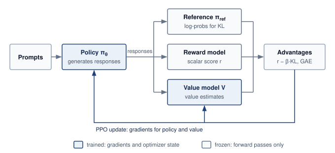

:::

| **Model**                                            | **Role in PPO-style RLHF**                                                        | **Execution mode**                                                | **Memory burden**                                                                                                                                                                                                                                                                                                                                                                                                                                            |
|:-----------------------------------------------------|:----------------------------------------------------------------------------------|:------------------------------------------------------------------|:-------------------------------------------------------------------------------------------------------------------------------------------------------------------------------------------------------------------------------------------------------------------------------------------------------------------------------------------------------------------------------------------------------------------------------------------------------------|
| **Policy Model**\index{Policy model!RLHF role}       | The model being aligned and optimized.                                            | Training mode with gradients, optimizer moments, and activations. | For a `{python} DistTrainH100Capacity.policy_params_b_str`-parameter model in mixed precision with Adam, memory is approximately `{python} DistTrainH100Capacity.policy_params_b_str` $\times$ (`{python} DistTrainH100Capacity.bytes_weights_str` $+$ `{python} DistTrainH100Capacity.bytes_grad_str` $+$ `{python} DistTrainH100Capacity.bytes_adam_str`) = `{python} DistTrainH100Capacity.policy_train_gb_str`, the same budget as standard pretraining. |
| **Reference Model**\index{Reference model!RLHF role} | A frozen copy of the pretrained policy that supplies the KL-divergence penalty.   | Inference mode only.                                              | FP16/BF16 parameters without gradients or optimizer state; a `{python} DistTrainH100Capacity.policy_params_b_str` model needs about `{python} DistTrainH100Capacity.policy_params_b_str` $\times$ `{python} DistTrainH100Capacity.bytes_infer_str` = `{python} DistTrainH100Capacity.ref_mem_gb_str`, roughly `{python} DistTrainH100Capacity.train_to_infer_mult_str` less than the training configuration.                                                 |
| **Reward Model**\index{Reward model!RLHF role}       | A preference-trained scorer that produces scalar rewards for generated sequences. | Inference mode only.                                              | Often smaller than the policy; a `{python} DistTrainH100Capacity.critic_params_b_str` reward model requires approximately `{python} DistTrainH100Capacity.reward_mem_gb_str` in FP16, but it must process every generated sequence.                                                                                                                                                                                                                          |
| **Value Model**\index{Value model!RLHF role}         | The PPO critic that estimates expected future reward.                             | Training mode, either separate or sharing a policy backbone.      | A full-size separate critic can add another `{python} DistTrainH100Capacity.policy_train_gb_str`; smaller models or shared-backbone designs reduce this to 200--400 GB.                                                                                                                                                                                                                                                                                      |

: **RLHF Model Coordination Roles**: PPO-style RLHF coordinates models with different execution modes and memory footprints, so placement decisions must separate trainable policy and value state from inference-only reference and reward state. {#tbl-rlhf-model-coordination-roles tbl-colwidths="[16,24,22,38]"}

The aggregate memory demand of the four-model PPO system dwarfs standard pretraining. A naive co-location of a `{python} DistTrainH100Capacity.policy_params_b_str` policy, `{python} DistTrainH100Capacity.policy_params_b_str` reference, `{python} DistTrainH100Capacity.critic_params_b_str` reward, and `{python} DistTrainH100Capacity.critic_params_b_str` value model requires approximately `{python} DistTrainH100Capacity.ppo_total_mem_gb_str` of accelerator memory, before accounting for the KV caches and intermediate activations generated during sequence generation. A key-value (KV) cache stores attention keys and values for previously processed tokens so the policy can generate the next token without recomputing that state. It grows with the number and length of active sequences, creating a temporary memory budget distinct from weights and optimizer state. On H100 GPUs with `{python} DistTrainH100Capacity.h100_mem_gb_str` of HBM each, this system requires a minimum of `{python} DistTrainH100Capacity.min_gpus_mem_str` as an aggregate static-state capacity lower bound, including optimizer state and gradients. This division does not establish a feasible placement: each phase must also fit its KV or activation peak, workspaces, and uneven shards. Replicated policy groups increase the total state further.

### Infrastructure asymmetry between training and inference models {#sec-distributed-training-rlhf-asymmetry}

The defining infrastructure challenge of RLHF is not the *total memory footprint* but the *asymmetry* between the models' compute profiles. The policy and value models require full backward passes with gradient computation, activation checkpointing, and optimizer updates, compute-intensive operations that benefit from tensor parallelism and high arithmetic intensity. The reference and reward models, by contrast, perform only forward passes over generated sequences. Their scoring passes do not require optimizer state, and they need not decode token by token. The policy's rollout phase creates the autoregressive generation workload and its KV-cache budget. Separating scoring from generation matters because forward-only execution does not imply a single memory or compute profile.

The asymmetry creates a placement dilemma. Co-location permits devices to serve different phases, but inactive model state can occupy memory needed for the active phase. Dedicated pools allow each role to use a suitable execution configuration, but pools may idle while waiting for another role's output. Separation also adds transfers of generated sequences, scores, and updated policy weights. The design must compare phase utilization and data movement rather than assume that either placement eliminates waste.

```{python}
#| echo: false
from mlsysim.solvers import DistributedModel

# ┌─────────────────────────────────────────────────────────────────────────────
# │ RLHF KV CACHE BUDGET (LEGO)
# ├─────────────────────────────────────────────────────────────────────────────
# │ Context: @sec-distributed-training-rlhf-asymmetry
# │
# │ Goal: Quantify generation-phase KV cache for a 70B GQA policy.
# │ Show: Llama-2-70B-style GQA cache, and dense-MHA counterfactual.
# │ How: Compute KV cache bytes from layers, KV heads, head width, sequence length,
# │      batch size, and element size.
# │
# └─────────────────────────────────────────────────────────────────────────────
from mlsysim.fmt import check, fmt, fmt_math, fmt_memory

class RLHFKVCache:
    """Generation-phase FP16 KV-cache footprint for a 70B GQA policy."""

    # ┌── 1. LOAD (Constants) ───────────────────────────────────────────────
    layers = Models.Language.Llama2_70B.layers
    hidden_dim = Models.Language.Llama2_70B.hidden_dim
    attention_heads = Models.Language.Llama2_70B.heads
    kv_heads = Models.Language.Llama2_70B.kv_heads
    seq_len = 1024
    batch_size = 256
    bytes_per_element = BYTES_FP16

    # ┌── 2. EXECUTE (The Compute) ─────────────────────────────────────────
    head_dim = hidden_dim // attention_heads
    kv_width = kv_heads * head_dim
    kv_total = Models.Language.Llama2_70B.get_kv_cache_size(seq_len, batch_size, BYTES_FP16)
    dense_total = 2 * layers * hidden_dim * seq_len * batch_size * bytes_per_element

    # ┌── 3. GUARD (Invariants) ───────────────────────────────────────────
    check(hidden_dim % attention_heads == 0, "Hidden dimension must divide evenly by attention heads")
    check(kv_heads < attention_heads, "GQA should use fewer KV heads than attention heads")
    check(85 * GB <= kv_total <= 87 * GB, f"GQA KV cache ({kv_total.to(GB).magnitude:.1f} GB)")
    check(685 * GB <= dense_total <= 689 * GB, f"Dense-attention KV cache ({dense_total.to(GB).magnitude:.1f} GB)")

    # ┌── 4. OUTPUT (Formatting) ──────────────────────────────────────────
    layers_str = fmt(layers, precision=0, commas=False)
    hidden_dim_str = fmt(hidden_dim, precision=0)
    kv_heads_str = fmt(kv_heads, precision=0, commas=False)
    head_dim_str = fmt(head_dim, precision=0, commas=False)
    seq_len_str = fmt(seq_len, precision=0)
    batch_size_str = fmt(batch_size, precision=0, commas=False)
    kv_total_gb_str = fmt_memory(kv_total, unit=GB, precision=1, commas=False)
    dense_total_gb_str = fmt_memory(dense_total, unit=GB, precision=1, commas=False)
    kv_formula_math = fmt_math(
        rf"2 \times {layers} \times {kv_heads} \times {head_dim} \times {seq_len} \times {batch_size} \times {fmt(bytes_per_element.to(byte).magnitude, precision=0, commas=False)}"
    )
```

The PPO rollout phase introduces autoregressive dependencies absent from the teacher-forced pretraining baseline. The policy generates responses before sequence-level rewards guide its updates. At small active batches, decoding is often memory bandwidth bound because each new token requires another model pass. For a Llama-2-70B-style grouped-query attention policy, KV storage grows by approximately $\KvcacheBytesPerToken = 2 \NumberOfLayers \NumberOfKeyvalueHeadsKv \AttentionHeadDimension \ElementStorageSize$ per cached token per sequence. With `{python} RLHFKVCache.layers_str` layers, `{python} RLHFKVCache.kv_heads_str` KV heads, `{python} RLHFKVCache.head_dim_str`-dimensional heads, `{python} RLHFKVCache.seq_len_str` generated tokens, and `{python} RLHFKVCache.batch_size_str` active sequences, the generated-token portion occupies `{python} RLHFKVCache.kv_total_gb_str`, or `{python} RLHFKVCache.kv_formula_math` bytes. Dense multi-head attention using the full `{python} RLHFKVCache.hidden_dim_str` hidden width for K and V would require `{python} RLHFKVCache.dense_total_gb_str` for that portion. Even with grouped-query attention, that portion alone already exceeds the `{python} DistTrainH100Capacity.h100_mem_gb_str` of HBM on one H100, and prompt tokens add KV state as well. This temporary cache\index{KV cache!generation phase} must fit alongside the state live during rollout; its lifetime differs from training activations and optimizer state.

RLHF systems address this asymmetry through temporal multiplexing\index{Temporal multiplexing!RLHF phases}. During the generation phase, the cluster behaves like an inference system: the policy model generates sequences while the reference model computes log-probabilities, and the dominant resource is HBM reserved for token-by-token attention state. During the training phase, the same fleet switches back to training mode: gradients are computed through the policy and value models using the 3D parallelism configuration developed in @sec-distributed-training-systems-systems-hybrid-parallelism-12a0. During generation, batching active sequences and placing their KV state determine how much useful work shares each weight read. During the update phase, activation residency and gradient synchronization again govern the schedule. RLHF is not one steady training loop, but an alternation between inference-shaped work and training-shaped work, and standard training frameworks rarely manage that transition by themselves.

### Direct preference optimization in the fleet {#sec-distributed-training-rlhf-dpo}

Standard offline DPO\index{Direct preference optimization!memory budget}\index{DPO|see{Direct preference optimization}} [@rafailov2023dpo] removes the separate reward and value models from the update loop by reformulating alignment as a loss over preference pairs. The policy learns from preferred and dispreferred responses using their log-probabilities relative to a frozen reference. Because those responses are already in the training data, the update requires neither online generation nor advantage estimation.

A DPO implementation that retains a resident reference has two model roles: the trainable policy and the frozen reference. For the `{python} DistTrainH100Capacity.policy_params_b_str` policy with `{python} DistTrainH100Capacity.critic_params_b_str` reward and value models used in @sec-distributed-training-rlhf-quantitative, static state falls from about `{python} DistTrainH100Capacity.ppo_total_mem_gb_str` to `{python} DistTrainH100Capacity.dpo_total_mem_gb_str`, a `{python} DistTrainH100Capacity.dpo_reduction_str` reduction. Against a policy-sized PPO value model, it falls from `{python} DistTrainH100Capacity.ppo_policy_sized_value_mem_gb_str` to `{python} DistTrainH100Capacity.dpo_total_mem_gb_str`, or roughly `{python} DistTrainH100Capacity.dpo_reduction_policy_sized_str`. These are configuration-specific state budgets. For fixed preference pairs and a fixed reference, reference log-probabilities can instead be precomputed, removing that model from the repeated update loop. Offline DPO needs no autoregressive rollout during those updates. Variable lengths still require padding, packing, or length-aware batching, and policy training can use the same partitioning, accumulation, and overlap mechanisms as pretraining.

The trade-off is how training obtains new feedback. Standard offline DPO learns from a fixed preference dataset, so the policy cannot try new responses and receive feedback on them during training. PPO-style training generates responses from the evolving policy and scores them, so the policy can improve on its own outputs and expose behavior the original dataset lacks, provided the reward signal is reliable. When the preference data already covers the target distribution, DPO's fixed-data loop usually wins on infrastructure. When training must discover behavior beyond the dataset, as in training models on novel reasoning tasks, PPO's online loop can justify the reward and value models, the generation phase, and the memory they occupy. The decision is settled by achieved quality per unit of total resource cost, not by either property alone.

### Resource requirements for PPO versus DPO {#sec-distributed-training-rlhf-quantitative}

To make the infrastructure trade-off concrete, consider aligning a `{python} DistTrainH100Capacity.policy_params_b_str` policy model on a cluster of 256 H100 GPUs (`{python} DistTrainH100Capacity.h100_mem_gb_str` HBM each). The policy is a 70B-class model rather than the 175B reference, a size at which each role's memory budget stays readable while the four PPO roles together still need at least `{python} DistTrainH100Capacity.min_gpus_mem_str`, more than one node.

```{python}
#| echo: false
from mlsysim.solvers import DistributedModel

# ┌─────────────────────────────────────────────────────────────────────────────
# │ RLHF INFRASTRUCTURE BUDGET (LEGO)
# ├─────────────────────────────────────────────────────────────────────────────
# │ Context: @sec-distributed-training-rlhf-quantitative
# │
# │ Goal: Quantify per-GPU memory for PPO vs. DPO with 70B policy model.
# │ Show: Static memory, KV cache, and remaining budget per GPU.
# │ How: Distribute total model memory across TP×PP GPU mesh.
# │
# └─────────────────────────────────────────────────────────────────────────────
from mlsysim.fmt import (
    check,
    fmt,
    fmt_count,
    fmt_count_range,
    fmt_memory,
    fmt_multiple,
    fmt_params,
    fmt_percent,
    fmt_percent_range,
)
from mlsysim.physics import memory_from_params

class RLHFBudget:
    """PPO vs. DPO resource requirements for 70B alignment."""

    # ┌── 1. LOAD (Constants) ───────────────────────────────────────────────
    policy_params = Models.Language.Llama2_70B.parameters  # Llama-2 70B
    ref_params = Models.Language.Llama2_70B.parameters  # Llama-2 70B
    policy_b = policy_params.to(Bparam).magnitude
    ref_b = ref_params.to(Bparam).magnitude
    reward_b = DistTrainH100Capacity.reward_b  # Llama-2 13B
    value_b = DistTrainH100Capacity.value_b
    bytes_train = ReferenceStats.MixedPrecisionAdam.TrainingStateBytesPerParameter
    bytes_infer = BYTES_FP16 / param
    tp = 8  # scenario assumption
    pp = 4  # scenario assumption
    h100_mem = Hardware.Cloud.H100.memory.capacity.to(GB)  # preserve the registry byte count
    layers = Models.Language.Llama2_70B.layers
    kv_heads = Models.Language.Llama2_70B.kv_heads
    hidden_dim = Models.Language.Llama2_70B.hidden_dim
    attention_heads = Models.Language.Llama2_70B.heads
    seq_len = 1024
    batch_size = 256
    head_dim = hidden_dim // attention_heads
    kv_width = kv_heads * head_dim
    kv_total = Models.Language.Llama2_70B.get_kv_cache_size(seq_len, batch_size, BYTES_FP16)
    kv_total_gb_str = fmt_memory(kv_total, unit=GB, precision=1, commas=False)

    # ┌── 2. EXECUTE (The Compute) ─────────────────────────────────────────
    policy_mem = memory_from_params(policy_params, bytes_train)
    ref_mem = memory_from_params(ref_params, bytes_infer)
    n_gpus = tp * pp
    policy_per_gpu = policy_mem / n_gpus
    ref_per_gpu = ref_mem / n_gpus
    ref_per_gpu_sep = ref_mem / tp
    reward_mem = memory_from_params(reward_b * Bparam, bytes_infer)
    value_mem = memory_from_params(value_b * Bparam, bytes_train)
    ppo_total_mem = policy_mem + ref_mem + reward_mem + value_mem
    dpo_total_mem = policy_mem + ref_mem
    dpo_reduction_pct = ((ppo_total_mem - dpo_total_mem) / ppo_total_mem).to_base_units().magnitude
    static_per_gpu = policy_per_gpu + ref_per_gpu
    remaining = h100_mem - static_per_gpu
    kv_per_gpu = kv_total / n_gpus
    remaining_after_kv = remaining - kv_per_gpu
    gen_phase_pct = 60
    train_phase_pct = 100 - gen_phase_pct
    ppo_mfu_lo = 15
    ppo_mfu_hi = 25
    dpo_mfu_lo = 40
    dpo_mfu_hi = 55

    # ┌── 3. GUARD (Invariants) ───────────────────────────────────────────
    check(abs((policy_mem - 1120 * GB).to(GB).magnitude) < 15, f"policy memory ({policy_mem})")
    check(n_gpus == 32, f"GPU count ({n_gpus})")
    check(abs((policy_per_gpu - 35.0 * GB).to(GB).magnitude) < 0.5, f"policy per GPU ({policy_per_gpu})")
    check(value_mem == 208 * GB, f"value mem ({value_mem})")
    check(abs((ppo_total_mem - 1494 * GB).to(GB).magnitude) < 20, f"PPO total memory ({ppo_total_mem})")
    check(abs((static_per_gpu - 39.4 * GB).to(GB).magnitude) < 0.4, f"static/GPU ({static_per_gpu.to(GB).magnitude:.1f})")
    check(85 * GB <= kv_total <= 87 * GB, f"KV cache ({kv_total.to(GB).magnitude:.1f} GB)")
    check(
        abs((remaining_after_kv + kv_per_gpu + static_per_gpu - h100_mem).to(GB).magnitude) < 1e-9,
        "Generation memory components must sum to capacity",
    )
    check(abs((remaining_after_kv + kv_per_gpu - remaining).to(GB).magnitude) < 1e-9, "Releasing rollout KV restores update-phase headroom")

    # ┌── 4. OUTPUT (Formatting) ──────────────────────────────────────────
    policy_mem_gb_str = fmt_memory(policy_mem, unit=GB, precision=0, commas=True)
    ref_mem_gb_str = fmt_memory(ref_mem, unit=GB, precision=0, commas=False)
    n_gpus_str = fmt_count(n_gpus, commas=False, label="GPU")
    policy_per_gpu_gb_str = fmt_memory(policy_per_gpu, unit=GB, precision=0, commas=False)
    ref_per_gpu_gb_str = fmt_memory(ref_per_gpu, unit=GB, precision=1, commas=False)
    ref_per_gpu_sep_gb_str = fmt_memory(ref_per_gpu_sep, unit=GB, precision=1, commas=False)
    reward_mem_gb_str = fmt_memory(reward_mem, unit=GB, precision=0, commas=False)
    value_mem_gb_str = fmt_memory(value_mem, unit=GB, precision=0, commas=False)
    ppo_total_mem_gb_str = fmt_memory(ppo_total_mem, unit=GB, precision=0, commas=True)
    dpo_total_mem_gb_str = fmt_memory(dpo_total_mem, unit=GB, precision=0, commas=True)
    dpo_reduction_pct_str = fmt_percent(dpo_reduction_pct, precision=1, commas=False, style='prose')
    static_per_gpu_gb_str = fmt_memory(static_per_gpu, unit=GB, precision=1, commas=False)
    remaining_gb_str = fmt_memory(remaining, unit=GB, precision=1, commas=False)
    kv_total_gb_str = fmt_memory(kv_total, unit=GB, precision=1, commas=False)
    kv_per_gpu_gb_str = fmt_memory(kv_per_gpu, unit=GB, precision=1, commas=False)
    remaining_kv_gb_str = fmt_memory(remaining_after_kv, unit=GB, precision=1, commas=False)
    tp_str = fmt_count(tp, commas=False, label="GPU")
    pp_value_str = fmt(pp, precision=0, commas=False)
    policy_b_str = fmt_params(policy_params, scale="B", precision=0, commas=False)
    reward_b_str = fmt_params(reward_b * Bparam, scale="B", precision=0, commas=False)
    value_b_str = fmt_params(value_b * Bparam, scale="B", precision=0, commas=False)
    ref_pool_gpus_str = fmt_count(tp, commas=False, label="GPU")
    bytes_train_value_str = fmt(bytes_train.to(byte / param).magnitude, precision=0, commas=False)
    dp_value_str = fmt(8, precision=0, commas=False)
    rollout_seq_str = fmt_count(batch_size, commas=False, label="sequence")
    rollout_tokens_str = fmt_count(seq_len, commas=True, label="token")
    gen_phase_pct_str = fmt_percent(gen_phase_pct / 100, precision=0, commas=False, style='prose')
    train_phase_pct_str = fmt_percent(train_phase_pct / 100, precision=0, commas=False, style='prose')
```

::: {#nbk-distributed-training-rlhf-infrastructure-budget-ppo-vs-dpo .callout-notebook title="RLHF infrastructure budget: PPO vs. DPO"}

**Problem**: Aligning a `{python} RLHFBudget.policy_b_str` policy model requires co-locating it with a `{python} RLHFBudget.policy_b_str` reference model and, for PPO, a `{python} RLHFBudget.reward_b_str` reward model and a `{python} RLHFBudget.value_b_str` value model. Under 3D parallelism (TP=`{python} RLHFBudget.tp_str`, PP=`{python} RLHFBudget.pp_value_str`, DP=`{python} RLHFBudget.dp_value_str`), how much per-GPU memory does each approach consume, and how much headroom does DPO free by eliminating the reward model, value model, and generation-phase KV cache?

**PPO memory budget** (per-GPU, with TP=`{python} RLHFBudget.tp_str`, PP=`{python} RLHFBudget.pp_value_str`, DP=`{python} RLHFBudget.dp_value_str` for policy)

The policy model under 3D parallelism with TP=`{python} RLHFBudget.tp_str` and PP=`{python} RLHFBudget.pp_value_str` distributes its `{python} RLHFBudget.policy_mem_gb_str` training state across `{python} RLHFBudget.n_gpus_str`, yielding `{python} RLHFBudget.policy_per_gpu_gb_str` per GPU. The reference model, requiring only `{python} RLHFBudget.ref_mem_gb_str` for inference, can be sharded across a separate pool of `{python} RLHFBudget.ref_pool_gpus_str` at `{python} RLHFBudget.ref_per_gpu_sep_gb_str` each, or co-located with the policy GPUs at an additional `{python} RLHFBudget.ref_per_gpu_gb_str` per GPU (`{python} RLHFBudget.ref_mem_gb_str` / `{python} RLHFBudget.n_gpus_str`). The `{python} RLHFBudget.reward_b_str` reward model adds `{python} RLHFBudget.reward_mem_gb_str` shared across its pool. The `{python} RLHFBudget.value_b_str` value model in training mode adds approximately `{python} RLHFBudget.value_mem_gb_str` (`{python} RLHFBudget.value_b_str` $\times$ `{python} RLHFBudget.bytes_train_value_str` bytes/param) across its pool.

Total static memory (co-located policy + reference on `{python} RLHFBudget.n_gpus_str`): `{python} RLHFBudget.policy_per_gpu_gb_str` + `{python} RLHFBudget.ref_per_gpu_gb_str` $\approx$ `{python} RLHFBudget.static_per_gpu_gb_str` per GPU, leaving $\sim$ `{python} RLHFBudget.remaining_gb_str` for activations and KV cache. With generation-phase KV caches for a rollout batch containing `{python} RLHFBudget.rollout_seq_str` and `{python} RLHFBudget.rollout_tokens_str` inside one $TP{\times}PP$ policy replica, each policy GPU must reserve an additional `{python} RLHFBudget.kv_total_gb_str`/`{python} RLHFBudget.n_gpus_str` $\approx$ `{python} RLHFBudget.kv_per_gpu_gb_str` for its KV cache shard. The remaining $\sim$ `{python} RLHFBudget.remaining_kv_gb_str` is generation-phase headroom. Once rollout KV state is released, the update phase recovers the `{python} RLHFBudget.remaining_gb_str` headroom before allocating training activations and other runtime buffers. The phase peaks must be evaluated separately.

**DPO memory budget (same parallelism configuration)**

The policy model uses the same `{python} RLHFBudget.policy_per_gpu_gb_str` per GPU. The reference model adds `{python} RLHFBudget.ref_per_gpu_gb_str` per GPU (co-located). No reward model, no value model, no KV cache for generation.

On the policy GPUs, total static memory is `{python} RLHFBudget.policy_per_gpu_gb_str` + `{python} RLHFBudget.ref_per_gpu_gb_str` = `{python} RLHFBudget.static_per_gpu_gb_str` per GPU, identical to PPO's co-located policy/reference footprint. Both have `{python} RLHFBudget.remaining_gb_str` available before update-phase activations and runtime buffers when PPO releases its rollout KV cache. DPO removes the separate generation peak and the reward/value model pools; the absence of rollout KV state alone does not establish larger update microbatches.

**Throughput comparison**

PPO alternates generation and parameter updates. If generation consumes `{python} RLHFBudget.gen_phase_pct_str` of an iteration in this illustrative schedule, updates occupy the remaining `{python} RLHFBudget.train_phase_pct_str`; this time fraction is not MFU. Update-phase MFU must be multiplied by that fraction to report update computation over the whole iteration, using the same allocated hardware denominator. DPO eliminates online generation, but its measured throughput still depends on sequence lengths, reference scoring, parallelism, and memory use. @Tbl-ppo-vs-dpo separates the static-state comparison from these schedule-dependent effects.

| **Metric**                               |                **PPO (70B policy)**               |                **DPO (70B policy)**               |
|:-----------------------------------------|:-------------------------------------------------:|:-------------------------------------------------:|
| **Models required**                      |           4 (policy, ref, reward, value)          |               2 (policy, reference)               |
| **Static state, one copy of each model** | $\sim$ `{python} RLHFBudget.ppo_total_mem_gb_str` | $\sim$ `{python} RLHFBudget.dpo_total_mem_gb_str` |
| **Device count**                         |        Depends on placement and phase peak        |      Depends on placement and activation peak     |
| **Generation phase**                     |                Yes (autoregressive)               |                        None                       |
| **Update throughput**                    |        Shares the schedule with generation        |             No online-generation phase            |
| **Data pipeline**                        |                 Online generation                 |              Static preference pairs              |

: **PPO vs. DPO state and execution phases**: Static-state totals sum one copy of each model across its device pool, including trainable optimizer state and gradients. Data-parallel replication and phase-specific runtime allocations add to these totals; the table does not determine a minimum device count or measured MFU. {#tbl-ppo-vs-dpo}

**Systems insight**: In this `{python} DistTrainH100Capacity.critic_params_b_str` reward/value-model scenario, DPO reduces the one-copy static-state budget by `{python} RLHFBudget.dpo_reduction_pct_str` by eliminating the reward and value models. It also removes online generation, but the throughput benefit requires a measured schedule. The choice between PPO and DPO is not only a modeling preference but an infrastructure constraint: organizations with limited GPU budgets may prefer DPO because it restores the workload to a fixed-data training loop. If the PPO value model is policy-sized rather than `{python} DistTrainH100Capacity.critic_params_b_str`, the memory reduction approaches the larger `{python} DistTrainH100Capacity.ppo_policy_sized_value_mem_gb_str` to `{python} DistTrainH100Capacity.dpo_total_mem_gb_str` comparison discussed in @sec-distributed-training-rlhf-dpo.

:::

### Sequence length variance and batching challenges {#sec-distributed-training-rlhf-batching}

PPO and DPO make variable sequence length a prominent scheduling concern. Pretraining often packs documents into fixed-length blocks, such as 2,048 or 4,096 tokens, although variable-length workloads also occur. Alignment batches combine prompts and responses whose lengths can differ substantially; an illustrative batch can span a 10--50$\times$ length range. Those lengths determine activation residency, padding, and work assigned to each worker.

Length variance creates two interacting problems. Padding every sequence to the longest in a batch can leave most token positions unused. A batch of one 2,048-token sequence and fifteen 128-token sequences, padded to 2,048 tokens, fills only 3,968 of its 32,768 positions, so kernels that execute padded positions spend about 88 percent of their work on padding; kernels that skip them recover most of that waste. Dynamic batching\index{Dynamic batching!sequence length variance} groups similar lengths to reduce padding, but assignments across workers still need balancing. A worker processing longer sequences can have a larger activation peak and finish later, leaving other workers waiting for the required gradient contributions.

Sequence packing\index{Sequence packing!padding elimination} combines short sequences within a fixed-length input, with attention masking that keeps their contexts separate. Adaptive microbatching varies the number of sequences according to token count or a predicted memory budget. Both techniques also appear in pretraining; alignment adds the need to preserve response boundaries and the chosen preference or policy objective. Workers need not process equal token counts for a correct reduction. A token-mean PPO loss weights local means by valid-token counts, whereas standard DPO averages over preference pairs and uses pair counts [@rafailov2023dpo]. Packing changes layout, not that denominator. Unequal lengths can still create load imbalance, so balancing work remains a performance goal even when weighted reduction preserves the estimator.

RLHF is therefore not a detour from parallelism strategy; it is the case that shows why no strategy is sufficient by itself. The policy model may need tensor and pipeline parallelism, the reference and reward models behave like inference services, the value model may require training state, and the rollout data pipeline changes shape from step to step. With that stress test in view, the final comparison can return to the general engineering question: identify the binding constraint first, then choose the parallelism pattern that moves the least data while fitting the required state.

## Parallelism Strategy Comparison {#sec-distributed-training-systems-systems-parallelism-strategy-comparison-d92a}

A parallelism strategy is useful only if it moves the binding constraint without creating a larger one. Assembling data, tensor, pipeline, and hybrid partitioning into a coherent decision procedure requires evaluating where each strategy relocates the execution tax across the cluster's memory and interconnect hierarchy. For a new model, the decisive questions are which memory state fits, how often communication occurs, where the pipeline bubble appears, and which abstraction cost the engineering team can tolerate.

The canonical 3D core does not exhaust the partitioning space. Sequence parallelism accompanies tensor parallelism by partitioning along the sequence dimension the activations for operations such as layer normalization and dropout that tensor parallelism would otherwise replicate [@korthikanti2023activation]. Context parallelism instead partitions a long attention context and exchanges key/value blocks or partial attention state across ranks [@liu2023ringAttention]. Expert parallelism partitions sparse feed-forward capacity and routes token activations to the selected experts. @Tbl-parallelism-compare places these extensions beside the 3D core without pretending they are independent of its batch, memory, and topology constraints.

| **Strategy**                                                            | **Binding constraint**                                 | **Primary movement**                        | **Placement decision**                                     | **Validation signal**                                |
|:------------------------------------------------------------------------|:-------------------------------------------------------|:--------------------------------------------|:-----------------------------------------------------------|:-----------------------------------------------------|
| **DDP**                                                                 | Model state fits on one accelerator                    | AllReduce gradients every step              | Replicate full model across data-parallel workers          | Step time dominated by compute, not synchronization  |
| **FSDP/ZeRO**                                                           | Model state exceeds one accelerator                    | Gather parameters; reduce-scatter gradients | Size prefetch and reshard windows within peak memory       | State plus activations and workspaces fit            |
| **Tensor parallelism**                                                  | One layer or tensor operation exceeds local capacity   | Reduce or gather partial layer results      | Keep tightly coupled partitions on fast local links        | Exposed collective time fits the layer-time budget   |
| **Pipeline Parallelism**\index{Pipeline parallelism!selection criteria} | Layer stack fits only when split by stage              | Activations and gradients between stages    | Balance stages and live microbatch activations             | Bubble and peak activation memory meet budget        |
| **Sequence/context parallelism**                                        | Activations or attention context exceed local capacity | Exchange sequence shards or attention state | Partition long sequences across a low-latency group        | Longer context fits without communication dominating |
| **Expert parallelism**                                                  | Sparse expert capacity exceeds local memory            | Route token activations with AllToAll       | Balance expert load across a high-bisection group          | Expert imbalance and dropped-token rate stay bounded |
| Hybrid parallelism\index{Hybrid parallelism!decision criteria}          | More than one constraint binds at once                 | Multiple collectives on coupled axes        | Satisfy divisibility, batch, topology, and failure domains | MFU improves within memory and network budgets       |

: **Parallel Training Strategies**: Data, tensor, and pipeline parallelism form the canonical 3D core. Sequence/context parallelism extends the partition along token positions, while expert parallelism extends it across sparse model capacity. Strategy selection remains an engineering feasibility test: identify the binding constraint, the communication primitive it creates, the placement decision it forces, and the measurement that proves the strategy is helping. {#tbl-parallelism-compare tbl-colwidths="[15,22,20,23,20]"}

@Fig-parallelism-flowchart sketches candidate choices from memory fit and execution structure. Its single-device branch asks whether throughput and input delivery meet the target; the complete dataset need not reside in accelerator memory. Layer depth, an oversized operation, and replicated state suggest pipeline, tensor, and sharded data parallelism respectively, subject to the feasibility tests in @tbl-parallelism-compare. A 3D layout ($\text{TP} \times \text{PP} \times \text{DP}$) combines these choices when needed. Before accepting any branch, check peak memory, global batch, communication service time, and load balance together; bandwidth is a feasibility constraint throughout the decision, not an afterthought.

::: {#fig-parallelism-flowchart fig-env="figure" fig-pos="htb" fig-cap="**Parallelism strategy decision framework**: A selection guide that begins with memory fit. For a model that fits on one device, evaluate data parallelism against the throughput target and input-delivery budget; the complete dataset need not fit in accelerator memory. A model that does not fit is routed by the structure that breaks the budget, with sequential depth leading to pipeline parallelism, an oversized single layer to tensor parallelism, and otherwise sharded data parallelism (FSDP/ZeRO). Combine parallelism axes when the workload requires them. Peak memory, global batch, bandwidth, and workload imbalance constrain every candidate." fig-alt="Decision tree flowchart. From the workload profile, diamonds ask whether the model fits on one GPU, whether one GPU meets the throughput target, whether sequential layers are slow, and whether a single layer is too large. Outcomes are single device, data parallelism, pipeline parallelism, tensor parallelism, or sharded FSDP, with a banner recommending combinations of parallelism axes as needed."}
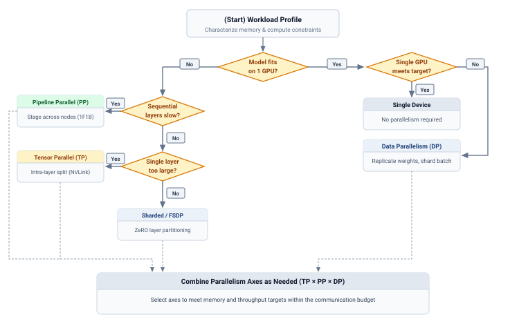{width=100%}

<!--
```{.tikz}
\scalebox{0.75}{%
\begin{tikzpicture}[
  line join=round, line cap=round,
  font=\small\sffamily,
  >=Stealth,
  start_box/.style={
    rectangle,
    rounded corners=3.5pt,
    draw=BlueLine!70,
    fill=white,
    line width=0.7pt,
    align=center,
    inner sep=6pt,
    minimum width=5.6cm
  },
  decision/.style={
    diamond,
    aspect=2.1,
    rounded corners=2pt,
    draw=OrangeLine!80,
    fill=OrangeFill!30,
    line width=0.75pt,
    align=center,
    inner sep=2pt,
    font=\bfseries\scriptsize\sffamily,
    text=TextBlack
  },
  badge_yes/.style={
    rectangle,
    rounded corners=2pt,
    draw=GreenLine!60,
    fill=GreenFill!25,
    text=GreenD,
    font=\bfseries\tiny\sffamily,
    inner sep=2pt,
    line width=0.5pt
  },
  badge_no/.style={
    rectangle,
    rounded corners=2pt,
    draw=RedLine!60,
    fill=RedFill!25,
    text=RedLine!90!black,
    font=\bfseries\tiny\sffamily,
    inner sep=2pt,
    line width=0.5pt
  },
  res_card/.style={
    rectangle,
    rounded corners=3pt,
    line width=0.65pt,
    align=center,
    inner sep=5.5pt,
    minimum width=3.4cm,
    font=\small\sffamily
  },
  hero_card/.style={
    rectangle,
    rounded corners=3.5pt,
    draw=BlueLine!70,
    fill=BlueFill!20,
    line width=0.75pt,
    align=center,
    inner sep=7pt,
    minimum width=16.8cm,
    font=\small\sffamily
  }
]

  % -------------------------------------------------------------
  % START NODE
  % -------------------------------------------------------------
  \node[start_box] (start) at (5.5, 7.8) {
    \textbf{\small (Start) Workload Profile}\\[1pt]
    \footnotesize\textcolor{TextBlack!70}{Characterize memory \& compute constraints}
  };

  % -------------------------------------------------------------
  % ROOT DECISION: Model fits on 1 GPU?
  % -------------------------------------------------------------
  \node[decision, minimum width=3.6cm, minimum height=1.5cm] (d_mem) at (5.5, 5.8) {
    Model fits\\on 1 GPU?
  };
  \draw[->, line width=0.85pt, BlueLine, shorten >= 2.5pt, shorten <= 1.5pt] (start.south) -- (d_mem.north);

  % -------------------------------------------------------------
  % RIGHT BRANCH: DATA THROUGHPUT / REPLICATION
  % -------------------------------------------------------------
  \node[decision, minimum width=3.6cm, minimum height=1.5cm] (d_data) at (10.8, 5.8) {
    Single GPU\\throughput OK?
  };
  \draw[->, line width=0.85pt, GreenLine, shorten >= 2.5pt, shorten <= 1.5pt] (d_mem.east) -- node[pos=0.45, above=2.5pt, badge_yes] {Yes} (d_data.west);

  % Single Device Card
  \node[res_card, draw=GreenLine!70, fill=GreenFill!20, text=GreenD] (c_single) at (10.8, 3.9) {
    \textbf{\scriptsize Single Device}\\[2pt]
    \tiny\textcolor{TextBlack}{No parallelism required}
  };
  \draw[->, line width=0.85pt, GreenLine, shorten >= 2.5pt, shorten <= 1.5pt] (d_data.south) -- node[midway, right=4pt, badge_yes] {Yes} (c_single.north);

  % Data Parallelism Card
  \node[res_card, draw=BlueLine!70, fill=BlueFill!20, text=BlueLine] (c_dp) at (10.8, 2.0) {
    \textbf{\scriptsize Data Parallelism (DP)}\\[2pt]
    \tiny\textcolor{TextBlack}{Replicate weights, shard batch}
  };
  \draw[->, line width=0.85pt, RedLine, shorten >= 2.5pt, shorten <= 1.5pt] (d_data.east) -- node[pos=0.3, above=2.5pt, badge_no] {No} ++(1.3, 0) |- (c_dp.east);

  % -------------------------------------------------------------
  % LEFT BRANCH: MODEL PARALLELISM & SHARDING
  % -------------------------------------------------------------
  \node[decision, minimum width=3.4cm, minimum height=1.5cm] (d_pp) at (2.5, 3.9) {
    Model depth\\exceeds 1 GPU?
  };
  \draw[->, line width=0.85pt, RedLine, shorten >= 2.5pt, shorten <= 1.5pt] (d_mem.west) -- node[pos=0.35, above=2.5pt, badge_no] {No} ++(-1.4, 0) |- (d_pp.north);

  % Pipeline Parallel Card
  \node[res_card, draw=OrangeLine!70, fill=OrangeFill!25, text=OrangeLine!90!black] (c_pp) at (-1.5, 3.9) {
    \textbf{\scriptsize Pipeline Parallel (PP)}\\[2pt]
    \tiny\textcolor{TextBlack}{Stage across nodes (1F1B)}
  };
  \draw[->, line width=0.85pt, OrangeLine, shorten >= 2.5pt, shorten <= 1.5pt] (d_pp.west) -- node[midway, above=2.5pt, badge_yes] {Yes} (c_pp.east);

  % Decision: Single layer too large?
  \node[decision, minimum width=3.4cm, minimum height=1.5cm] (d_tp) at (2.5, 2.0) {
    Single layer\\too large?
  };
  \draw[->, line width=0.85pt, BlueLine, shorten >= 2.5pt, shorten <= 1.5pt] (d_pp.south) -- node[midway, right=4pt, badge_no] {No} (d_tp.north);

  % Tensor Parallel Card
  \node[res_card, draw=RedLine!70, fill=RedFill!20, text=RedLine!90!black] (c_tp) at (-1.5, 2.0) {
    \textbf{\scriptsize Tensor Parallel (TP)}\\[2pt]
    \tiny\textcolor{TextBlack}{Intra-layer split (NVLink)}
  };
  \draw[->, line width=0.85pt, RedLine, shorten >= 2.5pt, shorten <= 1.5pt] (d_tp.west) -- node[midway, above=2.5pt, badge_yes] {Yes} (c_tp.east);

  % Sharded / FSDP Card
  \node[res_card, draw=VioletLine!70, fill=VioletFill!35, text=VioletLine] (c_fsdp) at (2.5, 0.3) {
    \textbf{\scriptsize Sharded / FSDP}\\[2pt]
    \tiny\textcolor{TextBlack}{ZeRO parameter sharding}
  };
  \draw[->, line width=0.85pt, BlueLine, shorten >= 2.5pt, shorten <= 1.5pt] (d_tp.south) -- node[midway, right=4pt, badge_no] {No} (c_fsdp.north);

  % -------------------------------------------------------------
  % BOTTOM HERO CARD: 3D PARALLELISM
  % -------------------------------------------------------------
  \node[hero_card] (hero) at (4.75, -1.5) {
    \textbf{\footnotesize Production Scale: 3D Parallelism ($\text{TP} \times \text{PP} \times \text{DP}$)}\\[3pt]
    \scriptsize\textcolor{TextBlack}{Compose Tensor (intra-node NVLink), Pipeline (inter-node), and Data Parallelism (cluster-wide)}
  };

  % Convergence lines from strategies to 3D Parallelism card
  \draw[->, line width=0.8pt, BlueLine, dashed, shorten >= 2.5pt] (c_pp.west) -- ++(-0.4, 0) coordinate (p_pp_drop) -- (p_pp_drop |- hero.north);
  \draw[->, line width=0.8pt, BlueLine, dashed, shorten >= 2.5pt] (c_tp.south) -- (c_tp.south |- hero.north);
  \draw[->, line width=0.8pt, BlueLine, dashed, shorten >= 2.5pt] (c_fsdp.south) -- (c_fsdp.south |- hero.north);
  \draw[->, line width=0.8pt, BlueLine, dashed, shorten >= 2.5pt] (c_dp.south) -- (c_dp.south |- hero.north);

\end{tikzpicture}%
}
```
-->

:::

The table and flowchart are intentionally coarse, but their purpose is precise: identify the binding constraint before choosing the implementation stack.

Throughout this chapter, the partitioning strategies were developed directly for dense large-model training and recommendation-style workloads. @Tbl-partitioning-archetypes also shows how the same constraint logic reaches the federated edge case, where the bottleneck shifts from accelerator memory and fabric bandwidth to unreliable devices, privacy, and intermittent connectivity.

::: {#lhs-distributed-training-distributed-archetype-spectrum .callout-lighthouse title="Distributed archetype spectrum"}

Partitioning and coordination choices differ with the system's primary bottleneck:

| **Archetype**                         | **Primary Partitioning Strategy** | **The Logic**                                                                                                                                                                                                                     |
|:--------------------------------------|:---------------------------------:|:----------------------------------------------------------------------------------------------------------------------------------------------------------------------------------------------------------------------------------|
| **Archetype A (GPT-4/Llama-3)**       |       Hybrid 3D Parallelism       | Combine Tensor (width), Pipeline (depth), and Data (throughput) to fit roughly `{python} DistTrainReliabilityFacts.gpt4_mem_tb_str` of weights under third-party estimates (OpenAI has not disclosed the parameter count).        |
| **Archetype B (DLRM at Scale)**       |         Embedding Sharding        | Partition massive `{python} DistTrainReliabilityFacts.dlrm_mem_tb_str`+ tables across parameter servers or accelerator shards\index{Parameter server!DLRM embedding}; use sparse AllToAll updates.                                |
| **Archetype C (Federated MobileNet)** |         Federated Learning        | The same logic extends to coordinating on-device MobileNet updates across unreliable, privacy-constrained edge devices\index{Federated learning!edge constraints}; @sec-edge-intelligence-federated-systems develops this regime. |

: **Partitioning strategy by archetype**: Partitioning and coordination choices differ with the dominant bottleneck. {#tbl-partitioning-archetypes}

:::

A configuration chosen this way still has to be expressed in software, and the way a framework expresses it decides which of the chapter's budgets the engineer controls directly.

## From Principles to Systems {#sec-distributed-training-systems-systems-framework-integration-cf71}

A TP-8, PP-16, DP-128 layout that passes every feasibility check on paper can still hang at its first collective if two ranks disagree on group membership, or run slowly if gradient buckets become ready in an order the collective runtime cannot overlap. Choosing DDP, FSDP/ZeRO-style sharding, tensor parallelism, or pipeline parallelism is therefore also a decision about which constraints the runtime owns and which constraints the engineer must manage directly. Sparse workloads add a fourth contract, the parameter-server push/pull interface\index{Parameter server!push-pull model} [@li2014] developed for Archetype B in @sec-distributed-training-systems-systems-parameter-servers-embedding-sharding-8821.

The training framework defines process groups\index{Process groups!PyTorch distributed}, gradient buckets\index{Gradient bucketing!communication overlap}, and the point in backpropagation when each reduction becomes ready; the collective runtime maps those reductions onto ring, tree, or hierarchical algorithms. The engineer must choose compatible group membership and bucket order and verify which communication remains exposed on the step's critical path.

Layer-wise model parallelism requires explicit stage placement and load balancing, while pipeline parallelism adds microbatch scheduling logic\index{Pipeline parallelism!microbatch scheduling} to overlap forward and backward work. Tensor splitting instead changes the operators inside each layer, using the column-parallel and row-parallel pairing developed in @sec-distributed-training-systems-systems-tensor-parallelism-d76e. FSDP adds parameter-gather and gradient-reduction boundaries around layer execution. Composing these abstractions requires preserving both the intended optimizer update and the memory and dependency budgets that each mechanism introduces.

Production frameworks expose these same strategies under different names, which makes a translation aid useful when reading their documentation or configuration files. @Tbl-framework-strategy-map maps the strategies of this chapter onto four widely used stacks; the names change between releases, but the partition each one implements does not.

| **Strategy**              | **PyTorch**                        | **DeepSpeed**                  | **Megatron-LM**                        | **JAX**                                                         |
|:--------------------------|:-----------------------------------|:-------------------------------|:---------------------------------------|:----------------------------------------------------------------|
| **Data parallel**         | DistributedDataParallel (DDP)      | DeepSpeed engine, ZeRO stage 0 | Data-parallel process groups           | Batch axis sharded over a device mesh                           |
| **Sharded data parallel** | Fully Sharded Data Parallel (FSDP) | ZeRO stages 1--3               | Distributed optimizer                  | Parameter and optimizer state sharded over a mesh axis          |
| **Tensor parallel**       | DTensor tensor-parallel APIs       | AutoTP or Megatron integration | Column- and row-parallel linear layers | Sharding annotations on model axes, partitioned by the compiler |
| **Pipeline parallel**     | `torch.distributed.pipelining`     | Pipeline engine                | Pipeline schedules (1F1B, interleaved) | User-written stage schedules                                    |

: **Framework names for the parallelism strategies**: A translation aid, not a ranking. Each entry names the mechanism a framework uses for the partition developed in this chapter; exact class and option names vary across releases. {#tbl-framework-strategy-map tbl-colwidths="[16,20,18,22,24]"}

The training design therefore determines message size, readiness order, and frequency, while collective algorithms determine how those messages move. *No framework abstraction changes the underlying physics*: distributed-training efficiency ultimately depends on interconnect bandwidth, memory capacity, synchronization latency, and the useful overlap admitted by the computation graph.

::: {.column-margin .margin-pointer}
↪ How much communication overlap can remove from a step's critical path, and how to quantify that opportunity, is developed in @sec-performance-engineering-overlap.
:::

## Fallacies and Pitfalls {#sec-distributed-training-systems-systems-fallacies-pitfalls-e2bc}

The GPT-2 notebooks showed the trap in miniature. Moving the same model from one NVLink node to four Ethernet-connected nodes quadrupled the GPU count but cut parallel efficiency from `{python} Scaling8GPU.efficiency_8gpu_str` to `{python} Scaling32GPU.efficiency_32gpu_str`. The following misconceptions generalize that error, each treating one term of the step-time accounting as if it were the whole budget.

::: {.fallacy-pitfall}

**Fallacy**: *Linear speedup is achievable with sufficient engineering effort.*

Amdahl's Law limits speedup when a fixed serial component remains exposed. Synchronous gradient aggregation creates an update dependency, but some of its work can overlap backward computation. As @sec-distributed-training-systems-systems-distributed-training-efficiency-metrics-9488 shows, $\ScalingEfficiency = 1/(1 + N(\CommunicationTime + \SynchronizationTime - \OverlappedTime)/\IronlawTermTimesCompute)$ depends on the exposed overhead relative to useful compute as $N$ changes. A 1,000-GPU allocation therefore does not by itself justify a 1,000$\times$ speedup forecast. Local kernel efficiency, memory feasibility, communication, and convergence must be evaluated against the specified baseline. Linear scaling is a result to demonstrate for an operating range, not a return guaranteed by device count.

:::

::: {.fallacy-pitfall}

**Pitfall**: *Optimizing MFU without considering scaling efficiency.*

```{python}
#| echo: false
# ┌─────────────────────────────────────────────────────────────────────────────
# │ MFU x SCALING EFFICIENCY PITFALL (LEGO)
# ├─────────────────────────────────────────────────────────────────────────────
# │ Context: the "Optimizing MFU without considering scaling efficiency" pitfall.
# │ Goal: Show the correct composition and the double-counting error with the
# │       chapter's own numbers (2026-09-29: restores the worked example).
# │ Show: 50 percent local MFU x 83% scaling efficiency ~ 41% fleet MFU; applying the
# │       83% again to the measured 41% understates it as ~34%.
# │ How: CommScalingMath local efficiency; HybridConfigFeasibility config B
# │      overlapped scaling efficiency.
# └─────────────────────────────────────────────────────────────────────────────
from mlsysim.fmt import check, fmt_percent

class MfuScalingPitfall:
    # ┌── 1. LOAD ─────────────────────────────────────────
    local_mfu = CommScalingMath.local_efficiency_pct / 100  # single-node MFU before communication
    eta = HybridConfigFeasibility.config_b_overlap_efficiency

    # ┌── 2. EXECUTE ──────────────────────────────────────
    fleet_mfu = local_mfu * eta
    double_counted = fleet_mfu * eta

    # ┌── 3. GUARD ────────────────────────────────────────
    check(double_counted < fleet_mfu < local_mfu, "Each multiplication by eta must lower the estimate")

    # ┌── 4. OUTPUT ───────────────────────────────────────
    local_mfu_str = fmt_percent(local_mfu, precision=0, commas=False, style='prose')
    eta_str = fmt_percent(round(eta * 100) / 100, precision=0, commas=False, style='prose')
    fleet_mfu_str = fmt_percent(round(fleet_mfu * 100) / 100, precision=0, commas=False, style='prose')
    double_counted_str = fmt_percent(round(double_counted * 100) / 100, precision=0, commas=False, style='prose')
```

A single-node MFU measurement does not predict fleet throughput by itself. For a fixed workload and hardware peak convention, scaling efficiency compares measured distributed throughput with ideal replication of that single-node baseline. Multiplying the baseline MFU by this scaling efficiency gives distributed MFU; multiplying an already measured distributed MFU by the same scaling efficiency counts communication and synchronization losses twice. The chapter's own numbers make the difference concrete. A single node running at `{python} MfuScalingPitfall.local_mfu_str` MFU, scaled with the `{python} MfuScalingPitfall.eta_str` scaling efficiency of the overlapped TP-8 layout in @sec-distributed-training-systems-systems-hybrid-parallelism-12a0, delivers about `{python} MfuScalingPitfall.fleet_mfu_str` MFU across the fleet. A planner who measures that `{python} MfuScalingPitfall.fleet_mfu_str` on the full cluster and then applies the `{python} MfuScalingPitfall.eta_str` again would budget for about `{python} MfuScalingPitfall.double_counted_str` and buy capacity the job does not need. Capacity planning must state the device count and measurement window for each metric. Checkpointing, recovery, and replay require additional accounting only when those losses fall outside that window, and useful goodput must count retained model progress rather than repeated work.

:::

::: {.fallacy-pitfall}

**Fallacy**: *Hyperparameters tuned on small clusters transfer directly to large-scale training.*

Engineers tune hyperparameters on 8-GPU workstations then deploy to 256-GPU clusters expecting identical behavior. At scale, convergence patterns change fundamentally. The most critical hyperparameter is learning rate: as @sec-distributed-training-systems-systems-data-parallelism-6132 explains, global batch increases with GPU count when local batch and accumulation depth remain fixed, so the learning-rate schedule must be revalidated. The linear scaling rule of @sec-distributed-training-systems-systems-learning-rate-scaling-rules-fa26, which the one-hour ImageNet run established, suggests $\eta_{\text{large}} = \eta_{\text{base}} \times (B_{\text{large}}/B_{\text{base}})$, but this relationship holds only within bounds. As models scale, they eventually encounter the critical batch size of @sec-distributed-training-systems-systems-critical-batch-size-parallelism-hurt-4961, where adding more data per step yields diminishing returns in convergence.

Beyond the critical batch size, this relationship breaks down in a model-, data-, and optimizer-dependent way. A team that takes a small-cluster learning rate, multiplies it mechanically with GPU count, and jumps directly to a much larger global batch may see lower final quality or slower sample efficiency even though hardware throughput improved. Warmup schedules, weight decay adjustment, layer-wise optimizers such as LARS/LAMB, and careful momentum tuning can recover accuracy in some regimes, but require systematic experimentation at target scale. Organizations that skip these scaling studies waste thousands of GPU-hours on suboptimal runs.

:::

::: {.fallacy-pitfall}

**Pitfall**: *Adding GPUs to data-parallel jobs without modeling communication.*

More GPUs improve time to target only if the gain in processing rate outweighs communication overhead and any additional sample use. With fixed local batch size, adding data-parallel workers increases the global batch; fixing the global batch instead reduces local work and can expose more communication. The critical-batch analysis in @sec-distributed-training-systems-systems-critical-batch-size-parallelism-hurt-4961 supplies a workload-dependent statistical guide, not universal GPU-count or model-size thresholds. Compare complete learning curves and cost at the same target quality before committing to a larger allocation.

```{python}
#| echo: false
from mlsysim import Hardware, Models
from mlsysim.core.units import GiB, BILLION, param
from mlsysim.fmt import check, fmt, fmt_memory_capacity, fmt_params

class A100CapacityFallacies:
    mem = Hardware.Cloud.A100.memory.capacity
    check(mem == 80 * GiB, "A100 memory capacity should be 80 GB")
    a100_mem_gb_str = fmt_memory_capacity(mem, unit=GiB, precision=0, commas=False)
```

:::

::: {.fallacy-pitfall}

**Fallacy**: *Memory capacity alone determines the parallelism strategy.*

A model that exceeds device capacity needs a feasible partition, but memory fit does not select the fastest one. Tensor parallelism exchanges partial results within layers, while pipeline parallelism transfers stage-boundary activations and introduces scheduling bubbles. Their relative cost depends on layer shapes, microbatch count, placement, and overlap. Compare complete training-state and activation budgets together with measured time to target; an unsupported throughput percentage or a weights-only fit cannot settle the choice.

:::

::: {.fallacy-pitfall}

**Pitfall**: *Applying FSDP or ZeRO without measuring efficiency trade-offs.*

Engineers adopt FSDP universally after reading that it "reduces memory and enables larger models." Sharding trades memory capacity for communication overhead\index{FSDP!efficiency trade-offs}: full-shard FSDP gathers parameters before layer execution and reduces gradient shards during backward, with another parameter gather when the forward pass resharded them. The relevant comparison begins with the complete training-state budget. Under the mixed-precision Adam convention established here, the 7B worked example exceeds single-device capacity before activations, so standard DDP cannot fit that state on an A100-`{python} A100CapacityFallacies.a100_mem_gb_str`. A weights-only fit does not establish a feasible training baseline. When the complete state, activations, and workspaces fit without sharding, DDP can avoid the repeated gathers; when they exceed the `{python} A100CapacityFallacies.a100_mem_gb_str` capacity, the comparison must include a feasible alternative such as sharding or offload. FSDP provides value when it enables training at all or when the larger local batch it permits offsets its communication cost. ZeRO-Offload\index{ZeRO-Offload!CPU memory extension} extends capacity through CPU memory but adds transfers of its own. The decision therefore requires measuring peak memory and exposed communication for the same workload and optimizer contract.

:::

::: {.fallacy-pitfall}

**Fallacy**: *Parallelism overhead is roughly constant regardless of model size.*

Engineers benchmark parallelism strategies on convenient small models then apply those conclusions to large-scale training. For dense transformers at fixed tokens per update, computation and gradient bytes both grow roughly proportionally with parameter count, as the earlier scaling analysis established. Larger parameter count alone therefore does not imply a better computation-to-communication ratio. Architecture, sequence length, local batch size, partition degree, and kernel efficiency determine how much useful work each rank performs; gradient representation and process-group membership determine how much it communicates. A larger model can also require a different partition that introduces new layer collectives or pipeline bubbles. Reliable strategy selection holds the workload and target quality explicit, then recomputes memory fit, local compute time, communication volume, and the available overlap window at the target scale. A small-model benchmark becomes transferable evidence only when those governing terms remain comparable.

:::

::: {.fallacy-pitfall}

**Pitfall**: *Treating scaling efficiency as a property of the hardware alone.*

A vendor benchmark might report 85 percent scaling efficiency at 1,024 GPUs, and procurement teams then plan capacity as if that number were a cluster constant. Scaling efficiency is a joint property of four things: the workload's communication-to-computation ratio, the parallelism strategy (data, pipeline, tensor, hybrid), the network topology (fat-tree vs. torus vs. dragonfly), and the software stack (NCCL version, kernel fusion, overlap quality). Reference numbers from dense large-language-model benchmarks transfer poorly to other workloads and fabrics. They may overstate scaling for graph neural networks with irregular communication and for embedding-heavy recommendation models, whose AllToAll embedding exchanges and many small random lookups load the fabric differently from dense gradient AllReduce (@sec-distributed-training-systems-systems-parameter-servers-embedding-sharding-8821), and they say nothing about a commodity-Ethernet placement like the GPT-2 scale-out, which lost most of its parallel efficiency on leaving the node. Capacity planning should use measured scaling on the target workload, not a vendor hero benchmark.

:::

::: {.fallacy-pitfall}

**Fallacy**: *Gradient accumulation is free.*

Gradient accumulation can reduce synchronization from every microstep to once per window of $k$ microsteps, eliminating $(k-1)/k$ of those synchronization events when the implementation defers reduction. The saving has costs. A resident gradient buffer\index{Gradient accumulation!resident buffer} remains live throughout the accumulation window; for the `{python} DistTrainA100Memory.params_b_str` model, the FP16 buffer occupies `{python} DistTrainA100Memory.weights_gb_str`. Retaining graphs across microsteps or increasing the local batch size can add activation pressure. Accumulating eight microsteps makes updates 8$\times$ less frequent per processed microstep, but wall-clock spacing also depends on the communication saved. Larger effective batches can change convergence, and narrow accumulation formats can lose small contributions or overflow. The dtype, loss normalization, and reduction schedule must therefore be validated at the intended batch size. Accumulation trades communication frequency against update spacing, memory residency, and numerical stability\index{Gradient accumulation!numerical stability}.

:::

## Summary {#sec-distributed-training-systems-summary}

Scaling laws keep pushing frontier training budgets past what one machine can hold or finish in time, and distributed training is how the fleet absorbs that growth. It confronts the scaling wall\index{Scaling wall!hardware ceiling}, the workload-dependent operating point beyond which communication and coordination can consume the compute time saved by adding accelerators. A feasible design must preserve the intended optimization update while satisfying model-state, activation, batch-size, and interconnect constraints. Hardware throughput alone is insufficient; the comparison must also account for time to the target model quality.

Each partition relocates cost along the C³ axes. Data parallelism divides compute across replicas\index{Data parallelism!communication cost} and pays in communication, the gradient aggregation whose exposed share set the scaling efficiency of the 175B communication example. Tensor parallelism divides work inside a layer\index{Tensor parallelism!critical-path communication} and pays in communication on the critical path, which confines it to a fast domain. Pipeline parallelism divides layer depth\index{Pipeline parallelism!coordination cost} and pays mostly in coordination, the fill and drain bubble that only more microbatches, better balance, or a smarter schedule can shrink. The 3D parallelism cube in @fig-3d-parallelism-cube unites these trade-offs in one coordinate space ($\DataparallelDegreeDp \times \PipelineparallelDegreePp \times \TensorparallelDegreeTp$). A feasible point must satisfy peak memory and global-batch constraints as well as communication and coordination budgets.

Sharding and model partitioning make different parts of the training state fit, while synchronization and precision policies determine whether the resulting updates remain useful. Hybrid layouts compose these choices within the bandwidth hierarchy. The alignment workload extends the same reasoning to multiple models and alternating generation and update phases, where peak memory depends on which state is live together.

The chapter's strategies are complementary dimensions of one design space rather than alternatives. Systems such as Megatron-LM\index{Megatron-LM!hybrid scaling} map tensor, pipeline, data, and expert exchanges to the communication domains that can carry them, and that matching is what delays the communication-bound regime as the fleet grows. The workload archetypes weight those dimensions differently. Archetype A (GPT-4/Llama-3) combines dense-model partitioning with state sharding and, at long contexts, sequence or context partitioning; Archetype B (DLRM at Scale) shards sparse embedding state and pays in lookup traffic rather than layer collectives; Archetype C (Federated MobileNet) moves the coordination problem onto unreliable edge devices. In each case the binding constraint, not the archetype label, selects the configuration.

::: {.callout-takeaways title="Parallelism relocates the tax"}

* **Splitting work moves the bottleneck**: Distributed training does not make the underlying computation smaller; it converts memory pressure into communication volume, synchronization delay, or idle pipeline time (principle \ref{pri-scaling-efficiency}). The winning strategy is the split that sends overhead to the least binding part of the fleet.
* **Throughput must serve convergence**: Larger global batches can improve hardware efficiency while yielding diminishing progress per sample. Compare time to the same target quality, and treat the critical-batch estimate as a workload-dependent guide for selecting batch size and update schedules.
* **Sharding buys memory with messages**: ZeRO and FSDP partition optimizer state, gradients, and parameters (principle \ref{pri-memory-capacity-gap}), reducing replicated storage. Peak memory must still include activations, temporary gathers, and workspaces; exposed ReduceScatter and AllGather costs determine whether the capacity gain also improves throughput.
* **Tensor parallelism needs a fast domain**: Splitting operations inside layers creates frequent communication on the dependency path. Place those groups on links with sufficient bandwidth and low latency; the relevant boundary is the communication domain, which may span nodes, rather than the server enclosure.
* **Pipeline parallelism trades bytes for bubbles**: Layer staging reduces communication frequency, but fill and drain slots leave accelerators idle (principle \ref{pri-distributed-step-time}). Microbatching with $m \gg \PipelineparallelDegreePp$ is the mechanism that turns model depth into throughput rather than pipeline slack.
* **Hybrid layouts are joint decisions**: Combine only the partitioning and sharding strategies needed to satisfy the workload's constraints (principle \ref{pri-conservation-overhead}). Model divisibility, batch size, peak memory, communication groups, and failure domains must form one feasible configuration; improving one axis can expose a limit on another.

:::

The displacement of overhead\index{Displacement of overhead!parallelism trade-offs} (principle \ref{pri-conservation-overhead}) makes a feasible partition the beginning of the design problem. A memory-saving split is useful only if its communication and schedule still meet the run's time-to-quality budget. Every mechanism in this chapter shrinks the per-device compute term $\IronlawTermTimesCompute/N$ or the per-device training state, and pays for it in $\CommunicationTime$, in $\SynchronizationTime$ through barriers, stragglers, and pipeline bubbles, or in lost overlap. In C³ terms, no partition removes the execution tax of scale; it only relocates that tax among compute, communication, and coordination. The engineering judgment is therefore to compare complete configurations, including their exposed dependencies, rather than optimize each parallelism axis independently.

::: {.callout-chapter-connection title="From logic to traffic"}

Splitting the mathematics defines the *logical* exchanges the update protocol needs. Replicas AllReduce gradients, sharded layers ReduceScatter and AllGather their state, expert and embedding partitions route tokens through AllToAll, and pipeline stages pass activations point to point. Each exchange specifies a result that participants must receive, not how its bytes cross the *physical* fabric. The next chapter separates those result contracts from the ring, tree, and hierarchical schedules that carry them out and prices each schedule's latency, bandwidth, and topology costs, so that the communication budgets charged to $\CommunicationTime$ here can be evaluated rather than assumed.

:::

::: { .quiz-end }
:::
